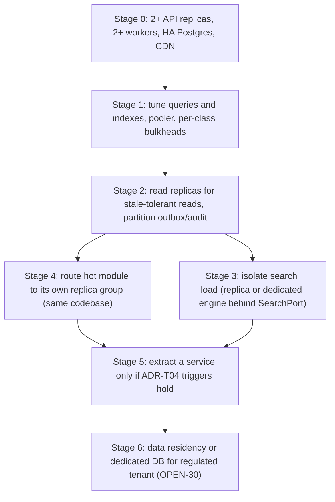

# Capacity and Scaling

Doc ID: OPS-CAP · Owner: SRE Lead (with Backend Architect) · Version 1.0 · Status: Draft for Review · Relates: ADR-T04, ADR-T05, ADR-T09, ADR-T11, ADR-T21, OPS-SLO §9, OPS-DEP, 21_COST_AND_FINOPS/COST_MODEL.md, RISK-11, RISK-12, OPEN-14, OPEN-15, OPEN-23, OPEN-30

This document contains **formulas, triggers and levers — not sizes**. No traffic, user or cost figure is asserted. Variables (ASM-C-*) are defined in OPS-SLO §9 and stay [OPEN] until a forecast and `WP-LOADBASE` exist.

## 1. Architectural scaling properties (what the design makes possible)

| Property | Design source | Consequence for scaling |
|---|---|---|
| API replicas are stateless; Postgres is the only system of record | ADR-T05 | Horizontal scale of API by adding replicas; no sticky sessions; no per-process authoritative state. **[REF]** the reference API must run as exactly one process per database because it holds an in-memory read model hydrated at boot — the target removes this limit. |
| Modular monolith + separate worker | ADR-T04 | Two independently scalable deployables (API, worker); modules scale together until an extraction trigger fires |
| Outbox + at-least-once dispatch with consumer dedupe and fenced leases | ADR-T09 | Workers scale horizontally without duplicate effects |
| Search inside Postgres behind `SearchPort` | ADR-T11 | Search load competes with OLTP unless isolated; port allows swap |
| Remote assets are immutable content-hashed files on a CDN | OPS-DEP §3 | Frontend capacity is effectively CDN capacity; origin load is cache-miss only |
| Row-level multi-tenancy | ADR-T21 | One large tenant can dominate; need per-tenant quotas and noisy-neighbour controls |

## 2. Component capacity model

| Component | Primary bottleneck | Sizing formula | Scale-out lever | Scale trigger (alert, [TARGET] thresholds calibrated in OPEN-15) |
|---|---|---|---|---|
| CDN / static | request rate, egress | `egress_GB = MAU × sessions × avg_cold_bytes × (1 − h)`; origin RPS ≈ `RPS_static × (1 − h)` | Cache-hit-ratio improvement (immutable hashes, long TTL), tiered caching | Hit ratio below ASM-C-09 target |
| API replicas | CPU, event-loop lag, memory | `N = ceil(RPS_peak × s̄_cpu / (cores × u_target)) + 1` | Add replicas; split hot module routes to separate replica group (same codebase, different routing) | Event-loop lag p99 or CPU > u_target for sustained window; SLO-01/04 latency burn |
| Connection pooler | connection count | `conns = N × pool_api + W × pool_worker + admin ≤ 0.8 × pooler_limit` | Pooler in transaction mode, per-class slices, lower pool per replica as N grows | Pool wait p95 above threshold |
| Postgres primary | write IOPS, WAL rate, lock contention, CPU | `write_TPS = RPS_peak × m_write × k`; `WAL_GB/day ≈ rows × avg_row_bytes × index_overhead × write_factor` | Vertical scale first; optimise queries/indexes; partition large append tables (outbox, audit, events) by time; archive cold partitions | CPU or IOPS > threshold, replication lag, autovacuum falling behind |
| Postgres read replicas | read QPS | route stale-tolerant classes only (lists, search, analytics reads); critical authz/consent/entitlement reads stay on primary | Add replicas | Primary read share and CPU |
| Search (FTS + trigram + pgvector) | index size, memory, vector recall/latency | `index_RAM ≈ vectors × dim × bytes_per_float × overhead` (HNSW overhead factor [OPEN]) | Dedicated search replica; tune index params; **ADR-T11 trigger:** p95 > 400 ms at target corpus or proven relevance gap → evaluate dedicated engine behind `SearchPort` | Search p95 trend, recall regression |
| Worker | queue depth, per-class service time | `W = ceil(λ_class × s̄_class / (c × u))` per class; ensure P0 class has reserved capacity | Add workers; per-class queues/concurrency; separate worker pools for heavy (scan, recompute, reports) | Oldest-age gauges vs SLO-20..25 |
| Object storage | volume, request rate | `GB_total(t) = Σ uploads × f × replication_factor`; lifecycle policies for derived files | Tiering, lifecycle, CDN for derivatives | Growth vs cost budget |
| Malware scanner | scan throughput | `scanners = ceil(uploads_per_s × mean_scan_s / u)` | Horizontal scanners | SLO-22 burn |
| Sandbox runner (when built) | concurrent executions, startup time | `slots = λ_submit × mean_exec_s / u`; plus cold-start | Pool pre-warm; per-tenant concurrency caps | Queue wait |
| AI gateway | provider rate limits, tokens | `tokens/day = Σ_users calls × (in+out tokens)`; cost → FIN-COST | Per-user/org budgets (INV-T07), caching, smaller models for free paths | Spend vs budget thresholds |
| Observability | telemetry volume, cardinality | `bytes/day = spans × avg_span_bytes × sampling + logs + metrics series × samples` | Tail sampling, log level control, cardinality limits | Ingest budget |

## 3. Scaling paths and evolution

ADR-T04 extraction triggers (restated, not changed): a module needs independent scaling/SLA, distinct residency, or team contention. ADR-T09 broker trigger: outbox throughput exceeds the Postgres budget or services are extracted. Each stage is entered only on a measured trigger, never pre-emptively.

## 4. Noisy-neighbour and tenant fairness

| Control | Mechanism | Test |
|---|---|---|
| Per-tenant request quota | Token bucket per `org_id` at ingress, `429` with `Retry-After` | TEST-PER-007 |
| Per-tenant job concurrency | Fair-share dequeue (round robin across tenants within class) | TEST-PER-005 |
| Per-tenant AI and export budgets | Gateway and export endpoint budgets | TEST-ASM-006 |
| Heavy query guard | Statement timeout, max page size, report jobs asynchronous | TEST-PER-009 |

## 5. Load and capacity testing programme

| Test | Purpose | Method | Output |
|---|---|---|---|
| Baseline (`WP-LOADBASE`) | Establish per-class latency and per-request CPU/DB cost | Scripted k6-style scenarios with the §9 mix; steady load at several levels | Calibration of s̄_cpu, k, u_target and every SLO-OPS number |
| Stress | Find the saturation knee and the failure direction | Ramp to failure | Knee RPS; confirm shed and breakers engage (TEST-REL-004) |
| Soak | Leaks, bloat, autovacuum, connection churn | Long steady run | Trend of memory, bloat, replica lag |
| Spike | Burst behaviour after notification campaign or job-posting surge | Step change | Recovery time, shed behaviour (TEST-PER-007) |
| Remote-deploy herd | Manifest refetch storm after deploy | Simulated cache invalidation | Origin load, jittered refresh (TEST-REL-011) |
| Search at target corpus | ADR-T11 trigger test | Corpus generator at forecast scale | p95/p99 (TEST-PER-002) |

Production-like data volumes use synthetic data; no production PII in load environments (QA-STRAT §6).

## 6. Headroom policy

| Resource | Rule | Rationale |
|---|---|---|
| CPU | `u ≤ 0.6` steady, `≤ 0.8` peak | Queueing delay rises steeply as utilisation approaches 1 (M/M/c behaviour); headroom absorbs bursts and one-replica loss |
| N+1 | Survive loss of one replica/worker/AZ-share without breaching SLO | SLO-01 budget cannot absorb routine node loss |
| DB connections | ≤ 80% of limit | Avoid hard refusal during deploys (double replicas during rollout) |
| Disk | Alert at projected exhaustion horizon [TARGET param] | WAL + data growth must be forecast, not reacted to |
| Rollout surge | Capacity plan accounts for old+new replicas simultaneously | Deploys otherwise cause the exhaustion they should avoid |

## 7. Capacity review cadence and triggers for re-forecast

| Trigger | Action |
|---|---|
| New phase gate (Ph1→Ph2 etc.) | Re-run forecast with measured a, s, r, p |
| Institution onboarding with large cohort | Cohort import/activation load test before go-live (PROC-02) |
| Any alert in §2 for > hold period | Capacity ticket with owner |
| Cost anomaly | FIN-COST review |

## 8. Open items

| Item | Ref |
|---|---|
| Forecast inputs (MAU by persona, mix, peak) | OPEN-15 |
| HA/failover mechanism and replica support | OPEN-14, RISK-12 |
| Residency / dedicated tenant DB | OPEN-30 |
| Whether a second region is justified | OPEN-23 |
