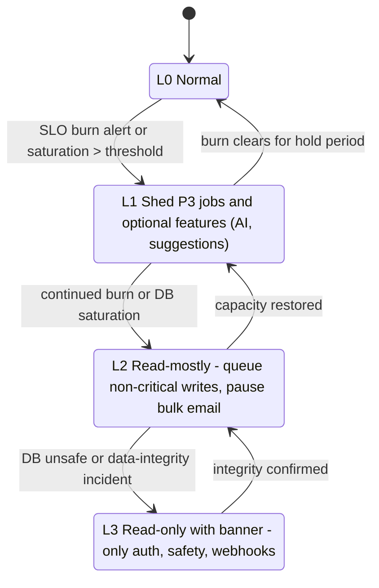

# Failure Mode Analysis

Doc ID: OPS-FMEA · Owner: SRE Lead · Version 1.0 · Status: Draft for Review · Relates: GOAL-08, ADR-T03, ADR-T04, ADR-T05, ADR-T09, ADR-T10, ADR-T12, ADR-T13, ADR-T15, ADR-T18, ADR-T19, INV-T10, INV-T12, INV-T13, INV-T17, FF-04, FF-08, OPS-SLO, OPS-OBS, QA-CAT, SUP-RUN

Scope: failures of the target system (shell, remotes, API modules, worker, Postgres, object storage, CDN, third parties). Every row names detection, containment, degraded behaviour, recovery and verification (TEST ids from `16_QA_AND_TESTING/TEST_CATALOG.md`; runbooks `RB-*` from `18_OPERATIONS_AND_SUPPORT/RUNBOOK_INDEX.md`). Likelihood/impact are deliberately omitted here — they live in `RISK_REGISTER.md`. **[REF]** facts are labelled and are not inherited.

## 1. Method

Failure modes were derived by walking each box in OPS-DEP's topology and each arrow (call or event) with the questions: stops, slows, lies (wrong data), duplicates, reorders, partially completes. Federation adds conditional failure modes with no analogue in bundled delivery (version skew, shared dependency conflicts, remote registry failure).

## 2. Resilience policy (referenced by every row)

Per-dependency starting values (timeouts, retry counts, breaker thresholds, lease lengths, rate-limit store) are specified in `11_BACKEND_ARCHITECTURE/BACKEND_ARCHITECTURE.md` (BE-01 §7, §timeouts) and the federation timers in `09_MODULE_FEDERATION` (MFA-01, FIM-01); this section states the cross-cutting policy and failure behaviour. Both are calibrated together under `WP-LOADBASE` (OPEN-15, BE-01 OPEN-B2).

| Control | Policy [TARGET — parameters calibrated in WP-LOADBASE / OPEN-15] | Rationale |
|---|---|---|
| Deadlines | Each request carries a deadline: `D = min(client budget, 2 × class p99)` (OPS-SLO §5). Each outbound call gets `min(remaining D − margin, 3 × observed p99 of that dependency)`. No call without a timeout (lint + TEST-REL-008). | Unbounded waits are the root of cascading failure. |
| Retries | Only idempotent operations or those with an `Idempotency-Key` (INV-T10, FF-07). Exponential backoff with full jitter; per-dependency **retry budget** (retries ≤ fraction of first attempts, fraction [OPEN-15]); never retry on 4xx except 408/429 with `Retry-After`. | Uncapped retries amplify outages (retry storms). |
| Circuit breakers | Per dependency (email, push, Stripe, AI provider, sandbox runner, object storage, IdP). Open on rolling error ratio or latency above threshold over a minimum sample; half-open probes with a small trial quota; state exported as metric. | Fail fast and protect threads/connections. |
| Bulkheads | Separate concurrency pools/queues by class: auth, interactive read, interactive write, search, AI, webhook, upload, admin/support. Separate DB pool slices per pool class. Worker queues per priority class (P0 verification/transactional, P1 notifications, P2 recompute/reports, P3 bulk). | A slow search or AI call must not starve login. |
| Backpressure | Admission control at API ingress per tenant and global; `429` with `Retry-After` for tenant quota, `503` with `Retry-After` for global shed. Bounded queues: enqueue rejected or deferred above depth thresholds by class. Clients obey `Retry-After` and use jittered backoff. | Overload must degrade by shedding the least valuable work first. |
| Load-shed order | (1) P3 jobs, (2) AI features, (3) recommendations/analytics reads, (4) search suggestions, (5) lists with heavy filters; **never shed**: auth, session refresh, safety/moderation actions, verification links, webhook ack, health. | Protects the core loop and trust functions. |
| Idempotency | Mutations keyed by `Idempotency-Key`; stored with request fingerprint and response; reuse with different body → `422` (TEST-HIR-009). | Safe client and proxy retries. |
| Data safety | Outbox written in the same transaction as state (INV-T12); consumers dedupe by `event_id`; fenced job leases (ADR-T09). | Prevents lost or duplicated side effects. |

Degradation ladder:

Each rung is controlled by named feature flags (kill switches) with runbook owners (RB-24, RB-03).

## 3. Failure modes — shell, federation and client

Registry, manifest, remote-version, and per-remote rollback behavior in this section applies only if federated runtime is activated under ADR-T23. Bundled mode still uses route-level lazy loading and error boundaries, but a module release rolls back with the shell.

| ID | Failure | Detection | Containment | Degraded behaviour | Recovery | Verification |
|---|---|---|---|---|---|---|
| FM-01 | Remote entry unreachable (CDN 404/timeout/DNS) | RUM `remote.failed`, per-remote synthetic, alert on SLO-03 ratio | Bounded load timeout (MFA-01 uses 10 s as starting value) then `rollbackTo` entry, then client LKG; error boundary at remote slot (ADR-T18, VCD-01 section 4) | Affected route shows "temporarily unavailable" panel with retry; shell nav and other remotes work; offline-capable reads continue | Fix origin/CDN; purge bad manifest; RB-07 | TEST-FED-001, TEST-FED-002, TEST-OBS-004 |
| FM-02 | Remote incompatible with shell Host Contract or deployed API range (version skew) | Manifest validation at activation; CI gate FF-08; RUM `remote.rejected` | Shell rejects incompatible remote (VC-02) and falls back along `rollbackTo`/LKG; publish gate blocks promotion (FF-08) | Previous remote version served; no mixed-version mount | Roll forward compatible build or roll back; RB-08 | TEST-FED-003, TEST-FED-004, TEST-API-002 |
| FM-03 | Shared dependency conflict (e.g. two React copies, singleton range violation) | CI manifest validator (FF-04); runtime duplicate-singleton detector logs | Singleton + semver range in federation config; promotion blocked on violation | If detected at runtime: remote not mounted, fallback as FM-01 | Rebuild with aligned range; RB-08 | TEST-FED-005, TEST-FED-006 |
| FM-04 | Remote render crash / unhandled exception | Error boundary telemetry, Sentry-class alert by remote/version | Boundary per remote slot; one remote cannot unmount shell (same JS realm — federation is **not** security isolation, ADR-T19) | Panel with retry and "report problem"; session intact | Roll back remote via higher-sequence entry or kill switch (independent artefact); RB-08 | TEST-FED-008, TEST-FED-014 |
| FM-05 | Manifest registry unavailable, stale or tampered | Manifest fetch errors, signature verification failures, SRI mismatch | Ed25519-signed registry entries + SRI + CSP (ADR-T19); registry `no-cache` + ETag via SW NetworkFirst; anti-rollback `sequence`; fall back to client LKG then the embedded boot registry baked into the shell build; `notAfter` grace of up to 14 days for LKG only (VC-03) | New deploys not visible; existing versions keep working; tamper → remote refused | Restore registry; rotate signing key if compromised (RB-26) | TEST-SEC-013, TEST-SEC-014, TEST-FED-009 |
| FM-06 | Stale service worker serves old shell with new remotes (or the reverse) | RUM version beacon `shell_ver`/`remote_ver` mismatch counter | Versioned caches; SW update flow prompts reload at safe point; manifest carries `hostContract` so old shell refuses new incompatible remote; kill-switch flag unregisters SW (RB-09) | Banner "update available"; no data loss (drafts persisted) | Force update via kill-switch; clear caches | TEST-PWA-001, TEST-PWA-009 |
| FM-07 | Bad remote release (functional regression, passes CI) | Canary-channel guardrails (error ratio, INP, conversion proxy), flag-level metrics | Progressive delivery via registry canary channel; automatic halt; auto-rollback publishes the `rollbackTo` target | Canary cohort sees issue only | Roll back remote independently of API (OPS-REL §10); RB-08 | TEST-DEP-001, TEST-DEP-002, TEST-FED-014 |
| FM-08 | Offline queued write conflicts with newer server state | Server `412` on `If-Match`; client conflict counter | Server revalidates every queued write (INV-T13); conflict UI, no silent overwrite | Draft kept locally with "needs your decision" | User merges or discards | TEST-PWA-005, TEST-PWA-006, TEST-DAT-008 |
| FM-09 | Browser storage evicted (iOS/WebKit pressure) | Startup integrity check: expected stores missing counter | Server is system of record (ADR-T10); app boots from network; queued writes lost are bounded to drafts/edits/notes | Offline cache cold, drafts may be lost; show notice | Re-sync from server | TEST-PWA-012, TEST-MOB-003 |
| FM-10 | CDN regional outage or cache poisoning/wrong Vary on API | Synthetic from multiple vantage points; cache-hit anomaly; authenticated responses with public cache headers (lint) | Origin shield/second CDN or origin fallback [OPEN-36]; API responses `Cache-Control: private, no-store` by default | Higher latency; static assets from fallback origin | Fail over DNS/CDN; purge | TEST-TEN-006, TEST-OBS-004 |
| FM-11 | Shared dependency outage for client assets (third-party font/script/analytics) | RUM resource errors | No third-party blocking scripts on critical path; self-host critical assets; async analytics | Cosmetic degradation | Disable the integration via flag | TEST-FED-013, TEST-PER-003 |

## 4. Failure modes — API and backend

| ID | Failure | Detection | Containment | Degraded behaviour | Recovery | Verification |
|---|---|---|---|---|---|---|
| FM-12 | API replica crash / OOM / hang | Health `/ready` fail, restart count, p99 spike | ≥ 2 replicas, stateless (ADR-T05), readiness removes from pool, memory limits; graceful shutdown drains | Capacity reduced by 1/N; requests retried by LB on idempotent methods | Orchestrator restarts; RB-04 | TEST-REL-002, TEST-REL-005 |
| FM-13 | Traffic spike / overload | Saturation (CPU, event-loop lag), queue depth, 429/503 rates | Admission control + load-shed order (§2); autoscale if available | L1–L2 per ladder | Scale out, shed; RB-04, RB-24 | TEST-PER-007, TEST-REL-004 |
| FM-14 | Slow dependency exhausts pools (cascade) | Pool wait time, in-flight gauge per class, dependency latency | Per-class bulkhead + per-dependency breaker + timeouts | Affected class degrades; auth/read unaffected | Open breaker, fix dependency | TEST-REL-009, TEST-REL-008 |
| FM-15 | Policy module misbehaves (deny-all or allow-all) | Authz denial-rate anomaly alert; canary tests in prod (synthetic IDOR probes); FF-01 lint | Deny-by-default (INV-T01); policy changes behind tests and canary; policy versioned | deny-all → outage with correct failure direction; allow-all → Sev-1 candidate | Roll back policy version; RB-01 for suspected exposure | TEST-SEC-001, TEST-SEC-003, TEST-TEN-001 |
| FM-16 | Duplicate client requests / replay (retries, double-click, proxy retry) | Idempotency hit metric, duplicate-effect detector | `Idempotency-Key` on unsafe mutations (FF-07); natural keys (BR-T001) | Second request returns first response | none needed | TEST-HIR-001, TEST-HIR-008, TEST-HIR-009 |
| FM-17 | Concurrent actions on one resource (two recruiters move one application; two tabs) | `412` rate; conflicting-transition errors | `If-Match`/ETag (ADR-T08); state-machine guards (INV-T11) | Loser sees conflict with fresh state | User retries | TEST-HIR-003, TEST-DAT-008 |
| FM-18 | Bad deploy / config error (missing secret, wrong origin) | Startup config validation fails fast; canary errors | Fail boot rather than run misconfigured (**[REF]** reference has `productionConfigProblems`-style checks); progressive rollout | Old version continues serving | Roll back; RB-05 | TEST-DEP-007, TEST-DEP-001 |
| FM-19 | Session/auth failure; refresh storm; false token-family revocation (BR-T050) | Auth error ratio, refresh rate, forced-logout counter | Rate limits on refresh; jittered refresh; revocation only on actual reuse; grace for rotation race (concurrent tabs) | Users see re-login; no data exposure | Fix cause; allow user re-login; RB-02 | TEST-SEC-011, TEST-SEC-021 |
| FM-20 | Clock skew between nodes/clients (token expiry, signed URLs) | NTP drift metric; token rejection pattern | Tolerance window ≤ [TARGET param]; server time authoritative; expiry uses server issued `iat` | Occasional re-auth | Sync clocks | TEST-REL-010 |
| FM-21 | Rate-limiter backing store failure | Limiter error metric | **Policy:** auth/verification/referee endpoints fail **closed** (reject); general reads fail open with local in-process limits | Slightly stricter/laxer limits | Restore store | TEST-SEC-021 |
| FM-22 | Partial multi-step operation (e.g. apply + attach evidence + notify; upload ok but evidence row fails) | Orphan/incomplete state detectors (reaper job), outbox lag | Single transaction for state + outbox; sagas with compensating steps for external effects; reaper removes orphan objects | User sees consistent state; retry resumes | Reaper/compensation; RB-13 | TEST-API-011, TEST-EVD-009 |
| FM-23 | Telemetry stack outage (collector/backend) | Collector queue drops, absent-signal alert from independent heartbeat | Telemetry export is async and bounded; never blocks request path; local buffer then drop | Blind spot, not user impact | Restore; reconstruct from logs | TEST-OBS-002 |

## 5. Failure modes — data and storage

| ID | Failure | Detection | Containment | Degraded behaviour | Recovery | Verification |
|---|---|---|---|---|---|---|
| FM-24 | Postgres primary failure | HA controller, connection errors, SLO-01 burn | HA with automatic failover (SLO-30); pooler retries with backoff; writes fail fast with `503` during failover; reads served by replica only for stale-tolerant classes | Brief write unavailability; in-flight txns retried by client only if idempotent | Failover completes; verify replica lag zero; RB-03 | TEST-REL-001 |
| FM-25 | Connection pool exhaustion | Pool wait, active/idle gauges | Pooler (transaction mode) + per-class slices; statement/lock timeouts; shed | `503 Retry-After`; health endpoints unaffected | Raise limits carefully, kill runaway queries; RB-03 | TEST-REL-002 |
| FM-26 | Replication lag / stale reads on replicas | Lag gauge | Read-your-writes: route a user's reads to primary for a short window after their writes; critical reads (authz, entitlements, consent) always primary | Slightly stale lists | Reduce load, fix replica | TEST-DAT-007 |
| FM-27 | Slow queries / lock contention / long-running migration | Slow-query log, lock wait, plan regression | Statement timeout; online migration patterns only (expand/contract, concurrent index); migration lock timeout; plan-regression gate | Higher latency on affected class | Cancel query; roll back/forward-fix; RB-05 | TEST-DAT-003, TEST-PER-009 |
| FM-28 | Data corruption / bad backfill / bad migration | Reconciliation checks, constraint violations, user reports | Append-only migrations with rollback/forward-fix note (FF-10); backfills resumable and idempotent; shadow-verify | Affected feature read-only via flag | PITR to side instance, extract and repair; RB-30 | TEST-DAT-004, TEST-DAT-005, TEST-REC-001 |
| FM-29 | RLS misconfiguration / tenant filter missing (cross-tenant read) | FF-05 canary suite in CI and prod synthetic probes; anomaly in cross-tenant access metrics | Defence in depth: repository layer + RLS + policy (INV-T02/T03); app DB role cannot bypass RLS | **Sev-1** (ADR-T21); affected endpoints disabled via kill switch | RB-01 (containment first, then forensics) | TEST-TEN-001, TEST-TEN-002, TEST-TEN-003 |
| FM-30 | Outbox backlog or poison event | `outbox.oldest_age_s`, per-event attempt count, DLQ depth | Per-event retry cap then DLQ; consumers dedupe by `event_id`; dispatcher continues past poison | Delayed notifications/recompute | Fix consumer; replay DLQ safely; RB-12 | TEST-API-008, TEST-API-009, TEST-REL-004 |
| FM-31 | Object storage outage | Upload/download error ratio | Direct-to-storage signed URLs; retries with backoff; metadata remains in DB; downloads of cached derivatives from CDN | Uploads pause with clear message; existing public assets via CDN | Provider recovery; RB-18 | TEST-REL-006 |
| FM-32 | Malware-scan backlog or scanner failure | Scan queue age (SLO-22) | Uploads remain `pending` and invisible (BR-T003); scanner capacity bulkhead; **fail closed** (never publish unscanned) | Evidence appears later; users informed | Scale scanner; reprocess; RB-19 | TEST-SEC-019 |
| FM-33 | Search degradation or index stale (ADR-T11) | Search p95, index lag gauge | Fallback to simpler FTS-only path; bulkhead; index rebuildable from Postgres | Lower relevance, possible stale results labelled | Reindex (SLO-34); RB-20 | TEST-SRC-001, TEST-PER-002, TEST-REL-009 |
| FM-34 | Backups silently failing or unrestorable | Backup freshness alert, restore-drill failure | Backup success is an SLI with alert; scheduled restore drills in a separate environment | None until needed — highest-consequence silent failure | Fix pipeline; RB-29 | TEST-REC-001, TEST-REC-002 |

## 6. Failure modes — worker and jobs

| ID | Failure | Detection | Containment | Degraded behaviour | Recovery | Verification |
|---|---|---|---|---|---|---|
| FM-35 | Worker crash mid-job | Lease expiry, job age | Fenced leases (claim generation, ADR-T09): stale holder cannot commit; side effects idempotent | Job re-run by another worker | Automatic; RB-11 | TEST-REL-005, TEST-API-010 |
| FM-36 | Duplicate execution from lease expiry race (**[REF]** the reference audit D-02 reproduced duplicates with unfenced leases) | Duplicate-effect detector; attempt count > 1 with overlapping windows | Fencing token checked at commit; idempotency keys on external calls | None if fencing works | RB-11 | TEST-API-010, TEST-API-009 |
| FM-37 | Poison job / retry storm | Attempt histogram, DLQ rate | Max attempts, backoff, DLQ, per-class concurrency cap | One job class stalls, others continue | Triage DLQ; RB-12 | TEST-REL-004 |
| FM-38 | Scheduler misses or double-fires periodic jobs (reminders, expiry) | Heartbeat of periodic job; duplicate detector | Leader election via DB advisory lock or unique (job, slot) key | Late reminders (BR-T004 reminders max 2 stays enforced) | Backfill missed slot | TEST-EVD-006, TEST-REL-005 |

## 7. Failure modes — third parties and platform

| ID | Failure | Detection | Containment | Degraded behaviour | Recovery | Verification |
|---|---|---|---|---|---|---|
| FM-39 | Email provider outage / deliverability drop (Brevo default, ADR-T20) | Provider error ratio, bounce/complaint rates, SLO-21 | Provider port; breaker; queued with backoff; secondary provider as option [OPEN-26]; suppress list maintained | Codes/links delayed; in-app notification and resend UI remain; the requester may trigger a system resend but never receives the referee token itself (INV-T05) | RB-15 | TEST-REL-003, TEST-EVD-010 |
| FM-40 | Push provider failure / expired subscriptions | Delivery failures, 404/410 from push service | Prune dead subscriptions; email/in-app fallback; no dependency for core flows | Fewer pushes | RB-16 | TEST-MSG-001 |
| FM-41 | Stripe outage, delayed or out-of-order webhooks | Webhook lag (SLO-06), reconciliation drift job | Entitlements derived server-side from stored subscription state (ADR-T15, INV-T17); keep last-known entitlement during outage; reconciliation job | Checkout unavailable; existing entitlements unchanged | Reconcile; RB-17 | TEST-BIL-001, TEST-BIL-003, TEST-BIL-005, TEST-BIL-006 |
| FM-42 | AI provider outage / latency / cost runaway | Gateway error ratio, token spend vs budget, p95 | Breaker; budget hard stops (INV-T07); features degrade to non-AI paths; kill switch | AI suggestions unavailable; core loop unaffected | RB-21 | TEST-ASM-005, TEST-ASM-006, TEST-ASM-009 |
| FM-43 | Sandbox runner down or escape attempt | Runner health; egress-deny alerts | Network-less isolated runner (ADR-T13); submissions stay `unverified`, never mint verified evidence | Code challenges accept submissions but unverified | RB-22; security incident process if escape | TEST-ASM-002, TEST-ASM-003 |
| FM-44 | IdP (OIDC/SAML) outage for SSO org | SSO error ratio | Break-glass org-admin local login (policy-approved, audited); cached sessions persist until expiry | SSO users cannot log in anew | Provider recovery; RB-02 | TEST-SEC-024 |
| FM-45 | DNS / TLS certificate expiry or misissue | Expiry alert at lead-time windows [TARGET]; synthetic cert check | Automated renewal + monitoring; CAA records; separate alerts per domain | Hard outage if expired | RB-25 | TEST-DEP-008, TEST-OBS-004 |
| FM-46 | Zone or region outage (hosting) | Platform health, multi-vantage synthetic | Multi-AZ where available; DR plan (SLO-33, OPEN-23) | Possible extended outage; status page | RB-31 DR failover | TEST-REC-004 |
| FM-47 | Shared infrastructure dependency outage (cache, pooler, DNS resolver, secret manager) | Dependency health dashboards | No hard runtime dependency on a cache for correctness; secrets cached in process with TTL; pooler redundant | Slower, not wrong | RB-03/RB-05 | TEST-REL-007 |
| FM-48 | Secret or signing-key compromise | Secret scanning, anomaly, vendor alert | Rotation runbook; short-lived credentials; manifest signing key rotation with dual-key window | Forced logouts / re-issued manifests | RB-26 | TEST-SEC-015, TEST-SEC-014 |

## 8. Coverage cross-check

| Class from brief | Covered by |
|---|---|
| Remote unavailable | FM-01 |
| Version mismatch | FM-02 |
| Shared dependency conflict | FM-03 |
| Stale service worker | FM-06 |
| Offline conflicts | FM-08, FM-09 |
| Duplicate requests | FM-16 |
| Concurrent actions | FM-17 |
| Partial operations | FM-22 |
| Rollback | FM-07, FM-18, FM-28 (OPS-REL §10) |
| Shared dependency outage | FM-11, FM-47 |
| IDOR / cross-tenant | FM-15, FM-29 |

## 9. Game days

Quarterly-style cadence is a **policy intent**, not a schedule; frequency is [OPEN-15]. Each game day selects ≥ 3 failure modes from this document, injects them in staging (and selected ones in production with approval), and records measured detection time, containment time and recovery time against the tables above. Findings update this document and RISK_REGISTER.

## 10. Ownership, retry, data-loss and chaos extension (PATCH 2026-10-27, PROPOSED)
Companion columns for FM-01..FM-48 (original tables unchanged). Owners are roles, not named people; retry limits are [TARGET] pending WP-LOADBASE/OPEN-15. Test ids `CH-nn` are PROPOSED chaos tests and `CT-nn` PROPOSED contract tests, not yet in `TEST_CATALOG.md`; existing `TEST-*` ids stay in the Verification column above. No chaos test has been run.

| FM | Owner | Retry limit | Data-loss exposure | Chaos / contract test |
|---|---|---|---|---|
| 01 | Frontend lead | 2 (500, 1500 ms) | none | CH-01 block remote origin |
| 02 | Frontend lead | 0 | none | CT-01 MockHost per Host Contract minor |
| 03 | Frontend lead | 0 | none | CT-02 duplicate-singleton check |
| 04 | Frontend lead | 0 | unsaved form state in crashed slot | CH-02 throw in remote |
| 05 | Platform/SecEng | 3 fetch, then LKG | none | CH-03 tampered manifest |
| 06 | Frontend lead | 0 | queued entries if wiped wrongly | CH-04 stale SW vs new remote |
| 07 | Release mgr | 0 | none | CH-05 canary regression halt |
| 08 | Backend lead | 0 (user decides) | local draft if discarded | CT-03 412 conflict flow |
| 09 | Frontend lead | 0 | queued drafts/edits/notes | CH-06 clear storage |
| 10 | SRE | 2 origin fallback | none | CH-07 CDN fail |
| 11 | Frontend lead | 0 | none | CH-08 block third party |
| 12 | SRE | LB retry idempotent only, 1 | in-flight request | CH-09 kill replica |
| 13 | SRE | client per Retry-After | none | CH-10 load spike |
| 14 | Backend lead | per breaker | none | CH-11 slow dependency |
| 15 | SecEng | 0 | none (wrong authz = incident) | CT-04 policy matrix |
| 16 | Backend lead | per idempotency | none | CT-05 replay same key |
| 17 | Backend lead | 0 | losing writer's edit until refetch | CT-06 concurrent If-Match |
| 18 | Release mgr | 0 | none | CH-12 bad config boot |
| 19 | SecEng | 1 | none | CH-13 refresh storm |
| 20 | SRE | 0 | none | CH-14 skew clock |
| 21 | SecEng | 0 (fail closed) | none | CH-15 limiter store down |
| 22 | Backend lead | saga step 3 | partial state until reaper | CH-16 fail mid-saga |
| 23 | SRE | drop after buffer | telemetry only | CH-17 collector down |
| 24 | DBA/SRE | 3 pooler | writes in flight at failover (RPO per SLO-30) | CH-18 primary kill |
| 25 | DBA/SRE | 0 | none | CH-19 pool exhaust |
| 26 | DBA/SRE | 0 | none (stale reads) | CH-20 lag injection |
| 27 | DBA | 0 | none | CT-07 migration lock timeout |
| 28 | DBA | resumable | possible, bounded by backup RPO | CH-21 restore drill |
| 29 | SecEng | 0 | disclosure (Sev-1) | CT-08 cross-tenant suite |
| 30 | Backend lead | 5 default, 12 email, then DLQ | none if DLQ kept | CH-22 poison event |
| 31 | SRE | 2 | in-progress upload | CH-23 storage fail |
| 32 | SecEng | scanner 3 | none (pending, invisible) | CH-24 scanner down |
| 33 | Search owner | 1 fallback | none (rebuildable) | CH-25 stale index |
| 34 | DBA | n/a | total if never restored | CH-26 restore drill |
| 35 | Backend lead | per job class | none (fenced) | CH-27 kill worker |
| 36 | Backend lead | 0 | duplicate side effect if unfenced | CT-09 fencing token |
| 37 | Backend lead | max attempts then DLQ | none if DLQ kept | CH-22 |
| 38 | Backend lead | 0 | missed/double reminders | CH-28 scheduler double-fire |
| 39 | Platform | 12 over ~20.5 h | undelivered mail | CH-29 provider 5xx |
| 40 | Platform | 2 | none (non-critical) | CH-30 410 subscriptions |
| 41 | Billing owner | webhook redelivery by Stripe | entitlement drift | CH-31 delayed webhook; CT-10 signature |
| 42 | AI owner | 1 | none | CH-32 provider down |
| 43 | Assessment owner | 0 | submissions unverified | CH-33 runner down |
| 44 | SecEng | 0 | none | CH-34 IdP outage |
| 45 | SRE | n/a | none | CH-35 cert expiry drill |
| 46 | SRE | n/a | up to RPO (OPEN-23) | CH-36 DR drill |
| 47 | SRE | 2 | none | CH-37 cache/secret mgr down |
| 48 | SecEng | n/a | exposure window until rotation | CH-38 key rotation drill |

## 11. Residual shared-failure modes (PATCH 2026-10-27, PROPOSED)
Failures that the controls above do not isolate because components share a fate. They are accepted residual risks, not solved problems; owners must confirm acceptance in `RISK_REGISTER.md`.

| ID | Shared element | Failure | Blast radius | Mitigation / accepted position |
|---|---|---|---|---|
| SF-01 | Single JS realm (federated mode) | One remote's bug or compromise affects shell and other remotes | All users on that page | Boundaries, signing, CSP; untrusted code in iframe (ADR D-05) |
| SF-02 | Single Postgres | Outage, bad migration or saturation stops API and worker together | Whole product | HA, pool slices, restore drills; accepted until ADR D-01/D-03 trigger |
| SF-03 | Single API process image | Memory leak or crash loop in one module affects all modules | Whole API | Replicas, limits, canary |
| SF-04 | Outbox and job tables in the same DB | Backlog competes with request traffic for IO and locks | Latency across API | Separate pool slices, queue caps, shed P3 |
| SF-05 | Shared CDN/origin | CDN fault hits shell, remotes and assets together | All web clients | Origin fallback [OPEN-36]; SW-cached shell |
| SF-06 | Shared Service Worker | A bad SW release poisons every cached route | All returning clients | Staged rollout, kill-switch SW, versioned caches |
| SF-07 | Shared secrets/signing keys | One key compromise affects sessions or manifests | Platform-wide | Dual-key rotation (FM-48) |
| SF-08 | Third-party concentration | Single email, Stripe or IdP provider | Feature-level | Provider ports; breaker; fallback paths |
| SF-09 | Shared pipeline and region | CI or hosting-region failure blocks fixes and serving | Release and availability | Manual break-glass deploy, DR plan (needs verification) |
| SF-10 | Same people detect and recover | Slow response when on-call is thin | Incident duration | Runbooks, escalation; accepted |
