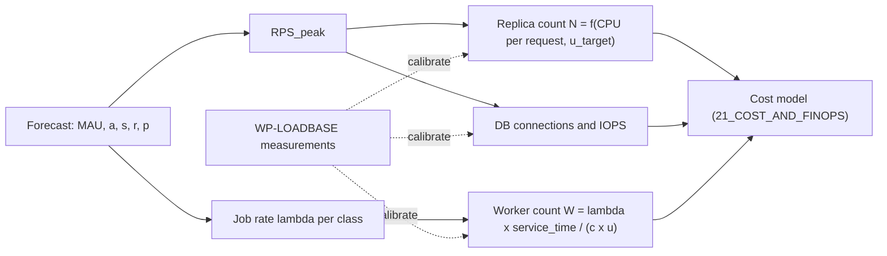

# SLO and Performance Targets

Doc ID: OPS-SLO · Owner: SRE Lead (with Performance Engineer) · Version 1.0 · Status: Draft for Review · Relates: GOAL-08, GOAL-06, ADR-T03, ADR-T04, ADR-T05, ADR-T09, ADR-T11, ADR-T16, ADR-T18, INV-T13, BR-T060, OPEN-12, OPEN-14, OPEN-15, OPEN-23, 16_QA_AND_TESTING/TEST_CATALOG.md, 17_DEVOPS_AND_INFRASTRUCTURE/OBSERVABILITY_DESIGN.md

> **Revision 2 folded in (2026-10-27)** from `SLO_AND_PERFORMANCE_TARGETS.md#record-slo-rev2`: appended under "Revision 2 additions"; where it differs from text above, the appended text governs. Status unchanged; proposals still need owner/ARB ratification.

Tags: **[TARGET]** proposed, binding only after calibration; **[CONF]** confirmed by a canonical document; **[OPEN]** unresolved; **[REF]** reference-system fact (not inherited). Documentation status is not implementation status; nothing here claims the system exists.

## 1. Ground rules

1. **No number is a measurement.** Every value below is a starting hypothesis derived from a stated rationale and assumption. It becomes a commitment only after `WP-LOADBASE` (22_*) produces a baseline and the owner signs a calibration note (OPEN-15).
2. Each SLO has: SLI definition (good events / valid events), target, window, rationale, assumption, measurement method, and the alert that protects it (see OPS-OBS burn-rate rules).
3. Internal SLOs are **not** customer SLAs. Any contractual commitment is separate and needs legal/commercial review (OPEN-31).
4. Error budget policy: when a budget is exhausted, feature releases touching that surface pause and reliability work takes priority (owner: SRE Lead; exceptions need Incident Commander + Product Director approval).
5. Arithmetic used throughout: a 30-day window has 43,200 minutes. Budget = (1 − target) × 43,200 min. 99.9% gives 43.2 min; 99.5% gives 216 min; 99.95% gives 21.6 min.

## 2. Measurement stack (summary)

| Source | What it gives | Used for |
|---|---|---|
| Ingress/LB + API server metrics (OpenTelemetry) | server-side success and latency per route class | SLO-01…SLO-06 and the §5 latency classes (authoritative for server SLIs) |
| Synthetic probes from outside the network (scripted user journeys) | black-box availability, cert/DNS, remote activation | SLO-02, SLO-03, catches failures where no request reaches the server |
| Real User Monitoring (RUM; `web-vitals` style field data, sampled, consented) | LCP, INP, CLS by route, device class, remote | SLO-13…SLO-16 (authoritative for field vitals) |
| Lab runs (Lighthouse CI on reference mobile profile, Playwright traces) | regression guard per PR | release gates, never a substitute for field data |
| Worker/outbox instrumentation | enqueue-to-start age, attempts, DLQ depth | SLO-20…SLO-25 |
| Restore/failover drills | measured RPO/RTO | SLO-30…SLO-33 |

## 3. Reference mobile profile (used by every client-side target)

| Profile | Definition | Purpose | Status |
|---|---|---|---|
| RMP-1 (lab) | Lighthouse default mobile emulation: small-viewport phone, 4× CPU slowdown, simulated Slow-4G ≈ 1.6 Mbit/s down, ≈ 150 ms RTT. Pin the exact Lighthouse version in CI because defaults change. | Deterministic per-PR regression guard | [TARGET] — confirm constants when pinning |
| RMP-2 (device) | One low-tier Android phone and one oldest-supported iPhone on a throttled real network, via `WP-IOS-DEVICE-LAB` | Catch what emulation misses (memory pressure, WebKit behaviour) | [OPEN-12] device list |
| RMP-3 (field) | RUM p75 segmented by device class (low/mid/high by `deviceMemory`/cores where available) and connection type | Ground truth | [TARGET] |

Transfer-time formula for budgets: `t_transfer = bytes × 8 / throughput`. At 1.6 Mbit/s, 100 KB (compressed) takes 0.5 s. Critical-path budget `B ≈ (T_target − T_ttfb − T_cpu) × throughput / 8`. With T_target = 2.5 s, T_ttfb ≈ 3 × RTT = 0.45 s (DNS+TCP+TLS+request, repeat visits less), T_cpu allocated 1.0 s, B ≈ (2.5 − 0.45 − 1.0) × 1.6e6 / 8 ≈ 210 KB. This is an **illustration of the method**; the per-route budget is set from RMP-1 measurements (OPEN-15).

## 4. Availability SLOs

| ID | SLI (good / valid) | Target (30-day) | Budget | Rationale | Assumption | Measurement | Alert protecting |
|---|---|---|---|---|---|---|---|
| SLO-01 | Core API: non-5xx responses within deadline / valid requests (4xx from client errors excluded; 429 caused by our own load shedding counts as bad) | 99.9% [TARGET] | 43.2 min | Stateless API replicas (ADR-T05) + HA Postgres can plausibly reach three nines in one region; higher needs multi-region (OPEN-23) | Single region, ≥2 API replicas, HA DB | Ingress + server metrics; cross-check with synthetic | Multi-window burn rate on SLO-01 |
| SLO-02 | Shell boot: synthetic journey "load `/`, shell interactive, capabilities fetched" success / attempts | 99.9% [TARGET] | 43.2 min | Shell is the single point through which every remote loads; it must be at least as available as the API | Shell served from CDN with origin fallback | External synthetic every N min [TARGET param] from ≥3 vantage points | Synthetic fail ≥ 2 consecutive |
| SLO-03 | Remote activation: successful mount of each remote / activation attempts (per remote) | 99.5% per remote [TARGET] | 216 min | A remote failure is contained by fallback (ADR-T03/T18) so tolerance is lower than the shell; user impact is partial | Last-known-good fallback available | RUM event `remote.activated` vs `remote.failed` + synthetic per remote | Per-remote error ratio alert |
| SLO-04 | Auth: successful login/refresh/session-validate / valid attempts (excludes wrong credentials) | 99.9% [TARGET] | 43.2 min | Auth outage blocks all authenticated use; refresh failures log users out | Cookie BFF routes (ADR-T06) | Server metrics on `/auth/*` | Burn rate |
| SLO-05 | Background pipeline health: share of 5-min windows where outbox oldest-event age ≤ SLO-20 | 99% [TARGET] | 432 min | Asynchronous work tolerates longer disruption than interactive paths | Worker count ≥ 2 | Outbox age gauge | Age threshold alert |
| SLO-06 | Billing webhook ingestion: verified webhooks processed within 5 min / received | 99.9% [TARGET] | 43.2 min | Entitlements depend only on webhooks (INV-T17); late processing leaves paid users locked or lapsed users entitled | Stripe retries with backoff | Webhook handler metrics + Stripe event delivery dashboard | Lag alert |

Exclusions (declared up front, to prevent post-hoc redefinition): announced maintenance windows per PROC-11 (capped per month by policy [OPEN-15]), failures originating in the user's network, and abusive traffic blocked by rate limiting. Excluded minutes are still reported.

## 5. API latency targets by class

Server-side latency measured at ingress from request received to last byte sent. Network RTT on RMP-1 (≈ 150 ms) is **additional** and counted in the client-side journey targets (§6).

| Class | Examples | p95 | p99 | Rationale | Assumption | Measurement |
|---|---|---|---|---|---|---|
| C1 point read | `GET /me`, `GET /applications/:id` | 200 ms [TARGET] | 500 ms | Keeps one round trip well under the ~1 s "flow of thought" threshold (Nielsen usability literature; secondary) even after RTT | Primary-key indexed, cached policy decision | k6 baseline + production histogram per route |
| C2 list/read-heavy | job list, application pipeline, notifications | 350 ms | 800 ms | Paginated cursor queries with bounded page size | Page size ≤ [TARGET param], covering indexes | same |
| C3 write | create application, update profile, stage change | 400 ms | 1,000 ms | Includes outbox insert + audit in one transaction (INV-T12), idempotency lookup | Single-statement-ish transactions; no external call inside txn | same + trace span `db.tx` |
| C4 auth | login, refresh, passkey assertion | 300 ms (excl. password hash cost tuned separately) | 800 ms | Hashing cost is deliberately non-trivial; tune cost so hash is a declared fraction of the budget | Argon2id/bcrypt-class cost parameter owned by Security | server histogram; hash timed separately |
| C5 search | job search, candidate search | 400 ms | 800 ms | **[CONF]** 400 ms p95 is ADR-T11's revisit trigger; p99 ≈ 2× p95 as a working rule | Target corpus per OPEN-15; pgvector + FTS | search-specific load test at target corpus (TEST-PER-002) |
| C6 compute-on-demand | match explanation, readiness score | 800 ms | 2,000 ms | Heavier but user-initiated; must show progress UI past 1 s | Precomputed features where possible | span-level histogram |
| C7 upload init / signed URL | evidence upload start | 300 ms | 700 ms | Metadata only; bytes go direct to object storage | Direct-to-storage upload | server histogram |
| C8 AI-assisted | resume suggestions | time-to-first-token ≤ 2 s; completion async | n/a | Streaming or async job; never blocks other classes (bulkhead) | Provider latency is outside our control; gateway enforces timeout | gateway spans, provider-tagged |
| C9 webhook ack | Stripe, email provider events | 300 ms | 800 ms | Provider timeouts are short; do work asynchronously after signature check | Persist-then-ack | handler histogram |

Per-request deadline propagation: the API sets `deadline = min(client budget, class p99 × 2)` and every outbound call gets a slice (see OPS-FMEA §2).

## 6. Client performance targets (reference mobile profile)

| ID | Metric | Target | Where measured | Rationale | Assumption | Method |
|---|---|---|---|---|---|---|
| SLO-13 | LCP | ≤ 2.5 s at p75 field; lab ≤ 2.5 s on RMP-1 for public + candidate home routes [TARGET] | RUM + Lighthouse CI | **[CONF-external]** Google's published "good" Core Web Vitals threshold (web.dev); add to RES-01 | Critical path budget §3 holds | RUM p75 by route and device class |
| SLO-14 | INP | ≤ 200 ms at p75 field [TARGET] | RUM (lab proxy: Total Blocking Time) | Published "good" threshold (web.dev) | Long tasks < 50 ms rule enforced on interaction handlers | RUM INP attribution; Playwright long-task assertion in CI |
| SLO-15 | CLS | ≤ 0.1 at p75 [TARGET] | RUM + Lighthouse | Published "good" threshold | Reserved space for remote slots (skeletons) to avoid shift on remote mount | RUM + lab |
| SLO-16 | "TTI" substitute | Lab TBT ≤ 200 ms on RMP-1; field INP above [TARGET] | Lighthouse CI | Time-to-Interactive was retired from Lighthouse scoring; TBT is the lab proxy. Verify against current Lighthouse docs at pin time. | — | Lighthouse CI per PR |
| SLO-17 | Remote activation overhead | federated route LCP ≤ bundled-mode baseline + Δ_F, with Δ_F ≤ 10% of LCP budget (250 ms) at p75 [TARGET] | A/B in `WP-FED-SPIKE`, then RUM `remote.activation_ms` | Δ_F is an *allocation policy* (10% of the 2.5 s budget), justified because ADR-T03's counter-argument is "lazy routes give 80% at 20% cost" — if overhead exceeds the budget, MF_MODE=bundled (OPEN-03) | One extra manifest + remote-entry round trip (≈ 1–2 RTT) on first visit; warm via SW | Spike benchmark; RUM thereafter |
| SLO-18 | Warm re-visit shell | interactive from SW cache with no network ≤ [TARGET: 1 s on RMP-1] | Lighthouse (repeat view) + RUM | Installed-PWA value proposition (ADR-T02) | SW precache of shell + current remote entries | Repeat-view lab run |
| SLO-19 | Per-route JS budget | critical-path JS+CSS ≤ B(route) from §3 formula [OPEN-15] | CI bundle-size check | Bytes dominate load time on RMP-1 | Compressed transfer size | CI size gate per remote and shell |

## 7. Background job, event and search throughput

| ID | Class | Target | Rationale | Assumption | Measurement |
|---|---|---|---|---|---|
| SLO-20 | Outbox dispatch: oldest undispatched event age | p99 ≤ 5 s [TARGET] | Downstream effects (notifications, recompute) should feel prompt; Postgres polling/LISTEN is adequate at modest throughput (ADR-T09) | Dispatcher poll interval ≤ 1 s | gauge `outbox.oldest_age_s` |
| SLO-21 | Transactional email/verification jobs: enqueue→start | p95 ≤ 30 s | Users wait on codes and referee links | Provider API p95 outside our control | job metrics by class |
| SLO-22 | Virus scan: upload→visible (BR-T003) | p95 ≤ 60 s | Evidence must not remain pending long enough to frustrate; larger files scale with size | Scanner sidecar capacity per ASM-C-07 | scan job age |
| SLO-23 | Dependent recompute after revocation (BR-T005) | p95 ≤ 5 min | Revoked evidence must stop inflating matches quickly; async and audited | Batched recompute | job age + audit event time delta |
| SLO-24 | Erasure (BR-T060) | completes ≤ 21 days internal target of the 30-day rule [TARGET] | Internal buffer of ~30% before the stated 30-day limit; retention exceptions per OPEN-08 | Backups age out per policy | request state machine timestamps |
| SLO-25 | Dead-letter queue | oldest DLQ item reviewed ≤ 1 business day [TARGET] | Poison jobs must not rot silently | On-call or ops rota exists (OPEN-16, OPEN-39) | DLQ gauge + ticket link |
| TP-01 | Sustained job throughput | `λ_max = W × c / s̄ × u`, W workers, c concurrency per worker, s̄ mean service time, u ≤ 0.6 utilisation cap | Queueing: latency grows non-linearly near saturation; 0.6 leaves burst headroom | s̄ measured per class | load test (TEST-PER-005) |
| TP-02 | Remote load capacity | manifest + remote-entry requests are CDN-cache served; origin sees only cache misses | Content-hashed immutable assets (OPS-DEP §3) | Cache hit ratio target in ASM-C-09 | CDN logs |

## 8. Recovery objectives (RPO / RTO)

| ID | Scenario | RPO | RTO | Rationale | Assumption | Measurement |
|---|---|---|---|---|---|---|
| SLO-30 | Single DB node failure (HA) | ≈ 0 for committed transactions with synchronous replica [TARGET] | ≤ 5 min automatic [TARGET] | Core to SLO-01 budget (43.2 min) | HA mechanism chosen under OPEN-14 supports synchronous/quorum commit | Failover drill (TEST-REL-001) |
| SLO-31 | Logical corruption / bad migration, restore from PITR | ≤ 5 min [TARGET] | ≤ 1 h to a verified restored copy [TARGET] | Point-in-time recovery needs continuous WAL archiving; interval ≤ 5 min bounds loss | WAL archive to separate failure domain; restore tested | PITR drill (TEST-REC-001); record measured vs target |
| SLO-32 | Object storage loss/corruption | RPO ≤ [OPEN-23] with versioning enabled | RTO ≤ [OPEN-23] | Evidence files are irreplaceable user data | Versioning + replica or off-site copy | Restore drill (TEST-REC-003) |
| SLO-33 | Zone/region loss (DR) | [OPEN-23] | [OPEN-23] | Depends on single- vs multi-region decision and cost; DR events can exceed monthly SLO budget and must be declared as such | — | DR exercise (TEST-REC-004) |
| SLO-34 | Search index loss | n/a (derived data) | `reindex_time = corpus_rows / indexing_rate` — must be ≤ [TARGET: 1 h] at target corpus | Index is rebuildable from Postgres (ADR-T11) | Indexing throughput measured | Rebuild drill |
| SLO-35 | Config/secrets loss | n/a | ≤ 30 min to restore from secret manager + IaC [TARGET] | IaC makes environment reproducible | OPEN-21/22 decided | Rebuild-from-scratch drill |

Backups must be encrypted and stored off the primary host. **[REF]** The reference runbook states its backup scripts "are not yet executed" and has no established RPO/RTO — a known gap, so the target must prove drills before any real-user launch.

## 9. Demand and capacity model (condensed; sizing in OPS-CAP)

Variables and assumptions (all values [OPEN] until `WP-LOADBASE` and launch forecasts; no number is assumed here):

| ID | Symbol | Meaning | Source / owner |
|---|---|---|---|
| ASM-C-01 | MAU | monthly active users by persona (candidate, recruiter, instructor, institution) | Product/Finance forecast |
| ASM-C-02 | a | DAU/MAU ratio | RUM/analytics once live; proxy from comparable products |
| ASM-C-03 | s | sessions per DAU per day | analytics |
| ASM-C-04 | r | API requests per session (by class mix m_c) | trace sampling, load model |
| ASM-C-05 | p | peak-to-average factor | observed hourly profile |
| ASM-C-06 | b | background jobs per DAU-day by class | worker metrics |
| ASM-C-07 | f | mean evidence file size and uploads per active candidate | storage metrics |
| ASM-C-08 | k | DB rows written per request by class | trace sampling |
| ASM-C-09 | h | CDN cache hit ratio for remote assets | CDN logs |

Peak request rate: `RPS_peak = MAU × a × s × r × p / 86,400` (seconds in a day). Required API replicas: `N = ceil(RPS_peak × s̄_cpu / (cores_per_replica × u_target)) + N_spare`, with `u_target ≤ 0.6` and `N_spare ≥ 1` (survive one replica loss; N+1). DB connections: `conns = N × pool_per_replica + workers × pool_per_worker + admin`; must be ≤ pooler limit × 0.8. Storage growth: `ΔGB/month = uploads_per_month × f / 1e9 × replication_factor`. See OPS-CAP for the scaling triggers.

## 10. Error-budget and review cadence

| Item | Rule | Owner |
|---|---|---|
| Budget report | Monthly SLO review: burn per SLO, top contributors, actions | SRE Lead |
| Freeze trigger | Budget exhausted → release freeze for the affected surface except reliability/security fixes | Release Manager + SRE Lead |
| Recalibration | After baseline (WP-LOADBASE), after launch, and after any ADR revisit trigger fires | SRE + Product |
| SLO change control | Changing a target requires a note in this document and the dashboard config in the same change | SRE Lead |

## 11. Contradictions and dependencies noted

- Targets here refer to ADR-T11's 400 ms p95 search trigger and to ADR-T03's `MF_MODE` fallback; both are consistent with those ADRs.
- SLO-30 assumes synchronous replication; if OPEN-14 selects a hosting option that cannot offer it, SLO-30 RPO changes and Risk RISK-12 applies.
- External thresholds (Core Web Vitals, Lighthouse constants) are not yet in RES-01; Research team should add them (OPEN-13).

# Revision 2 additions (folded 2026-10-27 from `SLO_AND_PERFORMANCE_TARGETS.md#record-slo-rev2`)

## 1. Telemetry classes (REVW-31)

OPS-SLO section 2 treats real user monitoring (RUM) as "sampled, consented", but `analytics.product` is consent-gated (PRIVACY PUR-14) and operational telemetry is not separated from analytics. The two classes below are defined here.

| Class | Content | Basis | Consent gate | Used for |
|---|---|---|---|---|
| Operational telemetry | Server request metrics, error rates, version and build identifiers, chunk and asset request outcomes at the edge, queue ages, aggregate session counts, synthetic probe results | Strictly necessary for security and availability; classification **to be confirmed with counsel (OPEN-08)** until then treated as the narrowest allowlist | None, but allowlisted fields only: no user id, no free text, no device fingerprint (TEST-OBS-008) | Server SLOs (SLO-01, 04, 05, 06, 20 to 25), synthetic client SLIs, sampling-coverage denominator |
| Product analytics and field RUM | Web-vitals field samples by route and device class, funnels, UX events | Consent (`analytics.product`) | Required; no event for a user who declines (TEST-OBS-007) | Informational client metrics; never the sole basis of an SLO until the coverage rule in section 3 is met |

## 2. Synthetic-only SLIs for client SLOs

Until the coverage rule in section 3 holds, the SLI of record for each client SLO is synthetic: scripted journeys and lab runs from at least three vantage points outside the network, on the reference mobile profile RMP-1, at a fixed cadence [TARGET param]. RUM (consented) is reported next to it as an informational cross-check.

| SLO | SLI of record (synthetic) | Operational-telemetry cross-check | Consented RUM role | Note |
|---|---|---|---|---|
| SLO-02 shell boot | Unchanged: external synthetic journey success | Edge availability of shell assets | none | Already synthetic |
| SLO-03 remote activation | Synthetic mount of every module route: success / attempts, per module. Default `bundled` mode: the module is a lazy chunk; a failed chunk fetch counts as a failed activation | Edge log ratio of chunk request success (2xx and 304 / all) per module, no user identity | `remote.activated` and `remote.failed` events, informational | In federated mode (conditional) the manifest and remote-entry requests are added to the same two sources |
| SLO-13 LCP | p75 of synthetic LCP on RMP-1 for the public and candidate-home routes | none available | Field LCP p75, informational | The lab measurement is *not* field data; the document must say "synthetic p75" wherever it reports this |
| SLO-14 INP | Lab proxy of record: scripted interaction traces (long-task assertion, Total Blocking Time) on RMP-1 | none | Field INP p75, informational | INP is interaction-driven and cannot be measured by a passive probe; the proxy is an approximation |
| SLO-15 CLS | Synthetic CLS on RMP-1 per route, including the module-mount slot | none | informational | |
| SLO-16 TBT | Lighthouse-class TBT on RMP-1 (unchanged) | none | none | Already lab |
| SLO-17 federation overhead | Conditional on federated activation: A/B of the same routes built bundled and federated, delta of synthetic LCP | Edge request waterfall depth | informational | Not evaluated at all in the default `bundled` mode |
| SLO-18 warm re-visit | Synthetic repeat-view run with a warm service worker | none | informational | |

## 3. Sampling bias and the coverage rule

Consented RUM is a self-selected subset. Known directions of bias (unmeasured until the product has users): users who accept analytics are likely more engaged; privacy-conscious users, some browsers and some regions are under-represented; low-end devices and poor networks may be under- or over-represented; installed-PWA users may consent at a different rate from browser users. Field vitals from this subset can look better or worse than the whole population.

Rules:

1. **Coverage ratio** = consented RUM sessions / all sessions counted by the operational server-side session counter, reported monthly with the browser, device-class and country mix of both sets. The counter is operational telemetry (no identity).
2. A distribution gap between the two sets is reported as a bias finding, not corrected silently.
3. RUM may be promoted to an SLI of record for a client SLO only when the coverage ratio is at least a threshold set by the SRE Lead and Privacy Lead [OPEN, value to be set after launch data exists] and the mix comparison shows no gap above a tolerance [OPEN].
4. Release gates never depend on RUM alone.
5. The consent-rate assumption itself is an open item for Product and Privacy (OPEN-FE-30, OPEN-08).

## 4. Budget alignment (REVW-23)

**Status:** this section re-derives the contradiction from OPS-SLO's own formula using the frontend budgets B1 to B16 as currently written in `10_FRONTEND_ARCHITECTURE/FRONTEND_ARCHITECTURE.md` section 14. The frontend owner is re-deriving those budgets from the spike baseline; this section must be re-checked against that revision when it lands and the frontend revision wins on its own numbers. Constants below are the OPS-SLO method constants (RMP-1: 1.6 Mbit/s, 150 ms RTT, TTFB about 3 RTT = 0.45 s, CPU allocation 1.0 s, LCP target 2.5 s, 1 KB = 1000 bytes).

| Quantity | Derivation | Result |
|---|---|---|
| Transfer rate on RMP-1 | 1.6 Mbit/s | 200 KB per second |
| Critical-path JS budget for the first visit to an LCP route | (2.5 - 0.45 - 1.0) s x 200 KB/s (OPS-SLO section 3) | about 210 KB gzip, illustrative |
| B5 shell + B10 one module, as currently written | 150 KB + 120 KB = 270 KB, 1.35 s transfer; 0.45 + 1.35 + 1.0 | 2.80 s before any federation allowance, above the 2.5 s LCP target |
| Largest module chunk that still fits on first visit, bundled | 210 KB - 150 KB shell | about 60 KB gzip for the candidate-home and public routes |
| Extra cost of federation on first visit | SLO-17 allowance 250 ms x 200 KB/s | about 50 KB less budget: shell + route must be about 160 KB to hold 2.5 s |

Proposed alignment (for the OPS-SLO and frontend owners to adopt or reject):

1. **Two budgets, not one.** B10 (120 KB per module) governs *warm-shell* navigation to a module. A separate **first-visit budget `B_first`** governs the LCP routes (public pages and candidate home): shell critical path plus that route's initial chunk must not exceed `B(route)` from the section 3 formula (about 210 KB illustrative). Either B5 shrinks or the home module chunk is held to about 60 KB.
2. **Default mode is bundled** (REVW-07). SLO-17 and B16 apply only after federated activation. When federated, the first-visit budget for LCP routes is reduced by the federation allowance (about 50 KB, or the LCP target is explicitly relaxed for federated routes and the relaxation is recorded as the price of activation, feeding `COST_ENVELOPE.md` and the OPEN-03 decision).
3. **B9 versus SLO-17 are different metrics.** B9 is an absolute cold load of a non-home remote at "4G p75"; SLO-17 is a delta of LCP versus a bundled baseline on RMP-1. They must use the same network profile. Proposed: RMP-1 for both; B9 then applies to non-LCP routes only, and SLO-17 to LCP routes only.
4. **LCP lab versus field.** For the candidate-home and public routes the SLI of record is synthetic p75 on RMP-1 (section 2). Field LCP p75 is informational until the coverage rule is met. For other module routes LCP is not an SLO; the module-load span (B8, B9) is.
5. **Not claimed:** these figures are method illustrations. The numbers become targets only after the baseline from `WP-LOADBASE` and `WP-FED-SPIKE`.

## 5. SLO-17 and the federation SLOs are conditional

SLO-03 per-remote wording, SLO-17 and TEST-PER-004 apply as written only when `MF_MODE=federated` is activated (ADR-T03a). In the default `bundled` mode SLO-03 means module-chunk activation (section 2) and SLO-17 is not evaluated. The corresponding tests are tagged `[COND-FED]` in `16_*/TEST_CATALOG.md#record-test-catalog-rev2`.

## 6. Capacity note: unlogged rate-limit tables (REVW-41)

`BACKEND_ARCHITECTURE` section on rate limiting uses a PostgreSQL `UNLOGGED` table (`rate_limit_bucket`) as the default `RateLimitStore`. Facts that matter for capacity and for SLO-04:

| Property | Consequence | Capacity and SLO treatment |
|---|---|---|
| An unlogged table is truncated after crash recovery | After a primary crash or failover the buckets are empty, so login, verification-code and referee-token throttles reset to full allowance | Failover (SLO-30) opens a window in which credential-stuffing limits are weaker |
| An unlogged table is not written to the WAL and is not replicated | A promoted standby starts with an empty table | Same effect on every HA failover |
| The Redis trigger in OPEN-B1 is reactive | The weakness is only noticed after abuse | Move the trigger earlier for auth classes |

Proposed treatment: (a) put a **first-layer limit at the edge** for the auth classes (login, code verification, referee tokens, password reset), independent of the database, so a failover cannot reset all throttling; (b) the earlier Redis (or equivalent durable-enough store) trigger applies to auth classes at once, not at the general throughput trigger; (c) failover drills (TEST-REL-001) are extended by `TEST-REL-013`; (d) capacity sizing counts the edge limiter and the bucket write rate in the `rate_limit_bucket` row of OPS-CAP section 2. Owner: Backend Architect with SRE Lead; this is a proposal until adopted in OPS-CAP and BE-01.

## 7. Metrics consistency (REVW-39, consistency only)

The product agent defines the goal thresholds in `01_*`. This revision only lists what the metrics side must follow: GOAL-03 "adverse-impact audit passes quarterly" and GOAL-06 "zero cross-tenant incidents / audit pass" are binary and currently have no threshold definition; MET-013 states "target 100% by design" for explanation coverage; BR-T077 keeps its fairness threshold [OPEN]. Until the thresholds exist, METRICS_CATALOG entries tied to these goals read as **targets**, not compliance claims. No threshold is invented here. When `01_*` is revised, `20_*/METRICS_CATALOG.md` MET-013 and the audit metrics must cite the new threshold ids.

## 8. Open items

| Item | Owner | Ref |
|---|---|---|
| Counsel classification of operational telemetry | Privacy Lead, SRE Lead | OPEN-08, OPEN-FE-30 |
| Coverage threshold and mix tolerance for promoting RUM to an SLI of record | SRE Lead, Privacy Lead | section 3 |
| Re-check section 4 against the frontend budget re-derivation | Performance Engineer, Frontend Platform Lead | REVW-23, OPEN-FE-32 |
| Adopt the edge first-layer auth limit and earlier Redis trigger | Backend Architect | REVW-41, OPEN-B1 |
| Goal thresholds | Product Director | REVW-39 |

---

## Preserved source record: SLO_REV2

> Consolidated on 2026-10-27. The following is the complete source record, retained for provenance, exceptions and rationale. Its dates, counts and statements about files describe the earlier revision, not the current filesystem. Approval conditions and authority remain unchanged: this move neither ratifies proposals nor overrides the owning document’s current precedence rules. Relative references now point to the consolidated records.

<!-- source-record-begin: Yash_Final_Project_Document/15_RELIABILITY_AND_PERFORMANCE/SLO_REV2.md -->

# SLO Revision 2: Synthetic-Only Client SLIs, Budget Alignment, Capacity Note

Doc ID: OPS-SLO-R2 - Owner: SRE Lead with Performance Engineer - Version 1.0 - Status: Draft for Review - Date 2026-10-25 - Relates: OPS-SLO, OPS-CAP, OPS-OBS, FEA-01 section 14, ADR-T03, ADR-T10, REVW-07, REVW-23, REVW-31, REVW-39, REVW-41, OPEN-08, OPEN-15, OPEN-FE-30

> **Folded into `SLO_AND_PERFORMANCE_TARGETS.md` on 2026-10-27.** Change record only; edit the original.

**Relationship statement:** this file supersedes nothing. It is an additive revision record to `SLO_AND_PERFORMANCE_TARGETS.md` (OPS-SLO). Where a section below conflicts with OPS-SLO, the section below is the proposed correction and the OPS-SLO owner must adopt it or reject it in the next change-controlled edit (OPS-SLO section 10). Every number is a [TARGET] hypothesis calibrated only after `WP-LOADBASE` and `WP-FED-SPIKE`; nothing is measured.

## 1. Telemetry classes (REVW-31)

OPS-SLO section 2 treats real user monitoring (RUM) as "sampled, consented", but `analytics.product` is consent-gated (PRIVACY PUR-14) and operational telemetry is not separated from analytics. The two classes below are defined here.

| Class | Content | Basis | Consent gate | Used for |
|---|---|---|---|---|
| Operational telemetry | Server request metrics, error rates, version and build identifiers, chunk and asset request outcomes at the edge, queue ages, aggregate session counts, synthetic probe results | Strictly necessary for security and availability; classification **to be confirmed with counsel (OPEN-08)** until then treated as the narrowest allowlist | None, but allowlisted fields only: no user id, no free text, no device fingerprint (TEST-OBS-008) | Server SLOs (SLO-01, 04, 05, 06, 20 to 25), synthetic client SLIs, sampling-coverage denominator |
| Product analytics and field RUM | Web-vitals field samples by route and device class, funnels, UX events | Consent (`analytics.product`) | Required; no event for a user who declines (TEST-OBS-007) | Informational client metrics; never the sole basis of an SLO until the coverage rule in section 3 is met |

## 2. Synthetic-only SLIs for client SLOs

Until the coverage rule in section 3 holds, the SLI of record for each client SLO is synthetic: scripted journeys and lab runs from at least three vantage points outside the network, on the reference mobile profile RMP-1, at a fixed cadence [TARGET param]. RUM (consented) is reported next to it as an informational cross-check.

| SLO | SLI of record (synthetic) | Operational-telemetry cross-check | Consented RUM role | Note |
|---|---|---|---|---|
| SLO-02 shell boot | Unchanged: external synthetic journey success | Edge availability of shell assets | none | Already synthetic |
| SLO-03 remote activation | Synthetic mount of every module route: success / attempts, per module. Default `bundled` mode: the module is a lazy chunk; a failed chunk fetch counts as a failed activation | Edge log ratio of chunk request success (2xx and 304 / all) per module, no user identity | `remote.activated` and `remote.failed` events, informational | In federated mode (conditional) the manifest and remote-entry requests are added to the same two sources |
| SLO-13 LCP | p75 of synthetic LCP on RMP-1 for the public and candidate-home routes | none available | Field LCP p75, informational | The lab measurement is *not* field data; the document must say "synthetic p75" wherever it reports this |
| SLO-14 INP | Lab proxy of record: scripted interaction traces (long-task assertion, Total Blocking Time) on RMP-1 | none | Field INP p75, informational | INP is interaction-driven and cannot be measured by a passive probe; the proxy is an approximation |
| SLO-15 CLS | Synthetic CLS on RMP-1 per route, including the module-mount slot | none | informational | |
| SLO-16 TBT | Lighthouse-class TBT on RMP-1 (unchanged) | none | none | Already lab |
| SLO-17 federation overhead | Conditional on federated activation: A/B of the same routes built bundled and federated, delta of synthetic LCP | Edge request waterfall depth | informational | Not evaluated at all in the default `bundled` mode |
| SLO-18 warm re-visit | Synthetic repeat-view run with a warm service worker | none | informational | |

## 3. Sampling bias and the coverage rule

Consented RUM is a self-selected subset. Known directions of bias (unmeasured until the product has users): users who accept analytics are likely more engaged; privacy-conscious users, some browsers and some regions are under-represented; low-end devices and poor networks may be under- or over-represented; installed-PWA users may consent at a different rate from browser users. Field vitals from this subset can look better or worse than the whole population.

Rules:

1. **Coverage ratio** = consented RUM sessions / all sessions counted by the operational server-side session counter, reported monthly with the browser, device-class and country mix of both sets. The counter is operational telemetry (no identity).
2. A distribution gap between the two sets is reported as a bias finding, not corrected silently.
3. RUM may be promoted to an SLI of record for a client SLO only when the coverage ratio is at least a threshold set by the SRE Lead and Privacy Lead [OPEN, value to be set after launch data exists] and the mix comparison shows no gap above a tolerance [OPEN].
4. Release gates never depend on RUM alone.
5. The consent-rate assumption itself is an open item for Product and Privacy (OPEN-FE-30, OPEN-08).

## 4. Budget alignment (REVW-23)

**Status:** this section re-derives the contradiction from OPS-SLO's own formula using the frontend budgets B1 to B16 as currently written in `10_FRONTEND_ARCHITECTURE/FRONTEND_ARCHITECTURE.md` section 14. The frontend owner is re-deriving those budgets from the spike baseline; this section must be re-checked against that revision when it lands and the frontend revision wins on its own numbers. Constants below are the OPS-SLO method constants (RMP-1: 1.6 Mbit/s, 150 ms RTT, TTFB about 3 RTT = 0.45 s, CPU allocation 1.0 s, LCP target 2.5 s, 1 KB = 1000 bytes).

| Quantity | Derivation | Result |
|---|---|---|
| Transfer rate on RMP-1 | 1.6 Mbit/s | 200 KB per second |
| Critical-path JS budget for the first visit to an LCP route | (2.5 - 0.45 - 1.0) s x 200 KB/s (OPS-SLO section 3) | about 210 KB gzip, illustrative |
| B5 shell + B10 one module, as currently written | 150 KB + 120 KB = 270 KB, 1.35 s transfer; 0.45 + 1.35 + 1.0 | 2.80 s before any federation allowance, above the 2.5 s LCP target |
| Largest module chunk that still fits on first visit, bundled | 210 KB - 150 KB shell | about 60 KB gzip for the candidate-home and public routes |
| Extra cost of federation on first visit | SLO-17 allowance 250 ms x 200 KB/s | about 50 KB less budget: shell + route must be about 160 KB to hold 2.5 s |

Proposed alignment (for the OPS-SLO and frontend owners to adopt or reject):

1. **Two budgets, not one.** B10 (120 KB per module) governs *warm-shell* navigation to a module. A separate **first-visit budget `B_first`** governs the LCP routes (public pages and candidate home): shell critical path plus that route's initial chunk must not exceed `B(route)` from the section 3 formula (about 210 KB illustrative). Either B5 shrinks or the home module chunk is held to about 60 KB.
2. **Default mode is bundled** (REVW-07). SLO-17 and B16 apply only after federated activation. When federated, the first-visit budget for LCP routes is reduced by the federation allowance (about 50 KB, or the LCP target is explicitly relaxed for federated routes and the relaxation is recorded as the price of activation, feeding `COST_ENVELOPE.md` and the OPEN-03 decision).
3. **B9 versus SLO-17 are different metrics.** B9 is an absolute cold load of a non-home remote at "4G p75"; SLO-17 is a delta of LCP versus a bundled baseline on RMP-1. They must use the same network profile. Proposed: RMP-1 for both; B9 then applies to non-LCP routes only, and SLO-17 to LCP routes only.
4. **LCP lab versus field.** For the candidate-home and public routes the SLI of record is synthetic p75 on RMP-1 (section 2). Field LCP p75 is informational until the coverage rule is met. For other module routes LCP is not an SLO; the module-load span (B8, B9) is.
5. **Not claimed:** these figures are method illustrations. The numbers become targets only after the baseline from `WP-LOADBASE` and `WP-FED-SPIKE`.

## 5. SLO-17 and the federation SLOs are conditional

SLO-03 per-remote wording, SLO-17 and TEST-PER-004 apply as written only when `MF_MODE=federated` is activated (ADR-T03a). In the default `bundled` mode SLO-03 means module-chunk activation (section 2) and SLO-17 is not evaluated. The corresponding tests are tagged `[COND-FED]` in `16_*/TEST_CATALOG.md#record-test-catalog-rev2`.

## 6. Capacity note: unlogged rate-limit tables (REVW-41)

`BACKEND_ARCHITECTURE` section on rate limiting uses a PostgreSQL `UNLOGGED` table (`rate_limit_bucket`) as the default `RateLimitStore`. Facts that matter for capacity and for SLO-04:

| Property | Consequence | Capacity and SLO treatment |
|---|---|---|
| An unlogged table is truncated after crash recovery | After a primary crash or failover the buckets are empty, so login, verification-code and referee-token throttles reset to full allowance | Failover (SLO-30) opens a window in which credential-stuffing limits are weaker |
| An unlogged table is not written to the WAL and is not replicated | A promoted standby starts with an empty table | Same effect on every HA failover |
| The Redis trigger in OPEN-B1 is reactive | The weakness is only noticed after abuse | Move the trigger earlier for auth classes |

Proposed treatment: (a) put a **first-layer limit at the edge** for the auth classes (login, code verification, referee tokens, password reset), independent of the database, so a failover cannot reset all throttling; (b) the earlier Redis (or equivalent durable-enough store) trigger applies to auth classes at once, not at the general throughput trigger; (c) failover drills (TEST-REL-001) are extended by `TEST-REL-013`; (d) capacity sizing counts the edge limiter and the bucket write rate in the `rate_limit_bucket` row of OPS-CAP section 2. Owner: Backend Architect with SRE Lead; this is a proposal until adopted in OPS-CAP and BE-01.

## 7. Metrics consistency (REVW-39, consistency only)

The product agent defines the goal thresholds in `01_*`. This revision only lists what the metrics side must follow: GOAL-03 "adverse-impact audit passes quarterly" and GOAL-06 "zero cross-tenant incidents / audit pass" are binary and currently have no threshold definition; MET-013 states "target 100% by design" for explanation coverage; BR-T077 keeps its fairness threshold [OPEN]. Until the thresholds exist, METRICS_CATALOG entries tied to these goals read as **targets**, not compliance claims. No threshold is invented here. When `01_*` is revised, `20_*/METRICS_CATALOG.md` MET-013 and the audit metrics must cite the new threshold ids.

## 8. Open items

| Item | Owner | Ref |
|---|---|---|
| Counsel classification of operational telemetry | Privacy Lead, SRE Lead | OPEN-08, OPEN-FE-30 |
| Coverage threshold and mix tolerance for promoting RUM to an SLI of record | SRE Lead, Privacy Lead | section 3 |
| Re-check section 4 against the frontend budget re-derivation | Performance Engineer, Frontend Platform Lead | REVW-23, OPEN-FE-32 |
| Adopt the edge first-layer auth limit and earlier Redis trigger | Backend Architect | REVW-41, OPEN-B1 |
| Goal thresholds | Product Director | REVW-39 |

<!-- source-record-end: Yash_Final_Project_Document/15_RELIABILITY_AND_PERFORMANCE/SLO_REV2.md -->
