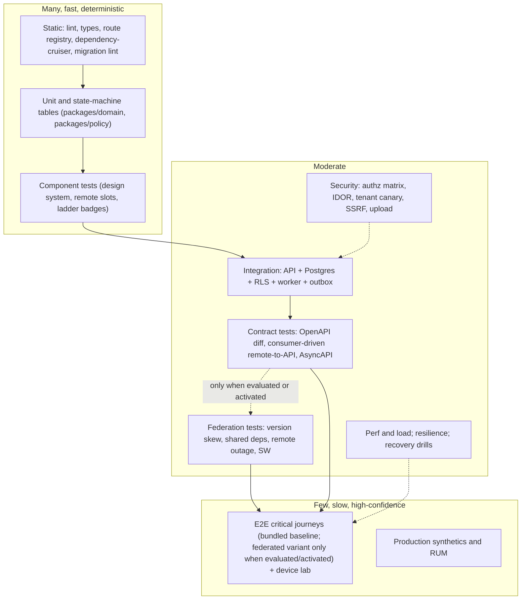

# Test Strategy

Doc ID: QA-STRAT · Owner: QA Architect · Version 1.0 · Status: Draft for Review · Relates: QA-CAT, QA-AC, OPS-SLO, OPS-FMEA, OPS-REL, CC-INV (INV-T01…T20, FF-01…FF-10), ADR-T03, ADR-T10, ADR-T13, ADR-T17, ADR-T18, ADR-T19, OPEN-03, OPEN-12, OPEN-29, WP-FED-SPIKE, WP-IOS-DEVICE-LAB, WP-QA-TRACE

**[REF]** The reference project documents a Vitest/Playwright/axe-style stack and a passing-assertion baseline, but also records that its assessment suite accepts simulated scoring and that one injection scan can pass when its external command is missing. The target treats "green" as meaningful only when the test can fail for the right reason (§9). Tool names below are **options**, not decisions.

## 1. Principles

1. **Test the invariants first.** INV-T01…T20 and FF-01…FF-10 are the highest-value tests; each must have ≥ 1 automated TEST (QA-CAT §15).
2. **Fail for the right reason.** A test that passes when its tool is missing, its fixture is empty, or its mock returns success is a defect. Every security/invariant test includes a *negative control* (a deliberately broken variant that must fail in CI at least once — "mutation sanity").
3. **Test where the risk is.** Federation, caching, offline and tenancy produce failures unit tests cannot see; they get dedicated levels.
4. **Server is the authority** (INV-T01, INV-T13): client tests prove UX, server tests prove enforcement. Never accept a client-only test as evidence for an authorization rule.
5. **Documentation ≠ implementation.** A feature is "done" only with passing evidence at the levels required by its risk class (§8), not because a document says so.
6. **Shift left, gate right.** Cheap checks block PRs; expensive checks gate releases and canaries; production synthetic checks close the loop.

## 2. Test pyramid and federation-aware layers

Proportion guidance (qualitative): most checks are static/unit/table-driven because state machines and policy are pure; integration tests use a real Postgres (no mocked DB for RLS or outbox); E2E is limited to critical journeys listed in §5.

## 3. Test types

| Type | Purpose | Scope and approach | Tool options | Gate stage | Owner | Catalog |
|---|---|---|---|---|---|---|
| Static | Enforce FF-01, FF-02, FF-03, FF-07, FF-10, types, lint, secret scan | Route-registry lint, dependency-cruiser, migration lint, OpenAPI lint | TypeScript, ESLint, dependency-cruiser, custom scripts | PR | Platform Eng | SEC-001, API-003, API-006, DAT-001 |
| Unit | Pure rules and state machines | Table-driven for every SM-*; BR-T* rules; policy decisions | Vitest-class runner | PR | Feature teams | EVD-001, HIR-002, API-012 |
| Component | UI states per design-system component incl. ladder badges, error boundaries, a11y props | Render tests with accessibility queries | Testing Library-class + axe | PR | Frontend | EVD-008, FED-008, A11-004 |
| Integration | API + real Postgres (RLS on) + worker + outbox | Ephemeral DB per run; transactional fixtures | Test containers or CI service DB | PR | Backend | TEN-002, API-008 |
| Contract | API stability, remote↔API compatibility, event schemas | oasdiff; consumer-driven pact-style recordings from each remote; AsyncAPI diff | oasdiff, Pact-class, Schemathesis-class fuzz | PR + release | Platform + Remote owners | API-001, API-002, API-007 |
| E2E | Critical journeys in real browsers incl. WebKit | Playwright-class on Chromium/Firefox/WebKit; bundled baseline, federated variant only in WP-FED-SPIKE or after activation | Playwright | PR (smoke), nightly (full) | QA | FED-010, PWA-001 |
| Security | Authz, IDOR, tenancy, injection, SSRF, uploads, session | Generated matrix tests + targeted abuse tests + DAST on staging | Custom generated suites, ZAP-class DAST | PR + release | Security Eng | SEC-*, TEN-* |
| Accessibility | WCAG 2.2 AA | Automated scan + keyboard + screen reader manual | axe-class, manual AT | PR + release | Design System + QA | A11-* |
| Performance | Budgets per route on RMP-1; API class latency | Lighthouse CI per PR; load scenarios | Lighthouse CI, k6-class | PR (lab), nightly (load) | Perf Eng | PER-* |
| Load/stress/soak | Capacity, saturation, shed behaviour | OPS-CAP §5 | k6-class | Nightly/pre-release | SRE | PER-001…007 |
| Resilience / chaos | Failure modes in OPS-FMEA | Fault injection in staging; limited production game days | Toxiproxy-class, fault-injection scripts | Nightly + game days | SRE | REL-* |
| Offline / SW | Cache correctness, conflicts, kill-switch | Playwright with SW and network control; WebKit; device lab | Playwright | Nightly + release | Frontend Platform | PWA-* |
| Android / iOS | Device behaviours emulation misses | Real devices via device lab (`WP-IOS-DEVICE-LAB`, OPEN-12) | BrowserStack-class cloud or own lab (OPEN-12) | Release (PWA/push changes) | QA | MOB-* |
| Federation (conditional) | Skew, shared deps, outage, rollback independence | Build matrix of (shell version × remote version × API version) when evaluated or activated | Custom manifest validator + Playwright | WP-FED-SPIKE; PR + release after activation | Frontend Platform | FED-* |
| Deployment | Smoke, canary guardrails, rollback, config failure | Post-deploy synthetic + canary analysis | Synthetic runner, rollout controller | Every deploy | Release Eng | DEP-* |
| Migration | Expand/contract, lock time, backfills, rollback | Production-sized synthetic copy | SQL harness | PR (lint) + pre-release | Data Eng | DAT-* |
| Recovery | Backup/restore, PITR, DR | Scheduled drills in isolated env | Scripts + runbooks | Scheduled + pre-major-release | SRE | REC-* |

## 4. Environments

| Env | Purpose | Data | Parity requirement | Who deploys | Gate |
|---|---|---|---|---|---|
| Local | Dev loop; ephemeral Postgres | Synthetic seed | Same migrations; MF_MODE switchable | Developer | none |
| CI ephemeral | PR checks; per-PR DB | Synthetic | Same Postgres major version and extensions (pg_trgm, pgvector) | CI | PR gates RG-01…RG-05 |
| PR preview (remote-scoped) | Visual/e2e of one remote against staging API | Synthetic | Real shell contract | CI | RG-05 |
| Integration/Staging | Bundled host, API replicas, worker and HA-like DB; add CDN/manifest registry only if federation is activated | Synthetic + seeded tenant canaries; **never production PII** | Same IaC modules as production, smaller sizes | Release pipeline | RG-06…RG-12 |
| Perf/Load (can be staging) | Load/soak | Generated at forecast scale | Same instance classes for the measured component | SRE | Nightly |
| Production | Canary then progressive rollout | Real | — | Release pipeline | RG-11, RG-12 |
| Production synthetic | Black-box journeys with test tenants | Dedicated test tenants and accounts, flagged and excluded from analytics | — | SRE | continuous |

## 5. Critical journeys (E2E scope)

J1 sign-up/sign-in/session refresh and logout (cache clear) · J2 create profile and add evidence (upload → scan → visible; rung display) · J3 request work-history verification and referee completes it with no account · J4 search/browse jobs, see match explanation, apply (idempotent) · J5 recruiter posts job, views consented evidence, moves pipeline stage (human action only) · J6 take assessment (AI prohibited honoured) · J7 enrol in course and complete → evidence · J8 checkout → webhook → entitlement · J9 consent revoke → recruiter access ends · J10 data export and erasure request · J11 support access grant lifecycle · J12 offline: edit profile draft offline → reconnect → conflict handling · J13 remote outage and fallback (federation only) · J14 SW update flow. The bundled mode is the baseline for routine journeys. Run federated variants only in WP-FED-SPIKE before activation, or in the release pipeline after ADR-T23/OPEN-03 gates pass.

## 6. Test data strategy

| Rule | Detail |
|---|---|
| No production PII outside production | Staging/load/CI use synthetic data. Production data copies for debugging are prohibited; if ever needed, anonymisation and approval via PROC-04 and PROC-09 (OPEN-08) |
| Deterministic seeds | Seed factories produce reproducible datasets (fixed random seed) |
| Tenant canaries | Every tenant table receives rows tagged for ≥ 2 tenants; FF-05 uses them |
| Role fixtures | One principal per ROLE-* and per scope for the permission-matrix suite |
| Fake time | Controllable clock for expiry (BR-T004 14-day, BR-T041 4 h, session TTL) |
| Third-party doubles | Provider ports (email, push, Stripe, AI, sandbox) have contract-verified fakes, plus provider test modes in a small scheduled smoke; fakes must be validated against the provider's published test mode to prevent drift |
| Large-corpus generator | Reproducible generator for search/load at forecast scale (OPS-CAP §5) |
| Test tenants in production | Marked; excluded from analytics and billing metrics by flag |

## 7. Flaky-test policy

| Step | Rule |
|---|---|
| Definition | A test is flaky if it fails and then passes on retry with no code or environment change |
| Detection | CI records per-test pass/fail history and retry outcomes |
| Retries | At most one automatic retry for E2E/device tests; unit/integration tests have **no** retries (masking defects) |
| Quarantine | A flaky test is moved to a quarantine suite within one working cycle of confirmation; quarantined tests still run and report but do not block |
| Ownership | Every quarantined test has a named owner and a tracking issue; time-to-fix target [OPEN-15 param] |
| Hard rules | Tests tagged security/invariant (SEC, TEN, EVD-001…004, API-008…010) **cannot** be quarantined; they are fixed or the release is held |
| Metrics | Flake rate, quarantine age, mean retries — reported in the release gate summary (MET-038) |
| Root causes | Prefer deterministic waits (events/network idle conditions), fake time, isolation of shared state; no fixed sleeps |

## 8. Risk classes and required test levels

| Class | Examples | Minimum levels |
|---|---|---|
| R1 invariant/security/money/privacy | policy, tenancy, billing, consent, verification, erasure | Unit/table + integration + security + e2e journey + negative control; Test review by Security |
| R2 core loop | profile, evidence, apply, pipeline | Unit + integration + contract + e2e + a11y |
| R3 supporting | notifications, messaging, analytics | Unit + integration + smoke e2e |
| R4 presentational | static pages, copy | Component + a11y + visual check |
Federation, SW and offline changes are always at least R2 and add FED/PWA tests.

## 9. Release gates (referenced by OPS-REL §9)

| Gate | Checks | Blocking | Evidence artefact |
|---|---|---|---|
| RG-01 Static | lint, types, FF-01 route registry, FF-02 module boundaries, FF-03 remote isolation, FF-07 idempotency lint, FF-10 migration lint | Yes | CI report |
| RG-02 Contracts | FF-06 OpenAPI diff and AsyncAPI compat; shell × remote × API matrix only when federation is evaluated/activated | Yes for applicable contract checks | Contract report |
| RG-03 Integration/Security | Authz matrix, IDOR suite, FF-05 tenant canary, state-machine tables, outbox/idempotency | Yes | Test report |
| RG-04 Supply chain | Secret scan, dependency + container scan, SBOM generated, artefact signed | Yes | SBOM + signature |
| RG-05 E2E | Critical journeys J1–J14 (smoke on PR, full nightly) | Yes | Playwright traces |
| RG-06 Accessibility | axe scan clean on routes; manual AT for changed critical flows | Yes | A11y report |
| RG-07 Performance | RMP-1 budgets (LCP/TBT/CLS/JS size), API class regression guard | Yes (budget breach) | Lighthouse CI report |
| RG-08 Migration | FF-10; expand compatibility with N-1 API; lock-time budget on sized copy | Yes | Migration report |
| RG-09 Federation (conditional) | FF-04 acyclic graph + singleton ranges; remote outage/skew tests (FED-001…005) | Yes when evaluating/activating federation; not a bundled-release gate | Manifest validation |
| RG-10 Resilience | Nightly REL subset green in the last cycle; no open Sev-2 resilience defects | Yes (for releases touching infra/API core) | REL report |
| RG-11 Canary | Guardrails: error ratio, latency vs SLO, INP, business proxy (e.g. successful apply rate) | Yes | Canary analysis |
| RG-12 Readiness | Rollback plan stated; runbook/alert updated; flags and kill-switches listed; DoD complete; docs updated; observability dashboards cover change | Yes | Release checklist |
| RG-13 Platform matrix | FF-09 WebKit/Android coverage; device-lab pass when SW/push/install code changes | Yes (when applicable) | Device report |
| RG-14 Recovery currency | Last successful restore drill within policy window before releases that change schema/storage | Yes (when applicable) | Drill record |

A waiver requires the owner of the failed gate plus Security (for RG-03/04) and is recorded as a risk entry; waivers for FF-01/05 and INV-T02/T03 tests are not allowed.

## 10. Special verification catalogue

The eleven mandatory verifications (remote unavailable, version mismatch, shared dependency conflict, stale service worker, offline conflicts, duplicate requests, concurrent actions, IDOR, partial operations, rollback, shared dependency outage) are indexed in QA-CAT §14 with test IDs and automation levels. Federation-only cases run in WP-FED-SPIKE before activation and in RG-09 after activation; they do not block a bundled release. Other cases block their associated release gates (RG-02, RG-03, RG-10, RG-12) as applicable.

## 11. Traceability and reporting

| Item | Rule |
|---|---|
| Chain | GOAL → FEAT → FR → AC → TEST; INV/FF → TEST; FM → TEST; RISK → TEST |
| Machine-readable catalog | Convert QA-CAT to structured data (`WP-QA-TRACE`) so CI can compute coverage, orphan tests and orphan AC |
| Report | Each release publishes: gate status, flake summary, coverage by INV/FF/AC, waivers, known-gap list |
| Mutation sanity | Periodic deliberate-break checks for SEC/TEN suites (e.g. temporarily remove a policy check on a staging branch and confirm red) |

## 12. Entry/exit criteria per phase (links to ROADMAP)

| Phase | Entry | Exit test evidence |
|---|---|---|
| Ph0 | Docs approved | WP-FED-SPIKE results incl. PER-004, FED-001/003/005 prototype; WP-IOS-DEVICE-LAB baseline; CI skeleton running RG-01 |
| Ph1 | Ph0 decisions (OPEN-03, OPEN-27) | RG-01…RG-09 for core loop; J1–J5, J9, J12–J14 green; TEN-001, SEC-003 green |
| Ph2 | Ph1 exit | + J6–J8; billing and AI suites; resilience nightly; first recovery drill |
| Ph3 | Ph2 exit | + institution tenancy tests; analytics privacy tests; DR exercise (OPEN-23) |
| Ph4 | Ph3 exit | Per-feature classes R3/R4 |
