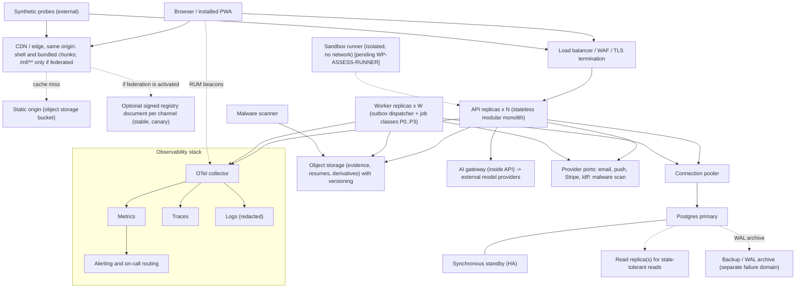

# Deployment Architecture

Doc ID: OPS-DEP · Owner: Platform/Infrastructure Architect (with SRE Lead) · Version 1.0 · Status: Draft for Review · Relates: ADR-T03, ADR-T04, ADR-T05, ADR-T09, ADR-T11, ADR-T16, ADR-T18, ADR-T19, ADR-T21, OPS-SLO §8, OPS-CAP, OPS-REL, OPS-OBS, OPS-FMEA, OPEN-14, OPEN-23, OPEN-30, OPEN-36, RISK-12

Logical architecture is a **[TARGET]**; the hosting realisation is **[OPEN-14]**. No vendor, price or size is decided here.

## 1. Logical deployment topology

## 2. Components

| Component | Role | Scaling unit | State | HA approach | Failure notes (OPS-FMEA) |
|---|---|---|---|---|---|
| CDN / edge | Serve shell + bundled chunks; federated remote assets only if activated; cache; WAF optional | Provider | none (cache) | Provider redundancy; origin fallback | FM-01, FM-10 |
| Static origin | Authoritative hashed assets; additive-only | Bucket | files | Versioned bucket; second copy optional | FM-01 |
| Signed registry document (conditional) | In federated mode, maps remote → current entry, `rollbackTo`, channel, kill switches (MFA-01 section 5) | Static object served by the CDN; written by the release pipeline | one JSON per channel | Not present in bundled baseline; if activated, origin fallback + embedded boot snapshot | FM-05 |
| Load balancer / WAF | TLS, routing, rate limiting, request IDs | Provider | none | Provider | FM-45 |
| API replicas | Policy, domain modules, BFF auth routes | Replica count N | none | ≥ 2, spread across zones | FM-12…FM-23 |
| Worker | Outbox dispatcher, job classes with per-class queues | Worker count W | none (fenced leases in DB) | ≥ 2 | FM-35…FM-38 |
| Postgres | System of record, outbox queue, FTS/trigram/pgvector | Vertical + read replicas | all durable state | Primary + synchronous standby, PITR | FM-24…FM-30 |
| Pooler | Connection multiplexing | 2+ | none | redundant | FM-25 |
| Object storage | Evidence/resume/media | Provider | files | Versioning, replication | FM-31 |
| Malware scanner | Scans uploads before visibility (BR-T003) | Scanner count | none | ≥ 1, scalable | FM-32 |
| Sandbox runner | Isolated code execution, no network (ADR-T13) | Slot pool | none | Optional until built | FM-43 |
| Observability stack | Signals, alerts | Collector + backends | telemetry | Separate from app failure domain where feasible | FM-23 |
| Secret manager / KMS | Secrets; federated registry signing keys only if activated | Provider | secrets | Provider HA | FM-48 |

Queue is Postgres (outbox + `background_jobs` style tables, ADR-T05/T09); no separate broker at launch. Revisit trigger: outbox throughput beyond Postgres budget (ADR-T09).

## 3. Frontend delivery: bundled baseline and optional federated mode

The bundled baseline serves local lazy modules with the shell and needs no runtime remote registry. The CDN, immutable remote paths, manifest signing, registry fallback, and per-remote release controls below apply only if ADR-T23 is ratified and federation activation gates pass. When active, MFA-01/VCD-01 govern these federated-mode details.

| Item | Design | Rationale |
|---|---|---|
| Hosting origin | Shell and remotes are served **same-origin**: remote assets under `/mf/<name>/<version>/…`, registry at `/mf/registry.json` (MFA-01 FD-03) | One CSP origin; SW can serve offline; cookies same-site; no CORS surface |
| Asset immutability | A published `<name>/<version>` path is never overwritten; files inside carry content hashes; `Cache-Control: public, max-age=31536000, immutable` | Old tabs keep working during deploys; rollback needs no rebuild (TEST-FED-009, TEST-FED-012) |
| Registry document | One signed JSON per channel (`?ch=stable` or `canary`): per remote `{version, entryUrl, SRI list, hostContract, minShell, apiRange, dataSchema, sequence, notAfter, status, rollbackTo, signature}`; written as a **single atomic put** of the whole document | Single control point for promotion, canary, rollback, kill switch; consumers never see a half-published set |
| Signing and trust | Entries signed with an Ed25519 key held in KMS/HSM-class custody [OPEN-36]; trust anchors are compiled into the shell build (key rotation = ship a shell with both keys, overlap at least one release); monotonic `sequence` gives anti-rollback; `notAfter` about issue + 30 days with at least weekly re-issue (heartbeat job) | A compromised registry store or CDN cannot execute code (ADR-T19) |
| Fallback chain | current → `rollbackTo` → client-stored last-known-good (LKG) → embedded boot registry snapshot → "unavailable" screen | Survives registry or CDN outage (FM-01, FM-05) |
| Retention | Retired remote versions stay on the CDN at least 30 days (VC-11); LKG assets also in SW cache | Rollback and stale clients |
| Registry caching | `Cache-Control: no-cache` + ETag; SW NetworkFirst with short timeout; re-poll every `ttlSeconds` (at most 300 s [TARGET]) while visible; jittered | Fast propagation of rollbacks and kill switches; herd control (TEST-REL-011) |
| Service worker | `sw.js` and `index.html`: `no-cache`; SW precache **excludes** `/mf/**` (remote releases need no SW update, FD-12); `/version.json` carries `minShell`, `minSw` | Independent release trains |
| Canary | Shell flag selects `?ch=canary` for a cohort; MFA-01 defaults (5% cohort, 30 min soak) are [TARGET] to be confirmed against baseline traffic (OPEN-15) | Progressive delivery (OPS-REL §9.2) |
| API responses | `Cache-Control: private, no-store` by default; any public caching is explicit per route (TEST-TEN-006) | Prevent cross-user leakage |
| Compatibility gate at promotion | Registry-publish step requires the FF-08 compat result (shell × remote × API range) and a headless contract-smoke against the staging registry | Prevent skew |
| Bundled mode | `MF_MODE=bundled` produces a single deployable with local lazy modules; no runtime remote registry or signing pipeline is required | Proposed initial baseline under ADR-T23; not yet ARB-ratified |

Cache-control policy summary:

| Object | Cache-Control |
|---|---|
| `/mf/<name>/<version>/**` hashed JS/CSS/fonts/images | `public, max-age=31536000, immutable` |
| `/mf/registry.json` | `no-cache` + ETag |
| `index.html`, `sw.js`, `/version.json` | `no-cache` (revalidate every time) |
| API | `private, no-store` unless route declares otherwise |
| Signed upload/download URLs | `private`, short expiry bound to principal and object |

## 4. Network and trust zones

| Zone | Contents | Ingress | Egress |
|---|---|---|---|
| Public edge | CDN, WAF, LB | Internet | To API, origin |
| App | API, worker, scanner; registry writer only if federation is activated | From edge/LB only | To DB, object storage, listed provider endpoints (egress allowlist) |
| Data | Postgres, pooler, backups | From App only | WAL archive destination |
| Isolated execution | Sandbox runner | From API job dispatch only | **None** (ADR-T13) |
| Ops | Observability, CI runners, bastion/break-glass | Authenticated, audited | Restricted |
All service-to-service credentials are workload identities or short-lived tokens; DB roles: `app` (RLS enforced, no bypass), `migrator`, `readonly-replica`, `support-reader` (time-boxed, PROC-04).

## 5. Data tier

| Topic | Design |
|---|---|
| HA | Primary + synchronous standby (or provider-managed equivalent), automatic failover (SLO-30) |
| Backups | Continuous WAL archiving (PITR) + periodic base backups, encrypted, separate failure domain; retention [OPEN-08] |
| Replicas | For stale-tolerant reads; authz/consent/entitlement reads on primary |
| Extensions | pg_trgm, pgvector, pgcrypto-class as required; versions pinned (R: upgrade rehearsal) |
| Partitioning | Time-partition outbox, audit, event tables when volume warrants (OPS-CAP) |
| Upgrades | Major version via logical replication or provider-managed blue/green, rehearsed in staging |
| Multi-tenancy | Row-level (ADR-T21); dedicated DB for a regulated tenant is a revisit trigger (OPEN-30) |

## 6. Hosting options evaluated

The reference's current deployment assets are **[REF] options, not decisions**: (A) a single VM running a Compose stack (Caddy edge, API, worker, Postgres 16 container) documented for an Oracle Ampere ARM64 staging host, with backup and restore scripts documented as *not yet executed*; (B) Coolify descriptors for a self-hosted PaaS; (C) SQL assets originating from a Supabase-hosted Postgres workflow (the reference does not use Supabase Auth).

| Option | Description | HA Postgres + PITR | API/worker scale-out | Ops burden | Cost predictability | Portability / lock-in | CDN/edge integration | DR capability | Fit as launch target |
|---|---|---|---|---|---|---|---|---|---|
| A. Single VM + Compose (Oracle) [REF] | One host, containers | L (single node; HA must be self-built) | L–M (one host) | M | H | H | L (needs separate CDN) | L (needs off-VM backups; single failure domain) | Dev/staging only unless HA and off-VM backup proven |
| B. Coolify-managed VM(s) [REF] | Self-hosted PaaS UI over Docker | L–M (self-built) | M | M–H (platform upkeep) | H | H | L | L–M | Staging / early beta at best |
| C. Supabase-hosted Postgres + separate compute [REF assets] | Managed Postgres with backups/PITR depending on plan [verify, OPEN-14] | M–H (provider features; verify sync HA and PITR plan) | depends on compute choice | M | M | M (Postgres standard, but platform features may couple) | depends | M | Candidate for data tier; compute separate |
| D. Developer PaaS containers + managed Postgres | Fly/Render-class [examples of category only] | M–H | H | L–M | M | M | M | M | Plausible launch target |
| E. Managed Kubernetes + managed Postgres | Cloud K8s | H | H | H (cluster ops) | M | M–H | H | H | Over-built until team and scale justify (ADR-T04) |
| F. Hyperscaler managed containers + managed Postgres + CDN + KMS | ECS/Cloud Run/Container Apps-class | H | H | M | M | M (IaC modules isolate it) | H | H | Strong candidate when SLO-30/33 matter |

Scores are qualitative (H/M/L meaning "meets requirement well/partly/poorly", except Ops burden and lock-in where H = heavy/high). **Decision method [OPEN-14]:** weighted score `S(option) = Σ_i w_i × score_i` with weights `w_i` set by the Architecture Review Board; **mandatory pass/fail criteria** apply before scoring:

| Must-have | Why |
|---|---|
| Synchronous or quorum-HA Postgres with PITR to a separate failure domain | SLO-30/31, ADR-T05 |
| ≥ 2 API replicas across failure domains | SLO-01, OPS-CAP N+1 |
| Encrypted off-host backups with a restore drill passed | REC-001/002 |
| CDN able to serve immutable assets and short-TTL manifest | §3 |
| Egress control for sandbox runner and workloads | ADR-T13 |
| Secrets via a secret manager | OPS-REL §5 |
| Residency options matching OPEN-30 | ADR-T21 |

Provisional position **[TARGET, not decided]:** use D or F-class managed containers with a managed HA Postgres for production; keep A/B as development and low-cost staging only; treat C as one way to provide the data tier if it passes the must-have list. The first production go-live is blocked on a passed restore drill (RB-29, gate RG-14). Hosting choice is blocking for Ph1 production readiness, not for Ph0 spikes.

## 7. Backup, restore and disaster recovery

| Control | Detail | Verified by |
|---|---|---|
| Backup scope | Postgres (base + WAL), object storage (versioning + replica/copy), IaC state, secrets (re-creatable), manifest registry if federation is activated (rebuildable from release records), search index (rebuildable) | REC-001…003 |
| Backup monitoring | "Last successful backup/WAL age" is an SLI with alert; silent failure is FM-34 | TEST-OBS-001 |
| Encryption and access | Encrypted at rest with separate key; restore rights restricted; access audited | audit review |
| Retention | Per OPEN-08; ties to erasure: erasure applies to live data immediately and to backups by expiry; restores re-apply erasure log (tombstone list) before serving | TEST-PRV-003, TEST-REC-001 |
| Restore drills | PITR to timestamp into isolated environment; verify data and workflows; measure vs RPO/RTO | TEST-REC-001 |
| Off-site restore | Restore on a separate host/account from the off-site copy | TEST-REC-002 |
| Object restore | Recover deleted/overwritten evidence versions | TEST-REC-003 |
| DR exercise | Simulate zone/region loss; execute RB-31; measure | TEST-REC-004 |
| Rebuild from scratch | IaC + backups + secrets recreation | SLO-35 |
| Outbox replay | After restore, replay dedupes | TEST-REC-005 |
| Drill cadence | Policy: before first production launch, after any backup-system change, and on a recurring schedule [OPEN-15] | drill log |
| Post-restore | Re-apply erasure tombstones; invalidate sessions if compromise suspected; reconcile billing (RB-34) | runbook |

Disaster tiers: T1 component failure (automatic); T2 zone failure (failover, SLO-30/33); T3 region failure (SLO-33, OPEN-23); T4 data corruption (PITR, RB-30); T5 provider or account compromise (rebuild in clean account — requires off-account backups and IaC). Tier T5 is acknowledged as the most demanding; scope decided in OPEN-23.

## 8. Environment topology differences

| Aspect | Production | Staging | CI/preview |
|---|---|---|---|
| Replicas | N ≥ 2, W ≥ 2 | smaller counts but same shape (≥ 2 API to catch state bugs) | 1 |
| DB | HA + PITR | non-HA allowed but same version/extensions; HA drills run here periodically | ephemeral |
| CDN | Full | Same config, separate domain | none/local |
| Observability | Full retention | Reduced | minimal |
| Data | Real | Synthetic | Synthetic |
| Egress allowlist | Strict | Same rules | n/a |

Running ≥ 2 API replicas in staging is mandatory so that hidden in-process state (the reference design's single-process limitation) cannot reappear (TEST-DAT-007).

## 9. Open items

| Item | Ref |
|---|---|
| Hosting selection and weights | OPEN-14 |
| DR scope, second region | OPEN-23 |
| Dedicated tenant database / residency | OPEN-30 |
| CDN provider, manifest key custody | OPEN-36 |
| Hosted-plan capabilities (PITR, HA, replicas) must be verified against provider documentation; not in RES-01 | OPEN-13 |
