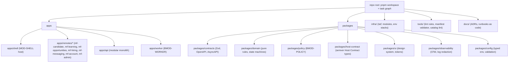
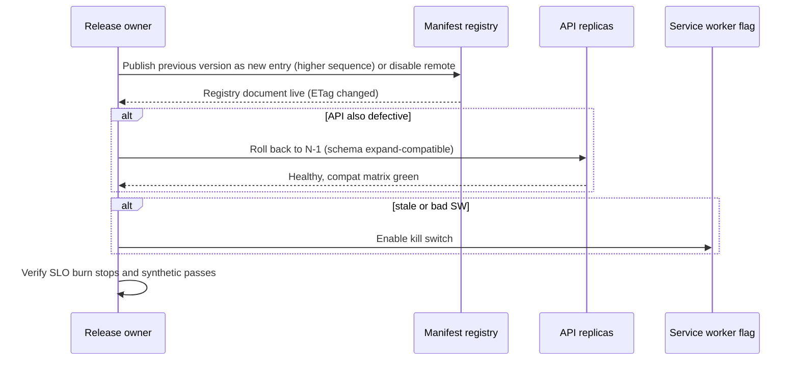

# DevOps and Release Strategy

Doc ID: OPS-REL · Owner: Release Engineering Lead (with Platform Architect) · Version 1.0 · Status: Draft for Review · Relates: ADR-T03, ADR-T05, ADR-T09, ADR-T17, ADR-T18, ADR-T19, FF-01…FF-10, INV-T14, QA-STRAT §9, OPS-DEP, OPS-OBS, OPS-FMEA, OPEN-14, OPEN-21, OPEN-22, OPEN-35, OPEN-36, WP-MONOREPO-CI, WP-IAC-ENVS, WP-CANARY

All tool names are **options** unless an ADR fixes them. **[REF]** marks reference-system facts: the reference repository is a pnpm monorepo with Fastify API, worker, Vite web app and SQL migrations, deployed to an Oracle VM via Compose and Coolify descriptors, with a documented rule that "build files are read-only for AI agents". The target does not inherit those choices.

## 1. Principles

1. Independent deployability with explicit compatibility: any remote, the shell, the API or the worker can deploy alone if the compatibility matrix allows (ADR-T18, FF-08; federation mechanics in MFA-01/VCD-01).
2. Artefacts are built once, signed, and promoted unchanged through environments; configuration varies, binaries do not.
3. Every deployment is reversible or has a documented forward-fix; irreversible steps (contract migrations) are isolated in their own release.
4. Fitness functions are release gates, not advice (FF-01…FF-10 mapped in §9.4).
5. No secret enters a browser bundle, build log or image layer (INV-T14).
6. Production changes are made by pipelines; humans use break-glass paths that are time-boxed and audited (PROC-04).

## 2. Monorepo layout (ADR-T17)

| Rule | Mechanism |
|---|---|
| Remotes depend on `host-contract`, `contracts`, `ui`, `observability` only — never on each other | dependency-cruiser (FF-03) |
| API modules expose only `index.ts` | dependency-cruiser (FF-02) |
| Contract packages are semver'd; breaking change = major | oasdiff (FF-06) + changeset requirement |
| Shared dependencies (React, router, query lib) have one pinned singleton range in a single file consumed by shell and remotes | manifest validator (FF-04) |
| Code ownership | CODEOWNERS per app/module/package; Security owns `packages/policy` and `infra/` security modules |
| Lockfile and tool versions pinned; renovate-style updates via PR with the full gate set | CI |

## 3. CI/CD pipelines per deployable

| Deployable | Build output | Pipeline specifics | Deploy action | Verification |
|---|---|---|---|---|
| Shell | Static assets, content-hashed; embedded boot registry snapshot and trust anchors | Host-contract semver bump rules; SW generation with versioned precache (excludes `/mf/**`); must pass a compatibility run against every currently published remote entry (inverse of FF-08) | Upload hashed assets to CDN origin (additive), then switch `index`/SW entry and `/version.json` | TEST-DEP-008, TEST-PWA-001 |
| Each remote | Static assets with content-hashed files, published to immutable `/mf/<name>/<version>/`, plus a registry entry | Federation validators (FF-04), compat check vs current shell + registry + API range (FF-08), headless contract-smoke against the staging registry, bundle-size budget (MFA-01 release flow) | Publish immutable assets, then **sign the entry (KMS key, `sequence`+1, `rollbackTo` = current stable) and put the registry document** on the canary channel; promotion to stable is a second signed put (the only mutable steps) | TEST-FED-003, TEST-FED-012 |
| API | OCI image (multi-arch if needed) | OpenAPI diff, authz matrix, tenant canary on ephemeral DB | Rolling/canary replicas; readiness gating | Health/readiness, TEST-DEP-001 |
| Worker | OCI image | Job-handler idempotency tests; fencing tests | Rolling; drain in-flight leases before stop | TEST-REL-005 |
| Migrations | Versioned SQL bundle | Migration lint (FF-10), expand-compat test, lock budget | Run as a separate gated step before API roll-out (expand) / after (contract) | TEST-DAT-002/003 |
| Infra | IaC plan | Policy-as-code checks; plan review | Apply by pipeline after approval | drift detection |

**Affected-only builds:** the task runner computes the affected set from the workspace graph and changed files; changes to `contracts`, `host-contract`, `policy`, `domain` or `ui` rebuild and retest every dependent (TEST-DEP-006). A scheduled full build (nightly) catches graph blind spots.

**Caching:** remote build caches keyed by lockfile + source hash; cache poisoning protection by signing cache entries or restricting cache writes to protected branches.

## 4. Environments

| Env | Purpose | Deploy trigger | Config source | Data |
|---|---|---|---|---|
| dev (local) | Development | n/a | `.env.example` with no secrets | synthetic |
| ci | PR checks | PR | CI vars | synthetic |
| preview | Remote-scoped previews against staging API | PR label | staging read-only config | synthetic |
| staging | Pre-production integration, same IaC modules | merge to main | staging secrets | synthetic + tenant canaries |
| production | Real users, canary then progressive | manual approval of RC (or automated after gates, policy [OPEN-15]) | production secrets (secret manager) | real |

Separate cloud accounts/projects (or at least separate credentials and networks) for staging and production. Staging never holds production data or secrets. **[REF]** the reference uses separate secrets per environment and refuses in-memory storage in production/staging — a pattern to keep, as startup config validation (TEST-DEP-007).

## 5. Configuration and secrets

| Topic | Rule |
|---|---|
| Typed config | One typed schema (`packages/config`) validated at boot; invalid or missing production config fails fast |
| Build-time vs run-time | Browser bundles contain only public build-time values; everything else is server-side runtime config. Remote bundles never embed environment-specific secrets (INV-T14) |
| Secret store | A managed secret manager (option set: cloud-native manager, Vault-class, or sealed-secrets with encrypted-at-rest repo) [OPEN-22]; secrets injected at runtime, short-lived where the provider supports it |
| Rotation | Documented rotation for session signing keys, manifest signing keys (dual-key window), DB credentials, provider API keys, webhook secrets (RB-26). Rotation is rehearsed |
| Access | Least privilege; human access to production secrets requires PROC-04 grant |
| Scanning | Pre-commit + CI secret scanning; canary secret test (TEST-SEC-015) |
| Webhook secrets | Per-provider, per-environment; verification code covered by TEST-BIL-002 |

## 6. Supply chain: signing, SBOM, dependency scanning

| Control | Approach (options) | Gate |
|---|---|---|
| SBOM | Generated per artefact (CycloneDX or SPDX) and stored with the release record | RG-04, TEST-SEC-025 |
| Vulnerability scan | Dependency scan (lockfile) + container image scan + IaC scan; policy: no unwaived critical/high with a fix available; waivers expire | RG-04 |
| Signing | Keyless or key-based artefact signing (Sigstore-class); deploy step verifies signature and provenance (build identity) | TEST-DEP-004 |
| Registry signing | Registry entries signed (Ed25519, key in KMS/HSM-class custody [OPEN-36]); trust anchors compiled into the shell; shell verifies signature, `sequence`, `notAfter` (ADR-T19, MFA-01 FD-04) | TEST-SEC-014 |
| SRI | Content-hash integrity attributes on remote entry and critical chunks | TEST-SEC-013 |
| Dependency hygiene | Lockfile-only installs, no install scripts by default for untrusted packages, pinned versions, provenance checks where available, license policy | CI |
| Build isolation | Ephemeral builders, least-privilege tokens, no long-lived credentials in CI | CI |
| Third-party scripts | None on critical path; CSP allowlist | TEST-SEC-027 |

## 7. Infrastructure as Code

| Topic | Decision status |
|---|---|
| Tool | OpenTofu/Terraform-class or Pulumi-class [OPEN-21] |
| Structure | Reusable modules (network, db, object storage, cdn, compute, observability, secrets) + per-env stacks; staging and production use the same modules |
| State | Remote, encrypted, locked; access restricted |
| Changes | PR → plan → policy checks → approval → apply by pipeline; drift detection scheduled |
| Recovery | Environment reproducible from IaC + backups (SLO-35, TEST-REC-*) |
| Constraint | Hosting choice (OPEN-14) may change module internals but not the logical topology in OPS-DEP |

## 8. Database migration deployment

| Principle | Detail |
|---|---|
| Append-only, contiguous, each with rollback or forward-fix note | FF-10, TEST-DAT-001 |
| Expand → migrate → contract | **Expand** (additive: new nullable columns/tables/indexes created concurrently) ships with or before code that tolerates both shapes; **backfill** is a resumable, idempotent job (TEST-DAT-004); **contract** (drop/rename/tighten) ships in a later release after all running code (including N-1 API, workers and queued jobs) no longer uses the old shape |
| Compatibility window | The currently deployed API (N) and the previous one (N-1) must both work against the schema after an expand (TEST-DAT-002); this is what makes API rollback safe |
| Locking | `lock_timeout` and `statement_timeout` on migrations; concurrent index builds; large table changes via batches; duration/lock budget tested on a sized copy (TEST-DAT-003) |
| Execution | A dedicated migration job with its own DB role; runs once (advisory lock); API instances never auto-migrate at boot in production |
| RLS | New tenant tables ship with `org_id` and policies in the same migration (TEST-DAT-009) |
| Rollback | Prefer forward-fix; a down-migration is allowed only when data-safe; destructive steps require a verified backup/PITR marker taken immediately before (FM-28) |
| Ordering with deploys | expand → deploy API → (flip flag) → backfill → verify → later release: contract |
| Data corrections | Never ad-hoc SQL in production; use reviewed, audited scripts via PROC-08 |

## 9. Feature flags, progressive delivery and release gates

### 9.1 Feature flags

| Class | Purpose | Lifetime | Example |
|---|---|---|---|
| Release flag | Dark-launch and progressive exposure | Remove within a defined period after full rollout [OPEN-15 param] | new pipeline view |
| Kill switch | Immediate disable of a risky capability | Permanent for R1/R2 features | AI gateway, push, SW (RB-09), search, uploads |
| Ops flag | Degradation ladder controls | Permanent | shed P3 jobs, read-only mode |
| Entitlement | Business gating (billing) | Product-driven | **Not a flag**: entitlements are server-derived from billing state (INV-T17) |
| Experiment | A/B tests | Per experiment | subject to ANL-MET guardrails |

Rules: flag evaluation is server-side for anything affecting authorization or data; client flags are UX hints only (INV-T01). Flags have owner, expiry, and test (TEST-DEP-005). Flag changes are audited. Platform: build vs buy [OPEN-35].

### 9.2 Canary and progressive delivery

| Stage | Exposure | Bake / decision | Auto-halt guardrails |
|---|---|---|---|
| S0 Staging soak | Synthetic traffic | Gate RG-05…RG-10 | any gate red |
| S1 Internal | Internal and synthetic test tenants | short bake [param] | error ratio, synthetic checks |
| S2 Canary cohort | Small cohort chosen by stable hash of principal (not by tenant tier, to avoid unfair treatment) [param] | bake long enough to see diurnal peak [param] | error ratio vs baseline, p95/p99 vs SLO, INP regression, auth failures, business proxy (successful apply rate), log error signatures |
| S3 Majority | Expanding steps | each step has hold | same + burn rate |
| S4 Full | All | Post-release verification (synthetic + dashboards) | burn rate |

Remote releases use the registry **canary channel** (`?ch=canary`) selected by a shell flag for a cohort (MFA-01 defaults 5% / 30 min are [TARGET] pending baseline); API releases use replica canary with header/cohort routing; worker releases use a canary worker pool handling a subset of job classes. Statistical rules (minimum sample, baseline comparison) are specified in the canary analysis config [OPEN-15].

### 9.3 Release record

Each release produces: artefact digests, SBOM, signatures, compat matrix (shell × remote × API × schema), gate results, flags touched, migration list, rollback plan, owner, approval, and links to dashboards. Stored immutably; used by incident response.

### 9.4 Gates and fitness functions

| Gate (QA-STRAT §9) | Fitness functions enforced |
|---|---|
| RG-01 | FF-01, FF-02, FF-03, FF-07, FF-10 |
| RG-02 | FF-06, FF-08 |
| RG-03 | FF-05, INV-T01…T04 |
| RG-04 | INV-T14 |
| RG-09 | FF-04, FF-03 |
| RG-13 | FF-09 |

No gate may be disabled by pipeline configuration without a recorded waiver; changes to gate definitions require review by Release Engineering and Security.

## 10. Rollback sequencing (remote + API + service worker + data)

Compatibility rules that make rollback possible:

| Rule | Statement |
|---|---|
| R-1 | Within `/api/v1` only additive, oasdiff-clean changes; the server honours clients up to a 90-day floor after a deprecation notice and answers `426 client-outdated` below it (VCD-01 VC-06, [TARGET], measured from the age distribution of active shells) |
| R-2 | A remote declares `apiRange`, `hostContract`, `minShell` and `dataSchema`; the publish step refuses promotion that leaves a gap, and the shell enforces the same at runtime (VC-02) |
| R-3 | Schema changes follow expand/contract so API N and N-1 both work |
| R-4 | SW changes are forward-only: a SW cannot be un-installed from a user device by deploy; "rollback" = publish a new SW that restores previous behaviour, or trigger the kill-switch |
| R-5 | Worker handlers are backward compatible with queued job payload versions |
| R-6 | The shell supports Host Contract majors N and N-1 for at least 90 days (VC-12), so a shell rollback never strands published remotes |
| R-7 | Operator rollback of a remote = publish the previous artefacts as a **new entry with a higher `sequence`** (or rely on the signed `rollbackTo`), never lowering `sequence` (anti-rollback, MFA-01 section 5) |

Scenarios:

| Scenario | Order | Notes |
|---|---|---|
| Remote-only defect | 1) Clients self-heal to `rollbackTo`/LKG; operator publishes the previous version as a new higher-`sequence` entry (or sets `status:"disabled"` as a kill switch) 2) Observe within the registry TTL 3) Fix forward | Independent of API/shell (TEST-FED-014); propagation bounded by registry TTL (at most 300 s [TARGET]) |
| API-only defect | 1) Roll back replicas to N-1 (schema is expand-compatible) 2) Verify remote compat matrix still green 3) Fix forward | Fails if a contract migration was done — hence contract is a separate release |
| Coordinated change (new field consumed by remote) | Deploy order: schema expand → API (adds field, backward compatible) → remote. Rollback order is the reverse: remote → API → (schema stays) | Never roll API back while a promoted remote requires the new field; remote first |
| Shell/Host Contract change | 1) New shell built with embedded boot registry and trust anchors 2) Remotes declare ranges supporting both shells 3) Rollback shell: restore previous `index`, SW entry and `/version.json`; remotes still compatible (R-6) | Shell supports Host Contract N and N-1 (VC-12) |
| Service worker defect | 1) Flip SW kill-switch flag (clients unregister on next load) 2) Publish corrected SW 3) Remove flag | RB-09, TEST-PWA-009 |
| Bad migration | 1) Stop deploy 2) Execute forward-fix or down-migration per note 3) If data damaged: PITR restore to side instance and repair (RB-30) | TEST-DEP-003, TEST-REC-001 |
| Worker defect | 1) Pause affected queue class 2) Roll back worker 3) Replay safely (dedupe) | RB-11 |

Rollback is rehearsed in staging per release class (TEST-DEP-002) and recorded in the release record.

## 11. Versioning and hotfixes

| Topic | Rule |
|---|---|
| API | URL major `/api/v1`; breaking changes need a new major with a deprecation window (FF-06) |
| Host Contract | Semver; shell supports current + previous minor for remotes |
| Remotes | Independent semver; manifest records host/api ranges and data schema expectations (ADR-T18) |
| Hotfix | Branch from the deployed release; reduced but not skipped gates: RG-01…RG-04 + targeted tests + canary; post-hoc full gate run; recorded as change class "emergency" with retrospective |
| Change classes | standard, normal (CAB-less but peer + gate), emergency; high-risk (data/contract/infra) requires an explicit rollback rehearsal |

## 12. Open items

| Item | Ref |
|---|---|
| Hosting/orchestration platform and its HA features | OPEN-14 |
| IaC tool, secret manager | OPEN-21, OPEN-22 |
| Feature-flag platform build vs buy | OPEN-35 |
| CDN provider and manifest signing key custody | OPEN-36 |
| Canary statistics and bake parameters | OPEN-15 |
| Whether federation proceeds or MF_MODE=bundled (affects remote pipelines) | OPEN-03, OPEN-11 |
