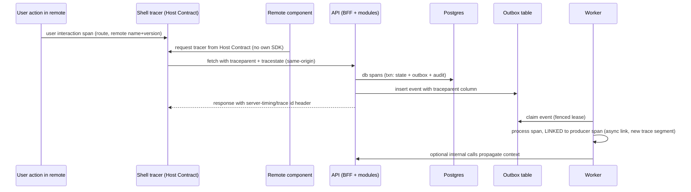

# Observability Design

Doc ID: OPS-OBS · Owner: SRE Lead (with Security Architect for log/audit policy) · Version 1.0 · Status: Draft for Review · Relates: ADR-T16, ADR-T19, INV-T10, INV-T14, INV-T18, BR-T041, OPS-SLO, OPS-FMEA, OPS-DEP, SUP-RUN, SUP-INC, OPEN-15, OPEN-20, OPEN-39

**[REF]** The reference documents an intended critical trace (request → user → tenant → feature → API → DB/queue → provider → result), structured logs and an alert list, but states SLOs are to be set "after baseline" and that the current build's observability is partial. The target specifies the full design.

## 1. Principles

1. Signals exist to answer three questions fast: *is it broken* (SLO burn), *where* (golden signals by tier, remote and tenant-safe dimensions), *why* (traces and logs correlated by trace id).
2. Alerts are tied to SLOs or to safety/security invariants — not to raw resource graphs (symptom-based paging; cause-based dashboards).
3. Telemetry never carries secrets or direct personal data (INV-T14); this is tested (TEST-SEC-016).
4. Telemetry export must never block or fail user requests (FM-23).
5. Operational logs are not the audit trail; audit is a separate, append-only, access-controlled store (§4.2).

## 2. Signals and instrumentation (OpenTelemetry, ADR-T16)

| Signal | Source | Instrumentation | Notes |
|---|---|---|---|
| Traces | Browser (shell + remotes), API, worker, DB client | OTel Web SDK in shell only (remotes receive the tracer through the Host Contract, avoiding duplicate SDKs); OTel Node SDK in API/worker | W3C Trace Context |
| Metrics | API, worker, DB, queue, CDN, synthetic | RED per route class, USE per resource, business counters | Exemplars link metrics to traces |
| Logs | API, worker, shell error reports | Structured JSON (Pino) with redaction; trace/span ids in every line | Levels with sampling for debug |
| Events | Domain events/outbox | Event publish/consume metrics: lag, attempts, DLQ | AsyncAPI-aligned |
| RUM | Browser | Web-vitals style field data (LCP, INP, CLS), remote activation timings, SW lifecycle, version beacons | Sampled; consent-aware; no PII |
| Profiles | API/worker (optional) | Continuous profiling when needed | [OPEN-20] |

Resource attributes (all signals): `service.name`, `service.version`, `deployment.environment`, `ts.shell.version`, `ts.remote.name`, `ts.remote.version`, `ts.api.module`, `ts.release.id`. Span/metric attribute allowlist: route template (never raw URL with ids), method, status class, `ts.principal.role`, `ts.tenant.id` (opaque id — acceptable as an operational dimension only in traces/logs, **never as a metric label** to avoid cardinality blow-up), pseudonymous `ts.actor.id` in traces/logs only. Forbidden: email, name, phone, free text, tokens, query strings, request/response bodies.

## 3. Trace propagation across the federation boundary

| Boundary | Mechanism | Rule |
|---|---|---|
| Shell → remote | Tracer and current context provided by the Host Contract (ADR-T18, HC-01) | Remote cannot create root traces for user actions; keeps one trace per interaction |
| Browser → API | `traceparent` header on same-origin BFF calls | Same-origin avoids CORS preflight problems |
| API → DB | DB client instrumentation; statement text sanitised (no literals) | TEST-FED-011 |
| API → outbox → worker | `traceparent` stored with the event/job row; worker starts a new trace and **links** to the producer (async fan-out can be long) | Preserves causality without unbounded traces |
| API → third parties | Outgoing spans recorded; **context headers not forwarded** to providers | Prevent leaking internal ids |
| Errors in remote | Error boundary reports with remote name+version and trace id | FM-04 |
| Sampling | Head sampling at a low base rate + **tail sampling** that always keeps errors, slow traces (> SLO class p99), authz denials, canary cohort, and incident-tagged flows | Parameters [OPEN-15]; budget in §10 |

Correlation key shown to users on error screens: a short support code derived from the trace id (no PII), enabling PROC-03 triage.

## 4. Logging

### 4.1 Redaction

| Control | Detail |
|---|---|
| Structured only | JSON lines; no string-concatenated PII |
| Redaction at source | Logger configured with path-based redaction for: `authorization`, `cookie`, `set-cookie`, `password`, `token`, `code`, `refreshToken`, `apiKey`, `secret`, webhook signatures, `email`, `phone`, `name`, `address`, `resume`, message bodies |
| Pattern scrub | Secondary scrubber at the collector for emails, JWT-like strings, long hex/base64 tokens, card-like numbers |
| Allowlist for request logging | Log route template, status, latency, sizes, ids; **not** bodies |
| Verification | Canary strings injected in tests must not appear in log, trace or error-report stores (TEST-SEC-016); production sampling scan job alerts on patterns |
| Client error reports | Scrubbed; URL query stripped; user-entered text excluded |
| Debug logging | Cannot be enabled in production without PROC-04 grant; auto-expires |

### 4.2 Audit log vs operational log

| Property | Operational log | Audit log |
|---|---|---|
| Purpose | Debugging, performance | Accountability: who did what to which resource and why (INV-T10, INV-T18, BR-T041) |
| Content | Technical events | Actor, role/scope, action, resource, tenant, reason code, request id/trace id, outcome, before/after summary (no secrets) |
| Store | Log backend; sampled; short retention | Append-only table(s) in Postgres + export to write-once archive; per-row hashes sealed in KMS-signed batch anchors (DB-02 §4.2) for tamper evidence; alert on anchor lag (oldest unanchored row) and on any verifier finding; actor and subject stored as opaque `subject_ref` (DB-02 §4.1) |
| Write path | Async, best effort | Same transaction as the action (cannot succeed without being recorded) |
| Access | Engineers | Restricted: auditors (ROLE-AUD) read-only, org/institution admins see own tenant, users see own-access log |
| Retention | Short [OPEN-20] | Per retention policy [OPEN-08] |
| Tamper | n/a | Updates/deletes forbidden for app role (TEST-OBS-003) |
| Alerting | Error patterns | Anomalies: bulk reads, privileged access, role changes, exports |

Audit event catalogue is owned by the Security Architect; each process in SUP-PROC lists its audit events.

## 5. Dashboards (golden signals) — as code

Dashboards and alert rules live in the repository (`infra/observability/`) and are linted (TEST-OBS-002): every SLO must have a dashboard panel, an alert and a runbook link.

| ID | Dashboard | Latency | Traffic | Errors | Saturation / other |
|---|---|---|---|---|---|
| DASH-01 | SLO overview and error budgets | per SLO | — | burn rates | budget remaining |
| DASH-02 | Shell and CDN | TTFB, asset load | requests, hit ratio | 4xx/5xx at edge | origin load |
| DASH-03 | Remotes health | activation ms p50/p95 per remote+version | activations | failed/rejected/fallback counts, version mix | skew detector, SW version mix |
| DASH-04 | API by class (C1…C9) | p50/p95/p99 | RPS | 5xx/429/503 | event-loop lag, CPU, memory, in-flight |
| DASH-05 | Auth and sessions | login/refresh latency | attempts | failures, lockouts, reuse detections | refresh storms |
| DASH-06 | Postgres | query p95, lock waits | TPS | errors, deadlocks | CPU, IOPS, connections, replica lag, WAL, autovacuum |
| DASH-07 | Worker and outbox | enqueue→start by class | jobs/s | failures, DLQ | oldest age, lease expirations, duplicate-effect detector |
| DASH-08 | Third parties | provider latency | calls | errors, breaker state | quota/rate limit headroom |
| DASH-09 | AI gateway and cost | TTFT, completion | calls | blocked (policy), errors | spend vs budget, per-tier |
| DASH-10 | Billing | webhook lag | events | signature failures | drift count, dunning queue |
| DASH-11 | Security and tenancy | — | authz denials | cross-tenant canary result, privileged accesses | abnormal bulk reads |
| DASH-12 | Release and canary | cohort vs baseline | — | cohort errors | rollout step, flags state |
| DASH-13 | Business health | time-to-shortlist (aggregated) | applications, evidence created | funnel drop-offs | cohort sizes (k-anonymous) — see ANL-MET |
| DASH-14 | Support and operations | ticket first response | tickets | SLA breaches | backlog by queue (PROC-03) |

## 6. Alerts tied to SLOs

**Burn-rate alerting (multi-window, multi-burn-rate):** `burn = error_ratio / (1 − SLO)`; consumption of a 30-day budget over a window = `burn × window / 30 d`. The pattern below follows the published Google SRE Workbook approach; **verify parameters when implementing** (not yet in RES-01; OPEN-13) and tune by OPEN-15.

| Alert | Condition (all must hold) | Budget consumed | Action |
|---|---|---|---|
| ALT-01 fast burn | burn ≥ 14.4 over 1 h AND ≥ 14.4 over 5 min | ≈ 2% in 1 h | Page |
| ALT-02 medium burn | burn ≥ 6 over 6 h AND ≥ 6 over 30 min | ≈ 5% in 6 h | Page (or high-priority ticket per OPEN-39 policy) |
| ALT-03 slow burn | burn ≥ 3 over 24 h AND ≥ 3 over 2 h | ≈ 10% in 1 day | Ticket |
| ALT-04 budget watch | burn ≥ 1 over 72 h | ≈ 10% in 3 days | Ticket / review |

Apply to SLO-01, 02, 03, 04, 06 and latency SLIs as "good = within class target".

Non-burn alerts (invariant, safety and saturation):

| ID | Alert | Severity | Route | Runbook |
|---|---|---|---|---|
| ALT-10 | Cross-tenant canary probe returns foreign data, or RLS test fails in prod synthetic | Sev-1 | Page security + SRE | RB-01 |
| ALT-11 | Authz allow/deny ratio anomaly (e.g. sudden drop in denials or spike of 403/404 for one principal) | Sev-2 | Page | RB-01 / RB-27 |
| ALT-12 | Outbox oldest age > SLO-20 for hold period | Sev-2 | Page | RB-12 |
| ALT-13 | DLQ oldest item > SLO-25 | Sev-3 | Ticket | RB-12 |
| ALT-14 | Backup or WAL archive age beyond threshold; restore drill failed | Sev-2 | Page | RB-29 |
| ALT-15 | DB replica lag / connection pool wait / disk growth projection | Sev-2/3 | Page/ticket | RB-03 |
| ALT-16 | Certificate / domain expiry within lead time | Sev-3→2 | Ticket→Page | RB-25 |
| ALT-17 | Webhook signature failures spike or webhook lag > SLO-06 | Sev-2 | Page | RB-17 |
| ALT-18 | AI spend > soft/hard budget threshold; policy-blocked rate anomaly | Sev-3/2 | Ticket/Page | RB-21 |
| ALT-19 | Privileged access grant created/used outside window; grant > 4 h (should be impossible) | Sev-2 | Page security | PROC-04 |
| ALT-20 | Remote version skew: share of sessions with incompatible remote/shell above threshold | Sev-2 | Page | RB-08 |
| ALT-21 | Telemetry pipeline dark (absent signal heartbeat) | Sev-3 | Ticket (page if combined with ALT-01) | RB-33 |
| ALT-22 | Malware scan queue age > SLO-22 | Sev-3 | Ticket | RB-19 |
| ALT-23 | Integrity-anomaly flag backlog in human review | Sev-3 | Ticket | RB-23 |
| ALT-24 | Moderation backlog above threshold | Sev-3 | Ticket | RB-32 |
| ALT-25 | Erasure requests approaching internal deadline (SLO-24) | Sev-3 | Ticket | RB-28 |

Every alert must carry: SLO/invariant link, dashboard link, runbook link, owner, severity, and an expected action. Alerts without an action are deleted. Alert quality metrics (precision, pages per on-call shift) are tracked (MET-037 area).

## 7. Synthetic checks and RUM

| ID | Synthetic | Frequency | Vantage | Detects |
|---|---|---|---|---|
| SYN-01 | Shell load + capabilities | [param] | ≥ 3 | SLO-02, CDN/LB/TLS issues |
| SYN-02 | Each remote mounts (canary account) | [param] | ≥ 2 | SLO-03, FM-01/02/05 |
| SYN-03 | Login → read → logout with test tenant | [param] | ≥ 2 | SLO-04 |
| SYN-04 | Cross-tenant canary probe (read B as A) | [param] | internal | ALT-10 |
| SYN-05 | Apply (test job) idempotent replay | [param] | internal | FM-16 |
| SYN-06 | Upload EICAR → quarantine | daily | internal | FM-32 |
| SYN-07 | Webhook roundtrip using provider test mode | [param] | internal | FM-41 |
| SYN-08 | Certificate and DNS check | daily | ≥ 2 | FM-45 |
| SYN-09 | SW update path (old SW → new release) | per release | browser lab | FM-06 |
| SYN-10 | Email delivery to seed mailbox | [param] | internal | FM-39 |
Synthetic accounts/tenants are flagged and excluded from analytics and billing (QA-STRAT §6).

RUM collects: LCP/INP/CLS by route, device class, remote name+version, effective connection type; SW state; remote activation outcome; JS error counts. Sampling and consent follow the privacy rules in ANL-MET §6.

## 8. Runbook index linkage

Each alert (§6) and failure mode (OPS-FMEA) maps to a runbook in `18_OPERATIONS_AND_SUPPORT/RUNBOOK_INDEX.md` (RB-01…). Runbooks are stored as code next to dashboards; each has: trigger, first five minutes, diagnosis queries, containment levers (flags), escalation, verification, and post-incident actions. Runbook coverage is a release gate item (RG-12) for new failure modes.

## 9. Backends and retention [OPEN-20]

| Option | Pros | Cons |
|---|---|---|
| Self-hosted open-source stack (OTel Collector + metrics/trace/log stores + dashboards/alerts) | Control, lower marginal cost, no vendor lock | Operations burden; must be separated from app failure domain |
| Managed vendor SaaS | Fast, integrated alerting | Cost grows with volume, data leaves boundary, lock-in risk |
| Hybrid (collector + managed backend) | OTel keeps portability (ADR-T16: no vendor agents) | Needs egress filtering and redaction at collector |

Retention targets (hot/warm) per signal and the audit archive are [OPEN-20]/[OPEN-08]. Data residency of telemetry follows OPEN-30.

## 10. Cost and cardinality controls

Metric label allowlist (no user/tenant ids); cardinality budget per service enforced in CI; log level sampling; tail-sampling budget; trace attribute truncation; per-service ingest quotas; monthly telemetry cost review in FIN-COST.

## 11. Open items

| Item | Ref |
|---|---|
| Backend choice, retention, residency | OPEN-20, OPEN-30 |
| On-call model, paging policy | OPEN-39 |
| Burn-rate parameters, sampling rates | OPEN-15 |
| Verify SRE-workbook parameters and web-vitals constants (research log) | OPEN-13 |
