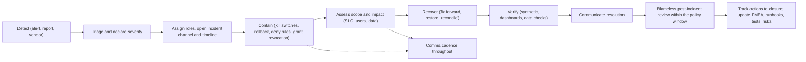

# Incident Management

Doc ID: SUP-INC · Owner: Incident Commander rota lead (SRE Lead) · Version 1.0 · Status: Draft for Review · Relates: PROC-10, PROC-12, RB-01…RB-37, OPS-OBS, OPS-SLO, ADR-T21, INV-T03, INV-T18, BR-T041, OPEN-08, OPEN-16, OPEN-39

No response-time number or rota size is asserted: time-bound targets are placeholders [OPEN-16] to be set once on-call capacity is known. Legal duties (regulatory notification, contractual notice) are decided by Legal/Privacy counsel [OPEN-08]; this document defines when counsel is engaged, not what the law requires.

## 1. Severity matrix

| Sev | Definition (any one criterion) | Examples | Response expectation | Comms | Leadership |
|---|---|---|---|---|---|
| **Sev-1** | **Any cross-tenant data exposure or suspected exposure (ADR-T21)**; confirmed breach of personal data; loss/corruption of durable user data; core service fully unavailable (SLO-01 and SLO-02 failing broadly); security compromise (key, runner escape, admin takeover); integrity of verified evidence undermined | Tenant A sees tenant B applications; verified status forgeable; DB corruption; production credential leak | Page immediately, all hours, IC and Security engaged at once; status page update; executive notification; target times [OPEN-16] | Public status + direct notice to affected parties as Legal advises | Exec sponsor informed; Legal/Privacy engaged |
| **Sev-2** | Major degradation of a core function or one persona; one remote down; SLO fast-burn (ALT-01/02); billing/entitlement errors affecting many; AI/policy breach contained; backup failure | Login errors for subset; recruiter pipeline unusable; webhooks delayed | Page within on-call policy; IC assigned | Status page; support macros | Product + Support leads informed |
| **Sev-3** | Partial degradation with workaround; single-feature issue; slow-burn alert; vendor degradation not affecting core | Email delays; search relevance degraded; moderation backlog | Business-hours handling or ticket; owner assigned | In-app notice if needed | Owner team |
| **Sev-4** | Minor defect, cosmetic, no user harm | Typos, minor UI glitch | Backlog | None | None |

Severity rules: when unsure, declare the **higher** severity and downgrade later. Any incident that involves personal data of more than one tenant, or where a policy/RLS control failed open, is Sev-1 until scope is proven otherwise. Severity can only be lowered by the IC with a note. Security-classified incidents may be restricted-visibility (need-to-know) with a separate channel.

## 2. Roles

| Role | Responsibility | Notes |
|---|---|---|
| Incident Commander (IC) | Owns the incident, assigns roles, decides severity, containment, comms approval, closes | Not hands-on debugging |
| Operations lead | Directs technical investigation and mitigation | Pulls in module owners |
| Security lead | Leads on exposure/compromise; evidence preservation; forensics | Mandatory for Sev-1 exposure |
| Communications lead | Drafts and publishes updates (status page, customers, internal) | Uses templates (§7) |
| Scribe | Maintains timeline, decisions, actions | Time-stamped log |
| Privacy/Legal liaison | Notification assessment, regulator/customer obligations | OPEN-08 |
| Support liaison | Handles inbound tickets with consistent messaging | PROC-03 |
| Subject-matter experts | Module owners, DBA, vendor contacts | |
Handover: roles rotate in long incidents with a written handover; no one works unbounded hours [policy OPEN-16].

## 3. Lifecycle

Principle: **contain before diagnose** when users or data are at risk. Containment levers are pre-built flags and runbook steps (OPS-REL §9.1; RB-24). Evidence preservation (logs, traces, audit export, snapshots) precedes any restart or cleanup when a security incident is possible.

## 4. Cross-tenant exposure procedure (Sev-1; RB-01)

| Step | Action | Owner |
|---|---|---|
| 1 | Declare Sev-1; page Security Lead, IC, API owner, Privacy liaison | On-call |
| 2 | Freeze deployments; preserve evidence (snapshot logs, trace samples, audit entries, config, deployed versions) | Ops lead |
| 3 | Contain: disable the exposing endpoint/module/feature via kill switch or policy deny override; if unclear, move to the L3 read-only rung (OPS-FMEA §2) for affected modules; revoke active privileged grants; invalidate caches/CDN objects that may hold cross-tenant data | IC + Security |
| 4 | Determine scope: which endpoints, which tenants, which records, window start/end from audit and access logs and from deploy history; identify whether data was actually accessed by an unauthorised principal vs merely reachable | Security |
| 5 | Root cause: which control failed (policy, repository filter, RLS, cache key, search index, export) and why FF-01/FF-05 canaries missed it | Engineering |
| 6 | Fix and add regression tests to TEN/SEC suites before re-enabling; run TEST-TEN-001 and mutation-sanity check | QA + Security |
| 7 | Notification decisions with Legal/Privacy: affected tenants/users, regulators and contractual notice (rules [OPEN-08], not assumed here); prepare factual notice | Privacy/Legal + Comms |
| 8 | Customer support script; dedicated contact for affected orgs | Support |
| 9 | Post-incident review shared with affected customers as appropriate; update RISK_REGISTER (RISK-01), fitness functions, and the policy test matrix | SRE + Security |

## 5. Error budgets and incident impact

Each incident records SLO minutes burned. Budget exhaustion triggers the freeze policy in OPS-SLO §10. Incidents that are DR events or declared maintenance overruns are reported separately with exclusion rationale.

## 6. Communications

| Audience | Channel | When | Content rules |
|---|---|---|---|
| Internal | Incident channel, update cadence set by IC | Throughout | Facts, impact, next update time |
| Users | Status page (independently hosted), in-app banner | Sev-1/2 and user-visible Sev-3 | Plain language; what is affected, workaround, next update; no speculation about cause; never confirm security impact before verified |
| Org admins / enterprise | Email to registered contacts, account manager | Sev-1/2 affecting them | Specific impact to their tenant; contract notice rules |
| Affected individuals | Direct notice | When Legal/Privacy decide | Factual, actionable |
| Regulators / authorities | Via Legal only | As advised | Never ad hoc |
| Social/press | Via Comms lead only | Sev-1 public | Approved statement |
Principles: honesty, no blame, no minimisation, consistent messaging across channels, accessibility of notices, update on schedule even when there is nothing new.

## 7. Communication templates (structure)

| Template | Fields |
|---|---|
| Initial notice | Time, what users may notice, which areas, status (investigating), next update time |
| Update | What changed, current mitigation, workaround, next update |
| Resolution | Time resolved, summary, customer action needed (if any), link to follow-up |
| Exposure notice (Legal-approved only) | What happened, what data, when, what we did, what you can do, contact |
| Maintenance notice | Window, expected impact, rollback commitment |

## 8. Post-incident review

| Item | Rule |
|---|---|
| Format | Blameless; contributing factors not "root person"; timeline; detection and response analysis; what worked |
| Timing | Within a policy window after resolution [OPEN-16]; Sev-1 review involves leadership |
| Output | Action items with owner and due date; classified (prevent / detect / mitigate / process); tracked to closure |
| Inputs updated | OPS-FMEA rows, runbooks, alerts/SLOs, tests (TEST-* added), RISK_REGISTER, ADR revisit triggers if relevant |
| Repeat incidents | Escalate to engineering roadmap prioritisation (reliability budget) |
| Sharing | Internal for all; external summary for Sev-1/2 customer-impacting as appropriate |

## 9. Preparedness

| Activity | Purpose |
|---|---|
| On-call model | Paging tool, schedule, escalation policy, follow-the-sun or single-region coverage [OPEN-39, OPEN-16] |
| Game days | Exercise FM rows and runbooks (OPS-FMEA §9, TEST-REL-012) |
| Tabletop for exposure | Annual-style exercise of §4 including legal liaison |
| Access readiness | Break-glass accounts tested; grant tooling works (PROC-04) |
| Contact sheet | Vendors (hosting, Stripe, email, AI, CDN), legal, executives; verified regularly |
| Runbook currency | RB reviews; unproven runbooks flagged (SUP-RUN §3) |
| Tooling independence | Status page and incident comms not hosted on the primary stack |

## 10. Vendor incidents

Treat vendor outages as incidents with the same lifecycle; severity by user impact, not vendor label. Track vendor SLAs and credits (COM-OPS §8). Record in vendor risk register (VR-*).

## 11. Measures

MTTD, MTTA, MTTR by severity; incidents per month by cause; SLO minutes burned; percent of incidents detected by alert vs user report; action-item closure rate; repeat-incident rate (MET-035, MET-036).
