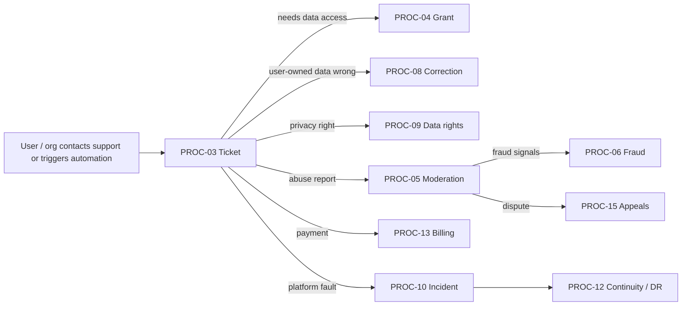
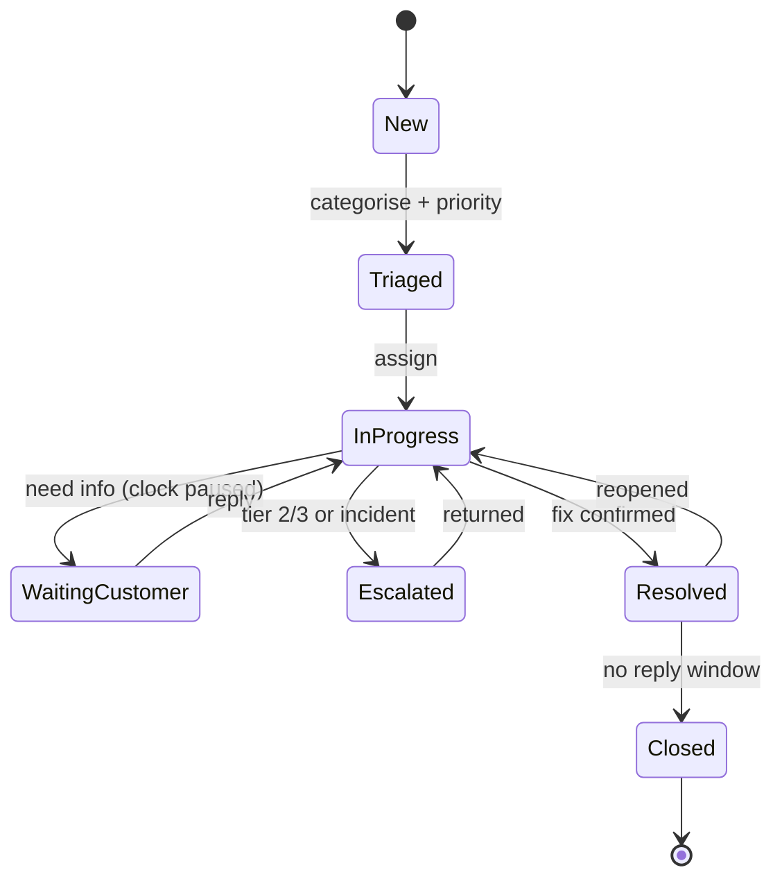

# Operations and Support Processes

Doc ID: SUP-PROC · Owner: Head of Operations (with Security Architect and Support Lead) · Version 1.0 · Status: Draft for Review · Relates: DOM-19, DOM-20, DOM-22, ROLE-SUP, ROLE-ADM, ROLE-MOD, ROLE-AUD, ROLE-ORGADM, ROLE-INSTADM, USR-01 §3–§6, BR-T041, BR-T060, INV-T09, INV-T15, INV-T18, INV-T20, SUP-RUN, SUP-INC, COM-OPS, OPEN-08, OPEN-16, OPEN-32, OPEN-39

Targets such as response times and staffing are **[OPEN-16]**; this document defines structure, permissions, controls and measures, not service levels or headcount. Documentation status is not implementation status; back-office tooling is specified, not built (see `WP-ADMIN-TOOLING`, `WP-SUPPORT-TOOLING` in ROADMAP).

## 1. Process catalogue

| ID | Process | Owner | Primary domain |
|---|---|---|---|
| PROC-01 | User account administration | Support Lead | DOM-01, DOM-20 |
| PROC-02 | Organization and institution administration | Customer Success Lead | DOM-02, DOM-18 |
| PROC-03 | Support ticket handling, SLA and escalation | Support Lead | DOM-20 |
| PROC-04 | Privileged access grant (time-boxed) | Security Lead | DOM-20 |
| PROC-05 | Content moderation | Trust & Safety Lead | DOM-19 |
| PROC-06 | Fraud and abuse handling | Trust & Safety Lead | DOM-19, DOM-16 |
| PROC-07 | Access review | Security Lead | DOM-02, DOM-20 |
| PROC-08 | Data correction | Data Steward | DOM-20 |
| PROC-09 | Data-rights handling (access, export, rectification, erasure, consent) | Privacy Lead | DOM-22 |
| PROC-10 | Incident response and communications | Incident Commander rota | all |
| PROC-11 | Maintenance windows | Release Manager | DOM-24 |
| PROC-12 | Business continuity and disaster recovery | SRE Lead | DOM-24 |
| PROC-13 | Billing disputes, refunds and chargebacks | Finance Ops Lead | DOM-16 |
| PROC-14 | Change and release management | Release Manager | DOM-24 |
| PROC-15 | Appeals (integrity flags, moderation, verification disputes) | Trust & Safety Lead | DOM-07, DOM-19, DOM-06 |
| PROC-16 | Regulator and law-enforcement requests (PROPOSED) | Privacy Lead (counsel review owner: OPEN-X04) | DOM-22, DOM-20 |

Common controls for all processes: actor identity and role are authenticated; consequential actions require reason codes; every action emits an audit event (OPS-OBS §4.2); personal data in tickets follows INV-T14 (redacted attachments, no secrets); decisions affecting a person are made by a human (INV-T09, INV-T20); ticket data is subject to retention and erasure (PROC-09).

## 2. Processes

### PROC-01 User account administration

| Field | Detail |
|---|---|
| Owner | Support Lead |
| Actors | ROLE-SUP (execute), ROLE-ADM (approve sensitive), end user, ROLE-AUD (review) |
| Triggers | User request (lockout, email change, passkey loss, deactivation), abuse outcome (suspend), security event (compromise) |
| Workflow | 1) Authenticate the requester through a challenge that does not reveal account data (verified email/passkey/recovery) 2) Classify action: unlock, credential reset, email change, deactivate/reactivate, suspend, merge duplicates 3) Low-risk self-service actions do not need an operator 4) Operator actions need a ticket and, if personal data is viewed, an active grant (PROC-04) 5) Execute through admin tooling (never direct SQL) with reason code 6) Notify the account holder via verified channel 7) Sessions revoked when credentials change (BR-T050) 8) Close ticket |
| Permissions | SUP: unlock, trigger credential reset, view account metadata (not content) without grant; deactivate/suspend requires ADM or Trust & Safety decision; merges require ADM + user confirmation |
| Exceptions | Cannot verify identity → no change, escalate to PROC-03 level 2 with out-of-band verification rules; suspected takeover → RB-27 and PROC-10; legal hold → no deletion |
| Metrics | Time to resolve lockout, % self-service, account-takeover recovery time, wrongful-suspension reversal rate |
| Audit events | `audit.account.unlock`, `.credential_reset_triggered`, `.email_changed`, `.suspended`, `.reactivated`, `.merged`, each with actor, reason, ticket id |
| Recovery | Every action reversible except merges (merge requires snapshot and rollback procedure through PROC-08) |

### PROC-02 Organization and institution administration

| Field | Detail |
|---|---|
| Owner | Customer Success Lead |
| Actors | ROLE-ORGADM, ROLE-INSTADM, ROLE-SUP, Customer Success, ROLE-ADM |
| Triggers | New customer onboarding, seat change, member add/remove, SSO setup, cohort import, offboarding/contract end |
| Workflow | 1) Contract/entitlement confirmed by Commercial Ops (COM-OPS) 2) Tenant created with `org_id` and RLS defaults; first org_owner invited through verified email 3) Org owner configures roles (`org_owner`, `org_admin`, `recruiter`, `hiring_manager`, `viewer`; institution roles `inst_admin`, `faculty`, `proctor`) 4) SSO configured and tested with break-glass admin 5) Cohort imports are staged, validated, previewed, then committed with learner consent flows intact (learner owns identity, ADR-T21 / business model guardrail) 6) Offboarding: export offered, seats ended, learner accounts detached not deleted 7) Quarterly role review prompts (PROC-07) |
| Permissions | Org admins manage members within their tenant only; Support has metadata access, content access via PROC-04; cross-tenant operations are not permitted for any role except ROLE-ADM via audited grant |
| Exceptions | Seat overage, domain ownership dispute, merged organizations, cohort data errors (stage rollback), SSO lockout (break-glass) |
| Metrics | Time to first successful tenant setup, SSO setup success rate, seat utilisation, import error rate, access-review completion |
| Audit events | `audit.org.created`, `.member_added/removed`, `.role_changed`, `.sso_configured`, `.cohort_imported`, `.offboarded` |
| Recovery | Cohort import is transactional per batch with undo window; role changes revertible; tenant deactivation is soft with retention window |

### PROC-03 Support ticket handling, SLA and escalation

| Field | Detail |
|---|---|
| Owner | Support Lead |
| Actors | End users, org admins, ROLE-SUP tiers 1–2, engineers (tier 3), Incident Commander |
| Triggers | In-app "Get help" (carries support code from trace id), email, status-page contact, internal escalation |
| Workflow | 1) Intake: categorise (account, billing, verification, assessment, hiring, bug, privacy, abuse, other), priority from impact × urgency 2) Auto-routes privacy requests to PROC-09, abuse to PROC-05, payment to PROC-13, suspected exposure to PROC-10 3) Tier 1 resolves with macros/knowledge base; no personal-data view without need 4) Tier 2 may request grant (PROC-04) 5) Tier 3 engineering via defect with reproduction and trace id 6) Customer updated at each state; resolution confirmed 7) CSAT optional; feed top issues to product |
| SLA structure | Priority P1 (service-wide/security/data exposure) → immediate, handled via PROC-10; P2 (core loop blocked for an account) ; P3 (degraded); P4 (question). First-response and resolution targets per priority and per plan tier: [OPEN-16]. Clocks pause only in "waiting for customer" state |
| Escalation | Breach-risk at a fraction of the SLA triggers lead notification; repeated contact or VIP org flags raise priority; P1/security always escalate to Incident Commander; never escalate by sharing credentials |
| Permissions | Tier 1: metadata + ticket; Tier 2: scoped by grant; Tier 3: no production data access except via incident procedures |
| Exceptions | Abusive users (apply policy), legal/regulator requests (route to Legal, OPEN-08), minors (OPEN-09), accessibility help requests (priority treatment) |
| Metrics | First-response time, time to resolution, SLA attainment, reopen rate, tickets per 1k MAU, top contact reasons, CSAT |
| Audit events | `audit.ticket.created/escalated/closed`, `.data_viewed` (with grant id) |
| Recovery | Backlog surge: triage banner, macros, temporary priority freeze rules, staff reallocation (OPEN-16); ticket system outage: fallback mailbox and status page |

### PROC-04 Privileged access grant

| Field | Detail |
|---|---|
| Owner | Security Lead |
| Actors | Requestor (ROLE-SUP/ROLE-ADM/engineer), approver (different person), subject user/org (notified where allowed), ROLE-AUD |
| Triggers | Ticket needs personal data; incident diagnosis; data correction; legal request |
| Workflow | 1) Requestor submits grant with scope (user/tenant/resource), purpose, ticket id, reason code, duration ≤ 4 h (BR-T041) 2) Approver (not the requestor) reviews; automatic approval allowed only for pre-approved low-risk scopes defined by policy 3) Grant issued as a scoped token bound to requestor; access performed through audited read paths (no raw SQL) 4) Subject notification policy: notify user when allowed (not when legally restricted or security-sensitive) 5) Grant auto-expires; early revoke possible 6) Weekly sampling review of grants by Security; anomalies alert (ALT-19) |
| Permissions | No role can self-approve; admins cannot approve their own grants; break-glass emergency path for SEV-1 allows immediate access with after-the-fact review within one business day |
| Exceptions | Grant extension needs new approval; cross-tenant scopes need Security Lead approval; production DB console access is a separate engineering break-glass with session recording |
| Metrics | Grants per week by scope, mean duration, % with approver, expired-without-use, break-glass count, review completion |
| Audit events | `audit.grant.requested/approved/denied/issued/used/expired/revoked`, `audit.data.read` with grant id |
| Recovery | Revoke all active grants (kill switch) in an incident; grant system outage → manual approval log reconciled later |

### PROC-05 Content moderation

| Field | Detail |
|---|---|
| Owner | Trust & Safety Lead |
| Actors | ROLE-MOD, reporters, content owners, ROLE-ADM (escalation), automated detectors (advisory only) |
| Triggers | User report, automated signal (spam heuristics, policy classifier), proactive sampling of job postings, course content, profiles, messages (flagged only) |
| Workflow | 1) Report/signal creates a case in the moderation queue (DOM-19) with content snapshot 2) Prioritise by harm class (safety/illegal > fraud/scam > harassment > quality) 3) Moderator reviews with the minimum necessary context; flagged messaging only visible if reported 4) Decision from the action ladder: no action, warn, limit visibility, take down, suspend (suspend needs PROC-06/ADM) 5) Notify the content owner with reason and appeal link (PROC-15) 6) Record outcome; repeat-offender tracking 7) Automated detectors never take final adverse actions (INV-T09) |
| Permissions | MOD: read flagged content, act on content; no access to unrelated personal data; CRUD on moderation queue per USR-01 |
| Exceptions | Illegal content (escalate to Legal; preserve evidence), minors (OPEN-09), coordinated campaigns (PROC-06), moderator conflict-of-interest recusal, reporter abuse |
| Metrics | Queue age, time to action, reversal-on-appeal rate, false-positive rate of detectors, repeat offences, reports per 1k users |
| Audit events | `audit.moderation.case_opened/decision/takedown/restore`, `.appeal_opened` |
| Recovery | Wrongful takedown restore path; queue surge handled by RB-32 |

### PROC-06 Fraud and abuse handling

| Field | Detail |
|---|---|
| Owner | Trust & Safety Lead |
| Actors | T&S analysts, ROLE-MOD, ROLE-ADM, Finance Ops, Security, Legal |
| Triggers | Fake employer/job scams, fake credentials/evidence gaming, bot signups, payment fraud, referee collusion, referral abuse, scraping |
| Workflow | 1) Detection from signals (velocity, duplicate artefacts, disposable domains, mismatched referee patterns, chargebacks) as **advisory** 2) Analyst investigates with grant if personal data needed 3) Decision by human: restrict (rate limits, hold), remove content, suspend account, revoke evidence (triggers BR-T005 recompute), block payment 4) Reporter/victim notified as appropriate 5) Patterns fed into rules after review (rules reviewed for fairness, ANL-MET §7) 6) Appeals via PROC-15 |
| Permissions | Analysts: read signals and flagged records; ROLE-ADM executes suspensions; no automated ranking-out or banning (INV-T09, INV-T20) |
| Exceptions | Law-enforcement requests via Legal only; false-positive protection for shared networks; sensitive-class (minors) escalation |
| Metrics | Confirmed-fraud rate, time to contain, false-positive rate, chargeback rate, evidence revocations due to fraud |
| Audit events | `audit.fraud.signal_reviewed`, `.account_restricted`, `.evidence_revoked`, `.payment_blocked` |
| Recovery | Reinstatement workflow; evidence re-verification path |

### PROC-07 Access review

| Field | Detail |
|---|---|
| Owner | Security Lead |
| Actors | Org owners (tenant roles), platform Security (platform privileged roles), ROLE-AUD |
| Triggers | Quarterly org prompt, monthly platform review (USR-01 §6), role-change events, departures |
| Workflow | 1) System generates review list: members, roles, last activity, privileged grants 2) Reviewer confirms/changes/removes 3) Non-response reminders; unresolved items escalate 4) Dormant privileged grants auto-expire after 60 days (USR-01 §6) 5) Evidence of review stored 6) Findings (excess access) become remediation tasks |
| Permissions | Org owners: own tenant; Security: platform roles; Auditor read-only |
| Exceptions | Org owner unavailable → Customer Success contact verified; contractor accounts have shorter terms |
| Metrics | Completion rate, time to remediate, number of dormant privileged accounts, revoked-access count |
| Audit events | `audit.access_review.opened/completed`, `.role_removed` |
| Recovery | Accidental removal reversible via role history |

### PROC-08 Data correction

| Field | Detail |
|---|---|
| Owner | Data Steward |
| Actors | ROLE-SUP (request), Data Steward (execute), ROLE-ADM (approve high impact), data subject |
| Triggers | Data defect (system fault), user-reported error that cannot be self-edited, migration reconciliation discrepancy, rectification request (PROC-09) |
| Workflow | 1) Ticket with proposed change, impact, and evidence 2) Decide whether the user can self-correct (preferred; no operator edits to a person's claims) 3) For system faults: write a reviewed, idempotent correction script/tool action, dry-run in staging, run in production via pipeline or audited admin action 4) Corrections never alter verification status/evidence rung by operator edit (INV-T04) — they must trigger the proper verification transition or revoke 5) Before/after summary recorded; subject notified when personal data changed 6) Post-check queries |
| Permissions | No ad-hoc SQL; execution via approved tooling with grant (PROC-04); two-person rule for bulk changes |
| Exceptions | Corrections affecting billing/legal records route to Finance/Legal; mass corrections treated as change (PROC-14) |
| Metrics | Corrections per month by cause (feeds defect reduction), time to correct, errors introduced |
| Audit events | `audit.data.correction_requested/approved/applied` with diff summary |
| Recovery | Pre-change snapshot; compensating script; PITR as last resort (RB-30) |

### PROC-09 Data-rights handling

| Field | Detail |
|---|---|
| Owner | Privacy Lead |
| Actors | Data subject, org employee (via org admin for employer-held data), ROLE-SUP assist, Privacy Lead, Legal (OPEN-08), engineering automation |
| Triggers | Access/export, rectification, erasure, restriction, consent change/withdrawal, objection to automated processing (human-review right) |
| Workflow | 1) Intake in account (authenticated) or via verified channel 2) Identity verification proportionate to risk 3) Create request with state machine (received → verified → in progress → completed/partially completed/refused) 4) Export: orchestrated job across modules produces a machine-readable package, delivered through authenticated download 5) Erasure: deletion/pseudonymisation across Postgres, object storage, search index, caches, analytics, email suppression retained as necessary; retained records (audit, billing, legal) listed in retention list [OPEN-08]; append-only audit/consent history is not rewritten (opaque `subject_ref`; the identity mapping is deleted, DB-02 §4.1); completion within 30 days (BR-T060; internal target SLO-24) 6) Backups age out by policy; restore re-applies tombstones 7) Confirmation to subject with what was retained and why 8) Org-held data (applications held by recruiters) handled by rule: candidate-owned vs employer-record boundary [OPEN-08] |
| Permissions | Support cannot access beyond request scope; Privacy Lead approves refusals/partials; no deletion if legal hold |
| Exceptions | Unverifiable requester, excessive/repeat requests (policy), minors (OPEN-09), conflict with legal retention, institution-owned records |
| Metrics | Time to completion, % within internal target, requests by type, partial/refusal rate, export size/time |
| Audit events | `audit.privacy.request_received/verified/completed`, `.erasure_step_completed`, `.refused` |
| Recovery | Failed steps retried idempotently; pause with backlog alert (RB-28); evidence package regenerated if corrupted |

### PROC-10 Incident response and communications

| Field | Detail |
|---|---|
| Owner | Incident Commander rota (SRE-led) |
| Actors | Incident Commander (IC), Ops lead, Comms lead, Scribe, Security Lead, Support Lead, Legal (as needed) |
| Triggers | Page from alert (OPS-OBS §6), support escalation, security report, vendor notice |
| Workflow | Defined in SUP-INC: detect → declare severity → assign roles → contain → assess → recover → communicate → postmortem; cross-tenant exposure = Sev-1 |
| Permissions | IC may authorise break-glass access (PROC-04) and invoke kill switches; major customer comms approved by Comms lead + IC; breach notification decisions by Legal/Privacy (OPEN-08) |
| Exceptions | Vendor outage (RB per vendor), security incident with legal hold, unclear severity (declare higher, downgrade later) |
| Metrics | MTTD, MTTA, MTTR (by severity), SLO budget burned by incident, postmortem completion, action-item closure |
| Audit events | `audit.incident.declared/severity_changed/resolved`, `.breakglass_used` |
| Recovery | Handover protocol for long incidents; DR via PROC-12 |

### PROC-11 Maintenance windows

| Field | Detail |
|---|---|
| Owner | Release Manager |
| Actors | Release Manager, SRE, Support Lead (comms), Customer Success (enterprise notice) |
| Triggers | Planned change that may cause user-visible impact (contract migrations, database major upgrade, hosting change, certificate/key rotation) |
| Workflow | 1) Prefer zero-downtime patterns (expand/contract) so windows are rare 2) Proposal with impact, duration estimate, rollback, runbook, owner 3) Choose a window by lowest-impact analysis (use aggregated usage telemetry) 4) Notify users/orgs in advance via banner, email and status page (lead time per policy [OPEN-16]) 5) Execute through PROC-14 with go/no-go checkpoints 6) Verify with synthetic + dashboards 7) Close with notice and measure vs SLO exclusion cap |
| Permissions | Release Manager schedules; IC authority transfers if the window turns into an incident |
| Exceptions | Emergency maintenance (security patch) with short notice; window overrun → rollback decision at pre-set checkpoint |
| Metrics | Windows per quarter, overrun rate, SLO minutes consumed, complaint count |
| Audit events | `audit.change.window_scheduled/started/completed` |
| Recovery | Rollback criteria and time-box agreed beforehand |

### PROC-12 Business continuity and disaster recovery

| Field | Detail |
|---|---|
| Owner | SRE Lead |
| Actors | SRE, Incident Commander, Security, Legal/Comms, Finance (vendor continuity), Customer Success |
| Triggers | DR declaration (T2–T5 in OPS-DEP §7), vendor failure, key-person loss, facility/account compromise |
| Workflow | 1) Maintain BCP: critical services ranking (auth, evidence access, consent, billing webhooks), dependencies and alternates 2) Annual/regular DR exercises (cadence [OPEN-15]) with measured RPO/RTO 3) Declare DR (IC decision), execute RB-31, communicate through out-of-band channels (status page hosted separately, email list, alternate chat) 4) Operate in degraded mode per OPS-FMEA ladder 5) Restore, reconcile (billing RB-34, queues), validate with synthetic and data checks 6) Return to normal and review |
| Permissions | DR actions use break-glass accounts stored in a separate secure location; two-person control |
| Exceptions | Provider account compromise (T5) → rebuild in clean account using off-account backups; key-person dependency mitigated by runbooks and cross-training |
| Metrics | Exercise pass rate, measured RTO/RPO vs target, age of last successful restore, runbook freshness |
| Audit events | `audit.dr.declared/exercise_completed/failover_executed` |
| Recovery | Failback plan documented per scenario |

### PROC-13 Billing disputes, refunds and chargebacks

| Field | Detail |
|---|---|
| Owner | Finance Ops Lead |
| Actors | Customer, ROLE-SUP, Finance Ops, ROLE-ORGADM (billing contact), Stripe |
| Triggers | Refund request, double charge, failed payment, chargeback, course purchase dispute, invoice question |
| Workflow | 1) Ticket categorised billing; identity verified 2) Check entitlements derived from Stripe state (never a UI claim) 3) Decide per refund policy (COM-OPS §5) 4) Execute refund/credit in the billing system (not by editing entitlements) 5) Entitlement changes arrive through verified webhook (INV-T17) 6) For chargebacks: gather evidence package (access logs scoped, delivery proof) within provider deadline 7) Reconcile (COM-OPS §7) 8) Update customer |
| Permissions | Finance Ops executes refunds up to a limit [OPEN-33]; above limit needs approval; Support cannot issue refunds directly |
| Exceptions | Course instructor revenue share impacts (OPEN-06), tax adjustments (OPEN-18), fraud-related chargebacks (PROC-06) |
| Metrics | Refund rate, chargeback rate and win rate, time to resolve, reconciliation breaks |
| Audit events | `audit.billing.refund_issued`, `.chargeback_responded`, `.entitlement_reconciled` |
| Recovery | Reverse errant credit via counter-entry; reconciliation job corrects drift (TEST-BIL-006) |

### PROC-14 Change and release management

| Field | Detail |
|---|---|
| Owner | Release Manager |
| Actors | Engineers, Release Eng, SRE, QA, Security (for R1), Product |
| Triggers | Any production change: release, config, flag, infrastructure, schema |
| Workflow | Per OPS-REL: classify change (standard/normal/emergency/high-risk), pass gates RG-01…RG-14, canary, progressive rollout, post-release verification, record in release log; emergency changes get retrospective |
| Permissions | Pipelines deploy; humans approve; direct production edits forbidden outside break-glass |
| Exceptions | Hotfix path (OPS-REL §11), freeze periods (error-budget freeze, SLO policy) |
| Metrics | Change failure rate, lead time, deployment frequency, rollback rate (MET-039, MET-040), gate waivers |
| Audit events | `audit.change.deployed/rolled_back`, `.flag_changed`, `.gate_waived` |
| Recovery | Rollback per OPS-REL §10 |

### PROC-15 Appeals

| Field | Detail |
|---|---|
| Owner | Trust & Safety Lead |
| Actors | Affected person/org, independent reviewer (not the original decider), Privacy Lead, ROLE-ADM |
| Triggers | Integrity flag outcome, moderation action, evidence revocation, verification dispute, account suspension, objection to automated processing |
| Workflow | 1) Appeal submitted in-product or ticket, with reason and optional new evidence 2) Acknowledge and freeze irreversible follow-on effects where safe 3) Independent human review 4) Decision with reason; reverse/uphold/modify 5) If reversed: restore state, recompute dependent data (BR-T005), correct records 6) Record for fairness analysis (ANL-MET §7) |
| Permissions | Reviewer cannot be the original decider; ADM final escalation |
| Exceptions | Legal-hold items; safety-critical content stays down during review |
| Metrics | Time to decision, reversal rate, repeat-appeal rate, disparate outcome checks |
| Audit events | `audit.appeal.opened/decided`, `.state_restored` |
| Recovery | Restoration workflow tested (TEST-MSG-002) |

### PROC-16 Regulator and law-enforcement requests (PROPOSED, patch 2026-10-27)

Procedure skeleton only. It states who does what, not what the law requires: legal basis, jurisdiction, deadlines, notice-to-user duties and what may be disclosed all need counsel verification. **Counsel review owner is an open decision (OPEN-X04).** No contact, authority or deadline is asserted. Added to the catalogue as row PROC-16 (owner: Privacy Lead with Legal liaison, domain DOM-22/DOM-20).

| Field | Detail |
|---|---|
| Owner | Privacy Lead (accountable), Legal liaison (counsel review owner: OPEN-X04) |
| Actors | Privacy Lead, Legal liaison/counsel, Security Lead, Data Steward (extract), Incident Commander if linked to an incident, executive sponsor (escalation) |
| Triggers | Written request from a regulator, court, police or other authority, or a preservation request, received through any channel |
| Workflow | 1) **Single intake**: any recipient (support, engineer, executive) forwards the request unanswered and undisclosed to the Privacy Lead; nobody replies or exports data on their own 2) Log and acknowledge receipt only; `audit.legal.request_received` 3) Verify authenticity out of band via a channel found independently, never from contact details in the request 4) Counsel reviews validity, jurisdiction, scope, whether the user may be told, and whether a legal hold applies 5) Decide: comply in full, comply in part (narrow scope), challenge, or decline; written decision with reason (`audit.legal.request_reviewed`) 6) If complying: the Data Steward produces the minimum scoped extract under a time-boxed grant (PROC-04), reviewed by a second person; no bulk or direct database access for the requester 7) Deliver through the counsel-approved secure channel; record what was sent (`audit.legal.request_answered`) 8) Notify the affected user if counsel confirms it is allowed and appropriate; otherwise record the reason for non-notice 9) Close, retain the file per counsel, include in the transparency summary if one is published [OPEN-X04] |
| Permissions | Requests handled by named roles only; separation of duties: requester of the extract != approver; platform admins cannot self-approve |
| Exceptions | Emergency requests: counsel-defined fast path, still logged and after-the-fact reviewed; request conflicts with another jurisdiction: escalate to counsel; request touches another tenant's data: out of scope unless counsel directs; suspected abuse of the process: Sev-2 and Security Lead |
| Metrics | Count by type, outcome mix (full/partial/declined), time to counsel decision, extracts with second-review done |
| Audit events | `audit.legal.request_received/reviewed/answered/declined` |
| Recovery | Wrong disclosure: treat as a personal-data incident under PROC-10/INCIDENT_MANAGEMENT (Privacy/Legal liaison role) |
| Related | PROC-09, PROC-10, PROC-04, `../14_SECURITY_PRIVACY_COMPLIANCE/SECURITY_ARCHITECTURE.md` R3-8, OPEN-08 |

## 3. Cross-process RACI (summary)

| Activity | Support | Security | Privacy | T&S | Finance | SRE | Release | Legal |
|---|---|---|---|---|---|---|---|---|
| Account unlock | R | I | — | C | — | — | — | — |
| Privileged grant | R (request) | A | C | — | — | — | — | C |
| Erasure | C | C | A | — | C | C | — | C |
| Takedown | I | I | — | A/R | — | — | — | C |
| Refund | C | — | — | — | A/R | — | — | I |
| Sev-1 incident | C | R | C | I | I | A/R | C | C |
| Maintenance | I | C | — | — | — | R | A | — |
(R responsible, A accountable, C consulted, I informed.) Staffing for each role is [OPEN-16] and may be combined in a small team provided separation of duties in PROC-04, PROC-13 and PROC-15 is preserved.
