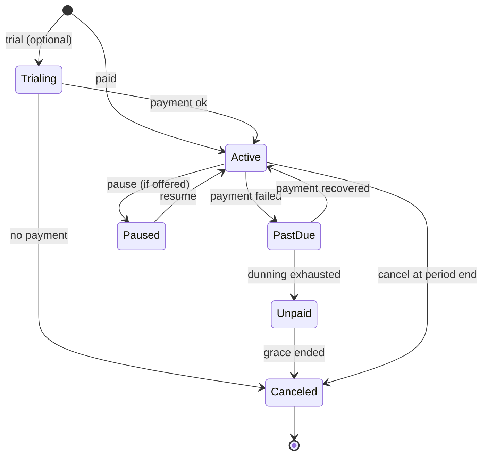

# Commercial Operations

Doc ID: COM-OPS · Owner: Head of Commercial Operations (with Finance Ops Lead and Product Director) · Version 1.0 · Status: Draft for Review · Relates: STR-01 §4–§7, DOM-16, DOM-18, DOM-15, ADR-T15, ADR-T20, ADR-T22, INV-T07, INV-T17, INV-T19, BR-T060, PROC-02, PROC-13, FIN-COST, ANL-MET, OPEN-05, OPEN-06, OPEN-18, OPEN-19, OPEN-26, OPEN-33, OPEN-34

**Course commerce scope (REVW-30, binding decision):** Phase 2 sells **first-party (platform-sold) courses only**: the platform is the seller of record, content is authored under contract or licence, and no payout, connected-account or seller-KYC flow exists in the product. A **third-party paid marketplace is deferred to Phase 3** and is gated by an ADR on seller of record, payouts, tax/VAT and refunds (outline in section 13A). Rows below that mention instructors, revenue share or payouts describe the Phase 3 design intent and are **not active in Phase 2**.

All prices, rates, thresholds, durations and revenue-share percentages are **[OPEN]**; none is proposed here. This document defines structures, rules and processes. Tax, consumer-protection and marketing-law questions require qualified advice (OPEN-08, OPEN-18); nothing here is legal advice.

## 1. Commercial guardrails (binding from the product constitution)

| Guardrail | Source | Operational consequence |
|---|---|---|
| Never rank by payment | ADR-T22, INV-T19 | Entitlements may gate *quotas and tools*, never ranking inputs; sales may not sell "boosted" placement |
| Core candidate loop is always free: evidence, applying, messaging | STR-01 §5 | Candidate paywalls limited to premium tools, extra variants, AI quota |
| Redirect success grants nothing | INV-T17 | Support and Sales cannot "manually unlock" bypassing billing state; corrections go through billing actions |
| Free users never cause paid AI inference unless budget policy allows | INV-T07 | AI add-ons are quota products with caps |
| Learner owns career identity after graduation | STR-01 §5 | Institution contracts cannot claim ownership of learner data; offboarding detaches |
| Consent-bound verification services | STR-01 §5 | Bulk verification products require per-person consent flows |
| No autonomous adverse decisions | INV-T09 | No "auto-reject" packaged as a premium feature |

## 2. Pricing and packaging structure [OPEN-19, OPEN-05]

Entitlement dimensions are fixed by design; **values per tier are placeholders**.

| Segment | Tier (names illustrative) | Price | Entitlement dimensions | Always included |
|---|---|---|---|---|
| Candidate | Free | none | evidence, apply, message (consented threads), basic resume variants, basic career insights | Core loop |
| Candidate | Plus | [OPEN] per period | extra resume variants, advanced analytics, AI quota [value OPEN], priority exports | Core loop |
| Employer | Team | [OPEN] per seat per period | seats, active job slots [N OPEN], verified-search quota [N OPEN], outreach quota [N OPEN], ATS pipelines | Equal ranking treatment |
| Employer | Business | [OPEN] | higher quotas, SSO, audit export, API access (DOM-23, later) | Equal ranking treatment |
| Employer | Enterprise | [OPEN] custom contract | negotiated quotas, SLA addendum (OPEN-31), DPA, dedicated support | Equal ranking treatment |
| Institution | Cohort | [OPEN] per seat/cohort | seats, cohort analytics (k-anonymous), course/assessment authoring | Learner ownership |
| Institution | Campus | [OPEN] | multi-department, SSO, advanced analytics, API | Learner ownership |
| Course commerce (Ph2: first-party courses only) | One-off / path | [OPEN] set by the platform (Ph2). Instructor-set pricing applies only after the Ph3 marketplace ADR (section 13A) | access to course/path | Refund policy |
| Verification services (later) | Usage-based | [OPEN] | bulk employment verification with consent | Consent-bound |

Packaging rules: each tier maps to a **plan catalogue entry** with immutable version; changes create a new version with grandfathering rules (OPEN-19); entitlements are computed server-side from subscription state (ADR-T15); quotas reset on defined period boundaries; overage policy (hard stop vs paid add-on) per quota [OPEN-19]; trials and promotional codes: allowed with expiry and abuse limits; **Candidate-facing discounts must not create ranking differences**.

Margin policy: gross margin target is [OPEN-05]; AI quotas are sized from the cost model so each paid tier clears the target (FIN-COST §4).

## 3. Billing operations

| Topic | Design |
|---|---|
| Processor | Stripe only (ADR-T15): Checkout for purchase, Customer Portal for self-service, Billing for subscriptions/invoices, webhooks authoritative |
| Source of truth | Local subscription/entitlement state derived from verified webhooks; reconciled against Stripe (§7) |
| Objects | Customer (principal or org), Product/Price (plan catalogue), Subscription, Invoice, Payment method, Credit note, Refund, Dispute |
| B2B invoicing | Org billing contact; invoice terms, purchase-order reference, tax IDs captured; payment by card or invoice terms per Enterprise contract [OPEN-19] |
| Currency | Supported currencies and display rules [OPEN-18] |
| Plan changes | Upgrade immediate with proration rules; downgrade at period end [policy OPEN-19]; seat changes via org admin (PROC-02) |
| Idempotency | All billing writes idempotent (INV-T10); webhook handlers dedupe by event id (TEST-BIL-002) |
| Records | Invoices, credit notes and payment records retained per retention list [OPEN-08]; erasure retains required financial records (BR-T060) |
| PCI scope | Card data handled only by Stripe-hosted surfaces; platform never sees PAN (reduced scope, ADR-T15) |
| Customer self-service | View invoices, update payment method, cancel, download receipts via Customer Portal (reduces support load) |

Entitlement mapping: Active/Trialing → plan entitlements; PastDue → full entitlements during grace (length [OPEN-19]) with in-app notice; Unpaid/Canceled → free-tier entitlements; no user data is deleted by billing state (TEST-BIL-004).

## 4. Dunning

| Stage | Trigger | Action | Customer message |
|---|---|---|---|
| D0 | First failed payment | Provider smart retries per schedule [OPEN-19]; in-app banner for billing contact | Friendly notice with update-payment link |
| D1 | Retry failures continue | Email billing contact (org: all billing contacts); candidate: email + in-app | Specific next-retry date and consequence |
| D2 | Grace period end approaching | Warning; sales-assist/customer success outreach for B2B above a threshold [OPEN] | Clear date features will downgrade |
| D3 | Dunning exhausted | Downgrade to free-tier entitlements; keep data; seats suspended not deleted | What changed, how to restore |
| D4 | Long unpaid | Account remains; contract follow-up for Enterprise | — |
Rules: communications are transactional (not marketing) and respect suppression lists; never threaten data deletion contrary to retention policy; keep tone accessible; measure recovery rate (MET-031 area: churn by involuntary reason).

## 5. Refunds, credits and disputes

| Case | Policy structure (values [OPEN-33]) | Owner | Evidence |
|---|---|---|---|
| Subscription refund within a defined window | Pro-rata or full per rule; Support cannot issue directly | Finance Ops | PROC-13 |
| Course purchase refund | Rule based on progress/consumption and time since purchase; instructor revenue-share adjustment (OPEN-06) applies only after the Ph3 marketplace ADR; in Ph2 the platform is the seller and no payout adjustment exists | Finance Ops + Content Ops | Enrolment progress data |
| Duplicate/accidental charge | Immediate refund | Finance Ops | Provider record |
| Service failure credit | Credit note per SLA addendum (Enterprise) | Customer Success + Finance | Incident record |
| Chargeback | Respond within provider deadline with evidence package | Finance Ops | Scoped access/delivery logs |
| Abuse/fraud | Refuse or reverse per fraud decision (PROC-06) | T&S + Finance | Case file |
Refund execution changes billing state; entitlements follow via webhook (INV-T17). All refunds audited (`audit.billing.refund_issued`). Consumer-rights obligations vary by region and are determined with counsel (OPEN-08).

## 6. Tax [OPEN-18]

| Question | Options | Decision owner |
|---|---|---|
| Who is the seller of record and which jurisdictions are in scope at launch | Direct seller with a tax-calculation service; merchant-of-record provider; restrict sales to limited regions initially | Finance + Legal |
| Calculation | Provider tax engine (e.g. Stripe Tax-class) vs separate tax service vs manual for B2B | Finance |
| Collection and remittance, VAT/GST registration thresholds, invoicing formats | Determined with tax advisor | Finance |
| B2B tax IDs and reverse charge | Capture and validate tax IDs at checkout and in org settings | Finance |
| Education/course specifics | Varies by region; advisor input | Finance + Legal |
| Display | Tax-inclusive vs exclusive pricing by region | Product + Finance |
No tax rates or thresholds are stated in this documentation.

## 7. Reconciliation

| Reconciliation | Frequency | Compares | Output | Action |
|---|---|---|---|---|
| Entitlement vs subscription | Continuous job + daily report | Local entitlements vs Stripe subscription status | Drift list | Auto-repair through audited billing action; unresolved → RB-34 |
| Payments vs invoices vs ledger | Daily/monthly | Stripe balance transactions vs finance ledger | Breaks list | Finance investigates |
| Payouts (instructor revenue share): **Ph3 only, not active in Ph2** | Per payout cycle | Course sales vs payable amounts | Payout statements | Approval before payout [OPEN-06] |
| Refunds/chargebacks | Weekly | Provider events vs support tickets | Exceptions | PROC-13 |
| Tax | Per filing cycle | Tax collected vs reported | Tax report | Finance/advisor |
| Webhook completeness | Daily | Provider event log vs processed events | Missing event list | Replay (idempotent) |
Targets: reconciliation breaks resolved within a set period [OPEN-16]; unexplained breaks are escalated to Finance lead. Outputs feed MET-032.

## 8. Vendor management and vendor risk register

Process: vendor intake (security + privacy review, DPA/sub-processor listing, data-flow diagram, exit plan) → approval → inventory → annual review → offboarding (data return/deletion proof). Every vendor sits behind a **port** (ADR-T20, ADR-T12, ADR-T15) so replacement is feasible. Vendor SLAs and contracts are recorded; credit claims tracked. Sub-processor list is maintained and published as legally required (OPEN-34).

| ID | Vendor / category | Data shared | Criticality | Key risks | Mitigation / port | Exit plan | Owner |
|---|---|---|---|---|---|---|---|
| VR-01 | Stripe (payments) | Customer identifiers, payment metadata (no card data held by us) | High (revenue) | Outage; webhook delays; account hold; dispute handling; processor concentration | Webhook-authoritative design; reconciliation; last-known-entitlement; contingency account preparation [OPEN] | Alternate processor integration is out of launch scope (ADR-T15); data export from Stripe | Finance Ops |
| VR-02 | Email provider (Brevo default) | Recipient email, message content | High (verification, referee flows) | Deliverability, outage, account suspension, compliance of marketing sends | Provider port; transactional vs marketing separation [OPEN-26]; breaker; secondary provider option | Swap provider via port; DKIM/SPF re-setup runbook | Messaging owner |
| VR-03 | Push services (browser vendors' Web Push) | Subscription endpoints | Medium | iOS constraints; endpoint expiry | Fallback to email/in-app; pruning | n/a | Messaging owner |
| VR-04 | AI model provider(s) | Prompts/outputs (minimise personal data) | Medium–High | Cost overrun, data retention at vendor, model change, outage, policy violations | AI gateway only path (ADR-T12); budgets; data minimisation; no-training/no-retention terms where available [OPEN-24]; multi-provider abstraction | Switch via gateway | AI owner |
| VR-05 | Hosting / cloud / managed Postgres | All data | Critical | Region outage, account compromise, HA gaps, lock-in | Hosting decision matrix (OPS-DEP §6); IaC; off-account backups | Rebuild in alternate provider from IaC + backups (T5) | SRE Lead |
| VR-06 | CDN / edge | Public assets, request metadata | High | Outage, cache poisoning, config error | Embedded fallback manifest; second origin; signed manifests | Change CDN via DNS/IaC | Platform |
| VR-07 | Observability vendor (if SaaS) | Telemetry (redacted) | Medium | Data leakage, cost, outage | Redaction at collector; OTel portability (ADR-T16) | Re-point exporters | SRE |
| VR-08 | Identity providers for customer SSO | Auth assertions | Medium | IdP outage; misconfiguration | Break-glass; SAML/OIDC validation tests | n/a (customer's) | Identity owner |
| VR-09 | Malware scanning engine | Uploaded files | High (BR-T003) | Detection gaps; outage | Scanner behind port; fail closed | Swap engine | Platform |
| VR-10 | Proctoring / identity-verification vendor (if adopted) | Biometric/ID data (sensitive) | High | Privacy, bias, retention, accuracy | Vendor-gated, consent, human review, DPIA-style review (OPEN-10, OPEN-28) | Disable feature | Product + Privacy |
| VR-11 | Support tooling (helpdesk) | Ticket contents (PII) | Medium | Data exposure; retention | Redaction, access control, retention config (OPEN-38) | Export tickets | Support Lead |
| VR-12 | Status page provider | Incident text | Medium | Co-failure with primary | Independent hosting | Static fallback page | SRE |
| VR-13 | Feature-flag / config provider (if bought) | Flag state, user keys | Medium | Outage → default values | Safe defaults, local cache (OPEN-35) | Re-implement via Postgres flags | Release Eng |
| VR-14 | Source control / CI / package registries | Source, secrets in CI | Critical | Supply chain compromise | Signed artefacts, SBOM, scoped tokens (OPS-REL §6) | Mirror repos | Release Eng |
Vendor risks are linked into the RISK_REGISTER (RISK-13…RISK-20). Concentration risk assessed annually.

## 9. Procurement and seat licensing for institutions

| Step | Description | Owner |
|---|---|---|
| 1 Lead & qualification | Intake form, use case (cohort outcomes), data-sharing expectations, SSO/LMS needs | Sales-assist |
| 2 Security & privacy review | Questionnaire, DPA, sub-processor list, accessibility conformance statement (OPEN-37), data residency (OPEN-30), minors policy (OPEN-09) | Security + Privacy |
| 3 Proposal | Package from plan catalogue: seat definition (active learner vs enrolled), cohort size, term, support level | Commercial Ops |
| 4 Contract | MSA/order form; DPA; learner-ownership clause; termination/offboarding; SLA addendum if any (OPEN-31) | Legal |
| 5 Provisioning | PROC-02: tenant, roles, SSO, cohort import with consent flows | Customer Success |
| 6 Seat management | Seat states: invited → active → graduated (detached, keeps account) → released; seat counting rule and true-up cadence [OPEN-19]; org admin sees usage; overage handling by contract | Customer Success |
| 7 Invoicing | PO references, invoice terms, tax IDs, renewal calendar | Finance Ops |
| 8 Renewal / offboarding | Usage and outcomes report; renewal; offboarding with learner data detachment, export offered, retention per OPEN-08 | Customer Success |
Procurement artefacts requested by institutions (security whitepaper, VPAT-like accessibility report, uptime history) are produced from this documentation set and real evidence — never from claims that are not yet true.

## 10. Marketing consent and lifecycle messaging

| Topic | Rule |
|---|---|
| Consent model | Purpose-bound, versioned, revocable (INV-T15): separate purposes for transactional (no consent needed but limited to service), product updates, marketing/promotions, research/surveys, partner offers (default off) |
| Capture | Unbundled checkboxes (no pre-ticked), record timestamp, wording version, source; double opt-in option [OPEN-26] |
| Preference centre | In `mf-account` (MOD-ACC); one-click unsubscribe in every non-transactional email; suppression honoured across providers |
| Lifecycle programmes | Onboarding nudges for activation (evidence in first 7 days), re-engagement, employer onboarding, renewal reminders — all **respect consent** and avoid dark patterns (ANL-MET §7) |
| Frequency limits | Per-user caps and quiet hours; no streak-shaming, no fake urgency, no manipulative guilt copy |
| Data use | No use of sensitive attributes for targeting; no use of private job-search activity for marketing |
| Referral programme | Rewards never affect ranking; abuse controls (PROC-06) |
| Deliverability | Authenticated sender domains, bounce/complaint handling, list hygiene (RB-15) |
| Regulatory | Region-specific rules on marketing consent (counsel; OPEN-08) |
| Metrics | Opt-in rate by purpose, unsubscribe rate, complaint rate, activation lift with holdout (ANL-MET) |

## 11. Sales-assist (light, not a CRM build)

Scope: inbound lead capture for employers and institutions, qualification, demo scheduling, trial provisioning (time-limited tenants with synthetic or consented data), quote generation from the plan catalogue, hand-off to Customer Success. Tooling: buy a lightweight CRM/helpdesk integration instead of building (FIN-COST §7). Guardrails: no promises of ranking advantages; no commitments outside contract templates; discount authority matrix [OPEN-19]; lead data follows consent and retention rules.

## 12. Customer success

| Activity | Practice | Measure |
|---|---|---|
| Onboarding | Guided setup checklist for orgs (roles, SSO, first job, import) | Time to first successful hire workflow step (MET-010 input) |
| Health indicators | Seat utilisation, jobs posted, evidence views under consent, time-to-shortlist, support tickets — aggregated, no individual candidate surveillance | Org health band (low/med/high) with defined inputs [OPEN] |
| Business reviews | Periodic outcome review for institutions (cohort activation, skill coverage with k-anonymity) | MET-021 |
| Escalations | Named contact for Enterprise; incident liaison | Response per contract |
| Feedback loop | Structured feedback feeding product backlog and OPEN_DECISIONS | Themes per quarter |
| Expansion/renewal | Based on value delivered; no dark patterns | Net revenue retention (MET-031 group) |

## 13. Content operations for courses

| Stage | Process | Controls |
|---|---|---|
| Instructor onboarding (Ph2: authors engaged under contract or licence by the platform; payout setup and seller KYC arrive only with the Ph3 ADR) | Application, identity and credential check proportionate to risk, payout setup (OPEN-06, Ph3), terms | Verification that the instructor owns the content; conflict-of-interest declarations |
| Authoring | Course studio drafts; media upload through scanning (BR-T003) | Draft-only until review |
| Review & publish | Checklist: accuracy, accessibility (captions, transcripts, contrast), skill tagging against taxonomy (DOM-04), assessment design (AI policy flags, integrity mode), licensing/IP, safety | Reviewer ≠ author; reject with reasons; version history |
| Skill mapping | Course completion produces evidence at a defined rung per rule (course evidence verified by instructor/authority per ADR-T14) | Evidence rules validated before publish |
| Catalogue quality | Ratings (verified-enrolment only), outcome signals (completion→evidence rate), staleness review cadence | Takedown on quality/safety (PROC-05) |
| Pricing & promotions | Ph2: platform sets price [OPEN-19]. Ph3: instructor sets price within platform rules [OPEN-06, OPEN-19] | Refund policy visible pre-purchase |
| Payouts (Ph3 only) | Statement per cycle, reconciliation (§7), tax forms where applicable (OPEN-18) | Dual approval |
| Takedowns & disputes | Copyright/safety reports → PROC-05; learner refunds → PROC-13 | Audit trail |
| Institution content | Institution-owned courses scoped to tenant (INV-T03) | Institution reviewers |
Build vs buy: authoring tools stay minimal; video hosting/transcoding bought (FIN-COST §7).

Evidence rule that applies in both phases (REVW-12): a course's `authority_verified` evidence carries `issuer_class` (instructor-issued attestations are never platform-verified, require instructor different from learner, and are revocable). Revenue share must never create an incentive to inflate completions: Ph3 payout statements exclude completions flagged by the independence checks.

## 13A. Third-party marketplace money flow: ADR proposal outline (Ph3, REVW-30) [TARGET]

**Status:** outline only. No money-flow decision is made here. The governance agent assigns the ADR number (working title ADR-MKT; carries the next free `ADR-Tnn`). Phase 2 does not depend on it because Ph2 sells first-party courses only.

| Section of the ADR | Content to be decided (all values [OPEN]) |
|---|---|
| Context | Paid third-party courses need a money flow no current ADR designs (ADR-T15 covers Stripe Checkout, Portal and webhook for platform-sold products only). Related: STR-01 section 5, OPEN-06, OPEN-18, SM-ENROLMENT t8/t9, WP-BILLING-STRIPE |
| Decision drivers | Legal and tax exposure, instructor trust, fraud (self-purchase, wash enrolment), operational load on Finance Ops, cost envelope row E18 in FIN-COST section 11 |
| Question 1: seller of record | Platform as seller (resale or licence model) versus instructor as seller with the platform as marketplace facilitator versus a merchant-of-record provider. Consequence for invoices, consumer-rights liability, refunds |
| Question 2: payouts | Connected accounts via the payment provider versus manual payouts from accounts payable. Payout cycle, hold period, minimum, currency, refund-adjusted and chargeback-adjusted payouts, negative balances, reversal path. Capabilities of the chosen provider must be verified from provider documentation with a date; they are not assumed here |
| Question 3: seller identity | Instructor KYC and sanctions screening proportionate to risk; account recovery; who may receive money; relation to the independence checks of REVW-12 (instructor different from learner, issuer independence) |
| Question 4: tax | VAT or sales-tax collection and remittance responsibility by jurisdiction, tax forms collection and storage, B2B tax IDs, reporting. Needs a tax advisor (OPEN-18); no rates or thresholds stated |
| Question 5: refunds and disputes | Refund policy visible before purchase, who funds a refund, effect on payout and on awarded evidence (a refunded enrolment must not leave a revocable attestation unreviewed), dispute evidence package |
| Question 6: content rights and moderation | Licence terms, takedown path (PROC-05), pre-publication review (section 13), liability |
| Question 7: data protection | Controller and processor roles between platform, instructor and provider; what learner data an instructor sees (aggregate only unless consented) |
| Options to compare | A: stay first-party only (status quo, no ADR needed). B: provider-hosted connected accounts. C: merchant-of-record provider. D: manual payouts. Each option carries cost row E18 and an operations-load estimate from Finance Lead |
| Evidence required before acceptance | Counsel opinion (OPEN-08, OPEN-18); dated provider quotes in FIN-COST section 11; a fraud and abuse threat model entry (14_*/THREAT_MODEL); Ph2 first-party operating data on refunds, disputes and reconciliation breaks (MET-032) |
| Consequences to size | New SM-ENROLMENT and SM-SUBSCRIPTION transitions or a payout state machine; new BRs; new webhook handlers; reconciliation rows (section 7); tests TEST-BIL-009 onward; support runbooks (RB-34 successors) |
| Gate | Ph3 marketplace work package starts only after the ADR is accepted by the Architecture Review Board |

Until the ADR is accepted, any feature, screen, API or test that assumes instructor payouts, seller-of-record logic for third parties or instructor-set pricing is out of scope and must not appear in Phase 1 or Phase 2 launch registries.

## 14. Open items

| Item | Ref |
|---|---|
| Pricing, quotas, grace periods, grandfathering | OPEN-19, OPEN-05 |
| Tax model and jurisdictions | OPEN-18 |
| Refund/dispute limits and policy | OPEN-33 |
| Instructor revenue share (Ph3, behind the marketplace ADR in section 13A) | OPEN-06, REVW-30 |
| Sub-processors and DPAs | OPEN-34 |
| Email separation/providers | OPEN-26 |
| Contractual SLA | OPEN-31 |
