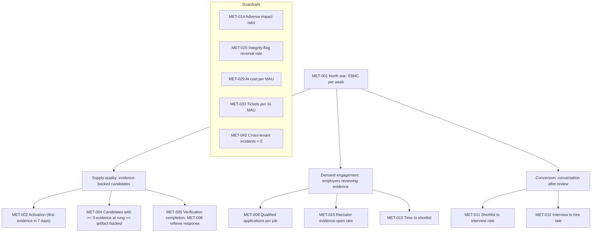

# Metrics Catalog

Doc ID: ANL-MET · Owner: Head of Analytics / Product Analytics Lead (with Privacy Lead) · Version 1.0 · Status: Draft for Review · Relates: STR-01 §3 §8 (GOAL-01…08), DOM-21, DOM-22, INV-T09, INV-T14, INV-T15, INV-T19, INV-T20, ADR-T22, OPS-SLO, OPS-OBS, COM-OPS, FIN-COST, OPEN-05, OPEN-07, OPEN-08, OPEN-09, OPEN-25

Targets are deliberately absent: values come from baseline measurement after launch. Metrics are **specified, not collected**; no figure here is observed data. Formulas use standard definitions; rates state numerator/denominator and population.

## 1. Principles

1. Measure outcomes for people (evidence gained, interviews, hires) before engagement for its own sake.
2. Every metric has an owner, a definition that cannot be redefined silently, and a purpose that a decision depends on. Metrics without decisions are deleted.
3. Privacy by design: collect the minimum, aggregate early, k-anonymous reporting (§6).
4. Measurement must not become surveillance of candidates or employees (individual-level productivity tracking of recruiters is out of scope).
5. Business-critical counts come from server-side domain events (outbox), not from client beacons.
6. Fairness and safety metrics are first-class, not optional.

## 2. North star and input metrics

**Source reconciliation (OPEN-51):** `docs/product/PRD.md` §9 names **Verifiable Career Progress** as the primary metric; this target document proposes **Evidence-Backed Hiring Conversations per week (EBHC)** as the north star. The measures have different outcome scopes. Neither is treated as an approved replacement for the other until the Product Director and Analytics Lead choose one or define their hierarchy.

**North star [TARGET]: Evidence-Backed Hiring Conversations per week (EBHC)** — the number of distinct (candidate, job) pairs per week where (a) an employer-side human opened at least one evidence item at rung ≥ artifact-backed under live consent, and (b) a conversation (message exchange or scheduled interview) followed. It requires both sides of the marketplace and the product's differentiator (verified evidence) to be present, and cannot be inflated by registrations or page views. Counter-metrics guard against gaming (§7).

## 3. Metric catalogue

Source codes: DE = domain events via outbox; DB = SQL read from Postgres (read replica/warehouse); RUM = browser field data; OPS = OTel metrics; BILL = billing system; SUP = ticketing; CI = pipeline data. Collection: **S** server-side, **C** client-side, **J** batch job. Privacy class: P0 no personal data; P1 pseudonymous event; P2 aggregate-only with minimum cohort size; P3 special handling (see §6).

### 3.1 North star, activation and evidence

| ID | Metric | Definition | Formula | Source | Owner | Coll. | Privacy | Purpose / decision |
|---|---|---|---|---|---|---|---|---|
| MET-001 | EBHC (north star) | Weekly distinct (candidate, job) pairs with consented evidence review by a human employer actor followed by a conversation | count(distinct pair) where `evidence.viewed_by_employer` precedes `message.sent`/`interview.scheduled` in the week | DE | Product Director | S | P2 | Overall product health; roadmap prioritisation |
| MET-002 | Activation rate | New candidates who create ≥ 1 evidence item within 7 days of registration | activated / registered (cohort by registration week) | DE | Growth PM | S | P1→P2 | STR-01 §8; onboarding design |
| MET-003 | Evidence items per active candidate | Mean/median count of evidence items for candidates active in the month | Σ items / active candidates (report median) | DB | Candidate PM | J | P2 | Depth of loop usage |
| MET-004 | Evidence-backed candidates | % active candidates with ≥ 3 evidence items at rung ≥ artifact-backed | count / active candidates | DB | Evidence PM | J | P2 | GOAL-01 |
| MET-005 | Verification completion rate | Verification requests reaching a terminal verified/declined state vs created | completed / created (by type, by age cohort) | DE | Verification PM | S | P2 | Verification funnel health |
| MET-006 | Referee response rate and time | Referee requests answered before expiry (BR-T004); median time to respond | answered / sent; median(response − sent) | DE | Verification PM | S | P1→P2 | Risk: referee non-response (RISK-04); UX decisions |
| MET-007 | Evidence revocation rate | Revoked evidence per 1,000 active evidence items, by reason class | revoked / active × 1000 | DE | Trust PM | S | P2 | Gaming/accuracy signal |
| MET-008 | Evidence ladder distribution | Share of evidence at each rung | items by rung / all items | DB | Evidence PM | J | P2 | ADR-T14 effectiveness |
| MET-051 | Honest-labelling audit rate | % sampled UI surfaces/exports where unverified items are labelled correctly | correct / sampled | CI/manual | QA + Product | J | P0 | INV-T04 monitoring (guards against regressions) |

### 3.2 Hiring, matching and fairness

| ID | Metric | Definition | Formula | Source | Owner | Coll. | Privacy | Purpose |
|---|---|---|---|---|---|---|---|---|
| MET-009 | Qualified applications per job | Applications meeting job's stated must-have criteria (criteria evaluated by rules shown to the recruiter, not hidden scoring) | qualified apps / published jobs | DE | Hiring PM | S | P2 | Quality of supply per job |
| MET-010 | Time to shortlist | Median time from job publish (or first application) to first shortlist action | median(t_shortlist − t_ref) | DE | Hiring PM | S | P2 | GOAL-02 |
| MET-011 | Shortlist-to-interview rate | Shortlisted candidates who reach an interview stage | interviews / shortlisted | DE | Hiring PM | S | P2 | GOAL-02 |
| MET-012 | Interview-to-hire rate | Interviewed candidates marked hired (employer-reported) | hired / interviewed | DE | Hiring PM | S | P2 | Hiring outcome |
| MET-013 | Match explanation coverage | % match results shown with rationale and uncertainty | explained / shown (target 100% by design) | DE | Matching PM | S | P0/P2 | INV-T19, GOAL-03 |
| MET-014 | Adverse impact ratio | For voluntarily self-identified groups: selection-rate ratio at shortlist stage (group rate / highest group rate), with confidence intervals; reported only when cohorts exceed min size | rate_g / rate_max | DB (fairness store) | Responsible-AI/Data Science Lead | J | P3 | GOAL-03 quarterly audit; triggers human review; see §6.4 |
| MET-015 | Recruiter evidence-open rate | Share of reviewed candidates for whom the recruiter opened evidence (under consent) | evidence-opened / candidates viewed | DE | Hiring PM | S | P2 | Whether evidence is used in screening |
| MET-016 | Application funnel completion | Started → submitted application rate with drop-off step | submitted / started | DE + RUM | Opportunities PM | S/C | P2 | Friction removal |
| MET-052 | Human-decision share | % of consequential application transitions by a human actor (should be 100%) | human / all consequential transitions | DE | Hiring PM + QA | S | P0 | INV-T09 monitoring |
| MET-053 | Search success rate | Searches followed by a result click/save/apply within the session, excluding zero-result | success / searches | DE + RUM | Search PM | S/C | P1→P2 | Relevance; ADR-T11 trigger input |

### 3.3 Learning and institutions

| ID | Metric | Definition | Formula | Source | Owner | Coll. | Privacy | Purpose |
|---|---|---|---|---|---|---|---|---|
| MET-017 | Course-completion→evidence rate | Completions that result in an evidence item at the defined rung | evidence created from course / completions | DE | Learning PM | S | P2 | GOAL-04 |
| MET-018 | Learning-to-interview rate | Candidates who completed a course/assessment and had an interview within a defined window vs matched non-completers (descriptive, not causal) | interviewed / cohort | DB | Learning PM | J | P2 | GOAL-04; interpret with caution |
| MET-019 | Assessment pass rate and integrity-flag rate | Attempts passed; attempts flagged for review | passed/attempts; flagged/attempts | DE | Assessment PM | S | P2 | Quality and fairness of assessments |
| MET-020 | Integrity flag review latency and reversal rate | Time to human decision; share overturned on review/appeal | median latency; reversed / decided | DE | Trust PM | S | P2 | INV-T20 (anomaly ≠ guilt); detector quality |
| MET-021 | Graduating cohort activation | Share of an institution's graduating cohort who activated and have ≥ 1 evidence item | activated grads / grads | DB | Institutions PM | J | P2 (min cohort) | GOAL-05 |

### 3.4 Engagement and retention

| ID | Metric | Definition | Formula | Source | Owner | Coll. | Privacy | Purpose |
|---|---|---|---|---|---|---|---|---|
| MET-022 | W4 retention | Cohort members active in week 4 after registration | active_w4 / cohort | DE | Growth PM | J | P2 | STR-01 §8 |
| MET-023 | W12 retention | As above at week 12 | active_w12 / cohort | DE | Growth PM | J | P2 | STR-01 §8 |
| MET-024 | DAU/MAU | Stickiness; also capacity input ASM-C-02 | DAU / MAU | DE | Growth PM | J | P2 | Capacity forecasting, product health |
| MET-025 | Sessions per DAU | Capacity input ASM-C-03 | sessions / DAU | RUM/OPS | Growth PM | C/S | P2 | Capacity |
| MET-048 | Notification opt-out rate | Users disabling a notification class within 30 days of enabling | opt-outs / opted-in | DE | Messaging PM | S | P2 | Dark-pattern guard (§7) |
| MET-049 | Push opt-in rate (installed PWAs) | Installed users granting push after the contextual prompt | granted / prompted | DE + RUM | Messaging PM | C | P2 | ADR-T02 revisit trigger (iOS reach) |
| MET-045 | Offline conflict rate | Queued writes that hit a conflict (412) per 1,000 queued writes | conflicts / queued × 1000 | OPS/RUM | Frontend Platform | C/S | P0 | ADR-T10 validation |

### 3.5 Business and cost

| ID | Metric | Definition | Formula | Source | Owner | Coll. | Privacy | Purpose |
|---|---|---|---|---|---|---|---|---|
| MET-026 | Paid conversion | Free → paid conversion by segment | new paid / eligible free in period | BILL + DE | Revenue PM | J | P2 | Packaging decisions |
| MET-027 | Recurring revenue | MRR/ARR by segment | Σ normalised subscription amounts | BILL | Finance | J | P0 | Business health |
| MET-028 | Gross margin | (Revenue − variable COGS) / revenue, COGS per FIN-COST | see COST_MODEL §4 | Finance | Finance | J | P0 | GOAL-07, OPEN-05 |
| MET-029 | AI cost per MAU | AI provider spend / MAU, split free vs paid | spend / MAU | OPS (gateway) + Finance | AI owner | S | P0 | INV-T07, GOAL-07 |
| MET-030 | Infra cost per MAU | Compute+DB+storage+egress+observability / MAU | cost / MAU | Cloud billing | SRE + Finance | J | P0 | FIN-COST |
| MET-031 | Churn and net revenue retention | Logo/seat churn (voluntary vs involuntary), NRR | lost / start; (start + expansion − contraction − churn)/start | BILL | Customer Success | J | P2 | COM-OPS §4, §12 |
| MET-032 | Refund, chargeback and reconciliation-break rates | Refunds/chargebacks per 1,000 transactions; open breaks | count/transactions; open breaks | BILL + Finance | Finance Ops | J | P0 | COM-OPS §5, §7 |
| MET-050 | AI gateway denial rate | Share of AI calls denied by policy (AI_PROHIBITED, no budget flag) or quota, by tier and feature | denied / attempted | OPS (gateway) | AI owner | S | P0 | INV-T06/T07 monitoring; detects misconfigured budgets and abuse; input to ALT-18 |

### 3.6 Support, reliability and delivery

| ID | Metric | Definition | Formula | Source | Owner | Coll. | Privacy | Purpose |
|---|---|---|---|---|---|---|---|---|
| MET-033 | Tickets per 1k MAU | Support load normalised | tickets / MAU × 1000 | SUP | Support Lead | J | P0 | STR-01 §8 |
| MET-034 | SLA attainment | Tickets meeting first-response/resolution targets (OPEN-16) | within SLA / total | SUP | Support Lead | J | P0 | PROC-03 |
| MET-035 | MTTD / MTTA / MTTR | Incident timings by severity | mean(t_detect − t_start) etc. | Incident log | SRE Lead | J | P0 | SUP-INC |
| MET-036 | SLO attainment and budget burn | Per OPS-SLO | good / valid; burn rate | OPS | SRE Lead | S | P0 | Release freeze policy |
| MET-037 | Alert quality | Share of pages that led to action; pages per on-call shift | actionable / pages | Paging tool | SRE Lead | J | P0 | Alert fatigue control |
| MET-038 | Test flake rate and quarantine age | Flaky failures per run; age of quarantined tests | flaky / runs; median age | CI | QA Architect | J | P0 | QA-STRAT §7 |
| MET-039 | Change failure rate | Deployments causing incident/rollback | failed / deployments | CI + incident log | Release Manager | J | P0 | PROC-14 |
| MET-040 | Deployment frequency and lead time | Deploys per deployable per period; commit→production time | counts; median | CI | Release Manager | J | P0 | Delivery health |
| MET-041 | Open accessibility defects | WCAG 2.2 AA defects by severity and age | count / age | Tracker | Design System Lead | J | P0 | GOAL-06 |
| MET-042 | Cross-tenant incidents | Number of confirmed cross-tenant exposures | count (target 0) | Incident log | Security Lead | J | P0 | GOAL-06 |
| MET-043 | Remote activation success and version-skew share | Per remote: successful activations / attempts; share of sessions on non-current compatible versions | per OPS-SLO SLO-03; skew share | RUM | Frontend Platform | C | P0/P1 | SLO-03, FM-02 |
| MET-044 | Core Web Vitals p75 | LCP/INP/CLS per route and device class | p75 of field values | RUM | Performance Eng | C | P1→P2 | SLO-13…15 |
| MET-046 | Data-rights SLA attainment | Requests completed within internal target (SLO-24) | within target / total | DE | Privacy Lead | J | P0 | BR-T060 |
| MET-047 | Moderation time-to-action | Median time report→decision by harm class | median | DE | T&S Lead | J | P0 | PROC-05 |
| MET-054 | Backup/restore currency | Age of last successful backup; age and result of last restore drill | age; pass/fail | OPS | SRE Lead | S | P0 | FM-34, RG-14 |
| MET-055 | Policy-denied request ratio | 403/404-denied authenticated requests per 1,000 | denied / total × 1000 | OPS | Security Eng | S | P0 | ALT-11 baseline; detect authz regressions or probing |

Total: 55 metrics (IDs MET-001…MET-055).

## 4. Event taxonomy

### 4.1 Naming and envelope

| Rule | Detail |
|---|---|
| Name format | `<domain>.<entity>.<past_tense_verb>`, lowercase, dot-separated, e.g. `evidence.item.created`; domain from DOM-xx names |
| Server vs client | Business facts are **server events** (outbox domain events, ADR-T09). Client events are limited to UX interactions that the server cannot know (view, scroll depth, search typed) |
| Immutability | Event schemas are versioned (`schema_version`); additive changes only; breaking change = new event name |
| Envelope | `event_id` (UUID, dedupe key), `name`, `schema_version`, `occurred_at` (server time), `actor_pseudo_id` (stable hashed id, rotation policy), `session_pseudo_id`, `tenant_id` (opaque, optional), `source` (server/client), `consent_scope_ref` (analytics consent state), `release_id`, `props` (allowlisted) |
| Property rules | Allowlist per event; no free text; no emails, names, phone numbers, message bodies, resume content, tokens; enumerated values preferred; IDs are opaque |
| PII separation | Join to identity only inside the warehouse's restricted zone for approved purposes; analysts use pseudonymous views |
| Test traffic | Synthetic and staff test accounts tagged and excluded |
| Idempotency | Dedupe by `event_id`; replay-safe loaders |

### 4.2 Event catalogue (initial)

| Event | Trigger | Key props (allowlisted) | Feeds |
|---|---|---|---|
| `account.user.registered` | Sign-up completed | role intent, referral source class | MET-002, MET-022 |
| `profile.profile.updated` | Profile section saved | sections changed (enum) | MET-003 |
| `evidence.item.created` | Evidence saved | type, rung, source class | MET-002, MET-003, MET-008 |
| `evidence.item.verified` | Server verification transition | from_rung, to_rung, method class | MET-004, MET-008 |
| `evidence.item.revoked` | Revocation | reason class | MET-007 |
| `verification.request.created/completed` | Requests | type, outcome class | MET-005 |
| `reference.request.sent/answered/expired` | Referee flow | latency bucket | MET-006 |
| `assessment.attempt.started/submitted/passed` | Attempts | assessment id, integrity mode | MET-019 |
| `assessment.integrity.flagged/decided/appealed` | Review flow | decision class | MET-020 |
| `course.enrollment.created`, `course.enrollment.completed` | Learning | course id | MET-017 |
| `job.posting.published/closed` | Jobs | org id (opaque), category | MET-009, MET-010 |
| `search.query.performed`, `search.result.clicked` | Search | result count bucket, position | MET-053 |
| `match.explanation.viewed` | Candidate or recruiter opens rationale | side | MET-013 |
| `application.application.submitted` | Apply | job id, evidence attached count | MET-009, MET-016 |
| `application.stage.changed` | Pipeline | from, to, actor_type (human/system) | MET-011, MET-012, MET-052 |
| `evidence.item.viewed_by_employer` | Consented evidence view | job id, rung | MET-001, MET-015 |
| `messaging.message.sent` | Message | thread type only | MET-001 |
| `interview.interview.scheduled` | Interview | type | MET-001, MET-011 |
| `notification.notification.delivered/opened/disabled` | Notification | class, channel | MET-048 |
| `push.permission.prompted/granted` | PWA push | platform class | MET-049 |
| `billing.entitlement.changed` | Verified webhook | plan code | MET-026, MET-031 |
| `privacy.consent.changed` | Consent | purpose, new state | compliance |
| `privacy.request.completed` | Data rights | type, duration bucket | MET-046 |
| `ai.call.completed` | Gateway | feature, model class, token buckets, cost bucket, tier | MET-029 |
| `remote.remote.activated/failed/rejected` | Shell | remote, version, reason | MET-043 |
| `pwa.serviceworker.updated` | SW lifecycle | from/to version | MET-043 |
| `support.ticket.created/resolved` | Ticketing | category | MET-033 |

## 5. Data pipeline and governance

| Topic | Design |
|---|---|
| Flow | Outbox domain events → analytics ingest (batch/stream) → warehouse (initially Postgres schema or separate analytics DB; separate store when volume/isolation requires) [OPEN-25] → semantic layer / dashboards |
| Tooling | First-party warehouse vs analytics SaaS [OPEN-25]; if SaaS: server-side event forwarding with allowlist, no client SDK with free capture |
| Metric definitions | Stored as code (versioned), reviewed with owner; dashboard changes follow definition changes |
| Data quality | Event schema validation at ingest; drop and alert on violations; reconciliation of key counts vs source tables (e.g. applications) |
| Access | Pseudonymous views by default; identity joins need approval and are audited (INV-T18 spirit); tenant users see own-tenant analytics only (INV-T03) |
| Retention | Raw events retention [OPEN-08]; aggregates longer; erasure removes or irreversibly de-identifies events (PROC-09) |

## 6. Privacy treatment

### 6.1 Classes

| Class | Meaning | Handling |
|---|---|---|
| P0 | No personal data (system, financial aggregates, counts) | Free use |
| P1 | Pseudonymous event data | Restricted zone; analyst pseudonymous views; consent-aware |
| P2 | Reported only in aggregate with minimum cohort size k [OPEN-25] | Small-cell suppression, rounding/noise as policy; no re-identification by differencing |
| P3 | Special handling (fairness data, anything sensitive) | Separate store, separate access, purpose-limited, voluntary self-identification only |

### 6.2 Rules

| Rule | Detail |
|---|---|
| Consent | Product analytics beyond what is necessary for operating the service respects consent settings (INV-T15; OPEN-08 on legal basis); consent state travels in the envelope |
| RUM | Sampled; no user text; truncated URLs; no cookies for tracking |
| Institution analytics | Cohort-level only; faculty cannot see non-consented private job-search data (TEST-MSG-003); k-anonymity enforced |
| Employer analytics | Aggregated; no candidate-level surveillance of other employers' activity |
| Individual tracking | No individual-level session replay of personal content; screen recording tools excluded |
| Minors | Additional restrictions [OPEN-09] |
| Cross-border | Per OPEN-30 and OPEN-08 |
| De-identification | Hash salts rotated; re-identification attempts prohibited |
| Fairness data | See 6.4 |

### 6.3 Candidate-facing transparency

Users can see which analytics purposes they consented to and opt out; account export (PROC-09) includes analytics data attributable to them where applicable.

### 6.4 Fairness measurement (MET-014)

Demographic attributes are not collected for matching. For fairness auditing only, the product may offer **voluntary, separate, revocable self-identification** stored in a restricted P3 store, never visible to recruiters or used as a feature in matching (INV-T19). Audit jobs compute selection-rate ratios with confidence intervals and flag potential adverse impact for human review; thresholds and legal interpretation are decided with counsel and a fairness advisor [OPEN-08], not assumed here. Small groups are suppressed. If voluntary participation is too low for a valid analysis, the report says so rather than inferring attributes.

## 7. Experimentation guardrails (fairness, no dark patterns)

| Guardrail | Rule |
|---|---|
| Registration | Every experiment is registered: hypothesis, primary metric, guardrail metrics, population, duration, owner, risk class, review sign-off |
| Ethics review | Experiments touching ranking/matching, verification, assessment, moderation, pricing, consent or notification frequency require review by Product + Privacy (+ Responsible-AI Lead for matching) |
| Forbidden experiments | Pay-to-rank variants (INV-T19, ADR-T22); variants that hide or downgrade the display of verification status; removing explanation of matches; anything that weakens consent, security, accessibility or integrity safeguards; tests on assessment integrity detection thresholds without review; deceptive pricing; exploiting vulnerable situations |
| Dark patterns prohibited | Confirmshaming, fake scarcity/urgency, hidden or pre-ticked consent, roach-motel cancellation (cancel must be as easy as sign-up — Customer Portal), nagging notification loops, misleading countdowns, manipulative default opt-ins, disguised ads, making unsubscribe hard, guilt-based streak mechanics |
| Fairness | Experiments on matching must report outcome parity across available fairness cohorts (MET-014) before rollout; harm to a cohort blocks rollout; no experiment may use protected attributes or proxies as treatment criteria |
| Candidate dignity | No experiments that reduce transparency to candidates about why they matched or were not advanced |
| Statistics | Pre-registered primary metric; sample-ratio-mismatch check; no peeking-based stopping without sequential method; multiple-comparison control; minimum sample thresholds |
| Guardrail metrics | Opt-out rate (MET-048), ticket rate (MET-033), accessibility regressions (MET-041), error/SLO burn (MET-036), AI cost (MET-029), refund rate (MET-032); breach auto-halts experiment |
| Holdouts | Long-term holdout for lifecycle messaging to measure true incremental effect |
| Consent | Experiments run only on users whose consent state permits; B2B contract constraints respected |
| Vulnerable groups | Minors and users in sensitive circumstances excluded unless specifically reviewed (OPEN-09) |
| Kill switch | Every experiment has a flag kill switch (OPS-REL §9.1) |
| Reporting | Results and decisions logged, including negative results; learnings feed OPEN_DECISIONS |

## 8. Review cadence and ownership

Metric owners review definitions on a regular cadence [OPEN-15]. Adding a metric requires: purpose/decision, definition, formula, source, privacy class, owner. Removing: record rationale. Dashboards expose definition links. The catalogue is the single source; the ROADMAP's release gates reference MET ids.
