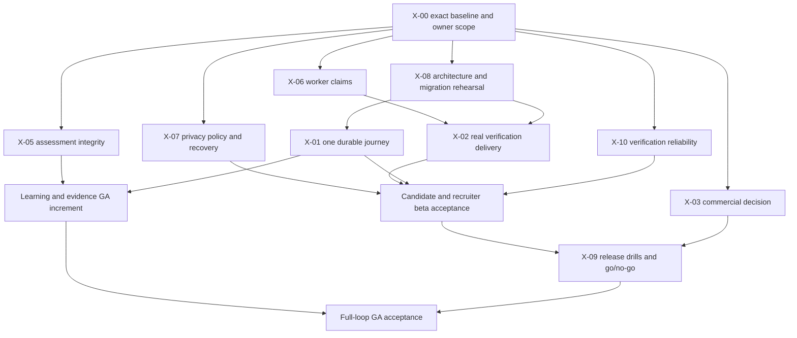

# Legacy Release Gates, Issue and PR Lineage (reports group)

Doc ID: RDM-GATES-C · Owner: Program Director (proposed) · Version 1.0 · Status: Proposed (Under Review) · Date: 2026-10-26 · Merge track: C (source group `31_LEGACY_ARCHIVE/docs/reports/**`)

**Relationship (no original file was edited).** This file **supersedes nothing**. It does not change `ROADMAP.md` or `ROADMAP.md#record-roadmap-rev2`; it is a register of **gates and sequencing evidence from the earlier attempt** that the target roadmap can adopt, adapt or reject by ID. It is linked from `00_CONTROL_CENTRE/LEGACY_MERGE_LEDGER_C.md`; the documentation owner must also link it from `00_CONTROL_CENTRE/MASTER_INDEX.md`. Owner instruction behind this merge: *"i dont want to loos information keep everything in use untile it get improved"*. Contains no dates for the target, no durations and no staffing numbers.

**Greenfield frame.** No source code exists in this repository and nothing is implemented. Every row records "the earlier attempt required X before release" or "the earlier attempt reported state Y at commit Z". Hosted-service facts (Stripe, Supabase, GitHub) describe the **earlier attempt's accounts and repositories** at the dates given, observed read-only; they are not facts about any target environment. No live-verification gate below is satisfied for the target.

Companion files: `24_RISKS_AND_DECISIONS/RISK_AND_LESSONS_FROM_PRIOR_ATTEMPT.md` (lessons `LES-nn`), `05_FEATURE_SPECIFICATIONS/LEGACY_REQUIREMENTS_AND_ACCEPTANCE_FROM_REPORTS.md` (requirements `LGR-nn`, `BL-nn`, `X-nn`), `28_TRACEABILITY_AND_COVERAGE/LEGACY_REPORTS_EVIDENCE_INDEX.md` (`LEI-nn`). Target roadmap work packages that relate by subject (pointers only, to be confirmed by the roadmap owner): WP-BILLING-STRIPE, WP-NOTIFY-EMAIL, WP-WORKER-OUTBOX, WP-PRIVACY-CONSENT, WP-IDENTITY-SESSIONS, WP-VERIF-REFEREE, WP-ASSESS-RUNNER, WP-PROCTOR-VENDOR, WP-DR-EXERCISE, WP-LOADBASE, WP-QA-TRACE, WP-MONOREPO-CI, WP-MIGRATE-DATA.

## 1. Gate catalogue (LRG-nn)

Each gate is a condition the earlier attempt judged necessary before a user-facing release. "State then" is the last recorded state in the reports (2026-10-23) and is historical.

| ID | Gate | Required evidence (as the reports phrased it) | Source | State then |
|---|---|---|---|---|
| LRG-01 | **Exact-commit green CI** | Lint, type-check including the test projects, unit, integration and security tests, local migrations applied to an empty database twice (idempotency), real-database tests, production build, client-bundle secret scan, browser tests all green on the exact release commit; no assertion weakened to get there. | PRODUCTION_AUDIT P0-08; REPOSITORY_AUDIT R2-01, I, L | Red twice: 2026-10-03 at type-check; 2026-10-23 one of 236 browser cases failed (account-security, aborted navigation) |
| LRG-02 | **Transactional email proven** | Verified sender and domain (SPF, DKIM, DMARC), a real mailbox receives the verification code and the referee link, the token is absent from the requester's response and from logs, expiry and replay negatives, retries preserve idempotency, bounce and retry alerting, queue alert; worker fails closed (503) when unconfigured in staging and production. | issue "email" (#44 in 10-21/10-23 numbering); BL-003; X-02 | Blocked: adapter code existed, no live proof |
| LRG-03 | **Privacy and erasure lifecycle approved and proven** | Ratified policy (immediate versus 30-day grace), retention and backup treatment, scheduler for due erasures, resumable cleanup after partial failure with the account kept closed, deletion proven across every store and the payment provider, user notification, counsel sign-off. | issue "privacy/erasure" (#45); BL-006; X-07; D-03; R2-05 | Blocked: owner and legal decision; no scheduler |
| LRG-04 | **Legal text and contacts** | Counsel review of Terms and Privacy Policy against GDPR, CCPA/CPRA and India DPDP recorded in a governance record; monitored privacy and security mailboxes on a domain the company owns; no unsupported compliance claim. | BL-004; finding 20 | Open (code honest; law open) |
| LRG-05 | **Persistence design ratified; populated migration rehearsed** | Owner ratifies the persistence design and its schema change (the earlier migration 00043: replaced `UNIQUE(job_id, candidate_id)` with a partial index, dropped the plaintext reference token after hashing, re-pointed work-history and reference foreign keys to `users(id)`); duplicate case-folded emails and active applications resolved by approved policy; upgrade of a populated snapshot, rollback and restore exercised; target grants and RLS deny cross-account reads. | issue "ADR-015 / hosted migration" (#46); X-08; O-01 | Blocked: no ratification; hosted project empty |
| LRG-06 | **Hosted database target gate** | Do not run the migration command against a hosted managed database until a compatible identity model exists: the earlier SQL referenced `auth.users`, `auth.uid()`, `auth.jwt()` (four migrations held foreign keys to `auth.users(id)`) while the app issued its own sessions; do not insert fake `auth.users` rows, replace `auth.uid` globally or grant blanket access; rehearse on a disposable target (drift, abort and rollback, grants, RLS, concurrent writes) first. A CI scanner that expects exit code 1 on known incompatibility is a blocker detector, not a compatibility proof. | HOSTED_SUPABASE_MIGRATION_GATE (cited); STRIPE_SUPABASE; REPOSITORY_AUDIT E | Blocked |
| LRG-07 | **Deployment topology correct** | HTTPS; the proxy forwards the root health route to the API (not static HTML); database and API publish no host ports, only the edge proxy binds 80 and 443; secrets excluded from images (`.dockerignore`); production image pruned (below 250 MB target); single API writer enforced where the design needs it. | BL-005, BL-018; PR #55; OPS-02; issue "deployment" (#47) | Code existed; not operationally verified |
| LRG-08 | **Worker and queue reliability** | Claims bounded by execution capacity and fenced by claim token, expired owners cannot acknowledge, crashed claims recover, cancellation wins, mail idempotency kept; worker heartbeat and queue-age alerts observed in a kill drill. | D-02; X-06; R2-07 | Reproduced defect (6 jobs, 9 executions); fix not proven |
| LRG-09 | **Operations drills passed** | Backup restored independently into an isolated database and verified (schema, table row counts, background-job queue); the restored app passes a smoke test; rollback of the image with schema compatibility; load and cold-boot/memory measured; external monitoring of error-level logs; approved RPO and RTO; signed go/no-go. | X-09; issue "deployment"; PRs #55, #56 | Not performed (no deployment target) |
| LRG-10 | **Assessment integrity and trust policy** | No scored result without approved isolated execution (submission-only until then); credential issuance after the final-assessment gate; linked certificate and evidence proofs agree on revocation; trust policy for badges and scoring ratified; interview code execution refused (503) in deployed environments until a sandbox is approved. | D-01, D-09, D-10; X-05, X-11; issue "interview/trust" (#49) | Open decisions |
| LRG-11 | **Session architecture decision** | Decide bearer token in storage versus httpOnly cookie, with CSRF defence, credentialed CORS and the client contract. | TS-007; issue "trust/token storage" | Open |
| LRG-12 | **Commercial gate** | Explicit free-only launch, or: approved provider and price policy, test-environment webhook endpoint configured and signed delivery verified, refund and dispute behavior decided and implemented, entitlement read-model audit (all gates read entitlements, never plan tier alone), truthful UI, then live-mode readiness. Do not enable the paid billing mode for public users before these gates. | issue "commercial" (#50); X-03; REPOSITORY_AUDIT F, L | Partial: Stripe code merged; 0 webhook endpoints in the test account; UI free-only |
| LRG-13 | **Durable beta scope** | Decide which long-tail modules must persist before exposure; each slice: API, database, authorization, UI, restart, tenant and browser tests; the UI states remaining preview limits. | issue "durable beta modules" (#48); X-01 | Partial |
| LRG-14 | **Security hardening backlog closed** | Keyed hash for email codes (BL-001); referee token expiry (BL-002); durable assessment sessions (BL-009); AI tier from entitlements (BL-010); password policy; CSP on the web host; patched web-framework advisory (fastify 5.12.2 to 5.12.5 affected by GHSA-389g-gv7q-r4x8, fixed in 5.12.6); secret scanner fails on scanner error. | SEC-01, SEC-02, SEC-05, SEC-06, O-4, D-07 | Open at last report |
| LRG-15 | **Accessibility and performance acceptance** | Manual contrast and screen-reader checks; measured service-level objectives (no fictitious SLOs); layout-shift budget; load, soak, backup/restore and deployment tests (never produced). | FINAL_VALIDATION "Not produced"; FEATURE_STATUS; PRODUCTION_AUDIT section 8 | Not produced |
| LRG-16 | **Documentation and claims gate** | Status documents match evidence, dated and tied to a commit; no feature called implemented from documentation; the docs index points to the current audit; historical reports labelled. | REPOSITORY_AUDIT R2-08; FEATURE_PLAN K | Drift recorded |
| LRG-17 | **Verification-environment gate** | A clean, permitted environment (fresh build, install, isolated test database, browser) exists before acceptance is claimed; "not run" is never reported as pass. | D-06; X-00 | Blocked |

## 2. Issue-by-issue gates (GitHub #44 to #50)

All seven issues were **open** at every report. No issue closure was justified (REPOSITORY_AUDIT D, J). The two mappings of numbers to titles differ; both are retained (lessons file section 12 explains why the first is preferred).

### 2.1 Mapping used by FEATURE_STATUS (2026-10-21) and REPOSITORY_AUDIT (2026-10-23), which read the issue bodies

| Issue | Title / scope | Priority | Already in code or merged work | Remaining acceptance | Whole-issue status on 2026-10-23 |
|---|---|---|---|---|---|
| #44 | Transactional email delivery | P0 | PR #51 Resend adapter, fail-closed configuration, durable enqueue | Sender and provider ownership, real inbox, monitoring, D-02 | BLOCKED (provider and live proof) |
| #45 | Privacy, legal, erasure | P0 | PR #43 request and cancel SQL; PR #51 encrypted metadata and cleanup; PR #58 privacy checks | Legal, contact and retention approval, scheduler policy, complete recoverable deletion including shared data and backups | BLOCKED (owner, legal, live proof) |
| #46 | Persistence design ratification and hosted migration | P0 | PR #52 migration ledger guard and read-only preflight; ADR describing the writer lock | Ratification, populated migration and rollback, hosted grants and RLS | BLOCKED (schema, approval) |
| #47 | Deployment, restore, single writer | P0 | Writer lock, heartbeat, PR #55 topology, PR #56 recovery scripts, PR #58 config hardening | Deployed drills, load and boot measurements, independent restore and rollback, release acceptance | BLOCKED (infrastructure proof) |
| #48 | Durable beta modules | P1 | PR #51 metadata, PR #53 searches, PR #54 bookmarks; audit and flag stores; billing in database mode | Selected remaining modules, drafts, connections, alerts; avoid blanket rewrite | PARTIAL |
| #49 | Interview, trust, token storage | P1 | PR #43 deployed interview refusal and trust changes; PRs #57, #58 regression and access control | Challenge semantics, approved sandbox, trust, badge and session policy; no cookie migration assumed | PARTIAL / decisions blocked |
| #50 | Commercial policy and payment | P1 | Paid activation disabled; simulated mode refused in deployment; PR #71 Stripe backend and migration 00052 | Explicit free-only decision or approved provider plus durable payment and entitlement reconciliation; price approval | PARTIAL |

Status accounting (REPOSITORY_AUDIT A): fixed and verified 0; implemented, not fully verified 0; partially fixed or open 3 (#48, #49, #50); regressed 0; blocked 4 (#44 to #47); not reproducible 0. Comments counted in the 2026-10-21 snapshot: #44 2, #45 3, #46 2, #47 3, #48 5, #49 1, #50 1 (17 total). On 2026-10-23 the review posted five comments (to #45, #46, #47, #48, #50: ids 6374109469, 6374110168, 6374110786, 6374111482, 6374112336) and changed no state, label or assignee.

### 2.2 Mapping used by GIT_RECONCILIATION_REPORT (2026-10-22), inferred from commits

| Issue | Title in that report | Codebase status | Release status | Commits and PRs cited |
|---|---|---|---|---|
| #44 | Transactional email, provider integration and fail-closed guard | Partially addressed | Gated (staging proof) | `22fb8190`, `ad613fc3` (PR #43 fail-closed 503); `43ef011e`, `73f27b29`, `f75fd3b4` (PR #51 Resend adapter, exponential backoff, idempotency headers); `8aea7fee` (PR #51 worker configuration validator); `7c723a0e` (PR #55 outbound mail allowed, database private); `43bb9258` (PR #57 FE-05) |
| #45 | Reputation visibility, recruiter scoping, candidate consent (BR-167) | Partially addressed | Gated (consent setting) | `a30fcaab` (PR #57); `8f5ff69a` (PR #58 R2-2); `d3607f0f` (PR #58 BR-167 gate; message "No reputation consent setting exists yet ... #45 #49 remain open") |
| #46 | Technical-interview code execution sandbox and cross-tenant IDOR | Partially addressed, architectural limitation | Documented limitation | `93dfe125` (PR #40); `48b5fd55`, `f9c2d0bb` (PR #43 simulated sandbox claims removed, 503); `a30fcaab` (PR #57) |
| #47 | Privacy policy, terms, contact verification, false compliance claims | Resolved in code, open in law | Gated (legal counsel) | `ae99e31c` (PR #40); `731c2ef3`, `d0f21535`, `f9c2d0bb` (PR #43); `8a81a953`, `ab410a92` (PR #43); `43bb9258` (PR #57 FE-02) |
| #48 | User data erasure semantics and scheduled deletion | Partially addressed | Gated (30-day executor) | `1bb0f625` (PR #40); `15b44921`, `7bc608b8`, `de352710` (PR #43); `34e54020`, `6f88ef74` (PR #51); `a30fcaab` (PR #57) |
| #49 | PostgreSQL durability versus about 220 ephemeral routes and the single-writer constraint | Partially addressed | Progressive migration | `1bb0f625`; `1515beae`, `e49c43b1` (PR #43); `000013c3`, `f6612e46`, `34e54020` (PR #51); `735b30ea` (PR #53); `47a3f130`, `b30e7e42` (PR #54); `8864d2c8` (PR #55) |
| #50 | Payment gateway and billing integrity | Resolved in code, open in plan | Gated (provider) | `ae99e31c`, `1bb0f625` (PR #40); `48b5fd55` (PR #43); `8864d2c8` (PR #55) |

Numbering fact recorded there: pull requests and issues share one counter. PR #40 to #43 were merged in succession; numbers #44 to #50 were then allocated to the seven issues; later pull requests are #51 to #58. No pull request numbered #44 to #50 ever existed.

### 2.3 Reported defect and verifying tests per issue (GIT_RECONCILIATION_REPORT numbering)

| Issue (that report's title) | Reported defect | Verifying tests named |
|---|---|---|
| #44 transactional email | Development logged verification codes to the console; in staging or production without a provider the platform accepted verification requests without sending mail, so candidates could not verify corporate domains or obtain reference upgrades | `production-config` unit; `work-history-graph` integration; e2e `core-loop`, `frontend-fixes` (FE-05) |
| #45 reputation visibility | Any authenticated caller could inspect any candidate's multi-dimensional reputation score and breakdown without consent (BR-167); recalculation open to non-admins; stealth candidates exposed in discovery | `reputation-visibility`, `review-r2-regressions` (R2-2), `reputation-engine` integration; e2e `reputation-engine` |
| #46 interview sandbox | Evaluation simulated in-process, claiming to run submitted code; cross-tenant IDOR let rival organizations link, score and move another company's application and expose private questions and hidden test cases | `technical-interview` integration; `core-authz` ("interview assessments are scoped...") |
| #47 privacy and legal | Fabricated claims ("SOC2 Type II Ready", "GDPR & CCPA Compliant", "DKIM Verified"), fictitious hashes, a fake phone number, a support address at an unowned domain; unreviewed boilerplate Terms and Privacy Policy | e2e `frontend-fixes` (FE-02), `core-loop`; `core-authz` |
| #48 erasure | Erasure left work history, references and applications in tables; requests and cancellations lived in volatile maps; no executor for the 30-day grace period; recruiter-versus-candidate retention semantics undefined | `tests/pg/core-persistence`, `notifications`, `messaging`, `work-history-removal`, `saved-jobs` |
| #49 durability | Only the core loop persisted; about 220 routes kept state in maps; horizontal scaling unsafe without a single-writer lock | `tests/pg/core-persistence`, `concurrency`, `saved-searches`, `saved-jobs` |
| #50 payments | Checkout collected card numbers without submitting them anywhere and activated paid plans without payment; the webhook was unsigned and open to spoofed confirmations | `billing` integration; `api-security`; `production-config` |


## 3. Release stages and sprints

### 3.1 Stages A to F (RELEASE_SCOPE_AND_BACKLOG, 2026-10-22)

| Stage | Focus | Backlog delivered | Exit criteria |
|---|---|---|---|
| A | Production hardening and operational gates | BL-001, 002, 003, 004, 005, 007, 008 | All tests green, `test:security` exits 0, lint exits 0, a live email received from staging |
| B | Core career loop GA launch (free early-access tier) | BL-006, 009, 010; deployment on the single-writer design with automated backup verification | End-to-end in production: candidate sign-up, corporate email attestation, referee voucher completion, job apply, recruiter pipeline move |
| C | Progressive durability (long tail) | BL-011, 012, 013, 015; portfolio showcase (F-26) and admin console (F-17) durable | Ephemeral route count reduced from 217 to below 100; restart preserves challenge submissions, course progress, drafts |
| D | Commercial monetization and enterprise tier | BL-016; enterprise seat licensing and invoice generation; webhook deduplication keys persisted | A live-style card test succeeds in the provider's test mode, the webhook activates the Pro subscription, canceling updates entitlements |
| E | Sandboxed code execution and remote assessment | BL-017; multi-language runner (Node.js, Python, TypeScript); technical-interview real-time room | Unprivileged execution of untrusted code passes an isolation audit; fork bombs and unauthorized network calls blocked |
| F | Ecosystem, reputation and career graph | BL-014; career trajectory visualizations; alumni networks, warm-introduction pathfinding, peer credibility views | Full 173-feature matrix with persistence and accessible UI views |

Timeline column in that report (relative only): Stage A sprints 1-2, B 3-4, C 5-6, D 7-8, E 9-10, F 11 and later.

### 3.2 Sprints S0 to S6 (FEATURE_PLAN_2026-10-21, no dates or velocity)

| Stage | Sprint | Goal | Backlog and urgency | Demonstrable increment | Exit criteria |
|---|---|---|---|---|---|
| A delivery safety | S0 | Select beta or GA contract from an audited baseline | X-00 P0; prepare X-08, X-09; X-03 decision | Reproducible baseline and release-specific acceptance catalogue | Exact SHA and build provenance; admitted stories Ready; unexecuted gates named; no readiness claim |
| B trust integrity | S1 | Remove false results and unsafe claims while keeping flows | X-05, X-06 P0; X-10 P1/P2 (split if capacity requires) | Honest challenge submission; recoverable worker queue with bounded claims; reliable verification checks | D-01 and D-02 regressions fail before the fix and pass after; PG fencing proof; affected browser verdict; no trust downgrade |
| B verification and privacy | S2 | Real proof and recovery slice | X-08 then X-02; X-07 separate P0 | Candidate receives proof email, referee responds, persisted result survives restart; approved erasure demonstrably recovers | Live inbox, replay, expiry; PG restart and race; erasure failure drill; monitored failure; owner accepts trust semantics |
| C restricted beta | S3 | Close admitted application and recruiter gaps on the durable core | BL-F-04, 05, 06, 10, 14, 17, 24, 32, 94, 96, 162; X-01 per needed slice | Candidate applies with evidence; recruiter reviews and transitions; candidate sees outcome; account controls work | Fresh-browser and restart journey; duplicate, retry, expired-session, tenant cases; moderation recovery; all beta inclusions accepted |
| D full career loop | S4.n | One learning, proof or career increment per sprint | BL-F-07a then approved BL-F-08, 26, 84, 85, 91, 95, 106, 122, 145; P1 | First durable lesson progress, later portfolio and goal, gap, outcome progression | Each slice survives restart, meets its story, has PG, browser and security evidence; no simulated proficiency |
| E operational release | S5 | Prove operation under failure | X-09 P0; unresolved X-07 and X-08 block entry | Restore and roll back a working candidate and recruiter product; detect worker failure | Exact-SHA CI/build/browser; hosted RLS; backup, restore, rollback; HTTPS; accessibility and manual gaps closed; load and boot data accepted; signed release |
| F expansion | S6.n | One standalone extension per sprint | Deferred BL-F packets (P2/P3) | Individually admitted | Same Definition of Done; pricing, AI and predictive decisions never inferred |

Sprint risk, isolation and rollback contract (kept verbatim in substance): S0 documentation-only diff; S1 keep the old API contract until a coordinated consumer migration, stop a scored path if unsafe, rollback must not restore fake trust or unsafe worker scale, deferrals real sandbox and provider choices; S2 fail closed on mail outage, reversible migration rehearsal, erased data is not restored to users as an application rollback; S3 restrict incomplete preview modules by approved scope, additive migration with a tested rollback and restore; S4.n one module at a time preserving old data and contract until the replacement is verified; S5 tested image rollback with schema compatibility, restore procedure owned and timed, no claim beyond measured load; S6.n feature-specific rollback and retention plan.

### 3.3 Dependency graph of the delivery packets (FEATURE_PLAN H)



The graph shows delivery dependencies, not new canonical feature dependencies. Legal, provider and architecture decisions can progress independently; worker and assessment fixes are independent code paths but need the same exact-source baseline; staging preparation can proceed while features develop, but final release acceptance cannot precede privacy, proof delivery and recovery evidence. Do not make all features depend on a blanket "migrate everything" rewrite. Registry dependency cycles need interpretation, not automatic topological sorting.

### 3.4 Dependency-ordered action plan (REPOSITORY_AUDIT M, 2026-10-23)

| Order | Priority | Workstream | Observable acceptance |
|---|---|---|---|
| 0 | P0 | CI (R2-01) | Pull-request CI completes with 236 of 236 browser cases; a revoked external session is still redirected with the exact banner and the active session retained |
| 1 | P0 | Schema (#46) | Approved identity model, migration adaptation, clean and populated disposable rehearsal, two-user and two-tenant RLS and grant checks; no direct hosted migration before signed approval |
| 2 | P0 | Operations (#47) | After #46: app boot, single-writer lock, worker liveness and queue-backlog alarm, fresh encrypted off-host restore, rollback and smoke |
| 3 | P0 | Communication (#44) | Verified sender, real-mailbox code and reference sends, expiry and replay negatives, bounces and retry alerts, secrets absent from logs |
| 4 | P0 | Privacy (#45, R2-05) | Legal, retention and contact approval, due-erasure scheduler, restart recovery, payment-provider disabled and enabled erasure consistency and staging tests |
| 5 | P1 | Monetization (#50; R2-03, 04, 06, 09) | Decide launch mode; test-mode provider endpoint and signed delivery; complete refund and ordering policy; entitlement read model; honest UI; then any live-mode readiness |
| 6 | P1 | Core product (#48) | Prioritize drafts, network, alerts by accepted beta scope; each vertical slice API, database, authorization, UI, restart, tenant and browser tests |
| 7 | P1 | Trust (#49) and worker (R2-07) | Code executor sandbox or fail closed, policy provenance, safe worker lease fencing and replay proof |
| 8 | P2 | Documentation (R2-08) | Mark stale snapshots clearly; link the current report in the docs index; refresh the feature ledger after acceptance, not before |

Sprint increments suggested there (capacity unknown; sequencing only): A CI plus observability baseline (no new feature); B hosted schema proof on a disposable target; C one staging candidate, reference and job-application journey; D privacy plus mail and erasure proof; E optional paid vertical slice only after commercial approval; F durable beta micro-features and technical-interview security. A sprint with red CI does not complete or unlock the next.

### 3.5 Release readiness statements from the E2E audit (2026-10-21)

Not ready for public release because: the stored-XSS link fix was uncommitted and the shared dev API stale; weak passwords were accepted and maintenance mode was inert (both needed decisions); only the memory-backed path and Chromium were browser-tested. The core career loop (sign up, profile, work history, apply, review, notifications, messaging, networking) behaved correctly under normal and abnormal input and authorization held in every case tried. The shared dev API on port 4000 was stale (it returned 404 for `GET /api/v1/auth/session`) and needed a restart from the current build; two persistence changes made in that session (admin audit log, feature flags) were not live there.

## 4. Deployment readiness table (REPOSITORY_AUDIT L, 2026-10-23)

| Gate | Observed state | Verdict |
|---|---|---|
| Latest upstream full CI | Failed 1 of 236 browser tests; the two preceding runs green | RED |
| 52 local database migrations and 50 database tests | Successful in CI | GREEN (local CI only) |
| Managed Supabase target schema | No application tables | BLOCKED |
| Hosted RLS authorization and grants | Cannot test real application objects | BLOCKED |
| Stripe SDK, signed webhook, durable storage | Code present; mocked network tests and local PG green | PARTIAL |
| Stripe test-account webhook delivery | 0 webhook endpoints configured | BLOCKED |
| Live-mode payments | Not accessed; no mutation performed | NOT VERIFIED |
| Legal, email, privacy, backups, worker, load, TLS | Acceptance evidence missing | BLOCKED |
| App-wide 173-feature production verification | Only a historical provisional inventory | NOT VERIFIED |

Rule recorded there: do not enable `BILLING_MODE=stripe` for public users, deploy application migrations to the current Supabase project, or describe the product as production-ready before the relevant owner-approved gates and environment checks pass.

## 5. Payment-provider live-verification gates (Stripe)

### 5.1 Capability matrix (REPOSITORY_AUDIT F)

| Capability | Evidence in the earlier attempt | Remaining gate |
|---|---|---|
| Server-side catalog and access | Price catalogue, Checkout input schema and route registration enforce server-side prices and plan role; routes require a session | Commercial price and entitlement policy approved |
| Checkout | Route `/api/v1/billing/checkout` creating a Checkout Session with idempotency including user, plan, cycle and a client reference | Network was mocked in tests; the page still said no processor existed and showed no purchase UI |
| Source of truth | Paid access only from a signed, known-price, eligible subscription; unknown prices grant free entitlements | Verify every user-facing gate reads entitlements, never plan tier alone |
| Webhooks | Raw-body signature verification with the endpoint secret; normalized checkout, subscription, invoice events | Synthetic payloads only; 0 configured endpoints, remote delivery unproven |
| Idempotency and ordering | `billing_events(provider, provider_event_id)` unique, transactional write, freshness guard, concurrency tests | Event time is in seconds: test equal-second conflicting order; asynchronous side effects; no remote retry drill |
| Subscriptions and cancel | Gateway call plus domain reconcile; scheduled and immediate cancel; persisted | Live cancel, portal behavior, downgrade at renewal, subscription replace and retries unverified |
| Invoices | `invoice.paid` and `invoice.payment_failed`; provider invoice id uniqueness | Live invoice mapping, credit notes, refunds unverified |
| Refunds and disputes | `charge.refunded` later handled (see 5.3); dispute and void not handled | Decide dispute and void behavior |
| Erase | Customer deletion before local purge in enabled mode | Provider disabled with an existing customer logs a warning and purges the local mapping only (R2-05) |
| Connected test account (read-only) | account `talentsphere-production` in **test mode only**; 1 active USD 2.99 per month recurring price; 2 active test subscriptions; 0 webhook endpoints | Not a production payment test; nothing was charged, refunded, canceled, created or edited |

### 5.2 Manual provider configuration (not code), from STRIPE_SUPABASE_AUDIT

Create the six `STRIPE_PRICE_*` prices; create a webhook endpoint at `/api/v1/billing/stripe-webhook` for `checkout.session.completed`, `customer.subscription.created|updated|deleted`, `invoice.paid`, `invoice.payment_failed`; configure the Customer Portal; keep `BILLING_MODE=disabled` until done. Apply migration 00053 (privilege revoke only) after review. The pre-integration payment audit's earlier deliverables (domain error code `PAYMENT_REQUIRED` mapped to HTTP 402; `allowSimulatedPayment` default false; `settleSubscription`) are acceptance ideas, not target facts.

### 5.3 Open and decided payment items

- Decided 2026-10-23 (owner): a full refund of the charge that paid for the current period ends paid access; the provider subscription is canceled immediately before the event is recorded so a provider failure makes the provider retry; a replay is recorded once; a partial refund or a refund of an older charge changes nothing.
- Open: O-1 concurrent paid Checkout sessions; O-2 dispute created and void; O-3 outbox for the post-commit dispatch; O-4 framework advisory (fix needs a protected manifest edit in that repository); O-5 webhook shares the global rate limit (300 per minute per address default); R2-09 same-second ordering; R2-06 refund and dispute strategy; R2-04 UI truthfulness.

## 6. Managed-database (Supabase) gate facts

- Observed 2026-10-23 (read-only): project `talentsphere-production` (id `qidckctwrkxyiwworchd`), region `ap-south-1` (Mumbai), healthy, PostgreSQL 17; public tables none; migration ledger one entry (`add_readonly_keepalive_ping`); Edge Functions none; security and performance advisors returned no notices, which cannot certify application access control because no application schema exists.
- The 52 local migrations apply cleanly and idempotently to a disposable PostgreSQL 16 in CI; that is no evidence for the hosted PostgreSQL 17 target.
- Constraint: the earlier app signed its own HMAC sessions; a browser token is not a platform auth identity. Migrations 00016, 00018, 00022, 00023 hold foreign keys to `auth.users(id)` while the app kept users in `public.users`, so inserts would be rejected and the Data API could expose tables.
- Local evidence that did exist: two-user owner isolation for messages and notifications; `stripe_customers` declared RLS and `REVOKE ALL ... FROM PUBLIC` (then found insufficient for client roles; 00053 revokes from `anon` and `authenticated`); superuser execution in CI must not be mistaken for Data API protection.

## 7. Pull-request and commit lineage

### 7.1 Spine PR #40 to PR #58 (GIT_RECONCILIATION_REPORT; all merged into HEAD `83dc7d247efbd3b3c3312bef74ac49978d33e924`)

Repository history to that head: 302 commits from the initial commit `e93d2514` (2026-09-19); head subject "update" (2026-10-20, Graphify artifacts). Local branches `main`, `repository_audit_roadmap`, `universal_project_clean_reinstall` and remote `origin/main`, `origin/HEAD` all pointed at the head; zero unmerged, dangling or orphaned branches. Other branches merged earlier: `improvement/core-loop-durability` (tip `b5d40da1`, merged by PR #40); `install_ralph_loop_extension` (tip `dc0d8ef0`, merged PR #37); `implementation-completion-tracker-57547` (PR #16, `73632855`); `next-priority-implementation-ff90f` (PR #28, `49beef19`, user blocking NET-005); `security/five-lock-smoke-hardening-20261018` (PR #41); `security/rls-runtime-validation-ci-fix-20261018` (PR #42).

| PR | Merge commit | Date | Branch | Delivered |
|---|---|---|---|---|
| #40 | `4004457d` | 2026-10-14 | `improvement/core-loop-durability` | Durable core loop (ADR-015); proof-of-control verification (6-digit email challenge, single-use referee token as SHA-256); dynamic React candidate, recruiter and referee flows replacing the hard-coded mock; global rate-limit lockout fix (300 per minute per account, health exempt); password change with multi-device revocation, explicit sign-out, role removal; strict type-check of the test suites |
| #41 | `8bdad381` | 2026-10-18 | `security/five-lock-smoke-hardening-20261018` | RLS policies for messaging threads, messages, notification preferences; static regression checks |
| #42 | `5c130a7e` | 2026-10-18 | `security/rls-runtime-validation-ci-fix-20261018` | Correlated RLS column-shadowing fix; runtime two-account RLS validation on real PostgreSQL; SQL apostrophe-escape test; CI sentinel scanning the production web bundle for server secrets |
| #43 | `d8dd0567` | 2026-10-18 | `chatgpt/production-safety-gates-20261018` | Single-writer advisory lock lease `pg_try_advisory_lock(718201, 1)`; worker heartbeat; fail-closed transactional email (503); durable erasure request store with restart test; inline JSON export; rejection of unverified legal mailboxes; removal of simulated execution claims |
| #51 | `4890ef21` | 2026-10-18 | `chatgpt/privacy-mail-hardening-20261018` | AES-256-GCM encryption of BYO AI keys with a separate 64-hex key (plaintext downgrade refused); opt-in Resend adapter with idempotent retries; durable settings and export metadata |
| #52 | `616f942d` | 2026-10-18 | `chatgpt/release-preflight-20261018` | Read-only release preflight for migration drift; strict sequential numbering |
| #53 | `eb69a2f8` | 2026-10-18 | `chatgpt/durable-saved-searches-20261018` | Owner-scoped SQL saved searches with restart and isolation tests |
| #54 | `1776f948` | 2026-10-18 | `chatgpt/durable-job-bookmarks-20261018` | SQL saved jobs; unpublished or draft jobs refused; erasure purge; race, ownership, restart tests |
| #55 | `8864d2c8` | 2026-10-18 | `chatgpt/oracle-staging-readiness` | ARM64 staging compose, private network topology (db and api no host ports; edge proxy only on 80 and 443), outbound mail permitted, hardened `.dockerignore`, CI compose validation workflow |
| #56 | `252b03f9` | 2026-10-18 | `chatgpt/oracle-staging-recovery` | Backup and isolated restore verification script; dump files ignored by version control |
| #57 | `9156b1a8` | 2026-10-20 | `claude/issues-44-50-fixes` | Stage 1 `a30fcaab` (evidence relationships and dispute handling, work-history visibility and referee contact redaction, admin-only recomputation, k floors, recruiter profiling limited to active applicants or visible public profiles, stealth hidden, institution-scoped admin seats, certificate revocation limited to instructor or admin, two-step bans with lapsing proposals, moderation appeals with reporter anonymity, challenge evidence stored once, self-verification blocked, self-reported skills 0 trust points, interview questions scoped to organization); Stage 2 `43bb9258` (FE-02, FE-03, FE-04, FE-05, FE-06, FE-07, FE-11, sign-in double-click guard, ten ported security and frontend e2e specs) |
| #58 | `61eae132` | 2026-10-20 | `claude/audit-f01-f04-r2` | BR-167 reputation visibility; deployed PBKDF2 iteration floor of 210,000; regressions R2-2 (stealth hidden from segmentation), R2-3 (`/reports/my` reveals only resolved decisions, reporter id and moderator notes redacted), R2-7 (expired ban proposal cannot be confirmed after 24 hours), R2-8 (resubmitting a passed challenge returns existing evidence) |

Chronological order recorded: `32a3abc7` (validation report corrected to measured reality), then PR #40, an "update" commit refreshing intents, #41, #42, #43, [issue numbers #44-#50 allocated], #51, #52, #53, #54, #55, #56, #57, #58, head `83dc7d24`. Commits named in the improvement program: `1bb0f625` (API: durable core loop, proof-based verification, authorization), `ae99e31c` (web: real journeys, honest pricing and copy), `93dfe125` (adversarial review fixes), `346e1f8a` (messaging API), `81ea894a` (dead-code removal), baseline `32a3abc7` and earlier measured head `aad8b54d` (2026-10-08: Vitest 976, Playwright 183), `8db0930` (2026-10-03 production audit), `a30b35bf` and `a771a87b` (2026-10-21 audit initial and final heads), `0f40b6c9` (2026-10-23 upstream main), `fca16f51` (fix for two Playwright 5xx assertion failures), `deaea7665` and `4d3cf5d4` (earlier green runs).

### 7.2 PRs #61 to #71 (REPOSITORY_AUDIT C, 2026-10-23)

| PRs | Delivered | Evidence level recorded |
|---|---|---|
| #61 to #66 | Hosted-target guard, preflight, migration-incompatibility scanners, CI gate that expects exit code 1 for the known auth dependency | Fail-closed warning works in CI; not a hosted-compatible schema |
| #67 to #69 | Refuse unpaid entitlements; lint remediation | CI-verified guard and formatting; monetization still blocked |
| #70 | Simulated billing lifecycle, idempotency and erasure | Tested code; simulated billing stays disabled outside development and test |
| #71 | Stripe SDK gateway, signed webhook, durable Postgres records, idempotent provider-event storage, cancellation, domain tests, migration 00052 | Integration and local PG verified; 50 PG cases pass in CI; zero webhook endpoints; paid production launch not verified |

Earlier merged pull requests PR #41, #42 (RLS and ownership), #43 and #58 (fail-closed assessment, reputation visibility, PBKDF2 floor), #51, #53, #54 (durable privacy metadata, saved searches, bookmarks), #55, #56 (deployment and recovery artifacts) were cross-checked in that report: locally verified only; hosted target had no tables; deployment artifacts implemented, not operationally verified. PR objects fetched on 2026-10-21 showed #43 and #51 to #58 merged even where their old body text said draft or unmerged: do not use stale PR prose as merge state. No open pull request existed in either baseline query.

## 8. Verdict and score timeline (for calibration)

| Date | Source | Verdict | Key evidence |
|---|---|---|---|
| 2026-10-03 | PRODUCTION_AUDIT revisions A to D at `8db0930` | NOT READY, 4.6 of 10 | Demo login, fake checkout, in-memory state, unsigned webhook, log-only worker, red CI at type-check |
| 2026-10-10/14 | IMPROVEMENT_PROGRAM | Not production-ready; ready for a closed, developer-run demonstration of the core loop; real-user beta gated on the P0 list (email, ratification, architecture decision, legal); public launch gated on P1 | Vitest 1072, PG 23, Playwright 205, 46 migrations |
| 2026-10-21 | FEATURE_STATUS, E2E_AUDIT | Not ready for public beta or GA; restricted trusted-career beta recommended after P0 fixes | Vitest 1172 in 115 files; 6 impl-unverified, 87 partial, 1 broken, 75 not implemented, 4 excluded |
| 2026-10-22 | AUDIT_MASTER_REPORT | Gated; recommended GA scope the core career loop; four external gates (transactional email, commercial billing, legal review, scheduled erasure policy) | 1143 tests in 112 files at `83dc7d24` |
| 2026-10-23 | PAYMENT_AUDIT, STRIPE_SUPABASE_AUDIT, REPOSITORY_AUDIT | NOT READY for production or a paid public launch | CI 1231 Vitest, 50 PG, 235 of 236 browser; 0 issue closures |

## 9. Immediate execution list and documentation-authority rules recorded on 2026-10-21 (FEATURE_PLAN L and K)

Immediate execution and decisions as written: (1) review D-01, D-02, D-03 and the proposed beta subset; keep code unchanged until each fix has a bounded reviewed contract; the audit grants no new architecture or pricing authority. (2) X-00: reconcile admitted feature contracts and the 248-rule ownership and acceptance gaps; confirm which source is the execution baseline; attach CI, PG and browser evidence in a permitted environment; explicitly authorize any protected paths before an emitting build. (3) X-05 and X-06 can start independent design and reproduction now; X-10 scanner repair is independent; do not rebuild the existing mail adapter or persistence stores. (4) Ask the owner for: email sender and provider approval, retention/deletion/legal contacts, persistence ratification and target snapshot, trust/session/executor decisions, free-only versus paid choice; "no elapsed time or unanswered question constitutes approval". (5) Once prerequisites exist, complete live proof and erasure recovery, then one admitted durable UI journey. (6) Run operational release drills before public exposure; expansion stays unscheduled until capacity and value are known.

Documentation-authority rules from the same report: the status record is the current baseline and keeps earlier assessments as history; the plan record separates priorities and keeps historical requirements as inputs; the evidence ledger supports the two records and is not a source of product authority; the memory file appends current results with a moving-head caveat and does not erase earlier learning or promote old counts; architecture documents add factual errata without changing decisions; the SSOT header drops stale implementation counts but policy and approval status are not rewritten by an audit; owner approval is required for scope, architecture and semantics, and portfolio ids are preserved. Template exports for system-design and business-review documents were blocked then (no compatible rendering capability) and were not approximated.

## 10. Improvement-program decisions and their reversibility (2026-10-14, section D)

| Decision | Reversible | Where recorded | Needed owner ratification |
|---|---|---|---|
| Persist the core loop to the database; maps become a boot-hydrated read model; single API writer | Yes (exit path documented) | persistence ADR | Yes, includes the schema change |
| Optimistic concurrency on core records (`CoreOp.base`, in-flight set, database re-check) | Yes | ADR decision 5 | No |
| Verification requires proof of control (email code, referee token); secrets stored only as SHA-256 (later: keyed hash for codes) | Yes | security notes | No |
| No payment processor means paid plans cannot be bought (`BILLING_MODE=disabled` default); `simulated` for demos and tests only | Yes | environment example, operations notes | Yes (pricing and entitlement) |
| Webhook signing scheme was the product's own Stripe-style `t=...,v1=...` until a provider is chosen | Yes | security notes | Replace with the provider's scheme when chosen |
| State what is not durable instead of hiding it (response header) | Yes | durability module | No |
| Log refused requests (4xx) at info, faults (5xx) at error | Yes | error handler | No |


<!-- ledger-D D-12 -->
## Merged from legacy: 31_LEGACY_ARCHIVE/docs/reports/FEATURE_PLAN_2026-10-21.md (gap closure D-12)

Frame: nothing is implemented in this project. The prior attempt reported or required the items below; earlier merges condensed them away. They are quoted verbatim from the archived source (`L<n>` = source line number) as reference evidence about the prior attempt only. Quoted code paths, commands, hashes, counts and URLs are not facts about this project. Source file stays unchanged in the archive. Closed under the standing instruction: "i dont want to loos information keep everything in use untile it get improved".

Named by the preservation audit: row-level corrections to retired documents (section K, lines 137-162 including line 154) and the blocked template-export note (line 150); per-packet candidate-test-file counts below.

~~~~text
L137: ## K. Documentation reconciliation and authority
L138: 
L139: | Artifact | Correction made or required | Authority / history handling |
L140: |---|---|---|
L141: | FEATURE_STATUS_2026-10-21.md | Current baseline, corrected maturity, 173-row matrix, traces, discrepancies, defect/decision register | Earlier static assessment retained verbatim as history |
L142: | FEATURE_PLAN_2026-10-21.md | Separate priorities, scoped persistence, provider reuse, backlog/sprints/gates | Historical feature requirements retained as inputs; unsafe acceptance superseded |
L143: | AUDIT_EVIDENCE_2026-10-21.json | Source hashes, all feature/rule/journey references, routes/migrations, test results, remote state | Supporting evidence for these two existing records; not a new source of product authority |
L144: | docs/INDEX.md; governance/IMPLEMENTATION_PLAN.md | Point to current audit and release sequence | Preserve canonical long-term phases |
L145: | BRAIN/MEMORY.md | Append current measured results and moving-HEAD caveat | Do not erase earlier learning or promote old counts |
L146: | Root ARCHITECTURE.md | Add current factual erratum for Resend, SQL stores, writer lease/heartbeat | Historical sections remain; no architectural decision changed |
L147: | SSOT / feature registry / ADR-015 | Remove stale implementation counts from SSOT header; do not rewrite policy or approval status | Owner must approve scope/architecture/semantics; portfolio IDs preserved |
L148: | APP_FLOW / testing / operations / security | Correct routes, current test scope, mail/worker/privacy claims and target-versus-runtime boundaries | Policies unchanged; historical results distinguished from current evidence |
L149: 
L150: System Design and Business Review template exports are **blocked**: the requested skills require compatible reference-preserving document/presentation creation and rendering. No connected document session or compatible slide-rendering capability was available. Their reference DOCX/PPTX files were not modified or approximated with generic exports. Markdown audit content is complete to the stated inspection boundary; template artifacts are not delivered.
L151: 
L152: ### Subsequent document reconciliation
L153: 
L154: Current README, architecture, operations, security, testing, API/database contracts,
L155: journey/rule pointers and conflict register now use the current evidence boundary.
L156: Earlier reports retain their recorded results with historical labels. The maintenance
L157: manual/report/plan now flag their two absent script deliverables; no script was
L158: restored. All tracked Markdown files have an explicit disposition in the evidence
L159: ledger. Protected `deploy/**` documentation remains read-only under AGENTS.md.
L160: Local file links were checked; this does not prove semantic completeness or runtime
L161: acceptance. X-00 retains feature/rule reconciliation, and X-09 retains live gates.
L162: 
~~~~


<!-- ledger-D D-12-packets -->
## Merged from legacy: 31_LEGACY_ARCHIVE/docs/reports/FEATURE_PLAN_2026-10-21.md (per-packet candidate tests and release text, gap closure D-12)

Frame: nothing is implemented in this project. The prior attempt reported or required the items below; earlier merges condensed them away. They are quoted verbatim from the archived source (`L<n>` = source line number) as reference evidence about the prior attempt only. Quoted code paths, commands, hashes, counts and URLs are not facts about this project. Source file stays unchanged in the archive. Closed under the standing instruction: "i dont want to loos information keep everything in use untile it get improved".

Named by the preservation audit: per-packet candidate-test-file counts and the per-row sprint/release text for the 169 BL-F work packets. Format of each line: `packet | feature ids | tests cell | release cell`.

~~~~text
L180: BL-F-01 | F-01 | tests: 4 candidate test files; add full acceptance, authorization, PG restart and browser checks as applicable | release: Proposed beta; not a sprint commitment
L181: BL-F-02 | F-02 | tests: 1 candidate test files; add full acceptance, authorization, PG restart and browser checks as applicable | release: Proposed beta; not a sprint commitment
L182: BL-F-03 | F-03 | tests: 1 candidate test files; add full acceptance, authorization, PG restart and browser checks as applicable | release: Proposed beta; not a sprint commitment
L183: BL-F-04 | F-04 | tests: 8 candidate test files; add full acceptance, authorization, PG restart and browser checks as applicable | release: Proposed beta; not a sprint commitment
L184: BL-F-05 | F-05 | tests: 6 candidate test files; add full acceptance, authorization, PG restart and browser checks as applicable | release: Proposed beta; not a sprint commitment
L185: BL-F-06 | F-06 | tests: 3 candidate test files; add full acceptance, authorization, PG restart and browser checks as applicable | release: Proposed beta; not a sprint commitment
L186: BL-F-07 | F-07 | tests: 5 candidate test files; add full acceptance, authorization, PG restart and browser checks as applicable | release: Proposed GA; not a sprint commitment
L187: BL-F-08 | F-08 | tests: 4 candidate test files; add full acceptance, authorization, PG restart and browser checks as applicable | release: Proposed GA; not a sprint commitment
L188: BL-F-09 | F-09 | tests: 8 candidate test files; add full acceptance, authorization, PG restart and browser checks as applicable | release: Expansion; unscheduled; not a sprint commitment
L189: BL-F-10 | F-10 | tests: 7 candidate test files; add full acceptance, authorization, PG restart and browser checks as applicable | release: Proposed beta; not a sprint commitment
L190: BL-F-11 | F-11 | tests: 2 candidate test files; add full acceptance, authorization, PG restart and browser checks as applicable | release: Decision gate; not a sprint commitment
L191: BL-F-12 | F-12 | tests: 6 candidate test files; add full acceptance, authorization, PG restart and browser checks as applicable | release: Proposed beta; not a sprint commitment
L192: BL-F-13 | F-13 | tests: 5 candidate test files; add full acceptance, authorization, PG restart and browser checks as applicable | release: Expansion; unscheduled; not a sprint commitment
L193: BL-F-14 | F-14 | tests: 5 candidate test files; add full acceptance, authorization, PG restart and browser checks as applicable | release: Proposed beta; not a sprint commitment
L194: BL-F-15 | F-15 | tests: 7 candidate test files; add full acceptance, authorization, PG restart and browser checks as applicable | release: Proposed beta; not a sprint commitment
L195: BL-F-16 | F-16 | tests: 5 candidate test files; add full acceptance, authorization, PG restart and browser checks as applicable | release: Decision gate; not a sprint commitment
L196: BL-F-17 | F-17 | tests: 5 candidate test files; add full acceptance, authorization, PG restart and browser checks as applicable | release: Proposed beta; not a sprint commitment
L197: BL-F-18 | F-18 | tests: 1 candidate test files; add full acceptance, authorization, PG restart and browser checks as applicable | release: Expansion; unscheduled; not a sprint commitment
L198: BL-F-19 | F-19 | tests: 3 candidate test files; add full acceptance, authorization, PG restart and browser checks as applicable | release: Expansion; unscheduled; not a sprint commitment
L199: BL-F-20 | F-20 | tests: 5 candidate test files; add full acceptance, authorization, PG restart and browser checks as applicable | release: Proposed beta; not a sprint commitment
L200: BL-F-21 | F-21 | tests: 0 candidate test files; add full acceptance, authorization, PG restart and browser checks as applicable | release: Proposed beta; not a sprint commitment
L201: BL-F-22 | F-22 | tests: 4 candidate test files; add full acceptance, authorization, PG restart and browser checks as applicable | release: Expansion; unscheduled; not a sprint commitment
L202: BL-F-23 | F-23 | tests: 4 candidate test files; add full acceptance, authorization, PG restart and browser checks as applicable | release: Expansion; unscheduled; not a sprint commitment
L203: BL-F-24 | F-24 | tests: 3 candidate test files; add full acceptance, authorization, PG restart and browser checks as applicable | release: Proposed beta; not a sprint commitment
L204: BL-F-25 | F-25 | tests: 6 candidate test files; add full acceptance, authorization, PG restart and browser checks as applicable | release: Proposed beta; not a sprint commitment
L205: BL-F-26 | F-26 | tests: 4 candidate test files; add full acceptance, authorization, PG restart and browser checks as applicable | release: Proposed GA; not a sprint commitment
L206: BL-F-27 | F-27 | tests: 0 candidate test files; add full acceptance, authorization, PG restart and browser checks as applicable | release: Expansion; unscheduled; not a sprint commitment
L207: BL-F-28 | F-28 | tests: 0 candidate test files; add full acceptance, authorization, PG restart and browser checks as applicable | release: Expansion; unscheduled; not a sprint commitment
L208: BL-F-29 | F-29 | tests: 4 candidate test files; add full acceptance, authorization, PG restart and browser checks as applicable | release: Expansion; unscheduled; not a sprint commitment
L209: BL-F-30 | F-30 | tests: 1 candidate test files; add full acceptance, authorization, PG restart and browser checks as applicable | release: Expansion; unscheduled; not a sprint commitment
L210: BL-F-31 | F-31 | tests: 3 candidate test files; add full acceptance, authorization, PG restart and browser checks as applicable | release: Expansion; unscheduled; not a sprint commitment
L211: BL-F-32 | F-32 | tests: 7 candidate test files; add full acceptance, authorization, PG restart and browser checks as applicable | release: Proposed beta; not a sprint commitment
L212: BL-F-33 | F-33 | tests: 3 candidate test files; add full acceptance, authorization, PG restart and browser checks as applicable | release: Decision gate; not a sprint commitment
L213: BL-F-34 | F-34 | tests: 4 candidate test files; add full acceptance, authorization, PG restart and browser checks as applicable | release: Expansion; unscheduled; not a sprint commitment
L214: BL-F-35 | F-35 | tests: 6 candidate test files; add full acceptance, authorization, PG restart and browser checks as applicable | release: Proposed beta; not a sprint commitment
L215: BL-F-36 | F-36 | tests: 3 candidate test files; add full acceptance, authorization, PG restart and browser checks as applicable | release: Expansion; unscheduled; not a sprint commitment
L216: BL-F-37 | F-37 | tests: 3 candidate test files; add full acceptance, authorization, PG restart and browser checks as applicable | release: Expansion; unscheduled; not a sprint commitment
L217: BL-F-40 | F-40 | tests: 3 candidate test files; add full acceptance, authorization, PG restart and browser checks as applicable | release: Expansion; unscheduled; not a sprint commitment
L218: BL-F-41 | F-41 | tests: 0 candidate test files; add full acceptance, authorization, PG restart and browser checks as applicable | release: Expansion; unscheduled; not a sprint commitment
L219: BL-F-42 | F-42 | tests: 0 candidate test files; add full acceptance, authorization, PG restart and browser checks as applicable | release: Expansion; unscheduled; not a sprint commitment
L220: BL-F-43 | F-43 | tests: 0 candidate test files; add full acceptance, authorization, PG restart and browser checks as applicable | release: Expansion; unscheduled; not a sprint commitment
L221: BL-F-44 | F-44 | tests: 0 candidate test files; add full acceptance, authorization, PG restart and browser checks as applicable | release: Expansion; unscheduled; not a sprint commitment
L222: BL-F-45 | F-45 | tests: 3 candidate test files; add full acceptance, authorization, PG restart and browser checks as applicable | release: Decision gate; not a sprint commitment
L223: BL-F-46 | F-46 | tests: 0 candidate test files; add full acceptance, authorization, PG restart and browser checks as applicable | release: Expansion; unscheduled; not a sprint commitment
L224: BL-F-47 | F-47 | tests: 0 candidate test files; add full acceptance, authorization, PG restart and browser checks as applicable | release: Expansion; unscheduled; not a sprint commitment
L225: BL-F-48 | F-48 | tests: 0 candidate test files; add full acceptance, authorization, PG restart and browser checks as applicable | release: Expansion; unscheduled; not a sprint commitment
L226: BL-F-49 | F-49 | tests: 0 candidate test files; add full acceptance, authorization, PG restart and browser checks as applicable | release: Expansion; unscheduled; not a sprint commitment
L227: BL-F-50 | F-50 | tests: 0 candidate test files; add full acceptance, authorization, PG restart and browser checks as applicable | release: Expansion; unscheduled; not a sprint commitment
L228: BL-F-51 | F-51 | tests: 0 candidate test files; add full acceptance, authorization, PG restart and browser checks as applicable | release: Expansion; unscheduled; not a sprint commitment
L229: BL-F-52 | F-52 | tests: 6 candidate test files; add full acceptance, authorization, PG restart and browser checks as applicable | release: Proposed beta; not a sprint commitment
L230: BL-F-53 | F-53 | tests: 0 candidate test files; add full acceptance, authorization, PG restart and browser checks as applicable | release: Expansion; unscheduled; not a sprint commitment
L231: BL-F-54 | F-54 | tests: 0 candidate test files; add full acceptance, authorization, PG restart and browser checks as applicable | release: Expansion; unscheduled; not a sprint commitment
L232: BL-F-55 | F-55 | tests: 3 candidate test files; add full acceptance, authorization, PG restart and browser checks as applicable | release: Expansion; unscheduled; not a sprint commitment
L233: BL-F-56 | F-56 | tests: 3 candidate test files; add full acceptance, authorization, PG restart and browser checks as applicable | release: Proposed beta; not a sprint commitment
L234: BL-F-57 | F-57 | tests: 0 candidate test files; add full acceptance, authorization, PG restart and browser checks as applicable | release: Expansion; unscheduled; not a sprint commitment
L235: BL-F-58 | F-58 | tests: 0 candidate test files; add full acceptance, authorization, PG restart and browser checks as applicable | release: Expansion; unscheduled; not a sprint commitment
L236: BL-F-59 | F-59 | tests: 0 candidate test files; add full acceptance, authorization, PG restart and browser checks as applicable | release: Expansion; unscheduled; not a sprint commitment
L237: BL-F-60 | F-60 | tests: 0 candidate test files; add full acceptance, authorization, PG restart and browser checks as applicable | release: Proposed beta; not a sprint commitment
L238: BL-F-61 | F-61 | tests: 2 candidate test files; add full acceptance, authorization, PG restart and browser checks as applicable | release: Decision gate; not a sprint commitment
L239: BL-F-64 | F-64 | tests: 0 candidate test files; add full acceptance, authorization, PG restart and browser checks as applicable | release: Expansion; unscheduled; not a sprint commitment
L240: BL-F-65 | F-65 | tests: 0 candidate test files; add full acceptance, authorization, PG restart and browser checks as applicable | release: Expansion; unscheduled; not a sprint commitment
L241: BL-F-66 | F-66 | tests: 2 candidate test files; add full acceptance, authorization, PG restart and browser checks as applicable | release: Expansion; unscheduled; not a sprint commitment
L242: BL-F-67 | F-67 | tests: 2 candidate test files; add full acceptance, authorization, PG restart and browser checks as applicable | release: Expansion; unscheduled; not a sprint commitment
L243: BL-F-68 | F-68 | tests: 2 candidate test files; add full acceptance, authorization, PG restart and browser checks as applicable | release: Expansion; unscheduled; not a sprint commitment
L244: BL-F-69 | F-69 | tests: 0 candidate test files; add full acceptance, authorization, PG restart and browser checks as applicable | release: Expansion; unscheduled; not a sprint commitment
L245: BL-F-70 | F-70 | tests: 0 candidate test files; add full acceptance, authorization, PG restart and browser checks as applicable | release: Expansion; unscheduled; not a sprint commitment
L246: BL-F-71 | F-71 | tests: 0 candidate test files; add full acceptance, authorization, PG restart and browser checks as applicable | release: Expansion; unscheduled; not a sprint commitment
L247: BL-F-72 | F-72 | tests: 3 candidate test files; add full acceptance, authorization, PG restart and browser checks as applicable | release: Expansion; unscheduled; not a sprint commitment
L248: BL-F-73 | F-73 | tests: 0 candidate test files; add full acceptance, authorization, PG restart and browser checks as applicable | release: Expansion; unscheduled; not a sprint commitment
L249: BL-F-74 | F-74 | tests: 3 candidate test files; add full acceptance, authorization, PG restart and browser checks as applicable | release: Expansion; unscheduled; not a sprint commitment
L250: BL-F-75 | F-75 | tests: 3 candidate test files; add full acceptance, authorization, PG restart and browser checks as applicable | release: Expansion; unscheduled; not a sprint commitment
L251: BL-F-76 | F-76 | tests: 0 candidate test files; add full acceptance, authorization, PG restart and browser checks as applicable | release: Expansion; unscheduled; not a sprint commitment
L252: BL-F-77 | F-77 | tests: 2 candidate test files; add full acceptance, authorization, PG restart and browser checks as applicable | release: Expansion; unscheduled; not a sprint commitment
L253: BL-F-78 | F-78 | tests: 0 candidate test files; add full acceptance, authorization, PG restart and browser checks as applicable | release: Expansion; unscheduled; not a sprint commitment
L254: BL-F-79 | F-79 | tests: 0 candidate test files; add full acceptance, authorization, PG restart and browser checks as applicable | release: Expansion; unscheduled; not a sprint commitment
L255: BL-F-80 | F-80 | tests: 0 candidate test files; add full acceptance, authorization, PG restart and browser checks as applicable | release: Expansion; unscheduled; not a sprint commitment
L256: BL-F-81 | F-81 | tests: 3 candidate test files; add full acceptance, authorization, PG restart and browser checks as applicable | release: Expansion; unscheduled; not a sprint commitment
L257: BL-F-82 | F-82 | tests: 2 candidate test files; add full acceptance, authorization, PG restart and browser checks as applicable | release: Expansion; unscheduled; not a sprint commitment
L258: BL-F-83 | F-83 | tests: 3 candidate test files; add full acceptance, authorization, PG restart and browser checks as applicable | release: Expansion; unscheduled; not a sprint commitment
L259: BL-F-84 | F-84 | tests: 14 candidate test files; add full acceptance, authorization, PG restart and browser checks as applicable | release: Proposed beta; not a sprint commitment
L260: BL-F-85 | F-85 | tests: 7 candidate test files; add full acceptance, authorization, PG restart and browser checks as applicable | release: Proposed GA; not a sprint commitment
L261: BL-F-86 | F-86 | tests: 6 candidate test files; add full acceptance, authorization, PG restart and browser checks as applicable | release: Expansion; unscheduled; not a sprint commitment
L262: BL-F-87 | F-87 | tests: 3 candidate test files; add full acceptance, authorization, PG restart and browser checks as applicable | release: Expansion; unscheduled; not a sprint commitment
L263: BL-F-88 | F-88 | tests: 3 candidate test files; add full acceptance, authorization, PG restart and browser checks as applicable | release: Decision gate; not a sprint commitment
L264: BL-F-89 | F-89 | tests: 3 candidate test files; add full acceptance, authorization, PG restart and browser checks as applicable | release: Expansion; unscheduled; not a sprint commitment
L265: BL-F-90 | F-90 | tests: 3 candidate test files; add full acceptance, authorization, PG restart and browser checks as applicable | release: Expansion; unscheduled; not a sprint commitment
L266: BL-F-91 | F-91 | tests: 4 candidate test files; add full acceptance, authorization, PG restart and browser checks as applicable | release: Proposed GA; not a sprint commitment
L267: BL-F-92 | F-92 | tests: 6 candidate test files; add full acceptance, authorization, PG restart and browser checks as applicable | release: Expansion; unscheduled; not a sprint commitment
L268: BL-F-93 | F-93 | tests: 3 candidate test files; add full acceptance, authorization, PG restart and browser checks as applicable | release: Decision gate; not a sprint commitment
L269: BL-F-94 | F-94 | tests: 4 candidate test files; add full acceptance, authorization, PG restart and browser checks as applicable | release: Proposed beta; not a sprint commitment
L270: BL-F-95 | F-95 | tests: 3 candidate test files; add full acceptance, authorization, PG restart and browser checks as applicable | release: Proposed GA; not a sprint commitment
L271: BL-F-96 | F-96 | tests: 4 candidate test files; add full acceptance, authorization, PG restart and browser checks as applicable | release: Proposed beta; not a sprint commitment
L272: BL-F-97 | F-97 | tests: 3 candidate test files; add full acceptance, authorization, PG restart and browser checks as applicable | release: Expansion; unscheduled; not a sprint commitment
L273: BL-F-98 | F-98 | tests: 3 candidate test files; add full acceptance, authorization, PG restart and browser checks as applicable | release: Expansion; unscheduled; not a sprint commitment
L274: BL-F-99 | F-99 | tests: 2 candidate test files; add full acceptance, authorization, PG restart and browser checks as applicable | release: Decision gate; not a sprint commitment
L275: BL-F-100 | F-100 | tests: 0 candidate test files; add full acceptance, authorization, PG restart and browser checks as applicable | release: Expansion; unscheduled; not a sprint commitment
L276: BL-F-101 | F-101 | tests: 3 candidate test files; add full acceptance, authorization, PG restart and browser checks as applicable | release: Expansion; unscheduled; not a sprint commitment
L277: BL-F-102 | F-102 | tests: 3 candidate test files; add full acceptance, authorization, PG restart and browser checks as applicable | release: Expansion; unscheduled; not a sprint commitment
L278: BL-F-103 | F-103 | tests: 3 candidate test files; add full acceptance, authorization, PG restart and browser checks as applicable | release: Expansion; unscheduled; not a sprint commitment
L279: BL-F-104 | F-104 | tests: 0 candidate test files; add full acceptance, authorization, PG restart and browser checks as applicable | release: Expansion; unscheduled; not a sprint commitment
L280: BL-F-105 | F-105 | tests: 0 candidate test files; add full acceptance, authorization, PG restart and browser checks as applicable | release: Expansion; unscheduled; not a sprint commitment
L281: BL-F-106 | F-106 | tests: 1 candidate test files; add full acceptance, authorization, PG restart and browser checks as applicable | release: Proposed GA; not a sprint commitment
L282: BL-F-107 | F-107 | tests: 0 candidate test files; add full acceptance, authorization, PG restart and browser checks as applicable | release: Expansion; unscheduled; not a sprint commitment
L283: BL-F-108 | F-108 | tests: 0 candidate test files; add full acceptance, authorization, PG restart and browser checks as applicable | release: Expansion; unscheduled; not a sprint commitment
L284: BL-F-109 | F-109 | tests: 0 candidate test files; add full acceptance, authorization, PG restart and browser checks as applicable | release: Expansion; unscheduled; not a sprint commitment
L285: BL-F-110 | F-110 | tests: 3 candidate test files; add full acceptance, authorization, PG restart and browser checks as applicable | release: Expansion; unscheduled; not a sprint commitment
L286: BL-F-111 | F-111 | tests: 0 candidate test files; add full acceptance, authorization, PG restart and browser checks as applicable | release: Expansion; unscheduled; not a sprint commitment
L287: BL-F-112 | F-112 | tests: 0 candidate test files; add full acceptance, authorization, PG restart and browser checks as applicable | release: Expansion; unscheduled; not a sprint commitment
L288: BL-F-113 | F-113 | tests: 0 candidate test files; add full acceptance, authorization, PG restart and browser checks as applicable | release: Expansion; unscheduled; not a sprint commitment
L289: BL-F-114 | F-114 | tests: 4 candidate test files; add full acceptance, authorization, PG restart and browser checks as applicable | release: Expansion; unscheduled; not a sprint commitment
L290: BL-F-115 | F-115 | tests: 0 candidate test files; add full acceptance, authorization, PG restart and browser checks as applicable | release: Expansion; unscheduled; not a sprint commitment
L291: BL-F-116 | F-116 | tests: 0 candidate test files; add full acceptance, authorization, PG restart and browser checks as applicable | release: Expansion; unscheduled; not a sprint commitment
L292: BL-F-117 | F-117 | tests: 3 candidate test files; add full acceptance, authorization, PG restart and browser checks as applicable | release: Expansion; unscheduled; not a sprint commitment
L293: BL-F-118 | F-118 | tests: 3 candidate test files; add full acceptance, authorization, PG restart and browser checks as applicable | release: Expansion; unscheduled; not a sprint commitment
L294: BL-F-119 | F-119 | tests: 0 candidate test files; add full acceptance, authorization, PG restart and browser checks as applicable | release: Expansion; unscheduled; not a sprint commitment
L295: BL-F-120 | F-120 | tests: 0 candidate test files; add full acceptance, authorization, PG restart and browser checks as applicable | release: Expansion; unscheduled; not a sprint commitment
L296: BL-F-121 | F-121 | tests: 3 candidate test files; add full acceptance, authorization, PG restart and browser checks as applicable | release: Expansion; unscheduled; not a sprint commitment
L297: BL-F-122 | F-122 | tests: 3 candidate test files; add full acceptance, authorization, PG restart and browser checks as applicable | release: Proposed GA; not a sprint commitment
L298: BL-F-123 | F-123 | tests: 3 candidate test files; add full acceptance, authorization, PG restart and browser checks as applicable | release: Expansion; unscheduled; not a sprint commitment
L299: BL-F-124 | F-124 | tests: 0 candidate test files; add full acceptance, authorization, PG restart and browser checks as applicable | release: Expansion; unscheduled; not a sprint commitment
L300: BL-F-125 | F-125 | tests: 4 candidate test files; add full acceptance, authorization, PG restart and browser checks as applicable | release: Expansion; unscheduled; not a sprint commitment
L301: BL-F-126 | F-126 | tests: 0 candidate test files; add full acceptance, authorization, PG restart and browser checks as applicable | release: Expansion; unscheduled; not a sprint commitment
L302: BL-F-127 | F-127 | tests: 0 candidate test files; add full acceptance, authorization, PG restart and browser checks as applicable | release: Expansion; unscheduled; not a sprint commitment
L303: BL-F-128 | F-128 | tests: 0 candidate test files; add full acceptance, authorization, PG restart and browser checks as applicable | release: Expansion; unscheduled; not a sprint commitment
L304: BL-F-129 | F-129 | tests: 0 candidate test files; add full acceptance, authorization, PG restart and browser checks as applicable | release: Expansion; unscheduled; not a sprint commitment
L305: BL-F-130 | F-130 | tests: 3 candidate test files; add full acceptance, authorization, PG restart and browser checks as applicable | release: Expansion; unscheduled; not a sprint commitment
L306: BL-F-131 | F-131 | tests: 0 candidate test files; add full acceptance, authorization, PG restart and browser checks as applicable | release: Expansion; unscheduled; not a sprint commitment
L307: BL-F-132 | F-132 | tests: 0 candidate test files; add full acceptance, authorization, PG restart and browser checks as applicable | release: Expansion; unscheduled; not a sprint commitment
L308: BL-F-133 | F-133 | tests: 0 candidate test files; add full acceptance, authorization, PG restart and browser checks as applicable | release: Expansion; unscheduled; not a sprint commitment
L309: BL-F-134 | F-134 | tests: 0 candidate test files; add full acceptance, authorization, PG restart and browser checks as applicable | release: Expansion; unscheduled; not a sprint commitment
L310: BL-F-135 | F-135 | tests: 0 candidate test files; add full acceptance, authorization, PG restart and browser checks as applicable | release: Expansion; unscheduled; not a sprint commitment
L311: BL-F-136 | F-136 | tests: 0 candidate test files; add full acceptance, authorization, PG restart and browser checks as applicable | release: Expansion; unscheduled; not a sprint commitment
L312: BL-F-137 | F-137 | tests: 0 candidate test files; add full acceptance, authorization, PG restart and browser checks as applicable | release: Expansion; unscheduled; not a sprint commitment
L313: BL-F-138 | F-138 | tests: 0 candidate test files; add full acceptance, authorization, PG restart and browser checks as applicable | release: Expansion; unscheduled; not a sprint commitment
L314: BL-F-139 | F-139 | tests: 0 candidate test files; add full acceptance, authorization, PG restart and browser checks as applicable | release: Expansion; unscheduled; not a sprint commitment
L315: BL-F-140 | F-140 | tests: 0 candidate test files; add full acceptance, authorization, PG restart and browser checks as applicable | release: Expansion; unscheduled; not a sprint commitment
L316: BL-F-141 | F-141 | tests: 0 candidate test files; add full acceptance, authorization, PG restart and browser checks as applicable | release: Expansion; unscheduled; not a sprint commitment
L317: BL-F-142 | F-142 | tests: 3 candidate test files; add full acceptance, authorization, PG restart and browser checks as applicable | release: Expansion; unscheduled; not a sprint commitment
L318: BL-F-143 | F-143 | tests: 0 candidate test files; add full acceptance, authorization, PG restart and browser checks as applicable | release: Expansion; unscheduled; not a sprint commitment
L319: BL-F-144 | F-144 | tests: 12 candidate test files; add full acceptance, authorization, PG restart and browser checks as applicable | release: Expansion; unscheduled; not a sprint commitment
L320: BL-F-145 | F-145 | tests: 0 candidate test files; add full acceptance, authorization, PG restart and browser checks as applicable | release: Proposed GA; not a sprint commitment
L321: BL-F-146 | F-146 | tests: 7 candidate test files; add full acceptance, authorization, PG restart and browser checks as applicable | release: Expansion; unscheduled; not a sprint commitment
L322: BL-F-147 | F-147 | tests: 3 candidate test files; add full acceptance, authorization, PG restart and browser checks as applicable | release: Expansion; unscheduled; not a sprint commitment
L323: BL-F-148 | F-148 | tests: 4 candidate test files; add full acceptance, authorization, PG restart and browser checks as applicable | release: Expansion; unscheduled; not a sprint commitment
L324: BL-F-149 | F-149 | tests: 4 candidate test files; add full acceptance, authorization, PG restart and browser checks as applicable | release: Expansion; unscheduled; not a sprint commitment
L325: BL-F-150 | F-150 | tests: 7 candidate test files; add full acceptance, authorization, PG restart and browser checks as applicable | release: Expansion; unscheduled; not a sprint commitment
L326: BL-F-151 | F-151 | tests: 4 candidate test files; add full acceptance, authorization, PG restart and browser checks as applicable | release: Expansion; unscheduled; not a sprint commitment
L327: BL-F-152 | F-152 | tests: 4 candidate test files; add full acceptance, authorization, PG restart and browser checks as applicable | release: Expansion; unscheduled; not a sprint commitment
L328: BL-F-153 | F-153 | tests: 4 candidate test files; add full acceptance, authorization, PG restart and browser checks as applicable | release: Expansion; unscheduled; not a sprint commitment
L329: BL-F-154 | F-154 | tests: 0 candidate test files; add full acceptance, authorization, PG restart and browser checks as applicable | release: Decision gate; not a sprint commitment
L330: BL-F-155 | F-155 | tests: 0 candidate test files; add full acceptance, authorization, PG restart and browser checks as applicable | release: Expansion; unscheduled; not a sprint commitment
L331: BL-F-156 | F-156 | tests: 0 candidate test files; add full acceptance, authorization, PG restart and browser checks as applicable | release: Expansion; unscheduled; not a sprint commitment
L332: BL-F-157 | F-157 | tests: 0 candidate test files; add full acceptance, authorization, PG restart and browser checks as applicable | release: Expansion; unscheduled; not a sprint commitment
L333: BL-F-158 | F-158 | tests: 4 candidate test files; add full acceptance, authorization, PG restart and browser checks as applicable | release: Expansion; unscheduled; not a sprint commitment
L334: BL-F-159 | F-159 | tests: 4 candidate test files; add full acceptance, authorization, PG restart and browser checks as applicable | release: Decision gate; not a sprint commitment
L335: BL-F-160 | F-160 | tests: 4 candidate test files; add full acceptance, authorization, PG restart and browser checks as applicable | release: Expansion; unscheduled; not a sprint commitment
L336: BL-F-161 | F-161 | tests: 0 candidate test files; add full acceptance, authorization, PG restart and browser checks as applicable | release: Expansion; unscheduled; not a sprint commitment
L337: BL-F-162 | F-162 | tests: 4 candidate test files; add full acceptance, authorization, PG restart and browser checks as applicable | release: Proposed beta; not a sprint commitment
L338: BL-F-163 | F-163 | tests: 0 candidate test files; add full acceptance, authorization, PG restart and browser checks as applicable | release: Expansion; unscheduled; not a sprint commitment
L339: BL-F-164 | F-164 | tests: 0 candidate test files; add full acceptance, authorization, PG restart and browser checks as applicable | release: Expansion; unscheduled; not a sprint commitment
L340: BL-F-165 | F-165 | tests: 0 candidate test files; add full acceptance, authorization, PG restart and browser checks as applicable | release: Decision gate; not a sprint commitment
L341: BL-F-166 | F-166 | tests: 0 candidate test files; add full acceptance, authorization, PG restart and browser checks as applicable | release: Expansion; unscheduled; not a sprint commitment
L342: BL-F-167 | F-167 | tests: 0 candidate test files; add full acceptance, authorization, PG restart and browser checks as applicable | release: Expansion; unscheduled; not a sprint commitment
L343: BL-F-168 | F-168 | tests: 0 candidate test files; add full acceptance, authorization, PG restart and browser checks as applicable | release: Decision gate; not a sprint commitment
L344: BL-F-169 | F-169 | tests: 3 candidate test files; add full acceptance, authorization, PG restart and browser checks as applicable | release: Expansion; unscheduled; not a sprint commitment
L345: BL-F-170 | F-170 | tests: 0 candidate test files; add full acceptance, authorization, PG restart and browser checks as applicable | release: Expansion; unscheduled; not a sprint commitment
L346: BL-F-171 | F-171 | tests: 0 candidate test files; add full acceptance, authorization, PG restart and browser checks as applicable | release: Expansion; unscheduled; not a sprint commitment
L347: BL-F-172 | F-172 | tests: 3 candidate test files; add full acceptance, authorization, PG restart and browser checks as applicable | release: Expansion; unscheduled; not a sprint commitment
L348: BL-F-173 | F-173 | tests: 0 candidate test files; add full acceptance, authorization, PG restart and browser checks as applicable | release: Expansion; unscheduled; not a sprint commitment
~~~~


<!-- ledger-D D-15 -->
## Merged from legacy: 31_LEGACY_ARCHIVE/docs/reports/GIT_RECONCILIATION_REPORT.md (gap closure D-15)

Frame: nothing is implemented in this project. The prior attempt reported or required the items below; earlier merges condensed them away. They are quoted verbatim from the archived source (`L<n>` = source line number) as reference evidence about the prior attempt only. Quoted code paths, commands, hashes, counts and URLs are not facts about this project. Source file stays unchanged in the archive. Closed under the standing instruction: "i dont want to loos information keep everything in use untile it get improved".

Named by the preservation audit: 5 commit hashes (2f88ff86, 9f8ad4df, b0036b84, e8290345, e0882707), the ~35-row branch table with tip hash, subject and merged-by cells (lines 22-41), `Merge pull request #37 from yhsomani/vibe-coding`, key-file cells per PR (reconciliation matrix, lines 394-end) and `MIN_DEPLOYED_PBKDF2_ITERATIONS` (line 241).

~~~~text
L7: **Repository:** `https://github.com/yhsomani/talentsphere-complete.git`  
[...]
L20: - **Working Tree Cleanliness:** Clean working tree with no uncommitted staged or unstaged modifications; only teamwork metadata directory `.agents/` is present.
L21: 
L22: ### 1.2 Comprehensive Branch Topology & Ancestry Analysis
L23: A complete graph analysis of all local and remote branches in the repository was conducted using `git merge-base --is-ancestor`:
L24: 
L25: | Branch Reference | Tip Commit | Tip Subject | Direct Ancestor of HEAD `83dc7d24`? | Status & Merge Details |
L26: | :--- | :---: | :--- | :---: | :--- |
L27: | `refs/heads/main` | `83dc7d24` | `update` | **YES** (Identical) | Primary repository line |
L28: | `refs/heads/repository_audit_roadmap` | `83dc7d24` | `update` | **YES** (Identical) | Active audit worktree branch |
L29: | `refs/heads/universal_project_clean_reinstall` | `83dc7d24` | `update` | **YES** (Identical) | Synchronized worktree branch |
L30: | `refs/heads/improvement/core-loop-durability` | `b5d40da1` | `feat(web): messaging between a hiring team and applicants` | **YES** | Pre-merge commit on branch merged in PR #40 (`4004457d`) |
L31: | `refs/heads/install_ralph_loop_extension` | `dc0d8ef0` | `Merge pull request #37 from yhsomani/vibe-coding-security-fixes-50685` | **YES** | Merged historical feature branch |
L32: | `refs/remotes/origin/main` | `83dc7d24` | `update` | **YES** (Identical) | Remote upstream tracking branch |
L33: | `refs/remotes/origin/HEAD` | `83dc7d24` | `update` | **YES** (Identical) | Remote default branch |
L34: | `refs/remotes/origin/improvement/core-loop-durability` | `b5d40da1` | `feat(web): messaging between a hiring team and applicants` | **YES** | Fully merged into HEAD via PR #40 |
L35: | `refs/remotes/origin/implementation-completion-tracker-57547` | `e8290345` | `Title: Next.js core functionality and routing improvements` | **YES** | Fully merged into HEAD via PR #16 (`73632855`) |
L36: | `refs/remotes/origin/next-priority-implementation-ff90f` | `9f8ad4df` | `**Implement User Blocking Mechanism (NET-005)**` | **YES** | Fully merged into HEAD via PR #28 (`49beef19`) |
L37: | `refs/remotes/origin/security/five-lock-smoke-hardening-20261018` | `2f88ff86` | `test(security): add static regression checks for private data RLS` | **YES** | Fully merged into HEAD via PR #41 (`8bdad381`) |
L38: | `refs/remotes/origin/security/rls-runtime-validation-ci-fix-20261018` | `b0036b84` | `test(security): prevent correlated RLS column shadowing regression` | **YES** | Fully merged into HEAD via PR #42 (`5c130a7e`) |
L39: 
L40: **Core Finding:** There are **zero unmerged, dangling, or orphaned branches** in the entire Git repository. Every branch ever published to `origin` is a direct mathematical ancestor of HEAD `83dc7d24`.
L41: 
L42: ### 1.3 Chronological Merge Lineage from PR #40 to HEAD `83dc7d24`
L43: 
L44: ```text
L45: (32a3abc7 docs: correct FINAL_VALIDATION_REPORT to measured reality)
L46:   │
L47:   ├─► [PR #40] 4004457d Merge pull request #40 from yhsomani/improvement/core-loop-durability
L48:   │     (ADR-015, durable core loop, honest UI, Reticle fixes)
L49:   │
L50:   ├─► e0882707 update (Reticle intents refresh)
L51:   │
L52:   ├─► [PR #41] 8bdad381 Merge pull request #41 from yhsomani/security/five-lock-smoke-hardening-20261018
[...]
L104: - **Source Branch:** `yhsomani/improvement/core-loop-durability`
[...]
L117: - **Source Branch:** `yhsomani/security/five-lock-smoke-hardening-20261018`
[...]
L126: - **Source Branch:** `yhsomani/security/rls-runtime-validation-ci-fix-20261018`
[...]
L137: - **Source Branch:** `yhsomani/chatgpt/production-safety-gates-20261018`
[...]
L150: - **Source Branch:** `yhsomani/chatgpt/privacy-mail-hardening-20261018`
[...]
L153:   2. Opt-in Resend transactional email adapter (`apps/worker/src/email-adapter.ts`) with idempotent retries.
[...]
L161: - **Source Branch:** `yhsomani/chatgpt/release-preflight-20261018`
[...]
L170: - **Source Branch:** `yhsomani/chatgpt/durable-saved-searches-20261018`
[...]
L180: - **Source Branch:** `yhsomani/chatgpt/durable-job-bookmarks-20261018`
[...]
L191: - **Source Branch:** `yhsomani/chatgpt/oracle-staging-readiness`
[...]
L203: - **Source Branch:** `yhsomani/chatgpt/oracle-staging-recovery`
[...]
L205:   1. Operational backup and isolated restore verification script (`deploy/oracle/verify-backup-restore.sh`).
[...]
L213: - **Source Branch:** `yhsomani/claude/issues-44-50-fixes`
[...]
L238: - **Source Branch:** `yhsomani/claude/audit-f01-f04-r2`
[...]
L241:   2. Enforce `PASSWORD_PBKDF2_ITERATIONS >= 210000` floor in deployed staging and production configurations (`MIN_DEPLOYED_PBKDF2_ITERATIONS`).
[...]
L394: ## 4. Git & GitHub Tracking Reconciliation Matrix
L395: 
L396: | Entity ID | Entity Type | Title / Focus Area | Source Branch / Author | Merge Commit | Incorporated in `83dc7d24`? | Codebase Status | Key Code Files | Key Verifying Tests |
L397: | :--- | :---: | :--- | :--- | :---: | :---: | :--- | :--- | :--- |
L398: | **PR #40** | PR | Core Loop Durability & Honest Journeys | `improvement/core-loop-durability` | `4004457d` | **YES** | Resolved | `apps/api/src/server.ts`, `apps/web/src/*` | `tests/e2e/core-loop.spec.ts`, `tests/pg/core-persistence.test.ts` |
L399: | **PR #41** | PR | Five-Lock RLS Hardening | `security/five-lock-smoke-hardening-20261018` | `8bdad381` | **YES** | Resolved | `supabase/migrations/00044*` | `tests/security/private-data-rls.test.ts` |
L400: | **PR #42** | PR | RLS Runtime Validation & Secret Scan | `security/rls-runtime-validation-ci-fix-20261018` | `5c130a7e` | **YES** | Resolved | `supabase/migrations/*`, `.github/workflows/ci.yml` | `tests/pg/private-data-rls.test.ts`, `tests/security/private-data-rls.test.ts` |
L401: | **PR #43** | PR | Production Safety Gates & Fail-Closed | `chatgpt/production-safety-gates-20261018` | `d8dd0567` | **YES** | Resolved | `apps/api/src/server.ts`, `apps/api/src/storage/*` | `tests/pg/core-persistence.test.ts`, `tests/security/core-authz.test.ts` |
L402: | **Issue #44** | Issue | Transactional Email & Provider Delivery | Issue Tracker (tracked in PR #43, #51, #55, #57) | N/A (Issue) | N/A | **Partially Addressed** | `apps/worker/src/email-adapter.ts`, `apps/api/src/server.ts` | `tests/unit/production-config.test.ts`, `tests/e2e/frontend-fixes.spec.ts` |
L403: | **Issue #45** | Issue | Reputation Visibility & Candidate Consent | Issue Tracker (tracked in PR #57, #58) | N/A (Issue) | N/A | **Partially Addressed** | `apps/api/src/server.ts`, `packages/domain/src/reputation-engine.ts` | `tests/integration/reputation-visibility.test.ts`, `tests/integration/review-r2-regressions.test.ts` |
L404: | **Issue #46** | Issue | Technical Interview Sandbox Security | Issue Tracker (tracked in PR #40, #43, #57) | N/A (Issue) | N/A | **Partially Addressed** | `apps/api/src/server.ts`, `packages/domain/src/technical-interview.ts` | `tests/integration/technical-interview.test.ts`, `tests/security/core-authz.test.ts` |
L405: | **Issue #47** | Issue | Privacy Policy & Legal Contact Claims | Issue Tracker (tracked in PR #40, #43, #57) | N/A (Issue) | N/A | **Partially Addressed** | `apps/web/src/pages/LegalPages.tsx`, `packages/config/src/env.ts` | `tests/e2e/frontend-fixes.spec.ts`, `tests/security/core-authz.test.ts` |
L406: | **Issue #48** | Issue | User Data Erasure & Scheduled Deletion | Issue Tracker (tracked in PR #40, #43, #51, #57) | N/A (Issue) | N/A | **Partially Addressed** | `apps/api/src/server.ts`, `apps/api/src/storage/erasure-request-store.ts` | `tests/pg/core-persistence.test.ts`, `tests/pg/work-history-removal.test.ts` |
L407: | **Issue #49** | Issue | PostgreSQL Durability vs Ephemeral Routes | Issue Tracker (tracked in PR #40, #43, #51, #53, #54) | N/A (Issue) | N/A | **Partially Addressed** | `apps/api/src/server.ts`, `apps/api/src/storage/*` | `tests/pg/core-persistence.test.ts`, `tests/pg/saved-jobs.test.ts` |
L408: | **Issue #50** | Issue | Payment Gateway & Billing Integrity | Issue Tracker (tracked in PR #40, #43, #55) | N/A (Issue) | N/A | **Partially Addressed** | `apps/api/src/server.ts`, `packages/domain/src/billing.ts` | `tests/integration/billing.test.ts`, `tests/unit/production-config.test.ts` |
L409: | **PR #51** | PR | Privacy, BYO AI Encryption & Resend | `chatgpt/privacy-mail-hardening-20261018` | `4890ef21` | **YES** | Resolved | `apps/worker/src/email-adapter.ts`, `apps/api/src/server.ts` | `tests/pg/core-persistence.test.ts`, `tests/unit/production-config.test.ts` |
L410: | **PR #52** | PR | Release Preflight Migration Drift Gate | `chatgpt/release-preflight-20261018` | `616f942d` | **YES** | Resolved | `scripts/release-preflight.mjs` | Manual preflight execution |
L411: | **PR #53** | PR | Durable Saved Searches Persistence | `chatgpt/durable-saved-searches-20261018` | `eb69a2f8` | **YES** | Resolved | `apps/api/src/storage/saved-searches-store.ts` | `tests/pg/saved-searches.test.ts` |
L412: | **PR #54** | PR | Durable Job Bookmarks & Visibility | `chatgpt/durable-job-bookmarks-20261018` | `1776f948` | **YES** | Resolved | `apps/api/src/storage/saved-jobs-store.ts` | `tests/pg/saved-jobs.test.ts` |
L413: | **PR #55** | PR | Oracle Ampere ARM64 Staging Foundation | `chatgpt/oracle-staging-readiness` | `8864d2c8` | **YES** | Resolved | `deploy/oracle/compose.yaml`, `deploy/oracle/.env.example` | `.github/workflows/oracle-staging.yml` |
L414: | **PR #56** | PR | Staging Backup & Isolated Restore Drill | `chatgpt/oracle-staging-recovery` | `252b03f9` | **YES** | Resolved | `deploy/oracle/verify-backup-restore.sh`, `.gitignore` | Execution of `verify-backup-restore.sh` |
L415: | **PR #57** | PR | Audit Findings Port & Frontend Fixes | `claude/issues-44-50-fixes` | `9156b1a8` | **YES** | Resolved | `apps/api/src/server.ts`, `apps/web/src/pages/*` | `tests/e2e/frontend-fixes.spec.ts`, integration suites |
L416: | **PR #58** | PR | Review Round 2 Regressions & BR-167 | `claude/audit-f01-f04-r2` | `61eae132` | **YES** | Resolved | `apps/api/src/server.ts`, `packages/config/src/env.ts` | `tests/integration/reputation-visibility.test.ts`, `tests/integration/review-r2-regressions.test.ts` |
L417: | **Commit `83dc7d24`** | Commit | Knowledge Graph & Architecture Index | `main` / `repository_audit_roadmap` | `83dc7d24` | **HEAD** | Resolved | `graphify-out/*` | Graphify AST and HTML reports |
L418: 
L419: ---
L420: 
L421: *Report ratified and published by the Teamwork Master Synthesis Engineering Group at commit `83dc7d24`.*
~~~~


<!-- ledger-D D-20 -->
## Merged from legacy: 31_LEGACY_ARCHIVE/docs/reports/RELEASE_SCOPE_AND_BACKLOG.md (gap closure D-20)

Frame: nothing is implemented in this project. The prior attempt reported or required the items below; earlier merges condensed them away. They are quoted verbatim from the archived source (`L<n>` = source line number) as reference evidence about the prior attempt only. Quoted code paths, commands, hashes, counts and URLs are not facts about this project. Source file stays unchanged in the archive. Closed under the standing instruction: "i dont want to loos information keep everything in use untile it get improved".

Named by the preservation audit: about 36 verifying-test command strings per backlog item (for example `pnpm test:pg tests/pg/core-persistence.test.ts -t "..."`, `pnpm exec playwright test tests/e2e/core-loop.spec.ts`, `curl -k https://127.0.0.1/health`, `node scripts/test-staging-mail.mjs`), SQL/API snippets in the Given/When/Then text, URL https://SITE_DOMAIN/health.

~~~~text
L7: **Repository:** `https://github.com/yhsomani/talentsphere-complete.git`  
[...]
L63: ## 3. Actionable, Deduplicated Backlog with Stable IDs
L64: 
L65: Every backlog item carries a stable identifier (`BL-xxx`), urgency rating (`P0` Blocker to `P3` Medium), structured Given/When/Then acceptance criteria, and explicit verifying tests.
L66: 
L67: ### 3.1 P0: Launch Blockers (Mandatory Pre-Launch Operational Gates)
L68: 
L69: #### BL-001: Corporate Email Challenge HMAC Key Hardening (SEC-01)
L70: - **Urgency:** **P0 Blocker**
L71: - **Domain:** Cryptography / Work History
L72: - **Traceability:** SEC-01, Issue #44, F-94
L73: - **User Story:** As an application security engineer, I want corporate email OTP codes hashed using HMAC-SHA256 with a server secret so that database read leaks cannot be rainbow-table reversed.
L74: - **Acceptance Criteria:**
L75:   - **Given** a candidate requests corporate email verification for work history `W`
L76:   - **When** the 6-digit numeric OTP is generated and stored in `work_history_email_challenges`
L77:   - **Then** `code_hash` MUST be computed using `crypto.createHmac('sha256', env.TOKEN_SECRET).update(`${workHistoryId}:${code}`).digest('hex')`
L78:   - **And** raw `sha256Hex(`${id}:${code}`)` without server secret MUST NOT be used anywhere.
L79: - **Verifying Test:**
L80:   - `pnpm exec vitest run tests/integration/work-history-graph.test.ts`
L81:   - `pnpm exec vitest run tests/security/injection-defenses.test.ts`
L82: 
L83: #### BL-002: Referee Voucher Token TTL Expiration Enforcement (SEC-02)
L84: - **Urgency:** **P0 Blocker**
L85: - **Domain:** Cryptography / Work History
L86: - **Traceability:** SEC-02, Issue #44, F-58, F-94
L87: - **User Story:** As a candidate and recruiter, I want referee voucher links to expire after 30 days so that stale or compromised email links cannot be submitted indefinitely.
L88: - **Acceptance Criteria:**
L89:   - **Given** an employment reference request is minted with a 128-bit voucher token
L90:   - **When** the record is created in `employment_references`
L91:   - **Then** an `expires_at TIMESTAMPTZ` column MUST be set to `now() + INTERVAL '30 days'`
L92:   - **And** when `GET /api/v1/references/:refId` or `POST /api/v1/candidates/work-history/references/:refId/submit` is called after `expires_at`, the server MUST reject with `410 GONE` (`reference_voucher_expired`).
L93: - **Verifying Test:**
L94:   - `pnpm exec vitest run tests/integration/work-history-graph.test.ts -t "voucher expiration"`
L95:   - `pnpm test:pg tests/pg/work-history-removal.test.ts`
L96: 
L97: #### BL-003: Transactional Email Staging DNS & Resend Configuration (Issue #44)
L98: - **Urgency:** **P0 Blocker**
L99: - **Domain:** Infrastructure / Operations
L100: - **Traceability:** Issue #44, F-94
L101: - **User Story:** As a DevOps engineer, I want Resend credentials and domain DNS records (SPF, DKIM, DMARC) verified in staging so that corporate email OTPs and referee requests are delivered reliably.
L102: - **Acceptance Criteria:**
L103:   - **Given** staging environment configuration in `deploy/oracle/.env`
L104:   - **When** the API server boots in staging mode (`NODE_ENV=production`)
L105:   - **Then** `EMAIL_PROVIDER=resend`, `RESEND_API_KEY`, and `EMAIL_FROM` MUST validate cleanly
L106:   - **And** worker process MUST successfully dispatch a live test email through Resend with valid DKIM alignment.
L107: - **Verifying Test:**
L108:   - `pnpm exec vitest run tests/unit/production-config.test.ts`
L109:   - Staging live verification: `node scripts/test-staging-mail.mjs`
L110: 
L111: #### BL-004: Legal Terms & Privacy Policy Founder Review (Issue #47)
L112: - **Urgency:** **P0 Blocker**
L113: - **Domain:** Legal / Compliance
L114: - **Traceability:** Issue #47, F-15
L115: - **User Story:** As company legal counsel, I want to review and ratify `PrivacyPage.tsx` and `TermsPage.tsx` so that public legal contracts accurately reflect platform operations and liability boundaries.
L116: - **Acceptance Criteria:**
L117:   - **Given** legal terms in `apps/web/src/pages/PrivacyPage.tsx` and `TermsPage.tsx`
L118:   - **When** audited against applicable law (GDPR, CCPA/CPRA, India DPDP)
L119:   - **Then** formal legal approval MUST be recorded in `docs/governance/LEGAL_APPROVAL.md`
L120:   - **And** contact mailboxes (`VITE_PRIVACY_EMAIL`, `VITE_SECURITY_EMAIL`) MUST be active mailboxes.
L121: - **Verifying Test:**
L122:   - `pnpm exec playwright test tests/e2e/frontend-fixes.spec.ts -t "FE-02"`
L123: 
L124: #### BL-005: Caddy Reverse Proxy Root Health Route Proxying (OPS-02)
L125: - **Urgency:** **P0 Blocker**
L126: - **Domain:** Infrastructure / DevOps
L127: - **Traceability:** OPS-02, PR #55
L128: - **User Story:** As an SRE, I want Caddy to proxy `/health` to the Fastify API so that synthetic monitoring alerts immediately when the API service fails.
L129: - **Acceptance Criteria:**
L130:   - **Given** `deploy/oracle/Caddyfile`
L131:   - **When** an HTTP GET request is made to `https://SITE_DOMAIN/health`
L132:   - **Then** Caddy MUST proxy the request to `api:4000` rather than serving static `index.html`
L133:   - **And** the HTTP response MUST return JSON `{"status":"ok"}` with status code 200.
L134: - **Verifying Test:**
L135:   - `curl -k https://127.0.0.1/health` on deployed staging instance.
L136: 
L137: ---
L138: 
L139: ### 3.2 P1: Critical Quality & Release Readiness
L140: 
L141: #### BL-006: User Data Erasure 30-Day Scheduled Worker Automation (Issue #48)
L142: - **Urgency:** **P1 Critical**
L143: - **Domain:** Compliance / Background Worker
L144: - **Traceability:** Issue #48, F-15
L145: - **User Story:** As a candidate exercising GDPR Article 17 erasure with a 30-day grace period, I want my data automatically purged when the grace period expires without manual operator intervention.
L146: - **Acceptance Criteria:**
L147:   - **Given** an active erasure request with `status: 'pending'` and `scheduled_for <= now()`
L148:   - **When** the scheduled worker cron runs
L149:   - **Then** `executeScheduledErasures()` MUST purge the candidate's work history, references, applications, messages, and account
L150:   - **And** update `data_erasure_requests.status = 'executed'`.
L151: - **Verifying Test:**
L152:   - `pnpm test:pg tests/pg/core-persistence.test.ts -t "erasure"`
L153:   - `pnpm exec vitest run tests/unit/worker-queue.test.ts`
L154: 
L155: #### BL-007: Fix Vitest Security Script Argument in `package.json`
L156: - **Urgency:** **P1 Critical**
L157: - **Domain:** Toolchain / CI
L158: - **Traceability:** Baseline Diagnostics §6
L159: - **User Story:** As a developer, I want `pnpm test:security` to run cleanly without Vitest v3 argument syntax errors.
L160: - **Acceptance Criteria:**
L161:   - **Given** `package.json` line 17
L162:   - **When** `pnpm test:security` is executed
L163:   - **Then** the command MUST invoke `vitest run tests/security` (removing `--dir`)
L164:   - **And** exit with code 0 across all 5 security test files.
L165: - **Verifying Test:**
L166:   - `pnpm test:security`
L167: 
L168: #### BL-008: Add Committed Cache & Agent Folders to `.prettierignore`
L169: - **Urgency:** **P1 Critical**
L170: - **Domain:** Toolchain / Code Quality
L171: - **Traceability:** Baseline Diagnostics §10
L172: - **User Story:** As a CI pipeline engineer, I want `pnpm lint` to ignore `graphify-out/` and `.agents/` so that lint checks report true repository code health.
L173: - **Acceptance Criteria:**
L174:   - **Given** `.prettierignore`
L175:   - **When** `graphify-out/` and `.agents/` are appended
L176:   - **Then** `pnpm lint` MUST exit 0 with all matched files compliant.
L177: - **Verifying Test:**
L178:   - `pnpm lint`
L179: 
L180: #### BL-009: Persist Active Assessment Sessions to PostgreSQL (SEC-05)
L181: - **Urgency:** **P1 Critical**
L182: - **Domain:** Security / AI Governance
L183: - **Traceability:** SEC-05, F-08, F-11
L184: - **User Story:** As an assessment integrity officer, I want active proctored assessment sessions persisted in PostgreSQL so that API restarts cannot wipe the session map and unblock the AI assistant.
L185: - **Acceptance Criteria:**
L186:   - **Given** a candidate starts an assessment with `policyMode: 'AI_PROHIBITED'`
L187:   - **When** the session is created
L188:   - **Then** the record MUST be written to `public.assessment_sessions` (migration 00004)
L189:   - **And** when `assertAIAssistanceAllowed()` is invoked after an API process restart, it MUST load the active session from SQL and reject with `403 ASSESSMENT_AI_PROHIBITED`.
L190: - **Verifying Test:**
L191:   - `pnpm exec vitest run tests/security/injection-defenses.test.ts -t "AI_PROHIBITED"`
L192:   - `pnpm test:pg tests/pg/core-persistence.test.ts -t "assessment session restart"`
L193: 
L194: #### BL-010: Fix AI Gateway Hardcoded 'free' Tier & Usage Metering (SEC-06)
L195: - **Urgency:** **P1 Critical**
L196: - **Domain:** AI Gateway / Monetization
L197: - **Traceability:** SEC-06, F-11, F-16
L198: - **User Story:** As a Pro subscriber, I want the AI Career Assistant to grant me Pro token quotas (100,000 tokens/day) rather than throttling me to the free tier limit.
L199: - **Acceptance Criteria:**
L200:   - **Given** a user with an active `'pro'` tier subscription
L201:   - **When** querying `POST /api/v1/ai/career-assistant/chat`
L202:   - **Then** `userTier` MUST resolve to `'pro'` from user entitlements
L203:   - **And** daily usage meters MUST be persisted in PostgreSQL `ai_usage_meters` table to prevent reset upon restart.
L204: - **Verifying Test:**
L205:   - `pnpm exec vitest run tests/unit/ai-gateway-domain.test.ts`
L206:   - `pnpm exec vitest run tests/integration/ai-gateway.test.ts`
L207: 
L208: ---
L209: 
L210: ### 3.3 P2: Staged Capability Migrations & Enhancements
L211: 
L212: #### BL-011: Migrate Challenges & Arena to Durable Storage (F-08)
L213: - **Urgency:** **P2 High**
L214: - **Domain:** Assessment / Durability
L215: - **Traceability:** F-08, Issue #49
L216: - **User Story:** As a candidate solving coding challenges, I want my submissions, scores, and XP persisted to PostgreSQL so that my challenge progress is never lost.
L217: - **Acceptance Criteria:**
L218:   - **Given** challenge submission `POST /api/v1/challenges/:id/submit`
L219:   - **When** code evaluation completes
L220:   - **Then** writes MUST pass through `storage.persist()` into `challenge_submissions` and `xp_transactions`
L221:   - **And** response header `x-talentsphere-durability` MUST NOT return `ephemeral`.
L222: - **Verifying Test:**
L223:   - `pnpm test:pg tests/pg/core-persistence.test.ts -t "challenges durability"`
L224: 
L225: #### BL-012: Wire Assessments Page UI to Backend API (F-08)
L226: - **Urgency:** **P2 High**
L227: - **Domain:** Frontend / Assessment
L228: - **Traceability:** F-08
L229: - **User Story:** As a candidate visiting `AssessmentsPage.tsx`, I want to browse real backend challenges and submit code rather than viewing a static client-side preview modal.
L230: - **Acceptance Criteria:**
L231:   - **Given** candidate on `/assessments`
L232:   - **When** page loads
L233:   - **Then** it MUST fetch active challenges from `GET /api/v1/challenges`
L234:   - **And** submitting code MUST dispatch `POST /api/v1/challenges/:id/submit` and display verified test results.
L235: - **Verifying Test:**
L236:   - `pnpm exec playwright test tests/e2e/core-loop.spec.ts`
L237: 
L238: #### BL-013: Migrate LMS Courses & Module Progression to PostgreSQL (F-07)
L239: - **Urgency:** **P2 High**
L240: - **Domain:** Learning / Durability
L241: - **Traceability:** F-07, Issue #49
L242: - **User Story:** As a student taking courses, I want my lesson progress, quiz completions, and certificates persisted to the database across server restarts.
L243: - **Acceptance Criteria:**
L244:   - **Given** an enrollment in a course
L245:   - **When** `POST /api/v1/lessons/:id/progress` is called
L246:   - **Then** record MUST be committed to `lesson_progress` table (migration 00005)
L247:   - **And** issued certificates MUST be written to `course_certificates`.
L248: - **Verifying Test:**
L249:   - `pnpm test:pg tests/pg/core-persistence.test.ts -t "lms durability"`
L250: 
L251: #### BL-014: Candidate Explicit Reputation Visibility Consent Setting (Issue #45)
L252: - **Urgency:** **P2 High**
L253: - **Domain:** Privacy / Reputation
L254: - **Traceability:** Issue #45, F-144
L255: - **User Story:** As a candidate, I want an explicit toggle in Privacy Settings to allow recruiters to view my verified reputation score before I submit a job application.
L256: - **Acceptance Criteria:**
L257:   - **Given** candidate settings on `ProfilePage.tsx`
L258:   - **When** toggling "Allow verified recruiters to view reputation"
L259:   - **Then** `user_settings.reputation_visibility` MUST update in PostgreSQL
L260:   - **And** `GET /api/v1/reputation/users/:userId` MUST allow authorized recruiters when consent is granted.
L261: - **Verifying Test:**
L262:   - `pnpm exec vitest run tests/integration/reputation-visibility.test.ts`
L263: 
L264: #### BL-015: Connect Application Draft Autosave to Database (F-36)
L265: - **Urgency:** **P2 High**
L266: - **Domain:** Candidate / Durability
L267: - **Traceability:** F-36, Issue #49
L268: - **User Story:** As a candidate drafting a lengthy job application, I want my draft cover letter and answers saved to PostgreSQL every 30 seconds so that closing my browser does not lose my work.
L269: - **Acceptance Criteria:**
L270:   - **Given** candidate editing application on `JobDetailPage.tsx`
L271:   - **When** input changes
L272:   - **Then** draft MUST be written to `application_drafts` table (migration 00019)
L273:   - **And** reopening the job detail page MUST restore the saved draft.
L274: - **Verifying Test:**
L275:   - `pnpm test:pg tests/pg/core-persistence.test.ts -t "application drafts"`
L276: 
L277: ---
L278: 
L279: ### 3.4 P3: Monetization, Sandboxing & Ecosystem Expansion
L280: 
L281: #### BL-016: Stripe Checkout & Subscription Lifecycle Integration (Issue #50, F-16)
L282: - **Urgency:** **P3 Medium**
L283: - **Domain:** Monetization / Billing
L284: - **Traceability:** Issue #50, F-16
L285: - **User Story:** As an enterprise recruiter, I want to purchase a Pro hiring plan using credit card checkout via Stripe so that our organization unlocks multi-seat postings.
L286: - **Acceptance Criteria:**
L287:   - **Given** `BILLING_MODE=stripe` and valid `STRIPE_SECRET_KEY`
L288:   - **When** recruiter selects Pro plan on `CheckoutPage.tsx`
L289:   - **Then** server MUST create a Stripe Checkout Session
L290:   - **And** upon `checkout.session.completed` webhook, activate subscription in `subscriptions` table.
L291: - **Verifying Test:**
L292:   - `pnpm exec vitest run tests/integration/billing.test.ts`
L293: 
L294: #### BL-017: Secure Containerized Code Execution Sandbox (Issue #46, F-88)
L295: - **Urgency:** **P3 Medium**
L296: - **Domain:** Sandboxing / Technical Interview
L297: - **Traceability:** Issue #46, F-88
L298: - **User Story:** As an interviewer, I want candidate submitted code executed inside an isolated, unprivileged gVisor/Docker container so that arbitrary code execution cannot compromise the API host.
L299: - **Acceptance Criteria:**
L300:   - **Given** code submission on `POST /api/v1/interviews/execute-code`
L301:   - **When** executed
L302:   - **Then** runner MUST execute inside a container with seccomp profile, zero network egress, memory cap (128MB), and 5-second CPU timeout
L303:   - **And** stdout/stderr and exit code returned cleanly to Fastify.
L304: - **Verifying Test:**
L305:   - `pnpm exec vitest run tests/integration/technical-interview.test.ts`
L306: 
L307: #### BL-018: Dockerfile Multi-Stage Image Pruning (OPS-01)
L308: - **Urgency:** **P3 Medium**
L309: - **Domain:** DevOps / Deployment
L310: - **Traceability:** OPS-01
L311: - **User Story:** As a DevOps engineer, I want the production Docker image pruned of build tools and devDependencies so that image size drops below 250MB.
L312: - **Acceptance Criteria:**
L313:   - **Given** `deploy/oracle/Dockerfile`
L314:   - **When** image is built
L315:   - **Then** runtime stage MUST copy only compiled `dist/` and `node_modules` generated by `pnpm --prod`
L316:   - **And** Vitest, Playwright, and TypeScript compiler MUST NOT exist in the final container image.
L317: - **Verifying Test:**
L318:   - `docker images talentsphere-api` verified $<250$MB.
L319: 
L320: ---
[...]
L368:   - Production deployment on single-writer PostgreSQL architecture with automated backup verification (`deploy/oracle/verify-backup-restore.sh`).
~~~~


<!-- ledger-D D-21 -->
## Merged from legacy: 31_LEGACY_ARCHIVE/docs/reports/REPOSITORY_AUDIT_AND_GITHUB_ISSUE_REPORT.md (gap closure D-21)

Frame: nothing is implemented in this project. The prior attempt reported or required the items below; earlier merges condensed them away. They are quoted verbatim from the archived source (`L<n>` = source line number) as reference evidence about the prior attempt only. Quoted code paths, commands, hashes, counts and URLs are not facts about this project. Source file stays unchanged in the archive. Closed under the standing instruction: "i dont want to loos information keep everything in use untile it get improved".

Named by the preservation audit: 15 of 31 URLs (issue-comment links #46/#48, CI run URLs), commit hash fca16f5117c8, ~21 code tokens (`stripe.webhooks.constructEvent(rawBody, signature, whsec)`, `processStripeEvent`, Playwright assertions).

~~~~text
L5: **As-of:** 2026-10-23 UTC • **Repository:** [yhsomani/talentsphere-complete](https://github.com/yhsomani/talentsphere-complete) • **Reviewed upstream `main`:** [`0f40b6c951bc305f0bf8faf13d4a0897dd80c0e2`](https://github.com/yhsomani/talentsphere-complete/commit/0f40b6c951bc305f0bf8faf13d4a0897dd80c0e2) • **Report branch:** `chatgpt/second-pass-audit-20261023`.
[...]
L11: **Verdict: NOT READY for production or a paid public launch.** The most recent GitHub Actions run for this precise `main` commit [#40017740619](https://github.com/yhsomani/talentsphere-complete/actions/runs/40017740619) **failed 1 of 236 Playwright cases** (`tests/e2e/account-security.spec.ts:127`); 235 passed. Preceding commits [`deaea7665`](https://github.com/yhsomani/talentsphere-complete/actions/runs/40016584724) and [`4d3cf5d4`](https://github.com/yhsomani/talentsphere-complete/actions/runs/40014603225) had successful CI. Latest job passed all prior lint, typecheck, memory-mode unit/integration/security tests, local migration checks, real-Postgres tests, build and browser secret scan.
[...]
L13: **Latest CI measured evidence:** **1,231 passing Vitest tests (117 files)**; **50 passing PostgreSQL tests (11 files)**; **235/236 Playwright passing**; clean local PostgreSQL migrations **00001–00052** succeeded. These were executed by GitHub Actions, **not re-executed by this auditor locally**. The failing browser case saw `page.waitForURL: net::ERR_ABORTED; maybe frame was detached?` while checking the revoked other-device session. The test file was changed in this review branch to wait for the same final URL using `expect(page).toHaveURL` without requiring the transient navigation load event; the subsequent exact revoked-session-message assertion is **unchanged**. Classification: **timing/race hypothesis, pending CI confirmation**, not proved application fix.
[...]
L16: - **Stripe implementation now exists** (PR [#71](https://github.com/yhsomani/talentsphere-complete/pull/71)): SDK gateway, signed webhook, Postgres records, idempotent provider-event storage, cancellation and domain tests. This supersedes `docs/reports/PAYMENT_AUDIT_2026-10-23.md` §Scope's earlier statement that Stripe did not exist.
[...]
L37: | Stripe | `apps/api/src/stripe-gateway.ts`, `billing-stripe.ts`, `storage/billing-store.ts`, `server.ts` billing routes, `packages/domain/src/stripe-billing.ts`, `packages/config/src/env.ts`, migration 00052, unit/integration/PG tests, connected account **test mode read-only** | No live-mode Stripe account accessible; no remote delivery rehearsal; zero webhook endpoints in connected test account |
[...]
L50: | [PR #41](https://github.com/yhsomani/talentsphere-complete/pull/41), [#42](https://github.com/yhsomani/talentsphere-complete/pull/42) | Private-data RLS/ownership and security regression tests | `tests/pg/private-data-rls.test.ts` and security suite, Postgres tests green in CI | **Locally verified only**; hosted target has no tables; not production RLS verified |
[...]
L54: | [PR #61–#66](https://github.com/yhsomani/talentsphere-complete/pulls?q=is%3Apr+is%3Amerged) | Hosted-target guard, preflight, migration incompatibility scanners, CI gate | `.github/workflows/ci.yml` explicitly expects hosted dependency scanner to detect legacy Auth dependencies; local 52 migrations green | **Fail-closed compatibility warning works in CI**, not a hosted-compatible schema; #46 open |
L55: | [PR #67–#69](https://github.com/yhsomani/talentsphere-complete/pulls?q=is%3Apr+is%3Amerged) | Refuse unpaid entitlements and remedy lint block | Later CI succeeded on `deaea7665` and `4d3cf5d4` | **CI verification** of merged guard/formatting; monetization still blocked |
L56: | [PR #70](https://github.com/yhsomani/talentsphere-complete/pull/70) | Simulated billing lifecycle, idempotency and erasure | Unit/integration tests in latest run, domain paths | **Tested code**, but simulated billing must remain disabled outside dev/test |
L57: | [PR #71](https://github.com/yhsomani/talentsphere-complete/pull/71) | Stripe SDK, signed webhook, durable PG billing, cancellation | `apps/api/src/{billing-stripe,stripe-gateway}.ts`, `billing-store.ts`, migration 00052, `tests/{integration,pg,unit}/*stripe* / billing*`; 50 PG cases pass in CI | **Implemented; integration & local PG verified**, but zero configured provider webhook endpoints and zero hosted app tables. Paid prod launch **not verified** |
L58: | [Commit `fca16f5`](https://github.com/yhsomani/talentsphere-complete/commit/fca16f5117c8) | Two prior Playwright HTTP 5xx assertion failures | Latest run includes passing `mutation-feedback.spec.ts` cases; safe generic server message preserved | **Verified for current CI**, previous red E2E mismatch resolved |
L59: | Latest `main` [`0f40b6c`](https://github.com/yhsomani/talentsphere-complete/commit/0f40b6c951bc305f0bf8faf13d4a0897dd80c0e2) | Readability refactor | Current run red only at session revocation E2E navigation wait | **Causality unproved**; isolated test improvement awaiting CI |
[...]
L79: 1. **Observed:** project `qidckctwrkxyiwworchd` ACTIVE_HEALTHY, `ap-south-1`; `list_tables(public)` **[]**, migration ledger exactly one `add_readonly_keepalive_ping`, `list_edge_functions` **[]**. Security/performance advisor output empty, but that **does not imply healthy application access control** when application tables are absent.
L80: 2. **Repository:** `supabase/migrations/00001_...` to `00052_billing_persistence_and_stripe.sql`. CI's custom local runner can apply all 52 to **disposable PostgreSQL 16** and rerun idempotently. This is **not evidence** they can run unmodified on **hosted Supabase PostgreSQL 17**.
[...]
L90: | Server-side catalog & access | `buildPriceCatalog`, `CreateCheckoutSessionInputSchema`, `registerStripeBilling` enforce server-side prices and plan role; routes require session | Unit/integration CI passes; commercial price and entitlement policy must be approved (#50) |
L91: | Checkout | `/api/v1/billing/checkout`, SDK `stripe.checkout.sessions.create`, idempotency including user/plan/cycle, client reference | Network is **mocked** in repo tests; connected Stripe has only one test recurring price; browser `CheckoutPage.tsx` still says no processor exists, and does not expose purchase UI |
L92: | Source-of-truth & trust | `processStripeEvent`, `reconcileStripeSubscription`; paid access from signed known-price, eligible subscription; unknown prices grant free entitlements | Appropriate fail-closed design in tests; verify all user-facing gates really read `entitlements` and never `subscription.planTier` alone |
L93: | Webhooks | `stripe.webhooks.constructEvent(rawBody, signature, whsec)`, normalized checkout/subscription/invoice events | Genuine local signature verification with **synthetic payloads**; connected test Stripe has **zero** configured endpoints, so remote delivery unproven |
[...]
L97: | Refunds/disputes | `normalizeEvent` defaults `charge.refunded` to **ignored** (integration test explicitly does this) | **P1/P2 product decision & coverage gap:** clarify whether refunds/chargebacks need invoice/entitlement changes, then implement and test. Do not assume refund means auto-cancel without policy |
L98: | Stripe erase | `eraseBillingData` calls `deleteCustomer` when Stripe mode is enabled, then local purge | **P1 risk:** if existing Stripe customer but server boots with billing disabled, code logs a warning and still purges local mapping; external customer may remain, requiring reconciliation/manual action. Add explicit operator workflow and failure test. |
[...]
L101: **Additional risk needing code-level verification:** status/order events use Stripe's Unix-second `event.created`; guard uses less-than and allows same-second events. Under particular arrival order, two status changes with equal timestamps could overwrite an outcome. This is a **potential ordering gap**, not a reproduced financial defect; design adversarial order tests before editing policy.
[...]
L103: **Backend/UI discrepancy:** `apps/web/src/pages/CheckoutPage.tsx:8–14` comment and all visible plans still describe a free-only service and say no processor exists, while backend supports `BILLING_MODE=stripe`. A deliberate free-only launch can retain the non-purchasable UI, but update that misleading code comment and make operator/billing mode truthful; do not enable paid CTAs without approved price policy and full staging tests.
[...]
L114: | R2-06 | **P2 payment policy** | `normalizeEvent` ignores `charge.refunded` | Confirmed missing handler; semantics undecided | Decide refund/dispute strategy, reconcile with invoice and entitlements; signed refund test |
[...]
L126: | `tests/e2e/account-security.spec.ts` | One narrow source-test change, replacing `waitForURL('**/login**')` after in-app navigation with `await expect(elsewhere).toHaveURL(/\/login(?:\?|$)/)` | Playwright's URL assertion retries through a client-side redirect without requiring an abort-prone `load` navigation event; exact revoked-session banner, re-login and landing checks **retained**. No app/auth code weakened. **CI verdict pending**. |
[...]
L154: | #45 | OPEN | No approved deletion/legal/live contact; payment erasure mode-off risk R2-05 | [Comment 6374109469](https://github.com/yhsomani/talentsphere-complete/issues/45#issuecomment-6374109469); kept open |
L155: | #46 | OPEN | Local migration count now 52; hosted public schema still empty | [Comment 6374110168](https://github.com/yhsomani/talentsphere-complete/issues/46#issuecomment-6374110168); kept open |
L156: | #47 | OPEN | CI latest red; stage/restore remains unproven | [Comment 6374110786](https://github.com/yhsomani/talentsphere-complete/issues/47#issuecomment-6374110786); kept open |
L157: | #48 | OPEN | Durable billing added to saved jobs/searches/settings; long-tail ephemeral | [Comment 6374111482](https://github.com/yhsomani/talentsphere-complete/issues/48#issuecomment-6374111482); kept open |
[...]
L159: | #50 | OPEN | Stripe added in PR71; connected test account zero webhook endpoints; UI free-only | [Comment 6374112336](https://github.com/yhsomani/talentsphere-complete/issues/50#issuecomment-6374112336); kept open |
[...]
L389: - [Latest red main CI, run 40017740619](https://github.com/yhsomani/talentsphere-complete/actions/runs/40017740619) — exact commit 0f40b6c, one E2E failure
L390: - [Earlier green run 40016584724](https://github.com/yhsomani/talentsphere-complete/actions/runs/40016584724), [green run 40014603225](https://github.com/yhsomani/talentsphere-complete/actions/runs/40014603225)
L391: - [PR #71: durable Stripe billing](https://github.com/yhsomani/talentsphere-complete/pull/71), [PR #70: billing fixes](https://github.com/yhsomani/talentsphere-complete/pull/70), [PRs #61–#66: hosted migration guards](https://github.com/yhsomani/talentsphere-complete/pulls?q=is%3Apr+is%3Amerged)
~~~~
