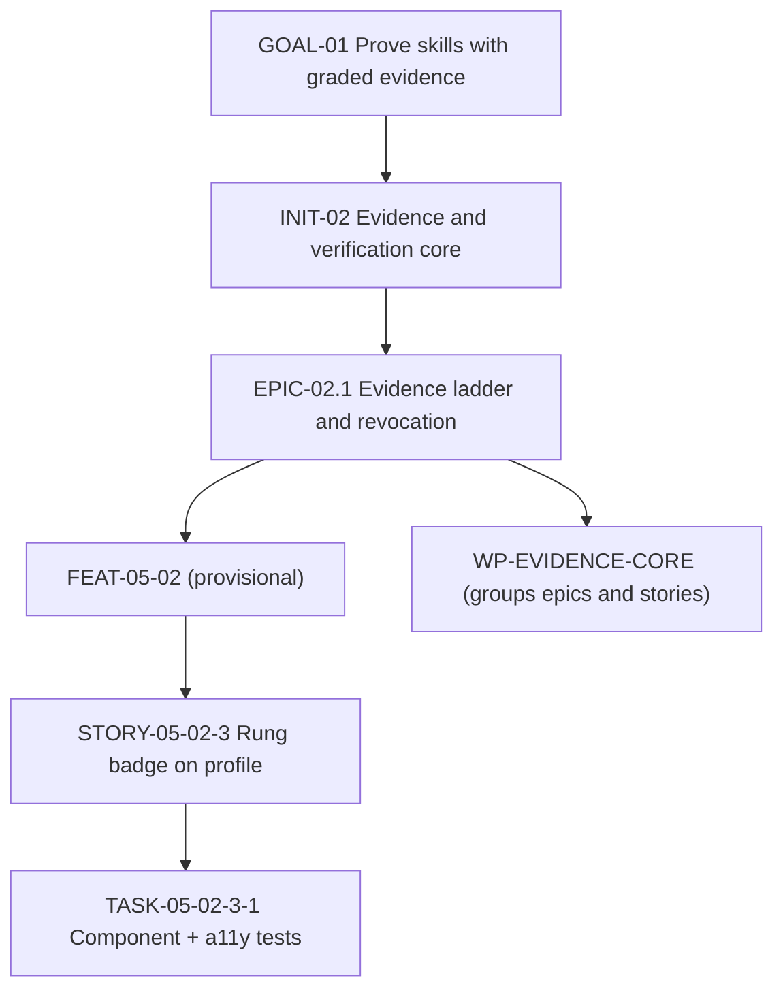
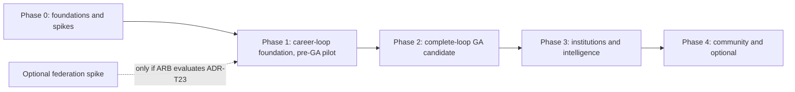
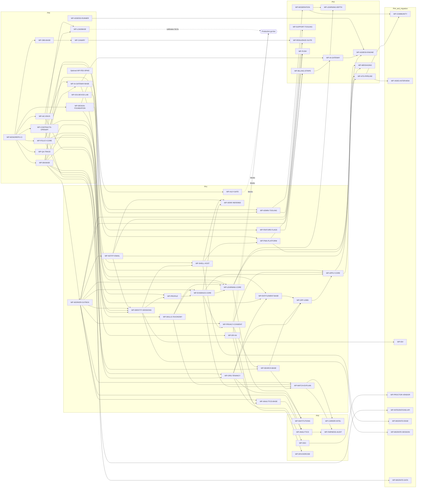
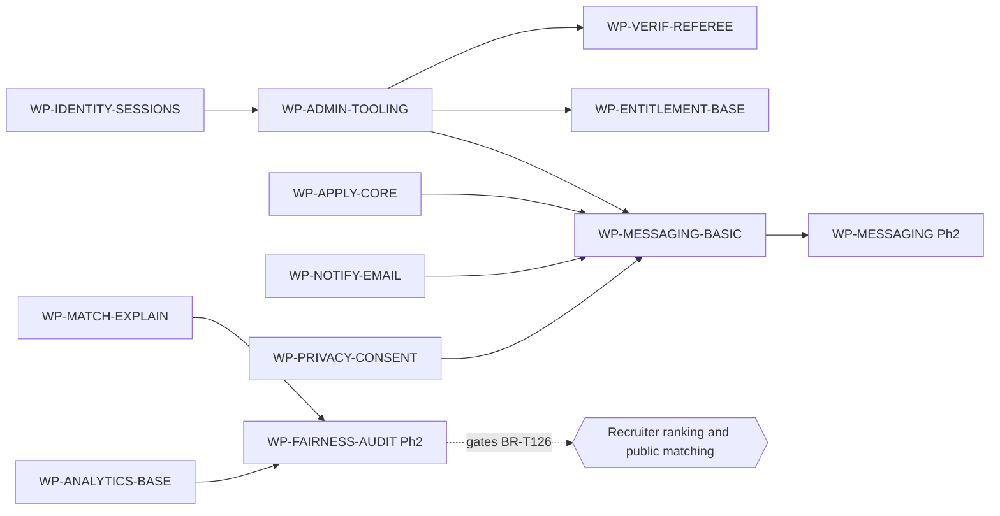

# Implementation Roadmap

Doc ID: RDM-01 · Owner: Program Director (with Architecture Review Board) · Version 1.0 · Status: Draft for Review · Relates: GOAL-01…GOAL-08, ADR-T01…T22, CC-INV, DOM-00, QA-AC §6.4, OPS-REL, OPS-SLO, RSK-REG, DEC-OPEN, MIG-01

> **Revision 2 folded in (2026-10-27)** from `ROADMAP_REV2.md`: appended under "Revision 2 additions"; where it differs from text above, the appended text governs. Status unchanged; proposals still need owner/ARB ratification.

**This roadmap contains no dates, durations or staffing numbers.** Sequencing is by dependency and exit gate. "Owner team" names a responsibility, not headcount. Nothing here claims any item is built.

## 1. Planning structure

| Level | ID form | Meaning | Example |
|---|---|---|---|
| Goal | `GOAL-NN` | Business outcome (STR-01) | GOAL-01 prove skills with graded evidence |
| Initiative | `INIT-NN` | Cross-team thrust toward goals | INIT-02 Evidence & verification core |
| Epic | `EPIC-<INIT>.<n>` | Deliverable capability inside an initiative | EPIC-02.1 Evidence ladder and revocation |
| Feature | `FEAT-<DOM>-NN` | User-visible capability (registry) | FEAT-05-02 Evidence ladder & revocation |
| Story | `STORY-<FEAT>-<n>` | Independently deliverable slice with AC | STORY-05-02-3 Show rung badge on candidate profile |
| Task | `TASK-<STORY>-<n>` | Engineering action | TASK-05-02-3-1 Add rung badge component + a11y tests |
| **Work package** | `WP-<NAME>` | Planning/delivery unit grouping epics and stories into a coherent, releasable slice with one owner team and exit criteria | WP-EVIDENCE-CORE |

A WP is the unit tracked on the roadmap; stories and tasks live in the tracker and trace to AC/TEST ids (QA-AC §8).

## 2. Initiatives

| ID | Initiative | Goals | Phases |
|---|---|---|---|
| INIT-01 | Foundations: repo, CI, environments, policy, contracts, data base | GOAL-06, GOAL-08 | Ph0 |
| INIT-02 | Evidence & verification core | GOAL-01 | Ph1 |
| INIT-03 | Identity, tenancy, privacy | GOAL-06 | Ph1 |
| INIT-04 | PWA platform and federation | GOAL-08 | Ph0–Ph1 |
| INIT-05 | Opportunities and applications | GOAL-02 | Ph1–Ph2 |
| INIT-06 | Matching and search | GOAL-02, GOAL-03 | Ph1–Ph2 |
| INIT-07 | Learning and assessment | GOAL-04 | Ph1–Ph2 |
| INIT-08 | Messaging, notifications, engagement | GOAL-02 | Ph1–Ph2 |
| INIT-09 | Monetisation and entitlements | GOAL-07 | Ph2 |
| INIT-10 | AI gateway and governance | GOAL-07, GOAL-03 | Ph0 foundation; Ph2 provider features |
| INIT-11 | Trust, safety and operations | GOAL-06 | Ph1–Ph3 |
| INIT-12 | Institutions and intelligence | GOAL-05, GOAL-04 | Ph3 |
| INIT-13 | Reliability, observability and DR | GOAL-08 | Ph0–Ph3 |
| INIT-14 | Migration from reference (if applicable) | GOAL-06 | Ph1–Ph2 |
| INIT-15 | Community and optional capabilities | GOAL-01 | Ph4 |

## 3. Workstreams

| ID | Workstream | Scope | Owner team | Principal WPs |
|---|---|---|---|---|
| WS-01 | Foundations | Monorepo, CI, IaC, environments, config | Platform Eng | WP-MONOREPO-CI, WP-IAC-ENVS |
| WS-02 | Identity | Accounts, sessions, passkeys, SSO | Identity | WP-IDENTITY-SESSIONS, WP-SSO |
| WS-03 | PWA platform | Service worker, offline tiers, install, push | Frontend Platform | WP-PWA-PLATFORM, WP-PUSH |
| WS-04 | Federation infrastructure | Host contract, registry, manifest, compat gates | Frontend Platform | WP-FED-SPIKE, WP-SHELL-HOST |
| WS-05 | Design system | Tokens, components, a11y | Design System | WP-DESIGN-FOUNDATION, WP-A11Y-GATE |
| WS-06 | Core modules (UI) | Remotes: candidate, learning, opportunities, hiring, messaging, account, admin | Feature teams | per feature WP |
| WS-07 | Backend | Modular monolith modules, policy, worker | Backend teams | WP-POLICY-CORE, WP-WORKER-OUTBOX |
| WS-08 | Data | Schema, RLS, migrations, search, analytics store | Data Eng | WP-DB-BASE, WP-SEARCH-BASE, WP-ANALYTICS |
| WS-09 | Integrations | Email, Stripe, push, AI, SSO, public API | Integrations | WP-NOTIFY-EMAIL, WP-BILLING-STRIPE, WP-INTEGRATIONS-API |
| WS-10 | Security | Threat modelling, pen test, secrets, privacy engineering | Security | WP-PRIVACY-CONSENT, WP-ADMIN-TOOLING |
| WS-11 | Reliability | SLOs, load baseline, HA/DR, resilience | SRE | WP-LOADBASE, WP-DR-HA, WP-DR-EXERCISE |
| WS-12 | Observability | OTel, dashboards, alerts, RUM | SRE | WP-OBS-BASE |
| WS-13 | Testing | Catalog automation, traceability, device lab | QA | WP-QA-TRACE, WP-IOS-DEVICE-LAB |
| WS-14 | Operations | Support tooling, runbooks, moderation, comms | Support Ops, T&S | WP-SUPPORT-TOOLING, WP-MODERATION |
| WS-15 | Release | Canary, flags, rollback, change management | Release Eng | WP-CANARY, WP-FEATURE-FLAGS |

## 4. Phases

## 5. Work packages

Common elements per WP unless overridden: Definition of Done = **DoD-WP** (QA-AC §6.4) plus the "DoD+" column. "Tests / Acceptance" lists exact or explicitly grouped AC ids and TEST ids from QA-CAT. In this roadmap, `AC-<domain>-<feature>-*` means all currently registered criteria for `FEAT-<domain>-<feature>`; `AC-00-<area>-*` means all currently registered platform criteria in that area. Neither form includes unregistered criteria. A missing criterion is written `FEAT-xx-yy (AC pending; OPEN-29)` and is not covered by a nearby test. Failure handling references OPS-FMEA rows. Team abbreviations: PE Platform Eng, FP Frontend Platform, DS Design System, ID Identity, CA Candidate team, HI Hiring team, LE Learning team, DA Data Eng, SRE, SE Security, QA, SO Support Ops, CO Commercial Ops, ME Messaging, AI AI team, TS Trust & Safety, RE Release Eng, IN Institutions team, FIN Finance Ops.

### 5.1 Phase 0 — foundations and spikes

| WP | Scope and value | Owner | Depends on | API / data / UI | Security and failure handling | Tests / acceptance | DoD+ |
|---|---|---|---|---|---|---|---|
| WP-FED-SPIKE | Optional: only if the ARB wants to evaluate federation under proposed ADR-T23. Prove or refute Module Federation 2.0 + Vite: host/remote, singleton deps, integrity strategy, fallback/rollback, SW interaction and performance delta vs bundled. | FP | none | Throwaway shell + 2 remotes; no production API or registry rollout | Reject integrity/version mismatch; test outage fallback | TEST-FED-001/003/005/009, TEST-PER-004, TEST-PWA-001; AC-00-02-01…06; report against activation gates | If not run, bundled remains the baseline; no federated pipeline or signing infrastructure is implied |
| WP-AI-GATEWAY-BASE | Establish the AI Gateway contract and enforcement boundary: typed provider port, authorization, budget/entitlement check, `AI_PROHIBITED` propagation, redaction and audit shape. No provider inference or paid call in Phase 0/1. | AI + SE + PE | WP-MONOREPO-CI, WP-POLICY-CORE, WP-CONTRACTS-OPENAPI | `api/ai` contract, policy action and test harness | Deny by default; assessment prohibition applies at gateway; no secrets/client calls | TEST-ASM-005…009 contract cases; AI policy/invariant acceptance criteria; OPEN-24 provider terms remain a gate | Prohibited-mode and entitlement denial tests pass against a stub; provider execution is out of scope until owner-approved cost policy and OPEN-24 |
| WP-ASSESS-RUNNER | **Decision spike**: build vs buy for isolated, network-less code-execution runner (ADR-T13); threat model, isolation technique options, cost per execution, startup latency, ops burden. Value: unlock verified code assessments honestly (OPEN-27) | LE + SE | none | Runner interface contract; no UI | Escape/egress threat model; fail closed to `unverified`; resource limits | TEST-ASM-002/003 designs; decision memo; security review | Decision logged (OPEN-27); until shipped, all code submissions `unverified` |
| WP-IOS-DEVICE-LAB | Establish device matrix and method for real iOS/Android validation: install, push-after-gesture, storage eviction, no background sync, WebKit behaviours (OPEN-12). Value: replace secondary-source assumptions with evidence (RES-01 R2) | QA + FP | none | Device inventory, scripts, results register | n/a (test infra); privacy of test accounts | TEST-MOB-001…006, TEST-PWA-010/011; AC-00-04-01/02/05 | Verified platform capability matrix published (FF-09 input); OPEN-12 resolved or narrowed |
| WP-MONOREPO-CI | Monorepo layout, task graph, affected-only builds, lint rules (FF-01, FF-02, FF-03, FF-07, FF-10 scaffolding), gates RG-01/02/04, SBOM + signing | PE + RE | none | `apps/*`, `packages/*`, CI pipelines | Secret scanning; least-privilege CI tokens; supply-chain gates | TEST-SEC-001, TEST-SEC-015, TEST-API-001/003/006, TEST-DEP-004/006, TEST-DAT-001 | CI runs on a sample module end-to-end; gate waiver mechanism audited |
| WP-IAC-ENVS | Environments from IaC (dev/ci/staging), secrets management, config schema; hosting decision implemented for staging (OPEN-14, 21, 22) | PE + SRE | WP-MONOREPO-CI | Env stacks, secret manager | Staging/production isolation; no prod secrets in staging | TEST-DEP-007/008; rebuild drill | Environment rebuilt from scratch successfully (SLO-35 rehearsal) |
| WP-POLICY-CORE | `packages/policy`: `can(principal, action, resource)`, deny-by-default, capabilities endpoint, route registry with required policy action, permission matrix as data (USR-01) | PE + SE | WP-MONOREPO-CI | `GET /me/capabilities`; policy decision log | Deny-by-default; decisions audited; policy versioning/rollback (FM-15) | TEST-SEC-001/002/003/004…008, TEST-API-014; AC-00-01-01; FEAT-01-09 (AC pending; OPEN-29) | Matrix tests generated from USR-01 pass; negative control demonstrated |
| WP-CONTRACTS-OPENAPI | Zod contracts → OpenAPI 3.1, problem+json error types, cursor pagination, `Idempotency-Key` and ETag middleware, AsyncAPI scaffolding | PE | WP-MONOREPO-CI | `packages/contracts`; middleware | Idempotency store failure behaviour (FM-16) | TEST-API-001…005, TEST-HIR-008/009; AC-00-01-04/05/06/07/08/10 | oasdiff gate live; example endpoints conform |
| WP-DB-BASE | Schema baseline: tenancy columns + RLS pattern, repository layer, `withOutbox`, audit table, migration lint, expand/contract tooling, pooler | DA + PE | WP-MONOREPO-CI, WP-IAC-ENVS | Postgres schemas; migration runner | RLS enforced for app role; append-only audit; lock budgets | TEST-TEN-001/002/003, TEST-API-008, TEST-DAT-001/002/003/009, TEST-OBS-003 | Tenant canary harness (FF-05) running in CI |
| WP-OBS-BASE | OTel baseline: Pino redaction, traces shell→API→worker, RUM skeleton, dashboards/alerts as code, synthetic framework | SRE | WP-MONOREPO-CI | `packages/observability`; collector | Redaction tests; telemetry never blocks requests (FM-23) | TEST-SEC-016, TEST-FED-011, TEST-OBS-001/002; AC-00-03-01 | Golden-signal dashboards for skeleton service; burn-rate alert test fires |
| WP-LOADBASE | Load/performance harness and baseline method: scenarios by API class, RMP-1 Lighthouse CI, corpus generator, calibration notes for SLO numbers | SRE + QA | WP-IAC-ENVS, WP-CONTRACTS-OPENAPI | k6-class scripts; datasets | Synthetic data only | TEST-PER-001/002/003/006/007; AC-00-06-01 | Calibration note per SLO (OPEN-15); targets promoted from hypothesis to commitment only after this |
| WP-DESIGN-FOUNDATION | Tokens (`packages/ui`), core components, a11y baselines, state patterns (empty/loading/error/offline/denied), remote-slot skeleton | DS | WP-MONOREPO-CI | Component library | Target-size, focus, contrast; reduced motion | TEST-A11-001/002/003/004/005/006, TEST-EVD-008; AC-00-07-* | Accessibility checks in CI; documented patterns |
| WP-QA-TRACE | Convert QA-CAT/AC to structured data; coverage lint (INV/FF/AC ↔ TEST), CI reports | QA | WP-MONOREPO-CI | `tools/` catalog lint | n/a | QA-STRAT §11; coverage report | Orphan detection blocks merge for R1 areas |
| WP-CANARY | Progressive delivery pipeline: cohort routing, automated halt/rollback, release record and compatibility matrix (RG-11/12). Federation-specific registry cohort resolution is conditional on activation. | RE + SRE | WP-OBS-BASE | Release controller; registry adapter only if federation is activated | Safe defaults; rollback rehearsal | TEST-DEP-001/002/003/005; federation cases only if activated | Rollback rehearsed in staging per OPS-REL §10 |

### 5.2 Phase 1 — career-loop foundation (pre-GA pilot)

Phase 1 delivers a candidate path through first-party learning, practice, evidence, verification, discovery, explainable matching and application. It is a controlled pilot stage, **not GA**: it does not yet complete the SSOT-required interview → outcome → new-evidence loop. Phase 1 release must stay limited to an explicitly scoped pilot; the product owner must approve the cohort and scope before any pilot exposure.

| WP | Scope and value | Owner | Depends on | API / data / UI | Security and failure handling | Tests / acceptance | DoD+ |
|---|---|---|---|---|---|---|---|
| WP-IDENTITY-SESSIONS | Sign-up/in, cookie BFF, 15-min access + rotating refresh with reuse detection (BR-T050), passkeys + password, recovery, logout cache clear | ID | WP-POLICY-CORE, WP-DB-BASE, WP-WORKER-OUTBOX, WP-NOTIFY-EMAIL | `/auth/*`; account, session, passkey tables; shell login UI | httpOnly/SameSite cookies, CSRF defence, rate limits fail-closed, clock tolerance | TEST-SEC-010/011/017/021, TEST-PWA-003, TEST-REL-010; AC-01-01-*, AC-01-02-*, AC-01-03-*, AC-01-04-*, AC-01-05-*, AC-01-06-* | Account-recovery journey tested; no token in JS-readable storage |
| WP-SHELL-HOST | PWA shell with route-level lazy chunks and typed module contract; session, capabilities, error boundaries and offline lifecycle. Bundled mode is the proposed baseline; registry/remote loading is conditional. | FP | WP-DESIGN-FOUNDATION, WP-IDENTITY-SESSIONS | Host contract types; static bundled module loader | Server authorization; CSP; route error boundaries | TEST-SEC-012/013/014, TEST-A11-007; federation tests only if activated | Bundled mode passes J13; no registry/signing pipeline required unless ADR-T23 is ratified |
| WP-PWA-PLATFORM | Service worker (versioned caches, update flow, kill switch), offline tiers (ADR-T10), install UX, IndexedDB owner cache with logout wipe | FP | WP-SHELL-HOST, WP-IOS-DEVICE-LAB | SW; queue library; conflict UI | No cross-user cache leakage; server revalidation of queued writes; WebKit fallbacks | TEST-PWA-001…012, TEST-MOB-003/004; AC-00-04-* | Device-lab pass; kill-switch drill |
| WP-ORG-TENANCY | Organizations, memberships, role grants (`org_owner`…), tenant bootstrap, role-change enforcement | ID + HI | WP-POLICY-CORE, WP-DB-BASE | `api/orgs`; org admin UI in MOD-ADM | RLS + policy; immediate removal effect | TEST-TEN-001…007, TEST-SEC-003; AC-02-02.1-01, AC-02-02.3-01, AC-02-03-01, AC-02-03.1-01; FEAT-02-01 (AC pending; OPEN-29) | Tenant canary extended to org tables |
| WP-PROFILE | Profile, portfolio, resume variants (basic), public profile fields | CA | WP-IDENTITY-SESSIONS, WP-DESIGN-FOUNDATION | `api/profile`; MOD-CAND | Input sanitisation; SSRF guard on imports; offline drafts | TEST-SEC-018/028, TEST-PWA-005; AC-03-01-*, AC-03-02-*, AC-03-06-*, AC-03-08-* | Conflict UX validated |
| WP-SKILLS-TAXONOMY | Skills graph and taxonomy read model, merge/alias handling | DA + CA | WP-DB-BASE | `api/skills`; read API | Versioned taxonomy; merge events | FEAT-04-01/02 (AC pending; OPEN-29); TEST-API-007 only covers event compatibility | Seed taxonomy from reviewed source (licence check) |
| WP-EVIDENCE-CORE | Evidence items, artefact upload, malware scan, SM-EVIDENCE, ladder display, revocation + async recompute (BR-T005) | CA + SE | WP-PROFILE, WP-WORKER-OUTBOX, WP-SKILLS-TAXONOMY | `api/evidence`; object storage; scan worker; MOD-CAND UI | Scan-before-visible; IDOR-safe downloads; honest labelling | TEST-EVD-001/002/003/007/008/009, TEST-SEC-005/007/019/020/026; AC-05-01-*, AC-05-02-*, AC-05-05-*, AC-05-12-* | INV-T04/T08 tests with negative controls |
| WP-VERIF-REFEREE | Work-history verification, email-code and referee token flows (hashed, single-use, expiring), reminders and expiry (BR-T004), no-account referee UX | CA + ME | WP-EVIDENCE-CORE, WP-NOTIFY-EMAIL, WP-SHELL-HOST | `api/verification`; referee mini-app (shell-hosted public route) | INV-T05; rate limits; email-outage degrade | TEST-EVD-004/005/006/010/011, TEST-REL-003; AC-06-01-*, AC-06-02-*, AC-06-03-*, AC-06-04-*, AC-06-10-*; referee completes in target time per persona P4 | Usability test with referee persona (OPEN-07) |
| WP-OPP-JOBS | Job postings, templates, saved searches, alerts (basic), job lifecycle | HI | WP-ORG-TENANCY, WP-SEARCH-BASE, WP-ENTITLEMENT-BASE | `api/jobs`; MOD-HIR/MOD-OPP | Posting limits by entitlement, moderation hooks | TEST-HIR-013; AC-09-01-*, AC-09-02-*, AC-09-03-*, AC-09-05-01, AC-09-08-01; FEAT-09-04/06 (AC pending; OPEN-29) | Public job pages meet SLO-13; slot-cap policy is set before launch |
| WP-APPLY-CORE | Application submit/withdraw, one active per (candidate, job), idempotency, drafts offline, evidence attach | HI + CA | WP-OPP-JOBS, WP-EVIDENCE-CORE, WP-PRIVACY-CONSENT, WP-CONTRACTS-OPENAPI | `api/applications`; MOD-OPP | BR-T001; consent snapshot for shared evidence; Phase 1 uses the free-tier baseline; partial-failure compensation | TEST-HIR-001/008/009/010, TEST-API-011, TEST-PWA-006/007; AC-10-01-*, AC-10-02-*, AC-10-03-*, AC-10-14-* | Chaos test on mid-operation failures; consent and entitlement denial cases are explicit |
| WP-WORKER-OUTBOX | Worker process, outbox dispatcher, job classes P0–P3, fenced leases, DLQ, periodic scheduler | PE | WP-DB-BASE | `apps/worker`; job tables | Fencing, dedupe, backpressure | TEST-API-008/009/010, TEST-REL-004/005; FEAT-24-01/02/09 (AC pending; OPEN-29) | Duplicate-execution probe passes (FM-36) |
| WP-ANALYTICS-BASE | Consent-gated event taxonomy and ingestion for the core-loop pilot; basic aggregate funnel counters only, with no individual-level recruiter analytics or experimentation | DA + SE | WP-PRIVACY-CONSENT, WP-WORKER-OUTBOX | `api/analytics`; event schema registry and minimal aggregate read model | Purpose-bound events; consent checked at capture and processing; identifiers minimized and redacted | TEST-PRV-006, TEST-TEN-005; FEAT-21-01 (AC pending; OPEN-29) | Consent withdrawal stops future eligible events; core-loop counters can be calculated without exposing individual activity |
| WP-NOTIFY-EMAIL | Notification preferences, email provider port (Brevo default), templates, suppression, in-app notifications | ME | WP-WORKER-OUTBOX | `api/notify`; MOD-MSG notifications | Provider breaker; no secrets in templates; accessibility of emails | TEST-REL-003, TEST-MSG-001; AC-15-02.1-01, AC-15-02.2-01, AC-15-05.1-01; FEAT-15-02/05 (AC pending; OPEN-29) | Deliverability setup (DKIM/SPF/DMARC) verified [OPEN-26] |
| WP-PRIVACY-CONSENT | Consent scopes (purpose-bound, versioned, revocable), recruiter access gating, data export, erasure orchestration (BR-T060) | SE + DA | WP-EVIDENCE-CORE, WP-WORKER-OUTBOX | `api/privacy`; MOD-ACC | INV-T15; erasure across stores; retention list [OPEN-08] | TEST-SEC-009, TEST-PRV-001…004; AC-22-01-*, AC-22-02-*, AC-22-03-* | Erasure verified against search, cache, storage |
| WP-SEARCH-BASE | Postgres FTS + trigram behind `SearchPort`; index maintenance; tenant-safe job search. Semantic/vector search remains later. | DA | WP-DB-BASE, WP-PRIVACY-CONSENT | `api/search`; search UI | Sanitised queries; tenant isolation; candidate search visibility checks current consent epoch | TEST-TEN-004, TEST-SRC-001/002, TEST-PER-002; AC-11-01-* | ADR-T11 trigger test in place; no stale-consent result is returned |
| WP-ENTITLEMENT-BASE | Enforce the free-tier baseline and audited admin compensation using BR-T090/T091; apply the configured job-slot limit from BR-T093. No checkout or paid AI call. Numeric plan/slot values remain gated by OPEN-05/19. | CO + PE | WP-POLICY-CORE, WP-DB-BASE, WP-ORG-TENANCY | `api/billing` entitlement port consumed by `api/jobs` and `api/applications` | Server-derived only; no client/redirect grants; audit every compensation; fail closed on unknown entitlement | BR-T090/T091/T093 policy, concurrency and negative tests; AC-16-04-* for registered entitlement behavior; free-tier-specific criteria remain OPEN-29 | Finance/Product sets the free-tier slot value before launch; candidate core loop remains free |
| WP-LEARNING-CORE | Minimum first-party learning path: free course catalogue, enrolment, lesson content/progress, completion rule, non-graded practice and a link to evidence. No marketplace, instructor payouts, or evidence-minting assessment. | LE | WP-EVIDENCE-CORE, WP-SKILLS-TAXONOMY, WP-WORKER-OUTBOX, WP-AI-GATEWAY-BASE | `api/learning`; MOD-LRN | Accessible content; scanned uploads; learner-owned progress; AI_PROHIBITED enforced; practice cannot mint verified assessment evidence; course-completion issuer trust remains gated by REVW-12 | AC-08-02-*, AC-08-03-*, AC-08-04-*; FEAT-08-01 and FEAT-07-11 (AC pending; OPEN-29); basic practice journey tests | One learner can set a skill goal, complete a lesson, practice safely, and see evidence/provenance; content is first-party and reviewed |
| WP-MATCH-EXPLAIN | Minimum candidate-facing, non-AI job match: compare job requirements with candidate skills/evidence and show matched/missing factors plus uncertainty. No recruiter ranking, auto-reject, or consequential recommendation. | HI + CA | WP-SEARCH-BASE, WP-EVIDENCE-CORE, WP-SKILLS-TAXONOMY, WP-WORKER-OUTBOX | `api/matching`; candidate explanation UI | INV-T19; allowed inputs only; candidate can inspect factors; no employer-side decision output | FEAT-11-01…03/07 acceptance criteria; explanation and forbidden-input tests | Candidate can find a job, see why it may fit, and apply; match output is advisory and explainable |
| WP-ADMIN-TOOLING | Admin/support minimal console: audited reads, privileged access grants (≤ 4 h, BR-T041), account actions, feature flag admin, audit viewer | SE + SO | WP-POLICY-CORE, WP-DB-BASE | `api/admin`; MOD-ADM | INV-T18; two-person approvals; no raw SQL | TEST-SEC-022/023, TEST-OBS-003; FEAT-20-01/02/03 (AC pending; OPEN-29); AC-20-02.3-01 covers grant notification only | PROC-01, PROC-04 walkthrough executed |
| WP-FEATURE-FLAGS | Server-side flags with audit, kill switches, SW and degradation ladder flags | RE + PE | WP-DB-BASE | `api/platform`; admin UI | Safe defaults; flag changes audited | TEST-DEP-005, TEST-PWA-009; FEAT-20-04 (AC pending; OPEN-29) | Kill switch list per R1/R2 feature |
| WP-DR-HA | HA Postgres + PITR + object versioning + encrypted off-site backups; restore drill; backup SLIs | SRE | WP-IAC-ENVS | Infra modules | Separate failure domain; backup access control | TEST-REL-001, TEST-REC-001/002/003/005; SLO-30/31 | **Production go-live blocker:** restore drill passed (RG-14) |
| WP-A11Y-GATE | Accessibility gates and audits for core flows; screen reader testing; conformance work list | DS + QA | WP-DESIGN-FOUNDATION | n/a | n/a | TEST-A11-001…007; GOAL-06 | Independent audit scheduled for core flows (OPEN-37) |

### 5.3 Phase 2 — complete-loop GA candidate

Phase 2 adds the human hiring and learning depth needed to close the SSOT/PRD career loop. GA cannot be declared until the gate in §7 demonstrates Goal → Gap → Learn → Practice → Prove → Verify → Discover → Match → Apply → Interview → Outcome → New Evidence end to end. The later phases remain expansion scope, not prerequisites for that loop unless their risks or dependencies make them so.

| WP | Scope and value | Owner | Depends on | API / data / UI | Security and failure handling | Tests / acceptance | DoD+ |
|---|---|---|---|---|---|---|---|
| WP-ATS-PIPELINE | Minimum human recruiter review, stage management with SM-APPLICATION, interview record, candidate-visible outcome, and outcome-to-new-evidence handoff; deeper notes, collaboration and bulk actions remain additive | HI | WP-APPLY-CORE, WP-NOTIFY-EMAIL | `api/applications` (pipeline); MOD-HIR | BR-T002; If-Match; no auto-reject; candidate controls whether outcome creates/shareable evidence | TEST-HIR-002/003/004; outcome/new-evidence ACs remain OPEN-29 until registered | A candidate can submit, receive a human review, record an interview and outcome, and continue with new evidence; concurrency test with two recruiters |
| WP-LEARNING-DEPTH | Instructor studio, richer course authoring, deeper learning paths and advanced content workflows. | LE | WP-LEARNING-CORE, WP-MODERATION | `api/learning`; MOD-LRN | Content scanning; moderation and version review | FEAT-08-06 (AC pending; OPEN-29); content and authoring tests | Content review checklist live (COM-OPS §13) |
| WP-ASSESS-ENGINE | Unified assessment engine, attempts, integrity sessions, human review/appeal, AI_PROHIBITED enforcement; code tasks only if runner decided (OPEN-27) | LE + SE | WP-LEARNING-CORE, WP-AI-GATEWAY, WP-ASSESS-RUNNER | `api/assessment`; MOD-LRN | ADR-T13; INV-T20; idempotent submit | TEST-ASM-001…004, 010, 011; AC-07-02-*, AC-07-03-*, AC-07-04-*, AC-07-05-*; FEAT-07-01/06/07 (AC pending; OPEN-29) | No simulated pass anywhere |
| WP-MESSAGING | Conversations, consented threads, outreach quota, compose offline queue | ME | WP-APPLY-CORE, WP-PWA-PLATFORM | `api/messaging`; MOD-MSG | IDOR-safe; flagged-only moderator visibility | TEST-SEC-006, TEST-PWA-008, TEST-MSG-002; AC-13-01-* | Message idempotency verified |
| WP-BILLING-STRIPE | Stripe Checkout/Portal/webhooks, entitlement derivation, dunning flows, reconciliation job | CO + PE | WP-FEATURE-FLAGS, WP-WORKER-OUTBOX | `api/billing`; MOD-ACC | INV-T17; signature verify; replay-safe; outage behaviour | TEST-BIL-001…007; AC-16-02-01…05, AC-16-03-01…06, AC-16-04-01…06, AC-16-07-01; portal/refund criteria pending OPEN-29 | Tax approach decided (OPEN-18); refund policy approved (OPEN-33) |
| WP-AI-GATEWAY | Provider execution through the Phase-0 gateway contract: model routing, budgets, approved provider terms, logging, kill switch and user-facing AI calls. | AI | WP-AI-GATEWAY-BASE, WP-FEATURE-FLAGS, WP-BILLING-STRIPE | `api/ai` | INV-T06/T07/T08/T09; breaker; prompt-injection hygiene | TEST-ASM-005…009; FEAT-17-01/02 (AC pending; OPEN-29) | Provider terms and explicit cost policy approved (OPEN-24) |
| WP-MODERATION | Report flow, moderation queue, actions, appeals tooling, audit | TS | WP-ADMIN-TOOLING | `api/safety`; MOD-ADM | INV-T09; evidence preservation | TEST-MSG-002; AC-19-01.1-01; FEAT-19-02 (AC pending; OPEN-29) | PROC-05, PROC-15 exercised |
| WP-PUSH | Web Push (VAPID) for installed PWAs, contextual prompt after gesture, subscription hygiene | FP + ME | WP-PWA-PLATFORM, WP-NOTIFY-EMAIL | `api/notify` push endpoints | Fallback to email/in-app; prune dead subscriptions | TEST-PWA-011, TEST-MOB-001/002, TEST-MSG-001 | Reach measured (MET-049) vs ADR-T02 trigger |
| WP-SUPPORT-TOOLING | Helpdesk integration, support code correlation, macros, SLA reporting | SO | WP-ADMIN-TOOLING | Integrations | Redaction; retention | PROC-03 acceptance; MET-033/034 | Helpdesk decision recorded (OPEN-38) |
| WP-RESILIENCE-SUITE | Automated fault-injection suite and first game day; resilience nightly | SRE + QA | WP-CANARY, WP-WORKER-OUTBOX | n/a | n/a | TEST-REL-001…012; RG-10 | Game-day report updates OPS-FMEA |

### 5.4 Phase 3 — institutions and intelligence

| WP | Scope and value | Owner | Depends on | API / data / UI | Security and failure handling | Tests / acceptance | DoD+ |
|---|---|---|---|---|---|---|---|
| WP-INSTITUTIONS | Institution tenants, cohorts import/activation, faculty views with consent boundaries, credential approval | IN | WP-ORG-TENANCY, WP-LEARNING-CORE | `api/institutions`; MOD-ADM institution workspace | INV-T03/T15; learner ownership; minors rule (OPEN-09) | TEST-MSG-003, TEST-TEN-005; AC-18-01-*, AC-18-02-*, AC-18-03-*, AC-18-04-*, AC-18-06-*, AC-18-07-* | Cohort import dry-run + undo |
| WP-CAREER-INTEL | Readiness, transitions, salary insights (explainable, uncertainty) | CA + DA | WP-MATCH-EXPLAIN | `api/careerintel` | No autonomous decisions; data provenance | FEAT-12-01…07 (AC pending; OPEN-29) | Data sources licensed/validated |
| WP-ANALYTICS | Full event pipeline, metrics catalogue implementation, dashboards, k-anonymous reporting and approved warehouse flow | DA | WP-ANALYTICS-BASE, WP-WORKER-OUTBOX | `api/analytics`; warehouse | Privacy classes, pseudonymisation | TEST-PRV-006, TEST-TEN-005; ANL-MET | Metric definitions as code |
| WP-SSO | OIDC/SAML SSO for orgs, break-glass admin | ID | WP-ORG-TENANCY | `api/identity` | Signature/nonce validation; IdP outage | TEST-SEC-024; FEAT-01-08 (AC pending; OPEN-29) | Customer IdP interop checklist |
| WP-FAIRNESS-AUDIT | Adverse-impact audit job, voluntary self-ID store, reporting, review process | DA + SE | WP-MATCH-EXPLAIN, WP-ANALYTICS | P3 store | Strict access; small-cell suppression | TEST-HIR-007; MET-014 | Method reviewed with counsel/advisor (OPEN-08) |
| WP-DR-EXERCISE | Zone/region DR exercise per decision, runbook validation | SRE | WP-DR-HA | Infra | Out-of-band comms | TEST-REC-004; SLO-33 | Measured RTO/RPO recorded; OPEN-23 closed |

### 5.5 Phase 4 — community and optional

| WP | Scope and value | Owner | Depends on | Notes |
|---|---|---|---|---|
| WP-COMMUNITY | Groups, events, articles (DOM-14) | Community team | Ph3 exit, moderation maturity | Only if justified by retention data (ADR-T01 revisit); moderation capacity (OPEN-32); tests R3 |
| WP-VIDEO-INTERVIEW | Video interview recording/feedback | HI | WP-ATS-PIPELINE | Build-vs-buy decision; consent; storage cost (FIN-COST) |
| WP-IDV | Identity verification integration | ID + Privacy | OPEN-10 | Vendor-gated; sensitive data handling (VR-10) |
| WP-PROCTOR-VENDOR | Proctoring integration | LE | WP-ASSESS-ENGINE, OPEN-28 | Vendor-gated; human review; bias/accessibility review |
| WP-INTEGRATIONS-API | Public/partner API, API keys (ROLE-SVC), webhooks outbound | PE | WP-CONTRACTS-OPENAPI | `api/integrations` | Scoped keys, rate limits, versioning; deferred to align with FEAT-23-01/02 Phase 4 |

### 5.6 Migration packages (only if OPEN-17 confirms migration need)

| WP | Scope | Owner | Depends on | Notes |
|---|---|---|---|---|
| WP-MIGRATE-EDGE | Routing facade and parallel-run harness (MIG-01 §3) | PE | WP-SHELL-HOST | Strangler routing |
| WP-MIGRATE-SESSION | Token → cookie session cutover (MIG-01 §4) | ID | WP-IDENTITY-SESSIONS | Exchange endpoint, sunset |
| WP-MIGRATE-DATA | Execution of REFERENCE_TO_TARGET_DATA_MIGRATION plan (owned by data-migration team) | DA | WP-DB-BASE | Reconciliation (TEST-DAT-006) |

Total work packages: **60** (Ph0 14, Ph1 22, Ph2 10, Ph3 6, Ph4 5, migration 3), counted from the table rows.

## 6. Dependency graph (key edges)

## 7. Release gates across phases

| Gate | Condition |
|---|---|
| Ph0→Ph1 | Spike decisions recorded (OPEN-03, OPEN-11, OPEN-12, OPEN-14, OPEN-27 resolved or consciously deferred with fallback); FF-01/FF-05/FF-10 lint live |
| Ph1 → controlled pilot (pre-GA) | Pilot cohort, purposes, support and stop conditions are approved and bounded; RG-01…RG-09, RG-12, RG-14; restore drill passed; HA failover tested; tenant canary + IDOR suite green; accessibility core audit; incident response staffed (OPEN-39); runbooks for FM top-10 proven; SLOs calibrated. This gate does not authorize GA. |
| Ph1→Ph2 | Core-loop SLOs met over observation period; no open Sev-1/2 security defects |
| Ph2 → GA | End-to-end evidence shows the SSOT loop: goal/gap, learning/practice, proof and verification, discovery/match, application, human interview and outcome, then candidate-controlled new evidence. Consent, permissions, accessibility, audit and failure/recovery ACs are satisfied; no open Sev-1/2 defects; applicable RGs pass. AC/test IDs for the full loop must be registered under OPEN-29 before implementation readiness is claimed. |
| Ph2→Ph3 | GA gate passed; resilience nightly green; canary pipeline in use; billing reconciliation clean; fairness reporting live |
| Ph3→Ph4 | DR exercise result accepted; institution privacy tests; moderation capacity (OPEN-32) |
| Every WP | DoD-WP + DoD+; INV/FF tests for its scope green (QA-STRAT §9) |

## 8. Spike definitions

| Spike | Question | Method | Success criteria | Output | Fallback |
|---|---|---|---|---|---|
| WP-FED-SPIKE | Does MF 2.0 + Vite meet contract (compat, rollback, perf, SRI/signed manifests, SW coexistence, a11y focus on remote swap)? | Prototype matrix: shell × 2 remotes × versions; fault injection; bundled-mode comparison | Δ_F ≤ SLO-17 budget; FED-001/003/005/009 pass; SW update safe | Decision memo; pinned versions; updated risk entries | `MF_MODE=bundled` (OPEN-03) |
| WP-ASSESS-RUNNER | Build vs buy a no-network code runner; isolation technique feasible within security and cost limits? | Threat model + prototype or vendor evaluation | Escape tests fail to escape; cost/latency measured with formulas | Decision (OPEN-27) | Keep code tasks `unverified` / omit code assessments |
| WP-IOS-DEVICE-LAB | What do iOS PWA install, push, storage and background behaviours actually do on supported versions? | Scripted tests on real devices | Verified matrix published; unknowns listed | FF-09 matrix; OPEN-12 closed | Reduce offline/push promises to what is proven |

## 9. Work-package Definition of Done

Common DoD-WP is QA-AC §6.4. In addition every WP must: link its stories to AC ids and TEST ids; update OPS-FMEA/runbooks when it adds a dependency; have kill switches where R1/R2; record new unknowns in OPEN_DECISIONS; show an operability review (dashboards, alerts, runbook links) before exit.

## 10. Not in scope for this roadmap

Dates, staffing, budgets, team structure, vendor selection outcomes. Those belong to planning once OPEN-14, OPEN-16, OPEN-19 and OPEN-39 are decided.

# Revision 2 additions (folded 2026-10-27 from `ROADMAP_REV2.md`)

## 1. What the current roadmap already satisfies (checked against REVW-10 and REVW-11)

| Finding point | Status in `ROADMAP.md` now | Evidence |
|---|---|---|
| REVW-11 (i) identity needs email and worker | Done | WP-IDENTITY-SESSIONS depends on WP-WORKER-OUTBOX and WP-NOTIFY-EMAIL |
| REVW-11 (ii) apply-core needs consent | Done | WP-APPLY-CORE depends on WP-PRIVACY-CONSENT |
| REVW-11 (iii) referee route needs the shell | Done | WP-VERIF-REFEREE depends on WP-SHELL-HOST |
| REVW-11 (iv) Phase 1 slot source | Done | WP-ENTITLEMENT-BASE (admin comp, free-tier slot, BR-T090/T093); BR-T090 gets the explicit "Phase 1 stub" text in BR-REG-R2 |
| REVW-11 (vi) candidate search needs the consent epoch | Done | WP-SEARCH-BASE depends on WP-PRIVACY-CONSENT |
| REVW-11 (vii) AC references that do not exist | Done with explicit "AC pending" markers; the criteria themselves are written in `SPEC_ACCEPTANCE_ADDITIONS_REV2.md` (section 4 below maps them) |
| REVW-10 demote AI gateway, assessments, billing checkout to Phase 2 | Done (AI gateway execution, assessment engine, Stripe checkout are Phase 2; WP-AI-GATEWAY-BASE is Phase 0 and policy-only) |
| REVW-10 "roadmap authoritative, regenerate capability-map phases" | Not complete; see `PCAP-01-R2` |
| REVW-34 public API later | Done (WP-INTEGRATIONS-API is Phase 4) |

## 2. Changes this overlay makes

| # | Change | Reason |
|---|---|---|
| R1 | New Phase 1 work package **WP-MESSAGING-BASIC** (section 3.1); WP-MESSAGING (Phase 2) narrowed to outreach | Binding decision REVW-10 lists basic messaging in Phase 1; the roadmap had no Phase 1 messaging |
| R2 | **WP-FAIRNESS-AUDIT moves from Phase 3 to Phase 2** and depends on WP-ANALYTICS-BASE instead of WP-ANALYTICS (section 3.2) | REVW-11 (v) and decision: the fairness audit gates public matching launch, Phase 2 |
| R3 | WP-IDENTITY-SESSIONS adds mandatory TOTP for staff and org owners (FEAT-01-07) | The Phase 1 admin console exists; BR-T044 requires MFA for privileged roles |
| R4 | WP-PWA-PLATFORM and WP-APPLY-CORE: Phase 1 offline is a **read cache plus local unsent drafts, with no outbox**; the outbox activates on the ADR-T10 trigger | REVW-24 decision |
| R5 | Second-phase learning commerce is **first-party courses only**; the third-party paid marketplace is deferred to Phase 3 behind an ADR on seller of record, payouts, tax/VAT and refunds | REVW-30 decision |
| R6 | WP-INSTITUTIONS delivers the institution workspace as **MOD-INS**, separate from back-office MOD-ADM | REVW-08 decision |
| R7 | New explicit edges and gate text (sections 3 and 5) | Dependency completeness |
| R8 | Work-package counts restated (section 6) | The count sentence changes with R1 and R2 |

## 3. Work-package changes

### 3.1 WP-MESSAGING-BASIC (new, Phase 1)

| Field | Content |
|---|---|
| Scope and value | Application-linked conversations between a candidate and the job's hiring team; block, report and mute (FEAT-13-01, FEAT-13-05). Reports land in the WP-ADMIN-TOOLING queue until WP-MODERATION. No recruiter outreach to non-applicants, no first-contact requests, no quota, no offline compose queue (those stay in WP-MESSAGING) |
| Owner | ME |
| Depends on | WP-APPLY-CORE, WP-NOTIFY-EMAIL, WP-ADMIN-TOOLING, WP-PRIVACY-CONSENT |
| API / data / UI | `api/messaging` (conversation kind `application` only); MOD-MSG |
| Security and failure handling | IDOR-safe (INV-T02); flagged-only moderator visibility; block is bidirectional (BR-T083); message edit window 5 min, delete is a tombstone (BR-T084) |
| Tests / acceptance | TEST-SEC-006, TEST-MSG-002; AC-13-01-*, AC-13-05-* (registered) |
| DoD+ | A candidate and a recruiter exchange messages on one application; a block stops delivery; a report reaches an admin |

**WP-MESSAGING (Phase 2) after this overlay:** outreach to non-applicants with quota, first-contact requests (SM-FIRSTCONTACT), compose offline queue; depends on WP-MESSAGING-BASIC, WP-PWA-PLATFORM and WP-ENTITLEMENT-BASE.

### 3.2 WP-FAIRNESS-AUDIT (moved to Phase 2)

| Field | Content |
|---|---|
| Scope and value | Adverse-impact audit job, voluntary self-ID store (audit-only attributes), report to ROLE-AUD, review process. Provides the baseline review that BR-T126 requires before recruiter-facing ranking or public matching is enabled. Dashboards stay with WP-ANALYTICS (Phase 3) |
| Owner | DA + SE |
| Depends on | WP-MATCH-EXPLAIN, WP-ANALYTICS-BASE (was: WP-ANALYTICS) |
| Security and failure handling | Strict access; small-cell suppression (k ≥ 5 style rule) |
| Tests / acceptance | TEST-HIR-007; MET-014; BR-T077 process test; flag-default-off test for `matching.recruiter_ranking` |
| DoD+ | Method reviewed with counsel or an advisor (OPEN-08); baseline run recorded; threshold of BR-T077 set |

The Phase 2 exit gate in RDM-01 section 7 already lists an adverse-impact job; the dependency now exists in the plan.

### 3.3 Scope text changes

| WP | Text added |
|---|---|
| WP-IDENTITY-SESSIONS | "Mandatory TOTP for platform staff and org owners (FEAT-01-07 scope .2); recovery codes." |
| WP-PWA-PLATFORM | "Phase 1 offline = versioned read cache and local unsent drafts (profile, application draft, message compose, note). The offline write outbox, retry queue and three-way merge activate on the ADR-T10 trigger (telemetry or research shows low-connectivity core use). One expiry and backoff table lives in OFF-01 (REVW-15)." |
| WP-APPLY-CORE | "'Drafts offline' means a local unsent draft; no queued write. Recruiter read-only access to the application snapshot (DT-01 row 4) is part of this package until WP-ATS-PIPELINE. Re-apply after withdrawal as a linked application (BR-T125, SM-APPLICATION t12)." |
| WP-BILLING-STRIPE | "Course purchase covers first-party (platform-sold) courses only. A third-party paid marketplace needs an ADR (seller of record, payouts, instructor identity, tax/VAT, refund-adjusted payouts) and is Phase 3 at the earliest." |
| WP-INSTITUTIONS | "Institution workspace is the MOD-INS remote or lazy chunk (`/institution/*`); back-office stays MOD-ADM, served behind an authenticated edge rule." |
| WP-ADMIN-TOOLING | "Minimal takedown and revoke actions with reason code and second-person approval (BR-T043, BR-T045); `dispute` referee outcomes and message reports are reviewed here until WP-MODERATION (gaps G1, G2 of PCAP-01-R2)." |
| WP-ORG-TENANCY | "Organization verification lifecycle SM-ORG (`verification_state`) and its un-verification effects (BR-T123)." |

## 4. Acceptance criteria that were "AC pending" in the roadmap

`SPEC_ACCEPTANCE_ADDITIONS_REV2.md` registers criteria for these features, which lets the roadmap's markers be replaced once the file is accepted:

| Work package | Feature | New criteria |
|---|---|---|
| WP-POLICY-CORE | FEAT-01-09 | AC-01-09-01 … 03 |
| WP-ORG-TENANCY | FEAT-02-01, FEAT-02-07 | AC-02-01-01 … 05, AC-02-07-01 … 03 |
| WP-SKILLS-TAXONOMY | FEAT-04-01, FEAT-04-02 | AC-04-01-01 … 03, AC-04-02-01 … 03 |
| WP-WORKER-OUTBOX | FEAT-24-01, 24-02, 24-09 | AC-24-01-01 … 03, AC-24-02-01 … 03, AC-24-09-01 … 02 |
| WP-NOTIFY-EMAIL | FEAT-15-01, 15-03, 15-06, 15-07 | AC-15-01-01 … 02, AC-15-03-01 … 02, AC-15-06-01 … 02, AC-15-07-01 … 03 |
| WP-ADMIN-TOOLING | FEAT-20-01, 20-03 | AC-20-01-01 … 03, AC-20-03-01 … 02 |
| WP-PRIVACY-CONSENT | FEAT-22-06 | AC-22-06-01 … 02 |
| WP-ANALYTICS-BASE | FEAT-21-01 | AC-21-01-01 … 02 |
| WP-AI-GATEWAY-BASE | FEAT-17-01, 17-02, 17-03 | AC-17-01-01 … 02, AC-17-02-01, AC-17-03-01 … 02 |
| WP-LEARNING-CORE | FEAT-08-01 | AC-08-01-01 … 02 |
| Platform plumbing | FEAT-24-04, 24-05, 24-08, 24-11 | AC-24-04-01 … 02, AC-24-05-01, AC-24-08-01, AC-24-11-01 |
| Phase 2 | FEAT-07-01, 16-01, 19-02, 19-08 | AC-07-01-01, AC-16-01-01, AC-19-02-01, AC-19-08-01 |

## 5. Dependency edges and gates

**Edges added or confirmed (all acyclic):** WP-MESSAGING-BASIC → {WP-APPLY-CORE, WP-NOTIFY-EMAIL, WP-ADMIN-TOOLING, WP-PRIVACY-CONSENT}; WP-MESSAGING → WP-MESSAGING-BASIC; WP-FAIRNESS-AUDIT → {WP-MATCH-EXPLAIN, WP-ANALYTICS-BASE}; WP-ADMIN-TOOLING → WP-IDENTITY-SESSIONS (staff MFA); WP-VERIF-REFEREE → WP-ADMIN-TOOLING (dispute review, gap G1); WP-ENTITLEMENT-BASE → WP-ADMIN-TOOLING (comp grant UI); WP-MATCH-EXPLAIN → WP-PRIVACY-CONSENT (through WP-SEARCH-BASE, confirmed).

**Gate text added to RDM-01 section 7.**

| Gate | Addition |
|---|---|
| Ph1 → controlled pilot | Staff and org-owner TOTP enforced; `dispute` referee outcomes and message reports have a named human review queue |
| Ph2 → GA | Baseline fairness review recorded by ROLE-AUD (BR-T126) before `matching.recruiter_ranking` is switched on; re-apply and withdrawn-application journey passes |

## 6. Work-package counts

Current `ROADMAP.md`: 60 (Ph0 14, Ph1 22, Ph2 10, Ph3 6, Ph4 5, migration 3). After this overlay: **61** (Ph0 14, **Ph1 23**, **Ph2 11**, **Ph3 5**, Ph4 5, migration 3). Method: count table rows whose first cell starts `WP-` in sections 5.1 to 5.6, apply R1 (+1 in Ph1) and R2 (−1 Ph3, +1 Ph2). Governance regenerates the sentence after acceptance.

## 7. Conflict recorded for the ARB (OPEN-42)

The binding decision for REVW-10 says Phase 1 is Prove → Showcase → Apply with search-based matching and explanation, and demotes learning *depth*. The concurrent roadmap revision, driven by the SSOT loop, keeps a **minimum first-party learning path and practice in Phase 1** (WP-LEARNING-CORE) and makes Phase 1 a pre-GA pilot. This overlay accepts the roadmap as written on that point and treats it as consistent with the decision because depth (instructor studio, richer authoring, assessments, learning paths) is Phase 2. If the ARB reads the decision more strictly, WP-LEARNING-CORE and FEAT-07-05, 07-11, 08-01..04 move to Phase 2 and the Phase 1 gate loses its learning cohort criterion. The decision is the ARB's; both readings are consistent with the rest of this overlay.

## 8. Not decided here

Dates, staffing, budgets, vendor outcomes (RDM-01 section 10 stands). The cost envelope structure (REVW-16) is owned by folder 21.
