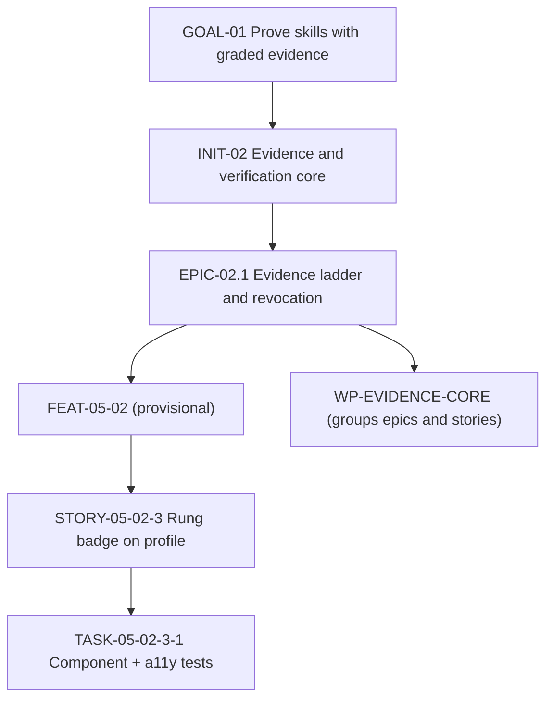
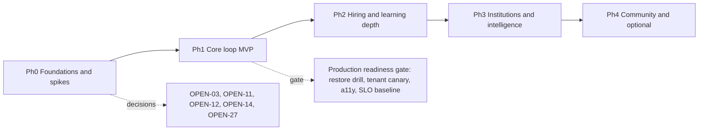
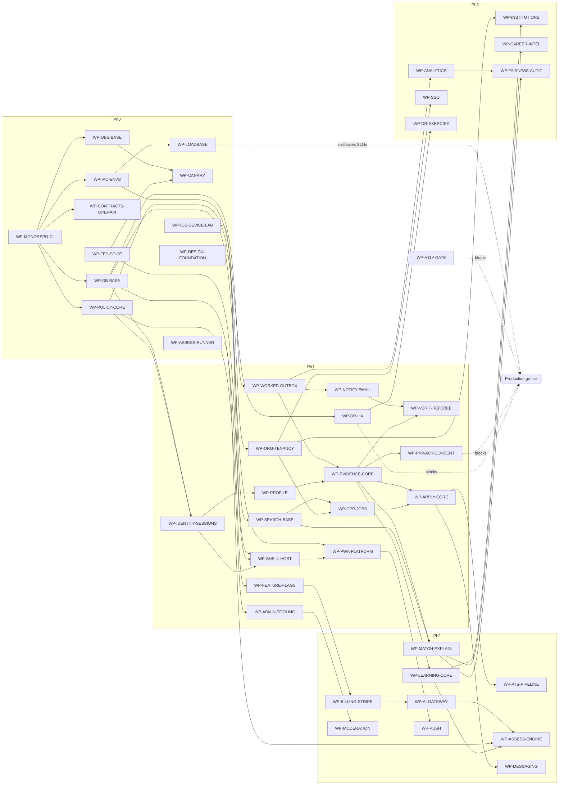

# Implementation Roadmap

Doc ID: RDM-01 · Owner: Program Director (with Architecture Review Board) · Version 1.0 · Status: Draft for Review · Relates: GOAL-01…GOAL-08, ADR-T01…T22, CC-INV, DOM-00, QA-AC §6.4, OPS-REL, OPS-SLO, RSK-REG, DEC-OPEN, MIG-01

**This roadmap contains no dates, durations or staffing numbers.** Sequencing is by dependency and exit gate. "Owner team" names a responsibility, not headcount. Nothing here claims any item is built.

## 1. Planning structure

| Level | ID form | Meaning | Example |
|---|---|---|---|
| Goal | `GOAL-NN` | Business outcome (STR-01) | GOAL-01 prove skills with graded evidence |
| Initiative | `INIT-NN` | Cross-team thrust toward goals | INIT-02 Evidence & verification core |
| Epic | `EPIC-<INIT>.<n>` | Deliverable capability inside an initiative | EPIC-02.1 Evidence ladder and revocation |
| Feature | `FEAT-<DOM>-NN` | User-visible capability (registry) | FEAT-05-02 Evidence ladder & revocation |
| Story | `STORY-<FEAT>-<n>` | Independently deliverable slice with AC | STORY-05-02-3 Show rung badge on candidate profile |
| Task | `TASK-<STORY>-<n>` | Engineering action | TASK-05-02-3-1 Add rung badge component + a11y tests |
| **Work package** | `WP-<NAME>` | Planning/delivery unit grouping epics and stories into a coherent, releasable slice with one owner team and exit criteria | WP-EVIDENCE-CORE |

A WP is the unit tracked on the roadmap; stories and tasks live in the tracker and trace to AC/TEST ids (QA-AC §8).

## 2. Initiatives

| ID | Initiative | Goals | Phases |
|---|---|---|---|
| INIT-01 | Foundations: repo, CI, environments, policy, contracts, data base | GOAL-06, GOAL-08 | Ph0 |
| INIT-02 | Evidence & verification core | GOAL-01 | Ph1 |
| INIT-03 | Identity, tenancy, privacy | GOAL-06 | Ph1 |
| INIT-04 | PWA platform and federation | GOAL-08 | Ph0–Ph1 |
| INIT-05 | Opportunities and applications | GOAL-02 | Ph1–Ph2 |
| INIT-06 | Matching and search | GOAL-02, GOAL-03 | Ph1–Ph2 |
| INIT-07 | Learning and assessment | GOAL-04 | Ph2 |
| INIT-08 | Messaging, notifications, engagement | GOAL-02 | Ph1–Ph2 |
| INIT-09 | Monetisation and entitlements | GOAL-07 | Ph2 |
| INIT-10 | AI gateway and governance | GOAL-07, GOAL-03 | Ph2 |
| INIT-11 | Trust, safety and operations | GOAL-06 | Ph1–Ph3 |
| INIT-12 | Institutions and intelligence | GOAL-05, GOAL-04 | Ph3 |
| INIT-13 | Reliability, observability and DR | GOAL-08 | Ph0–Ph3 |
| INIT-14 | Migration from reference (if applicable) | GOAL-06 | Ph1–Ph2 |
| INIT-15 | Community and optional capabilities | GOAL-01 | Ph4 |

## 3. Workstreams

| ID | Workstream | Scope | Owner team | Principal WPs |
|---|---|---|---|---|
| WS-01 | Foundations | Monorepo, CI, IaC, environments, config | Platform Eng | WP-MONOREPO-CI, WP-IAC-ENVS |
| WS-02 | Identity | Accounts, sessions, passkeys, SSO | Identity | WP-IDENTITY-SESSIONS, WP-SSO |
| WS-03 | PWA platform | Service worker, offline tiers, install, push | Frontend Platform | WP-PWA-PLATFORM, WP-PUSH |
| WS-04 | Federation infrastructure | Host contract, registry, manifest, compat gates | Frontend Platform | WP-FED-SPIKE, WP-SHELL-HOST |
| WS-05 | Design system | Tokens, components, a11y | Design System | WP-DESIGN-FOUNDATION, WP-A11Y-GATE |
| WS-06 | Core modules (UI) | Remotes: candidate, learning, opportunities, hiring, messaging, account, admin | Feature teams | per feature WP |
| WS-07 | Backend | Modular monolith modules, policy, worker | Backend teams | WP-POLICY-CORE, WP-WORKER-OUTBOX |
| WS-08 | Data | Schema, RLS, migrations, search, analytics store | Data Eng | WP-DB-BASE, WP-SEARCH-BASE, WP-ANALYTICS |
| WS-09 | Integrations | Email, Stripe, push, AI, SSO, public API | Integrations | WP-NOTIFY-EMAIL, WP-BILLING-STRIPE, WP-INTEGRATIONS-API |
| WS-10 | Security | Threat modelling, pen test, secrets, privacy engineering | Security | WP-PRIVACY-CONSENT, WP-ADMIN-TOOLING |
| WS-11 | Reliability | SLOs, load baseline, HA/DR, resilience | SRE | WP-LOADBASE, WP-DR-HA, WP-DR-EXERCISE |
| WS-12 | Observability | OTel, dashboards, alerts, RUM | SRE | WP-OBS-BASE |
| WS-13 | Testing | Catalog automation, traceability, device lab | QA | WP-QA-TRACE, WP-IOS-DEVICE-LAB |
| WS-14 | Operations | Support tooling, runbooks, moderation, comms | Support Ops, T&S | WP-SUPPORT-TOOLING, WP-MODERATION |
| WS-15 | Release | Canary, flags, rollback, change management | Release Eng | WP-CANARY, WP-FEATURE-FLAGS |

## 4. Phases

| Phase | Objective | Entry | Exit gate (all required) |
|---|---|---|---|
| **Ph0 Foundations + spikes** | Decide the unproven (federation, assessment runner, iOS reality, hosting); build the platform skeleton and guardrails | Documentation approved | Spike reports with decisions recorded as ADRs/OPEN resolutions; CI runs RG-01/RG-02/RG-04; policy module + route-registry lint (FF-01); RLS + outbox skeleton with tenant canary harness (FF-05); load harness and baseline method; OTel baseline; environments from IaC |
| **Ph1 Core loop MVP** | Learn→Prove→Showcase→Match→Apply minimal, safe: identity, profile, evidence, verification incl. referee, jobs, apply, notifications, consent, admin grants | Ph0 exit | RG-01…RG-09, RG-12, RG-14 pass for core loop; J1–J5, J9, J12–J14 green; TEST-TEN-001, TEST-SEC-003…008 green; backup restore drill passed; HA DB in place (SLO-30); accessibility audit pass for core flows; production go-live checklist; SLOs calibrated from baseline (OPEN-15) |
| **Ph2 Hiring + learning depth** | ATS pipeline, explainable matching, learning + assessment engine, messaging, billing, AI gateway, moderation, push | Ph1 exit | + J6–J8; billing/AI suites; resilience nightly green (RG-10); canary pipeline (RG-11) in use; adverse-impact reporting job; first game day |
| **Ph3 Institutions + intelligence** | Institution workspace, cohort analytics, career intelligence, SSO, public API, fairness audit, DR exercise | Ph2 exit | + institution tenancy tests; analytics privacy tests (k-anonymity); DR exercise result vs SLO-33 (OPEN-23); SSO break-glass tests; accessibility conformance statement (OPEN-37) |
| **Ph4 Community/optional** | Groups/events/articles, video interview, ID verification, proctoring (vendor-gated) | Ph3 exit and justified demand | Per-feature risk class R3/R4 checks, privacy review, vendor review (VR-10) |

Phases never "start" a feature whose invariants are not testable (INV/FF tests exist first — ADR-T01 scope discipline).

## 5. Work packages

Common elements per WP unless overridden: Definition of Done = **DoD-WP** (QA-AC §6.4) plus the "DoD+" column. "Tests / Acceptance" lists provisional AC ids (OPEN-29) and TEST ids from QA-CAT. Failure handling references OPS-FMEA rows. Team abbreviations: PE Platform Eng, FP Frontend Platform, DS Design System, ID Identity, CA Candidate team, HI Hiring team, LE Learning team, DA Data Eng, SRE, SE Security, QA, SO Support Ops, CO Commercial Ops, ME Messaging, AI AI team, TS Trust & Safety, RE Release Eng, IN Institutions team, FIN Finance Ops.

### 5.1 Phase 0 — foundations and spikes

| WP | Scope and value | Owner | Depends on | API / data / UI | Security and failure handling | Tests / acceptance | DoD+ |
|---|---|---|---|---|---|---|---|
| WP-FED-SPIKE | Prove or refute Module Federation 2.0 + Vite: host/remote, manifest-driven `registerRemotes/loadRemote`, singleton shared deps, SRI/signed manifests, fallback, rollback, SW interaction, perf delta vs bundled. Value: de-risk ADR-T03 (RISK-09, OPEN-03, OPEN-11) | FP | none | Prototype shell + 2 remotes; no production API; manifest registry prototype | Test SRI/signature rejection; remote outage fallback; version skew rejection | TEST-FED-001/003/005/009, TEST-PER-004, TEST-PWA-001; AC-00-02-01…06; spike report with go / bundled decision | Written decision + measured Δ_F vs SLO-17 budget; plugin versions pinned; `MF_MODE` contract proven; ADR update proposed (not edited here) |
| WP-ASSESS-RUNNER | **Decision spike**: build vs buy for isolated, network-less code-execution runner (ADR-T13); threat model, isolation technique options, cost per execution, startup latency, ops burden. Value: unlock verified code assessments honestly (OPEN-27) | LE + SE | none | Runner interface contract; no UI | Escape/egress threat model; fail closed to `unverified`; resource limits | TEST-ASM-002/003 designs; decision memo; security review | Decision logged (OPEN-27); until shipped, all code submissions `unverified` |
| WP-IOS-DEVICE-LAB | Establish device matrix and method for real iOS/Android validation: install, push-after-gesture, storage eviction, no background sync, WebKit behaviours (OPEN-12). Value: replace secondary-source assumptions with evidence (RES-01 R2) | QA + FP | none | Device inventory, scripts, results register | n/a (test infra); privacy of test accounts | TEST-MOB-001…006, TEST-PWA-010/011; AC-15-01-02 | Verified platform capability matrix published (FF-09 input); OPEN-12 resolved or narrowed |
| WP-MONOREPO-CI | Monorepo layout, task graph, affected-only builds, lint rules (FF-01, FF-02, FF-03, FF-07, FF-10 scaffolding), gates RG-01/02/04, SBOM + signing | PE + RE | none | `apps/*`, `packages/*`, CI pipelines | Secret scanning; least-privilege CI tokens; supply-chain gates | TEST-SEC-001, TEST-SEC-015, TEST-API-001/003/006, TEST-DEP-004/006, TEST-DAT-001 | CI runs on a sample module end-to-end; gate waiver mechanism audited |
| WP-IAC-ENVS | Environments from IaC (dev/ci/staging), secrets management, config schema; hosting decision implemented for staging (OPEN-14, 21, 22) | PE + SRE | WP-MONOREPO-CI | Env stacks, secret manager | Staging/production isolation; no prod secrets in staging | TEST-DEP-007/008; AC-00-03-*; rebuild drill | Environment rebuilt from scratch successfully (SLO-35 rehearsal) |
| WP-POLICY-CORE | `packages/policy`: `can(principal, action, resource)`, deny-by-default, capabilities endpoint, route registry with required policy action, permission matrix as data (USR-01) | PE + SE | WP-MONOREPO-CI | `GET /me/capabilities`; policy decision log | Deny-by-default; decisions audited; policy versioning/rollback (FM-15) | TEST-SEC-001/002/003/004…008, TEST-API-014; AC-02-01-02 | Matrix tests generated from USR-01 pass; negative control demonstrated |
| WP-CONTRACTS-OPENAPI | Zod contracts → OpenAPI 3.1, problem+json error types, cursor pagination, `Idempotency-Key` and ETag middleware, AsyncAPI scaffolding | PE | WP-MONOREPO-CI | `packages/contracts`; middleware | Idempotency store failure behaviour (FM-16) | TEST-API-001…005, TEST-HIR-008/009; AC-00-01-* | oasdiff gate live; example endpoints conform |
| WP-DB-BASE | Schema baseline: tenancy columns + RLS pattern, repository layer, `withOutbox`, audit table, migration lint, expand/contract tooling, pooler | DA + PE | WP-MONOREPO-CI, WP-IAC-ENVS | Postgres schemas; migration runner | RLS enforced for app role; append-only audit; lock budgets | TEST-TEN-001/002/003, TEST-API-008, TEST-DAT-001/002/003/009, TEST-OBS-003 | Tenant canary harness (FF-05) running in CI |
| WP-OBS-BASE | OTel baseline: Pino redaction, traces shell→API→worker, RUM skeleton, dashboards/alerts as code, synthetic framework | SRE | WP-MONOREPO-CI | `packages/observability`; collector | Redaction tests; telemetry never blocks requests (FM-23) | TEST-SEC-016, TEST-FED-011, TEST-OBS-001/002; AC-00-03-01 | Golden-signal dashboards for skeleton service; burn-rate alert test fires |
| WP-LOADBASE | Load/performance harness and baseline method: scenarios by API class, RMP-1 Lighthouse CI, corpus generator, calibration notes for SLO numbers | SRE + QA | WP-IAC-ENVS, WP-CONTRACTS-OPENAPI | k6-class scripts; datasets | Synthetic data only | TEST-PER-001/002/003/006/007; AC-00-06-01 | Calibration note per SLO (OPEN-15); targets promoted from hypothesis to commitment only after this |
| WP-DESIGN-FOUNDATION | Tokens (`packages/ui`), core components, a11y baselines, state patterns (empty/loading/error/offline/denied), remote-slot skeleton | DS | WP-MONOREPO-CI | Component library | Target-size, focus, contrast; reduced motion | TEST-A11-001/002/004/005/006, TEST-EVD-008; AC-00-07-* | Accessibility checks in CI; documented patterns |
| WP-QA-TRACE | Convert QA-CAT/AC to structured data; coverage lint (INV/FF/AC ↔ TEST), CI reports | QA | WP-MONOREPO-CI | `tools/` catalog lint | n/a | QA-STRAT §11; coverage report | Orphan detection blocks merge for R1 areas |
| WP-CANARY | Progressive delivery pipeline: cohort routing, manifest registry cohort resolution, automated halt/rollback, release record, compat matrix (RG-11/12) | RE + SRE | WP-FED-SPIKE, WP-OBS-BASE | Registry, rollout controller | Signed manifests; rollback rehearsal | TEST-DEP-001/002/003/005, TEST-FED-003/014 | Rollback rehearsed in staging per OPS-REL §10 |

### 5.2 Phase 1 — core loop MVP

| WP | Scope and value | Owner | Depends on | API / data / UI | Security and failure handling | Tests / acceptance | DoD+ |
|---|---|---|---|---|---|---|---|
| WP-IDENTITY-SESSIONS | Sign-up/in, cookie BFF, 15-min access + rotating refresh with reuse detection (BR-T050), passkeys + password, recovery, logout cache clear | ID | WP-POLICY-CORE, WP-DB-BASE | `/auth/*`; account, session, passkey tables; shell login UI | httpOnly/SameSite cookies, CSRF defence, rate limits fail-closed, clock tolerance | TEST-SEC-010/011/017/021, TEST-PWA-003, TEST-REL-010; AC-01-01-*, AC-01-03-* | Account-recovery journey tested; no token in JS-readable storage |
| WP-SHELL-HOST | Host shell: routing to remotes, Host Contract (semver), capabilities consumption, error boundaries, version beacons, embedded fallback manifest | FP | WP-FED-SPIKE, WP-DESIGN-FOUNDATION, WP-IDENTITY-SESSIONS | Host contract types; registry client | Signed manifest/SRI/CSP; remote isolation lint | TEST-FED-001…009/012, TEST-SEC-012/013/014, TEST-A11-007 | Federated and bundled modes both pass J13 |
| WP-PWA-PLATFORM | Service worker (versioned caches, update flow, kill switch), offline tiers (ADR-T10), install UX, IndexedDB owner cache with logout wipe | FP | WP-SHELL-HOST, WP-IOS-DEVICE-LAB | SW; queue library; conflict UI | No cross-user cache leakage; server revalidation of queued writes; WebKit fallbacks | TEST-PWA-001…012, TEST-MOB-003/004; AC-00-04-* | Device-lab pass; kill-switch drill |
| WP-ORG-TENANCY | Organizations, memberships, role grants (`org_owner`…), tenant bootstrap, role-change enforcement | ID + HI | WP-POLICY-CORE, WP-DB-BASE | `api/orgs`; org admin UI in MOD-ADM | RLS + policy; immediate removal effect | TEST-TEN-001…007, TEST-SEC-003; AC-02-01-*, AC-02-02-* | Tenant canary extended to org tables |
| WP-PROFILE | Profile, portfolio, resume variants (basic), public profile fields | CA | WP-IDENTITY-SESSIONS, WP-DESIGN-FOUNDATION | `api/profile`; MOD-CAND | Input sanitisation; SSRF guard on imports; offline drafts | TEST-SEC-018/028, TEST-PWA-005; AC-03-01-* | Conflict UX validated |
| WP-SKILLS-TAXONOMY | Skills graph and taxonomy read model, merge/alias handling | DA + CA | WP-DB-BASE | `api/skills`; read API | Versioned taxonomy; merge events | AC-04-*, TEST-API-007 | Seed taxonomy from reviewed source (licence check) |
| WP-EVIDENCE-CORE | Evidence items, artefact upload, malware scan, SM-EVIDENCE, ladder display, revocation + async recompute (BR-T005) | CA + SE | WP-PROFILE, WP-WORKER-OUTBOX, WP-SKILLS-TAXONOMY | `api/evidence`; object storage; scan worker; MOD-CAND UI | Scan-before-visible; IDOR-safe downloads; honest labelling | TEST-EVD-001/002/003/007/008/009, TEST-SEC-005/007/019/020/026; AC-05-01-*, AC-05-02-* | INV-T04/T08 tests with negative controls |
| WP-VERIF-REFEREE | Work-history verification, email-code and referee token flows (hashed, single-use, expiring), reminders and expiry (BR-T004), no-account referee UX | CA + ME | WP-EVIDENCE-CORE, WP-NOTIFY-EMAIL | `api/verification`; referee mini-app (shell-hosted public route) | INV-T05; rate limits; email-outage degrade | TEST-EVD-004/005/006/010/011, TEST-REL-003; AC-06-01-*, AC-06-02-*; referee completes in target time per persona P4 | Usability test with referee persona (OPEN-07) |
| WP-OPP-JOBS | Job postings, templates, saved searches, alerts (basic), job lifecycle | HI | WP-ORG-TENANCY, WP-SEARCH-BASE | `api/jobs`; MOD-HIR/MOD-OPP | Posting limits by entitlement (later), moderation hooks | TEST-HIR-010; AC-09-01-* | Public job pages meet SLO-13 |
| WP-APPLY-CORE | Application submit/withdraw, one active per (candidate, job), idempotency, drafts offline, evidence attach | HI + CA | WP-OPP-JOBS, WP-EVIDENCE-CORE, WP-CONTRACTS-OPENAPI | `api/applications`; MOD-OPP | BR-T001; consent scopes for evidence share; partial-failure compensation | TEST-HIR-001/008/009, TEST-API-011, TEST-PWA-006/007; AC-10-01-* | Chaos test on mid-operation failures |
| WP-WORKER-OUTBOX | Worker process, outbox dispatcher, job classes P0–P3, fenced leases, DLQ, periodic scheduler | PE | WP-DB-BASE | `apps/worker`; job tables | Fencing, dedupe, backpressure | TEST-API-008/009/010, TEST-REL-004/005; AC-24-02-* | Duplicate-execution probe passes (FM-36) |
| WP-NOTIFY-EMAIL | Notification preferences, email provider port (Brevo default), templates, suppression, in-app notifications | ME | WP-WORKER-OUTBOX | `api/notify`; MOD-MSG notifications | Provider breaker; no secrets in templates; accessibility of emails | TEST-REL-003, TEST-MSG-001; AC-15-01-* | Deliverability setup (DKIM/SPF/DMARC) verified [OPEN-26] |
| WP-PRIVACY-CONSENT | Consent scopes (purpose-bound, versioned, revocable), recruiter access gating, data export, erasure orchestration (BR-T060) | SE + DA | WP-EVIDENCE-CORE, WP-WORKER-OUTBOX | `api/privacy`; MOD-ACC | INV-T15; erasure across stores; retention list [OPEN-08] | TEST-SEC-009, TEST-PRV-001…004; AC-22-01-*, AC-22-02-*, AC-22-03-* | Erasure verified against search, cache, storage |
| WP-SEARCH-BASE | Postgres FTS + trigram (+ pgvector later) behind `SearchPort`; index maintenance; tenant-safe search | DA | WP-DB-BASE, WP-OPP-JOBS | `api/search`; search UI | Sanitised queries; tenant isolation | TEST-TEN-004, TEST-SRC-001/002, TEST-PER-002; AC-11-01-* | ADR-T11 trigger test in place |
| WP-ADMIN-TOOLING | Admin/support minimal console: audited reads, privileged access grants (≤ 4 h, BR-T041), account actions, feature flag admin, audit viewer | SE + SO | WP-POLICY-CORE, WP-DB-BASE | `api/admin`; MOD-ADM | INV-T18; two-person approvals; no raw SQL | TEST-SEC-022/023, TEST-OBS-003; AC-20-01-* | PROC-01, PROC-04 walkthrough executed |
| WP-FEATURE-FLAGS | Server-side flags with audit, kill switches, SW and degradation ladder flags | RE + PE | WP-DB-BASE | `api/platform`; admin UI | Safe defaults; flag changes audited | TEST-DEP-005, TEST-PWA-009; AC-24-01-* | Kill switch list per R1/R2 feature |
| WP-DR-HA | HA Postgres + PITR + object versioning + encrypted off-site backups; restore drill; backup SLIs | SRE | WP-IAC-ENVS | Infra modules | Separate failure domain; backup access control | TEST-REL-001, TEST-REC-001/002/003/005; SLO-30/31 | **Production go-live blocker:** restore drill passed (RG-14) |
| WP-A11Y-GATE | Accessibility gates and audits for core flows; screen reader testing; conformance work list | DS + QA | WP-DESIGN-FOUNDATION | n/a | n/a | TEST-A11-001…007; GOAL-06 | Independent audit scheduled for core flows (OPEN-37) |

### 5.3 Phase 2 — hiring and learning depth

| WP | Scope and value | Owner | Depends on | API / data / UI | Security and failure handling | Tests / acceptance | DoD+ |
|---|---|---|---|---|---|---|---|
| WP-ATS-PIPELINE | Pipelines, stage management with SM-APPLICATION, interviews, notes, collaboration, bulk actions with human confirmation | HI | WP-APPLY-CORE, WP-NOTIFY-EMAIL | `api/applications` (pipeline); MOD-HIR | BR-T002; If-Match; no auto-reject | TEST-HIR-002/003/004; AC-10-02-* | Concurrency test with two recruiters |
| WP-MATCH-EXPLAIN | Explainable matching with uncertainty, ranking-input allowlist, candidate-visible explanations, recompute on revocation | HI + DA | WP-SEARCH-BASE, WP-EVIDENCE-CORE | `api/matching`; explanation UI | INV-T19; no payment input; fairness metrics hooks | TEST-HIR-005/006/011; AC-11-02-* | Allowlist test blocks forbidden inputs |
| WP-LEARNING-CORE | Courses, enrolment, progress, instructor studio basics, course→evidence rule | LE | WP-EVIDENCE-CORE | `api/learning`; MOD-LRN | Content scanning; moderation hooks | AC-08-01-*, TEST-EVD-007 | Content review checklist live (COM-OPS §13) |
| WP-ASSESS-ENGINE | Unified assessment engine, attempts, integrity sessions, human review/appeal, AI_PROHIBITED enforcement; code tasks only if runner decided (OPEN-27) | LE + SE | WP-LEARNING-CORE, WP-AI-GATEWAY, WP-ASSESS-RUNNER | `api/assessment`; MOD-LRN | ADR-T13; INV-T20; idempotent submit | TEST-ASM-001…004, 010, 011; AC-07-01-*, AC-07-02-* | No simulated pass anywhere |
| WP-MESSAGING | Conversations, consented threads, outreach quota, compose offline queue | ME | WP-APPLY-CORE, WP-PWA-PLATFORM | `api/messaging`; MOD-MSG | IDOR-safe; flagged-only moderator visibility | TEST-SEC-006, TEST-PWA-008, TEST-MSG-002; AC-13-01-* | Message idempotency verified |
| WP-BILLING-STRIPE | Stripe Checkout/Portal/webhooks, entitlement derivation, dunning flows, reconciliation job | CO + PE | WP-FEATURE-FLAGS, WP-WORKER-OUTBOX | `api/billing`; MOD-ACC | INV-T17; signature verify; replay-safe; outage behaviour | TEST-BIL-001…007; AC-16-01-* | Tax approach decided (OPEN-18); refund policy approved (OPEN-33) |
| WP-AI-GATEWAY | AI gateway: only path to models, budgets (free vs paid), AI_PROHIBITED enforcement, logging, kill switch, provider port | AI | WP-FEATURE-FLAGS, WP-BILLING-STRIPE | `api/ai` | INV-T06/T07/T08/T09; breaker; prompt-injection hygiene | TEST-ASM-005…009; AC-17-01-* | Provider terms reviewed (OPEN-24) |
| WP-MODERATION | Report flow, moderation queue, actions, appeals tooling, audit | TS | WP-ADMIN-TOOLING | `api/safety`; MOD-ADM | INV-T09; evidence preservation | TEST-MSG-002; AC-19-01-* | PROC-05, PROC-15 exercised |
| WP-PUSH | Web Push (VAPID) for installed PWAs, contextual prompt after gesture, subscription hygiene | FP + ME | WP-PWA-PLATFORM, WP-NOTIFY-EMAIL | `api/notify` push endpoints | Fallback to email/in-app; prune dead subscriptions | TEST-PWA-011, TEST-MOB-001/002, TEST-MSG-001 | Reach measured (MET-049) vs ADR-T02 trigger |
| WP-SUPPORT-TOOLING | Helpdesk integration, support code correlation, macros, SLA reporting | SO | WP-ADMIN-TOOLING | Integrations | Redaction; retention | PROC-03 acceptance; MET-033/034 | Helpdesk decision recorded (OPEN-38) |
| WP-RESILIENCE-SUITE | Automated fault-injection suite and first game day; resilience nightly | SRE + QA | WP-CANARY, WP-WORKER-OUTBOX | n/a | n/a | TEST-REL-001…012; RG-10 | Game-day report updates OPS-FMEA |

### 5.4 Phase 3 — institutions and intelligence

| WP | Scope and value | Owner | Depends on | API / data / UI | Security and failure handling | Tests / acceptance | DoD+ |
|---|---|---|---|---|---|---|---|
| WP-INSTITUTIONS | Institution tenants, cohorts import/activation, faculty views with consent boundaries, credential approval | IN | WP-ORG-TENANCY, WP-LEARNING-CORE | `api/institutions`; MOD-ADM institution workspace | INV-T03/T15; learner ownership; minors rule (OPEN-09) | TEST-MSG-003, TEST-TEN-005; AC-18-01-* | Cohort import dry-run + undo |
| WP-CAREER-INTEL | Readiness, transitions, salary insights (explainable, uncertainty) | CA + DA | WP-MATCH-EXPLAIN | `api/careerintel` | No autonomous decisions; data provenance | AC-12-*, TEST-HIR-005 (style) | Data sources licensed/validated |
| WP-ANALYTICS | Event pipeline, metrics catalogue implementation, dashboards, k-anonymous reporting | DA | WP-WORKER-OUTBOX | `api/analytics`; warehouse | Privacy classes, pseudonymisation | TEST-PRV-006, TEST-TEN-005; ANL-MET | Metric definitions as code |
| WP-SSO | OIDC/SAML SSO for orgs, break-glass admin | ID | WP-ORG-TENANCY | `api/identity` | Signature/nonce validation; IdP outage | TEST-SEC-024; AC-01-04-* | Customer IdP interop checklist |
| WP-INTEGRATIONS-API | Public/partner API, API keys (ROLE-SVC), webhooks outbound | PE | WP-CONTRACTS-OPENAPI | `api/integrations` | Scoped keys, rate limits, versioning | API-001 etc. | Developer docs generated |
| WP-FAIRNESS-AUDIT | Adverse-impact audit job, voluntary self-ID store, reporting, review process | DA + SE | WP-MATCH-EXPLAIN, WP-ANALYTICS | P3 store | Strict access; small-cell suppression | TEST-HIR-007; MET-014 | Method reviewed with counsel/advisor (OPEN-08) |
| WP-DR-EXERCISE | Zone/region DR exercise per decision, runbook validation | SRE | WP-DR-HA | Infra | Out-of-band comms | TEST-REC-004; SLO-33 | Measured RTO/RPO recorded; OPEN-23 closed |

### 5.5 Phase 4 — community and optional

| WP | Scope and value | Owner | Depends on | Notes |
|---|---|---|---|---|
| WP-COMMUNITY | Groups, events, articles (DOM-14) | Community team | Ph3 exit, moderation maturity | Only if justified by retention data (ADR-T01 revisit); moderation capacity (OPEN-32); tests R3 |
| WP-VIDEO-INTERVIEW | Video interview recording/feedback | HI | WP-ATS-PIPELINE | Build-vs-buy decision; consent; storage cost (FIN-COST) |
| WP-IDV | Identity verification integration | ID + Privacy | OPEN-10 | Vendor-gated; sensitive data handling (VR-10) |
| WP-PROCTOR-VENDOR | Proctoring integration | LE | WP-ASSESS-ENGINE, OPEN-28 | Vendor-gated; human review; bias/accessibility review |

### 5.6 Migration packages (only if OPEN-17 confirms migration need)

| WP | Scope | Owner | Depends on | Notes |
|---|---|---|---|---|
| WP-MIGRATE-EDGE | Routing facade and parallel-run harness (MIG-01 §3) | PE | WP-SHELL-HOST | Strangler routing |
| WP-MIGRATE-SESSION | Token → cookie session cutover (MIG-01 §4) | ID | WP-IDENTITY-SESSIONS | Exchange endpoint, sunset |
| WP-MIGRATE-DATA | Execution of REFERENCE_TO_TARGET_DATA_MIGRATION plan (owned by data-migration team) | DA | WP-DB-BASE | Reconciliation (TEST-DAT-006) |

Total work packages: **56** (Ph0 13, Ph1 18, Ph2 11, Ph3 7, Ph4 4, migration 3), counted from the table rows by script.

## 6. Dependency graph (key edges)

Critical path (by dependency, not time): MONOREPO-CI → POLICY-CORE/DB-BASE → IDENTITY-SESSIONS → SHELL-HOST (needs FED-SPIKE decision) → PROFILE → EVIDENCE-CORE (needs WORKER-OUTBOX) → APPLY-CORE; in parallel DR-HA and LOADBASE gate production go-live.

## 7. Release gates across phases

| Gate | Condition |
|---|---|
| Ph0→Ph1 | Spike decisions recorded (OPEN-03, OPEN-11, OPEN-12, OPEN-14, OPEN-27 resolved or consciously deferred with fallback); FF-01/FF-05/FF-10 lint live |
| Ph1 → production go-live | RG-01…RG-09, RG-12, RG-14; restore drill passed; HA failover tested; tenant canary + IDOR suite green; accessibility core audit; incident response staffed (OPEN-39); runbooks for FM top-10 proven; SLOs calibrated |
| Ph1→Ph2 | Core-loop SLOs met over observation period; no open Sev-1/2 security defects |
| Ph2→Ph3 | Resilience nightly green; canary pipeline in use; billing reconciliation clean; fairness reporting live |
| Ph3→Ph4 | DR exercise result accepted; institution privacy tests; moderation capacity (OPEN-32) |
| Every WP | DoD-WP + DoD+; INV/FF tests for its scope green (QA-STRAT §9) |

## 8. Spike definitions

| Spike | Question | Method | Success criteria | Output | Fallback |
|---|---|---|---|---|---|
| WP-FED-SPIKE | Does MF 2.0 + Vite meet contract (compat, rollback, perf, SRI/signed manifests, SW coexistence, a11y focus on remote swap)? | Prototype matrix: shell × 2 remotes × versions; fault injection; bundled-mode comparison | Δ_F ≤ SLO-17 budget; FED-001/003/005/009 pass; SW update safe | Decision memo; pinned versions; updated risk entries | `MF_MODE=bundled` (OPEN-03) |
| WP-ASSESS-RUNNER | Build vs buy a no-network code runner; isolation technique feasible within security and cost limits? | Threat model + prototype or vendor evaluation | Escape tests fail to escape; cost/latency measured with formulas | Decision (OPEN-27) | Keep code tasks `unverified` / omit code assessments |
| WP-IOS-DEVICE-LAB | What do iOS PWA install, push, storage and background behaviours actually do on supported versions? | Scripted tests on real devices | Verified matrix published; unknowns listed | FF-09 matrix; OPEN-12 closed | Reduce offline/push promises to what is proven |

## 9. Work-package Definition of Done

Common DoD-WP is QA-AC §6.4. In addition every WP must: link its stories to AC ids and TEST ids; update OPS-FMEA/runbooks when it adds a dependency; have kill switches where R1/R2; record new unknowns in OPEN_DECISIONS; show an operability review (dashboards, alerts, runbook links) before exit.

## 10. Not in scope for this roadmap

Dates, staffing, budgets, team structure, vendor selection outcomes. Those belong to planning once OPEN-14, OPEN-16, OPEN-19 and OPEN-39 are decided.
