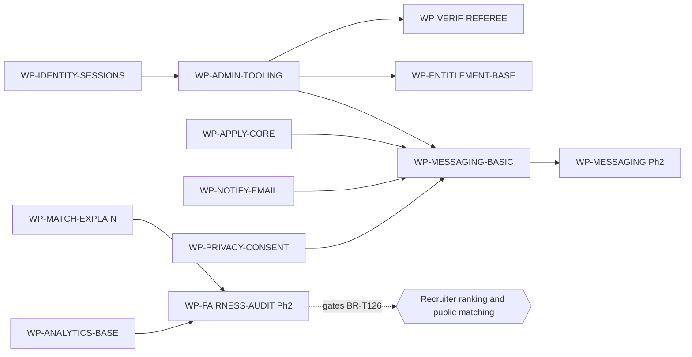

# Implementation Roadmap, Revision 2 overlay (RDM-01 REV2)

Doc ID: RDM-01-R2 · Owner: Program Director (with Architecture Review Board) · Version 2.0 · Status: Proposed (Under Review) · Date: 2026-10-25 · Closes: REVW-10, REVW-11, REVW-24 (roadmap part), REVW-30 (roadmap part), REVW-34 (phases); feeds OPEN-42 and OPEN-29 · Relates: RDM-01, PCAP-01-R2, BR-REG-R2, SM-00-R2, ADR-T10, ADR-T14a

> **Folded into `ROADMAP.md` on 2026-10-27.** Change record only; edit the original.

**Relationship (no original file was edited).** This is an **overlay**, not a copy. It **supersedes, once accepted**, only the work-package rows and sentences of `ROADMAP.md` that section 3 names (WP-MESSAGING, WP-FAIRNESS-AUDIT, and the scope text of WP-IDENTITY-SESSIONS, WP-PWA-PLATFORM, WP-APPLY-CORE, WP-BILLING-STRIPE, WP-INSTITUTIONS), the work-package count sentence, and the "Ph2 → GA" gate (extended). Everything else in RDM-01 stands as the roadmap of record, including the concurrent revision that made bundled delivery the baseline and introduced WP-ENTITLEMENT-BASE, WP-ANALYTICS-BASE and WP-AI-GATEWAY-BASE. Governance should link this file from `00_CONTROL_CENTRE/MASTER_INDEX.md`. This file contains no dates, durations or staffing numbers.

## 1. What the current roadmap already satisfies (checked against REVW-10 and REVW-11)

| Finding point | Status in `ROADMAP.md` now | Evidence |
|---|---|---|
| REVW-11 (i) identity needs email and worker | Done | WP-IDENTITY-SESSIONS depends on WP-WORKER-OUTBOX and WP-NOTIFY-EMAIL |
| REVW-11 (ii) apply-core needs consent | Done | WP-APPLY-CORE depends on WP-PRIVACY-CONSENT |
| REVW-11 (iii) referee route needs the shell | Done | WP-VERIF-REFEREE depends on WP-SHELL-HOST |
| REVW-11 (iv) Phase 1 slot source | Done | WP-ENTITLEMENT-BASE (admin comp, free-tier slot, BR-T090/T093); BR-T090 gets the explicit "Phase 1 stub" text in BR-REG-R2 |
| REVW-11 (vi) candidate search needs the consent epoch | Done | WP-SEARCH-BASE depends on WP-PRIVACY-CONSENT |
| REVW-11 (vii) AC references that do not exist | Done with explicit "AC pending" markers; the criteria themselves are written in `SPEC_ACCEPTANCE_ADDITIONS_REV2.md` (section 4 below maps them) |
| REVW-10 demote AI gateway, assessments, billing checkout to Phase 2 | Done (AI gateway execution, assessment engine, Stripe checkout are Phase 2; WP-AI-GATEWAY-BASE is Phase 0 and policy-only) |
| REVW-10 "roadmap authoritative, regenerate capability-map phases" | Not complete; see `PCAP-01-R2` |
| REVW-34 public API later | Done (WP-INTEGRATIONS-API is Phase 4) |

## 2. Changes this overlay makes

| # | Change | Reason |
|---|---|---|
| R1 | New Phase 1 work package **WP-MESSAGING-BASIC** (section 3.1); WP-MESSAGING (Phase 2) narrowed to outreach | Binding decision REVW-10 lists basic messaging in Phase 1; the roadmap had no Phase 1 messaging |
| R2 | **WP-FAIRNESS-AUDIT moves from Phase 3 to Phase 2** and depends on WP-ANALYTICS-BASE instead of WP-ANALYTICS (section 3.2) | REVW-11 (v) and decision: the fairness audit gates public matching launch, Phase 2 |
| R3 | WP-IDENTITY-SESSIONS adds mandatory TOTP for staff and org owners (FEAT-01-07) | The Phase 1 admin console exists; BR-T044 requires MFA for privileged roles |
| R4 | WP-PWA-PLATFORM and WP-APPLY-CORE: Phase 1 offline is a **read cache plus local unsent drafts, with no outbox**; the outbox activates on the ADR-T10 trigger | REVW-24 decision |
| R5 | Second-phase learning commerce is **first-party courses only**; the third-party paid marketplace is deferred to Phase 3 behind an ADR on seller of record, payouts, tax/VAT and refunds | REVW-30 decision |
| R6 | WP-INSTITUTIONS delivers the institution workspace as **MOD-INS**, separate from back-office MOD-ADM | REVW-08 decision |
| R7 | New explicit edges and gate text (sections 3 and 5) | Dependency completeness |
| R8 | Work-package counts restated (section 6) | The count sentence changes with R1 and R2 |

## 3. Work-package changes

### 3.1 WP-MESSAGING-BASIC (new, Phase 1)

| Field | Content |
|---|---|
| Scope and value | Application-linked conversations between a candidate and the job's hiring team; block, report and mute (FEAT-13-01, FEAT-13-05). Reports land in the WP-ADMIN-TOOLING queue until WP-MODERATION. No recruiter outreach to non-applicants, no first-contact requests, no quota, no offline compose queue (those stay in WP-MESSAGING) |
| Owner | ME |
| Depends on | WP-APPLY-CORE, WP-NOTIFY-EMAIL, WP-ADMIN-TOOLING, WP-PRIVACY-CONSENT |
| API / data / UI | `api/messaging` (conversation kind `application` only); MOD-MSG |
| Security and failure handling | IDOR-safe (INV-T02); flagged-only moderator visibility; block is bidirectional (BR-T083); message edit window 5 min, delete is a tombstone (BR-T084) |
| Tests / acceptance | TEST-SEC-006, TEST-MSG-002; AC-13-01-*, AC-13-05-* (registered) |
| DoD+ | A candidate and a recruiter exchange messages on one application; a block stops delivery; a report reaches an admin |

**WP-MESSAGING (Phase 2) after this overlay:** outreach to non-applicants with quota, first-contact requests (SM-FIRSTCONTACT), compose offline queue; depends on WP-MESSAGING-BASIC, WP-PWA-PLATFORM and WP-ENTITLEMENT-BASE.

### 3.2 WP-FAIRNESS-AUDIT (moved to Phase 2)

| Field | Content |
|---|---|
| Scope and value | Adverse-impact audit job, voluntary self-ID store (audit-only attributes), report to ROLE-AUD, review process. Provides the baseline review that BR-T126 requires before recruiter-facing ranking or public matching is enabled. Dashboards stay with WP-ANALYTICS (Phase 3) |
| Owner | DA + SE |
| Depends on | WP-MATCH-EXPLAIN, WP-ANALYTICS-BASE (was: WP-ANALYTICS) |
| Security and failure handling | Strict access; small-cell suppression (k ≥ 5 style rule) |
| Tests / acceptance | TEST-HIR-007; MET-014; BR-T077 process test; flag-default-off test for `matching.recruiter_ranking` |
| DoD+ | Method reviewed with counsel or an advisor (OPEN-08); baseline run recorded; threshold of BR-T077 set |

The Phase 2 exit gate in RDM-01 section 7 already lists an adverse-impact job; the dependency now exists in the plan.

### 3.3 Scope text changes

| WP | Text added |
|---|---|
| WP-IDENTITY-SESSIONS | "Mandatory TOTP for platform staff and org owners (FEAT-01-07 scope .2); recovery codes." |
| WP-PWA-PLATFORM | "Phase 1 offline = versioned read cache and local unsent drafts (profile, application draft, message compose, note). The offline write outbox, retry queue and three-way merge activate on the ADR-T10 trigger (telemetry or research shows low-connectivity core use). One expiry and backoff table lives in OFF-01 (REVW-15)." |
| WP-APPLY-CORE | "'Drafts offline' means a local unsent draft; no queued write. Recruiter read-only access to the application snapshot (DT-01 row 4) is part of this package until WP-ATS-PIPELINE. Re-apply after withdrawal as a linked application (BR-T125, SM-APPLICATION t12)." |
| WP-BILLING-STRIPE | "Course purchase covers first-party (platform-sold) courses only. A third-party paid marketplace needs an ADR (seller of record, payouts, instructor identity, tax/VAT, refund-adjusted payouts) and is Phase 3 at the earliest." |
| WP-INSTITUTIONS | "Institution workspace is the MOD-INS remote or lazy chunk (`/institution/*`); back-office stays MOD-ADM, served behind an authenticated edge rule." |
| WP-ADMIN-TOOLING | "Minimal takedown and revoke actions with reason code and second-person approval (BR-T043, BR-T045); `dispute` referee outcomes and message reports are reviewed here until WP-MODERATION (gaps G1, G2 of PCAP-01-R2)." |
| WP-ORG-TENANCY | "Organization verification lifecycle SM-ORG (`verification_state`) and its un-verification effects (BR-T123)." |

## 4. Acceptance criteria that were "AC pending" in the roadmap

`SPEC_ACCEPTANCE_ADDITIONS_REV2.md` registers criteria for these features, which lets the roadmap's markers be replaced once the file is accepted:

| Work package | Feature | New criteria |
|---|---|---|
| WP-POLICY-CORE | FEAT-01-09 | AC-01-09-01 … 03 |
| WP-ORG-TENANCY | FEAT-02-01, FEAT-02-07 | AC-02-01-01 … 05, AC-02-07-01 … 03 |
| WP-SKILLS-TAXONOMY | FEAT-04-01, FEAT-04-02 | AC-04-01-01 … 03, AC-04-02-01 … 03 |
| WP-WORKER-OUTBOX | FEAT-24-01, 24-02, 24-09 | AC-24-01-01 … 03, AC-24-02-01 … 03, AC-24-09-01 … 02 |
| WP-NOTIFY-EMAIL | FEAT-15-01, 15-03, 15-06, 15-07 | AC-15-01-01 … 02, AC-15-03-01 … 02, AC-15-06-01 … 02, AC-15-07-01 … 03 |
| WP-ADMIN-TOOLING | FEAT-20-01, 20-03 | AC-20-01-01 … 03, AC-20-03-01 … 02 |
| WP-PRIVACY-CONSENT | FEAT-22-06 | AC-22-06-01 … 02 |
| WP-ANALYTICS-BASE | FEAT-21-01 | AC-21-01-01 … 02 |
| WP-AI-GATEWAY-BASE | FEAT-17-01, 17-02, 17-03 | AC-17-01-01 … 02, AC-17-02-01, AC-17-03-01 … 02 |
| WP-LEARNING-CORE | FEAT-08-01 | AC-08-01-01 … 02 |
| Platform plumbing | FEAT-24-04, 24-05, 24-08, 24-11 | AC-24-04-01 … 02, AC-24-05-01, AC-24-08-01, AC-24-11-01 |
| Phase 2 | FEAT-07-01, 16-01, 19-02, 19-08 | AC-07-01-01, AC-16-01-01, AC-19-02-01, AC-19-08-01 |

## 5. Dependency edges and gates

**Edges added or confirmed (all acyclic):** WP-MESSAGING-BASIC → {WP-APPLY-CORE, WP-NOTIFY-EMAIL, WP-ADMIN-TOOLING, WP-PRIVACY-CONSENT}; WP-MESSAGING → WP-MESSAGING-BASIC; WP-FAIRNESS-AUDIT → {WP-MATCH-EXPLAIN, WP-ANALYTICS-BASE}; WP-ADMIN-TOOLING → WP-IDENTITY-SESSIONS (staff MFA); WP-VERIF-REFEREE → WP-ADMIN-TOOLING (dispute review, gap G1); WP-ENTITLEMENT-BASE → WP-ADMIN-TOOLING (comp grant UI); WP-MATCH-EXPLAIN → WP-PRIVACY-CONSENT (through WP-SEARCH-BASE, confirmed).

**Gate text added to RDM-01 section 7.**

| Gate | Addition |
|---|---|
| Ph1 → controlled pilot | Staff and org-owner TOTP enforced; `dispute` referee outcomes and message reports have a named human review queue |
| Ph2 → GA | Baseline fairness review recorded by ROLE-AUD (BR-T126) before `matching.recruiter_ranking` is switched on; re-apply and withdrawn-application journey passes |

## 6. Work-package counts

Current `ROADMAP.md`: 60 (Ph0 14, Ph1 22, Ph2 10, Ph3 6, Ph4 5, migration 3). After this overlay: **61** (Ph0 14, **Ph1 23**, **Ph2 11**, **Ph3 5**, Ph4 5, migration 3). Method: count table rows whose first cell starts `WP-` in sections 5.1 to 5.6, apply R1 (+1 in Ph1) and R2 (−1 Ph3, +1 Ph2). Governance regenerates the sentence after acceptance.

## 7. Conflict recorded for the ARB (OPEN-42)

The binding decision for REVW-10 says Phase 1 is Prove → Showcase → Apply with search-based matching and explanation, and demotes learning *depth*. The concurrent roadmap revision, driven by the SSOT loop, keeps a **minimum first-party learning path and practice in Phase 1** (WP-LEARNING-CORE) and makes Phase 1 a pre-GA pilot. This overlay accepts the roadmap as written on that point and treats it as consistent with the decision because depth (instructor studio, richer authoring, assessments, learning paths) is Phase 2. If the ARB reads the decision more strictly, WP-LEARNING-CORE and FEAT-07-05, 07-11, 08-01..04 move to Phase 2 and the Phase 1 gate loses its learning cohort criterion. The decision is the ARB's; both readings are consistent with the rest of this overlay.

## 8. Not decided here

Dates, staffing, budgets, vendor outcomes (RDM-01 section 10 stands). The cost envelope structure (REVW-16) is owned by folder 21.
