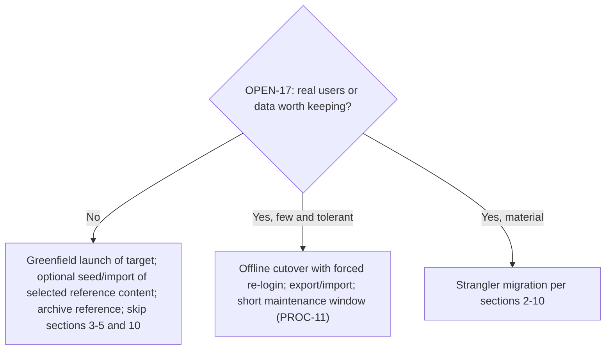
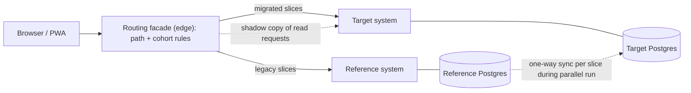

# Migration and Evolution Plan (reference system to target)

Doc ID: MIG-01 · Owner: Migration Lead (with Data Architect and Identity owner) · Version 1.0 · Status: **Plan only — nothing is executed or scheduled** · Relates: ADR-T05, ADR-T06, ADR-T10, ADR-T13, ADR-T18, INV-T04, INV-T10, INV-T12, FF-10, DOM-00 §6, OPS-REL §8, OPS-REL §10, RDM-01 §5.6, RSK-REG (RISK-27, RISK-43), OPEN-17, OPEN-08; sibling detail document: [REFERENCE_TO_TARGET_DATA_MIGRATION.md](./REFERENCE_TO_TARGET_DATA_MIGRATION.md) (written by the data-migration team; this document links to it and does not duplicate it)

## 1. Status, assumptions and what this plan is not

| Item | Statement |
|---|---|
| Label | **Plan only.** It describes how a migration *would* be conducted. No migration is approved, scheduled, or started. |
| Reference system **[REF]** | A PWA-first React/Fastify/Postgres modular monolith: self-issued HMAC session tokens kept by the browser, an API that keeps an in-process read model hydrated from Postgres at boot and therefore documents "one API process per database", a core career loop persisted with other modules in memory and labelled ephemeral, an assessment path that can return a simulated pass, 55 SQL migrations, worker leases that can execute a job twice, Compose/Coolify deployment descriptors, billing and email integrations optional and disabled by default (source: reference `ARCHITECTURE.md`, `docs/quality/OPERATIONS.md`, `docs/quality/TESTING.md`, repository `CLAUDE.md`, read 2026-10-25). Treated as facts about the reference, **not** as target requirements. |
| Key unknown **[OPEN-17]** | Whether the reference system holds real user data or serves real users. Its own runbook says backup/restore were not yet executed and that real users require documented RPO/RTO first, which suggests staging/pre-production only. If there are no real users, this plan collapses to "seed target from selected reference data (optional) and retire the reference". |
| Not in this plan | Target design (see other folders), detailed table/column mapping and scripts (REFERENCE_TO_TARGET_DATA_MIGRATION.md), dates, staffing. |

Decision tree:

## 2. Strangler approach

Principles: (1) the target is built beside the reference, never inside it; (2) traffic moves slice by slice behind a routing facade; (3) **a single writer per domain at any time** — no dual writes (INV-T12; dual-write drift is the main migration failure); (4) every slice has a parallel-run phase with comparison, a reversible cutover, and a retirement step; (5) data moves with its domain, with reconciliation (TEST-DAT-006); (6) user trust is preserved: evidence status is never upgraded by migration (INV-T04).

Stages per slice:

| Stage | Description | Exit criterion |
|---|---|---|
| S0 Inventory | List routes, tables, events, jobs, data volume, owners for the slice; classify data (persisted vs ephemeral) | Inventory approved |
| S1 Target ready | Target slice implemented and passing its TEST ids in staging | Gates RG-01…RG-09 for the slice |
| S2 Import & reconcile | Historical data imported into target (batch, idempotent), reconciliation report clean | Zero unexplained differences |
| S3 Shadow reads | Facade mirrors read requests to target; responses compared (not shown to users) | Difference rate below threshold [OPEN-15 param] for observation period |
| S4 Cohort cutover | Internal users → small cohort → all, per slice, for reads then writes; reference becomes read-only for that slice at write cutover | Guardrails hold; support load normal |
| S5 Stabilise | Keep reference slice read-only and reversible | Observation period |
| S6 Retire | Remove routing rule; archive reference slice data; schedule deletion per retention (OPEN-08) | Sign-off |

## 3. Routing facade and parallel run

| Topic | Design |
|---|---|
| Facade | Edge routing (CDN/LB rules or a thin proxy) that selects reference vs target by route prefix and cohort. Route table is versioned in IaC; changes follow PROC-14 |
| Cohort selection | Stable hash of principal id (not by customer tier) plus internal-staff allowlist and org-level opt-ins for enterprise pilots |
| Shell migration | The target shell (MOD-SHELL) takes over `/` early with remotes added per slice; legacy pages are reachable via link-outs or embedded redirect until their slice moves. Mixed experience is acceptable but navigation must stay coherent |
| Shadow reads | Facade duplicates idempotent GETs to the target with identical identity context via a translated principal; compare normalised JSON; mismatch metrics by route; never mirror unsafe methods |
| Shadow writes | **Not used.** Instead, replay tests on copied data in staging (TEST-DAT-006) |
| Parallel run for batch/worker behaviour | Run target workers in observe-only mode (dry-run effects) comparing intended emails/notifications with reference to find divergence; real sending stays on the reference until cutover of that domain |
| Write cutover | Per domain: drain in-flight writes → final delta sync → reference set read-only (feature flag/DB role) → switch facade → verify → open writes in target |
| Observability | Dashboard of route share, mismatch rate, error rates by system (OPS-OBS DASH-12 extension); trace propagation across facade |
| Idempotency | Retried writes at cutover use `Idempotency-Key` to avoid double effects |
| Failure | Facade failure falls back to reference-only routing (safe default) |

## 4. Session cutover: self-issued token to cookie session

**[REF]** The reference authenticates with a self-issued signed token kept by the browser (readable by scripts). **[TARGET]** (ADR-T06) uses httpOnly cookies via same-origin BFF routes, short-lived access with rotating refresh and reuse detection (BR-T050); remotes never read credentials (INV-T16).

| Step | Action | Notes |
|---|---|---|
| 1 | Target identity module accepts a **one-time token-exchange**: the reference token is presented once to a server endpoint which validates it with the reference's verification key (shared via secret manager, read-only), maps the reference account to a target account, issues a cookie session, and records the exchange | Exchange endpoint rate-limited; accepted only from the migrated shell |
| 2 | During the transition window both token types may be present; **the target never stores or forwards the legacy token**; the legacy token is cleared client-side after exchange | Prevents long-term coexistence of weak storage |
| 3 | Credential continuity: password hashes imported only if the hash algorithm meets target policy; otherwise users reset or enrol passkeys at first sign-in (email challenge). Never export plaintext secrets | Decision per hash scheme in the data migration doc |
| 4 | Sunset: stop accepting legacy tokens at a decided point; legacy tokens expire naturally; rotate the reference signing key at sunset so remaining tokens die | Communicated (§10) |
| 5 | Fallback: if exchange fails, user signs in through the normal target flow (email challenge/passkey) | No data loss |
| 6 | Revocation: compromised-token response rotates the reference key to invalidate all exchanges; target sessions unaffected | RB-26 |
| Rollback | Re-enable legacy login route; target sessions remain valid but the reference continues serving its slices; users may be asked to sign in again | Tested in staging |
| Tests | TEST-SEC-010/011/017, TEST-PWA-003, plus migration-specific: exchange replay rejected, expired token rejected, cross-account mapping verified | |

## 5. Read-model migration: in-process Map to SQL reads

**[REF]** The reference serves core-loop reads from an in-process Map hydrated from Postgres at boot (single writer, stale on other replicas). **[TARGET]** (ADR-T05) all reads/writes via SQL, RLS as defence in depth, N stateless replicas.

This transformation happens inside the target by design (the target never has a Map read model). If the reference must be *improved in place* during a long transition (e.g. to run two replicas), the minimal path is:

| Step | Action | Verification |
|---|---|---|
| 1 | Identify queries served from the Map; write SQL equivalents with the same ordering and filters | Query inventory |
| 2 | Add a read-through flag per query: Map vs SQL; shadow-compare results in non-production, then in production sampling | Mismatch counters; TEST-DAT-007 style parity |
| 3 | Switch query by query; keep Map as fallback until parity proven for all queries of a module | Rollback = flip flag |
| 4 | Remove boot-time hydration; verify two replicas return identical reads under concurrent writes | Multi-replica test |
| 5 | Only now enable more than one API replica | Capacity plan (OPS-CAP) |
Because the strategic plan retires the reference slice by slice, this in-place improvement is **optional** and only justified if the reference must scale before its slices migrate (decision recorded under OPEN-17). Where target slices are ready first, skip it.

## 6. Sequencing of slices (suggested order; subject to dependency and OPEN-17)

| Order | Slice | Reference state | Target WP | Cutover method | Rollback |
|---|---|---|---|---|---|
| 1 | Edge, shell, static assets | Single web build | WP-MIGRATE-EDGE, WP-SHELL-HOST | Shell serves `/`; legacy routes proxied | Routing rule revert |
| 2 | Identity & sessions | Token auth, accounts persisted | WP-MIGRATE-SESSION, WP-IDENTITY-SESSIONS | Token exchange (§4) | Re-enable legacy login |
| 3 | Profile & portfolio | Persisted core loop | WP-PROFILE | Import + read cutover then write cutover | Reference read-write restored from last sync; target writes replayed or discarded per rules |
| 4 | Evidence & work-history verification | Persisted; verification states exist | WP-EVIDENCE-CORE, WP-VERIF-REFEREE | Import with conservative status mapping (§7) | Same |
| 5 | Jobs & applications | Persisted core loop | WP-OPP-JOBS, WP-APPLY-CORE | Freeze window per tenant or cohort; delta sync | Same |
| 6 | Notifications/email | Dev outbox / optional Brevo | WP-NOTIFY-EMAIL | Observe-only parallel run then switch | Switch back |
| 7 | Billing | Stripe optional; durable state | WP-BILLING-STRIPE | Stripe objects stay; remap customers; webhook endpoint moved after reconciliation | Webhook endpoint switch back; reconciliation (RB-34) |
| 8 | Learning, assessment | Ephemeral/simulated | WP-LEARNING-CORE, WP-ASSESS-ENGINE | Re-author or re-import content; **no assessment results migrated as passes** | n/a (rebuild) |
| 9 | Messaging, networking, others | Mostly ephemeral | WP-MESSAGING etc. | Start fresh; export/inform | n/a |
| 10 | Retire reference | — | — | Archive and decommission | Archive restore only |

## 7. User data continuity and reconciliation

Detailed mappings live in [REFERENCE_TO_TARGET_DATA_MIGRATION.md](./REFERENCE_TO_TARGET_DATA_MIGRATION.md). Rules binding this plan:

| Rule | Statement |
|---|---|
| Honest status mapping | Any reference "verified" flag maps to the **highest rung justified by recorded provenance**; where provenance is missing, map to `claimed`. No migration step may raise a rung without a verification transition (INV-T04, ADR-T14) |
| Assessments | Reference results produced by simulated scoring are imported as `unverified` history or excluded; they never mint verified evidence (ADR-T13) |
| Ephemeral data | Data held only in memory in the reference is **lost on restart by design**; the plan states this to users and does not attempt reconstruction |
| Identity mapping | Stable mapping table reference-id → target-id kept for the migration duration and audit; IDs in external links redirect |
| Consent | Import consent records where they exist; otherwise treat as no consent for recruiter access (INV-T15) and ask users to re-grant |
| Retention/erasure | Erasure requests received during migration apply to both systems; tombstones propagate (BR-T060) |
| Reconciliation | Per slice: row counts, checksums on key fields, referential integrity, business-rule checks (e.g. one active application per candidate/job, BR-T001), sampled manual checks; report signed off by Data Steward (TEST-DAT-006) |
| Files | Object copies verified by hash; malware scan on import (BR-T003) |
| Idempotent imports | Import jobs resumable and re-runnable (TEST-DAT-004) |
| Privacy | Migration tooling operates in a restricted environment; no data copies to developer machines; access via PROC-04 grants |
| Audit | Migration actions audited; before/after summary retained |

## 8. Rollback plan

| Level | Trigger | Action |
|---|---|---|
| Slice routing rollback | Guardrail breach in cohort stage | Revert facade rule; reference remains authoritative if writes not cut over |
| Post write-cutover rollback | Critical defect after writes moved | Freeze target writes for slice → export delta since cutover → apply to reference via reviewed script or accept forward-fix → revert routing. Documented per slice before cutover, with a "point of no return" clearly defined (e.g. after contract migration or after reference slice archived) |
| Session rollback | Exchange defect | Disable exchange, keep legacy login (§4) |
| Data rollback | Import defects | Re-run import from clean snapshot; target slice tables truncated under controlled script (target only) |
| Full abort | Strategic decision | Reference continues; target remains for staging use; communicate |
Rollback rehearsals in staging are mandatory before each write cutover; the rehearsal result is part of the release record (OPS-REL §9.3).

## 9. Deprecations and disposition (from DOM-00 §6)

| Item | Action | Notes |
|---|---|---|
| Legacy chat/stub services | Remove | No migration |
| Sponsored content, business-development graph | Remove | Out of scope (STR-01 §6) |
| Challenges + skill certification + contests | Merge into assessment engine | Content re-authored; results not imported as verified |
| Notifications/digest/nudges | Merge into DOM-15 | Preferences imported where mappable |
| Saved searches + job alerts | Merge | Import saved searches |
| Groups/events/articles | Defer (Ph3/Ph4) | Archive data |
| Video interview recording + AI feedback | Defer | |
| Identity verification, proctoring | Vendor-gated (OPEN-10, OPEN-28) | |
| Token in browser storage | Retire after sunset (§4) | |
| In-memory read model | Not carried into target | §5 |
| Reference single-process constraint | Removed | |
| Reference deployment descriptors (VM/Compose/Coolify) | Options for staging; retire per OPEN-14 | |
Deprecation policy for the target's own APIs: announce, support old and new for a window defined by OPEN-15 parameters, add `Deprecation`/`Sunset` headers, track consumer usage before removal (FF-06).

## 10. Customer communications

| Audience | Message | Timing (relative, no dates) | Channel |
|---|---|---|---|
| All users | What is changing, what stays, what may be lost (ephemeral data), how to export | Before first user-visible slice | Email, in-app banner, help centre |
| Users facing re-login | Why and how (email challenge/passkey), what to expect | Before session cutover | In-app + email |
| Org admins / enterprise | Per-tenant schedule, freeze windows, rollback commitments, contacts | Well before tenant cutover | Account manager + email |
| Support team | Scripts, known issues, escalation | Before each stage | Internal |
| Status page | Maintenance and progress notices | Each stage | Status page |
| Post-migration | Confirmation, data summary, how to report issues | After each slice | Email |
Messaging follows SUP-INC §6–§7 principles: honest, specific, accessible. Maintenance windows follow PROC-11.

## 11. Risks and open items

| Item | Ref |
|---|---|
| Existence of real data/users | OPEN-17 (blocking for scoping this plan) |
| Migration data errors / mapping | RISK-27 |
| User disruption | RISK-43 |
| Password hash compatibility | Data migration doc; OPEN-17 |
| Retention and legal basis for imported data | OPEN-08 |
| Parameters for shadow-compare thresholds | OPEN-15 |
