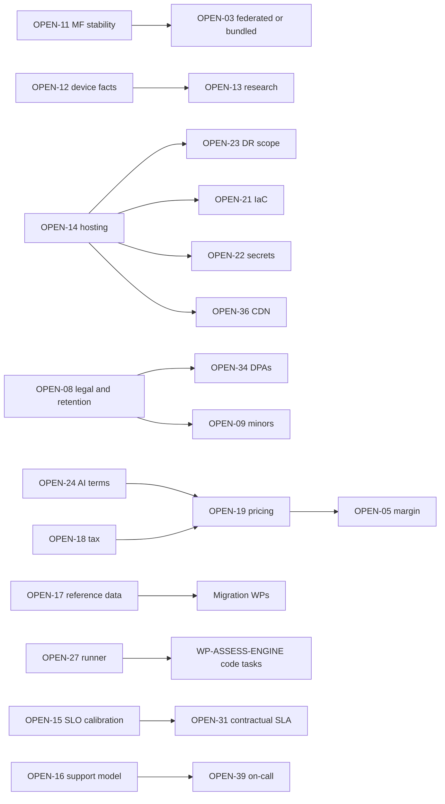

# Open Decisions Register

Doc ID: DEC-OPEN · Owner: Architecture Review Board secretary · Version 1.0 · Status: Draft for Review · Relates: ADR_REGISTER, RSK-REG, RDM-01, CC-ID (ID registry)

## 1. Purpose and rules

- Consolidates every `OPEN-NN` assumption referenced by canonical documents (OPEN-03, 05, 06, 07, 08, 09, 10, 11, 12, 13) and adds items raised by Operations/Quality/Delivery plus SSOT, source-to-target, metric, API, architecture, security/AI, operations, and source-register reconciliations (OPEN-14 … OPEN-51).
- **Needed-by phase** uses Ph0–Ph4 from RDM-01. **Blocking?** = Yes means the named phase cannot exit (or production cannot launch) until decided; No means a documented default exists and work may proceed.
- A decision is closed by an ADR (new `ADR-T**` or superseding entry) or by a recorded owner decision; this register is then updated with the outcome. The ADR register is not edited by this document.
- IDs OPEN-01, OPEN-02 and OPEN-04 are **reserved**: no canonical document or Ops/Quality/Delivery document references them; the Documentation Architect should assign or retire them. Other teams use their own namespaces for local items (for example `OPEN-B*` in BE-01/DB-03, `OPEN-FE-*` in MFA-01), which do not collide. **Known collision:** `27_INDEPENDENT_REVIEWS/SCENARIO_SIMULATIONS.md` uses `OPEN-14` for a "draft field allowlist" item; in this register OPEN-14 is the hosting decision. The owner of that file should renumber its item (suggest `OPEN-40` or a local `OPEN-S*` prefix); this document does not edit other teams' files.

## 2. Canonical items

| ID | Question | Options | Owner | Needed by | Blocking? | Notes / consequence if undecided |
|---|---|---|---|---|---|---|
| OPEN-03 | Does evidence justify activating Module Federation? **Proposed baseline is `MF_MODE=bundled` under ADR-T23; this proposal is not ARB-ratified.** | Keep bundled; activate federation for selected/all modules only if the staffing, independent-release need, and WP-FED-SPIKE criteria in ADR-T23 are met | Frontend Platform Lead + Architecture Review Board | Ph0 only if federation is sought; otherwise before any federated release | **No** for the bundled shell; **Yes** before federation activation | The typed module contract works in bundled mode. Federation adds registry, signature, compatibility, rollback and operating work. OPEN-11 plugin compatibility and OPEN-FE-03 SRI remain gates. |
| OPEN-05 | Gross-margin target and COGS definition | Target range and definition set by Finance; sensitivity from FIN-COST §4 | Finance Lead / CPO | Ph1 (before pricing) | No (blocks pricing finalisation) | GOAL-07 measure undefined until set |
| OPEN-06 | Instructor revenue share and payout terms | Percentage model, tiered, flat fee; payout cadence and thresholds; tax forms | CPO + Finance + Content Ops | Ph2 (before paid courses) | Yes for course commerce | Refund adjustments depend on it (COM-OPS §5) |
| OPEN-07 | Validate personas and journeys with real research (current personas are hypothetical) | Interviews, usability tests, surveys; recruit candidates, recruiters, referees, faculty | Product Director / UX Research | Ph1 (before MVP lock) | No | Risk of building for assumed users; referee flow validation (P4) is priority |
| OPEN-08 | Retention list, legal basis, compliance scan and notification duties (privacy, employment-decision rules, breach notification, consumer law) | Engage counsel; jurisdiction scoping; retention schedule per data class; legal-basis register | Legal / Privacy Lead | Ph1 (before production launch) | **Yes** for launch | Erasure (BR-T060), logs, backups, analytics, billing retention all depend on it. Also open after the REVW-04 design (opaque `subject_ref`, mapping deleted on erasure): legal status and retention of unlinkable history skeletons, truncated IP prefix in audit, map retention under legal hold, backup age-out vs destroyed per-subject keys (DB-02 §16) |
| OPEN-09 | Minors in education contexts: supported or excluded; protections | Exclude under-age users; age-gating with parental consent; restricted feature set | Privacy Lead + Institutions PM | Ph3 (before institution onboarding) | Yes for institutions with under-age learners | TEST-PRV-005 pending |
| OPEN-10 | Identity verification (ID checks): adopt or not | None; vendor-gated optional; institution-provided attestation | Product + Privacy | Ph4 | No | Sensitive data; VR-10 |
| OPEN-11 | Module Federation plugin version and manifest-runtime stability under Vite (sources conflict) | Pin tested version; use alternative bundler plugin; bundled mode | Frontend Platform Lead | Ph0 (WP-FED-SPIKE) | Yes (feeds OPEN-03) | RISK-09 |
| OPEN-12 | Verified iOS/Android PWA facts and supported device matrix (push, install, storage eviction, background sync) | Own device lab, cloud device service, hybrid; define oldest supported iOS | QA + Frontend Platform | Ph0 (WP-IOS-DEVICE-LAB) | No (but limits claims) | FF-09 matrix; RMP-2 definition |
| OPEN-13 | Pending research: WebAuthn/passkey support matrix, Web Push (VAPID) on Safari desktop, pgvector scale limits, regulatory scan; plus items added by Ops: Core Web Vitals/Lighthouse constants, SRE-workbook burn-rate parameters, hosting plan capabilities (HA/PITR) | Add to RES-01 with primary sources; legal advisor for regulatory | Document Specialist + owners | Ph0–Ph1 | No | Several SLO/alert parameters carry "verify" notes |

## 3. Operations, quality, delivery, commercial items

| ID | Question | Options | Owner | Needed by | Blocking? | Notes / consequence if undecided |
|---|---|---|---|---|---|---|
| OPEN-14 | Hosting platform and HA mechanism for production (compute, Postgres HA/PITR, CDN, object storage) | See OPS-DEP §6: single VM/Compose, Coolify, managed Postgres + separate compute, developer PaaS, managed K8s, hyperscaler managed containers | Platform Architect + SRE Lead + ARB | Ph0 (staging), Ph1 (production) | **Yes** for production go-live | RISK-12; reference deployment assets are options only |
| OPEN-15 | Calibration of SLO targets and operational parameters (retry budgets, timeouts, burn-rate parameters, canary stats, bake times, game-day cadence, drill cadence, flag lifetime, flake-fix targets) | Set from WP-LOADBASE baseline; revisit after launch | SRE Lead + Product | Ph0 (method), Ph1 (values) | **Yes** for committing SLOs | OPS-SLO values are hypotheses until then |
| OPEN-16 | Support SLAs, coverage hours (24×7 vs business hours), staffing model, post-incident review window | Tiered SLA per plan; follow-the-sun vs single timezone; outsourcing | Head of Operations | Ph1 | Yes for launch | PROC-03, SUP-INC placeholders |
| OPEN-17 | Does the reference system hold real users or data that must be migrated? | None (greenfield launch); few (offline cutover); material (strangler) | Program Director + CPO | Ph0 | **Yes** (scopes migration WPs) | MIG-01 §1 decision tree. Repository docs label some modules ephemeral, but other source docs describe persisted thread/message storage and routes; labels alone do not prove data is absent. Verify actual database access, authorization, per-table rows, and usage before selecting scope. |
| OPEN-18 | Tax model and jurisdictions for selling subscriptions and courses | Tax calculation service; merchant-of-record; limited-region launch | Finance Lead + Legal | Ph2 (before billing launch) | Yes for billing | COM-OPS §6 |
| OPEN-19 | Pricing, packaging, quotas, trial/grace/dunning parameters, grandfathering, discount authority | Tier structure per COM-OPS §2 with numeric values from market research and cost model | CPO + Finance + Commercial Ops | Ph2 | Yes for billing | AI quotas depend on it |
| OPEN-20 | Observability backend, retention and telemetry residency | Self-hosted OSS stack, managed vendor, hybrid | SRE Lead | Ph0 | No (OTel keeps portability) | OPS-OBS §9 |
| OPEN-21 | Infrastructure-as-Code tool | OpenTofu/Terraform-class, Pulumi-class, provider-native | Platform Eng | Ph0 | No | WP-IAC-ENVS |
| OPEN-22 | Secret manager and key custody (signing keys, session keys) | Cloud-native manager, Vault-class, sealed secrets | Security + Platform | Ph0 | No | OPS-REL §5 |
| OPEN-23 | DR scope and targets: zone-only vs region loss, second region, RPO/RTO for object storage and region events | Single region multi-zone + backups; warm standby region; multi-region | SRE Lead + CTO | Ph1 (decision), Ph3 (exercise) | No for Ph1; **Yes** for external availability promises | SLO-32, SLO-33 |
| OPEN-24 | AI providers, model tiers, budget caps, free-tier allowance, vendor data-retention/training terms | Single provider via gateway, multi-provider, self-hosted small models for classification | AI owner + Finance + Privacy | Ph2 | Yes for AI features | RISK-06, RISK-15 |
| OPEN-25 | Analytics store and minimum cohort size k for aggregate reporting | Postgres analytics schema, separate warehouse, SaaS with server-side forwarding | Analytics Lead + Privacy | Ph1 (events) / Ph3 (cohort analytics) | Yes for institution analytics | ANL-MET §5–§6 |
| OPEN-26 | Email stack: transactional vs marketing separation, secondary provider, double opt-in, sending domains | Brevo for both; Brevo transactional + other marketing; two providers | Messaging owner + Marketing | Ph1 | No | VR-02, RB-15 |
| OPEN-27 | Sandbox runner: build vs buy (WP-ASSESS-RUNNER) | Hardened containers/microVMs built in-house; managed code-execution service; omit code assessments | Assessment owner + Security | Ph0 (decision) | Yes for verified code assessments (Ph2) | Until decided, code submissions remain `unverified` (ADR-T13) |
| OPEN-28 | Proctoring vendor and policy (if any) | None, vendor-gated optional, institution-supplied | Product + Privacy + Accessibility | Ph4 | No | VR-10; bias/accessibility review |
| OPEN-29 | Reconcile provisional FEAT/FR/AC numbering with the Requirements documents | Remap AC ids; keep TEST ids stable | QA Architect + Requirements lead | Ph0 | No | QA-CAT links provisional; coverage lint depends on it |
| OPEN-30 | Data residency / sovereignty needs and dedicated-database option | Single region; regional deployments; dedicated DB for regulated tenant (ADR-T21 trigger) | CTO + Legal | Ph1 (assessment), Ph3 (if needed) | No | RISK-49 |
| OPEN-31 | Contractual SLA for B2B and its relation to internal SLOs | None (best effort), published uptime commitment, per-contract addenda with credits | Commercial Ops + Legal + SRE | Ph3 (enterprise) | Yes for enterprise contracts promising uptime | OPS-SLO §1 |
| OPEN-32 | Moderation and trust-and-safety capacity: in-house, vendor tooling, outsourced | See PROC-05, RB-32 | T&S Lead | Ph2 (moderation), Ph4 (community) | Yes for community features | RISK-42 |
| OPEN-33 | Refund, dispute and chargeback policy limits (windows, approval thresholds) | Policy per product (subscription vs course); approval limit matrix | Finance Ops + Legal | Ph2 | Yes for billing launch | PROC-13 |
| OPEN-34 | Sub-processor list, DPAs and vendor privacy reviews | Standard DPA set; customer-specific addenda | Privacy Lead + Legal | Ph1 | Yes for launch | COM-OPS §8 |
| OPEN-35 | Feature-flag platform: build (Postgres) vs buy | Postgres-backed with audit; SaaS flag service | Release Eng + Platform | Ph1 | No (minimal build default) | WP-FEATURE-FLAGS |
| OPEN-36 | CDN provider and custody of manifest-signing keys | Provider choice; KMS/HSM-class key custody; rotation process | Platform + Security | Ph0–Ph1 | No | OPS-DEP §3, RISK-17 |
| OPEN-37 | External accessibility audit scope and public conformance statement | Independent audit before launch; post-launch audit; statement format | Design System Lead + Legal | Ph1 (core flows), Ph3 (full) | No | GOAL-06; institution procurement |
| OPEN-38 | Helpdesk / support tooling | Buy helpdesk; use ticketing add-on; lightweight in-app form + email | Support Lead | Ph1 | No | VR-11; WP-SUPPORT-TOOLING |
| OPEN-39 | On-call model, paging tool and rota | Primary/secondary rota; follow-the-sun; vendor-managed on-call | SRE Lead + Head of Operations | Ph1 | **Yes** for production go-live | RISK-34; SUP-INC §9 |

## 4. Dependencies between open decisions

## 5. Production go-live blockers (derived)

OPEN-08, OPEN-14, OPEN-15 (committed SLOs), OPEN-16, OPEN-34, OPEN-39 must be resolved before Ph1 production go-live, together with the restore drill (RG-14). OPEN-17 must be resolved in Ph0 to scope migration. Items marked Yes for Ph2 (OPEN-06, 18, 19, 24, 27, 33) block the corresponding feature releases, not the core loop.

## Added by orchestrator after integration
| ID | Question | Options | Owner | Needed by | Blocking? |
|---|---|---|---|---|---|
| OPEN-40 | Which form fields may be persisted in offline/unsent drafts (browser storage is not a secure enclave)? | Allowlist non-sensitive fields only / encrypt with session-derived key / no sensitive drafts | Security Architect + Frontend Architect | Ph1 | No |
| OPEN-41 | How are the canonical 173 `F-*` features in root `SSOT.md` §7 traced to this blueprint's 253 `FEAT-*` rows, including source registry metadata? | Review and approve the candidate identity crosswalk and separately disposition source category/priority/phase/dependency metadata in `28_TRACEABILITY_AND_COVERAGE/`; amend mappings or record different owner-approved outcomes without silently translating phases | Product Director + Documentation Architect | Before portfolio coverage or roadmap readiness is claimed | **Yes** for claiming complete portfolio traceability or implementation readiness | Candidate identity mapping and source metadata are preserved in separate crosswalks; owner approval and phase reconciliation remain pending. Counts, priorities, and phase vocabularies remain non-interchangeable. |
| OPEN-42 | How should proposed capability-map phases reconcile to roadmap work packages and the canonical GA loop? | Reconcile feature phase tags against WP acceptance scope; split foundation policy from provider-backed execution where needed; record an owner-approved mapping without equating the SSOT and local phase scales | Product Director + Program Director + QA Architect | Ph0, before claiming phase exit or implementation readiness | **Yes** before Phase 1/2 readiness or exit is claimed | Current differences include FEAT-07-02/04/05/06, FEAT-10-05/06, FEAT-19-01/02 and FEAT-23-01; see the supplemental audit in `27_INDEPENDENT_REVIEWS/FINAL_REVIEW_REPORT.md`. No phase choice is inferred here. |
| OPEN-43 | Which legacy business rules remain product requirements, and how should source differences and conflicts with the proposed BR-T target rules be resolved? | Review the source-aware `../06_BUSINESS_PROCESSES/LEGACY_RULE_CROSSWALK.md`; explicitly adopt, redesign, or retire each unmatched behavior and resolve conflicts before declaring rule parity | Product Director + Business Analyst Lead + Privacy Lead where data/consent is involved | Before business-rule parity or legacy rule retirement is claimed | **Yes** for complete rule parity or cleanup of either rule source | The crosswalk compares the protected SSOT and legacy registry: 256 IDs align after padding normalization, but four texts differ. It has 9 exact, 67 partial, 8 conflict, 1 superseded, and 171 no-match rows; no disposition is inferred. |
| OPEN-44 | Which authorization model governs the target, and how are legacy SSOT roles reconciled with observed role types and the target scoped-grant design? | Decide whether to retain and map the SSOT two-tier model, adopt the scoped-grant model with explicit role/permission mapping, or revise both; specify server-side enforcement and the capabilities contract | Product Director + Security Architect + Domain Architect | Before authorization contract or implementation readiness is claimed | **Yes** for authorization design readiness | SSOT v6 §§5–7 describes three Tier-1 roles and 24 contextual roles; observed `packages/domain/src/core.ts` exposes a 10-value union; target USR-01 uses scoped grants. `packages/policy` and `/api/v1/me/capabilities` were not found in the inspected workspace. These are different evidence layers, not proof that any model is approved or complete. |
| OPEN-45 | How do the canonical SSOT J/WF/WIT/state identities map to the target UJ/BP/SM documents? | Review candidate journey and workflow/integrity crosswalks; complete the state-machine mapping with explicit gaps/merges; retain source identity and owner decisions | Product Director + Domain Architect + Documentation Architect | Before claiming complete journey, process, or lifecycle parity | **Yes** for complete behavioral traceability | SSOT defines J-01…J-28, WF-01…WF-66, WIT-001…WIT-025, and a 40-entity state index; candidate J-to-UJ and 91-row WF/WIT-to-BP maps are drafted. State-machine reconciliation remains outstanding; title similarity does not establish coverage. |
| OPEN-46 | Which API success/list envelope, pagination default, and compatibility/deprecation contract is canonical? | Resolve the root SSOT `{success,data,meta}` and cursor-default-20 contract against the target `{items,page}` and default 25; decide the deprecation window and map CON/SCI identities. RFC 9457 error bodies may coexist with either success shape | Backend Architect + API Owner + Security Architect | Before API contract freeze or implementation readiness | **Yes** for API contract readiness | SSOT lines 3177–3208 specify a ≥6-month deprecation lifecycle; target API standards propose 90 days. Candidate maps now cover all 16 CON identities (8 aligned candidates, 6 partial candidates, 2 conflicts) and all 54 SCI identities (33 partial candidates, 21 no-specific-match). Owner disposition remains outstanding. |
| OPEN-47 | Which domain boundaries and frontend release model preserve the SSOT architecture intent while justifying the target decomposition? | Reconcile SSOT's modular-monolith/domain ownership with the target bounded-context merges and optional runtime federation; record rationale, compatibility/operating consequences, and revisit criteria | Product Director + Enterprise Architect + Frontend Architect | Before domain/API ownership and frontend deployment boundaries are frozen | **Yes** for architecture readiness | SSOT §§12 and 21 define modular domain boundaries and explicit cross-domain interfaces; target groups several domains into fewer contexts and retains an optional federation model. The delta is a proposal, not an approved supersession. |
| OPEN-48 | Which security, privacy, AI-safety, and assessment controls are the approved target where source and blueprint contracts differ? | Reconcile remediation SLAs, residency/AI egress, FERPA graduation handling, full-name/address redaction, provenance and evidence-quality gates, provider authorization order, assessment AI modes, and RLS exceptions; record each disposition and owner | Security Architect + Privacy Lead + AI Owner + Assessment Owner | Before security/AI contract freeze or affected feature release | **Yes** for affected security-sensitive releases | Root SSOT §§14, 18, 29–30 and target security/privacy/backend/assessment documents contain material differences or incomplete mappings. No source rule is superseded by this entry; counsel-dependent matters remain under OPEN-08/30/34. |
| OPEN-49 | Which reliability and operations targets govern launch and how are source controls mapped to target runbooks? | Reconcile integration-removal drills, dual queues, realtime limits, incident response thresholds, performance budgets, canary/rollback windows, database/object recovery and regional DR; map source control IDs to target procedures and evidence | SRE Lead + Platform Architect + Security Architect + Product Director | Before committing production SLOs, external availability promises, or production go-live | **Yes** for committed operations and recovery claims | Root SSOT §§13, 17, 20, 28–29 and target operations/reliability docs differ in queue, realtime, performance, rollout, and recovery detail. Existing OPEN-15/23 remain calibration/DR decisions; this entry preserves source requirements pending disposition. |
| OPEN-50 | How are remaining source registers, UX patterns, phase gates, and governance decisions reconciled without losing stable IDs or contradictory source evidence? | Create row-level source-to-target dispositions for service contracts and control/register families; reconcile phases and exit gates, C1-C7 governance authority, M-01 through M-100 interaction patterns, decision/correction IDs and inconsistent locked counts; mark unavailable citations unverified | Product Director + Architecture Review Board secretary + Documentation Architect + QA Architect | Before claiming complete blueprint traceability, phase exit, or register cleanup | **Yes** for those completeness claims | The root SSOT preserves 54 SCI IDs, Ph0-Ph10, governance C1-C7, GAP/OD/D/DOR families and 100 UX patterns. SCI-01 through 54 and CF-31 through CF-45 have candidate row-level maps; the 278-route observed inventory now has a path crosswalk (9 name-preserving method/path overlaps, 4 named-path method mismatches, 6 additional parameter-agnostic shape candidates, 259 no shape match), but semantic route/API mapping and owner disposition remain open. JSON audit evidence has an index, F-level, business-rule, and journey links; the 51 nested migration records now have row-level file-identity pointers (all hashes match; applied state is unknown), while the 1,172 historical test assertion records now have row-level pointers (not current execution or semantic coverage proof), probe evidence now has row-level pointers but remains unverified; external issue evidence has row-level pointers but current status and owner mapping remain unchecked; semantic migration disposition is unresolved; 274 historical route records now have exact method/path pointers into the observed API inventory, with semantic mapping and source-line provenance unresolved; the 684-row inventory now has path/hash pointers but content-level inspection and destination mapping remain incomplete; the 46 historical documentation scan records map to manifest DOC IDs, but semantic acceptance and missing-deliverable disposition remain open. The 100-row UX, 69-row phase/gate/governance, and 38-row observed implementation control crosswalks provide candidate row-level maps; none is approved. Decision/correction appendices, remaining register maps, source appendix count conflicts, and nested JSON dispositions remain unresolved; no deletion or approval is implied. |
| OPEN-51 | What is the primary product outcome metric, and how does Verifiable Career Progress relate to Evidence-Backed Hiring Conversations? | Select one as the primary north star, or define an owner-approved hierarchy with leading and lagging measures and anti-gaming constraints | Product Director + Analytics Lead | Before metric baselining, roadmap success claims, or external outcome claims | **Yes** for product success measurement | `docs/product/PRD.md` §9 names Verifiable Career Progress as primary; target `METRICS_CATALOG.md` §2 names EBHC. Both are candidate measures, and no owner-approved replacement or hierarchy is recorded. |
| OPEN-52 | How will the branch persistence decision in source ADR-015 be reconciled with target ADR-T05 before implementation and production scale-out? | Compare (a) an owner-approved, time-bounded single-writer bridge with explicit per-domain exit gates, (b) completing SQL-backed reads before production, and any evidence-based alternative; define identity/schema adaptation, transaction and concurrency acceptance, hosted migration rehearsal, and the gate before a second API writer | Architecture Review Board + Database Architect + API Owner + Platform/SRE | Before persistence architecture approval, populated hosted migration, or second API writer | **Yes** for production persistence and horizontal scale readiness | Source ADR-015 says branch-accepted pending owner ratification, with PostgreSQL writes and boot-hydrated Map reads. Target ADR-T05 specifies SQL-only reads/writes. Current ARCHITECTURE.md describes the hybrid trade-off; later audit records hosted-schema and operational proof blockers. Neither design supersedes the other without owner decision and evidence. See TRC-18. |
| OPEN-01, 02, 04 | Reserved, unused: retire or assign. | — | Documentation Architect | Ph0 | No |

## 6. Consolidated register of namespaced open items (added 2026-10-27; the single register)

This section is the one place that lists every open-item namespace and where its rows live, plus the items raised by the 2026-10-27 patch round. Evidence label for every row: OPEN (nothing is decided or implemented). Numbering check done 2026-10-27 by grep over the whole folder: the global `OPEN-NN` series is 01..52 (01, 02, 04 reserved) and was not renumbered; no namespaced id collides with it. Namespaces are separate by prefix, so there is no renumbering in this round.

### 6.1 Namespaces and where the rows are defined

| Namespace | Distinct ids found | Rows live in | Note |
|---|---:|---|---|
| `OPEN-NN` | 52 | this file, sections 2, 3 and the orchestrator table | Global series |
| `OPEN-LGA-nn` | 21 | `OPEN_DECISIONS_LEGACY_MERGE.md` | Legacy-merge items |
| `OPEN-UX-nn` | 33 (04..36; 01..03 unused) | `07_UI_UX_AND_DESIGN_SYSTEM/PROGRESSIVE_UX_AND_FEEDBACK.md`, `SCREEN_SPECIFICATIONS_KEY.md`, `06_*/SSOT_WORKFLOW_CROSSWALK.md` | OPEN-UX-34..36 are new, listed in 6.2 |
| `OPEN-FE-nn` | 32 | `09_MODULE_FEDERATION`, `10_FRONTEND_ARCHITECTURE` | Frontend/federation |
| `OPEN-B*` | 59 | `11_BACKEND_ARCHITECTURE`, `12_DATA_AND_DATABASE` | Backend/data |
| `OPEN-CS-nn` | 5 | `00_CONTROL_CENTRE/CONSENT_SCOPE_CATALOGUE.md` | Consent scopes |
| `OPEN-X0n` | 6 (X01..X05 in 14; X06 added here) | `14_SECURITY_PRIVACY_COMPLIANCE/SECURITY_ARCHITECTURE.md` section R3-10, 6.2 below | Trust/ops round |
| `OPEN-P0n` | 3 (new, added here) | 6.2 below | Platform items from the patch round |

### 6.2 Items raised by the patch round

| ID | Question | Owner | Needed by | Blocking? | Source |
|---|---|---|---|---|---|
| OPEN-UX-34 | Count limits in code points or grapheme clusters for emoji sequences | UX + Frontend | Ph1 | No | 07 `SCREEN_SPECIFICATIONS_KEY.md` |
| OPEN-UX-35 | Is NFC normalisation applied to names shown on credentials (exact source spelling may matter) | UX + Privacy | Ph1 | No | 07 `SCREEN_SPECIFICATIONS_KEY.md` |
| OPEN-UX-36 | Register the listed ACT gaps in the Action Registry before the trace rows move from candidate to approved | UX + Documentation Architect | Before trace approval | No | 06 `SSOT_WORKFLOW_CROSSWALK.md` |
| OPEN-X01 | Device trust ("trusted device" skips MFA): confirm out of scope for v1 | Security Architect | Ph1 | No | 14 R3-10 |
| OPEN-X02 | Permission-cache staleness and denylist propagation values (15 s / 5 s / 15 min are design targets) confirmed against load tests | Security Architect + SRE Lead | Before SLO commitment | Yes for revocation claims | 14 R3-10 |
| OPEN-X03 | AI prompt/output log retention | Privacy Lead + AI owner | Before AI launch | Yes for AI launch | 14 R3-10 |
| OPEN-X04 | Counsel review owner for regulator/law-enforcement requests (PROC-16); executive sponsor to name | Executive sponsor | Before PROC-16 is operational | Yes for PROC-16 | 14, 18 |
| OPEN-X05 | Whether any "view as user" capability is built (R3-4) | Product + Security | Ph2 | No | 14 R3-10 |
| OPEN-X06 | One canonical list of `audit.*` event names (48 distinct dotted names found across 07, 14, 16, 18, 19; none is in EVENT_CATALOG/AsyncAPI) | Backend Architect + Security Architect | Before API/event contract freeze | Yes for event contract freeze | grep, this round |
| OPEN-P01 | Lost-response outcome lookup `GET /api/v1/idempotency/{key}` (DC-05) is PROPOSED and absent from OpenAPI: add or drop | API Owner | Before API contract freeze (OPEN-46) | Yes for DC-05 | 12 `PHYSICAL_DESIGN.md` |
| OPEN-P02 | Chaos tests `CH-nn` and contract tests `CT-nn` (FAILURE_MODE_ANALYSIS section 10) are not in TEST_CATALOG | QA Architect | Ph1 | No | 15 `FAILURE_MODE_ANALYSIS.md` |
| OPEN-P03 | Ratify remote-load timeout 10000 ms (cold) with 2 retries (500 ms, 1500 ms); PROPOSED, applies only if federation is activated (ADR-T23) | Frontend Architect + ARB | With ADR-T23 | No (bundled baseline) | 09 `HOST_CONTRACT_AND_REMOTE_CONTRACTS.md` |
| OPEN-P04 | Add TEST-UXH-001..004 and TEST-ACT-001..012 to TEST_CATALOG (defined in 07 only) | QA Architect | Ph1 | No | 07 |

Reserved and unused global ids OPEN-01, 02, 04 remain to be retired or assigned (Documentation Architect, Ph0).

Already closed or changed by other owners and not re-opened here: ADR decision records D-01..D-05 live in `ADR_REGISTER.md` (PROPOSED; not touched by this round).
