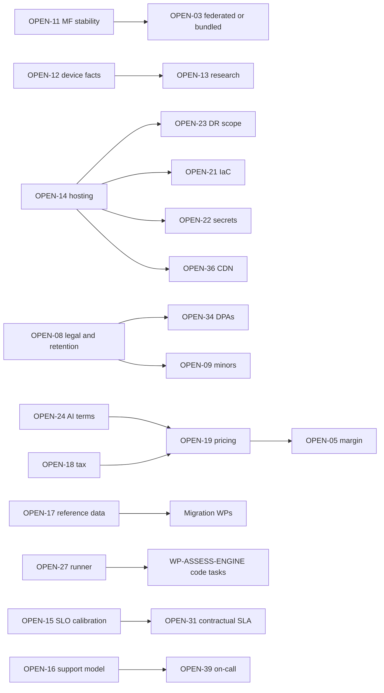

# Open Decisions Register

Doc ID: DEC-OPEN · Owner: Architecture Review Board secretary · Version 1.0 · Status: Draft for Review · Relates: ADR_REGISTER, RSK-REG, RDM-01, CC-ID (ID registry)

## 1. Purpose and rules

- Consolidates every `OPEN-NN` assumption referenced by canonical documents (OPEN-03, 05, 06, 07, 08, 09, 10, 11, 12, 13) and adds items raised by the Operations/Quality/Delivery documents (OPEN-14 … OPEN-39).
- **Needed-by phase** uses Ph0–Ph4 from RDM-01. **Blocking?** = Yes means the named phase cannot exit (or production cannot launch) until decided; No means a documented default exists and work may proceed.
- A decision is closed by an ADR (new `ADR-T**` or superseding entry) or by a recorded owner decision; this register is then updated with the outcome. The ADR register is not edited by this document.
- IDs OPEN-01, OPEN-02 and OPEN-04 are **reserved**: no canonical document or Ops/Quality/Delivery document references them; the Documentation Architect should assign or retire them. Other teams use their own namespaces for local items (for example `OPEN-B*` in BE-01/DB-03, `OPEN-FE-*` in MFA-01), which do not collide. **Known collision:** `27_INDEPENDENT_REVIEWS/SCENARIO_SIMULATIONS.md` uses `OPEN-14` for a "draft field allowlist" item; in this register OPEN-14 is the hosting decision. The owner of that file should renumber its item (suggest `OPEN-40` or a local `OPEN-S*` prefix); this document does not edit other teams' files.

## 2. Canonical items

| ID | Question | Options | Owner | Needed by | Blocking? | Notes / consequence if undecided |
|---|---|---|---|---|---|---|
| OPEN-03 | Do we ship federated remotes or bundled mode? Collapse to `MF_MODE=bundled` if fewer than 3 independent frontend teams exist (ADR-T03) | (a) Federated, (b) Bundled (same module contract), (c) Federated for selected remotes only | Frontend Platform Lead + Architecture Review Board | Ph0 (after WP-FED-SPIKE) | **Yes** for Ph1 shell design | Pipelines (OPS-REL §3) and rollback rules (OPS-REL §10) differ; contract keeps both viable |
| OPEN-05 | Gross-margin target and COGS definition | Target range and definition set by Finance; sensitivity from FIN-COST §4 | Finance Lead / CPO | Ph1 (before pricing) | No (blocks pricing finalisation) | GOAL-07 measure undefined until set |
| OPEN-06 | Instructor revenue share and payout terms | Percentage model, tiered, flat fee; payout cadence and thresholds; tax forms | CPO + Finance + Content Ops | Ph2 (before paid courses) | Yes for course commerce | Refund adjustments depend on it (COM-OPS §5) |
| OPEN-07 | Validate personas and journeys with real research (current personas are hypothetical) | Interviews, usability tests, surveys; recruit candidates, recruiters, referees, faculty | Product Director / UX Research | Ph1 (before MVP lock) | No | Risk of building for assumed users; referee flow validation (P4) is priority |
| OPEN-08 | Retention list, legal basis, compliance scan and notification duties (privacy, employment-decision rules, breach notification, consumer law) | Engage counsel; jurisdiction scoping; retention schedule per data class; legal-basis register | Legal / Privacy Lead | Ph1 (before production launch) | **Yes** for launch | Erasure (BR-T060), logs, backups, analytics, billing retention all depend on it. Also open after the REVW-04 design (opaque `subject_ref`, mapping deleted on erasure): legal status and retention of unlinkable history skeletons, truncated IP prefix in audit, map retention under legal hold, backup age-out vs destroyed per-subject keys (DB-02 §16) |
| OPEN-09 | Minors in education contexts: supported or excluded; protections | Exclude under-age users; age-gating with parental consent; restricted feature set | Privacy Lead + Institutions PM | Ph3 (before institution onboarding) | Yes for institutions with under-age learners | TEST-PRV-005 pending |
| OPEN-10 | Identity verification (ID checks): adopt or not | None; vendor-gated optional; institution-provided attestation | Product + Privacy | Ph4 | No | Sensitive data; VR-10 |
| OPEN-11 | Module Federation plugin version and manifest-runtime stability under Vite (sources conflict) | Pin tested version; use alternative bundler plugin; bundled mode | Frontend Platform Lead | Ph0 (WP-FED-SPIKE) | Yes (feeds OPEN-03) | RISK-09 |
| OPEN-12 | Verified iOS/Android PWA facts and supported device matrix (push, install, storage eviction, background sync) | Own device lab, cloud device service, hybrid; define oldest supported iOS | QA + Frontend Platform | Ph0 (WP-IOS-DEVICE-LAB) | No (but limits claims) | FF-09 matrix; RMP-2 definition |
| OPEN-13 | Pending research: WebAuthn/passkey support matrix, Web Push (VAPID) on Safari desktop, pgvector scale limits, regulatory scan; plus items added by Ops: Core Web Vitals/Lighthouse constants, SRE-workbook burn-rate parameters, hosting plan capabilities (HA/PITR) | Add to RES-01 with primary sources; legal advisor for regulatory | Document Specialist + owners | Ph0–Ph1 | No | Several SLO/alert parameters carry "verify" notes |

## 3. Operations, quality, delivery, commercial items

| ID | Question | Options | Owner | Needed by | Blocking? | Notes / consequence if undecided |
|---|---|---|---|---|---|---|
| OPEN-14 | Hosting platform and HA mechanism for production (compute, Postgres HA/PITR, CDN, object storage) | See OPS-DEP §6: single VM/Compose, Coolify, managed Postgres + separate compute, developer PaaS, managed K8s, hyperscaler managed containers | Platform Architect + SRE Lead + ARB | Ph0 (staging), Ph1 (production) | **Yes** for production go-live | RISK-12; reference deployment assets are options only |
| OPEN-15 | Calibration of SLO targets and operational parameters (retry budgets, timeouts, burn-rate parameters, canary stats, bake times, game-day cadence, drill cadence, flag lifetime, flake-fix targets) | Set from WP-LOADBASE baseline; revisit after launch | SRE Lead + Product | Ph0 (method), Ph1 (values) | **Yes** for committing SLOs | OPS-SLO values are hypotheses until then |
| OPEN-16 | Support SLAs, coverage hours (24×7 vs business hours), staffing model, post-incident review window | Tiered SLA per plan; follow-the-sun vs single timezone; outsourcing | Head of Operations | Ph1 | Yes for launch | PROC-03, SUP-INC placeholders |
| OPEN-17 | Does the reference system hold real users or data that must be migrated? | None (greenfield launch); few (offline cutover); material (strangler) | Program Director + CPO | Ph0 | **Yes** (scopes migration WPs) | MIG-01 §1 decision tree |
| OPEN-18 | Tax model and jurisdictions for selling subscriptions and courses | Tax calculation service; merchant-of-record; limited-region launch | Finance Lead + Legal | Ph2 (before billing launch) | Yes for billing | COM-OPS §6 |
| OPEN-19 | Pricing, packaging, quotas, trial/grace/dunning parameters, grandfathering, discount authority | Tier structure per COM-OPS §2 with numeric values from market research and cost model | CPO + Finance + Commercial Ops | Ph2 | Yes for billing | AI quotas depend on it |
| OPEN-20 | Observability backend, retention and telemetry residency | Self-hosted OSS stack, managed vendor, hybrid | SRE Lead | Ph0 | No (OTel keeps portability) | OPS-OBS §9 |
| OPEN-21 | Infrastructure-as-Code tool | OpenTofu/Terraform-class, Pulumi-class, provider-native | Platform Eng | Ph0 | No | WP-IAC-ENVS |
| OPEN-22 | Secret manager and key custody (signing keys, session keys) | Cloud-native manager, Vault-class, sealed secrets | Security + Platform | Ph0 | No | OPS-REL §5 |
| OPEN-23 | DR scope and targets: zone-only vs region loss, second region, RPO/RTO for object storage and region events | Single region multi-zone + backups; warm standby region; multi-region | SRE Lead + CTO | Ph1 (decision), Ph3 (exercise) | No for Ph1; **Yes** for external availability promises | SLO-32, SLO-33 |
| OPEN-24 | AI providers, model tiers, budget caps, free-tier allowance, vendor data-retention/training terms | Single provider via gateway, multi-provider, self-hosted small models for classification | AI owner + Finance + Privacy | Ph2 | Yes for AI features | RISK-06, RISK-15 |
| OPEN-25 | Analytics store and minimum cohort size k for aggregate reporting | Postgres analytics schema, separate warehouse, SaaS with server-side forwarding | Analytics Lead + Privacy | Ph1 (events) / Ph3 (cohort analytics) | Yes for institution analytics | ANL-MET §5–§6 |
| OPEN-26 | Email stack: transactional vs marketing separation, secondary provider, double opt-in, sending domains | Brevo for both; Brevo transactional + other marketing; two providers | Messaging owner + Marketing | Ph1 | No | VR-02, RB-15 |
| OPEN-27 | Sandbox runner: build vs buy (WP-ASSESS-RUNNER) | Hardened containers/microVMs built in-house; managed code-execution service; omit code assessments | Assessment owner + Security | Ph0 (decision) | Yes for verified code assessments (Ph2) | Until decided, code submissions remain `unverified` (ADR-T13) |
| OPEN-28 | Proctoring vendor and policy (if any) | None, vendor-gated optional, institution-supplied | Product + Privacy + Accessibility | Ph4 | No | VR-10; bias/accessibility review |
| OPEN-29 | Reconcile provisional FEAT/FR/AC numbering with the Requirements documents | Remap AC ids; keep TEST ids stable | QA Architect + Requirements lead | Ph0 | No | QA-CAT links provisional; coverage lint depends on it |
| OPEN-30 | Data residency / sovereignty needs and dedicated-database option | Single region; regional deployments; dedicated DB for regulated tenant (ADR-T21 trigger) | CTO + Legal | Ph1 (assessment), Ph3 (if needed) | No | RISK-49 |
| OPEN-31 | Contractual SLA for B2B and its relation to internal SLOs | None (best effort), published uptime commitment, per-contract addenda with credits | Commercial Ops + Legal + SRE | Ph3 (enterprise) | Yes for enterprise contracts promising uptime | OPS-SLO §1 |
| OPEN-32 | Moderation and trust-and-safety capacity: in-house, vendor tooling, outsourced | See PROC-05, RB-32 | T&S Lead | Ph2 (moderation), Ph4 (community) | Yes for community features | RISK-42 |
| OPEN-33 | Refund, dispute and chargeback policy limits (windows, approval thresholds) | Policy per product (subscription vs course); approval limit matrix | Finance Ops + Legal | Ph2 | Yes for billing launch | PROC-13 |
| OPEN-34 | Sub-processor list, DPAs and vendor privacy reviews | Standard DPA set; customer-specific addenda | Privacy Lead + Legal | Ph1 | Yes for launch | COM-OPS §8 |
| OPEN-35 | Feature-flag platform: build (Postgres) vs buy | Postgres-backed with audit; SaaS flag service | Release Eng + Platform | Ph1 | No (minimal build default) | WP-FEATURE-FLAGS |
| OPEN-36 | CDN provider and custody of manifest-signing keys | Provider choice; KMS/HSM-class key custody; rotation process | Platform + Security | Ph0–Ph1 | No | OPS-DEP §3, RISK-17 |
| OPEN-37 | External accessibility audit scope and public conformance statement | Independent audit before launch; post-launch audit; statement format | Design System Lead + Legal | Ph1 (core flows), Ph3 (full) | No | GOAL-06; institution procurement |
| OPEN-38 | Helpdesk / support tooling | Buy helpdesk; use ticketing add-on; lightweight in-app form + email | Support Lead | Ph1 | No | VR-11; WP-SUPPORT-TOOLING |
| OPEN-39 | On-call model, paging tool and rota | Primary/secondary rota; follow-the-sun; vendor-managed on-call | SRE Lead + Head of Operations | Ph1 | **Yes** for production go-live | RISK-34; SUP-INC §9 |

## 4. Dependencies between open decisions

## 5. Production go-live blockers (derived)

OPEN-08, OPEN-14, OPEN-15 (committed SLOs), OPEN-16, OPEN-34, OPEN-39 must be resolved before Ph1 production go-live, together with the restore drill (RG-14). OPEN-17 must be resolved in Ph0 to scope migration. Items marked Yes for Ph2 (OPEN-06, 18, 19, 24, 27, 33) block the corresponding feature releases, not the core loop.

## Added by orchestrator after integration
| ID | Question | Options | Owner | Needed by | Blocking? |
|---|---|---|---|---|---|
| OPEN-40 | Which form fields may be persisted in offline/unsent drafts (browser storage is not a secure enclave)? | Allowlist non-sensitive fields only / encrypt with session-derived key / no sensitive drafts | Security Architect + Frontend Architect | Ph1 | No |
| OPEN-01, 02, 04 | Reserved, unused: retire or assign. | — | Documentation Architect | Ph0 | No |
