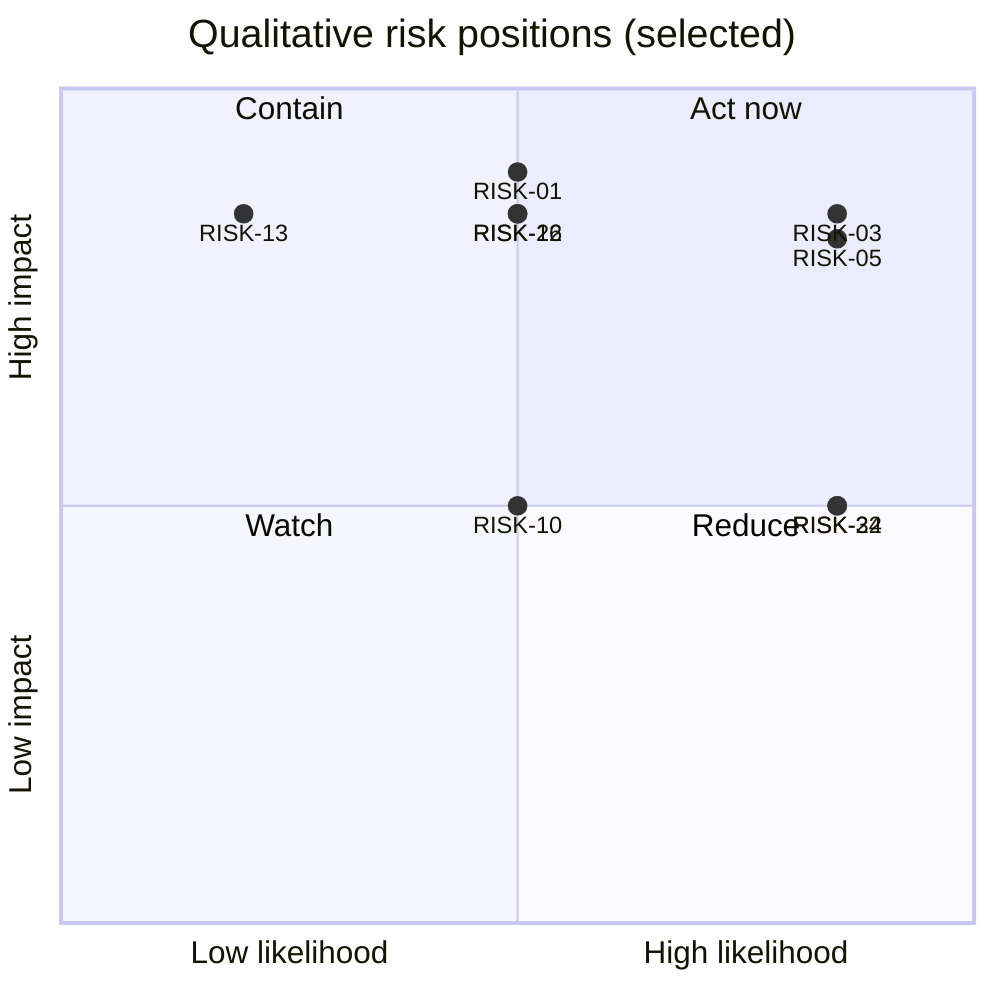

# Risk Register

Doc ID: RSK-REG · Owner: Risk & Architecture Review Board secretary (with SRE Lead, Security Lead, Product Director) · Version 1.0 · Status: Draft for Review · Relates: ADR_REGISTER (ADR-T01…T22), CANONICAL_INVARIANTS, OPS-FMEA, VR-01…VR-14 (COM-OPS §8), DEC-OPEN, STR-01 §9

> **Revision 2 folded in (2026-10-27)** from `RISK_REGISTER.md#record-risk-register-rev2`: appended under "Revision 2 additions"; where it differs from text above, the appended text governs. Status unchanged; proposals still need owner/ARB ratification.

## 1. Method

- **Likelihood (L)** and **Impact (I)** are qualitative: **L**ow / **M**edium / **H**igh, assessed *before* mitigation, from design reasoning and the reference system's documented gaps; they are not statistical estimates. Re-rate with evidence as phases complete.
- **Priority** = the L×I combination: HH = P1; HM, MH and MM = P2; everything involving a Low (LH, LM, ML, LL) = P3. Review P1 monthly, P2 each phase gate, P3 at design reviews.
- Each risk has an **owner role**, **mitigation** (preventive and detective), a **trigger** (observable that the risk is materialising → invoke contingency), and links to ADR/INV/FM/OPEN.
- Residual risk is re-assessed when mitigation WPs ship; "closed" requires evidence (test, drill result).
- **[REF]** marks risks seeded by documented reference-system gaps (not facts about the target).
- Risk register ≠ OPEN decisions; unresolved decisions that create risk are cross-referenced.

## 2. Register

| ID | Risk | Category | L | I | P | Owner | Mitigation | Trigger | Links |
|---|---|---|---|---|---|---|---|---|---|
| RISK-01 | Cross-tenant data exposure (policy, repository, RLS, cache, search or export defect) | Security / tenancy | M | H | P2 | Security Lead | Defence in depth (policy + repository + RLS); FF-05 canary in CI and prod synthetic; IDOR suite; deny-by-default; kill switches; Sev-1 runbook | ALT-10 fires; canary fails; customer report | ADR-T07, ADR-T21, INV-T01…T03, FF-01, FF-05, FM-29, RB-01 |
| RISK-02 | Authorization gaps / IDOR in individual handlers (authenticated ≠ authorized) **[REF]** reference noted inline, inconsistent org-role checks | Security | M | H | P2 | Backend Lead | Central policy; route-registry lint (FF-01); generated matrix tests; code review checklist | New route without policy action; authz test failures | ADR-T07, INV-T01, INV-T02, FM-15 |
| RISK-03 | Evidence gaming (fake employers/referees, collusion, fabricated artefacts) erodes trust in verified evidence | Product / trust | H | H | P1 | Trust PM | Evidence ladder with provenance; anomaly signals to human review; referee collusion patterns; revocation + recompute; rate limits | Rising revocation rate (MET-007); fraud reports | ADR-T14, INV-T04, INV-T20, PROC-06 |
| RISK-04 | Referee non-response stalls verification funnel | Product | H | M | P2 | Verification PM | Tokenised no-account UX (P4 < 3 min); reminder policy (BR-T004); alternative evidence routes; measure response | MET-006 below expectation; verification drop-off | STR-01 §9, BR-T004, MET-005/006 |
| RISK-05 | Marketplace cold-start (two-sided supply/demand) | Business | H | H | P1 | CPO | Seed with institutions; employer value without density (explained shortlist); phased scope | Low EBHC (MET-001); employer churn | STR-01 §9, GOAL-02 |
| RISK-06 | AI cost overrun (free tier leakage, runaway usage, price changes) | Financial | M | H | P2 | AI owner | Gateway budgets, free-tier no-paid-inference rule, kill switch, anomaly alerts, model routing | ALT-18; MET-029 trend | ADR-T12, INV-T07, FIN-COST §5, RB-21 |
| RISK-07 | Regulatory exposure for automated employment decisions and data processing | Legal / compliance | M | H | P2 | Legal / Privacy Lead | Human-in-the-loop by design; explainability; adverse-impact audit; counsel engagement; no legal claims in docs | New regulation; complaint; audit finding | INV-T09, INV-T19, OPEN-08, WP-FAIRNESS-AUDIT |
| RISK-08 | Over-scoped feature surface dilutes quality and inflates cost | Delivery | H | M | P2 | Program Director | ADR-T01 scope discipline; phase gates; "what not to build" list (FIN-COST §8); WP exit criteria | Phase slippage; unfinished R1 areas | ADR-T01, RDM-01 §4 |
| RISK-09 | Module Federation 2.0 + Vite compatibility or release churn causes instability | Technical | M | H | P2 | Frontend Platform Lead | Keep bundled baseline; run WP-FED-SPIKE before activation; pin versions only after the exact Vite/React/router/PWA matrix passes; compat gates | Spike fails; breaking plugin upgrade | ADR-T23, OPEN-03, OPEN-11, RES-01 R1 |
| RISK-10 | Federation overhead (extra round trips, duplicated deps) breaks LCP/INP budgets | Performance | M | M | P2 | Performance Eng | Δ_F budget (SLO-17); SW precache; bundle budgets; measure in spike | Δ_F above budget | SLO-17, TEST-PER-004 |
| RISK-11 | Postgres as single system of record, queue, search and vector store creates contention and a shared failure domain | Technical / scale | M | H | P2 | DBA / Architect | Bulkheads and pool slices; partition outbox/audit; read replicas; search isolation path; triggers in ADR-T09/T11 | Outbox lag; search p95 > 400 ms; lock waits | ADR-T05, ADR-T09, ADR-T11, OPS-CAP |
| RISK-12 | Chosen hosting cannot deliver HA Postgres, sync replication, PITR, off-site backups or multi-replica API (reference deployment lacks executed backups) **[REF]** | Infrastructure | M | H | P2 | SRE Lead | Must-have criteria in OPS-DEP §6; restore drill as go-live blocker; decision OPEN-14 early | Option fails must-have list | SLO-30, SLO-31, OPEN-14, FM-24, FM-34 |
| RISK-13 | Stripe dependency: outage, account hold, webhook issues, concentration | Vendor / financial | L | H | P3 | Finance Ops Lead | Webhook-authoritative design; reconciliation; last-known entitlements; contingency planning | Webhook lag; account notice | VR-01, ADR-T15, INV-T17, RB-17 |
| RISK-14 | Email provider outage or deliverability decline blocks verification and referee flows | Vendor / operational | M | M | P2 | Messaging owner | Provider port; breaker; transactional/marketing separation; secondary provider option; monitoring | Bounce/complaint spike; SLO-21 burn | VR-02, ADR-T20, FM-39, OPEN-26 |
| RISK-15 | AI provider dependency: outage, data retention/training terms, model deprecation, policy changes | Vendor | M | M | P2 | AI owner | Gateway abstraction; multi-provider readiness; data minimisation; contract terms; non-AI fallback | Provider notice; error ratio | VR-04, ADR-T12, FM-42, OPEN-24 |
| RISK-16 | Hosting vendor lock-in or cloud account compromise (total outage, rebuild difficulty) | Infrastructure / security | L | H | P3 | SRE Lead | IaC; off-account backups; MFA/least privilege; rebuild drill; T5 scenario | Account anomaly; vendor incident | VR-05, SLO-35, OPS-DEP §7 |
| RISK-17 | If federation is activated, CDN or manifest registry compromise delivers malicious remote code (modules share a JS realm) | Security | L | H | P3 | Security Lead | Conditional on activation: signed manifests, SRI, CSP, key custody, embedded fallback; no secrets client-side; monitoring of manifest changes | Signature failure spike; unexpected registry change | ADR-T19, TEST-SEC-013/014, RB-26 |
| RISK-18 | Proctoring / ID-verification vendor: privacy, bias, accuracy, retention of biometric/ID data | Privacy / vendor | M | H | P2 | Privacy Lead | Vendor-gated; DPIA-style review; human review; opt-in alternatives; defer until justified | Customer demand drives adoption without review | VR-10, OPEN-10, OPEN-28, INV-T20 |
| RISK-19 | Software supply-chain compromise (malicious package, CI token theft) | Security | M | H | P2 | Release Eng Lead | Lockfile pinning, SBOM, scanning, provenance, scoped tokens, ephemeral builders, signed artefacts | Advisory; unexpected dependency change | VR-14, OPS-REL §6, RG-04 |
| RISK-20 | Telemetry or logs leak personal data or secrets | Privacy / security | M | M | P2 | SRE + Security | Redaction at source and collector; allowlists; canary-string tests; short retention | TEST-SEC-016 failure; scan hit | INV-T14, VR-07, OPS-OBS §4 |
| RISK-21 | Stale service worker / version skew breaks sessions or mixes incompatible shell and remotes | Technical | M | M | P2 | Frontend Platform Lead | Versioned caches, update flow, host-contract checks, kill switch, version beacons | ALT-20; user reports of "old app" | ADR-T18, FM-02, FM-06, TEST-PWA-001, RB-09 |
| RISK-22 | iOS PWA limitations (push only when installed, storage eviction, no reliable background sync) undermine engagement and offline | Platform | H | M | P2 | Frontend Platform Lead | Device lab; server as record; install-gated push UX; honest scope; email fallback | MET-049 low; eviction incidents | ADR-T02, ADR-T10, OPEN-12, RES-01 R2 |
| RISK-23 | Offline queue conflicts cause lost or confusing edits | UX / data | M | M | P2 | Frontend Platform Lead | Limited offline tiers; ETag conflict UI; server revalidation; test | MET-045 high | ADR-T10, INV-T13, TEST-PWA-005 |
| RISK-24 | Duplicate job execution / duplicate side effects (unfenced leases) **[REF]** reference audit reproduced duplicates | Technical | M | M | P2 | Backend Lead | Fenced leases; idempotency keys; dedupe consumers; duplicate-effect detector | Detector alerts | ADR-T09, FM-36, TEST-API-010, RB-11 |
| RISK-25 | Outbox/job throughput outgrows Postgres budget | Scale | L | M | P3 | DBA | Partitioning, per-class queues; broker trigger in ADR-T09 | Outbox lag trend | ADR-T09, FM-30, OPS-CAP |
| RISK-26 | Backups exist but are unrestorable or untested; silent backup failure | Operational | M | H | P2 | SRE Lead | Backup SLIs; scheduled restore drills; go-live blocker (RG-14); separate failure domain | ALT-14; drill failure | FM-34, SLO-31, RB-29 |
| RISK-27 | Reference-to-target data migration errors (status upgrades, duplicates, loss) | Migration | M | H | P2 | Migration Lead | Conservative status mapping; reconciliation; rehearsals; rollback per slice | Reconciliation breaks | MIG-01 §7, TEST-DAT-006, INV-T04, OPEN-17 |
| RISK-28 | Sandbox runner unavailable or exploited (escape, egress) | Security | M | H | P2 | Assessment owner + Security | Decision spike; network-less isolation; fail to `unverified`; monitoring; dedicated account | RB-22 triggers | ADR-T13, OPEN-27, WP-ASSESS-RUNNER |
| RISK-29 | Integrity detection false positives harm candidates (anomaly treated as guilt) | Ethics / product | M | H | P2 | Trust PM | Human review; appeals; reversal-rate monitoring; transparent criteria | MET-020 reversal rate high | INV-T20, PROC-15 |
| RISK-30 | Bias / adverse impact in matching or search ranking | Ethics / legal | M | H | P2 | Matching PM + Responsible-AI Lead | Explainable features only; ranking-input allowlist; adverse-impact audit; fairness review for experiments | MET-014 breach | INV-T19, ADR-T22, WP-FAIRNESS-AUDIT |
| RISK-31 | Incomplete erasure or consent drift (data persists in indices, caches, backups, analytics) | Privacy | M | H | P2 | Privacy Lead | Erasure orchestration across stores; tombstones on restore; consent enforcement tests; audits | TEST-PRV-003 failure; complaint | INV-T15, BR-T060, PROC-09 |
| RISK-32 | **No enforceable minimum-age control on any path**: self-registration has no age rule, institution rosters have none in the specified CSV, and minors may hold accounts or appear in cohorts without adequate protection | Privacy / legal | M | H | P2 | Privacy Lead | Minimum-age attestation at registration (BR-T120, value from counsel); roster age flag blocks onboarding (BR-T106); decision OPEN-09 before institution onboarding; restricted features for flagged rows; age never a matching input | A minor is found on a self-registered account; a roster row flagged under-age reaches onboarding | OPEN-09, OPEN-counsel (BR-T120), BR-T106, WP-INSTITUTIONS, REVW-29 |
| RISK-33 | Accessibility non-conformance (WCAG 2.2 AA) in federated, dynamic UI | Compliance / UX | M | M | P2 | Design System Lead | Design-system baselines; axe gates; AT testing; focus handling across remote swap; external audit | MET-041 defects | GOAL-06, TEST-A11-*, OPEN-37 |
| RISK-34 | Small-team operational burden (24×7 expectations, key-person dependency) | Organisational | H | M | P2 | Head of Operations | Runbooks; automation; managed services; clear coverage policy; cross-training | Alert fatigue; unresolved pages | OPEN-16, OPEN-39, SUP-INC §9 |
| RISK-35 | SLO targets are hypotheses; wrong targets lead to over- or under-investment | Reliability | H | M | P2 | SRE Lead | WP-LOADBASE calibration; review cadence; error-budget policy | Persistent breach/never breach | OPS-SLO §1, OPEN-15 |
| RISK-36 | Incident response untested; roles unclear in a Sev-1 | Operational | M | H | P2 | Incident Commander lead | Game days; tabletop exposure drill; templates; contact sheet | Poor drill results | SUP-INC, PROC-10 |
| RISK-37 | Privileged access misuse or over-broad standing access | Security / insider | M | H | P2 | Security Lead | Time-boxed grants (≤ 4 h), reason codes, two-person rule, audit sampling, alerts | ALT-19 | INV-T18, BR-T041, PROC-04 |
| RISK-38 | Session or credential theft; refresh-token replay; credential stuffing | Security | M | H | P2 | Identity owner | httpOnly cookies, rotation with reuse detection, rate limits, passkeys, anomaly detection | Auth anomaly; RB-27 | ADR-T06, BR-T050, RB-27 |
| RISK-39 | Prompt injection / AI misuse (data exfiltration, policy bypass, AI in prohibited assessments) | Security / AI | M | M | P2 | AI owner | Gateway-only access; tool and data scoping; INV-T06 enforcement; output never evidence; red-team tests | Policy-block anomaly | ADR-T12, INV-T06, INV-T08, TEST-ASM-008 |
| RISK-40 | Billing / entitlement drift, refund or chargeback exposure | Financial | M | M | P2 | Finance Ops Lead | Reconciliation; idempotent webhooks; refund policy; fraud controls | Drift count; chargeback rate | INV-T17, COM-OPS §7, RB-34 |
| RISK-41 | Tax or consumer-law misconfiguration in selling to multiple jurisdictions | Legal / financial | M | M | P2 | Finance Lead | Decide scope (OPEN-18); tax tooling; counsel; limit launch regions | Tax notice; audit | OPEN-18, COM-OPS §6 |
| RISK-42 | Moderation capacity insufficient for abuse, scams or coordinated campaigns | Trust & safety | M | M | P2 | T&S Lead | Rate limits; prioritisation; tooling; community scope deferral; vendor option | Queue age (ALT-24) | DOM-19, OPEN-32, RB-32 |
| RISK-43 | User disruption during migration from the reference (forced re-login, data loss from ephemeral modules) | Migration / UX | M | M | P2 | Migration Lead | Strangler staging; clear comms; token exchange; rollback; confirm need via OPEN-17 | Support spike; abandonment | MIG-01, OPEN-17 |
| RISK-44 | Documentation-implementation drift; features claimed "done" from documents rather than evidence | Governance | M | M | P2 | Program Director | "Verified" means passing CI evidence (QA-AC §8); traceability lint; honest status labelling | Audit finds unbacked claims | README principle, WP-QA-TRACE |
| RISK-45 | Shared dependency version drift across remotes and shell | Technical | M | M | P2 | Frontend Platform Lead | Singleton + range file; manifest validator (FF-04); renovation policy | Validator failures | FF-04, TEST-FED-005 |
| RISK-46 | Search relevance below expectations, delaying need for dedicated engine | Product / technical | M | M | P2 | Search PM | Relevance regression set; MET-053; ADR-T11 triggers; `SearchPort` swap | MET-053 low; p95 breach | ADR-T11, TEST-SRC-001 |
| RISK-47 | Infrastructure and observability costs exceed plan | Financial | M | M | P2 | FinOps / SRE | Budgets, anomaly alerts, sampling, right-sizing | Forecast variance | FIN-COST §6 |
| RISK-48 | Course content quality issues and IP infringement by instructors | Content / legal | M | M | P2 | Content Ops Lead | Review checklist; takedown process; instructor terms; reporting | Complaints | COM-OPS §13, PROC-05 |
| RISK-49 | Data residency / sovereignty requirements force architecture change late | Legal / architecture | L | H | P3 | Architect | Early decision OPEN-30; keep RLS design with dedicated-DB option | Customer requirement | ADR-T21, OPEN-30 |
| RISK-50 | Vendor concentration or sunset (several services from one provider) | Vendor | L | M | P3 | Head of Operations | Ports, exit plans, annual review | Vendor notice | VR-*, COM-OPS §8 |
| RISK-51 | **Pilot exposes open job posting and messaging before the moderation queue exists** (moderation is Phase 2 while jobs, applications and application messages are live in Phase 1) | Safety / operations | M | H | P2 | Trust & Safety Lead | Pilot-only exposure with an approved cohort (RDM-01 section 5.2); mandatory organization verification (BR-T035); admin takedown and revoke with reason code and second person in WP-ADMIN-TOOLING (BR-T043, BR-T045); reports from WP-MESSAGING-BASIC land in an admin queue; stop conditions in the pilot gate | First scam or abusive posting reported; report backlog older than the response target | RDM-01-R2 gaps G1, G2; WP-MODERATION; BR-T035; PCAP-01-R2 |
| RISK-52 | **Instructor-issued authority is abused** (self-sign-off, alternate-account enrolment, collusion between instructor and learners) to mint the top rung | Trust integrity | M | H | P2 | Trust PM | `issuer_class` on every authority record shown in the UI (BR-T118); instructor ≠ learner and shared-signal checks with human hold (BR-T119, DT-14); instructor class carries the lowest matching weight and never counts as platform-verified (INV-T47); revocable; abuse detection FEAT-06-09; revenue-share rules reviewed before Phase 2 commerce (OPEN-06) | Sign-offs concentrated on one learner cluster; a held sign-off rate above the review threshold | REVW-12, ADR-T14a, INV-T46, INV-T47, OPEN-06 |
| RISK-53 | **Employer-domain proof is spoofed**: a candidate controls a self-owned or look-alike domain and obtains a "mailbox verified" badge for an employer they did not work for | Trust integrity | M | M | P2 | Trust PM | Only domains bound to a verified organization reach `artifact_backed` (BR-T017, INV-T48); unbound proofs show a lower badge and leave the rung at `claimed`; look-alike domain review inside organization verification; free-mail rejection | Reports of fake employer badges; many claims at one unbound domain | REVW-22, DT-06 REV2, SM-VERIFICATION |
| RISK-54 | **Frontend and backend contracts drift** (state vocabularies, consent scopes, session cookie and CSRF contract, API names) because several teams write the same facts | Delivery / architecture | H | M | P2 | Architecture Review Board | One source per vocabulary as data (SM-00 tables, consent catalogue, constants table CONST-S01…S15) with generated DB CHECKs and enums; FF-06 and FF-11 lints; CI mapping of UI actions to operation ids; the REV2 files themselves are acceptance-gated overlays | Lint reports an unmapped or differing enum; a contract test fails between shell and API | REVW-03, 05, 09, 18; SM-00-R2 section 4 |
| RISK-55 | **Write-path serialisation and per-use-case write cost are unbudgeted**: audit, outbox, idempotency and rate-limit writes on every mutation can serialise replicas or exceed the write SLO | Architecture / performance | M | H | P2 | Backend Architecture Team | Batch-anchored audit hash (INV-T36 revised, no inline chain lock); publish a write budget (rows and locks) per P0 use case before WP-DB-BASE exits; in-process consumers for notify; test in WP-LOADBASE | p95 write latency above the SLO in load baseline; lock wait on the audit path | REVW-06, REVW-41, ADR-T05, WP-LOADBASE |
| RISK-56 | **Revision overlays diverge from the files they revise**: an additive fix pass leaves two texts (original and REV2) in force at once, and readers may follow the superseded one | Documentation governance | H | M | P2 | Documentation Architect | Each REV2 file states exactly what it supersedes and stays "Proposed" until accepted; governance merges accepted overlays into the originals in one change per file and marks the REV2 file as merged; MASTER_INDEX lists both and their status; headline counts regenerated by script | A reviewer or test cites a superseded row; two documents give different values for one constant | REVW-33, REVW-36, this register's file set |

Counts (computed by script): 50 risks — P1: 2, P2: 41, P3: 7.

## 3. Heat map (priority distribution)

## 4. Review process

| Activity | Rule |
|---|---|
| Intake | Anyone may propose; owner and category assigned within the next review |
| Review cadence | P1 monthly; phase-gate review for all; after each Sev-1/2 incident update related risks |
| Closure | Needs evidence (drill, test, decision) recorded in the entry |
| Escalation | A risk whose trigger fires moves to the incident or issue process (SUP-INC) and is re-rated |
| Link to ADRs | An ADR "revisit trigger" that fires adds or re-rates the relevant risk; the ADR register itself is not edited here |

# Revision 2 additions (folded 2026-10-27 from `RISK_REGISTER.md#record-risk-register-rev2`)

## 1. Replacement row

| ID | Risk | Category | L | I | P | Owner | Mitigation | Trigger | Links |
|---|---|---|---|---|---|---|---|---|---|
| RISK-32 | **No enforceable minimum-age control on any path**: self-registration has no age rule, institution rosters have none in the specified CSV, and minors may hold accounts or appear in cohorts without adequate protection | Privacy / legal | M | H | P2 | Privacy Lead | Minimum-age attestation at registration (BR-T120, value from counsel); roster age flag blocks onboarding (BR-T106); decision OPEN-09 before institution onboarding; restricted features for flagged rows; age never a matching input | A minor is found on a self-registered account; a roster row flagged under-age reaches onboarding | OPEN-09, OPEN-counsel (BR-T120), BR-T106, WP-INSTITUTIONS, REVW-29 |

(Was: scope "minors in institution cohorts", L = L, I = H, priority P3, owner Privacy Lead.)

## 2. New risks

| ID | Risk | Category | L | I | P | Owner | Mitigation | Trigger | Links |
|---|---|---|---|---|---|---|---|---|---|
| RISK-51 | **Pilot exposes open job posting and messaging before the moderation queue exists** (moderation is Phase 2 while jobs, applications and application messages are live in Phase 1) | Safety / operations | M | H | P2 | Trust & Safety Lead | Pilot-only exposure with an approved cohort (RDM-01 section 5.2); mandatory organization verification (BR-T035); admin takedown and revoke with reason code and second person in WP-ADMIN-TOOLING (BR-T043, BR-T045); reports from WP-MESSAGING-BASIC land in an admin queue; stop conditions in the pilot gate | First scam or abusive posting reported; report backlog older than the response target | RDM-01-R2 gaps G1, G2; WP-MODERATION; BR-T035; PCAP-01-R2 |
| RISK-52 | **Instructor-issued authority is abused** (self-sign-off, alternate-account enrolment, collusion between instructor and learners) to mint the top rung | Trust integrity | M | H | P2 | Trust PM | `issuer_class` on every authority record shown in the UI (BR-T118); instructor ≠ learner and shared-signal checks with human hold (BR-T119, DT-14); instructor class carries the lowest matching weight and never counts as platform-verified (INV-T47); revocable; abuse detection FEAT-06-09; revenue-share rules reviewed before Phase 2 commerce (OPEN-06) | Sign-offs concentrated on one learner cluster; a held sign-off rate above the review threshold | REVW-12, ADR-T14a, INV-T46, INV-T47, OPEN-06 |
| RISK-53 | **Employer-domain proof is spoofed**: a candidate controls a self-owned or look-alike domain and obtains a "mailbox verified" badge for an employer they did not work for | Trust integrity | M | M | P2 | Trust PM | Only domains bound to a verified organization reach `artifact_backed` (BR-T017, INV-T48); unbound proofs show a lower badge and leave the rung at `claimed`; look-alike domain review inside organization verification; free-mail rejection | Reports of fake employer badges; many claims at one unbound domain | REVW-22, DT-06 REV2, SM-VERIFICATION |
| RISK-54 | **Frontend and backend contracts drift** (state vocabularies, consent scopes, session cookie and CSRF contract, API names) because several teams write the same facts | Delivery / architecture | H | M | P2 | Architecture Review Board | One source per vocabulary as data (SM-00 tables, consent catalogue, constants table CONST-S01…S15) with generated DB CHECKs and enums; FF-06 and FF-11 lints; CI mapping of UI actions to operation ids; the REV2 files themselves are acceptance-gated overlays | Lint reports an unmapped or differing enum; a contract test fails between shell and API | REVW-03, 05, 09, 18; SM-00-R2 section 4 |
| RISK-55 | **Write-path serialisation and per-use-case write cost are unbudgeted**: audit, outbox, idempotency and rate-limit writes on every mutation can serialise replicas or exceed the write SLO | Architecture / performance | M | H | P2 | Backend Architecture Team | Batch-anchored audit hash (INV-T36 revised, no inline chain lock); publish a write budget (rows and locks) per P0 use case before WP-DB-BASE exits; in-process consumers for notify; test in WP-LOADBASE | p95 write latency above the SLO in load baseline; lock wait on the audit path | REVW-06, REVW-41, ADR-T05, WP-LOADBASE |
| RISK-56 | **Revision overlays diverge from the files they revise**: an additive fix pass leaves two texts (original and REV2) in force at once, and readers may follow the superseded one | Documentation governance | H | M | P2 | Documentation Architect | Each REV2 file states exactly what it supersedes and stays "Proposed" until accepted; governance merges accepted overlays into the originals in one change per file and marks the REV2 file as merged; MASTER_INDEX lists both and their status; headline counts regenerated by script | A reviewer or test cites a superseded row; two documents give different values for one constant | REVW-33, REVW-36, this register's file set |

## 3. Heat-map effect (to be regenerated by script after acceptance)

RISK-32 moves from P3 to P2. RISK-51 to RISK-56 are all P2 (none is HH). Totals after acceptance: 56 risks (50 original plus 6); P1 count unchanged; P2 count + 7 (six new plus RISK-32); P3 count − 1.

## 4. Review cadence

Unchanged (P1 monthly; all at phase gates). RISK-51 is reviewed at the Phase 1 pilot gate; RISK-56 at every governance merge.

---

## Preserved source record: RISK_REGISTER_REV2

> Consolidated on 2026-10-27. The following is the complete source record, retained for provenance, exceptions and rationale. Its dates, counts and statements about files describe the earlier revision, not the current filesystem. Approval conditions and authority remain unchanged: this move neither ratifies proposals nor overrides the owning document’s current precedence rules. Relative references now point to the consolidated records.

<!-- source-record-begin: Yash_Final_Project_Document/24_RISKS_AND_DECISIONS/RISK_REGISTER_REV2.md -->

# Risk Register, Revision 2 additions (RSK-REG REV2)

Doc ID: RSK-REG-R2 · Owner: Risk & Architecture Review Board secretary · Version 2.0 · Status: Proposed (Under Review) · Date: 2026-10-25 · Closes: REVW-29 (risk widening), the missing-risk list of review question 20 · Relates: RSK-REG (RISK-01…RISK-50), BR-REG-R2, SM-00-R2, RDM-01-R2, PCAP-01-R2

> **Folded into `RISK_REGISTER.md` on 2026-10-27.** Change record only; edit the original.

**Relationship (no original file was edited).** This file **extends** `RISK_REGISTER.md` with RISK-51 to RISK-56 and **supersedes, once accepted**, the single row RISK-32 (its replacement text is in section 1). Method, scales, review process and the heat map of the original stand; the heat map counts must be regenerated by script after acceptance (priority rule: HH = P1; HM, MH, MM = P2; any Low = P3). Governance should link this file from `00_CONTROL_CENTRE/MASTER_INDEX.md` and record RISK-51…56 in `ID_REGISTRY.md`. L and I are qualitative, assessed before mitigation, from design reasoning; they are not statistical estimates.

## 1. Replacement row

| ID | Risk | Category | L | I | P | Owner | Mitigation | Trigger | Links |
|---|---|---|---|---|---|---|---|---|---|
| RISK-32 | **No enforceable minimum-age control on any path**: self-registration has no age rule, institution rosters have none in the specified CSV, and minors may hold accounts or appear in cohorts without adequate protection | Privacy / legal | M | H | P2 | Privacy Lead | Minimum-age attestation at registration (BR-T120, value from counsel); roster age flag blocks onboarding (BR-T106); decision OPEN-09 before institution onboarding; restricted features for flagged rows; age never a matching input | A minor is found on a self-registered account; a roster row flagged under-age reaches onboarding | OPEN-09, OPEN-counsel (BR-T120), BR-T106, WP-INSTITUTIONS, REVW-29 |

(Was: scope "minors in institution cohorts", L = L, I = H, priority P3, owner Privacy Lead.)

## 2. New risks

| ID | Risk | Category | L | I | P | Owner | Mitigation | Trigger | Links |
|---|---|---|---|---|---|---|---|---|---|
| RISK-51 | **Pilot exposes open job posting and messaging before the moderation queue exists** (moderation is Phase 2 while jobs, applications and application messages are live in Phase 1) | Safety / operations | M | H | P2 | Trust & Safety Lead | Pilot-only exposure with an approved cohort (RDM-01 section 5.2); mandatory organization verification (BR-T035); admin takedown and revoke with reason code and second person in WP-ADMIN-TOOLING (BR-T043, BR-T045); reports from WP-MESSAGING-BASIC land in an admin queue; stop conditions in the pilot gate | First scam or abusive posting reported; report backlog older than the response target | RDM-01-R2 gaps G1, G2; WP-MODERATION; BR-T035; PCAP-01-R2 |
| RISK-52 | **Instructor-issued authority is abused** (self-sign-off, alternate-account enrolment, collusion between instructor and learners) to mint the top rung | Trust integrity | M | H | P2 | Trust PM | `issuer_class` on every authority record shown in the UI (BR-T118); instructor ≠ learner and shared-signal checks with human hold (BR-T119, DT-14); instructor class carries the lowest matching weight and never counts as platform-verified (INV-T47); revocable; abuse detection FEAT-06-09; revenue-share rules reviewed before Phase 2 commerce (OPEN-06) | Sign-offs concentrated on one learner cluster; a held sign-off rate above the review threshold | REVW-12, ADR-T14a, INV-T46, INV-T47, OPEN-06 |
| RISK-53 | **Employer-domain proof is spoofed**: a candidate controls a self-owned or look-alike domain and obtains a "mailbox verified" badge for an employer they did not work for | Trust integrity | M | M | P2 | Trust PM | Only domains bound to a verified organization reach `artifact_backed` (BR-T017, INV-T48); unbound proofs show a lower badge and leave the rung at `claimed`; look-alike domain review inside organization verification; free-mail rejection | Reports of fake employer badges; many claims at one unbound domain | REVW-22, DT-06 REV2, SM-VERIFICATION |
| RISK-54 | **Frontend and backend contracts drift** (state vocabularies, consent scopes, session cookie and CSRF contract, API names) because several teams write the same facts | Delivery / architecture | H | M | P2 | Architecture Review Board | One source per vocabulary as data (SM-00 tables, consent catalogue, constants table CONST-S01…S15) with generated DB CHECKs and enums; FF-06 and FF-11 lints; CI mapping of UI actions to operation ids; the REV2 files themselves are acceptance-gated overlays | Lint reports an unmapped or differing enum; a contract test fails between shell and API | REVW-03, 05, 09, 18; SM-00-R2 section 4 |
| RISK-55 | **Write-path serialisation and per-use-case write cost are unbudgeted**: audit, outbox, idempotency and rate-limit writes on every mutation can serialise replicas or exceed the write SLO | Architecture / performance | M | H | P2 | Backend Architecture Team | Batch-anchored audit hash (INV-T36 revised, no inline chain lock); publish a write budget (rows and locks) per P0 use case before WP-DB-BASE exits; in-process consumers for notify; test in WP-LOADBASE | p95 write latency above the SLO in load baseline; lock wait on the audit path | REVW-06, REVW-41, ADR-T05, WP-LOADBASE |
| RISK-56 | **Revision overlays diverge from the files they revise**: an additive fix pass leaves two texts (original and REV2) in force at once, and readers may follow the superseded one | Documentation governance | H | M | P2 | Documentation Architect | Each REV2 file states exactly what it supersedes and stays "Proposed" until accepted; governance merges accepted overlays into the originals in one change per file and marks the REV2 file as merged; MASTER_INDEX lists both and their status; headline counts regenerated by script | A reviewer or test cites a superseded row; two documents give different values for one constant | REVW-33, REVW-36, this register's file set |

## 3. Heat-map effect (to be regenerated by script after acceptance)

RISK-32 moves from P3 to P2. RISK-51 to RISK-56 are all P2 (none is HH). Totals after acceptance: 56 risks (50 original plus 6); P1 count unchanged; P2 count + 7 (six new plus RISK-32); P3 count − 1.

## 4. Review cadence

Unchanged (P1 monthly; all at phase gates). RISK-51 is reviewed at the Phase 1 pilot gate; RISK-56 at every governance merge.

<!-- source-record-end: Yash_Final_Project_Document/24_RISKS_AND_DECISIONS/RISK_REGISTER_REV2.md -->
