# Legacy Merge B-25: Prior-Attempt Diagrams Preserved Verbatim (Architecture, Auth, AI Safety, Flows F1-F7)

Doc ID: LGM-B-25 · Owner: Architecture · Version 1.0 · Status: Draft (Mermaid syntax not machine-validated; copied unchanged from the archive) · Supersedes nothing · Relates: DGM-01 (`SYSTEM_DIAGRAMS.md`), BE-01, SEC-02, ADR-T05, ADR-T06, ADR-T09, ADR-T12 · Ledger: `../00_CONTROL_CENTRE/LEGACY_MERGE_LEDGER_B.md`

Preservation instruction (project owner, verbatim): "i dont want to loos information keep everything in use untile it get improved".

Merged from legacy: root `ARCHITECTURE.md` section 2, `31_LEGACY_ARCHIVE/docs/engineering/TARGET_ARCHITECTURE.md` sections 2 and 11 (20.1, 20.3, 20.4), `31_LEGACY_ARCHIVE/docs/system-model/02-flows.md` (F1-F7).

## 0. Frame - read before using any diagram

- **None of these diagrams describes this project.** Sections 1, 3 are *intended* designs from the legacy "target architecture v6.0" (superseded in places by this blueprint's ADR-T series). Sections 2 and 4 are *as-built behaviour of an earlier attempt*, read from its code on 2026-10-23 (evidence tags "Read", "Read + spot-checked" in the source; nothing was exercised end to end except where a "Tests" line says so). Line numbers (`path:line`) in the text refer to the earlier attempt's repository and drift.
- Use: (a) as **reference flows** to compare with the target's own flows (DGM-01 sections 5-6 hold the target's apply-to-job and referee verification sequences); (b) as **test-case seeds** (every decision diamond is a branch to test); (c) as **negative lessons** (annotated around each diagram family).
- Diagram abbreviations in F1-F7 (S = API server file, A = auth module, C = contracts, D = work-history domain module, W = web source) refer to the earlier attempt's files.
- Each diagram is copied unchanged so that no information is lost; where a diagram contradicts this blueprint the conflict and decision are named next to it.

## 1. Legacy "target" runtime architecture (intended, v6.0)

Contradictions with this blueprint: uses client TanStack Query (consistent with FD-F2), Supabase Queues (blueprint: transactional outbox + worker, ADR-T09), selective realtime (OPEN-49) and a direct "Supabase Queues" box (no equivalent).

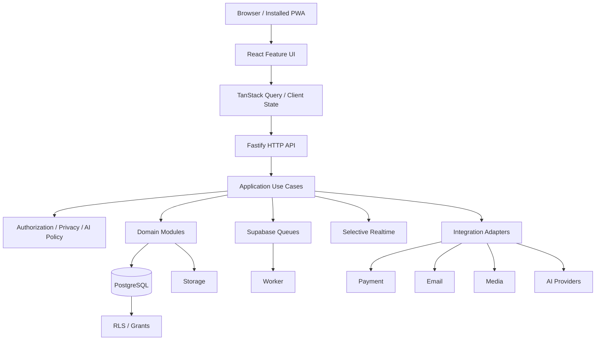

## 2. Prior-attempt architecture at a glance (as built, 2026-10-23)

Lesson: the API held in-memory Maps hydrated from the database (read model) in addition to the database; this is exactly what ADR-T05 removes.

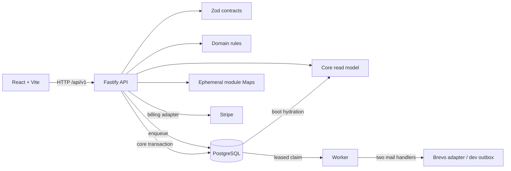

## 3. Legacy system context, authentication sequence and AI safety flow (intended)

### 3.1 System context (legacy "20.1")

Contradictions with this blueprint: Supabase Auth as the auth box (blueprint: application sessions, ADR-T06); Chrome extension and "Web OS Layer" (not in scope); email provider named differently in different legacy places (the system context says Resend, the as-built code and operations docs say Brevo; blueprint: provider port with Brevo default, ADR-T20); media provider "Mux/CF Stream" (blueprint: provider-agnostic media, deferred); "LinkedIn optional" (blueprint: out of scope unless decided).

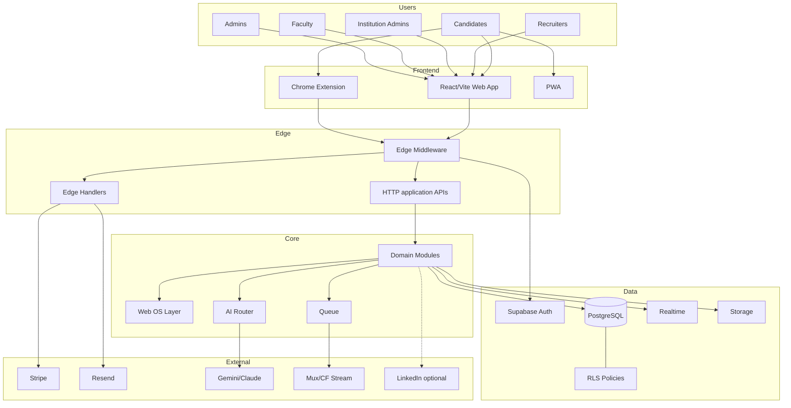

### 3.2 Authentication flow (legacy "20.3")

Contradiction: a JWT issued by a managed auth provider, verified in "edge middleware", with the user id set as a local database setting for RLS. Blueprint: httpOnly cookie sessions issued by the application (ADR-T06), authorization by the policy module (ADR-T07), RLS keyed by session-scoped settings as defence in depth. Keep as the legacy intended RLS-binding idea ("set local app.user_id then apply RLS").

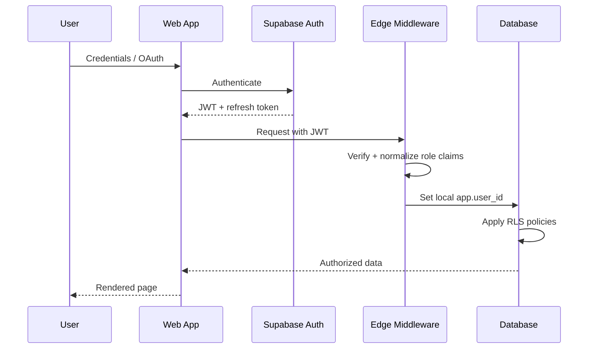

### 3.3 AI safety flow (legacy "20.4")

Unique content to keep: PII detection and redaction before prompt construction; **canary token and `user_content` fencing** in the prompt; output validation with a schema; if the canary leaks, **drop the response, alert and flag the account**; confidence bands: below 0.5 suppress, 0.5-0.7 show with a disclaimer, 0.7 and above show with evidence; optional human gate before the user sees a draft. Target mapping: ADR-T12 and SEC-02 / THREAT_MODEL (canary appears in both); verify that the confidence thresholds 0.5 / 0.7 and "flag account on canary leak" exist in the AI gateway design or record them as options (action L-B25-01, owner AI owner).

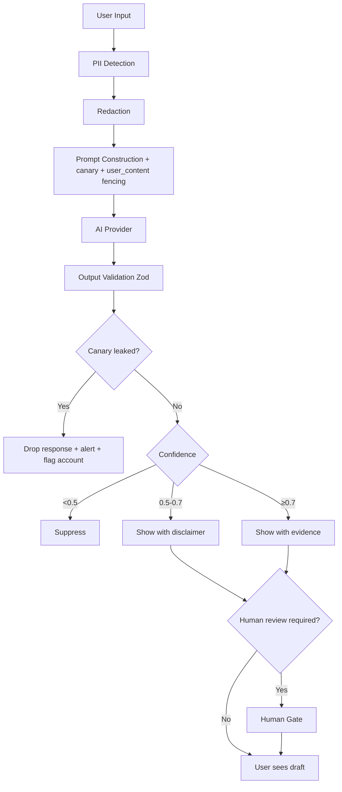

## 4. Prior-attempt behaviour flowcharts F1-F7 (verbatim, with the source's evidence statements)

The block after this guide is the whole legacy file `02-flows.md` after its title. Reading guide: F1 system architecture; F2 registration, sign-in and every authenticated request (rate limits, decoy hash, session checks, token cutoffs, sign-out semantics); F3 jobs and the application loop (transition tables for jobs and applications; order-of-checks note); F4 verified work history (challenge and reference flows, scoring weights, delivery behaviour); F5 payment-provider billing (checkout and webhook decision tree); F6 boot, storage and background jobs (writer lease, retry/dead rules); F7 web journeys by role (route guard behaviour, status of UI claims).

Target-side observations, by flow:

- **F2:** keep decoy hash and uniform error text; replace stateless token checks with the session table; password-change/sign-out-others cutoff becomes revoke-all; registration rate limits move to RL-AUTH. The "suspended accounts can still sign in" and "status not active -> 403 except allowed routes" behaviour is the data-rights-access rule (see the security file section 5.3).
- **F3:** job transitions listed (`draft -> pending_approval|published|archived`; `pending_approval -> approved|draft|archived`; `approved -> published|draft|archived`; `published -> paused|closed|archived`; `paused -> published|closed|archived`; `closed -> archived`) and application transitions (`submitted -> in_review|withdrawn|rejected`; `in_review -> shortlisted|rejected|withdrawn`; `shortlisted -> interviewing|rejected|withdrawn`; `interviewing -> offered|rejected|withdrawn`; `offered -> hired|rejected|withdrawn`; `hired|rejected|withdrawn|expired` terminal) are candidate inputs to SM-JOB and SM-APPLICATION; compare edge by edge (gap check L-B25-02, owner Domain Architect). Withdraw: candidate-owner or admin only. Order note: role/organization check ran before the transition-table check, so a wrong-role caller got 403 even for an invalid transition.
- **F4:** the scoring/tier tables and the referee flow feed the verification module; the dev-outbox behaviour (log code and link) is a lesson to avoid; the 30-day link expiry is superseded by the target's 14 days (decision L-B15-03).
- **F5:** event-handling tree is the template for the billing webhook test matrix (see the condition matrix BL-01..BL-09).
- **F6:** writer-lease nodes are retired; the job-outcome tree (success -> complete, permanent error -> failed, other error with attempts below 3 -> queued with backoff, exhausted or no handler -> dead) is kept.
- **F7:** route guard presence-only check, hard redirect on 401, role-based navigation (see `../10_FRONTEND_ARCHITECTURE/LEGACY_MERGE_FRONTEND_AND_UI_QUALITY.md`).

Every diagram here is **current behaviour read from the code**, not target behaviour. Evidence is cited as `path:line` (line numbers are from 2026-10-23 and drift as files change). Evidence status per diagram:

- **Read + spot-checked** = an investigator read the code and the lead re-read the key lines.
- **Read** = an investigator read the code; not independently re-read by the lead.
- Nothing here was exercised end to end by this work except where a "Tests" line says so.

Abbreviations: S = `apps/api/src/server.ts`, A = `packages/domain/src/auth.ts`, C = `packages/contracts/src/index.ts`, D = `packages/domain/src/work-history-graph.ts`, W = `apps/web/src`.

## F1 — System architecture (Level 1)

Evidence: Read (storage and worker investigation). `ARCHITECTURE.md` was compared and disagrees in places (see `03-conflict-register.md`).

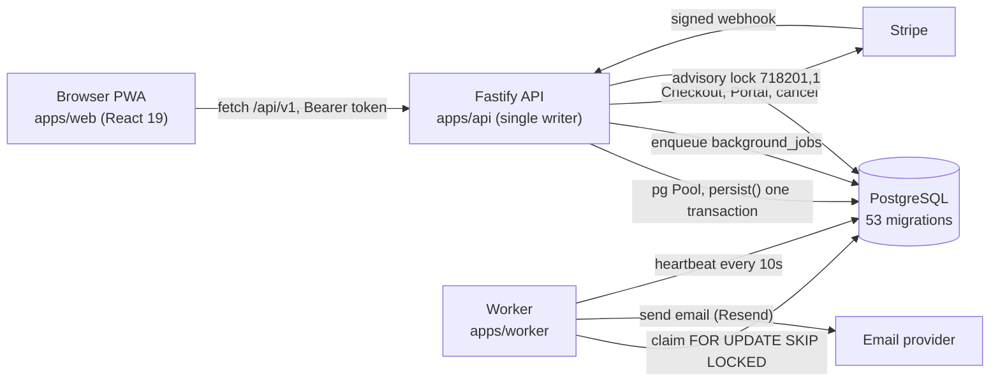

The API also keeps in-memory Maps as a read model, hydrated from PostgreSQL at boot. Routes not listed in `apps/api/src/durability.ts` keep their state only in those Maps.

## F2 — Registration, sign-in and every authenticated request

Evidence: Read. Related tests exist (`tests/integration/auth-profile.test.ts`, `tests/security`).

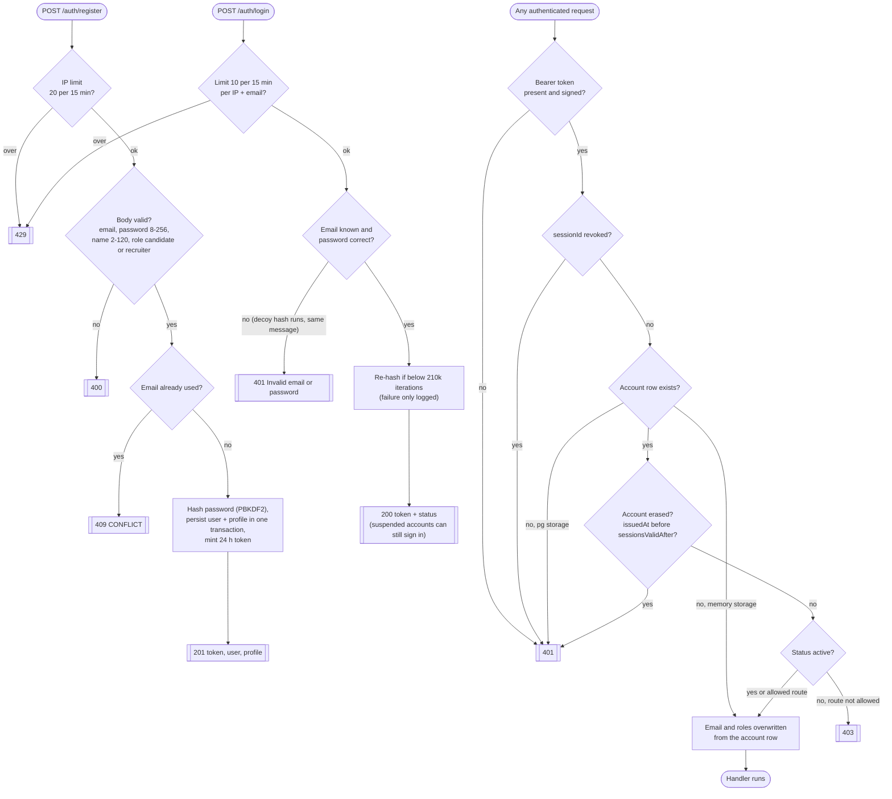

Sign-out: a token with a `sessionId` is written to `revoked_sessions` (`{ended:true}`); a token minted before 2026-10-11 has none, so nothing is revoked and the call returns `{ended:false}`. Sign-out-others moves `sessionsValidAfter` to the next second and returns a fresh token. Password change returns 422 for a wrong current or an unchanged password, then returns a fresh token. The web client clears its stored token first and then sends sign-out without waiting, so a failed request leaves the server session alive until the token expires.

## F3 — Jobs and the application loop

Evidence: Read. There are no `/hiring/*` API routes; the hiring pages call `/organizations/*`, `/jobs/:id/applications` and `/applications/:id/transition`.

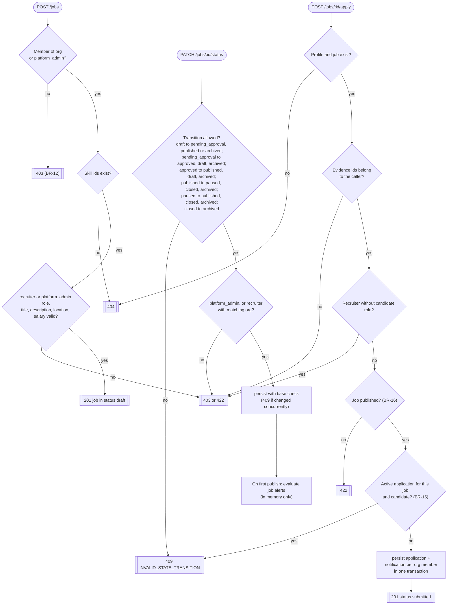

Order note (adversarial review): in `transitionJobStatus` the role and organization check runs before the transition table, so a caller with the wrong role gets 403 even for a transition that would also be invalid (the diagram draws the table first).

Application states: `submitted` to `in_review`, `withdrawn` or `rejected`; `in_review` to `shortlisted`, `rejected` or `withdrawn`; `shortlisted` to `interviewing`, `rejected` or `withdrawn`; `interviewing` to `offered`, `rejected` or `withdrawn`; `offered` to `hired`, `rejected` or `withdrawn`. `hired`, `rejected`, `withdrawn` and `expired` are terminal. Withdraw is candidate-owner or admin only; every other move needs membership of the job's organization or admin. Any membership counts; the role inside the organization is not checked.

## F4 — Verified work history (the core promise)

Evidence: Read + spot-checked. The lead re-read that the referee token had no expiry (fixed afterwards: the link now stops working 30 days after the request) and that the email domain is taken from `org.website` only when `companyId` is set (`S:12274-12281`).

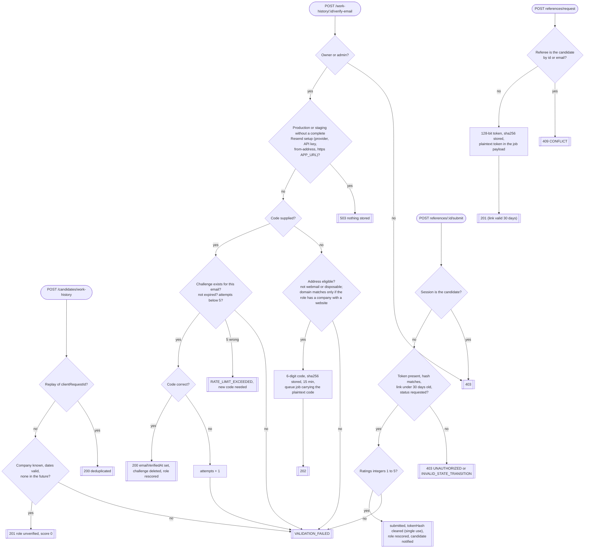

Scoring (`D:262`): email verified +40; best valid reference manager +30, else peer +20, else +15; two or more valid references +15; average rating at least 4.0 +10; two or more independently endorsed skills +5; cap 100. Tier gold from 80, silver from 50, bronze from 25. Status `verified` from 25.

Delivery: in `NODE_ENV=development` (the default when unset) the worker only logs "DEV OUTBOX" and the job succeeds, code and link included in the log. Otherwise it sends through Resend; a missing key or from-address is a permanent failure with no retry.

## F5 — Stripe billing (Level 6)

Evidence: Read by the lead during this work; behaviour covered by `tests/integration/stripe-billing.test.ts` (run on 2026-10-23: passes). Not exercised against a real Stripe account.

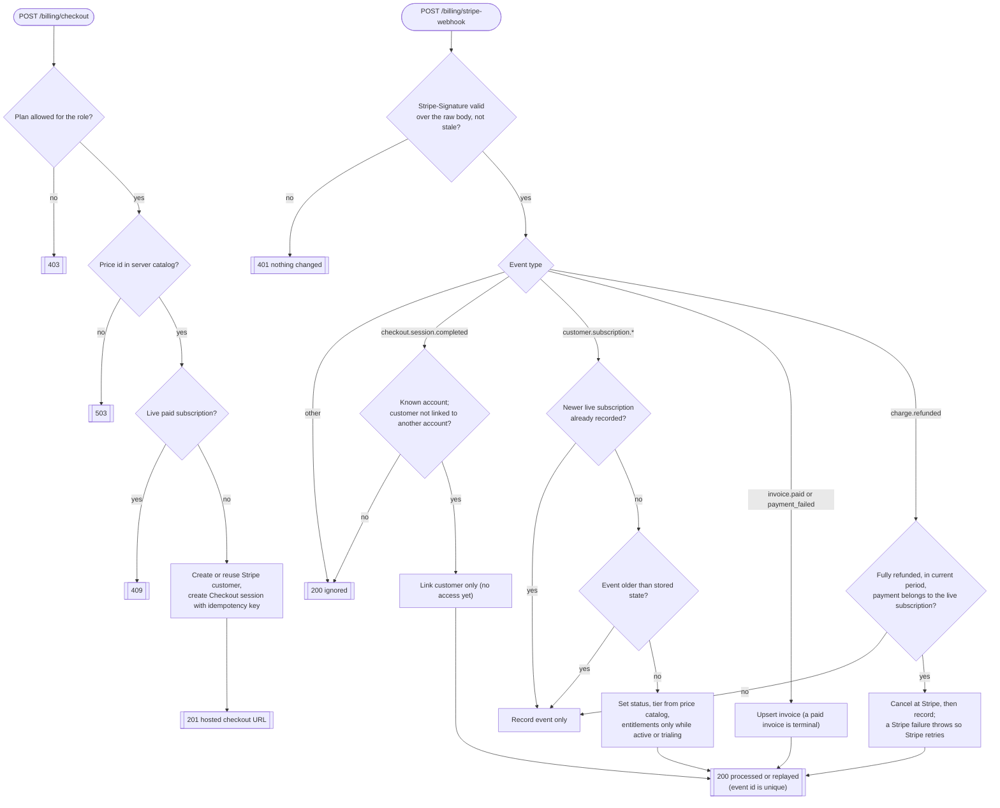

## F6 — Boot, storage and background jobs

Evidence: Read.

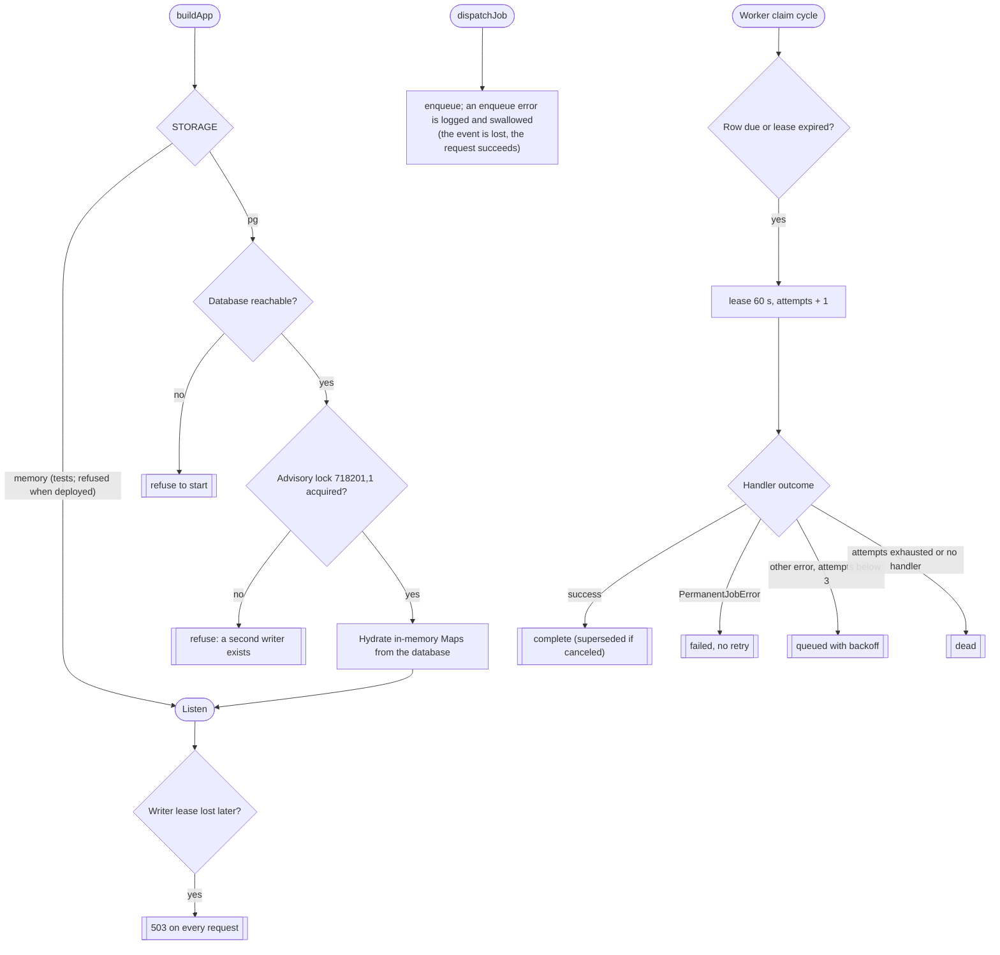

## F7 — Web app journeys by role (Level 2)

Evidence: Read; per-page loading, empty and error states were only partly checked (see the limitations in `05-audit.md`). Route guard `RequireAuth` checks only that a token string exists; it does not check roles. Role gating happens inside pages.

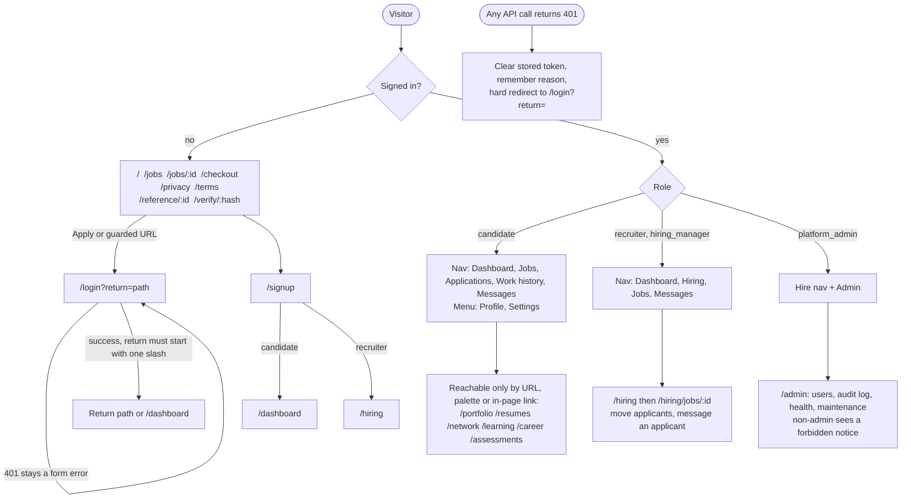

Status of claims in the UI (from the investigator, compared with `docs/reports/FEATURE_STATUS_2026-10-21.md`): the Learning, Network and Resumes pages tell the user their data is not saved permanently; the Assessments page says submitted code is not run or scored; there is no registered service worker, so the footer shows "PWA Installable" and no offline mode exists; Settings offers email and summary-frequency toggles although no digest sending was found.

## 5. Open items raised by this file

| ID | Question | Owner |
|---|---|---|
| L-B25-01 | AI safety flow thresholds (confidence 0.5 / 0.7) and canary-leak response in the gateway design | AI owner + Security Architect |
| L-B25-02 | Edge-by-edge comparison of legacy job/application transitions with SM-JOB and SM-APPLICATION | Domain Architect |
| L-B25-03 | Validate Mermaid syntax of this file (not machine-validated) | Documentation Architect |
