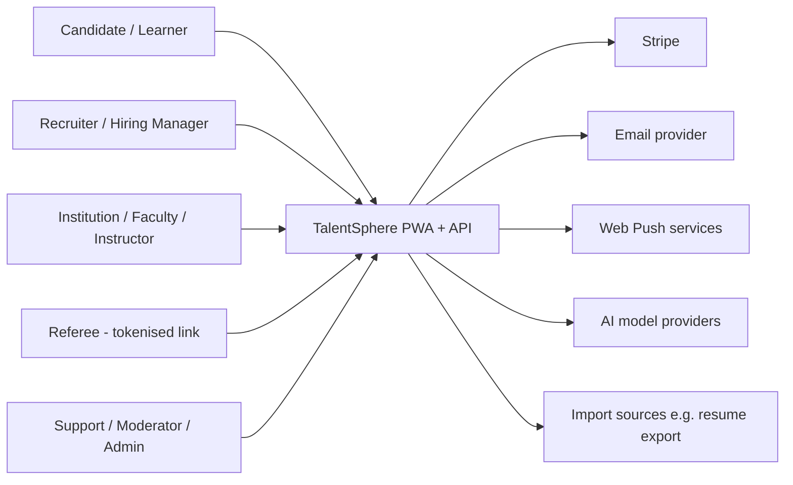
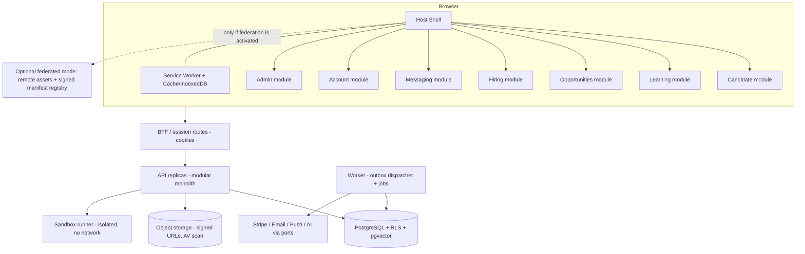
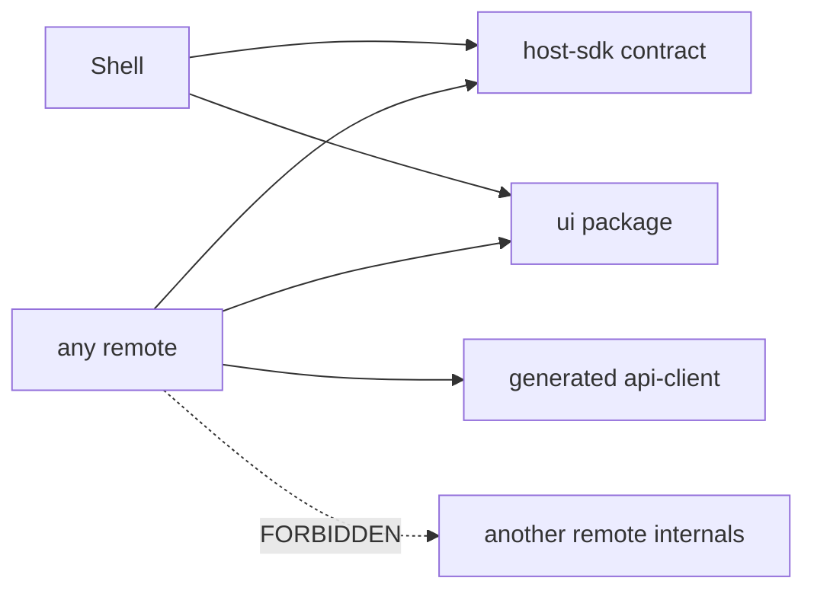
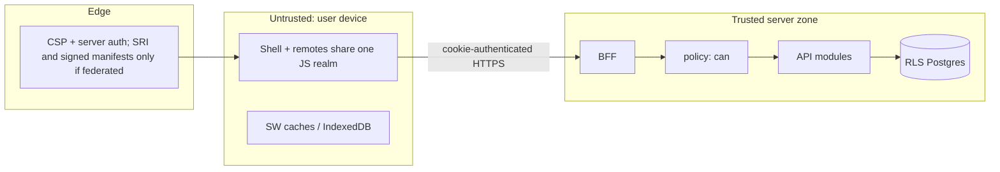
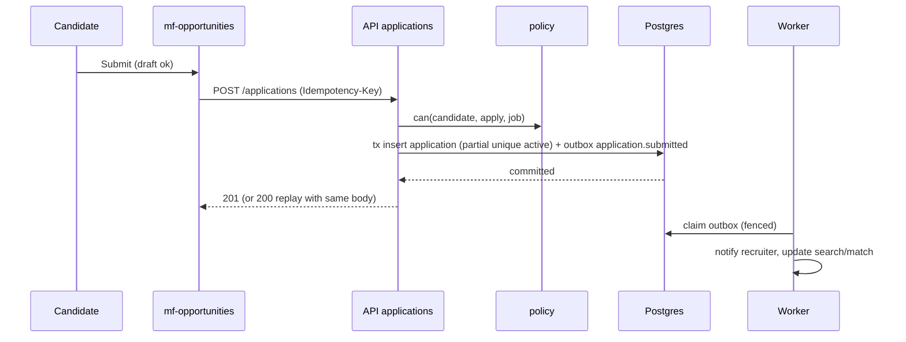
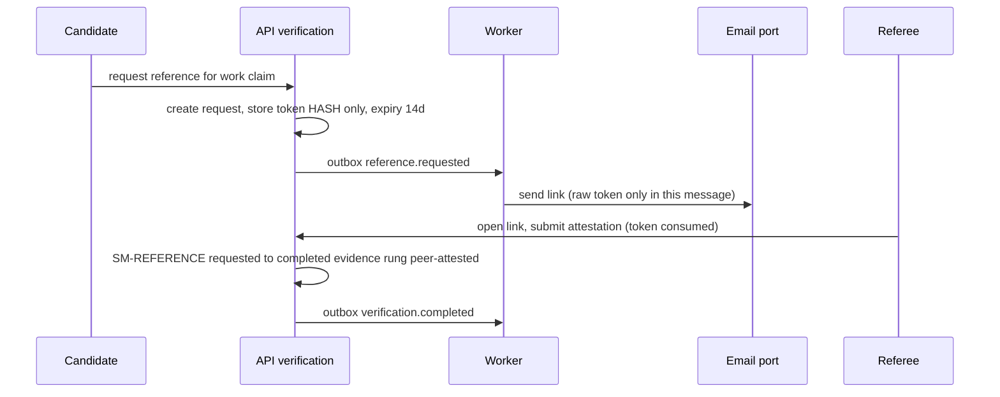
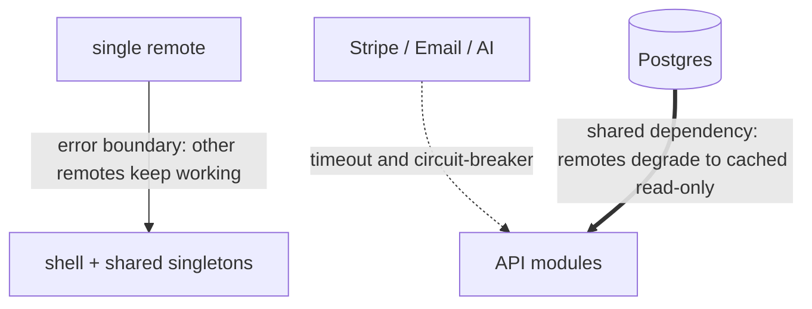

# System Diagram Library

Doc ID: DGM-01 · Owner: Architecture · Version 1.0 · Status: Draft (Mermaid syntax not machine-validated — see `28_TRACEABILITY_AND_COVERAGE/TRACEABILITY_AND_VALIDATION.md` for documented checks)

## 1. Ecosystem / system context

## 2. Container view (C4 level 2)

## 3. Frontend dependency rules

## 4. Trust boundaries

## 5. Sequence — apply to job (idempotent)

## 6. Sequence — referee verification

## 7. Failure domains

