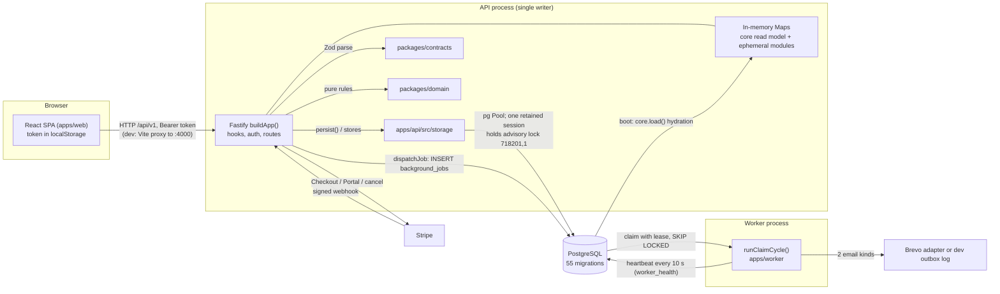
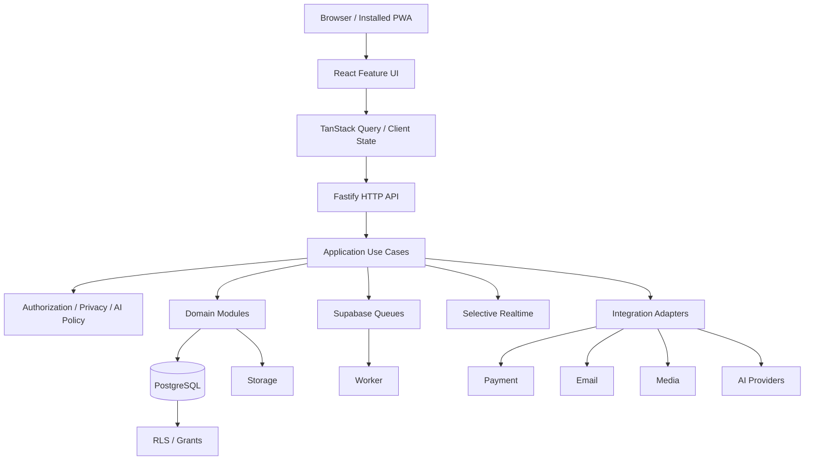
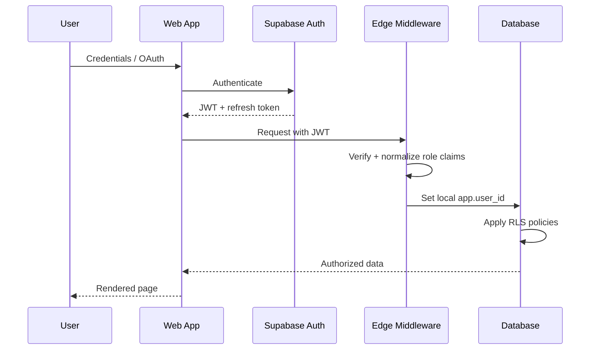
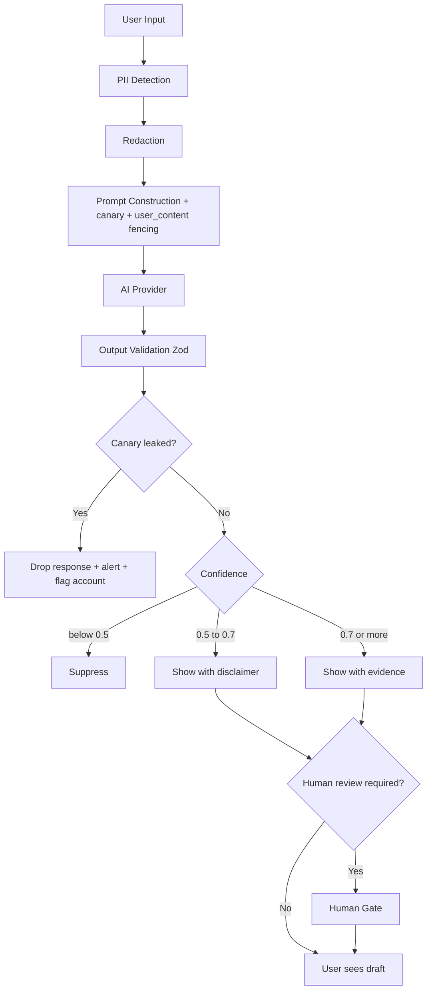

# 02 - Architecture and Technical Truth

Audience: a new developer or AI agent who must understand how TalentSphere is built, what is real, and what is only intended.
Companions: [01-PRODUCT-REQUIREMENTS.md](01-PRODUCT-REQUIREMENTS.md) (what the product must do), [03-DEVELOPMENT-GUIDE.md](03-DEVELOPMENT-GUIDE.md) (setup, commands, environment variables), [04-FEATURES-AND-WORKFLOWS.md](04-FEATURES-AND-WORKFLOWS.md) (feature status and journeys), [05-DATABASE-AND-API.md](05-DATABASE-AND-API.md) (schema, routes, error envelope), [06-SECURITY-AND-INTEGRATIONS.md](06-SECURITY-AND-INTEGRATIONS.md) (auth hardening, Stripe, Brevo, privacy), [07-TESTING-AND-OPERATIONS.md](07-TESTING-AND-OPERATIONS.md) (tests, CI, deploy, recovery), [08-ROADMAP-AND-DECISIONS.md](08-ROADMAP-AND-DECISIONS.md) (decision register, roadmap).

## 0. Basis and labels

Written 2026-10-26 on branch `docs/consolidation-2026-10-26`. Code was read at the working-tree HEAD (`40ee2de3`). Nothing of the application was run while writing (no server, database, migration or test). Two read-only scripts were run: a route parser kept outside the repository and `scripts/check-new-hosted-migrations.mjs`. "Verified" below means "confirmed by reading current source or migrations", not "observed running". The older `ARCHITECTURE.md` was cross-checked against commit `431c425a` (2026-10-23); about 20 commits changed `apps/`, `packages/`, `supabase/` and `scripts/` after that, and some of its claims are now stale (section 14).

Truth rule: code and migrations decide what exists. Documents explain intent and history. Where a document and the code disagree, this file records the code and lists the conflict in section 14.

| Label | Meaning |
| --- | --- |
| Implemented-verified | Present in current source/migrations and confirmed by reading them. Not executed. |
| Implemented-unverified | Present or claimed in source or a repo document, but this pass did not confirm the behavior end to end. |
| Partial | Some of the behavior exists; named gaps remain. |
| Planned | Stated as future scope in a repo document; no code. |
| Proposed-only | Target design in `Yash_Final_Project_Document` (folders 10-13, 25); nothing built; has open review findings. |
| Deprecated | Superseded but still in the tree. |
| Unknown | Could not be established from the repository. |

## 1. Summary

- One pnpm monorepo, one React SPA, one Fastify API process, one Node worker, one PostgreSQL database. Implemented-verified.
- The API is a single large closure (`apps/api/src/server.ts`, 13,416 lines, 278 unique method/path routes, 145 in-process `Map` objects). The core career loop is persisted to PostgreSQL; most other modules keep state in process memory and say so in a response header. Implemented-verified.
- The API keeps an in-memory read model hydrated from PostgreSQL at boot. That makes it a **single writer**: a PostgreSQL session advisory lock refuses a second API process. Implemented-verified.
- Sessions are self-issued HMAC tokens kept in browser `localStorage`. Supabase Auth, Realtime, Storage and Queues are not used. Implemented-verified.
- Background work is a PostgreSQL job table claimed by a separate worker. Only two job kinds do real work (transactional email); the rest only record that an event happened. Implemented-verified.
- Payments (Stripe) and email (Brevo) are real adapters, off by default, and never exercised live in this repository's evidence. Partial / Unknown for live behavior.

## 2. Stack

| Layer | Technology | Where | Label |
| --- | --- | --- | --- |
| Language / tooling | TypeScript 5.9 (strict), Node ESM, pnpm workspaces (`apps/*`, `packages/*`) | root, `pnpm-workspace.yaml` | Implemented-verified |
| Web | React 19, Vite, `react-router-dom` (BrowserRouter), plain hooks + `SessionContext`; hand-written `fetch` helper | `apps/web` | Implemented-verified. No TanStack Query, no Redux. |
| API | Fastify 5, `@fastify/helmet`, `@fastify/cors`, `@fastify/rate-limit`, Zod 3 | `apps/api` | Implemented-verified |
| Contracts | Zod request schemas (about 140 exported schemas), `ErrorEnvelope` type | `packages/contracts/src/index.ts` | Implemented-verified. No generated OpenAPI. |
| Domain | Pure business functions and state machines; PBKDF2 and HMAC session primitives; job-store with an injected query function | `packages/domain/src` | Implemented-verified |
| Config | Zod server-environment schema, deployed-environment refusal checks | `packages/config/src/env.ts` | Implemented-verified |
| Database | PostgreSQL via `pg` (Pool). 55 SQL migrations; custom runner | `supabase/migrations`, `scripts/migrate.mjs` | Implemented-verified |
| Worker | Node loop claiming `background_jobs` (`FOR UPDATE SKIP LOCKED`) | `apps/worker` | Implemented-verified |
| Auth | PBKDF2-SHA512 password hashes (default 210,000 iterations), HMAC-SHA256 session tokens (24 h), server-side revocation | `packages/domain/src/auth.ts`, `server.ts` | Implemented-verified |
| Payments | Stripe Checkout, Customer Portal, signed webhook; `BILLING_MODE` = `disabled` (default) / `simulated` / `stripe` | `apps/api/src/billing-stripe.ts`, `stripe-gateway.ts` | Partial (no live acceptance evidence) |
| Email | Provider-independent service with one adapter (Brevo, native `fetch`); labelled dev outbox when no provider | `apps/worker/src/email/` | Partial (live delivery Unknown) |
| Logging | Pino (Fastify's logger in the API, `createLogger` in the worker) with redaction | `server.ts`, `packages/observability` | Implemented-verified |
| Hosting assets | Docker/Compose/Caddy for Oracle and Coolify; hosted Supabase manual adapter | `deploy/`, `supabase/hosted/` | Implemented-unverified (assets exist; deployment not observed). See 07. |
| Dev verification | Reticle plugin in the Vite config; Vitest, Playwright | `apps/web/vite.config.ts`, `tests/` | See 03 and 07. |

Not implemented, though some environment variables and tables exist as placeholders: OAuth/SSO, password-reset email, Supabase Auth/Storage/Realtime/Queues, external LLM calls, media pipeline, Web Push, search extraction (PostgreSQL full-text search is not used at runtime), offline sync, a service worker. Planned/Proposed-only.

## 3. Topology



Facts behind the diagram:

- Browser and API are same-origin by convention: Vite proxies `/api` to `127.0.0.1:4000` in dev and preview; the deploy proxies (Caddy) are covered in 07. CORS is also enabled (`CORS_ALLOWED_ORIGINS`, credentials allowed). Implemented-verified.
- The worker cannot read the API's Maps. In `STORAGE=memory` it idles on purpose. Implemented-verified.
- Exactly one API process may run per database. Scaling out is blocked until reads move to SQL (section 12, R1). Implemented-verified.

## 4. Components and where code lives

| Component | Location | Responsibility |
| --- | --- | --- |
| API entry | `apps/api/src/index.ts` | Load `.env` (never overrides real env), `validateServerEnv`, `productionConfigProblems` (refuses to start when unsafe), `buildApp`, listen |
| API app | `apps/api/src/server.ts` | `buildApp(env?, overrides?)`: hooks, global error handler, session resolution, all routes except Stripe, `persist()`, boot hydration. Routes are commented blocks per feature. |
| Storage facade | `apps/api/src/storage/index.ts` | `createStorage`: `pg` or `memory` (no silent fallback); writer lease; health; worker heartbeat read |
| Core store | `apps/api/src/storage/core-store.ts` | `PgCoreStore`/`MemoryCoreStore`: typed `CoreOp` writes in one transaction; boot `load()` |
| Dedicated stores | `apps/api/src/storage/{account,erasure,saved-search,saved-job,admin-audit,feature-flag,billing}-store.ts` | Each owns its own SQL and transactions; memory twin for tests |
| Durability registry | `apps/api/src/durability.ts` | `DURABLE_ROUTES` (78), `STATELESS_ROUTES` (3); everything else is labelled ephemeral |
| Billing | `apps/api/src/billing-stripe.ts`, `stripe-gateway.ts` | Checkout/portal/webhook routes via injected deps; the only Stripe SDK boundary |
| Worker | `apps/worker/src/index.ts`, `claim.ts`, `email/*`, `queue.ts` | Claim loop and handlers, email service, heartbeat. `queue.ts` (`JobQueueEngine`) is a unit-tested in-memory engine **not used at runtime** (Deprecated). |
| Web | `apps/web/src/{main.tsx,App.tsx,pages,components,lib,hooks,pwa.ts}` | 29 route pages, `Layout`, `RouteErrorBoundary`, `lib/api.ts` (`apiFetch`/`apiJson`), `lib/session.ts` (token owner) |
| Contracts | `packages/contracts/src/index.ts` | Request schemas, `PaginationQuerySchema`, `ErrorEnvelopeSchema` |
| Domain | `packages/domain/src/*.ts` (about 50 modules, `core.ts` is the import-free leaf) | State machines, scoring, policy, `DomainError`, auth primitives, `createPgJobStore`, `DISPATCH_EVENT_KINDS` |
| Config | `packages/config/src/env.ts` | `ServerEnvSchema`, `isDeployed`, `productionConfigProblems`, `stripeConfigProblems`, `emailDeliveryConfigured` |
| Observability | `packages/observability/src` | `createLogger` (pino + redaction); `AuditSink`/`InMemoryAuditSink` (not used by the API; the API's audit trail is SQL, see 05) |
| UI tokens | `packages/ui/src/tokens.ts` | Design tokens; components live in the web app |
| Test helpers | `packages/testing/src` | Mock factories |
| SQL / ops | `supabase/migrations`, `supabase/hosted`, `supabase/seed`, `scripts/`, `deploy/` | Schema history, hosted adapter, feature-flag seed, migrate/seed/preflight scripts, container assets. `supabase/functions` and `supabase/tests` are empty. |

Domain modules in `packages/domain/src` group as: identity/profile (`auth`, `profile`, `core`), evidence/skills (`evidence`, `skills`, `skill-decay`, `peer-credibility`, `skill-forecasting`), hiring (`jobs`, `applications`, `application-drafts`, `application-feedback`, `job-templates`, `saved-searches`, `salary-intelligence`, `work-history-graph`), learning/assessment (`lms`, `challenges`, `assessment`, `technical-interview`, `learning-impact`), communication (`messaging`, `notifications`, `networking`, `warm-introductions`, `referral-requests`, `alumni-networks`), reputation and intelligence (`reputation-engine`, `instructor-reputation`, `employer-reputation`, `career-trajectory`, `talent-pool-intelligence`, `behavioral-talent-discovery`, `talent-segmentation`, `activity-contributions`, `gamification`), platform (`admin`, `moderation`, `settings`, `search`, `analytics`, `ai-gateway`, `input-security`, `resumes`, `portfolio`), money (`billing`, `stripe-billing`), infrastructure (`background-jobs`). A per-module symbol and test map is in `docs/system-model/01-inventory-and-coverage.md`.

## 5. Dependency direction rules

```
Browser -> API (HTTP only)
API routes -> contracts (parse) -> domain (rules) -> storage (SQL)   [storage may import domain types]
Worker -> domain (job store, DISPATCH_EVENT_KINDS) -> its own email adapter -> provider
domain/core.ts -> (imports nothing)
```

| Rule | Enforcement found | Status |
| --- | --- | --- |
| Only `apps/api/src/storage` and `apps/worker` hold a database client (`pg`) | No lint. A source search for `from 'pg'` finds only those files. | Implemented-verified by search; no automated gate |
| `packages/domain` does no I/O and imports no framework/provider; the only SQL seam is the injected `query` function of `createPgJobStore` | Convention + review | Implemented-verified by reading |
| No domain module imports its own barrel (`./index.js`); `core.ts` imports nothing | No cycle test exists in `tests/unit`. A source search finds no `from './index` in `packages/domain/src`. | Implemented-verified by search; no automated gate |
| `packages/contracts` does not import domain | Convention | Implemented-unverified |
| `apps/web` never holds credentials or a database client; UI guards are advisory | `RequireAuth` checks only that a token string exists | Implemented-verified |
| Business rules live only in `packages/domain`; routes call them | Convention; violations exist (section 12, R4) | Partial |
| API runtime imports the **built** workspace packages (`dist/`); unit tests import **source** | Build order: packages before apps | Implemented-verified. A stale `dist` can make tests and runtime disagree. |
| Protected build files (`package.json`, lockfiles, `tsconfig*`, `vite*`, `.github/`, `deploy/`, Dockerfiles) are read-only for AI agents | `AGENTS.md` | Process rule, see 03 |

## 6. Request lifecycle (API)

Order of cross-cutting behavior in `buildApp` (registration order matters in Fastify):

1. `validateServerEnv` then `stripeConfigProblems` (refuse a half-configured Stripe mode in every environment). Config errors throw before any connection opens.
2. Storage: `createStorage` (`pg` unless `NODE_ENV=test` or `STORAGE=memory`). In `pg` mode: boot health query, then acquire the writer lease (`pg_try_advisory_lock(718201, 1)` on a retained connection). Failure aborts startup.
3. `onClose` closes storage. `onRequest`: if the writer lease is lost, every request gets 503 `SERVICE_UNAVAILABLE` (fail closed).
4. `onSend`: sets `x-request-id`; sets `x-talentsphere-durability: ephemeral` when the core store is memory or the route is not in `DURABLE_ROUTES`/`STATELESS_ROUTES`.
5. Plugins: Helmet (CSP only when deployed), CORS from `CORS_ALLOWED_ORIGINS` with credentials, rate limit (default 300 requests per 60 s, key `user:<id>` for a valid token else `ip:<address>`; health exempt). `TRUST_PROXY` controls address interpretation.
6. Not-found handler and global error handler (section 9). Request ids: an inbound `x-request-id` header is reused as-is; otherwise `req_<uuid>`.
7. Per route: credential routes add their own rate limits (login 10 per 15 min keyed by address + email, `AUTH_RATE_LIMIT_MAX_REQUESTS`; register twice that per address). Then in the handler: `extractUser` (Bearer token, then `resolveSession`), Zod `.parse` of body/query, authorization checks (inline, per handler), domain function, `persist(...)` or a dedicated store call, `dispatchJob(...)`, reply.

`resolveSession` (every authenticated request): reject a revoked `sessionId`; in `pg` mode reject a validly signed token whose account row is missing; reject an erased account; reject tokens issued before `sessionsValidAfter` (password change or "sign out other devices"); for suspended/deactivated/pending accounts allow only the 12 routes in `RESTRICTED_SESSION_ROUTES` (own profile, password, sign-out, own moderation reports and appeals, data export and erasure); then **replace the token's email and roles with the account's current values**. Implemented-verified.

Write path for core entities (ADR-015):

```mermaid
sequenceDiagram
  participant H as Route handler
  participant P as persist(ops)
  participant S as PgCoreStore.commit
  participant DB as PostgreSQL
  participant R as Read model (Maps)
  H->>P: ops (each update carries base = the Map value it derived from)
  P->>P: refuse if same record is being written (writesInFlight) or base is stale -> 409
  P->>S: commit(ops)
  S->>DB: BEGIN; writes in FK order (WRITE_ORDER); guarded UPDATE ... WHERE; COMMIT
  S-->>P: ok (or rollback; 23505 -> 409, 23503/23514/class 22 -> 422)
  P->>R: applyToReadModel(op) for each op (only after COMMIT)
  H->>DB: dispatchJob -> INSERT background_jobs (separate statement, after commit, errors logged and swallowed)
  H-->>H: reply
```

## 7. Key flows (as built)

| Flow | Behavior | Label |
| --- | --- | --- |
| Register / login | Register accepts only `candidate` or `recruiter`. Login verifies against a decoy hash for unknown emails (constant-ish timing) and re-hashes old/weak hashes. 24 h token with random `sessionId`. | Implemented-verified |
| Sign-out | `POST /auth/sign-out` writes `revoked_sessions` (token expiry kept); `sign-out-others` and password change advance `users.sessions_valid_after`. | Implemented-verified |
| Evidence | Create validates skill ids, then one transaction for evidence + skill links; verify/dispute/revoke are guarded transitions; verification level needs matching authority. Public proof endpoint carries no personal data. | Implemented-verified |
| Job application | Domain `submitJobApplication`; evidence ownership checked; a partial unique index (one active application per job and candidate) arbitrates duplicates; transitions only along `ALLOWED_APPLICATION_TRANSITIONS`. | Implemented-verified |
| Work-email verification | Stores a SHA-256 hash of a single-use code with expiry and attempt counter; queues `work_history.email_verification_requested`; the worker emails it. | Implemented-verified (live delivery Unknown) |
| Reference request | Stores token hash only; link expires 30 days after request (`REFERENCE_LINK_TTL_MS` in `server.ts`); queues `reference.requested`. | Implemented-verified |
| Billing | Server-side price catalog; Checkout URL returned; only signed Stripe events change entitlements (event id recorded with the state change in one transaction); redirect success grants nothing. Entitlements now drive AI quota and job-publishing limits. | Implemented-verified (live Stripe Unknown) |
| Publish a job | Per-organization in-process promise chain serializes "count published jobs, check plan, persist". Correct only because there is one API process. | Implemented-verified |
| Account erasure | Request/status/cancel routes exist; `POST /settings/erasure/execute` runs immediately (billing/customer cleanup, one core anonymization transaction, queued-email cancellation, Map cleanup) and is resumable after an interrupted run. It does **not** enforce the 30-day grace period. | Partial |
| AI chat | Assessment-session prohibition, prompt sanitization, quota from the user's plan entitlements, heuristic (non-LLM) answer, state in memory. `POST /ai/assistant/query` is an echo scaffold with the assessment check only. | Partial |
| Code assessment | Challenge submit and interview code run no code. Challenge responses say `executed:false, verified:false`; interview code execution returns 503 in staging/production. | Partial |

## 8. Async and worker behavior

| Aspect | Behavior (current code) |
| --- | --- |
| Enqueue | `dispatchJob` inserts `background_jobs(kind, payload)` after the core commit. It never throws: a failed enqueue is logged and the request still succeeds, so the event is lost. Idempotency keys are not passed by `dispatchJob`. Every 100th dispatch purges terminal rows older than 7 days. |
| Kinds | `DISPATCH_EVENT_KINDS` in `packages/domain/src/background-jobs.ts` (45 kinds). Every kind except two has a handler that only logs "event recorded". |
| Real handlers | `work_history.email_verification_requested` and `reference.requested` render a logical template and send through the email service; provider `none` in development writes a labelled DEV OUTBOX log line instead of sending (sensitive: it contains the message text). |
| Claim | `UPDATE ... SET status='running', attempts=attempts+1, lock_expires_at=now()+lease WHERE id IN (SELECT ... WHERE (queued and due) OR (running and lease expired) ORDER BY run_after LIMIT n FOR UPDATE SKIP LOCKED)`. |
| Batch size | `max(1, min(10, floor(leaseMs/handlerTimeoutMs) - 1))` = 1 with defaults (lease 60 s, handler timeout 30 s), so a handler always finishes inside its lease. |
| Lapse guard | A claimed job whose lease could expire before its handler could finish is not started; it is redelivered after the lease lapses. |
| Timeout | `Promise.race` with a 30 s timer. The timer rejects but does **not abort** the handler, so a slow handler can still complete its side effect after being marked failed. |
| Fencing | `complete` and `fail` update only `WHERE status='running' AND attempts = <claimed attempts>`; a stale worker whose job was re-claimed cannot change it (counted as "superseded"). |
| Retry | Default 3 attempts; backoff `1 s x 2^(attempts-1)` capped at 30 s with plus or minus 20% jitter (`computeBackoffMs`, `decideFailure`). `PermanentJobError` fails at once; unregistered kind dead-letters; exhausted retries become `dead`. Terminal transitions strip secret payload keys. |
| Cancel | `cancel`/`cancelQueued` mark rows `canceled` (used when erasing work history or accounts); a running handler is not interrupted. |
| Liveness | Worker upserts `worker_health(id=1)` every 10 s between cycles; the API treats the heartbeat as dead when older than 45 s. A long batch can delay it. |
| Guarantees | At-least-once at best; exactly-once is not provided. Reclaim after lease expiry does not check an attempts cap (a handler that crashes the worker without failing can loop; open finding CF-24). No scheduler, digest, or recompute jobs exist. |
| Memory mode | The standalone worker idles (it cannot see the API's Maps). |

## 9. Error handling

- All failures leave the API as one envelope: `{"error":{"code","message","request_id","details?"}}`. Zod errors are 400 `VALIDATION_FAILED` with `details[{path,message}]`; `DomainError` codes map to status in the handler (full table in 05); plugin errors with a status keep it (429 becomes `RATE_LIMIT_EXCEEDED`); anything else is 500 `INTERNAL_SERVER_ERROR` with the message hidden when `NODE_ENV` is `staging` or `production`. Unknown `DomainError` codes default to 400. Implemented-verified.
- Rejected 4xx requests log at info with the code; only 5xx log at error, so error-level logs mean real faults.
- The web `apiFetch` gives 401 one meaning: clear the token, remember the server's reason, hard-redirect to `/login?return=...`; 403 keeps the session; `apiJson` adds a 20 s timeout, masks 5xx bodies except 503, and turns 429 into a retry-after message. `RouteErrorBoundary` handles render errors.
- Provider adapters translate failures without exposing secrets; there is no general client retry framework, circuit breaker, or distributed transaction.

## 10. Observability as built

| Capability | Current state | Label |
| --- | --- | --- |
| Structured logs | Pino JSON; API redacts `authorization`, `password`, `token`, `accessToken`; worker logger also redacts `apiKey`, `secret`, `refreshToken` | Implemented-verified |
| Request id | `x-request-id` echoed on every response and in every error envelope; inbound value is trusted as given (no length or character check found) | Implemented-verified |
| Health | `/health` and `/api/v1/health` are liveness only (rate-limit exempt). `GET /admin/health-diagnostics` (platform admin) runs a live `SELECT 1`, reads the worker heartbeat, reports writer lease state and the durable/ephemeral split | Implemented-verified |
| Audit | SQL `admin_audit_logs` (append + filtered list) for admin actions; `audit_logs` (00001) exists but no runtime code writes it; `packages/observability` `AuditSink` is in-memory and unused by the API | Implemented-verified |
| Metrics, tracing, alerting | None found in source | Not implemented |
| Maintenance mode | A boolean that changes diagnostics output only, resets on restart, blocks no traffic | Partial |

Operational runbooks, backup and restore are in 07.

## 11. Startup, configuration and health

- `index.ts`: env validation, `productionConfigProblems` (deployed = `staging` or `production`): requires `TOKEN_SECRET` (>=32 chars, not a published test secret), forbids `STORAGE=memory`, PBKDF2 below 210,000 iterations, the local default database URL, test-mode Stripe keys and `simulated` billing in production, localhost CORS in production; hosted-Supabase URL must match `SUPABASE_PROJECT_REF` with `sslmode=verify-full`.
- `buildApp` itself stays a composable factory for tests; the refusals above live in the process entry point, except Stripe consistency which runs in `buildApp`.
- The domain package reads `TOKEN_SECRET` from `process.env` at import time (random per-process key if absent or short). A `buildApp(customEnv)` call does not change the signing key.
- The worker reads its environment separately (`apps/worker/src/email/config.ts`) and, in staging/production, refuses unusable email configuration.
- Environment variable names and meanings: see 03 section 4.

## 12. Architectural invariants (re-checked against current code)

The invariant IDs come from `ARCHITECTURE.md` section 25. The right-hand column is this pass's reading of current code.

| ID | Invariant | Status at HEAD |
| --- | --- | --- |
| 001 | Authorization is enforced server-side on every protected route | Partial. Checks are per handler; some are role-less (see R4). |
| 002 | Each business rule has one definition in `@talentsphere/domain` | Partial. `server.ts` holds rules such as `canManageJobs`, `REFERENCE_LINK_TTL_MS`, `RESTRICTED_SESSION_ROUTES`. |
| 003 | Domain has no frameworks/I/O; `core.ts` imports nothing; no self-barrel imports | Implemented-verified by search; no automated gate |
| 004 | All failures use `DomainError`/`ZodError` through the global handler with `request_id` | Implemented-verified (the lease-lost and 404 paths also emit the envelope) |
| 005 | Only API storage and worker hold a DB client | Implemented-verified by search |
| 006 | Session tokens signed with `TOKEN_SECRET` or a random per-process key, never a committed secret | Implemented-verified; tests use a published test secret that deployed config refuses |
| 007 | Free-tier AI always passes `assertWithinAIQuota` | Partial. Chat does; `/ai/assistant/query` does not. |
| 008 | AI is rejected server-side during `AI_PROHIBITED` assessment sessions | Implemented-verified for both AI routes |
| 009 | Migration files contiguous from `00001`; honesty tests are part of the contract | Implemented-verified (55 files, runner checks contiguity; `tests/unit/persistence-honesty.test.ts`) |
| 010 | Applications move only along `ALLOWED_APPLICATION_TRANSITIONS`; terminal states immutable | Implemented-verified in `core.ts`/route use |
| 011 | New infrastructure enters through a recorded human decision | Process rule |
| 012 | The durable claim loop is the only runtime scheduler | Implemented-verified; `JobQueueEngine` is referenced only by its test |
| 013 | A core-loop entity changes only through `persist()` with `base` | Implemented-unverified (not every write path was traced) |
| 014 | Every by-id route authorizes against the record | Partial (open findings CF-14, CF-45 in `docs/system-model`) |
| 015 | Verification credentials are stored only as hashes | Implemented-verified for email code and referee token (`code_hash`, `token_hash`); queued email payloads carry them until the job reaches a terminal state, then are scrubbed |

## 13. Key ADRs (summary; the decision register is in 08)

| ID | Decision | Status |
| --- | --- | --- |
| ADR-001 | Fastify modular monolith | Implemented-verified |
| ADR-002 | Pure domain functions | Implemented-verified |
| ADR-003 | In-memory persistence | Superseded for the core loop by ADR-015; long tail still in memory |
| ADR-004 | Self-issued HMAC sessions (no external IdP) | Implemented-verified |
| ADR-005/006 | Shared Zod contracts; one error envelope | Implemented-verified |
| ADR-007 | Local heuristic AI, no external inference | Implemented-verified |
| ADR-008 | Early in-memory queue engine | Deprecated; durable claim loop runs |
| ADR-009 | SQL-as-text migration guard | Superseded; runner executes SQL with checksums |
| ADR-015 | Persist the core loop; Maps as read model; single writer; `persist()` + `base` concurrency | Accepted on this branch, **pending owner ratification** (`docs/engineering/adr/ADR-015-core-loop-persistence.md`) |
| ADR-016 | Browser-measured UI quality gates (Playwright accessibility, responsive, hostile-user) | Proposed; specs exist |
| D4 | Application owns identity in `public.users`, not Supabase `auth.users` | Implemented-verified (migration 00054) |

Namespace warning: `SSOT.md` ADR-001..013, `docs/engineering/TARGET_ARCHITECTURE.md` section 21.3 (ADR-001 = "Supabase Auth sole session authority"), root `ARCHITECTURE.md` ADR-001..016, and the target design's ADR-T01..T24 are four different registers. Always say which one you mean.

## 14. Known architecture risks

| ID | Risk | Evidence | Label |
| --- | --- | --- | --- |
| R1 | Single writer: boot hydration of every core row, memory growth, stale reads after out-of-band SQL, no horizontal scale; session advisory lock is incompatible with transaction-mode pooling | `storage/index.ts`, ADR-015 | Implemented-verified |
| R2 | 197 of 278 routes are labelled ephemeral (all modules outside the durable set) and lose state on restart; some persist only part of their effects (course completion evidence is durable, its course, enrollment and certificate are not) | `durability.ts` (78 durable + 3 stateless) | Implemented-verified |
| R3 | No transactional outbox: dispatch follows commit; an enqueue failure loses the event (CF-23). Stripe, dedicated stores and the core transaction are separate transactions. | `dispatchJob`, `persist` | Implemented-verified |
| R4 | Authorization is inline and inconsistent: any organization membership (not its role) can manage jobs, interview questions, talent pools, templates and referrals; other open findings CF-14..CF-45 | `canManageJobs`; `docs/system-model/03` and `06` | Implemented-verified for `canManageJobs`; others Reported |
| R5 | Bearer token in `localStorage` (XSS-readable); no refresh flow; 24 h lifetime | `apps/web/src/lib/session.ts` | Implemented-verified |
| R6 | Worker handlers are not abortable; side effects can repeat; reclaim has no attempts cap | `claim.ts`, `background-jobs.ts` | Implemented-verified |
| R7 | `server.ts` is one 13.4k-line closure with 145 Maps; every change risks unrelated routes; no per-module tests of the wiring beyond integration tests | file size | Implemented-verified |
| R8 | Assessment honesty: challenge and interview code is never executed; completing all lessons of a course mints evidence with `verificationLevel = 'authority_verified'` and status `verified` without any final assessment (`POST /lessons/:id/complete` handler, `evidence.verificationLevel = 'authority_verified'` at `server.ts` line 5285; confirmed by reading, and by the independent validator) | `server.ts` ~4675 (challenge submit), ~3645 (interview code), 5285 (course completion) | Implemented-verified (course completion); Partial (code execution) |
| R9 | Erasure executes immediately, ignores the 30-day grace period, is multi-stage non-atomic (now resumable) | `server.ts` ~10201 | Implemented-verified |
| R10 | Billing: concurrent Checkout sessions can both be paid; disputes and voided invoices unsupported; webhook shares the global rate limit | `docs/system-model/03` CF-30 | Reported |
| R11 | No metrics, tracing or alert backend; liveness endpoints do not prove database reachability | section 10 | Implemented-verified |
| R12 | Hosted Supabase state is Unknown: `supabase/hosted/README.md` says 00001-00055 applied 2026-10-23 with empty tables; `docs/engineering/DATABASE.md` says 00001-00054; another dated system-model audit says otherwise | docs conflict | Unknown |
| R13 | Maintenance mode is cosmetic | `POST /admin/maintenance` | Implemented-verified |
| R14 | Two audit tables (`audit_logs` unused, `admin_audit_logs` used) and an unused in-memory audit sink | section 10 | Implemented-verified |
| R16 | The CI guard `scripts/check-new-hosted-migrations.mjs` exits 1 on the current tree because it flags migration 00054 (see 05 A11 #9); a pull request touching `supabase/migrations/**` would fail that workflow step | script run read-only | Implemented-verified |
| R15 | Dev-only Reticle plugin is unconditional in `vite.config.ts`; whether it ships in a production build was not checked | `vite.config.ts` | Unknown |

## 15. Documentation versus code discrepancies found

| # | Document claim | Current code | Action taken here |
| --- | --- | --- | --- |
| 1 | `ARCHITECTURE.md` section 18: worker claims up to 10 jobs; batch waiting can consume later leases; completion is not fenced by claim generation | Batch size is 1 with defaults; jobs that cannot finish in their lease are skipped; `complete`/`fail` are fenced on `attempts` (commits `4d2963e5`, `292ceec3`, `52705d34`, 2026-10-24) | Recorded the code (section 8). Remaining gaps: non-abortable timeout, reclaim without cap. |
| 2 | `ARCHITECTURE.md` R-4 and `01-inventory`: AI tier hardcoded free, entitlements not enforced | Chat and usage derive tier and quota from plan entitlements (`aiTierForPlan`, `aiQuotaForEntitlements`); job publishing enforces plan limits (`assertCanPublishAnotherJob`) (commit `53a9eaf3`) | Recorded the code. `/ai/assistant/query` still skips quota. |
| 3 | `ARCHITECTURE.md` section 4 lists `apps/worker/src/mail-provider.ts`; `01-inventory` says "Resend handlers"; `02-flows.md` F1 says "Resend" and "53 migrations" | No `mail-provider.ts`; email is `apps/worker/src/email/` with Brevo only (commit `2aea1085`); 55 migrations | Recorded the code. |
| 4 | `DATABASE.md`: failure after account deactivation can prevent retrying later erasure steps | Erasure execute is resumable and idempotent (commit `9755add4`) | Recorded the code; grace period still not enforced. |
| 5 | `API_CONTRACTS.md` line anchors (`S:743` etc.) | Anchors drifted 7 to 142 lines (`/health` is now line 750) | Counts still match (281 literal registrations, 278 unique, 78 durable, 3 stateless). Use route text, not line numbers. |
| 6 | `ARCHITECTURE.md` section 20: challenge submit can return simulated passed/100 | Response now carries `executed:false, verified:false` and a note (commit `77cb8bd6`); still no code execution | Marked Partial. |
| 7 | `DATABASE.md` and `hosted/README.md` disagree on hosted applied range (00054 vs 00055) | Not resolvable from source | Marked Unknown (R12). |
| 8 | `docs/engineering/TRD.md` baseline table lists Supabase Auth, TanStack Query, Supabase Queues, Supabase Storage, OpenAPI, cursor pagination as standards | None are built; TRD itself says it is a target baseline | Treated as Proposed-only. |
| 9 | `ARCHITECTURE.md` section 25 INVARIANT-002/013/014 phrased as holding | Only partly true (section 12) | Re-labelled. |

## 16. Target design (proposed, not built)

Source: `Yash_Final_Project_Document/11_BACKEND_ARCHITECTURE/BACKEND_ARCHITECTURE.md` (BE-01) and `BACKEND_ARCHITECTURE_REV2.md` (BE-01-R2), `10_FRONTEND_ARCHITECTURE/*`, `12_DATA_AND_DATABASE/*`, `13_API_EVENTS_AND_INTEGRATIONS/*`, `25_DIAGRAM_LIBRARY/SYSTEM_DIAGRAMS.md`, `24_RISKS_AND_DECISIONS/ADR_REGISTER.md`. It is a greenfield redesign that treats this repository as a "reference project", not an evolution plan. The design set carries open independent-review findings (`27_INDEPENDENT_REVIEWS`, `REVIEW_FIX_STATUS.md`: many "Addressed in REV2" items were not independently re-read). Treat everything below as Proposed-only.

| Area | Current (built) | Proposed target | Detail |
| --- | --- | --- | --- |
| Read path | In-memory Maps hydrated at boot; single writer | Every read and write is SQL; N stateless API replicas; no ephemeral modules (ADR-T05) | BE-01 sections 1-3 |
| Event delivery | Post-commit `dispatchJob`, loss logged | Transactional outbox in the use-case transaction, dispatcher with `SKIP LOCKED`, consumer inbox dedupe, inline vs job consumers, coalesced projection jobs; `LISTEN/NOTIFY` not on the request path | BE-01 section 6; BE-01-R2 section 1 |
| Job leases | `attempts` fence | `lease_generation` fencing token, heartbeats, reaper, per-kind retry policy (email 12 attempts, 60 s base, 6 h cap), single retry layer | BE-01 section 7; BE-01-R2 section 3 |
| Sessions | HMAC bearer token in `localStorage` | `HttpOnly` cookies (`__Host-` access, `__Secure-` refresh), CSRF header, rotating refresh with reuse detection, passkeys, SSO | ADR-T06; API-STD section 4 |
| Authorization | Inline checks | Central `packages/policy` (`can()`), route registry requires a policy action | BE-01 section 5 |
| Idempotency / concurrency | Only where a handler implements it; `base` object compare + SQL guards | `Idempotency-Key` middleware (or declared natural key), ETag/`If-Match`, two-class key store | BE-01-R2 section 4 |
| Module boundaries | One `server.ts` closure | `apps/api/src/modules/<name>` with `index.ts` as the only public surface, generated and cycle-checked import graph (25 modules) | BE-01 section 3; BE-01-R2 section 2 |
| Rate limiting | Global in-process buckets + login/register buckets | CDN/WAF first, in-process buckets, durable counters only for auth routes (`auth_throttle`), Redis only on a measured trigger | BE-01-R2 section 5 |
| API contract | Hand-registered routes, Zod request schemas, no OpenAPI | OpenAPI 3.1 and AsyncAPI generated from Zod, RFC 9457 problem+json, cursor pagination | API-STD; `13_*/contracts` |
| Frontend | React SPA, plain `fetch`, no TanStack Query, no service worker | Module-federated or (proposed ADR-T23) bundled modules, TanStack Query, generated API client, service worker read cache, OpenTelemetry web | FRONTEND_ARCHITECTURE and REV2 |
| Assessment | Simulated/unexecuted | Network-less sandbox runner (`apps/runner`); unverified until it exists (ADR-T13) | BE-01 section 14 |
| Search, files, AI | In-process matching; no file storage; heuristic AI | `SearchPort` (PostgreSQL FTS + trigram + pgvector), object store + scan pipeline, AI gateway with budgets and consent | BE-01 sections 10-13 |
| Migrations | Contiguous numbered, checksum-guarded, forward-only | Expand/backfill/contract with metadata headers and lock timeouts | `12_*/MIGRATION_POLICY.md` |

Data-migration implication: the target schema uses different entity names (`account`, `evidence_item`, `background_job`, ...), so adopting it is a migration project (`23_MIGRATION_AND_EVOLUTION/REFERENCE_TO_TARGET_DATA_MIGRATION.md`), not an incremental change. Roadmap sequencing and ratification are in 08.

## 17. Sources read for this document

Code and config (read): `apps/api/src/{server.ts (lifecycle, auth, errors, persist, boot, routes by pattern; handlers sampled),index.ts,durability.ts,billing-stripe.ts (head and webhook),storage/index.ts,storage/core-store.ts (types, commit, error mapping)}`, `apps/worker/src/{index.ts,claim.ts,email/config.ts}`, `packages/config/src/env.ts`, `packages/observability/src/*`, `packages/domain/src/{index.ts,auth.ts,core.ts,background-jobs.ts}`, `apps/web/src/{App.tsx,lib/api.ts,vite.config.ts}`. Documents: `ARCHITECTURE.md`, `docs/engineering/{DATABASE,API_CONTRACTS,TRD,TARGET_ARCHITECTURE}.md` and ADR-015/016, `docs/system-model/{00,01 (partial),02 (partial),03,06}`, and the target-design files named in section 16 (read in part). Not read in full: `server.ts` handler bodies (13k lines), `stripe-gateway.ts`, `billing-store.ts`, most domain modules, `docs/system-model/04,05`, `13_*/contracts/*.yaml`, `12_*/CONCEPTUAL_AND_LOGICAL_MODEL.md`, `10_*/FRONTEND_ARCHITECTURE.md` sections 6-19.

## Appendix A. Responsibility owners, extension points, escalation, testing architecture

Carried from root `ARCHITECTURE.md` sections 5, 10, 11, 22, 27 and 28, corrected against current code. Nothing here is new policy.

### A.1 Reuse these owners; do not create parallel ones

| Concern | Existing owner |
| --- | --- |
| Password hashing and verification | `hashPassword`, `verifyPassword`, `passwordNeedsRehash` (`packages/domain/src/auth.ts`) |
| Session tokens | `createSessionToken`, `verifySessionToken` (same file) |
| API identity | `extractUser`, `maybeExtractUser`, `resolveSession` (`server.ts`) |
| Application state changes | `ALLOWED_APPLICATION_TRANSITIONS` / `canTransitionApplication` (`core.ts`) |
| Evidence rules | `packages/domain/src/evidence.ts` |
| Billing plans and Stripe reconciliation | `PLATFORM_PLANS` (`billing.ts`), `reconcileStripeSubscription` (`stripe-billing.ts`), `billing-stripe.ts` |
| Request shapes | `packages/contracts/src/index.ts` |
| Errors | the global handler in `buildApp` (`DomainError` / `ZodError`) |
| Core writes | `persist` plus `PgCoreStore`; dedicated stores own their own transactions |
| Runtime job processing | `runClaimCycle` (not `JobQueueEngine`) |
| Browser session state | `SessionProvider` and `lib/session.ts`; common request and error behavior in `apiFetch` / `apiJson` |
| Shared web components | `apps/web/src/components/ui` primitives |

### A.2 Where each kind of change goes

| Change | Home |
| --- | --- |
| Domain rule or state machine | The owning `packages/domain/src/<context>.ts` plus unit tests |
| API route | Existing feature block in `server.ts`, or the injected billing module |
| Payload shape | A Zod schema in contracts, parsed in the route |
| Persistent record | The owning storage interface and implementation, plus an additive numbered migration (needs owner approval when it changes a populated schema) |
| Async effect | Add the kind to `DISPATCH_EVENT_KINDS` and a handler in `apps/worker/src/index.ts`; never acknowledge undelivered work |
| Notification | Domain notification type and preferences; core notification op inside the same `persist()` transaction |
| Browser page or component | `apps/web/src/pages`, `App.tsx`, existing navigation and `components/ui` |
| Environment variable | `packages/config/src/env.ts` and `.env.example` (subject to the protected-file rule, see 03) |
| Email provider | A new adapter that passes `tests/unit/email/provider-contract.ts`, registered in `buildProvider` and `SUPPORTED_EMAIL_PROVIDERS`; call sites do not change |
| Database technology, broker, provider SDK, auth provider | Only through a recorded human decision (invariant 011) |

### A.3 Escalation (from `AGENTS.md`, summarized)

Escalate to the owner before: schema-breaking design, security architecture changes, AI provider or entitlement changes, pricing, major API versioning, or any consequential decision. Identify affected owners and propose a bounded change. Ordinary fixes inside established boundaries need no extra approval. Protected build files (`package.json`, lockfiles, `tsconfig*`, `vite*`, `vitest*`, `playwright.config.*`, `.github/`, `deploy/`, Dockerfiles, Prettier and git ignore files) stay read-only for agents unless the user explicitly authorizes the change.

### A.4 Testing architecture (what the layers prove)

| Layer | Proves | Caveat |
| --- | --- | --- |
| Unit (`tests/unit`) | Domain rules, config, helpers; imports **source** | A stale `dist` of workspace packages makes the API disagree with tests; shared test signing keys keep copies compatible but do not prove matching source |
| Integration (`tests/integration`) | Routes in memory mode | Memory mode cannot prove durability |
| Security (`tests/security`) | Authorization, injection defenses, config refusals | |
| PostgreSQL (`tests/pg`, needs `TEST_DATABASE_URL`) | Durability, concurrency, RLS two-user isolation | SQL-text tests (`database-migrations.test.ts`) do not execute SQL |
| Playwright (`tests/e2e`) | Built web + API in a browser | Uses built artifacts, not source |
| Reticle | A driven real flow with a verdict | Required for user-visible changes; not run for this documentation |

Command details and CI are in 07.

### A.5 Agent quick reference and evidence vocabulary

Read `AGENTS.md`, `SSOT.md` (intent, not status), then the relevant requirement, contract, security and testing rules; locate the existing owner before changing code; trace callers, validation, side effects and tests; preserve the architecture and the build-file restriction; report contradictions instead of silently changing policy; do not copy demo fallbacks, add parallel systems, or call documentation "implemented".

Evidence vocabulary used across the repository: source presence is "implemented"; incomplete contract coverage is "partial"; explicit future scope is "planned"; absence from inspected sources is "not implemented"; missing proof is "unverified". Runtime or production claims need separately recorded execution evidence. This file's labels (section 0) refine that vocabulary.

## Appendix B. Target architecture reference (Proposed-only)

Carried from `docs/engineering/TARGET_ARCHITECTURE.md` v6.0 (sections 2-5, 12, 20, 21). That file states it describes intent, not the running code, and overlaps `SSOT.md` Part VI. Its ADR numbering conflicts with the implemented register (section 13). Everything below is Proposed-only; where it conflicts with sections 1-12 of this file, the earlier sections describe what exists.

### B.1 Target runtime architecture



Differences from what is built: no TanStack Query, no Supabase Queues or Realtime, no storage or media adapters, no central policy layer, no remote AI providers.

### B.2 Target logical layers

| Layer | Contents | Technology |
| --- | --- | --- |
| Presentation | Web app, extension, PWA, admin | React + TypeScript + Vite |
| Application | HTTP application APIs, route handlers, use cases | TypeScript strict |
| Domain | Aggregates, entities, value objects, domain events, rules | Pure TypeScript |
| Infrastructure | Repositories and adapters | Supabase, Stripe, providers |
| Data | PostgreSQL with RLS, storage buckets, realtime channels | Supabase |
| External | AI, payment, media, email, identity verification | Integration layer |

### B.3 Target bounded contexts (7 plus shared kernel)

| Context | Contents | Aggregates |
| --- | --- | --- |
| `identity` | Auth, profiles, orgs, tenancy, managed learners, instructor approval | User, Profile, Organization, Membership |
| `marketplace` | Jobs, requisitions, applications, offers, interviews, employer insights | Job, Application, Offer, CompanyReview |
| `learning` | Courses, lessons, media, enrolments, progress, quizzes, paths, certificates, XP, contests | Course, Enrolment, Assessment, XPLedger, Contest |
| `community` | Connections, posts, groups, events, messaging, notifications | Thread, Post, Community |
| `billing` | Subscriptions, entitlements, orders, refunds, licence pools, payouts | Subscription, Order, LicencePool, Payout |
| `governance` | Admin, moderation, trust, audit, flags, verification | Report, ModerationAction, FeatureFlag |
| `analytics` | Event tracking, KPIs, experimentation | AnalyticsEvent, KPISnapshot |
| Shared kernel | Event backbone, media engine, integrations, AI service, UI kit, types | DomainEvent, MediaSource, ProviderAdapter |

Boundary rules: domain pure TypeScript; application layer orchestrates and HTTP APIs are thin; infrastructure implements domain ports; cross-feature imports through `index.ts` barrels only; cross-context calls via events or application-service interfaces; zero circular dependencies; routes are thin composition. The current code follows only the first and last of these loosely (section 5).

### B.4 Intra-package barrel rule (enforced by convention today)

`packages/domain/src/index.ts` is a barrel that declares nothing. A module inside a package must never import its own package barrel (the barrel re-exports the importer, forming a cycle such as `auth.ts -> index.ts -> auth.ts`); it imports the module that declares the symbol. `core.ts` is the import-free leaf holding shared primitives (`Role`, `User`, `Profile`, `Evidence` types, `ApplicationState`, `ALLOWED_APPLICATION_TRANSITIONS`, `canTransitionApplication`, assessment policy, `DomainError`). Feature modules import from `core.ts` or from the specific sibling that owns a symbol. Outside the package, import `@talentsphere/domain`. `tsc` does not detect cycles; no automated check exists (section 5).

### B.5 Target authentication flow



This is the older Supabase-Auth design and conflicts with the built self-issued session model (decision D4) and with the newer target design in section 16 (cookie sessions through the Fastify API). The TARGET_ARCHITECTURE "V6 corrections" already say browser mutations use the Fastify application API and that RLS is the database boundary, not the whole authorization model.

### B.6 Target AI safety flow



Not built: the current assistant is a local heuristic with a prompt firewall (`sanitizePromptInput`) and no provider, canary, confidence or human gate.

### B.7 Target ADR text (TARGET_ARCHITECTURE section 21.3, "locked at 13")

| ID | Decision |
| --- | --- |
| ADR-001 | Supabase Auth sole session authority (contradicted by the built system) |
| ADR-002 | Modular monolith (React/Vite + Supabase + managed hosting) |
| ADR-003 | 50 canonical tables + RLS deny-by-default (the schema has 112 tables) |
| ADR-004 | Supabase Realtime messaging authority |
| ADR-005 | Stripe webhook idempotency + demo stubs |
| ADR-006 | Chrome extension local-first |
| ADR-007 | Provider-agnostic media |
| ADR-008 | Institutional tenancy |
| ADR-009 | Dual-queue boundary (Postgres queue built; heavy queue not selected) |
| ADR-010 | RLS policy template generator |
| ADR-011 | Media model is the authority for lesson content |
| ADR-012 | DDD + feature-based + atomic design |
| ADR-013 | Cross-domain via events or application-service interfaces only |

Scale evolution path (TRD section 4): modular monolith, worker scaling, cache, search extraction, replicas, selective service extraction. Extraction needs measured load or latency evidence, domain ownership, a failure-isolation need, operational readiness and a migration plan. Realtime must not be the only path for payment state, authorization, assessment scoring, credential issuance or audit persistence.
