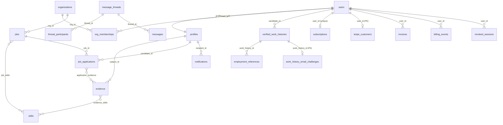

# 05 - Database and API

Audience: a new developer or AI agent who must understand the data model, the migration process, and every HTTP route, and who must know what actually persists.
Companions: [02-ARCHITECTURE.md](02-ARCHITECTURE.md) (topology, request lifecycle, worker, risks), [03-DEVELOPMENT-GUIDE.md](03-DEVELOPMENT-GUIDE.md) (how to run migrations and the API locally, environment variables), [04-FEATURES-AND-WORKFLOWS.md](04-FEATURES-AND-WORKFLOWS.md) (what each feature does), [06-SECURITY-AND-INTEGRATIONS.md](06-SECURITY-AND-INTEGRATIONS.md) (auth hardening, Stripe, Brevo, privacy, authorization findings), [07-TESTING-AND-OPERATIONS.md](07-TESTING-AND-OPERATIONS.md) (database tests, CI, backup and restore), [08-ROADMAP-AND-DECISIONS.md](08-ROADMAP-AND-DECISIONS.md) (decision register and roadmap).

## 0. Basis and labels

Written 2026-10-26 on branch `docs/consolidation-2026-10-26`; code and migrations read at working-tree HEAD (`40ee2de3`). Nothing that touches a database or the application was run: no database was queried, no migration was applied, no test was executed. Two read-only helper scripts were run (a route parser kept outside the repository, and `scripts/check-new-hosted-migrations.mjs`, which only reads migration files). "Implemented-verified" means confirmed by reading current source or SQL. The label vocabulary is the same as in 02: Implemented-verified, Implemented-unverified, Partial, Planned, Proposed-only (target design in `Yash_Final_Project_Document` folders 10-13, 25; it has open review findings), Deprecated, Unknown.

Truth rule: migrations and code decide what exists. The route list in section B8 was derived by parsing `apps/api/src/server.ts` and `apps/api/src/billing-stripe.ts` and cross-checked against the 278-row index in `docs/engineering/API_CONTRACTS.md` (same 278 method/path pairs; two schema-label differences explained in section B9).

# Part A - Database

## A1. Database architecture

| Topic | Fact | Label |
| --- | --- | --- |
| Engine | PostgreSQL, accessed directly with `pg` (one `Pool`: 5 s connect timeout, 30 s idle timeout). No ORM. No Supabase client library; no use of the Supabase Data API (PostgREST). | Implemented-verified |
| Identity | Application-owned: accounts live in `public.users` (decision D4). `auth.users` exists only as a foreign-key target on the local shim; migration 00054 repoints historical foreign keys to `public.users`. | Implemented-verified |
| Modes | `STORAGE=pg` (default outside tests; boot fails if the database is unreachable) or `STORAGE=memory` (tests; explicit; refused by deployed-config checks). There is no automatic fallback from pg to memory. | Implemented-verified |
| Access pattern | The API reads from an in-memory read model hydrated at boot (`PgCoreStore.load()`), and writes through `persist()` (one transaction). Dedicated stores read and write SQL directly. See 02 sections 3 and 6. | Implemented-verified |
| Single writer | A retained connection holds `pg_try_advisory_lock(718201, 1)`. A second API process is refused at boot; a lost lock makes every request return 503. Transaction-mode connection pooling cannot be assumed compatible with this session-scoped lock. | Implemented-verified |
| Schema size | 55 migrations; 112 distinct tables created (`feature_flags` is created by both 00001 and 00051 with `IF NOT EXISTS`); 6 enum types (all from 00001); about 198 index statements; 165 `REFERENCES` clauses; 238 `CHECK` clauses; one `SECURITY DEFINER` function (`is_message_thread_participant`); one migration-defined view (`public_certificate_verifications`, 00021). Three membership alias views (`organization_members`, `organization_memberships`, `memberships`) over `org_memberships` are created by the runner or the hosted adapter, not by a migration, because applied policy SQL uses those names. | Implemented-verified (counted from SQL text) |
| Tables the runtime actually uses | 34 of the 112: `users`, `profiles`, `skills`, `organizations`, `org_memberships`, `jobs`, `job_skills`, `job_applications`, `application_evidence`, `evidence`, `evidence_skills`, `verified_work_histories`, `employment_references`, `work_history_email_challenges`, `notifications`, `notification_preferences`, `revoked_sessions`, `message_threads`, `thread_participants`, `messages`, `user_settings`, `data_export_requests`, `data_erasure_requests`, `saved_searches`, `saved_jobs`, `admin_audit_logs`, `feature_flags`, `subscriptions`, `invoices`, `entitlements`, `billing_events`, `stripe_customers`, `background_jobs`, `worker_health`. The other 78 exist in SQL but no storage-layer code reads or writes them (`server.ts` contains no SQL). | Implemented-verified (search of `apps/api/src/storage`, `packages/domain/src/background-jobs.ts`, `apps/worker/src`) |
| Ledger | `schema_migrations(filename PK, checksum, applied_at)`, created by the runner. | Implemented-verified |

The API's database role matters: RLS does not constrain an owner or `BYPASSRLS` role. Which role the deployed API uses is Unknown from the repository. RLS is therefore a second layer, never the authorization mechanism (section A6).

## A2. Tables grouped by domain

"Runtime" means what the code does today: Persistent = PostgreSQL is authoritative; Unused = table exists, no storage code touches it (the matching API routes keep state in process memory).

| Domain | Tables | Runtime |
| --- | --- | --- |
| Identity, organization, platform (10) | `users`, `profiles`, `organizations`, `org_memberships`, `revoked_sessions`, `feature_flags`, `admin_audit_logs`, `worker_health`, `audit_logs`, `platform_config` | Persistent except `audit_logs` and `platform_config` (Unused) |
| Skills and evidence (8) | `skills`, `evidence`, `evidence_skills`, `skill_relationships`, `skill_freshness`, `skill_freshness_history`, `skill_endorsements`, `endorsement_weights` | `skills`, `evidence`, `evidence_skills` Persistent; rest Unused |
| Verified work history (3) | `verified_work_histories`, `employment_references`, `work_history_email_challenges` | Persistent |
| Hiring and applications (15) | `jobs`, `job_skills`, `job_applications`, `application_evidence`, `saved_searches`, `saved_jobs` (Persistent); `application_drafts`, `application_draft_versions`, `job_alerts`, `job_templates`, `feedback_templates`, `application_feedback`, `salary_reports`, `salary_aggregates`, `search_history` (Unused) | Mixed |
| Interviews (4) | `interview_questions`, `interview_assessments`, `interview_scorecards`, `interview_ai_feedbacks` | Unused |
| Learning, challenges, certificates (14) | `challenges`, `assessment_sessions`, `challenge_submissions`, `xp_transactions`, `courses`, `course_modules`, `lessons`, `course_enrollments`, `lesson_progress`, `course_certificates`, `course_skills`, `certificate_revocations`, `learning_outcomes`, `learning_impact_metrics` | Unused |
| Messaging and notifications (5) | `message_threads`, `thread_participants`, `messages`, `notifications`, `notification_preferences` | Persistent |
| AI gateway (3) | `ai_conversations`, `ai_messages`, `ai_usage_meters` | Unused |
| Resumes and portfolio (6) | `resumes`, `resume_exports`, `portfolio_projects`, `portfolio_project_skills`, `portfolio_project_media`, `portfolio_project_evidence` | Unused |
| Network, referrals, alumni (9) | `connections`, `warm_introduction_preferences`, `warm_introduction_requests`, `referral_requests`, `referral_outcomes`, `alumni_affiliations`, `alumni_groups`, `alumni_group_members`, `alumni_mentorship` | Unused |
| Gamification (3) | `user_gamification_profiles`, `gamification_badges`, `user_badges` | Unused |
| Account privacy (3) | `user_settings`, `data_erasure_requests`, `data_export_requests` | Persistent |
| Billing (5) | `subscriptions`, `invoices`, `entitlements`, `billing_events`, `stripe_customers` | Persistent |
| Moderation and analytics (4) | `moderation_reports`, `moderation_appeals`, `analytics_events`, `analytics_daily_kpis` | Unused |
| Reputation, forecasting, talent intelligence (19) | `reputation_scores`, `reputation_signals`, `reputation_history`, `reputation_recovery_plans`, `activity_events`, `contribution_scores`, `instructor_reputation_breakdown`, `instructor_endorsements`, `employer_reputation_breakdown`, `employer_reviews`, `skill_market_signals`, `skill_forecasts`, `career_transitions`, `progression_benchmarks`, `career_milestone_evaluations`, `talent_pools`, `talent_pool_members`, `behavioral_talent_profiles`, `candidate_segmentations` | Unused |
| Queue (1) | `background_jobs` | Persistent |

Sum: 112. A per-migration table list is in `docs/engineering/DATABASE.md` (its "Migration inventory" matches the SQL: same 112 names).

Seed: `supabase/seed/01_initial_seed.sql` inserts five feature flags (`FEATURE_LMS`, `FEATURE_CODE_ARENA`, `FEATURE_MESSAGING`, `FEATURE_NOTIFICATIONS`, `FEATURE_AI_MATCHING`); migration 00051 inserts the same five with `ON CONFLICT DO NOTHING`. At API boot, a durable core store inserts the canonical seed skill taxonomy if its rows are missing (jobs and evidence reference skills by foreign key).

## A3. Key relationships and identifier rules



**User ids and profile ids are different identifiers.** Applications, evidence, messaging participants and notifications reference `profiles.id`. Work histories, references, billing, settings, sessions and erasure reference `users.id`. (Migration 00043 re-pointed `verified_work_histories` and `employment_references` from `profiles(id)` to `users(id)`.) Check the actual foreign key and handler lookup before joining. Implemented-verified.

Other conventions: UUID primary keys (`gen_random_uuid()`); `TIMESTAMPTZ`; money as integer minor units (`salary_min_minor`, `amount_cents`) with currency; roles stored as `TEXT[]` on `users` (the `user_role` enum is defined but unused by `users`; the domain `Role` union has 10 values, the enum 7).

## A4. Persistence stores (what writes what)

| Store (file under `apps/api/src/storage/`) | Tables | Transaction and read behavior | Label |
| --- | --- | --- | --- |
| `core-store.ts` (`PgCoreStore`) | `users`, `profiles`, `skills`, `organizations`, `org_memberships`, `jobs`, `job_skills`, `job_applications`, `application_evidence`, `evidence`, `evidence_skills`, `verified_work_histories`, `employment_references`, `work_history_email_challenges`, `notifications`, `notification_preferences`, `revoked_sessions`, `message_threads`, `thread_participants`, `messages` | `commit(ops)`: sort ops by FK-safe `WRITE_ORDER`, `BEGIN`, guarded upserts/updates, `COMMIT`; deletes run last. Reads: boot-time `load()` into Maps. | Implemented-verified |
| `account-store.ts` | `user_settings`, `data_export_requests` | SQL read/write. Bring-your-own AI keys encrypted with AES-256-GCM using `BYO_AI_KEY_ENCRYPTION_KEY` (separate from the session secret); rotation needs re-encryption. | Implemented-verified |
| `erasure-store.ts` | `data_erasure_requests` | Row-locks the user (`SELECT ... FOR UPDATE`) to serialize requests; request/status/cancel/complete | Implemented-verified |
| `saved-search-store.ts`, `saved-job-store.ts` | `saved_searches`, `saved_jobs` | Owner-scoped CRUD; user-row lock on search create; `ON CONFLICT (user_id, job_id) DO NOTHING` bookmarks | Implemented-verified |
| `admin-audit-store.ts` | `admin_audit_logs` | Append and filtered list | Implemented-verified |
| `feature-flag-store.ts` | `feature_flags` | List/get/upsert | Implemented-verified |
| `billing-store.ts` | `subscriptions`, `invoices`, `entitlements`, `billing_events`, `stripe_customers` | `applyEvent` records the provider event and its state change in one transaction; duplicates detected by the unique `(provider, provider_event_id)` index | Implemented-verified |
| `packages/domain/src/background-jobs.ts` (`createPgJobStore`) | `background_jobs` | Enqueue, claim (`SKIP LOCKED`, lease), fenced complete/fail, cancel, 7-day terminal purge | Implemented-verified |
| `apps/worker/src/index.ts` | `worker_health` | Upsert of the single row `id = 1` every 10 s | Implemented-verified |

The core transaction does not include the dedicated stores, Stripe calls or queued jobs. There is no transactional outbox (02 R3).

## A5. Constraints and integrity rules

| Rule | Mechanism | Migration |
| --- | --- | --- |
| Email unique, case-insensitive | `UNIQUE (lower(email))` index `uq_users_email_lower` (plus column `UNIQUE`) | 00001, 00043 |
| One profile per user; one membership per org and user | `profiles.user_id UNIQUE`; `UNIQUE (org_id, user_id)` | 00001 |
| One **active** application per job and candidate (BR-15); re-apply after withdraw/reject/expire allowed | Partial unique index `uq_job_applications_one_active ... WHERE status NOT IN ('rejected','withdrawn','expired')` replaced the original `UNIQUE (job_id, candidate_id)` | 00043 |
| Job status, work mode, job type values; salary range all-or-nothing, minor units | `CHECK` constraints `chk_jobs_status`, `chk_jobs_work_mode`, `chk_jobs_job_type`, `chk_jobs_salary_range` | 00043 |
| Evidence dispute state | `CHECK (conflict_state IN ('none','disputed','overridden'))` | 00043 |
| Work history and references client retry safety | Unique `(candidate_id, client_request_id)` partial indexes | 00043 |
| Verification credentials stored as hashes only | `employment_references.token_hash CHAR(64)` (plaintext column dropped after backfill); `work_history_email_challenges.code_hash CHAR(64)`, attempt counter with `CHECK (attempts >= 0)`, expiry | 00043 |
| Work history validity | `chk_work_history_dates`, `chk_work_history_score` (0-100), badge/status/type `CHECK`s | 00041 |
| Notification type vocabulary | `notifications_type_check` (18 values), kept in step with the domain by `tests/unit/database-migrations.test.ts` | 00044 |
| Session cut-off and sign-out | `users.sessions_valid_after`; `revoked_sessions(session_id PK, user_id FK CASCADE, expires_at)` | 00045, 00046 |
| One subscription per user; Stripe ids unique; invoice idempotency scoped per user; provider event ids unique | `uq_subscriptions_user`, `uq_subscriptions_stripe`, `uq_invoices_user_idempotency`, `uq_invoices_stripe`, `uq_billing_events_provider_event`, `stripe_customers(user_id PK, stripe_customer_id UNIQUE)` | 00052 |
| Plan tier / subscription status / invoice status values; non-negative amount | `CHECK`s on `subscriptions`, `invoices` | 00014 |
| Job queue lifecycle | `chk_background_jobs_status IN ('queued','running','succeeded','failed','dead','canceled')`; `UNIQUE (kind, idempotency_key)` (NULL keys distinct) | 00042 |
| Message de-duplication | `UNIQUE (thread_id, client_message_id)`; `UNIQUE (thread_id, user_id)` participants | 00006 |
| Singleton worker row | `worker_health.id SMALLINT CHECK (id = 1)` | 00049 |

Other `UNIQUE` pairs exist on LMS, connections, portfolio, gamification and drafts tables (00004-00020); they protect tables the runtime does not yet use.

## A6. Row-level security and grants

- Every one of the 112 tables has `ENABLE ROW LEVEL SECURITY` somewhere in the migration history (final state after 00055). 181 `CREATE POLICY` and 12 `DROP POLICY` statements exist in non-comment SQL (00047 and 00048 drop and recreate some, so about 169 remain in effect); 24 tables have RLS but no policy, which denies non-privileged roles by design (examples: `background_jobs`, `revoked_sessions`, `worker_health`, `admin_audit_logs`, `stripe_customers`, `work_history_email_challenges`, `organizations`, `org_memberships`). Counts are from non-comment SQL text (118 `ENABLE ROW LEVEL SECURITY` statements cover the 112 tables, some repeated by hardening migrations). Implemented-verified.
- Policies are written for direct Supabase JWT access (`auth.uid()`, 202 uses in non-comment SQL) and are not what protects API calls: the API authorizes in code with its own session tokens. Local databases get a compatibility shim (`auth.uid()` reading `request.jwt.claim.sub`). Hosted Supabase `auth.uid()` does not recognize the API's tokens. Implemented-verified.
- 00047/00048 repaired profile-owned policies (messages, notifications, preferences) that had compared profile ids with a user id; the thread participant helper is `SECURITY DEFINER` with `search_path = ''`, takes a thread id (never a user id), and self-joining a thread by a client is blocked by revoking `INSERT`. Implemented-verified.
- 00053 revokes client-role writes on billing tables and all access to `stripe_customers`; 00055 enables RLS on `certificate_revocations` and revokes client access (00021 had created it without RLS). Implemented-verified.
- Hosted Supabase: `supabase/hosted/02_data_api_lockdown.sql` revokes all privileges from `anon` and `authenticated` on current and future tables, sequences and functions; RLS stays on as a second layer. Applied state is Unknown (section A11).
- Isolation tests exist only for private data (`tests/pg/private-data-rls.test.ts`, run with a real database); SQL-text and memory tests do not prove isolation. Details in 07.

## A7. Migration process and numbering

| Aspect | Rule (from `scripts/migrate.mjs`, `scripts/lib/*.mjs`) | Label |
| --- | --- | --- |
| Command | `pnpm db:migrate` (see 03 section 7). Creates the target database if absent, installs the local Supabase-compatibility shim and organization alias views, then applies pending files. | Implemented-verified |
| Numbering | Files `NNNNN_name.sql` in `supabase/migrations`, contiguous from `00001`, no gaps, no empty files; currently `00001`-`00055`; next is `00056`. | Implemented-verified |
| Atomicity | One transaction per file plus its ledger row; on failure that file is rolled back, earlier files stay applied, the runner exits non-zero naming the file. | Implemented-verified |
| Immutability | SHA-256 checksum recorded per file. Before applying anything the runner checks that every ledger entry maps to a local file, has no duplicates, matches its checksum, and that applied files are a contiguous prefix; any drift aborts the run. Applied SQL is never edited; fixes are new migrations. | Implemented-verified |
| Idempotent style | Migrations use `IF NOT EXISTS`, `DO $$ ... EXCEPTION WHEN duplicate_object` and `DROP ... IF EXISTS` so a re-run is safe in practice. | Implemented-verified |
| Hosted Supabase | The runner refuses hosted endpoints (it would modify provider-managed auth objects). `supabase/hosted/README.md` documents a manual ordered path (00001, alias views, 00002-00053, 00054, data API lockdown, then ledger rows). `scripts/check-new-hosted-migrations.mjs` (step in `hosted-supabase-audit.yml`) flags migrations numbered above 00051 that mention `auth.users`, `auth.uid()`, `auth.jwt()` or create/alter/drop `auth.*` objects. | Implemented-verified; the script currently exits 1 on this tree (A11 #9) |
| Seed | `pnpm db:seed` (`scripts/seed.mjs`) refuses to run before migrations and executes `supabase/seed/*.sql`. | Implemented-verified |
| Required content | New private/tenant tables need RLS and grants in the same migration plus a test; ordering and rollback or forward-fix plan per migration. | Process rule; see 03 |

Migration history by range:

| Range | Theme |
| --- | --- |
| 00001 | Extensions, enums, `users`, `profiles`, `evidence`, `organizations`, `org_memberships`, `jobs`, `job_applications`, `audit_logs`, `feature_flags`, indexes, RLS and policies |
| 00002-00041 | One schema file per feature area (skills, applications, challenges, LMS, messaging, notifications, AI, resumes, networking, portfolio, gamification, settings, billing, admin, search, moderation, saved searches, drafts, analytics, certificates, templates, salaries, feedback, skill decay, interviews, reputation, introductions, referrals, activity, instructor/peer/alumni/employer reputation, forecasting, career, learning impact, talent pools/discovery/segmentation, verified work history) |
| 00042 | `background_jobs` (service-role only) |
| 00043 | Core persistence alignment (columns, partial unique index, FK repoint, hashed tokens, email challenges, lower-case email index) |
| 00044-00046 | Durable notifications; password-change session cut-off; per-session sign-out |
| 00047-00048 | Private-data RLS hardening and an outer-row correlation fix |
| 00049-00051 | Worker heartbeat, admin audit log, feature flags |
| 00052-00053 | Billing persistence and Stripe linkage; client-role grants hardening |
| 00054 | Repoint `auth.users` foreign keys to `public.users` |
| 00055 | RLS on `certificate_revocations` |

### Per-migration inventory

Generated from the `CREATE TABLE` statements and read headers of the 55 files (112 distinct table names; `feature_flags` is created twice). Presence in SQL does not establish applied state or runtime use (section A2). Column-level detail, bounds, foreign keys and indexes are in the SQL files themselves, which are the only definition.

| Migration | Created tables and other effects |
| --- | --- |
| `00001_core_schema.sql` | `users`, `profiles`, `evidence`, `organizations`, `org_memberships`, `jobs`, `job_applications`, `audit_logs`, `feature_flags` |
| `00002_evidence_skills_schema.sql` | `skills`, `skill_relationships`, `evidence_skills` |
| `00003_jobs_applications_schema.sql` | `job_skills`, `application_evidence` |
| `00004_challenges_assessment_schema.sql` | `challenges`, `assessment_sessions`, `challenge_submissions`, `xp_transactions` |
| `00005_lms_courses_schema.sql` | `courses`, `course_modules`, `lessons`, `course_enrollments`, `lesson_progress`, `course_certificates`, `course_skills` |
| `00006_messaging_schema.sql` | `message_threads`, `thread_participants`, `messages` |
| `00007_notifications_schema.sql` | `notifications`, `notification_preferences` |
| `00008_ai_gateway_schema.sql` | `ai_conversations`, `ai_messages`, `ai_usage_meters` |
| `00009_resumes_schema.sql` | `resumes`, `resume_exports` |
| `00010_networking_connections_schema.sql` | `connections` |
| `00011_portfolio_showcase_schema.sql` | `portfolio_projects`, `portfolio_project_skills`, `portfolio_project_media`, `portfolio_project_evidence` |
| `00012_gamification_xp_ledger_schema.sql` | `user_gamification_profiles`, `gamification_badges`, `user_badges` |
| `00013_account_settings_privacy_schema.sql` | `user_settings`, `data_erasure_requests`, `data_export_requests` |
| `00014_billing_subscriptions_schema.sql` | `subscriptions`, `invoices`, `entitlements`, `billing_events` |
| `00015_admin_governance_schema.sql` | `platform_config` |
| `00016_search_discovery_schema.sql` | `search_history` |
| `00017_moderation_trust_safety_schema.sql` | `moderation_reports`, `moderation_appeals` |
| `00018_saved_searches_job_alerts_schema.sql` | `saved_searches`, `job_alerts`, `saved_jobs` |
| `00019_application_drafts_schema.sql` | `application_drafts`, `application_draft_versions` |
| `00020_product_analytics_schema.sql` | `analytics_events`, `analytics_daily_kpis` |
| `00021_certificate_verification_schema.sql` | `certificate_revocations` |
| `00022_job_templates_schema.sql` | `job_templates` |
| `00023_salary_intelligence_schema.sql` | `salary_reports`, `salary_aggregates` |
| `00024_application_feedback_schema.sql` | `feedback_templates`, `application_feedback` |
| `00025_skill_decay_schema.sql` | `skill_freshness`, `skill_freshness_history` |
| `00026_technical_interview_platform_schema.sql` | `interview_questions`, `interview_assessments`, `interview_scorecards`, `interview_ai_feedbacks` |
| `00027_reputation_engine_schema.sql` | `reputation_scores`, `reputation_signals`, `reputation_history`, `reputation_recovery_plans` |
| `00028_warm_introductions_schema.sql` | `warm_introduction_preferences`, `warm_introduction_requests` |
| `00029_referral_requests_schema.sql` | `referral_requests`, `referral_outcomes` |
| `00030_activity_contributions_schema.sql` | `activity_events`, `contribution_scores` |
| `00031_instructor_reputation_schema.sql` | `instructor_reputation_breakdown`, `instructor_endorsements` |
| `00032_peer_credibility_schema.sql` | `skill_endorsements`, `endorsement_weights` |
| `00033_alumni_networks_schema.sql` | `alumni_affiliations`, `alumni_groups`, `alumni_group_members`, `alumni_mentorship` |
| `00034_employer_reputation_schema.sql` | `employer_reputation_breakdown`, `employer_reviews` |
| `00035_skill_forecasting_schema.sql` | `skill_market_signals`, `skill_forecasts` |
| `00036_career_trajectory_schema.sql` | `career_transitions`, `progression_benchmarks`, `career_milestone_evaluations` |
| `00037_learning_impact_schema.sql` | `learning_outcomes`, `learning_impact_metrics` |
| `00038_talent_pool_intelligence_schema.sql` | `talent_pools`, `talent_pool_members` |
| `00039_behavioral_talent_discovery_schema.sql` | `behavioral_talent_profiles` |
| `00040_talent_segmentation_schema.sql` | `candidate_segmentations` |
| `00041_verified_work_history_schema.sql` | `verified_work_histories`, `employment_references` |
| `00042_background_jobs_schema.sql` | `background_jobs` |
| `00043_core_persistence_alignment.sql` | `work_history_email_challenges`; also: evidence `conflict_state`; job work-mode/type/salary columns and CHECKs; application columns and partial unique index `uq_job_applications_one_active`; FK repoint of work-history tables to `users`; `token_hash`; `uq_users_email_lower` |
| `00044_notifications_persistence.sql` | alterations only: `notifications_type_check` (18 types), index `idx_notifications_recipient_created` |
| `00045_session_revocation.sql` | alteration only: `users.sessions_valid_after` |
| `00046_session_sign_out.sql` | `revoked_sessions` |
| `00047_private_data_rls_hardening.sql` | policies and grants only: `is_message_thread_participant()`, messaging/notification/preference policies, revokes |
| `00048_notification_preferences_rls_scope.sql` | policies only: notification preference policies re-scoped to the outer row |
| `00049_worker_liveness.sql` | `worker_health` |
| `00050_admin_audit_logs.sql` | `admin_audit_logs` |
| `00051_feature_flags.sql` | `feature_flags` (second `IF NOT EXISTS` creation, so a no-op after 00001) plus the five seed flags |
| `00052_billing_persistence_and_stripe.sql` | `stripe_customers`; also Stripe columns on `subscriptions` and `invoices`, provider-event columns on `billing_events`, and the unique indexes `uq_subscriptions_user`, `uq_subscriptions_stripe`, `uq_invoices_user_idempotency`, `uq_invoices_stripe`, `uq_billing_events_provider_event` |
| `00053_billing_role_grants_hardening.sql` | grants only: revokes client-role writes on billing tables and all access to `stripe_customers` |
| `00054_repoint_auth_users_foreign_keys.sql` | DO block: repoints every `auth.users` foreign key in `public` to `public.users` |
| `00055_certificate_revocations_rls.sql` | RLS only: enables RLS on `certificate_revocations`, revokes client access |

## A8. Persistence honesty

- `apps/api/src/durability.ts` lists 78 durable routes and 3 stateless ones. Every other route response carries `x-talentsphere-durability: ephemeral`, and so does every response when the core store is memory. Implemented-verified.
- `GET /admin/health-diagnostics` reports the durable/ephemeral split, a live database round-trip, worker heartbeat age (45 s threshold) and writer-lease state; liveness endpoints do not. Implemented-verified.
- Tests that guard the contract: `tests/unit/persistence-honesty.test.ts` (runner really executes SQL, ledger exists, health is measured), `tests/unit/database-migrations.test.ts` (SQL-text assertions; does not execute SQL), `tests/security/core-authz.test.ts` (every listed durable route exists), `tests/pg/*.test.ts` (need `TEST_DATABASE_URL`). Not run here.
- Moving a module to durable storage means: route its writes through `persist()` or a dedicated store, add its tables to a store, then list its routes in `DURABLE_ROUTES`.

## A9. Concurrency and failure rules

| Rule | Behavior |
| --- | --- |
| Optimistic concurrency in core writes | An update op carries `base`, the Map value it was derived from. `persist()` returns 409 `CONFLICT` (`reason: concurrent_modification`) if another write to the same record is in flight or the record is no longer `base`. The SQL `UPDATE ... WHERE` re-checks decisive columns (status, attempts, code hash, credential) and a rowCount other than 1 raises the same 409. |
| Integrity errors | `23505` unique violation becomes 409 `CONFLICT`; `23503` foreign-key and `23514` check violations and any class-22 data exception become 422 `VALIDATION_FAILED`. |
| Failed commit | The read model is not changed; the API never serves state it could not save. |
| Out-of-band SQL | Direct SQL changes to hydrated tables are not seen until the API restarts. |
| Per-organization publish | In-process promise chain serializes "count published jobs, check plan, persist" (valid only because there is one writer). |
| Messages | Retry-safe by `clientMessageId` (database unique key per thread; an in-process map also caches it). |
| Job queue | Claim uses `FOR UPDATE SKIP LOCKED`; complete/fail are fenced on `attempts`. See 02 section 8. |
| Erasure | Row lock on the user serializes requests; the execution path is resumable but not one atomic transaction, and does not enforce the 30-day grace period. |
| Not provided | No cursor pagination layer, no global idempotency middleware, no distributed transaction, no exactly-once job delivery. |

## A10. Data lifecycle

| Data | Handling | Label |
| --- | --- | --- |
| Passwords | `pbkdf2-sha512$<iterations>$<salt>$<hash>` (default 210,000 iterations); legacy `<salt>:<hash>` accepted and re-hashed on login; erased accounts get the sentinel credential `!erased`. | Implemented-verified |
| Work-email code and referee token | SHA-256 hash stored; the queued email job carries the plaintext until it reaches a terminal state, then `token` and `code` payload keys are stripped; development outbox logs contain delivery text and are sensitive. | Implemented-verified |
| Revoked sessions | Row kept until the token's expiry; expired rows deleted when a new one is recorded; only live rows load at boot. | Implemented-verified |
| Background jobs | Terminal rows purged after 7 days (checked every 100th dispatch). | Implemented-verified |
| Export | `POST /settings/export` compiles the data available to the API; it is not proof of an exhaustive archive of ephemeral modules. | Partial |
| Erasure | Anonymizes the account and profile, removes billing mapping and cancels queued emails; retained multi-party records need a retention/redaction policy that does not exist. | Partial |
| Evidence lineage | Evidence rows are mutated in place; there is no append-only version/event history. | Implemented-verified (gap) |

## A11. Database discrepancies found

| # | Document claim | Code / SQL | Note |
| --- | --- | --- | --- |
| 1 | `DATABASE.md`: hosted state "00001-00054"; `supabase/hosted/README.md`: "00001-00055"; `docs/system-model/05-audit.md` (cited by 03): different again | Cannot be resolved from source | Unknown |
| 2 | `DATABASE.md`: failure after account deactivation can prevent retrying erasure | `settings/erasure/execute` is resumable and idempotent (commit `9755add4`) | Code wins |
| 3 | `docs/system-model/02-flows.md` F1: "53 migrations" | 55 | Stale doc |
| 4 | `DATABASE.md` migration inventory labels 00055 "inspect SQL" | 00055 enables RLS on `certificate_revocations` and revokes client access | Accurate here |
| 5 | `audit_logs` (00001) described as the audit table | No runtime code writes it; `admin_audit_logs` (00050) is the used trail | Unused table |
| 6 | `user_role` enum | Not used by `users.roles` (`TEXT[]`); 7 values vs 10 domain roles | Unused enum |
| 7 | Policies written with `auth.uid()` look like isolation | They do not apply to API sessions (section A6) | Not isolation evidence |
| 8 | TRD/SSOT: UTC timestamps, integer minor units, explicit lifecycle | Mostly followed in SQL; `invoices.amount_cents` is `INTEGER` | Fine |
| 9 | 03 and `hosted-supabase-audit.yml`: the guard `check-new-hosted-migrations.mjs` protects new migrations from platform-Auth references | Running it on HEAD exits 1: it flags `00054_repoint_auth_users_foreign_keys.sql`, whose comments and `'auth.users'::regclass` lookup match the forbidden patterns (the guard only skips files numbered 51 and below) | Guard and migration disagree. The workflow runs on pull requests that touch `supabase/migrations/**` and on manual dispatch, and the guard step has no error tolerance, so such a run would fail on this tree (workflow results were not inspected). Fix belongs in the script's exemption list; the applied migration must not change. |

## A12. Target design (proposed)

Source: `Yash_Final_Project_Document/12_DATA_AND_DATABASE/` (`CONCEPTUAL_AND_LOGICAL_MODEL.md` DB-01 about 126 entities, `PHYSICAL_DESIGN.md` DB-02 and `PHYSICAL_DESIGN_REV2.md`, `DATA_GOVERNANCE_AND_LIFECYCLE.md`, `MIGRATION_POLICY.md` DB-04), `23_MIGRATION_AND_EVOLUTION/REFERENCE_TO_TARGET_DATA_MIGRATION.md`. All Proposed-only; nothing below exists in the repository.

| Area | Proposed | Why it differs from today |
| --- | --- | --- |
| Entities | Greenfield names (`account`, `profile`, `evidence_item`, `evidence_attestation`, `application`, `outbox_event`, `consumer_inbox`, `audit_event`, `consent_record`, `background_job`, ...) with UUIDv7, `version` column, `citext`, `text`+`CHECK` instead of PG enums, `*_enc`/`*_hash` field encryption | Not an incremental change; needs the reference-to-target data migration note (everything imported at the lowest evidence rung, sessions invalidated, entitlements recomputed from Stripe) |
| Events | Transactional outbox written in the use-case transaction; consumer inbox dedupe; coalesced projection jobs | Replaces post-commit `dispatchJob` |
| Reads | SQL reads everywhere, stateless replicas, optional read replica for analytics | Removes the single-writer read model |
| Authorization in the database | RLS as defence in depth with `SET LOCAL app.account_id / org_ids / platform_roles`, roles `ts_app` and `ts_migrator`, `FORCE ROW LEVEL SECURITY`, consent-gated policies, column privileges so protected evidence columns change only through generated `SECURITY DEFINER` transition functions (`sm_edge` table, parity test) | Today policies target Supabase JWTs and are not used by the API |
| Audit and erasure | Append-only history that never holds identifiers (opaque `subject_ref`, identity map deleted on erasure), batched Merkle anchoring instead of a lock | Today: one SQL admin audit table; erasure anonymizes in place |
| Abuse controls | `auth_throttle` (logged table), two partitioned idempotency tables (short 24 h/7 d, queued 14 d) | Today: in-process buckets, no idempotency table |
| Migrations | Expand/backfill/contract with metadata headers, `lock_timeout` 2 s, `CREATE INDEX CONCURRENTLY`, backfill jobs, forward-fix preferred | Today: contiguous checksum-guarded files, no lock timeouts, no header lint |
| Partitioning / budgets | Partition outbox, audit, idempotency; write-budget table per P0 use case | Not measured; "design-derived, not measurements" |

Open review findings apply (`27_INDEPENDENT_REVIEWS/REVIEW_FIX_STATUS.md`): the REV2 files are proposals; several fixes were reported by their authors and not independently re-read.

# Part B - API

## B1. Transport and conventions

| Topic | Fact | Label |
| --- | --- | --- |
| Base | `/api/v1/*` JSON over HTTP, plus unversioned `GET /health`. 278 unique method/path pairs: 132 GET, 120 POST, 13 PATCH, 11 DELETE, 2 PUT. No generated OpenAPI document. | Implemented-verified |
| Authentication | `Authorization: Bearer <HMAC session token>`. Tokens are not Supabase JWTs. Public routes and provider callbacks have their own access rules. | Implemented-verified |
| Request id | Inbound `x-request-id` reused if present, else `req_<uuid>`; echoed on every response and in every error body. | Implemented-verified |
| Success body | Handler-specific objects. There is no universal `{data, meta}` envelope. Creates return 201. | Implemented-verified |
| Pagination | `PaginationQuerySchema` (page/limit, limit <= 100) exists in contracts but no route in `server.ts` references it. Lists are bounded by their handlers or unbounded. No cursor pagination. | Implemented-verified |
| Idempotency | No global `Idempotency-Key` header. Natural keys where handlers implement them: `idempotencyKey` on checkout and simulated subscribe (provider key scoped by account, plan, cycle, client key; invoice key unique per user), `clientRequestId` on work-history create/reference request/export, `clientMessageId` on messages, Stripe event ids, generic webhook `idempotencyKey`. | Partial |
| Unknown request fields | Zod objects are not `.strict()`: unknown keys are silently dropped, not rejected. | Implemented-verified |
| Body size | Fastify default (1 MiB); no `bodyLimit` configured. | Implemented-verified (absence) |
| CORS | `CORS_ALLOWED_ORIGINS` allow-list, credentials enabled. Helmet always; CSP only when deployed. | Implemented-verified |
| Rate limits | Global 300 requests per 60 s (`RATE_LIMIT_MAX_REQUESTS`, `RATE_LIMIT_WINDOW_MS`), key per verified account else per address; login 10 per 15 min per address and email; register 20 per 15 min per address (`AUTH_RATE_LIMIT_MAX_REQUESTS` x 2); health exempt; the Stripe webhooks share the global limit; `TRUST_PROXY` controls the address. | Implemented-verified |
| Response headers | `x-request-id`; `x-talentsphere-durability: ephemeral` on non-durable routes; 429 carries `Retry-After`. | Implemented-verified |
| Versioning / deprecation | None implemented beyond the `/v1` prefix. | Planned |

## B2. Access tiers

| Tier | Meaning | How decided |
| --- | --- | --- |
| None | Public, no token | Handler never reads a token |
| Optional session | Token optional; what the caller sees then depends on who they are (for example `canViewProfile`). A present-but-invalid token is treated as anonymous by `maybeExtractUser` but returns 401 in helpers that call `extractUser` when an `Authorization` header exists (for example `workHistoryReader`). | `maybeExtractUser` or a helper |
| Session | Any valid, non-restricted account | `extractUser` |
| Session + role/ownership | Session plus per-handler checks (role, org membership, record owner, participant, platform admin) | Inline in each handler; the "Auth" column in B8 shows only the first level detected from the handler text. Role and ownership rules per group are in `docs/system-model/06-route-authorization.md` and summarized in 06 |
| Capability token | Referee link token (`x-reference-token` header for view, body `token` for submit) | SHA-256 compare, 30-day expiry |
| Provider signature | Stripe `stripe-signature` on the raw body; generic `x-talentsphere-signature` HMAC with 300 s tolerance | Verified before parsing |

Roles (domain `Role` union, 10): `candidate`, `recruiter`, `hiring_manager`, `course_author`, `instructor`, `institution_admin`, `platform_admin`, `moderator`, `verification_staff`, `service_account`. Self-registration accepts only `candidate` or `recruiter`; platform admins change roles through `PATCH /admin/users/:id/roles`. Account status values: `active`, `suspended`, `pending_verification`, `deactivated` (no `banned`); any non-active account may call only the 12 routes in `RESTRICTED_SESSION_ROUTES` (own profile, password change, sign-out, own moderation reports and appeals, data export, erasure). Organization actions mostly check membership, not membership role.

## B3. Error envelope

```json
{"error":{"code":"VALIDATION_FAILED","message":"The submitted payload failed schema validation.","request_id":"req_...","details":[{"path":"email","message":"Invalid email"}]}}
```

| Source | Status | `code` |
| --- | --- | --- |
| Zod parse failure | 400 | `VALIDATION_FAILED` with `details[{path,message}]` |
| `DomainError('UNAUTHENTICATED')` | 401 | `UNAUTHENTICATED` |
| `UNAUTHORIZED`, `FORBIDDEN`, `ASSESSMENT_AI_PROHIBITED`, `TENANT_ISOLATION_VIOLATION` | 403 | same code |
| `NOT_FOUND` | 404 (also unknown route: `Route METHOD URL not found`) | `NOT_FOUND` |
| `CONFLICT` (also unique violation, lost optimistic check) | 409 | `CONFLICT` |
| `VALIDATION_FAILED` (domain), `INVALID_STATE_TRANSITION`, `POLICY_VIOLATION` | 422 | same code |
| `FREE_USER_AI_QUOTA_EXCEEDED`, `PAYMENT_REQUIRED` | 402 | same code |
| Rate limit | 429 | `RATE_LIMIT_EXCEEDED` |
| `SERVICE_UNAVAILABLE` (Stripe off, webhook unconfigured, writer lease lost, interview code execution) | 503 | `SERVICE_UNAVAILABLE` |
| Other plugin-raised HTTP error | its status | `REQUEST_FAILED` (message hidden when deployed) |
| Anything else (including `DomainError('INTERNAL_ERROR')`, which is absent from the status map and falls through to 400 if thrown as a domain error) | 500 | `INTERNAL_SERVER_ERROR` (message hidden when `NODE_ENV` is staging or production) |

4xx log at info with the code; 5xx at error. Details: 02 section 9.

## B4. Validation

- Request schemas are Zod objects in `packages/contracts/src/index.ts` (about 140). Handlers call `.parse` directly, so validation failures surface as 400 through the global handler. Schemas encode bounds (string maxima, id lists de-duplicated, money in minor units up to 1e12, calendar-valid dates 1900-2100, email length 254).
- Domain functions re-validate business rules and throw `DomainError` (422 for policy/transition errors, 403/404 for access).
- The database is the last line: `CHECK`s, foreign keys and unique indexes; Postgres errors are translated (A9).
- Input hardening helpers live in `packages/domain/src/input-security.ts` (SQL-injection and XSS pattern asserts, HTML escaping, private-IP check) and the AI prompt firewall in `ai-gateway.ts` (2,000-character prompt limit; injection patterns rejected).
- Response shapes are not validated by a schema layer, except `CourseProgressResponseSchema` for `GET /courses/:id/progress`.

## B5. Integrity and concurrency in the API

- Core writes: `persist()` with `base` (A9); duplicate active application resolved by the partial unique index and surfaced as 409.
- Application transitions: only along `ALLOWED_APPLICATION_TRANSITIONS`, with party authorization.
- Plan limits: job publishing (`assertCanPublishAnotherJob`) and AI quota (`aiQuotaForEntitlements`) read the stored subscription's effective entitlements, never client input; the publish check runs inside the per-organization lock.
- Checkout: the client names plan and cycle only; price comes from the server catalog (`STRIPE_PRICE_*` ids); a live paid subscription blocks a second checkout (409).
- Webhooks: signature first, then event recording and state change in one transaction keyed by the provider event id; replays return `replayed`; events older than the stored state are recorded only.
- Reference and email-verification credentials are single-use or expiring hashes (A5).

## B6. Persistent versus ephemeral modules

| Persistent in PostgreSQL (78 routes + 3 stateless) | Ephemeral (197 routes; state in process memory; some also write durable rows) |
| --- | --- |
| Identity and sessions (register, login, password, sign-out, profile) | Skill relationships, freshness, endorsements, forecasts |
| Evidence and skills taxonomy (`GET/POST /skills`) | Job templates, application drafts, job alerts, salaries, feedback |
| Organizations, jobs, applications | Courses, lessons, enrollments, certificates, challenges, XP, learning impact (completion evidence is persisted, the rest is not) |
| Verified work history and references | Interviews |
| Messaging and notifications | AI conversations and usage |
| Saved searches and saved jobs | Resumes, portfolio, connections, warm introductions, referrals, alumni |
| Settings, export history, erasure request history (execute, export compile are labelled ephemeral but write durable rows) | Reputation, career, talent pools/discovery/segmentation, activity, gamification |
| Admin audit log, feature flags | Search history, moderation reports and appeals, analytics, admin user listing and maintenance flag |
| Billing (subscription, invoices, entitlements, Stripe mapping and events; `GET /billing/plans` is stateless) | |
| `background_jobs`, `worker_health` (no route writes them directly) | |

The ephemeral list is state that disappears on API restart; the user interface says so on some pages (learning, network, resumes) but not on all (drafts, alerts).

## B7. Operational endpoints

- `GET /health`, `GET /api/v1/health`: liveness only (static JSON with version), exempt from rate limiting.
- `GET /api/v1/admin/health-diagnostics`, `POST /api/v1/admin/maintenance`: platform admin; maintenance changes diagnostics only.
- `GET /api/v1/internal/worker-jobs`: unauthenticated list of queued jobs including payloads (user ids, one-time codes); registered but returns 404 unless `NODE_ENV` is `development` or `test`.

## B8. Route inventory (278 method/path pairs)

Legend: **Dur** = `P` durable (listed in `DURABLE_ROUTES`), `E` ephemeral (labelled), `S` stateless. **Auth** is the first-level access tier detected in the handler (B2); ownership and role checks are inline and not listed here. **Request schema** names the Zod schema parsed in the handler; `handler` means inline or no body/query validation. Paths are literal; `:name` is a path parameter. The generic `POST /api/v1/billing/webhook` and the Stripe `POST /api/v1/billing/stripe-webhook` are the two provider callbacks. `/billing/checkout`, `/billing/portal` and `/billing/stripe-webhook` exist in every mode: with `BILLING_MODE=stripe` they are registered by `billing-stripe.ts`; otherwise `server.ts` registers stubs that return 503 `SERVICE_UNAVAILABLE` (checkout and portal check the session first).

#### Platform and health (4)

| Method and path | Auth | Dur | Request schema |
| --- | --- | --- | --- |
| `GET /health` | None | S | handler |
| `GET /api/v1/health` | None | S | handler |
| `GET /api/v1/feature-flags` | None | P | handler |
| `GET /api/v1/internal/worker-jobs` | None; 404 unless NODE_ENV is development or test | E | handler |

#### Identity and profile (9)

| Method and path | Auth | Dur | Request schema |
| --- | --- | --- | --- |
| `POST /api/v1/auth/register` | None | P | `RegisterInputSchema` |
| `POST /api/v1/auth/login` | None | P | `LoginInputSchema` |
| `POST /api/v1/auth/password` | Session | P | `ChangePasswordInputSchema` |
| `POST /api/v1/auth/sign-out` | Session | P | handler |
| `POST /api/v1/auth/sign-out-others` | Session | P | handler |
| `GET /api/v1/auth/session` | Session | P | handler |
| `GET /api/v1/profile/me` | Session | P | handler |
| `PATCH /api/v1/profile/me` | Session | P | `UpdateProfileInputSchema` |
| `GET /api/v1/profile/:id` | Optional session | P | handler |

#### Evidence and skills (24)

| Method and path | Auth | Dur | Request schema |
| --- | --- | --- | --- |
| `POST /api/v1/evidence` | Session | P | `CreateEvidenceInputSchema` |
| `GET /api/v1/evidence/:id` | Optional session | P | handler |
| `GET /api/v1/evidence/mine` | Session | P | handler |
| `GET /api/v1/evidence/subject/:subjectId` | Optional session | P | handler |
| `POST /api/v1/evidence/:id/verify` | Session | P | `VerifyEvidenceInputSchema` |
| `POST /api/v1/evidence/:id/dispute` | Session | P | `DisputeEvidenceInputSchema` |
| `POST /api/v1/evidence/:id/revoke` | Session | P | `RevokeEvidenceInputSchema` |
| `GET /api/v1/evidence/:id/verify-public` | None | P | handler |
| `GET /api/v1/skills` | None | P | handler |
| `POST /api/v1/skills` | Session | P | `CreateSkillInputSchema` |
| `POST /api/v1/skills/relationships` | Session | E | `CreateSkillRelationshipInputSchema` |
| `GET /api/v1/skills/:id/graph` | None | E | handler |
| `POST /api/v1/skills/freshness` | Session | E | `RegisterSkillFreshnessInputSchema` |
| `GET /api/v1/skills/freshness/my` | Session | E | handler |
| `POST /api/v1/skills/:skillId/reverify` | Session | E | `ReverifySkillInputSchema` |
| `POST /api/v1/skills/freshness/refresh-all` | Session | E | handler |
| `POST /api/v1/skills/endorsements` | Session | E | `CreateSkillEndorsementInputSchema` |
| `GET /api/v1/skills/endorsements/recipients/:recipientId` | None | E | handler |
| `DELETE /api/v1/skills/endorsements/:id` | Session | E | handler |
| `GET /api/v1/skills/endorsements/my/given` | Session | E | handler |
| `GET /api/v1/skills/forecast/top-growth` | None | E | `TopEmergingSkillsQuerySchema` |
| `POST /api/v1/skills/:skillId/market-signals` | Session + platform admin | E | `RecordSkillMarketSignalInputSchema` |
| `GET /api/v1/skills/:skillId/forecast` | None | E | `QuerySkillForecastInputSchema` |
| `POST /api/v1/skills/:skillId/forecast/generate` | Session | E | `GenerateSkillForecastInputSchema` |

#### Organizations, jobs, applications, salaries (48)

| Method and path | Auth | Dur | Request schema |
| --- | --- | --- | --- |
| `POST /api/v1/organizations` | Session | P | `CreateOrganizationInputSchema` |
| `GET /api/v1/organizations/mine` | Session | P | handler |
| `GET /api/v1/organizations/:id/jobs` | Session | P | handler |
| `GET /api/v1/organizations/:id` | None | P | handler |
| `POST /api/v1/organizations/:id/members` | Session | P | `AddOrganizationMemberInputSchema` |
| `POST /api/v1/jobs` | Session | P | `CreateJobInputSchema` |
| `GET /api/v1/jobs` | None | P | handler |
| `GET /api/v1/jobs/:id` | Optional session | P | handler |
| `PATCH /api/v1/jobs/:id/status` | Session | P | `UpdateJobStatusInputSchema` |
| `POST /api/v1/job-templates` | Session | E | `CreateJobTemplateInputSchema` |
| `GET /api/v1/job-templates` | Session | E | handler |
| `GET /api/v1/job-templates/:id` | Session | E | handler |
| `PATCH /api/v1/job-templates/:id` | Session | E | `UpdateJobTemplateInputSchema` |
| `DELETE /api/v1/job-templates/:id` | Session | E | handler |
| `POST /api/v1/job-templates/:id/instantiate` | Session | E | `InstantiateJobFromTemplateInputSchema` |
| `POST /api/v1/jobs/:id/save-as-template` | Session | E | `SaveJobAsTemplateInputSchema` |
| `POST /api/v1/salaries/reports` | Session | E | `SubmitSalaryReportInputSchema` |
| `GET /api/v1/salaries/reports/my` | Session | E | handler |
| `DELETE /api/v1/salaries/reports/:id` | Session | E | handler |
| `GET /api/v1/salaries/benchmarks` | None | E | `SalaryBenchmarkQuerySchema` |
| `GET /api/v1/salaries/company/:companyName` | None | E | handler |
| `POST /api/v1/jobs/:id/apply` | Session | P | `SubmitApplicationInputSchema` |
| `GET /api/v1/applications/my` | Session | P | handler |
| `GET /api/v1/applications/:id` | Session | P | handler |
| `GET /api/v1/jobs/:id/applications` | Session | P | handler |
| `POST /api/v1/applications/:id/transition` | Session | P | `TransitionApplicationInputSchema` |
| `POST /api/v1/applications/:id/feedback` | Session | E | `CreateApplicationFeedbackInputSchema` |
| `GET /api/v1/applications/:id/feedback` | Session | E | handler |
| `POST /api/v1/applications/:id/feedback/request` | Session | E | handler |
| `POST /api/v1/organizations/:orgId/feedback-templates` | Session | E | `CreateFeedbackTemplateInputSchema` |
| `GET /api/v1/organizations/:orgId/feedback-templates` | Session | E | handler |
| `GET /api/v1/feedback/aggregate-insights` | None | E | handler |
| `POST /api/v1/jobs/saved-searches` | Session | P | `CreateSavedSearchInputSchema` |
| `GET /api/v1/jobs/saved-searches` | Session | P | handler |
| `GET /api/v1/jobs/saved-searches/:id` | Session | P | handler |
| `PATCH /api/v1/jobs/saved-searches/:id` | Session | P | `UpdateSavedSearchInputSchema` |
| `DELETE /api/v1/jobs/saved-searches/:id` | Session | P | handler |
| `POST /api/v1/jobs/saved-searches/:id/run` | Session | P | handler |
| `GET /api/v1/jobs/alerts` | Session | E | handler |
| `PATCH /api/v1/jobs/alerts/:id/read` | Session | E | handler |
| `POST /api/v1/jobs/:id/save` | Session | P | handler |
| `DELETE /api/v1/jobs/:id/save` | Session | P | handler |
| `GET /api/v1/jobs/saved` | Session | P | handler |
| `PUT /api/v1/jobs/:jobId/draft` | Session | E | `SaveApplicationDraftInputSchema` |
| `GET /api/v1/jobs/:jobId/draft` | Session | E | handler |
| `DELETE /api/v1/jobs/:jobId/draft` | Session | E | handler |
| `POST /api/v1/jobs/:jobId/draft/restore` | Session | E | `RestoreApplicationDraftVersionInputSchema` |
| `GET /api/v1/applications/drafts` | Session | E | handler |

#### Verified work history and references (9)

| Method and path | Auth | Dur | Request schema |
| --- | --- | --- | --- |
| `GET /api/v1/candidates/:candidateProfileId/skills/freshness` | Session | E | handler |
| `POST /api/v1/candidates/work-history` | Session | P | `CreateWorkHistoryInputSchema` |
| `POST /api/v1/candidates/work-history/:id/verify-email` | Session | P | `VerifyWorkHistoryEmailInputSchema` |
| `POST /api/v1/candidates/work-history/:id/references/request` | Session | P | `RequestEmploymentReferenceInputSchema` |
| `GET /api/v1/references/:refId` | Capability token (`x-reference-token`) | P | handler |
| `POST /api/v1/candidates/work-history/references/:refId/submit` | Capability token (body `token`) | P | `SubmitEmploymentReferenceInputSchema` |
| `GET /api/v1/candidates/:candidateId/work-history` | Optional session (profile visibility decides) | P | handler |
| `GET /api/v1/candidates/:candidateId/work-history-graph` | Optional session (profile visibility decides) | P | `QueryWorkHistoryGraphSchema` |
| `DELETE /api/v1/candidates/work-history/:id` | Session | P | handler |

#### Learning, challenges, certificates, interviews (37)

| Method and path | Auth | Dur | Request schema |
| --- | --- | --- | --- |
| `POST /api/v1/interviews/questions` | Session | E | `CreateInterviewQuestionInputSchema` |
| `GET /api/v1/interviews/questions` | Session | E | handler |
| `POST /api/v1/interviews/assessments` | Session | E | `ScheduleInterviewAssessmentInputSchema` |
| `GET /api/v1/interviews/assessments/:id` | Session | E | handler |
| `POST /api/v1/interviews/assessments/:id/join` | Session | E | handler |
| `POST /api/v1/interviews/assessments/:id/consent` | Session | E | `SetRecordingConsentInputSchema` |
| `POST /api/v1/interviews/assessments/:id/end` | Session | E | handler |
| `POST /api/v1/interviews/assessments/:id/code` | Session | E | `ExecuteInterviewCodeInputSchema` |
| `POST /api/v1/interviews/assessments/:id/scorecard` | Session | E | `SubmitInterviewScorecardInputSchema` |
| `POST /api/v1/interviews/assessments/:id/scorecard/compensate` | Session | E | `CompensateInterviewScorecardInputSchema` |
| `GET /api/v1/interviews/assessments/:id/scorecards` | Session | E | handler |
| `POST /api/v1/interviews/assessments/:id/ai-feedback` | Session | E | handler |
| `POST /api/v1/interviews/assessments/:id/review` | Session | E | handler |
| `GET /api/v1/challenges` | None | E | handler |
| `GET /api/v1/challenges/:id` | None | E | handler |
| `POST /api/v1/challenges` | Session | E | `CreateChallengeInputSchema` |
| `POST /api/v1/challenges/:id/start-session` | Session | E | handler |
| `POST /api/v1/challenges/:id/submit` | Session | E | `SubmitChallengeSolutionInputSchema` |
| `GET /api/v1/xp/ledger` | Session | E | handler |
| `GET /api/v1/courses` | None | E | handler |
| `POST /api/v1/courses` | Session | E | `CreateCourseInputSchema` |
| `GET /api/v1/courses/:id` | Optional session | E | handler |
| `POST /api/v1/courses/:id/modules` | Session | E | `CreateCourseModuleInputSchema` |
| `POST /api/v1/modules/:id/lessons` | Session | E | `CreateLessonInputSchema` |
| `POST /api/v1/courses/:id/publish` | Session | E | handler |
| `POST /api/v1/courses/:id/enroll` | Session | E | handler |
| `GET /api/v1/courses/:id/progress` | Session | E | handler (response checked with `CourseProgressResponseSchema`) |
| `POST /api/v1/lessons/:id/complete` | Session | E | handler |
| `GET /api/v1/certificates/:certificateNumber` | None | E | handler |
| `GET /api/v1/verify/:hash` | None | E | handler |
| `GET /api/v1/certificates/verify/:hash` | None | E | handler |
| `GET /api/v1/certificates/my` | Session | E | handler |
| `POST /api/v1/certificates/:certificateNumber/revoke` | Session | E | `RevokeCertificateInputSchema` |
| `POST /api/v1/learning/impact/outcomes` | Session | E | `RecordLearningOutcomeInputSchema` |
| `GET /api/v1/learning/impact/courses/:courseId` | None | E | `QueryLearningImpactInputSchema` |
| `POST /api/v1/learning/impact/courses/:courseId/compute` | Session | E | `ComputeLearningImpactInputSchema` |
| `GET /api/v1/learning/impact/dashboard` | None | E | `LearningImpactDashboardQuerySchema` |

#### Messaging and notifications (10)

| Method and path | Auth | Dur | Request schema |
| --- | --- | --- | --- |
| `GET /api/v1/threads` | Session | P | handler |
| `POST /api/v1/threads` | Session | P | `CreateThreadInputSchema` |
| `GET /api/v1/threads/:id` | Session | P | handler |
| `POST /api/v1/threads/:id/messages` | Session | P | `SendMessageInputSchema` |
| `POST /api/v1/threads/:id/read` | Session | P | handler |
| `GET /api/v1/notifications` | Session | P | handler |
| `GET /api/v1/notifications/summary` | Session | P | handler |
| `POST /api/v1/notifications/mark-read` | Session | P | `MarkNotificationsReadInputSchema` |
| `GET /api/v1/notifications/preferences` | Session | P | handler |
| `PATCH /api/v1/notifications/preferences` | Session | P | `UpdateNotificationPreferencesInputSchema` |

#### AI (6)

| Method and path | Auth | Dur | Request schema |
| --- | --- | --- | --- |
| `POST /api/v1/ai/assistant/query` | Session | E | `AIAssistantQueryInputSchema` |
| `POST /api/v1/ai/conversations` | Session | E | `CreateAIConversationInputSchema` |
| `GET /api/v1/ai/conversations` | Session | E | handler |
| `GET /api/v1/ai/conversations/:id` | Session | E | handler |
| `POST /api/v1/ai/career-assistant/chat` | Session | E | `AIChatInputSchema` |
| `GET /api/v1/ai/usage` | Session | E | handler |

#### Resumes and portfolio (13)

| Method and path | Auth | Dur | Request schema |
| --- | --- | --- | --- |
| `POST /api/v1/resumes` | Session | E | `CreateResumeInputSchema` |
| `GET /api/v1/resumes` | Session | E | handler |
| `GET /api/v1/resumes/:id` | Session | E | handler |
| `PATCH /api/v1/resumes/:id` | Session | E | `UpdateResumeInputSchema` |
| `POST /api/v1/resumes/:id/export` | Session | E | `ExportResumeInputSchema` |
| `GET /api/v1/resumes/:id/exports` | Session | E | handler |
| `DELETE /api/v1/resumes/exports/:exportId` | Session | E | handler |
| `POST /api/v1/portfolio/projects` | Session | E | `CreatePortfolioProjectInputSchema` |
| `GET /api/v1/portfolio/projects` | Session | E | handler |
| `GET /api/v1/portfolio/projects/:id` | Optional session | E | handler |
| `PATCH /api/v1/portfolio/projects/:id` | Session | E | `UpdatePortfolioProjectInputSchema` |
| `DELETE /api/v1/portfolio/projects/:id` | Session | E | handler |
| `GET /api/v1/portfolio/showcase/:targetUserId` | Optional session | E | handler |

#### Network, referrals, alumni (31)

| Method and path | Auth | Dur | Request schema |
| --- | --- | --- | --- |
| `POST /api/v1/connections/request` | Session | E | `RequestConnectionInputSchema` |
| `GET /api/v1/connections` | Session | E | handler |
| `GET /api/v1/connections/status/:targetUserId` | Session | E | handler |
| `POST /api/v1/connections/:id/respond` | Session | E | `RespondConnectionInputSchema` |
| `POST /api/v1/connections/:id/withdraw` | Session | E | handler |
| `DELETE /api/v1/connections/:id` | Session | E | handler |
| `POST /api/v1/networking/warm-intros/preferences` | Session | E | `UpdateWarmIntroPreferencesInputSchema` |
| `GET /api/v1/networking/warm-intros/preferences` | Session | E | handler |
| `GET /api/v1/networking/warm-intros/paths` | Session | E | handler |
| `POST /api/v1/networking/warm-intros/requests` | Session | E | `CreateWarmIntroRequestInputSchema` |
| `GET /api/v1/networking/warm-intros/requests/incoming` | Session | E | handler |
| `GET /api/v1/networking/warm-intros/requests/outgoing` | Session | E | handler |
| `GET /api/v1/networking/warm-intros/requests/:id` | Session | E | handler |
| `POST /api/v1/networking/warm-intros/requests/:id/respond` | Session | E | `RespondWarmIntroRequestInputSchema` |
| `POST /api/v1/referrals/requests` | Session | E | `CreateReferralRequestInputSchema` |
| `GET /api/v1/referrals/requests/incoming` | Session | E | handler |
| `GET /api/v1/referrals/requests/outgoing` | Session | E | handler |
| `GET /api/v1/referrals/requests/:id` | Session | E | handler |
| `POST /api/v1/referrals/requests/:id/respond` | Session | E | `RespondReferralRequestInputSchema` |
| `GET /api/v1/referrals/outcomes` | Session | E | handler |
| `POST /api/v1/alumni/affiliations` | Session | E | `CreateAlumniAffiliationInputSchema` |
| `POST /api/v1/alumni/affiliations/:id/verify` | Session | E | `VerifyAlumniAffiliationInputSchema` |
| `GET /api/v1/alumni/affiliations/my` | Session | E | handler |
| `GET /api/v1/alumni/institutions/:institutionId/directory` | Session | E | `QueryAlumniDirectoryInputSchema` |
| `POST /api/v1/alumni/institutions/:institutionId/groups` | Session | E | `CreateAlumniGroupInputSchema` |
| `GET /api/v1/alumni/institutions/:institutionId/groups` | Session | E | handler |
| `POST /api/v1/alumni/groups/:id/join` | Session | E | `JoinAlumniGroupInputSchema` |
| `GET /api/v1/alumni/groups/:id/members` | Session | E | handler |
| `POST /api/v1/alumni/mentorship/request` | Session | E | `RequestAlumniMentorshipInputSchema` |
| `POST /api/v1/alumni/mentorship/:id/respond` | Session | E | `RespondAlumniMentorshipInputSchema` |
| `GET /api/v1/alumni/mentorship/my` | Session | E | handler |

#### Reputation, career, recruiter intelligence, activity, gamification (44)

| Method and path | Auth | Dur | Request schema |
| --- | --- | --- | --- |
| `POST /api/v1/reputation/signals` | Session | E | `AddReputationSignalInputSchema` |
| `GET /api/v1/reputation/users/:userId` | Session | E | handler |
| `GET /api/v1/reputation/my/signals` | Session | E | handler |
| `POST /api/v1/reputation/recovery` | Session | E | `StartRecoveryPlanInputSchema` |
| `POST /api/v1/reputation/recovery/:planId/tasks/:taskId/complete` | Session | E | handler |
| `POST /api/v1/reputation/recalculate-all` | Session | E | handler |
| `GET /api/v1/reputation/instructors/:instructorId` | None | E | handler |
| `POST /api/v1/reputation/instructors/:instructorId/metrics` | Session | E | `SubmitInstructorMetricsInputSchema` |
| `POST /api/v1/reputation/instructors/:instructorId/endorse` | Session | E | `CreateInstructorEndorsementInputSchema` |
| `POST /api/v1/reputation/instructors/:instructorId/reviews` | Session | E | `SubmitInstructorReviewInputSchema` |
| `POST /api/v1/reputation/instructors/recompute` | Session + platform admin | E | handler |
| `GET /api/v1/reputation/organizations/:organizationId` | None | E | handler |
| `POST /api/v1/reputation/organizations/:organizationId/reviews` | Session | E | `SubmitEmployerReviewInputSchema` |
| `POST /api/v1/reputation/organizations/:organizationId/metrics` | Session | E | `SubmitEmployerMetricsInputSchema` |
| `GET /api/v1/reputation/organizations/:organizationId/reviews` | None | E | handler |
| `POST /api/v1/career/transitions` | Session | E | `RecordCareerTransitionInputSchema` |
| `GET /api/v1/career/transitions/my` | Session | E | handler |
| `GET /api/v1/career/benchmarks` | None | E | `QueryCareerBenchmarksQuerySchema` |
| `POST /api/v1/career/transition-probability` | None | E | `CalculateTransitionProbabilityInputSchema` |
| `GET /api/v1/career/pathways` | None | E | `CareerProgressionPathwaysQuerySchema` |
| `POST /api/v1/career/milestones/readiness` | Session | E | `EvaluateMilestoneReadinessInputSchema` |
| `POST /api/v1/recruiter/talent-pools` | Session | E | `CreateTalentPoolInputSchema` |
| `GET /api/v1/recruiter/talent-pools` | Session | E | handler |
| `GET /api/v1/recruiter/talent-pools/:poolId` | Session | E | handler |
| `POST /api/v1/recruiter/talent-pools/:poolId/members` | Session | E | `AddPoolMemberInputSchema` |
| `PATCH /api/v1/recruiter/talent-pools/:poolId/members/:memberId` | Session | E | `UpdatePoolMemberStatusInputSchema` |
| `GET /api/v1/recruiter/talent-pools/:poolId/intelligence` | Session | E | `QueryPoolIntelligenceInputSchema` |
| `POST /api/v1/recruiter/discovery/behavioral/compute` | Session | E | `ComputeBehavioralProfileInputSchema` |
| `GET /api/v1/recruiter/discovery/behavioral` | Session | E | `DiscoverBehavioralTalentQuerySchema` |
| `GET /api/v1/recruiter/discovery/behavioral/:candidateId` | Session | E | handler |
| `POST /api/v1/recruiter/talent-segmentation/classify` | Session | E | `ClassifyCandidateInputSchema` |
| `GET /api/v1/recruiter/talent-segmentation/segments` | Session | E | `QuerySegmentDistributionInputSchema` |
| `GET /api/v1/recruiter/talent-segmentation/candidates` | Session | E | `FilterSegmentedTalentQuerySchema` |
| `GET /api/v1/recruiter/talent-segmentation/candidates/:candidateId` | Session | E | handler |
| `POST /api/v1/activity/events` | Session | E | `RecordActivityEventInputSchema` |
| `GET /api/v1/activity/events` | Session | E | handler |
| `GET /api/v1/activity/scores/me` | Session | E | handler |
| `GET /api/v1/activity/users/:userId/score` | Session | E | handler |
| `POST /api/v1/activity/recalculate` | Session | E | handler |
| `GET /api/v1/gamification/summary` | Session | E | handler |
| `GET /api/v1/gamification/transactions` | Session | E | handler |
| `GET /api/v1/gamification/badges` | Session | E | handler |
| `GET /api/v1/gamification/leaderboard` | Session | E | `GetLeaderboardQuerySchema` |
| `POST /api/v1/gamification/claim-activity` | Session | E | `ClaimGamificationActivityInputSchema` |

#### Account settings, export, erasure (8)

| Method and path | Auth | Dur | Request schema |
| --- | --- | --- | --- |
| `GET /api/v1/settings` | Session | P | handler |
| `PATCH /api/v1/settings` | Session | P | `UpdateUserSettingsInputSchema` |
| `POST /api/v1/settings/export` | Session | E | `RequestDataExportInputSchema` |
| `GET /api/v1/settings/export/latest` | Session | P | handler |
| `POST /api/v1/settings/erasure/request` | Session | P | `RequestErasureInputSchema` |
| `GET /api/v1/settings/erasure/status` | Session | P | handler |
| `POST /api/v1/settings/erasure/cancel` | Session | P | `CancelErasureInputSchema` |
| `POST /api/v1/settings/erasure/execute` | Session | E | handler |

#### Billing (9)

| Method and path | Auth | Dur | Request schema |
| --- | --- | --- | --- |
| `POST /api/v1/billing/checkout` | Session (Stripe mode); 503 otherwise | P | `CreateCheckoutSessionInputSchema` (in billing-stripe.ts) |
| `POST /api/v1/billing/portal` | Session (Stripe mode); 503 otherwise | P | handler |
| `POST /api/v1/billing/stripe-webhook` | Stripe signature on raw body; 503 outside Stripe mode | P | handler |
| `GET /api/v1/billing/plans` | None | S | handler |
| `GET /api/v1/billing/subscription` | Session | P | handler |
| `POST /api/v1/billing/subscribe` | Session | P | `SubscribePlanInputSchema` |
| `POST /api/v1/billing/cancel` | Session | P | `CancelSubscriptionInputSchema` |
| `GET /api/v1/billing/invoices` | Session | P | handler |
| `POST /api/v1/billing/webhook` | HMAC `x-talentsphere-signature` (refuses if secret unset) | P | `ProcessPaymentWebhookInputSchema` |

#### Admin (8)

| Method and path | Auth | Dur | Request schema |
| --- | --- | --- | --- |
| `GET /api/v1/admin/users` | Session + platform admin | E | handler |
| `PATCH /api/v1/admin/users/:id/status` | Session + platform admin | E | `AdminUpdateUserStatusInputSchema` |
| `PATCH /api/v1/admin/users/:id/roles` | Session + platform admin | E | `AdminUpdateUserRolesInputSchema` |
| `GET /api/v1/admin/feature-flags` | Session + platform admin | P | handler |
| `PUT /api/v1/admin/feature-flags/:key` | Session + platform admin | P | `AdminToggleFeatureFlagInputSchema` |
| `GET /api/v1/admin/audit-logs` | Session + platform admin | P | `AdminQueryAuditLogsSchema` |
| `GET /api/v1/admin/health-diagnostics` | Session + platform admin | E | handler |
| `POST /api/v1/admin/maintenance` | Session + platform admin | E | `AdminSetMaintenanceModeInputSchema` |

#### Search, moderation, analytics (18)

| Method and path | Auth | Dur | Request schema |
| --- | --- | --- | --- |
| `GET /api/v1/search` | Optional session | E | `SearchQueryInputSchema` |
| `GET /api/v1/search/autocomplete` | Optional session | E | `AutocompleteQueryInputSchema` |
| `GET /api/v1/search/commands` | Optional session | E | handler |
| `GET /api/v1/search/history` | Session | E | handler |
| `DELETE /api/v1/search/history` | Session | E | `ClearSearchHistoryInputSchema` |
| `POST /api/v1/moderation/scan` | None | E | `ScanContentInputSchema` |
| `POST /api/v1/moderation/reports` | Session | E | `CreateModerationReportInputSchema` |
| `GET /api/v1/moderation/reports/my` | Session | E | handler |
| `GET /api/v1/moderation/reports` | Session | E | handler |
| `GET /api/v1/moderation/reports/:id` | Session | E | handler |
| `PATCH /api/v1/moderation/reports/:id/status` | Session | E | `UpdateModerationReportStatusInputSchema` |
| `POST /api/v1/moderation/reports/:id/resolve` | Session | E | `ResolveModerationReportInputSchema` |
| `POST /api/v1/moderation/reports/:id/appeal` | Session | E | `CreateModerationAppealInputSchema` |
| `GET /api/v1/moderation/appeals` | Session | E | handler |
| `POST /api/v1/moderation/appeals/:id/review` | Session | E | `ReviewModerationAppealInputSchema` |
| `POST /api/v1/analytics/events` | Optional session | E | `RecordAnalyticsEventBatchInputSchema`, `RecordAnalyticsEventInputSchema` |
| `GET /api/v1/analytics/events` | Session + platform admin | E | handler |
| `GET /api/v1/analytics/kpis` | Session + platform admin | E | handler |


### B8a. Representative requests and effects

Paths are under `/api/v1`. Exact optional fields and limits live in the named schemas in `packages/contracts/src/index.ts`; this table is not a second schema definition. Carried from `docs/engineering/API_CONTRACTS.md` and re-checked against the route list above.

| Request | Input and success body | Rules and side effects |
| --- | --- | --- |
| `POST /auth/register` | `RegisterInputSchema`: email, password (8-256), fullName, role `candidate` or `recruiter`; returns token, user, profile (201) | Persists account and profile in one transaction; elevated roles cannot be self-registered; duplicate email is 409 |
| `POST /auth/login` | `LoginInputSchema`; token, user, profile | Password check with decoy hash for unknown email; legacy or weak hash upgraded; limited to 10 attempts per 15 min per address and email |
| `GET /auth/session` | Bearer token; user, profile, memberships | Uses current account roles, status, revocation and issuance cut-off |
| `POST /auth/password` | `ChangePasswordInputSchema` | Verifies current password; advances the session cut-off so older tokens die |
| `POST /evidence` | `CreateEvidenceInputSchema`; evidence | Uses the caller's profile; validates all skill ids, then one transaction for evidence and skill links |
| `POST /evidence/:id/verify` | `VerifyEvidenceInputSchema`; evidence | Verification level requires the matching authority; guarded state update |
| `POST /jobs/:id/apply` | `SubmitApplicationInputSchema`: optional `coverLetter`, `attachedEvidenceIds`; application (201) | Evidence ownership, published job, one active application per job and candidate (database partial unique index, 409 on duplicate) |
| `POST /applications/:id/transition` | `TransitionApplicationInputSchema` | Party authorization and `ALLOWED_APPLICATION_TRANSITIONS`; persisted before the response |
| `POST /billing/checkout` | `{ "planTier": "candidate_pro", "billingCycle": "monthly", "idempotencyKey": "purchase-1" }`; 201 `{ "url": "..." }` | Server chooses the Stripe price; role eligibility and existing live subscription checked; 503 outside Stripe mode |
| `POST /billing/portal` | Session; 200 `{ "url": "..." }` | Requires a linked Stripe customer (404 otherwise) |
| `POST /billing/stripe-webhook` | Raw JSON plus `stripe-signature`; `{status: processed|replayed|ignored}` | SDK signature verification on the raw body; atomic event record and state change |
| `POST /ai/career-assistant/chat` | `AIChatInputSchema` (`prompt`, optional `conversationId`); `conversationId`, message, provenance | Assessment prohibition, prompt firewall, quota from plan entitlements, heuristic answer; state in memory |
| `POST /ai/assistant/query` | `AIAssistantQueryInputSchema`; `answer`, `disclaimer` | Echo-style scaffold; assessment check only, no quota or firewall |
| `POST /settings/erasure/execute` | Session (an interrupted run may resume with the same still-valid token) | Immediate multi-stage erasure; does not enforce the 30-day grace period |

Example: a signed-in client applies with `POST /api/v1/jobs/<jobId>/apply`, header `Content-Type: application/json`, body `{"coverLetter":"I would like to apply."}`. The job id is in the path. A second active application to the same job is a 409 `CONFLICT`, not a second success. Test: `tests/integration/jobs-applications.test.ts`.

## B9. API discrepancies found

| # | Document claim | Code | Note |
| --- | --- | --- | --- |
| 1 | `API_CONTRACTS.md` line anchors (`S:743` ...) | `/health` is at line 750; the last route is about 142 lines later than its anchor | Counts still match: 281 literal registrations (278 unique), 78 durable, 3 stateless. Use route text, not line numbers. |
| 2 | `API_CONTRACTS.md`: `POST /billing/checkout` schema `CreateCheckoutSessionInputSchema`; `GET /courses/:id/progress` schema `handler` | Checkout schema is parsed in `billing-stripe.ts`; progress uses `CourseProgressResponseSchema` (a response check added after the snapshot) | Reflected in B8 |
| 3 | `API_CONTRACTS.md`: "`PaginationQuerySchema` is not universally used" | It is used by no route in `server.ts` | Recorded in B1 |
| 4 | `docs/engineering/TRD.md` and target docs: cursor pagination, OpenAPI 3.1, `Idempotency-Key`, problem+json | None implemented | Proposed-only (B10) |
| 5 | `docs/system-model/06-route-authorization.md` describes erasure `execute` as lacking resumability | Resumable now; grace period still not enforced | See A11 |
| 6 | `ARCHITECTURE.md`/`01-inventory`: AI chat tier is hardcoded free | Tier and quota come from the stored subscription; `/ai/assistant/query` still skips quota | See 02 section 15 |
| 7 | `docs/system-model/06`: gamification, salary, activity and other findings (CF-31..CF-45) | Not re-verified in this pass | Reported; see 06 |
| 8 | Target observed-route crosswalk (`13_*/OBSERVED_ROUTE_TARGET_CROSSWALK.csv`) transcribes the 278 pairs from `API_CONTRACTS.md` | Matches code | Consistent |

## B10. Target design (proposed)

Source: `Yash_Final_Project_Document/13_API_EVENTS_AND_INTEGRATIONS/` (`API_DESIGN_STANDARDS.md` API-STD, `API_CATALOG.md` 230 endpoints in 24 domains, `API_CATALOG_ADDENDUM.md`, `EVENT_CATALOG.md` 74 events, `INTEGRATION_ARCHITECTURE.md`, `contracts/openapi*.yaml`, `contracts/asyncapi.yaml`, observed-route crosswalk), plus `11_BACKEND_ARCHITECTURE`. Proposed-only; open review findings apply.

| Area | Current | Proposed |
| --- | --- | --- |
| Contract source | Hand-written routes, Zod request schemas | Zod in `packages/contracts` generates OpenAPI 3.1, JSON Schema and client types; `oasdiff` gate in CI |
| Errors | `{error:{code,message,request_id,details}}` | RFC 9457 `application/problem+json` with stable `type` URIs and `traceId` |
| Auth | Bearer token in `localStorage` | `__Host-` HttpOnly cookie, CSRF header, rotating refresh, step-up, service tokens |
| Lists | Unpaginated or handler-specific | Cursor pagination with `{items,page}` envelope (SSOT specifies a different `{success,data,meta}` envelope: unresolved, OPEN-46) |
| Retries | Natural keys in a few handlers | `Idempotency-Key` on unsafe routes or a declared natural key; `ETag`/`If-Match` for edits |
| Authorization | Inline | `packages/policy` action per route |
| Events | Internal `background_jobs` kinds (45) | Outbox with 74 catalogued events and AsyncAPI contract |
| Route set | 278 observed routes | 230 catalogued endpoints; the crosswalk finds 9 name-preserving overlaps, 4 same-path method mismatches and 259 routes with no target path shape |
| Webhook paths | `/api/v1/billing/stripe-webhook` | `/webhooks/stripe` |
| Rate limits | Per-process buckets | CDN/WAF first, classed buckets, durable counters only for auth |

SSOT interface and service contract crosswalks (`SSOT_INTERFACE_CONTRACT_CROSSWALK.*`, `SSOT_SERVICE_CONTRACT_CROSSWALK.*`) are candidate mappings pending owner review (OPEN-46/50).

## B11. Sources read for this document

Read in full or in the relevant parts: `scripts/migrate.mjs`, `scripts/lib/{pg,migration-integrity}.mjs`, `scripts/seed.mjs` (head), all migrations by structure (counts, tables, RLS, policies) and in full 00001, 00014, 00041-00055, `supabase/hosted/README.md` and `02_data_api_lockdown.sql`, `supabase/seed/01_initial_seed.sql`, `apps/api/src/{server.ts (lifecycle, auth, errors, sampled handlers, route registrations by parser), durability.ts, billing-stripe.ts (head, webhook), storage/index.ts, storage/core-store.ts (types, commit, error mapping)}`, `apps/worker/src/index.ts`, `packages/domain/src/{background-jobs,auth,core}.ts`, `packages/config/src/env.ts`, `packages/contracts/src/index.ts` (structure, billing and error schemas), `docs/engineering/{DATABASE,API_CONTRACTS}.md`, ADR-015, `docs/system-model/{03,06}`, and target-design files `11_*/BACKEND_ARCHITECTURE(.md,_REV2.md)`, `12_*/{PHYSICAL_DESIGN_REV2,MIGRATION_POLICY}.md`, `12_*/{CONCEPTUAL_AND_LOGICAL_MODEL,PHYSICAL_DESIGN}.md` (heads and selected sections), `13_*/{API_DESIGN_STANDARDS,API_CATALOG (head),EVENT_CATALOG (head),INTEGRATION_ARCHITECTURE (head),OBSERVED_*}`, `23_*/REFERENCE_TO_TARGET_DATA_MIGRATION.md`, `24_*/ADR_REGISTER.md`, `27_*/REVIEW_FIX_STATUS.md`.
Not read in full: the 42 feature-schema migrations 00002-00040 beyond structure counts, `server.ts` handler bodies, `billing-store.ts`/`account-store.ts`/`erasure-store.ts` beyond SQL-verb scans, `stripe-gateway.ts`, `contracts/openapi*.yaml` and `asyncapi.yaml` (about 27,000 lines), `DATA_GOVERNANCE_AND_LIFECYCLE.md`, `API_CATALOG_ADDENDUM.md`, `ACTION_TO_OPERATION_MAP.md`, `27_*/FINAL_REVIEW_REPORT.md` and `SECOND_REVIEW_REPORT.md`.
