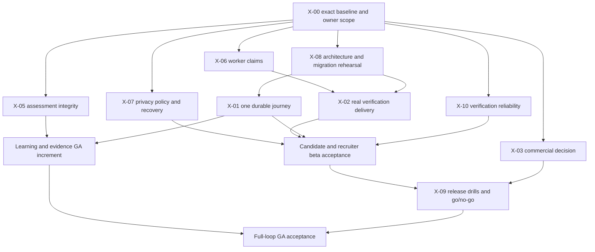

# Dependency-aware delivery roadmap — 2026-10-21

> Historical report: findings, counts and executed checks below belong to the recorded revision/session. Current source references and inspection limits are in [the implementation inventory](../system-model/01-inventory-and-coverage.md). No historical pass is a fresh release certification.

## G. Product backlog and proposed release scope

This is the planning companion to the [current audit](FEATURE_STATUS_2026-10-21.md). The existing portfolio plan is preserved below as history. The current sections supersede its blanket persistence rewrite, missing-email-adapter assumption, registry-derived P0 labels and permission to expose simulated scoring. No product implementation or remote issue edits were performed in this audit.

**Initiative:** deliver a reliable evidence-backed career loop. **Epics:** delivery safety (X-00/X-10), trust and identity (X-02/X-05/X-07), durable user journeys (X-01), commercial/governance decisions (X-03), production operations (X-06/X-08/X-09), and optional offline capability (X-04). Feature work packets retain canonical `F-` IDs as `BL-F-xx`; the evidence ledger is their shared status/evidence record, not a second backlog system.

The registry priority remains its numeric score. Delivery urgency is independently assigned: P0 prevents safe/reliable release, P1 completes a required journey, P2 improves secondary capabilities/quality, P3 can wait. A feature-level P1 does not override a P0 defect affecting it. Relative sizes below are **S/M/L uncertainty estimates**, not days or committed velocity. No staffing, dates, throughput or revenue assumptions were invented.

### Scope options and recommendation

| Option | Value | Tradeoff | Disposition |
|---|---|---|---|
| Restricted trusted-career beta | Test identity → profile/evidence → mailbox/reference proof → jobs/apply → recruiter review → outcome, with messaging/account controls | Learning/proof/career portions of full GA remain incomplete; must be labelled beta and explicitly approved | Recommended first; owner decision pending |
| Full PRD career-loop GA | Adds dependable learning, practice, portfolio, proof and career progression | Requires persistence and assessment trust work plus outcome acceptance; larger dependency chain | Follow beta; retain PRD §8 requirements |
| Broad portfolio launch | More surface area | 173-feature inventory is not a coherent first increment; magnifies durability/provider/governance risk | Not recommended; preserve deferred work |

The recommended beta includes the relevant subsets of F-01/02/03/04/05/06/10/12/14/15/17/20/21/24/25/32/35/52/56/60/84/94/96/162. Inclusion is a proposal, not approval of every subfeature under those IDs. F-07/08/26/85/91/95/106/122/145 support full-loop GA and need scoped contracts. Missing matching/goals/outcome subfeatures must be admitted explicitly rather than assumed from a nearby API. Other features retain individual scope dispositions in the ledger.

Preview-only existing networking, learning, assessment and career screens must not be silently deleted. If outside beta, decide whether to restrict access or clearly communicate durability/assessment limits, with an impact review and full-flow verification. A response header alone is insufficient user communication. F-38/39 remain deprecated and F-62/63 not recommended. Proctoring, premium-candidate policies and candidate-level predictive decisions retain their explicit gates.

### Deduplicated cross-cutting work

| ID | Epic/story/task and outcome | Feature IDs / registry scores | Delivery | Dependencies | Estimate / risk | Acceptance criteria | Tests/evidence | Sprint |
|---|---|---|---|---|---|---|---|---|
| X-00 | Establish exact-source baseline, reconcile atomic contracts, approve launch scope | All; scores preserved in matrix | P0 | Owner scope; authorized environment for emitting gates | M, high uncertainty; incomplete traceability | Given a chosen release, every included subfeature has role, boundary, rule, failure/recovery acceptance and evidence owner; current source/build SHA and baseline results are recorded; unreviewed rules remain unaccepted | Ledger completeness/link checks; root CI, isolated PG/browser once authorized | S0; ongoing before each slice |
| X-01 | Persist one selected user journey through existing storage boundary; no blanket migration | BL-F-07/09/26/32/36/84 and other admitted slices; scores per matrix | P1, P0 for an admitted durable promise | X-00; ADR/schema gate X-08 where affected | M per slice, L if combined; data loss/backfill risk | Given two users, when one creates/updates then API/worker restart, only authorized data returns; concurrent duplicates arbitrate; erasure removes it; UI makes remaining preview limits explicit | PG physical-row/restart/race/isolation/erasure; API negative cases; browser/Reticle verdict | S3 or S4, one vertical slice per sprint |
| X-02 | Deliver real verification through existing Resend adapter | F-94=7, F-162=5 | P0 | #44 provider/sender/cost approval, secrets, X-06; no new provider by assumption | M, external uncertainty; token leakage/delivery | Given approved staging sender, mailbox receives code/referee link; token is absent from requester/logs, expires and is single-use; retries preserve idempotency; failure generates monitored alert | Existing transactional-mail/email-delivery/authz tests plus live mailbox and PG queue drill | S2 |
| X-03 | Record commercial decision and enforce chosen scope | F-16=7, F-61=4 | P1 release decision | Owner #50; OD-34 if premium | S decision, paid integration separately L; entitlement/cost risk | Free-only: paid activation consistently unavailable in UI/API. Paid alternative: approved provider, durable replay-safe payment→entitlement→cancel/refund; no card storage invented | Billing negative/security tests; provider sandbox only after approval | S0 decision; paid work deferred unless approved |
| X-04 | Optional offline shell with truthful sensitive-data boundaries | Cross-cutting; no new F-ID | P2 | X-00 offline scope; explicit approval for required build config changes | M; stale/private cache risk | Network-off shell works; sensitive API decisions remain server-authoritative; logout clears applicable private cache; failed writes never falsely succeed | Real browser offline/reconnect/logout; cache inspection | Expansion, unless owner requires for GA |
| X-05 | Replace simulated challenge success with honest submission-only semantics or approved isolated execution | F-08=9; F-88=9 | P0 | Existing D-01 reproduction; #49 for scoring/provider design | S for fail-closed/submission-only, L executor; downstream clients/tests | Given arbitrary text/wrong solution, response never claims verified execution or a genuine pass; evidence remains pending/unverified; assessment policy stays enforced; retries do not mint duplicate evidence | Source/domain/API contract regressions; UI submission outcome; adversarial sandbox suite only if executor approved | S1 |
| X-06 | Bound job claims to actual execution capacity and fence stale acknowledgements | Supports F-94/14; no new feature | P0 | D-02; current JobStore interface; #47 operational coordination | M; retry/cancel/provider behavior | Given two workers and slow batch, expired owners cannot complete newer claims; unfinished jobs recover after crash; cancellation wins; mailbox idempotency preserved; heartbeat stays truthful | Scaled fake-clock unit regression, real PG two-worker/kill test, email retry/cancel tests | S1; deployed drill S5 |
| X-07 | Approve and implement recoverable erasure/privacy lifecycle | F-15=10; cross-cutting private data | P0 | #45 policy/legal/contact decisions; D-03; X-08 for schema | M/L per policy, high; irreversible deletion/shared records | Given failure after core deactivation, durable cleanup resumes without user login; status accurately records completion; request/cancel/due behavior matches approved policy; shared data/backups have explicit retention treatment | Failure injection at each store boundary, restart/idempotency/race tests, closed-session tests, browser request/cancel, restore/redaction drill | S2 policy + first coherent slice; completion before release |
| X-08 | Ratify ADR-015 and rehearse populated migration/hosted access | Core features; #46 | P0 before target upgrade | Owner approval, isolated snapshot, target role model | M, high data uncertainty; FK/unique/backfill | Migration ledger rejects drift; duplicate case-folded emails/active applications resolved by approved policy; target grants/RLS deny cross-account reads; rollback/restore path exercised | Existing migration guard + PG suite; read-only preflight; populated upgrade/recovery record | S0 preparation; S2 execution |
| X-09 | Prove operations and release acceptance | All in-scope; #47 | P0 release gate | X-02/07/08, authorized host/secrets, approved RPO/RTO and scope | L split by drill; outages/restore failure | One API writer enforced; HTTPS/proxy correct; worker-kill and queue-age alerts observed; backup restored independently; smoke passes restored app; measured load/cold boot accepted; rollback and go/no-go signed | Current-SHA CI, staging browser/API, live drills, latency/boot/memory evidence; no fictitious SLOs | Starts preparation S0, final S5 |
| X-10 | Make verification fail honestly and restore formatting gate | All; D-07/D-08 | P1 scan, P2 formatting | Scope pre-existing edits; do not touch protected formatter config | S; false-green tests or unrelated diff | Scanner detects synthetic secret and fails on scanner error on Windows/Linux; bounded formatting change passes intended checks; no weakening coverage | Focused scanner tests and read-only Prettier; exact diff review | S1 |

Scores in individual feature rows are authoritative if a cross-cutting example above differs; X-items have no independent registry score. Required protected build/release configuration changes are **proposals only** until the user explicitly authorizes those paths.

### X-11: course completion trust and recoverable issuance

- **Scope/priority:** F-07/F-52, P0 before assessed credentials are exposed; complements X-05 rather than replacing it.
- **Dependencies:** D-09/D-10, BR-048/BR-149, X-00 trust/assessment contract, X-01 selected learning persistence boundary. Owner review for consequential trust-policy changes.
- **Outcome:** lesson completion alone cannot produce an assessed, authority-verified credential where the contract requires a final score of at least 70%.
- **Acceptance:** absent/failed attempts cannot issue a credential; an eligible passing attempt issues once; repeated requests cannot duplicate evidence or XP; failure between completion and evidence/certificate writes is recoverable; restart preserves completion and public revocation/verification truth. Linked certificate and evidence proof URLs must agree with the approved revocation relationship, with append-only history and no accidental revocation of independent evidence.
- **Evidence:** negative and boundary-score API tests, per-boundary failure injection, concurrent retry tests, PostgreSQL restart/issuance checks, learner completion/public-verification browser flow. Existing passing LMS tests must be reconciled with BR-048, not treated as its proof.
- **Sprint:** S1 admission/trust gate alongside X-05; complete durable issuance in the admitted learning slice before full-loop GA. Size M/L depending on approved assessment boundary; not a committed date.

### Ready stories for the first engineering review

These are concrete proposed increments; implementation follows design/approval rules and must recheck the current source.

| Story | Included / excluded | Given / when / then | Implementation and verification sequence |
|---|---|---|---|
| X-05a: honest challenge submission | Include shared result contract, API consumers and tests; exclude building a sandbox | Given valid session and non-executable text, when submitted, then return submission-only/unverified outcome without claiming real score | Search every `SubmissionResult` caller → agree bounded contract → domain + API + UI together → negative/retry tests → browser outcome → update status. Preserve arbitrary-language validation and AI prohibition. |
| X-06a: safe claim capacity | Include runner/store claim ownership and cancellation semantics; exclude replacing queue | Given a batch slower than its lease with a second worker, when work is reclaimed, then the old owner cannot execute/acknowledge unowned work | Reproduce six-job case with clock control → smallest capacity/lease fix → claim-token fencing if needed → PG dual-worker and crash/cancel → live mail retry. A single batch-size change does not prove generic timeout cancellation. |
| X-07a: resumable cleanup | Include durable completion/retry of existing cleanup stages; exclude inventing retention policy | Given core erasure commits and next store fails, when recovery runs, then cleanup completes while account stays inaccessible and status remains accurate | Decide transaction vs persisted cleanup workflow within current architecture → fault injection → atomic or resumable implementation → restart and operator recovery → approved privacy copy. |
| BL-F-32a: saved-search alert completion | Reuse SQL search/bookmark stores; include alert state and chosen UI; exclude email digest until scheduled delivery approved | Given saved search, when eligible job publishes, then owner sees one durable alert after restart and another user cannot read it | Confirm scope → inspect publish/matching calls → scoped persistence → UI list/recovery → duplicate publish/restart/isolation/erasure → browser verdict. |
| BL-F-07a: durable lesson progression | Include one enrollment→lesson→progress path; exclude quiz engine, commerce and creator marketplace | Given enrolled learner, when sequential lesson completes and API restarts, then progress persists and unauthorized/out-of-order completion is denied | Reuse new CoursePage → persist exact entities → API/domain tests → PG constraints/races → browser reload plus independent process restart → status update. |

## H. Dependencies and execution order

This graph describes delivery dependencies, not new canonical feature dependencies. Legal/provider/architecture decisions can progress independently. Worker and assessment fixes are independent code paths, but both need the same exact-source baseline. Staging preparation can proceed while features develop; final release acceptance cannot precede privacy, proof delivery and recovery evidence. Do not make all features depend on a blanket X-01 rewrite.

Registry dependency cycles and non-runtime dependencies need interpretation, not automatic topological sorting: e.g. skills/learning/assessment mutual dependencies, and F-94 listing written recommendations F-58. Build the minimal contract already required by the current path, preserve the registry, and request approval for changes to canonical dependencies.

## I. Ordered sprint roadmap

These are **candidate sprint goals with no dates or velocity commitment**. At planning, select only work that fits measured team capacity. A row containing more than one coherent increment must be split before commitment; no unfinished UI/API handoff is carried as a supposedly completed sprint. External decisions are readiness gates, not assumed approvals.

| Release/stage | Sprint | Goal and starting baseline | Backlog IDs / urgency / order | Required dependencies | Demonstrable working increment | Exit criteria |
|---|---|---|---|---|---|---|
| A: delivery safety | S0 | Start at audited source with passing memory suite but red formatting and missing release evidence; select beta/GA contract | X-00 P0; prepare X-08/X-09; X-03 decision | Owner scope, permitted verification environment; actual capacity | Reproducible baseline and release-specific acceptance catalogue; current product unchanged | Exact SHA/build provenance; all admitted stories Ready; unexecuted gates named; no claim of release readiness |
| B: trust integrity | S1 | Preserve current application flows while removing false results and unsafe claims | X-05, X-06 P0; X-10 P1/P2. Split into separate sprints if capacity requires | S0; bounded contract review; no provider needed for unit reproductions | Honest challenge submission; recoverable worker queue with bounded claims; reliable verification checks | D-01/D-02 regressions fail before fix and pass after; PG fencing proof; affected browser verdict; no trust downgrade |
| B: verification and privacy | S2 | Start with safe worker and approved core write model; finish a real proof/recovery slice | X-08 → X-02; X-07 separate coherent slice P0 | Approved sender, legal lifecycle, isolated DB; blockers stay open until supplied | Candidate receives proof email, referee responds, persisted result survives restart; approved erasure flow demonstrably recovers | Live inbox/replay/expiry, PG restart/race, erasure failure drill, monitored failure; product owner accepts trust semantics |
| C: restricted beta loop | S3 | Start with durable core and delivered verification; close admitted application/recruiter gaps | Selected BL-F-04/05/06/10/14/17/24/32/94/96/162; X-01 per needed slice | S2 + beta scope; no blanket feature completion | Candidate applies with evidence; authorized recruiter reviews/transitions; candidate sees outcome; account controls work | Fresh-browser and PG restart journey, duplicate/retry/expired-session/tenant cases, moderation recovery; all beta inclusions accepted |
| D: full career loop | S4.n | Start from verified beta; add one complete learning/proof/career increment per sprint | BL-F-07a then approved BL-F-08/26/84/85/91/95/106/122/145 slices; P1 | X-05; scope + schema/provider decisions; each preceding slice passes | First durable lesson progress; later approved proof/portfolio and goal/gap/outcome progression | Each slice survives restart, satisfies its bounded user story, has PG/browser/security evidence. No simulated proficiency accepted |
| E: operational release | S5 | Start from selected beta or GA candidate; prove operation under failure | X-09 P0; unresolved X-07/08 gates prevent entry | All selected acceptance, approved commercial/privacy policy, authorized staging | Restore and roll back a working candidate/recruiter product; detect worker failure | Current-SHA CI/build/browser; hosted RLS; backup/restore/rollback; HTTPS; accessibility/manual gaps closed; load/boot data accepted; signed release |
| F: expansion | S6.n | Start from accepted released product and measured usage | Individually admitted deferred BL-F work packets; usually P2/P3 | Contracts, governance, providers, capacity and measured value | One useful standalone extension per sprint | Same Definition of Done; pricing/AI/predictive decisions never inferred |

### Sprint risk, isolation and rollback contract

| Sprint | Regression protection | Isolation / rollback | Known deferrals |
|---|---|---|---|
| S0 | Preserve source hashes, existing staged work, no emitting commands without authorization | Documentation-only diff; historical records retained | Product fixes and environment evidence |
| S1 | Assessment evidence/AI-policy tests; worker cancel/retry/DLQ; API callers; scanner failure cases | Keep old API contract until coordinated consumer migration; stop scored path if unsafe. Rollback must not restore fake trust or unsafe worker scale | Real sandbox/provider choices |
| S2 | Token privacy/replay, queue idempotency, cross-store erasure, closed sessions | Fail closed on mail outage; backups and reversible migration rehearsal. Erased data is not restored to users as an app rollback | Unapproved shared-data retention/paid policies |
| S3 | Complete candidate/recruiter pair, unauthorized actor, duplicate application, messaging/privacy, restart | Restrict incomplete preview modules through approved scope; additive data migration with tested rollback/restore | Full GA learning/career breadth |
| S4.n | Focused slice plus previously accepted core loop | One module at a time; preserve old data and contract until verified replacement | Quiz/commerce/social/enterprise features unless separately admitted |
| S5 | Smoke on restored deployment plus operational alerts, secrets/proxy checks | Tested image rollback with schema compatibility; restore procedure owned and timed | No claim of capacity beyond measured load |
| S6.n | Existing accepted journeys remain regression gates | Feature-specific rollback and data-retention plan | Unselected portfolio remains explicitly unscheduled |

## J. Always-working quality strategy

**Definition of Ready:** approved user outcome and included/excluded subfeatures; accountable role; exact API/domain/storage boundary; prerequisite decisions; observable positive/denied/recovery criteria; migration/rollback impact; estimate with uncertainty; available verification environment. A row saying "API exists, add UI" is not automatically Ready.

**Definition of Done:** all agreed acceptance passes across affected layers; authoritative authorization/privacy and evidence rules preserved; required PG durability/race/erasure checks; browser journey and Reticle verdict when available for visible changes; loading/empty/error/retry behavior; no regression in selected core flows; lint/types/build and CI gates pass in an authorized environment; docs/status updated with command/SHA/date; applicable operations and rollback evidence; no unresolved critical defect. `unknown`, `no-fault`, a test title or code presence is not a pass.

Use the repository loop: understand → search callers/contracts/tests → plan bounded increment → modify shared root cause → focused tests → real flow verification → appropriate regression → review → documentation → report. Finish and verify each feature before starting a dependent one. A failing integration stops dependent work. Do not weaken or delete checks to make the dashboard green.

| Gate | Existing mechanism | Required improvement / limit |
|---|---|---|
| Static/format/types | Prettier check, project references; non-emitting local substitutes available | Resolve baseline formatting; no evidence for replacing tooling. Protected configs remain read-only. |
| Domain/API/security | Vitest; production config and authorization regressions | Add D-01/D-02/D-03 cases, portable fail-closed scanner. Whole-suite green does not prove omitted requirements. |
| Database | CI PostgreSQL service, migrations twice, ledger guard, schema preflight, PG tests | Keep these; add populated upgrade/rollback and hosted role evidence. Synthetic clean schema is insufficient. |
| Browser/accessibility/performance | Playwright starts built API/web; accessibility/performance suites | Require source-matched build and affected journeys. Manual contrast/screen reader and measured SLO acceptance remain outstanding. |
| Client secrets | CI sentinel build and scan; source check | Keep sentinel gate; correct Windows source-scanner false-green. No real secrets in test artifacts. |
| Operations | Writer lock, worker heartbeat, read-only preflight, backup/restore scripts | Execute drills and monitor externally; fix lease/fencing before assuming multi-worker safety. |
| Release | Existing CI + documented release checklist | Attach exact-SHA acceptance and owner decision; no new CI configuration proposed without a demonstrated missing gate and explicit build-file authorization. |

## K. Documentation reconciliation and authority

| Artifact | Correction made or required | Authority / history handling |
|---|---|---|
| FEATURE_STATUS_2026-10-21.md | Current baseline, corrected maturity, 173-row matrix, traces, discrepancies, defect/decision register | Earlier static assessment retained verbatim as history |
| FEATURE_PLAN_2026-10-21.md | Separate priorities, scoped persistence, provider reuse, backlog/sprints/gates | Historical feature requirements retained as inputs; unsafe acceptance superseded |
| AUDIT_EVIDENCE_2026-10-21.json | Source hashes, all feature/rule/journey references, routes/migrations, test results, remote state | Supporting evidence for these two existing records; not a new source of product authority |
| docs/INDEX.md; governance/IMPLEMENTATION_PLAN.md | Point to current audit and release sequence | Preserve canonical long-term phases |
| BRAIN/MEMORY.md | Append current measured results and moving-HEAD caveat | Do not erase earlier learning or promote old counts |
| Root ARCHITECTURE.md | Add current factual erratum for Resend, SQL stores, writer lease/heartbeat | Historical sections remain; no architectural decision changed |
| SSOT / feature registry / ADR-015 | Remove stale implementation counts from SSOT header; do not rewrite policy or approval status | Owner must approve scope/architecture/semantics; portfolio IDs preserved |
| APP_FLOW / testing / operations / security | Correct routes, current test scope, mail/worker/privacy claims and target-versus-runtime boundaries | Policies unchanged; historical results distinguished from current evidence |

System Design and Business Review template exports are **blocked**: the requested skills require compatible reference-preserving document/presentation creation and rendering. No connected document session or compatible slide-rendering capability was available. Their reference DOCX/PPTX files were not modified or approximated with generic exports. Markdown audit content is complete to the stated inspection boundary; template artifacts are not delivered.

### Subsequent document reconciliation

Current README, architecture, operations, security, testing, API/database contracts,
journey/rule pointers and conflict register now use the current evidence boundary.
Earlier reports retain their recorded results with historical labels. The maintenance
manual/report/plan now flag their two absent script deliverables; no script was
restored. All tracked Markdown files have an explicit disposition in the evidence
ledger. Protected `deploy/**` documentation remains read-only under AGENTS.md.
Local file links were checked; this does not prove semantic completeness or runtime
acceptance. X-00 retains feature/rule reconciliation, and X-09 retains live gates.

## L. Immediate execution and decisions

1. Review D-01/D-02/D-03 and the proposed beta subset. Keep the current code unchanged until each fix has a bounded reviewed contract; the audit itself grants no new architecture/pricing authority.
2. X-00: reconcile admitted feature contracts and 248-rule ownership/acceptance gaps. Confirm which current uncommitted or newly committed source is the execution baseline. Attach current CI/PG/browser evidence in a permitted environment; explicitly authorize any required protected paths before an emitting build.
3. X-05 and X-06 can start independent engineering design/reproduction now. X-10 scanner repair is also independent. The audit supplies concrete failing situations; do not rebuild the existing mail adapter or persistence stores.
4. Ask the owner for #44 sender/provider approval, #45 retention/deletion/legal contacts, #46 ratification/target snapshot, #49 trust/session/executor decisions and #50 free-only/paid choice. These are necessary decisions; no elapsed time or unanswered question constitutes approval.
5. Once prerequisites exist, complete the live proof and erasure-recovery increments, then one admitted durable UI journey. Reuse the current storage/API/domain boundaries.
6. Run operational release drills before public exposure. Expansion is intentionally unscheduled until capacity and value are known.

**Current final status:** documentation/evidence audit delivered with explicit incomplete inspection and verification fields. Product behavior unchanged. No migration, provider setup, deployment, issue closure or complete production-readiness certification performed. Full atomic requirements review, live journey acceptance and template exports remain outstanding.

## Feature-level backlog coverage

These 169 feature work packets preserve the existing plan and expose exclusions; they are not 169 sprint-ready stories. Each inherits its current status, evidence, layer gaps and next action from the same feature ID in the status/evidence ledger. X-00 must reconcile detailed contracts and decompose oversized items before scheduling. Historical acceptance below is a candidate, never authority to enable simulated scoring, paid billing, proctoring or predictive hiring. F-38/F-39 remain deprecated; F-62/F-63 remain not recommended.

| ID | Epic/story/task | Feature IDs | Registry / delivery priority | Dependencies | Estimate | Candidate acceptance criteria | Tests | Sprint/release |
|---|---|---|---|---|---|---|---|---|
| BL-F-01 | Identity / Authentication & Session | F-01 | 10 / P1 | –; X-00 scope/contract review; applicable release gates | Unestimated; decompose after contract/trace review | Given an authorized actor and approved contract, when the complete journey and its denied/recovery cases run, then outcomes match the contract and survive required restarts. | 4 candidate test files; add full acceptance, authorization, PG restart and browser checks as applicable | Proposed beta; not a sprint commitment |
| BL-F-02 | Shell / Landing Page | F-02 | 3 / P1 | –; X-00 scope/contract review; applicable release gates | Unestimated; decompose after contract/trace review | Given an authorized actor and approved contract, when the complete journey and its denied/recovery cases run, then outcomes match the contract and survive required restarts. | 1 candidate test files; add full acceptance, authorization, PG restart and browser checks as applicable | Proposed beta; not a sprint commitment |
| BL-F-03 | Shell / Dashboard (Role-Adaptive) | F-03 | 10 / P1 | F-01; X-00 scope/contract review; applicable release gates | Unestimated; decompose after contract/trace review | Given an authorized actor and approved contract, when the complete journey and its denied/recovery cases run, then outcomes match the contract and survive required restarts. | 1 candidate test files; add full acceptance, authorization, PG restart and browser checks as applicable | Proposed beta; not a sprint commitment |
| BL-F-04 | Marketplace / Job Marketplace | F-04 | 9 / P1 | F-01, F-12; X-00 scope/contract review; applicable release gates | Unestimated; decompose after contract/trace review | Given an authorized actor and approved contract, when the complete journey and its denied/recovery cases run, then outcomes match the contract and survive required restarts. | 8 candidate test files; add full acceptance, authorization, PG restart and browser checks as applicable | Proposed beta; not a sprint commitment |
| BL-F-05 | Marketplace / Post Job Studio | F-05 | 8 / P1 | F-04; X-00 scope/contract review; applicable release gates | Unestimated; decompose after contract/trace review | Given an authorized actor and approved contract, when the complete journey and its denied/recovery cases run, then outcomes match the contract and survive required restarts. | 6 candidate test files; add full acceptance, authorization, PG restart and browser checks as applicable | Proposed beta; not a sprint commitment |
| BL-F-06 | Recruiting / ATS / Candidate Pipeline | F-06 | 9 / P1 | F-04, F-05; X-00 scope/contract review; applicable release gates | Unestimated; decompose after contract/trace review | Given an authorized actor and approved contract, when the complete journey and its denied/recovery cases run, then outcomes match the contract and survive required restarts. | 3 candidate test files; add full acceptance, authorization, PG restart and browser checks as applicable | Proposed beta; not a sprint commitment |
| BL-F-07 | Learning / Learning Management System | F-07 | 9 / P1 | F-01, F-12; X-00 scope/contract review; applicable release gates | Unestimated; decompose after contract/trace review | A learner completes a lesson in the UI and the progress bar and server agree after a reload. | 5 candidate test files; add full acceptance, authorization, PG restart and browser checks as applicable | Proposed GA; not a sprint commitment |
| BL-F-08 | Assessment / Challenges Arena | F-08 | 9 / P0 | F-01, F-12; X-00 scope/contract review; applicable release gates | Unestimated; decompose after contract/trace review | A candidate starts a challenge, submits code and sees a stored score. | 4 candidate test files; add full acceptance, authorization, PG restart and browser checks as applicable | Proposed GA; not a sprint commitment |
| BL-F-09 | Social / Professional Networking | F-09 | 8 / P2 | F-12; X-00 scope/contract review; applicable release gates | Unestimated; decompose after contract/trace review | Given an authorized actor and approved contract, when the complete journey and its denied/recovery cases run, then outcomes match the contract and survive required restarts. | 8 candidate test files; add full acceptance, authorization, PG restart and browser checks as applicable | Expansion; unscheduled; not a sprint commitment |
| BL-F-10 | Communication / Direct Messaging | F-10 | 10 / P1 | F-01; X-00 scope/contract review; applicable release gates | Unestimated; decompose after contract/trace review | Given an authorized actor and approved contract, when the complete journey and its denied/recovery cases run, then outcomes match the contract and survive required restarts. | 7 candidate test files; add full acceptance, authorization, PG restart and browser checks as applicable | Proposed beta; not a sprint commitment |
| BL-F-11 | AI / AI Career Assistant (Basic) | F-11 | 8 / P2 | F-12; X-00 scope/contract review; applicable release gates | Unestimated; decompose after contract/trace review | A candidate asks a question, gets an answer, and sees usage go up. | 2 candidate test files; add full acceptance, authorization, PG restart and browser checks as applicable | Decision gate; not a sprint commitment |
| BL-F-12 | Identity / Profile Management | F-12 | 10 / P1 | F-01; X-00 scope/contract review; applicable release gates | Unestimated; decompose after contract/trace review | Given an authorized actor and approved contract, when the complete journey and its denied/recovery cases run, then outcomes match the contract and survive required restarts. | 6 candidate test files; add full acceptance, authorization, PG restart and browser checks as applicable | Proposed beta; not a sprint commitment |
| BL-F-13 | Identity / Resume Builder | F-13 | 7 / P2 | F-12; X-00 scope/contract review; applicable release gates | Unestimated; decompose after contract/trace review | A candidate edits a resume section, exports it, and the export contains the edit. | 5 candidate test files; add full acceptance, authorization, PG restart and browser checks as applicable | Expansion; unscheduled; not a sprint commitment |
| BL-F-14 | Communication / Notification Center | F-14 | 10 / P1 | F-01; X-00 scope/contract review; applicable release gates | Unestimated; decompose after contract/trace review | Given an authorized actor and approved contract, when the complete journey and its denied/recovery cases run, then outcomes match the contract and survive required restarts. | 5 candidate test files; add full acceptance, authorization, PG restart and browser checks as applicable | Proposed beta; not a sprint commitment |
| BL-F-15 | Shell / Settings | F-15 | 10 / P0 | F-01; X-00 scope/contract review; applicable release gates | Unestimated; decompose after contract/trace review | Given an authorized actor and approved contract, when the complete journey and its denied/recovery cases run, then outcomes match the contract and survive required restarts. | 7 candidate test files; add full acceptance, authorization, PG restart and browser checks as applicable | Proposed beta; not a sprint commitment |
| BL-F-16 | Monetization / Billing & Subscriptions | F-16 | 7 / P2 | F-01; X-00 scope/contract review; applicable release gates | Unestimated; decompose after contract/trace review | A user subscribes in simulated mode, sees the plan change, and sees an invoice. | 5 candidate test files; add full acceptance, authorization, PG restart and browser checks as applicable | Decision gate; not a sprint commitment |
| BL-F-17 | Governance / Admin Console | F-17 | 10 / P1 | F-01; X-00 scope/contract review; applicable release gates | Unestimated; decompose after contract/trace review | An admin suspends a test user, the user is blocked, and the audit log shows the action. | 5 candidate test files; add full acceptance, authorization, PG restart and browser checks as applicable | Proposed beta; not a sprint commitment |
| BL-F-18 | Edge / Chrome Extension Companion | F-18 | 5 / P3 | F-01; X-00 scope/contract review; applicable release gates | Unestimated; decompose after contract/trace review | Installed extension shows the user's name after sign-in and can open the dashboard. | 1 candidate test files; add full acceptance, authorization, PG restart and browser checks as applicable | Expansion; unscheduled; not a sprint commitment |
| BL-F-19 | Telemetry / Product Analytics | F-19 | 7 / P2 | F-01; X-00 scope/contract review; applicable release gates | Unestimated; decompose after contract/trace review | After applying to a job, the KPI screen counts one more application. | 3 candidate test files; add full acceptance, authorization, PG restart and browser checks as applicable | Expansion; unscheduled; not a sprint commitment |
| BL-F-20 | Shell / Command Search (⌘K) | F-20 | 7 / P1 | F-01; X-00 scope/contract review; applicable release gates | Unestimated; decompose after contract/trace review | Given an authorized actor and approved contract, when the complete journey and its denied/recovery cases run, then outcomes match the contract and survive required restarts. | 5 candidate test files; add full acceptance, authorization, PG restart and browser checks as applicable | Proposed beta; not a sprint commitment |
| BL-F-21 | Shell / Error Recovery & Resilience | F-21 | 10 / P1 | F-01; X-00 scope/contract review; applicable release gates | Unestimated; decompose after contract/trace review | Turning the API off shows a retry message on each page, and retry works when it comes back. | 0 candidate test files; add full acceptance, authorization, PG restart and browser checks as applicable | Proposed beta; not a sprint commitment |
| BL-F-22 | Engagement / Gamification & XP Ledger | F-22 | 8 / P2 | F-07, F-08; X-00 scope/contract review; applicable release gates | Unestimated; decompose after contract/trace review | Completing a tracked action raises the XP shown on the dashboard. | 4 candidate test files; add full acceptance, authorization, PG restart and browser checks as applicable | Expansion; unscheduled; not a sprint commitment |
| BL-F-23 | Engagement / Leaderboard & Badges | F-23 | 7 / P2 | F-22; X-00 scope/contract review; applicable release gates | Unestimated; decompose after contract/trace review | A user with XP appears on the leaderboard and sees their badges. | 4 candidate test files; add full acceptance, authorization, PG restart and browser checks as applicable | Expansion; unscheduled; not a sprint commitment |
| BL-F-24 | Safety / Trust, Safety & Moderation | F-24 | 8 / P1 | F-01; X-00 scope/contract review; applicable release gates | Unestimated; decompose after contract/trace review | A report filed in the UI appears in the admin queue and can be resolved. | 3 candidate test files; add full acceptance, authorization, PG restart and browser checks as applicable | Proposed beta; not a sprint commitment |
| BL-F-25 | Marketplace / Job Detail View | F-25 | 7 / P1 | F-04; X-00 scope/contract review; applicable release gates | Unestimated; decompose after contract/trace review | Given an authorized actor and approved contract, when the complete journey and its denied/recovery cases run, then outcomes match the contract and survive required restarts. | 6 candidate test files; add full acceptance, authorization, PG restart and browser checks as applicable | Proposed beta; not a sprint commitment |
| BL-F-26 | Identity / Portfolio Showcase | F-26 | 8 / P1 | F-12; X-00 scope/contract review; applicable release gates | Unestimated; decompose after contract/trace review | Given an authorized actor and approved contract, when the complete journey and its denied/recovery cases run, then outcomes match the contract and survive required restarts. | 4 candidate test files; add full acceptance, authorization, PG restart and browser checks as applicable | Proposed GA; not a sprint commitment |
| BL-F-27 | Edge / Local Resume Match Preview | F-27 | 6 / P3 | F-18; X-00 scope/contract review; applicable release gates | Unestimated; decompose after contract/trace review | On a job page, the extension shows a match score and the matching skills. | 0 candidate test files; add full acceptance, authorization, PG restart and browser checks as applicable | Expansion; unscheduled; not a sprint commitment |
| BL-F-28 | Edge / External Job Page Scanner | F-28 | 6 / P3 | F-18; X-00 scope/contract review; applicable release gates | Unestimated; decompose after contract/trace review | On a job posting page, the extension shows a "save to TalentSphere" button that creates a saved job. | 0 candidate test files; add full acceptance, authorization, PG restart and browser checks as applicable | Expansion; unscheduled; not a sprint commitment |
| BL-F-29 | Communication / Scheduled Notification Digest | F-29 | 7 / P2 | F-14; X-00 scope/contract review; applicable release gates | Unestimated; decompose after contract/trace review | A test user receives one digest email at the chosen frequency. | 4 candidate test files; add full acceptance, authorization, PG restart and browser checks as applicable | Expansion; unscheduled; not a sprint commitment |
| BL-F-30 | Engagement / Networking Stale-Request Nudges | F-30 | 6 / P3 | F-09; X-00 scope/contract review; applicable release gates | Unestimated; decompose after contract/trace review | A request left pending for the set time creates one nudge notification. | 1 candidate test files; add full acceptance, authorization, PG restart and browser checks as applicable | Expansion; unscheduled; not a sprint commitment |
| BL-F-31 | Analytics / KPI Aggregation & Rollups | F-31 | 6 / P3 | F-19; X-00 scope/contract review; applicable release gates | Unestimated; decompose after contract/trace review | The KPI screen shows yesterday's counts, equal to a manual count of the events. | 3 candidate test files; add full acceptance, authorization, PG restart and browser checks as applicable | Expansion; unscheduled; not a sprint commitment |
| BL-F-32 | Candidate / Saved Searches & Job Alerts | F-32 | 7 / P1 | F-04; X-00 scope/contract review; applicable release gates | Unestimated; decompose after contract/trace review | A candidate saves a search, a matching job is published, and an alert appears. | 7 candidate test files; add full acceptance, authorization, PG restart and browser checks as applicable | Proposed beta; not a sprint commitment |
| BL-F-33 | Communication / Video Interview Rooms | F-33 | 8 / P2 | F-10; X-00 scope/contract review; applicable release gates | Unestimated; decompose after contract/trace review | Both parties join a test session and the consent is recorded. | 3 candidate test files; add full acceptance, authorization, PG restart and browser checks as applicable | Decision gate; not a sprint commitment |
| BL-F-34 | Platform / Multi-Entity Backend Search | F-34 | 7 / P2 | F-04, F-07; X-00 scope/contract review; applicable release gates | Unestimated; decompose after contract/trace review | Typing a job title in the palette shows matching jobs. | 4 candidate test files; add full acceptance, authorization, PG restart and browser checks as applicable | Expansion; unscheduled; not a sprint commitment |
| BL-F-35 | Administration / Feature Flag Console | F-35 | 6 / P1 | F-17; X-00 scope/contract review; applicable release gates | Unestimated; decompose after contract/trace review | An admin turns a flag on, the flag changes for the next request, and the audit log records it. | 6 candidate test files; add full acceptance, authorization, PG restart and browser checks as applicable | Proposed beta; not a sprint commitment |
| BL-F-36 | Candidate / Application Draft Autosave | F-36 | 7 / P2 | F-04; X-00 scope/contract review; applicable release gates | Unestimated; decompose after contract/trace review | A candidate types a note, reloads, and the note is still there. | 3 candidate test files; add full acceptance, authorization, PG restart and browser checks as applicable | Expansion; unscheduled; not a sprint commitment |
| BL-F-37 | Recruiting / Job Templates | F-37 | 6 / P3 | F-05; X-00 scope/contract review; applicable release gates | Unestimated; decompose after contract/trace review | A recruiter creates a job from a saved template. | 3 candidate test files; add full acceptance, authorization, PG restart and browser checks as applicable | Expansion; unscheduled; not a sprint commitment |
| BL-F-40 | Institutions / Institutional Managed Learning | F-40 | 8 / P2 | F-01, F-07; X-00 scope/contract review; applicable release gates | Unestimated; decompose after contract/trace review | An institution admin enrols two members in a course and both see it. | 3 candidate test files; add full acceptance, authorization, PG restart and browser checks as applicable | Expansion; unscheduled; not a sprint commitment |
| BL-F-41 | Institutions / Procurement & Seat Licensing | F-41 | 6 / P3 | F-40, F-16; X-00 scope/contract review; applicable release gates | Unestimated; decompose after contract/trace review | An institution with 10 seats can assign 10 members and not an eleventh. | 0 candidate test files; add full acceptance, authorization, PG restart and browser checks as applicable | Expansion; unscheduled; not a sprint commitment |
| BL-F-42 | Platform / Provider-Agnostic Media Engine | F-42 | 8 / P2 | F-07; X-00 scope/contract review; applicable release gates | Unestimated; decompose after contract/trace review | A course video uploads, plays back, and is stored outside the API process. | 0 candidate test files; add full acceptance, authorization, PG restart and browser checks as applicable | Expansion; unscheduled; not a sprint commitment |
| BL-F-43 | Institutions / B2B2C Graduation Flywheel | F-43 | 6 / P3 | F-40; X-00 scope/contract review; applicable release gates | Unestimated; decompose after contract/trace review | A learner who finishes a course sees a single invitation to create a profile. | 0 candidate test files; add full acceptance, authorization, PG restart and browser checks as applicable | Expansion; unscheduled; not a sprint commitment |
| BL-F-44 | Learning / AI Media Enrichment | F-44 | 6 / P3 | F-42, F-11; X-00 scope/contract review; applicable release gates | Unestimated; decompose after contract/trace review | An uploaded course video gets a caption file and a summary a learner can read. | 0 candidate test files; add full acceptance, authorization, PG restart and browser checks as applicable | Expansion; unscheduled; not a sprint commitment |
| BL-F-45 | Learning / Proctoring (Third-Party, vendor-gated OD-35) | F-45 | 4 / P2 | F-40, F-115; X-00 scope/contract review; applicable release gates | Unestimated; decompose after contract/trace review | Owner picks a vendor; a test session records a proctoring session ID returned by the vendor. | 3 candidate test files; add full acceptance, authorization, PG restart and browser checks as applicable | Decision gate; not a sprint commitment |
| BL-F-46 | Institutions / Institutional Analytics | F-46 | 6 / P3 | F-40; X-00 scope/contract review; applicable release gates | Unestimated; decompose after contract/trace review | An institution admin sees completion rate for one course, matching the database. | 0 candidate test files; add full acceptance, authorization, PG restart and browser checks as applicable | Expansion; unscheduled; not a sprint commitment |
| BL-F-47 | Institutions / Faculty Dashboard | F-47 | 6 / P3 | F-40; X-00 scope/contract review; applicable release gates | Unestimated; decompose after contract/trace review | A faculty user sees their course list with student counts. | 0 candidate test files; add full acceptance, authorization, PG restart and browser checks as applicable | Expansion; unscheduled; not a sprint commitment |
| BL-F-48 | OS / OS Shell & Workbench | F-48 | 4 / P3 | F-01, F-03; X-00 scope/contract review; applicable release gates | Unestimated; decompose after contract/trace review | A user saves a two-panel layout and sees it again after sign-in. | 0 candidate test files; add full acceptance, authorization, PG restart and browser checks as applicable | Expansion; unscheduled; not a sprint commitment |
| BL-F-49 | OS / Automation & Agents | F-49 | 4 / P3 | F-48; X-00 scope/contract review; applicable release gates | Unestimated; decompose after contract/trace review | A user schedules a weekly saved search and gets a summary; nothing is sent without approval. | 0 candidate test files; add full acceptance, authorization, PG restart and browser checks as applicable | Expansion; unscheduled; not a sprint commitment |
| BL-F-50 | Institutions / Institutional Course Marketplace | F-50 | 6 / P3 | F-40, F-42; X-00 scope/contract review; applicable release gates | Unestimated; decompose after contract/trace review | An institution lists a course, another institution buys seats for it. | 0 candidate test files; add full acceptance, authorization, PG restart and browser checks as applicable | Expansion; unscheduled; not a sprint commitment |
| BL-F-51 | Platform / Media Health Monitoring | F-51 | 6 / P3 | F-42; X-00 scope/contract review; applicable release gates | Unestimated; decompose after contract/trace review | A broken video creates an alert for the course owner within one hour. | 0 candidate test files; add full acceptance, authorization, PG restart and browser checks as applicable | Expansion; unscheduled; not a sprint commitment |
| BL-F-52 | Verification / Certificate Verification | F-52 | 8 / P1 | F-07; X-00 scope/contract review; applicable release gates | Unestimated; decompose after contract/trace review | Opening a valid certificate link shows "valid" without signing in. | 6 candidate test files; add full acceptance, authorization, PG restart and browser checks as applicable | Proposed beta; not a sprint commitment |
| BL-F-53 | Networking / Professional Social Graph & Feed | F-53 | 5 / P3 | F-12; X-00 scope/contract review; applicable release gates | Unestimated; decompose after contract/trace review | A user posts a text update and their connections see it in the feed. | 0 candidate test files; add full acceptance, authorization, PG restart and browser checks as applicable | Expansion; unscheduled; not a sprint commitment |
| BL-F-54 | Networking / Content Publishing | F-54 | 5 / P3 | F-12; X-00 scope/contract review; applicable release gates | Unestimated; decompose after contract/trace review | A member publishes a post and it appears on their profile and in connections' feeds. | 0 candidate test files; add full acceptance, authorization, PG restart and browser checks as applicable | Expansion; unscheduled; not a sprint commitment |
| BL-F-55 | Community / Groups & Communities | F-55 | 5 / P3 | F-53; X-00 scope/contract review; applicable release gates | Unestimated; decompose after contract/trace review | A user joins a group and sees its members and a message thread. | 3 candidate test files; add full acceptance, authorization, PG restart and browser checks as applicable | Expansion; unscheduled; not a sprint commitment |
| BL-F-56 | Recruiting / Organization & Institution Pages | F-56 | 5 / P1 | F-12, F-40; X-00 scope/contract review; applicable release gates | Unestimated; decompose after contract/trace review | Opening /organizations/:id without signing in shows the company's open jobs. | 3 candidate test files; add full acceptance, authorization, PG restart and browser checks as applicable | Proposed beta; not a sprint commitment |
| BL-F-57 | Community / Events & Webinars | F-57 | 5 / P3 | F-53; X-00 scope/contract review; applicable release gates | Unestimated; decompose after contract/trace review | A user signs up for an event and gets a reminder notification. | 0 candidate test files; add full acceptance, authorization, PG restart and browser checks as applicable | Expansion; unscheduled; not a sprint commitment |
| BL-F-58 | Networking / Written Recommendations | F-58 | 6 / P3 | F-53; X-00 scope/contract review; applicable release gates | Unestimated; decompose after contract/trace review | A colleague writes a recommendation and it shows on the candidate's profile after they accept it. | 0 candidate test files; add full acceptance, authorization, PG restart and browser checks as applicable | Expansion; unscheduled; not a sprint commitment |
| BL-F-59 | Recruiting / Outreach Credits (TalentMail) | F-59 | 5 / P3 | F-10; X-00 scope/contract review; applicable release gates | Unestimated; decompose after contract/trace review | A recruiter with zero credits cannot send outreach; after a top-up, one message uses one credit. | 0 candidate test files; add full acceptance, authorization, PG restart and browser checks as applicable | Expansion; unscheduled; not a sprint commitment |
| BL-F-60 | Networking / Profile Views & Privacy Controls | F-60 | 6 / P1 | F-12; X-00 scope/contract review; applicable release gates | Unestimated; decompose after contract/trace review | A visitor views a profile, and the owner sees one more view. | 0 candidate test files; add full acceptance, authorization, PG restart and browser checks as applicable | Proposed beta; not a sprint commitment |
| BL-F-61 | Business / Premium Candidate Tier (OD-34 gated) | F-61 | 4 / P2 | F-60; X-00 scope/contract review; applicable release gates | Unestimated; decompose after contract/trace review | A free user is blocked from the gated feature with an upgrade message; a paid test user is not. | 2 candidate test files; add full acceptance, authorization, PG restart and browser checks as applicable | Decision gate; not a sprint commitment |
| BL-F-64 | Integration / LinkedIn Migration Engine | F-64 | 5 / P3 | F-12; X-00 scope/contract review; applicable release gates | Unestimated; decompose after contract/trace review | Uploading a LinkedIn export creates the work history entries in the profile. | 0 candidate test files; add full acceptance, authorization, PG restart and browser checks as applicable | Expansion; unscheduled; not a sprint commitment |
| BL-F-65 | Foundation / LinkedIn Decoupling & Independence | F-65 | 8 / P2 | F-64; X-00 scope/contract review; applicable release gates | Unestimated; decompose after contract/trace review | A user with an imported profile signs in without LinkedIn and sees the same data. | 0 candidate test files; add full acceptance, authorization, PG restart and browser checks as applicable | Expansion; unscheduled; not a sprint commitment |
| BL-F-66 | Learning / Course Creation Studio | F-66 | 8 / P2 | F-07, F-42; X-00 scope/contract review; applicable release gates | Unestimated; decompose after contract/trace review | An instructor creates a course with two lessons in the UI and publishes it. | 2 candidate test files; add full acceptance, authorization, PG restart and browser checks as applicable | Expansion; unscheduled; not a sprint commitment |
| BL-F-67 | Learning / Categories, Discovery & Comparison | F-67 | 6 / P3 | F-07, F-145; X-00 scope/contract review; applicable release gates | Unestimated; decompose after contract/trace review | A learner filters by category and compares two courses. | 2 candidate test files; add full acceptance, authorization, PG restart and browser checks as applicable | Expansion; unscheduled; not a sprint commitment |
| BL-F-68 | Learning / Quizzes, Practice Tests & Final Exams | F-68 | 8 / P2 | F-07; X-00 scope/contract review; applicable release gates | Unestimated; decompose after contract/trace review | A learner answers a quiz and sees a stored score. | 2 candidate test files; add full acceptance, authorization, PG restart and browser checks as applicable | Expansion; unscheduled; not a sprint commitment |
| BL-F-69 | Learning / Assignments & Peer Review | F-69 | 8 / P2 | F-07; X-00 scope/contract review; applicable release gates | Unestimated; decompose after contract/trace review | A learner submits an assignment and receives two peer reviews. | 0 candidate test files; add full acceptance, authorization, PG restart and browser checks as applicable | Expansion; unscheduled; not a sprint commitment |
| BL-F-70 | Learning / Learning Paths, Programs & Specializations | F-70 | 8 / P2 | F-07, F-66; X-00 scope/contract review; applicable release gates | Unestimated; decompose after contract/trace review | A learner enrols in a path of three courses and sees progress across all three. | 0 candidate test files; add full acceptance, authorization, PG restart and browser checks as applicable | Expansion; unscheduled; not a sprint commitment |
| BL-F-71 | Learning / Course Q&A, Discussions, Notes | F-71 | 6 / P3 | F-07; X-00 scope/contract review; applicable release gates | Unestimated; decompose after contract/trace review | A learner asks a question on a lesson and sees the answer; their note stays private. | 0 candidate test files; add full acceptance, authorization, PG restart and browser checks as applicable | Expansion; unscheduled; not a sprint commitment |
| BL-F-72 | Learning / Course Reviews & Ratings | F-72 | 6 / P3 | F-07; X-00 scope/contract review; applicable release gates | Unestimated; decompose after contract/trace review | A learner rates a completed course and the rating shows on the course. | 3 candidate test files; add full acceptance, authorization, PG restart and browser checks as applicable | Expansion; unscheduled; not a sprint commitment |
| BL-F-73 | Learning / Course Commerce | F-73 | 6 / P3 | F-07, F-16; X-00 scope/contract review; applicable release gates | Unestimated; decompose after contract/trace review | A learner buys a course in sandbox payment mode and gets access. | 0 candidate test files; add full acceptance, authorization, PG restart and browser checks as applicable | Expansion; unscheduled; not a sprint commitment |
| BL-F-74 | Learning / Instructor Platform | F-74 | 6 / P3 | F-07, F-66; X-00 scope/contract review; applicable release gates | Unestimated; decompose after contract/trace review | An instructor sees the count of enrolments and the average rating for their course. | 3 candidate test files; add full acceptance, authorization, PG restart and browser checks as applicable | Expansion; unscheduled; not a sprint commitment |
| BL-F-75 | Intelligence / Employer Insights | F-75 | 7 / P2 | F-12, F-56; X-00 scope/contract review; applicable release gates | Unestimated; decompose after contract/trace review | A recruiter sees time-to-hire for the company's last closed job. | 3 candidate test files; add full acceptance, authorization, PG restart and browser checks as applicable | Expansion; unscheduled; not a sprint commitment |
| BL-F-76 | Assessment / Coding Contests & Live Leaderboards | F-76 | 5 / P3 | F-08; X-00 scope/contract review; applicable release gates | Unestimated; decompose after contract/trace review | Two test users enter a contest and the leaderboard updates after each submission. | 0 candidate test files; add full acceptance, authorization, PG restart and browser checks as applicable | Expansion; unscheduled; not a sprint commitment |
| BL-F-77 | Assessment / Skill Certification Exams | F-77 | 8 / P2 | F-08; X-00 scope/contract review; applicable release gates | Unestimated; decompose after contract/trace review | A candidate passes a test exam and a certificate appears in their profile. | 2 candidate test files; add full acceptance, authorization, PG restart and browser checks as applicable | Expansion; unscheduled; not a sprint commitment |
| BL-F-78 | Learning / Practice Sets & Interview Prep | F-78 | 5 / P3 | F-08; X-00 scope/contract review; applicable release gates | Unestimated; decompose after contract/trace review | A candidate completes a practice set and sees a score per question. | 0 candidate test files; add full acceptance, authorization, PG restart and browser checks as applicable | Expansion; unscheduled; not a sprint commitment |
| BL-F-79 | Networking / Articles & Newsletters | F-79 | 5 / P3 | F-54; X-00 scope/contract review; applicable release gates | Unestimated; decompose after contract/trace review | A subscriber receives an email when an author publishes an article. | 0 candidate test files; add full acceptance, authorization, PG restart and browser checks as applicable | Expansion; unscheduled; not a sprint commitment |
| BL-F-80 | Profile / Profile Enhancements | F-80 | 6 / P3 | F-12; X-00 scope/contract review; applicable release gates | Unestimated; decompose after contract/trace review | A candidate adds one language and one education entry, and both show on the profile. | 0 candidate test files; add full acceptance, authorization, PG restart and browser checks as applicable | Expansion; unscheduled; not a sprint commitment |
| BL-F-81 | Verification / Identity Verification | F-81 | 3 / P3 | F-12; X-00 scope/contract review; applicable release gates | Unestimated; decompose after contract/trace review | An applicant completes a document check and sees a verified badge on the profile. | 3 candidate test files; add full acceptance, authorization, PG restart and browser checks as applicable | Expansion; unscheduled; not a sprint commitment |
| BL-F-82 | Analytics / Student Learning Analytics | F-82 | 6 / P3 | F-07; X-00 scope/contract review; applicable release gates | Unestimated; decompose after contract/trace review | An instructor sees each student's lesson completion for their course. | 2 candidate test files; add full acceptance, authorization, PG restart and browser checks as applicable | Expansion; unscheduled; not a sprint commitment |
| BL-F-83 | Administration / Admin Platform Expansion | F-83 | 3 / P3 | F-17; X-00 scope/contract review; applicable release gates | Unestimated; decompose after contract/trace review | An admin opens the organisation list and sees each organisation's status. | 3 candidate test files; add full acceptance, authorization, PG restart and browser checks as applicable | Expansion; unscheduled; not a sprint commitment |
| BL-F-84 | Platform / Skills Graph & Taxonomy | F-84 | 10 / P1 | F-12, F-07, F-08; X-00 scope/contract review; applicable release gates | Unestimated; decompose after contract/trace review | A candidate sees related skills on their profile. | 14 candidate test files; add full acceptance, authorization, PG restart and browser checks as applicable | Proposed beta; not a sprint commitment |
| BL-F-85 | Intelligence / Career Graph & Progression | F-85 | 9 / P1 | F-12, F-04, F-06, F-84; X-00 scope/contract review; applicable release gates | Unestimated; decompose after contract/trace review | A candidate sees one suggested transition with its probability. | 7 candidate test files; add full acceptance, authorization, PG restart and browser checks as applicable | Proposed GA; not a sprint commitment |
| BL-F-86 | Intelligence / Salary Intelligence | F-86 | 9 / P2 | F-04, F-06, F-56; X-00 scope/contract review; applicable release gates | Unestimated; decompose after contract/trace review | A candidate searches a role and sees a benchmark, or a clear "not enough data" message. | 6 candidate test files; add full acceptance, authorization, PG restart and browser checks as applicable | Expansion; unscheduled; not a sprint commitment |
| BL-F-87 | Candidate / Interview Experience Repository | F-87 | 7 / P2 | F-04, F-56, F-88; X-00 scope/contract review; applicable release gates | Unestimated; decompose after contract/trace review | A candidate searches a company and sees posted interview experiences. | 3 candidate test files; add full acceptance, authorization, PG restart and browser checks as applicable | Expansion; unscheduled; not a sprint commitment |
| BL-F-88 | Hiring / Technical Interview Platform | F-88 | 9 / P2 | F-08, F-33, F-06; X-00 scope/contract review; applicable release gates | Unestimated; decompose after contract/trace review | An interviewer and a candidate join a test session, submit code, and the interviewer saves a scorecard. | 3 candidate test files; add full acceptance, authorization, PG restart and browser checks as applicable | Decision gate; not a sprint commitment |
| BL-F-89 | Verification / Contribution Verification System | F-89 | 5 / P3 | F-26, F-12; X-00 scope/contract review; applicable release gates | Unestimated; decompose after contract/trace review | A contribution with a verified link adds to the activity score; an unverified one does not. | 3 candidate test files; add full acceptance, authorization, PG restart and browser checks as applicable | Expansion; unscheduled; not a sprint commitment |
| BL-F-90 | Community / Peer Mentorship & Advisor Network | F-90 | 5 / P3 | F-12, F-10, F-55; X-00 scope/contract review; applicable release gates | Unestimated; decompose after contract/trace review | A mentee requests a mentor, the mentor accepts, and both see the session. | 3 candidate test files; add full acceptance, authorization, PG restart and browser checks as applicable | Expansion; unscheduled; not a sprint commitment |
| BL-F-91 | Career / Career Readiness Assessment | F-91 | 9 / P1 | F-84, F-08, F-12; X-00 scope/contract review; applicable release gates | Unestimated; decompose after contract/trace review | A candidate picks a target role and sees a readiness score with the missing milestones. | 4 candidate test files; add full acceptance, authorization, PG restart and browser checks as applicable | Proposed GA; not a sprint commitment |
| BL-F-92 | Recruiting / Advanced Recruiter Search | F-92 | 9 / P2 | F-12, F-34, F-08, F-96; X-00 scope/contract review; applicable release gates | Unestimated; decompose after contract/trace review | A recruiter filters candidates by a skill and verified work history and sees matching results. | 6 candidate test files; add full acceptance, authorization, PG restart and browser checks as applicable | Expansion; unscheduled; not a sprint commitment |
| BL-F-93 | Hiring / Interview Video Recording & AI Feedback | F-93 | 7 / P2 | F-33, F-06, F-88; X-00 scope/contract review; applicable release gates | Unestimated; decompose after contract/trace review | A candidate records one answer and sees a transcript and feedback. | 3 candidate test files; add full acceptance, authorization, PG restart and browser checks as applicable | Decision gate; not a sprint commitment |
| BL-F-94 | Verification / Verified Work History & References | F-94 | 7 / P0 | F-12, F-58; X-00 scope/contract review; applicable release gates | Unestimated; decompose after contract/trace review | Given an authorized actor and approved contract, when the complete journey and its denied/recovery cases run, then outcomes match the contract and survive required restarts. | 4 candidate test files; add full acceptance, authorization, PG restart and browser checks as applicable | Proposed beta; not a sprint commitment |
| BL-F-95 | Career / Career Transition Planning | F-95 | 7 / P1 | F-84, F-91, F-07; X-00 scope/contract review; applicable release gates | Unestimated; decompose after contract/trace review | A candidate sees one transition with its ordered steps. | 3 candidate test files; add full acceptance, authorization, PG restart and browser checks as applicable | Proposed GA; not a sprint commitment |
| BL-F-96 | Verification / Skill Evidence & Digital Credentials | F-96 | 10 / P1 | F-12, F-26; X-00 scope/contract review; applicable release gates | Unestimated; decompose after contract/trace review | A certificate issued to a candidate shows on their profile with a working verification link. | 4 candidate test files; add full acceptance, authorization, PG restart and browser checks as applicable | Proposed beta; not a sprint commitment |
| BL-F-97 | Intelligence / Real-Time Job Market Analytics | F-97 | 5 / P3 | F-04, F-06; X-00 scope/contract review; applicable release gates | Unestimated; decompose after contract/trace review | A candidate searches a skill and sees a demand chart for the last 90 days. | 3 candidate test files; add full acceptance, authorization, PG restart and browser checks as applicable | Expansion; unscheduled; not a sprint commitment |
| BL-F-98 | Intelligence / Employer Equity & Compensation Intelligence | F-98 | 7 / P2 | F-56, F-86; X-00 scope/contract review; applicable release gates | Unestimated; decompose after contract/trace review | A candidate opens a company and sees a pay range or "not enough data". | 3 candidate test files; add full acceptance, authorization, PG restart and browser checks as applicable | Expansion; unscheduled; not a sprint commitment |
| BL-F-99 | AI / AI Career Coach (Enhanced) | F-99 | 7 / P2 | F-12, F-84, F-91, F-07; X-00 scope/contract review; applicable release gates | Unestimated; decompose after contract/trace review | A candidate sets a goal, gets a three-step plan, and the plan is still there next visit. | 2 candidate test files; add full acceptance, authorization, PG restart and browser checks as applicable | Decision gate; not a sprint commitment |
| BL-F-100 | Learning / Peer Project Collaboration | F-100 | 4 / P3 | F-07, F-69, F-10; X-00 scope/contract review; applicable release gates | Unestimated; decompose after contract/trace review | Two members share a project, add a task, and both see it. | 0 candidate test files; add full acceptance, authorization, PG restart and browser checks as applicable | Expansion; unscheduled; not a sprint commitment |
| BL-F-101 | Gamification / Badge Marketplace & Recognition | F-101 | 4 / P3 | F-23, F-26; X-00 scope/contract review; applicable release gates | Unestimated; decompose after contract/trace review | A member lists a badge for claim and another member claims it. | 3 candidate test files; add full acceptance, authorization, PG restart and browser checks as applicable | Expansion; unscheduled; not a sprint commitment |
| BL-F-102 | Recruiting / Hiring Manager Portal | F-102 | 8 / P2 | F-06, F-88; X-00 scope/contract review; applicable release gates | Unestimated; decompose after contract/trace review | A hiring manager sees each scorecard next to the applicant. | 3 candidate test files; add full acceptance, authorization, PG restart and browser checks as applicable | Expansion; unscheduled; not a sprint commitment |
| BL-F-103 | Recruiting / Candidate Comparison & Rubric | F-103 | 6 / P3 | F-06, F-92; X-00 scope/contract review; applicable release gates | Unestimated; decompose after contract/trace review | A recruiter compares two applicants and sees each rubric score. | 3 candidate test files; add full acceptance, authorization, PG restart and browser checks as applicable | Expansion; unscheduled; not a sprint commitment |
| BL-F-104 | Hiring / Pre-Hire Assessment Customization | F-104 | 7 / P2 | F-06, F-08, F-88; X-00 scope/contract review; applicable release gates | Unestimated; decompose after contract/trace review | A recruiter adds two questions and a 30-minute limit to a job, and a candidate sees them. | 0 candidate test files; add full acceptance, authorization, PG restart and browser checks as applicable | Expansion; unscheduled; not a sprint commitment |
| BL-F-105 | Analytics / Post-Hire Analytics & ROI Tracking | F-105 | 4 / P3 | F-102, F-93; X-00 scope/contract review; applicable release gates | Unestimated; decompose after contract/trace review | A recruiter sees retention at 90 days for hires from each source. | 0 candidate test files; add full acceptance, authorization, PG restart and browser checks as applicable | Expansion; unscheduled; not a sprint commitment |
| BL-F-106 | Learning / Skill Prerequisite Engine | F-106 | 7 / P1 | F-07, F-70, F-84; X-00 scope/contract review; applicable release gates | Unestimated; decompose after contract/trace review | A candidate opening a skill sees its prerequisites and which ones they already have. | 1 candidate test files; add full acceptance, authorization, PG restart and browser checks as applicable | Proposed GA; not a sprint commitment |
| BL-F-107 | Learning / Live Q&A with Instructors | F-107 | 6 / P3 | F-07, F-71, F-10; X-00 scope/contract review; applicable release gates | Unestimated; decompose after contract/trace review | A learner joins a live Q&A and posts a question that the instructor can see. | 0 candidate test files; add full acceptance, authorization, PG restart and browser checks as applicable | Expansion; unscheduled; not a sprint commitment |
| BL-F-108 | Networking / Expert Network Matching | F-108 | 4 / P3 | F-09, F-12, F-10; X-00 scope/contract review; applicable release gates | Unestimated; decompose after contract/trace review | A member asks for an expert in a skill and gets a list of two matches. | 0 candidate test files; add full acceptance, authorization, PG restart and browser checks as applicable | Expansion; unscheduled; not a sprint commitment |
| BL-F-109 | Career / Salary Negotiation Guidance | F-109 | 5 / P3 | F-86, F-98; X-00 scope/contract review; applicable release gates | Unestimated; decompose after contract/trace review | A candidate enters an offer and sees a range compared with benchmarks. | 0 candidate test files; add full acceptance, authorization, PG restart and browser checks as applicable | Expansion; unscheduled; not a sprint commitment |
| BL-F-110 | Verification / Verified Skill Endorsements | F-110 | 7 / P2 | F-96, F-12, F-58; X-00 scope/contract review; applicable release gates | Unestimated; decompose after contract/trace review | A user endorses a colleague's skill and the endorsement shows on the profile. | 3 candidate test files; add full acceptance, authorization, PG restart and browser checks as applicable | Expansion; unscheduled; not a sprint commitment |
| BL-F-111 | Learning / Industry-Specific Learning Hubs | F-111 | 4 / P3 | F-07, F-55; X-00 scope/contract review; applicable release gates | Unestimated; decompose after contract/trace review | A learner opens the healthcare hub and sees its courses. | 0 candidate test files; add full acceptance, authorization, PG restart and browser checks as applicable | Expansion; unscheduled; not a sprint commitment |
| BL-F-112 | Candidate / Resume Parsing & Optimization | F-112 | 6 / P3 | F-13, F-12; X-00 scope/contract review; applicable release gates | Unestimated; decompose after contract/trace review | Uploading a PDF resume fills at least the name, title and two roles into the profile. | 0 candidate test files; add full acceptance, authorization, PG restart and browser checks as applicable | Expansion; unscheduled; not a sprint commitment |
| BL-F-113 | Recruiting / Recruiter Outreach Analytics | F-113 | 6 / P3 | F-59, F-06; X-00 scope/contract review; applicable release gates | Unestimated; decompose after contract/trace review | A recruiter sees the reply rate for a campaign of ten messages. | 0 candidate test files; add full acceptance, authorization, PG restart and browser checks as applicable | Expansion; unscheduled; not a sprint commitment |
| BL-F-114 | Analytics / Learning Impact Tracking | F-114 | 9 / P2 | F-07, F-04, F-06; X-00 scope/contract review; applicable release gates | Unestimated; decompose after contract/trace review | A learner sees the outcome change for a course with at least 30 learners, or "not enough data". | 4 candidate test files; add full acceptance, authorization, PG restart and browser checks as applicable | Expansion; unscheduled; not a sprint commitment |
| BL-F-115 | Assessment / Certification Exam Platform | F-115 | 9 / P2 | F-77, F-45; X-00 scope/contract review; applicable release gates | Unestimated; decompose after contract/trace review | A candidate books an exam slot and receives a certificate after passing. | 0 candidate test files; add full acceptance, authorization, PG restart and browser checks as applicable | Expansion; unscheduled; not a sprint commitment |
| BL-F-116 | Platform / Accessibility & Inclusive Learning | F-116 | 7 / P2 | F-07, F-44; X-00 scope/contract review; applicable release gates | Unestimated; decompose after contract/trace review | A course shows a transcript for every video and can be finished with the keyboard only. | 0 candidate test files; add full acceptance, authorization, PG restart and browser checks as applicable | Expansion; unscheduled; not a sprint commitment |
| BL-F-117 | Candidate / Mobile-First Job Application | F-117 | 5 / P3 | F-04, F-33; X-00 scope/contract review; applicable release gates | Unestimated; decompose after contract/trace review | A candidate applies on a 390 px screen in three taps using saved answers. | 3 candidate test files; add full acceptance, authorization, PG restart and browser checks as applicable | Expansion; unscheduled; not a sprint commitment |
| BL-F-118 | Intelligence / Emerging Skills Detection | F-118 | 4 / P3 | F-84; X-00 scope/contract review; applicable release gates | Unestimated; decompose after contract/trace review | The emerging skills list shows the top five skills with their growth percentage. | 3 candidate test files; add full acceptance, authorization, PG restart and browser checks as applicable | Expansion; unscheduled; not a sprint commitment |
| BL-F-119 | Hiring / Diversity & Inclusion Analytics | F-119 | 4 / P3 | F-06; X-00 scope/contract review; applicable release gates | Unestimated; decompose after contract/trace review | A recruiter sees the pipeline split by stage for groups of at least 10 people, and smaller groups are hidden. | 0 candidate test files; add full acceptance, authorization, PG restart and browser checks as applicable | Expansion; unscheduled; not a sprint commitment |
| BL-F-120 | Platform / API & Integration Platform | F-120 | 2 / P3 | F-01, F-34; X-00 scope/contract review; applicable release gates | Unestimated; decompose after contract/trace review | A developer creates an API key, lists jobs with it, and receives a webhook when a job is published. | 0 candidate test files; add full acceptance, authorization, PG restart and browser checks as applicable | Expansion; unscheduled; not a sprint commitment |
| BL-F-121 | Networking / Warm Introduction Paths | F-121 | 8 / P2 | F-09, F-12, F-56, F-125; X-00 scope/contract review; applicable release gates | Unestimated; decompose after contract/trace review | A user requests an intro, the intermediary accepts, and both see the status. | 3 candidate test files; add full acceptance, authorization, PG restart and browser checks as applicable | Expansion; unscheduled; not a sprint commitment |
| BL-F-122 | Jobs / Application Feedback Loop | F-122 | 9 / P1 | F-06, F-04; X-00 scope/contract review; applicable release gates | Unestimated; decompose after contract/trace review | A recruiter sends feedback on a rejection and the candidate sees it on the application page. | 3 candidate test files; add full acceptance, authorization, PG restart and browser checks as applicable | Proposed GA; not a sprint commitment |
| BL-F-123 | Verification / Skill Decay Tracking (Freshness Engine) | F-123 | 9 / P2 | F-84, F-96; X-00 scope/contract review; applicable release gates | Unestimated; decompose after contract/trace review | A candidate sees a skill marked "stale" after the set period and can refresh it. | 3 candidate test files; add full acceptance, authorization, PG restart and browser checks as applicable | Expansion; unscheduled; not a sprint commitment |
| BL-F-124 | Learning / Project Marketplace | F-124 | 5 / P3 | F-07, F-26, F-100; X-00 scope/contract review; applicable release gates | Unestimated; decompose after contract/trace review | A company posts a project, a member applies, and the company accepts them. | 0 candidate test files; add full acceptance, authorization, PG restart and browser checks as applicable | Expansion; unscheduled; not a sprint commitment |
| BL-F-125 | Networking / Alumni Networks | F-125 | 7 / P2 | F-12, F-09, F-40; X-00 scope/contract review; applicable release gates | Unestimated; decompose after contract/trace review | A graduate of an institution joins its alumni group and sees its members. | 4 candidate test files; add full acceptance, authorization, PG restart and browser checks as applicable | Expansion; unscheduled; not a sprint commitment |
| BL-F-126 | Careers / Interview Prep Marketplace | F-126 | 5 / P3 | F-87, F-90, F-88; X-00 scope/contract review; applicable release gates | Unestimated; decompose after contract/trace review | A candidate books a paid mock interview with an expert in sandbox payment mode. | 0 candidate test files; add full acceptance, authorization, PG restart and browser checks as applicable | Expansion; unscheduled; not a sprint commitment |
| BL-F-127 | Companies / Company Culture Assessment | F-127 | 4 / P3 | F-56, F-75; X-00 scope/contract review; applicable release gates | Unestimated; decompose after contract/trace review | An employee completes the survey and the company page shows a culture score once five responses exist. | 0 candidate test files; add full acceptance, authorization, PG restart and browser checks as applicable | Expansion; unscheduled; not a sprint commitment |
| BL-F-128 | Careers / Offer Comparison Tool | F-128 | 7 / P2 | F-86, F-98, F-109; X-00 scope/contract review; applicable release gates | Unestimated; decompose after contract/trace review | A candidate compares two offers and sees the totals side by side. | 0 candidate test files; add full acceptance, authorization, PG restart and browser checks as applicable | Expansion; unscheduled; not a sprint commitment |
| BL-F-129 | Learning / Leadership Development | F-129 | 3 / P3 | F-07, F-84; X-00 scope/contract review; applicable release gates | Unestimated; decompose after contract/trace review | A candidate starts the leadership track and sees the first two goals. | 0 candidate test files; add full acceptance, authorization, PG restart and browser checks as applicable | Expansion; unscheduled; not a sprint commitment |
| BL-F-130 | Jobs / Freelance Marketplace | F-130 | 3 / P3 | F-04, F-100, F-124; X-00 scope/contract review; applicable release gates | Unestimated; decompose after contract/trace review | A client posts a gig and a freelancer applies to it. | 3 candidate test files; add full acceptance, authorization, PG restart and browser checks as applicable | Expansion; unscheduled; not a sprint commitment |
| BL-F-131 | Jobs / Apprenticeship Matching | F-131 | 3 / P3 | F-04, F-40; X-00 scope/contract review; applicable release gates | Unestimated; decompose after contract/trace review | A candidate with the listed skills sees the matching apprenticeship first. | 0 candidate test files; add full acceptance, authorization, PG restart and browser checks as applicable | Expansion; unscheduled; not a sprint commitment |
| BL-F-132 | Learning / Scholarship Discovery | F-132 | 3 / P3 | F-40, F-07; X-00 scope/contract review; applicable release gates | Unestimated; decompose after contract/trace review | A learner filters scholarships by country and sees matching ones. | 0 candidate test files; add full acceptance, authorization, PG restart and browser checks as applicable | Expansion; unscheduled; not a sprint commitment |
| BL-F-133 | Community / Volunteer Matching | F-133 | 2 / P3 | F-26, F-100; X-00 scope/contract review; applicable release gates | Unestimated; decompose after contract/trace review | A member filters volunteer roles by skill and applies to one. | 0 candidate test files; add full acceptance, authorization, PG restart and browser checks as applicable | Expansion; unscheduled; not a sprint commitment |
| BL-F-134 | Skills / Code Review Practice | F-134 | 4 / P3 | F-08, F-26; X-00 scope/contract review; applicable release gates | Unestimated; decompose after contract/trace review | A member submits a review of a sample PR and sees a score against the expert review. | 0 candidate test files; add full acceptance, authorization, PG restart and browser checks as applicable | Expansion; unscheduled; not a sprint commitment |
| BL-F-135 | Skills / System Design Practice | F-135 | 4 / P3 | F-88, F-08; X-00 scope/contract review; applicable release gates | Unestimated; decompose after contract/trace review | A candidate submits a design and gets a rubric score. | 0 candidate test files; add full acceptance, authorization, PG restart and browser checks as applicable | Expansion; unscheduled; not a sprint commitment |
| BL-F-136 | Learning / Micro-Learning | F-136 | 2 / P3 | F-07, F-42; X-00 scope/contract review; applicable release gates | Unestimated; decompose after contract/trace review | A learner gets one lesson a day and marks it done. | 0 candidate test files; add full acceptance, authorization, PG restart and browser checks as applicable | Expansion; unscheduled; not a sprint commitment |
| BL-F-137 | Learning / Spaced Repetition | F-137 | 2 / P3 | F-07, F-68; X-00 scope/contract review; applicable release gates | Unestimated; decompose after contract/trace review | A learner sees a card due tomorrow after answering one correctly today. | 0 candidate test files; add full acceptance, authorization, PG restart and browser checks as applicable | Expansion; unscheduled; not a sprint commitment |
| BL-F-138 | Learning / Study Accountability Partners | F-138 | 3 / P3 | F-07, F-55; X-00 scope/contract review; applicable release gates | Unestimated; decompose after contract/trace review | Two learners are paired and each sees the other's weekly progress. | 0 candidate test files; add full acceptance, authorization, PG restart and browser checks as applicable | Expansion; unscheduled; not a sprint commitment |
| BL-F-139 | Networking / Local Communities & Meetups | F-139 | 3 / P3 | F-09, F-55, F-57; X-00 scope/contract review; applicable release gates | Unestimated; decompose after contract/trace review | A member searches their city and sees meetups they can join. | 0 candidate test files; add full acceptance, authorization, PG restart and browser checks as applicable | Expansion; unscheduled; not a sprint commitment |
| BL-F-140 | Community / Affinity Groups | F-140 | 3 / P3 | F-55, F-09; X-00 scope/contract review; applicable release gates | Unestimated; decompose after contract/trace review | A member joins an affinity group that requires an invitation, and is refused without one. | 0 candidate test files; add full acceptance, authorization, PG restart and browser checks as applicable | Expansion; unscheduled; not a sprint commitment |
| BL-F-141 | Careers / Onboarding Preparation | F-141 | 1 / P3 | F-06, F-33; X-00 scope/contract review; applicable release gates | Unestimated; decompose after contract/trace review | A new hire sees a checklist of three tasks before their start date. | 0 candidate test files; add full acceptance, authorization, PG restart and browser checks as applicable | Expansion; unscheduled; not a sprint commitment |
| BL-F-142 | Jobs / Referral Request System | F-142 | 8 / P2 | F-09, F-04; X-00 scope/contract review; applicable release gates | Unestimated; decompose after contract/trace review | A candidate asks a contact for a referral, and the contact sees and answers it. | 3 candidate test files; add full acceptance, authorization, PG restart and browser checks as applicable | Expansion; unscheduled; not a sprint commitment |
| BL-F-143 | Portfolio / OSS Contribution Discovery | F-143 | 4 / P3 | F-89, F-26; X-00 scope/contract review; applicable release gates | Unestimated; decompose after contract/trace review | A member sees three matching open issues with their skills. | 0 candidate test files; add full acceptance, authorization, PG restart and browser checks as applicable | Expansion; unscheduled; not a sprint commitment |
| BL-F-144 | Platform / Reputation Engine (multi-context) | F-144 | 9 / P2 | F-96, F-58, F-72; X-00 scope/contract review; applicable release gates | Unestimated; decompose after contract/trace review | A candidate sees their reputation score and the factors that make it up. | 12 candidate test files; add full acceptance, authorization, PG restart and browser checks as applicable | Expansion; unscheduled; not a sprint commitment |
| BL-F-145 | Platform / Recommendation Engine Core | F-145 | 8 / P1 | F-84, F-144; X-00 scope/contract review; applicable release gates | Unestimated; decompose after contract/trace review | A candidate sees a ranked job list whose top results match their skills. | 0 candidate test files; add full acceptance, authorization, PG restart and browser checks as applicable | Proposed GA; not a sprint commitment |
| BL-F-146 | Platform / Activity & Contribution Tracking | F-146 | 7 / P2 | F-123, F-84, F-144; X-00 scope/contract review; applicable release gates | Unestimated; decompose after contract/trace review | A candidate sees their activity history for the last 30 days on the profile. | 7 candidate test files; add full acceptance, authorization, PG restart and browser checks as applicable | Expansion; unscheduled; not a sprint commitment |
| BL-F-147 | Platform / Unified Search & Discovery | F-147 | 8 / P2 | F-84, F-145; X-00 scope/contract review; applicable release gates | Unestimated; decompose after contract/trace review | Typing a company name in the header returns the company and its jobs. | 3 candidate test files; add full acceptance, authorization, PG restart and browser checks as applicable | Expansion; unscheduled; not a sprint commitment |
| BL-F-148 | Reputation / Instructor Reputation System | F-148 | 8 / P2 | F-72, F-144; X-00 scope/contract review; applicable release gates | Unestimated; decompose after contract/trace review | An instructor's profile shows their average rating and review count. | 4 candidate test files; add full acceptance, authorization, PG restart and browser checks as applicable | Expansion; unscheduled; not a sprint commitment |
| BL-F-149 | Reputation / Employer Reputation & Brand System | F-149 | 7 / P2 | F-75, F-56, F-144; X-00 scope/contract review; applicable release gates | Unestimated; decompose after contract/trace review | A company page shows its reputation band and review count. | 4 candidate test files; add full acceptance, authorization, PG restart and browser checks as applicable | Expansion; unscheduled; not a sprint commitment |
| BL-F-150 | Reputation / Peer Credibility Networks | F-150 | 7 / P2 | F-110, F-144; X-00 scope/contract review; applicable release gates | Unestimated; decompose after contract/trace review | A candidate profile shows endorsement counts by weight. | 7 candidate test files; add full acceptance, authorization, PG restart and browser checks as applicable | Expansion; unscheduled; not a sprint commitment |
| BL-F-151 | Intelligence / Skill Supply/Demand Forecasting | F-151 | 7 / P2 | F-84, F-86, F-97; X-00 scope/contract review; applicable release gates | Unestimated; decompose after contract/trace review | A candidate opens a skill and sees its forecast chart. | 4 candidate test files; add full acceptance, authorization, PG restart and browser checks as applicable | Expansion; unscheduled; not a sprint commitment |
| BL-F-152 | Intelligence / Career Trajectory Analysis | F-152 | 7 / P2 | F-85, F-86, F-93; X-00 scope/contract review; applicable release gates | Unestimated; decompose after contract/trace review | A candidate sees their trajectory chart and a benchmark, or "not enough data". | 4 candidate test files; add full acceptance, authorization, PG restart and browser checks as applicable | Expansion; unscheduled; not a sprint commitment |
| BL-F-153 | Intelligence / Learning Impact Dashboard (Enhanced) | F-153 | 7 / P2 | F-114, F-85, F-86; X-00 scope/contract review; applicable release gates | Unestimated; decompose after contract/trace review | An instructor sees the outcome summary for their course. | 4 candidate test files; add full acceptance, authorization, PG restart and browser checks as applicable | Expansion; unscheduled; not a sprint commitment |
| BL-F-154 | Intelligence / Interview Prediction & Benchmarking | F-154 | 6 / P2 | F-88, F-102, F-105; X-00 scope/contract review; applicable release gates | Unestimated; decompose after contract/trace review | A recruiter sees a benchmark for a role only when enough interviews exist. | 0 candidate test files; add full acceptance, authorization, PG restart and browser checks as applicable | Decision gate; not a sprint commitment |
| BL-F-155 | Personalization / Adaptive Learning System | F-155 | 6 / P3 | F-07, F-84, F-145; X-00 scope/contract review; applicable release gates | Unestimated; decompose after contract/trace review | A learner who fails a quiz gets a review lesson next. | 0 candidate test files; add full acceptance, authorization, PG restart and browser checks as applicable | Expansion; unscheduled; not a sprint commitment |
| BL-F-156 | Career / Professional Development Plan System | F-156 | 6 / P3 | F-91, F-95, F-145; X-00 scope/contract review; applicable release gates | Unestimated; decompose after contract/trace review | A candidate gets a three-goal plan with dates and can tick off tasks. | 0 candidate test files; add full acceptance, authorization, PG restart and browser checks as applicable | Expansion; unscheduled; not a sprint commitment |
| BL-F-157 | Learning / Skills Co-Learning Path Optimizer | F-157 | 4 / P3 | F-84, F-114, F-07; X-00 scope/contract review; applicable release gates | Unestimated; decompose after contract/trace review | A learner gets a course order that covers their three largest skill gaps. | 0 candidate test files; add full acceptance, authorization, PG restart and browser checks as applicable | Expansion; unscheduled; not a sprint commitment |
| BL-F-158 | Recruiting / Talent Pool Intelligence & Analytics | F-158 | 6 / P3 | F-92, F-84, F-144; X-00 scope/contract review; applicable release gates | Unestimated; decompose after contract/trace review | A recruiter opens a talent pool and sees its skill mix. | 4 candidate test files; add full acceptance, authorization, PG restart and browser checks as applicable | Expansion; unscheduled; not a sprint commitment |
| BL-F-159 | Discovery / Behavioral Talent Discovery | F-159 | 6 / P2 | F-123, F-84, F-144; X-00 scope/contract review; applicable release gates | Unestimated; decompose after contract/trace review | A recruiter runs discovery for a role and sees ranked candidates who opted in. | 4 candidate test files; add full acceptance, authorization, PG restart and browser checks as applicable | Decision gate; not a sprint commitment |
| BL-F-160 | Analytics / Talent Segmentation & Classification | F-160 | 5 / P3 | F-84, F-85, F-144; X-00 scope/contract review; applicable release gates | Unestimated; decompose after contract/trace review | A recruiter filters candidates by a segment and sees the count. | 4 candidate test files; add full acceptance, authorization, PG restart and browser checks as applicable | Expansion; unscheduled; not a sprint commitment |
| BL-F-161 | Enterprise / Internal Mobility & Succession Platform | F-161 | 3 / P3 | F-84, F-91, F-132; X-00 scope/contract review; applicable release gates | Unestimated; decompose after contract/trace review | An employee sees an internal role that matches their skills and applies to it. | 0 candidate test files; add full acceptance, authorization, PG restart and browser checks as applicable | Expansion; unscheduled; not a sprint commitment |
| BL-F-162 | Verification / Verified Work History Network & Graph | F-162 | 5 / P1 | F-94, F-84; X-00 scope/contract review; applicable release gates | Unestimated; decompose after contract/trace review | Given an authorized actor and approved contract, when the complete journey and its denied/recovery cases run, then outcomes match the contract and survive required restarts. | 4 candidate test files; add full acceptance, authorization, PG restart and browser checks as applicable | Proposed beta; not a sprint commitment |
| BL-F-163 | Credential / Credential Wallet & Portability | F-163 | 3 / P3 | F-96; X-00 scope/contract review; applicable release gates | Unestimated; decompose after contract/trace review | A candidate exports a file with their credentials and the file verifies. | 0 candidate test files; add full acceptance, authorization, PG restart and browser checks as applicable | Expansion; unscheduled; not a sprint commitment |
| BL-F-164 | Credential / Skills Evidence Narrative & Storytelling | F-164 | 4 / P3 | F-96, F-26; X-00 scope/contract review; applicable release gates | Unestimated; decompose after contract/trace review | A candidate gets a draft narrative and saves an edited version. | 0 candidate test files; add full acceptance, authorization, PG restart and browser checks as applicable | Expansion; unscheduled; not a sprint commitment |
| BL-F-165 | Analytics / Diversity, Equity & Inclusion Data System | F-165 | 3 / P2 | F-119; X-00 scope/contract review; applicable release gates | Unestimated; decompose after contract/trace review | A candidate can opt in and out, and the report shows only groups above the minimum size. | 0 candidate test files; add full acceptance, authorization, PG restart and browser checks as applicable | Decision gate; not a sprint commitment |
| BL-F-166 | Analytics / Interview Performance Benchmarking | F-166 | 5 / P3 | F-88, F-102; X-00 scope/contract review; applicable release gates | Unestimated; decompose after contract/trace review | An interviewer sees their average score next to the panel average. | 0 candidate test files; add full acceptance, authorization, PG restart and browser checks as applicable | Expansion; unscheduled; not a sprint commitment |
| BL-F-167 | Hiring / Candidate Comparison & Rubric (Enhanced) | F-167 | 5 / P3 | F-88, F-103; X-00 scope/contract review; applicable release gates | Unestimated; decompose after contract/trace review | A recruiter compares four candidates with weighted rubric scores. | 0 candidate test files; add full acceptance, authorization, PG restart and browser checks as applicable | Expansion; unscheduled; not a sprint commitment |
| BL-F-168 | Analytics / Hiring Prediction & Success Modeling | F-168 | 3 / P2 | F-88, F-105; X-00 scope/contract review; applicable release gates | Unestimated; decompose after contract/trace review | A recruiter sees a success estimate only when enough past hires exist. | 0 candidate test files; add full acceptance, authorization, PG restart and browser checks as applicable | Decision gate; not a sprint commitment |
| BL-F-169 | Community / Community Contribution Scoring & Recognition | F-169 | 5 / P3 | F-55, F-144; X-00 scope/contract review; applicable release gates | Unestimated; decompose after contract/trace review | A member who mentors three people sees a recognition badge. | 3 candidate test files; add full acceptance, authorization, PG restart and browser checks as applicable | Expansion; unscheduled; not a sprint commitment |
| BL-F-170 | Community / Expert Network (Enhanced) | F-170 | 4 / P3 | F-144, F-90; X-00 scope/contract review; applicable release gates | Unestimated; decompose after contract/trace review | An expert's profile shows availability and endorsement count. | 0 candidate test files; add full acceptance, authorization, PG restart and browser checks as applicable | Expansion; unscheduled; not a sprint commitment |
| BL-F-171 | Company / Employer Brand Management System | F-171 | 3 / P3 | F-56, F-75, F-149; X-00 scope/contract review; applicable release gates | Unestimated; decompose after contract/trace review | A company admin edits the about text and it shows on the public page. | 0 candidate test files; add full acceptance, authorization, PG restart and browser checks as applicable | Expansion; unscheduled; not a sprint commitment |
| BL-F-172 | Analytics / Advanced Compensation Intelligence | F-172 | 4 / P3 | F-86, F-98, F-109; X-00 scope/contract review; applicable release gates | Unestimated; decompose after contract/trace review | A recruiter opens a pay band for a role and location, with the sample size shown. | 3 candidate test files; add full acceptance, authorization, PG restart and browser checks as applicable | Expansion; unscheduled; not a sprint commitment |
| BL-F-173 | Intelligence / Company-to-Skills Mapping | F-173 | 3 / P3 | F-84, F-04; X-00 scope/contract review; applicable release gates | Unestimated; decompose after contract/trace review | A candidate opens a company and sees its top five hiring skills. | 0 candidate test files; add full acceptance, authorization, PG restart and browser checks as applicable | Expansion; unscheduled; not a sprint commitment |

## Historical feature plan retained verbatim

The following is the previous plan, preserved for provenance. Its registry-derived P0 labels, blanket X-01, missing-adapter X-02, simulated-score acceptance and absence claims must not override the current sections above.

Companion to `FEATURE_STATUS_2026-10-21.md`. Sources: `docs/registries/FEATURE_REGISTRY.md` (priority, phase, dependencies) and the status report (what exists today).

## How to read this plan

- **Status:** IMPL = built and tested in the UI. PART = some layer exists. NONE = no code.
- **Priority tier** comes from the registry priority P: P0 = 9–10, P1 = 7–8, P2 = 5–6, P3 = 0–4.
- **Wave** counts the not-yet-started (NONE) dependencies that sit above a feature. Wave 0 can start now.
- **Order** sorts by wave, then priority, then finish-first (PART before NONE), then phase.
- **Depends on** lists the registry dependencies with their status. Every PART feature also needs X-01, because its data is held only in memory today.
- **Requirement** says what to build or finish, and **Done when** is the test that proves it. Items marked "Not built" or "wrongly lists it as verified" correct the memory file.

## Foundations (cross-cutting, not in the registry)

| ID | Foundation | Requirement | Depends on | Why it matters | Done when | Priority |
|---|---|---|---|---|---|---|
| X-01 | Durable storage for in-memory modules | Move every route outside DURABLE_ROUTES behind persist() with its own tables (ADR-015 pattern). Add migrations after 00051, list the routes in durability.ts, and add pg tests. | None | Most PART features store data only in memory, so they lose it on restart. | After an API restart, data created before it is still there for each migrated module. | P0 |
| X-02 | Real email delivery | Replace the dev outbox in apps/worker/src/mail-provider.ts with a provider adapter configured by environment variables. Add templates for verification codes, notifications and digests. | None | Verification codes and digests cannot reach real inboxes today. | A verification code arrives in a real test inbox from staging, and a fake-provider test covers the adapter. | P0 |
| X-03 | Payment provider decision and billing wiring | Owner chooses a payment provider (open decision). Until then keep simulated billing with a visible "simulated" label. After the choice, add the provider adapter and webhook signature checks. | Owner decision | Plans cannot be bought, and checkout does not call the billing API. | Decision recorded. The simulated flow works end to end. The real flow passes sandbox tests after the decision. | P1 |
| X-04 | Offline app shell (service worker) | Precache the app shell and recently viewed pages with a service worker. Only after this, describe the app as offline-capable. | None | The app is installable but does not work offline. | With the network off, the dashboard shell loads and shows a clear offline message. | P2 |

## Already built (keep, do not rebuild)

| ID | Feature | Priority | Evidence |
|---|---|---|---|
| F-01 | Authentication & Session | P0 (P10) | Login/signup UI, auth API, e2e |
| F-02 | Landing Page | P3 (P3) | Landing page, e2e |
| F-03 | Dashboard (Role-Adaptive) | P0 (P10) | Role-adaptive dashboard, e2e |
| F-04 | Job Marketplace | P0 (P9) | Jobs list and apply, e2e |
| F-05 | Post Job Studio | P1 (P8) | Recruiter posts and publishes jobs, e2e |
| F-06 | ATS / Candidate Pipeline | P0 (P9) | Recruiter applicant pipeline, e2e |
| F-09 | Professional Networking | P1 (P8) | Network page: search, request, withdraw, e2e |
| F-10 | Direct Messaging | P0 (P10) | Messages UI, threads API, e2e |
| F-12 | Profile Management | P0 (P10) | Profile page, e2e |
| F-14 | Notification Center | P0 (P10) | Notifications page and badge, e2e |
| F-15 | Settings | P0 (P10) | Settings page saves to API, e2e |
| F-20 | Command Search (⌘K) | P1 (P7) | Command palette, e2e |
| F-25 | Job Detail View | P1 (P7) | Job detail page, e2e |
| F-26 | Portfolio Showcase | P1 (P8) | Portfolio page, e2e (server memory only) |
| F-94 | Verified Work History & References | P1 (P7) | Work history, email verification, references UI, e2e |
| F-162 | Verified Work History Network & Graph | P2 (P5) | Work-history graph score shown on evidence page, e2e |

## Build order (features still to build or finish)

| Order | ID | Feature | Status | Priority | Phase | Wave | Depends on | Requirement | Done when |
|---:|---|---|---|---|---|---:|---|---|---|
| 1 | F-17 | Admin Console | PART | P0 (P10) | Ph0 | 0 | F-01 (IMPL) + X-01 | Admin console: user search, suspend or reactivate, role changes, audit log, health diagnostics, maintenance mode. Uses /admin/* routes. Only platform_admin can open it. | An admin suspends a test user, the user is blocked, and the audit log shows the action. |
| 2 | F-21 | Error Recovery & Resilience | PART | P0 (P10) | Ph0 | 0 | F-01 (IMPL) + X-01 | Make errors recoverable everywhere: retry buttons on failed loads, a single error boundary per page, and clear messages for offline, timeout and server errors. | Turning the API off shows a retry message on each page, and retry works when it comes back. |
| 3 | F-96 | Skill Evidence & Digital Credentials | PART | P0 (P10) | Ph2 | 0 | F-12 (IMPL), F-26 (IMPL) + X-01 | Digital credentials: show certificates and skill evidence on the profile, each with a verification link (the API exists). | A certificate issued to a candidate shows on their profile with a working verification link. |
| 4 | F-84 | Skills Graph & Taxonomy | PART | P0 (P10) | Ph1–2 | 0 | F-12 (IMPL), F-07 (PART), F-08 (PART) + X-01 | Skills graph visible on the profile: skills and their links, from /skills/:id/graph and /skills/relationships. | A candidate sees related skills on their profile. |
| 5 | F-07 | Learning Management System | PART | P0 (P9) | Ph1 | 0 | F-01 (IMPL), F-12 (IMPL) + X-01 | Lesson player: learners open a course, move through modules and lessons, mark lessons complete and see progress. Uses existing /courses/:id/modules, /modules/:id/lessons, /lessons/:id/complete, /courses/:id/progress. | A learner completes a lesson in the UI and the progress bar and server agree after a reload. |
| 6 | F-08 | Challenges Arena | PART | P0 (P9) | Ph1 | 0 | F-01 (IMPL), F-12 (IMPL) + X-01 | Connect the assessments page to real challenges: start a session, submit a solution, see a score. Remove the "preview, nothing scored" state for live challenges. Uses /challenges/:id/start-session and /submit. | A candidate starts a challenge, submits code and sees a stored score. |
| 7 | F-91 | Career Readiness Assessment | PART | P0 (P9) | Ph2 | 0 | F-84 (PART), F-08 (PART), F-12 (IMPL) + X-01 | Career readiness assessment: score a candidate's readiness for a target role using milestones and skills. The API exists; add a UI. | A candidate picks a target role and sees a readiness score with the missing milestones. |
| 8 | F-85 | Career Graph & Progression | PART | P0 (P9) | Ph3 | 0 | F-12 (IMPL), F-04 (IMPL), F-06 (IMPL), F-84 (PART) + X-01 | Career transitions screen: pathways and transition probability from /career/transitions and /career/pathways. | A candidate sees one suggested transition with its probability. |
| 9 | F-86 | Salary Intelligence | PART | P0 (P9) | Ph3 | 0 | F-04 (IMPL), F-06 (IMPL), F-56 (PART) + X-01 | Salary benchmarks screen from /salaries/benchmarks, with the k-anonymity threshold shown. | A candidate searches a role and sees a benchmark, or a clear "not enough data" message. |
| 10 | F-88 | Technical Interview Platform | PART | P0 (P9) | Ph3 | 0 | F-08 (PART), F-33 (PART), F-06 (IMPL) + X-01 | Technical interview platform: candidate and interviewer screens for scheduled sessions, with consent, a shared code pad and a scorecard. The API exists; the UI does not. | An interviewer and a candidate join a test session, submit code, and the interviewer saves a scorecard. |
| 11 | F-92 | Advanced Recruiter Search | PART | P0 (P9) | Ph3 | 0 | F-12 (IMPL), F-34 (PART), F-08 (PART), F-96 (PART) + X-01 | Advanced recruiter search: search candidates by skill, location, work history and verification level. Uses the talent pools and search APIs. | A recruiter filters candidates by a skill and verified work history and sees matching results. |
| 12 | F-122 | Application Feedback Loop | PART | P0 (P9) | Ph3 | 0 | F-06 (IMPL), F-04 (IMPL) + X-01 | Application feedback loop: a recruiter sends structured feedback on a rejected application and the candidate sees it. The API exists; add the UI on both sides. | A recruiter sends feedback on a rejection and the candidate sees it on the application page. |
| 13 | F-123 | Skill Decay Tracking (Freshness Engine) | PART | P0 (P9) | Ph3 | 0 | F-84 (PART), F-96 (PART) + X-01 | Skill decay tracking: show each skill's freshness and prompt the candidate to refresh old skills, from the freshness API. | A candidate sees a skill marked "stale" after the set period and can refresh it. |
| 14 | F-114 | Learning Impact Tracking | PART | P0 (P9) | Ph4 | 0 | F-07 (PART), F-04 (IMPL), F-06 (IMPL) + X-01 | Learning impact tracking: show how a course changed a learner's outcomes, from the learning impact API, with the minimum cohort size shown. | A learner sees the outcome change for a course with at least 30 learners, or "not enough data". |
| 15 | F-115 | Certification Exam Platform | NONE | P0 (P9) | Ph3 | 0 | F-77 (PART), F-45 (PART) | Certification exam platform: schedule and proctor certification exams, then issue certificates. Needs F-77 and F-45. | A candidate books an exam slot and receives a certificate after passing. |
| 16 | F-22 | Gamification & XP Ledger | PART | P1 (P8) | Ph1 | 0 | F-07 (PART), F-08 (PART) + X-01 | XP and streaks shown on the dashboard, from /gamification/summary and /xp/ledger. | Completing a tracked action raises the XP shown on the dashboard. |
| 17 | F-24 | Trust, Safety & Moderation | PART | P1 (P8) | Ph2 | 0 | F-01 (IMPL) + X-01 | Moderation: users can report content, admins see a queue (/moderation/reports), resolve, and users can appeal (/moderation/reports/:id/appeal). | A report filed in the UI appears in the admin queue and can be resolved. |
| 18 | F-33 | Video Interview Rooms | PART | P1 (P8) | Ph3 | 0 | F-10 (IMPL) + X-01 | Interview room screen: join a scheduled session using /interviews/assessments/:id/join, after consent (/consent). | Both parties join a test session and the consent is recorded. |
| 19 | F-40 | Institutional Managed Learning | PART | P1 (P8) | Ph3 | 0 | F-01 (IMPL), F-07 (PART) + X-01 | Institutional managed learning: an institution account that enrols its members in courses, using the alumni institution records. Needs a UI to create the institution and invite members. | An institution admin enrols two members in a course and both see it. |
| 20 | F-52 | Certificate Verification | PART | P1 (P8) | Ph3 | 0 | F-07 (PART) + X-01 | Public certificate verification page at /verify/:hash, showing issuer and status, with no login. | Opening a valid certificate link shows "valid" without signing in. |
| 21 | F-77 | Skill Certification Exams | PART | P1 (P8) | Ph3 | 0 | F-08 (PART) + X-01 | Skill certification exams: a timed exam for a skill that issues a certificate on pass. Needs F-08 and F-115. | A candidate passes a test exam and a certificate appears in their profile. |
| 22 | F-102 | Hiring Manager Portal | PART | P1 (P8) | Ph3 | 0 | F-06 (IMPL), F-88 (PART) + X-01 | Hiring-manager view: scorecards and interview feedback on each applicant, from /interviews/assessments/:id/scorecards. | A hiring manager sees each scorecard next to the applicant. |
| 23 | F-121 | Warm Introduction Paths | PART | P1 (P8) | Ph4 | 0 | F-09 (IMPL), F-12 (IMPL), F-56 (PART), F-125 (PART) + X-01 | Warm introductions UI on the network page: ask a mutual connection for an intro and respond (/networking/warm-intros/*). | A user requests an intro, the intermediary accepts, and both see the status. |
| 24 | F-142 | Referral Request System | PART | P1 (P8) | Ph4 | 0 | F-09 (IMPL), F-04 (IMPL) + X-01 | Referral requests UI on the network page (/referrals/requests and respond). | A candidate asks a contact for a referral, and the contact sees and answers it. |
| 25 | F-68 | Quizzes, Practice Tests & Final Exams | PART | P1 (P8) | Ph7 | 0 | F-07 (PART) + X-01 | Quiz lessons: a quiz lesson type that grades answers and stores the score. Needs F-07. | A learner answers a quiz and sees a stored score. |
| 26 | F-11 | AI Career Assistant (Basic) | PART | P1 (P8) | Ph1/Ph4 | 0 | F-12 (IMPL) + X-01 | AI career assistant chat screen that calls /ai/career-assistant/chat and shows the free-tier usage meter from /ai/usage. | A candidate asks a question, gets an answer, and sees usage go up. |
| 27 | F-42 | Provider-Agnostic Media Engine | NONE | P1 (P8) | Ph2 | 0 | F-07 (PART) | Media engine: one interface for uploading and serving course media (video, images), with a storage provider behind it. No media code exists yet. | A course video uploads, plays back, and is stored outside the API process. |
| 28 | F-69 | Assignments & Peer Review | NONE | P1 (P8) | Ph7 | 0 | F-07 (PART) | Assignments and peer review: an instructor sets an assignment; learners submit work and review two peers. No code exists yet. | A learner submits an assignment and receives two peer reviews. |
| 29 | F-70 | Learning Paths, Programs & Specializations | NONE | P1 (P8) | Ph7 | 0 | F-07 (PART), F-66 (PART) | Learning paths and programs: an ordered set of courses with a completion goal. Needs F-66 for course authoring. Career pathways (F-85) are a separate feature. | A learner enrols in a path of three courses and sees progress across all three. |
| 30 | F-145 | Recommendation Engine Core | NONE | P1 (P8) | Ph2–3 | 0 | F-84 (PART), F-144 (PART) | Recommendation engine core: rank jobs, people and courses for each user. Not built: the memory file wrongly lists it as verified; the only "recommendation" fields are interview hire decisions. | A candidate sees a ranked job list whose top results match their skills. |
| 31 | F-13 | Resume Builder | PART | P1 (P7) | Ph1 | 0 | F-12 (IMPL) + X-01 | Resume editor: edit sections (summary, roles, skills), pick a template, export. Uses /resumes and /resumes/:id/export. | A candidate edits a resume section, exports it, and the export contains the edit. |
| 32 | F-19 | Product Analytics | PART | P1 (P7) | Ph1 | 0 | F-01 (IMPL) + X-01 | Analytics events are recorded from the main flows (sign-up, apply, publish). Admin KPI screen reads /analytics/kpis. | After applying to a job, the KPI screen counts one more application. |
| 33 | F-36 | Application Draft Autosave | PART | P1 (P7) | Ph1 | 0 | F-04 (IMPL) + X-01 | Application draft autosave on the apply form, using /jobs/:jobId/draft and restore. | A candidate types a note, reloads, and the note is still there. |
| 34 | F-23 | Leaderboard & Badges | PART | P1 (P7) | Ph2 | 0 | F-22 (PART) + X-01 | Leaderboard and badges screen, from /gamification/leaderboard and /gamification/badges. | A user with XP appears on the leaderboard and sees their badges. |
| 35 | F-29 | Scheduled Notification Digest | PART | P1 (P7) | Ph2 | 0 | F-14 (IMPL) + X-01 | Worker job that sends a digest email to users who chose a frequency. Needs X-02 (email provider). | A test user receives one digest email at the chosen frequency. |
| 36 | F-32 | Saved Searches & Job Alerts | PART | P1 (P7) | Ph2 | 0 | F-04 (IMPL) + X-01 | Save a job search and get alerts: "Save this search" on the jobs page, list of saved searches, alerts from /jobs/saved-searches and /jobs/alerts. | A candidate saves a search, a matching job is published, and an alert appears. |
| 37 | F-34 | Multi-Entity Backend Search | PART | P1 (P7) | Ph2 | 0 | F-04 (IMPL), F-07 (PART) + X-01 | Connect the command palette and search box to /search, not only to navigation commands. | Typing a job title in the palette shows matching jobs. |
| 38 | F-98 | Employer Equity & Compensation Intelligence | PART | P1 (P7) | Ph3 | 0 | F-56 (PART), F-86 (PART) + X-01 | Employer compensation intelligence: company-level pay ranges, from the company salary API, with a minimum sample size shown. | A candidate opens a company and sees a pay range or "not enough data". |
| 39 | F-146 | Activity & Contribution Tracking | PART | P1 (P7) | Ph3 | 0 | F-123 (PART), F-84 (PART), F-144 (PART) + X-01 | Activity and contribution tracking UI: show the activity score and history on the profile. The API exists. | A candidate sees their activity history for the last 30 days on the profile. |
| 40 | F-87 | Interview Experience Repository | PART | P1 (P7) | Ph4 | 0 | F-04 (IMPL), F-56 (PART), F-88 (PART) + X-01 | Interview experience repository: candidates post their interview experiences per company; search them. Needs F-04 and F-88 for the data. | A candidate searches a company and sees posted interview experiences. |
| 41 | F-93 | Interview Video Recording & AI Feedback | PART | P1 (P7) | Ph4 | 0 | F-33 (PART), F-06 (IMPL), F-88 (PART) + X-01 | Interview video recording and AI feedback: record the answer, transcribe it, and show AI feedback. Needs F-33 and a media provider. | A candidate records one answer and sees a transcript and feedback. |
| 42 | F-95 | Career Transition Planning | PART | P1 (P7) | Ph4 | 0 | F-84 (PART), F-91 (PART), F-07 (PART) + X-01 | Career transition planning: show a candidate's suggested transitions with the steps to take, from the career transitions API. | A candidate sees one transition with its ordered steps. |
| 43 | F-99 | AI Career Coach (Enhanced) | PART | P1 (P7) | Ph4 | 0 | F-12 (IMPL), F-84 (PART), F-91 (PART), F-07 (PART) + X-01 | AI career coach (enhanced): multi-turn coaching plans built on the career assistant, with saved goals. Needs F-11 first. | A candidate sets a goal, gets a three-step plan, and the plan is still there next visit. |
| 44 | F-125 | Alumni Networks | PART | P1 (P7) | Ph4 | 0 | F-12 (IMPL), F-09 (IMPL), F-40 (PART) + X-01 | Alumni networks: the alumni directory and groups for each institution, with a join flow. The API exists; add the UI. | A graduate of an institution joins its alumni group and sees its members. |
| 45 | F-151 | Skill Supply/Demand Forecasting | PART | P1 (P7) | Ph4 | 0 | F-84 (PART), F-86 (PART), F-97 (PART) + X-01 | Skill supply and demand forecasting UI: show the forecast for a skill over the next year. The API exists. | A candidate opens a skill and sees its forecast chart. |
| 46 | F-152 | Career Trajectory Analysis | PART | P1 (P7) | Ph4 | 0 | F-85 (PART), F-86 (PART), F-93 (PART) + X-01 | Career trajectory UI: show a candidate's trajectory and benchmarks against peers with at least 20 people. The API exists. | A candidate sees their trajectory chart and a benchmark, or "not enough data". |
| 47 | F-153 | Learning Impact Dashboard (Enhanced) | PART | P1 (P7) | Ph4 | 0 | F-114 (PART), F-85 (PART), F-86 (PART) + X-01 | Learning impact dashboard UI: show course outcome summaries to instructors and admins. The API exists. | An instructor sees the outcome summary for their course. |
| 48 | F-16 | Billing & Subscriptions | PART | P1 (P7) | Ph5 | 0 | F-01 (IMPL) + X-01 | Billing screens wired to /billing/subscribe, /billing/subscription, /billing/cancel and /billing/invoices, labelled "simulated" until a payment provider is chosen (see X-03). | A user subscribes in simulated mode, sees the plan change, and sees an invoice. |
| 49 | F-149 | Employer Reputation & Brand System | PART | P1 (P7) | Ph8 | 0 | F-75 (PART), F-56 (PART), F-144 (PART) + X-01 | Employer reputation and brand UI: show a company's reputation on its page. The API exists. | A company page shows its reputation band and review count. |
| 50 | F-150 | Peer Credibility Networks | PART | P1 (P7) | Ph8 | 0 | F-110 (PART), F-144 (PART) + X-01 | Peer credibility UI: show peer endorsements and their weight on a profile. The API exists. | A candidate profile shows endorsement counts by weight. |
| 51 | F-75 | Employer Insights | PART | P1 (P7) | Ph9 | 0 | F-12 (IMPL), F-56 (PART) + X-01 | Employer insights: a company dashboard with hiring funnel and time-to-hire, from the reputation metrics API. | A recruiter sees time-to-hire for the company's last closed job. |
| 52 | F-104 | Pre-Hire Assessment Customization | NONE | P1 (P7) | Ph3 | 0 | F-06 (IMPL), F-08 (PART), F-88 (PART) | Pre-hire assessment customisation: recruiters choose questions and time limits for each job's assessment. Needs F-06, F-08 and F-88. | A recruiter adds two questions and a 30-minute limit to a job, and a candidate sees them. |
| 53 | F-31 | KPI Aggregation & Rollups | PART | P2 (P6) | Ph2 | 0 | F-19 (PART) + X-01 | KPI rollups: nightly worker job that aggregates analytics events into daily KPI tables, and an admin screen that reads them. | The KPI screen shows yesterday's counts, equal to a manual count of the events. |
| 54 | F-35 | Feature Flag Console | PART | P2 (P6) | Ph2 | 0 | F-17 (PART) + X-01 | Feature flag console: admin screen to list, turn on and off flags via /admin/feature-flags, with an audit log entry for each change. | An admin turns a flag on, the flag changes for the next request, and the audit log records it. |
| 55 | F-37 | Job Templates | PART | P2 (P6) | Ph2 | 0 | F-05 (IMPL) + X-01 | Job templates on the hiring page: save a job as a template and create a new job from it (/job-templates). | A recruiter creates a job from a saved template. |
| 56 | F-103 | Candidate Comparison & Rubric | PART | P2 (P6) | Ph3 | 0 | F-06 (IMPL), F-92 (PART) + X-01 | Candidate comparison: side-by-side scorecards and rubric scores for shortlisted applicants. | A recruiter compares two applicants and sees each rubric score. |
| 57 | F-158 | Talent Pool Intelligence & Analytics | PART | P2 (P6) | Ph3 | 0 | F-92 (PART), F-84 (PART), F-144 (PART) + X-01 | Talent pool intelligence UI: show pool size, skill mix and pipeline health for each pool. The API exists. | A recruiter opens a talent pool and sees its skill mix. |
| 58 | F-159 | Behavioral Talent Discovery | PART | P2 (P6) | Ph4 | 0 | F-123 (PART), F-84 (PART), F-144 (PART) + X-01 | Behavioural talent discovery UI: show recruiters the discovery results for a role. The API exists; add a screen and the consent check. | A recruiter runs discovery for a role and sees ranked candidates who opted in. |
| 59 | F-74 | Instructor Platform | PART | P2 (P6) | Ph7 | 0 | F-07 (PART), F-66 (PART) + X-01 | Instructor platform: an instructor dashboard with course stats, reviews and earnings. Needs F-66 and F-72. | An instructor sees the count of enrolments and the average rating for their course. |
| 60 | F-82 | Student Learning Analytics | PART | P2 (P6) | Ph7 | 0 | F-07 (PART) + X-01 | Student learning analytics: per-student progress and outcomes for instructors, built on F-07 and the learning impact API. | An instructor sees each student's lesson completion for their course. |
| 61 | F-60 | Profile Views & Privacy Controls | PART | P2 (P6) | Ph8 | 0 | F-12 (IMPL) + X-01 | Profile views and privacy controls: count profile views, show them to the owner, and let the owner turn off view tracking. | A visitor views a profile, and the owner sees one more view. |
| 62 | F-80 | Profile Enhancements | PART | P2 (P6) | Ph1/Ph8 | 0 | F-12 (IMPL) + X-01 | Profile enhancements: add sections for languages, education and certifications to the profile form. | A candidate adds one language and one education entry, and both show on the profile. |
| 63 | F-30 | Networking Stale-Request Nudges | NONE | P2 (P6) | Ph2 | 0 | F-09 (IMPL) | Worker job that nudges users about stale network requests (older than a set number of days), using notifications. | A request left pending for the set time creates one nudge notification. |
| 64 | F-43 | B2B2C Graduation Flywheel | NONE | P2 (P6) | Ph3 | 0 | F-40 (PART) | Graduation flywheel: when a learner finishes an institution course, prompt them to create a profile and join the candidate network. Needs F-40. | A learner who finishes a course sees a single invitation to create a profile. |
| 65 | F-46 | Institutional Analytics | NONE | P2 (P6) | Ph3 | 0 | F-40 (PART) | Institutional analytics: completion, engagement and outcome charts per institution, built on F-40 and F-82. | An institution admin sees completion rate for one course, matching the database. |
| 66 | F-47 | Faculty Dashboard | NONE | P2 (P6) | Ph3 | 0 | F-40 (PART) | Faculty dashboard: a teacher view of their courses, students and assignment status. Needs F-40 and F-69. | A faculty user sees their course list with student counts. |
| 67 | F-41 | Procurement & Seat Licensing | NONE | P2 (P6) | Ph6 | 0 | F-40 (PART), F-16 (PART) | Seat licensing: an institution buys a number of seats and assigns them to members. Needs F-40 and X-03 for real billing. | An institution with 10 seats can assign 10 members and not an eleventh. |
| 68 | F-71 | Course Q&A, Discussions, Notes | NONE | P2 (P6) | Ph7 | 0 | F-07 (PART) | Course Q&A, discussions and notes: a question thread per lesson and private notes for the learner. Needs F-07. | A learner asks a question on a lesson and sees the answer; their note stays private. |
| 69 | F-72 | Course Reviews & Ratings | NONE | P2 (P6) | Ph7 | 0 | F-07 (PART) | Course ratings and written reviews, reusing the instructor-review pattern. Needs F-07. | A learner rates a completed course and the rating shows on the course. |
| 70 | F-73 | Course Commerce | NONE | P2 (P6) | Ph7 | 0 | F-07 (PART), F-16 (PART) | Course commerce: sell a course for money. Needs F-07, F-16 and X-03. | A learner buys a course in sandbox payment mode and gets access. |
| 71 | F-112 | Resume Parsing & Optimization | NONE | P2 (P6) | Ph8 | 0 | F-13 (PART), F-12 (IMPL) | Resume parsing and optimisation: parse an uploaded resume into the profile and suggest keyword improvements. Needs F-13 and F-12. | Uploading a PDF resume fills at least the name, title and two roles into the profile. |
| 72 | F-90 | Peer Mentorship & Advisor Network | PART | P2 (P5) | Ph4 | 0 | F-12 (IMPL), F-10 (IMPL), F-55 (PART) + X-01 | Peer mentorship and advisors: match mentors and mentees and run a request and accept flow. The alumni mentorship API exists; add the UI. | A mentee requests a mentor, the mentor accepts, and both see the session. |
| 73 | F-97 | Real-Time Job Market Analytics | PART | P2 (P5) | Ph4 | 0 | F-04 (IMPL), F-06 (IMPL) + X-01 | Real-time job market analytics: show demand trends for a skill or role, from the market signals API. | A candidate searches a skill and sees a demand chart for the last 90 days. |
| 74 | F-160 | Talent Segmentation & Classification | PART | P2 (P5) | Ph4 | 0 | F-84 (PART), F-85 (PART), F-144 (PART) + X-01 | Talent segmentation UI: show candidate segments and let a recruiter filter by segment. The API exists. | A recruiter filters candidates by a segment and sees the count. |
| 75 | F-169 | Community Contribution Scoring & Recognition | PART | P2 (P5) | Ph7 | 0 | F-55 (PART), F-144 (PART) + X-01 | Community contribution scoring: score contributions to groups and mentoring, with a recognition badge. The API exists; add the UI. | A member who mentors three people sees a recognition badge. |
| 76 | F-56 | Organization & Institution Pages | PART | P2 (P5) | Ph8 | 0 | F-12 (IMPL), F-40 (PART) + X-01 | Public organisation page: a company page showing its name, open jobs and reputation summary, reachable without login. | Opening /organizations/:id without signing in shows the company's open jobs. |
| 77 | F-89 | Contribution Verification System | PART | P2 (P5) | Ph8 | 0 | F-26 (IMPL), F-12 (IMPL) + X-01 | Contribution verification: verify a contribution (for example, a merged pull request) before it counts toward the activity score. | A contribution with a verified link adds to the activity score; an unverified one does not. |
| 78 | F-117 | Mobile-First Job Application | PART | P2 (P5) | Ph8 | 0 | F-04 (IMPL), F-33 (PART) + X-01 | Mobile-first job application: a short apply flow that works on a phone, with saved answers. The responsive apply page exists; finish the steps and add saved answers. | A candidate applies on a 390 px screen in three taps using saved answers. |
| 79 | F-18 | Chrome Extension Companion | NONE | P2 (P5) | Ph2 | 0 | F-01 (IMPL) | Chrome extension: a manifest-v3 extension that signs in with the user's session and reads the active tab. Needs a new apps/extension package and a secure token hand-off. Depends on F-01. | Installed extension shows the user's name after sign-in and can open the dashboard. |
| 80 | F-167 | Candidate Comparison & Rubric (Enhanced) | NONE | P2 (P5) | Ph3 | 0 | F-88 (PART), F-103 (PART) | Candidate comparison and rubric (enhanced): side-by-side rubric scores for more than two candidates, with weights. Needs F-88 and F-103. | A recruiter compares four candidates with weighted rubric scores. |
| 81 | F-126 | Interview Prep Marketplace | NONE | P2 (P5) | Ph4 | 0 | F-87 (PART), F-90 (PART), F-88 (PART) | Interview prep marketplace: experts sell interview practice sessions. Needs F-87, F-90 and F-88 plus payments. | A candidate books a paid mock interview with an expert in sandbox payment mode. |
| 82 | F-166 | Interview Performance Benchmarking | NONE | P2 (P5) | Ph4 | 0 | F-88 (PART), F-102 (PART) | Interview performance benchmarking: compare an interviewer's scores with the panel average. Needs F-88 and F-102. | An interviewer sees their average score next to the panel average. |
| 83 | F-53 | Professional Social Graph & Feed | NONE | P2 (P5) | Ph8 | 0 | F-12 (IMPL) | Social graph and feed: a feed of posts from connections, built on the connections API. No feed route exists today. | A user posts a text update and their connections see it in the feed. |
| 84 | F-54 | Content Publishing | NONE | P2 (P5) | Ph8 | 0 | F-12 (IMPL) | Content publishing: members write and publish posts or articles, with draft and publish states. Needs F-53. | A member publishes a post and it appears on their profile and in connections' feeds. |
| 85 | F-59 | Outreach Credits (TalentMail) | NONE | P2 (P5) | Ph8 | 0 | F-10 (IMPL) | Outreach credits (TalentMail): recruiters buy credits to send outreach messages. Needs F-10 and X-03 for payment. | A recruiter with zero credits cannot send outreach; after a top-up, one message uses one credit. |
| 86 | F-109 | Salary Negotiation Guidance | NONE | P2 (P5) | Ph8 | 0 | F-86 (PART), F-98 (PART) | Salary negotiation guidance: give a candidate a suggested range and talking points for an offer, using salary benchmarks. | A candidate enters an offer and sees a range compared with benchmarks. |
| 87 | F-76 | Coding Contests & Live Leaderboards | NONE | P2 (P5) | Ph9 | 0 | F-08 (PART) | Coding contests and live leaderboards: time-boxed contests with live scoring. Needs F-08 and a judge. | Two test users enter a contest and the leaderboard updates after each submission. |
| 88 | F-78 | Practice Sets & Interview Prep | NONE | P2 (P5) | Ph9 | 0 | F-08 (PART) | Practice sets and interview prep: sets of practice questions by role, with answers and scoring. Needs F-08. | A candidate completes a practice set and sees a score per question. |
| 89 | F-64 | LinkedIn Migration Engine | NONE | P2 (P5) | Ph1/2 | 0 | F-12 (IMPL) | LinkedIn migration: import a LinkedIn data export (CSV or JSON) into the profile and work history. No migration code exists yet. | Uploading a LinkedIn export creates the work history entries in the profile. |
| 90 | F-101 | Badge Marketplace & Recognition | PART | P3 (P4) | Ph8 | 0 | F-23 (PART), F-26 (IMPL) + X-01 | Badge marketplace: members can offer and claim badges that others have earned. Badges API exists; the marketplace does not. | A member lists a badge for claim and another member claims it. |
| 91 | F-118 | Emerging Skills Detection | PART | P3 (P4) | Ph8 | 0 | F-84 (PART) + X-01 | Emerging skills detection: list skills with the fastest growth in demand, from the top-growth API. | The emerging skills list shows the top five skills with their growth percentage. |
| 92 | F-61 | Premium Candidate Tier (OD-34 gated) | PART | P3 (P4) | Ph10+ | 0 | F-60 (PART) + X-01 | Premium candidate tier: gate one or two features (for example, extra AI assistant usage) behind the paid plan. Needs F-16 and X-03. | A free user is blocked from the gated feature with an upgrade message; a paid test user is not. |
| 93 | F-48 | OS Shell & Workbench | NONE | P3 (P4) | Ph2+ | 0 | F-01 (IMPL), F-03 (IMPL) | OS shell and workbench: a configurable multi-panel workspace for power users. Large scope; start with a saved panel layout on the dashboard. | A user saves a two-panel layout and sees it again after sign-in. |
| 94 | F-105 | Post-Hire Analytics & ROI Tracking | NONE | P3 (P4) | Ph4 | 0 | F-102 (PART), F-93 (PART) | Post-hire analytics and ROI: track new hires' ratings and retention against the hiring source. Needs F-102 and F-93. | A recruiter sees retention at 90 days for hires from each source. |
| 95 | F-127 | Company Culture Assessment | NONE | P3 (P4) | Ph5 | 0 | F-56 (PART), F-75 (PART) | Company culture assessment: a short culture survey for employees and candidates, with results per company. Needs F-56 and F-75. | An employee completes the survey and the company page shows a culture score once five responses exist. |
| 96 | F-134 | Code Review Practice | NONE | P3 (P4) | Ph5 | 0 | F-08 (PART), F-26 (IMPL) | Code review practice: members review a sample pull request and compare with an expert review. Needs F-08 and F-26. | A member submits a review of a sample PR and sees a score against the expert review. |
| 97 | F-135 | System Design Practice | NONE | P3 (P4) | Ph5 | 0 | F-88 (PART), F-08 (PART) | System design practice: a timed design exercise with a diagram and a rubric score. Needs F-88 and F-08. | A candidate submits a design and gets a rubric score. |
| 98 | F-157 | Skills Co-Learning Path Optimizer | NONE | P3 (P4) | Ph5 | 0 | F-84 (PART), F-114 (PART), F-07 (PART) | Skills co-learning path optimiser: suggest the order of courses that fills the most skill gaps. Needs F-84, F-114 and F-07. | A learner gets a course order that covers their three largest skill gaps. |
| 99 | F-164 | Skills Evidence Narrative & Storytelling | NONE | P3 (P4) | Ph5 | 0 | F-96 (PART), F-26 (IMPL) | Skills evidence narrative: generate a short written story of a candidate's evidence, which the candidate can edit. Needs F-96 and F-26. | A candidate gets a draft narrative and saves an edited version. |
| 100 | F-108 | Expert Network Matching | NONE | P3 (P4) | Ph7 | 0 | F-09 (IMPL), F-12 (IMPL), F-10 (IMPL) | Expert network matching: match a member with experts by skill and availability. Needs F-09, F-12 and F-10. | A member asks for an expert in a skill and gets a list of two matches. |
| 101 | F-170 | Expert Network (Enhanced) | NONE | P3 (P4) | Ph7 | 0 | F-144 (PART), F-90 (PART) | Expert network (enhanced): expert profiles with availability, rates and verified endorsements. Needs F-144 and F-90. | An expert's profile shows availability and endorsement count. |
| 102 | F-111 | Industry-Specific Learning Hubs | NONE | P3 (P4) | Ph8 | 0 | F-07 (PART), F-55 (PART) | Industry learning hubs: curated course and resource pages per industry. Needs F-07 and F-55. | A learner opens the healthcare hub and sees its courses. |
| 103 | F-119 | Diversity & Inclusion Analytics | NONE | P3 (P4) | Ph8 | 0 | F-06 (IMPL) | Diversity and inclusion analytics: aggregate, anonymised diversity figures for a hiring pipeline, with a minimum group size. | A recruiter sees the pipeline split by stage for groups of at least 10 people, and smaller groups are hidden. |
| 104 | F-143 | OSS Contribution Discovery | NONE | P3 (P4) | Ph8 | 0 | F-89 (PART), F-26 (IMPL) | OSS contribution discovery: list open-source issues that match a member's skills. No code exists yet. | A member sees three matching open issues with their skills. |
| 105 | F-83 | Admin Platform Expansion | PART | P3 (P3) | Ph8 | 0 | F-17 (PART) + X-01 | Admin platform expansion: add the remaining admin screens (organisations, challenges, billing overview) on the existing admin routes. | An admin opens the organisation list and sees each organisation's status. |
| 106 | F-81 | Identity Verification | PART | P3 (P3) | Ph9 | 0 | F-12 (IMPL) + X-01 | Identity verification: confirm the person is who they say, beyond work email. Needs a provider decision. Today only work-email checks exist. | An applicant completes a document check and sees a verified badge on the profile. |
| 107 | F-173 | Company-to-Skills Mapping | NONE | P3 (P3) | Ph4 | 0 | F-84 (PART), F-04 (IMPL) | Company-to-skills mapping: list the skills each company hires for, from its job postings. Needs F-84 and F-04. | A candidate opens a company and sees its top five hiring skills. |
| 108 | F-129 | Leadership Development | NONE | P3 (P3) | Ph5 | 0 | F-07 (PART), F-84 (PART) | Leadership development: a leadership track with skills, goals and manager feedback. Needs F-07 and F-84. | A candidate starts the leadership track and sees the first two goals. |
| 109 | F-163 | Credential Wallet & Portability | NONE | P3 (P3) | Ph5 | 0 | F-96 (PART) | Credential wallet and portability: export all certificates and credentials in one signed file. Needs F-96. | A candidate exports a file with their credentials and the file verifies. |
| 110 | F-131 | Apprenticeship Matching | NONE | P3 (P3) | Ph6 | 0 | F-04 (IMPL), F-40 (PART) | Apprenticeship matching: list apprenticeships and match them to candidates by skill. No code exists yet. | A candidate with the listed skills sees the matching apprenticeship first. |
| 111 | F-132 | Scholarship Discovery | NONE | P3 (P3) | Ph6 | 0 | F-40 (PART), F-07 (PART) | Scholarship discovery: list scholarships and match them to learners. Not built: the memory file wrongly lists it as verified. | A learner filters scholarships by country and sees matching ones. |
| 112 | F-138 | Study Accountability Partners | NONE | P3 (P3) | Ph6 | 0 | F-07 (PART), F-55 (PART) | Study accountability partners: pair two learners on the same course and show each other's progress. Needs F-07 and F-55. | Two learners are paired and each sees the other's weekly progress. |
| 113 | F-140 | Affinity Groups | NONE | P3 (P3) | Ph7 | 0 | F-55 (PART), F-09 (IMPL) | Affinity groups: groups for a shared background or interest, with membership rules. Needs F-55 and F-09. | A member joins an affinity group that requires an invitation, and is refused without one. |
| 114 | F-171 | Employer Brand Management System | NONE | P3 (P3) | Ph8 | 0 | F-56 (PART), F-75 (PART), F-149 (PART) | Employer brand management: a company edits its page, tracks reputation and responds to reviews. Needs F-56, F-75 and F-149. | A company admin edits the about text and it shows on the public page. |
| 115 | F-137 | Spaced Repetition | NONE | P3 (P2) | Ph6 | 0 | F-07 (PART), F-68 (PART) | Spaced repetition: review cards at growing intervals for things learned. Needs F-07 and F-68. | A learner sees a card due tomorrow after answering one correctly today. |
| 116 | F-120 | API & Integration Platform | NONE | P3 (P2) | Ph10 | 0 | F-01 (IMPL), F-34 (PART) | API and integration platform: API keys per organisation, a documented public API subset, and webhooks for job events. | A developer creates an API key, lists jobs with it, and receives a webhook when a job is published. |
| 117 | F-141 | Onboarding Preparation | NONE | P3 (P1) | Ph8 | 0 | F-06 (IMPL), F-33 (PART) | Onboarding preparation: a pre-start plan for a new hire with tasks and reading, from a hiring outcome. Needs F-06 and F-33. | A new hire sees a checklist of three tasks before their start date. |
| 118 | F-147 | Unified Search & Discovery | PART | P1 (P8) | Ph2 | 1 | F-84 (PART), F-145 (NONE) + X-01 | Unified search and discovery: one search box across jobs, people, courses and companies, using the search API. | Typing a company name in the header returns the company and its jobs. |
| 119 | F-66 | Course Creation Studio | PART | P1 (P8) | Ph7 | 1 | F-07 (PART), F-42 (NONE) + X-01 | Course creation studio: a UI for instructors to create a course, add modules and lessons, and publish. The API exists; the UI does not. | An instructor creates a course with two lessons in the UI and publishes it. |
| 120 | F-148 | Instructor Reputation System | PART | P1 (P8) | Ph7 | 1 | F-72 (NONE), F-144 (PART) + X-01 | Instructor reputation UI: show an instructor's reviews, metrics and endorsements on their profile. | An instructor's profile shows their average rating and review count. |
| 121 | F-65 | LinkedIn Decoupling & Independence | NONE | P1 (P8) | Ph1/2 | 1 | F-64 (NONE) | LinkedIn decoupling: export all data and remove the dependency on LinkedIn login. Needs F-64. | A user with an imported profile signs in without LinkedIn and sees the same data. |
| 122 | F-106 | Skill Prerequisite Engine | PART | P1 (P7) | Ph5 | 1 | F-07 (PART), F-70 (NONE), F-84 (PART) + X-01 | Skill prerequisite engine: show which skills must be learned first, from the skill relationships API. | A candidate opening a skill sees its prerequisites and which ones they already have. |
| 123 | F-128 | Offer Comparison Tool | NONE | P1 (P7) | Ph4 | 1 | F-86 (PART), F-98 (PART), F-109 (NONE) | Offer comparison tool: compare two or three job offers side by side (pay, benefits, location). Not built: the memory file wrongly lists it as verified. | A candidate compares two offers and sees the totals side by side. |
| 124 | F-67 | Categories, Discovery & Comparison | PART | P2 (P6) | Ph7 | 1 | F-07 (PART), F-145 (NONE) + X-01 | Course categories and discovery: browse courses by category, compare two courses side by side. | A learner filters by category and compares two courses. |
| 125 | F-27 | Local Resume Match Preview | NONE | P2 (P6) | Ph2 | 1 | F-18 (NONE) | Resume match preview in the extension: compare the user's resume skills with the job text on the page and show a match score. Needs F-18 and F-112 or a simple keyword match. | On a job page, the extension shows a match score and the matching skills. |
| 126 | F-28 | External Job Page Scanner | NONE | P2 (P6) | Ph2 | 1 | F-18 (NONE) | External job page scanner: detect job postings on common job sites and offer to save them to TalentSphere. Needs F-18. | On a job posting page, the extension shows a "save to TalentSphere" button that creates a saved job. |
| 127 | F-50 | Institutional Course Marketplace | NONE | P2 (P6) | Ph3 | 1 | F-40 (PART), F-42 (NONE) | Institutional course marketplace: institutions list and sell courses to other institutions. Needs F-40, F-42 and F-73. | An institution lists a course, another institution buys seats for it. |
| 128 | F-44 | AI Media Enrichment | NONE | P2 (P6) | Ph4 | 1 | F-42 (NONE), F-11 (PART) | AI media enrichment: generate captions and summaries for uploaded course media. Needs F-42 and F-11. Needs a model provider decision first. | An uploaded course video gets a caption file and a summary a learner can read. |
| 129 | F-51 | Media Health Monitoring | NONE | P2 (P6) | Ph4 | 1 | F-42 (NONE) | Media health monitoring: check uploaded media for broken or unplayable files and alert the owner. Needs F-42. | A broken video creates an alert for the course owner within one hour. |
| 130 | F-154 | Interview Prediction & Benchmarking | NONE | P2 (P6) | Ph4 | 1 | F-88 (PART), F-102 (PART), F-105 (NONE) | Interview prediction and benchmarking: predict the likelihood of success from past interview data, with a benchmark. Needs F-88 and a sufficient sample. | A recruiter sees a benchmark for a role only when enough interviews exist. |
| 131 | F-107 | Live Q&A with Instructors | NONE | P2 (P6) | Ph5 | 1 | F-07 (PART), F-71 (NONE), F-10 (IMPL) | Live Q&A with instructors: scheduled live sessions where learners ask questions. Needs F-07, F-71 and F-10 plus a live session provider. | A learner joins a live Q&A and posts a question that the instructor can see. |
| 132 | F-155 | Adaptive Learning System | NONE | P2 (P6) | Ph5 | 1 | F-07 (PART), F-84 (PART), F-145 (NONE) | Adaptive learning: change the next lesson based on the learner's quiz results. Needs F-07, F-84 and F-145. | A learner who fails a quiz gets a review lesson next. |
| 133 | F-58 | Written Recommendations | NONE | P2 (P6) | Ph8 | 1 | F-53 (NONE) | Written recommendations: one member writes a recommendation for another, tied to a work-history entry. Needs F-53 and F-94. | A colleague writes a recommendation and it shows on the candidate's profile after they accept it. |
| 134 | F-113 | Recruiter Outreach Analytics | NONE | P2 (P6) | Ph8 | 1 | F-59 (NONE), F-06 (IMPL) | Recruiter outreach analytics: reply and open rates per campaign, from the outreach messages. Needs F-59 and F-06. | A recruiter sees the reply rate for a campaign of ten messages. |
| 135 | F-156 | Professional Development Plan System | NONE | P2 (P6) | Ph4–5 | 1 | F-91 (PART), F-95 (PART), F-145 (NONE) | Professional development plan: a plan with goals, tasks and check-ins, built from readiness and transitions. Needs F-91, F-95 and F-145. | A candidate gets a three-goal plan with dates and can tick off tasks. |
| 136 | F-55 | Groups & Communities | PART | P2 (P5) | Ph8 | 1 | F-53 (NONE) + X-01 | Groups and communities: a group page with join, members and a discussion thread. Alumni groups exist in the API; add the UI and a general group type. | A user joins a group and sees its members and a message thread. |
| 137 | F-57 | Events & Webinars | NONE | P2 (P5) | Ph8 | 1 | F-53 (NONE) | Events and webinars: create an event with a date and join link, list upcoming events and allow sign-up. Needs F-53 for visibility. | A user signs up for an event and gets a reminder notification. |
| 138 | F-79 | Articles & Newsletters | NONE | P2 (P5) | Ph8 | 1 | F-54 (NONE) | Articles and newsletters: publish articles and let subscribers receive them by email. Needs F-54 and X-02. | A subscriber receives an email when an author publishes an article. |
| 139 | F-172 | Advanced Compensation Intelligence | PART | P3 (P4) | Ph8 | 1 | F-86 (PART), F-98 (PART), F-109 (NONE) + X-01 | Compensation intelligence reports: pay bands by role and location, from the compensation reports API. The API exists; add a UI. | A recruiter opens a pay band for a role and location, with the sample size shown. |
| 140 | F-45 | Proctoring (Third-Party, vendor-gated OD-35) | PART | P3 (P4) | Ph10 | 1 | F-40 (PART), F-115 (NONE) + X-01 | Proctoring: connect a third-party proctoring vendor for timed assessments. Vendor choice is gated (OD-35). Today only fields exist. | Owner picks a vendor; a test session records a proctoring session ID returned by the vendor. |
| 141 | F-49 | Automation & Agents | NONE | P3 (P4) | Ph3+ | 1 | F-48 (NONE) | Automation and agents: let a user schedule an agent task (for example, a weekly job search). Needs F-48 and a safe approval step for every outgoing action. | A user schedules a weekly saved search and gets a summary; nothing is sent without approval. |
| 142 | F-100 | Peer Project Collaboration | NONE | P3 (P4) | Ph5 | 1 | F-07 (PART), F-69 (NONE), F-10 (IMPL) | Peer project collaboration: two or more members work on one project with shared tasks and comments. Needs F-07, F-69 and F-10. | Two members share a project, add a task, and both see it. |
| 143 | F-168 | Hiring Prediction & Success Modeling | NONE | P3 (P3) | Ph5 | 1 | F-88 (PART), F-105 (NONE) | Hiring prediction and success modelling: estimate the chance a hire succeeds from past outcomes. Needs F-88 and F-105 and a large sample. | A recruiter sees a success estimate only when enough past hires exist. |
| 144 | F-165 | Diversity, Equity & Inclusion Data System | NONE | P3 (P3) | Ph8 | 1 | F-119 (NONE) | DEI data system: collect opt-in diversity data with a privacy notice and report it in aggregate. Needs F-119. | A candidate can opt in and out, and the report shows only groups above the minimum size. |
| 145 | F-161 | Internal Mobility & Succession Platform | NONE | P3 (P3) | Ph6–7 | 1 | F-84 (PART), F-91 (PART), F-132 (NONE) | Internal mobility and succession: employees see roles in their company and managers name successors. Needs F-84, F-91 and F-132 (not built). | An employee sees an internal role that matches their skills and applies to it. |
| 146 | F-136 | Micro-Learning | NONE | P3 (P2) | Ph4 | 1 | F-07 (PART), F-42 (NONE) | Micro-learning: five-minute lessons delivered daily. Needs F-07 and F-42 for media. | A learner gets one lesson a day and marks it done. |
| 147 | F-144 | Reputation Engine (multi-context) | PART | P0 (P9) | Ph2 | 2 | F-96 (PART), F-58 (NONE), F-72 (NONE) + X-01 | Reputation engine UI: show the reputation score breakdown on the profile and explain each factor. The API exists; add the UI. | A candidate sees their reputation score and the factors that make it up. |
| 148 | F-110 | Verified Skill Endorsements | PART | P1 (P7) | Ph8 | 2 | F-96 (PART), F-12 (IMPL), F-58 (NONE) + X-01 | Endorse a skill from a profile or work history entry, using /skills/endorsements. | A user endorses a colleague's skill and the endorsement shows on the profile. |
| 149 | F-116 | Accessibility & Inclusive Learning | NONE | P1 (P7) | Ph8 | 2 | F-07 (PART), F-44 (NONE) | Accessibility and inclusive learning: captions, transcripts, keyboard-only course navigation and an accessibility statement per course. Needs F-07 and F-44. | A course shows a transcript for every video and can be finished with the keyboard only. |
| 150 | F-124 | Project Marketplace | NONE | P2 (P5) | Ph5 | 2 | F-07 (PART), F-26 (IMPL), F-100 (NONE) | Project marketplace: post a paid project, let members apply, and pick one. Needs F-07, F-26 and F-100. | A company posts a project, a member applies, and the company accepts them. |
| 151 | F-139 | Local Communities & Meetups | NONE | P3 (P3) | Ph7 | 2 | F-09 (IMPL), F-55 (PART), F-57 (NONE) | Local communities and meetups: find and join meetups near the user. Needs F-57 and location data. | A member searches their city and sees meetups they can join. |
| 152 | F-133 | Volunteer Matching | NONE | P3 (P2) | Ph7 | 2 | F-26 (IMPL), F-100 (NONE) | Volunteer matching: list volunteer roles and match them to members. Not built: the memory file wrongly lists it as verified. | A member filters volunteer roles by skill and applies to one. |
| 153 | F-130 | Freelance Marketplace | NONE | P3 (P3) | Ph7 | 3 | F-04 (IMPL), F-100 (NONE), F-124 (NONE) | Freelance marketplace: post and find short freelance gigs with payment. Not built: only the freelance employment type exists, and the memory file wrongly lists it as verified. | A client posts a gig and a freelancer applies to it. |

## Parked (not planned)

| ID | Feature | Status | Reason |
|---|---|---|---|
| F-38 | Legacy Chat Service (DEPRECATED) | DEP | Deprecated in registry |
| F-39 | Unified Backend Stub (DEPRECATED) | DEP | Deprecated in registry |
| F-62 | Sponsored Content (NOT RECOMMENDED) | NR | Not recommended by registry |
| F-63 | Business-Development Graph (NOT RECOMMENDED) | NR | Not recommended by registry |

## Counts by priority tier

| Tier | Features |
|---|---:|
| P0 | 16 |
| P1 | 45 |
| P2 | 53 |
| P3 | 39 |

## Counts by wave

| Wave | Features |
|---|---:|
| 0 | 117 |
| 1 | 29 |
| 2 | 6 |
| 3 | 1 |
