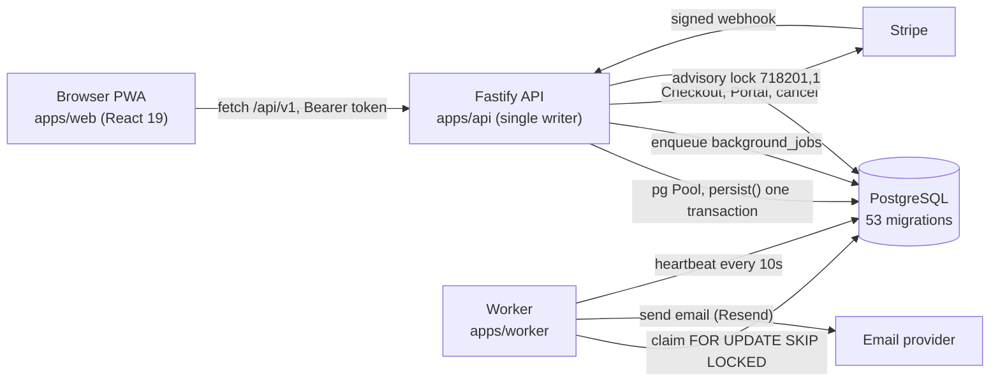
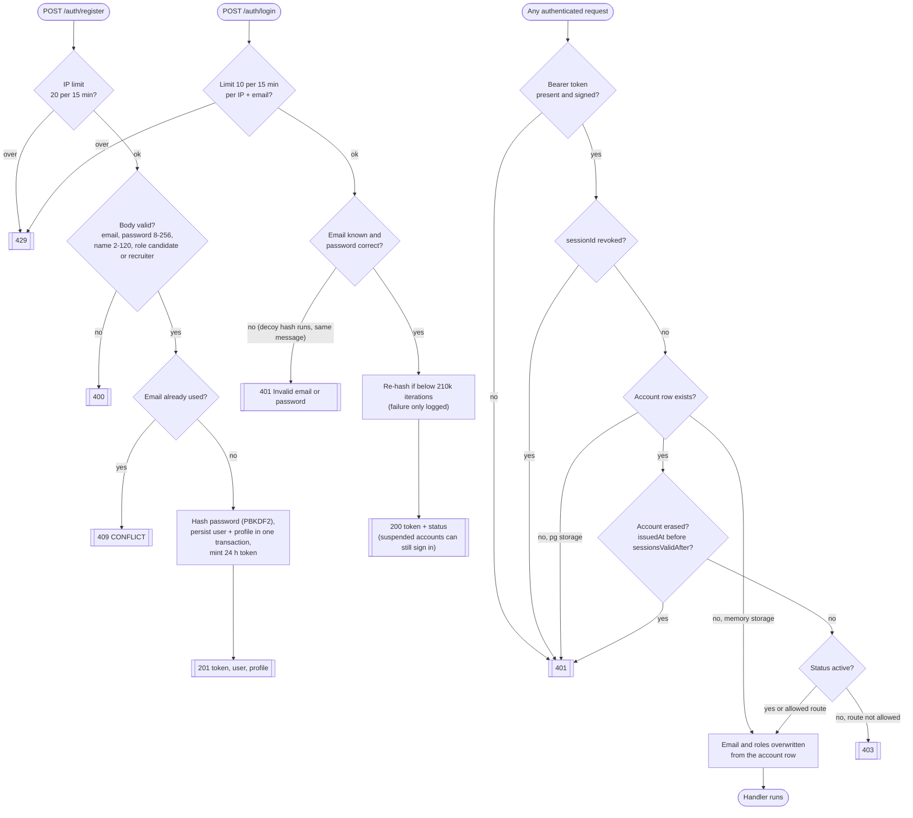
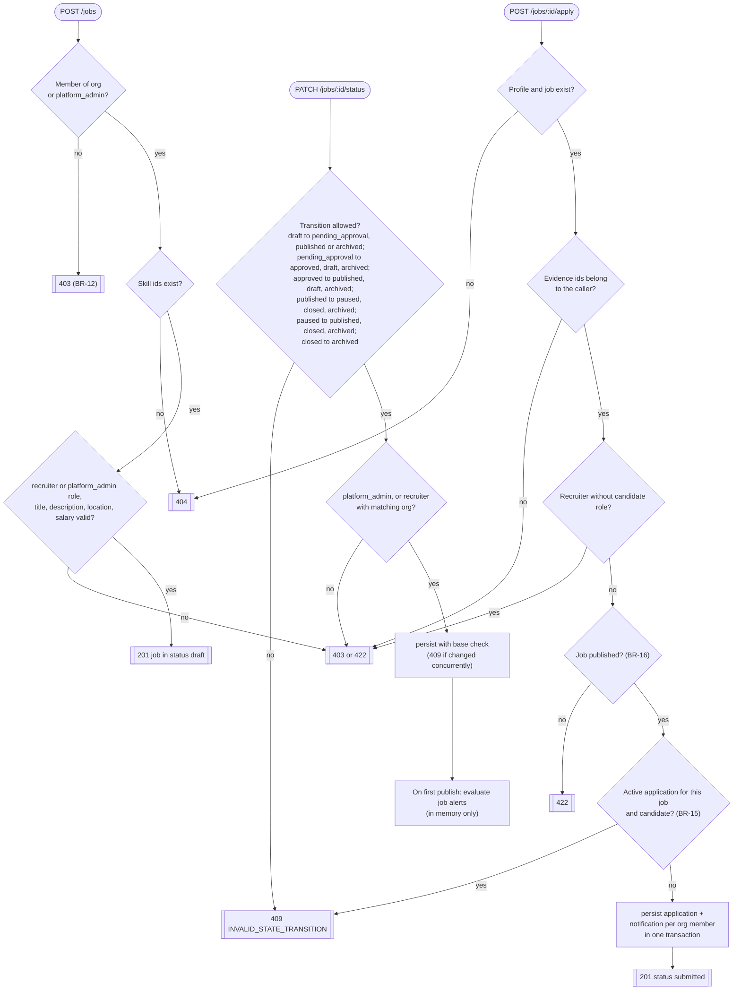
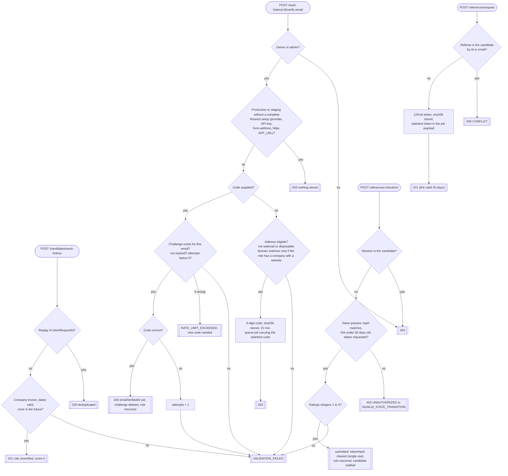
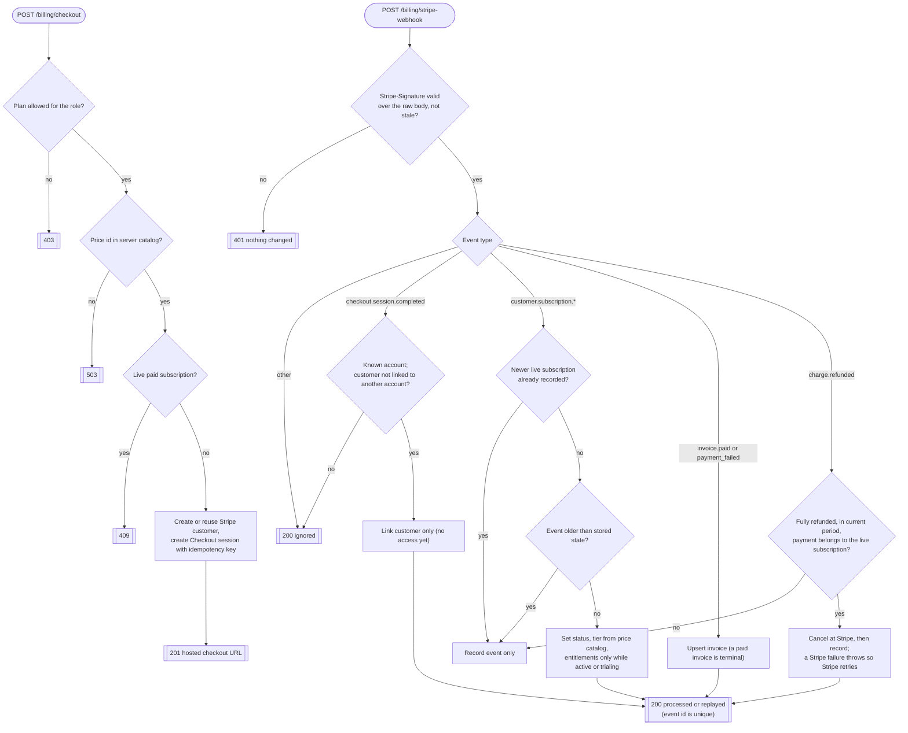
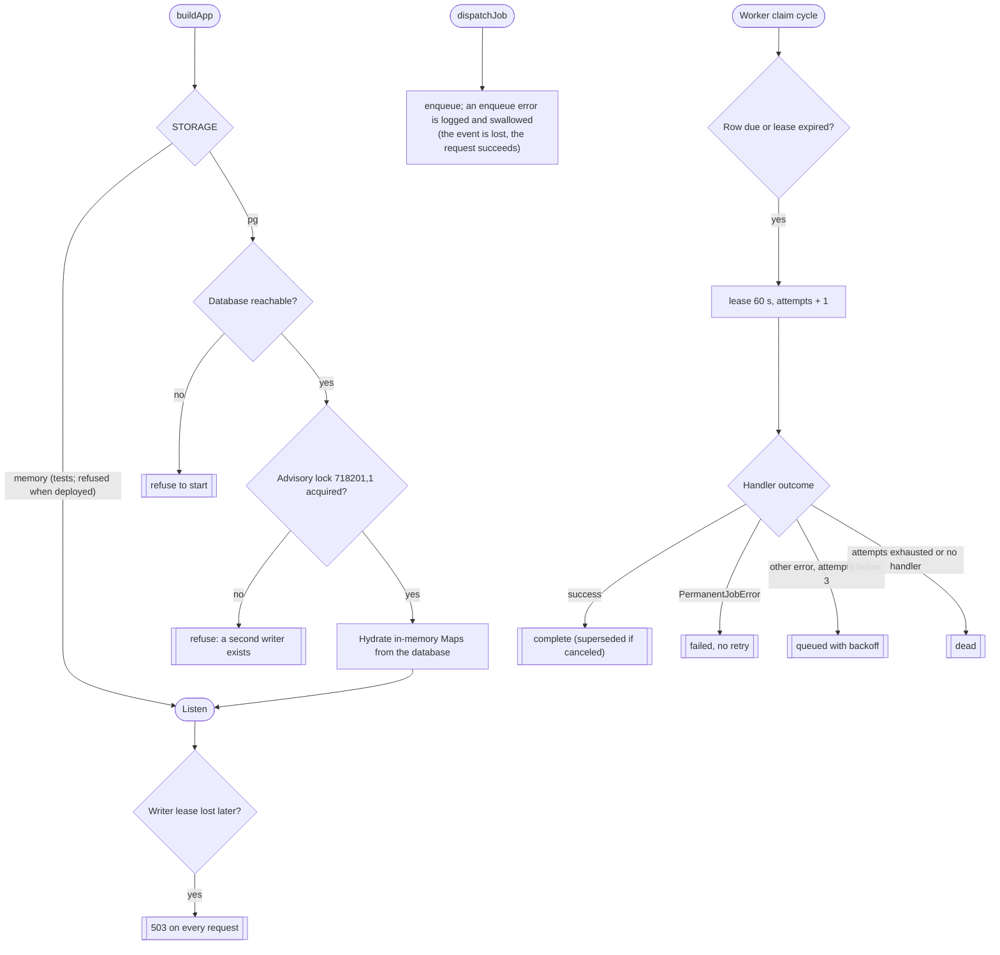
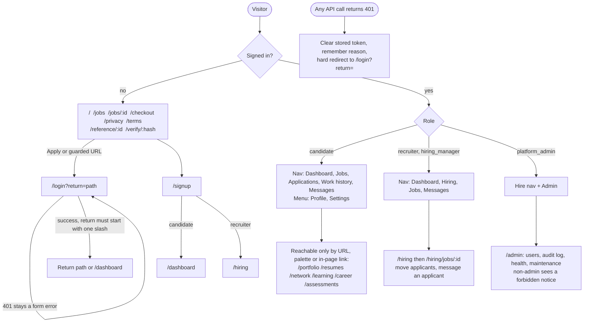

# System model 02 — Flowcharts of verified current behaviour

Every diagram here is **current behaviour read from the code**, not target behaviour. Evidence is cited as `path:line` (line numbers are from 2026-10-23 and drift as files change). Evidence status per diagram:

- **Read + spot-checked** = an investigator read the code and the lead re-read the key lines.
- **Read** = an investigator read the code; not independently re-read by the lead.
- Nothing here was exercised end to end by this work except where a "Tests" line says so.

Abbreviations: S = `apps/api/src/server.ts`, A = `packages/domain/src/auth.ts`, C = `packages/contracts/src/index.ts`, D = `packages/domain/src/work-history-graph.ts`, W = `apps/web/src`.

## F1 — System architecture (Level 1)

Evidence: Read (storage and worker investigation). `ARCHITECTURE.md` was compared and disagrees in places (see `03-conflict-register.md`).

The API also keeps in-memory Maps as a read model, hydrated from PostgreSQL at boot. Routes not listed in `apps/api/src/durability.ts` keep their state only in those Maps.

## F2 — Registration, sign-in and every authenticated request

Evidence: Read. Related tests exist (`tests/integration/auth-profile.test.ts`, `tests/security`).

Sign-out: a token with a `sessionId` is written to `revoked_sessions` (`{ended:true}`); a token minted before 2026-10-11 has none, so nothing is revoked and the call returns `{ended:false}`. Sign-out-others moves `sessionsValidAfter` to the next second and returns a fresh token. Password change returns 422 for a wrong current or an unchanged password, then returns a fresh token. The web client clears its stored token first and then sends sign-out without waiting, so a failed request leaves the server session alive until the token expires.

## F3 — Jobs and the application loop

Evidence: Read. There are no `/hiring/*` API routes; the hiring pages call `/organizations/*`, `/jobs/:id/applications` and `/applications/:id/transition`.

Order note (adversarial review): in `transitionJobStatus` the role and organization check runs before the transition table, so a caller with the wrong role gets 403 even for a transition that would also be invalid (the diagram draws the table first).

Application states: `submitted` to `in_review`, `withdrawn` or `rejected`; `in_review` to `shortlisted`, `rejected` or `withdrawn`; `shortlisted` to `interviewing`, `rejected` or `withdrawn`; `interviewing` to `offered`, `rejected` or `withdrawn`; `offered` to `hired`, `rejected` or `withdrawn`. `hired`, `rejected`, `withdrawn` and `expired` are terminal. Withdraw is candidate-owner or admin only; every other move needs membership of the job's organization or admin. Any membership counts; the role inside the organization is not checked.

## F4 — Verified work history (the core promise)

Evidence: Read + spot-checked. The lead re-read that the referee token had no expiry (fixed afterwards: the link now stops working 30 days after the request) and that the email domain is taken from `org.website` only when `companyId` is set (`S:12274-12281`).

Scoring (`D:262`): email verified +40; best valid reference manager +30, else peer +20, else +15; two or more valid references +15; average rating at least 4.0 +10; two or more independently endorsed skills +5; cap 100. Tier gold from 80, silver from 50, bronze from 25. Status `verified` from 25.

Delivery: in `NODE_ENV=development` (the default when unset) the worker only logs "DEV OUTBOX" and the job succeeds, code and link included in the log. Otherwise it sends through Resend; a missing key or from-address is a permanent failure with no retry.

## F5 — Stripe billing (Level 6)

Evidence: Read by the lead during this work; behaviour covered by `tests/integration/stripe-billing.test.ts` (run on 2026-10-23: passes). Not exercised against a real Stripe account.

## F6 — Boot, storage and background jobs

Evidence: Read.

## F7 — Web app journeys by role (Level 2)

Evidence: Read; per-page loading, empty and error states were only partly checked (see the limitations in `05-audit.md`). Route guard `RequireAuth` checks only that a token string exists; it does not check roles. Role gating happens inside pages.

Status of claims in the UI (from the investigator, compared with `docs/reports/FEATURE_STATUS_2026-10-21.md`): the Learning, Network and Resumes pages tell the user their data is not saved permanently; the Assessments page says submitted code is not run or scored; there is no registered service worker, so the footer shows "PWA Installable" and no offline mode exists; Settings offers email and summary-frequency toggles although no digest sending was found.
