# Target blueprint 02: Stakeholders And Users

> **Status.** Archive: proposal, not ratified. A greenfield redesign blueprint written in October 2026. Every area was Draft, Under Review or Revision Required (its own document status) and no test was run against it. Its content was mined into `docs/blueprint/`; `SSOT.md` remains the source of intent. Module federation described here was not adopted: the built system is a modular monolith (`ARCHITECTURE.md`).
>
> **What this file holds.** All files of the former `Yash_Final_Project_Document/02_STAKEHOLDERS_AND_USERS/` folder, in order.
>
> **Merged on 2026-11-25** from the files listed below; each one is a section under its original title. Nothing was removed; the originals are in git history at commit `08387ec`.

| Section | Former file |
|---|---|
| Legacy Journey Register (J-01 to J-28) | `Yash_Final_Project_Document/02_STAKEHOLDERS_AND_USERS/LEGACY_JOURNEY_REGISTRY_J01_J28.md` |
| Stakeholders, Personas, Roles & Permission Matrix | `Yash_Final_Project_Document/02_STAKEHOLDERS_AND_USERS/STAKEHOLDERS_ROLES_PERMISSIONS.md` |
| User Journeys — 20 role lifecycles | `Yash_Final_Project_Document/02_STAKEHOLDERS_AND_USERS/USER_JOURNEYS.md` |
| Roles and Permission Matrix, Revision 2 (USR-01 REV2) | `Yash_Final_Project_Document/02_STAKEHOLDERS_AND_USERS/PERMISSION_MATRIX_REV2.md` |

## Legacy Journey Register (J-01 to J-28)

_Former file: `Yash_Final_Project_Document/02_STAKEHOLDERS_AND_USERS/LEGACY_JOURNEY_REGISTRY_J01_J28.md`._

Doc ID: USR-LEG-01 · Owner: UX Research & Service Design Lead (with Product Director) · Version 1.0 · Status: Draft for Review · Relates: `USER_JOURNEYS.md` (UJ-01..UJ-20), `STAKEHOLDERS_ROLES_PERMISSIONS.md`, `../28_TRACEABILITY_AND_COVERAGE/AUDIT_JOURNEY_EVIDENCE_CROSSWALK.csv` (OPEN-45), `../24_RISKS_AND_DECISIONS/OPEN_DECISIONS_LEGACY_MERGE.md`, `../00_CONTROL_CENTRE/LEGACY_MERGE_LEDGER_A.md`

Supersedes nothing; linked from `../00_CONTROL_CENTRE/LEGACY_MERGE_LEDGER_A.md` and `MASTER_INDEX`. Created under the standing instruction: "i dont want to loos information keep everything in use untile it get improved".

### Merged from legacy: `31_LEGACY_ARCHIVE/docs/experience/JOURNEY_REGISTRY.md` (v6.0)

### 0. Frame

| Item                  | Statement                                                                                                                                                                                                                                                                                                                                                                                             |
| --------------------- | ----------------------------------------------------------------------------------------------------------------------------------------------------------------------------------------------------------------------------------------------------------------------------------------------------------------------------------------------------------------------------------------------------- |
| Implementation status | **None.** The prior attempt called these "target journeys, not a passing test inventory"; its audit certified no full terminal journey. Here they are **requirements candidates** only.                                                                                                                                                                                                               |
| Identity              | Prior attempt used `J-01..J-28` (28 canonical journeys; earlier prose mentioning 31 journeys and 246 rules was stale and removed there). The target uses `UJ-01..UJ-20`. The two namespaces are **not interchangeable**; the right-hand columns below show the _candidate_ mapping from `AUDIT_JOURNEY_EVIDENCE_CROSSWALK.csv`, which approves no equivalence (OPEN-45).                              |
| Personas              | The legacy register cites persona IDs `P-A` to `P-T` (19 rows, `P-P` absent in the prior root SSOT). Persona definitions are not in this source group; the target has five hypothetical personas (P1 to P5) in `STAKEHOLDERS_ROLES_PERMISSIONS.md`. The reduction is an explicit coverage gap (OPEN-LGA-07), not a retirement. Persona abbreviation `ML` in J-12 is not defined in any merged source. |
| Terminal state        | Every legacy journey names a terminal outcome. These are kept as the acceptance end-point for each journey.                                                                                                                                                                                                                                                                                           |

### 1. Register (verbatim) with candidate target mapping

| J ID | Name                                               | Persona(s)        | Terminal state                   | Candidate target UJ (from crosswalk) | Crosswalk comparison |
| ---- | -------------------------------------------------- | ----------------- | -------------------------------- | ------------------------------------ | -------------------- |
| J-01 | Learn → Prove → Showcase                           | P-A, P-B          | Portfolio with verified signals  | UJ-02; UJ-04                         | candidate-partial    |
| J-02 | Apply → Track → Hire                               | P-A, P-B          | Offer accepted                   | UJ-05; UJ-06                         | candidate-partial    |
| J-03 | Post → Source → Hire                               | P-C, P-E, P-S     | Offer extended                   | UJ-11; UJ-12; UJ-13                  | candidate-partial    |
| J-04 | Org Setup → Team → Launch                          | P-C, P-E          | First hire                       | UJ-11; UJ-14                         | candidate-partial    |
| J-05 | Profile → Network → Referral                       | P-A, P-B          | Referred hire                    | UJ-01; UJ-05; UJ-12                  | candidate-partial    |
| J-06 | AI Career Path: Gap → Plan → Execute               | P-B               | Gaps addressed                   | UJ-07                                | candidate-partial    |
| J-07 | Creator: Author → Publish → Monetize               | P-G               | Revenue                          | UJ-15                                | candidate-partial    |
| J-08 | Mentor: Match → Guide → Impact                     | P-H               | Impact measured                  | (none)                               | candidate-no-match   |
| J-09 | Institution: Cohort → Place → Track                | P-I               | Placement reported               | UJ-16                                | candidate-partial    |
| J-10 | Agency: Multi-Org → Pipeline → Bill                | P-F               | Client invoice                   | UJ-11                                | candidate-partial    |
| J-11 | Extension: Install → Local-First → Sync            | P-A               | Profile diff applied             | (none)                               | candidate-no-match   |
| J-12 | B2B2C Graduation Flywheel                          | P-I, ML           | Independent candidate            | UJ-16                                | candidate-partial    |
| J-13 | Institutional Media Authoring                      | P-G, P-K          | Course assigned to batch         | UJ-15; UJ-16                         | candidate-partial    |
| J-14 | Institutional Procurement & Licensing              | P-J               | Seats provisioned                | UJ-14; UJ-16                         | candidate-partial    |
| J-15 | Faculty: Teach → Monitor → Intervene               | P-K               | At-risk students intervened      | UJ-16                                | candidate-partial    |
| J-16 | Corporate L&D: Mandate → Track → Certify           | P-L, P-T          | Certification + HRIS sync        | UJ-16                                | candidate-partial    |
| J-17 | LinkedIn Migration On-ramp                         | New user          | Native account complete          | UJ-01; UJ-02                         | candidate-partial    |
| J-18 | Creator: Author → Publish → Sell → Payout          | P-G               | Monthly settlement               | UJ-15                                | candidate-partial    |
| J-19 | Self-Paced Learner: Discover → Certify             | P-M               | Path enrolled                    | UJ-04; UJ-07                         | candidate-partial    |
| J-20 | Learner: Path → Courses → Capstone → Cert          | P-M               | Program certificate              | UJ-04; UJ-07; UJ-16                  | candidate-partial    |
| J-21 | Contestant: Register → Compete → Rank → Certify    | P-Q               | Certification badge              | (none)                               | candidate-no-match   |
| J-22 | Researcher: Company → Reviews → Compare → Apply    | P-O               | Apply started                    | UJ-05                                | candidate-partial    |
| J-23 | Author: Post → Engage → Article → Newsletter       | P-N               | Audience established             | (none)                               | candidate-no-match   |
| J-24 | Reviewer: Write → Moderate → Publish → Response    | Any verified user | Published review                 | UJ-19                                | candidate-partial    |
| J-25 | Peer Reviewer: Assigned → Rubric Review → Feedback | Student           | Grade finalized                  | (none)                               | candidate-no-match   |
| J-26 | Career Switcher: Assess → Plan → Transition        | P-R               | Role transition confirmed        | UJ-07                                | candidate-partial    |
| J-27 | Hiring Manager: Define → Assess → Hire → Track     | P-S               | Post-hire outcome recorded       | UJ-11; UJ-13                         | candidate-partial    |
| J-28 | Skills Analyst: Analyze → Recommend → Measure      | P-T               | Learning program impact reported | (none)                               | candidate-no-match   |

Journeys with **no direct match** in the target `UJ-*` catalogue (6): J-08 (Mentor: Match, Guide, Impact), J-11 (Extension: Install, Local-First, Sync), J-21 (Contestant: Register, Compete, Rank, Certify), J-23 (Author: Post, Engage, Article, Newsletter), J-25 (Peer Reviewer: Assigned, Rubric Review, Feedback), J-28 (Skills Analyst: Analyze, Recommend, Measure). Each needs an owner decision: adopt (add a UJ), defer to a later phase with an explicit entry in the roadmap, or retire. Nothing is retired by this merge (OPEN-LGA-07).

#### Grouping added by this merge (editorial)

| Group                                | Journeys                                 |
| ------------------------------------ | ---------------------------------------- |
| Candidate core loop                  | J-01, J-02, J-05, J-06, J-11, J-17, J-26 |
| Recruiter / hiring side              | J-03, J-04, J-10 (agency), J-27          |
| Learning and creators                | J-07, J-13, J-18, J-19, J-20, J-25       |
| Institutions and corporate L&D       | J-09, J-12, J-14, J-15, J-16             |
| Community, mentorship and reputation | J-08, J-23, J-24                         |
| Assessment and contests              | J-21                                     |
| Research and analytics               | J-22, J-28                               |

### 2. J-02 Apply, Track, Hire (legacy detail diagram)

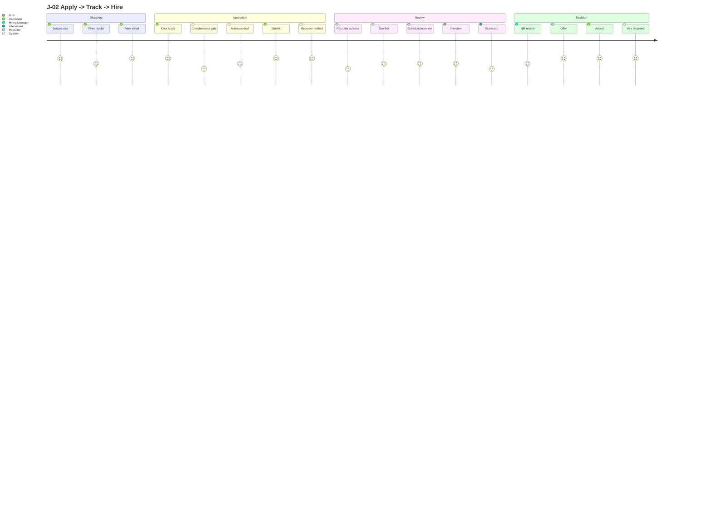

Notes tied to legacy rules (see `../06_BUSINESS_PROCESSES/LEGACY_BR_CATALOGUE_BR001_BR248.md`): the "Completeness gate" is BR-037 / BR-061 (profile completeness >= 70%); "Autosave draft" is BR-018 (autosave every 30 s, versions retained); the application lifecycle is BR-041 (strict state machine) and BR-017 / BR-020 (append-only). The emotion scores (1 to 5) are the prior attempt's design hypotheses, not measurements.

### 3. J-26 Career Switcher (legacy detail diagram)

```mermaid
flowchart LR
    A[Target role identified] --> B[F-91 Career Readiness]
    B --> C{Skills gap?}
    C -->|Yes| D[F-95 Career Transition Plan]
    D --> E[F-84 suggests learning]
    E --> F[F-07 enroll courses]
    F --> G[F-08 challenges + F-69 assignments]
    G --> H[F-96 Skill Evidence]
    H --> I[F-85 Career Graph comparison]
    I --> J{Ready?}
    J -->|Yes| K[Apply via F-04]
    J -->|No| D
    K --> L[F-88 Interview Platform]
    L --> M[Hired + outcome tracked]
```

Feature references are legacy `F-*` IDs (see `../04_PRODUCT_CAPABILITIES/LEGACY_FEATURE_REGISTRY_F01_F173.md`): F-91 Career Readiness Assessment, F-95 Career Transition Planning, F-84 Skills Graph and Taxonomy, F-07 Learning Management System, F-08 Challenges Arena, F-69 Assignments and Peer Review, F-96 Skill Evidence and Digital Credentials, F-85 Career Graph and Progression, F-04 Job Marketplace, F-88 Technical Interview Platform. Computed observation: this one flow crosses legacy phases Ph1 to Ph7 (F-07 and F-08 are Ph1; F-91, F-96 and F-04 are Ph2; F-85 and F-88 are Ph3; F-95 is Ph4; F-69 is Ph7), so J-26 cannot be completed until its slowest dependency exists. Target action: place J-26 in the roadmap by its latest dependency.

### 4. Journey contract (legacy; carried over)

Every journey must define: entry conditions, actors, permissions, main path, alternate paths, failure/recovery, terminal state, analytics, observability and acceptance evidence.

Target comparison: `USER_JOURNEYS.md` section 0 and the per-journey tables already cover actor, entry, success, steps, risk and failure/recovery. The legacy contract adds **permissions, analytics, observability and acceptance evidence** per journey. Target action: add a short "permissions / analytics events / observability / acceptance evidence" line to each UJ at its next revision (OPEN-LGA-13).

### 5. Journey status rule (legacy; carried over)

A journey is not complete until its critical feature chain is testable end to end. Target position: same; isolated API or unit assertions do not prove a terminal outcome.

### 6. Target users named by the prior PRD (for persona completeness)

Candidate/learner, career switcher, professional, recruiter, hiring manager, employer admin, instructor/course author, institution admin/faculty, mentor/expert, moderator, verification operator, support, finance and platform admin (14 roles). The target role catalogue is in `STAKEHOLDERS_ROLES_PERMISSIONS.md`; reconciliation of the 14 prior roles, the prior SSOT's 3 JWT roles plus 24 contextual roles, and the prior built union of 10 roles is OPEN-44 (see also OPEN-LGA-08).

## Stakeholders, Personas, Roles & Permission Matrix

_Former file: `Yash_Final_Project_Document/02_STAKEHOLDERS_AND_USERS/STAKEHOLDERS_ROLES_PERMISSIONS.md`._

Doc ID: USR-01 · Owner: Product Director + Security Architect · Version 1.0 · Status: Under Review · Relates: DOM-01, DOM-02, ADR-T07

> **Revision 2 folded in (2026-10-27)** from `STAKEHOLDERS_ROLES_PERMISSIONS.md#record-permission-matrix-rev2`: appended under "Revision 2 additions"; where it differs from text above, the appended text governs. Status unchanged; proposals still need owner/ARB ratification.
> Personas below are **hypothetical** (no real research conducted) — validate via OPEN-07.

### 1. Stakeholder registry

| Stakeholder                 | Interest                    | Influence          | Notes                    |
| --------------------------- | --------------------------- | ------------------ | ------------------------ |
| Candidate/learner           | Prove skills, get hired     | High (supply side) | Dignity-first rules      |
| Recruiter / hiring manager  | Fast trustworthy screening  | High (demand side) | Seat payer               |
| Org admin                   | Control seats, policy, data | Medium             | Tenant owner             |
| Institution admin/faculty   | Cohort outcomes             | Medium             | B2B2C                    |
| Instructor                  | Reach, income               | Medium             | Content supply           |
| Referee                     | Attest work history cheaply | Low but critical   | Non-account, tokenised   |
| Moderator / support / admin | Safety, service             | Internal           | Least privilege, audited |
| Regulators / auditors       | Compliance, fairness        | External           | Evidence on request      |
| Payment/email/AI vendors    | Integration                 | External           | Port-isolated            |

### 2. Personas (hypothetical)

- **P1 Asha, career-switcher (ROLE-CAND):** mobile-first, patchy data, needs proof beyond a bootcamp certificate.
- **P2 Marcus, recruiter (ROLE-REC):** 40 open reqs, wants an explained shortlist; desktop-first.
- **P3 Dr. Lin, faculty (ROLE-FAC):** wants cohort skill coverage without seeing private job-search data.
- **P4 Priya, referee (ROLE-REFEREE):** gets an emailed link on her phone; must finish in <3 minutes with no account.
- **P5 Sam, support operator (ROLE-SUP):** needs scoped, time-boxed access to a user's data with audit.

### 3. Role model

**[TARGET, OPEN-44]** Roles are proposed as scoped grants: `(principal, role, scope)` where scope ∈ {platform, org:<id>, institution:<id>, self}. A principal may hold several grants. Org roles: `org_owner`, `org_admin`, `recruiter`, `hiring_manager`, `viewer`. Institution roles: `inst_admin`, `faculty`, `proctor`. Platform roles: `moderator`, `support`, `admin`, `auditor`.

**Authority and implementation reconciliation:** root `SSOT.md` v6.0 §5 (§5.4–§5.8 in v6.2 numbering) specifies Tier-1 `ROLE_USER`, `ROLE_RECRUITER`, and `ROLE_ADMIN` plus 24 contextual roles and a resolution order. The inspected implementation instead defines a 10-value `Role` union in `packages/domain/src/core.ts`; it does not evidence the SSOT hierarchy or this target scoped-grant model. No owner-approved mapping between these models is recorded. The SSOT remains protected canonical intent; this scoped-grant design remains a proposal pending OPEN-44. Do not treat UI visibility or the role union alone as authorization evidence.

### 4. Permission matrix

Legend: C create · R read · U update · D delete/withdraw · A approve/act · `*` own only · `O` within own org/institution · `S` scoped, time-boxed, reason-coded, audited · `—` none. Columns: ANON, CAND, INST (instructor), REC, HM, ORGADM, INSTADM, FAC, MOD, SUP, ADM, AUD.

| Resource                        | ANON       | CAND                       | INST                    | REC                                     | HM                                      | ORGADM                                                                        | INSTADM                                                                  | FAC                                                            | MOD            | SUP        | ADM  | AUD  |
| ------------------------------- | ---------- | -------------------------- | ----------------------- | --------------------------------------- | --------------------------------------- | ----------------------------------------------------------------------------- | ------------------------------------------------------------------------ | -------------------------------------------------------------- | -------------- | ---------- | ---- | ---- |
| Public profile (visible fields) | R          | R                          | R                       | R                                       | R                                       | R                                                                             | R                                                                        | R                                                              | R              | R          | R    | R    |
| Own profile / portfolio         | —          | CRUD*                      | CRUD*                   | —                                       | —                                       | —                                                                             | —                                                                        | —                                                              | —              | S(R)       | S(R) | S(R) |
| Evidence items                  | —          | CRUD* (cannot self-verify) | CRUD*                   | R (only with live consent scope, DT-01) | R (only with live consent scope, DT-01) | — (no individual evidence reads)                                              | R aggregate only (k≥5) + institution-issued credential records (BR-T100) | R aggregate only (k≥5) + institution-issued credential records | R(flagged)     | S(R)       | S(R) | R    |
| Verification actions            | —          | —                          | A (own course evidence) | —                                       | —                                       | —                                                                             | A (institution credentials)                                              | A                                                              | A (disputes)   | —          | A    | R    |
| Job postings                    | R (public) | R                          | R                       | CRU(O)                                  | RU(O)                                   | CRUD(O)                                                                       | —                                                                        | —                                                              | R, A(takedown) | R          | R    | R    |
| Applications                    | —          | CRU*, withdraw*            | —                       | R (job team of that job), U stage       | R, U stage (assigned job team)          | R recruiter-activity metadata only; content only if on the job team (SPEC-G4) | — (BR-T105)                                                              | — (BR-T105)                                                    | R(flagged)     | S(R)       | S(R) | R    |
| Messaging                       | —          | CR (consented threads)     | CR                      | CR (outreach quota)                     | CR                                      | R(O) metadata                                                                 | —                                                                        | CR (cohort)                                                    | R(flagged)     | S(R)       | S(R) | —    |
| Courses                         | R          | R, enrol                   | CRUD*                   | —                                       | —                                       | —                                                                             | CRUD(O)                                                                  | R(O)                                                           | A(takedown)    | R          | CRUD | R    |
| Assessments & attempts          | —          | CR*                        | R (own course)          | —                                       | —                                       | —                                                                             | R aggregate (k≥5); individual only for institution-run courses (BR-T100) | R aggregate (k≥5); individual only for institution-run courses | —              | S(R)       | R    | R    |
| Org members & roles             | —          | —                          | —                       | —                                       | —                                       | CRUD(O)                                                                       | CRUD(inst)                                                               | —                                                              | —              | S(R)       | R    | R    |
| Billing / entitlements          | —          | R*                         | R*                      | —                                       | —                                       | CRU(O)                                                                        | CRU(O)                                                                   | —                                                              | —              | S(R)       | R    | R    |
| Audit log                       | —          | R* (own access log)        | —                       | —                                       | —                                       | R(O)                                                                          | R(O)                                                                     | —                                                              | —              | S(R)       | R    | R    |
| Feature flags / config          | —          | —                          | —                       | —                                       | —                                       | —                                                                             | —                                                                        | —                                                              | —              | —          | CRUD | R    |
| Moderation queue                | —          | —                          | —                       | —                                       | —                                       | —                                                                             | —                                                                        | —                                                              | CRUD           | R          | CRUD | R    |
| Data-rights requests            | —          | CR*                        | CR*                     | —                                       | —                                       | — (org-owned data via org settings, not personal DSR)                         | —                                                                        | —                                                              | —              | A (assist) | A    | R    |

**Normative target:** this table is a summary. Where it differs from DT-01 (`06_BUSINESS_PROCESSES/DECISION_TABLES.md`), BR-T100/BR-T105 or INV-T41, those target contracts govern after OPEN-44 is resolved. The target policy package is proposed to derive its matrix from DT-01; it is not present in the inspected workspace. A negative-control test is specified to fail if INSTADM/FAC can read an individual evidence item (REVW-01); test execution is not asserted here.

Rules: deny by default (INV-T01); candidate **consent scopes** gate every recruiter read of evidence; support/admin access to personal data is **time-boxed, reason-coded, logged** (BR-T041). Referee permissions exist only as a single-use, expiring token bound to one request (INV-T05).

### 5. Target capability endpoint

**[TARGET, OPEN-44; not observed as implemented]** `GET /api/v1/me/capabilities` is proposed to return the evaluated permission set for the current principal/scope; UI uses it for visibility only, never enforcement (INV-T01). A read-only inspection found no `packages/policy` directory or matching `/api/v1/me/capabilities` route in the inspected workspace. The endpoint and policy package are target requirements, not current implementation claims.

### 6. Access reviews

Org owners review member roles quarterly (prompted); platform privileged roles reviewed monthly by Security; dormant privileged grants auto-expire after 60 days.

## Revision 2 additions (folded 2026-10-27 from `STAKEHOLDERS_ROLES_PERMISSIONS.md#record-permission-matrix-rev2`)

### 1. Role model: one mapping from grants to matrix columns

A grant is `(principal, role, scope)` with scope ∈ {platform, org:id, institution:id, self}. The matrix columns are the **role families** below. Every role named in the OpenAPI `Grant.role` enum or in the ID registry maps to exactly one column or is stated as absent.

| Grant role (API / registry) | Scope                                         | Matrix column                                          | Notes                                                                                                                                                                           |
| --------------------------- | --------------------------------------------- | ------------------------------------------------------ | ------------------------------------------------------------------------------------------------------------------------------------------------------------------------------- |
| `candidate` (ROLE-CAND)     | self                                          | CAND                                                   |                                                                                                                                                                                 |
| `instructor` (ROLE-INST)    | self (own courses)                            | INST                                                   |                                                                                                                                                                                 |
| `org_owner`                 | org                                           | ORGOWN (new column)                                    | Everything ORGADM can do, plus ownership transfer, org closure, billing owner, grant and revoke of `org_admin` (FEAT-02-03, FEAT-02-08). At least one per org (last-owner rule) |
| `org_admin` (ROLE-ORGADM)   | org                                           | ORGADM                                                 | Members, roles other than owner, org settings, job templates, billing view; **no** candidate content unless also on the job team                                                |
| `recruiter` (ROLE-REC)      | org                                           | REC                                                    | Jobs and applications of jobs where the principal is on the hiring team; search within consent; outreach within quota                                                           |
| `hiring_manager` (ROLE-HM)  | org                                           | HM                                                     | **Only jobs assigned to the principal's hiring team** (FEAT-02-06, DT-01 row 9)                                                                                                 |
| `viewer`                    | org                                           | VIEW (new column)                                      | Read-only on jobs and pipeline counts of jobs on which the principal is placed; no candidate evidence or contact details; no messaging                                          |
| `inst_admin` (ROLE-INSTADM) | institution                                   | INSTADM                                                |                                                                                                                                                                                 |
| `faculty` (ROLE-FAC)        | institution (assigned cohorts)                | FAC                                                    |                                                                                                                                                                                 |
| `proctor`                   | institution                                   | PROCT (new column, Phase 4; absent from Phases 1 to 3) | Invigilation of institution-run assessments only (FEAT-18-10); no learner profile access                                                                                        |
| `moderator` (ROLE-MOD)      | platform                                      | MOD                                                    |                                                                                                                                                                                 |
| `support` (ROLE-SUP)        | platform                                      | SUP                                                    |                                                                                                                                                                                 |
| `admin` (ROLE-ADM)          | platform                                      | ADM                                                    |                                                                                                                                                                                 |
| `auditor` (ROLE-AUD)        | platform                                      | AUD                                                    |                                                                                                                                                                                 |
| ROLE-REFEREE                | none: a single-use token bound to one request | **REFEREE (new column)**                               | No account and no grant; see section 3                                                                                                                                          |
| ROLE-MENTOR                 | self                                          | **MENTOR (new column)**                                | Phase 4 (FEAT-08-11, FEAT-14-06); absent from Phases 1 to 3. No access to a learner's evidence unless the learner shares it through a consent scope                             |
| ROLE-SVC                    | platform or org (API key)                     | **SVC (new column)**                                   | Phase 4 (FEAT-23-07). Scoped by key; no access to personal data unless the key's scope names it and the subject consented; never a human actor for U6                           |

### 2. Matrix additions and corrections

Legend as USR-01: C create · R read · U update · D delete/withdraw · A approve/act · `*` own only · `O` within own org/institution · `S` scoped, time-boxed, reason-coded, audited · `—` none · `T` job team of that job only · `H` assigned hiring-team jobs only.

#### 2.1 Corrected cells (existing columns)

| Resource               | Column | USR-01 now                                              | REV2                                                                                                                                          | Why                                                                                                                                |
| ---------------------- | ------ | ------------------------------------------------------- | --------------------------------------------------------------------------------------------------------------------------------------------- | ---------------------------------------------------------------------------------------------------------------------------------- |
| Job postings           | HM     | `RU(O)`                                                 | **`R, U (H)`** — read and update only jobs assigned to the principal; no read of other org postings                                           | FEAT-02-06, DT-01 row 9                                                                                                            |
| Job postings           | REC    | `CRU(O)`                                                | `CRU (O)`; publish needs `job:publish` and passes DT-12                                                                                       | unchanged meaning, stated                                                                                                          |
| Data-rights requests   | ORGADM | `— (org-owned data via org settings, not personal DSR)` | **`— (cannot file or act on an employee's personal request; the requester must be the subject, SM-DSR t1; org-owned data via org settings)`** | REVW-28 reported "A(O employees)" for this cell; the current USR-01 text is already `—`. This row keeps `—` and records the reason |
| Org members & roles    | ORGADM | `CRUD(O)`                                               | `CRUD(O) for roles below org_owner; cannot create, demote or remove an org_owner`                                                             | `org_owner` and `org_admin` differ (FEAT-02-03.1)                                                                                  |
| Billing / entitlements | ORGADM | `CRU(O)`                                                | `R(O); CRU only if also org_owner`                                                                                                            | Billing owner is the owner                                                                                                         |
| Applications           | HM     | `R, U stage (assigned job team)`                        | unchanged; stated as `H`                                                                                                                      |                                                                                                                                    |
| Verification actions   | INST   | `A (own course evidence)`                               | **`A (own course evidence, issuer_class instructor only; never platform-verified; instructor ≠ learner; BR-T119)`**                           | REVW-12                                                                                                                            |
| Evidence items         | INST   | `CRUD*`                                                 | unchanged for own evidence; **instructor cannot read learner evidence except within their own course (completion record)**                    |                                                                                                                                    |

#### 2.2 New columns

| Resource                        | ORGOWN                                                              | VIEW              | REFEREE                                                                               | MENTOR                                              | SVC               | PROCT                                            |
| ------------------------------- | ------------------------------------------------------------------- | ----------------- | ------------------------------------------------------------------------------------- | --------------------------------------------------- | ----------------- | ------------------------------------------------ |
| Public profile (visible fields) | R                                                                   | R                 | R (request prompt only, not browsing)                                                 | R                                                   | R (public fields) | —                                                |
| Own profile / portfolio         | —                                                                   | —                 | —                                                                                     | CRUD*                                               | —                 | —                                                |
| Evidence items                  | — (no individual evidence reads)                                    | —                 | —                                                                                     | — (only via a consent scope granted by the learner) | —                 | —                                                |
| Verification actions            | —                                                                   | —                 | **A (submit one response for one request; token valid, unused, referee ≠ candidate)** | —                                                   | —                 | —                                                |
| Job postings                    | CRUD(O)                                                             | R (T, read-only)  | —                                                                                     | R                                                   | R (key scope)     | —                                                |
| Applications                    | R recruiter-activity metadata only; content only if on the job team | R counts only (T) | —                                                                                     | —                                                   | —                 | —                                                |
| Messaging                       | R(O) metadata                                                       | —                 | —                                                                                     | CR (own mentoring threads, Phase 4)                 | —                 | —                                                |
| Courses                         | —                                                                   | —                 | —                                                                                     | R                                                   | R (key scope)     | —                                                |
| Assessments & attempts          | —                                                                   | —                 | —                                                                                     | —                                                   | —                 | A (invigilate institution-run attempts, Phase 4) |
| Org members & roles             | CRUD(O) incl. `org_admin` and `org_owner`                           | R (O, names only) | —                                                                                     | —                                                   | —                 | —                                                |
| Billing / entitlements          | CRU(O)                                                              | —                 | —                                                                                     | —                                                   | —                 | —                                                |
| Audit log                       | R(O)                                                                | —                 | —                                                                                     | —                                                   | —                 | —                                                |
| Data-rights requests            | —                                                                   | —                 | —                                                                                     | CR*                                                 | —                 | —                                                |
| Moderation queue, feature flags | —                                                                   | —                 | —                                                                                     | —                                                   | —                 | —                                                |

### 3. Referee: why a column and not a role grant

A referee has no account and no grant. The only permission is the single-use, expiring token (INV-T05, INV-T24): read the request prompt (claim title, employer, dates, candidate name), submit exactly one response, and nothing else. The REFEREE column makes that explicit so that policy tests cover it: every other action returns `403`/`404` for a request authenticated by a referee token, and a token for request A never opens request B (INV-T02).

### 4. Roles intentionally absent

| Role                                        | Stated reason                                                                                                                                                                            |
| ------------------------------------------- | ---------------------------------------------------------------------------------------------------------------------------------------------------------------------------------------- |
| `proctor`, `mentor`, `svc` in Phases 1 to 3 | Their features are Phase 4 (PCAP-01); their columns are defined now so the policy matrix is complete, and every cell is denied until the owning feature ships (deny by default, INV-T01) |
| An "impersonation" role                     | Removed on principle (FEAT-20-07)                                                                                                                                                        |

### 5. Tests the matrix must generate (additions to the WP-POLICY-CORE definition of done)

1. For every column and resource, one allow or deny test derived from DT-01 and this table (negative controls included).
2. `viewer` cannot read candidate evidence, contact details or messages (AC-02-03-51).
3. `org_admin` cannot create or demote an `org_owner`; the last owner cannot be removed (AC-02-03.1-01).
4. A hiring manager outside the job team gets `403` on the application (DT-01 row 9).
5. A referee token authenticates nothing outside its request (AC-06-02-*).
6. Instructor sign-off cannot target the instructor's own account (AC-05-04-53).

---

### Preserved source record: PERMISSION_MATRIX_REV2

> Consolidated on 2026-10-27. The following is the complete source record, retained for provenance, exceptions and rationale. Its dates, counts and statements about files describe the earlier revision, not the current filesystem. Approval conditions and authority remain unchanged: this move neither ratifies proposals nor overrides the owning document’s current precedence rules. Relative references now point to the consolidated records.

<!-- source-record-begin: Yash_Final_Project_Document/02_STAKEHOLDERS_AND_USERS/PERMISSION_MATRIX_REV2.md -->

## Roles and Permission Matrix, Revision 2 (USR-01 REV2)

Doc ID: USR-01-R2 · Owner: Product Director + Security Architect · Version 2.0 · Status: Proposed (Under Review) · Date: 2026-10-25 · Closes: REVW-28 (and the role parts of REVW-01 residue, REVW-12) · Relates: USR-01 (`STAKEHOLDERS_ROLES_PERMISSIONS.md`), DT-01, BR-T100, BR-T105, INV-T41, ID_REGISTRY roles, OpenAPI `Grant.role`, FEAT-02-03, FEAT-02-06, SM-DSR

> **Folded into `STAKEHOLDERS_ROLES_PERMISSIONS.md` on 2026-10-27.** Change record only; edit the original.

**Relationship (no original file was edited).** This file **supersedes, once accepted**, USR-01 section 3 (role model), the table in section 4 (the matrix), and the "Org members & roles" and "Data-rights requests" rows of that table, **only where they differ from the text below**. The normative note of USR-01 stands: DT-01, BR-T100, BR-T105 and INV-T41 win over this table, and `packages/policy` holds the matrix as data derived from DT-01. Personas and USR-01 sections 1, 2, 5 and 6 stand. Governance should link this file from `00_CONTROL_CENTRE/MASTER_INDEX.md`. All content **[TARGET]**.

### 1. Role model: one mapping from grants to matrix columns

A grant is `(principal, role, scope)` with scope ∈ {platform, org:id, institution:id, self}. The matrix columns are the **role families** below. Every role named in the OpenAPI `Grant.role` enum or in the ID registry maps to exactly one column or is stated as absent.

| Grant role (API / registry) | Scope                                         | Matrix column                                          | Notes                                                                                                                                                                           |
| --------------------------- | --------------------------------------------- | ------------------------------------------------------ | ------------------------------------------------------------------------------------------------------------------------------------------------------------------------------- |
| `candidate` (ROLE-CAND)     | self                                          | CAND                                                   |                                                                                                                                                                                 |
| `instructor` (ROLE-INST)    | self (own courses)                            | INST                                                   |                                                                                                                                                                                 |
| `org_owner`                 | org                                           | ORGOWN (new column)                                    | Everything ORGADM can do, plus ownership transfer, org closure, billing owner, grant and revoke of `org_admin` (FEAT-02-03, FEAT-02-08). At least one per org (last-owner rule) |
| `org_admin` (ROLE-ORGADM)   | org                                           | ORGADM                                                 | Members, roles other than owner, org settings, job templates, billing view; **no** candidate content unless also on the job team                                                |
| `recruiter` (ROLE-REC)      | org                                           | REC                                                    | Jobs and applications of jobs where the principal is on the hiring team; search within consent; outreach within quota                                                           |
| `hiring_manager` (ROLE-HM)  | org                                           | HM                                                     | **Only jobs assigned to the principal's hiring team** (FEAT-02-06, DT-01 row 9)                                                                                                 |
| `viewer`                    | org                                           | VIEW (new column)                                      | Read-only on jobs and pipeline counts of jobs on which the principal is placed; no candidate evidence or contact details; no messaging                                          |
| `inst_admin` (ROLE-INSTADM) | institution                                   | INSTADM                                                |                                                                                                                                                                                 |
| `faculty` (ROLE-FAC)        | institution (assigned cohorts)                | FAC                                                    |                                                                                                                                                                                 |
| `proctor`                   | institution                                   | PROCT (new column, Phase 4; absent from Phases 1 to 3) | Invigilation of institution-run assessments only (FEAT-18-10); no learner profile access                                                                                        |
| `moderator` (ROLE-MOD)      | platform                                      | MOD                                                    |                                                                                                                                                                                 |
| `support` (ROLE-SUP)        | platform                                      | SUP                                                    |                                                                                                                                                                                 |
| `admin` (ROLE-ADM)          | platform                                      | ADM                                                    |                                                                                                                                                                                 |
| `auditor` (ROLE-AUD)        | platform                                      | AUD                                                    |                                                                                                                                                                                 |
| ROLE-REFEREE                | none: a single-use token bound to one request | **REFEREE (new column)**                               | No account and no grant; see section 3                                                                                                                                          |
| ROLE-MENTOR                 | self                                          | **MENTOR (new column)**                                | Phase 4 (FEAT-08-11, FEAT-14-06); absent from Phases 1 to 3. No access to a learner's evidence unless the learner shares it through a consent scope                             |
| ROLE-SVC                    | platform or org (API key)                     | **SVC (new column)**                                   | Phase 4 (FEAT-23-07). Scoped by key; no access to personal data unless the key's scope names it and the subject consented; never a human actor for U6                           |

### 2. Matrix additions and corrections

Legend as USR-01: C create · R read · U update · D delete/withdraw · A approve/act · `*` own only · `O` within own org/institution · `S` scoped, time-boxed, reason-coded, audited · `—` none · `T` job team of that job only · `H` assigned hiring-team jobs only.

#### 2.1 Corrected cells (existing columns)

| Resource               | Column | USR-01 now                                              | REV2                                                                                                                                          | Why                                                                                                                                |
| ---------------------- | ------ | ------------------------------------------------------- | --------------------------------------------------------------------------------------------------------------------------------------------- | ---------------------------------------------------------------------------------------------------------------------------------- |
| Job postings           | HM     | `RU(O)`                                                 | **`R, U (H)`** — read and update only jobs assigned to the principal; no read of other org postings                                           | FEAT-02-06, DT-01 row 9                                                                                                            |
| Job postings           | REC    | `CRU(O)`                                                | `CRU (O)`; publish needs `job:publish` and passes DT-12                                                                                       | unchanged meaning, stated                                                                                                          |
| Data-rights requests   | ORGADM | `— (org-owned data via org settings, not personal DSR)` | **`— (cannot file or act on an employee's personal request; the requester must be the subject, SM-DSR t1; org-owned data via org settings)`** | REVW-28 reported "A(O employees)" for this cell; the current USR-01 text is already `—`. This row keeps `—` and records the reason |
| Org members & roles    | ORGADM | `CRUD(O)`                                               | `CRUD(O) for roles below org_owner; cannot create, demote or remove an org_owner`                                                             | `org_owner` and `org_admin` differ (FEAT-02-03.1)                                                                                  |
| Billing / entitlements | ORGADM | `CRU(O)`                                                | `R(O); CRU only if also org_owner`                                                                                                            | Billing owner is the owner                                                                                                         |
| Applications           | HM     | `R, U stage (assigned job team)`                        | unchanged; stated as `H`                                                                                                                      |                                                                                                                                    |
| Verification actions   | INST   | `A (own course evidence)`                               | **`A (own course evidence, issuer_class instructor only; never platform-verified; instructor ≠ learner; BR-T119)`**                           | REVW-12                                                                                                                            |
| Evidence items         | INST   | `CRUD*`                                                 | unchanged for own evidence; **instructor cannot read learner evidence except within their own course (completion record)**                    |                                                                                                                                    |

#### 2.2 New columns

| Resource                        | ORGOWN                                                              | VIEW              | REFEREE                                                                               | MENTOR                                              | SVC               | PROCT                                            |
| ------------------------------- | ------------------------------------------------------------------- | ----------------- | ------------------------------------------------------------------------------------- | --------------------------------------------------- | ----------------- | ------------------------------------------------ |
| Public profile (visible fields) | R                                                                   | R                 | R (request prompt only, not browsing)                                                 | R                                                   | R (public fields) | —                                                |
| Own profile / portfolio         | —                                                                   | —                 | —                                                                                     | CRUD*                                               | —                 | —                                                |
| Evidence items                  | — (no individual evidence reads)                                    | —                 | —                                                                                     | — (only via a consent scope granted by the learner) | —                 | —                                                |
| Verification actions            | —                                                                   | —                 | **A (submit one response for one request; token valid, unused, referee ≠ candidate)** | —                                                   | —                 | —                                                |
| Job postings                    | CRUD(O)                                                             | R (T, read-only)  | —                                                                                     | R                                                   | R (key scope)     | —                                                |
| Applications                    | R recruiter-activity metadata only; content only if on the job team | R counts only (T) | —                                                                                     | —                                                   | —                 | —                                                |
| Messaging                       | R(O) metadata                                                       | —                 | —                                                                                     | CR (own mentoring threads, Phase 4)                 | —                 | —                                                |
| Courses                         | —                                                                   | —                 | —                                                                                     | R                                                   | R (key scope)     | —                                                |
| Assessments & attempts          | —                                                                   | —                 | —                                                                                     | —                                                   | —                 | A (invigilate institution-run attempts, Phase 4) |
| Org members & roles             | CRUD(O) incl. `org_admin` and `org_owner`                           | R (O, names only) | —                                                                                     | —                                                   | —                 | —                                                |
| Billing / entitlements          | CRU(O)                                                              | —                 | —                                                                                     | —                                                   | —                 | —                                                |
| Audit log                       | R(O)                                                                | —                 | —                                                                                     | —                                                   | —                 | —                                                |
| Data-rights requests            | —                                                                   | —                 | —                                                                                     | CR*                                                 | —                 | —                                                |
| Moderation queue, feature flags | —                                                                   | —                 | —                                                                                     | —                                                   | —                 | —                                                |

### 3. Referee: why a column and not a role grant

A referee has no account and no grant. The only permission is the single-use, expiring token (INV-T05, INV-T24): read the request prompt (claim title, employer, dates, candidate name), submit exactly one response, and nothing else. The REFEREE column makes that explicit so that policy tests cover it: every other action returns `403`/`404` for a request authenticated by a referee token, and a token for request A never opens request B (INV-T02).

### 4. Roles intentionally absent

| Role                                        | Stated reason                                                                                                                                                                            |
| ------------------------------------------- | ---------------------------------------------------------------------------------------------------------------------------------------------------------------------------------------- |
| `proctor`, `mentor`, `svc` in Phases 1 to 3 | Their features are Phase 4 (PCAP-01); their columns are defined now so the policy matrix is complete, and every cell is denied until the owning feature ships (deny by default, INV-T01) |
| An "impersonation" role                     | Removed on principle (FEAT-20-07)                                                                                                                                                        |

### 5. Tests the matrix must generate (additions to the WP-POLICY-CORE definition of done)

1. For every column and resource, one allow or deny test derived from DT-01 and this table (negative controls included).
2. `viewer` cannot read candidate evidence, contact details or messages (AC-02-03-51).
3. `org_admin` cannot create or demote an `org_owner`; the last owner cannot be removed (AC-02-03.1-01).
4. A hiring manager outside the job team gets `403` on the application (DT-01 row 9).
5. A referee token authenticates nothing outside its request (AC-06-02-*).
6. Instructor sign-off cannot target the instructor's own account (AC-05-04-53).

<!-- source-record-end: Yash_Final_Project_Document/02_STAKEHOLDERS_AND_USERS/PERMISSION_MATRIX_REV2.md -->

## User Journeys — 20 role lifecycles

_Former file: `Yash_Final_Project_Document/02_STAKEHOLDERS_AND_USERS/USER_JOURNEYS.md`._

Doc ID: USR-02 · Owner: UX Research & Service Design Lead · Version 1.0 · Status: Under Review · Relates: USR-01 `STAKEHOLDERS_ROLES_PERMISSIONS.md`, STR-01, DOM-00, UI-01, UI-02, UI-04, UI-07, GOAL-01…GOAL-08, INV-T04, INV-T05, INV-T09, INV-T15, INV-T18, INV-T20, BR-T004, BR-T041, BR-T060

Supersedes nothing; linked from the folder index and `MASTER_INDEX` (and from `07_UI_UX_AND_DESIGN_SYSTEM`). All content **[TARGET]**.

### 0. How to read this document

| Item                | Statement                                                                                                                                                                                                                                      |
| ------------------- | ---------------------------------------------------------------------------------------------------------------------------------------------------------------------------------------------------------------------------------------------- |
| Evidence base       | **No user research has been conducted.** Personas P1–P5 (USR-01) are hypothetical. Emotions, risks and drop-off points below are _design hypotheses_ to be tested (OPEN-07), not findings.                                                     |
| Emotion scores      | Mermaid `journey` scores 1–5 (1 = frustrated/anxious, 5 = confident/delighted) express intended experience under the designed flow, not measured sentiment.                                                                                    |
| IDs                 | Screens `SCR-*` → `SCREEN_REGISTRY.md`; actions `ACT-*` → `ACTION_REGISTRY.md`; roles `ROLE-*`; goals `GOAL-*` → `PRODUCT_VISION_AND_BUSINESS_MODEL.md`.                                                                                       |
| Failure/recovery    | Each journey lists the failures most likely to break the goal and the designed recovery. Global failure classes (offline, validation, 401/403/412/429/5xx, remote outage) are in `ACTION_REGISTRY.md` §0 and `PROGRESSIVE_UX_AND_FEEDBACK.md`. |
| Honesty constraints | Journeys never show a claim as verified before a server verification transition (INV-T04); never make an adverse decision without a human (INV-T09); never auto-grant data access (INV-T15).                                                   |

Historical source-to-target candidates are maintained in the [journey crosswalk](28_TRACEABILITY_AND_COVERAGE_PART2.md#audit_journey_evidence_crosswalkcsv). Source `J-*` and target `UJ-*` identities remain distinct; the map does not approve equivalence or verify implementation.

#### Journey index

| UJ    | Journey                                                      | Primary role           | Persona    | Loop stage     | Goal link        | Diagram |
| ----- | ------------------------------------------------------------ | ---------------------- | ---------- | -------------- | ---------------- | ------- |
| UJ-01 | Discover → register → confirm email                          | ROLE-CAND              | P1 Asha    | Showcase entry | GOAL-01          | journey |
| UJ-02 | Onboard → first evidence                                     | ROLE-CAND              | P1         | Prove          | GOAL-01          | journey |
| UJ-03 | Verify work history through a referee                        | ROLE-CAND (+ REFEREE)  | P1, P4     | Prove          | GOAL-01          | flow    |
| UJ-04 | Learn → assess → earn evidence                               | ROLE-CAND              | P1         | Learn→Prove    | GOAL-04          | flow    |
| UJ-05 | Find a job → understand the match → apply                    | ROLE-CAND              | P1         | Match→Apply    | GOAL-03          | journey |
| UJ-06 | Interview → offer → outcome                                  | ROLE-CAND              | P1         | Apply→Hire     | GOAL-02, GOAL-03 | journey |
| UJ-07 | Grow: readiness, transitions, next learning                  | ROLE-CAND              | P1         | Grow           | GOAL-04          | table   |
| UJ-08 | Reactivate after dormancy                                    | ROLE-CAND              | P1         | Grow           | GOAL-01          | flow    |
| UJ-09 | Pause, export, delete account                                | ROLE-CAND              | P1         | Offboard       | GOAL-06          | flow    |
| UJ-10 | Recover access (lost passkey / locked)                       | any                    | P1         | Support        | GOAL-06          | table   |
| UJ-11 | Recruiter: set up → post → shortlist → hire                  | ROLE-REC               | P2 Marcus  | Hire           | GOAL-02          | flow    |
| UJ-12 | Recruiter: verified search → consent-gated outreach          | ROLE-REC               | P2         | Match          | GOAL-02, GOAL-03 | table   |
| UJ-13 | Hiring manager: review → scorecard → decision                | ROLE-HM                | —          | Hire           | GOAL-02          | table   |
| UJ-14 | Org admin: set up org, SSO, roles, access review             | ROLE-ORGADM            | —          | Admin          | GOAL-06          | table   |
| UJ-15 | Instructor: build, publish, attest outcomes                  | ROLE-INST              | —          | Learn          | GOAL-04          | table   |
| UJ-16 | Institution admin & faculty: cohort → coverage → credentials | ROLE-INSTADM, ROLE-FAC | P3 Dr. Lin | Learn→Prove    | GOAL-05          | flow    |
| UJ-17 | Referee: confirm a role in < 3 minutes, no account           | ROLE-REFEREE           | P4 Priya   | Prove          | GOAL-01          | flow    |
| UJ-18 | Support operator: scoped, time-boxed access                  | ROLE-SUP               | P5 Sam     | Support        | GOAL-06          | flow    |
| UJ-19 | Moderator: report → decision → appeal; integrity review      | ROLE-MOD               | —          | Safety         | GOAL-03, GOAL-06 | flow    |
| UJ-20 | Platform admin: remote failure → rollback; access review     | ROLE-ADM               | —          | Operate        | GOAL-08          | flow    |

Table columns used in each journey: **Step · Screen / touchpoint · Emotion (hypothesis) · Risk · Failure → recovery**.

---

### UJ-01 Candidate: discover → register → confirm email

**Actor:** ROLE-CAND (P1 Asha, mobile-first, patchy data). **Entry:** shared job link, search, or referral. **Success:** confirmed account, in onboarding. **Screens:** SHELL-01, OPP-01/02 (anon), SHELL-03, SHELL-04, CAND-02.

| #   | Step                                                                      | Screen / touchpoint                 | Emotion                            | Risk                                                     | Failure → recovery                                                                                                                                           |
| --- | ------------------------------------------------------------------------- | ----------------------------------- | ---------------------------------- | -------------------------------------------------------- | ------------------------------------------------------------------------------------------------------------------------------------------------------------ |
| 1   | Arrives from a shared job link or search                                  | OPP-02 (anon) / SHELL-01            | Curious                            | Bounce if page is slow or login-walled                   | Public job page needs no login; page works offline-first shell; "Apply" asks to sign in without losing the job (`next`)                                      |
| 2   | Understands what is different (evidence ladder, not a résumé dump)        | SHELL-01 explainer, SHELL-11 sample | Interested, slightly sceptical     | Jargon ("attested")                                      | Plain-language rung explainer; popovers; no claims of being "verified" for unverified items                                                                  |
| 3   | Chooses how to sign up (passkey or password; or SSO if employer-provided) | SHELL-03                            | Hesitant about yet another account | Password-policy frustration, breached-password rejection | Passkey option; clear policy up-front; password manager friendly (ACT-AUTH-01)                                                                               |
| 4   | Confirms email via code or link                                           | SHELL-04                            | Impatient                          | Email delay/spam folder; opening link on another device  | Resend with cooldown (ACT-AUTH-03); enter code manually on the original device; "Change email" link; neutral copy never reveals if the email already existed |
| 5   | Arrives in onboarding                                                     | CAND-02                             | Relieved                           | Immediate form fatigue                                   | Steps skippable; progress text; "Save and exit"                                                                                                              |
| 6   | (Alt) Existing account found                                              | SHELL-04 neutral message → SHELL-02 | Confused                           | Account enumeration                                      | Same message either way; "If you already have an account, sign in" link                                                                                      |

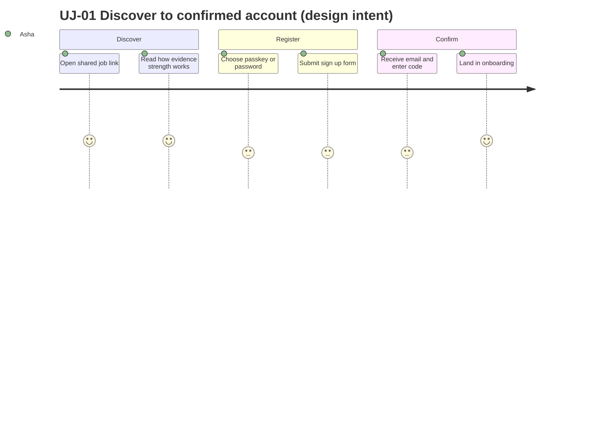

---

### UJ-02 Candidate: onboard → first evidence

**Actor:** ROLE-CAND. **Success:** first evidence item saved within 7 days (activation, STR-01 §8). **Screens:** CAND-02, CAND-08, CAND-09, CAND-01, MSG-04.

| #   | Step                                                         | Screen / touchpoint      | Emotion                     | Risk                                             | Failure → recovery                                                                                             |
| --- | ------------------------------------------------------------ | ------------------------ | --------------------------- | ------------------------------------------------ | -------------------------------------------------------------------------------------------------------------- |
| 1   | Chooses goals and skills                                     | CAND-02 steps 1–2        | Engaged                     | Unfamiliar taxonomy terms                        | Typeahead suggests nearest skill; free tags allowed                                                            |
| 2   | Optionally imports résumé                                    | CAND-02 step 3           | Hopeful, wary of data use   | Parse errors; AI budget exhausted; privacy worry | Items arrive as _suggestions_ to accept one by one (never auto-saved, INV-T08); manual path; "why we ask" text |
| 3   | Sets visibility defaults                                     | CAND-02 step 4           | Cautious                    | Over-sharing fear                                | Defaults Private; plain-language effects; changeable anytime in CAND-04                                        |
| 4   | Picks "Add my first evidence"                                | CAND-02 step 5 → CAND-08 | Motivated, slightly daunted | Not knowing what counts as evidence              | Type chooser with examples; "Better: add from your course" hints                                               |
| 5   | Describes the work, attaches a file/link                     | CAND-08                  | Focused                     | Large upload on poor network; scan delay         | Real byte progress; resume; "scanning" state; save without waiting for scan; local draft                       |
| 6   | Saves; sees it as **Claimed**, understands how to strengthen | CAND-09                  | Proud, then informed        | Disappointment that it isn't "verified"          | Honest copy: "Saved as Claimed. Add proof or ask someone to attest." Clear next steps, no shaming              |
| 7   | Gets a gentle reminder to ask an attester                    | MSG-04, email (opt-in)   | Neutral                     | Nudge fatigue                                    | User-controlled cadence; max 2 nudges; off in preferences                                                      |

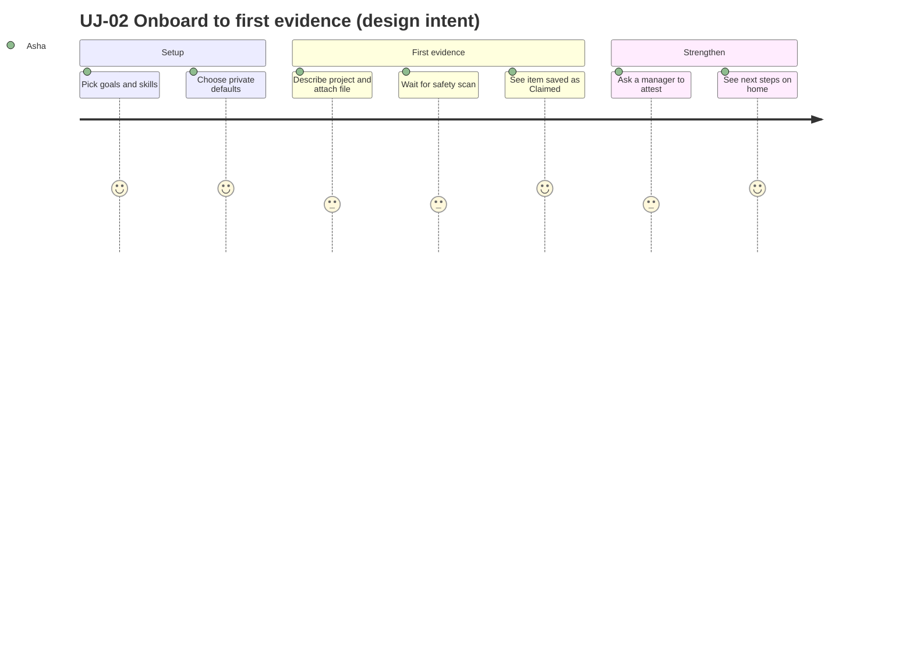

---

### UJ-03 Candidate: verify work history through a referee

**Actor:** ROLE-CAND with ROLE-REFEREE (counterpart in UJ-17). **Rules:** token hashed, single-use, bound to the request (INV-T05); expiry 14 days, max 2 reminders (BR-T004). **Screens:** CAND-10/11/12/13, SHELL-09/10, CAND-09.

| #   | Step                             | Screen / touchpoint                               | Emotion                       | Risk                      | Failure → recovery                                                                                |
| --- | -------------------------------- | ------------------------------------------------- | ----------------------------- | ------------------------- | ------------------------------------------------------------------------------------------------- |
| 1   | Adds a role as a claim (Claimed) | CAND-10                                           | Neutral                       | Dates/typos               | Validation; edit later (before any attestation)                                                   |
| 2   | Chooses "Ask a referee"          | CAND-11                                           | Slightly anxious about asking | Awkwardness; wrong person | Preview of the email; guidance on who to ask; relationship field                                  |
| 3   | Sends request                    | CAND-12                                           | Relieved                      | Wrong email               | Confirm screen shows address; cancel allowed (ACT-VER-04)                                         |
| 4   | Waits                            | CAND-11/13 status: Requested → Opened → Submitted | Uncertain                     | Silence; no response      | Timeline with dates; "We'll tell you when Priya responds"; 1st reminder after 3 days (ACT-VER-03) |
| 5   | Referee confirms or declines     | SHELL-09 (UJ-17)                                  | —                             | Decline hurts             | Neutral decline wording to candidate: "Priya couldn't confirm this"; option to ask someone else   |
| 6   | Sees updated status              | CAND-09                                           | Pleased                       | Misreading what changed   | Evidence shows **Peer-attested by Priya (manager)**; not called "verified"                        |
| 7   | Request expires                  | CAND-13                                           | Disappointed                  | Giving up                 | Expiry notice; "Send a new request" (ACT-VER-08)                                                  |

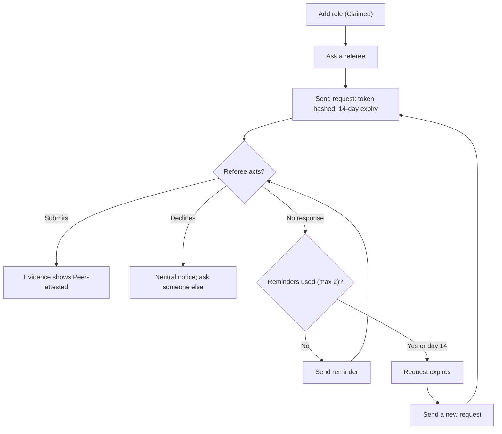

---

### UJ-04 Candidate: learn → assess → earn evidence

**Actor:** ROLE-CAND. **Rules:** lesson completion server-confirmed; `AI_PROHIBITED` enforced server-side (INV-T06); sandbox absent ⇒ results Unverified (ADR-T13); anomaly ≠ guilt (INV-T20). **Screens:** LRN-02/03/04/05, ACC-08/13, LRN-07/08/09/10/11, CAND-09.

| #   | Step                                  | Screen / touchpoint    | Emotion                  | Risk                                   | Failure → recovery                                                                       |
| --- | ------------------------------------- | ---------------------- | ------------------------ | -------------------------------------- | ---------------------------------------------------------------------------------------- |
| 1   | Finds a course tied to a target skill | LRN-02/03              | Motivated                | Choice overload                        | Filters; outcomes shown as "evidence you can earn"                                       |
| 2   | Enrols (free) or buys                 | LRN-03, Stripe, ACC-13 | Cautious                 | Paid but no access                     | Access only after verified webhook; "Confirming your payment…" (INV-T17); email fallback |
| 3   | Watches lessons                       | LRN-04                 | Focused                  | Captions missing, poor network         | Captions mandatory at publish; resume position; text fallback                            |
| 4   | Completes; asks to add to evidence    | LRN-05 → CAND-09       | Satisfied                | Over-claiming                          | Rung assigned by server per issuer; copy explains                                        |
| 5   | Starts an assessment                  | LRN-08                 | Nervous                  | Rules unclear; AI use confusion        | Plain rules incl. "AI assistance is off"; accommodations request (ACT-ASM-09)            |
| 6   | Takes it                              | LRN-09                 | Pressured                | Connection drop; timer anxiety         | Server-authoritative timer; local buffer; milestone-only announcements                   |
| 7   | Gets result                           | LRN-10                 | Relieved or disappointed | Unverified code result misread as pass | Honest label "Unverified — automated grading isn't available yet"; no evidence minted    |
| 8   | If flagged: sees "Review requested"   | LRN-11                 | Worried                  | Feeling accused                        | Neutral copy; human review; appeal (ACT-ASM-08)                                          |

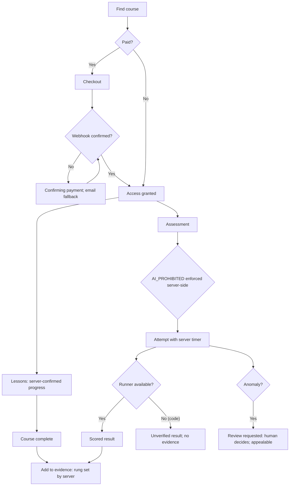

---

### UJ-05 Candidate: find a job → understand the match → apply

**Actor:** ROLE-CAND. **Rules:** match explanation shows strengths, gaps, uncertainty, never payment-ranked (INV-T19); one active application per job (BR-T001); evidence sharing consent purpose-bound (INV-T15). **Screens:** OPP-01/02/03, CAND-08, OPP-06/08.

| #   | Step                                      | Screen / touchpoint | Emotion            | Risk                      | Failure → recovery                                                                 |
| --- | ----------------------------------------- | ------------------- | ------------------ | ------------------------- | ---------------------------------------------------------------------------------- |
| 1   | Searches and filters                      | OPP-01              | Exploring          | Irrelevant results        | Filters; saved search/alert; clear filters                                         |
| 2   | Reads "Why this matched"                  | OPP-02              | Curious            | Distrust of scores        | Words not numbers; inputs and missing information listed; "Ask a person to review" |
| 3   | Sees a gap, chooses to add evidence first | OPP-02 → CAND-08    | Motivated          | Losing place              | Return link preserves job; draft saved                                             |
| 4   | Starts application                        | OPP-06 step 1       | Focused            | Re-typing data            | Prefill (3.3.7); résumé variant select                                             |
| 5   | Chooses evidence to share and consents    | OPP-06 step 2       | Careful            | Privacy worry             | Per-item preview; unticked consent; purpose/duration plain text                    |
| 6   | Answers screening questions               | OPP-06 step 3       | Neutral            | Fear of auto-rejection    | Copy: "People review answers"; no auto-reject (INV-T09)                            |
| 7   | Reviews and submits                       | OPP-06 step 4       | Anxious → relieved | Double submit; job closes | Idempotent; closed job keeps draft; persistent confirmation                        |
| 8   | Tracks status                             | OPP-07/08           | Hopeful            | Silence                   | Timeline with human-set stages and dates                                           |

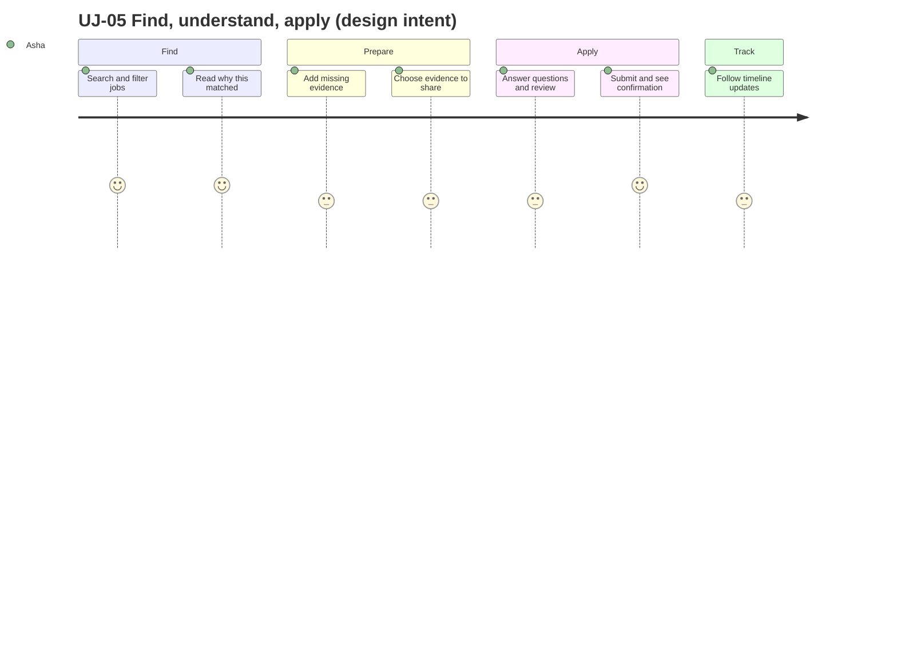

---

### UJ-06 Candidate: interview → offer → outcome

**Rules:** stage changes are made by people (INV-T09); offers confirmed with step-up; "Not moving forward" carries a human actor and reason category; candidate can ask for human review (ACT-PRV-08). **Screens:** OPP-08/09/10, MSG-02.

| #   | Step                          | Screen / touchpoint | Emotion           | Risk                              | Failure → recovery                                                                                                             |
| --- | ----------------------------- | ------------------- | ----------------- | --------------------------------- | ------------------------------------------------------------------------------------------------------------------------------ |
| 1   | Receives interview invitation | Push/email → OPP-09 | Excited           | Time-zone mistakes; missed notice | Slot list with explicit time zone; ICS; reminders per preferences                                                              |
| 2   | Picks slot or proposes others | OPP-09              | Relieved          | Slot taken                        | Atomic select; refreshed list message                                                                                          |
| 3   | Prepares and attends          | OPP-08 notes        | Nervous           | Accessibility needs               | Accommodation note path; message recruiter                                                                                     |
| 4   | Receives offer                | OPP-10              | Elated / cautious | Pressure, ambiguity               | Expiry stated as fact; terms displayed; message thread; no countdown theatrics                                                 |
| 5a  | Accepts                       | OPP-10              | Relieved          | Accidental accept                 | Review + step-up + confirm dialog                                                                                              |
| 5b  | Declines                      | OPP-10              | Neutral           | —                                 | Optional reason                                                                                                                |
| 6   | Or "Not moving forward"       | OPP-08              | Disappointed      | Opaque rejection                  | Respectful template; reason category; "Ask for a person to review" (ACT-PRV-08); suggestions for similar roles (no guarantees) |

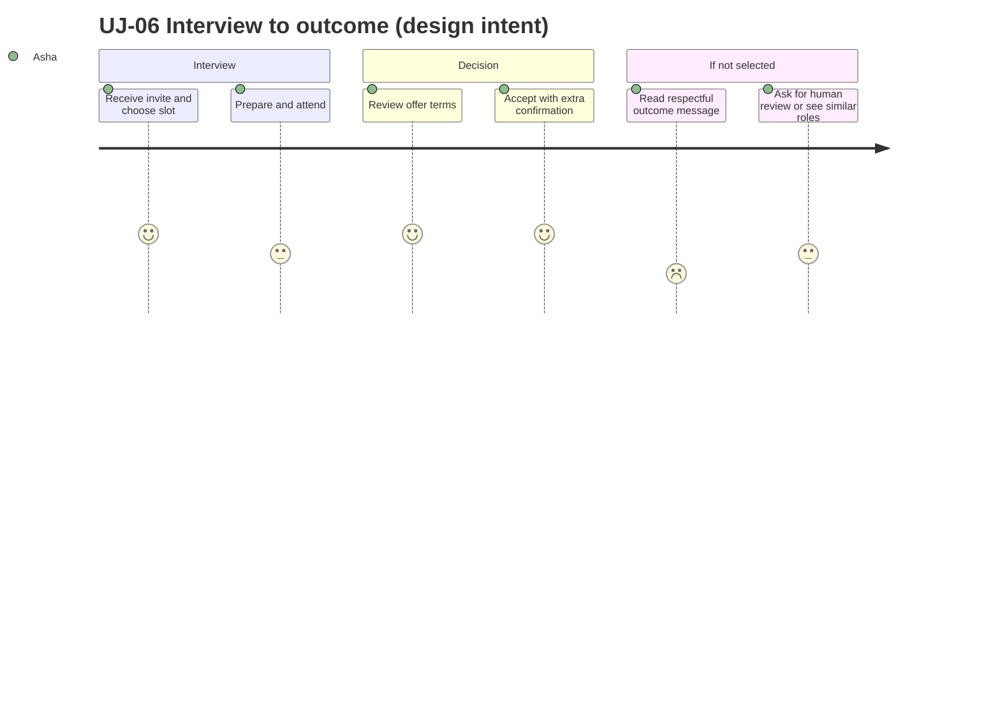

---

### UJ-07 Candidate: grow — readiness, transitions, next learning

| #   | Step                               | Screen / touchpoint | Emotion   | Risk                            | Failure → recovery                                                                 |
| --- | ---------------------------------- | ------------------- | --------- | ------------------------------- | ---------------------------------------------------------------------------------- |
| 1   | Opens Career                       | CAND-17             | Curious   | "Not enough data" feels useless | Explains inputs and how to add data; no fabricated scores                          |
| 2   | Explores target transitions        | CAND-18             | Inspired  | Over-confident forecasts        | Ranges and uncertainty shown; table alternative                                    |
| 3   | Sees salary context                | CAND-19             | Informed  | Small samples misleading        | Sample size shown; hidden when insufficient                                        |
| 4   | Starts a learning path             | LRN-06 (ACT-LRN-10) | Committed | Plan too big                    | Steps with prerequisites, pause anywhere                                           |
| 5   | Earns new evidence → loop restarts | UJ-04 → CAND-09     | Progress  | Plateau                         | Home next-step card rules; opt-in nudges                                           |
| 6   | Considers premium tools            | ACC-08              | Wary      | Dark patterns                   | Statement: evidence, applying, messaging always free; plain comparison; no pop-ups |

---

### UJ-08 Candidate: reactivate after dormancy

**Trigger:** returns after months; account may be paused (ACT-ACC-10) or just inactive. **Screens:** SHELL-02, ACC-15, ACC-09, CAND-01, CAND-07.

| #   | Step                               | Screen / touchpoint       | Emotion    | Risk                               | Failure → recovery                                                                 |
| --- | ---------------------------------- | ------------------------- | ---------- | ---------------------------------- | ---------------------------------------------------------------------------------- |
| 1   | Clicks email/push or visits        | SHELL-02                  | Uncertain  | Forgot credentials, device changed | Passkey/recovery (UJ-10)                                                           |
| 2   | Logs in; terms/privacy changed     | SHELL → re-consent dialog | Impatient  | Forced acceptance dark pattern     | Plain summary of changes; decline = remain paused/read-only to export (ACT-ACC-11) |
| 3   | Sees "Welcome back" status summary | CAND-01                   | Reassured  | Stale data                         | Shows: evidence expiring/stale, consent scopes expired, open applications' states  |
| 4   | Reviews sharing                    | ACC-09                    | Careful    | Old consents still active          | Expired scopes marked; nothing silently renewed                                    |
| 5   | Refreshes profile/evidence         | CAND-03/07                | Re-engaged | Overwhelm                          | One "Next step" card                                                               |
| 6   | Re-subscribes to alerts            | OPP-04, ACC-04            | Interested | Push unsupported                   | Email fallback                                                                     |

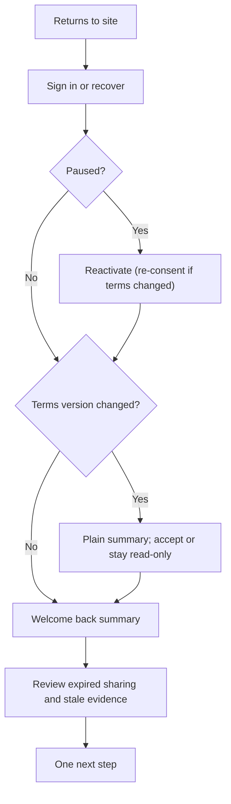

---

### UJ-09 Candidate: pause, export, delete account

**Rules:** erasure completes within 30 days except legally retained records (BR-T060, OPEN-08); typed confirmation + step-up; cancellation window [OPEN-UX-27]. **Screens:** ACC-15, ACC-11, ACC-10.

| #   | Step                        | Screen / touchpoint    | Emotion            | Risk                          | Failure → recovery                                                                                                         |
| --- | --------------------------- | ---------------------- | ------------------ | ----------------------------- | -------------------------------------------------------------------------------------------------------------------------- |
| 1   | Decides to leave            | ACC-15                 | Tired / conflicted | Wanting a break, not deletion | "Pause" offered first (reversible); explains difference                                                                    |
| 2   | Exports data                | ACC-11 (ACT-PRV-04/05) | Careful            | Large export wait             | "We're preparing this; we'll notify you" (no % bar); 7-day link; step-up for download                                      |
| 3   | Reviews what deletion means | ACC-11                 | Anxious            | Not knowing what is kept      | Retained-record list (billing/audit) stated plainly [OPEN-08]; effect on applications, shared evidence, issued credentials |
| 4   | Confirms deletion           | ACC-11 (ACT-PRV-06)    | Resolute           | Accidental deletion           | Typed "DELETE" + step-up; receipt with date                                                                                |
| 5   | Waits through grace period  | Email + ACC-11 status  | Uncertain          | Regret                        | Cancel deletion within window (ACT-PRV-07); sign-in shows banner                                                           |
| 6   | Completion                  | Email                  | Closure            | Residual data                 | Confirmation after `erasure.completed`; retained categories listed                                                         |

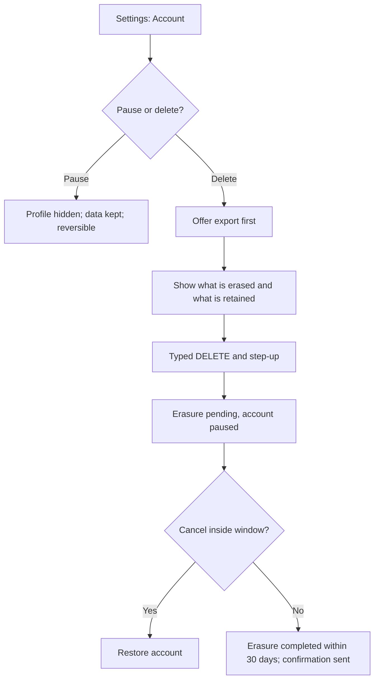

---

### UJ-10 Any user: recover access (lost passkey / locked / forgot password)

| #   | Step                              | Screen / touchpoint                  | Emotion        | Risk                   | Failure → recovery                                                   |
| --- | --------------------------------- | ------------------------------------ | -------------- | ---------------------- | -------------------------------------------------------------------- |
| 1   | Cannot use passkey/password       | SHELL-02/07                          | Frustrated     | Dead end               | "Can't use your passkey?" (ACT-AUTH-13) always visible               |
| 2   | Requests recovery by email        | SHELL-05/07                          | Anxious        | Email access also lost | Support route (UJ-18) with identity checks [OPEN]; no instant bypass |
| 3   | Gets code/link; proves control    | SHELL-06                             | Relieved       | Phishing look-alikes   | Clear sender, link goes to same origin; no secrets in query          |
| 4   | Sets new password or adds passkey | SHELL-06 → ACC-02                    | Cautious       | Weak reuse             | Breach check; passkey nudge                                          |
| 5   | Security cool-off                 | Banner on sensitive actions for 24 h | Mildly annoyed | Legit user blocked     | Explained; existing devices notified; can still apply/read           |
| 6   | Reviews sessions                  | ACC-03                               | Reassured      | Unknown devices        | Revoke all others (ACT-ACC-05)                                       |

---

### UJ-11 Recruiter: set up → post a job → shortlist → hire

**Actor:** ROLE-REC (P2 Marcus, 40 open reqs, desktop-first). **Rules:** no auto-reject (INV-T09); consent-gated evidence (INV-T15); no pay-to-rank (INV-T19). **Screens:** HIR-20/01/02/03/05/06/09/10/11/12.

| #   | Step                                      | Screen / touchpoint    | Emotion      | Risk                                  | Failure → recovery                                                                                       |
| --- | ----------------------------------------- | ---------------------- | ------------ | ------------------------------------- | -------------------------------------------------------------------------------------------------------- |
| 1   | Joins via invite; sets up workspace       | SHELL-12 → HIR-20      | Efficient    | Wrong org/role                        | Accept screen shows org + role; switch workspace                                                         |
| 2   | Creates job from template                 | HIR-03/04              | Focused      | Biased language; incomplete data      | Advisory lint; required skills as taxonomy; review before publish                                        |
| 3   | Publishes                                 | HIR-03 (ACT-HIRE-03)   | Confident    | Content flagged for review            | "Pending review" with reason; fix and resubmit                                                           |
| 4   | Reviews incoming applications             | HIR-05                 | Overloaded   | Volume; temptation to filter by score | Pipeline ordered by time/stage; match explanation per candidate, no score; filters by must-have evidence |
| 5   | Opens candidate; reads evidence by rung   | HIR-06                 | Evaluating   | Consent-hidden evidence               | Lock state + request access; provenance explained                                                        |
| 6   | Moves stages; bulk messages               | HIR-05/12              | In flow      | Bulk errors                           | Per-item results; retry failed; idempotent                                                               |
| 7   | Schedules interviews; collects scorecards | HIR-09/10              | Coordinating | Time zones                            | Explicit zones; ICS                                                                                      |
| 8   | Sends offer; marks hired                  | HIR-11, ACT-PIPE-11/12 | Satisfied    | Mistakes in offer                     | Review step; approval per policy                                                                         |
| 9   | Closes the job; notifies others           | ACT-HIRE-05            | Closure      | Un-notified candidates                | Template for "Position filled"; human bulk action for remaining                                          |

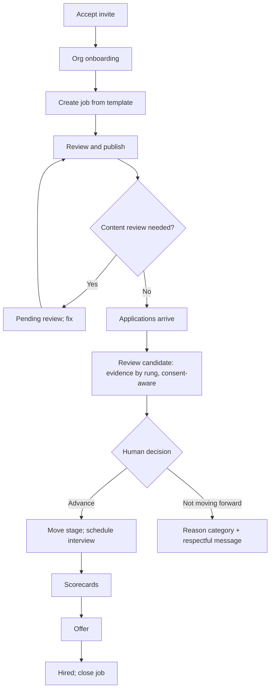

---

### UJ-12 Recruiter: verified search → consent-gated outreach

| #   | Step                                        | Screen / touchpoint | Emotion       | Risk                                      | Failure → recovery                                                                       |
| --- | ------------------------------------------- | ------------------- | ------------- | ----------------------------------------- | ---------------------------------------------------------------------------------------- |
| 1   | Searches by skill and minimum evidence rung | HIR-07              | Goal-directed | Results feel like ranking by money        | Explanation shown; copy states payment never affects order; only discoverable candidates |
| 2   | Opens a result                              | HIR-07/06           | Evaluating    | Evidence hidden by consent                | Lock state; "Request access" (ACT-PIPE-14)                                               |
| 3   | Adds to shortlist                           | ACT-PIPE-13         | Productive    | Consent expiry                            | Expiry flags on shortlist rows                                                           |
| 4   | Sends outreach                              | HIR-13 (ACT-MSG-06) | Hopeful       | Quota exhausted; unwanted spam perception | Quota shown; templates must state role/org; candidate can mute/block                     |
| 5   | Candidate replies / grants access           | MSG-02, ACC-09      | Waiting       | Slow response                             | Status chips; no repeated nudges beyond policy                                           |
| 6   | Candidate declines                          | MSG-02              | Disappointed  | Persistence                               | Respect block; no re-contact                                                             |

---

### UJ-13 Hiring manager: review → scorecard → decision

**Actor:** ROLE-HM (assigned jobs only).

| #   | Step                                   | Screen / touchpoint  | Emotion    | Risk                               | Failure → recovery                                                                |
| --- | -------------------------------------- | -------------------- | ---------- | ---------------------------------- | --------------------------------------------------------------------------------- |
| 1   | Gets "candidates awaiting your review" | HIR-01               | Busy       | Unclear priority                   | List ordered by age with SLA text                                                 |
| 2   | Opens candidate                        | HIR-06               | Evaluating | Anchoring on others' opinions      | Blind scorecards until own submitted                                              |
| 3   | Reads evidence and fit explanation     | HIR-06 tabs          | Analytical | Over-reading a match chip          | No numeric score; gaps vs unknowns distinguished                                  |
| 4   | Attends interview                      | HIR-09               | Engaged    | Mobile-only context                | Mobile-friendly scorecard                                                         |
| 5   | Submits scorecard                      | HIR-10 (ACT-PIPE-09) | Decisive   | Late edits                         | Immutable; addendum only                                                          |
| 6   | Recommends; recruiter decides          | HIR-06               | Neutral    | Recommendation treated as decision | UI labels "Recommendation (advice)"; stage move requires human action with reason |

---

### UJ-14 Org admin: set up org, SSO, roles, access review

| #   | Step                                      | Screen / touchpoint | Emotion         | Risk                  | Failure → recovery                                    |
| --- | ----------------------------------------- | ------------------- | --------------- | --------------------- | ----------------------------------------------------- |
| 1   | Creates org; completes profile            | HIR-20, HIR-16      | Methodical      | Branding contrast     | Accent colour contrast check                          |
| 2   | Invites members with roles                | HIR-15 (ACT-ORG-01) | Efficient       | Over-privileged roles | Role summaries before send; least-privilege default   |
| 3   | Configures SSO; tests before enforce      | HIR-16 (ACT-ORG-04) | Cautious        | Lockout               | Test login mandatory; break-glass owner               |
| 4   | Assigns seats; sees billing               | HIR-15, ACC-07      | Neutral         | Surprise charges      | Proration preview; entitlements from server           |
| 5   | Quarterly access review prompt            | HIR-15              | Mildly burdened | Skipped reviews       | Prompt with keep/remove per member; overdue reminders |
| 6   | Removes a leaver                          | ACT-ORG-03          | Routine         | Orphaned jobs         | Reassign owned jobs first                             |
| 7   | Handles an employee's data-rights request | HIR-19 (ACT-ORG-09) | Careful         | SLA miss              | SLA clock; escalate to platform                       |

---

### UJ-15 Instructor: build, publish, attest outcomes

| #   | Step                                | Screen / touchpoint | Emotion      | Risk                                     | Failure → recovery                                                               |
| --- | ----------------------------------- | ------------------- | ------------ | ---------------------------------------- | -------------------------------------------------------------------------------- |
| 1   | Creates course                      | LRN-13/14           | Creative     | Scope too large                          | Outline-first authoring; drafts autosave                                         |
| 2   | Adds lessons with media             | LRN-15              | Productive   | Large uploads; missing captions          | Resumable upload; captions required before publish (checklist)                   |
| 3   | Defines assessments and AI policy   | LRN-16              | Careful      | Forgetting AI policy; runner unavailable | `AI_PROHIBITED` default for graded; warning that code results will be Unverified |
| 4   | Passes publish checklist; publishes | LRN-14 (ACT-STU-04) | Anticipating | Blocked by checklist                     | Failures listed with links                                                       |
| 5   | Monitors learners                   | LRN-17              | Attentive    | Seeing too much personal data            | Consent-limited fields only                                                      |
| 6   | Confirms learner outcomes           | LRN-17 (ACT-STU-07) | Responsible  | Wrong rung expectations                  | Human decision per learner; rung set by server [OPEN-UX-26]                      |
| 7   | Reviews earnings                    | LRN-18              | Interested   | Feature not ready                        | Hidden until OPEN-06                                                             |

---

### UJ-16 Institution admin & faculty: cohort → coverage → credentials

**Actors:** ROLE-INSTADM, ROLE-FAC (P3 Dr. Lin). **Rules:** faculty see cohort skill coverage without private job-search data; aggregates only with small-cell suppression; credentials issued by humans; graduates own their identity (STR-01). **Screens:** ADM-17/18/19/20/21/22.

| #   | Step                                           | Screen / touchpoint             | Emotion      | Risk                    | Failure → recovery                                              |
| --- | ---------------------------------------------- | ------------------------------- | ------------ | ----------------------- | --------------------------------------------------------------- |
| 1   | Creates cohort; selects consent-notice wording | ADM-18/19 (ACT-INS-01/08)       | Organised    | Legal wording gaps      | Versioned templates; cannot free-edit legal text                |
| 2   | Invites learners in bulk                       | ADM-19 (ACT-INS-02)             | Hopeful      | Bad CSV; bounced emails | Validation before commit; per-item results                      |
| 3   | Learners accept and consent                    | Learner side (SHELL-12, ACC-09) | —            | Low consent rates       | Clear benefit text; opt-in per scope                            |
| 4   | Faculty reviews coverage                       | ADM-17/19 (ACT-INS-05)          | Insightful   | Misreading small groups | Suppression < 10 [OPEN-UX-21]; definitions linked               |
| 5   | Issues credentials after human confirmation    | ADM-20 (ACT-INS-03)             | Responsible  | Wrong learner/batch     | Batch preview; per-item status; revoke with reason (ACT-INS-04) |
| 6   | Exports aggregate report                       | ADM-22 (ACT-INS-06)             | Accomplished | Privacy leakage         | Allowlisted fields; aggregates only                             |

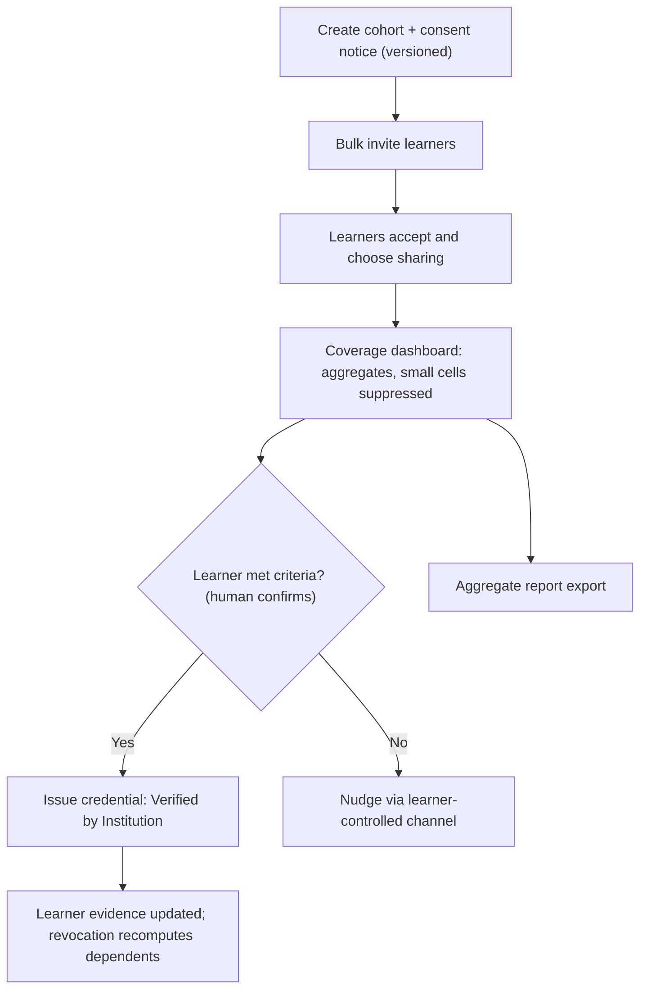

---

### UJ-17 Referee: confirm a role in < 3 minutes, no account

**Actor:** ROLE-REFEREE (P4 Priya, phone, link from email). **Rules:** token hashed, single-use, expiring, bound to one request, never shown back (INV-T05); no account; no marketing. **Screens:** SHELL-09/10.

| #   | Step                                              | Screen / touchpoint | Emotion                    | Risk                                                | Failure → recovery                                                                   |
| --- | ------------------------------------------------- | ------------------- | -------------------------- | --------------------------------------------------- | ------------------------------------------------------------------------------------ |
| 1   | Gets email "Can you confirm Asha's work at Acme?" | Email               | Neutral / maybe suspicious | Phishing doubts                                     | Plain sender, short copy, no attachments; explains what happens; link to same origin |
| 2   | Opens link on phone                               | SHELL-09            | Slightly hurried           | Link opened on desktop later; token in wrong device | Fragment secret; fallback code entry                                                 |
| 3   | Reads claim summary (employer/title/dates)        | SHELL-09            | Recognising                | Overwhelmed by text                                 | ≤ 2 sentences + claim card                                                           |
| 4   | Answers 3–4 questions                             | SHELL-09            | Focused                    | Unsure about dates                                  | "Partly" options with short correction field; optional comment                       |
| 5   | Sends or declines                                 | SHELL-09/10         | Done                       | Misclick                                            | Review-free single-step with clear labels; decline has own button                    |
| 6   | Sees thank-you                                    | SHELL-10            | Relieved                   | Upsell                                              | None; no account prompt; privacy note                                                |
| 7   | (Alt) Link expired/used                           | SHELL-10            | Mildly annoyed             | Re-sent to wrong address                            | "Send me a new link" goes only to original address                                   |
| 8   | (Alt) Not her / misuse                            | ACT-REF-04          | Concerned                  | Harassment                                          | Report path; rate-limited                                                            |

| Time budget | Target                                                        |
| ----------- | ------------------------------------------------------------- |
| Load        | ≤ 1 s on mid-range phone, shell only                          |
| Read        | ≤ 60 s                                                        |
| Answer      | ≤ 90 s (4 questions)                                          |
| Total       | < 180 s (design target; verify by timed walkthrough, OPEN-07) |

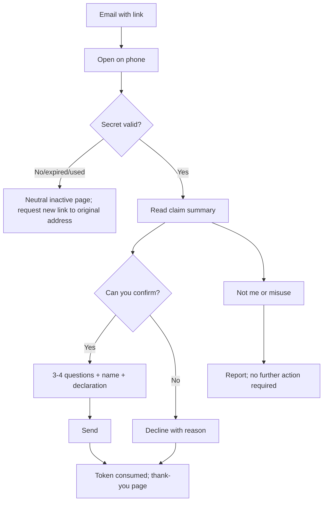

---

### UJ-18 Support operator: scoped, time-boxed access

**Actor:** ROLE-SUP (P5 Sam). **Rules:** reason-coded, ≤ 4 h (BR-T041), read-only, audited, visible to the person (INV-T18), secrets never shown (INV-T14). **Screens:** ADM-12/02/03/04/11, ACC-10 (subject view).

| #   | Step                                                   | Screen / touchpoint | Emotion    | Risk                       | Failure → recovery                                               |
| --- | ------------------------------------------------------ | ------------------- | ---------- | -------------------------- | ---------------------------------------------------------------- |
| 1   | Picks up a case                                        | ADM-02              | Focused    | Pressure to bypass process | Case id mandatory for any access request                         |
| 2   | Looks up the subject with minimal fields               | ADM-12 (ACT-SUP-08) | Efficient  | Over-collection            | Masked results; rate-limited and audited searches                |
| 3   | Requests access with reason, scope, duration           | ADM-03 (ACT-SUP-01) | Deliberate | Choosing 4 h by default    | Default 1 h; justification required; step-up                     |
| 4   | Works in the session workspace                         | ADM-04              | Careful    | Accidentally changing data | No write/impersonate controls exist; persistent banner           |
| 5   | Needs a masked field                                   | ACT-SUP-04          | Hesitant   | Habitual unmasking         | Per-field reason; auto re-mask; every reveal audited             |
| 6   | Resolves via guidance / data-rights assist / escalates | ACT-SUP-06/07       | Satisfied  | Out-of-scope request       | Escalation path; cannot execute erasure alone                    |
| 7   | Ends access (or it expires)                            | Banner, ACT-SUP-02  | Relieved   | Forgetting to end          | Auto-expiry; notes retained; user sees entry in their access log |

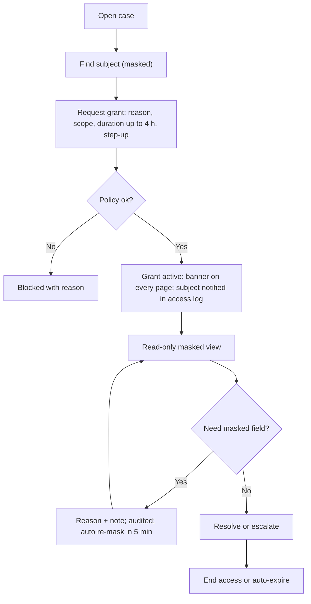

---

### UJ-19 Moderator: report → decision → appeal; integrity review

**Rules:** human decisions (INV-T09); anomaly ≠ guilt, appealable (INV-T20); appeal decided by a different moderator. **Screens:** ADM-05/06/07/08/14, LRN-11 (subject).

| #   | Step                                  | Screen / touchpoint | Emotion     | Risk                      | Failure → recovery                                             |
| --- | ------------------------------------- | ------------------- | ----------- | ------------------------- | -------------------------------------------------------------- |
| 1   | Report arrives (user, system flag)    | ADM-05              | Alert       | Volume; graphic content   | Severity sorting; content blurred by default                   |
| 2   | Opens case; reviews context           | ADM-06              | Careful     | Bias; incomplete context  | Context panel with history; request more info (ACT-MOD-04)     |
| 3   | Decides with reason                   | ACT-MOD-02          | Responsible | Disproportionate action   | Decision options incl. no action/warn; reason ≥ 20 chars       |
| 4   | Parties notified; appeal option       | Notification        | —           | Opaque outcome            | Plain-language reason; appeal link                             |
| 5   | Appeal handled by different moderator | ADM-06 (ACT-MOD-07) | Fair-minded | Same decider              | System blocks same decider                                     |
| 6   | Integrity review queue                | ADM-07 (ACT-MOD-05) | Cautious    | Treating anomaly as guilt | Outcomes: no concern / retake / invalidate; candidate notified |

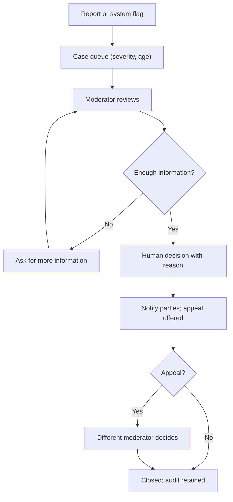

---

### UJ-20 Platform admin: remote failure → rollback; access review

**Actor:** ROLE-ADM. **Rules:** remote failure containment (GOAL-08, ADR-T18): shell falls back to last-known-good; all privileged changes audited and require step-up. **Screens:** ADM-15, ADM-09, ADM-16, ADM-10.

| #   | Step                                  | Screen / touchpoint    | Emotion     | Risk                               | Failure → recovery                                                    |
| --- | ------------------------------------- | ---------------------- | ----------- | ---------------------------------- | --------------------------------------------------------------------- |
| 1   | Alert: error spike on a remote        | Observability → ADM-15 | Urgent      | Panic changes                      | Remote health per release; clear LKG indicator                        |
| 2   | Confirms incompatibility or defect    | ADM-15                 | Focused     | Misdiagnosis                       | Compat status and trace links                                         |
| 3   | Rolls back or pins version            | ADM-15 (ACT-ADM-02/03) | Decisive    | Rolling back to incompatible build | Block if fails Host Contract check                                    |
| 4   | Flags off dependent feature if needed | ADM-09 (ACT-ADM-01)    | Careful     | Wrong environment                  | Environment + reason + confirm                                        |
| 5   | Publishes status notice               | ACT-ADM-09             | Transparent | Over/under-communicating           | Template wording                                                      |
| 6   | Monthly privileged access review      | ADM-16 (ACT-ADM-07)    | Routine     | Rubber-stamping                    | Per-grant keep/revoke with last-used date; dormant (60 d) auto-expire |

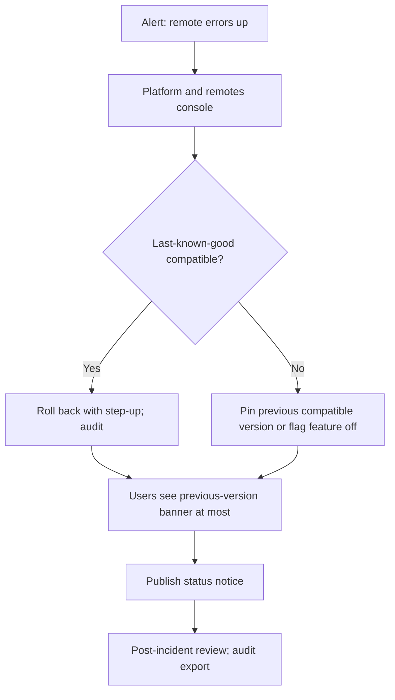

---

### Coverage check against the brief

| Required lifecycle                                                                                                         | Where                                                                                                               |
| -------------------------------------------------------------------------------------------------------------------------- | ------------------------------------------------------------------------------------------------------------------- |
| Candidate: discover, register, verify, onboard, first evidence, apply, interview, offer, grow, reactivate, offboard/delete | UJ-01, 02, 03, 05, 06, 07, 08, 09 (+ UJ-04 learn, UJ-10 recovery)                                                   |
| Recruiter                                                                                                                  | UJ-11, UJ-12                                                                                                        |
| Hiring manager                                                                                                             | UJ-13                                                                                                               |
| Org admin                                                                                                                  | UJ-14                                                                                                               |
| Instructor                                                                                                                 | UJ-15                                                                                                               |
| Faculty / institution admin                                                                                                | UJ-16                                                                                                               |
| Referee (< 3 min, no account)                                                                                              | UJ-17                                                                                                               |
| Support operator                                                                                                           | UJ-18                                                                                                               |
| Moderator                                                                                                                  | UJ-19                                                                                                               |
| Platform admin                                                                                                             | UJ-20                                                                                                               |
| Diagrams (≥ 8)                                                                                                             | 14 Mermaid diagrams: journey charts for UJ-01, 02, 05, 06; flowcharts for UJ-03, 04, 08, 09, 11, 16, 17, 18, 19, 20 |

#### Root SSOT journey identity crosswalk (candidate; OPEN-45)

The protected root `SSOT.md` defines 28 canonical `J-*` journeys. This target document defines 20 `UJ-*` journeys; their identifiers and counts are not interchangeable. The row-level candidate comparison, residuals and historical verification limits are maintained in the [historical audit journey crosswalk](28_TRACEABILITY_AND_COVERAGE_PART2.md#audit_journey_evidence_crosswalkcsv). It now records 22 partial candidates and 6 journeys with no direct match in this target catalog; neither category approves adoption or claims implementation.

The root SSOT also enumerates 19 persona rows (P-A…P-T with P-P absent); USR-01 currently has five hypothetical personas. Persona and journey reductions remain explicit coverage gaps for OPEN-45 review, not an approved retirement of those user segments.

### Open items

| ID         | Item                                                                                                      |
| ---------- | --------------------------------------------------------------------------------------------------------- |
| OPEN-07    | Validate every hypothesis here with real users (inherited).                                               |
| OPEN-UX-31 | Identity checks for recovery when the person has lost access to email (support-assisted recovery policy). |
| OPEN-UX-32 | Nudge cadence rules and consent for lifecycle email (ties to DOM-15 and K-family "light growth").         |

## Change record: Roles and Permission Matrix, Revision 2 (USR-01 REV2)

_Former file: `Yash_Final_Project_Document/02_STAKEHOLDERS_AND_USERS/PERMISSION_MATRIX_REV2.md`._

Doc ID: USR-01-R2 · Owner: Product Director + Security Architect · Version 2.0 · Status: Proposed (Under Review) · Date: 2026-10-25 · Closes: REVW-28 (and the role parts of REVW-01 residue, REVW-12) · Relates: USR-01 (`STAKEHOLDERS_ROLES_PERMISSIONS.md`), DT-01, BR-T100, BR-T105, INV-T41, ID_REGISTRY roles, OpenAPI `Grant.role`, FEAT-02-03, FEAT-02-06, SM-DSR

**Relationship (no original file was edited).** This file **supersedes, once accepted**, USR-01 section 3 (role model), the table in section 4 (the matrix), and the "Org members & roles" and "Data-rights requests" rows of that table, **only where they differ from the text below**. The normative note of USR-01 stands: DT-01, BR-T100, BR-T105 and INV-T41 win over this table, and `packages/policy` holds the matrix as data derived from DT-01. Personas and USR-01 sections 1, 2, 5 and 6 stand. Governance should link this file from `00_CONTROL_CENTRE/MASTER_INDEX.md`. All content **[TARGET]**.

### 1. Role model: one mapping from grants to matrix columns

A grant is `(principal, role, scope)` with scope ∈ {platform, org:id, institution:id, self}. The matrix columns are the **role families** below. Every role named in the OpenAPI `Grant.role` enum or in the ID registry maps to exactly one column or is stated as absent.

| Grant role (API / registry) | Scope                                         | Matrix column                                          | Notes                                                                                                                                                                           |
| --------------------------- | --------------------------------------------- | ------------------------------------------------------ | ------------------------------------------------------------------------------------------------------------------------------------------------------------------------------- |
| `candidate` (ROLE-CAND)     | self                                          | CAND                                                   |                                                                                                                                                                                 |
| `instructor` (ROLE-INST)    | self (own courses)                            | INST                                                   |                                                                                                                                                                                 |
| `org_owner`                 | org                                           | ORGOWN (new column)                                    | Everything ORGADM can do, plus ownership transfer, org closure, billing owner, grant and revoke of `org_admin` (FEAT-02-03, FEAT-02-08). At least one per org (last-owner rule) |
| `org_admin` (ROLE-ORGADM)   | org                                           | ORGADM                                                 | Members, roles other than owner, org settings, job templates, billing view; **no** candidate content unless also on the job team                                                |
| `recruiter` (ROLE-REC)      | org                                           | REC                                                    | Jobs and applications of jobs where the principal is on the hiring team; search within consent; outreach within quota                                                           |
| `hiring_manager` (ROLE-HM)  | org                                           | HM                                                     | **Only jobs assigned to the principal's hiring team** (FEAT-02-06, DT-01 row 9)                                                                                                 |
| `viewer`                    | org                                           | VIEW (new column)                                      | Read-only on jobs and pipeline counts of jobs on which the principal is placed; no candidate evidence or contact details; no messaging                                          |
| `inst_admin` (ROLE-INSTADM) | institution                                   | INSTADM                                                |                                                                                                                                                                                 |
| `faculty` (ROLE-FAC)        | institution (assigned cohorts)                | FAC                                                    |                                                                                                                                                                                 |
| `proctor`                   | institution                                   | PROCT (new column, Phase 4; absent from Phases 1 to 3) | Invigilation of institution-run assessments only (FEAT-18-10); no learner profile access                                                                                        |
| `moderator` (ROLE-MOD)      | platform                                      | MOD                                                    |                                                                                                                                                                                 |
| `support` (ROLE-SUP)        | platform                                      | SUP                                                    |                                                                                                                                                                                 |
| `admin` (ROLE-ADM)          | platform                                      | ADM                                                    |                                                                                                                                                                                 |
| `auditor` (ROLE-AUD)        | platform                                      | AUD                                                    |                                                                                                                                                                                 |
| ROLE-REFEREE                | none: a single-use token bound to one request | **REFEREE (new column)**                               | No account and no grant; see section 3                                                                                                                                          |
| ROLE-MENTOR                 | self                                          | **MENTOR (new column)**                                | Phase 4 (FEAT-08-11, FEAT-14-06); absent from Phases 1 to 3. No access to a learner's evidence unless the learner shares it through a consent scope                             |
| ROLE-SVC                    | platform or org (API key)                     | **SVC (new column)**                                   | Phase 4 (FEAT-23-07). Scoped by key; no access to personal data unless the key's scope names it and the subject consented; never a human actor for U6                           |

### 2. Matrix additions and corrections

Legend as USR-01: C create · R read · U update · D delete/withdraw · A approve/act · `*` own only · `O` within own org/institution · `S` scoped, time-boxed, reason-coded, audited · `—` none · `T` job team of that job only · `H` assigned hiring-team jobs only.

#### 2.1 Corrected cells (existing columns)

| Resource               | Column | USR-01 now                                              | REV2                                                                                                                                          | Why                                                                                                                                |
| ---------------------- | ------ | ------------------------------------------------------- | --------------------------------------------------------------------------------------------------------------------------------------------- | ---------------------------------------------------------------------------------------------------------------------------------- |
| Job postings           | HM     | `RU(O)`                                                 | **`R, U (H)`** — read and update only jobs assigned to the principal; no read of other org postings                                           | FEAT-02-06, DT-01 row 9                                                                                                            |
| Job postings           | REC    | `CRU(O)`                                                | `CRU (O)`; publish needs `job:publish` and passes DT-12                                                                                       | unchanged meaning, stated                                                                                                          |
| Data-rights requests   | ORGADM | `— (org-owned data via org settings, not personal DSR)` | **`— (cannot file or act on an employee's personal request; the requester must be the subject, SM-DSR t1; org-owned data via org settings)`** | REVW-28 reported "A(O employees)" for this cell; the current USR-01 text is already `—`. This row keeps `—` and records the reason |
| Org members & roles    | ORGADM | `CRUD(O)`                                               | `CRUD(O) for roles below org_owner; cannot create, demote or remove an org_owner`                                                             | `org_owner` and `org_admin` differ (FEAT-02-03.1)                                                                                  |
| Billing / entitlements | ORGADM | `CRU(O)`                                                | `R(O); CRU only if also org_owner`                                                                                                            | Billing owner is the owner                                                                                                         |
| Applications           | HM     | `R, U stage (assigned job team)`                        | unchanged; stated as `H`                                                                                                                      |                                                                                                                                    |
| Verification actions   | INST   | `A (own course evidence)`                               | **`A (own course evidence, issuer_class instructor only; never platform-verified; instructor ≠ learner; BR-T119)`**                           | REVW-12                                                                                                                            |
| Evidence items         | INST   | `CRUD*`                                                 | unchanged for own evidence; **instructor cannot read learner evidence except within their own course (completion record)**                    |                                                                                                                                    |

#### 2.2 New columns

| Resource                        | ORGOWN                                                              | VIEW              | REFEREE                                                                               | MENTOR                                              | SVC               | PROCT                                            |
| ------------------------------- | ------------------------------------------------------------------- | ----------------- | ------------------------------------------------------------------------------------- | --------------------------------------------------- | ----------------- | ------------------------------------------------ |
| Public profile (visible fields) | R                                                                   | R                 | R (request prompt only, not browsing)                                                 | R                                                   | R (public fields) | —                                                |
| Own profile / portfolio         | —                                                                   | —                 | —                                                                                     | CRUD*                                               | —                 | —                                                |
| Evidence items                  | — (no individual evidence reads)                                    | —                 | —                                                                                     | — (only via a consent scope granted by the learner) | —                 | —                                                |
| Verification actions            | —                                                                   | —                 | **A (submit one response for one request; token valid, unused, referee ≠ candidate)** | —                                                   | —                 | —                                                |
| Job postings                    | CRUD(O)                                                             | R (T, read-only)  | —                                                                                     | R                                                   | R (key scope)     | —                                                |
| Applications                    | R recruiter-activity metadata only; content only if on the job team | R counts only (T) | —                                                                                     | —                                                   | —                 | —                                                |
| Messaging                       | R(O) metadata                                                       | —                 | —                                                                                     | CR (own mentoring threads, Phase 4)                 | —                 | —                                                |
| Courses                         | —                                                                   | —                 | —                                                                                     | R                                                   | R (key scope)     | —                                                |
| Assessments & attempts          | —                                                                   | —                 | —                                                                                     | —                                                   | —                 | A (invigilate institution-run attempts, Phase 4) |
| Org members & roles             | CRUD(O) incl. `org_admin` and `org_owner`                           | R (O, names only) | —                                                                                     | —                                                   | —                 | —                                                |
| Billing / entitlements          | CRU(O)                                                              | —                 | —                                                                                     | —                                                   | —                 | —                                                |
| Audit log                       | R(O)                                                                | —                 | —                                                                                     | —                                                   | —                 | —                                                |
| Data-rights requests            | —                                                                   | —                 | —                                                                                     | CR*                                                 | —                 | —                                                |
| Moderation queue, feature flags | —                                                                   | —                 | —                                                                                     | —                                                   | —                 | —                                                |

### 3. Referee: why a column and not a role grant

A referee has no account and no grant. The only permission is the single-use, expiring token (INV-T05, INV-T24): read the request prompt (claim title, employer, dates, candidate name), submit exactly one response, and nothing else. The REFEREE column makes that explicit so that policy tests cover it: every other action returns `403`/`404` for a request authenticated by a referee token, and a token for request A never opens request B (INV-T02).

### 4. Roles intentionally absent

| Role                                        | Stated reason                                                                                                                                                                            |
| ------------------------------------------- | ---------------------------------------------------------------------------------------------------------------------------------------------------------------------------------------- |
| `proctor`, `mentor`, `svc` in Phases 1 to 3 | Their features are Phase 4 (PCAP-01); their columns are defined now so the policy matrix is complete, and every cell is denied until the owning feature ships (deny by default, INV-T01) |
| An "impersonation" role                     | Removed on principle (FEAT-20-07)                                                                                                                                                        |

### 5. Tests the matrix must generate (additions to the WP-POLICY-CORE definition of done)

1. For every column and resource, one allow or deny test derived from DT-01 and this table (negative controls included).
2. `viewer` cannot read candidate evidence, contact details or messages (AC-02-03-51).
3. `org_admin` cannot create or demote an `org_owner`; the last owner cannot be removed (AC-02-03.1-01).
4. A hiring manager outside the job team gets `403` on the application (DT-01 row 9).
5. A referee token authenticates nothing outside its request (AC-06-02-*).
6. Instructor sign-off cannot target the instructor's own account (AC-05-04-53).
