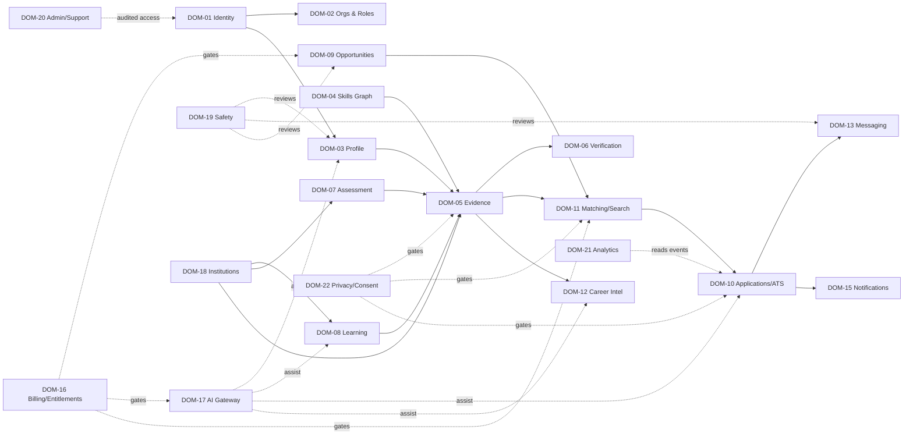

# Target blueprint 03: Business Domains

> **Status.** Archive: proposal, not ratified. A greenfield redesign blueprint written in October 2026. Every area was Draft, Under Review or Revision Required (its own document status) and no test was run against it. Its content was mined into `docs/blueprint/`; `SSOT.md` remains the source of intent. Module federation described here was not adopted: the built system is a modular monolith (`ARCHITECTURE.md`).
>
> **What this file holds.** All files of the former `Yash_Final_Project_Document/03_BUSINESS_DOMAINS/` folder, in order.
>
> **Merged on 2026-11-25** from the files listed below; each one is a section under its original title. Nothing was removed; the originals are in git history at commit `08387ec`.

| Section | Former file |
|---|---|
| Domain Architecture, Bounded Contexts & Coverage | `Yash_Final_Project_Document/03_BUSINESS_DOMAINS/DOMAIN_ARCHITECTURE.md` |
| Legacy Conceptual Model ("BRAIN") merged into the domain architecture | `Yash_Final_Project_Document/03_BUSINESS_DOMAINS/LEGACY_BRAIN_CONCEPTUAL_MODEL.md` |

## Domain Architecture, Bounded Contexts & Coverage

_Former file: `Yash_Final_Project_Document/03_BUSINESS_DOMAINS/DOMAIN_ARCHITECTURE.md`._

Doc ID: DOM-00 · Owner: Enterprise Architect · Version 1.0 · Status: Under Review · IDs per `00_CONTROL_CENTRE/ID_REGISTRY.md`

### 1. Method

Domains were derived from the value stream (Learn→Prove→Showcase→Match→Apply→Hire→Grow), actor goals, and the 24 domain families of the mission brief, then **cross-checked against** (not copied from) the reference code layout. Each family was classified Core / Supporting / Enabling / Conditional / Exploratory / Not applicable.

### 2. Context map



Integration style: synchronous calls only through each module's **public service interface** (`api/<module>/index.ts`); cross-domain reactions via **outbox events** (ADR-T05/T09). No module reads another module's tables (fitness function FF-02).

**Source-boundary reconciliation (OPEN-47):** root `SSOT.md` §12 (including bounded contexts §12.10–§12.11, v6.2 numbering) describes a domain-oriented modular monolith with explicit cross-domain interfaces and no direct table coupling. This target context map consolidates and repartitions some of those source domains and the target frontend retains optional runtime federation. The boundary changes are proposed, not owner-approved supersessions; reconcile ownership, synchronous interfaces, event boundaries, and release coupling before architecture readiness is claimed.

### 3. Context ownership summary

| Context         | Aggregate roots                                  | Publishes (examples)                                 | Consumes                                |
| --------------- | ------------------------------------------------ | ---------------------------------------------------- | --------------------------------------- |
| Identity        | Account, Session, Passkey, Device                | `account.registered`, `session.revoked`              | —                                       |
| Orgs            | Organization, Membership, RoleGrant              | `org.member.added`                                   | `account.*`                             |
| Profile         | Profile, Portfolio, ResumeVariant                | `profile.updated`                                    | —                                       |
| Skills          | Skill, SkillRelation, Competency                 | `skill.merged`                                       | —                                       |
| Evidence        | EvidenceItem, Credential                         | `evidence.created/verified/revoked`                  | `assessment.passed`, `course.completed` |
| Verification    | VerificationRequest, ReferenceRequest, WorkClaim | `verification.completed`                             | `evidence.created`                      |
| Assessment      | Assessment, Attempt, IntegritySession            | `assessment.passed`                                  | —                                       |
| Learning        | Course, Enrollment, Path                         | `course.completed`                                   | —                                       |
| Opportunities   | Job, JobTemplate, SavedSearch                    | `job.published`, `job.closed`                        | `org.*`                                 |
| Applications    | Application, Pipeline, Interview                 | `application.submitted`, `application.stage.changed` | `job.*`, `evidence.*`                   |
| Matching/Search | MatchExplanation (derived), SearchIndex          | —                                                    | `job.*`, `evidence.*`, `profile.*`      |
| Messaging       | Conversation, Message                            | `message.sent`                                       | `application.*`                         |
| Notifications   | Notification, Preference, Delivery               | `notification.delivered`                             | all domain events                       |
| Billing         | Subscription, Entitlement, Invoice               | `entitlement.changed`                                | Stripe webhooks                         |
| Privacy         | ConsentRecord, DataRightsRequest                 | `consent.changed`, `erasure.completed`               | —                                       |
| Safety          | Report, ModerationCase                           | `case.resolved`                                      | content events                          |
| Admin           | SupportAccessGrant, AuditEvent, FeatureFlag      | —                                                    | all                                     |

### 4. Domain-family coverage (mission families A–X)

| Family                     | Verdict            | Where / rationale                                                                         |
| -------------------------- | ------------------ | ----------------------------------------------------------------------------------------- |
| A Strategy                 | Core (docs)        | 01_*                                                                                      |
| B Identity & accounts      | Core-enabling      | DOM-01                                                                                    |
| C Orgs, teams, tenancy     | Core-enabling      | DOM-02                                                                                    |
| D Core operations          | Core               | DOM-05/09/10                                                                              |
| E Workflow & automation    | Supporting         | pipelines (DOM-10), jobs (DOM-24); **no generic workflow engine** (rejected, unjustified) |
| F Search & discovery       | Core               | DOM-11                                                                                    |
| G Content & documents      | Supporting         | evidence artifacts, resumes, course media                                                 |
| H Collaboration            | Supporting         | DOM-13                                                                                    |
| I Notifications            | Supporting         | DOM-15                                                                                    |
| J Billing                  | Supporting         | DOM-16                                                                                    |
| K Sales/marketing/growth   | Supporting (light) | referrals, consented lifecycle email in DOM-15/21; no CRM build                           |
| L Support & success        | Supporting         | DOM-20                                                                                    |
| M Admin & back office      | Supporting         | DOM-20                                                                                    |
| N Reporting & analytics    | Supporting         | DOM-21                                                                                    |
| O AI                       | Enabling           | DOM-17                                                                                    |
| P Security, privacy, trust | Core-enabling      | 14_*, DOM-19/22                                                                           |
| Q Legal & compliance       | Conditional        | policy hooks only; no legal claims (OPEN-08)                                              |
| R Data governance          | Core-enabling      | 12_*, DOM-22                                                                              |
| S Integrations             | Conditional        | DOM-23                                                                                    |
| T Infrastructure & ops     | Enabling           | 17__, 18__                                                                                |
| U Multi-platform           | Core               | 08_*                                                                                      |
| V i18n & accessibility     | Core               | 07_* (English at launch; framework-ready, RTL/locale formats designed)                    |
| W Quality & release        | Enabling           | 16_*                                                                                      |
| X Product lifecycle        | Supporting         | 22__, 23__                                                                                |

### 5. Industry packs

Primary: **HR/recruitment + education marketplace**, B2B SaaS + B2C. Specialised actors: recruiter, hiring manager, referee, instructor, faculty. Regulatory-sensitive: automated employment decisions (human-in-loop), candidate personal data, minors in education (OPEN-09), accessibility. Not applicable: banking, healthcare, logistics, IoT.

### 6. Disposition vs reference (summary)

- **Merge:** challenges + skill certification + contests → one assessment engine (DOM-07); notifications + digest + nudges → DOM-15; saved searches + job alerts.
- **Remove:** legacy chat/stub services, sponsored content, business-development graph.
- **Defer:** groups/events/articles (DOM-14 phase 3), video interview recording + AI feedback, identity verification (OPEN-10), proctoring (vendor-gated).
- **Introduce:** policy module, outbox, referee flow as first-class, consent scopes, capability endpoint, sandbox runner.

## Revision 3 additions (patch 2026-10-27, audit gap closure)

### Cross-cutting product rules: applicability

PROPOSED rules, not implemented. Where a rule applies only to some domains the table says so; elsewhere it is N/A with the reason. Legal effect of any rule (for example date handling in contracts) needs counsel verification.

| Rule                        | Applies?                                                                                                                                                                                | PROPOSED rule                                                                                                                                                                                                                                                                                                                                                                                                                                                                                                                    | Domains                                | Test                                                                                                                     |
| --------------------------- | --------------------------------------------------------------------------------------------------------------------------------------------------------------------------------------- | -------------------------------------------------------------------------------------------------------------------------------------------------------------------------------------------------------------------------------------------------------------------------------------------------------------------------------------------------------------------------------------------------------------------------------------------------------------------------------------------------------------------------------- | -------------------------------------- | ------------------------------------------------------------------------------------------------------------------------ |
| Timezone and DST scheduling | **Yes**: interviews, assessment windows, deadlines, notification times, reports                                                                                                         | Store instants in **UTC**; store the user's/event's **IANA zone id** (a region/city name, not a fixed offset) next to any human-scheduled time; render in the viewer's zone and show the zone name; recurring items are stored as local wall time + zone and expanded per occurrence so DST shifts keep the intended local hour; nonexistent local times (spring gap) are rejected, ambiguous ones (autumn overlap) are disambiguated explicitly; deadlines state their zone; zone-database updates are a dependency-update task | DOM-10, DOM-07, DOM-09, DOM-15, DOM-21 | TEST-REL-015                                                                                                             |
| Concurrent-edit policy      | **Yes**, for shared editable records (job posts, pipeline notes and stages, org settings, profile on several devices incl. offline PWA)                                                 | Optimistic concurrency: each editable record carries a version; a write with a stale version is rejected as a conflict and nothing is silently overwritten; the UI offers reload or manual merge; real-time co-editing is N/A in v1 (no evidenced need); offline edits follow INV-T13 and the offline conflict metric MET-045                                                                                                                                                                                                    | DOM-03, DOM-09, DOM-10, DOM-02         | TEST-REL-016                                                                                                             |
| Version history             | **Partly**                                                                                                                                                                              | Yes for evidence, resume versions and consent records (append-only revisions, INV-T11; erasure tombstoning per PRIVACY 6.1); audit trail for org/role/stage changes (events in security doc R3-3). **N/A** for messages (edit/delete policy is a DOM-13 decision) and for general profile fields (current value + audit only)                                                                                                                                                                                                    | DOM-05, DOM-03, DOM-22                 | existing evidence and consent tests                                                                                      |
| Moderation                  | **Yes** where user-generated content is visible to others (reported messages, public profile text, course reviews, job posts); **N/A** for private drafts and unshared private evidence | Human decisions only; automated detectors advisory (INV-T09); action ladder, notice with reason, appeal                                                                                                                                                                                                                                                                                                                                                                                                                          | DOM-19, DOM-13, DOM-14, DOM-09         | existing moderation/appeal tests; PROC-05, PROC-15 in `../18_OPERATIONS_AND_SUPPORT/OPERATIONS_AND_SUPPORT_PROCESSES.md` |

Links: security rules `../14_SECURITY_PRIVACY_COMPLIANCE/SECURITY_ARCHITECTURE.md` R3; tests `../16_QA_AND_TESTING/TEST_CATALOG.md` Revision 3.

## Legacy Conceptual Model ("BRAIN") merged into the domain architecture

_Former file: `Yash_Final_Project_Document/03_BUSINESS_DOMAINS/LEGACY_BRAIN_CONCEPTUAL_MODEL.md`._

Doc ID: DOM-LEG-01 · Owner: Domain Architect · Version 1.0 · Status: Draft for Review · Relates: `DOMAIN_ARCHITECTURE.md` (DOM-00), `../01_EXECUTIVE_AND_STRATEGY/PRODUCT_VISION_AND_BUSINESS_MODEL.md`, `../01_EXECUTIVE_AND_STRATEGY/LEGACY_PRD_PRODUCT_REQUIREMENTS.md`, `../22_IMPLEMENTATION_ROADMAP/LEGACY_PRIOR_ATTEMPT_ROADMAP_AND_LESSONS.md`, `../24_RISKS_AND_DECISIONS/OPEN_DECISIONS_LEGACY_MERGE.md`, `../00_CONTROL_CENTRE/LEGACY_MERGE_LEDGER_A.md`

Supersedes nothing; linked from `../00_CONTROL_CENTRE/LEGACY_MERGE_LEDGER_A.md` and `MASTER_INDEX`. Created under the standing instruction: "i dont want to loos information keep everything in use untile it get improved".

### Merged from legacy: `31_LEGACY_ARCHIVE/BRAIN/BRAIN.md` (v6.0, conceptual model)

(`docs/history/PROJECT_HISTORY.md` is merged separately into `22_IMPLEMENTATION_ROADMAP/LEGACY_PRIOR_ATTEMPT_ROADMAP_AND_LESSONS.md` and `24_RISKS_AND_DECISIONS/OPEN_DECISIONS_LEGACY_MERGE.md`.)

### 0. Frame

**Nothing is implemented.** The prior attempt kept a short "how to think about the system" note for coding agents. It is a conceptual model, not a design. Every statement is a requirement candidate or design heuristic for this project; none is evidence of a built system.

### 1. How to think about the system

TalentSphere is not primarily a job board, learning site, social network or AI wrapper. It is a **career evidence system**.

Core mental model:

```text
GOAL
-> CAPABILITY GAP
-> ACTIVITY
-> EVIDENCE
-> VERIFICATION
-> OPPORTUNITY
-> OUTCOME
-> NEW EVIDENCE
```

### 2. Claim vs evidence (legacy definitions)

| Term          | Meaning                             |
| ------------- | ----------------------------------- |
| Profile claim | What a user says.                   |
| Evidence      | What supports the claim.            |
| Verification  | Who or what validated the evidence. |
| Reputation    | Context around trust and behaviour. |

Target alignment: the target evidence ladder (four rungs: claimed, artifact-backed, peer-attested, authority-verified; INV-T04 "a claim is never displayed as verified") refines the first three terms. The legacy fourth term, **reputation as context, not as a score a person can set**, matches legacy rules BR-164..BR-168 (reputation derived, skill-specific, time-decayed, private by default, auditable). Target `DOMAIN_ARCHITECTURE.md` should state explicitly that reputation is _derived context_ and not an input to ranking (ADR-T22).

### 3. Graph model (legacy; three graphs)

| Graph          | Contents                                                                      |
| -------------- | ----------------------------------------------------------------------------- |
| Talent Graph   | skills; competencies; capabilities; prerequisites; relationships              |
| Evidence Graph | evidence; provenance; verification; credentials; recency; conflicts; outcomes |
| Career Graph   | goals; transitions; experiences; learning; applications; interviews; outcomes |

Target comparison: STR-01 section 2 names the Talent Graph and Evidence Graph as the durable asset. The **Career Graph** (goals, transitions, outcomes over time) appears in the target only through career intelligence features and legacy features F-85 (Career Graph and Progression), F-152, F-156. Legacy rules BR-157..BR-163 govern it (opt-in tracking, k >= 5 aggregates, individual transitions visible only to the user, benchmarks need >= 20 data points, no retroactive alteration of historical benchmarks, disclosure of data sources and confidence intervals). Target action: decide whether the Career Graph is a third first-class graph or a view over the other two (OPEN-LGA-11).

Legacy skill-graph rules that belong to the Talent Graph: BR-141..BR-148 (taxonomy curated by Platform Admin; directional prerequisite/sub-skill/supersedes relations; acyclic prerequisites; depth bound 5; emerging skills need independent signals). See `../06_BUSINESS_PROCESSES/LEGACY_BR_CATALOGUE_BR001_BR248.md`.

### 4. Decision systems (legacy)

| System              | Principle                                                                                            |
| ------------------- | ---------------------------------------------------------------------------------------------------- |
| Matching            | Hard constraints first; then capability, evidence, experience, preferences, recency and uncertainty. |
| Recommendations     | Always explain why.                                                                                  |
| Career intelligence | Scenario and decision support, **not prophecy**.                                                     |
| Trust               | Anomaly is a signal for review, **not automatic guilt**.                                             |

Target alignment: ADR-T22 (matching explainable, uncertainty-aware, never pay-to-rank); product constitution (no autonomous adverse decision). The **hard-constraints-first ordering** is an explicit design rule worth keeping in the matching specification (`SPEC_G4_HIRING_LOOP.md`); legacy rules BR-184..BR-188 add recommendation disclosure, no protected attributes, dismissals, sponsored labelling and a replaceable engine.

### 5. AI (legacy)

- AI can draft, explain, summarise, classify and recommend **within policy**.
- AI does not own truth.
- AI memory does not equal profile truth.
- AI-generated evidence is always provenance-labelled.

Target alignment: product constitution "never let AI output become evidence". The legacy wording is weaker (AI-generated evidence is allowed but **labelled**); the target is stricter (not evidence at all). Keep the target rule; record the difference (OPEN-LGA-11). The statement "AI memory does not equal profile truth" is not stated verbatim in the target and should be added to the AI policy documents (`../14_SECURITY_PRIVACY_COMPLIANCE/`).

### 6. Assessment (legacy)

The assessment session is a trust boundary. AI policy follows the session. (Legacy flow rule: no AI candidate assistance during an `AI_PROHIBITED` assessment; enforcement is server-side. Target: ADR-T13 and SPEC-05.)

### 7. Privacy (legacy)

The same data can have different visibility based on **purpose**. Never collapse privacy into a single public/private boolean. (Target: purpose-bound consent scopes, INV-T15; `../00_CONTROL_CENTRE/CONSENT_SCOPE_CATALOGUE.md`.)

### 8. Architecture heuristic (legacy)

Prefer:

```text
clear module
+ explicit contract
+ boring infrastructure
+ strong tests
```

over:

```text
generic abstraction
+ distributed complexity
+ hidden coupling
```

Target comparison: consistent with the modular-monolith baseline; in tension with optional runtime Module Federation (OPEN-03, OPEN-47). The heuristic is a useful tie-breaker for those decisions and is recorded as input to OPEN-03 (not a decision).

### 9. Common mistakes (legacy; carried over as review checklist)

- building AI before domain data is trustworthy;
- turning every feature into a shared platform;
- using a score when dimensions are needed;
- treating realtime as truth;
- treating queues as exactly-once business side effects;
- hard-coding policy values;
- confusing implementation existence with correctness.

Related legacy gap resolutions (from `31_LEGACY_ARCHIVE/docs/governance/GAP_ANALYSIS.md`): "Realtime as correctness: advisory only", "Queue exactly-once confusion: idempotent side effects", "Hard-coded retention: policy-driven", "Oversized shared kernel: narrowed to true cross-cutting primitives". The target already holds these as invariants; use this list as an architecture-review checklist.

### 10. Open items

| ID          | Item                                                                                                                                                                          |
| ----------- | ----------------------------------------------------------------------------------------------------------------------------------------------------------------------------- |
| OPEN-LGA-11 | Decide Career Graph status (third graph vs view), and reconcile the AI-evidence wording (legacy: labelled; target: not evidence). Owner: Domain Architect + Product Director. |
