# Target blueprint 06: Business Processes

> **Status.** Archive: proposal, not ratified. A greenfield redesign blueprint written in October 2026. Every area was Draft, Under Review or Revision Required (its own document status) and no test was run against it. Its content was mined into `docs/blueprint/`; `SSOT.md` remains the source of intent. Module federation described here was not adopted: the built system is a modular monolith (`ARCHITECTURE.md`).
>
> **What this file holds.** All files of the former `Yash_Final_Project_Document/06_BUSINESS_PROCESSES/` folder, in order.
>
> **Merged on 2026-11-25** from the files listed below; each one is a section under its original title. Nothing was removed; the originals are in git history at commit `08387ec`.

| Section | Former file |
|---|---|
| Business Process Inventory | `Yash_Final_Project_Document/06_BUSINESS_PROCESSES/BUSINESS_PROCESS_INVENTORY.md` |
| Business Rules Registry (BR-T) | `Yash_Final_Project_Document/06_BUSINESS_PROCESSES/BUSINESS_RULES_REGISTRY.md` |
| Decision Tables (DT-*) | `Yash_Final_Project_Document/06_BUSINESS_PROCESSES/DECISION_TABLES.md` |
| Legacy Business-Rule Catalogue (BR-001 to BR-248 and MIG-01 to MIG-08) | `Yash_Final_Project_Document/06_BUSINESS_PROCESSES/LEGACY_BR_CATALOGUE_BR001_BR248.md` |
| Legacy Business Rule Crosswalk | `Yash_Final_Project_Document/06_BUSINESS_PROCESSES/LEGACY_RULE_CROSSWALK.md` |
| LEGACY_RULE_CROSSWALK.csv | `Yash_Final_Project_Document/06_BUSINESS_PROCESSES/LEGACY_RULE_CROSSWALK.csv` |
| Product Invariant Registry | `Yash_Final_Project_Document/06_BUSINESS_PROCESSES/PRODUCT_INVARIANT_REGISTRY.md` |
| SSOT Workflow and Integrity Crosswalk | `Yash_Final_Project_Document/06_BUSINESS_PROCESSES/SSOT_WORKFLOW_CROSSWALK.md` |
| SSOT_WORKFLOW_CROSSWALK.csv | `Yash_Final_Project_Document/06_BUSINESS_PROCESSES/SSOT_WORKFLOW_CROSSWALK.csv` |
| State Machines (SM-*) | `Yash_Final_Project_Document/06_BUSINESS_PROCESSES/STATE_MACHINES.md` |
| Business Rules Registry, Revision 2 (BR-REG REV2) | `Yash_Final_Project_Document/06_BUSINESS_PROCESSES/BUSINESS_RULES_REGISTRY_REV2.md` |
| Decision Tables, Revision 2 (DT-00 REV2) | `Yash_Final_Project_Document/06_BUSINESS_PROCESSES/DECISION_TABLES_REV2.md` |
| Product Invariant Registry, Revision 2 (INV-REG REV2) | `Yash_Final_Project_Document/06_BUSINESS_PROCESSES/PRODUCT_INVARIANT_REGISTRY_REV2.md` |
| State Machines, Revision 2 (SM-00 REV2) | `Yash_Final_Project_Document/06_BUSINESS_PROCESSES/STATE_MACHINES_REV2.md` |

## Business Process Inventory

_Former file: `Yash_Final_Project_Document/06_BUSINESS_PROCESSES/BUSINESS_PROCESS_INVENTORY.md`._

Doc ID: BP-INV · Owner: Business Analyst Lead · Version 1.0 · Status: Under Review · Relates: DOM-01…DOM-24, FEAT-_, SM-00, BR-REG, DT-00, ROLE-_

End-to-end processes that cross features and actors. **[TARGET]**: nothing here is claimed implemented. Metrics are _definitions to be measured_; targets live in `20_ANALYTICS_AND_MEASUREMENT` and NFR documents. Actors use `ROLE-*` IDs plus "System" (api/worker) and "Referee" (ROLE-REFEREE).

Format: steps are numbered inline; **Ex** lists the exception paths (every one must have a spec AC or a BR); **Metrics** are the success and health measures.

### 1. Learn → Prove → Showcase

| BP    | Process                                    | Actors                                     | Trigger                                            | Steps                                                                                                                                             | Exceptions                                                                                                | Metrics                                                            | Links                                                      |
| ----- | ------------------------------------------ | ------------------------------------------ | -------------------------------------------------- | ------------------------------------------------------------------------------------------------------------------------------------------------- | --------------------------------------------------------------------------------------------------------- | ------------------------------------------------------------------ | ---------------------------------------------------------- |
| BP-01 | Candidate onboarding & activation          | ROLE-ANON → ROLE-CAND, System              | Visitor chooses "Sign up"                          | 1 register (email/passkey) 2 verify email 3 accept policy versions 4 minimal profile 5 guided first evidence (claim or artefact) 6 set visibility | Unverified for 7 d ⇒ purge; breached password rejected; verification code expired ⇒ resend                | Activation = first evidence ≤ 7 d; signup→verified conversion      | FEAT-01-01, FEAT-01-13, FEAT-03-01, FEAT-05-01; SM-ACCOUNT |
| BP-02 | Sign-in & session maintenance              | ROLE-CAND, System                          | Sign-in or token expiry                            | 1 passkey/password 2 cookie session 3 silent refresh every ≤ 15 min 4 idle/absolute expiry ⇒ re-auth                                              | Refresh reuse ⇒ family revoked + notice; lockout backoff; account suspended ⇒ read-only appeal page       | Session-revocation rate; auth failure rate; reuse detections       | FEAT-01-02/03/04; SM-SESSION; BR-T050                      |
| BP-03 | Account recovery                           | ROLE-CAND, System                          | "Forgot password" / lost passkey                   | 1 request (non-enumerating) 2 single-use token 3 set credential 4 other sessions revoked 5 notice to all addresses                                | Token expired; email unreachable ⇒ support-assisted path with identity checks (human, audited)            | Recovery success rate; support recoveries                          | FEAT-01-06; BR-T054                                        |
| BP-04 | Profile build & visibility                 | ROLE-CAND                                  | After onboarding                                   | 1 add work/education claims 2 add skills from taxonomy 3 preferences 4 choose field visibility 5 preview as recruiter                             | Edit conflict ⇒ draft conflict UI; offline edit queued                                                    | Completeness (evidence-weighted); visibility settings distribution | FEAT-03-01/02/07/08/09                                     |
| BP-05 | Evidence submission & scanning             | ROLE-CAND, System                          | "Add evidence"                                     | 1 draft 2 attach artefact/link 3 tag canonical skills 4 submit ⇒ pending_scan 5 scan job 6 active at artifact_backed                              | Scan positive ⇒ quarantined; link dead ⇒ claimed; scan dead-letter ⇒ ops alert, stays pending             | Evidence/active candidate; time-to-scan p95; quarantine rate       | FEAT-05-01/02/12; SM-EVIDENCE; BR-T003                     |
| BP-06 | Evidence revocation & recompute            | Issuer/ROLE-MOD (human), System, ROLE-CAND | Issuer finds invalid evidence or dispute upheld    | 1 case 2 human decision with reason 3 revoke 4 outbox event 5 recompute skills + matches 6 notify holder with appeal 7 appeal flow                | Appeal upheld ⇒ new evidence item (`supersedes`); recompute lag > SLA ⇒ alert                             | Revocation→recompute lag; appeal overturn rate                     | FEAT-05-05, FEAT-11-07, FEAT-04-04; BR-T005, T012          |
| BP-07 | Work-history verification (employer email) | ROLE-CAND, System                          | Candidate requests verification of a claim         | 1 enter employer-domain address 2 hashed code emailed 3 enter code 4 verified provenance 5 rung recomputed                                        | Free-mail rejected; 5 wrong ⇒ failed (1 h lock); expired ⇒ new request                                    | Verification completion rate; time-to-verify                       | FEAT-06-01; SM-VERIFICATION; BR-T016/T017                  |
| BP-08 | Referee attestation                        | ROLE-CAND, Referee, System                 | Candidate names a referee                          | 1 request + referee consent notice 2 token email 3 referee opens link (no account) 4 answers in < 3 min 5 outcome per DT-04 6 candidate notified  | Bounce; no response ⇒ reminders day 4/9, expire day 14; dispute ⇒ human review; collusion signal ⇒ review | Referee response rate; median completion time; dispute rate        | FEAT-06-02/03/09/10; SM-REFERENCE; BR-T018…T023            |
| BP-09 | Assessment attempt (auto-graded)           | ROLE-CAND, System                          | Candidate starts an assessment                     | 1 view AI policy + rules 2 start (server timer) 3 autosave 4 submit/auto-submit 5 grade 6 pass ⇒ mint evidence                                    | Disconnect ⇒ resume; cooldown/attempt cap; integrity flag ⇒ hold for review                               | Pass rate; completion rate; evidence mints                         | FEAT-07-02/05/06/08; SM-ATTEMPT; DT-10                     |
| BP-10 | Code assessment without runner             | ROLE-CAND, System                          | Code assessment submitted while runner unavailable | 1 submit 2 attempt ⇒ unverified 3 candidate told clearly 4 snapshot kept 5 re-grade when runner ships                                             | Snapshot older than 30 d ⇒ retake required                                                                | Share of attempts unverified; re-grade completion                  | FEAT-07-03/04; ADR-T13; BR-T026                            |
| BP-11 | Integrity review & appeal                  | System (flags), ROLE-MOD, ROLE-CAND        | Anomaly flag or candidate appeal                   | 1 case opened 2 candidate sees signals 3 human decides (clear/void) 4 evidence updated 5 appeal to different reviewer                             | Reviewer SLA breach ⇒ escalate                                                                            | False-positive rate (cleared/flagged); SLA adherence               | FEAT-07-07, FEAT-19-05/06; BR-T029; INV-T20                |
| BP-12 | Course enrol → complete → evidence         | ROLE-CAND, ROLE-INST, System               | Candidate enrols                                   | 1 enrol (free/paid) 2 pay if needed ⇒ webhook activation 3 lessons with progress 4 completion rule 5 evidence minted 6 skill confidence update    | Payment abandoned ⇒ expired 24 h; offline progress conflict; instructor sign-off pending                  | Enrolment→completion; completion→evidence rate (GOAL-04)           | FEAT-08-02/03/04, FEAT-16-09; SM-ENROLMENT                 |
| BP-13 | Showcase & share profile                   | ROLE-CAND                                  | Candidate wants to share                           | 1 choose public profile or expiring share link 2 select evidence set 3 preview 4 publish 5 revoke any time                                        | Link expired/revoked ⇒ 404 neutral page                                                                   | Share-link opens; revoke rate                                      | FEAT-03-06, FEAT-05-07; DT-01                              |

### 2. Match → Apply → Hire

| BP    | Process                         | Actors                        | Trigger                             | Steps                                                                                                                                                  | Exceptions                                                                                         | Metrics                                                          | Links                                   |
| ----- | ------------------------------- | ----------------------------- | ----------------------------------- | ------------------------------------------------------------------------------------------------------------------------------------------------------ | -------------------------------------------------------------------------------------------------- | ---------------------------------------------------------------- | --------------------------------------- |
| BP-14 | Org onboarding & members        | ROLE-ORGADM, System           | Employer signs up                   | 1 create org 2 domain verification 3 invite members 4 assign roles 5 set policies                                                                      | Domain proof fails ⇒ pending-limited (1 job); invite expired                                       | Org activation = first job within 14 d                           | FEAT-02-01/02/03; BR-T035               |
| BP-15 | Job posting & publishing        | ROLE-REC, ROLE-HM, System     | Recruiter creates a job             | 1 draft (template, skills, pay range) 2 optional AI draft (confirmed) 3 validate 4 publish (slot + checks) 5 index 6 alerts fan-out                    | Entitlement exhausted; flagged ⇒ review; approver needed                                           | Time-to-publish; publish rejection reasons                       | FEAT-09-01/02/03; SM-JOB; DT-12         |
| BP-16 | Job close / expiry              | ROLE-REC, System              | Fill, cancel or expiry day          | 1 close with reason 2 de-index 3 notify open applicants ≤ 24 h if unfilled                                                                             | Expiry extension requested; drafts on closed job discarded after 7 d                               | Fill rate; applicant-notified-on-close rate                      | FEAT-09-03; BR-T036/T037                |
| BP-17 | Job search & match review       | ROLE-CAND                     | Candidate searches or opens a job   | 1 query + filters 2 results with match badges 3 open job: "why this match" and "gap to qualify" 4 save/apply                                           | No results ⇒ suggestions; stale match ⇒ refreshed after evidence change                            | Search→apply conversion; % matches with rationale (target 100 %) | FEAT-11-01/02/08; BR-T071               |
| BP-18 | Application submission          | ROLE-CAND, System             | Candidate applies                   | 1 draft autosave 2 select evidence + consent 3 checklist 4 submit (idempotent) 5 snapshot 6 receipt + notify team                                      | Offline ⇒ queued draft; duplicate click ⇒ replay; job closed ⇒ blocked; already applied ⇒ link     | Draft→submit rate; duplicate-block count; submit p95             | FEAT-10-01/02/14; SM-APPLICATION; DT-05 |
| BP-19 | Pipeline processing & rejection | ROLE-REC, ROLE-HM, System     | Applications arrive                 | 1 triage with explained match (advisory) 2 stage moves (versioned) 3 notes/scorecards 4 reject only by human two-step with reason 5 candidate notified | Concurrent edit ⇒ reload; bulk reject summary confirm; stale 45 d ⇒ prompt only                    | Time-to-shortlist (GOAL-02); response-time to candidates         | FEAT-10-05/06/08/09; BR-T040            |
| BP-20 | Interview scheduling            | ROLE-REC, ROLE-HM, ROLE-CAND  | Candidate shortlisted               | 1 propose 1–5 slots 2 candidate picks 3 invites (ICS) + reminders 4 interview happens 5 scorecard                                                      | Slot taken (race); reschedule ≥ 2 h; no-show marked by human and contestable; proposals lapse 72 h | Schedule lead time; reschedule rate; no-show rate                | FEAT-10-07/08, FEAT-23-03; SM-INTERVIEW |
| BP-21 | Offer, hire & Grow handoff      | ROLE-HM, ROLE-REC, ROLE-CAND  | Decision to offer                   | 1 record offer 2 candidate accepts/declines 3 hired ⇒ close job slot if filled 4 candidate prompted for growth plan                                    | Offer withdrawn ⇒ back to interviewing with reason                                                 | Offer acceptance; hire rate                                      | FEAT-10-10/15, FEAT-12-06               |
| BP-22 | Recruiter outreach              | ROLE-REC, ROLE-CAND           | Recruiter finds a consented profile | 1 search (quota) 2 first-contact request (quota consumed) 3 candidate accepts/declines/blocks 4 thread opens on accept                                 | Cooldown after decline; block ⇒ hidden; quota exceeded                                             | Acceptance rate; spam reports per 1 k outreach                   | FEAT-11-05, FEAT-13-02/05/06; DT-08     |
| BP-23 | Messaging safety                | ROLE-CAND, ROLE-REC, ROLE-MOD | Unwanted or abusive message         | 1 block/mute or report with context 2 case 3 human decision 4 notice + appeal                                                                          | Reported content preserved despite deletion                                                        | Report→action time; repeat-offender rate                         | FEAT-13-05, FEAT-19-01/02; SM-MODCASE   |

### 3. Money, privacy, institutions

| BP    | Process                             | Actors                                  | Trigger                     | Steps                                                                                                                                                             | Exceptions                                                                       | Metrics                                                     | Links                                        |
| ----- | ----------------------------------- | --------------------------------------- | --------------------------- | ----------------------------------------------------------------------------------------------------------------------------------------------------------------- | -------------------------------------------------------------------------------- | ----------------------------------------------------------- | -------------------------------------------- |
| BP-24 | Subscription purchase & entitlement | ROLE-ORGADM / ROLE-CAND, System, Stripe | User picks a plan           | 1 create checkout (idempotent) 2 redirect + return page (informational) 3 signed webhook ⇒ subscription state 4 entitlement derived 5 gates open                  | Webhook late ⇒ "processing" page; abandoned checkout; out-of-order events        | Checkout→active conversion; webhook lag p95                 | FEAT-16-02/03/04; SM-SUBSCRIPTION; BR-T090   |
| BP-25 | Payment failure & dunning           | System, ROLE-ORGADM                     | Invoice payment fails       | 1 past_due 2 notices 3 retries by processor 4 7-day grace 5 degrade paid features 6 recover on payment                                                            | Retries exhausted ⇒ unpaid; cancel at period end                                 | Recovery rate; involuntary churn                            | FEAT-16-07; BR-T092                          |
| BP-26 | Refund                              | ROLE-CAND/ORGADM, ROLE-SUP, System      | Refund request              | 1 policy check 2 support decision 3 processor refund 4 webhook ⇒ state 5 access/enrolment updated                                                                 | Outside window ⇒ human exception; completed course ⇒ evidence handling by issuer | Refund rate; time-to-refund                                 | FEAT-16-10, FEAT-08-10; BR-T097              |
| BP-27 | Consent management                  | ROLE-CAND, System                       | Candidate changes sharing   | 1 view scopes by employer 2 grant/revoke 3 ledger entry 4 caches/index updated ≤ limits 5 access log shows effect                                                 | Revoke during recruiter session ⇒ next read denied                               | Consent revocations; stale-access incidents (target 0)      | FEAT-22-01, FEAT-05-07; BR-T061…T063         |
| BP-28 | Data export                         | ROLE-CAND, System                       | Candidate requests export   | 1 re-auth 2 async archive build 3 notify with expiring link 4 re-auth download                                                                                    | Build failure ⇒ retry then ops; link expired ⇒ new request after 24 h            | Export p95; failures                                        | FEAT-22-02; SM-DSR; BR-T064                  |
| BP-29 | Account erasure                     | ROLE-CAND, System, ROLE-SUP (assist)    | Candidate requests erasure  | 1 re-auth + warnings 2 7-day cooling-off 3 fan-out erase 4 verify sweep 5 receipt listing retained records                                                        | Legal hold ⇒ on_hold; cancel in cooling-off; partial failure ⇒ resume            | Completion ≤ 30 d (target 100 %); sweep findings (target 0) | FEAT-22-03; SM-ACCOUNT, SM-DSR; BR-T060/T065 |
| BP-30 | Institution onboarding & cohort     | ROLE-INSTADM, ROLE-FAC, ROLE-CAND       | Institution signs agreement | 1 verify institution 2 bootstrap admin 3 create cohort 4 CSV roster dry-run 5 import 6 invites 7 learners claim 8 coverage dashboards (aggregate)                 | Duplicate rows; unclaimed rows; learner declines; minor flag blocks row          | Claim rate; cohort activation (GOAL-05)                     | FEAT-18-01/02/03/04; BR-T100…T106            |
| BP-31 | Graduation transition               | ROLE-INSTADM, System, ROLE-CAND         | Cohort graduation date      | 1 graduation event 2 institution access sunset ≤ 24 h 3 learner keeps all personal evidence 4 alumni-sharing opt-in prompt 5 issued credentials remain verifiable | Date change; learner already left                                                | Alumni activation (graduate keeps ≥ 3 evidence items)       | FEAT-18-07; BR-T103                          |

### 4. Trust, platform, operations

| BP    | Process                                | Actors                           | Trigger                            | Steps                                                                                                                                                       | Exceptions                                                                               | Metrics                                       | Links                                   |
| ----- | -------------------------------------- | -------------------------------- | ---------------------------------- | ----------------------------------------------------------------------------------------------------------------------------------------------------------- | ---------------------------------------------------------------------------------------- | --------------------------------------------- | --------------------------------------- |
| BP-32 | Moderation case handling               | Any reporter, ROLE-MOD, ROLE-ADM | Report or system flag              | 1 intake + dedupe 2 triage 3 review 4 decision (second approver for suspension) 5 notice + appeal path 6 close after 30 d or appeal                         | Awaiting info pauses SLA; appeal by different moderator; overturn reverses effect        | Time-to-decision; overturn rate; backlog age  | FEAT-19-01…07; SM-MODCASE; BR-T045…T048 |
| BP-33 | Privileged support access              | ROLE-SUP, ROLE-CAND, ROLE-AUD    | User ticket needs data access      | 1 ticket 2 request grant (reason, subject, ≤ 4 h) 3 notify subject 4 scoped read-only view 5 expiry 6 audit review                                          | Extension ⇒ new grant; dormant grant expires 60 d                                        | Grants/week; grants without ticket (target 0) | FEAT-20-02/03/08; BR-T041…T044          |
| BP-34 | Taxonomy curation                      | ROLE-ADM, Curators               | Skill proposal or duplicates found | 1 queue 2 review 3 add/alias/merge/deprecate 4 impact preview 5 apply + reindex + recompute                                                                 | Merge affects evidence tags ⇒ migrate with audit                                         | Proposal turnaround; duplicate rate           | FEAT-04-01/05, FEAT-20-06               |
| BP-35 | Quarterly fairness audit               | ROLE-AUD, ROLE-ADM, Data team    | Quarter end                        | 1 collect voluntary audit attributes 2 compute adverse-impact metrics 3 review by council 4 remediation items 5 publish internal summary                    | Threshold breach ⇒ scorer change needs ADR; insufficient sample ⇒ report as inconclusive | GOAL-03 audit pass; remediation closure       | FEAT-11-09; BR-T077                     |
| BP-36 | Notification dispatch                  | System, ROLE-CAND/REC            | Domain event                       | 1 route by DT-07 2 render 3 send/defer/suppress 4 provider webhook 5 retry/bounce handling                                                                  | Suppressed address; provider outage ⇒ backoff then dead-letter                           | Delivery rate; bounce rate; opt-out rate      | FEAT-15-01…07; SM-NOTIFY                |
| BP-37 | Cross-tenant exposure response (Sev-1) | ROLE-ADM, Security, Support      | Canary failure or report           | 1 kill-switch flag 2 contain 3 scope impact via audit log 4 notify affected parties per legal advice [OPEN-08] 5 post-incident review 6 add regression test | Unknown scope ⇒ assume widest                                                            | Time-to-contain; incidents (target 0)         | INV-T03, FEAT-02-07, FEAT-20-04         |
| BP-38 | Background job failure handling        | System, Ops                      | Job dead-lettered                  | 1 alert 2 triage payload 3 fix or replay (audited) 4 confirm idempotent result                                                                              | Poison message ⇒ cancel with note                                                        | Dead-letter count/age                         | FEAT-24-02; SM-BGJOB                    |

### 5. Coverage checks

| Check                                                                    | Result                                                                          |
| ------------------------------------------------------------------------ | ------------------------------------------------------------------------------- |
| Every Phase-1 spine feature appears in ≥ 1 process                       | Yes (BP-01…BP-22 cover FEAT-01, 03, 05, 06, 07, 08, 09, 10, 11 spine)           |
| Every consequential human decision has a process step with a human actor | Yes: BP-06, 11, 19, 20 (no-show), 32                                            |
| Every irreversible action has a cooling-off or confirm                   | Erasure (7 d), rejection (2-step), suspension (2-person), bulk reject (summary) |
| Processes touching money have webhook-only authority                     | BP-24…26                                                                        |
| Processes touching data subjects have audit steps                        | BP-27…29, 33                                                                    |

**Total:** 38 processes (BP-01…BP-38).

**Root SSOT identity traceability:** a candidate mapping of all 66 `WF-*` workflows and 25 `WIT-*` integrity traces to these BP records is in [SSOT_WORKFLOW_CROSSWALK](#ssot-workflow-and-integrity-crosswalk) and its [CSV](#ssot_workflow_crosswalkcsv). It identifies 33 partial workflow matches, 33 unmatched workflows, 18 partial integrity-trace matches, and 7 unmatched integrity traces. OPEN-45 remains open for owner review and the separate state-machine mapping.

## Patch 2026-10-27: Edge-case families (EDG-01..EDG-12)

**[TARGET] / PROPOSED.** Cross-cutting families that every process (BP-_) must consider. "Disposition" is the stance for the target design; nothing here is measured. Related contracts: ACTION_REGISTRY ACT-ATOM-_, PROGRESSIVE_UX_AND_FEEDBACK UXH-*, STATE_MACHINES completion vocabulary. Security-owned items (credential and revocation timing, audit names) are in [14_SECURITY_PRIVACY_COMPLIANCE](00_CONTROL_CENTRE.md#record-14-security-privacy-compliance-index) (pending patch); webhook and idempotency mechanics in [13_API_EVENTS_AND_INTEGRATIONS](00_CONTROL_CENTRE.md#record-13-api-events-and-integrations-index) (pending patch).

| ID     | Family                                       | Cases to cover                                                                                                                                 | Rule / rationale                                                                                                                                                                                                                                                                                                | Disposition                                         |
| ------ | -------------------------------------------- | ---------------------------------------------------------------------------------------------------------------------------------------------- | --------------------------------------------------------------------------------------------------------------------------------------------------------------------------------------------------------------------------------------------------------------------------------------------------------------- | --------------------------------------------------- |
| EDG-01 | Unicode and text                             | Combining marks, emoji sequences, RTL and mixed-direction text, homograph names and domains, zero-width characters, very long unbroken strings | NFC normalisation on input; length in code points; control and zero-width characters stripped from names and titles; IDN domains shown with punycode warning in links; layouts wrap long strings. Original spelling kept for credential holder names                                                            | Applies                                             |
| EDG-02 | Time zones and dates                         | Interview slots across zones, DST gaps and overlaps, deadlines, date-only fields, "today" validation                                           | PROPOSED: store instants in UTC plus the IANA zone name where a wall-clock intent exists (interviews, deadlines); date-only values stored as dates with no time; "today" evaluated in the user's zone; the zone is always shown with times; recurring items recomputed from zone rules, not from a fixed offset | Applies                                             |
| EDG-03 | Expired or revoked credentials               | Session expiry mid-form, expired step-up, refresh-token reuse, expired invite or referee link                                                  | RD-07 overlay preserves form data; step-up re-prompt resumes the action; reuse detection logs out all (BR-T050); links fail neutral (RD-15). Timing numbers owned by 14                                                                                                                                         | Applies                                             |
| EDG-04 | Role or permission change mid-flow           | Role removed, workspace grant revoked, org suspended while a form is open                                                                      | Server re-checks on every mutation; 403 refetches capabilities (RD-11); data entered is kept locally when the person still has some access, otherwise discarded with notice; queued writes enter `needs-attention`                                                                                              | Applies                                             |
| EDG-05 | Duplicate webhook and replayed events        | Payment webhook delivered twice or out of order; provider retries; worker redelivery                                                           | Idempotent by provider event id and by `(aggregate id, version)`; state machine rejects illegal transitions without error to the provider; UI only reflects persisted state (INV-T17)                                                                                                                           | Applies                                             |
| EDG-06 | Stale cache                                  | Cached job already closed, evidence revoked, price changed, consent withdrawn                                                                  | Cache keyed by workspace; mutations re-validate on server; stale-while-revalidate for reads only; sensitive screens (consent, billing, evidence visibility) fetch fresh on open; revocation propagation delay owned by 14                                                                                       | Applies                                             |
| EDG-07 | Multi-tab                                    | Parallel edits, parallel queue flush, sign-out in one tab                                                                                      | UXH-03: one flusher, ETag conflicts, broadcast sign-out and workspace change                                                                                                                                                                                                                                    | Applies                                             |
| EDG-08 | Clock skew                                   | Client clock wrong: timers, token validity, "expires in" text, assessment deadlines                                                            | Server time is authoritative; client shows server-derived remaining time (offset sampled from response `Date`); never decide expiry from the client clock                                                                                                                                                       | Applies                                             |
| EDG-09 | Quota and limits                             | Storage quota, file size, rate limits, seat limits, message quotas, IndexedDB eviction                                                         | Show remaining quota before action where known; 429 shows wait time (no auto-hammering); local storage eviction treated as lost drafts: warn at next open, never assume persistence; seat limits explain without upsell pressure                                                                                | Applies                                             |
| EDG-10 | Success with lost response                   | Server committed, client saw timeout or network drop                                                                                           | Status query by idempotency key before any retry (UXH-07, UXH-08, CSV-R5)                                                                                                                                                                                                                                       | Applies                                             |
| EDG-11 | Unsupported APIs and old browsers            | No WebAuthn, no Service Worker background sync, no `beforeinstallprompt`, no `inert`, no container queries, iOS limits                         | Feature-detect (FF-09), always offer the fallback (password, flush on foreground, manual refresh); no feature is gated on a UA string; compatibility list owned by 08 `PLATFORM_COMPATIBILITY_MATRIX.md`                                                                                                        | Applies                                             |
| EDG-12 | Partial failure in batches and imports       | Some items fail, cancel halfway, retry                                                                                                         | Per-item results (CSV-11), cancel does not roll back finished items, retry sends only failed keys                                                                                                                                                                                                               | Applies                                             |
| EDG-13 | Leap days, year boundaries, calendar systems | 29 February, non-Gregorian calendars                                                                                                           | Gregorian only at launch; dates stored ISO 8601; non-Gregorian display deferred                                                                                                                                                                                                                                 | N/A for launch (revisit with localisation, OPEN-08) |
| EDG-14 | Currency rounding and multi-currency         | Seat prices, proration, tax                                                                                                                    | Money handled by the payment provider and billing module; the UI displays provider-computed amounts and never recomputes them                                                                                                                                                                                   | N/A in UI; owned by DOM-16 / 19                     |

## Business Rules Registry (BR-T)

_Former file: `Yash_Final_Project_Document/06_BUSINESS_PROCESSES/BUSINESS_RULES_REGISTRY.md`._

Doc ID: BR-REG · Owner: Business Analyst Lead + Product Director · Version 1.0 · Status: Under Review · Relates: CC-INV (seed BR-T001, T002, T003, T004, T005, T041, T050, T060), INV-T01…INV-T45, SM-00, DT-00, FEAT-* (see `04_PRODUCT_CAPABILITIES`)

> **Revision 2 folded in (2026-10-27).** Amended rows, new rules/tables/machines from `BUSINESS_RULES_REGISTRY.md#record-business-rules-registry-rev2` are now part of this file. The REV2 file stays as the change record. Status is unchanged: proposals still need owner/ARB ratification.

**Numbering blocks:** T001–T040 core loop (evidence, verification, assessment, learning, jobs, applications) · T041–T049 privileged access & safety · T050–T059 identity & sessions · T060–T069 privacy & data rights · T070–T077 matching & search · T080–T087 messaging & notifications · T090–T097 billing & entitlements · T100–T106 institutions · T110–T117 AI & platform. Gaps between blocks are intentional (room to grow). Seeds from `CANONICAL_INVARIANTS.md` are reproduced **verbatim in meaning**; they are marked `seed`.

Tags: all rules **[TARGET]**. Numeric thresholds in `{braces}` are **[OPEN]** tunables (product default stated; owner may change without changing the rule's shape). Rules touching legal duties are **[OPEN-08]** until counsel review; no legal claim is made.
**Namespace and legacy mapping:** `BR-T###` is the proposed target namespace; it is not numerically equivalent to legacy `BR-*`. The legacy rules and migration rules remain preserved. See [LEGACY_RULE_CROSSWALK](#legacy-business-rule-crosswalk) and its [row-level CSV](#legacy_rule_crosswalkcsv); mapping does not approve adoption or retirement.
**Enforcement vocabulary:** DOM = `packages/domain` function · POL = `packages/policy` · SM = state-machine table (SM-00) · DB = constraint/RLS/index · WRK = worker job · UI = hint only (never sole control, INV-T01) · GW = AI gateway · LINT = CI fitness function.
**Verification vocabulary:** UT unit · IT integration · SEC security suite · E2E Playwright journey · PROP property test · CAN cross-tenant canary (FF-05).

### 1. Core loop (T001–T040)

| ID      | Scope        | Condition                                                   | Behavior                                                                                                                                                                                                                                                                                                                                                                                                                                       | Exception                                                                                                                                                                                                                                                         | Enforcement                   | FEAT                   | Verification                |
| ------- | ------------ | ----------------------------------------------------------- | ---------------------------------------------------------------------------------------------------------------------------------------------------------------------------------------------------------------------------------------------------------------------------------------------------------------------------------------------------------------------------------------------------------------------------------------------- | ----------------------------------------------------------------------------------------------------------------------------------------------------------------------------------------------------------------------------------------------------------------- | ----------------------------- | ---------------------- | --------------------------- |
| BR-T001 | Application  | Candidate submits to a job                                  | At most one **active** (non-terminal, incl. draft) application per (candidate, job) (seed)                                                                                                                                                                                                                                                                                                                                                     | After terminal state, a recruiter-invited reconsideration may create a new linked application (`reconsidered_from`). **After `withdrawn` only, the candidate may re-apply as a new linked application (`reapplied_from`) once the cooldown has passed (BR-T125)** | DB partial unique index + DOM | FEAT-10-02, FEAT-10-03 | IT concurrency, UT          | REVW-27 |
| BR-T002 | Application  | Any stage change                                            | Only transitions in SM-APPLICATION (seed)                                                                                                                                                                                                                                                                                                                                                                                                      | None                                                                                                                                                                                                                                                              | SM                            | FEAT-10-05             | SM matrix tests             |
| BR-T003 | Evidence     | Artefact uploaded                                           | Not visible/shareable until virus-scan clean (seed)                                                                                                                                                                                                                                                                                                                                                                                            | None                                                                                                                                                                                                                                                              | SM-EVIDENCE + WRK             | FEAT-05-12             | IT with EICAR-style fixture |
| BR-T004 | Referee      | Reference requested                                         | Expires 14 days after send; **at most 2 reminders per request in total, shared by system and manual reminders (BR-T121)** (seed)                                                                                                                                                                                                                                                                                                               | None                                                                                                                                                                                                                                                              | SM-REFERENCE + WRK            | FEAT-06-02, FEAT-06-10 | UT clock, IT                | REVW-38 |
| BR-T005 | Evidence     | Evidence revoked or downgraded                              | Dependent skill confidence and match explanations recomputed asynchronously and audited (seed)                                                                                                                                                                                                                                                                                                                                                 | None                                                                                                                                                                                                                                                              | WRK via outbox                | FEAT-05-05, FEAT-11-07 | IT end-to-end               |
| BR-T006 | Evidence     | Evidence activated                                          | Requires ≥ 1 canonical skill tag; free-text skills rejected                                                                                                                                                                                                                                                                                                                                                                                    | Draft state allows none                                                                                                                                                                                                                                           | DOM                           | FEAT-05-01, FEAT-04-02 | UT                          |
| BR-T007 | Evidence     | Evidence source is AI or AI-generated claim of verification | Rejected if `source=ai`; owner may declare "AI-assisted" which never raises rung                                                                                                                                                                                                                                                                                                                                                               | None                                                                                                                                                                                                                                                              | DOM schema                    | FEAT-05-01             | Schema test (INV-T08)       |
| BR-T008 | Evidence     | Any rung read/write                                         | Rung is derived from valid provenance; no client field may set it                                                                                                                                                                                                                                                                                                                                                                              | None                                                                                                                                                                                                                                                              | DOM                           | FEAT-05-02             | SEC, PROP                   |
| BR-T009 | Evidence     | Link-type evidence                                          | Reaches `artifact_backed` only if liveness check succeeds (≤ 3 redirects, HTTP 200); re-checked every 30 d; failing 14 d ⇒ back to `claimed`                                                                                                                                                                                                                                                                                                   | Private-network targets blocked (SSRF)                                                                                                                                                                                                                            | WRK + DOM                     | FEAT-05-01             | IT, SEC                     |
| BR-T010 | Evidence     | Peer attestation                                            | Attester ≠ owner, verified account, one attestation per (attester, item), ≤ 10 attestations/day/attester                                                                                                                                                                                                                                                                                                                                       | Attesters flagged by FEAT-06-09 are held for human review, not rejected                                                                                                                                                                                           | DOM + POL                     | FEAT-05-03             | UT, IT                      |
| BR-T011 | Evidence     | `authority_verified` rung                                   | Only from issuer classes {platform, institution, employer_org, instructor} (BR-T118), each under its own independence rule (BR-T119 for instructor); instructor sign-off never counts as platform-verified                                                                                                                                                                                                                                     | None                                                                                                                                                                                                                                                              | DOM                           | FEAT-05-04             | UT per issuer class         | REVW-12 |
| BR-T012 | Evidence     | Revocation                                                  | Human issuer + reason code; holder notified ≤ 24 h with appeal route                                                                                                                                                                                                                                                                                                                                                                           | Safety emergency: revoke first, notify immediately after                                                                                                                                                                                                          | SM + WRK                      | FEAT-05-05             | IT                          |
| BR-T013 | Evidence     | Owner withdraws evidence                                    | Live access ends; submitted-application snapshots keep a redacted tombstone                                                                                                                                                                                                                                                                                                                                                                    | None                                                                                                                                                                                                                                                              | SM + DOM                      | FEAT-05-01, FEAT-10-14 | IT                          |
| BR-T014 | Evidence     | Upload                                                      | Allowlisted types, ≤ {25 MB} per file, ≤ {20} files/item, content-type sniffed                                                                                                                                                                                                                                                                                                                                                                 | Larger files only via linked evidence                                                                                                                                                                                                                             | DOM                           | FEAT-05-12             | UT                          |
| BR-T015 | Evidence     | Draft not submitted for 90 d                                | Auto-deleted with 7-day notice                                                                                                                                                                                                                                                                                                                                                                                                                 | Pinned drafts none                                                                                                                                                                                                                                                | WRK                           | FEAT-05-01             | IT clock                    |
| BR-T016 | Verification | Work-history code                                           | ≥ 6 digits, TTL 15 min, ≤ 5 attempts, ≤ 3 resends/h, stored hashed, never echoed (INV-T05)                                                                                                                                                                                                                                                                                                                                                     | None                                                                                                                                                                                                                                                              | DOM                           | FEAT-06-01             | Token tests                 |
| BR-T017 | Verification | Work-history proof                                          | Code goes only to an address on the claimed employer domain; free-mail domains rejected. The result is `bound` when the domain equals a verified `org_domain` of a verified organization, otherwise `unbound`. `bound`: rung `artifact_backed`, badge "Mailbox verified". `unbound`: rung stays `claimed`, badge "Mailbox verified, employer not confirmed". A later loss of binding invalidates the provenance record and recomputes the rung | Employer without own domain ⇒ referee route only                                                                                                                                                                                                                  | DOM                           | FEAT-06-01             | UT, IT                      | REVW-22 |
| BR-T018 | Referee      | Referee submits                                             | Referee email/account ≠ candidate's; same-session submission by candidate blocked                                                                                                                                                                                                                                                                                                                                                              | None                                                                                                                                                                                                                                                              | DOM                           | FEAT-06-02, FEAT-06-09 | UT, SEC                     |
| BR-T019 | Referee      | Requests per claim                                          | ≤ 3 open requests per work claim; ≤ {10} referee emails per candidate per 24 h                                                                                                                                                                                                                                                                                                                                                                 | Raised for verified institutions                                                                                                                                                                                                                                  | DOM + rate limit              | FEAT-06-02             | IT                          |
| BR-T020 | Referee      | Token                                                       | ≥ 128-bit random, hashed at rest, single-use, TTL 14 d, bound to (request, email) (INV-T05)                                                                                                                                                                                                                                                                                                                                                    | None                                                                                                                                                                                                                                                              | DOM                           | FEAT-06-02             | Token tests                 |
| BR-T021 | Referee      | Outcome `dispute`                                           | No automatic downgrade/flag of candidate; human review, candidate may respond within 7 d                                                                                                                                                                                                                                                                                                                                                       | None                                                                                                                                                                                                                                                              | DOM + SM                      | FEAT-06-03, FEAT-06-05 | IT                          |
| BR-T022 | Referee      | Reminders                                                   | System reminders due on day 4 and day 9 while unanswered, subject to the shared cap and 3-day spacing of BR-T121                                                                                                                                                                                                                                                                                                                               | None                                                                                                                                                                                                                                                              | WRK                           | FEAT-06-10             | UT clock                    | REVW-38 |
| BR-T023 | Referee      | Recruiter views attestation                                 | Referee's name shown only if the referee ticked "may be named"; else "attested by a former colleague"                                                                                                                                                                                                                                                                                                                                          | None                                                                                                                                                                                                                                                              | DOM                           | FEAT-06-02, FEAT-06-04 | UT                          |
| BR-T024 | Assessment   | Attempt timing                                              | Server clock authoritative; deadline auto-submits last autosave                                                                                                                                                                                                                                                                                                                                                                                | Accommodation multiplies duration (BR-T030)                                                                                                                                                                                                                       | DOM                           | FEAT-07-02             | UT, IT                      |
| BR-T025 | Assessment   | Attempt bound to AI_PROHIBITED                              | AI gateway denies every call for that principal during the attempt, regardless of caller (INV-T06)                                                                                                                                                                                                                                                                                                                                             | None                                                                                                                                                                                                                                                              | GW                            | FEAT-07-05, FEAT-17-03 | Gateway matrix              |
| BR-T026 | Assessment   | Code assessment, no runner or runner outage                 | Attempt becomes `unverified`; no verified evidence minted (ADR-T13)                                                                                                                                                                                                                                                                                                                                                                            | None                                                                                                                                                                                                                                                              | SM                            | FEAT-07-04             | IT                          |
| BR-T027 | Assessment   | Auto-graded pass                                            | Evidence minted exactly once per attempt (idempotent) at `authority_verified`                                                                                                                                                                                                                                                                                                                                                                  | Voided/under-review attempts mint nothing                                                                                                                                                                                                                         | DOM + idempotency             | FEAT-07-06             | Replay test                 |
| BR-T028 | Assessment   | Retake                                                      | {24 h} cooldown after fail; ≤ {3} attempts per 7 days per assessment                                                                                                                                                                                                                                                                                                                                                                           | Instructor override with reason                                                                                                                                                                                                                                   | DOM                           | FEAT-07-08             | UT                          |
| BR-T029 | Assessment   | Integrity signals                                           | Never alone fail or void an attempt; only a human voids; candidate sees the signals considered (INV-T20)                                                                                                                                                                                                                                                                                                                                       | None                                                                                                                                                                                                                                                              | SM                            | FEAT-07-07, FEAT-19-05 | Process test                |
| BR-T030 | Assessment   | Accommodation granted                                       | Extra time multiplier recorded on attempt; not visible to recruiters                                                                                                                                                                                                                                                                                                                                                                           | None                                                                                                                                                                                                                                                              | DOM                           | FEAT-07-02             | UT                          |
| BR-T031 | Learning     | Completion                                                  | Requires all required lessons and passing required assessments; rule version frozen at enrolment                                                                                                                                                                                                                                                                                                                                               | Instructor sign-off option per course                                                                                                                                                                                                                             | DOM                           | FEAT-08-04             | UT                          |
| BR-T032 | Learning     | Completion evidence                                         | Minted once per enrolment; revoked only by human issuer                                                                                                                                                                                                                                                                                                                                                                                        | None                                                                                                                                                                                                                                                              | DOM + idempotency             | FEAT-08-04             | Replay test                 |
| BR-T033 | Learning     | Paid course                                                 | Access only after verified-webhook payment state (INV-T17)                                                                                                                                                                                                                                                                                                                                                                                     | Admin comp access with audit                                                                                                                                                                                                                                      | SM + POL                      | FEAT-08-02, FEAT-16-09 | Webhook tests               |
| BR-T034 | Learning     | Review                                                      | Only completed or ≥ 50 % progress learners; one per learner per course                                                                                                                                                                                                                                                                                                                                                                         | None                                                                                                                                                                                                                                                              | DOM                           | FEAT-08-07             | UT                          |
| BR-T035 | Jobs         | Publish                                                     | Org verified (pending org may have 1 live job), ≥ 1 canonical skill, location/work-mode, description ≥ {200} chars, pay-range field present (value mandatory when org policy or jurisdiction rule requires [OPEN-08])                                                                                                                                                                                                                          | None                                                                                                                                                                                                                                                              | DOM                           | FEAT-09-01, FEAT-09-02 | UT                          |
| BR-T036 | Jobs         | Expiry                                                      | Default {45} d live, extendable; max {90} d continuous                                                                                                                                                                                                                                                                                                                                                                                         | None                                                                                                                                                                                                                                                              | WRK                           | FEAT-09-03             | IT clock                    |
| BR-T037 | Jobs         | Closed job                                                  | Cannot reopen; clone to new draft; open applicants notified ≤ 24 h if closed unfilled                                                                                                                                                                                                                                                                                                                                                          | None                                                                                                                                                                                                                                                              | SM + WRK                      | FEAT-09-03             | IT                          |
| BR-T038 | Application  | Submit                                                      | Job must be `published` at submit instant; request idempotent by (candidate, job)                                                                                                                                                                                                                                                                                                                                                              | Draft retained for 7 d if job closes mid-edit                                                                                                                                                                                                                     | DOM                           | FEAT-10-02             | IT                          |
| BR-T039 | Application  | Snapshot                                                    | Evidence snapshot frozen at submit; recruiters see snapshot plus live items still within consent; revoked consent shows tombstones                                                                                                                                                                                                                                                                                                             | None                                                                                                                                                                                                                                                              | DOM                           | FEAT-10-14             | IT                          |
| BR-T040 | Application  | Rejection                                                   | Human actor, reason code, two-step confirm; no reject by score/AI (INV-T09); bulk reject ≤ {50} per action with summary confirm                                                                                                                                                                                                                                                                                                                | None                                                                                                                                                                                                                                                              | SM + POL                      | FEAT-10-06             | Process test, SM test       |

### 2. Privileged access & safety (T041–T049)

| ID      | Scope  | Condition                                 | Behavior                                                                                                                            | Exception                                                                    | Enforcement      | FEAT                   | Verification |
| ------- | ------ | ----------------------------------------- | ----------------------------------------------------------------------------------------------------------------------------------- | ---------------------------------------------------------------------------- | ---------------- | ---------------------- | ------------ |
| BR-T041 | Admin  | Privileged access to personal data        | Grant ≤ 4 h, reason code required (seed)                                                                                            | None                                                                         | POL + DB         | FEAT-20-02             | Audit tests  |
| BR-T042 | Admin  | Support grant                             | Scoped to one subject; ticket id; subject notified unless notice is prohibited [OPEN-08]; every read audited; extension = new grant | None                                                                         | POL              | FEAT-20-02, FEAT-20-03 | Audit tests  |
| BR-T043 | Admin  | Support/admin write                       | No write to a person's evidence, applications or verification state except via designed human workflows (moderation, appeal)        | None                                                                         | POL              | FEAT-20-02, FEAT-20-07 | SEC          |
| BR-T044 | Admin  | Privileged roles                          | MFA mandatory; sessions idle 30 min, absolute 8 h                                                                                   | None                                                                         | POL + SM-SESSION | FEAT-01-07             | SEC          |
| BR-T045 | Safety | Takedown, suspension, evidence revocation | Human decision with reason; suspension needs second-person approval                                                                 | Emergency block of spreading malware: single moderator, reviewed within 24 h | SM-MODCASE       | FEAT-19-02, FEAT-19-07 | Process test |
| BR-T046 | Safety | Any moderation action                     | Notice to subject with category, effect and appeal path                                                                             | Notice withheld when law/safety forbids [OPEN-08]                            | WRK              | FEAT-19-03             | IT           |
| BR-T047 | Safety | Appeal                                    | Reviewed by a different moderator; target response ≤ {5} business days                                                              | None                                                                         | SM-MODCASE       | FEAT-19-06             | Process test |
| BR-T048 | Safety | Reports                                   | ≤ {20}/day/reporter; deduped per (target, category); reporter identity hidden from subject                                          | Legal process may compel disclosure [OPEN-08]                                | DOM + rate limit | FEAT-19-01, FEAT-19-08 | UT           |
| BR-T049 | Admin  | Privileged grant unused 60 d              | Auto-expires; monthly review by Security                                                                                            | None                                                                         | WRK              | FEAT-20-08             | IT clock     |

### 3. Identity & sessions (T050–T059)

| ID      | Scope    | Condition                        | Behavior                                                                                                               | Exception                                       | Enforcement      | FEAT                   | Verification      |
| ------- | -------- | -------------------------------- | ---------------------------------------------------------------------------------------------------------------------- | ----------------------------------------------- | ---------------- | ---------------------- | ----------------- |
| BR-T050 | Session  | Refresh token reuse detected     | Revoke the whole token family (seed); the leeway is CONST-S07                                                          | Leeway returns the same unused successor        | SM-SESSION       | FEAT-01-04             | Token reuse tests | REVW-18 |
| BR-T051 | Identity | Password set                     | ≥ 12 chars, not in breached list, no composition rules; memory-hard hash                                               | Passkey-only accounts have none                 | DOM              | FEAT-01-01, FEAT-01-06 | UT                |
| BR-T052 | Identity | Failed logins                    | Progressive delay after 5 failures per (account, IP bucket) up to 15 min; identical response for unknown accounts      | None                                            | DOM + rate limit | FEAT-01-02             | SEC               |
| BR-T053 | Identity | Email verification code          | ≥ 6 digits, TTL 15 min, ≤ 5 attempts, single-use, hashed (INV-T05)                                                     | None                                            | DOM              | FEAT-01-01             | Token tests       |
| BR-T054 | Identity | Password reset                   | Token single-use, TTL 30 min; use revokes all other sessions; response never reveals account existence                 | None                                            | DOM              | FEAT-01-06             | SEC               |
| BR-T055 | Identity | Passkeys                         | ≤ 10 per account; last sign-in method cannot be removed                                                                | Verified recovery email counts as a method      | DOM              | FEAT-01-03             | UT                |
| BR-T056 | Session  | Lifetimes                        | **Values are held in the constants table of section 3 (CONST-S01 to S05); this row cites them**                        | "Remember me" per CONST-S04                     | SM-SESSION       | FEAT-01-04             | Clock tests       | REVW-18 |
| BR-T057 | Identity | Sensitive action                 | Re-auth no older than CONST-S06 for: change email/password/passkey, deactivate, erase, download export, billing change | None                                            | POL              | FEAT-01-05, FEAT-22-02 | SEC               | REVW-18 |
| BR-T058 | Identity | Email change                     | Confirm at new address; notice to old; old address may revert within 7 d                                               | None                                            | DOM              | FEAT-01-05             | IT                |
| BR-T059 | Identity | Sign-in from unrecognised device | Holder notified by email; link to revoke                                                                               | Suppressed for first sign-in after registration | WRK              | FEAT-01-02             | IT                |

### 4. Privacy & data rights (T060–T069)

| ID      | Scope   | Condition                         | Behavior                                                                                                                                                                                                                                                                                                                                    | Exception                      | Enforcement  | FEAT                   | Verification  |
| ------- | ------- | --------------------------------- | ------------------------------------------------------------------------------------------------------------------------------------------------------------------------------------------------------------------------------------------------------------------------------------------------------------------------------------------- | ------------------------------ | ------------ | ---------------------- | ------------- |
| BR-T060 | Privacy | Erasure request                   | Completes ≤ 30 days except legally retained audit/billing records (seed; list OPEN-08)                                                                                                                                                                                                                                                      | None                           | SM-DSR + WRK | FEAT-22-03             | IT clock      |
| BR-T061 | Privacy | Consent record                    | Purpose-bound scope, versioned, timestamped, with grantee; default = none for recruiter access beyond an application                                                                                                                                                                                                                        | None                           | DOM          | FEAT-22-01             | Consent tests |
| BR-T062 | Privacy | Candidate applies                 | Grants the job's hiring team application-scoped consent over the snapshot only, while the application is active and for {12 months} after terminal state [OPEN-08]; **identifiable data then follows BR-T122**                                                                                                                              | Candidate may withdraw earlier | DOM          | FEAT-10-14, FEAT-22-01 | IT            | REVW-26 |
| BR-T063 | Privacy | Consent revoked                   | New reads denied on the first read after the revoking transaction commits (read-time check, no consent cache; 60 s is the test timeout, not a tolerated stale window; CSC section 6); search index entry removed ≤ 15 min; access-log entry written; past snapshots keep tombstones                                                         | None                           | DOM + WRK    | FEAT-22-01, FEAT-05-07 | IT timing     |
| BR-T064 | Privacy | Export                            | JSON + files, own data only (no other person's personal data, no internal fraud signals); link expires 7 d; re-auth before download; one export / 24 h                                                                                                                                                                                      | Support may re-issue           | WRK          | FEAT-22-02             | IT            |
| BR-T065 | Privacy | Erasure execution                 | Removes from primary store, search, caches, object storage, analytics; backups age out ≤ {35} d [OPEN-08]; append-only audit, consent and transition history is never rewritten: it holds only opaque `subject_ref` tokens and erasure deletes the token-to-identity mapping (DB-02 §4.1); retained records minimised and listed on receipt | Legal hold ⇒ `on_hold`         | WRK          | FEAT-22-03, FEAT-22-07 | Fan-out test  |
| BR-T066 | Privacy | Erasure cooling-off               | 7 days; profile hidden and sign-in blocked; cancel restores                                                                                                                                                                                                                                                                                 | None                           | SM-DSR       | FEAT-22-03             | IT            |
| BR-T067 | Privacy | Rectification                     | Holder edits own claims directly; changing a verified item creates a new item; old revoked only by its issuer                                                                                                                                                                                                                               | None                           | DOM          | FEAT-22-09             | UT            |
| BR-T068 | Privacy | Access-log                        | Shows accessing org + purpose + time; individual recruiter name only if org policy allows; retained {24 months}                                                                                                                                                                                                                             | None                           | DOM          | FEAT-22-04             | UT            |
| BR-T069 | Privacy | "Exclude from search" restriction | Profile not indexed for recruiter search; applications and messaging unaffected                                                                                                                                                                                                                                                             | None                           | DOM + WRK    | FEAT-22-10             | IT            |

### 5. Matching & search (T070–T077)

| ID      | Scope    | Condition                  | Behavior                                                                                                                                                                                                       | Exception | Enforcement               | FEAT                   | Verification        |
| ------- | -------- | -------------------------- | -------------------------------------------------------------------------------------------------------------------------------------------------------------------------------------------------------------- | --------- | ------------------------- | ---------------------- | ------------------- |
| BR-T070 | Matching | Scoring                    | Only allowlisted inputs (DT-03); protected attributes and photo never inputs; plan/payment never an input (INV-T19)                                                                                            | None      | DOM + allowlist validator | FEAT-11-03             | Allowlist test      |
| BR-T071 | Matching | Match shown                | Always with rationale (matched/missing skills, rungs), freshness time and uncertainty band                                                                                                                     | None      | DOM + UI                  | FEAT-11-02             | Explanation tests   |
| BR-T072 | Matching | Recruiter views applicants | Score is advisory; **the view is named "Suggested order", never "shortlist"**; it returns **every** applicant of the job (count equals applicant count, INV-T52); default order selectable, no hiding by score | None      | POL                       | FEAT-11-10, FEAT-10-17 | UT; count assertion | REVW-43 |
| BR-T073 | Matching | Candidate view             | Candidate sees why matched and what would change it; may hide a recommendation category                                                                                                                        | None      | UI + DOM                  | FEAT-11-08             | UT                  |
| BR-T074 | Search   | Recruiter candidate search | Returns only discoverable profiles within consented fields; quota counts unique profiles opened                                                                                                                | None      | POL + DB                  | FEAT-11-05             | CAN, IT             |
| BR-T075 | Search   | Index membership           | Excludes accounts not `active`, erased, or restricted (BR-T069)                                                                                                                                                | None      | WRK                       | FEAT-24-12             | IT                  |
| BR-T076 | Matching | Evidence change            | Recompute ≤ 15 min p95; explanation refresh                                                                                                                                                                    | None      | WRK                       | FEAT-11-07             | IT timing           |
| BR-T077 | Matching | Quarterly audit            | Adverse-impact analysis using voluntarily supplied audit-only attributes; results to ROLE-AUD; breach of {threshold} opens a review                                                                            | None      | WRK + MOD-ADM             | FEAT-11-09             | Process test        |

### 6. Messaging & notifications (T080–T087)

| ID      | Scope     | Condition                        | Behavior                                                                                                                  | Exception                                   | Enforcement         | FEAT                   | Verification |
| ------- | --------- | -------------------------------- | ------------------------------------------------------------------------------------------------------------------------- | ------------------------------------------- | ------------------- | ---------------------- | ------------ |
| BR-T080 | Messaging | Recruiter contacts non-applicant | Needs candidate discoverable-for-messaging consent, quota available, no block; creates a pending first-contact request    | Applicants: thread allowed from application | POL + DOM           | FEAT-13-02, FEAT-13-06 | IT           |
| BR-T081 | Messaging | Outreach quota                   | Plan-defined {values OPEN-05}, monthly reset, counts first-contact only; {30} d cooldown per candidate after decline      | None                                        | DOM + billing meter | FEAT-13-02, FEAT-16-11 | UT           |
| BR-T082 | Messaging | First contact                    | Candidate may accept, decline or block; sender sees only a generic "not interested" code                                  | None                                        | DOM                 | FEAT-13-06             | UT           |
| BR-T083 | Messaging | Block                            | Bidirectional; blocking an org blocks all its members                                                                     | None                                        | POL                 | FEAT-13-05             | SEC          |
| BR-T084 | Messaging | Edit/delete                      | Edit window 5 min; delete is a tombstone; reported messages preserved for review                                          | None                                        | DOM                 | FEAT-13-01, FEAT-13-05 | UT           |
| BR-T085 | Notify    | Categories                       | Mandatory transactional (security, verification, legal, billing) cannot be disabled; engagement opt-out; marketing opt-in | None                                        | DOM                 | FEAT-15-02, FEAT-15-07 | UT           |
| BR-T086 | Notify    | Quiet hours                      | Default 21:00–08:00 local; defers non-mandatory, non-time-critical messages; interview reminders are time-critical        | User may disable quiet hours                | DOM + WRK           | FEAT-15-02             | IT clock     |
| BR-T087 | Notify    | Nudges and digests               | ≤ {3} nudges/week and ≤ 1/day per user; ≤ 1 digest/day                                                                    | None                                        | DOM                 | FEAT-15-05             | UT           |

### 7. Billing & entitlements (T090–T097)

| ID      | Scope   | Condition                                      | Behavior                                                                                                                                                                                                                                                                                                                                         | Exception                                         | Enforcement     | FEAT                   | Verification                           |
| ------- | ------- | ---------------------------------------------- | ------------------------------------------------------------------------------------------------------------------------------------------------------------------------------------------------------------------------------------------------------------------------------------------------------------------------------------------------ | ------------------------------------------------- | --------------- | ---------------------- | -------------------------------------- |
| BR-T090 | Billing | Entitlement change                             | Derived only from subscription state via DT-02; redirects and clients cannot grant (INV-T17). **Phase 1 stub:** `deriveEntitlements()` returns the free-tier baseline plus audited admin compensation grants (reason, approver, expiry); job slots come from the free-org slot value and compensation (BR-T093); there is no checkout in Phase 1 | Admin comp with audit                             | DOM + POL       | FEAT-16-04             | Webhook tests; stub entitlement matrix | REVW-11 |
| BR-T091 | Billing | Candidate core loop                            | Profile, evidence, applying, replying to messages are always free                                                                                                                                                                                                                                                                                | None                                              | POL             | FEAT-16-04             | Entitlement matrix                     |
| BR-T092 | Billing | Payment past due                               | {7}-day grace at full access, then degrade paid features read-only; never delete data                                                                                                                                                                                                                                                            | None                                              | SM-SUBSCRIPTION | FEAT-16-07             | IT clock                               |
| BR-T093 | Billing | Job slots                                      | Count published + paused jobs; reserved inside the publish transaction                                                                                                                                                                                                                                                                           | None                                              | DB lock         | FEAT-09-02, FEAT-16-04 | Concurrency test                       |
| BR-T094 | Billing | Seats                                          | Assigned ≤ purchased; downgrade below assigned requires unassign first; seats never change data ownership                                                                                                                                                                                                                                        | None                                              | DOM             | FEAT-16-08             | UT                                     |
| BR-T095 | Billing | Metered quotas (AI, outreach, verified-search) | Reset per period; over quota ⇒ block with upgrade message; no silent overage charges                                                                                                                                                                                                                                                             | Admin grant                                       | DOM             | FEAT-16-11             | UT                                     |
| BR-T096 | Billing | Webhook                                        | Verified signature; idempotent by event id; out-of-order resolved by object version; unknown types logged and ignored                                                                                                                                                                                                                            | None                                              | DOM             | FEAT-16-03             | Replay tests                           |
| BR-T097 | Billing | Refunds                                        | Course: within {14} d and < {20} % progress [OPEN-06]; subscription: support discretion; always audited and reflected only via webhook                                                                                                                                                                                                           | Exceptional refund after completion by human only | DOM + POL       | FEAT-16-10, FEAT-08-10 | IT                                     |

### 8. Institutions (T100–T106)

| ID      | Scope       | Condition                    | Behavior                                                                                                              | Exception | Enforcement | FEAT                   | Verification |
| ------- | ----------- | ---------------------------- | --------------------------------------------------------------------------------------------------------------------- | --------- | ----------- | ---------------------- | ------------ |
| BR-T100 | Institution | Admin/faculty views learners | Aggregates only with k ≥ {5}; individual data only for institution-issued credentials and work in institution courses | None      | POL + DB    | FEAT-18-04             | CAN, IT      |
| BR-T101 | Institution | Roster import                | Dedupe by normalised email; dry-run preview; ≤ {2,000} rows; unclaimed rows hold no profile                           | None      | DOM         | FEAT-18-02             | UT           |
| BR-T102 | Institution | Learner identity             | Learner owns evidence and profile; institution may revoke only credentials it issued, with reason                     | None      | POL         | FEAT-18-03, FEAT-18-06 | SEC          |
| BR-T103 | Institution | Graduation                   | Institution access sunsets ≤ 24 h after graduation except issued credentials and aggregates; alumni sharing is opt-in | None      | WRK         | FEAT-18-07             | IT clock     |
| BR-T104 | Institution | Faculty scope                | Faculty see only assigned cohorts/courses                                                                             | None      | POL         | FEAT-18-05             | SEC          |
| BR-T105 | Institution | Job-search data              | Applications, saved jobs and messages are never visible to institutions                                               | None      | POL + DB    | FEAT-18-04             | CAN          |
| BR-T106 | Institution | Possible minors              | Rows flagged under-age are blocked from onboarding until OPEN-09 is resolved                                          | None      | DOM         | FEAT-18-11             | UT           |

### 9. AI & platform (T110–T117)

| ID      | Scope               | Condition                                                                                                                   | Behavior                                                                                                                                                                                                                                                                                                                                                                                                                                                                                                                                                                                                                               | Exception                                                | Enforcement               | FEAT                                      | Verification                                                           |
| ------- | ------------------- | --------------------------------------------------------------------------------------------------------------------------- | -------------------------------------------------------------------------------------------------------------------------------------------------------------------------------------------------------------------------------------------------------------------------------------------------------------------------------------------------------------------------------------------------------------------------------------------------------------------------------------------------------------------------------------------------------------------------------------------------------------------------------------- | -------------------------------------------------------- | ------------------------- | ----------------------------------------- | ---------------------------------------------------------------------- |
| BR-T110 | AI                  | Any model call                                                                                                              | Only through the gateway; direct provider imports fail CI                                                                                                                                                                                                                                                                                                                                                                                                                                                                                                                                                                              | None                                                     | LINT                      | FEAT-17-01                                | Lint                                                                   |
| BR-T111 | AI                  | Free-tier user                                                                                                              | No paid inference unless budget policy flag; fall back to deterministic behaviour (INV-T07)                                                                                                                                                                                                                                                                                                                                                                                                                                                                                                                                            | None                                                     | GW                        | FEAT-17-02                                | Cost-guard tests                                                       |
| BR-T112 | AI                  | Output shown                                                                                                                | Always a labelled draft; applying needs explicit per-field user action                                                                                                                                                                                                                                                                                                                                                                                                                                                                                                                                                                 | None                                                     | UI + DOM                  | FEAT-17-04, FEAT-03-05                    | E2E                                                                    |
| BR-T113 | AI                  | Input to model                                                                                                              | Secrets stripped; PII minimised; artefact contents sent only when the user triggers it for that item                                                                                                                                                                                                                                                                                                                                                                                                                                                                                                                                   | None                                                     | GW                        | FEAT-17-01                                | Redaction tests                                                        |
| BR-T114 | Platform            | Unsafe mutation                                                                                                             | `Idempotency-Key` required **or the route declares a natural key**; retained 24 h; **routes that accept queued offline writes retain keys for the outbox TTL (14 d), and routes that cannot hold keys that long must use a natural key**; payment keys 7 d; replay returns stored response; same key with different payload ⇒ 422                                                                                                                                                                                                                                                                                                      | Webhooks (own dedupe)                                    | LINT + DOM                | FEAT-24-03                                | Replay tests, retention test at day 13 and day 15                      | REVW-14 (decision) |
| BR-T115 | Platform            | Rate limits                                                                                                                 | Per-IP and per-principal; auth endpoints stricter; 429 + `Retry-After`                                                                                                                                                                                                                                                                                                                                                                                                                                                                                                                                                                 | Verified webhook senders exempt                          | DOM                       | FEAT-24-08                                | Load test                                                              |
| BR-T116 | Platform            | File download                                                                                                               | Signed short-lived URL; non-image types forced to attachment                                                                                                                                                                                                                                                                                                                                                                                                                                                                                                                                                                           | None                                                     | DOM                       | FEAT-24-04                                | SEC                                                                    |
| BR-T117 | Platform            | Queued offline write                                                                                                        | Revalidated server-side; newer server version ⇒ conflict UI showing both versions; never silent overwrite (INV-T13)                                                                                                                                                                                                                                                                                                                                                                                                                                                                                                                    | None                                                     | DOM + UI                  | FEAT-24-07, FEAT-03-08                    | Conflict tests                                                         |
| BR-T118 | Evidence            | An authority provenance record is created                                                                                   | It carries a mandatory `issuer_class` ∈ {`platform`, `institution`, `employer_org`, `instructor`}, set server-side from the issuing record, never from client input. The UI always shows the class beside the badge. Matching weights differ by class (DT-03 note). An `instructor` record never satisfies a "platform-verified" predicate. All records are revocable by their issuer or a moderator (BR-T012)                                                                                                                                                                                                                         | None                                                     | DOM + DB NOT NULL/CHECK   | FEAT-05-04, FEAT-05-02, FEAT-06-04        | UT per class; UI test for class label; PROP: class derived from issuer | REVW-12            |
| BR-T119 | Evidence / Learning | Instructor sign-off is recorded (`instructorSignoff`)                                                                       | Valid only if (a) instructor account ≠ learner account; (b) no shared device, session cluster or payment-instrument signal between them; (c) the issuer independence check passes (instructor is an approved instructor with completed conflict-of-interest declaration, and the course is not authored solely for the learner); (d) the instructor has not signed off more than {N} completions for one learner cluster in {period}. A failed check does not reject: the sign-off is held for human review and the enrolment stays `completion_pending_signoff`. Onboarding declaration (COM-OPS) remains but is not the only control | Platform staff acting as `platform` issuer under BR-T118 | DOM + POL                 | FEAT-05-04, FEAT-08-04, FEAT-06-09        | UT; SEC: self-enrolment and alternate-account negative controls        | REVW-12            |
| BR-T120 | Identity            | Registration                                                                                                                | The person must confirm they meet the minimum age of {minimum age: **[OPEN-counsel]**} before the account can leave `pending_verification`. Prefer an attestation (checkbox, timestamp and policy version stored as `min_age_attested_at`); a date of birth is collected only if counsel requires it [OPEN-08]. Below the minimum, no account is created and only a hashed rate-limit signal is kept for {24 h}. Age is never a matching input (DT-03). Institution rosters keep BR-T106                                                                                                                                               | None                                                     | DOM                       | FEAT-01-01 (micro-feature .3), FEAT-01-13 | UT; SEC: bypass attempts                                               | REVW-29            |
| BR-T121 | Referee             | Reminders for one reference request                                                                                         | One cap of 2 reminders per request, counted across system and manual senders. A manual reminder needs at least 3 days since the last send of any kind. A system reminder that is due (day 4, day 9) but falls less than 3 days after the last send is deferred, not dropped. Reminders only while `sent` or `opened`                                                                                                                                                                                                                                                                                                                   | None                                                     | DOM + WRK                 | FEAT-06-10, FEAT-06-02                    | UT clock; IT with mixed manual and system sequence                     | REVW-38            |
| BR-T122 | Privacy             | Application-scoped consent window ends (BR-T062)                                                                            | The organization's identifiable copy of the candidate's application data (snapshot content, answers, notes about the candidate, contact details) is deleted or pseudonymised within {30 d}. A minimal hiring record (job id, stage history, reason codes, dates, opaque `subject_ref`) may remain until {24 months} after the terminal state only if counsel confirms a legal basis and the org policy requires it **[OPEN-08]**; DATA-021's 24-month retention applies to that minimal record only, never to identifiable content                                                                                                     | Legal hold (SM-DSR `on_hold`)                            | WRK + DOM                 | FEAT-10-14, FEAT-22-01, FEAT-22-07        | IT clock at consent end plus {30 d}; scan for identifiers              | REVW-26            |
| BR-T123 | Organization        | Verification is revoked (`verified → revoked`, SM-ORG v5)                                                                   | In one transaction: the oldest live job stays; every other `published` or `scheduled` job moves to `paused` (reason `org_unverified`); new publishes beyond 1 are refused (DT-12 row 2); applications on paused jobs continue; provenance with a `bound` domain of that org is invalidated and rungs recomputed (BR-T005); the public "verified" mark is removed; owner notified with the reason category                                                                                                                                                                                                                              | None                                                     | DOM + SM + WRK            | FEAT-02-01, FEAT-09-02                    | IT: org with 3 live jobs un-verified                                   | REVW-20            |
| BR-T124 | Privacy / Safety    | Erasure is requested by an account that is `suspended` or is the subject of an open moderation case                         | The request is accepted and acknowledged but parked `on_hold` (reason `moderation_case_open`, SM-DSR t7); the account does not enter `pending_erasure`; cooling-off starts after the case is `closed`. Append-only audit and consent history is unaffected either way (BR-T065). The 30-day clock treatment is [OPEN-08]                                                                                                                                                                                                                                                                                                               | Legal duty requiring immediate erasure [OPEN-08]         | SM-DSR + SM-ACCOUNT       | FEAT-22-03, FEAT-19-07                    | IT: suspended account requests erasure                                 | REVW-21            |
| BR-T125 | Application         | Candidate re-applies after withdrawing                                                                                      | A new application may be created for the same job when the earlier one is `withdrawn`, at least {24 h} (**[OPEN]**) after `withdrawn_at`, the job is `published`, and BR-T001 holds. It carries `reapplied_from`; the hiring team sees the link; the earlier snapshot is not reused. Applications ended by `rejected`, `hired` or `offer_declined` do not qualify. Closes OPEN-B20                                                                                                                                                                                                                                                     | None                                                     | DOM + DB                  | FEAT-10-03, FEAT-10-02                    | IT: cooldown `409 reapply_cooldown`, link visible, new snapshot        | REVW-27            |
| BR-T126 | Matching            | Recruiter-facing ranking or recommendation by match score (FEAT-11-04, 11-05 ranking, 11-10) or any public matching surface | May not be enabled for a tenant until (1) the baseline adverse-impact audit (BR-T077, WP-FAIRNESS-AUDIT) has run and ROLE-AUD has recorded a review, and (2) the kill switch `matching.recruiter_ranking` exists. The candidate-facing explanation (FEAT-11-02) and plain job search are not gated                                                                                                                                                                                                                                                                                                                                     | None                                                     | DOM + feature flag + LINT | FEAT-11-09, FEAT-11-10                    | Process test; flag default-off test                                    | REVW-11            |
| BR-T127 | Messaging           | Account suspension, org suspension or revocation of org verification while conversations are open                           | Existing application threads stay readable by participants; new first-contact requests from the sanctioned org are refused; reports remain possible                                                                                                                                                                                                                                                                                                                                                                                                                                                                                    | Safety escalation by moderator                           | POL                       | FEAT-13-01, FEAT-13-05                    | IT                                                                     | REVW-20 (effects)  |

### 9a. Constants table: sessions, credentials and retention windows (REVW-18)

This table is the **single source** for these values. Other documents cite `CONST-Sxx`; where they differ (SEC-02 section 2.3: refresh idle 30 d / absolute 90 d and step-up 10 min; ACTION_REGISTRY: step-up 15 min; PWA-01 section 10 and OPEN-FE-08/OPEN-FE-10: "not fixed", grace "≤ 10 s") they are superseded once this file is accepted, and the open items OPEN-FE-08 and OPEN-FE-10 close. The backend owner updates SEC-02 to cite this table. Values in `{braces}` are tunables that the owner may change here without changing any rule.

| ID        | Constant                                                               | Value                                                  | Source rule      | Notes                                      |
| --------- | ---------------------------------------------------------------------- | ------------------------------------------------------ | ---------------- | ------------------------------------------ |
| CONST-S01 | Access token lifetime                                                  | 15 min                                                 | BR-T056          |                                            |
| CONST-S02 | Refresh token idle timeout                                             | {14 d}                                                 | BR-T056          | SEC-02 said 30 d                           |
| CONST-S03 | Refresh token absolute lifetime                                        | {30 d}                                                 | BR-T056          | SEC-02 said 90 d                           |
| CONST-S04 | "Remember me" absolute lifetime                                        | {90 d}                                                 | BR-T056          |                                            |
| CONST-S05 | Privileged roles (moderator, support, admin, auditor): idle / absolute | 30 min / 8 h                                           | BR-T044          | MFA mandatory                              |
| CONST-S06 | Step-up (re-auth) freshness                                            | 5 min                                                  | BR-T057          | SEC-02 said 10 min, ACTION_REGISTRY 15 min |
| CONST-S07 | Refresh reuse leeway (same unused successor returned)                  | 5 s                                                    | BR-T050, INV-T33 | PWA-01 "≤ 10 s" retired                    |
| CONST-S08 | Email verification code TTL / attempts                                 | 15 min / 5                                             | BR-T053          |                                            |
| CONST-S09 | Password reset token TTL                                               | 30 min                                                 | BR-T054          |                                            |
| CONST-S10 | Referee token TTL                                                      | 14 d                                                   | BR-T020          |                                            |
| CONST-S11 | Export download link TTL                                               | 7 d                                                    | BR-T064          |                                            |
| CONST-S12 | Idempotency key retention: default / queued-op routes / payment        | 24 h / 14 d (outbox TTL) / 7 d                         | BR-T114          |                                            |
| CONST-S13 | Consent revocation effect                                              | first read after the revoking commit; no consent cache | BR-T063, INV-T29 | 60 s is a test timeout only                |
| CONST-S14 | Application re-apply cooldown                                          | {24 h}                                                 | BR-T125          | [OPEN]                                     |
| CONST-S15 | Referee reminders cap / spacing                                        | 2 / 3 d                                                | BR-T121          |                                            |

### 10. Summary and open items

**Count:** 108 rules (8 seed, 100 new). By block: core 40 · privileged/safety 9 · identity 10 · privacy 10 · matching 8 · messaging/notify 8 · billing 8 · institutions 7 · AI/platform 8.
**Rules with unresolved policy [OPEN]:** BR-T035 (pay-range duty), BR-T062 (applicant retention), BR-T065 (backup age-out), BR-T060 / T068 / T045-T048 (legal notice duties), BR-T097 (refund window), BR-T081 (quota values), BR-T106 (minors).
**Authoring rule:** a new rule needs ID, FEAT link, enforcement point, and a verification entry before it is cited in a spec; a rule with only `UI` enforcement is invalid (INV-T01).

---

### Preserved source record: BUSINESS_RULES_REGISTRY_REV2

> Consolidated on 2026-10-27. The following is the complete source record, retained for provenance, exceptions and rationale. Its dates, counts and statements about files describe the earlier revision, not the current filesystem. Approval conditions and authority remain unchanged: this move neither ratifies proposals nor overrides the owning document’s current precedence rules. Relative references now point to the consolidated records.

<!-- source-record-begin: Yash_Final_Project_Document/06_BUSINESS_PROCESSES/BUSINESS_RULES_REGISTRY_REV2.md -->

## Business Rules Registry, Revision 2 (BR-REG REV2)

Doc ID: BR-REG-R2 · Owner: Business Analyst Lead + Product Director · Version 2.0 · Status: Proposed (Under Review) · Date: 2026-10-25 · Closes: REVW-12, 14 (BR part), 18, 21, 22, 26, 27, 29, 38, 43 and the rule parts of REVW-10/11 · Relates: BR-REG (BR-T001…T117), SM-00-R2, INV-REG-R2, DT-00-R2, ADR-T14a, CSC

> **Folded into `BUSINESS_RULES_REGISTRY.md` on 2026-10-27.** This file is now a change record; edit the original, not this file.

**Relationship (no original file was edited).** This file **supersedes, once accepted by governance**, the rows of `BUSINESS_RULES_REGISTRY.md` listed in section 1 (the rows are replaced as a whole) and **extends** it with BR-T118 to BR-T127 (section 2) and the constants table (section 3). All other rows of BR-REG stand. Until accepted, BR-REG v1.0 remains the text of record. New ids are appended after BR-T117; no id is reused or renumbered. Governance should link this file from `00_CONTROL_CENTRE/MASTER_INDEX.md` and `00_CONTROL_CENTRE/ID_REGISTRY.md`.

Conventions are those of BR-REG: all rules **[TARGET]**; `{braces}` are **[OPEN]** tunables; legal-duty rules are **[OPEN-08]** until counsel review; enforcement and verification vocabularies as in BR-REG. A rule with only `UI` enforcement is invalid (INV-T01).

### 1. Amended rows (full replacement text)

| ID      | Scope        | Condition                    | Behavior                                                                                                                                                                                                                                                                                                                                                                                                                                       | Exception                                                                                                                                                                                                                                                         | Enforcement                   | FEAT                   | Verification                                      | Why                |
| ------- | ------------ | ---------------------------- | ---------------------------------------------------------------------------------------------------------------------------------------------------------------------------------------------------------------------------------------------------------------------------------------------------------------------------------------------------------------------------------------------------------------------------------------------- | ----------------------------------------------------------------------------------------------------------------------------------------------------------------------------------------------------------------------------------------------------------------- | ----------------------------- | ---------------------- | ------------------------------------------------- | ------------------ |
| BR-T001 | Application  | Candidate submits to a job   | At most one **active** (non-terminal, incl. draft) application per (candidate, job) (seed)                                                                                                                                                                                                                                                                                                                                                     | After terminal state, a recruiter-invited reconsideration may create a new linked application (`reconsidered_from`). **After `withdrawn` only, the candidate may re-apply as a new linked application (`reapplied_from`) once the cooldown has passed (BR-T125)** | DB partial unique index + DOM | FEAT-10-02, FEAT-10-03 | IT concurrency, UT                                | REVW-27            |
| BR-T011 | Evidence     | `authority_verified` rung    | Only from issuer classes {platform, institution, employer_org, instructor} (BR-T118), each under its own independence rule (BR-T119 for instructor); instructor sign-off never counts as platform-verified                                                                                                                                                                                                                                     | None                                                                                                                                                                                                                                                              | DOM                           | FEAT-05-04             | UT per issuer class                               | REVW-12            |
| BR-T017 | Verification | Work-history proof           | Code goes only to an address on the claimed employer domain; free-mail domains rejected. The result is `bound` when the domain equals a verified `org_domain` of a verified organization, otherwise `unbound`. `bound`: rung `artifact_backed`, badge "Mailbox verified". `unbound`: rung stays `claimed`, badge "Mailbox verified, employer not confirmed". A later loss of binding invalidates the provenance record and recomputes the rung | Employer without own domain ⇒ referee route only                                                                                                                                                                                                                  | DOM                           | FEAT-06-01             | UT, IT                                            | REVW-22            |
| BR-T004 | Referee      | Reference requested          | Expires 14 days after send; **at most 2 reminders per request in total, shared by system and manual reminders (BR-T121)** (seed)                                                                                                                                                                                                                                                                                                               | None                                                                                                                                                                                                                                                              | SM-REFERENCE + WRK            | FEAT-06-02, FEAT-06-10 | UT clock, IT                                      | REVW-38            |
| BR-T022 | Referee      | Reminders                    | System reminders due on day 4 and day 9 while unanswered, subject to the shared cap and 3-day spacing of BR-T121                                                                                                                                                                                                                                                                                                                               | None                                                                                                                                                                                                                                                              | WRK                           | FEAT-06-10             | UT clock                                          | REVW-38            |
| BR-T090 | Billing      | Entitlement change           | Derived only from subscription state via DT-02; redirects and clients cannot grant (INV-T17). **Phase 1 stub:** `deriveEntitlements()` returns the free-tier baseline plus audited admin compensation grants (reason, approver, expiry); job slots come from the free-org slot value and compensation (BR-T093); there is no checkout in Phase 1                                                                                               | Admin comp with audit                                                                                                                                                                                                                                             | DOM + POL                     | FEAT-16-04             | Webhook tests; stub entitlement matrix            | REVW-11            |
| BR-T114 | Platform     | Unsafe mutation              | `Idempotency-Key` required **or the route declares a natural key**; retained 24 h; **routes that accept queued offline writes retain keys for the outbox TTL (14 d), and routes that cannot hold keys that long must use a natural key**; payment keys 7 d; replay returns stored response; same key with different payload ⇒ 422                                                                                                              | Webhooks (own dedupe)                                                                                                                                                                                                                                             | LINT + DOM                    | FEAT-24-03             | Replay tests, retention test at day 13 and day 15 | REVW-14 (decision) |
| BR-T062 | Privacy      | Candidate applies            | Grants the job's hiring team application-scoped consent over the snapshot only, while the application is active and for {12 months} after terminal state [OPEN-08]; **identifiable data then follows BR-T122**                                                                                                                                                                                                                                 | Candidate may withdraw earlier                                                                                                                                                                                                                                    | DOM                           | FEAT-10-14, FEAT-22-01 | IT                                                | REVW-26            |
| BR-T056 | Session      | Lifetimes                    | **Values are held in the constants table of section 3 (CONST-S01 to S05); this row cites them**                                                                                                                                                                                                                                                                                                                                                | "Remember me" per CONST-S04                                                                                                                                                                                                                                       | SM-SESSION                    | FEAT-01-04             | Clock tests                                       | REVW-18            |
| BR-T057 | Identity     | Sensitive action             | Re-auth no older than CONST-S06 for: change email/password/passkey, deactivate, erase, download export, billing change                                                                                                                                                                                                                                                                                                                         | None                                                                                                                                                                                                                                                              | POL                           | FEAT-01-05, FEAT-22-02 | SEC                                               | REVW-18            |
| BR-T050 | Session      | Refresh token reuse detected | Revoke the whole token family (seed); the leeway is CONST-S07                                                                                                                                                                                                                                                                                                                                                                                  | Leeway returns the same unused successor                                                                                                                                                                                                                          | SM-SESSION                    | FEAT-01-04             | Token reuse tests                                 | REVW-18            |
| BR-T072 | Matching     | Recruiter views applicants   | Score is advisory; **the view is named "Suggested order", never "shortlist"**; it returns **every** applicant of the job (count equals applicant count, INV-T52); default order selectable, no hiding by score                                                                                                                                                                                                                                 | None                                                                                                                                                                                                                                                              | POL                           | FEAT-11-10, FEAT-10-17 | UT; count assertion                               | REVW-43            |

### 2. New rules (appended after BR-T117)

New block: **T118–T127 review-resolution additions** (evidence integrity, age, retention, lifecycle, fairness gate).

| ID      | Scope               | Condition                                                                                                                   | Behavior                                                                                                                                                                                                                                                                                                                                                                                                                                                                                                                                                                                                                               | Exception                                                | Enforcement               | FEAT                                      | Verification                                                           | Why               |
| ------- | ------------------- | --------------------------------------------------------------------------------------------------------------------------- | -------------------------------------------------------------------------------------------------------------------------------------------------------------------------------------------------------------------------------------------------------------------------------------------------------------------------------------------------------------------------------------------------------------------------------------------------------------------------------------------------------------------------------------------------------------------------------------------------------------------------------------- | -------------------------------------------------------- | ------------------------- | ----------------------------------------- | ---------------------------------------------------------------------- | ----------------- |
| BR-T118 | Evidence            | An authority provenance record is created                                                                                   | It carries a mandatory `issuer_class` ∈ {`platform`, `institution`, `employer_org`, `instructor`}, set server-side from the issuing record, never from client input. The UI always shows the class beside the badge. Matching weights differ by class (DT-03 note). An `instructor` record never satisfies a "platform-verified" predicate. All records are revocable by their issuer or a moderator (BR-T012)                                                                                                                                                                                                                         | None                                                     | DOM + DB NOT NULL/CHECK   | FEAT-05-04, FEAT-05-02, FEAT-06-04        | UT per class; UI test for class label; PROP: class derived from issuer | REVW-12           |
| BR-T119 | Evidence / Learning | Instructor sign-off is recorded (`instructorSignoff`)                                                                       | Valid only if (a) instructor account ≠ learner account; (b) no shared device, session cluster or payment-instrument signal between them; (c) the issuer independence check passes (instructor is an approved instructor with completed conflict-of-interest declaration, and the course is not authored solely for the learner); (d) the instructor has not signed off more than {N} completions for one learner cluster in {period}. A failed check does not reject: the sign-off is held for human review and the enrolment stays `completion_pending_signoff`. Onboarding declaration (COM-OPS) remains but is not the only control | Platform staff acting as `platform` issuer under BR-T118 | DOM + POL                 | FEAT-05-04, FEAT-08-04, FEAT-06-09        | UT; SEC: self-enrolment and alternate-account negative controls        | REVW-12           |
| BR-T120 | Identity            | Registration                                                                                                                | The person must confirm they meet the minimum age of {minimum age: **[OPEN-counsel]**} before the account can leave `pending_verification`. Prefer an attestation (checkbox, timestamp and policy version stored as `min_age_attested_at`); a date of birth is collected only if counsel requires it [OPEN-08]. Below the minimum, no account is created and only a hashed rate-limit signal is kept for {24 h}. Age is never a matching input (DT-03). Institution rosters keep BR-T106                                                                                                                                               | None                                                     | DOM                       | FEAT-01-01 (micro-feature .3), FEAT-01-13 | UT; SEC: bypass attempts                                               | REVW-29           |
| BR-T121 | Referee             | Reminders for one reference request                                                                                         | One cap of 2 reminders per request, counted across system and manual senders. A manual reminder needs at least 3 days since the last send of any kind. A system reminder that is due (day 4, day 9) but falls less than 3 days after the last send is deferred, not dropped. Reminders only while `sent` or `opened`                                                                                                                                                                                                                                                                                                                   | None                                                     | DOM + WRK                 | FEAT-06-10, FEAT-06-02                    | UT clock; IT with mixed manual and system sequence                     | REVW-38           |
| BR-T122 | Privacy             | Application-scoped consent window ends (BR-T062)                                                                            | The organization's identifiable copy of the candidate's application data (snapshot content, answers, notes about the candidate, contact details) is deleted or pseudonymised within {30 d}. A minimal hiring record (job id, stage history, reason codes, dates, opaque `subject_ref`) may remain until {24 months} after the terminal state only if counsel confirms a legal basis and the org policy requires it **[OPEN-08]**; DATA-021's 24-month retention applies to that minimal record only, never to identifiable content                                                                                                     | Legal hold (SM-DSR `on_hold`)                            | WRK + DOM                 | FEAT-10-14, FEAT-22-01, FEAT-22-07        | IT clock at consent end plus {30 d}; scan for identifiers              | REVW-26           |
| BR-T123 | Organization        | Verification is revoked (`verified → revoked`, SM-ORG v5)                                                                   | In one transaction: the oldest live job stays; every other `published` or `scheduled` job moves to `paused` (reason `org_unverified`); new publishes beyond 1 are refused (DT-12 row 2); applications on paused jobs continue; provenance with a `bound` domain of that org is invalidated and rungs recomputed (BR-T005); the public "verified" mark is removed; owner notified with the reason category                                                                                                                                                                                                                              | None                                                     | DOM + SM + WRK            | FEAT-02-01, FEAT-09-02                    | IT: org with 3 live jobs un-verified                                   | REVW-20           |
| BR-T124 | Privacy / Safety    | Erasure is requested by an account that is `suspended` or is the subject of an open moderation case                         | The request is accepted and acknowledged but parked `on_hold` (reason `moderation_case_open`, SM-DSR t7); the account does not enter `pending_erasure`; cooling-off starts after the case is `closed`. Append-only audit and consent history is unaffected either way (BR-T065). The 30-day clock treatment is [OPEN-08]                                                                                                                                                                                                                                                                                                               | Legal duty requiring immediate erasure [OPEN-08]         | SM-DSR + SM-ACCOUNT       | FEAT-22-03, FEAT-19-07                    | IT: suspended account requests erasure                                 | REVW-21           |
| BR-T125 | Application         | Candidate re-applies after withdrawing                                                                                      | A new application may be created for the same job when the earlier one is `withdrawn`, at least {24 h} (**[OPEN]**) after `withdrawn_at`, the job is `published`, and BR-T001 holds. It carries `reapplied_from`; the hiring team sees the link; the earlier snapshot is not reused. Applications ended by `rejected`, `hired` or `offer_declined` do not qualify. Closes OPEN-B20                                                                                                                                                                                                                                                     | None                                                     | DOM + DB                  | FEAT-10-03, FEAT-10-02                    | IT: cooldown `409 reapply_cooldown`, link visible, new snapshot        | REVW-27           |
| BR-T126 | Matching            | Recruiter-facing ranking or recommendation by match score (FEAT-11-04, 11-05 ranking, 11-10) or any public matching surface | May not be enabled for a tenant until (1) the baseline adverse-impact audit (BR-T077, WP-FAIRNESS-AUDIT) has run and ROLE-AUD has recorded a review, and (2) the kill switch `matching.recruiter_ranking` exists. The candidate-facing explanation (FEAT-11-02) and plain job search are not gated                                                                                                                                                                                                                                                                                                                                     | None                                                     | DOM + feature flag + LINT | FEAT-11-09, FEAT-11-10                    | Process test; flag default-off test                                    | REVW-11           |
| BR-T127 | Messaging           | Account suspension, org suspension or revocation of org verification while conversations are open                           | Existing application threads stay readable by participants; new first-contact requests from the sanctioned org are refused; reports remain possible                                                                                                                                                                                                                                                                                                                                                                                                                                                                                    | Safety escalation by moderator                           | POL                       | FEAT-13-01, FEAT-13-05                    | IT                                                                     | REVW-20 (effects) |

Counts after acceptance: **118 rules** (108 in BR-REG v1.0 plus 10 here: BR-T118 to BR-T127), counted by the script described in section 4. Rows replaced in section 1 do not change the count.

### 3. Constants table: sessions, credentials and retention windows (REVW-18)

This table is the **single source** for these values. Other documents cite `CONST-Sxx`; where they differ (SEC-02 section 2.3: refresh idle 30 d / absolute 90 d and step-up 10 min; ACTION_REGISTRY: step-up 15 min; PWA-01 section 10 and OPEN-FE-08/OPEN-FE-10: "not fixed", grace "≤ 10 s") they are superseded once this file is accepted, and the open items OPEN-FE-08 and OPEN-FE-10 close. The backend owner updates SEC-02 to cite this table. Values in `{braces}` are tunables that the owner may change here without changing any rule.

| ID        | Constant                                                               | Value                                                  | Source rule      | Notes                                      |
| --------- | ---------------------------------------------------------------------- | ------------------------------------------------------ | ---------------- | ------------------------------------------ |
| CONST-S01 | Access token lifetime                                                  | 15 min                                                 | BR-T056          |                                            |
| CONST-S02 | Refresh token idle timeout                                             | {14 d}                                                 | BR-T056          | SEC-02 said 30 d                           |
| CONST-S03 | Refresh token absolute lifetime                                        | {30 d}                                                 | BR-T056          | SEC-02 said 90 d                           |
| CONST-S04 | "Remember me" absolute lifetime                                        | {90 d}                                                 | BR-T056          |                                            |
| CONST-S05 | Privileged roles (moderator, support, admin, auditor): idle / absolute | 30 min / 8 h                                           | BR-T044          | MFA mandatory                              |
| CONST-S06 | Step-up (re-auth) freshness                                            | 5 min                                                  | BR-T057          | SEC-02 said 10 min, ACTION_REGISTRY 15 min |
| CONST-S07 | Refresh reuse leeway (same unused successor returned)                  | 5 s                                                    | BR-T050, INV-T33 | PWA-01 "≤ 10 s" retired                    |
| CONST-S08 | Email verification code TTL / attempts                                 | 15 min / 5                                             | BR-T053          |                                            |
| CONST-S09 | Password reset token TTL                                               | 30 min                                                 | BR-T054          |                                            |
| CONST-S10 | Referee token TTL                                                      | 14 d                                                   | BR-T020          |                                            |
| CONST-S11 | Export download link TTL                                               | 7 d                                                    | BR-T064          |                                            |
| CONST-S12 | Idempotency key retention: default / queued-op routes / payment        | 24 h / 14 d (outbox TTL) / 7 d                         | BR-T114          |                                            |
| CONST-S13 | Consent revocation effect                                              | first read after the revoking commit; no consent cache | BR-T063, INV-T29 | 60 s is a test timeout only                |
| CONST-S14 | Application re-apply cooldown                                          | {24 h}                                                 | BR-T125          | [OPEN]                                     |
| CONST-S15 | Referee reminders cap / spacing                                        | 2 / 3 d                                                | BR-T121          |                                            |

### 4. Count method (REVW-36 style)

A rule is a table row whose first cell matches `BR-T\d{3}` in a registry table. BR-REG v1.0 holds 108 such rows (BR-T001 to BR-T117 with the intentional gaps between blocks). This file adds rows BR-T118 to BR-T127 in section 2 (10 rules); section 1 rows repeat existing ids and are not counted twice. Governance regenerates the headline count by script after acceptance.

### 5. Open items raised

| Item                   | Question                                                                         | Owner                            |
| ---------------------- | -------------------------------------------------------------------------------- | -------------------------------- |
| OPEN-counsel (BR-T120) | Minimum age value, attestation versus date of birth                              | Privacy Lead + counsel           |
| BR-T122                | Legal basis for the minimal hiring record and its period                         | Privacy Lead + counsel (OPEN-08) |
| BR-T119                | Thresholds {N}, {period} and the independence check's inputs                     | Trust PM                         |
| BR-T125                | Cooldown value                                                                   | Product Director                 |
| CONST-S02, S03         | Final refresh lifetimes (06 and SEC-02 disagreed; this file picks the 06 values) | Security Architect               |

<!-- source-record-end: Yash_Final_Project_Document/06_BUSINESS_PROCESSES/BUSINESS_RULES_REGISTRY_REV2.md -->

## Decision Tables (DT-*)

_Former file: `Yash_Final_Project_Document/06_BUSINESS_PROCESSES/DECISION_TABLES.md`._

Doc ID: DT-00 · Owner: Business Analyst Lead · Version 1.0 · Status: Under Review · Relates: INV-T15, INV-T17, INV-T19, INV-T20, BR-REG, SM-00, FEAT-05-02, FEAT-06-03, FEAT-10-02, FEAT-11-03, FEAT-16-04

> **Revision 2 folded in (2026-10-27).** Amended rows, new rules/tables/machines from `DECISION_TABLES.md#record-decision-tables-rev2` are now part of this file. The REV2 file stays as the change record. Status is unchanged: proposals still need owner/ARB ratification.

All tables are **[TARGET]**. **Hit policy:** `U` unique (exactly one row matches), `F` first match top-to-bottom. `*` = any. Implementation lives in `packages/domain` / `packages/policy` as pure functions with one test per row; routes never restate these rules. Thresholds in `{}` are **[OPEN]** tunables.

### DT-01 Visibility vs consent (hit policy F, default deny)

Consent scopes (canonical ids from `00_CONTROL_CENTRE/CONSENT_SCOPE_CATALOGUE.md`, FEAT-22-01.1; this list is generated from it, FF-12): `search.discoverable` appear in recruiter search · `outreach.recruiter_contact` allow first-contact outreach · `evidence.share_summary` evidence titles, skills, rungs · `evidence.share_artefact` open artefacts (per employer) · `profile.share_contact` email/phone (per employer) · `alumni.share_outcomes` institution outcome sharing (chosen fields) · `application.share_snapshot` implicit per application (BR-T062) · `evidence.share_institution` cohort reporting. Account-level scopes (`profile.public_view`, `matching.recommend`, `ai.assist.process`, `analytics.product`, `comms.marketing_email`, `data.research_aggregate`) gate processing, not viewer reads, and are not rows of this table. Retired legacy ids (`CS-*`) map in CSC section 4.

| #   | Viewer                      | Data class                                                      | Condition                                                                                                                                                             | Result                                                                                                                         |
| --- | --------------------------- | --------------------------------------------------------------- | --------------------------------------------------------------------------------------------------------------------------------------------------------------------- | ------------------------------------------------------------------------------------------------------------------------------ |
| 1   | Self                        | any own data                                                    | authenticated, record owner                                                                                                                                           | Allow                                                                                                                          |
| 2   | Anonymous / any user        | public profile fields (display name, headline, coarse location) | profile `public` and account `active`                                                                                                                                 | Allow (fields per visibility setting)                                                                                          |
| 3   | Anonymous                   | evidence, work history, contact                                 | —                                                                                                                                                                     | Deny                                                                                                                           |
| 4   | Recruiter / HM (job team)   | application snapshot incl. evidence listed in it                | application to that job is active or within retention {12 months}; viewer on job's hiring team; `application.share_snapshot` for that application and org not expired | Allow snapshot; live items only if `application.share_snapshot` is still live, else tombstone                                  |
| 5   | Recruiter in search         | profile summary + `evidence.share_summary` items                | `search.discoverable` live; `evidence.share_summary` live for summary items; candidate not restricted (BR-T069); org not on candidate blocklist                       | Allow summary                                                                                                                  |
| 6   | Recruiter in search         | evidence artefact content                                       | `evidence.share_artefact` live for that org (per-employer grant; `target_id` NULL or equal to the item)                                                               | Allow; else Deny                                                                                                               |
| 7   | Recruiter                   | contact details                                                 | `profile.share_contact` live for that org, or accepted conversation (DT-08)                                                                                           | Allow; else Deny                                                                                                               |
| 8   | Org admin                   | member-recruiter activity                                       | within org                                                                                                                                                            | Allow metadata only (never candidate artefacts unless on job team)                                                             |
| 9   | HM not on job team          | application                                                     | —                                                                                                                                                                     | Deny                                                                                                                           |
| 10  | Faculty / institution admin | learner data                                                    | learner in own cohort and k-rules of BR-T100 satisfied                                                                                                                | Allow aggregate or issued-credential records only                                                                              |
| 10a | Institution admin (alumni)  | learner outcome fields                                          | learner graduated; `alumni.share_outcomes` live for that institution                                                                                                  | Allow only the fields in `field_set`; else Deny (after graduation individual-level access otherwise ends, SPEC-G5 section 3.7) |
| 11  | Faculty                     | applications, saved jobs, messages                              | —                                                                                                                                                                     | Deny (BR-T105)                                                                                                                 |
| 12  | Referee (token)             | the single request prompt                                       | token valid, unused                                                                                                                                                   | Allow request text only (claim title, employer, dates, candidate name)                                                         |
| 13  | Moderator                   | content under a case                                            | case open and flagged target                                                                                                                                          | Allow (case-scoped)                                                                                                            |
| 14  | Support                     | any personal data                                               | active support grant ≤ 4 h for that subject (BR-T041/T042)                                                                                                            | Allow, audited                                                                                                                 |
| 15  | Auditor                     | audit and aggregate                                             | role ROLE-AUD                                                                                                                                                         | Allow read-only                                                                                                                |
| 16  | *                           | *                                                               | none of the above                                                                                                                                                     | **Deny** (INV-T01)                                                                                                             |

Revocation: when a scope is revoked (or its `expires_at` passes), rows 5–7 and 10a flip to Deny on the first read after the revoking transaction commits (read-time check, no consent cache; CSC section 6, BR-T063); row 4 keeps the snapshot but redacts revoked live items. Search-index removal follows within the BR-T063 limit but never gates visibility.

### DT-02 Entitlements (derived; hit policy U)

#### DT-02a Subscription state → entitlement posture

| Subscription state                                         | Posture                                                         | Notes           |
| ---------------------------------------------------------- | --------------------------------------------------------------- | --------------- |
| none / incomplete / incomplete_expired / canceled / unpaid | Free tier                                                       | data retained   |
| active                                                     | Plan entitlements in full                                       | —               |
| canceling                                                  | Plan entitlements until period end, then Free                   | banner to owner |
| past_due, within {7}-day grace                             | Plan entitlements in full                                       | dunning notices |
| past_due, after grace                                      | Degraded: paid features read-only, no new publishes or outreach | never delete    |

#### DT-02b Gates (plan names/prices **[OPEN-05]**)

| Gate                                      | Free candidate                                | Candidate premium | Employer (any paid plan) | Free org             | Institution licence | On denial               |
| ----------------------------------------- | --------------------------------------------- | ----------------- | ------------------------ | -------------------- | ------------------- | ----------------------- |
| Profile, evidence, apply, message replies | Yes                                           | Yes               | n/a                      | n/a                  | n/a                 | never denied (BR-T091)  |
| Extra résumé variants (>1)                | No                                            | Yes               | n/a                      | n/a                  | n/a                 | upgrade prompt          |
| AI assist quota                           | 0 paid inference (deterministic helpers only) | {N}/month         | {N}/seat/month           | 0                    | {N}/seat            | quota message (BR-T111) |
| Advanced candidate analytics              | No                                            | Yes               | n/a                      | n/a                  | n/a                 | upgrade prompt          |
| Publish job (slot)                        | n/a                                           | n/a               | up to plan slots         | 1 slot (limited org) | n/a                 | `entitlement_exhausted` |
| Verified-search quota                     | n/a                                           | n/a               | {N}/month                | 0                    | n/a                 | quota message           |
| Outreach quota                            | n/a                                           | n/a               | {N}/seat/month           | 0                    | n/a                 | quota message           |
| Seats                                     | n/a                                           | n/a               | per plan                 | 1                    | per licence         | unassign first          |
| Cohort tools                              | n/a                                           | n/a               | n/a                      | n/a                  | Yes                 | contact sales           |
| Interview scheduling, scorecards          | n/a                                           | n/a               | Yes                      | basic only           | n/a                 | upgrade prompt          |

Posture overrides (degraded, grace) apply on top. **Never inputs:** a plan or payment never changes who ranks where (INV-T19).

### DT-03 Matching score input allowlist (hit policy U per input)

| Input                                                                      | Status                  | Role                                                                                 | Rationale                   |
| -------------------------------------------------------------------------- | ----------------------- | ------------------------------------------------------------------------------------ | --------------------------- |
| Canonical skills required by job vs candidate skill confidence             | **Allowed**             | scored                                                                               | Core signal                 |
| Evidence rung per supporting item                                          | **Allowed**             | scored (weights shown)                                                               | Verified over claimed       |
| Evidence recency (decay)                                                   | **Allowed**             | scored                                                                               | Skills age                  |
| Verified relevant experience duration (from verified work history; capped) | **Allowed**             | scored                                                                               | Capped to limit age proxy   |
| Candidate-stated work mode / location preference vs job                    | **Allowed**             | eligibility filter, shown                                                            | Candidate-controlled        |
| Availability date                                                          | **Allowed**             | filter                                                                               | Candidate-controlled        |
| Languages required by job                                                  | **Allowed**             | scored if job lists them                                                             | Explicit requirement        |
| Salary expectation vs pay range                                            | **Candidate-side only** | candidate sees overlap; **not** shown to recruiters, **not** scored                  | Prevents suppression        |
| Work authorisation (user-declared)                                         | **Filter only**         | hard eligibility if job states it; not scored                                        | Legal sensitivity [OPEN-08] |
| Education level                                                            | **Conditional**         | only if job lists a stated minimum; displayed as requirement match, low fixed weight | Proxy risk                  |
| Age, date of birth, graduation year                                        | **Prohibited**          | —                                                                                    | Protected attribute / proxy |
| Gender, pronouns, name, photo                                              | **Prohibited**          | —                                                                                    | Protected / proxy           |
| Ethnicity, religion, disability, marital status, nationality               | **Prohibited**          | —                                                                                    | Protected                   |
| School or employer prestige/brand                                          | **Prohibited**          | —                                                                                    | Proxy                       |
| Employment gaps                                                            | **Prohibited**          | —                                                                                    | Proxy                       |
| Plan, payment, employer spend, promotion                                   | **Prohibited**          | —                                                                                    | INV-T19                     |
| Engagement behaviour (views, logins, response speed)                       | **Prohibited**          | —                                                                                    | Opaque, proxy               |
| Previous rejections / other employers' decisions                           | **Prohibited**          | —                                                                                    | Contagion                   |
| Device, IP, network, time zone                                             | **Prohibited**          | —                                                                                    | Proxy                       |
| AI memory, free-text sentiment                                             | **Prohibited**          | —                                                                                    | INV-T08                     |

Any new input requires an ADR and a fairness review (FEAT-11-09); the validator rejects scorer configs containing a non-allowlisted input.

### DT-04 Referee outcome → effects (hit policy F)

Inputs: `outcome`, referee-quality checks (`distinct` = BR-T018; `flagged` = FEAT-06-09 signal), prior rung.

| #   | Outcome                                                                                              | Quality                          | Effect on claim/evidence                                                                         | Candidate notice                                                          | Follow-up                         |
| --- | ---------------------------------------------------------------------------------------------------- | -------------------------------- | ------------------------------------------------------------------------------------------------ | ------------------------------------------------------------------------- | --------------------------------- |
| 1   | confirm                                                                                              | distinct, not flagged            | adds valid peer attestation ⇒ rung to ≥ `peer_attested`                                          | "Confirmed by a referee"                                                  | none                              |
| 2   | confirm                                                                                              | flagged (collusion/same cluster) | recorded **not counted**; case opened for human review                                           | neutral "under review"                                                    | human decides (INV-T20)           |
| 3   | confirm                                                                                              | not distinct (BR-T018)           | rejected at submit                                                                               | n/a                                                                       | referee shown error               |
| 4   | dispute with `reason=dates_differ` and difference ≤ 3 months (must precede row 5 under hit policy F) | distinct, not flagged            | no rung change, no recruiter-visible flag, no case                                               | "Your referee suggests different dates" (candidate may correct the claim) | SPEC-04 §3.3                      |
| 4a  | any other dispute                                                                                    | *                                | no automatic downgrade; claim marked `disputed` for recruiters only after human review (BR-T021) | notice + 7-day response window                                            | FEAT-06-05 case                   |
| 5   | decline                                                                                              | *                                | no effect                                                                                        | "Referee declined" (no reason shown)                                      | candidate may add another referee |
| 6   | unknown_candidate                                                                                    | *                                | no effect; counts toward referee-quality heuristic only                                          | "Referee did not recognise the request"                                   | candidate may fix details         |
| 7   | (expired)                                                                                            | n/a                              | no effect                                                                                        | "Request expired"                                                         | re-request                        |
| 8   | (bounced)                                                                                            | n/a                              | no effect                                                                                        | "Email undeliverable"                                                     | fix address                       |

### DT-05 Application submit pre-checks (hit policy F; idempotency first)

| #   | Condition                                                                                                      | Result                                                                                                                               |
| --- | -------------------------------------------------------------------------------------------------------------- | ------------------------------------------------------------------------------------------------------------------------------------ |
| 1   | `Idempotency-Key` seen with same payload                                                                       | replay stored response (`200`/`201` same body)                                                                                       |
| 2   | `Idempotency-Key` seen with different payload                                                                  | `422 idempotency_conflict`                                                                                                           |
| 3   | Account not `active`                                                                                           | `403`                                                                                                                                |
| 4   | Job not `published`                                                                                            | `409 job_not_open` (INV-T44)                                                                                                         |
| 5   | Non-terminal application exists for (candidate, job) ≠ this draft                                              | `409 already_applied` with link (BR-T001)                                                                                            |
| 5a  | Previous application for (candidate, job) is `withdrawn` and less than {24 h} have passed since `withdrawn_at` | `409 reapply_cooldown` with the earliest allowed time (BR-T125). After the cooldown the submit proceeds and records `reapplied_from` |
| 6   | Required answers/fields missing                                                                                | `422` with field list                                                                                                                |
| 7   | Profile minimum not met (name, headline, ≥ 1 skill)                                                            | `422 profile_incomplete` (checklist)                                                                                                 |
| 8   | Consent choice absent for optional evidence                                                                    | `422 consent_required` (nothing shared by default)                                                                                   |
| 9   | Org blocked by candidate                                                                                       | `409 employer_blocked`                                                                                                               |
| 10  | otherwise                                                                                                      | `201`: draft → submitted, snapshot, outbox events                                                                                    |

### DT-06 Evidence rung computation (hit policy F, highest satisfied rung wins)

Inputs are _currently valid_ provenance records (INV-T22). Each authority record carries an `issuer_class` (BR-T118); each employer-domain proof carries `domain_binding` (BR-T017).

| #   | Condition                                                                                                                                                                                                                                                  | Rung                 | Badge detail                                                                                                                                                      |
| --- | ---------------------------------------------------------------------------------------------------------------------------------------------------------------------------------------------------------------------------------------------------------- | -------------------- | ----------------------------------------------------------------------------------------------------------------------------------------------------------------- |
| 1   | Valid issuer verification exists: platform auto-graded assessment pass or platform course rule (`platform`); verified institution (`institution`); verified employer org confirmation (`employer_org`); instructor sign-off passing BR-T119 (`instructor`) | `authority_verified` | Class shown. The strongest present class is displayed; an item whose only authority record is `instructor` shows "Instructor attested", never "Platform verified" |
| 2   | At least one valid peer attestation (BR-T010) or valid referee confirmation (DT-04 row 1)                                                                                                                                                                  | `peer_attested`      | "Confirmed by referee"                                                                                                                                            |
| 3   | Clean-scanned artefact attached, **or** live link passing BR-T009, **or** employer-domain proof of control with `domain_binding = bound` (SM-VERIFICATION `verified`)                                                                                      | `artifact_backed`    | "Mailbox verified" for a bound proof                                                                                                                              |
| 3a  | Employer-domain proof of control with `domain_binding = unbound` and none of the conditions in row 3                                                                                                                                                       | `claimed`            | "Mailbox verified, employer not confirmed" (a lower badge; not a rung)                                                                                            |
| 4   | none of the above                                                                                                                                                                                                                                          | `claimed`            | "Not verified"                                                                                                                                                    |

Revocation or lapse of the record that satisfied the current rung makes the next evaluation fall to the next row (audited downgrade, BR-T005). `source=ai` items are rejected before this table is reached (BR-T007).

**Matching weight note (extends DT-03 "Evidence rung per supporting item").** Weights differ by `issuer_class` within `authority_verified`: platform ≥ institution ≥ employer_org > instructor. Numeric weights are **[OPEN-05]** and must be shown in the explanation (BR-T071).

### DT-07 Notification routing (hit policy F)

| #   | Category                                                         | Condition                                                               | Decision                                                  |
| --- | ---------------------------------------------------------------- | ----------------------------------------------------------------------- | --------------------------------------------------------- |
| 1   | any                                                              | address in suppression list (non-mandatory security excepted per below) | Suppress                                                  |
| 2   | mandatory transactional (security, verification, legal, billing) | —                                                                       | Send now on required channels (ignore prefs, quiet hours) |
| 3   | time-critical (interview reminder, offer)                        | channel enabled                                                         | Send now (ignore quiet hours)                             |
| 4   | engagement/transactional-optional                                | category disabled                                                       | Suppress                                                  |
| 5   | engagement                                                       | within quiet hours                                                      | Defer to quiet-hours end                                  |
| 6   | digest-eligible                                                  | user digest = daily/weekly                                              | Defer into digest window                                  |
| 7   | nudge                                                            | cap reached (BR-T087)                                                   | Suppress                                                  |
| 8   | marketing                                                        | no explicit opt-in                                                      | Suppress                                                  |
| 9   | otherwise                                                        | —                                                                       | Send now on enabled channels (in-app always)              |

### DT-08 Recruiter → candidate contact permission (hit policy F)

| #   | Applied to this org's job? | Block either way | `outreach.recruiter_contact` live | Quota available | Cooldown active | Decision                                                                                                            |
| --- | -------------------------- | ---------------- | --------------------------------- | --------------- | --------------- | ------------------------------------------------------------------------------------------------------------------- |
| 1   | *                          | yes              | *                                 | *               | *               | Deny `blocked`                                                                                                      |
| 2   | yes (application active)   | no               | *                                 | *               | *               | Allow thread (application-linked)                                                                                   |
| 3   | no                         | no               | no                                | *               | *               | Deny `no_consent`                                                                                                   |
| 4   | no                         | no               | yes                               | no              | *               | Deny `quota_exceeded`                                                                                               |
| 5   | no                         | no               | yes                               | yes             | yes             | Deny `cooldown`                                                                                                     |
| 6   | no                         | no               | yes                               | yes             | no              | Create **pending first-contact request**; consumes 1 quota on creation; candidate accepts/declines/blocks (BR-T082) |

### DT-09 Session refresh outcome (hit policy F)

| #   | Presented refresh token                                  | Family  | Account      | Result                                                |
| --- | -------------------------------------------------------- | ------- | ------------ | ----------------------------------------------------- |
| 1   | unknown/malformed                                        | *       | *            | `401`; no side effect                                 |
| 2   | generation g (current)                                   | active  | active       | rotate to g+1, new access token                       |
| 3   | generation g−1, within 5 s, successor unused             | active  | active       | return the same successor (idempotent)                |
| 4   | generation < g (stale), outside leeway or successor used | active  | *            | revoke family, notify, `401 reuse_detected` (BR-T050) |
| 5   | any                                                      | expired | *            | `401 session_expired`                                 |
| 6   | any                                                      | revoked | *            | `401 session_revoked`                                 |
| 7   | current                                                  | active  | not `active` | revoke family, `403 account_state`                    |

### DT-10 Assessment submission handling (hit policy F)

| #   | Mode                   | AI policy violated?                   | Runner available           | Integrity flags | Result                                                                              |
| --- | ---------------------- | ------------------------------------- | -------------------------- | --------------- | ----------------------------------------------------------------------------------- |
| 1   | any                    | yes (gateway block log shows attempt) | *                          | *               | Attempt continues; violation logged; **review case opened, no auto-void** (BR-T029) |
| 2   | auto-graded (MCQ etc.) | no                                    | n/a                        | none            | `grading` → `passed`/`failed`; pass mints `authority_verified` evidence             |
| 3   | auto-graded            | no                                    | n/a                        | flagged         | graded normally; result held `under_review` before minting until human clears       |
| 4   | code                   | no                                    | yes                        | none            | runner grading → pass/fail; pass mints evidence                                     |
| 5   | code                   | no                                    | no (not shipped or outage) | *               | `unverified`, no evidence; re-grade when runner exists (≤ 30 d)                     |
| 6   | manual-graded          | no                                    | n/a                        | none            | `grading` by human; evidence minted on pass by instructor sign-off                  |

### DT-11 Erasure: data class → action (hit policy U) **[OPEN-08]**

| Data class                                                                            | Action                                                                                                                                                                                                                             |
| ------------------------------------------------------------------------------------- | ---------------------------------------------------------------------------------------------------------------------------------------------------------------------------------------------------------------------------------- |
| Profile, portfolio, résumés, preferences                                              | Delete                                                                                                                                                                                                                             |
| Evidence items and artefacts, attestation records authored by the subject             | Delete; attestations about **others'** evidence: anonymise attester                                                                                                                                                                |
| Applications as candidate                                                             | Delete personal fields; employer-side hiring-record minimum retained per org policy and [OPEN-08], with subject identifiers pseudonymised in mutable rows (append-only `stage_transition` is untouched, see the history row below) |
| Messages                                                                              | Delete subject's content; counterpart's copy shows "deleted user"                                                                                                                                                                  |
| Search index, caches, recommendations                                                 | Delete                                                                                                                                                                                                                             |
| Analytics events                                                                      | Delete or irreversibly aggregate                                                                                                                                                                                                   |
| Audit log entries, consent ledger rows and stage-transition history about the subject | Retain unchanged: they hold only an opaque `subject_ref`; delete the `subject_identity_map` row (and per-subject key) so the refs no longer resolve; never UPDATE [OPEN-08 for how long the skeletons may be kept]                 |
| Billing records (invoices)                                                            | Retain as legally required [OPEN-08]                                                                                                                                                                                               |
| Referee responses about the subject                                                   | Delete content; keep counter for abuse stats without identity                                                                                                                                                                      |
| Backups                                                                               | Age out ≤ {35} days; restore procedures re-apply erasure log                                                                                                                                                                       |

### DT-12 Job publish gate (hit policy F)

| #   | Condition                                           | Outcome                              |
| --- | --------------------------------------------------- | ------------------------------------ |
| 1   | Actor lacks `job:publish` for org                   | `403`                                |
| 2   | Org unverified and already has 1 live job           | `409 org_verification_required`      | <!-- also applies after SM-ORG verification is revoked (BR-T123) --> |
| 3   | Validation fails (BR-T035)                          | `422` with field list                |
| 4   | No free slot after lock                             | `409 entitlement_exhausted`          |
| 5   | Pre-publish check flags scam/discriminatory pattern | → `pending_review` (human moderator) |
| 6   | Org policy requires approver and actor ≠ approver   | → `pending_review` (approver)        |
| 7   | `publish_at` in future                              | → `scheduled`                        |
| 8   | otherwise                                           | → `published`                        |

### DT-13 (new) Referee reminder eligibility (hit policy F)

Inputs: request state, reminders already sent (system plus manual), days since last send of any kind, trigger (`system_due` or `manual`).

| #   | Request state         | Reminders sent | Days since last send | Trigger              | Decision                                                                              |
| --- | --------------------- | -------------- | -------------------- | -------------------- | ------------------------------------------------------------------------------------- |
| 1   | not `sent` / `opened` | *              | *                    | *                    | No reminder                                                                           |
| 2   | *                     | ≥ 2            | *                    | *                    | Deny `reminder_cap_reached` (ACT-VER-03 disabled with reason "2 of 2 reminders used") |
| 3   | `sent` / `opened`     | < 2            | < 3                  | manual               | Deny `too_soon` (shows the earliest time)                                             |
| 4   | `sent` / `opened`     | < 2            | < 3                  | system_due           | Defer until 3 days have passed                                                        |
| 5   | `sent` / `opened`     | < 2            | ≥ 3                  | manual or system_due | Send; count + 1                                                                       |

### DT-14 (new) Instructor sign-off acceptance (hit policy F)

| #   | Condition                                                                          | Decision                                                                                |
| --- | ---------------------------------------------------------------------------------- | --------------------------------------------------------------------------------------- |
| 1   | Instructor account = learner account                                               | Reject `self_signoff` (no review; 422)                                                  |
| 2   | Shared device, session cluster or payment-instrument signal (BR-T119 b)            | Hold for human review; enrolment stays `completion_pending_signoff`; no evidence minted |
| 3   | Instructor not an approved instructor, or conflict-of-interest declaration missing | Hold for human review                                                                   |
| 4   | Sign-offs for one learner cluster exceed {N} in {period} (BR-T119 d)               | Hold for human review                                                                   |
| 5   | otherwise                                                                          | Accept; mint evidence at `authority_verified` with `issuer_class = instructor`          |

A held sign-off never auto-rejects; a human decides (INV-T09, INV-T20).

---

### Preserved source record: DECISION_TABLES_REV2

> Consolidated on 2026-10-27. The following is the complete source record, retained for provenance, exceptions and rationale. Its dates, counts and statements about files describe the earlier revision, not the current filesystem. Approval conditions and authority remain unchanged: this move neither ratifies proposals nor overrides the owning document’s current precedence rules. Relative references now point to the consolidated records.

<!-- source-record-begin: Yash_Final_Project_Document/06_BUSINESS_PROCESSES/DECISION_TABLES_REV2.md -->

## Decision Tables, Revision 2 (DT-00 REV2)

Doc ID: DT-00-R2 · Owner: Business Analyst Lead · Version 2.0 · Status: Proposed (Under Review) · Date: 2026-10-25 · Closes: REVW-12, 22, 27, 20 (decision-table parts) · Relates: DT-00 (DT-01…DT-12), BR-REG-R2, SM-00-R2

> **Folded into `DECISION_TABLES.md` on 2026-10-27.** This file is now a change record; edit the original, not this file.

**Relationship (no original file was edited).** This file **supersedes, once accepted**, DT-06 (Evidence rung computation) and DT-05 row 5 of `DECISION_TABLES.md`, adds DT-05 row 5a, and amends DT-12 row 2 and the DT-03 introduction; all other tables and rows stand. New table ids are appended: DT-13 and DT-14. Hit policies, `*` and `{}` conventions are those of DT-00. All content **[TARGET]**.

### DT-06 (replacement) Evidence rung computation (hit policy F, highest satisfied rung wins)

Inputs are _currently valid_ provenance records (INV-T22). Each authority record carries an `issuer_class` (BR-T118); each employer-domain proof carries `domain_binding` (BR-T017).

| #   | Condition                                                                                                                                                                                                                                                  | Rung                 | Badge detail                                                                                                                                                      |
| --- | ---------------------------------------------------------------------------------------------------------------------------------------------------------------------------------------------------------------------------------------------------------- | -------------------- | ----------------------------------------------------------------------------------------------------------------------------------------------------------------- |
| 1   | Valid issuer verification exists: platform auto-graded assessment pass or platform course rule (`platform`); verified institution (`institution`); verified employer org confirmation (`employer_org`); instructor sign-off passing BR-T119 (`instructor`) | `authority_verified` | Class shown. The strongest present class is displayed; an item whose only authority record is `instructor` shows "Instructor attested", never "Platform verified" |
| 2   | At least one valid peer attestation (BR-T010) or valid referee confirmation (DT-04 row 1)                                                                                                                                                                  | `peer_attested`      | "Confirmed by referee"                                                                                                                                            |
| 3   | Clean-scanned artefact attached, **or** live link passing BR-T009, **or** employer-domain proof of control with `domain_binding = bound` (SM-VERIFICATION `verified`)                                                                                      | `artifact_backed`    | "Mailbox verified" for a bound proof                                                                                                                              |
| 3a  | Employer-domain proof of control with `domain_binding = unbound` and none of the conditions in row 3                                                                                                                                                       | `claimed`            | "Mailbox verified, employer not confirmed" (a lower badge; not a rung)                                                                                            |
| 4   | none of the above                                                                                                                                                                                                                                          | `claimed`            | "Not verified"                                                                                                                                                    |

Revocation or lapse of the record that satisfied the current rung makes the next evaluation fall to the next row (audited downgrade, BR-T005). `source=ai` items are rejected before this table is reached (BR-T007).

**Matching weight note (extends DT-03 "Evidence rung per supporting item").** Weights differ by `issuer_class` within `authority_verified`: platform ≥ institution ≥ employer_org > instructor. Numeric weights are **[OPEN-05]** and must be shown in the explanation (BR-T071).

### DT-05 row 5a (addition) and row 5 clarification

| #   | Condition                                                                                                      | Result                                                                                                                               |
| --- | -------------------------------------------------------------------------------------------------------------- | ------------------------------------------------------------------------------------------------------------------------------------ |
| 5   | Non-terminal application exists for (candidate, job) ≠ this draft                                              | `409 already_applied` with link (BR-T001) (unchanged)                                                                                |
| 5a  | Previous application for (candidate, job) is `withdrawn` and less than {24 h} have passed since `withdrawn_at` | `409 reapply_cooldown` with the earliest allowed time (BR-T125). After the cooldown the submit proceeds and records `reapplied_from` |

Row 5a is evaluated after row 5 and before row 6.

### DT-12 row 2 (amendment)

Row 2 now reads: "Org `verification_state` ≠ `verified` and the org already has 1 live job → `409 org_verification_required`." After SM-ORG v5 (verification revoked) the same row applies to the organization with its remaining live job (BR-T123).

### DT-13 (new) Referee reminder eligibility (hit policy F)

Inputs: request state, reminders already sent (system plus manual), days since last send of any kind, trigger (`system_due` or `manual`).

| #   | Request state         | Reminders sent | Days since last send | Trigger              | Decision                                                                              |
| --- | --------------------- | -------------- | -------------------- | -------------------- | ------------------------------------------------------------------------------------- |
| 1   | not `sent` / `opened` | *              | *                    | *                    | No reminder                                                                           |
| 2   | *                     | ≥ 2            | *                    | *                    | Deny `reminder_cap_reached` (ACT-VER-03 disabled with reason "2 of 2 reminders used") |
| 3   | `sent` / `opened`     | < 2            | < 3                  | manual               | Deny `too_soon` (shows the earliest time)                                             |
| 4   | `sent` / `opened`     | < 2            | < 3                  | system_due           | Defer until 3 days have passed                                                        |
| 5   | `sent` / `opened`     | < 2            | ≥ 3                  | manual or system_due | Send; count + 1                                                                       |

### DT-14 (new) Instructor sign-off acceptance (hit policy F)

| #   | Condition                                                                          | Decision                                                                                |
| --- | ---------------------------------------------------------------------------------- | --------------------------------------------------------------------------------------- |
| 1   | Instructor account = learner account                                               | Reject `self_signoff` (no review; 422)                                                  |
| 2   | Shared device, session cluster or payment-instrument signal (BR-T119 b)            | Hold for human review; enrolment stays `completion_pending_signoff`; no evidence minted |
| 3   | Instructor not an approved instructor, or conflict-of-interest declaration missing | Hold for human review                                                                   |
| 4   | Sign-offs for one learner cluster exceed {N} in {period} (BR-T119 d)               | Hold for human review                                                                   |
| 5   | otherwise                                                                          | Accept; mint evidence at `authority_verified` with `issuer_class = instructor`          |

A held sign-off never auto-rejects; a human decides (INV-T09, INV-T20).

<!-- source-record-end: Yash_Final_Project_Document/06_BUSINESS_PROCESSES/DECISION_TABLES_REV2.md -->

## Legacy Business-Rule Catalogue (BR-001 to BR-248 and MIG-01 to MIG-08)

_Former file: `Yash_Final_Project_Document/06_BUSINESS_PROCESSES/LEGACY_BR_CATALOGUE_BR001_BR248.md`._

Doc ID: BRC-LEG-01 · Owner: Business Analyst Lead (with Product Director) · Version 1.0 · Status: Draft for Review · Relates: `LEGACY_RULE_CROSSWALK.md` / `.csv`, `BUSINESS_RULES_REGISTRY.md` (BR-T series), `PRODUCT_INVARIANT_REGISTRY.md`, `OPEN_DECISIONS.md` (OPEN-43), `../24_RISKS_AND_DECISIONS/OPEN_DECISIONS_LEGACY_MERGE.md` (OPEN-LGA-*), `../00_CONTROL_CENTRE/LEGACY_MERGE_LEDGER_A.md`

Supersedes nothing; linked from `../00_CONTROL_CENTRE/LEGACY_MERGE_LEDGER_A.md` and `MASTER_INDEX`. Created under the standing instruction: "i dont want to loos information keep everything in use untile it get improved".

### Merged from legacy: `31_LEGACY_ARCHIVE/docs/registries/BUSINESS_RULE_REGISTRY.md`

### 0. How to read this catalogue

| Item                         | Statement                                                                                                                                                                                                                                                                                |
| ---------------------------- | ---------------------------------------------------------------------------------------------------------------------------------------------------------------------------------------------------------------------------------------------------------------------------------------- |
| Frame                        | **Nothing is implemented.** The legacy registry (v6.0) belongs to a prior attempt. Every rule below is a **candidate requirement carried forward from that attempt**; none is adopted, none is verified, and none overrides the target `BR-T###` series in `BUSINESS_RULES_REGISTRY.md`. |
| Why this file exists         | The crosswalk (`LEGACY_RULE_CROSSWALK.csv`) maps identities and dispositions but deliberately omits the full rule text. This catalogue keeps the **verbatim legacy rule text for all 248 + 8 rules in the target blueprint**, so the text survives independently of the archive folder.  |
| Authority                    | Prior attempt declared `BR-001..BR-248` canonical and `MIG-01..MIG-08` as separate migration rules. Out-of-range `BR-` mentions in historical prose were treated there as stale unless ratified. Target position: identities are preserved; adoption is an owner decision (OPEN-43).     |
| ID display                   | Legacy table printed `BR-01..BR-35` with two digits and `BR-036..BR-248` with three. The "Canonical ID" column normalises to three digits. Number similarity with the target `BR-T###` namespace is **not** evidence of equivalent meaning.                                              |
| Disposition column           | Taken from `LEGACY_RULE_CROSSWALK.csv` (exact / partial / conflict / superseded / no match). `no match` means "no semantically equivalent target rule found"; it does **not** mean the behaviour is retired.                                                                             |
| Rule governance carried over | Rules are not duplicated inside feature prose; a feature references the relevant rule IDs.                                                                                                                                                                                               |
| Editorial groupings          | The family headings below are **added by this merge** for navigation; the legacy table was a single flat list.                                                                                                                                                                           |

Crosswalk totals (256 rows): exact 9 · partial 67 · conflict 8 · superseded 1 · no match 171.

### BR-001 to BR-008: Role-based authorization (legacy base set)

| Legacy ID | Canonical ID | Legacy rule text (verbatim)                                                 | Crosswalk disposition | Candidate target BR-T   |
| --------- | ------------ | --------------------------------------------------------------------------- | --------------------- | ----------------------- |
| BR-01     | BR-001       | Only `ROLE_RECRUITER`/`ROLE_ADMIN` may create/edit job postings             | partial               | BR-T035                 |
| BR-02     | BR-002       | Only `ROLE_USER` may submit applications; recruiters may not apply          | partial               | BR-T038;BR-T001         |
| BR-03     | BR-003       | Candidates review own applications only; recruiters all for their companies | partial               | BR-T062                 |
| BR-04     | BR-004       | Only recruiters/admins create scorecards and notes                          | no match              | (none)                  |
| BR-05     | BR-005       | User edits own profile only; admin any                                      | partial               | BR-T067                 |
| BR-06     | BR-006       | Flags, audit, settings, user mgmt, moderation are admin-only                | partial               | BR-T041;BR-T042;BR-T045 |
| BR-07     | BR-007       | Billing actions available to recruiters, not users/admins                   | no match              | (none)                  |
| BR-08     | BR-008       | Route-level RBAC matches shared route registry                              | no match              | (none)                  |

### BR-009 to BR-020: Job and application lifecycle, drafts, notes

| Legacy ID | Canonical ID | Legacy rule text (verbatim)                                                                       | Crosswalk disposition | Candidate target BR-T   |
| --------- | ------------ | ------------------------------------------------------------------------------------------------- | --------------------- | ----------------------- |
| BR-09     | BR-009       | Domain-level authorization backs state-changing commands                                          | no match              | (none)                  |
| BR-10     | BR-010       | Job publish-readiness rule server-validated                                                       | exact                 | BR-T035                 |
| BR-11     | BR-011       | Job lifecycle: draft→pending_approval→approved→scheduled→published→paused→closed→archived         | partial               | BR-T035;BR-T036;BR-T037 |
| BR-12     | BR-012       | Recruiters update/publish/archive only own-company jobs                                           | no match              | (none)                  |
| BR-13     | BR-013       | Hidden jobs are client-preference; reversible                                                     | no match              | (none)                  |
| BR-14     | BR-014       | Saved-search digest runs as service-owned/audited scheduler                                       | partial               | BR-T087                 |
| BR-15     | BR-015       | No duplicate ACTIVE application per user per job (partial UNIQUE + 90-day cooldown post-terminal) | conflict              | BR-T001                 |
| BR-16     | BR-016       | No applications to closed/unavailable jobs                                                        | exact                 | BR-T038                 |
| BR-17     | BR-017       | Application lifecycle server-owned append-only                                                    | partial               | BR-T002                 |
| BR-18     | BR-018       | Application drafts autosave 30s; recoverable; versions retained                                   | partial               | BR-T117                 |
| BR-19     | BR-019       | Candidate notes/scorecards recruiter-scoped; never candidate-visible                              | no match              | (none)                  |
| BR-20     | BR-020       | Status-event history append-only                                                                  | partial               | BR-T002                 |

### BR-021 to BR-026: Learning completion, challenges, XP, resume exports

| Legacy ID | Canonical ID | Legacy rule text (verbatim)                                                           | Crosswalk disposition | Candidate target BR-T |
| --------- | ------------ | ------------------------------------------------------------------------------------- | --------------------- | --------------------- |
| BR-21     | BR-021       | Lesson completion idempotent                                                          | partial               | BR-T032               |
| BR-22     | BR-022       | Lesson prerequisites gate progression                                                 | no match              | (none)                |
| BR-23     | BR-023       | Course completion → certificate + XP bonus                                            | partial               | BR-T032               |
| BR-24     | BR-024       | Challenge language allowlist; execution limits per TD-05                              | no match              | (none)                |
| BR-25     | BR-025       | XP idempotent UNIQUE(user_id, reference_type, reference_id); daily cap **200 XP/day** | no match              | (none)                |
| BR-26     | BR-026       | Resume exports append-only; artifact soft-delete                                      | no match              | (none)                |

### BR-027 to BR-031: Analytics, admin status, extension data, schedulers

| Legacy ID | Canonical ID | Legacy rule text (verbatim)                                         | Crosswalk disposition | Candidate target BR-T           |
| --------- | ------------ | ------------------------------------------------------------------- | --------------------- | ------------------------------- |
| BR-27     | BR-027       | Analytics metadata whitelist-only; no raw text/tokens/secrets       | no match              | (none)                          |
| BR-28     | BR-028       | Admin status distinguishes live/inferred/degraded/not-configured    | no match              | (none)                          |
| BR-29     | BR-029       | Admin actions: confirmation + audit + rollback                      | partial               | BR-T041;BR-T042;BR-T043;BR-T045 |
| BR-30     | BR-030       | Extension data stays in chrome.storage.local; no sync/fetch/network | no match              | (none)                          |
| BR-31     | BR-031       | Schedulers dry-run default; idempotent delivery keys                | partial               | BR-T087;BR-T096                 |

### BR-032 to BR-035: Billing state, AI drafts, trust-and-safety reports

| Legacy ID | Canonical ID | Legacy rule text (verbatim)                                  | Crosswalk disposition | Candidate target BR-T |
| --------- | ------------ | ------------------------------------------------------------ | --------------------- | --------------------- |
| BR-32     | BR-032       | Subscription state webhook-owned                             | exact                 | BR-T090;BR-T096       |
| BR-33     | BR-033       | AI drafts never auto-commit to records                       | exact                 | BR-T112               |
| BR-34     | BR-034       | T&S report lifecycle pending→under_review→resolved/dismissed | partial               | BR-T045;BR-T048       |
| BR-35     | BR-035       | SUPERSEDED — closures cited in §19.6                         | superseded            | (none)                |

### BR-036 to BR-045: Organisation, application gates, resume handling, rejection

| Legacy ID | Canonical ID | Legacy rule text (verbatim)                                 | Crosswalk disposition | Candidate target BR-T |
| --------- | ------------ | ----------------------------------------------------------- | --------------------- | --------------------- |
| BR-036    | BR-036       | Jobs require approved org + verified owner                  | conflict              | BR-T035               |
| BR-037    | BR-037       | Applications require ≥70% profile                           | no match              | (none)                |
| BR-038    | BR-038       | Candidates may apply only to open jobs                      | exact                 | BR-T038               |
| BR-039    | BR-039       | Duplicate applications prevented (DB + app)                 | partial               | BR-T001               |
| BR-040    | BR-040       | Recruiters access only their org's applications             | partial               | BR-T062               |
| BR-041    | BR-041       | Strict application state machine                            | exact                 | BR-T002               |
| BR-042    | BR-042       | Offers require completed HM-scoped scorecard review         | no match              | (none)                |
| BR-043    | BR-043       | Resumes are scanned for viruses before text extraction      | partial               | BR-T003               |
| BR-044    | BR-044       | Extracted resume text encrypted at rest                     | no match              | (none)                |
| BR-045    | BR-045       | Rejection emails sent with configurable delay (default 24h) | no match              | (none)                |

### BR-046 to BR-052: Enrolment, sequential progress, challenge sandbox

| Legacy ID | Canonical ID | Legacy rule text (verbatim)                                               | Crosswalk disposition | Candidate target BR-T |
| --------- | ------------ | ------------------------------------------------------------------------- | --------------------- | --------------------- |
| BR-046    | BR-046       | Course enrollments unique per (user, course) for active status            | no match              | (none)                |
| BR-047    | BR-047       | Module progress strictly sequential                                       | no match              | (none)                |
| BR-048    | BR-048       | Course completion requires passing final assessment (≥70%)                | partial               | BR-T031               |
| BR-049    | BR-049       | Challenge submissions run in isolated sandbox                             | no match              | (none)                |
| BR-050    | BR-050       | Sandbox execution has hard resource limits (30s CPU, 512MB RAM, 1GB disk) | no match              | (none)                |
| BR-051    | BR-051       | Challenge test cases split: public + hidden                               | no match              | (none)                |
| BR-052    | BR-052       | Plagiarism detection runs asynchronously                                  | no match              | (none)                |

### BR-053 to BR-062: Badges, referrals, subscriptions, expiry, XP, profile gate

| Legacy ID | Canonical ID | Legacy rule text (verbatim)                                             | Crosswalk disposition | Candidate target BR-T |
| --------- | ------------ | ----------------------------------------------------------------------- | --------------------- | --------------------- |
| BR-053    | BR-053       | Badges minted only upon verified milestone completion                   | no match              | (none)                |
| BR-054    | BR-054       | Referral rewards pay out after referred candidate's first verified hire | no match              | (none)                |
| BR-055    | BR-055       | Subscription changes apply at period boundary (or prorated)             | no match              | (none)                |
| BR-056    | BR-056       | Entitlements derive from active subscription only                       | partial               | BR-T090               |
| BR-057    | BR-057       | Jobs auto-close after expiry (configurable, default 60 days)            | conflict              | BR-T036               |
| BR-058    | BR-058       | Applications auto-archive after 90 days in submitted                    | no match              | (none)                |
| BR-059    | BR-059       | Moderation flags expire after 7 days if not actioned                    | no match              | (none)                |
| BR-060    | BR-060       | XP transactions unique per (user, reference_type, reference_id)         | no match              | (none)                |
| BR-061    | BR-061       | Profile completeness ≥70% gate for job applications                     | no match              | (none)                |
| BR-062    | BR-062       | Verified organizations receive accelerated job approval                 | no match              | (none)                |

### BR-063 to BR-071: Privacy export, verified signals, AI confidence, admin audit, hiring SLAs

| Legacy ID | Canonical ID | Legacy rule text (verbatim)                                                                                        | Crosswalk disposition | Candidate target BR-T   |
| --------- | ------------ | ------------------------------------------------------------------------------------------------------------------ | --------------------- | ----------------------- |
| BR-063    | BR-063       | Candidates may request data export; delivered within 30 days                                                       | partial               | BR-T064                 |
| BR-064    | BR-064       | Recruiters see verified signals on candidate profiles                                                              | partial               | BR-T062                 |
| BR-065    | BR-065       | AI outputs below 0.7 confidence display disclaimer                                                                 | partial               | BR-T112                 |
| BR-066    | BR-066       | AI outputs below 0.5 confidence are suppressed                                                                     | no match              | (none)                  |
| BR-067    | BR-067       | All admin actions are audit-logged                                                                                 | partial               | BR-T041;BR-T042;BR-T045 |
| BR-068    | BR-068       | Account termination requires Platform Admin dual approval                                                          | no match              | (none)                  |
| BR-069    | BR-069       | Interviewer inactivity auto-escalation: 7 business days → HM escalation; 14 days → auto-transition stale_withdrawn | no match              | (none)                  |
| BR-070    | BR-070       | Candidate non-response auto-release: 5 business days → reminders; 8 days → candidate_unresponsive                  | no match              | (none)                  |
| BR-071    | BR-071       | Abandoned requisition protection: >21 calendar days → review; 30 days → auto-pause + billing credit                | no match              | (none)                  |

### BR-072 to BR-082: Institutional seats, graduation, imports, tenancy, pricing tiers

| Legacy ID | Canonical ID | Legacy rule text (verbatim)                                                              | Crosswalk disposition | Candidate target BR-T |
| --------- | ------------ | ---------------------------------------------------------------------------------------- | --------------------- | --------------------- |
| BR-072    | BR-072       | Managed learners access course only while org holds unexpired assigned seat              | partial               | BR-T094               |
| BR-073    | BR-073       | Seat revocation triggers 7-day grace; in-progress assessments never interrupted          | no match              | (none)                |
| BR-074    | BR-074       | Seat consumption atomic; last-seat concurrency never oversells                           | partial               | BR-T094               |
| BR-075    | BR-075       | Revoked seat returns to pool; learner progress and certificates retained                 | no match              | (none)                |
| BR-076    | BR-076       | Graduation transition retains all verified signals and severs FERPA-restricted records   | partial               | BR-T102;BR-T103       |
| BR-077    | BR-077       | Bulk imports require dry-run validation preview; no silent partial imports               | partial               | BR-T101               |
| BR-078    | BR-078       | Faculty/Proctor hold no org-level billing, licensing, or user-management privileges      | partial               | BR-T104               |
| BR-079    | BR-079       | Employer-facing student showcases require recorded, revocable consent                    | partial               | BR-T061;BR-T062       |
| BR-080    | BR-080       | Every org-owned record scoped by `organization_id`; cross-tenant reads prohibited        | no match              | (none)                |
| BR-081    | BR-081       | Institutional pricing tiers configurable per course/package; never hard-coded            | no match              | (none)                |
| BR-082    | BR-082       | Course-access authorization server-side: org + learner + license + enrollment + validity | partial               | BR-T033               |

### BR-083 to BR-090: External media and provider controls

| Legacy ID | Canonical ID | Legacy rule text (verbatim)                                                           | Crosswalk disposition | Candidate target BR-T |
| --------- | ------------ | ------------------------------------------------------------------------------------- | --------------------- | --------------------- |
| BR-083    | BR-083       | External media validated before publication; invalid/private/embed-blocked rejected   | no match              | (none)                |
| BR-084    | BR-084       | Provider embedding restrictions never bypassed; protected content never downloaded    | no match              | (none)                |
| BR-085    | BR-085       | Provider capabilities determine available playback/completion settings                | no match              | (none)                |
| BR-086    | BR-086       | Broken external provider isolated to affected content item; course remains functional | no match              | (none)                |
| BR-087    | BR-087       | Platform stores learner progress even for externally hosted playback where trackable  | no match              | (none)                |
| BR-088    | BR-088       | Unsupported providers produce explicit errors, never silent broken embeds             | no match              | (none)                |
| BR-089    | BR-089       | Authors attest right to use external content before publication                       | no match              | (none)                |
| BR-090    | BR-090       | Org provider allowlists enforced server-side                                          | no match              | (none)                |

### BR-091 to BR-115: Course authoring, pricing, reviews, assessment and commerce

| Legacy ID | Canonical ID | Legacy rule text (verbatim)                                                       | Crosswalk disposition | Candidate target BR-T |
| --------- | ------------ | --------------------------------------------------------------------------------- | --------------------- | --------------------- |
| BR-091    | BR-091       | Course submission requires ≥5 lessons and ≥30 min total content                   | no match              | (none)                |
| BR-092    | BR-092       | Course requires ≥1 video or text lesson (no quiz-only courses)                    | no match              | (none)                |
| BR-093    | BR-093       | Structural edits to a published course require a new version                      | no match              | (none)                |
| BR-094    | BR-094       | Free-preview lessons ≤20% of course content                                       | no match              | (none)                |
| BR-095    | BR-095       | Rating requires ≥20% course progress and verified enrolment                       | conflict              | BR-T034               |
| BR-096    | BR-096       | Category assignment required before submission                                    | no match              | (none)                |
| BR-097    | BR-097       | Instructor must have an approved profile before publishing                        | no match              | (none)                |
| BR-098    | BR-098       | Course image ≥750×422, ≤4MB                                                       | no match              | (none)                |
| BR-099    | BR-099       | Coupon cannot reduce price below platform minimum                                 | no match              | (none)                |
| BR-100    | BR-100       | Refund window 30 days from purchase (configurable), pro-rated after               | conflict              | BR-T097               |
| BR-101    | BR-101       | Instructor earnings = 70% of net revenue after platform commission (configurable) | no match              | (none)                |
| BR-102    | BR-102       | Course announcements limited to 1/day/course                                      | no match              | (none)                |
| BR-103    | BR-103       | Peer review requires ≥2 completed reviews per submission                          | no match              | (none)                |
| BR-104    | BR-104       | Instructor cannot review or rate own course                                       | no match              | (none)                |
| BR-105    | BR-105       | Course version preserves existing student progress                                | no match              | (none)                |
| BR-106    | BR-106       | Learning-path courses complete in declared order when sequenced                   | no match              | (none)                |
| BR-107    | BR-107       | Quiz attempts bounded by configured max; practice quizzes unlimited               | partial               | BR-T028               |
| BR-108    | BR-108       | Graded quiz contributes to course grade; passing score configurable               | no match              | (none)                |
| BR-109    | BR-109       | Final exam cumulative; required for course completion when configured             | partial               | BR-T031               |
| BR-110    | BR-110       | Program certificate issued only when all required path courses complete           | partial               | BR-T031;BR-T032       |
| BR-111    | BR-111       | Assignment late submission flagged, graded per instructor policy                  | no match              | (none)                |
| BR-112    | BR-112       | Auto-grading for code assignments reuses the challenge sandbox                    | no match              | (none)                |
| BR-113    | BR-113       | Question-bank reuse preserves per-attempt snapshots (no retroactive edits)        | no match              | (none)                |
| BR-114    | BR-114       | Course archive/unpublish preserves enrolled-student access per policy             | no match              | (none)                |
| BR-115    | BR-115       | All course purchases are idempotent and webhook-owned                             | exact                 | BR-T033;BR-T096       |

### BR-116 to BR-134: Social feed, newsletters, outreach credits, endorsements, minors, identity

| Legacy ID | Canonical ID | Legacy rule text (verbatim)                                                            | Crosswalk disposition | Candidate target BR-T |
| --------- | ------------ | -------------------------------------------------------------------------------------- | --------------------- | --------------------- |
| BR-116    | BR-116       | One reaction per user per target; changeable, never additive                           | no match              | (none)                |
| BR-117    | BR-117       | One repost per user per post                                                           | no match              | (none)                |
| BR-118    | BR-118       | Post edits retain an "edited" marker and version history                               | no match              | (none)                |
| BR-119    | BR-119       | Comment authors and post authors may moderate; authors may disable comments            | no match              | (none)                |
| BR-120    | BR-120       | Mentions notify only if the recipient allows mentions                                  | no match              | (none)                |
| BR-121    | BR-121       | Follows unique; blocked/muted targets cannot be followed                               | no match              | (none)                |
| BR-122    | BR-122       | Post visibility enforced server-side (public/connections/org/private)                  | no match              | (none)                |
| BR-123    | BR-123       | Newsletter subscriptions opt-in only; one-click unsubscribe (RFC 8058)                 | partial               | BR-T085               |
| BR-124    | BR-124       | Feed must always offer a chronological view; ranking factors disclosed on demand       | no match              | (none)                |
| BR-125    | BR-125       | UGC passes pre-publish abuse scan; post rate limits per actor                          | no match              | (none)                |
| BR-126    | BR-126       | Sponsored content labelled as sponsored; never undisclosed in organic ranking          | no match              | (none)                |
| BR-127    | BR-127       | Mute hides content without unfollowing and without notifying the muted party           | no match              | (none)                |
| BR-128    | BR-128       | Minors (16+) get private-by-default profiles and restricted outreach                   | conflict              | BR-T106               |
| BR-129    | BR-129       | Outreach credit consumed on send to a non-connection; refunded on reply within 7 days  | partial               | BR-T081               |
| BR-130    | BR-130       | Outreach weekly caps: 20 (Pro), 50 (Team), custom (Enterprise)                         | conflict              | BR-T081               |
| BR-131    | BR-131       | Endorsements require an existing connection                                            | partial               | BR-T010               |
| BR-132    | BR-132       | Written recommendations display only after recipient acceptance                        | no match              | (none)                |
| BR-133    | BR-133       | Profile-view logging honours the viewer's privacy mode                                 | partial               | BR-T068               |
| BR-134    | BR-134       | Identity-verification badges only via approved partners; failure never blocks core use | no match              | (none)                |

### BR-135 to BR-140: Salary cells, employer reviews, interview questions, contests, exams

| Legacy ID | Canonical ID | Legacy rule text (verbatim)                                                                            | Crosswalk disposition | Candidate target BR-T |
| --------- | ------------ | ------------------------------------------------------------------------------------------------------ | --------------------- | --------------------- |
| BR-135    | BR-135       | Salary aggregates displayed only with ≥5 reports for a role/location cell                              | no match              | (none)                |
| BR-136    | BR-136       | Anonymous reviews hide identity from employer and public, never from Platform Admin/legal              | no match              | (none)                |
| BR-137    | BR-137       | Company responses are appended, never edit the original review                                         | no match              | (none)                |
| BR-138    | BR-138       | Interview questions require moderation before public display                                           | no match              | (none)                |
| BR-139    | BR-139       | Contest submissions locked at server-authoritative end time; clock skew never extends                  | partial               | BR-T024               |
| BR-140    | BR-140       | Certification exam pass requires the configured score in a single attempt (retake policy configurable) | partial               | BR-T027;BR-T028       |

### BR-141 to BR-148: Skills taxonomy and skill graph

| Legacy ID | Canonical ID | Legacy rule text (verbatim)                                                            | Crosswalk disposition | Candidate target BR-T |
| --------- | ------------ | -------------------------------------------------------------------------------------- | --------------------- | --------------------- |
| BR-141    | BR-141       | Skills taxonomy curated by Platform Admin; no user can create canonical skills         | partial               | BR-T006               |
| BR-142    | BR-142       | Skill relationships are directional: `prerequisite_of`, `subskill_of`, `supersedes`    | no match              | (none)                |
| BR-143    | BR-143       | Correlations (`correlates_with`) are bidirectional and computed statistically          | no match              | (none)                |
| BR-144    | BR-144       | Every course, challenge, job, and candidate skill tag MUST reference a canonical skill | partial               | BR-T006;BR-T035       |
| BR-145    | BR-145       | Skill market signals update daily from aggregated data                                 | no match              | (none)                |
| BR-146    | BR-146       | Skill graph traversal depth bounded (max 5 hops)                                       | no match              | (none)                |
| BR-147    | BR-147       | Skill relationships must be acyclic for `prerequisite_of` (validated at write time)    | no match              | (none)                |
| BR-148    | BR-148       | Emerging skills require minimum 5 independent signals before taxonomy promotion        | no match              | (none)                |

### BR-149 to BR-156: Credentials and endorsements

| Legacy ID | Canonical ID | Legacy rule text (verbatim)                                                             | Crosswalk disposition | Candidate target BR-T   |
| --------- | ------------ | --------------------------------------------------------------------------------------- | --------------------- | ----------------------- |
| BR-149    | BR-149       | Credentials are append-only; revocation creates a new record with `revoked_at`          | partial               | BR-T012                 |
| BR-150    | BR-150       | Every credential has a public verification URL (no PII exposed)                         | no match              | (none)                  |
| BR-151    | BR-151       | Credential evidence links are immutable once issued                                     | partial               | BR-T008;BR-T013         |
| BR-152    | BR-152       | Endorsement weights derive from endorser's verified reputation + relationship proximity | no match              | (none)                  |
| BR-153    | BR-153       | Anonymous endorsements are not permitted (P-01)                                         | partial               | BR-T010                 |
| BR-154    | BR-154       | Appeal path exists for disputed credentials; SLA ≤7 days                                | partial               | BR-T012;BR-T021;BR-T047 |
| BR-155    | BR-155       | Privacy-preserving proofs allow skill verification without revealing full profile       | no match              | (none)                  |
| BR-156    | BR-156       | Credential issue requires underlying achievement verified by platform activity          | partial               | BR-T011                 |

### BR-157 to BR-163: Career graph and outcome tracking

| Legacy ID | Canonical ID | Legacy rule text (verbatim)                                                     | Crosswalk disposition | Candidate target BR-T |
| --------- | ------------ | ------------------------------------------------------------------------------- | --------------------- | --------------------- |
| BR-157    | BR-157       | Career outcome tracking requires explicit user opt-in                           | no match              | (none)                |
| BR-158    | BR-158       | Aggregated career data requires k ≥5 for display                                | partial               | BR-T100               |
| BR-159    | BR-159       | Individual career transitions visible only to the user                          | no match              | (none)                |
| BR-160    | BR-160       | Progression benchmarks by role require ≥20 data points to publish               | no match              | (none)                |
| BR-161    | BR-161       | Salary progression tracked separately from base salary                          | no match              | (none)                |
| BR-162    | BR-162       | Career graph updates do not retroactively alter historical benchmarks           | no match              | (none)                |
| BR-163    | BR-163       | Career path recommendations must disclose data sources and confidence intervals | partial               | BR-T071               |

### BR-164 to BR-168: Reputation

| Legacy ID | Canonical ID | Legacy rule text (verbatim)                                                                             | Crosswalk disposition | Candidate target BR-T |
| --------- | ------------ | ------------------------------------------------------------------------------------------------------- | --------------------- | --------------------- |
| BR-164    | BR-164       | Reputation score is derived, never manually set                                                         | no match              | (none)                |
| BR-165    | BR-165       | Reputation is skill-specific                                                                            | no match              | (none)                |
| BR-166    | BR-166       | Time-decay: signals older than 24 months count less                                                     | partial               | BR-T005               |
| BR-167    | BR-167       | Reputation is private by default; recruiter visibility requires candidate consent or active application | no match              | (none)                |
| BR-168    | BR-168       | Reputation signals are auditable                                                                        | partial               | BR-T005               |

### BR-169 to BR-176: Interview recording, AI feedback and comparison

| Legacy ID | Canonical ID | Legacy rule text (verbatim)                                                         | Crosswalk disposition | Candidate target BR-T |
| --------- | ------------ | ----------------------------------------------------------------------------------- | --------------------- | --------------------- |
| BR-169    | BR-169       | Interview recording requires dual consent                                           | no match              | (none)                |
| BR-170    | BR-170       | Recordings encrypted at rest; retention ≤90 days unless extended                    | no match              | (none)                |
| BR-171    | BR-171       | AI feedback is advisory; never a hiring decision input without human review         | partial               | BR-T040;BR-T072       |
| BR-172    | BR-172       | AI analysis excludes protected attributes                                           | partial               | BR-T070               |
| BR-173    | BR-173       | Interview questions are company-scoped; not visible to candidates before assessment | no match              | (none)                |
| BR-174    | BR-174       | Assessment scores are append-only; changes are compensating entries                 | no match              | (none)                |
| BR-175    | BR-175       | Live coding environment reuses the challenge sandbox                                | no match              | (none)                |
| BR-176    | BR-176       | Comparison across candidates uses structured rubrics, never free-form scores        | no match              | (none)                |

### BR-177 to BR-183: Salary and equity intelligence

| Legacy ID | Canonical ID | Legacy rule text (verbatim)                                                               | Crosswalk disposition | Candidate target BR-T |
| --------- | ------------ | ----------------------------------------------------------------------------------------- | --------------------- | --------------------- |
| BR-177    | BR-177       | Salary reports require verification: self-reported (0.5) or verified via employment (1.0) | no match              | (none)                |
| BR-178    | BR-178       | Aggregated salary data requires k ≥5 submissions per cell                                 | no match              | (none)                |
| BR-179    | BR-179       | Salary data displayed in minor units + ISO-4217 currency                                  | no match              | (none)                |
| BR-180    | BR-180       | Company-specific salary data shown only if company has ≥3 reports OR opted in             | no match              | (none)                |
| BR-181    | BR-181       | Users may withdraw their salary submission at any time                                    | no match              | (none)                |
| BR-182    | BR-182       | Salary intelligence updates quarterly; historical data versioned                          | no match              | (none)                |
| BR-183    | BR-183       | Equity data (F-98) separately aggregated from salary                                      | no match              | (none)                |

### BR-184 to BR-188: Recommendations

| Legacy ID | Canonical ID | Legacy rule text (verbatim)                                                         | Crosswalk disposition | Candidate target BR-T |
| --------- | ------------ | ----------------------------------------------------------------------------------- | --------------------- | --------------------- |
| BR-184    | BR-184       | Recommendation factors must be disclosed ("why am I seeing this?")                  | partial               | BR-T071               |
| BR-185    | BR-185       | Recommendations never use protected attributes                                      | partial               | BR-T070               |
| BR-186    | BR-186       | Users can dismiss recommendations; dismissals train the model                       | no match              | (none)                |
| BR-187    | BR-187       | Recommendations may not include promoted content without explicit "sponsored" label | no match              | (none)                |
| BR-188    | BR-188       | Recommendation engine must be replaceable without breaking downstream features      | no match              | (none)                |

### BR-189 to BR-193: Learning-impact analytics

| Legacy ID | Canonical ID | Legacy rule text (verbatim)                                                             | Crosswalk disposition | Candidate target BR-T |
| --------- | ------------ | --------------------------------------------------------------------------------------- | --------------------- | --------------------- |
| BR-189    | BR-189       | Course outcome correlation requires ≥30 enrolled learners with measurable outcomes      | no match              | (none)                |
| BR-190    | BR-190       | Individual learner outcomes are never exposed without consent                           | conflict              | BR-T061;BR-T100       |
| BR-191    | BR-191       | Course quality scores derived from outcomes visible to instructors, not publicly ranked | no match              | (none)                |
| BR-192    | BR-192       | Learning impact analytics do not create incentives to lower standards                   | no match              | (none)                |
| BR-193    | BR-193       | Correlation is not causation — all outcome claims labelled as correlational             | no match              | (none)                |

### BR-194 to BR-208: Mentorship, hubs, parsing, assessments, DE&I, badges, accessibility, API, AI inheritance

| Legacy ID | Canonical ID | Legacy rule text (verbatim)                                                       | Crosswalk disposition | Candidate target BR-T           |
| --------- | ------------ | --------------------------------------------------------------------------------- | --------------------- | ------------------------------- |
| BR-194    | BR-194       | Peer mentorship sessions have a 30-day inactivity auto-close                      | no match              | (none)                          |
| BR-195    | BR-195       | Expert network calls may be paid; platform takes a transparent fee                | no match              | (none)                          |
| BR-196    | BR-196       | Industry hubs must have ≥3 active contributors to display                         | no match              | (none)                          |
| BR-197    | BR-197       | Resume parsing never auto-applies changes without user review                     | exact                 | BR-T112                         |
| BR-198    | BR-198       | Custom assessments must be approved by Platform Admin before deployment           | no match              | (none)                          |
| BR-199    | BR-199       | Candidate comparison requires verified profiles only                              | no match              | (none)                          |
| BR-200    | BR-200       | DE&I analytics use aggregated data only; individual demographic data never stored | partial               | BR-T077                         |
| BR-201    | BR-201       | Post-hire analytics require employer consent and are aggregate-only               | no match              | (none)                          |
| BR-202    | BR-202       | Badge marketplace prohibits paid badges; all badges earned                        | no match              | (none)                          |
| BR-203    | BR-203       | Mobile-first application must maintain feature parity with desktop                | no match              | (none)                          |
| BR-204    | BR-204       | Accessibility is a release gate; WCAG 2.2 AA mandatory                            | no match              | (none)                          |
| BR-205    | BR-205       | API access requires enterprise tier; rate-limited per CON-006                     | partial               | BR-T115                         |
| BR-206    | BR-206       | Emerging skills require platform-wide adoption before taxonomy promotion          | no match              | (none)                          |
| BR-207    | BR-207       | Job market analytics require k ≥10 data points per geographic cell                | no match              | (none)                          |
| BR-208    | BR-208       | All new AI-powered features inherit AI safety rules §32                           | partial               | BR-T110;BR-T111;BR-T112;BR-T113 |

### BR-209 to BR-217: Warm introductions

| Legacy ID | Canonical ID | Legacy rule text (verbatim)                       | Crosswalk disposition | Candidate target BR-T |
| --------- | ------------ | ------------------------------------------------- | --------------------- | --------------------- |
| BR-209    | BR-209       | Introducer consent required for each introduction | no match              | (none)                |
| BR-210    | BR-210       | Max path depth = 4                                | no match              | (none)                |
| BR-211    | BR-211       | Max 10 intro requests/week/user                   | no match              | (none)                |
| BR-212    | BR-212       | Introducer can opt out of intro services          | no match              | (none)                |
| BR-213    | BR-213       | Target can block all intro requests               | no match              | (none)                |
| BR-214    | BR-214       | Introduction messages separate from cold outreach | no match              | (none)                |
| BR-215    | BR-215       | Paths visible only to requester                   | no match              | (none)                |
| BR-216    | BR-216       | No path suggestion for blocked users              | no match              | (none)                |
| BR-217    | BR-217       | Minimum reason category required on rejection     | exact                 | BR-T040               |

### BR-218 to BR-224: Application feedback loop

| Legacy ID | Canonical ID | Legacy rule text (verbatim)                                    | Crosswalk disposition | Candidate target BR-T |
| --------- | ------------ | -------------------------------------------------------------- | --------------------- | --------------------- |
| BR-218    | BR-218       | Feedback delivered within 7 days of decision                   | no match              | (none)                |
| BR-219    | BR-219       | Feedback visible only to candidate                             | partial               | BR-T040               |
| BR-220    | BR-220       | Aggregate insights use k ≥10                                   | partial               | BR-T100               |
| BR-221    | BR-221       | AI drafts require human review before sending                  | partial               | BR-T112               |
| BR-222    | BR-222       | Candidate can request feedback if not provided (30-day window) | no match              | (none)                |
| BR-223    | BR-223       | Negative feedback must include actionable element              | no match              | (none)                |
| BR-224    | BR-224       | Feedback templates org-configurable                            | no match              | (none)                |

### BR-225 to BR-232: Skill freshness and decay

| Legacy ID | Canonical ID | Legacy rule text (verbatim)                                                | Crosswalk disposition | Candidate target BR-T |
| --------- | ------------ | -------------------------------------------------------------------------- | --------------------- | --------------------- |
| BR-225    | BR-225       | Freshness score computed nightly, immutable per day                        | no match              | (none)                |
| BR-226    | BR-226       | Decay curves per skill category, admin-configurable                        | partial               | BR-T005               |
| BR-227    | BR-227       | Freshness <20 demotes to self-reported                                     | no match              | (none)                |
| BR-228    | BR-228       | Re-verification restores freshness to 100                                  | no match              | (none)                |
| BR-229    | BR-229       | Self-attestation counts 0.5×                                               | no match              | (none)                |
| BR-230    | BR-230       | Freshness visible to candidate always; recruiter-visible only with consent | partial               | BR-T061;BR-T071       |
| BR-231    | BR-231       | Market drift alerts opt-in                                                 | no match              | (none)                |
| BR-232    | BR-232       | Freshness stored historically (time-series)                                | no match              | (none)                |

### BR-233 to BR-240: Referral requests

| Legacy ID | Canonical ID | Legacy rule text (verbatim)                         | Crosswalk disposition | Candidate target BR-T |
| --------- | ------------ | --------------------------------------------------- | --------------------- | --------------------- |
| BR-233    | BR-233       | Max 3 referral requests per 30 days per candidate   | no match              | (none)                |
| BR-234    | BR-234       | Referrer consent required per request               | no match              | (none)                |
| BR-235    | BR-235       | Referral tag visible to recruiter (priority signal) | no match              | (none)                |
| BR-236    | BR-236       | Referral rewards follow org policy; XP default      | no match              | (none)                |
| BR-237    | BR-237       | System verifies referrer's employment               | no match              | (none)                |
| BR-238    | BR-238       | No referral request from blocked user               | no match              | (none)                |
| BR-239    | BR-239       | Referrer max 20 referrals/quarter                   | no match              | (none)                |
| BR-240    | BR-240       | Referral attribution tracked 12 months              | no match              | (none)                |

### BR-241 to BR-248: Alumni networks

| Legacy ID | Canonical ID | Legacy rule text (verbatim)                               | Crosswalk disposition | Candidate target BR-T |
| --------- | ------------ | --------------------------------------------------------- | --------------------- | --------------------- |
| BR-241    | BR-241       | Affiliation verified (email domain or institutional seat) | no match              | (none)                |
| BR-242    | BR-242       | Alumni discovery respects privacy settings                | no match              | (none)                |
| BR-243    | BR-243       | Alumni group default-join, opt-out allowed                | no match              | (none)                |
| BR-244    | BR-244       | Alumni job postings must be from verified alumni          | no match              | (none)                |
| BR-245    | BR-245       | Alumni mentorship opt-in                                  | partial               | BR-T103               |
| BR-246    | BR-246       | No cross-institution data leakage                         | no match              | (none)                |
| BR-247    | BR-247       | Graduated students retain alumni status                   | partial               | BR-T103               |
| BR-248    | BR-248       | Alumni networks public or private (institution choice)    | no match              | (none)                |

### MIG-01 to MIG-08: Migration rules (LinkedIn on-ramp and provider integration)

| ID     | Legacy rule text (verbatim)                                                                        | Crosswalk disposition | Candidate target BR-T |
| ------ | -------------------------------------------------------------------------------------------------- | --------------------- | --------------------- |
| MIG-01 | Imported data becomes project-owned; user may edit/delete/replace/export                           | partial               | BR-T064;BR-T067       |
| MIG-02 | Migration is one-way and user-initiated; no continuous sync by default                             | no match              | (none)                |
| MIG-03 | Migration never auto-publishes; imported posts land as drafts                                      | no match              | (none)                |
| MIG-04 | Imported skills are self-reported until natively verified                                          | partial               | BR-T008;BR-T011       |
| MIG-05 | Connection graphs are never imported; hashed-email mutual-consent discovery only, hashes TTL-bound | no match              | (none)                |
| MIG-06 | Provider tokens server-side, short-lived, revocable; disconnect purges tokens + raw archive        | no match              | (none)                |
| MIG-07 | External provider IDs are never primary keys, auth claims, URLs, or analytics keys                 | no match              | (none)                |
| MIG-08 | Every provider surface is feature-flagged and removable without core schema change                 | no match              | (none)                |

### Change policy (legacy; carried over)

Business-rule changes must:

1. identify affected journeys and features;
2. identify data and API impact;
3. identify security and privacy impact;
4. add or update tests;
5. update the SSOT and affected documentation;
6. record the decision rationale.

Target position: compatible with the target change process (ADR and OPEN registers). Step 5 names the root SSOT, which is protected from edits by this merge; any SSOT update is a separate owner action.

### Recorded conflicts between the legacy rules and the target BR-T series

These are the eight `conflict` rows plus the one `superseded` row in `LEGACY_RULE_CROSSWALK.csv`, restated so the decision does not depend on opening the CSV. Both positions are kept; neither is chosen here. Decisions are owned by OPEN-43 (and the other OPEN ids named).

| Legacy rule | Legacy position                                                                                              | Target position                                                                                         | Decision needed (id)     |
| ----------- | ------------------------------------------------------------------------------------------------------------ | ------------------------------------------------------------------------------------------------------- | ------------------------ |
| BR-015      | No second active application per user per job; 90-day cooldown after a terminal state (partial UNIQUE index) | `BR-T001` allows a recruiter-invited linked application after a terminal status; the cooldown is absent | OPEN-43                  |
| BR-036      | Jobs require an approved organisation and a verified owner                                                   | `BR-T035` lets a pending organisation have one live job                                                 | OPEN-43                  |
| BR-057      | Jobs auto-close after expiry, default 60 days                                                                | `BR-T036`: default 45 days, 90-day continuous maximum                                                   | OPEN-43                  |
| BR-095      | A rating requires at least 20% course progress and verified enrolment                                        | `BR-T034`: course completion or at least 50% progress                                                   | OPEN-43                  |
| BR-100      | Refund window 30 days from purchase, pro-rated afterwards                                                    | `BR-T097`: under 14 days and under 20% progress                                                         | OPEN-33, OPEN-43         |
| BR-128      | Minors (16+) get private-by-default profiles and restricted outreach                                         | `BR-T106`: under-age onboarding blocked pending OPEN-09                                                 | OPEN-09                  |
| BR-130      | Weekly outreach caps: 20 (Pro), 50 (Team), custom (Enterprise)                                               | `BR-T081`: monthly reset; plan quota values open                                                        | OPEN-05, OPEN-19         |
| BR-190      | Individual learner outcomes never exposed without consent                                                    | `BR-T061` / `BR-T100` are purpose-bound but do not expressly make institution views consent-gated       | OPEN-43, OPEN-LGA-03     |
| BR-035      | SUPERSEDED in the legacy registry (closures were cited in a legacy section)                                  | No active target rule                                                                                   | OPEN-43 (confirm retire) |

#### Source-text differences against the root SSOT (from the crosswalk)

The crosswalk reports 252 of 256 rule texts identical to the root SSOT after ID normalisation and four that differ: `BR-065`, `BR-066`, `BR-158`, `BR-178`. For these the legacy registry text is:

| Rule   | Legacy registry text                                        | Note                                                                                                      |
| ------ | ----------------------------------------------------------- | --------------------------------------------------------------------------------------------------------- |
| BR-065 | AI outputs below 0.7 confidence display disclaimer          | SSOT version requires capability-specific uncertainty/evaluation policy (per crosswalk); not carried here |
| BR-066 | AI outputs below 0.5 confidence are suppressed              | SSOT version requires suppression or human/non-AI fallback on gate failure (per crosswalk)                |
| BR-158 | Aggregated career data requires k >= 5 for display          | SSOT specifies k >= 10 for sensitive aggregate career analytics                                           |
| BR-178 | Aggregated salary data requires k >= 5 submissions per cell | SSOT specifies k >= 10                                                                                    |

The aggregation-threshold family is a single open decision (legacy conflict C-8; see `../24_RISKS_AND_DECISIONS/OPEN_DECISIONS_LEGACY_MERGE.md`, OPEN-LGA-01).

### Editorial analysis added by this merge: tensions inside the legacy corpus

These were found by reading the 248 rules against each other. They are **observations for owner review**, not decisions, and each is registered in `OPEN_DECISIONS_LEGACY_MERGE.md`.

| Observation                       | Rules                                                                                                                                                                                                                                                   | Why it matters                                                                                                                                                         |
| --------------------------------- | ------------------------------------------------------------------------------------------------------------------------------------------------------------------------------------------------------------------------------------------------------- | ---------------------------------------------------------------------------------------------------------------------------------------------------------------------- |
| Duplicate or near-duplicate rules | BR-025 and BR-060 (XP idempotency key); BR-037 and BR-061 (profile completeness >= 70% gate); BR-015 and BR-039 (duplicate applications; only BR-015 has the cooldown); BR-016 and BR-038 (closed jobs); BR-017, BR-020, BR-041 (application lifecycle) | Consolidating avoids two tests per behaviour; keep both IDs in the traceability map until the owner merges them.                                                       |
| Different k-anonymity thresholds  | BR-135 (k >= 5), BR-158 (k >= 5), BR-178 (k >= 5), BR-207 (k >= 10), BR-220 (k >= 10), BR-189 (>= 30 learners), BR-160 (>= 20 data points), BR-196 (>= 3 contributors), BR-180 (>= 3 reports)                                                           | One privacy policy needs one default and an explicit per-use override table.                                                                                           |
| Course completion vs final exam   | BR-023 (completion yields certificate and XP bonus), BR-048 (completion requires passing final assessment >= 70%), BR-109 (final exam required only when configured)                                                                                    | Whether a final assessment is always mandatory is ambiguous.                                                                                                           |
| Billing audience                  | BR-007 says billing actions are for recruiters, not users or admins, while the prior attempt also sold a candidate plan (see `../19_BUSINESS_AND_COMMERCIAL_OPERATIONS/LEGACY_PRICING_PRIOR_ATTEMPT.md`)                                                | Candidate-side paid plans need an explicit authorisation rule.                                                                                                         |
| Refund rules                      | BR-055 (changes at period boundary or prorated), BR-100 (30-day pro-rated)                                                                                                                                                                              | Subscription vs course refunds are not distinguished.                                                                                                                  |
| Emerging-skills promotion         | BR-148 (minimum 5 independent signals) vs BR-206 (platform-wide adoption)                                                                                                                                                                               | Two promotion tests for the same event.                                                                                                                                |
| Decay                             | BR-166 (signals older than 24 months count less) vs BR-226 (decay curves per skill category, admin-configurable)                                                                                                                                        | Fixed vs configurable decay.                                                                                                                                           |
| Outreach and introduction caps    | BR-130 (weekly outreach caps), BR-211 (10 intro requests per week), BR-233 (3 referral requests per 30 days), BR-239 (20 referrals per quarter)                                                                                                         | Four cap windows (weekly, 30-day, quarterly) with no common model.                                                                                                     |
| Rule IDs vs role names            | BR-001 and BR-002 use legacy JWT role names (`ROLE_RECRUITER`, `ROLE_ADMIN`, `ROLE_USER`); BR-003..BR-008 use informal role labels; the target uses scoped roles                                                                                        | See OPEN-44; role mapping must precede adopting these rules.                                                                                                           |
| AI thresholds                     | BR-065 / BR-066 hard-code 0.7 / 0.5 confidence thresholds, while BR-208 says new AI features inherit the AI safety section                                                                                                                              | Hard-coded thresholds conflict with the general principle that policy values are configurable (legacy gap list: "Hard-coded retention" was resolved to policy-driven). |
| Policy values hard-coded in rules | BR-025 (200 XP/day), BR-050 (30 s CPU, 512 MB RAM, 1 GB disk), BR-098 (image >= 750x422, <= 4 MB), BR-045 (24 h rejection-email delay)                                                                                                                  | Candidates for configuration rather than rule text.                                                                                                                    |

### Traceability limitation (carried over from the legacy registry)

Rule IDs and text were inventoried in a prior audit ledger, but a code comment or a matching numeric ID did not verify a rule. Some prior feature summaries attached a different meaning to the same ID (for example the prior F-01 summary used BR-001/BR-002 for authentication and role separation, whereas the registry's BR-01/BR-02 govern job-posting roles and application roles). Target requirement: reconcile each feature reference by canonical rule meaning; do not create `BR-249+` from historical prose; do not renumber code or tests as a formatting fix (legacy conflict C-9).

## Legacy Business Rule Crosswalk

_Former file: `Yash_Final_Project_Document/06_BUSINESS_PROCESSES/LEGACY_RULE_CROSSWALK.md`._

**Status: source-text comparison and candidate mapping complete; product adoption and retirement decisions remain open.** This document compares the legacy `docs/registries/BUSINESS_RULE_REGISTRY.md` with the protected root `SSOT.md` rule corpus, then maps the canonical rule identities to the proposed target rules in [BUSINESS_RULES_REGISTRY](#business-rules-registry-br-t). It does not change either source's authority, approve the target design, or claim implementation.

### Coverage

The [machine-readable crosswalk](#legacy_rule_crosswalkcsv) contains one row for each of 248 canonical `BR-001…BR-248` identities and 8 `MIG-*` rules (256 total). Each row records the exact source paths, original registry display ID, source-text comparison, candidate target IDs, disposition, rationale, and remaining gap or conflict. All target IDs resolve in the target registry. The two source tables have the same 256 normalized IDs; 252 rule texts are identical after ID normalization and 4 differ (`BR-065`, `BR-066`, `BR-158`, `BR-178`). The changed texts are reviewed separately in their row rationale. Number similarity is not evidence of semantic equivalence. The 248 BR rows also carry stable EVD/JSON pointers into the 2026-10-21 historical audit, plus reference/test-reference counts and candidate feature IDs; eight MIG rows have no corresponding audit rule record. This overlay joins on identity only: it does not resolve the four source-text discrepancies, verify the historical code/test citations, or approve feature associations. Full excerpts remain in the unchanged JSON source.

| Disposition | Rows | Meaning                                                                                       |
| ----------- | ---: | --------------------------------------------------------------------------------------------- |
| Exact       |    9 | Target text covers the material legacy behavior; owner adoption is not implied.               |
| Partial     |   67 | Related target behavior exists, with a documented residual gap.                               |
| Conflict    |    8 | Target and legacy behavior differ materially; resolution requires an owner.                   |
| Superseded  |    1 | A target rule replaces the legacy behavior in the proposed design; approval remains open.     |
| No match    |  171 | No semantically equivalent target rule was found. This does not mean the behavior is retired. |

### Owner decisions required

- **Application re-entry:** legacy `BR-15` has a 90-day cooldown; target `BR-T001` permits a recruiter-invited linked application after terminal status.
- **Employer authorization:** legacy `BR-036` requires an approved organization and verified owner; target `BR-T035` permits one live job for a pending organization.
- **Job expiry:** legacy `BR-057` sets a 60-day default; target `BR-T036` uses a 45-day default and a 90-day continuous maximum.
- **Course review threshold:** legacy `BR-095` permits review after 20% completion; target `BR-T034` uses course completion or 50% progress.
- **Subscription refunds:** legacy `BR-100` allows a 30-day pro-rated refund; target `BR-T097` limits refunds to under 14 days and under 20% progress.
- **Minors:** legacy `BR-128` permits restricted/private use from age 16; target `BR-T106` blocks under-age users pending `OPEN-09`.
- **Outreach caps:** legacy `BR-130` sets weekly outreach caps of 20 for Pro, 50 for Team, and custom for Enterprise; target `BR-T081` uses monthly quotas, with values under `OPEN-05`.
- **Learner data sharing:** legacy `BR-190` requires consent for individual outcomes. `BR-T061` and `BR-T100` do not explicitly make institution course/credential views consent-gated.
- **AI evaluation and fallback:** SSOT `BR-065/066` requires capability-specific uncertainty/evaluation policy and suppression or human/non-AI fallback on gate failure. The legacy registry's `BR-065/066` instead sets universal confidence thresholds; the target does not carry either policy in full.
- **Aggregation thresholds:** SSOT `BR-158` specifies k>=10 for sensitive aggregate career analytics and `BR-178` k>=10 for aggregated salary data; legacy `BR-220` also specifies k>=10 generally. Target `BR-T100` uses k>=5 for institutional aggregates only. Broader scope and threshold overlap remain unresolved.

Other partial rows retain their specific residuals in the CSV. The no-match set includes legacy XP, social/community, media, salary intelligence, referrals, creator rules, and other behaviors. Product owners must explicitly adopt, redesign, or retire these behaviors before the legacy registry can be considered fully reconciled.

### Authority and preservation

The root SSOT declares `BR-001…BR-248` canonical; the legacy registry table uses inconsistent zero-padding. The independent `BR-T###` target namespace is not equivalent by number and remains under review. Both source files remain unchanged as historical/canonical evidence. OPEN-43 covers owner disposition; the journey/workflow/state, API, and architecture crosswalks have separate gates in OPEN-45 through OPEN-47. See the [knowledge preservation manifest](00_CONTROL_CENTRE.md#knowledge_preservation_manifestmd) for source retention status.

## LEGACY_RULE_CROSSWALK.csv

_Former file: `Yash_Final_Project_Document/06_BUSINESS_PROCESSES/LEGACY_RULE_CROSSWALK.csv`._

Converted from CSV (256 rows).

| SourceRuleID | LegacyRegistryRuleID | SourcePaths | SourceTextComparison | TargetBR-TIDs | Disposition | Rationale | ResidualOrConflict | AuditEvidenceID | AuditJSONPointer | HistoricalReferenceCount | HistoricalTestReferenceCount | HistoricalFeatureCandidateIDs | HistoricalAssociationWarning |
|---|---|---|---|---|---|---|---|---|---|---|---|---|---|
| BR-001 | BR-01 | SSOT.md;docs/registries/BUSINESS_RULE_REGISTRY.md | identical after ID normalization | BR-T035 | partial | BR-T035 sets server-validated job-publishing conditions. | Recruiter/admin authorization is not stated. | EVD-000243 | docs/reports/AUDIT_EVIDENCE_2026-10-21.json#/businessRules/0 | 19 | 11 | F-05 | Targeted trace association; complete semantic acceptance still unverified. |
| BR-002 | BR-02 | SSOT.md;docs/registries/BUSINESS_RULE_REGISTRY.md | identical after ID normalization | BR-T038;BR-T001 | partial | BR-T038 and BR-T001 govern job submission and active applications. | The recruiter prohibition is not stated. | EVD-000244 | docs/reports/AUDIT_EVIDENCE_2026-10-21.json#/businessRules/1 | 14 | 7 | F-04; F-06 | Targeted trace association; complete semantic acceptance still unverified. |
| BR-003 | BR-03 | SSOT.md;docs/registries/BUSINESS_RULE_REGISTRY.md | identical after ID normalization | BR-T062 | partial | BR-T062 grants application-scoped consent to the hiring team. | General candidate/recruiter application visibility is not defined. | EVD-000245 | docs/reports/AUDIT_EVIDENCE_2026-10-21.json#/businessRules/2 | 3 | 1 | F-06 | Targeted trace association; complete semantic acceptance still unverified. |
| BR-004 | BR-04 | SSOT.md;docs/registries/BUSINESS_RULE_REGISTRY.md | identical after ID normalization | NONE | no match | No target BR-T rule provides a defensible semantic match. | Legacy text remains preserved in the source registry; no adoption or feature-scope exclusion is implied. | EVD-000246 | docs/reports/AUDIT_EVIDENCE_2026-10-21.json#/businessRules/3 | 0 | 0 | F-06; F-102; F-103 | Targeted trace association; complete semantic acceptance still unverified. |
| BR-005 | BR-05 | SSOT.md;docs/registries/BUSINESS_RULE_REGISTRY.md | identical after ID normalization | BR-T067 | partial | BR-T067 lets holders rectify their own claims. | General profile editing and admin access are not covered. | EVD-000247 | docs/reports/AUDIT_EVIDENCE_2026-10-21.json#/businessRules/4 | 0 | 0 | F-12 | Targeted trace association; complete semantic acceptance still unverified. |
| BR-006 | BR-06 | SSOT.md;docs/registries/BUSINESS_RULE_REGISTRY.md | identical after ID normalization | BR-T041;BR-T042;BR-T045 | partial | BR-T041, BR-T042, and BR-T045 cover privileged access and moderation. | Admin-only restrictions for all listed areas are not stated. | EVD-000248 | docs/reports/AUDIT_EVIDENCE_2026-10-21.json#/businessRules/5 | 17 | 9 | F-17; F-24; F-35 | Targeted trace association; complete semantic acceptance still unverified. |
| BR-007 | BR-07 | SSOT.md;docs/registries/BUSINESS_RULE_REGISTRY.md | identical after ID normalization | NONE | no match | No target BR-T rule provides a defensible semantic match. | Legacy text remains preserved in the source registry; no adoption or feature-scope exclusion is implied. | EVD-000249 | docs/reports/AUDIT_EVIDENCE_2026-10-21.json#/businessRules/6 | 0 | 0 |  | Feature ownership not independently assigned; X-00 must reconcile before acceptance. |
| BR-008 | BR-08 | SSOT.md;docs/registries/BUSINESS_RULE_REGISTRY.md | identical after ID normalization | NONE | no match | No target BR-T rule provides a defensible semantic match. | Legacy text remains preserved in the source registry; no adoption or feature-scope exclusion is implied. | EVD-000250 | docs/reports/AUDIT_EVIDENCE_2026-10-21.json#/businessRules/7 | 0 | 0 |  | Feature ownership not independently assigned; X-00 must reconcile before acceptance. |
| BR-009 | BR-09 | SSOT.md;docs/registries/BUSINESS_RULE_REGISTRY.md | identical after ID normalization | NONE | no match | No target BR-T rule provides a defensible semantic match. | Legacy text remains preserved in the source registry; no adoption or feature-scope exclusion is implied. | EVD-000251 | docs/reports/AUDIT_EVIDENCE_2026-10-21.json#/businessRules/8 | 0 | 0 |  | Feature ownership not independently assigned; X-00 must reconcile before acceptance. |
| BR-010 | BR-10 | SSOT.md;docs/registries/BUSINESS_RULE_REGISTRY.md | identical after ID normalization | BR-T035 | exact | BR-T035 makes job publishing conditional on server-validated readiness. | No material difference in the stated rule. | EVD-000252 | docs/reports/AUDIT_EVIDENCE_2026-10-21.json#/businessRules/9 | 3 | 3 | F-05 | Targeted trace association; complete semantic acceptance still unverified. |
| BR-011 | BR-11 | SSOT.md;docs/registries/BUSINESS_RULE_REGISTRY.md | identical after ID normalization | BR-T035;BR-T036;BR-T037 | partial | BR-T035–BR-T037 cover publishing, expiry, and closure transitions. | The complete legacy lifecycle is not specified. | EVD-000253 | docs/reports/AUDIT_EVIDENCE_2026-10-21.json#/businessRules/10 | 4 | 3 | F-05 | Targeted trace association; complete semantic acceptance still unverified. |
| BR-012 | BR-12 | SSOT.md;docs/registries/BUSINESS_RULE_REGISTRY.md | identical after ID normalization | NONE | no match | No target BR-T rule provides a defensible semantic match. | Legacy text remains preserved in the source registry; no adoption or feature-scope exclusion is implied. | EVD-000254 | docs/reports/AUDIT_EVIDENCE_2026-10-21.json#/businessRules/11 | 38 | 16 | F-05 | Targeted trace association; complete semantic acceptance still unverified. |
| BR-013 | BR-13 | SSOT.md;docs/registries/BUSINESS_RULE_REGISTRY.md | identical after ID normalization | NONE | no match | No target BR-T rule provides a defensible semantic match. | Legacy text remains preserved in the source registry; no adoption or feature-scope exclusion is implied. | EVD-000255 | docs/reports/AUDIT_EVIDENCE_2026-10-21.json#/businessRules/12 | 2 | 2 |  | Feature ownership not independently assigned; X-00 must reconcile before acceptance. |
| BR-014 | BR-14 | SSOT.md;docs/registries/BUSINESS_RULE_REGISTRY.md | identical after ID normalization | BR-T087 | partial | BR-T087 sets limits for nudges and digests. | Service ownership, audit, and scheduler operation are unspecified. | EVD-000256 | docs/reports/AUDIT_EVIDENCE_2026-10-21.json#/businessRules/13 | 0 | 0 | F-29; F-32 | Targeted trace association; complete semantic acceptance still unverified. |
| BR-015 | BR-15 | SSOT.md;docs/registries/BUSINESS_RULE_REGISTRY.md | identical after ID normalization | BR-T001 | conflict | BR-T001 permits a recruiter-invited linked application after terminal status. | The legacy 90-day post-terminal cooldown is absent. | EVD-000257 | docs/reports/AUDIT_EVIDENCE_2026-10-21.json#/businessRules/14 | 11 | 6 | F-04; F-06 | Targeted trace association; complete semantic acceptance still unverified. |
| BR-016 | BR-16 | SSOT.md;docs/registries/BUSINESS_RULE_REGISTRY.md | identical after ID normalization | BR-T038 | exact | BR-T038 requires the job to be published at submission. | No material difference in the stated restriction. | EVD-000258 | docs/reports/AUDIT_EVIDENCE_2026-10-21.json#/businessRules/15 | 6 | 3 |  | Feature ownership not independently assigned; X-00 must reconcile before acceptance. |
| BR-017 | BR-17 | SSOT.md;docs/registries/BUSINESS_RULE_REGISTRY.md | identical after ID normalization | BR-T002 | partial | BR-T002 restricts stage changes to SM-APPLICATION transitions. | Append-only lifecycle ownership is not stated. | EVD-000259 | docs/reports/AUDIT_EVIDENCE_2026-10-21.json#/businessRules/16 | 0 | 0 |  | Feature ownership not independently assigned; X-00 must reconcile before acceptance. |
| BR-018 | BR-18 | SSOT.md;docs/registries/BUSINESS_RULE_REGISTRY.md | identical after ID normalization | BR-T117 | partial | BR-T117 specifies conflict handling for queued writes. | Autosave cadence and version retention are absent. | EVD-000260 | docs/reports/AUDIT_EVIDENCE_2026-10-21.json#/businessRules/17 | 14 | 10 |  | Feature ownership not independently assigned; X-00 must reconcile before acceptance. |
| BR-019 | BR-19 | SSOT.md;docs/registries/BUSINESS_RULE_REGISTRY.md | identical after ID normalization | NONE | no match | No target BR-T rule provides a defensible semantic match. | Legacy text remains preserved in the source registry; no adoption or feature-scope exclusion is implied. | EVD-000261 | docs/reports/AUDIT_EVIDENCE_2026-10-21.json#/businessRules/18 | 0 | 0 |  | Feature ownership not independently assigned; X-00 must reconcile before acceptance. |
| BR-020 | BR-20 | SSOT.md;docs/registries/BUSINESS_RULE_REGISTRY.md | identical after ID normalization | BR-T002 | partial | BR-T002 governs application stage transitions. | Append-only status-event history is not stated. | EVD-000262 | docs/reports/AUDIT_EVIDENCE_2026-10-21.json#/businessRules/19 | 0 | 0 |  | Feature ownership not independently assigned; X-00 must reconcile before acceptance. |
| BR-021 | BR-21 | SSOT.md;docs/registries/BUSINESS_RULE_REGISTRY.md | identical after ID normalization | BR-T032 | partial | BR-T032 mints completion evidence once per enrolment. | Idempotency of individual lesson completion is not specified. | EVD-000263 | docs/reports/AUDIT_EVIDENCE_2026-10-21.json#/businessRules/20 | 6 | 3 | F-07 | Targeted trace association; complete semantic acceptance still unverified. |
| BR-022 | BR-22 | SSOT.md;docs/registries/BUSINESS_RULE_REGISTRY.md | identical after ID normalization | NONE | no match | No target BR-T rule provides a defensible semantic match. | Legacy text remains preserved in the source registry; no adoption or feature-scope exclusion is implied. | EVD-000264 | docs/reports/AUDIT_EVIDENCE_2026-10-21.json#/businessRules/21 | 9 | 5 | F-07 | Targeted trace association; complete semantic acceptance still unverified. |
| BR-023 | BR-23 | SSOT.md;docs/registries/BUSINESS_RULE_REGISTRY.md | identical after ID normalization | BR-T032 | partial | BR-T032 covers completion evidence. | The XP bonus is absent. | EVD-000265 | docs/reports/AUDIT_EVIDENCE_2026-10-21.json#/businessRules/22 | 9 | 6 | F-07 | Targeted trace association; complete semantic acceptance still unverified. |
| BR-024 | BR-24 | SSOT.md;docs/registries/BUSINESS_RULE_REGISTRY.md | identical after ID normalization | NONE | no match | No target BR-T rule provides a defensible semantic match. | Legacy text remains preserved in the source registry; no adoption or feature-scope exclusion is implied. | EVD-000266 | docs/reports/AUDIT_EVIDENCE_2026-10-21.json#/businessRules/23 | 5 | 2 | F-08 | Targeted trace association; complete semantic acceptance still unverified. |
| BR-025 | BR-25 | SSOT.md;docs/registries/BUSINESS_RULE_REGISTRY.md | identical after ID normalization | NONE | no match | No target BR-T rule provides a defensible semantic match. | Legacy text remains preserved in the source registry; no adoption or feature-scope exclusion is implied. | EVD-000267 | docs/reports/AUDIT_EVIDENCE_2026-10-21.json#/businessRules/24 | 24 | 13 | F-08; F-22 | Targeted trace association; complete semantic acceptance still unverified. |
| BR-026 | BR-26 | SSOT.md;docs/registries/BUSINESS_RULE_REGISTRY.md | identical after ID normalization | NONE | no match | No target BR-T rule provides a defensible semantic match. | Legacy text remains preserved in the source registry; no adoption or feature-scope exclusion is implied. | EVD-000268 | docs/reports/AUDIT_EVIDENCE_2026-10-21.json#/businessRules/25 | 16 | 11 | F-13 | Targeted trace association; complete semantic acceptance still unverified. |
| BR-027 | BR-27 | SSOT.md;docs/registries/BUSINESS_RULE_REGISTRY.md | identical after ID normalization | NONE | no match | No target BR-T rule provides a defensible semantic match. | Legacy text remains preserved in the source registry; no adoption or feature-scope exclusion is implied. | EVD-000269 | docs/reports/AUDIT_EVIDENCE_2026-10-21.json#/businessRules/26 | 16 | 9 |  | Feature ownership not independently assigned; X-00 must reconcile before acceptance. |
| BR-028 | BR-28 | SSOT.md;docs/registries/BUSINESS_RULE_REGISTRY.md | identical after ID normalization | NONE | no match | No target BR-T rule provides a defensible semantic match. | Legacy text remains preserved in the source registry; no adoption or feature-scope exclusion is implied. | EVD-000270 | docs/reports/AUDIT_EVIDENCE_2026-10-21.json#/businessRules/27 | 10 | 5 |  | Feature ownership not independently assigned; X-00 must reconcile before acceptance. |
| BR-029 | BR-29 | SSOT.md;docs/registries/BUSINESS_RULE_REGISTRY.md | identical after ID normalization | BR-T041;BR-T042;BR-T043;BR-T045 | partial | BR-T041–BR-T045 cover scoped access, audit, and human moderation controls. | General confirmation and rollback requirements are not stated. | EVD-000271 | docs/reports/AUDIT_EVIDENCE_2026-10-21.json#/businessRules/28 | 14 | 8 |  | Feature ownership not independently assigned; X-00 must reconcile before acceptance. |
| BR-030 | BR-30 | SSOT.md;docs/registries/BUSINESS_RULE_REGISTRY.md | identical after ID normalization | NONE | no match | No target BR-T rule provides a defensible semantic match. | Legacy text remains preserved in the source registry; no adoption or feature-scope exclusion is implied. | EVD-000272 | docs/reports/AUDIT_EVIDENCE_2026-10-21.json#/businessRules/29 | 0 | 0 |  | Feature ownership not independently assigned; X-00 must reconcile before acceptance. |
| BR-031 | BR-31 | SSOT.md;docs/registries/BUSINESS_RULE_REGISTRY.md | identical after ID normalization | BR-T087;BR-T096 | partial | BR-T087 limits digest activity and BR-T096 makes webhook handling idempotent. | Dry-run scheduling and idempotent scheduler delivery keys are not required. | EVD-000273 | docs/reports/AUDIT_EVIDENCE_2026-10-21.json#/businessRules/30 | 0 | 0 |  | Feature ownership not independently assigned; X-00 must reconcile before acceptance. |
| BR-032 | BR-32 | SSOT.md;docs/registries/BUSINESS_RULE_REGISTRY.md | identical after ID normalization | BR-T090;BR-T096 | exact | BR-T090 derives entitlements from subscription state and BR-T096 governs signed, idempotent webhooks. | No material difference in the stated ownership. | EVD-000274 | docs/reports/AUDIT_EVIDENCE_2026-10-21.json#/businessRules/31 | 0 | 0 |  | Feature ownership not independently assigned; X-00 must reconcile before acceptance. |
| BR-033 | BR-33 | SSOT.md;docs/registries/BUSINESS_RULE_REGISTRY.md | identical after ID normalization | BR-T112 | exact | BR-T112 requires labelled drafts and explicit per-field user action. | No material difference in the stated rule. | EVD-000275 | docs/reports/AUDIT_EVIDENCE_2026-10-21.json#/businessRules/32 | 0 | 0 |  | Feature ownership not independently assigned; X-00 must reconcile before acceptance. |
| BR-034 | BR-34 | SSOT.md;docs/registries/BUSINESS_RULE_REGISTRY.md | identical after ID normalization | BR-T045;BR-T048 | partial | BR-T045 and BR-T048 govern human moderation and reports. | The specified report lifecycle states are not defined. | EVD-000276 | docs/reports/AUDIT_EVIDENCE_2026-10-21.json#/businessRules/33 | 10 | 6 |  | Feature ownership not independently assigned; X-00 must reconcile before acceptance. |
| BR-035 | BR-35 | SSOT.md;docs/registries/BUSINESS_RULE_REGISTRY.md | identical after ID normalization | NONE | superseded | The legacy source explicitly marks this rule superseded. | No active target rule is mapped; source closure evidence remains in its §19.6. | EVD-000277 | docs/reports/AUDIT_EVIDENCE_2026-10-21.json#/businessRules/34 | 0 | 0 |  | Feature ownership not independently assigned; X-00 must reconcile before acceptance. |
| BR-036 | BR-036 | SSOT.md;docs/registries/BUSINESS_RULE_REGISTRY.md | identical after ID normalization | BR-T035 | conflict | BR-T035 permits a pending organization one live job. | The legacy requires an approved organization and verified owner. | EVD-000278 | docs/reports/AUDIT_EVIDENCE_2026-10-21.json#/businessRules/35 | 0 | 0 |  | Feature ownership not independently assigned; X-00 must reconcile before acceptance. |
| BR-037 | BR-037 | SSOT.md;docs/registries/BUSINESS_RULE_REGISTRY.md | identical after ID normalization | NONE | no match | No target BR-T rule provides a defensible semantic match. | Legacy text remains preserved in the source registry; no adoption or feature-scope exclusion is implied. | EVD-000279 | docs/reports/AUDIT_EVIDENCE_2026-10-21.json#/businessRules/36 | 0 | 0 |  | Feature ownership not independently assigned; X-00 must reconcile before acceptance. |
| BR-038 | BR-038 | SSOT.md;docs/registries/BUSINESS_RULE_REGISTRY.md | identical after ID normalization | BR-T038 | exact | BR-T038 requires a published job at application submission. | No material difference in the stated restriction. | EVD-000280 | docs/reports/AUDIT_EVIDENCE_2026-10-21.json#/businessRules/37 | 3 | 2 |  | Feature ownership not independently assigned; X-00 must reconcile before acceptance. |
| BR-039 | BR-039 | SSOT.md;docs/registries/BUSINESS_RULE_REGISTRY.md | identical after ID normalization | BR-T001 | partial | BR-T001 prevents multiple active applications for a candidate/job pair. | The target allows a linked application after terminal state. | EVD-000281 | docs/reports/AUDIT_EVIDENCE_2026-10-21.json#/businessRules/38 | 6 | 5 |  | Feature ownership not independently assigned; X-00 must reconcile before acceptance. |
| BR-040 | BR-040 | SSOT.md;docs/registries/BUSINESS_RULE_REGISTRY.md | identical after ID normalization | BR-T062 | partial | BR-T062 grants application-scoped consent to the hiring team. | Own-organization recruiter scoping is not stated. | EVD-000282 | docs/reports/AUDIT_EVIDENCE_2026-10-21.json#/businessRules/39 | 7 | 3 |  | Feature ownership not independently assigned; X-00 must reconcile before acceptance. |
| BR-041 | BR-041 | SSOT.md;docs/registries/BUSINESS_RULE_REGISTRY.md | identical after ID normalization | BR-T002 | exact | BR-T002 permits only SM-APPLICATION transitions. | No material difference in the state-machine requirement. | EVD-000283 | docs/reports/AUDIT_EVIDENCE_2026-10-21.json#/businessRules/40 | 7 | 3 |  | Feature ownership not independently assigned; X-00 must reconcile before acceptance. |
| BR-042 | BR-042 | SSOT.md;docs/registries/BUSINESS_RULE_REGISTRY.md | identical after ID normalization | NONE | no match | No target BR-T rule provides a defensible semantic match. | Legacy text remains preserved in the source registry; no adoption or feature-scope exclusion is implied. | EVD-000284 | docs/reports/AUDIT_EVIDENCE_2026-10-21.json#/businessRules/41 | 0 | 0 |  | Feature ownership not independently assigned; X-00 must reconcile before acceptance. |
| BR-043 | BR-043 | SSOT.md;docs/registries/BUSINESS_RULE_REGISTRY.md | identical after ID normalization | BR-T003 | partial | BR-T003 blocks artefact visibility until the virus scan is clean. | Scanning before resume-text extraction is not specified. | EVD-000285 | docs/reports/AUDIT_EVIDENCE_2026-10-21.json#/businessRules/42 | 0 | 0 |  | Feature ownership not independently assigned; X-00 must reconcile before acceptance. |
| BR-044 | BR-044 | SSOT.md;docs/registries/BUSINESS_RULE_REGISTRY.md | identical after ID normalization | NONE | no match | No target BR-T rule provides a defensible semantic match. | Legacy text remains preserved in the source registry; no adoption or feature-scope exclusion is implied. | EVD-000286 | docs/reports/AUDIT_EVIDENCE_2026-10-21.json#/businessRules/43 | 0 | 0 |  | Feature ownership not independently assigned; X-00 must reconcile before acceptance. |
| BR-045 | BR-045 | SSOT.md;docs/registries/BUSINESS_RULE_REGISTRY.md | identical after ID normalization | NONE | no match | No target BR-T rule provides a defensible semantic match. | Legacy text remains preserved in the source registry; no adoption or feature-scope exclusion is implied. | EVD-000287 | docs/reports/AUDIT_EVIDENCE_2026-10-21.json#/businessRules/44 | 0 | 0 |  | Feature ownership not independently assigned; X-00 must reconcile before acceptance. |
| BR-046 | BR-046 | SSOT.md;docs/registries/BUSINESS_RULE_REGISTRY.md | identical after ID normalization | NONE | no match | No target BR-T rule provides a defensible semantic match. | Legacy text remains preserved in the source registry; no adoption or feature-scope exclusion is implied. | EVD-000288 | docs/reports/AUDIT_EVIDENCE_2026-10-21.json#/businessRules/45 | 5 | 2 |  | Feature ownership not independently assigned; X-00 must reconcile before acceptance. |
| BR-047 | BR-047 | SSOT.md;docs/registries/BUSINESS_RULE_REGISTRY.md | identical after ID normalization | NONE | no match | No target BR-T rule provides a defensible semantic match. | Legacy text remains preserved in the source registry; no adoption or feature-scope exclusion is implied. | EVD-000289 | docs/reports/AUDIT_EVIDENCE_2026-10-21.json#/businessRules/46 | 8 | 4 | F-07 | Targeted trace association; complete semantic acceptance still unverified. |
| BR-048 | BR-048 | SSOT.md;docs/registries/BUSINESS_RULE_REGISTRY.md | identical after ID normalization | BR-T031 | partial | BR-T031 requires passing required assessments for course completion. | A fixed 70% final-assessment threshold is not stated. | EVD-000290 | docs/reports/AUDIT_EVIDENCE_2026-10-21.json#/businessRules/47 | 2 | 0 |  | Feature ownership not independently assigned; X-00 must reconcile before acceptance. |
| BR-049 | BR-049 | SSOT.md;docs/registries/BUSINESS_RULE_REGISTRY.md | identical after ID normalization | NONE | no match | No target BR-T rule provides a defensible semantic match. | Legacy text remains preserved in the source registry; no adoption or feature-scope exclusion is implied. | EVD-000291 | docs/reports/AUDIT_EVIDENCE_2026-10-21.json#/businessRules/48 | 4 | 2 | F-08 | Targeted trace association; complete semantic acceptance still unverified. |
| BR-050 | BR-050 | SSOT.md;docs/registries/BUSINESS_RULE_REGISTRY.md | identical after ID normalization | NONE | no match | No target BR-T rule provides a defensible semantic match. | Legacy text remains preserved in the source registry; no adoption or feature-scope exclusion is implied. | EVD-000292 | docs/reports/AUDIT_EVIDENCE_2026-10-21.json#/businessRules/49 | 1 | 0 |  | Feature ownership not independently assigned; X-00 must reconcile before acceptance. |
| BR-051 | BR-051 | SSOT.md;docs/registries/BUSINESS_RULE_REGISTRY.md | identical after ID normalization | NONE | no match | No target BR-T rule provides a defensible semantic match. | Legacy text remains preserved in the source registry; no adoption or feature-scope exclusion is implied. | EVD-000293 | docs/reports/AUDIT_EVIDENCE_2026-10-21.json#/businessRules/50 | 11 | 5 | F-08 | Targeted trace association; complete semantic acceptance still unverified. |
| BR-052 | BR-052 | SSOT.md;docs/registries/BUSINESS_RULE_REGISTRY.md | identical after ID normalization | NONE | no match | No target BR-T rule provides a defensible semantic match. | Legacy text remains preserved in the source registry; no adoption or feature-scope exclusion is implied. | EVD-000294 | docs/reports/AUDIT_EVIDENCE_2026-10-21.json#/businessRules/51 | 0 | 0 |  | Feature ownership not independently assigned; X-00 must reconcile before acceptance. |
| BR-053 | BR-053 | SSOT.md;docs/registries/BUSINESS_RULE_REGISTRY.md | identical after ID normalization | NONE | no match | No target BR-T rule provides a defensible semantic match. | Legacy text remains preserved in the source registry; no adoption or feature-scope exclusion is implied. | EVD-000295 | docs/reports/AUDIT_EVIDENCE_2026-10-21.json#/businessRules/52 | 0 | 0 |  | Feature ownership not independently assigned; X-00 must reconcile before acceptance. |
| BR-054 | BR-054 | SSOT.md;docs/registries/BUSINESS_RULE_REGISTRY.md | identical after ID normalization | NONE | no match | No target BR-T rule provides a defensible semantic match. | Legacy text remains preserved in the source registry; no adoption or feature-scope exclusion is implied. | EVD-000296 | docs/reports/AUDIT_EVIDENCE_2026-10-21.json#/businessRules/53 | 0 | 0 |  | Feature ownership not independently assigned; X-00 must reconcile before acceptance. |
| BR-055 | BR-055 | SSOT.md;docs/registries/BUSINESS_RULE_REGISTRY.md | identical after ID normalization | NONE | no match | No target BR-T rule provides a defensible semantic match. | Legacy text remains preserved in the source registry; no adoption or feature-scope exclusion is implied. | EVD-000297 | docs/reports/AUDIT_EVIDENCE_2026-10-21.json#/businessRules/54 | 0 | 0 |  | Feature ownership not independently assigned; X-00 must reconcile before acceptance. |
| BR-056 | BR-056 | SSOT.md;docs/registries/BUSINESS_RULE_REGISTRY.md | identical after ID normalization | BR-T090 | partial | BR-T090 derives entitlements from subscription state. | The target includes audited admin compensation and does not say active subscriptions only. | EVD-000298 | docs/reports/AUDIT_EVIDENCE_2026-10-21.json#/businessRules/55 | 0 | 0 |  | Feature ownership not independently assigned; X-00 must reconcile before acceptance. |
| BR-057 | BR-057 | SSOT.md;docs/registries/BUSINESS_RULE_REGISTRY.md | identical after ID normalization | BR-T036 | conflict | BR-T036 sets a 45-day default and 90-day continuous maximum. | The legacy default is 60 days. | EVD-000299 | docs/reports/AUDIT_EVIDENCE_2026-10-21.json#/businessRules/56 | 0 | 0 |  | Feature ownership not independently assigned; X-00 must reconcile before acceptance. |
| BR-058 | BR-058 | SSOT.md;docs/registries/BUSINESS_RULE_REGISTRY.md | identical after ID normalization | NONE | no match | No target BR-T rule provides a defensible semantic match. | Legacy text remains preserved in the source registry; no adoption or feature-scope exclusion is implied. | EVD-000300 | docs/reports/AUDIT_EVIDENCE_2026-10-21.json#/businessRules/57 | 0 | 0 |  | Feature ownership not independently assigned; X-00 must reconcile before acceptance. |
| BR-059 | BR-059 | SSOT.md;docs/registries/BUSINESS_RULE_REGISTRY.md | identical after ID normalization | NONE | no match | No target BR-T rule provides a defensible semantic match. | Legacy text remains preserved in the source registry; no adoption or feature-scope exclusion is implied. | EVD-000301 | docs/reports/AUDIT_EVIDENCE_2026-10-21.json#/businessRules/58 | 0 | 0 |  | Feature ownership not independently assigned; X-00 must reconcile before acceptance. |
| BR-060 | BR-060 | SSOT.md;docs/registries/BUSINESS_RULE_REGISTRY.md | identical after ID normalization | NONE | no match | No target BR-T rule provides a defensible semantic match. | Legacy text remains preserved in the source registry; no adoption or feature-scope exclusion is implied. | EVD-000302 | docs/reports/AUDIT_EVIDENCE_2026-10-21.json#/businessRules/59 | 0 | 0 |  | Feature ownership not independently assigned; X-00 must reconcile before acceptance. |
| BR-061 | BR-061 | SSOT.md;docs/registries/BUSINESS_RULE_REGISTRY.md | identical after ID normalization | NONE | no match | No target BR-T rule provides a defensible semantic match. | Legacy text remains preserved in the source registry; no adoption or feature-scope exclusion is implied. | EVD-000303 | docs/reports/AUDIT_EVIDENCE_2026-10-21.json#/businessRules/60 | 0 | 0 |  | Feature ownership not independently assigned; X-00 must reconcile before acceptance. |
| BR-062 | BR-062 | SSOT.md;docs/registries/BUSINESS_RULE_REGISTRY.md | identical after ID normalization | NONE | no match | No target BR-T rule provides a defensible semantic match. | Legacy text remains preserved in the source registry; no adoption or feature-scope exclusion is implied. | EVD-000304 | docs/reports/AUDIT_EVIDENCE_2026-10-21.json#/businessRules/61 | 0 | 0 |  | Feature ownership not independently assigned; X-00 must reconcile before acceptance. |
| BR-063 | BR-063 | SSOT.md;docs/registries/BUSINESS_RULE_REGISTRY.md | identical after ID normalization | BR-T064 | partial | BR-T064 specifies export contents, access controls, and link expiry. | Delivery within 30 days is not stated. | EVD-000305 | docs/reports/AUDIT_EVIDENCE_2026-10-21.json#/businessRules/62 | 0 | 0 |  | Feature ownership not independently assigned; X-00 must reconcile before acceptance. |
| BR-064 | BR-064 | SSOT.md;docs/registries/BUSINESS_RULE_REGISTRY.md | identical after ID normalization | BR-T062 | partial | BR-T062 governs application-scoped hiring-team access. | Visibility of verified profile signals is not specified. | EVD-000306 | docs/reports/AUDIT_EVIDENCE_2026-10-21.json#/businessRules/63 | 1 | 0 |  | Feature ownership not independently assigned; X-00 must reconcile before acceptance. |
| BR-065 | BR-065 | SSOT.md;docs/registries/BUSINESS_RULE_REGISTRY.md | different rule text | BR-T112 | partial | The target requires labelled AI drafts, but does not preserve the SSOT requirement for capability-specific evaluation and uncertainty policy. | A universal confidence threshold is explicitly rejected by the SSOT; the capability-specific evaluation/uncertainty policy remains unspecified. | EVD-000307 | docs/reports/AUDIT_EVIDENCE_2026-10-21.json#/businessRules/64 | 0 | 0 |  | Feature ownership not independently assigned; X-00 must reconcile before acceptance. |
| BR-066 | BR-066 | SSOT.md;docs/registries/BUSINESS_RULE_REGISTRY.md | different rule text | NONE | no match | No target rule requires suppressing an AI output that fails a capability-specific quality/evaluation gate or routing it to a human/non-AI fallback. | This safety fallback remains a source requirement with no target BR-T mapping; do not infer coverage from gateway-only rules. | EVD-000308 | docs/reports/AUDIT_EVIDENCE_2026-10-21.json#/businessRules/65 | 0 | 0 |  | Feature ownership not independently assigned; X-00 must reconcile before acceptance. |
| BR-067 | BR-067 | SSOT.md;docs/registries/BUSINESS_RULE_REGISTRY.md | identical after ID normalization | BR-T041;BR-T042;BR-T045 | partial | BR-T041, BR-T042, and BR-T045 include auditing in specific workflows. | Audit logging for every admin action is not required. | EVD-000309 | docs/reports/AUDIT_EVIDENCE_2026-10-21.json#/businessRules/66 | 11 | 5 | F-17 | Targeted trace association; complete semantic acceptance still unverified. |
| BR-068 | BR-068 | SSOT.md;docs/registries/BUSINESS_RULE_REGISTRY.md | identical after ID normalization | NONE | no match | No target BR-T rule provides a defensible semantic match. | Legacy text remains preserved in the source registry; no adoption or feature-scope exclusion is implied. | EVD-000310 | docs/reports/AUDIT_EVIDENCE_2026-10-21.json#/businessRules/67 | 32 | 17 | F-17; F-24 | Targeted trace association; complete semantic acceptance still unverified. |
| BR-069 | BR-069 | SSOT.md;docs/registries/BUSINESS_RULE_REGISTRY.md | identical after ID normalization | NONE | no match | No target BR-T rule provides a defensible semantic match. | Legacy text remains preserved in the source registry; no adoption or feature-scope exclusion is implied. | EVD-000311 | docs/reports/AUDIT_EVIDENCE_2026-10-21.json#/businessRules/68 | 0 | 0 |  | Feature ownership not independently assigned; X-00 must reconcile before acceptance. |
| BR-070 | BR-070 | SSOT.md;docs/registries/BUSINESS_RULE_REGISTRY.md | identical after ID normalization | NONE | no match | No target BR-T rule provides a defensible semantic match. | Legacy text remains preserved in the source registry; no adoption or feature-scope exclusion is implied. | EVD-000312 | docs/reports/AUDIT_EVIDENCE_2026-10-21.json#/businessRules/69 | 0 | 0 |  | Feature ownership not independently assigned; X-00 must reconcile before acceptance. |
| BR-071 | BR-071 | SSOT.md;docs/registries/BUSINESS_RULE_REGISTRY.md | identical after ID normalization | NONE | no match | No target BR-T rule provides a defensible semantic match. | Legacy text remains preserved in the source registry; no adoption or feature-scope exclusion is implied. | EVD-000313 | docs/reports/AUDIT_EVIDENCE_2026-10-21.json#/businessRules/70 | 0 | 0 |  | Feature ownership not independently assigned; X-00 must reconcile before acceptance. |
| BR-072 | BR-072 | SSOT.md;docs/registries/BUSINESS_RULE_REGISTRY.md | identical after ID normalization | BR-T094 | partial | BR-T094 limits assigned seats to purchased seats. | Learner course access tied to an unexpired assigned seat is not stated. | EVD-000314 | docs/reports/AUDIT_EVIDENCE_2026-10-21.json#/businessRules/71 | 0 | 0 |  | Feature ownership not independently assigned; X-00 must reconcile before acceptance. |
| BR-073 | BR-073 | SSOT.md;docs/registries/BUSINESS_RULE_REGISTRY.md | identical after ID normalization | NONE | no match | No target BR-T rule provides a defensible semantic match. | Legacy text remains preserved in the source registry; no adoption or feature-scope exclusion is implied. | EVD-000315 | docs/reports/AUDIT_EVIDENCE_2026-10-21.json#/businessRules/72 | 0 | 0 |  | Feature ownership not independently assigned; X-00 must reconcile before acceptance. |
| BR-074 | BR-074 | SSOT.md;docs/registries/BUSINESS_RULE_REGISTRY.md | identical after ID normalization | BR-T094 | partial | BR-T094 prohibits assigning more seats than purchased. | Atomic last-seat concurrency is not specified. | EVD-000316 | docs/reports/AUDIT_EVIDENCE_2026-10-21.json#/businessRules/73 | 0 | 0 |  | Feature ownership not independently assigned; X-00 must reconcile before acceptance. |
| BR-075 | BR-075 | SSOT.md;docs/registries/BUSINESS_RULE_REGISTRY.md | identical after ID normalization | NONE | no match | No target BR-T rule provides a defensible semantic match. | Legacy text remains preserved in the source registry; no adoption or feature-scope exclusion is implied. | EVD-000317 | docs/reports/AUDIT_EVIDENCE_2026-10-21.json#/businessRules/74 | 0 | 0 |  | Feature ownership not independently assigned; X-00 must reconcile before acceptance. |
| BR-076 | BR-076 | SSOT.md;docs/registries/BUSINESS_RULE_REGISTRY.md | identical after ID normalization | BR-T102;BR-T103 | partial | BR-T102 and BR-T103 cover learner-owned identity and graduation access sunset. | Retaining all verified signals and severing FERPA-restricted records are not explicit. | EVD-000318 | docs/reports/AUDIT_EVIDENCE_2026-10-21.json#/businessRules/75 | 0 | 0 |  | Feature ownership not independently assigned; X-00 must reconcile before acceptance. |
| BR-077 | BR-077 | SSOT.md;docs/registries/BUSINESS_RULE_REGISTRY.md | identical after ID normalization | BR-T101 | partial | BR-T101 requires a roster-import dry run and sets a row limit. | All-or-nothing import behavior is not specified. | EVD-000319 | docs/reports/AUDIT_EVIDENCE_2026-10-21.json#/businessRules/76 | 0 | 0 |  | Feature ownership not independently assigned; X-00 must reconcile before acceptance. |
| BR-078 | BR-078 | SSOT.md;docs/registries/BUSINESS_RULE_REGISTRY.md | identical after ID normalization | BR-T104 | partial | BR-T104 limits faculty visibility to assigned cohorts/courses. | Restrictions on billing, licensing, and user-management privileges are absent. | EVD-000320 | docs/reports/AUDIT_EVIDENCE_2026-10-21.json#/businessRules/77 | 0 | 0 |  | Feature ownership not independently assigned; X-00 must reconcile before acceptance. |
| BR-079 | BR-079 | SSOT.md;docs/registries/BUSINESS_RULE_REGISTRY.md | identical after ID normalization | BR-T061;BR-T062 | partial | BR-T061 and BR-T062 define purpose-bound and application-scoped consent. | Employer-facing student showcase consent is not specified. | EVD-000321 | docs/reports/AUDIT_EVIDENCE_2026-10-21.json#/businessRules/78 | 0 | 0 |  | Feature ownership not independently assigned; X-00 must reconcile before acceptance. |
| BR-080 | BR-080 | SSOT.md;docs/registries/BUSINESS_RULE_REGISTRY.md | identical after ID normalization | NONE | no match | No target BR-T rule provides a defensible semantic match. | Legacy text remains preserved in the source registry; no adoption or feature-scope exclusion is implied. | EVD-000322 | docs/reports/AUDIT_EVIDENCE_2026-10-21.json#/businessRules/79 | 0 | 0 |  | Feature ownership not independently assigned; X-00 must reconcile before acceptance. |
| BR-081 | BR-081 | SSOT.md;docs/registries/BUSINESS_RULE_REGISTRY.md | identical after ID normalization | NONE | no match | No target BR-T rule provides a defensible semantic match. | Legacy text remains preserved in the source registry; no adoption or feature-scope exclusion is implied. | EVD-000323 | docs/reports/AUDIT_EVIDENCE_2026-10-21.json#/businessRules/80 | 0 | 0 |  | Feature ownership not independently assigned; X-00 must reconcile before acceptance. |
| BR-082 | BR-082 | SSOT.md;docs/registries/BUSINESS_RULE_REGISTRY.md | identical after ID normalization | BR-T033 | partial | BR-T033 permits paid-course access after verified-webhook payment. | The full organization, learner, licence, and enrollment authorization check is absent. | EVD-000324 | docs/reports/AUDIT_EVIDENCE_2026-10-21.json#/businessRules/81 | 0 | 0 |  | Feature ownership not independently assigned; X-00 must reconcile before acceptance. |
| BR-083 | BR-083 | SSOT.md;docs/registries/BUSINESS_RULE_REGISTRY.md | identical after ID normalization | NONE | no match | No target BR-T rule provides a defensible semantic match. | Legacy text remains preserved in the source registry; no adoption or feature-scope exclusion is implied. | EVD-000325 | docs/reports/AUDIT_EVIDENCE_2026-10-21.json#/businessRules/82 | 0 | 0 |  | Feature ownership not independently assigned; X-00 must reconcile before acceptance. |
| BR-084 | BR-084 | SSOT.md;docs/registries/BUSINESS_RULE_REGISTRY.md | identical after ID normalization | NONE | no match | No target BR-T rule provides a defensible semantic match. | Legacy text remains preserved in the source registry; no adoption or feature-scope exclusion is implied. | EVD-000326 | docs/reports/AUDIT_EVIDENCE_2026-10-21.json#/businessRules/83 | 3 | 1 |  | Feature ownership not independently assigned; X-00 must reconcile before acceptance. |
| BR-085 | BR-085 | SSOT.md;docs/registries/BUSINESS_RULE_REGISTRY.md | identical after ID normalization | NONE | no match | No target BR-T rule provides a defensible semantic match. | Legacy text remains preserved in the source registry; no adoption or feature-scope exclusion is implied. | EVD-000327 | docs/reports/AUDIT_EVIDENCE_2026-10-21.json#/businessRules/84 | 0 | 0 |  | Feature ownership not independently assigned; X-00 must reconcile before acceptance. |
| BR-086 | BR-086 | SSOT.md;docs/registries/BUSINESS_RULE_REGISTRY.md | identical after ID normalization | NONE | no match | No target BR-T rule provides a defensible semantic match. | Legacy text remains preserved in the source registry; no adoption or feature-scope exclusion is implied. | EVD-000328 | docs/reports/AUDIT_EVIDENCE_2026-10-21.json#/businessRules/85 | 0 | 0 |  | Feature ownership not independently assigned; X-00 must reconcile before acceptance. |
| BR-087 | BR-087 | SSOT.md;docs/registries/BUSINESS_RULE_REGISTRY.md | identical after ID normalization | NONE | no match | No target BR-T rule provides a defensible semantic match. | Legacy text remains preserved in the source registry; no adoption or feature-scope exclusion is implied. | EVD-000329 | docs/reports/AUDIT_EVIDENCE_2026-10-21.json#/businessRules/86 | 0 | 0 |  | Feature ownership not independently assigned; X-00 must reconcile before acceptance. |
| BR-088 | BR-088 | SSOT.md;docs/registries/BUSINESS_RULE_REGISTRY.md | identical after ID normalization | NONE | no match | No target BR-T rule provides a defensible semantic match. | Legacy text remains preserved in the source registry; no adoption or feature-scope exclusion is implied. | EVD-000330 | docs/reports/AUDIT_EVIDENCE_2026-10-21.json#/businessRules/87 | 0 | 0 |  | Feature ownership not independently assigned; X-00 must reconcile before acceptance. |
| BR-089 | BR-089 | SSOT.md;docs/registries/BUSINESS_RULE_REGISTRY.md | identical after ID normalization | NONE | no match | No target BR-T rule provides a defensible semantic match. | Legacy text remains preserved in the source registry; no adoption or feature-scope exclusion is implied. | EVD-000331 | docs/reports/AUDIT_EVIDENCE_2026-10-21.json#/businessRules/88 | 0 | 0 |  | Feature ownership not independently assigned; X-00 must reconcile before acceptance. |
| BR-090 | BR-090 | SSOT.md;docs/registries/BUSINESS_RULE_REGISTRY.md | identical after ID normalization | NONE | no match | No target BR-T rule provides a defensible semantic match. | Legacy text remains preserved in the source registry; no adoption or feature-scope exclusion is implied. | EVD-000332 | docs/reports/AUDIT_EVIDENCE_2026-10-21.json#/businessRules/89 | 0 | 0 |  | Feature ownership not independently assigned; X-00 must reconcile before acceptance. |
| BR-091 | BR-091 | SSOT.md;docs/registries/BUSINESS_RULE_REGISTRY.md | identical after ID normalization | NONE | no match | No target BR-T rule provides a defensible semantic match. | Legacy text remains preserved in the source registry; no adoption or feature-scope exclusion is implied. | EVD-000333 | docs/reports/AUDIT_EVIDENCE_2026-10-21.json#/businessRules/90 | 8 | 2 |  | Feature ownership not independently assigned; X-00 must reconcile before acceptance. |
| BR-092 | BR-092 | SSOT.md;docs/registries/BUSINESS_RULE_REGISTRY.md | identical after ID normalization | NONE | no match | No target BR-T rule provides a defensible semantic match. | Legacy text remains preserved in the source registry; no adoption or feature-scope exclusion is implied. | EVD-000334 | docs/reports/AUDIT_EVIDENCE_2026-10-21.json#/businessRules/91 | 6 | 2 |  | Feature ownership not independently assigned; X-00 must reconcile before acceptance. |
| BR-093 | BR-093 | SSOT.md;docs/registries/BUSINESS_RULE_REGISTRY.md | identical after ID normalization | NONE | no match | No target BR-T rule provides a defensible semantic match. | Legacy text remains preserved in the source registry; no adoption or feature-scope exclusion is implied. | EVD-000335 | docs/reports/AUDIT_EVIDENCE_2026-10-21.json#/businessRules/92 | 0 | 0 |  | Feature ownership not independently assigned; X-00 must reconcile before acceptance. |
| BR-094 | BR-094 | SSOT.md;docs/registries/BUSINESS_RULE_REGISTRY.md | identical after ID normalization | NONE | no match | No target BR-T rule provides a defensible semantic match. | Legacy text remains preserved in the source registry; no adoption or feature-scope exclusion is implied. | EVD-000336 | docs/reports/AUDIT_EVIDENCE_2026-10-21.json#/businessRules/93 | 0 | 0 |  | Feature ownership not independently assigned; X-00 must reconcile before acceptance. |
| BR-095 | BR-095 | SSOT.md;docs/registries/BUSINESS_RULE_REGISTRY.md | identical after ID normalization | BR-T034 | conflict | BR-T034 requires course completion or at least 50% progress to review. | The legacy permits reviews at 20% progress. | EVD-000337 | docs/reports/AUDIT_EVIDENCE_2026-10-21.json#/businessRules/94 | 0 | 0 |  | Feature ownership not independently assigned; X-00 must reconcile before acceptance. |
| BR-096 | BR-096 | SSOT.md;docs/registries/BUSINESS_RULE_REGISTRY.md | identical after ID normalization | NONE | no match | No target BR-T rule provides a defensible semantic match. | Legacy text remains preserved in the source registry; no adoption or feature-scope exclusion is implied. | EVD-000338 | docs/reports/AUDIT_EVIDENCE_2026-10-21.json#/businessRules/95 | 0 | 0 |  | Feature ownership not independently assigned; X-00 must reconcile before acceptance. |
| BR-097 | BR-097 | SSOT.md;docs/registries/BUSINESS_RULE_REGISTRY.md | identical after ID normalization | NONE | no match | No target BR-T rule provides a defensible semantic match. | Legacy text remains preserved in the source registry; no adoption or feature-scope exclusion is implied. | EVD-000339 | docs/reports/AUDIT_EVIDENCE_2026-10-21.json#/businessRules/96 | 0 | 0 |  | Feature ownership not independently assigned; X-00 must reconcile before acceptance. |
| BR-098 | BR-098 | SSOT.md;docs/registries/BUSINESS_RULE_REGISTRY.md | identical after ID normalization | NONE | no match | No target BR-T rule provides a defensible semantic match. | Legacy text remains preserved in the source registry; no adoption or feature-scope exclusion is implied. | EVD-000340 | docs/reports/AUDIT_EVIDENCE_2026-10-21.json#/businessRules/97 | 0 | 0 |  | Feature ownership not independently assigned; X-00 must reconcile before acceptance. |
| BR-099 | BR-099 | SSOT.md;docs/registries/BUSINESS_RULE_REGISTRY.md | identical after ID normalization | NONE | no match | No target BR-T rule provides a defensible semantic match. | Legacy text remains preserved in the source registry; no adoption or feature-scope exclusion is implied. | EVD-000341 | docs/reports/AUDIT_EVIDENCE_2026-10-21.json#/businessRules/98 | 0 | 0 |  | Feature ownership not independently assigned; X-00 must reconcile before acceptance. |
| BR-100 | BR-100 | SSOT.md;docs/registries/BUSINESS_RULE_REGISTRY.md | identical after ID normalization | BR-T097 | conflict | BR-T097 limits course refunds to 14 days and under 20% progress. | The legacy specifies a 30-day window and pro-rating afterward. | EVD-000342 | docs/reports/AUDIT_EVIDENCE_2026-10-21.json#/businessRules/99 | 0 | 0 |  | Feature ownership not independently assigned; X-00 must reconcile before acceptance. |
| BR-101 | BR-101 | SSOT.md;docs/registries/BUSINESS_RULE_REGISTRY.md | identical after ID normalization | NONE | no match | No target BR-T rule provides a defensible semantic match. | Legacy text remains preserved in the source registry; no adoption or feature-scope exclusion is implied. | EVD-000343 | docs/reports/AUDIT_EVIDENCE_2026-10-21.json#/businessRules/100 | 0 | 0 |  | Feature ownership not independently assigned; X-00 must reconcile before acceptance. |
| BR-102 | BR-102 | SSOT.md;docs/registries/BUSINESS_RULE_REGISTRY.md | identical after ID normalization | NONE | no match | No target BR-T rule provides a defensible semantic match. | Legacy text remains preserved in the source registry; no adoption or feature-scope exclusion is implied. | EVD-000344 | docs/reports/AUDIT_EVIDENCE_2026-10-21.json#/businessRules/101 | 0 | 0 |  | Feature ownership not independently assigned; X-00 must reconcile before acceptance. |
| BR-103 | BR-103 | SSOT.md;docs/registries/BUSINESS_RULE_REGISTRY.md | identical after ID normalization | NONE | no match | No target BR-T rule provides a defensible semantic match. | Legacy text remains preserved in the source registry; no adoption or feature-scope exclusion is implied. | EVD-000345 | docs/reports/AUDIT_EVIDENCE_2026-10-21.json#/businessRules/102 | 0 | 0 |  | Feature ownership not independently assigned; X-00 must reconcile before acceptance. |
| BR-104 | BR-104 | SSOT.md;docs/registries/BUSINESS_RULE_REGISTRY.md | identical after ID normalization | NONE | no match | No target BR-T rule provides a defensible semantic match. | Legacy text remains preserved in the source registry; no adoption or feature-scope exclusion is implied. | EVD-000346 | docs/reports/AUDIT_EVIDENCE_2026-10-21.json#/businessRules/103 | 0 | 0 |  | Feature ownership not independently assigned; X-00 must reconcile before acceptance. |
| BR-105 | BR-105 | SSOT.md;docs/registries/BUSINESS_RULE_REGISTRY.md | identical after ID normalization | NONE | no match | No target BR-T rule provides a defensible semantic match. | Legacy text remains preserved in the source registry; no adoption or feature-scope exclusion is implied. | EVD-000347 | docs/reports/AUDIT_EVIDENCE_2026-10-21.json#/businessRules/104 | 0 | 0 |  | Feature ownership not independently assigned; X-00 must reconcile before acceptance. |
| BR-106 | BR-106 | SSOT.md;docs/registries/BUSINESS_RULE_REGISTRY.md | identical after ID normalization | NONE | no match | No target BR-T rule provides a defensible semantic match. | Legacy text remains preserved in the source registry; no adoption or feature-scope exclusion is implied. | EVD-000348 | docs/reports/AUDIT_EVIDENCE_2026-10-21.json#/businessRules/105 | 0 | 0 |  | Feature ownership not independently assigned; X-00 must reconcile before acceptance. |
| BR-107 | BR-107 | SSOT.md;docs/registries/BUSINESS_RULE_REGISTRY.md | identical after ID normalization | BR-T028 | partial | BR-T028 sets assessment retake limits. | Quiz-specific limits and unlimited practice attempts are not stated. | EVD-000349 | docs/reports/AUDIT_EVIDENCE_2026-10-21.json#/businessRules/106 | 0 | 0 |  | Feature ownership not independently assigned; X-00 must reconcile before acceptance. |
| BR-108 | BR-108 | SSOT.md;docs/registries/BUSINESS_RULE_REGISTRY.md | identical after ID normalization | NONE | no match | No target BR-T rule provides a defensible semantic match. | Legacy text remains preserved in the source registry; no adoption or feature-scope exclusion is implied. | EVD-000350 | docs/reports/AUDIT_EVIDENCE_2026-10-21.json#/businessRules/107 | 0 | 0 |  | Feature ownership not independently assigned; X-00 must reconcile before acceptance. |
| BR-109 | BR-109 | SSOT.md;docs/registries/BUSINESS_RULE_REGISTRY.md | identical after ID normalization | BR-T031 | partial | BR-T031 requires passing required assessments for completion. | Cumulative final-exam behavior is not specified. | EVD-000351 | docs/reports/AUDIT_EVIDENCE_2026-10-21.json#/businessRules/108 | 0 | 0 |  | Feature ownership not independently assigned; X-00 must reconcile before acceptance. |
| BR-110 | BR-110 | SSOT.md;docs/registries/BUSINESS_RULE_REGISTRY.md | identical after ID normalization | BR-T031;BR-T032 | partial | BR-T031 and BR-T032 cover course completion and completion evidence. | A program certificate tied to all required path courses is not specified. | EVD-000352 | docs/reports/AUDIT_EVIDENCE_2026-10-21.json#/businessRules/109 | 0 | 0 |  | Feature ownership not independently assigned; X-00 must reconcile before acceptance. |
| BR-111 | BR-111 | SSOT.md;docs/registries/BUSINESS_RULE_REGISTRY.md | identical after ID normalization | NONE | no match | No target BR-T rule provides a defensible semantic match. | Legacy text remains preserved in the source registry; no adoption or feature-scope exclusion is implied. | EVD-000353 | docs/reports/AUDIT_EVIDENCE_2026-10-21.json#/businessRules/110 | 0 | 0 |  | Feature ownership not independently assigned; X-00 must reconcile before acceptance. |
| BR-112 | BR-112 | SSOT.md;docs/registries/BUSINESS_RULE_REGISTRY.md | identical after ID normalization | NONE | no match | No target BR-T rule provides a defensible semantic match. | Legacy text remains preserved in the source registry; no adoption or feature-scope exclusion is implied. | EVD-000354 | docs/reports/AUDIT_EVIDENCE_2026-10-21.json#/businessRules/111 | 0 | 0 |  | Feature ownership not independently assigned; X-00 must reconcile before acceptance. |
| BR-113 | BR-113 | SSOT.md;docs/registries/BUSINESS_RULE_REGISTRY.md | identical after ID normalization | NONE | no match | No target BR-T rule provides a defensible semantic match. | Legacy text remains preserved in the source registry; no adoption or feature-scope exclusion is implied. | EVD-000355 | docs/reports/AUDIT_EVIDENCE_2026-10-21.json#/businessRules/112 | 0 | 0 |  | Feature ownership not independently assigned; X-00 must reconcile before acceptance. |
| BR-114 | BR-114 | SSOT.md;docs/registries/BUSINESS_RULE_REGISTRY.md | identical after ID normalization | NONE | no match | No target BR-T rule provides a defensible semantic match. | Legacy text remains preserved in the source registry; no adoption or feature-scope exclusion is implied. | EVD-000356 | docs/reports/AUDIT_EVIDENCE_2026-10-21.json#/businessRules/113 | 0 | 0 |  | Feature ownership not independently assigned; X-00 must reconcile before acceptance. |
| BR-115 | BR-115 | SSOT.md;docs/registries/BUSINESS_RULE_REGISTRY.md | identical after ID normalization | BR-T033;BR-T096 | exact | BR-T033 gates paid-course access on verified payment and BR-T096 makes webhook processing idempotent. | No material difference in the stated purchase controls. | EVD-000357 | docs/reports/AUDIT_EVIDENCE_2026-10-21.json#/businessRules/114 | 0 | 0 |  | Feature ownership not independently assigned; X-00 must reconcile before acceptance. |
| BR-116 | BR-116 | SSOT.md;docs/registries/BUSINESS_RULE_REGISTRY.md | identical after ID normalization | NONE | no match | No target BR-T rule provides a defensible semantic match. | Legacy text remains preserved in the source registry; no adoption or feature-scope exclusion is implied. | EVD-000358 | docs/reports/AUDIT_EVIDENCE_2026-10-21.json#/businessRules/115 | 0 | 0 |  | Feature ownership not independently assigned; X-00 must reconcile before acceptance. |
| BR-117 | BR-117 | SSOT.md;docs/registries/BUSINESS_RULE_REGISTRY.md | identical after ID normalization | NONE | no match | No target BR-T rule provides a defensible semantic match. | Legacy text remains preserved in the source registry; no adoption or feature-scope exclusion is implied. | EVD-000359 | docs/reports/AUDIT_EVIDENCE_2026-10-21.json#/businessRules/116 | 0 | 0 |  | Feature ownership not independently assigned; X-00 must reconcile before acceptance. |
| BR-118 | BR-118 | SSOT.md;docs/registries/BUSINESS_RULE_REGISTRY.md | identical after ID normalization | NONE | no match | No target BR-T rule provides a defensible semantic match. | Legacy text remains preserved in the source registry; no adoption or feature-scope exclusion is implied. | EVD-000360 | docs/reports/AUDIT_EVIDENCE_2026-10-21.json#/businessRules/117 | 0 | 0 |  | Feature ownership not independently assigned; X-00 must reconcile before acceptance. |
| BR-119 | BR-119 | SSOT.md;docs/registries/BUSINESS_RULE_REGISTRY.md | identical after ID normalization | NONE | no match | No target BR-T rule provides a defensible semantic match. | Legacy text remains preserved in the source registry; no adoption or feature-scope exclusion is implied. | EVD-000361 | docs/reports/AUDIT_EVIDENCE_2026-10-21.json#/businessRules/118 | 0 | 0 |  | Feature ownership not independently assigned; X-00 must reconcile before acceptance. |
| BR-120 | BR-120 | SSOT.md;docs/registries/BUSINESS_RULE_REGISTRY.md | identical after ID normalization | NONE | no match | No target BR-T rule provides a defensible semantic match. | Legacy text remains preserved in the source registry; no adoption or feature-scope exclusion is implied. | EVD-000362 | docs/reports/AUDIT_EVIDENCE_2026-10-21.json#/businessRules/119 | 13 | 8 |  | Feature ownership not independently assigned; X-00 must reconcile before acceptance. |
| BR-121 | BR-121 | SSOT.md;docs/registries/BUSINESS_RULE_REGISTRY.md | identical after ID normalization | NONE | no match | No target BR-T rule provides a defensible semantic match. | Legacy text remains preserved in the source registry; no adoption or feature-scope exclusion is implied. | EVD-000363 | docs/reports/AUDIT_EVIDENCE_2026-10-21.json#/businessRules/120 | 0 | 0 |  | Feature ownership not independently assigned; X-00 must reconcile before acceptance. |
| BR-122 | BR-122 | SSOT.md;docs/registries/BUSINESS_RULE_REGISTRY.md | identical after ID normalization | NONE | no match | No target BR-T rule provides a defensible semantic match. | Legacy text remains preserved in the source registry; no adoption or feature-scope exclusion is implied. | EVD-000364 | docs/reports/AUDIT_EVIDENCE_2026-10-21.json#/businessRules/121 | 0 | 0 |  | Feature ownership not independently assigned; X-00 must reconcile before acceptance. |
| BR-123 | BR-123 | SSOT.md;docs/registries/BUSINESS_RULE_REGISTRY.md | identical after ID normalization | BR-T085 | partial | BR-T085 requires marketing opt-in. | Newsletter scope and RFC 8058 one-click unsubscribe are not stated. | EVD-000365 | docs/reports/AUDIT_EVIDENCE_2026-10-21.json#/businessRules/122 | 0 | 0 |  | Feature ownership not independently assigned; X-00 must reconcile before acceptance. |
| BR-124 | BR-124 | SSOT.md;docs/registries/BUSINESS_RULE_REGISTRY.md | identical after ID normalization | NONE | no match | No target BR-T rule provides a defensible semantic match. | Legacy text remains preserved in the source registry; no adoption or feature-scope exclusion is implied. | EVD-000366 | docs/reports/AUDIT_EVIDENCE_2026-10-21.json#/businessRules/123 | 0 | 0 |  | Feature ownership not independently assigned; X-00 must reconcile before acceptance. |
| BR-125 | BR-125 | SSOT.md;docs/registries/BUSINESS_RULE_REGISTRY.md | identical after ID normalization | NONE | no match | No target BR-T rule provides a defensible semantic match. | Legacy text remains preserved in the source registry; no adoption or feature-scope exclusion is implied. | EVD-000367 | docs/reports/AUDIT_EVIDENCE_2026-10-21.json#/businessRules/124 | 11 | 6 |  | Feature ownership not independently assigned; X-00 must reconcile before acceptance. |
| BR-126 | BR-126 | SSOT.md;docs/registries/BUSINESS_RULE_REGISTRY.md | identical after ID normalization | NONE | no match | No target BR-T rule provides a defensible semantic match. | Legacy text remains preserved in the source registry; no adoption or feature-scope exclusion is implied. | EVD-000368 | docs/reports/AUDIT_EVIDENCE_2026-10-21.json#/businessRules/125 | 0 | 0 |  | Feature ownership not independently assigned; X-00 must reconcile before acceptance. |
| BR-127 | BR-127 | SSOT.md;docs/registries/BUSINESS_RULE_REGISTRY.md | identical after ID normalization | NONE | no match | No target BR-T rule provides a defensible semantic match. | Legacy text remains preserved in the source registry; no adoption or feature-scope exclusion is implied. | EVD-000369 | docs/reports/AUDIT_EVIDENCE_2026-10-21.json#/businessRules/126 | 0 | 0 |  | Feature ownership not independently assigned; X-00 must reconcile before acceptance. |
| BR-128 | BR-128 | SSOT.md;docs/registries/BUSINESS_RULE_REGISTRY.md | identical after ID normalization | BR-T106 | conflict | BR-T106 blocks under-age onboarding until OPEN-09 is resolved. | The legacy permits restricted profiles for minors aged 16+. | EVD-000370 | docs/reports/AUDIT_EVIDENCE_2026-10-21.json#/businessRules/127 | 0 | 0 |  | Feature ownership not independently assigned; X-00 must reconcile before acceptance. |
| BR-129 | BR-129 | SSOT.md;docs/registries/BUSINESS_RULE_REGISTRY.md | identical after ID normalization | BR-T081 | partial | BR-T081 covers monthly outreach quota and decline cooldown. | Per-send credit consumption and refund after a reply are not specified. | EVD-000371 | docs/reports/AUDIT_EVIDENCE_2026-10-21.json#/businessRules/128 | 0 | 0 |  | Feature ownership not independently assigned; X-00 must reconcile before acceptance. |
| BR-130 | BR-130 | SSOT.md;docs/registries/BUSINESS_RULE_REGISTRY.md | identical after ID normalization | BR-T081 | conflict | BR-T081 uses monthly reset and leaves plan quota values open. | The legacy defines weekly plan caps of 20, 50, or custom. | EVD-000372 | docs/reports/AUDIT_EVIDENCE_2026-10-21.json#/businessRules/129 | 0 | 0 |  | Feature ownership not independently assigned; X-00 must reconcile before acceptance. |
| BR-131 | BR-131 | SSOT.md;docs/registries/BUSINESS_RULE_REGISTRY.md | identical after ID normalization | BR-T010 | partial | BR-T010 requires a distinct owner and verified attester account. | An existing connection is not required. | EVD-000373 | docs/reports/AUDIT_EVIDENCE_2026-10-21.json#/businessRules/130 | 0 | 0 |  | Feature ownership not independently assigned; X-00 must reconcile before acceptance. |
| BR-132 | BR-132 | SSOT.md;docs/registries/BUSINESS_RULE_REGISTRY.md | identical after ID normalization | NONE | no match | No target BR-T rule provides a defensible semantic match. | Legacy text remains preserved in the source registry; no adoption or feature-scope exclusion is implied. | EVD-000374 | docs/reports/AUDIT_EVIDENCE_2026-10-21.json#/businessRules/131 | 0 | 0 |  | Feature ownership not independently assigned; X-00 must reconcile before acceptance. |
| BR-133 | BR-133 | SSOT.md;docs/registries/BUSINESS_RULE_REGISTRY.md | identical after ID normalization | BR-T068 | partial | BR-T068 records the accessing organization, purpose, and time. | Viewer-privacy-mode behavior is not defined. | EVD-000375 | docs/reports/AUDIT_EVIDENCE_2026-10-21.json#/businessRules/132 | 0 | 0 |  | Feature ownership not independently assigned; X-00 must reconcile before acceptance. |
| BR-134 | BR-134 | SSOT.md;docs/registries/BUSINESS_RULE_REGISTRY.md | identical after ID normalization | NONE | no match | No target BR-T rule provides a defensible semantic match. | Legacy text remains preserved in the source registry; no adoption or feature-scope exclusion is implied. | EVD-000376 | docs/reports/AUDIT_EVIDENCE_2026-10-21.json#/businessRules/133 | 0 | 0 |  | Feature ownership not independently assigned; X-00 must reconcile before acceptance. |
| BR-135 | BR-135 | SSOT.md;docs/registries/BUSINESS_RULE_REGISTRY.md | identical after ID normalization | NONE | no match | No target BR-T rule provides a defensible semantic match. | Legacy text remains preserved in the source registry; no adoption or feature-scope exclusion is implied. | EVD-000377 | docs/reports/AUDIT_EVIDENCE_2026-10-21.json#/businessRules/134 | 0 | 0 |  | Feature ownership not independently assigned; X-00 must reconcile before acceptance. |
| BR-136 | BR-136 | SSOT.md;docs/registries/BUSINESS_RULE_REGISTRY.md | identical after ID normalization | NONE | no match | No target BR-T rule provides a defensible semantic match. | Legacy text remains preserved in the source registry; no adoption or feature-scope exclusion is implied. | EVD-000378 | docs/reports/AUDIT_EVIDENCE_2026-10-21.json#/businessRules/135 | 0 | 0 |  | Feature ownership not independently assigned; X-00 must reconcile before acceptance. |
| BR-137 | BR-137 | SSOT.md;docs/registries/BUSINESS_RULE_REGISTRY.md | identical after ID normalization | NONE | no match | No target BR-T rule provides a defensible semantic match. | Legacy text remains preserved in the source registry; no adoption or feature-scope exclusion is implied. | EVD-000379 | docs/reports/AUDIT_EVIDENCE_2026-10-21.json#/businessRules/136 | 0 | 0 |  | Feature ownership not independently assigned; X-00 must reconcile before acceptance. |
| BR-138 | BR-138 | SSOT.md;docs/registries/BUSINESS_RULE_REGISTRY.md | identical after ID normalization | NONE | no match | No target BR-T rule provides a defensible semantic match. | Legacy text remains preserved in the source registry; no adoption or feature-scope exclusion is implied. | EVD-000380 | docs/reports/AUDIT_EVIDENCE_2026-10-21.json#/businessRules/137 | 0 | 0 |  | Feature ownership not independently assigned; X-00 must reconcile before acceptance. |
| BR-139 | BR-139 | SSOT.md;docs/registries/BUSINESS_RULE_REGISTRY.md | identical after ID normalization | BR-T024 | partial | BR-T024 uses server-authoritative assessment timing and deadline submission. | Contest submission locking is not covered. | EVD-000381 | docs/reports/AUDIT_EVIDENCE_2026-10-21.json#/businessRules/138 | 0 | 0 |  | Feature ownership not independently assigned; X-00 must reconcile before acceptance. |
| BR-140 | BR-140 | SSOT.md;docs/registries/BUSINESS_RULE_REGISTRY.md | identical after ID normalization | BR-T027;BR-T028 | partial | BR-T027 and BR-T028 cover pass evidence and retake limits. | Configured score and single-attempt certification behavior are unspecified. | EVD-000382 | docs/reports/AUDIT_EVIDENCE_2026-10-21.json#/businessRules/139 | 0 | 0 |  | Feature ownership not independently assigned; X-00 must reconcile before acceptance. |
| BR-141 | BR-141 | SSOT.md;docs/registries/BUSINESS_RULE_REGISTRY.md | identical after ID normalization | BR-T006 | partial | BR-T006 rejects free-text skills in favor of canonical skills. | Admin-only taxonomy curation is not stated. | EVD-000383 | docs/reports/AUDIT_EVIDENCE_2026-10-21.json#/businessRules/140 | 8 | 3 | F-84 | Targeted trace association; complete semantic acceptance still unverified. |
| BR-142 | BR-142 | SSOT.md;docs/registries/BUSINESS_RULE_REGISTRY.md | identical after ID normalization | NONE | no match | No target BR-T rule provides a defensible semantic match. | Legacy text remains preserved in the source registry; no adoption or feature-scope exclusion is implied. | EVD-000384 | docs/reports/AUDIT_EVIDENCE_2026-10-21.json#/businessRules/141 | 0 | 0 |  | Feature ownership not independently assigned; X-00 must reconcile before acceptance. |
| BR-143 | BR-143 | SSOT.md;docs/registries/BUSINESS_RULE_REGISTRY.md | identical after ID normalization | NONE | no match | No target BR-T rule provides a defensible semantic match. | Legacy text remains preserved in the source registry; no adoption or feature-scope exclusion is implied. | EVD-000385 | docs/reports/AUDIT_EVIDENCE_2026-10-21.json#/businessRules/142 | 0 | 0 |  | Feature ownership not independently assigned; X-00 must reconcile before acceptance. |
| BR-144 | BR-144 | SSOT.md;docs/registries/BUSINESS_RULE_REGISTRY.md | identical after ID normalization | BR-T006;BR-T035 | partial | BR-T006 requires canonical skills for activated evidence; BR-T035 requires them for jobs. | The legacy-listed entity types are not all covered. | EVD-000386 | docs/reports/AUDIT_EVIDENCE_2026-10-21.json#/businessRules/143 | 17 | 7 |  | Feature ownership not independently assigned; X-00 must reconcile before acceptance. |
| BR-145 | BR-145 | SSOT.md;docs/registries/BUSINESS_RULE_REGISTRY.md | identical after ID normalization | NONE | no match | No target BR-T rule provides a defensible semantic match. | Legacy text remains preserved in the source registry; no adoption or feature-scope exclusion is implied. | EVD-000387 | docs/reports/AUDIT_EVIDENCE_2026-10-21.json#/businessRules/144 | 0 | 0 |  | Feature ownership not independently assigned; X-00 must reconcile before acceptance. |
| BR-146 | BR-146 | SSOT.md;docs/registries/BUSINESS_RULE_REGISTRY.md | identical after ID normalization | NONE | no match | No target BR-T rule provides a defensible semantic match. | Legacy text remains preserved in the source registry; no adoption or feature-scope exclusion is implied. | EVD-000388 | docs/reports/AUDIT_EVIDENCE_2026-10-21.json#/businessRules/145 | 4 | 2 |  | Feature ownership not independently assigned; X-00 must reconcile before acceptance. |
| BR-147 | BR-147 | SSOT.md;docs/registries/BUSINESS_RULE_REGISTRY.md | identical after ID normalization | NONE | no match | No target BR-T rule provides a defensible semantic match. | Legacy text remains preserved in the source registry; no adoption or feature-scope exclusion is implied. | EVD-000389 | docs/reports/AUDIT_EVIDENCE_2026-10-21.json#/businessRules/146 | 5 | 2 |  | Feature ownership not independently assigned; X-00 must reconcile before acceptance. |
| BR-148 | BR-148 | SSOT.md;docs/registries/BUSINESS_RULE_REGISTRY.md | identical after ID normalization | NONE | no match | No target BR-T rule provides a defensible semantic match. | Legacy text remains preserved in the source registry; no adoption or feature-scope exclusion is implied. | EVD-000390 | docs/reports/AUDIT_EVIDENCE_2026-10-21.json#/businessRules/147 | 0 | 0 |  | Feature ownership not independently assigned; X-00 must reconcile before acceptance. |
| BR-149 | BR-149 | SSOT.md;docs/registries/BUSINESS_RULE_REGISTRY.md | identical after ID normalization | BR-T012 | partial | BR-T012 specifies human-issued revocation, a reason, notice, and appeal. | Append-only credential records and revoked_at are unspecified. | EVD-000391 | docs/reports/AUDIT_EVIDENCE_2026-10-21.json#/businessRules/148 | 5 | 3 |  | Feature ownership not independently assigned; X-00 must reconcile before acceptance. |
| BR-150 | BR-150 | SSOT.md;docs/registries/BUSINESS_RULE_REGISTRY.md | identical after ID normalization | NONE | no match | No target BR-T rule provides a defensible semantic match. | Legacy text remains preserved in the source registry; no adoption or feature-scope exclusion is implied. | EVD-000392 | docs/reports/AUDIT_EVIDENCE_2026-10-21.json#/businessRules/149 | 23 | 14 |  | Feature ownership not independently assigned; X-00 must reconcile before acceptance. |
| BR-151 | BR-151 | SSOT.md;docs/registries/BUSINESS_RULE_REGISTRY.md | identical after ID normalization | BR-T008;BR-T013 | partial | BR-T008 derives evidence rungs from provenance; BR-T013 preserves application tombstones. | Immutable credential evidence links are not specified. | EVD-000393 | docs/reports/AUDIT_EVIDENCE_2026-10-21.json#/businessRules/150 | 0 | 0 |  | Feature ownership not independently assigned; X-00 must reconcile before acceptance. |
| BR-152 | BR-152 | SSOT.md;docs/registries/BUSINESS_RULE_REGISTRY.md | identical after ID normalization | NONE | no match | No target BR-T rule provides a defensible semantic match. | Legacy text remains preserved in the source registry; no adoption or feature-scope exclusion is implied. | EVD-000394 | docs/reports/AUDIT_EVIDENCE_2026-10-21.json#/businessRules/151 | 0 | 0 |  | Feature ownership not independently assigned; X-00 must reconcile before acceptance. |
| BR-153 | BR-153 | SSOT.md;docs/registries/BUSINESS_RULE_REGISTRY.md | identical after ID normalization | BR-T010 | partial | BR-T010 requires a verified attester account. | It does not expressly prohibit anonymous endorsements. | EVD-000395 | docs/reports/AUDIT_EVIDENCE_2026-10-21.json#/businessRules/152 | 3 | 3 |  | Feature ownership not independently assigned; X-00 must reconcile before acceptance. |
| BR-154 | BR-154 | SSOT.md;docs/registries/BUSINESS_RULE_REGISTRY.md | identical after ID normalization | BR-T012;BR-T021;BR-T047 | partial | BR-T012, BR-T021, and BR-T047 provide appeal routes and response timing for related disputes. | A credential-specific seven-day appeal SLA is not stated. | EVD-000396 | docs/reports/AUDIT_EVIDENCE_2026-10-21.json#/businessRules/153 | 15 | 8 |  | Feature ownership not independently assigned; X-00 must reconcile before acceptance. |
| BR-155 | BR-155 | SSOT.md;docs/registries/BUSINESS_RULE_REGISTRY.md | identical after ID normalization | NONE | no match | No target BR-T rule provides a defensible semantic match. | Legacy text remains preserved in the source registry; no adoption or feature-scope exclusion is implied. | EVD-000397 | docs/reports/AUDIT_EVIDENCE_2026-10-21.json#/businessRules/154 | 8 | 5 |  | Feature ownership not independently assigned; X-00 must reconcile before acceptance. |
| BR-156 | BR-156 | SSOT.md;docs/registries/BUSINESS_RULE_REGISTRY.md | identical after ID normalization | BR-T011 | partial | BR-T011 permits authority verification from platform courses and assessments. | The full legacy achievement-verification condition is not stated. | EVD-000398 | docs/reports/AUDIT_EVIDENCE_2026-10-21.json#/businessRules/155 | 0 | 0 |  | Feature ownership not independently assigned; X-00 must reconcile before acceptance. |
| BR-157 | BR-157 | SSOT.md;docs/registries/BUSINESS_RULE_REGISTRY.md | identical after ID normalization | NONE | no match | No target BR-T rule provides a defensible semantic match. | Legacy text remains preserved in the source registry; no adoption or feature-scope exclusion is implied. | EVD-000399 | docs/reports/AUDIT_EVIDENCE_2026-10-21.json#/businessRules/156 | 19 | 12 |  | Feature ownership not independently assigned; X-00 must reconcile before acceptance. |
| BR-158 | BR-158 | SSOT.md;docs/registries/BUSINESS_RULE_REGISTRY.md | different rule text | BR-T100 | partial | BR-T100 covers institutional cohort aggregation only; the SSOT rule covers sensitive aggregate career analytics more broadly. | SSOT default k≥10 vs target BR-T100 k≥5 for institutions; scope and threshold overlap require OPEN-43 owner resolution. | EVD-000400 | docs/reports/AUDIT_EVIDENCE_2026-10-21.json#/businessRules/157 | 1 | 0 |  | Feature ownership not independently assigned; X-00 must reconcile before acceptance. |
| BR-159 | BR-159 | SSOT.md;docs/registries/BUSINESS_RULE_REGISTRY.md | identical after ID normalization | NONE | no match | No target BR-T rule provides a defensible semantic match. | Legacy text remains preserved in the source registry; no adoption or feature-scope exclusion is implied. | EVD-000401 | docs/reports/AUDIT_EVIDENCE_2026-10-21.json#/businessRules/158 | 8 | 5 |  | Feature ownership not independently assigned; X-00 must reconcile before acceptance. |
| BR-160 | BR-160 | SSOT.md;docs/registries/BUSINESS_RULE_REGISTRY.md | identical after ID normalization | NONE | no match | No target BR-T rule provides a defensible semantic match. | Legacy text remains preserved in the source registry; no adoption or feature-scope exclusion is implied. | EVD-000402 | docs/reports/AUDIT_EVIDENCE_2026-10-21.json#/businessRules/159 | 22 | 9 |  | Feature ownership not independently assigned; X-00 must reconcile before acceptance. |
| BR-161 | BR-161 | SSOT.md;docs/registries/BUSINESS_RULE_REGISTRY.md | identical after ID normalization | NONE | no match | No target BR-T rule provides a defensible semantic match. | Legacy text remains preserved in the source registry; no adoption or feature-scope exclusion is implied. | EVD-000403 | docs/reports/AUDIT_EVIDENCE_2026-10-21.json#/businessRules/160 | 12 | 8 |  | Feature ownership not independently assigned; X-00 must reconcile before acceptance. |
| BR-162 | BR-162 | SSOT.md;docs/registries/BUSINESS_RULE_REGISTRY.md | identical after ID normalization | NONE | no match | No target BR-T rule provides a defensible semantic match. | Legacy text remains preserved in the source registry; no adoption or feature-scope exclusion is implied. | EVD-000404 | docs/reports/AUDIT_EVIDENCE_2026-10-21.json#/businessRules/161 | 0 | 0 |  | Feature ownership not independently assigned; X-00 must reconcile before acceptance. |
| BR-163 | BR-163 | SSOT.md;docs/registries/BUSINESS_RULE_REGISTRY.md | identical after ID normalization | BR-T071 | partial | BR-T071 requires match rationale and an uncertainty band. | Career-path data sources are not specified. | EVD-000405 | docs/reports/AUDIT_EVIDENCE_2026-10-21.json#/businessRules/162 | 13 | 8 |  | Feature ownership not independently assigned; X-00 must reconcile before acceptance. |
| BR-164 | BR-164 | SSOT.md;docs/registries/BUSINESS_RULE_REGISTRY.md | identical after ID normalization | NONE | no match | No target BR-T rule provides a defensible semantic match. | Legacy text remains preserved in the source registry; no adoption or feature-scope exclusion is implied. | EVD-000406 | docs/reports/AUDIT_EVIDENCE_2026-10-21.json#/businessRules/163 | 0 | 0 |  | Feature ownership not independently assigned; X-00 must reconcile before acceptance. |
| BR-165 | BR-165 | SSOT.md;docs/registries/BUSINESS_RULE_REGISTRY.md | identical after ID normalization | NONE | no match | No target BR-T rule provides a defensible semantic match. | Legacy text remains preserved in the source registry; no adoption or feature-scope exclusion is implied. | EVD-000407 | docs/reports/AUDIT_EVIDENCE_2026-10-21.json#/businessRules/164 | 0 | 0 |  | Feature ownership not independently assigned; X-00 must reconcile before acceptance. |
| BR-166 | BR-166 | SSOT.md;docs/registries/BUSINESS_RULE_REGISTRY.md | identical after ID normalization | BR-T005 | partial | BR-T005 recomputes skill confidence after evidence changes. | A 24-month signal-decay rule is absent. | EVD-000408 | docs/reports/AUDIT_EVIDENCE_2026-10-21.json#/businessRules/165 | 0 | 0 |  | Feature ownership not independently assigned; X-00 must reconcile before acceptance. |
| BR-167 | BR-167 | SSOT.md;docs/registries/BUSINESS_RULE_REGISTRY.md | identical after ID normalization | NONE | no match | No target BR-T rule provides a defensible semantic match. | Legacy text remains preserved in the source registry; no adoption or feature-scope exclusion is implied. | EVD-000409 | docs/reports/AUDIT_EVIDENCE_2026-10-21.json#/businessRules/166 | 6 | 4 | F-144 | Targeted trace association; complete semantic acceptance still unverified. |
| BR-168 | BR-168 | SSOT.md;docs/registries/BUSINESS_RULE_REGISTRY.md | identical after ID normalization | BR-T005 | partial | BR-T005 requires audit of downstream confidence and match recomputation. | Reputation-signal auditability is not specified. | EVD-000410 | docs/reports/AUDIT_EVIDENCE_2026-10-21.json#/businessRules/167 | 0 | 0 |  | Feature ownership not independently assigned; X-00 must reconcile before acceptance. |
| BR-169 | BR-169 | SSOT.md;docs/registries/BUSINESS_RULE_REGISTRY.md | identical after ID normalization | NONE | no match | No target BR-T rule provides a defensible semantic match. | Legacy text remains preserved in the source registry; no adoption or feature-scope exclusion is implied. | EVD-000411 | docs/reports/AUDIT_EVIDENCE_2026-10-21.json#/businessRules/168 | 12 | 8 |  | Feature ownership not independently assigned; X-00 must reconcile before acceptance. |
| BR-170 | BR-170 | SSOT.md;docs/registries/BUSINESS_RULE_REGISTRY.md | identical after ID normalization | NONE | no match | No target BR-T rule provides a defensible semantic match. | Legacy text remains preserved in the source registry; no adoption or feature-scope exclusion is implied. | EVD-000412 | docs/reports/AUDIT_EVIDENCE_2026-10-21.json#/businessRules/169 | 8 | 6 |  | Feature ownership not independently assigned; X-00 must reconcile before acceptance. |
| BR-171 | BR-171 | SSOT.md;docs/registries/BUSINESS_RULE_REGISTRY.md | identical after ID normalization | BR-T040;BR-T072 | partial | BR-T040 forbids AI rejection; BR-T072 makes scores advisory and keeps applicants visible. | Neither rule specifically governs interview AI feedback. | EVD-000413 | docs/reports/AUDIT_EVIDENCE_2026-10-21.json#/businessRules/170 | 10 | 7 |  | Feature ownership not independently assigned; X-00 must reconcile before acceptance. |
| BR-172 | BR-172 | SSOT.md;docs/registries/BUSINESS_RULE_REGISTRY.md | identical after ID normalization | BR-T070 | partial | BR-T070 excludes protected attributes from matching inputs. | Interview-analysis inputs are outside its stated scope. | EVD-000414 | docs/reports/AUDIT_EVIDENCE_2026-10-21.json#/businessRules/171 | 7 | 5 |  | Feature ownership not independently assigned; X-00 must reconcile before acceptance. |
| BR-173 | BR-173 | SSOT.md;docs/registries/BUSINESS_RULE_REGISTRY.md | identical after ID normalization | NONE | no match | No target BR-T rule provides a defensible semantic match. | Legacy text remains preserved in the source registry; no adoption or feature-scope exclusion is implied. | EVD-000415 | docs/reports/AUDIT_EVIDENCE_2026-10-21.json#/businessRules/172 | 18 | 12 |  | Feature ownership not independently assigned; X-00 must reconcile before acceptance. |
| BR-174 | BR-174 | SSOT.md;docs/registries/BUSINESS_RULE_REGISTRY.md | identical after ID normalization | NONE | no match | No target BR-T rule provides a defensible semantic match. | Legacy text remains preserved in the source registry; no adoption or feature-scope exclusion is implied. | EVD-000416 | docs/reports/AUDIT_EVIDENCE_2026-10-21.json#/businessRules/173 | 9 | 6 |  | Feature ownership not independently assigned; X-00 must reconcile before acceptance. |
| BR-175 | BR-175 | SSOT.md;docs/registries/BUSINESS_RULE_REGISTRY.md | identical after ID normalization | NONE | no match | No target BR-T rule provides a defensible semantic match. | Legacy text remains preserved in the source registry; no adoption or feature-scope exclusion is implied. | EVD-000417 | docs/reports/AUDIT_EVIDENCE_2026-10-21.json#/businessRules/174 | 3 | 3 |  | Feature ownership not independently assigned; X-00 must reconcile before acceptance. |
| BR-176 | BR-176 | SSOT.md;docs/registries/BUSINESS_RULE_REGISTRY.md | identical after ID normalization | NONE | no match | No target BR-T rule provides a defensible semantic match. | Legacy text remains preserved in the source registry; no adoption or feature-scope exclusion is implied. | EVD-000418 | docs/reports/AUDIT_EVIDENCE_2026-10-21.json#/businessRules/175 | 17 | 10 |  | Feature ownership not independently assigned; X-00 must reconcile before acceptance. |
| BR-177 | BR-177 | SSOT.md;docs/registries/BUSINESS_RULE_REGISTRY.md | identical after ID normalization | NONE | no match | No target BR-T rule provides a defensible semantic match. | Legacy text remains preserved in the source registry; no adoption or feature-scope exclusion is implied. | EVD-000419 | docs/reports/AUDIT_EVIDENCE_2026-10-21.json#/businessRules/176 | 10 | 5 |  | Feature ownership not independently assigned; X-00 must reconcile before acceptance. |
| BR-178 | BR-178 | SSOT.md;docs/registries/BUSINESS_RULE_REGISTRY.md | different rule text | NONE | no match | No target BR-T rule defines a minimum cohort for aggregated salary data. | The SSOT default k≥10 for public/sensitive cells is not represented; BR-T100 k≥5 applies only to institutional views and is not equivalent. | EVD-000420 | docs/reports/AUDIT_EVIDENCE_2026-10-21.json#/businessRules/177 | 21 | 14 |  | Feature ownership not independently assigned; X-00 must reconcile before acceptance. |
| BR-179 | BR-179 | SSOT.md;docs/registries/BUSINESS_RULE_REGISTRY.md | identical after ID normalization | NONE | no match | No target BR-T rule provides a defensible semantic match. | Legacy text remains preserved in the source registry; no adoption or feature-scope exclusion is implied. | EVD-000421 | docs/reports/AUDIT_EVIDENCE_2026-10-21.json#/businessRules/178 | 0 | 0 |  | Feature ownership not independently assigned; X-00 must reconcile before acceptance. |
| BR-180 | BR-180 | SSOT.md;docs/registries/BUSINESS_RULE_REGISTRY.md | identical after ID normalization | NONE | no match | No target BR-T rule provides a defensible semantic match. | Legacy text remains preserved in the source registry; no adoption or feature-scope exclusion is implied. | EVD-000422 | docs/reports/AUDIT_EVIDENCE_2026-10-21.json#/businessRules/179 | 9 | 6 |  | Feature ownership not independently assigned; X-00 must reconcile before acceptance. |
| BR-181 | BR-181 | SSOT.md;docs/registries/BUSINESS_RULE_REGISTRY.md | identical after ID normalization | NONE | no match | No target BR-T rule provides a defensible semantic match. | Legacy text remains preserved in the source registry; no adoption or feature-scope exclusion is implied. | EVD-000423 | docs/reports/AUDIT_EVIDENCE_2026-10-21.json#/businessRules/180 | 6 | 3 |  | Feature ownership not independently assigned; X-00 must reconcile before acceptance. |
| BR-182 | BR-182 | SSOT.md;docs/registries/BUSINESS_RULE_REGISTRY.md | identical after ID normalization | NONE | no match | No target BR-T rule provides a defensible semantic match. | Legacy text remains preserved in the source registry; no adoption or feature-scope exclusion is implied. | EVD-000424 | docs/reports/AUDIT_EVIDENCE_2026-10-21.json#/businessRules/181 | 0 | 0 |  | Feature ownership not independently assigned; X-00 must reconcile before acceptance. |
| BR-183 | BR-183 | SSOT.md;docs/registries/BUSINESS_RULE_REGISTRY.md | identical after ID normalization | NONE | no match | No target BR-T rule provides a defensible semantic match. | Legacy text remains preserved in the source registry; no adoption or feature-scope exclusion is implied. | EVD-000425 | docs/reports/AUDIT_EVIDENCE_2026-10-21.json#/businessRules/182 | 10 | 6 |  | Feature ownership not independently assigned; X-00 must reconcile before acceptance. |
| BR-184 | BR-184 | SSOT.md;docs/registries/BUSINESS_RULE_REGISTRY.md | identical after ID normalization | BR-T071 | partial | BR-T071 requires a rationale when a match is shown. | Disclosure for every recommendation is not specified. | EVD-000426 | docs/reports/AUDIT_EVIDENCE_2026-10-21.json#/businessRules/183 | 0 | 0 |  | Feature ownership not independently assigned; X-00 must reconcile before acceptance. |
| BR-185 | BR-185 | SSOT.md;docs/registries/BUSINESS_RULE_REGISTRY.md | identical after ID normalization | BR-T070 | partial | BR-T070 excludes protected attributes from matching inputs. | The target rule does not cover all recommendation types. | EVD-000427 | docs/reports/AUDIT_EVIDENCE_2026-10-21.json#/businessRules/184 | 0 | 0 |  | Feature ownership not independently assigned; X-00 must reconcile before acceptance. |
| BR-186 | BR-186 | SSOT.md;docs/registries/BUSINESS_RULE_REGISTRY.md | identical after ID normalization | NONE | no match | No target BR-T rule provides a defensible semantic match. | Legacy text remains preserved in the source registry; no adoption or feature-scope exclusion is implied. | EVD-000428 | docs/reports/AUDIT_EVIDENCE_2026-10-21.json#/businessRules/185 | 0 | 0 |  | Feature ownership not independently assigned; X-00 must reconcile before acceptance. |
| BR-187 | BR-187 | SSOT.md;docs/registries/BUSINESS_RULE_REGISTRY.md | identical after ID normalization | NONE | no match | No target BR-T rule provides a defensible semantic match. | Legacy text remains preserved in the source registry; no adoption or feature-scope exclusion is implied. | EVD-000429 | docs/reports/AUDIT_EVIDENCE_2026-10-21.json#/businessRules/186 | 0 | 0 |  | Feature ownership not independently assigned; X-00 must reconcile before acceptance. |
| BR-188 | BR-188 | SSOT.md;docs/registries/BUSINESS_RULE_REGISTRY.md | identical after ID normalization | NONE | no match | No target BR-T rule provides a defensible semantic match. | Legacy text remains preserved in the source registry; no adoption or feature-scope exclusion is implied. | EVD-000430 | docs/reports/AUDIT_EVIDENCE_2026-10-21.json#/businessRules/187 | 0 | 0 |  | Feature ownership not independently assigned; X-00 must reconcile before acceptance. |
| BR-189 | BR-189 | SSOT.md;docs/registries/BUSINESS_RULE_REGISTRY.md | identical after ID normalization | NONE | no match | No target BR-T rule provides a defensible semantic match. | Legacy text remains preserved in the source registry; no adoption or feature-scope exclusion is implied. | EVD-000431 | docs/reports/AUDIT_EVIDENCE_2026-10-21.json#/businessRules/188 | 19 | 9 |  | Feature ownership not independently assigned; X-00 must reconcile before acceptance. |
| BR-190 | BR-190 | SSOT.md;docs/registries/BUSINESS_RULE_REGISTRY.md | identical after ID normalization | BR-T061;BR-T100 | conflict | BR-T061 supplies purpose-bound consent and BR-T100 limits individual institution views to specified learner work. | Neither target rule expressly conditions those views on consent as the legacy rule requires. | EVD-000432 | docs/reports/AUDIT_EVIDENCE_2026-10-21.json#/businessRules/189 | 13 | 9 |  | Feature ownership not independently assigned; X-00 must reconcile before acceptance. |
| BR-191 | BR-191 | SSOT.md;docs/registries/BUSINESS_RULE_REGISTRY.md | identical after ID normalization | NONE | no match | No target BR-T rule provides a defensible semantic match. | Legacy text remains preserved in the source registry; no adoption or feature-scope exclusion is implied. | EVD-000433 | docs/reports/AUDIT_EVIDENCE_2026-10-21.json#/businessRules/190 | 5 | 3 |  | Feature ownership not independently assigned; X-00 must reconcile before acceptance. |
| BR-192 | BR-192 | SSOT.md;docs/registries/BUSINESS_RULE_REGISTRY.md | identical after ID normalization | NONE | no match | No target BR-T rule provides a defensible semantic match. | Legacy text remains preserved in the source registry; no adoption or feature-scope exclusion is implied. | EVD-000434 | docs/reports/AUDIT_EVIDENCE_2026-10-21.json#/businessRules/191 | 0 | 0 |  | Feature ownership not independently assigned; X-00 must reconcile before acceptance. |
| BR-193 | BR-193 | SSOT.md;docs/registries/BUSINESS_RULE_REGISTRY.md | identical after ID normalization | NONE | no match | No target BR-T rule provides a defensible semantic match. | Legacy text remains preserved in the source registry; no adoption or feature-scope exclusion is implied. | EVD-000435 | docs/reports/AUDIT_EVIDENCE_2026-10-21.json#/businessRules/192 | 13 | 9 |  | Feature ownership not independently assigned; X-00 must reconcile before acceptance. |
| BR-194 | BR-194 | SSOT.md;docs/registries/BUSINESS_RULE_REGISTRY.md | identical after ID normalization | NONE | no match | No target BR-T rule provides a defensible semantic match. | Legacy text remains preserved in the source registry; no adoption or feature-scope exclusion is implied. | EVD-000436 | docs/reports/AUDIT_EVIDENCE_2026-10-21.json#/businessRules/193 | 0 | 0 |  | Feature ownership not independently assigned; X-00 must reconcile before acceptance. |
| BR-195 | BR-195 | SSOT.md;docs/registries/BUSINESS_RULE_REGISTRY.md | identical after ID normalization | NONE | no match | No target BR-T rule provides a defensible semantic match. | Legacy text remains preserved in the source registry; no adoption or feature-scope exclusion is implied. | EVD-000437 | docs/reports/AUDIT_EVIDENCE_2026-10-21.json#/businessRules/194 | 0 | 0 |  | Feature ownership not independently assigned; X-00 must reconcile before acceptance. |
| BR-196 | BR-196 | SSOT.md;docs/registries/BUSINESS_RULE_REGISTRY.md | identical after ID normalization | NONE | no match | No target BR-T rule provides a defensible semantic match. | Legacy text remains preserved in the source registry; no adoption or feature-scope exclusion is implied. | EVD-000438 | docs/reports/AUDIT_EVIDENCE_2026-10-21.json#/businessRules/195 | 0 | 0 |  | Feature ownership not independently assigned; X-00 must reconcile before acceptance. |
| BR-197 | BR-197 | SSOT.md;docs/registries/BUSINESS_RULE_REGISTRY.md | identical after ID normalization | BR-T112 | exact | BR-T112 requires labelled AI drafts and explicit per-field user action before applying. | No material residual for résumé parsing review. | EVD-000439 | docs/reports/AUDIT_EVIDENCE_2026-10-21.json#/businessRules/196 | 0 | 0 |  | Feature ownership not independently assigned; X-00 must reconcile before acceptance. |
| BR-198 | BR-198 | SSOT.md;docs/registries/BUSINESS_RULE_REGISTRY.md | identical after ID normalization | NONE | no match | No target BR-T rule provides a defensible semantic match. | Legacy text remains preserved in the source registry; no adoption or feature-scope exclusion is implied. | EVD-000440 | docs/reports/AUDIT_EVIDENCE_2026-10-21.json#/businessRules/197 | 0 | 0 |  | Feature ownership not independently assigned; X-00 must reconcile before acceptance. |
| BR-199 | BR-199 | SSOT.md;docs/registries/BUSINESS_RULE_REGISTRY.md | identical after ID normalization | NONE | no match | No target BR-T rule provides a defensible semantic match. | Legacy text remains preserved in the source registry; no adoption or feature-scope exclusion is implied. | EVD-000441 | docs/reports/AUDIT_EVIDENCE_2026-10-21.json#/businessRules/198 | 0 | 0 |  | Feature ownership not independently assigned; X-00 must reconcile before acceptance. |
| BR-200 | BR-200 | SSOT.md;docs/registries/BUSINESS_RULE_REGISTRY.md | identical after ID normalization | BR-T077 | partial | BR-T077 uses voluntarily supplied audit-only attributes for adverse-impact analysis. | It does not say that individual demographic data is never stored. | EVD-000442 | docs/reports/AUDIT_EVIDENCE_2026-10-21.json#/businessRules/199 | 24 | 16 |  | Feature ownership not independently assigned; X-00 must reconcile before acceptance. |
| BR-201 | BR-201 | SSOT.md;docs/registries/BUSINESS_RULE_REGISTRY.md | identical after ID normalization | NONE | no match | No target BR-T rule provides a defensible semantic match. | Legacy text remains preserved in the source registry; no adoption or feature-scope exclusion is implied. | EVD-000443 | docs/reports/AUDIT_EVIDENCE_2026-10-21.json#/businessRules/200 | 6 | 4 |  | Feature ownership not independently assigned; X-00 must reconcile before acceptance. |
| BR-202 | BR-202 | SSOT.md;docs/registries/BUSINESS_RULE_REGISTRY.md | identical after ID normalization | NONE | no match | No target BR-T rule provides a defensible semantic match. | Legacy text remains preserved in the source registry; no adoption or feature-scope exclusion is implied. | EVD-000444 | docs/reports/AUDIT_EVIDENCE_2026-10-21.json#/businessRules/201 | 0 | 0 |  | Feature ownership not independently assigned; X-00 must reconcile before acceptance. |
| BR-203 | BR-203 | SSOT.md;docs/registries/BUSINESS_RULE_REGISTRY.md | identical after ID normalization | NONE | no match | No target BR-T rule provides a defensible semantic match. | Legacy text remains preserved in the source registry; no adoption or feature-scope exclusion is implied. | EVD-000445 | docs/reports/AUDIT_EVIDENCE_2026-10-21.json#/businessRules/202 | 0 | 0 |  | Feature ownership not independently assigned; X-00 must reconcile before acceptance. |
| BR-204 | BR-204 | SSOT.md;docs/registries/BUSINESS_RULE_REGISTRY.md | identical after ID normalization | NONE | no match | No target BR-T rule provides a defensible semantic match. | Legacy text remains preserved in the source registry; no adoption or feature-scope exclusion is implied. | EVD-000446 | docs/reports/AUDIT_EVIDENCE_2026-10-21.json#/businessRules/203 | 0 | 0 |  | Feature ownership not independently assigned; X-00 must reconcile before acceptance. |
| BR-205 | BR-205 | SSOT.md;docs/registries/BUSINESS_RULE_REGISTRY.md | identical after ID normalization | BR-T115 | partial | BR-T115 requires per-IP and per-principal rate limits. | Enterprise-tier-only API access is not specified. | EVD-000447 | docs/reports/AUDIT_EVIDENCE_2026-10-21.json#/businessRules/204 | 0 | 0 |  | Feature ownership not independently assigned; X-00 must reconcile before acceptance. |
| BR-206 | BR-206 | SSOT.md;docs/registries/BUSINESS_RULE_REGISTRY.md | identical after ID normalization | NONE | no match | No target BR-T rule provides a defensible semantic match. | Legacy text remains preserved in the source registry; no adoption or feature-scope exclusion is implied. | EVD-000448 | docs/reports/AUDIT_EVIDENCE_2026-10-21.json#/businessRules/205 | 0 | 0 |  | Feature ownership not independently assigned; X-00 must reconcile before acceptance. |
| BR-207 | BR-207 | SSOT.md;docs/registries/BUSINESS_RULE_REGISTRY.md | identical after ID normalization | NONE | no match | No target BR-T rule provides a defensible semantic match. | Legacy text remains preserved in the source registry; no adoption or feature-scope exclusion is implied. | EVD-000449 | docs/reports/AUDIT_EVIDENCE_2026-10-21.json#/businessRules/206 | 0 | 0 |  | Feature ownership not independently assigned; X-00 must reconcile before acceptance. |
| BR-208 | BR-208 | SSOT.md;docs/registries/BUSINESS_RULE_REGISTRY.md | identical after ID normalization | BR-T110;BR-T111;BR-T112;BR-T113 | partial | BR-T110–BR-T113 define gateway use, free-tier limits, draft handling, and input minimization. | A general rule that all AI features inherit the full safety section is absent. | EVD-000450 | docs/reports/AUDIT_EVIDENCE_2026-10-21.json#/businessRules/207 | 0 | 0 |  | Feature ownership not independently assigned; X-00 must reconcile before acceptance. |
| BR-209 | BR-209 | SSOT.md;docs/registries/BUSINESS_RULE_REGISTRY.md | identical after ID normalization | NONE | no match | No target BR-T rule provides a defensible semantic match. | Legacy text remains preserved in the source registry; no adoption or feature-scope exclusion is implied. | EVD-000451 | docs/reports/AUDIT_EVIDENCE_2026-10-21.json#/businessRules/208 | 17 | 12 |  | Feature ownership not independently assigned; X-00 must reconcile before acceptance. |
| BR-210 | BR-210 | SSOT.md;docs/registries/BUSINESS_RULE_REGISTRY.md | identical after ID normalization | NONE | no match | No target BR-T rule provides a defensible semantic match. | Legacy text remains preserved in the source registry; no adoption or feature-scope exclusion is implied. | EVD-000452 | docs/reports/AUDIT_EVIDENCE_2026-10-21.json#/businessRules/209 | 4 | 3 |  | Feature ownership not independently assigned; X-00 must reconcile before acceptance. |
| BR-211 | BR-211 | SSOT.md;docs/registries/BUSINESS_RULE_REGISTRY.md | identical after ID normalization | NONE | no match | No target BR-T rule provides a defensible semantic match. | Legacy text remains preserved in the source registry; no adoption or feature-scope exclusion is implied. | EVD-000453 | docs/reports/AUDIT_EVIDENCE_2026-10-21.json#/businessRules/210 | 6 | 4 |  | Feature ownership not independently assigned; X-00 must reconcile before acceptance. |
| BR-212 | BR-212 | SSOT.md;docs/registries/BUSINESS_RULE_REGISTRY.md | identical after ID normalization | NONE | no match | No target BR-T rule provides a defensible semantic match. | Legacy text remains preserved in the source registry; no adoption or feature-scope exclusion is implied. | EVD-000454 | docs/reports/AUDIT_EVIDENCE_2026-10-21.json#/businessRules/211 | 7 | 4 |  | Feature ownership not independently assigned; X-00 must reconcile before acceptance. |
| BR-213 | BR-213 | SSOT.md;docs/registries/BUSINESS_RULE_REGISTRY.md | identical after ID normalization | NONE | no match | No target BR-T rule provides a defensible semantic match. | Legacy text remains preserved in the source registry; no adoption or feature-scope exclusion is implied. | EVD-000455 | docs/reports/AUDIT_EVIDENCE_2026-10-21.json#/businessRules/212 | 6 | 3 |  | Feature ownership not independently assigned; X-00 must reconcile before acceptance. |
| BR-214 | BR-214 | SSOT.md;docs/registries/BUSINESS_RULE_REGISTRY.md | identical after ID normalization | NONE | no match | No target BR-T rule provides a defensible semantic match. | Legacy text remains preserved in the source registry; no adoption or feature-scope exclusion is implied. | EVD-000456 | docs/reports/AUDIT_EVIDENCE_2026-10-21.json#/businessRules/213 | 6 | 4 |  | Feature ownership not independently assigned; X-00 must reconcile before acceptance. |
| BR-215 | BR-215 | SSOT.md;docs/registries/BUSINESS_RULE_REGISTRY.md | identical after ID normalization | NONE | no match | No target BR-T rule provides a defensible semantic match. | Legacy text remains preserved in the source registry; no adoption or feature-scope exclusion is implied. | EVD-000457 | docs/reports/AUDIT_EVIDENCE_2026-10-21.json#/businessRules/214 | 4 | 3 |  | Feature ownership not independently assigned; X-00 must reconcile before acceptance. |
| BR-216 | BR-216 | SSOT.md;docs/registries/BUSINESS_RULE_REGISTRY.md | identical after ID normalization | NONE | no match | No target BR-T rule provides a defensible semantic match. | Legacy text remains preserved in the source registry; no adoption or feature-scope exclusion is implied. | EVD-000458 | docs/reports/AUDIT_EVIDENCE_2026-10-21.json#/businessRules/215 | 15 | 7 |  | Feature ownership not independently assigned; X-00 must reconcile before acceptance. |
| BR-217 | BR-217 | SSOT.md;docs/registries/BUSINESS_RULE_REGISTRY.md | identical after ID normalization | BR-T040 | exact | BR-T040 requires a rejection reason code and human confirmation. | No material residual for the minimum reason requirement. | EVD-000459 | docs/reports/AUDIT_EVIDENCE_2026-10-21.json#/businessRules/216 | 11 | 6 |  | Feature ownership not independently assigned; X-00 must reconcile before acceptance. |
| BR-218 | BR-218 | SSOT.md;docs/registries/BUSINESS_RULE_REGISTRY.md | identical after ID normalization | NONE | no match | No target BR-T rule provides a defensible semantic match. | Legacy text remains preserved in the source registry; no adoption or feature-scope exclusion is implied. | EVD-000460 | docs/reports/AUDIT_EVIDENCE_2026-10-21.json#/businessRules/217 | 0 | 0 |  | Feature ownership not independently assigned; X-00 must reconcile before acceptance. |
| BR-219 | BR-219 | SSOT.md;docs/registries/BUSINESS_RULE_REGISTRY.md | identical after ID normalization | BR-T040 | partial | BR-T040 allows optional feedback to the candidate. | Feedback visibility is not restricted to the candidate. | EVD-000461 | docs/reports/AUDIT_EVIDENCE_2026-10-21.json#/businessRules/218 | 7 | 4 |  | Feature ownership not independently assigned; X-00 must reconcile before acceptance. |
| BR-220 | BR-220 | SSOT.md;docs/registries/BUSINESS_RULE_REGISTRY.md | identical after ID normalization | BR-T100 | partial | BR-T100 requires k ≥ 5 for specified institution learner aggregates. | The k ≥ 10 threshold differs if the legacy scope includes institution aggregates; scope overlap needs owner resolution. | EVD-000462 | docs/reports/AUDIT_EVIDENCE_2026-10-21.json#/businessRules/219 | 3 | 2 |  | Feature ownership not independently assigned; X-00 must reconcile before acceptance. |
| BR-221 | BR-221 | SSOT.md;docs/registries/BUSINESS_RULE_REGISTRY.md | identical after ID normalization | BR-T112 | partial | BR-T112 requires explicit user action before applying an AI draft. | Human review before sending is not specified. | EVD-000463 | docs/reports/AUDIT_EVIDENCE_2026-10-21.json#/businessRules/220 | 3 | 1 |  | Feature ownership not independently assigned; X-00 must reconcile before acceptance. |
| BR-222 | BR-222 | SSOT.md;docs/registries/BUSINESS_RULE_REGISTRY.md | identical after ID normalization | NONE | no match | No target BR-T rule provides a defensible semantic match. | Legacy text remains preserved in the source registry; no adoption or feature-scope exclusion is implied. | EVD-000464 | docs/reports/AUDIT_EVIDENCE_2026-10-21.json#/businessRules/221 | 5 | 3 |  | Feature ownership not independently assigned; X-00 must reconcile before acceptance. |
| BR-223 | BR-223 | SSOT.md;docs/registries/BUSINESS_RULE_REGISTRY.md | identical after ID normalization | NONE | no match | No target BR-T rule provides a defensible semantic match. | Legacy text remains preserved in the source registry; no adoption or feature-scope exclusion is implied. | EVD-000465 | docs/reports/AUDIT_EVIDENCE_2026-10-21.json#/businessRules/222 | 5 | 3 |  | Feature ownership not independently assigned; X-00 must reconcile before acceptance. |
| BR-224 | BR-224 | SSOT.md;docs/registries/BUSINESS_RULE_REGISTRY.md | identical after ID normalization | NONE | no match | No target BR-T rule provides a defensible semantic match. | Legacy text remains preserved in the source registry; no adoption or feature-scope exclusion is implied. | EVD-000466 | docs/reports/AUDIT_EVIDENCE_2026-10-21.json#/businessRules/223 | 11 | 6 |  | Feature ownership not independently assigned; X-00 must reconcile before acceptance. |
| BR-225 | BR-225 | SSOT.md;docs/registries/BUSINESS_RULE_REGISTRY.md | identical after ID normalization | NONE | no match | No target BR-T rule provides a defensible semantic match. | Legacy text remains preserved in the source registry; no adoption or feature-scope exclusion is implied. | EVD-000467 | docs/reports/AUDIT_EVIDENCE_2026-10-21.json#/businessRules/224 | 13 | 9 |  | Feature ownership not independently assigned; X-00 must reconcile before acceptance. |
| BR-226 | BR-226 | SSOT.md;docs/registries/BUSINESS_RULE_REGISTRY.md | identical after ID normalization | BR-T005 | partial | BR-T005 recomputes skill confidence after evidence changes. | Admin-configurable per-category decay curves are absent. | EVD-000468 | docs/reports/AUDIT_EVIDENCE_2026-10-21.json#/businessRules/225 | 3 | 1 |  | Feature ownership not independently assigned; X-00 must reconcile before acceptance. |
| BR-227 | BR-227 | SSOT.md;docs/registries/BUSINESS_RULE_REGISTRY.md | identical after ID normalization | NONE | no match | No target BR-T rule provides a defensible semantic match. | Legacy text remains preserved in the source registry; no adoption or feature-scope exclusion is implied. | EVD-000469 | docs/reports/AUDIT_EVIDENCE_2026-10-21.json#/businessRules/226 | 4 | 2 |  | Feature ownership not independently assigned; X-00 must reconcile before acceptance. |
| BR-228 | BR-228 | SSOT.md;docs/registries/BUSINESS_RULE_REGISTRY.md | identical after ID normalization | NONE | no match | No target BR-T rule provides a defensible semantic match. | Legacy text remains preserved in the source registry; no adoption or feature-scope exclusion is implied. | EVD-000470 | docs/reports/AUDIT_EVIDENCE_2026-10-21.json#/businessRules/227 | 7 | 5 |  | Feature ownership not independently assigned; X-00 must reconcile before acceptance. |
| BR-229 | BR-229 | SSOT.md;docs/registries/BUSINESS_RULE_REGISTRY.md | identical after ID normalization | NONE | no match | No target BR-T rule provides a defensible semantic match. | Legacy text remains preserved in the source registry; no adoption or feature-scope exclusion is implied. | EVD-000471 | docs/reports/AUDIT_EVIDENCE_2026-10-21.json#/businessRules/228 | 6 | 4 |  | Feature ownership not independently assigned; X-00 must reconcile before acceptance. |
| BR-230 | BR-230 | SSOT.md;docs/registries/BUSINESS_RULE_REGISTRY.md | identical after ID normalization | BR-T061;BR-T071 | partial | BR-T061 provides consent scopes; BR-T071 includes match freshness information. | Candidate-always-visible and recruiter-consent-gated freshness visibility are not specified. | EVD-000472 | docs/reports/AUDIT_EVIDENCE_2026-10-21.json#/businessRules/229 | 7 | 5 |  | Feature ownership not independently assigned; X-00 must reconcile before acceptance. |
| BR-231 | BR-231 | SSOT.md;docs/registries/BUSINESS_RULE_REGISTRY.md | identical after ID normalization | NONE | no match | No target BR-T rule provides a defensible semantic match. | Legacy text remains preserved in the source registry; no adoption or feature-scope exclusion is implied. | EVD-000473 | docs/reports/AUDIT_EVIDENCE_2026-10-21.json#/businessRules/230 | 0 | 0 |  | Feature ownership not independently assigned; X-00 must reconcile before acceptance. |
| BR-232 | BR-232 | SSOT.md;docs/registries/BUSINESS_RULE_REGISTRY.md | identical after ID normalization | NONE | no match | No target BR-T rule provides a defensible semantic match. | Legacy text remains preserved in the source registry; no adoption or feature-scope exclusion is implied. | EVD-000474 | docs/reports/AUDIT_EVIDENCE_2026-10-21.json#/businessRules/231 | 5 | 3 |  | Feature ownership not independently assigned; X-00 must reconcile before acceptance. |
| BR-233 | BR-233 | SSOT.md;docs/registries/BUSINESS_RULE_REGISTRY.md | identical after ID normalization | NONE | no match | No target BR-T rule provides a defensible semantic match. | Legacy text remains preserved in the source registry; no adoption or feature-scope exclusion is implied. | EVD-000475 | docs/reports/AUDIT_EVIDENCE_2026-10-21.json#/businessRules/232 | 10 | 5 |  | Feature ownership not independently assigned; X-00 must reconcile before acceptance. |
| BR-234 | BR-234 | SSOT.md;docs/registries/BUSINESS_RULE_REGISTRY.md | identical after ID normalization | NONE | no match | No target BR-T rule provides a defensible semantic match. | Legacy text remains preserved in the source registry; no adoption or feature-scope exclusion is implied. | EVD-000476 | docs/reports/AUDIT_EVIDENCE_2026-10-21.json#/businessRules/233 | 9 | 6 |  | Feature ownership not independently assigned; X-00 must reconcile before acceptance. |
| BR-235 | BR-235 | SSOT.md;docs/registries/BUSINESS_RULE_REGISTRY.md | identical after ID normalization | NONE | no match | No target BR-T rule provides a defensible semantic match. | Legacy text remains preserved in the source registry; no adoption or feature-scope exclusion is implied. | EVD-000477 | docs/reports/AUDIT_EVIDENCE_2026-10-21.json#/businessRules/234 | 4 | 3 |  | Feature ownership not independently assigned; X-00 must reconcile before acceptance. |
| BR-236 | BR-236 | SSOT.md;docs/registries/BUSINESS_RULE_REGISTRY.md | identical after ID normalization | NONE | no match | No target BR-T rule provides a defensible semantic match. | Legacy text remains preserved in the source registry; no adoption or feature-scope exclusion is implied. | EVD-000478 | docs/reports/AUDIT_EVIDENCE_2026-10-21.json#/businessRules/235 | 7 | 5 |  | Feature ownership not independently assigned; X-00 must reconcile before acceptance. |
| BR-237 | BR-237 | SSOT.md;docs/registries/BUSINESS_RULE_REGISTRY.md | identical after ID normalization | NONE | no match | No target BR-T rule provides a defensible semantic match. | Legacy text remains preserved in the source registry; no adoption or feature-scope exclusion is implied. | EVD-000479 | docs/reports/AUDIT_EVIDENCE_2026-10-21.json#/businessRules/236 | 10 | 7 |  | Feature ownership not independently assigned; X-00 must reconcile before acceptance. |
| BR-238 | BR-238 | SSOT.md;docs/registries/BUSINESS_RULE_REGISTRY.md | identical after ID normalization | NONE | no match | No target BR-T rule provides a defensible semantic match. | Legacy text remains preserved in the source registry; no adoption or feature-scope exclusion is implied. | EVD-000480 | docs/reports/AUDIT_EVIDENCE_2026-10-21.json#/businessRules/237 | 5 | 1 |  | Feature ownership not independently assigned; X-00 must reconcile before acceptance. |
| BR-239 | BR-239 | SSOT.md;docs/registries/BUSINESS_RULE_REGISTRY.md | identical after ID normalization | NONE | no match | No target BR-T rule provides a defensible semantic match. | Legacy text remains preserved in the source registry; no adoption or feature-scope exclusion is implied. | EVD-000481 | docs/reports/AUDIT_EVIDENCE_2026-10-21.json#/businessRules/238 | 4 | 1 |  | Feature ownership not independently assigned; X-00 must reconcile before acceptance. |
| BR-240 | BR-240 | SSOT.md;docs/registries/BUSINESS_RULE_REGISTRY.md | identical after ID normalization | NONE | no match | No target BR-T rule provides a defensible semantic match. | Legacy text remains preserved in the source registry; no adoption or feature-scope exclusion is implied. | EVD-000482 | docs/reports/AUDIT_EVIDENCE_2026-10-21.json#/businessRules/239 | 15 | 11 |  | Feature ownership not independently assigned; X-00 must reconcile before acceptance. |
| BR-241 | BR-241 | SSOT.md;docs/registries/BUSINESS_RULE_REGISTRY.md | identical after ID normalization | NONE | no match | No target BR-T rule provides a defensible semantic match. | Legacy text remains preserved in the source registry; no adoption or feature-scope exclusion is implied. | EVD-000483 | docs/reports/AUDIT_EVIDENCE_2026-10-21.json#/businessRules/240 | 0 | 0 |  | Feature ownership not independently assigned; X-00 must reconcile before acceptance. |
| BR-242 | BR-242 | SSOT.md;docs/registries/BUSINESS_RULE_REGISTRY.md | identical after ID normalization | NONE | no match | No target BR-T rule provides a defensible semantic match. | Legacy text remains preserved in the source registry; no adoption or feature-scope exclusion is implied. | EVD-000484 | docs/reports/AUDIT_EVIDENCE_2026-10-21.json#/businessRules/241 | 1 | 0 |  | Feature ownership not independently assigned; X-00 must reconcile before acceptance. |
| BR-243 | BR-243 | SSOT.md;docs/registries/BUSINESS_RULE_REGISTRY.md | identical after ID normalization | NONE | no match | No target BR-T rule provides a defensible semantic match. | Legacy text remains preserved in the source registry; no adoption or feature-scope exclusion is implied. | EVD-000485 | docs/reports/AUDIT_EVIDENCE_2026-10-21.json#/businessRules/242 | 0 | 0 |  | Feature ownership not independently assigned; X-00 must reconcile before acceptance. |
| BR-244 | BR-244 | SSOT.md;docs/registries/BUSINESS_RULE_REGISTRY.md | identical after ID normalization | NONE | no match | No target BR-T rule provides a defensible semantic match. | Legacy text remains preserved in the source registry; no adoption or feature-scope exclusion is implied. | EVD-000486 | docs/reports/AUDIT_EVIDENCE_2026-10-21.json#/businessRules/243 | 0 | 0 |  | Feature ownership not independently assigned; X-00 must reconcile before acceptance. |
| BR-245 | BR-245 | SSOT.md;docs/registries/BUSINESS_RULE_REGISTRY.md | identical after ID normalization | BR-T103 | partial | BR-T103 makes alumni sharing opt-in. | Alumni mentorship consent is not specified. | EVD-000487 | docs/reports/AUDIT_EVIDENCE_2026-10-21.json#/businessRules/244 | 0 | 0 |  | Feature ownership not independently assigned; X-00 must reconcile before acceptance. |
| BR-246 | BR-246 | SSOT.md;docs/registries/BUSINESS_RULE_REGISTRY.md | identical after ID normalization | NONE | no match | No target BR-T rule provides a defensible semantic match. | Legacy text remains preserved in the source registry; no adoption or feature-scope exclusion is implied. | EVD-000488 | docs/reports/AUDIT_EVIDENCE_2026-10-21.json#/businessRules/245 | 0 | 0 |  | Feature ownership not independently assigned; X-00 must reconcile before acceptance. |
| BR-247 | BR-247 | SSOT.md;docs/registries/BUSINESS_RULE_REGISTRY.md | identical after ID normalization | BR-T103 | partial | BR-T103 specifies graduation-related access sunset and opt-in alumni sharing. | Retained alumni status is not stated. | EVD-000489 | docs/reports/AUDIT_EVIDENCE_2026-10-21.json#/businessRules/246 | 5 | 3 |  | Feature ownership not independently assigned; X-00 must reconcile before acceptance. |
| BR-248 | BR-248 | SSOT.md;docs/registries/BUSINESS_RULE_REGISTRY.md | identical after ID normalization | NONE | no match | No target BR-T rule provides a defensible semantic match. | Legacy text remains preserved in the source registry; no adoption or feature-scope exclusion is implied. | EVD-000490 | docs/reports/AUDIT_EVIDENCE_2026-10-21.json#/businessRules/247 | 0 | 0 |  | Feature ownership not independently assigned; X-00 must reconcile before acceptance. |
| MIG-01 | MIG-01 | SSOT.md;docs/registries/BUSINESS_RULE_REGISTRY.md | identical after ID normalization | BR-T064;BR-T067 | partial | BR-T064 and BR-T067 cover data export and holder rectification. | Imported-data ownership, replacement, and deletion are not explicit. |  |  |  |  |  |  |
| MIG-02 | MIG-02 | SSOT.md;docs/registries/BUSINESS_RULE_REGISTRY.md | identical after ID normalization | NONE | no match | No target BR-T rule provides a defensible semantic match. | Legacy text remains preserved in the source registry; no adoption or feature-scope exclusion is implied. |  |  |  |  |  |  |
| MIG-03 | MIG-03 | SSOT.md;docs/registries/BUSINESS_RULE_REGISTRY.md | identical after ID normalization | NONE | no match | No target BR-T rule provides a defensible semantic match. | Legacy text remains preserved in the source registry; no adoption or feature-scope exclusion is implied. |  |  |  |  |  |  |
| MIG-04 | MIG-04 | SSOT.md;docs/registries/BUSINESS_RULE_REGISTRY.md | identical after ID normalization | BR-T008;BR-T011 | partial | BR-T008 derives evidence rungs from provenance and BR-T011 limits authority-verified issuers. | Imported skills are not explicitly initialized as self-reported. |  |  |  |  |  |  |
| MIG-05 | MIG-05 | SSOT.md;docs/registries/BUSINESS_RULE_REGISTRY.md | identical after ID normalization | NONE | no match | No target BR-T rule provides a defensible semantic match. | Legacy text remains preserved in the source registry; no adoption or feature-scope exclusion is implied. |  |  |  |  |  |  |
| MIG-06 | MIG-06 | SSOT.md;docs/registries/BUSINESS_RULE_REGISTRY.md | identical after ID normalization | NONE | no match | No target BR-T rule provides a defensible semantic match. | Legacy text remains preserved in the source registry; no adoption or feature-scope exclusion is implied. |  |  |  |  |  |  |
| MIG-07 | MIG-07 | SSOT.md;docs/registries/BUSINESS_RULE_REGISTRY.md | identical after ID normalization | NONE | no match | No target BR-T rule provides a defensible semantic match. | Legacy text remains preserved in the source registry; no adoption or feature-scope exclusion is implied. |  |  |  |  |  |  |
| MIG-08 | MIG-08 | SSOT.md;docs/registries/BUSINESS_RULE_REGISTRY.md | identical after ID normalization | NONE | no match | No target BR-T rule provides a defensible semantic match. | Legacy text remains preserved in the source registry; no adoption or feature-scope exclusion is implied. |  |  |  |  |  |  |

## Product Invariant Registry

_Former file: `Yash_Final_Project_Document/06_BUSINESS_PROCESSES/PRODUCT_INVARIANT_REGISTRY.md`._

Doc ID: INV-REG · Owner: Architecture Review Board + Product Director · Version 1.0 · Status: Under Review · Relates: CC-INV (INV-T01…INV-T20 are defined there and not restated), BR-REG, SM-00, DT-00

> **Revision 2 folded in (2026-10-27).** Amended rows, new rules/tables/machines from `PRODUCT_INVARIANT_REGISTRY.md#record-product-invariant-registry-rev2` are now part of this file. The REV2 file stays as the change record. Status is unchanged: proposals still need owner/ARB ratification.

An invariant is a statement that must be true **at every committed instant**, enforced by construction (type, constraint, state machine, policy), not by convention. Business rules (BR-T) describe policy and may have exceptions; invariants have none. **[TARGET]**

### 1. Canonical invariants (defined in `00_CONTROL_CENTRE/CANONICAL_INVARIANTS.md`)

Not copied. This table only maps each to the product areas and specs that must honour it.

| INV                                                 | Where it bites in this document set                         |
| --------------------------------------------------- | ----------------------------------------------------------- |
| INV-T01 deny-by-default authz                       | every spec §2 (Actors & access); BR-T044, BR-T057           |
| INV-T02 record-level authz                          | specs for evidence, applications, messaging, DSR (IDOR ACs) |
| INV-T03 no cross-tenant access                      | specs g, i, j, n; BR-T100, T105                             |
| INV-T04 verified only via server transitions        | SM-EVIDENCE; spec c, d, e                                   |
| INV-T05 hashed single-use verification credentials  | BR-T016, T020, T053; spec a, d, n                           |
| INV-T06 AI_PROHIBITED at gateway                    | BR-T025; spec e                                             |
| INV-T07 free tier never triggers paid inference     | BR-T111; spec l                                             |
| INV-T08 AI is never evidence                        | BR-T007; spec c                                             |
| INV-T09 no autonomous consequential decision        | BR-T040, T072; spec i, j; SM universal rule U6              |
| INV-T10 idempotent + audited side effects           | spec i, l, m; BR-T114                                       |
| INV-T11 state changes only via declared SMs         | SM-00                                                       |
| INV-T12 outbox in same transaction                  | SM universal rule U4                                        |
| INV-T13 offline caches non-authoritative            | BR-T117; spec i                                             |
| INV-T14 secrets/PII never in logs                   | all NFR sections                                            |
| INV-T15 purpose-bound, versioned, revocable consent | BR-T061…T063; spec b, c                                     |
| INV-T16 remotes never read credentials              | spec a developer guidance                                   |
| INV-T17 redirect success grants nothing             | BR-T033, T090; spec l                                       |
| INV-T18 privileged access time-boxed/audited        | BR-T041…T043                                                |
| INV-T19 explainable, never pay-to-rank              | BR-T070…T073; spec h                                        |
| INV-T20 anomaly ≠ guilt                             | BR-T029; spec e                                             |

### 2. Domain invariants (new, INV-T21…INV-T45)

Severity: **S1** privacy/security breach or false verified status · **S2** data integrity loss · **S3** user-visible inconsistency.

| ID      | Invariant                                                                                                                                                                                                                                                                                                                                                                                | Enforced by                                                                     | Verified by                                                                                          | Sev | Relates                             |
| ------- | ---------------------------------------------------------------------------------------------------------------------------------------------------------------------------------------------------------------------------------------------------------------------------------------------------------------------------------------------------------------------------------------- | ------------------------------------------------------------------------------- | ---------------------------------------------------------------------------------------------------- | --- | ----------------------------------- |
| INV-T21 | At most one non-terminal (including draft) application exists per (candidate, job).                                                                                                                                                                                                                                                                                                      | partial unique index + DOM                                                      | concurrency IT                                                                                       | S2  | BR-T001; FEAT-10-02; SM-APPLICATION |
| INV-T22 | Evidence rung is a pure function of currently valid provenance records; no stored rung exists that cannot be recomputed from them.                                                                                                                                                                                                                                                       | DOM `computeRung()`; no write API for rung                                      | PROP: recompute equals stored for all items                                                          | S1  | BR-T008; FEAT-05-02                 |
| INV-T23 | An evidence item that is `active` with an artefact has that artefact's latest scan verdict = clean.                                                                                                                                                                                                                                                                                      | SM-EVIDENCE t3 only path; DB check                                              | IT with infected fixture                                                                             | S1  | BR-T003; FEAT-05-12                 |
| INV-T24 | A referee token authorises exactly one submission for exactly one request; after submit, expiry, cancel or bounce it authorises nothing.                                                                                                                                                                                                                                                 | single-use consume under row lock                                               | token concurrency tests                                                                              | S1  | BR-T020; FEAT-06-02                 |
| INV-T25 | A displayed verified rung is never older than the last recompute that followed a provenance change; read paths compute from live validity, not from a cached rung alone.                                                                                                                                                                                                                 | read model joins validity; cache TTL ≤ 60 s                                     | revocation→read test                                                                                 | S1  | BR-T005; FEAT-05-05                 |
| INV-T26 | An attempt in `unverified`, `voided` or `under_review` has no linked evidence at `authority_verified` (under review ⇒ evidence also `under_review`).                                                                                                                                                                                                                                     | SM cross-effects                                                                | SM tests                                                                                             | S1  | BR-T026, T029; FEAT-07-04           |
| INV-T27 | Auto-graded evidence is minted at most once per attempt and only from `passed` attempts.                                                                                                                                                                                                                                                                                                 | idempotency key `(attempt_id)` + SM                                             | replay test                                                                                          | S1  | BR-T027; FEAT-07-06                 |
| INV-T28 | An application's evidence snapshot is immutable after `submitted`.                                                                                                                                                                                                                                                                                                                       | no update path; row-level trigger denies UPDATE                                 | IT                                                                                                   | S2  | BR-T039; FEAT-10-14                 |
| INV-T29 | A recruiter/hiring-team read of an evidence item succeeds only if, at read time, a live consent scope (`evidence.share_artefact` for that org, or `evidence.share_summary` for summary fields) or an active application snapshot (`application.share_snapshot`) covers that item and viewer; scope ids per the Consent Scope Catalogue, evaluated with no consent cache (CSC section 6). | POL on every read + RLS                                                         | IDOR + consent-revoke tests                                                                          | S1  | BR-T061…T063; FEAT-05-07            |
| INV-T30 | A `published` job belongs to exactly one org that is verified (or pending-limited with ≤ 1 live job) and consumes at most one job slot.                                                                                                                                                                                                                                                  | publish transaction + slot lock                                                 | concurrency IT                                                                                       | S2  | BR-T035, T093; FEAT-09-02           |
| INV-T31 | Every application in `rejected`, every account in `suspended`, every evidence item `revoked` by moderation carries `actor.kind = human` and a reason code.                                                                                                                                                                                                                               | NOT NULL + check constraints; SM guard U6                                       | DB constraint tests                                                                                  | S1  | BR-T040, T045                       |
| INV-T32 | Effective entitlements equal a pure function of (subscription state, plan version, admin grants); no stored entitlement lacks a cause.                                                                                                                                                                                                                                                   | DOM `deriveEntitlements()`; cache is derived                                    | PROP                                                                                                 | S1  | BR-T090; FEAT-16-04                 |
| INV-T33 | A session family has at most one valid refresh generation (plus the 5-second unused-successor leeway).                                                                                                                                                                                                                                                                                   | row lock on rotation                                                            | rotation concurrency test                                                                            | S1  | BR-T050; FEAT-01-04                 |
| INV-T34 | Every `active` account has exactly one primary verified email; email is unique case-insensitively among non-erased accounts.                                                                                                                                                                                                                                                             | unique index on normalised email                                                | UT, IT                                                                                               | S2  | FEAT-01-01                          |
| INV-T35 | The consent ledger is append-only, including during erasure (it holds an opaque `subject_ref`, never a direct identifier, so erasure deletes the identity mapping instead of rewriting rows); current consent is the fold of the ledger.                                                                                                                                                 | no UPDATE/DELETE grants; DB trigger; no identifier columns (DB-02 §4.1)         | IT                                                                                                   | S1  | BR-T061; FEAT-22-01                 |
| INV-T36 | The audit log is append-only and tamper-evident (per-row hashes sealed in KMS-signed batch anchors, verified daily; no inline chain lock on the write path); the application role cannot update or delete rows, and erasure never does either.                                                                                                                                           | DB role + anchor job + anchor verifier job (DB-02 §4.2)                         | anchor verification job                                                                              | S1  | BR-T042; FEAT-20-03                 |
| INV-T37 | Every event consumer is idempotent on `event_id`; redelivery produces no second effect.                                                                                                                                                                                                                                                                                                  | consumer dedupe table                                                           | replay tests                                                                                         | S2  | ADR-T09; FEAT-24-01                 |
| INV-T38 | After erasure completes, no personal data of the subject remains in primary stores, search, caches or object storage; only a hashed tombstone and the retained-record list remain. Opaque `subject_ref` tokens left in append-only history are not personal data once the identity mapping is deleted; the sweep excludes them and instead asserts the mapping is gone.                  | fan-out + identity-map deletion + verification sweep                            | post-erasure scanner                                                                                 | S1  | BR-T065; FEAT-22-03                 |
| INV-T39 | An interviewer has no two overlapping `scheduled` interviews; a candidate has no two overlapping `scheduled` interviews.                                                                                                                                                                                                                                                                 | exclusion constraint on time range                                              | concurrency IT                                                                                       | S3  | FEAT-10-07; SM-INTERVIEW            |
| INV-T40 | Employers on a candidate's blocklist never see that candidate in search, shortlist suggestions or outreach targeting.                                                                                                                                                                                                                                                                    | filter in search query and POL                                                  | IT                                                                                                   | S1  | FEAT-03-09.3; BR-T074               |
| INV-T41 | Institution principals read learner data only as aggregates with k ≥ 5 or as institution-issued-credential records.                                                                                                                                                                                                                                                                      | POL + DB views                                                                  | CAN + IT                                                                                             | S1  | BR-T100, T105; FEAT-18-04           |
| INV-T42 | An org's first-contact message count in a period equals the outreach quota counter for that period (counter is derived, not independently incremented).                                                                                                                                                                                                                                  | counter computed from messages                                                  | PROP                                                                                                 | S3  | BR-T081; FEAT-13-02                 |
| INV-T43 | Expiring credentials (verification code, reset token, invite, referee token, export link) are never valid after server-clock expiry, and their raw values appear in no log or event.                                                                                                                                                                                                     | DOM + log redaction                                                             | clock tests, log scan                                                                                | S1  | BR-T016, T020, T054, T064           |
| INV-T44 | No application can be submitted to a job that is not `published` at the commit instant.                                                                                                                                                                                                                                                                                                  | submit transaction checks job state under share lock                            | race IT                                                                                              | S2  | BR-T038; FEAT-10-02                 |
| INV-T45 | A stored match explanation is generated from exactly the inputs that produced its score (input hash stored); no post-hoc rationale.                                                                                                                                                                                                                                                      | matching module single compute path                                             | explanation-hash test                                                                                | S2  | BR-T071; FEAT-11-02                 |
| INV-T46 | Every provenance record that supports the `authority_verified` rung carries an `issuer_class` ∈ {platform, institution, employer_org, instructor}, derived server-side from the issuing record; no write API accepts the class from a client.                                                                                                                                            | DB NOT NULL + CHECK on `evidence_attestation.issuer_class`; DOM `computeRung()` | PROP: class equals the class of the issuing record for all items; SEC: client-supplied class ignored | S1  | BR-T118; ADR-T14a; FEAT-05-04       |
| INV-T47 | An `instructor`-class authority record exists only if the instructor account differs from the learner account and the independence checks of BR-T119 passed at issuance; an `instructor` record never satisfies a platform-verified predicate (UI filter, matching weight, badge).                                                                                                       | DOM sign-off guard; DB check `instructor_account_id <> learner_account_id`; POL | SEC: self-enrolment and alternate-account negative controls; UT: predicate excludes the class        | S1  | BR-T119, BR-T011; FEAT-08-04        |
| INV-T48 | A work claim sits at rung `artifact_backed` through employer-domain proof only while the proof's domain is bound to a verified `org_domain` of an organization in `verification_state = verified`; losing the binding invalidates the proof and the rung is recomputed.                                                                                                                  | DOM `computeRung()` reads binding validity at read time; SM-ORG v5 effect       | IT: un-verify the org and observe the downgrade; UT: unbound proof stays `claimed`                   | S1  | BR-T017, BR-T123; DT-06             |
| INV-T49 | An account that is `suspended`, or is the subject of an open moderation case, is not in `pending_erasure` or `erased`.                                                                                                                                                                                                                                                                   | SM-ACCOUNT t7 guard; SM-DSR t4/t7                                               | IT: suspended account requests erasure and is parked `on_hold`                                       | S1  | BR-T124, BR-T045; SM-ACCOUNT        |
| INV-T50 | No account is `active` without a recorded minimum-age attestation (`min_age_attested_at` and the policy version).                                                                                                                                                                                                                                                                        | SM-ACCOUNT t1 guard; DB check on `status = 'active'`                            | UT, SEC bypass tests                                                                                 | S2  | BR-T120; FEAT-01-01                 |
| INV-T51 | A reference request has at most 2 reminders in total across system and manual senders.                                                                                                                                                                                                                                                                                                   | `reference_request.reminder_count` CHECK ≤ 2; DOM                               | UT clock; IT mixed sequence                                                                          | S3  | BR-T121, BR-T004                    |
| INV-T52 | The recruiter "Suggested order" view returns every applicant of the job: its row count equals the job's applicant count, whatever the score or filter state, and no applicant is hidden by score.                                                                                                                                                                                        | POL + query without a score predicate                                           | IT: count assertion with a mix of scores                                                             | S1  | BR-T072, INV-T09; FEAT-11-10        |

### 3. Using invariants

1. **Specs** cite invariants in §6 (Data) and §9 (Failure scenarios) where a failure would violate one.
2. **Tests:** each invariant has a named test in the (later) test-strategy document; an invariant without a test is _unenforced_ and blocks release.
3. **Violation handling:** S1 ⇒ incident, kill-switch via feature flag (FEAT-20-04), post-incident review; S2 ⇒ fix within sprint; S3 ⇒ backlog with owner.
4. **Change control:** adding an invariant is cheap; relaxing one needs an ADR (supersession policy in `ADR_REGISTER.md`).

---

### Preserved source record: PRODUCT_INVARIANT_REGISTRY_REV2

> Consolidated on 2026-10-27. The following is the complete source record, retained for provenance, exceptions and rationale. Its dates, counts and statements about files describe the earlier revision, not the current filesystem. Approval conditions and authority remain unchanged: this move neither ratifies proposals nor overrides the owning document’s current precedence rules. Relative references now point to the consolidated records.

<!-- source-record-begin: Yash_Final_Project_Document/06_BUSINESS_PROCESSES/PRODUCT_INVARIANT_REGISTRY_REV2.md -->

## Product Invariant Registry, Revision 2 (INV-REG REV2)

Doc ID: INV-REG-R2 · Owner: Architecture Review Board + Product Director · Version 2.0 · Status: Proposed (Under Review) · Date: 2026-10-25 · Closes: REVW-12, 21, 22, 29, 38, 43 (invariant parts) · Relates: INV-REG (INV-T21…T45), CC-INV, BR-REG-R2, SM-00-R2

> **Folded into `PRODUCT_INVARIANT_REGISTRY.md` on 2026-10-27.** This file is now a change record; edit the original, not this file.

**Relationship (no original file was edited).** This file **extends** `PRODUCT_INVARIANT_REGISTRY.md` with INV-T46 to INV-T52, appended after INV-T45. It supersedes nothing; no existing invariant is relaxed. Governance should link it from `00_CONTROL_CENTRE/MASTER_INDEX.md` and record the range INV-T46…T52 in `ID_REGISTRY.md`. Severity scale and rules for using invariants are those of INV-REG sections 2 and 3: an invariant without a named test is unenforced and blocks release.

| ID      | Invariant                                                                                                                                                                                                                                                                          | Enforced by                                                                     | Verified by                                                                                          | Sev | Relates                       |
| ------- | ---------------------------------------------------------------------------------------------------------------------------------------------------------------------------------------------------------------------------------------------------------------------------------- | ------------------------------------------------------------------------------- | ---------------------------------------------------------------------------------------------------- | --- | ----------------------------- |
| INV-T46 | Every provenance record that supports the `authority_verified` rung carries an `issuer_class` ∈ {platform, institution, employer_org, instructor}, derived server-side from the issuing record; no write API accepts the class from a client.                                      | DB NOT NULL + CHECK on `evidence_attestation.issuer_class`; DOM `computeRung()` | PROP: class equals the class of the issuing record for all items; SEC: client-supplied class ignored | S1  | BR-T118; ADR-T14a; FEAT-05-04 |
| INV-T47 | An `instructor`-class authority record exists only if the instructor account differs from the learner account and the independence checks of BR-T119 passed at issuance; an `instructor` record never satisfies a platform-verified predicate (UI filter, matching weight, badge). | DOM sign-off guard; DB check `instructor_account_id <> learner_account_id`; POL | SEC: self-enrolment and alternate-account negative controls; UT: predicate excludes the class        | S1  | BR-T119, BR-T011; FEAT-08-04  |
| INV-T48 | A work claim sits at rung `artifact_backed` through employer-domain proof only while the proof's domain is bound to a verified `org_domain` of an organization in `verification_state = verified`; losing the binding invalidates the proof and the rung is recomputed.            | DOM `computeRung()` reads binding validity at read time; SM-ORG v5 effect       | IT: un-verify the org and observe the downgrade; UT: unbound proof stays `claimed`                   | S1  | BR-T017, BR-T123; DT-06       |
| INV-T49 | An account that is `suspended`, or is the subject of an open moderation case, is not in `pending_erasure` or `erased`.                                                                                                                                                             | SM-ACCOUNT t7 guard; SM-DSR t4/t7                                               | IT: suspended account requests erasure and is parked `on_hold`                                       | S1  | BR-T124, BR-T045; SM-ACCOUNT  |
| INV-T50 | No account is `active` without a recorded minimum-age attestation (`min_age_attested_at` and the policy version).                                                                                                                                                                  | SM-ACCOUNT t1 guard; DB check on `status = 'active'`                            | UT, SEC bypass tests                                                                                 | S2  | BR-T120; FEAT-01-01           |
| INV-T51 | A reference request has at most 2 reminders in total across system and manual senders.                                                                                                                                                                                             | `reference_request.reminder_count` CHECK ≤ 2; DOM                               | UT clock; IT mixed sequence                                                                          | S3  | BR-T121, BR-T004              |
| INV-T52 | The recruiter "Suggested order" view returns every applicant of the job: its row count equals the job's applicant count, whatever the score or filter state, and no applicant is hidden by score.                                                                                  | POL + query without a score predicate                                           | IT: count assertion with a mix of scores                                                             | S1  | BR-T072, INV-T09; FEAT-11-10  |

Summary after acceptance: 52 invariants (INV-T01 to INV-T45 plus the seven above). Counted from the first-cell pattern `INV-T\d\d` in CC-INV, INV-REG and this file; the script ignores prose mentions.

<!-- source-record-end: Yash_Final_Project_Document/06_BUSINESS_PROCESSES/PRODUCT_INVARIANT_REGISTRY_REV2.md -->

## SSOT Workflow and Integrity Crosswalk

_Former file: `Yash_Final_Project_Document/06_BUSINESS_PROCESSES/SSOT_WORKFLOW_CROSSWALK.md`._

**Status: candidate mapping for owner review (OPEN-45).** The protected root `SSOT.md` defines 66 `WF-*` workflow identities and 25 `WIT-*` integrity traces. The target [Business Process Inventory](#business-process-inventory) defines 38 `BP-*` processes. These registers have different scopes and identities; counts do not imply parity.

### Row-level mapping

The [CSV crosswalk](#ssot_workflow_crosswalkcsv) has one row for every SSOT `WF-*` and `WIT-*` identity. It retains the source title and terminal/guard, candidate BP IDs, a disposition, and a residual. The source integrity traces are safeguards attached to workflows, not standalone user journeys.

| Source set |   Rows | Partial BP-level match | No BP-level match |
| ---------- | -----: | ---------------------: | ----------------: |
| `WF-*`     |     66 |                     33 |                33 |
| `WIT-*`    |     25 |                     18 |                 7 |
| **Total**  | **91** |                 **51** |            **40** |

`No match` means this inventory has no defensible end-to-end process counterpart; it does not prove the behavior is absent from every feature, rule, API, or operations document, and it is not a retirement decision. Partial matches preserve the target process IDs while naming the unrepresented source behavior or guard. No mapping establishes implementation or owner approval.

### Owner-review focus

- The source repeats the certification-exam workflow under both `WF-33` and `WF-53`; both identities remain visible until an owner decides whether they are duplicate records or distinct scenarios.
- No BP-level counterparts were identified for several source workflows, including institutional procurement/licensing and renewal, course publishing and creator payouts, contests, social/newsletter publishing, salary aggregation, mentorship/expert calls, custom assessment authoring, referrals/alumni, reputation, and internal mobility.
- High-impact source guards needing explicit disposition include mandatory scorecard preconditions, append-only moderation/audit, signed webhook plus entitlement reconciliation, validate-then-commit import, exact seat accounting, never-auto-convert at graduation, SSRF allow-listing, and webhook-owned course fulfillment.
- Review these process-level gaps together with the separate candidate J-to-UJ map in [User Journeys](02_STAKEHOLDERS_AND_USERS.md#user-journeys--20-role-lifecycles). State-machine identity coverage remains open; see OPEN-45.

## Patch 2026-10-27: Interaction traces (XT-01..XT-06) for unmatched workflows (OPEN-45)

**Status: candidate traces for owner review, [TARGET]/PROPOSED.** Closes six of the 33 unmatched `WF-*` rows (WF-16, WF-20, WF-23, WF-24, WF-30, WF-38) with an end-to-end chain. Source titles, terminals and guards come from the CSV crosswalk; where the source gives no guard, the guard here is PROPOSED. Action ids, `API-*` and event names are placeholders to be aligned with [ACTION_REGISTRY](07_UI_UX_AND_DESIGN_SYSTEM.md#action-registry--231-user-and-operator-actions), [13_API_EVENTS_AND_INTEGRATIONS](13_API_EVENTS_AND_INTEGRATIONS.md#action-to-operation-map-ui-actions-to-api-operations) and audit names in [14_SECURITY_PRIVACY_COMPLIANCE](00_CONTROL_CENTRE.md#record-14-security-privacy-compliance-index) (pending patch). No new ACT ids are claimed: where no ACT exists the row says `ACT gap`, which is an open finding, not a decision. The remaining 27 unmatched workflows stay open under OPEN-45.

**Chain stages (columns of every trace):** actor, UI, validation, module boundary, authz, API, invariant or transaction, outbox, async, UI feedback, audit, retry or rollback. The _Owner_ is the party accountable at that boundary (role or module, not a person).

### XT-01 Institutional licence purchase (WF-16; terminal: pool active and invoice reconciled; guard: idempotency on PO number plus payment event id)

| Stage            | Step                                                                                                                                             | Owner                     |
| ---------------- | ------------------------------------------------------------------------------------------------------------------------------------------------ | ------------------------- |
| Actor            | ROLE-INSTADM                                                                                                                                     | Institution               |
| UI               | Billing area in institution workspace (MOD-ACC / SCR-ACC-08 family); ACT gap for "Request licence pool" (ACT-BIL-01 is plan checkout)            | Interaction Design Lead   |
| Validation       | Seats >= 1, PO number format, currency; client convenience only                                                                                  | Client then `api/billing` |
| Module boundary  | `mf-account` -> `api/billing`; institution identity from `api/institutions`                                                                      | DOM-16, DOM-18            |
| Authz            | Capability `billing.manage` in institution workspace, step-up (SU)                                                                               | `packages/policy`         |
| API              | `API-billing-create-licence-checkout` with Idempotency-Key and PO number (PROPOSED)                                                              | `api/billing`             |
| Invariant / tx   | Unique (institution, PO number); pool row created `pending` in one transaction with the checkout record                                          | `api/billing`             |
| Outbox           | `licence.pool.requested` written in the same transaction                                                                                         | `api/billing`             |
| Async            | Provider webhook (verified, idempotent by event id, INV-T17) activates pool and triggers invoice reconciliation job                              | BMOD-WORKER               |
| UI feedback      | "Confirming payment" until entitlement visible (CSV-07), then pool active with seat counts                                                       | MOD-ACC                   |
| Audit            | `licence.pool.activated` (PROPOSED name)                                                                                                         | 14 owns names             |
| Retry / rollback | Lost response: status query by key; duplicate webhook no-op; failed payment leaves pool `pending` then expires; refund path compensates (CSV-09) | `api/billing`             |

### XT-02 Licence revocation and seat reassignment (WF-20; terminal: seat returned and reassigned exactly once; guard: row lock, progress retained)

| Stage            | Step                                                                                                           | Owner                   |
| ---------------- | -------------------------------------------------------------------------------------------------------------- | ----------------------- |
| Actor            | ROLE-INSTADM or ROLE-ORGADM                                                                                    | Institution / Org       |
| UI               | Seat list; ACT-ORG-05 assigns, a "Revoke seat" action is an ACT gap                                            | Interaction Design Lead |
| Validation       | Seat belongs to pool; target member eligible; reason required                                                  | `api/billing`           |
| Module boundary  | `mf-account` / `mf-admin` -> `api/billing` -> `api/learning` (progress)                                        | DOM-16, DOM-08          |
| Authz            | `billing.seat.manage`, step-up for revoke; cannot revoke own last owner seat                                   | `packages/policy`       |
| API              | `API-billing-revoke-seat` then `API-billing-assign-seat` as one saga with a shared operation id (PROPOSED)     | `api/billing`           |
| Invariant / tx   | Row lock on seat; seat count never negative or doubled; learner progress is retained, only entitlement changes | `api/billing`           |
| Outbox           | `seat.revoked`, `seat.assigned` in the same transaction                                                        | `api/billing`           |
| Async            | Entitlement cache invalidation; notification to both users (SM-NOTIFY)                                         | BMOD-WORKER             |
| UI feedback      | Row shows `partial` if reassignment fails after revoke (CSV-11), with "Retry assign"                           | MOD-ACC                 |
| Audit            | `seat.revoked`, `seat.assigned` (PROPOSED)                                                                     | 14                      |
| Retry / rollback | Re-run is idempotent by operation id; if assign fails seat returns to pool (compensated)                       | `api/billing`           |

### XT-03 Purchase approval (WF-23; terminal: approved and PO issued; guard: configurable chain, RBAC per level)

| Stage            | Step                                                                                                                                      | Owner                   |
| ---------------- | ----------------------------------------------------------------------------------------------------------------------------------------- | ----------------------- |
| Actor            | Requester (ROLE-ORGADM / INSTADM) then approver per level                                                                                 | Org                     |
| UI               | Request form and approval inbox; ACT gap (no approval ACT exists; ACT-PIPE-11 offer approval is a different flow, `[OPEN]`)               | Interaction Design Lead |
| Validation       | Amount, cost centre, justification; chain resolved server-side                                                                            | `api/billing`           |
| Module boundary  | `mf-account` -> `api/billing`; chain config from `api/orgs`                                                                               | DOM-16, DOM-02          |
| Authz            | Each level requires its own role; requester cannot approve own request (separation of duties)                                             | `packages/policy`       |
| API              | `API-billing-request-purchase`, `API-billing-approve-purchase` (PROPOSED)                                                                 | `api/billing`           |
| Invariant / tx   | Request moves one level at a time; approval by a user already acted on a level is rejected; stale approval after chain change returns 409 | `api/billing`           |
| Outbox           | `purchase.approved` after final level, triggers XT-01                                                                                     | `api/billing`           |
| Async            | Notification to next approver; reminder; escalation timeout PROPOSED                                                                      | BMOD-WORKER             |
| UI feedback      | Status per level with names and times, not colour alone                                                                                   | MOD-ACC                 |
| Audit            | `purchase.level.approved/rejected` (PROPOSED)                                                                                             | 14                      |
| Retry / rollback | Rejection is terminal with reason; requester resubmits as new request; approve is idempotent by (request, level)                          | `api/billing`           |

### XT-04 Course publish review (WF-24; terminal: approved or rejected with feedback; guard: admin review SLA of 72 h or less, maximum 3 rejections)

| Stage            | Step                                                                                                                                                                                                                          | Owner                   |
| ---------------- | ----------------------------------------------------------------------------------------------------------------------------------------------------------------------------------------------------------------------------- | ----------------------- |
| Actor            | ROLE-INST submits; ROLE-ADM or reviewer decides                                                                                                                                                                               | Learning / Platform     |
| UI               | Instructor studio "Submit for review" (ACT gap; SM-COURSE `draft`,`in_review`,`published`) and admin review queue                                                                                                             | Interaction Design Lead |
| Validation       | Completeness checklist (lessons, assessment, description, licence); server re-validates                                                                                                                                       | `api/learning`          |
| Module boundary  | `mf-learning` -> `api/learning`; reviewer in `mf-admin` -> `api/admin`                                                                                                                                                        | DOM-08, DOM-20          |
| Authz            | Instructor owns course; reviewer capability `course.review`; reviewer is not the author                                                                                                                                       | `packages/policy`       |
| API              | `API-learning-submit-course-review`, `API-learning-decide-course-review` (PROPOSED)                                                                                                                                           | `api/learning`          |
| Invariant / tx   | SM-COURSE draft to in_review to published/draft; rejection counter increments, a 4th submission is blocked pending human review (rule from source guard; exact rule needs BR-T id); decision requires a human actor (INV-T09) | `api/learning`          |
| Outbox           | `course.review.decided`                                                                                                                                                                                                       | `api/learning`          |
| Async            | SLA timer at 72 h (source) alerts reviewers; notification to instructor                                                                                                                                                       | BMOD-WORKER             |
| UI feedback      | Instructor sees `in_review` with expected decision date, then feedback text; reviewer sees queue age                                                                                                                          | MOD-LRN / MOD-ADM       |
| Audit            | `course.review.decided` (PROPOSED)                                                                                                                                                                                            | 14                      |
| Retry / rollback | Decision idempotent by review id; two reviewers: second gets 409 with first decision; unpublish via SM-COURSE `unpublished`                                                                                                   | `api/learning`          |

### XT-05 Assignment submit to grade or peer review (WF-30; terminal: grade finalised)

| Stage            | Step                                                                                                                                                                    | Owner                   |
| ---------------- | ----------------------------------------------------------------------------------------------------------------------------------------------------------------------- | ----------------------- |
| Actor            | ROLE-CAND submits; ROLE-INST grades or peers review                                                                                                                     | Learning                |
| UI               | Lesson assignment area in SCR-LRN-04/05; ACT gap for "Submit assignment" and "Grade" (only ACT-LRN-03 quiz exists)                                                      | Interaction Design Lead |
| Validation       | File type and size per FLD-EVD-04 rules, text limit PROPOSED, deadline                                                                                                  | `api/learning`          |
| Module boundary  | `mf-learning` -> `api/learning`; files via `api/platform` (SM-FILE scan)                                                                                                | DOM-08, DOM-24          |
| Authz            | Enrolled learner only; grader is instructor of that course; peer reviewers cannot be the author                                                                         | `packages/policy`       |
| API              | `API-learning-submit-assignment`, `API-learning-grade-submission` (PROPOSED)                                                                                            | `api/learning`          |
| Invariant / tx   | One active submission per learner per assignment; late rule from course policy; grade changes create a new revision, never edit history                                 | `api/learning`          |
| Outbox           | `assignment.submitted`, `assignment.graded`                                                                                                                             | `api/learning`          |
| Async            | File scan before reviewer sees attachment; notify grader; peer allocation job                                                                                           | BMOD-WORKER             |
| UI feedback      | States draft, submitted, processing (scanning), committed (graded) per CSV vocabulary; grade shown only when finalised                                                  | MOD-LRN                 |
| Audit            | `assignment.graded` (PROPOSED)                                                                                                                                          | 14                      |
| Retry / rollback | Resubmit allowed until deadline (new revision); regrade by instructor audited; a graded result does not auto-create evidence (INV-T08, ACT-LRN-06 is learner-initiated) | `api/learning`          |

### XT-06 Recommendation request, give, accept, display (WF-38; terminal: displayed or declined)

| Stage            | Step                                                                                                                                                                                                                      | Owner                   |
| ---------------- | ------------------------------------------------------------------------------------------------------------------------------------------------------------------------------------------------------------------------- | ----------------------- |
| Actor            | ROLE-CAND requests; referee gives; candidate accepts                                                                                                                                                                      | Candidate / referee     |
| UI               | Candidate requests via ACT-VER-02 family; referee page ACT-REF-01/02 (SCR-SHELL-09); acceptance control is an ACT gap (SM-REFERENCE covers the confirmation, not display choice)                                          | Interaction Design Lead |
| Validation       | FLD-REF-01..03; referee token and fragment secret; text limits                                                                                                                                                            | `api/verification`      |
| Module boundary  | `mf-candidate` and shell token page -> `api/verification` -> `api/evidence` (rung recompute)                                                                                                                              | DOM-06, DOM-05          |
| Authz            | Candidate owns request; referee is token-bound and non-account (ROLE-REFEREE); display requires candidate acceptance and visibility consent                                                                               | `packages/policy`       |
| API              | `API-verification-create-request`, `API-verification-submit-public`, `API-evidence-accept-attestation` (PROPOSED for the last)                                                                                            | `api/verification`      |
| Invariant / tx   | Single-use expiring token; at most 3 open requests per claim; the attestation never sets a rung directly (INV-T04, rung recomputed by rule DT-04); candidate may decline display without deleting the referee's statement | `api/verification`      |
| Outbox           | `reference.submitted`, `attestation.accepted`                                                                                                                                                                             | `api/verification`      |
| Async            | Email delivery (SM-NOTIFY); reminders (max 2, INV-T51); rung and skill-confidence recompute via SM-BGJOB                                                                                                                  | BMOD-WORKER             |
| UI feedback      | Candidate sees "Sent", "Received", "Shown on your profile" or "Not shown"; referee sees neutral thank-you page                                                                                                            | MOD-CAND / SHELL        |
| Audit            | `reference.requested`, `reference.submitted`, `attestation.accepted/declined` (PROPOSED)                                                                                                                                  | 14                      |
| Retry / rollback | Lost response on referee submit: replay returns same result; expired link RD-15 neutral; withdrawal compensates (CSV-09)                                                                                                  | `api/verification`      |

### Trace coverage

| Trace | WF    | Previously | Remaining ACT gaps raised               |
| ----- | ----- | ---------- | --------------------------------------- |
| XT-01 | WF-16 | no match   | Request licence pool                    |
| XT-02 | WF-20 | no match   | Revoke seat                             |
| XT-03 | WF-23 | no match   | Request and approve purchase            |
| XT-04 | WF-24 | no match   | Submit course for review; decide review |
| XT-05 | WF-30 | no match   | Submit assignment; grade                |
| XT-06 | WF-38 | no match   | Accept attestation display              |

Raised as **OPEN-UX-36** (PROPOSED): register the listed ACT gaps in the Action Registry before the traces move from candidate to approved.

## SSOT_WORKFLOW_CROSSWALK.csv

_Former file: `Yash_Final_Project_Document/06_BUSINESS_PROCESSES/SSOT_WORKFLOW_CROSSWALK.csv`._

Converted from CSV (91 rows).

| SourceID | SourceKind | SourceTitle | SourceEvidence | CandidateTargetBPs | Disposition | ResidualOrLimit |
|---|---|---|---|---|---|---|
| WF-01 | Workflow | Candidate Discovery → Application | Application submitted | BP-17;BP-18 | partial | Job discovery and application are split across target processes. |
| WF-02 | Workflow | Recruiter Sourcing Pipeline | Shortlist confirmed | BP-19;BP-22 | partial | Recruiter sourcing and consented outreach exist, but shortlist-to-source integrity is not mapped end to end. |
| WF-03 | Workflow | Course Enrollment & Completion | Certificate + XP | BP-12 | partial | Course enrolment/completion is represented; XP settlement is not. |
| WF-04 | Workflow | Challenge Participation & Scoring | Score recorded | BP-09 | partial | Assessment is represented; challenge participation, scoring and XP are not explicit. |
| WF-05 | Workflow | Application Review & Decision | Hired / rejected | BP-19 | partial | Pipeline decisions exist; the source application lifecycle and all terminal outcomes are not crosswalked here. |
| WF-06 | Workflow | Offer Management & Negotiation | Offer accepted / expired | BP-21 | partial | Offer/hire appears; negotiation and expiry details need comparison. |
| WF-07 | Workflow | AI Career Assistant Conversation | User-accepted action | NONE | no match | No BP-level AI career assistant conversation, user-accepted action and fallback process identified. |
| WF-08 | Workflow | Content Moderation & Enforcement | Resolution logged | BP-32 | partial | Moderation process exists; the complete source enforcement/appeal terminal contract needs comparison. |
| WF-09 | Workflow | Subscription Purchase & Upgrade | Active entitlement | BP-24 | partial | Purchase and entitlement process exists; source subscription-upgrade scope needs owner review. |
| WF-10 | Workflow | Messaging Thread & Response | Message persisted + ack | BP-23 | partial | Messaging safety process exists, but ordinary thread response and delivery acknowledgement are not the full process scope. |
| WF-11 | Workflow | XP Earning & Level Progression | Ledger row + level | NONE | no match | No BP-level XP ledger and level progression process identified. |
| WF-12 | Workflow | Onboarding & First-Experience | First meaningful action | BP-01 | partial | Onboarding and activation overlap; the source's first meaningful-action terminal is not explicitly reconciled. |
| WF-13 | Workflow | Reported Content Review | Action logged + appeal window | BP-32 | partial | Reported-content review is part of moderation, but source-specific appeal window and severity SLA need comparison. |
| WF-14 | Workflow | Invitation & Team Growth | Membership active | BP-14 | partial | Organization/member onboarding overlaps; source invitation-token lifecycle is not fully mapped. |
| WF-15 | Workflow | Employer Brand Profile Setup | Profile published + verified | BP-14 | partial | Employer organization setup overlaps; employer brand profile publication/verification is not explicit. |
| WF-16 | Workflow | Institutional License Purchase | Pool active + invoice reconciled | NONE | no match | No institutional license purchase, invoice reconciliation and pool activation BP identified. |
| WF-17 | Workflow | Bulk Student Import | Students provisioned + report | BP-30 | partial | Roster import overlaps; the source-provisioning and error-report terminal needs reconciliation. |
| WF-18 | Workflow | Batch Course Assignment | Batch enrolled + seats exact | BP-30 | partial | Institution cohort assignment overlaps; exact seat consumption and batch enrollment are not explicit. |
| WF-19 | Workflow | Media Ingestion & Validation | Media validated + ready | BP-05 | partial | Evidence upload scanning overlaps; course/media ingestion lifecycle and SSRF allow-list are not fully represented. |
| WF-20 | Workflow | License Revocation & Seat Reassignment | Seat returned + reassigned | NONE | no match | No license revocation/seat reassignment process with progress retention identified. |
| WF-21 | Workflow | Graduation Transition (B2B2C) | Independent profile active | BP-31 | partial | Graduation transition is represented; no-auto-convert and transactional guarantees need explicit mapping. |
| WF-22 | Workflow | Institutional Renewal | Renewal confirmed | NONE | no match | No institutional renewal, expiry scan and grace-period process identified. |
| WF-23 | Workflow | Purchase Approval | Purchase approved + PO issued | NONE | no match | No purchase approval chain and PO issuance process identified. |
| WF-24 | Workflow | Course Publish Review | Approved / rejected with feedback | NONE | no match | No course authoring publication review workflow identified at BP level. |
| WF-25 | Workflow | Course Purchase & Enrolment | Enrolled | BP-12;BP-24 | partial | Course enrolment and payment overlap; fulfillment ownership and source course-purchase terminal need reconciliation. |
| WF-26 | Workflow | Coupon Redemption | Discount applied | NONE | no match | No coupon redemption process identified. |
| WF-27 | Workflow | Refund Request → Review → Refund/Deny | Refunded / denied | BP-26 | partial | Refund process exists; source-specific decision and processor settlement states need reconciliation. |
| WF-28 | Workflow | Instructor Payout Settlement | Payout paid | NONE | no match | No instructor payout settlement process identified. |
| WF-29 | Workflow | Quiz Attempt & Grading | Grade recorded | BP-09 | partial | Assessment attempt is represented; quiz grading lifecycle needs explicit mapping. |
| WF-30 | Workflow | Assignment Submit → Grade / Peer Review | Grade finalized | NONE | no match | No assignment submission and peer-review/rubric process identified. |
| WF-31 | Workflow | Path Enrolment & Progression | Path completed | BP-12 | partial | Course enrolment/completion overlaps; ordered path progression is not explicit. |
| WF-32 | Workflow | Contest Lifecycle | Results published | NONE | no match | No contest registration, competition, ranking and certification process identified. |
| WF-33 | Workflow | Certification Exam Attempt | Pass / fail / expired | BP-09 | partial | Assessment attempt overlaps; certification exam expiry and lifecycle are not explicit. |
| WF-34 | Workflow | Post Publish → Feed Distribution | Post visible in feed | NONE | no match | No post publication and feed-distribution process identified. |
| WF-35 | Workflow | Newsletter Issue Send | Sent / paused | BP-36 | partial | Notification dispatch is adjacent; newsletter issue authoring, audience, send and pause are not explicit. |
| WF-36 | Workflow | Company Review Moderation | Published / removed | BP-32 | partial | Moderation process overlaps; company-review-specific publication/removal and response lifecycle are not mapped. |
| WF-37 | Workflow | Salary Report Aggregation | Aggregated | NONE | no match | No salary-report aggregation process identified. |
| WF-38 | Workflow | Recommendation Request → Give → Accept → Display | Displayed / declined | NONE | no match | No recommendation request, give/accept and display process identified. |
| WF-39 | Workflow | Outreach Credit Send → Reply → Refund | Replied / expired | BP-22 | partial | Recruiter outreach overlaps; credit consumption, reply and refund/expiry semantics are not explicit. |
| WF-40 | Workflow | Profile View Logging | Logged per privacy mode | NONE | no match | No profile-view logging process with privacy-mode behavior identified. |
| WF-41 | Workflow | LinkedIn Migration Import | Native account complete | NONE | no match | No LinkedIn/profile migration import process identified. |
| WF-42 | Workflow | Skill Gap Assessment → Learning Plan | Learning plan activated | NONE | no match | No skills-gap assessment to activated learning-plan process identified at BP level. |
| WF-43 | Workflow | Career Readiness Evaluation | Readiness score computed | NONE | no match | No career-readiness evaluation process identified at BP level. |
| WF-44 | Workflow | Salary Data Submission → Aggregation | Aggregated | NONE | no match | No salary-data submission and aggregation process identified. |
| WF-45 | Workflow | Technical Interview Assessment | Assessment completed | BP-20 | partial | Interview process exists; technical assessment execution/completion is not explicit. |
| WF-46 | Workflow | Interview Recording + AI Feedback | Feedback report generated | BP-20 | partial | Interview process is adjacent; consented recording, AI feedback and report lifecycle are not explicit. |
| WF-47 | Workflow | Skill Evidence Issuance | Credential verified | BP-05;BP-12 | partial | Evidence submission and course completion overlap; skill-evidence issuance provenance is not fully mapped. |
| WF-48 | Workflow | Contribution Verification | Commit impact verified | NONE | no match | No contribution/commit verification process identified. |
| WF-49 | Workflow | Peer Mentorship Match → Session | Session completed | NONE | no match | No peer mentorship matching, session and impact process identified. |
| WF-50 | Workflow | Expert Network Call Request | Call concluded | NONE | no match | No expert-network call request process identified. |
| WF-51 | Workflow | Custom Assessment Creation → Deployment | Assessment live | NONE | no match | No custom assessment authoring/deployment process identified. |
| WF-52 | Workflow | Post-Hire Outcome Tracking | Outcome recorded | BP-21 | partial | Hire handoff exists; post-hire outcome tracking is not explicit. |
| WF-53 | Workflow | Certification Exam Attempt | Pass/fail/expired | BP-09 | partial | Target assessment overlaps; source repeats the certification-exam workflow identity of WF-33, so the duplicate remains visible pending owner review. |
| WF-54 | Workflow | Emerging Skill Detection → Publication | New skill added to taxonomy | BP-34 | partial | Taxonomy curation overlaps; emerging-skill detection and controlled publication are not explicit. |
| WF-55 | Workflow | Warm Introduction Request → Delivery | Intro delivered | NONE | no match | No warm-introduction request and delivery process identified. |
| WF-56 | Workflow | Application Feedback → Learning Loop | Improvement action | NONE | no match | No application feedback-to-learning process identified. |
| WF-57 | Workflow | Skill Freshness → Re-verification | Freshness restored | BP-07 | partial | Work-history verification overlaps; skill freshness triggers and re-verification lifecycle are not explicit. |
| WF-58 | Workflow | Referral Request → Hire | Referral outcome | NONE | no match | No referral request through hire-outcome process identified. |
| WF-59 | Workflow | Alumni Network Join → Connect | Alumni connection | NONE | no match | No alumni network join/connect process identified. |
| WF-60 | Workflow | Reputation Signal → Score Update | Score recomputed | NONE | no match | No reputation signal ingestion and recomputation process identified. |
| WF-61 | Workflow | Recommendation → Acceptance → Learning | Feedback loop | NONE | no match | No recommendation acceptance to learning feedback process identified. |
| WF-62 | Workflow | Activity Tracking → Discovery | Behavioral signal | NONE | no match | No activity tracking to discovery process identified. |
| WF-63 | Workflow | Interview Prep → Session → Feedback | Prep completed | NONE | no match | No interview preparation, session and feedback process identified. |
| WF-64 | Workflow | Adaptive Learning → Mastery | Skill mastered | BP-12 | partial | Learning completion overlaps; adaptive mastery updates are not explicit. |
| WF-65 | Workflow | PDP Goal → Milestone → Achievement | Goal achieved | NONE | no match | No personal development goal, milestone and achievement process identified. |
| WF-66 | Workflow | Internal Mobility Match → Transition | Internal move | NONE | no match | No internal mobility match and transition process identified. |
| WIT-001 | Workflow integrity trace | WF-01 — Candidate Discovery → Application | Terminal: Application submitted + confirmation; Guard: Idempotency-Key + draft restore | BP-18 | partial | Target application is idempotent; draft restore and exact terminal confirmation need explicit source mapping. |
| WIT-002 | Workflow integrity trace | WF-02 — Recruiter Sourcing Pipeline | Terminal: Shortlist confirmed + invite sent; Guard: Tenant-scoped RLS + optimistic locking | BP-19 | partial | Target pipeline has versioned changes; tenant-scoped RLS plus optimistic locking guard is not mapped here. |
| WIT-003 | Workflow integrity trace | WF-03 — Course Enrollment & Completion | Terminal: Enrollment completed + certificate + XP; Guard: Unique enrollment guard + idempotent XP | BP-12 | partial | Target enrolment process exists; unique-enrolment and idempotent XP guard is not represented as a joined invariant. |
| WIT-004 | Workflow integrity trace | WF-04 — Challenge Participation & Scoring | Terminal: Scored (≥70%) + XP; Guard: Sandbox ≤30s + idempotent score | BP-09 | partial | Assessment is covered; sandbox 30-second bound and idempotent scoring need explicit mapping. |
| WIT-005 | Workflow integrity trace | WF-05 — Application Review & Decision | Terminal: Terminal hired/rejected + event; Guard: Mandatory scorecard precondition | BP-19 | partial | Target pipeline includes scorecards; mandatory precondition for terminal decisions needs explicit mapping. |
| WIT-006 | Workflow integrity trace | WF-06 — Offer Management & Negotiation | Terminal: Offer accepted or expired; Guard: Single active offer constraint | BP-21 | partial | Offer process exists; single-active-offer constraint is not explicit. |
| WIT-007 | Workflow integrity trace | WF-07 — AI Career Assistant Conversation | Terminal: User-accepted action (or dismissal); Guard: `<user_content>` sanitization + heuristic fallback | NONE | no match | No target BP process for sanitized AI conversation and heuristic fallback identified. |
| WIT-008 | Workflow integrity trace | WF-08 — Content Moderation & Enforcement | Terminal: Resolution logged + notice sent; Guard: Append-only queue + two-human review on bans | BP-32 | partial | Moderation exists; append-only queue and two-human review for bans need explicit mapping. |
| WIT-009 | Workflow integrity trace | WF-09 — Subscription Purchase & Upgrade | Terminal: Active entitlement reconciled with Stripe; Guard: Webhook signature + idempotent credit | BP-24 | partial | Target uses signed webhooks; source entitlement reconciliation and idempotent credit guard need explicit mapping. |
| WIT-010 | Workflow integrity trace | WF-10 — Messaging Thread & Response | Terminal: Message persisted + delivery ack; Guard: clientMessageId dedupe + Realtime RLS | BP-23 | partial | Messaging safety exists; message dedupe and realtime tenant/policy guard are not fully mapped. |
| WIT-011 | Workflow integrity trace | WF-11 — XP Earning & Level Progression | Terminal: XP ledger row + recomputed level; Guard: UNIQUE(user_id, reference_type, reference_id) | NONE | no match | No target BP-level XP ledger uniqueness and level recomputation process identified. |
| WIT-012 | Workflow integrity trace | WF-12 — Onboarding & First-Experience | Terminal: First meaningful action complete; Guard: Resumable onboarding + email verify retry | BP-01 | partial | Onboarding exists; resumability and email-verification retry are not fully mapped. |
| WIT-013 | Workflow integrity trace | WF-13 — Reported Content Review | Terminal: Admin action logged + appeal window open; Guard: Severity SLA escalation + immutable audit | BP-32 | partial | Moderation exists; severity SLA escalation and immutable audit need explicit mapping. |
| WIT-014 | Workflow integrity trace | WF-14 — Invitation & Team Growth | Terminal: Membership active with mapped role; Guard: Unique crypto token + 7-day TTL | BP-14 | partial | Org member onboarding exists; cryptographic invitation token and 7-day TTL need explicit mapping. |
| WIT-015 | Workflow integrity trace | WF-15 — Employer Brand Profile Setup | Terminal: Profile published & verified; Guard: Domain verification gate | BP-14 | partial | Org onboarding has domain verification; employer-brand publication gate is not explicit. |
| WIT-016 | Workflow integrity trace | WF-16 — Institutional License Purchase | Terminal: Pool active + invoice reconciled; Guard: Idempotency (PO number + Stripe event.id) | NONE | no match | No institutional license purchase, PO-number and Stripe-event idempotency process identified. |
| WIT-017 | Workflow integrity trace | WF-17 — Bulk Student Import | Terminal: Students provisioned + error report; Guard: Validate-then-commit | BP-30 | partial | Roster import includes dry run; validate-then-commit and error-report guarantees need explicit mapping. |
| WIT-018 | Workflow integrity trace | WF-18 — Batch Course Assignment | Terminal: Batch enrolled + seats consumed exactly N; Guard: Row lock + CHECK used≤total | BP-30 | partial | Institution cohort process exists; row-lock and exact-N seat consumption guards are not explicit. |
| WIT-019 | Workflow integrity trace | WF-19 — Media Ingestion & Validation | Terminal: Media validated + asset ready; Guard: Validation states + SSRF allow-list | BP-05 | partial | Evidence upload scanning overlaps; media lifecycle validation states and SSRF allow-list are not fully mapped. |
| WIT-020 | Workflow integrity trace | WF-20 — License Revocation & Seat Reassignment | Terminal: Seat returned + reassigned exactly once; Guard: Row lock + progress retained | NONE | no match | No seat revocation/reassignment process with row-lock, exactly-once reassignment and progress retention identified. |
| WIT-021 | Workflow integrity trace | WF-21 — Graduation Transition (B2B2C) | Terminal: Independent profile active; Guard: Never auto-convert + transactional | BP-31 | partial | Graduation process exists; no-auto-convert and transactional identity transition need explicit mapping. |
| WIT-022 | Workflow integrity trace | WF-22 — Institutional Renewal | Terminal: Renewal confirmed or graceful expiry path; Guard: Expiry scan job + grace period | NONE | no match | No institutional renewal expiry scan and grace-period process identified. |
| WIT-023 | Workflow integrity trace | WF-23 — Purchase Approval | Terminal: Purchase approved + PO issued; Guard: Configurable chain + RBAC per level | NONE | no match | No configurable purchase approval chain with level-specific RBAC identified. |
| WIT-024 | Workflow integrity trace | WF-24 — Course Publish Review | Terminal: Approved / rejected with feedback; Guard: Admin review SLA ≤72h + max 3 rejections | NONE | no match | No course publication review SLA and maximum-rejection policy identified. |
| WIT-025 | Workflow integrity trace | WF-25 — Course Purchase & Enrolment | Terminal: Enrolled; Guard: Webhook-owned fulfillment | BP-12;BP-24 | partial | Course/payment process exists; webhook-owned fulfillment boundary needs explicit mapping. |

## State Machines (SM-*)

_Former file: `Yash_Final_Project_Document/06_BUSINESS_PROCESSES/STATE_MACHINES.md`._

Doc ID: SM-00 · Owner: Domain Architect + Product Director · Version 1.2 (REV2 folded in 2026-10-27; row-level amendments appended, see "Revision 2 amendments") · Status: Under Review · Relates: FF-11, INV-T04, INV-T09, INV-T10, INV-T11, INV-T12, BR-T002, BR-T004, BR-T050, BR-T060, ADR-T09, ADR-T14, DOM-01, DOM-05…DOM-10, DOM-15, DOM-16, DOM-19, DOM-22, DOM-24

> **Revision 2 folded in (2026-10-27).** Amended rows, new rules/tables/machines from `STATE_MACHINES.md#record-state-machines-rev2` are now part of this file. The REV2 file stays as the change record. Status is unchanged: proposals still need owner/ARB ratification.

All content is **[TARGET]**. Timers and counts are product defaults; those that depend on policy are marked **[OPEN]**. Tables are the specification; Mermaid is a picture of the tables.

### 0. Universal rules (apply to every SM)

| #   | Rule                                                                                                                                                                                        | Source                                                  |
| --- | ------------------------------------------------------------------------------------------------------------------------------------------------------------------------------------------- | ------------------------------------------------------- |
| U1  | The only way to change `state` is `transition(entity, event, actor)` in `packages/domain`; routes and workers call it and never set `state` directly.                                       | INV-T11, Repo rule "business rules live only in domain" |
| U2  | A transition not listed in the SM's table is **forbidden**: reject with `409 invalid_transition` (problem+json) and write no side effect.                                                   | INV-T11                                                 |
| U3  | Terminal states are immutable: no field of the entity except audit-only annotations may change. "Undo" = a new entity linked to the old (`supersedes`, `reconsidered_from`, `cloned_from`). | INV-T11                                                 |
| U4  | Every transition is atomic with: state write, audit event, outbox event(s).                                                                                                                 | INV-T10, INV-T12                                        |
| U5  | Every transition is guarded by `version` (optimistic concurrency, `If-Match`); a stale writer gets `412`/`409` and must reload.                                                             | ADR-T08                                                 |
| U6  | Transitions that are consequential for a person (reject, suspend, revoke, void, mark no-show) require `actor.kind = human` and a reason code. Automated actors may only _flag_ (INV-T09).   | INV-T09                                                 |
| U7  | Time-driven transitions are performed by `apps/worker` scheduler jobs that are idempotent and re-check the guard at execution time (never trust the scheduling-time state).                 | FEAT-24-09                                              |
| U8  | Retried transitions (same `Idempotency-Key` or same natural key) return the original result, not an error.                                                                                  | INV-T10                                                 |

Legend: **H** human actor required · **S** system/worker · **C** candidate/holder · **R** role-holder. Events use `domain.event` names from `DOMAIN_ARCHITECTURE.md`.

---

### Vocabulary authority (REVW-03)

**SM-00 is the only place a state name is defined.** The state names in the tables below are the vocabulary of the platform. Everything else is **derived** and must be regenerated or amended in the same change as SM-00; it never leads:

| Derived artefact                                                                  | Where                                                                     | Rule                                                          |
| --------------------------------------------------------------------------------- | ------------------------------------------------------------------------- | ------------------------------------------------------------- |
| DB `CHECK (state/status/lifecycle IN (...))`, partial-index predicates, `DEFAULT` | `12_DATA_AND_DATABASE` (DB-01 entity tables, DB-02 §3)                    | value set = the machine's **persisted** set (below)           |
| OpenAPI state enums (schema properties and `state` query filters)                 | `13_API_EVENTS_AND_INTEGRATIONS/contracts/openapi.yaml`, `API_CATALOG.md` | same set as the DB column it exposes                          |
| AsyncAPI / event payload enums that carry a state or decision                     | `contracts/asyncapi.yaml`, `EVENT_CATALOG.md`                             | subset of the machine's set; never a new word                 |
| UI status lookup / StatusBadge                                                    | `07_UI_UX_AND_DESIGN_SYSTEM/SCREEN_REGISTRY.md` §9                        | one label per SM state; unknown value renders a neutral badge |

**Persisted set** = the states in the machine's table minus those flagged here: `SM-ACCOUNT.purged` is event-only (t2 deletes the row; recorded in the audit event); `SM-APPLICATION.draft` is stored as a row in `application_draft`, and `application.state` holds only the other nine states (submit = insert `application` + delete the draft in one transaction). Every other state of every machine is stored verbatim.

**Naming rules.** (1) `snake_case`, exactly as in the tables; no synonyms (`offer` vs `offer_extended` is a defect, not a style choice). (2) Platform-owned machines spell it `cancelled`; only `SM-SUBSCRIPTION` keeps `canceled` because it mirrors the processor's status words. (3) Event names (`reference.responded`, `attempt.appealed`, `account.locked`) are facts about a transition, not states: they stay as published in EVC-01 and each cites the SM transition that emits it; they never appear as a `state` value. (4) A word that is not a state of any machine (e.g. `locked`, `disputed`, `responded`, `graded`) must not appear in a state enum.

**Enum-vs-SM lint (FF-11, beside FF-06).** The machines are held as one machine-readable table in `packages/domain` (states, persisted flag, transitions). A manifest maps every `table.column`, OpenAPI schema property / query parameter and AsyncAPI field that carries a state to its machine (in `openapi.yaml` and `asyncapi.yaml` the mapping is the `x-state-machine: SM-…` extension on each state enum). CI fails when a mapped enum differs from the persisted set (missing or extra value), when a mapped partial-index predicate names a value outside the set, or when a transition used in code is not in the table (INV-T11). DB CHECKs, OpenAPI enums and event docs are **generated** from this table; hand edits are overwritten. Until the generator exists, the lint is a script run in the doc and contract review gate.

**Decisions where SM-00 itself was wrong or incomplete** (one line each):

| Machine      | Decision                                                                                      | Rationale                                                                                                                                                                                                                                                            |
| ------------ | --------------------------------------------------------------------------------------------- | -------------------------------------------------------------------------------------------------------------------------------------------------------------------------------------------------------------------------------------------------------------------- |
| SUBSCRIPTION | `trialing` is **not** a state                                                                 | No trial exists in the product or in DT-02; adding one starts with an SM-00 change. A processor `trialing`/`paused` status in a webhook is unmapped: ignore, log, alert (never grant entitlement)                                                                    |
| SUBSCRIPTION | `canceling` **stays**, stored, with `cancel_at_period_end` kept as the processor mirror       | DT-02 gives it its own entitlement rule and t8/t9 are product transitions; mirror and state must agree (`canceling` ⇔ active at the processor with the flag set)                                                                                                     |
| ACCOUNT      | `locked` is **not** a state; temporary sign-in lockout is `locked_until > now()`              | It is a credential-abuse guard that expires on its own; a state would need a transition out and would collide with `suspended` (human sanction). `account.locked` event name is unchanged                                                                            |
| ACCOUNT      | `purged` is event-only                                                                        | t2 removes the row; there is nothing to hold a state                                                                                                                                                                                                                 |
| APPLICATION  | `draft` stays in SM-00 but is stored in `application_draft`                                   | Candidate-private autosave must not carry the NOT NULL consent snapshot, tenant RLS and `submitted_at` of a real application; BR-T001 holds through `UQ(account, job)` on drafts plus `uq_application_active`                                                        |
| VERIFICATION | one machine for every verification method (employer email, reference, issuer, runner, manual) | The entity already serves all methods; `awaiting_proof` means "waiting on this method's proof"; `failed` carries a reason code (`attempts_exhausted`, `authority_rejected`)                                                                                          |
| VERIFICATION | `disputed` is not a state                                                                     | A dispute is a case (`verification_dispute`, then SM-MODCASE); an upheld dispute drives t7 `verified → revoked`                                                                                                                                                      |
| DSR          | one machine for all request kinds, including erasure                                          | `erasure_request.state` and `SM-ERASURE` duplicated t4/t5/t6; the erasure row keeps only `cooling_off_until` and step detail. `kind ∈ {access, export, erasure, rectification, restriction, objection, human_review}`; all kinds except `erasure` skip `cooling_off` |
| MODCASE      | outcomes are columns, not states                                                              | `dismissed` = `actioned` with `outcome = no_action`; `reversed` = `closed` with `appeal_outcome = overturned`                                                                                                                                                        |
| JOB          | `expired` is a close reason, not a state                                                      | A closed job is terminal either way; `close_reason ∈ {filled, expired, cancelled}` matches the existing `ClosureRequest.reason`                                                                                                                                      |
| BGJOB        | worker doc and DB adopt `claimed` / `retry_wait`                                              | `claimed` is the lease window the fencing rule depends on; `failed_retry` named the cause, `retry_wait` names the state                                                                                                                                              |

**Old name → new name** (what changed in `12_*` / `13_*` / `07_*` / `11_*`; old names are retired, not aliased):

| Machine      | Old (DB-01 / OpenAPI)                                                                                 | New (SM-00)                                                                                                                                                                                                                                                                                                                              |
| ------------ | ----------------------------------------------------------------------------------------------------- | ---------------------------------------------------------------------------------------------------------------------------------------------------------------------------------------------------------------------------------------------------------------------------------------------------------------------------------------- |
| ACCOUNT      | `locked`                                                                                              | removed (`active` + `locked_until`); added `pending_verification`, `suspended`                                                                                                                                                                                                                                                           |
| EVIDENCE     | `lifecycle` ∈ {active, withdrawn, revoked}; artefact scan words `pending/clean/rejected`              | all nine states in `evidence_item.lifecycle`; scan words stay on `file_object.state` (SM-FILE) and map to t3 (`clean`) / t4 (`infected`, `rejected`)                                                                                                                                                                                     |
| VERIFICATION | `requested` / `in_progress` / `rejected` / `disputed`                                                 | `created` / `awaiting_proof` / `failed` / (removed; see above); added `revoked`                                                                                                                                                                                                                                                          |
| REFERENCE    | `requested` / `responded` / `declined`                                                                | `queued` then `sent` / `submitted` / `submitted` with `outcome = decline`; added `bounced`                                                                                                                                                                                                                                               |
| ATTEMPT      | `started` / `graded` / `appealed`                                                                     | `created` then `in_progress` / `passed` or `failed` / `under_review`; added `expired`                                                                                                                                                                                                                                                    |
| ENROLMENT    | {active, completed, dropped}                                                                          | added `pending_payment`, `expired`, `refunded`, `suspended`                                                                                                                                                                                                                                                                              |
| JOB          | `expired`                                                                                             | `closed` + `close_reason = expired`; added `pending_review`, `scheduled`, `paused`                                                                                                                                                                                                                                                       |
| APPLICATION  | `offer`                                                                                               | `offer_extended`; added `shortlisted`, `offer_declined`, `draft` (stored in `application_draft`)                                                                                                                                                                                                                                         |
| INTERVIEW    | {scheduled, completed, cancelled, no_show}                                                            | added `proposed`, `rescheduled`, `expired`                                                                                                                                                                                                                                                                                               |
| SUBSCRIPTION | `trialing`; API-only `none`                                                                           | removed; `none` is "no subscription row", not a state; added `canceling`, `incomplete_expired`                                                                                                                                                                                                                                           |
| DSR          | `identity_check`; `erasure_request.state` {requested, cooling_off, in_progress, completed, cancelled} | `verifying`; removed (state lives on `data_rights_request.state`); added `cooling_off`, `on_hold`, `completed_with_retention`, `failed`                                                                                                                                                                                                  |
| MODCASE      | `dismissed` / `reversed`                                                                              | `actioned` + `outcome = no_action` / `closed` + `appeal_outcome = overturned`; added `triaged`, `awaiting_info`, `closed`. `moderation_appeal.state` {open, upheld, dismissed} becomes {open, upheld, overturned}: new `upheld` = the original decision stands (old `dismissed`); new `overturned` = the appeal succeeded (old `upheld`) |
| NOTIFY       | {queued, sent, delivered, bounced, failed, suppressed}                                                | added `deferred`, `sending`, `failed_retry`, `complained`, `expired`                                                                                                                                                                                                                                                                     |
| BGJOB        | `failed_retry` / `canceled`                                                                           | `retry_wait` / `cancelled`; added `claimed`                                                                                                                                                                                                                                                                                              |
| SESSION      | not compared                                                                                          | unchanged                                                                                                                                                                                                                                                                                                                                |

Not covered by SM-00 (REVW-20, still open): `SM-FILE` (`file_object.state`: intent → uploaded → verifying → scanning → clean / rejected / infected, any → deleted) stays defined in DB-01 §5 until it gets a section here; `SM-EVIDENCE` t3/t4 consume its `clean` / `infected`, `rejected` results. Other entity enums (organization, membership, report, dispute, export, webhook delivery, and so on) are outside the 14 compared machines and are not changed here.

---

### SM-ACCOUNT (DOM-01) — owned by `api/identity`

| State                  | Meaning                                                                                                 |
| ---------------------- | ------------------------------------------------------------------------------------------------------- |
| `pending_verification` | Registered, email not yet proven; no profile visibility, no applying                                    |
| `active`               | Normal use                                                                                              |
| `suspended`            | Sanctioned by a human; sign-in allowed only to a read-only appeal page                                  |
| `deactivated`          | Holder-initiated pause; profile hidden; data kept                                                       |
| `pending_erasure`      | Erasure verified; cooling-off then execution                                                            |
| `erased`               | Terminal; personal data removed except legally retained records [OPEN-08]                               |
| `purged`               | Terminal; unverified registration removed. **Event-only**: no row remains (recorded in the audit event) |

| t   | From → To                                          | Trigger / actor                            | Guard                                              | Side effects                                              |
| --- | -------------------------------------------------- | ------------------------------------------ | -------------------------------------------------- | --------------------------------------------------------- |
| t1  | pending_verification → active                      | email code verified (C)                    | code valid, unexpired, attempts ≤ 5                | `account.registered` activated; welcome notification      |
| t2  | pending_verification → purged                      | 7 days elapsed (S)                         | still unverified                                   | delete row, release email                                 |
| t3  | active → suspended                                 | moderation/admin decision (H)              | case id + reason                                   | revoke all sessions (SM-SESSION t6); hide profile; notify |
| t4  | suspended → active                                 | appeal upheld (H) or sanction end date (S) | decision or expiry recorded                        | restore visibility; notify                                |
| t5  | active → deactivated                               | holder request (C)                         | recent re-auth ≤ 5 min                             | hide profile; pause alerts; revoke all sessions           |
| t6  | deactivated → active                               | holder signs in (C)                        | within retention of deactivation [OPEN: 12 months] | restore profile visibility only if previously public      |
| t7  | active / deactivated / suspended → pending_erasure | erasure request verified (C)               | identity re-verified; no open legal hold           | start cooling-off 7 days (SM-DSR)                         |
| t8  | pending_erasure → _previous state_                 | holder cancels (C)                         | within cooling-off                                 | restore                                                   |
| t9  | pending_erasure → erased                           | erasure job complete (S)                   | ≤ 30 days from request (BR-T060)                   | `erasure.completed`; tombstone for retained records       |

**Forbidden:** erased/purged → any; pending_verification → suspended or deactivated; suspended → deactivated (cannot dodge a sanction); any → pending_verification.
**Expiry:** unverified 7 d (t2); cooling-off 7 d. **Retry:** erasure job retries per SM-BGJOB; account stays `pending_erasure` until success. **Recovery:** if t9 partially failed, job resumes from per-store checkpoints (idempotent deletes); never regress to `active` automatically.

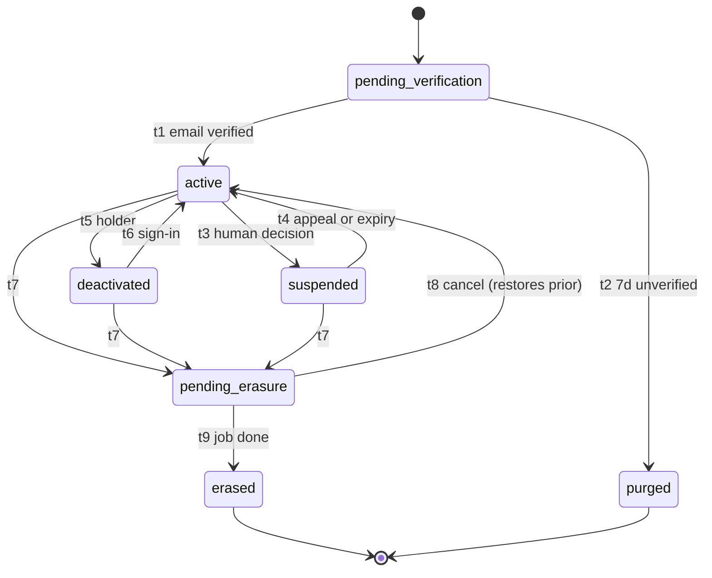

---

### SM-SESSION (DOM-01) — session = refresh-token family

| State     | Meaning                                                                                                                                             |
| --------- | --------------------------------------------------------------------------------------------------------------------------------------------------- |
| `active`  | Family has a current refresh token (generation g)                                                                                                   |
| `expired` | Idle or absolute timeout reached                                                                                                                    |
| `revoked` | Ended by holder, security event, admin, or account state; `reason` ∈ {logout, device_revoke, password_change, reuse_detected, admin, account_state} |

| t   | From → To                                                  | Trigger / actor                            | Guard                                                                          | Side effects                                           |
| --- | ---------------------------------------------------------- | ------------------------------------------ | ------------------------------------------------------------------------------ | ------------------------------------------------------ |
| t1  | (none) → active                                            | successful authentication (C)              | credentials/passkey valid; account `active`                                    | cookie set; generation 1; `session.created`            |
| t2  | active → active                                            | refresh (C)                                | presented token = generation g (or g−1 within 5 s leeway and successor unused) | issue g+1; invalidate g; extend idle window            |
| t3  | active → expired                                           | idle 14 d or absolute 30 d (S/lazy)        | **[OPEN]** defaults; privileged roles: idle 30 min, absolute 8 h               | none                                                   |
| t4  | active → revoked(reuse_detected)                           | refresh token g−k presented outside leeway | whole family                                                                   | revoke family; notify holder; security audit (BR-T050) |
| t5  | active → revoked(logout / device_revoke / password_change) | holder (C)                                 | re-auth for "all devices"                                                      | cookie cleared                                         |
| t6  | active → revoked(account_state / admin)                    | system / H                                 | account suspended, deactivated, pending_erasure, or admin action               | audit                                                  |

**Forbidden:** revoked → active; expired → active (must re-authenticate); refresh when account ≠ active.
**Retry:** refresh is safe to retry within leeway (returns same successor once). **Recovery:** after reuse_detected the holder must sign in again; passkey or password + email notice.

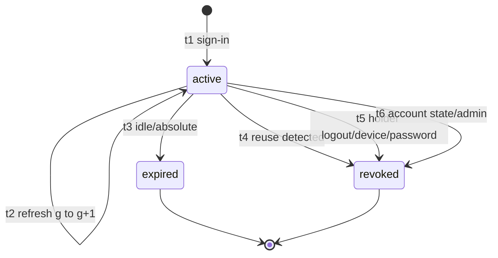

---

### SM-EVIDENCE (DOM-05) — owned by `api/evidence`

Two axes: **lifecycle state** (this SM) and **rung** ∈ {claimed, artifact_backed, peer_attested, authority_verified} (ADR-T14) which is _derived_ from still-valid provenance records and changes only server-side (INV-T04).

| State          | Meaning                                                       |
| -------------- | ------------------------------------------------------------- |
| `draft`        | Owner-only, not counted                                       |
| `pending_scan` | Artefact uploaded, awaiting virus scan; not visible (BR-T003) |
| `active`       | Counted and shareable within consent; carries rung            |
| `quarantined`  | Scan failed; owner-only, removable                            |
| `under_review` | Disputed/flagged; remains visible with marker; human decides  |
| `revoked`      | Terminal; reason code; excluded from everything               |
| `withdrawn`    | Terminal; owner removed                                       |
| `expired`      | Terminal; time-limited credential lapsed (Ph3)                |
| `erased`       | Terminal; DSR                                                 |

| t   | From → To                                    | Trigger / actor                          | Guard                           | Side effects                                                                                        |
| --- | -------------------------------------------- | ---------------------------------------- | ------------------------------- | --------------------------------------------------------------------------------------------------- |
| t1  | draft → pending_scan                         | owner submits with artefact (C)          | file allowlist/size ok          | scan job enqueued                                                                                   |
| t2  | draft → active (rung=claimed)                | owner submits claim without artefact (C) | min fields + ≥1 canonical skill | `evidence.created`                                                                                  |
| t3  | pending_scan → active (rung=artifact_backed) | scan clean (S)                           | scan verdict clean              | `evidence.created`                                                                                  |
| t4  | pending_scan → quarantined                   | scan positive (S)                        | —                               | notify owner (neutral wording)                                                                      |
| t5  | quarantined → withdrawn                      | owner (C)                                | —                               | delete blob                                                                                         |
| t6  | active → under_review                        | report/dispute opened (R/S flag)         | case created                    | marker shown; no auto-action (INV-T09/T20)                                                          |
| t7  | under_review → active                        | dismissed (H)                            | —                               | clear marker                                                                                        |
| t8  | under_review / active → revoked              | issuer or moderator (H)                  | reason code                     | `evidence.revoked`; recompute (BR-T005); notify holder with appeal path                             |
| t9  | active → withdrawn                           | owner (C)                                | —                               | recipients lose live access; submitted-application snapshots keep a redacted tombstone (FEAT-10-14) |
| t10 | active → expired                             | expiry date (S)                          | credential has `expires_at`     | notify 30 d prior                                                                                   |
| t11 | any non-terminal → erased                    | DSR (S)                                  | SM-DSR t-erase                  | blob + metadata removed                                                                             |

**Rung changes (inside `active`):** claimed → artifact_backed (t3 or link liveness pass); artifact_backed → peer_attested (≥1 valid attestation, FEAT-05-03/06-03); {artifact_backed, peer_attested} → authority_verified (issuer verification: platform course, auto-graded assessment, institution, employer-verified); platform issuers may create directly at authority_verified. **Downgrade** only by recompute when a supporting provenance record is revoked/expired (audited). Nothing may set rung from client input or from `source=ai` (INV-T08).
**Forbidden:** terminal → any; draft → under_review; revoked → active (reinstatement = new item with `supersedes`); active → pending_scan (new artefact = new version → new item version in `pending_scan`, old version stays active until clean).
**Expiry:** `draft` auto-deleted after 90 d. **Retry:** scan job per SM-BGJOB; after dead-letter evidence stays `pending_scan` and ops is alerted (never auto-clean).

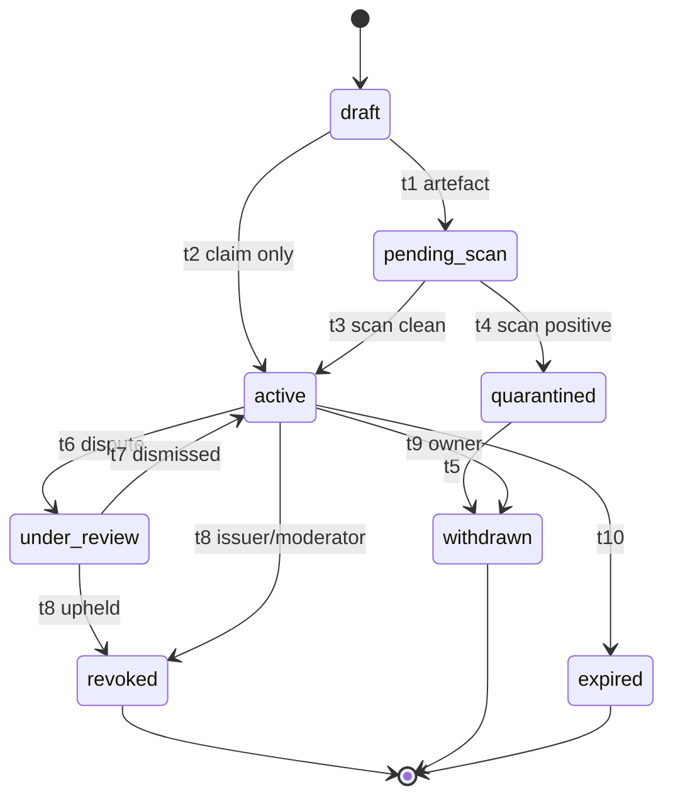

---

### SM-VERIFICATION (DOM-06) — verification request (all methods); the tables below specify the employer-domain proof-of-control path

The same states serve every `method` of `verification_request` (employer email, reference, issuer, runner, manual review). For methods other than employer email, `awaiting_proof` means "waiting for that method's proof" and t1/t3 read "request sent" / "authority or referee decision recorded".

| State            | Meaning                                                                                                       |
| ---------------- | ------------------------------------------------------------------------------------------------------------- |
| `created`        | Request drafted for one work claim                                                                            |
| `awaiting_proof` | Code sent to an address on the claimed employer's domain                                                      |
| `verified`       | Control of an employer-domain mailbox proven (rung effect per DT-06)                                          |
| `failed`         | Attempts exhausted, or an authority rejected the request; `reason` ∈ {attempts_exhausted, authority_rejected} |
| `expired`        | Request window passed                                                                                         |
| `cancelled`      | Candidate cancelled                                                                                           |
| `revoked`        | Terminal after verified; set by human on dispute or fraud finding                                             |

| t   | From → To                            | Trigger / actor                                | Guard                                                             | Side effects                                 |
| --- | ------------------------------------ | ---------------------------------------------- | ----------------------------------------------------------------- | -------------------------------------------- |
| t1  | created → awaiting_proof             | candidate supplies employer-domain address (C) | domain not free-mail; rate limits (≤ 3 requests / 24 h per claim) | code (6+ digits) hashed, TTL 15 min, emailed |
| t2  | awaiting_proof → awaiting_proof      | resend (C)                                     | ≤ 3 resends/h; new code invalidates old                           | —                                            |
| t3  | awaiting_proof → verified            | correct code (C)                               | attempts ≤ 5, TTL ok, bound to this request                       | `verification.completed`; provenance record  |
| t4  | awaiting_proof → failed              | 5th wrong attempt (S)                          | —                                                                 | lock 1 h for that claim                      |
| t5  | awaiting_proof → expired             | request age > 24 h (S)                         | —                                                                 | —                                            |
| t6  | created / awaiting_proof → cancelled | candidate (C)                                  | —                                                                 | —                                            |
| t7  | verified → revoked                   | human decision (H)                             | dispute/fraud case                                                | provenance invalidated; recompute            |

**Forbidden:** verified → awaiting_proof (re-verification = new request); failed/expired → verified; code returned to caller or logged (INV-T05).
**Recovery:** failed/expired → candidate starts a new request (t1 on a fresh request) after cool-down 1 h.

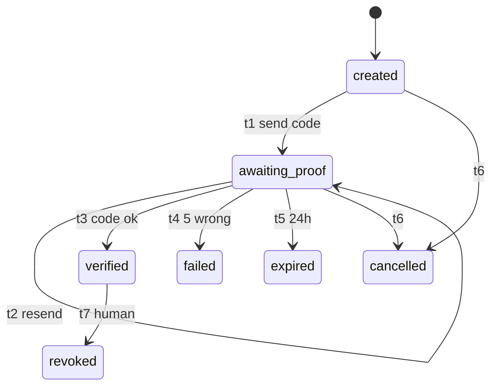

---

### SM-REFERENCE (DOM-06) — referee request (token, no account)

| State       | Meaning                                                                      |
| ----------- | ---------------------------------------------------------------------------- |
| `queued`    | Created, email not yet sent                                                  |
| `sent`      | Token email delivered to provider                                            |
| `opened`    | Referee opened the link (no answer yet)                                      |
| `submitted` | Referee answered; `outcome` ∈ {confirm, dispute, decline, unknown_candidate} |
| `expired`   | 14 days elapsed (BR-T004)                                                    |
| `cancelled` | Candidate cancelled                                                          |
| `bounced`   | Hard bounce / invalid address                                                |

| t     | From → To                          | Trigger / actor           | Guard                                                             | Side effects                                                          |
| ----- | ---------------------------------- | ------------------------- | ----------------------------------------------------------------- | --------------------------------------------------------------------- |
| t1    | queued → sent                      | worker (S)                | token hashed at rest, TTL 14 d, bound to (request, referee email) | email; `reference.requested`                                          |
| t2    | sent → opened                      | link visited (S)          | token valid, unexpired                                            | record open (no PII beyond IP hash)                                   |
| t3    | sent / opened → submitted          | referee submits (referee) | token unused; form valid; referee ≠ candidate email/account       | consume token (single-use); outcome → DT-04; `verification.completed` |
| t4    | sent / opened → expired            | day 14 (S)                | —                                                                 | token dead; candidate told; may re-request                            |
| t5    | queued / sent / opened → cancelled | candidate (C)             | —                                                                 | token dead                                                            |
| t6    | queued / sent → bounced            | provider webhook (S)      | hard bounce                                                       | candidate told to fix address                                         |
| (n/a) | reminders                          | S                         | day 4 and day 9, max 2, only while `sent`/`opened`                | `reference.reminded`                                                  |

**Forbidden:** submitted → any (corrections go through FEAT-06-05 dispute); expired/cancelled/bounced → submitted; token reuse; response before `sent`.
**Concurrency:** two simultaneous submits with the same token → one wins by single-use consume (row lock); loser sees "already answered".
**Recovery:** candidate may issue a **new** request (new token) for the same claim, max 3 open referee requests per claim.

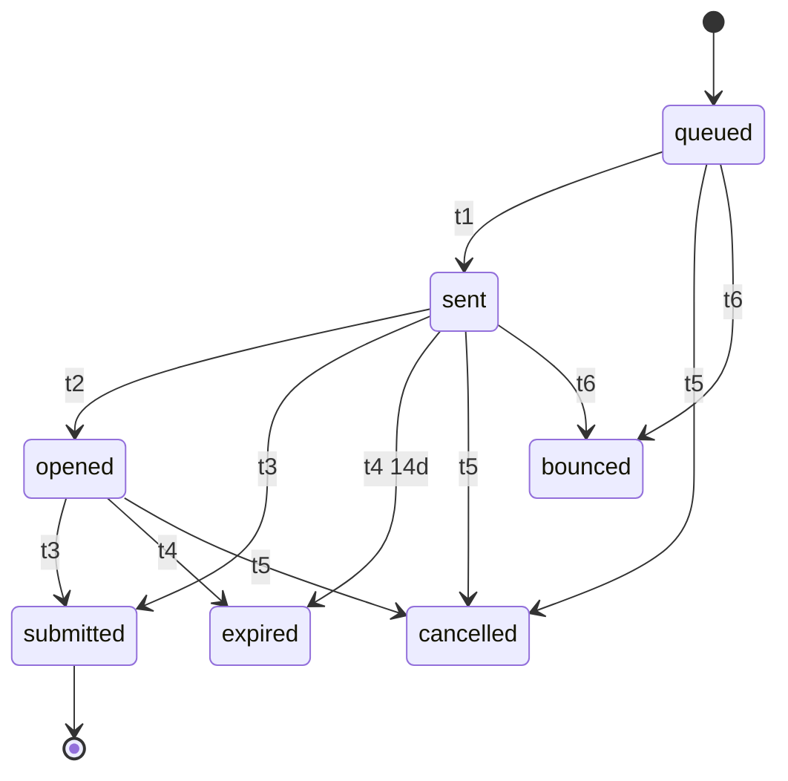

---

### SM-ATTEMPT (DOM-07) — assessment attempt

| State               | Meaning                                                                                           |
| ------------------- | ------------------------------------------------------------------------------------------------- |
| `created`           | Reserved, not started                                                                             |
| `in_progress`       | Timer running (server clock)                                                                      |
| `submitted`         | Answers frozen; may be `auto_submitted` at deadline                                               |
| `grading`           | Auto-grade or runner/human grading in flight                                                      |
| `passed` / `failed` | Graded outcome                                                                                    |
| `unverified`        | Could not be graded honestly (no runner / runner outage); never mints verified evidence (ADR-T13) |
| `under_review`      | Integrity or grading appeal under human review                                                    |
| `voided`            | Human-confirmed violation; terminal                                                               |
| `expired`           | Never started within 24 h or abandoned untimed attempt (no heartbeat 24 h)                        |

| t   | From → To                                   | Trigger / actor                                           | Guard                                        | Side effects                                                                  |
| --- | ------------------------------------------- | --------------------------------------------------------- | -------------------------------------------- | ----------------------------------------------------------------------------- |
| t1  | created → in_progress                       | start (C)                                                 | cooldown/attempt cap ok (BR); entitlement ok | timer start; AI policy bound (AI_PROHIBITED if set)                           |
| t2  | in_progress → submitted                     | submit (C) or deadline (S)                                | deadline not exceeded for manual submit      | freeze answers; `attempt.submitted`                                           |
| t3  | submitted → grading                         | auto (S)                                                  | —                                            | enqueue grading                                                               |
| t4  | grading → passed / failed                   | result (S, or H for manual)                               | score ≥ threshold for pass                   | if passed and auto-gradable: mint evidence at authority_verified (FEAT-07-06) |
| t5  | submitted / grading → unverified            | code attempt with no runner, or grading dead-letter (S)   | reason code                                  | **no** evidence minted; candidate informed honestly                           |
| t6  | unverified → grading                        | re-grade when runner exists (S)                           | ≤ 30 d old; snapshot immutable               | normal grading                                                                |
| t7  | passed / failed / unverified → under_review | integrity flag (S flags, H opens) or candidate appeal (C) | case opened                                  | linked evidence → `under_review` (SM-EVIDENCE t6)                             |
| t8  | under_review → passed / failed / unverified | reviewer clears or corrects (H)                           | reason                                       | evidence restored/updated                                                     |
| t9  | under_review → voided                       | reviewer confirms violation (H)                           | reason + evidence                            | linked evidence revoked (t8 of SM-EVIDENCE); notify with appeal               |
| t10 | created / in_progress → expired             | timers (S)                                                | per above                                    | release attempt slot (counts toward cap)                                      |

**Forbidden:** unverified → passed (must pass through grading); passed ↔ failed directly; any change after `voided`; submit after deadline (late answers rejected, last autosave used).
**Retry:** grading job via SM-BGJOB, max 3 attempts; then t5. **Recovery:** refresh/reload during `in_progress` resumes with server timer; offline autosave replays idempotently (FEAT-07-02.1).

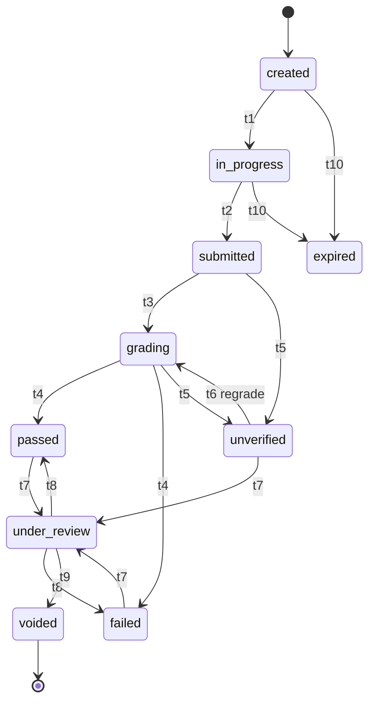

---

### SM-ENROLMENT (DOM-08)

| State             | Meaning                                 |
| ----------------- | --------------------------------------- |
| `pending_payment` | Paid course; awaiting confirmed payment |
| `active`          | Learning; progress counts               |
| `completed`       | Completion rule met; evidence minted    |
| `dropped`         | Learner left (progress kept 90 d)       |
| `expired`         | Checkout never confirmed (24 h)         |
| `refunded`        | Money returned per policy [OPEN-06]     |
| `suspended`       | Learner sanctioned or course taken down |

| t   | From → To                 | Trigger / actor                                 | Guard                                                | Side effects                               |
| --- | ------------------------- | ----------------------------------------------- | ---------------------------------------------------- | ------------------------------------------ |
| t1  | (none) → active           | enrol free course (C)                           | prerequisites met; not already enrolled (idempotent) | `enrolment.created`                        |
| t2  | (none) → pending_payment  | enrol paid course (C)                           | as above                                             | checkout session (FEAT-16-09)              |
| t3  | pending_payment → active  | `entitlement.changed` from verified webhook (S) | payment confirmed (INV-T17)                          | access granted                             |
| t4  | pending_payment → expired | 24 h (S)                                        | no payment                                           | —                                          |
| t5  | active → completed        | completion rule satisfied (S)                   | all required lessons + passing assessments           | `course.completed` → evidence (FEAT-08-04) |
| t6  | active → dropped          | learner (C)                                     | —                                                    | —                                          |
| t7  | dropped → active          | re-enrol (C)                                    | within 90 d                                          | progress restored                          |
| t8  | active → refunded         | billing refund (S/H)                            | policy window [OPEN-06]                              | access removed                             |
| t9  | completed → refunded      | exceptional refund (H)                          | support/admin only                                   | linked evidence revoked via issuer (H)     |
| t10 | active ↔ suspended        | takedown/sanction (H)                           | case                                                 | access paused/restored                     |

**Forbidden:** completed → active/dropped; refunded → any; expired → active (new enrolment); completion without server-verified rule.
**Recovery:** progress writes are idempotent on (enrolment, lesson, version); offline progress is revalidated server-side (INV-T13).

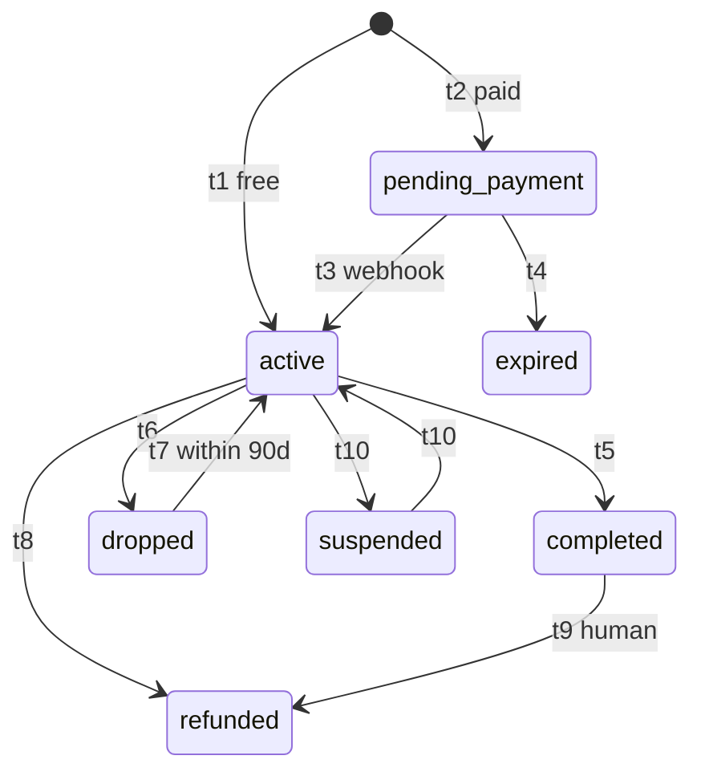

---

### SM-JOB (DOM-09)

| State            | Meaning                                                 |
| ---------------- | ------------------------------------------------------- |
| `draft`          | Editable by hiring team                                 |
| `pending_review` | Awaiting approver or moderation pre-check               |
| `scheduled`      | Will publish at `publish_at`                            |
| `published`      | Visible, accepts applications                           |
| `paused`         | Hidden from search; existing applications continue      |
| `closed`         | Terminal; reason ∈ {filled, expired, cancelled}         |
| `taken_down`     | Hidden by a human moderator; owner notified with appeal |

| t   | From → To                       | Trigger / actor                          | Guard                                                                                         | Side effects                                        |
| --- | ------------------------------- | ---------------------------------------- | --------------------------------------------------------------------------------------------- | --------------------------------------------------- |
| t1  | draft → published               | publish (R)                              | validation passes; entitlement (job slot) ok (INV-T17 derived); pre-check clean; org verified | index; `job.published`                              |
| t2  | draft → pending_review          | publish (R)                              | approver required by org policy or pre-check flagged                                          | notify approver/moderator                           |
| t3  | pending_review → published      | approve (H)                              | approver ≠ author when policy demands                                                         | as t1                                               |
| t4  | pending_review → draft          | changes requested (H)                    | reason                                                                                        | notify author                                       |
| t5  | draft → scheduled               | schedule (R)                             | `publish_at` future ≤ 30 d                                                                    | —                                                   |
| t6  | scheduled → published           | time (S)                                 | re-check entitlement + validation at execution (U7)                                           | as t1; on failure → draft + notify                  |
| t7  | published ↔ paused              | recruiter (R)                            | —                                                                                             | de/re-index                                         |
| t8  | published / paused → closed     | recruiter (R) or expiry 45 d default (S) | **[OPEN]** expiry length                                                                      | de-index; notify open applicants if closed unfilled |
| t9  | published / paused → taken_down | moderator (H)                            | case id                                                                                       | de-index; notice with appeal (FEAT-19-03)           |
| t10 | taken_down → published / closed | appeal outcome (H)                       | —                                                                                             | re-index or close                                   |

**Forbidden:** closed → any (use _clone_ = new draft with `cloned_from`); draft → paused/closed (discard instead); published → draft (edit-in-place of safe fields only; material change creates a revision note, not a state change).
**Concurrency:** publish with the last free job slot by two recruiters → slot reservation row-lock; loser gets `entitlement_exhausted`.

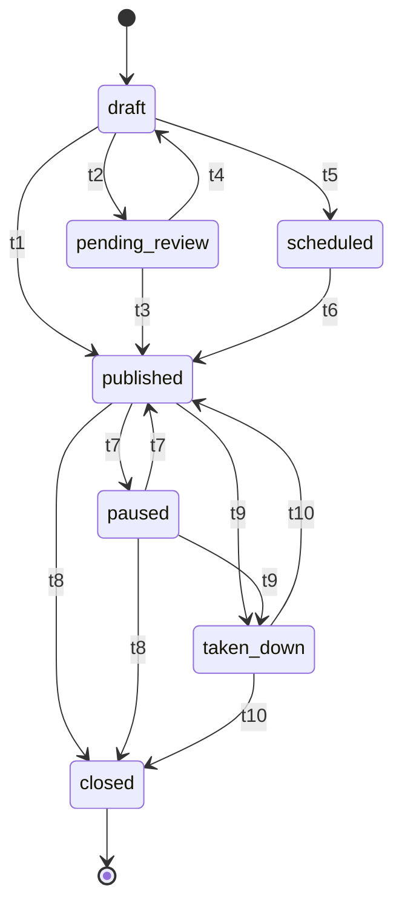

---

### SM-APPLICATION (DOM-10) — canonical states; org stages map onto them (BR-T002)

| State            | Meaning                                                                                                                                                   | Active?                  |
| ---------------- | --------------------------------------------------------------------------------------------------------------------------------------------------------- | ------------------------ |
| `draft`          | Candidate-only; stored in `application_draft`, not in `application.state` (see Vocabulary authority). Discarding a draft (t9) leaves no `application` row | yes (counts for BR-T001) |
| `submitted`      | Received; evidence snapshot frozen (FEAT-10-14)                                                                                                           | yes                      |
| `in_review`      | Hiring team screening                                                                                                                                     | yes                      |
| `shortlisted`    | Candidate selected for next steps                                                                                                                         | yes                      |
| `interviewing`   | ≥1 interview proposed/scheduled                                                                                                                           | yes                      |
| `offer_extended` | Offer recorded                                                                                                                                            | yes                      |
| `hired`          | Terminal                                                                                                                                                  | no                       |
| `rejected`       | Terminal; human-decided                                                                                                                                   | no                       |
| `withdrawn`      | Terminal; candidate-decided                                                                                                                               | no                       |
| `offer_declined` | Terminal; candidate declined offer                                                                                                                        | no                       |

| t   | From → To                                                                                            | Trigger / actor                            | Guard                                                                                                              | Side effects                                                                                                                  |
| --- | ---------------------------------------------------------------------------------------------------- | ------------------------------------------ | ------------------------------------------------------------------------------------------------------------------ | ----------------------------------------------------------------------------------------------------------------------------- |
| t1  | draft → submitted                                                                                    | submit (C)                                 | job `published`; no other active application for (candidate, job) (BR-T001); required fields; consent scope chosen | snapshot; `application.submitted`; receipt                                                                                    |
| t2  | submitted → in_review                                                                                | first hiring-team open or assignment (S/R) | actor in job's hiring team                                                                                         | candidate sees "in review"                                                                                                    |
| t3  | in_review → shortlisted                                                                              | stage move (R)                             | `If-Match` version                                                                                                 | `application.stage.changed`                                                                                                   |
| t4  | shortlisted → interviewing                                                                           | interview proposed (R)                     | ≥1 interview in `proposed`/`scheduled`                                                                             | —                                                                                                                             |
| t5  | interviewing → offer_extended                                                                        | record offer (R)                           | HM or recruiter with offer permission                                                                              | notify candidate                                                                                                              |
| t6  | offer_extended → hired                                                                               | candidate accepted / recruiter records (R) | offer accepted                                                                                                     | `application.hired`; Grow handoff (FEAT-10-15)                                                                                |
| t7  | offer_extended → offer_declined                                                                      | candidate (C)                              | —                                                                                                                  | notify team                                                                                                                   |
| t8  | {submitted, in_review, shortlisted, interviewing, offer_extended} → rejected                         | decision (H)                               | two-step confirm; reason code; actor human (INV-T09)                                                               | candidate notified; optional feedback; `application.stage.changed`                                                            |
| t9  | {draft, submitted, in_review, shortlisted, interviewing, offer_extended} → withdrawn                 | candidate (C)                              | —                                                                                                                  | cancel open interviews; notify team. From `draft`: delete the `application_draft` row, audit event only, no `application` row |
| t10 | shortlisted → in_review; interviewing → shortlisted; offer_extended → interviewing (offer withdrawn) | stage correction (R)                       | reason required; `in_review → submitted` and other backward moves are not allowed                                  | audit entry                                                                                                                   |
| t11 | in_review → interviewing; shortlisted → offer_extended (forward skips)                               | stage move (R)                             | allowed only for these two skips; **never** to `hired` without `offer_extended`                                    | `application.stage.changed`                                                                                                   |

**Forbidden:** terminal → any (reconsideration = recruiter invites candidate to apply again; new application with `reconsidered_from`); draft → anything except submitted/withdrawn; any → hired except from offer_extended; any → rejected by system/AI/score (U6); changing candidate-supplied answers after submit.
**Stale handling:** no recruiter action for 45 d sets `stale=true` and prompts the team and the candidate; **never** an automatic transition (INV-T09).
**Job interplay:** job `closed`/`taken_down` does not alter application state; `draft` applications on a closed job are discarded after 7 d with notice.
**Concurrency:** idempotent submit key `(candidate, job)` + partial unique index on active states; two concurrent stage moves → one wins by version; loser reloads.

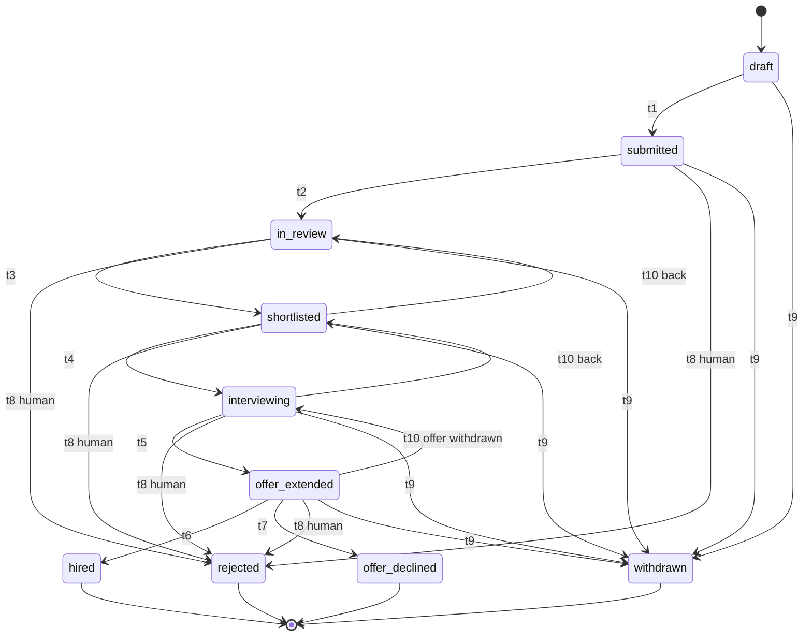

---

### SM-INTERVIEW (DOM-10)

| State         | Meaning                                          |
| ------------- | ------------------------------------------------ |
| `proposed`    | Slots offered to candidate                       |
| `scheduled`   | One slot confirmed by both sides                 |
| `completed`   | Took place                                       |
| `cancelled`   | Cancelled with reason by either side             |
| `rescheduled` | Superseded by a new interview record             |
| `no_show`     | Human-marked; `party` ∈ {candidate, interviewer} |
| `expired`     | No slot chosen in time                           |

| t   | From → To                        | Trigger / actor                            | Guard                                                                               | Side effects                                     |
| --- | -------------------------------- | ------------------------------------------ | ----------------------------------------------------------------------------------- | ------------------------------------------------ |
| t1  | (none) → proposed                | recruiter proposes 1–5 slots (R)           | application ∈ {in_review, shortlisted, interviewing}; interviewer free (no overlap) | notify; hold slots 72 h                          |
| t2  | proposed → scheduled             | candidate selects slot (C)                 | slot still free (row lock)                                                          | ICS to both; reminders at 24 h and 1 h           |
| t3  | proposed → expired               | 72 h without choice (S)                    | —                                                                                   | notify recruiter                                 |
| t4  | scheduled → rescheduled          | either party requests, other accepts (R/C) | ≥ 2 h before start                                                                  | creates new `proposed` linked by `reschedule_of` |
| t5  | scheduled / proposed → cancelled | either party (R/C)                         | reason code                                                                         | cancel ICS; notify                               |
| t6  | scheduled → completed            | end time + marker or +24 h (S)             | not marked no_show                                                                  | prompts scorecard (FEAT-10-08)                   |
| t7  | scheduled → no_show              | marked after start time (H)                | within 48 h; evidence of absence not required but reason logged                     | candidate may contest (FEAT-19-06)               |

**Forbidden:** completed/cancelled/rescheduled/no_show/expired → any; scheduling overlapping interviewer slots; scheduling in the past; scheduling when application is terminal.
**Timezone:** stored UTC + IANA zone; display local to viewer.

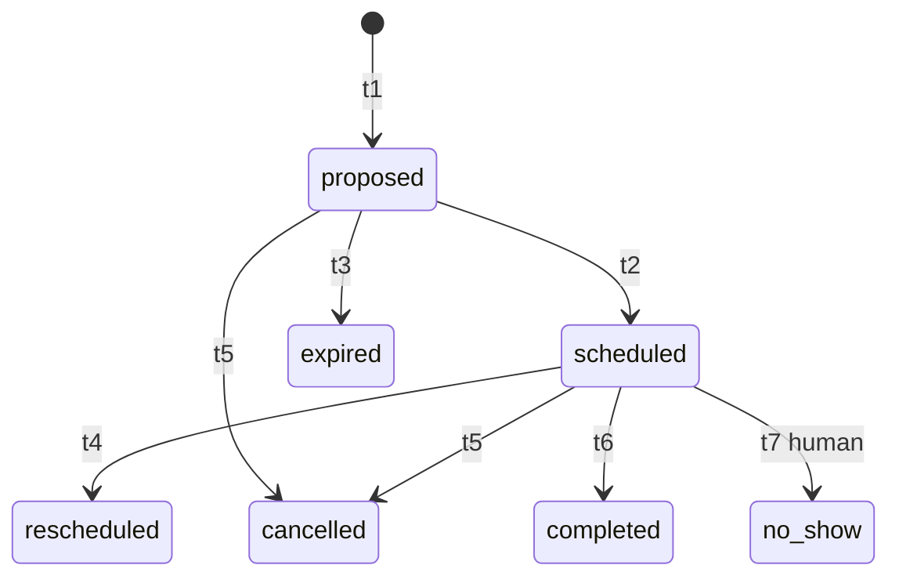

---

### SM-SUBSCRIPTION (DOM-16) — driven only by verified webhooks (INV-T17)

Vocabulary mirrors Stripe subscription statuses **[REF: Stripe docs; re-verify at build time — OPEN]**, with two deliberate differences: `canceling` is added (Stripe `active` + `cancel_at_period_end`), and Stripe `trialing` / `paused` are **not** states (no trial or pause exists in the product; an event carrying them is ignored, logged and alerted, and grants no entitlement). The processor spelling `canceled` is kept for this machine only.

| State                | Entitlement derived (DT-02)                                         |
| -------------------- | ------------------------------------------------------------------- |
| `incomplete`         | none (free tier)                                                    |
| `active`             | full plan                                                           |
| `canceling`          | full plan until `current_period_end`, then → canceled               |
| `past_due`           | full during 7-day grace, then degraded (read-only on paid features) |
| `unpaid`             | free tier; data retained                                            |
| `canceled`           | free tier; data retained                                            |
| `incomplete_expired` | none; terminal                                                      |

| t   | From → To                                | Trigger (signed webhook)                       | Guard                    | Side effects                                  |
| --- | ---------------------------------------- | ---------------------------------------------- | ------------------------ | --------------------------------------------- |
| t1  | (none) → incomplete                      | checkout session completed, first invoice open | event verified + deduped | —                                             |
| t2  | incomplete → active                      | invoice paid                                   | —                        | `entitlement.changed`                         |
| t3  | incomplete → incomplete_expired          | 23 h without payment                           | —                        | —                                             |
| t4  | active → past_due                        | invoice payment failed                         | —                        | dunning schedule (FEAT-16-07); notify         |
| t5  | past_due → active                        | invoice paid                                   | —                        | clear grace                                   |
| t6  | past_due → unpaid                        | retries exhausted / grace over                 | —                        | degrade                                       |
| t7  | unpaid → active                          | invoice paid                                   | —                        | restore                                       |
| t8  | active → canceling                       | cancel at period end set                       | —                        | notify                                        |
| t9  | canceling → active                       | cancellation reverted                          | —                        | —                                             |
| t10 | canceling / unpaid / past_due → canceled | period end or immediate cancel                 | —                        | free tier; seats unassigned (kept as records) |

**Forbidden:** any transition from the browser/redirect (INV-T17); canceled → active (new subscription); applying an event older than the stored object version (out-of-order → ignore + log).
**Retry:** webhook handler idempotent by event id; processor retries respected; dead-letter after 5 failures → alert. **Recovery:** reconcile job compares local state with processor daily and reports drift (never silently overwrites without audit).

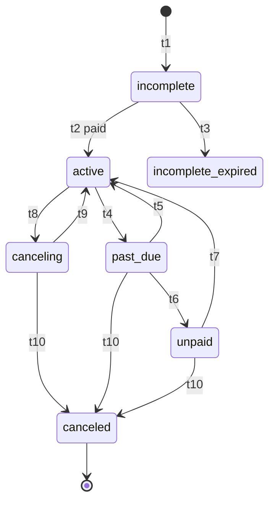

---

### SM-DSR (DOM-22) — data-rights request (`kind` ∈ access, export, erasure, rectification, restriction, objection, human_review)

One machine for every kind, stored in `data_rights_request.state`. Only `erasure` passes through `cooling_off`; other kinds go `verifying → in_progress` (t3). There is no separate erasure state machine.

| State                      | Meaning                                                           |
| -------------------------- | ----------------------------------------------------------------- |
| `received`                 | Logged; type set                                                  |
| `verifying`                | Re-authentication/identity confirmation                           |
| `cooling_off`              | Erasure only: 7-day cancel window                                 |
| `in_progress`              | Export build, erasure fan-out, or change applied step-wise        |
| `on_hold`                  | Legal hold or dispute prevents completion [OPEN-08]               |
| `completed`                | Fulfilled in full                                                 |
| `completed_with_retention` | Erasure done except legally retained records (listed in receipt)  |
| `rejected`                 | Not fulfilled with stated reason (e.g. cannot verify identity)    |
| `cancelled`                | Requester cancelled                                               |
| `failed`                   | Retries exhausted; ops escalation; request deadline still running |

| t   | From → To                                                  | Trigger / actor                                         | Guard                                                                                                                              | Side effects                                                |
| --- | ---------------------------------------------------------- | ------------------------------------------------------- | ---------------------------------------------------------------------------------------------------------------------------------- | ----------------------------------------------------------- |
| t1  | (none) → received                                          | request (C) / org admin assist (R) / support assist (H) | requester is the data subject or authorised                                                                                        | acknowledge; deadline clock starts                          |
| t2  | received → verifying                                       | auto (S)                                                | —                                                                                                                                  | re-auth challenge                                           |
| t3  | verifying → in_progress (every kind except erasure)        | verified (C)                                            | recent strong auth                                                                                                                 | enqueue job                                                 |
| t4  | verifying → cooling_off (erasure)                          | verified (C)                                            | no active legal hold                                                                                                               | account → `pending_erasure` (SM-ACCOUNT t7)                 |
| t5  | cooling_off → in_progress                                  | 7 days elapsed (S)                                      | not cancelled                                                                                                                      | fan-out erase                                               |
| t6  | in_progress → completed / completed_with_retention         | all stores done (S)                                     | checkpoint complete; for erasure also `subject_identity_map` row deleted and sweep clean (INV-T38; history rows are not rewritten) | receipt; `erasure.completed` / `export.ready`               |
| t7  | received / verifying / in_progress → on_hold ↔ in_progress | legal hold set/cleared (H)                              | reason                                                                                                                             | notify requester that a hold applies (reason category only) |
| t8  | verifying → rejected                                       | verification failed 3× or not authorised (S/H)          | —                                                                                                                                  | notify                                                      |
| t9  | received / verifying / cooling_off → cancelled             | requester (C)                                           | —                                                                                                                                  | account restored if pending                                 |
| t10 | in_progress → failed → in_progress                         | retries exhausted → manual replay (H)                   | audited                                                                                                                            | —                                                           |

**Deadlines:** erasure ≤ 30 days from `received` (BR-T060); export target ≤ 72 h, max 30 days **[OPEN-08 legal confirmation]**.
**Forbidden:** erasure `in_progress` → cancelled (irreversible once started); rejected → in_progress (new request); any → completed without checkpoint evidence.
**Idempotency:** one open request per (subject, type); a duplicate returns the open one.
**Erasure and history (REVW-04):** erasure never UPDATEs append-only tables. Audit, consent, evidence-event and stage-transition rows hold an opaque `subject_ref`; the erasure fan-out ends by deleting the `subject_identity_map` row (and per-subject key), then the sweep runs. `completed` requires the audit and consent anchors that cover the subject's rows to still verify (TEST-PRV-009). Which history skeletons may be kept, and for how long, goes on the receipt as retained records and stays [OPEN-08].

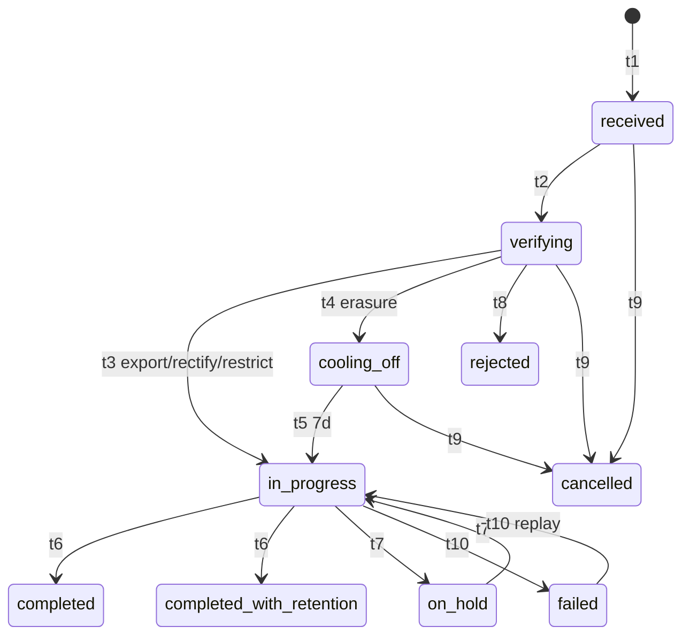

---

### SM-MODCASE (DOM-19) — moderation case

| State           | Meaning                                                                                         |
| --------------- | ----------------------------------------------------------------------------------------------- |
| `open`          | Report(s) received                                                                              |
| `triaged`       | Priority and queue set                                                                          |
| `in_review`     | Moderator working                                                                               |
| `awaiting_info` | Requested info from reporter/subject; SLA paused                                                |
| `actioned`      | Human decision recorded (`outcome` ∈ {no_action, warned, content_removed, suspended, restored}) |
| `appealed`      | Subject appealed within 30 d                                                                    |
| `closed`        | Terminal; `appeal_outcome` ∈ {none, upheld, overturned}                                         |

| t   | From → To                               | Trigger / actor               | Guard                                                       | Side effects                                                                                 |
| --- | --------------------------------------- | ----------------------------- | ----------------------------------------------------------- | -------------------------------------------------------------------------------------------- |
| t1  | (none) → open                           | report or system flag (C/S)   | dedupe by (target, category) merges into existing open case | ack to reporter                                                                              |
| t2  | open → triaged                          | auto rules or moderator (S/H) | flags may set priority; never action                        | SLA timer                                                                                    |
| t3  | triaged → in_review                     | moderator claims (H)          | role MOD                                                    | lock to reviewer                                                                             |
| t4  | in_review ↔ awaiting_info               | moderator (H)                 | reason                                                      | notify                                                                                       |
| t5  | in_review → actioned                    | decision (H)                  | reasoned outcome; two-person check for `suspended`          | effect applied (e.g. evidence revoked, job taken down, account suspended); notice to subject |
| t6  | actioned → appealed                     | subject (C/R)                 | ≤ 30 d                                                      | assign **different** reviewer                                                                |
| t7  | appealed → closed (upheld / overturned) | reviewer (H)                  | —                                                           | overturned → reverse effect (restore)                                                        |
| t8  | actioned → closed                       | 30 d without appeal (S)       | —                                                           | —                                                                                            |

**Forbidden:** automation moving a case to `actioned`; same reviewer deciding the appeal; closed → any; actioned → in_review (use appeal).
**SLA (defaults [OPEN]):** triage ≤ 1 business day; decision ≤ 5 business days; safety-critical (scam, harassment) ≤ 4 h business hours.

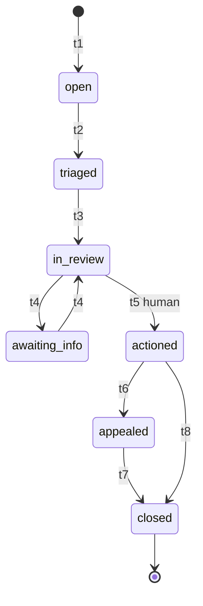

---

### SM-NOTIFY (DOM-15) — one delivery (notification × channel)

| State          | Meaning                                                                     |
| -------------- | --------------------------------------------------------------------------- |
| `queued`       | Created, not yet routed                                                     |
| `suppressed`   | Dropped by preference, suppression list, or dedupe (reason logged)          |
| `deferred`     | Held for quiet hours or digest window                                       |
| `sending`      | Handed to provider                                                          |
| `sent`         | Provider accepted                                                           |
| `delivered`    | Provider confirmed (email) / inbox row visible (in-app) / push acknowledged |
| `failed_retry` | Transient failure; backoff scheduled                                        |
| `failed`       | Permanent failure or retries exhausted                                      |
| `bounced`      | Hard bounce → address added to suppression                                  |
| `complained`   | Spam complaint → marketing category suppressed                              |
| `expired`      | TTL passed before sending                                                   |

| t   | From → To                                  | Trigger                               | Guard                                                                   |
| --- | ------------------------------------------ | ------------------------------------- | ----------------------------------------------------------------------- |
| t1  | queued → suppressed                        | route check (S)                       | pref off (non-mandatory), suppression list, duplicate within window     |
| t2  | queued → deferred                          | quiet hours or digest (S)             | category not time-critical; mandatory security mail ignores quiet hours |
| t3  | deferred → sending                         | window end (S)                        | re-check TTL, prefs                                                     |
| t4  | queued → sending                           | immediate (S)                         | —                                                                       |
| t5  | sending → sent → delivered                 | provider response / webhook           | —                                                                       |
| t6  | sending → failed_retry                     | 5xx/timeout (S)                       | attempts < 5; backoff 1 m, 5 m, 30 m, 2 h, 12 h                         |
| t7  | failed_retry → sending                     | timer                                 | —                                                                       |
| t8  | sending / failed_retry → failed            | 4xx permanent or 5 attempts           | dead-letter; ops metric                                                 |
| t9  | sent → bounced / complained                | provider webhook                      | suppression updated                                                     |
| t10 | queued / deferred / failed_retry → expired | TTL (72 h time-sensitive; 7 d others) | —                                                                       |

**Forbidden:** sending to a suppressed address; re-sending after `bounced` without address change; any transition out of terminal states.
**Idempotency:** delivery key `(notification_id, channel)`; duplicates collapse (at-least-once dispatcher, consumer dedupe — ADR-T09).

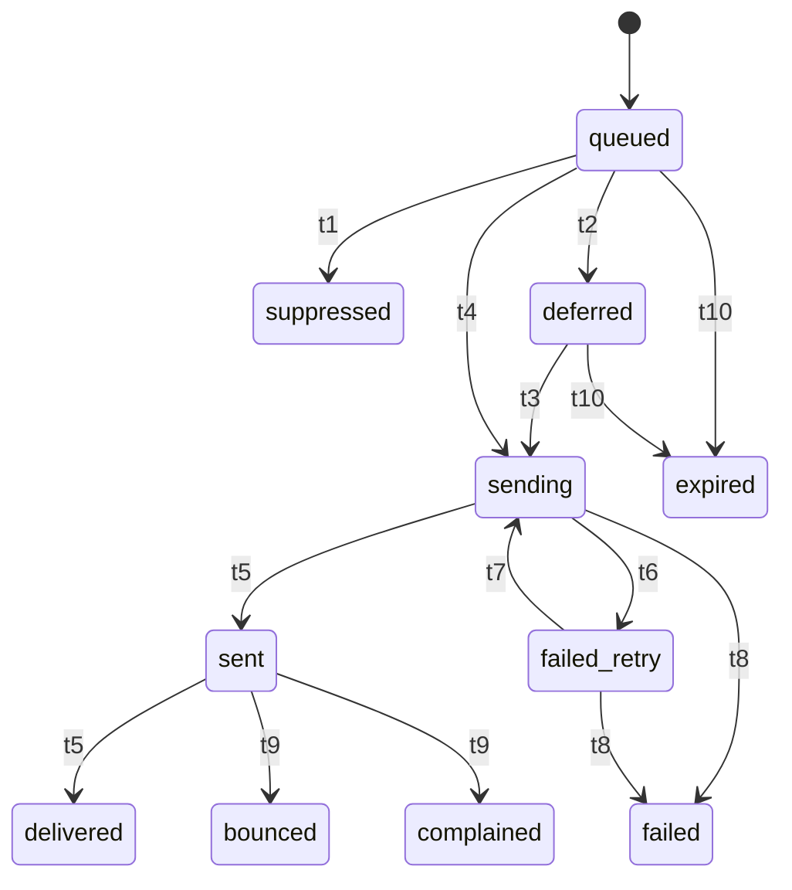

---

### SM-BGJOB (DOM-24) — background job with fenced lease (ADR-T09)

| State        | Meaning                                                                 |
| ------------ | ----------------------------------------------------------------------- |
| `queued`     | Ready at `run_at`                                                       |
| `claimed`    | Leased to one worker with `generation g`; lease TTL 60 s with heartbeat |
| `running`    | Handler executing                                                       |
| `retry_wait` | Failed; waiting backoff                                                 |
| `succeeded`  | Terminal                                                                |
| `dead`       | Max attempts (6) exhausted                                              |
| `cancelled`  | Terminal; superseded or manually cancelled                              |

| t   | From → To                       | Trigger                         | Guard / notes                                                                                        |
| --- | ------------------------------- | ------------------------------- | ---------------------------------------------------------------------------------------------------- |
| t1  | queued → claimed                | worker `FOR UPDATE SKIP LOCKED` | sets `generation = generation + 1`, `lease_until`                                                    |
| t2  | claimed → running               | handler start                   | —                                                                                                    |
| t3  | running → succeeded             | handler ok                      | write is **fenced**: `WHERE id=? AND generation=?`; zero rows ⇒ stale worker must discard its result |
| t4  | running → retry_wait            | handler error                   | attempts < 6; exponential backoff base 30 s ×2^n + jitter, cap 1 h                                   |
| t5  | retry_wait → queued             | timer                           | —                                                                                                    |
| t6  | claimed / running → queued      | lease expired (reaper)          | `generation` bumped on next claim; counts as an attempt                                              |
| t7  | retry_wait / running → dead     | attempts exhausted              | alert; payload retained                                                                              |
| t8  | dead → queued                   | admin replay (H)                | audited; attempts reset                                                                              |
| t9  | queued / retry_wait → cancelled | superseding event or admin      | —                                                                                                    |

**Forbidden:** two active generations; completing with a stale generation; deleting `dead` jobs before 30 d.
**Handlers must be idempotent** (INV-T10): re-execution after t6 must be safe.

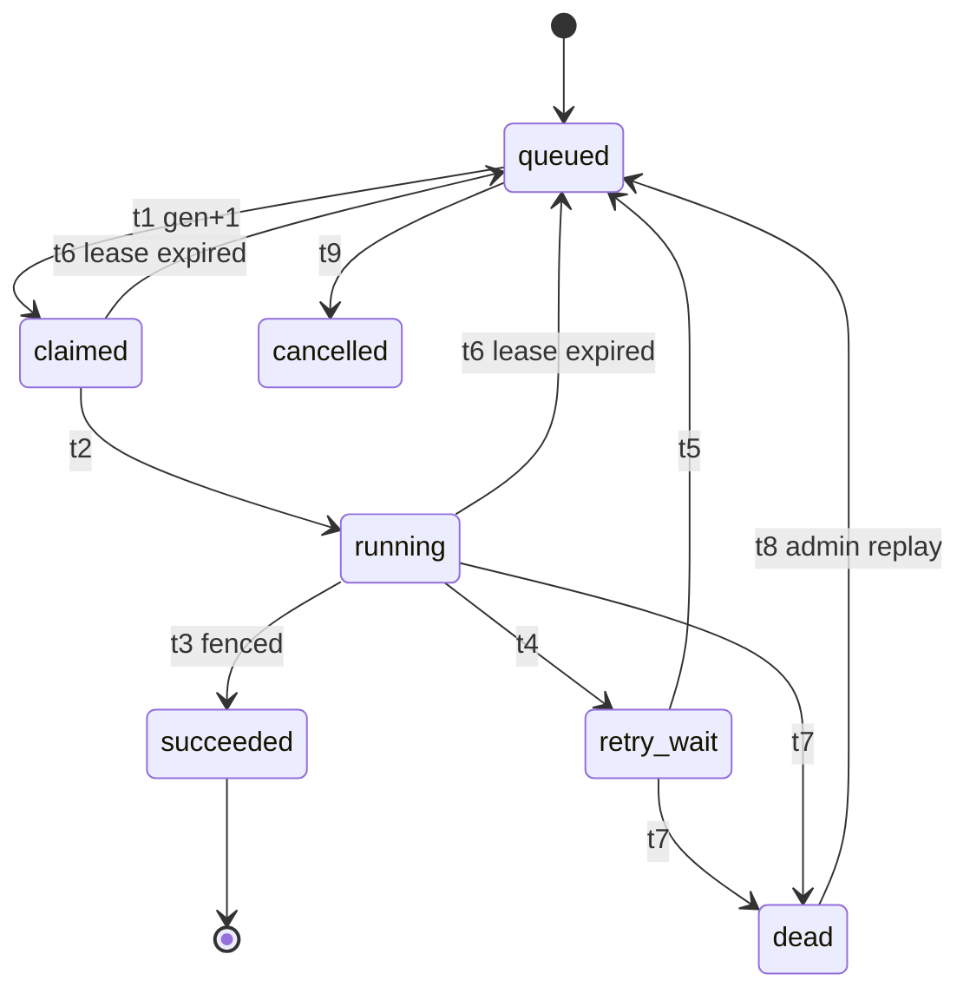

---

### Revision 2 amendments (override same-id rows in the machines above)

Only changed rows are shown. Row identifiers (t1, t2, ...) are those of SM-00 v1.1.

#### R2-A.1 SM-ACCOUNT (REVW-21)

| t   | From → To                                          | Trigger / actor               | Guard (replaces v1.1 guard)                                                                                                                                                                                                                                                  | Side effects                      |
| --- | -------------------------------------------------- | ----------------------------- | ---------------------------------------------------------------------------------------------------------------------------------------------------------------------------------------------------------------------------------------------------------------------------- | --------------------------------- |
| t3  | active → suspended                                 | moderation/admin decision (H) | case id + reason; **second-person approval recorded, approver ≠ decider** (BR-T045; the single-moderator emergency exception is reviewed within 24 h)                                                                                                                        | unchanged                         |
| t7  | active / deactivated / suspended → pending_erasure | erasure request verified (C)  | identity re-verified; no open legal hold; **no open moderation case on the account**. A `suspended` account qualifies only once its case is `closed`. Until then the request is parked `on_hold` with reason `moderation_case_open` (SM-DSR t7) and the account is not moved | start cooling-off 7 days (SM-DSR) |

**Forbidden (adds to v1.1):** `suspended → pending_erasure` while a moderation case is open. `locked` is not a state; temporary sign-in lockout is `locked_until > now()` (Vocabulary authority, SM-00 v1.1), and the API 423 response is produced from that column.

#### R2-A.2 SM-EVIDENCE (REVW-12, REVW-20)

Replaces the "Rung changes" paragraph; t8 side effects gain the credential link. All other rows and the diagram stand.

**Rung changes (inside `active`):** `claimed → artifact_backed` (t3, link liveness pass, or employer-domain proof for a **bound** domain, BR-T017); `artifact_backed → peer_attested` (at least one valid attestation, FEAT-05-03 or 06-03); `{artifact_backed, peer_attested} → authority_verified` (issuer verification; every authority record carries an `issuer_class`); issuers may create items directly at `authority_verified`. **Downgrade** only by recompute when a supporting provenance record is revoked or expires (audited). Nothing sets a rung from client input or `source=ai` (INV-T08).

**Issuer class (amends ADR-T14; proposed as ADR-T14a).** The ladder keeps four rungs. The `authority_verified` rung is split by a mandatory attribute, not by a fifth rung:

| `issuer_class` | Who issues                                                         | Independence rule                                                                                     | Matching weight (DT-03)  |
| -------------- | ------------------------------------------------------------------ | ----------------------------------------------------------------------------------------------------- | ------------------------ |
| `platform`     | Platform-run auto-graded assessment; platform-authored course rule | Platform is the issuer; no instructor sign-off involved                                               | highest [OPEN-05 values] |
| `institution`  | Verified institution (BR-T102)                                     | Institution issues only for its own learners                                                          | high                     |
| `employer_org` | Verified employer organization (SM-ORG `verified`)                 | Org verified; confirming person is not the candidate                                                  | high                     |
| `instructor`   | Instructor sign-off on a course (`instructorSignoff`)              | BR-T119: instructor ≠ learner, no shared account, device or payment signal, issuer independence check | lowest of the four       |

Rules: the class is set server-side from the issuing record and cannot come from client input (INV-T46). The UI always shows the class next to the badge. **Instructor sign-off never counts as platform-verified**, in the UI, in matching weights or in any "verified" filter (INV-T47). An `instructor` record is revocable by the issuer or a moderator (t8). A rung that rests only on `instructor` records reports `authority_verified` with class `instructor`.

**Archive and undo (REVW-20).** The UI "Archive ... Undo (8 s)" is a client-side delay: the withdraw request (t9) is dispatched after the 8-second window unless the user cancels. No "archived" state exists. After t9 commits there is no undo (`withdrawn` is terminal, U3); the UI offers "Create again from this", which creates a new `draft` item linked by `restored_from`.

| t   | Change                                                                    |
| --- | ------------------------------------------------------------------------- |
| t8  | Side effects add: linked credential moves to `revoked` (SM-CREDENTIAL t4) |

#### R2-A.3 SM-VERIFICATION (REVW-22)

| Change                   | Text                                                                                                                                                             |
| ------------------------ | ---------------------------------------------------------------------------------------------------------------------------------------------------------------- |
| State `verified` meaning | Control of an employer-domain mailbox proven. The provenance record is `bound` or `unbound`; the rung effect follows DT-06 (`artifact_backed` only when `bound`) |
| t3 side effects          | `verification.completed`; provenance record with `domain_binding` ∈ {`bound`, `unbound`} computed at this instant (BR-T017)                                      |

**Domain binding.** `bound` means the employer domain equals a verified `org_domain` (purpose `employer_email_match`; DNS TXT or registry match) of an organization whose `verification_state` is `verified` (SM-ORG). Anything else is `unbound`: the candidate controls a mailbox, which does not show the domain belongs to the claimed employer. An `unbound` result leaves the rung at `claimed` and shows the badge "Mailbox verified, employer not confirmed". A `bound` result reaches `artifact_backed` and shows "Mailbox verified". If the binding later lapses (organization un-verified or domain proof removed) the provenance record is invalidated and the rung recomputed (BR-T005, INV-T48).

#### R2-A.4 SM-REFERENCE (REVW-38)

Replaces the "reminders" row. **One cap of 2 reminders per request, shared by system and manual reminders** (BR-T121). System reminders are due on day 4 and day 9. A manual reminder (ACT-VER-03) needs at least 3 days since the last send of any kind. A due system reminder that falls less than 3 days after the last send is deferred, not dropped, and is sent when 3 days have passed. Only while the request is `sent` or `opened`. Event: `reference.reminded`.

#### R2-A.5 SM-APPLICATION (REVW-27)

Adds t12 and one sentence to "Forbidden".

| t   | From → To                                         | Trigger / actor                            | Guard                                                                                                                                                                                                                     | Side effects                                                                                                                                                                                                                |
| --- | ------------------------------------------------- | ------------------------------------------ | ------------------------------------------------------------------------------------------------------------------------------------------------------------------------------------------------------------------------- | --------------------------------------------------------------------------------------------------------------------------------------------------------------------------------------------------------------------------- |
| t12 | (none) → draft (new `application_draft`, then t1) | candidate re-applies after withdrawing (C) | previous application for (candidate, job) is `withdrawn`; at least {24 h} since `withdrawn_at` **[OPEN]**; job `published`; no other active application (BR-T001). `rejected`, `hired` and `offer_declined` never qualify | new application carries `reapplied_from = <withdrawn application id>`; the hiring team sees the link and the withdrawal date; the earlier snapshot is not reused (a new snapshot is taken at t1); closes OPEN-B20 (BR-T125) |

**Forbidden (amends v1.1):** terminal → any, **except** the new linked application of t12 after `withdrawn`. Reconsideration after `rejected` remains a recruiter invitation with `reconsidered_from`.

#### R2-A.6 SM-DSR (REVW-21)

| t   | Change                                                                                                                                                                                                                                                                                      |
| --- | ------------------------------------------------------------------------------------------------------------------------------------------------------------------------------------------------------------------------------------------------------------------------------------------- |
| t4  | Guard adds: no open moderation case on the account (otherwise t7)                                                                                                                                                                                                                           |
| t7  | From-set becomes `received / verifying / cooling_off / in_progress`; hold reason ∈ {`legal_hold`, `moderation_case_open`, `dispute`}. `moderation_case_open` clears when the case is `closed`, then the request resumes at t4. How the 30-day clock (BR-T060) treats a hold stays [OPEN-08] |

#### R2-A.7 SM-NOTIFY (REVW-19)

| t   | Replacement text                                                                                                                                                                                                                                                   |
| --- | ------------------------------------------------------------------------------------------------------------------------------------------------------------------------------------------------------------------------------------------------------------------ |
| t6  | `sending → failed_retry` on 5xx or timeout. This is the delivery job's retry, not a second layer: the `email.send` or `push.send` job is in `retry_wait` (SM-BGJOB t4). Attempts stay below the job's `max_attempts` (email 12) with the BE-01 section 7.3 backoff |
| t8  | `sending / failed_retry → failed` on error class `permanent` (4xx except 408 and 429), or when the job reaches `dead` (SM-BGJOB t7)                                                                                                                                |

The v1.1 schedule "1 m, 5 m, 30 m, 2 h, 12 h, 5 attempts" is retired.

#### R2-A.8 SM-BGJOB (REVW-19, regenerated from BE-01 section 7)

BE-01 section 7 is authoritative for the job engine; this table mirrors it. State set is unchanged: `queued, claimed, running, retry_wait, succeeded, dead, cancelled`.

| t   | From → To                                 | Trigger                                               | Guard / notes                                                                                                                                                                                        |
| --- | ----------------------------------------- | ----------------------------------------------------- | ---------------------------------------------------------------------------------------------------------------------------------------------------------------------------------------------------- |
| t1  | queued → claimed                          | worker `FOR UPDATE SKIP LOCKED`                       | `lease_generation += 1`, new `lease_token`, `attempts += 1`, `lease_expires_at`; the claim query may also take a `retry_wait` job whose `run_after ≤ now()` (t5 and t1 in one UPDATE)                |
| t2  | claimed → running                         | handler start                                         | heartbeat every lease/3                                                                                                                                                                              |
| t3  | running → succeeded                       | handler ok                                            | fenced: `WHERE id=? AND lease_generation=? AND status='running'`; zero rows means a newer claim exists and the stale worker discards its result                                                      |
| t4  | running → retry_wait                      | handler error, class `transient` or `rate_limited`    | `attempts < max_attempts`; `delay = min(cap, base × 2^(attempt−1))` with full jitter `random(0, delay)`; base 5 s, cap 15 min; `rate_limited` honours `Retry-After`                                  |
| t5  | retry_wait → queued                       | `run_after` reached                                   | see t1                                                                                                                                                                                               |
| t6  | claimed / running → queued                | lease expired (reaper)                                | generation unchanged until the next claim; the attempt was already counted at claim                                                                                                                  |
| t7  | running → dead                            | `attempts ≥ max_attempts`, or error class `permanent` | `max_attempts`: default 8; `email.send` and `webhook.deliver` 12; `ai.*` 3; `assessment.run` 2; `evt:*` 8. Alert always for protected kinds (billing, erasure, evidence); payload and error retained |
| t8  | dead → queued                             | admin replay (H)                                      | audited; attempts reset                                                                                                                                                                              |
| t9  | queued / retry_wait / running → cancelled | superseding event or admin (`cancel_requested_at`)    | a `running` job reaches `cancelled` only when the handler honours the abort at its next checkpoint; handlers are idempotent on resume                                                                |

Differences from SM-00 v1.1: attempts 6 → per-kind limits above; backoff 30 s × 2^n capped 1 h → 5 s base capped 15 min with full jitter; `retry_wait → dead` removed (a job fails from `running`); `running → cancelled` added.

**[OPEN, backend owner]** BE-01 section 7.3 says 12 attempts span about 24 h. With base 5 s and cap 15 min the waits sum to about 66 minutes (5+10+20+40+80+160+320+640 s, then three waits of 900 s). Either the cap or the claim is wrong; this file keeps BE-01's numbers.

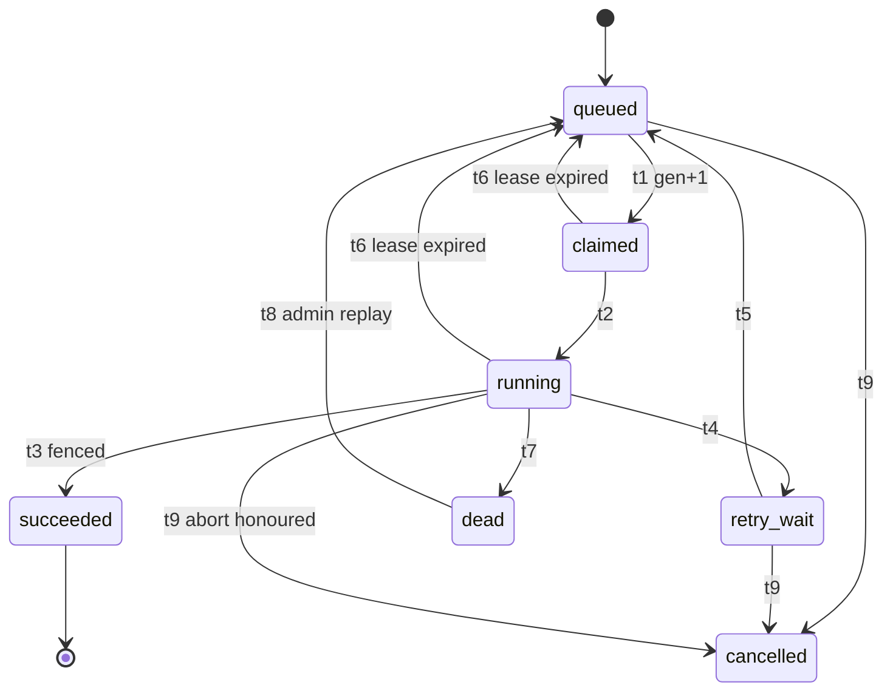

### Additional machines (Revision 2) (REVW-20)

Same conventions as SM-00: tables are the specification; U1 to U8 apply; terminal states are immutable; consequential transitions need `actor.kind = human` and a reason code.

#### R2-B.1 SM-FILE (platform) — `file_object.state`

| State       | Meaning                                                    |
| ----------- | ---------------------------------------------------------- |
| `intent`    | Upload slot reserved (signed URL issued); no bytes yet     |
| `uploaded`  | Bytes received, size matches                               |
| `verifying` | Content-type sniffing, allowlist and size checks (BR-T014) |
| `scanning`  | Malware scan in flight                                     |
| `clean`     | Passed every check                                         |
| `rejected`  | Failed type, size or policy check                          |
| `infected`  | Scan positive                                              |
| `deleted`   | Terminal; blob removed, row kept as tombstone              |

| t   | From → To                  | Trigger / actor                                             | Guard                         | Side effects                     |
| --- | -------------------------- | ----------------------------------------------------------- | ----------------------------- | -------------------------------- |
| t1  | (none) → intent            | request upload (C)                                          | caller owns the target; quota | signed URL, TTL 1 h              |
| t2  | intent → uploaded          | upload complete (S)                                         | size equals declared size     | enqueue `file.scan`              |
| t3  | uploaded → verifying       | auto (S)                                                    | —                             | —                                |
| t4  | verifying → scanning       | checks pass (S)                                             | sniffed type in allowlist     | —                                |
| t5  | verifying → rejected       | checks fail (S)                                             | reason code                   | owner told neutrally             |
| t6  | scanning → clean           | scan verdict clean (S)                                      | verdict recorded              | SM-EVIDENCE t3 may fire          |
| t7  | scanning → infected        | scan positive (S)                                           | —                             | SM-EVIDENCE t4; blob quarantined |
| t8  | any non-terminal → deleted | owner delete, intent expiry (1 h), retention, erasure (S/C) | —                             | blob removed                     |

**Forbidden:** `clean` without a recorded verdict; any state → `clean` except from `scanning`; `deleted` → any. **Fail closed:** scanner outage leaves the file in `scanning` and alerts; it never becomes `clean` by timeout (BR-T003).

#### R2-B.2 SM-ORG (DOM-02) — two axes on `organization`

**Status axis** (`organization.status`): `active` (default) · `suspended` (human sanction) · `closed` (terminal).

| t   | From → To                   | Trigger / actor                                | Guard                                             | Side effects                                                        |
| --- | --------------------------- | ---------------------------------------------- | ------------------------------------------------- | ------------------------------------------------------------------- |
| t1  | (none) → active             | org created (C)                                | owner account verified                            | org starts `unverified` on the verification axis                    |
| t2  | active → suspended          | moderation decision (H)                        | case id, reason, second-person approval (BR-T045) | live jobs taken down through the case (SM-JOB t9); members notified |
| t3  | suspended → active          | appeal upheld or sanction end (H/S)            | decision recorded                                 | restore                                                             |
| t4  | active / suspended → closed | `org_owner` request or platform decision (C/H) | last-owner rule; re-auth                          | jobs closed (SM-JOB t8); data per org retention policy              |

**Verification axis** (`organization.verification_state`). Mandatory for the verified benefits of BR-T035 and INV-T30. `verified_at` becomes derived: set when the state becomes `verified`, null otherwise.

| State        | Meaning                                                                                                  |
| ------------ | -------------------------------------------------------------------------------------------------------- |
| `unverified` | Default. Pending-limited mode: at most 1 live job (BR-T035)                                              |
| `pending`    | Evidence submitted (domain proof, registry data); awaiting reviewer or automatic match                   |
| `verified`   | Domain proof (DNS TXT) and registry or reviewer confirmation recorded                                    |
| `rejected`   | Reviewer declined, reason code; may resubmit                                                             |
| `revoked`    | Verification withdrawn after being `verified` (fraud, impersonation, lost domain control, owner request) |

| t   | From → To                    | Trigger / actor                                                          | Guard                           | Side effects                                                         |
| --- | ---------------------------- | ------------------------------------------------------------------------ | ------------------------------- | -------------------------------------------------------------------- |
| v1  | unverified → pending         | `org_owner` or `org_admin` submits proof (C)                             | at least one domain; rate limit | review task                                                          |
| v2  | pending → verified           | DNS and registry match (S) or reviewer (H)                               | proof valid at this instant     | `org.verified`; `org_domain` rows usable for employer-domain binding |
| v3  | pending → rejected           | reviewer (H)                                                             | reason code                     | notify; may resubmit after 24 h                                      |
| v4  | rejected / revoked → pending | resubmission (C)                                                         | new evidence                    | review task                                                          |
| v5  | verified → revoked           | reviewer or moderator (H); a system re-check failure only opens the task | reason code                     | Effects per BR-T123 below                                            |

**Effects of v5 (REVW-20).** In the same transaction: the org keeps its oldest live job and every other `published` or `scheduled` job moves to `paused` (reason `org_unverified`, owner told); new publishes beyond 1 are refused (DT-12 row 2); applications on paused jobs continue; provenance with a `bound` domain of this org is invalidated and rungs recomputed; the "verified" mark leaves the public org page. INV-T30 therefore holds after the transition.

**Forbidden:** unverified → verified or revoked; verified → rejected; automation setting `revoked` or `rejected` (U6).

#### R2-B.3 SM-COURSE (DOM-08) — `course.state` (publication; content versions are a separate axis)

| State         | Meaning                                                                                          |
| ------------- | ------------------------------------------------------------------------------------------------ |
| `draft`       | Author editing; not offered                                                                      |
| `in_review`   | Submitted for platform review (required for every course while Ph2 is first-party only, REVW-30) |
| `published`   | Offered; new enrolments allowed                                                                  |
| `unpublished` | Withdrawn by author or staff; existing enrolments continue, no new ones                          |
| `taken_down`  | Hidden by a human moderator with notice and appeal                                               |

| t   | From → To                            | Trigger / actor       | Guard                                                                                                     | Side effects                                                          |
| --- | ------------------------------------ | --------------------- | --------------------------------------------------------------------------------------------------------- | --------------------------------------------------------------------- |
| t1  | (none) → draft                       | author creates (C)    | approved instructor or platform staff                                                                     | —                                                                     |
| t2  | draft → in_review                    | author submits (C)    | video lessons have captions (AC-08-03-04); completion rule valid; `issuer_class` of any sign-off declared | review task                                                           |
| t3  | in_review → published                | reviewer approves (H) | reviewer ≠ author                                                                                         | `course.published`                                                    |
| t4  | in_review → draft                    | changes requested (H) | reason                                                                                                    | notify author                                                         |
| t5  | published → unpublished              | author or staff (C/H) | —                                                                                                         | de-index; enrolments continue                                         |
| t6  | unpublished → published              | author (C)            | changed content passes t2 and t3 again                                                                    | re-index                                                              |
| t7  | published / unpublished → taken_down | moderator (H)         | case id                                                                                                   | de-index; enrolments suspended (SM-ENROLMENT t10); notice with appeal |
| t8  | taken_down → published / unpublished | appeal outcome (H)    | —                                                                                                         | restore enrolments                                                    |

**Forbidden:** `published → draft` (an edit creates a new `course_version` in draft while the published version stays); author reinstating a `taken_down` course; automation setting `taken_down`. Evidence already minted from a taken-down course is not revoked automatically (BR-T032): a human issuer decides.

#### R2-B.4 SM-CREDENTIAL (DOM-05) — `credential.state`

| State       | Meaning                                         |
| ----------- | ----------------------------------------------- |
| `issued`    | Verifiable by public code; shows `issuer_class` |
| `suspended` | Public page shows "under review"; not counted   |
| `revoked`   | Terminal; reason code on the public page        |
| `expired`   | Terminal; `expires_at` passed                   |

| t   | From → To                    | Trigger / actor                                                                                      | Guard                                                                | Side effects                   |
| --- | ---------------------------- | ---------------------------------------------------------------------------------------------------- | -------------------------------------------------------------------- | ------------------------------ |
| t1  | (none) → issued              | issuer (S/H)                                                                                         | linked evidence `active` at `authority_verified`; `issuer_class` set | public code, at least 128 bits |
| t2  | issued → suspended           | issuer or moderator (H)                                                                              | reason code                                                          | notify holder with appeal path |
| t3  | suspended → issued           | cleared (H)                                                                                          | reason                                                               | —                              |
| t4  | issued / suspended → revoked | issuer or moderator (H); the holder when evidence is withdrawn or erased (reason `holder_withdrawn`) | reason code; U6 except `holder_withdrawn`                            | BR-T012; recompute             |
| t5  | issued → expired             | `expires_at` (S)                                                                                     | —                                                                    | notify 30 days before          |

**Forbidden:** revoked or expired → any (re-issue is a new credential with `supersedes`); issuance without a linked evidence item.

#### R2-B.5 SM-DISPUTE (DOM-06) — `verification_dispute.state`

| State          | Meaning                                                       |
| -------------- | ------------------------------------------------------------- |
| `open`         | Raised; candidate response window of 7 days running (BR-T021) |
| `under_review` | A human reviewer is working it                                |
| `upheld`       | Terminal; the dispute is right                                |
| `dismissed`    | Terminal; the dispute is rejected                             |
| `withdrawn`    | Terminal; the raiser withdrew before a decision               |

| t   | From → To                | Trigger / actor                                                               | Guard                                                 | Side effects                                                                                    |
| --- | ------------------------ | ----------------------------------------------------------------------------- | ----------------------------------------------------- | ----------------------------------------------------------------------------------------------- |
| t1  | (none) → open            | candidate, referee outcome `dispute` after human screening, or a report (C/R) | one open dispute per (evidence, raiser)               | notify candidate; 7-day window                                                                  |
| t2  | open → under_review      | reviewer claims (H)                                                           | moderator or trust-reviewer role                      | —                                                                                               |
| t3  | under_review → upheld    | decision (H)                                                                  | reason; candidate response received or 7 days elapsed | SM-VERIFICATION t7 and/or SM-WORKCLAIM t2; rung recompute; notify with appeal path (SM-MODCASE) |
| t4  | under_review → dismissed | decision (H)                                                                  | reason; same window rule                              | claim unmarked; notify                                                                          |
| t5  | open → withdrawn         | raiser (C)                                                                    | before t2                                             | —                                                                                               |

**Forbidden:** automation setting `upheld` or `dismissed` (U6, INV-T20); terminal → any.

#### R2-B.6 SM-WORKCLAIM (DOM-06) — `work_claim.state`

A work claim has exactly one evidence item; its state is constrained by that item's lifecycle.

| State       | Meaning                                                                                      |
| ----------- | -------------------------------------------------------------------------------------------- |
| `draft`     | Being written; item `draft`                                                                  |
| `submitted` | Claim made; item `active`                                                                    |
| `disputed`  | Marked for recruiters after human review (DT-04 row 4a); item stays `active` with the marker |
| `withdrawn` | Terminal; item withdrawn, revoked or erased                                                  |

| t   | From → To                                | Trigger / actor                           | Guard                          | Side effects                                                        |
| --- | ---------------------------------------- | ----------------------------------------- | ------------------------------ | ------------------------------------------------------------------- |
| t1  | draft → submitted                        | candidate submits (C)                     | SM-EVIDENCE t2 or t3 succeeded | —                                                                   |
| t2  | submitted → disputed                     | SM-DISPUTE t3 (H)                         | upheld dispute                 | recruiter-visible marker; candidate may correct (new item, BR-T067) |
| t3  | disputed → submitted                     | reversed on appeal or marker cleared (H)  | decision recorded              | marker removed                                                      |
| t4  | draft / submitted / disputed → withdrawn | candidate (C), or item revoked/erased (S) | —                              | recipients lose live access (SM-EVIDENCE t9)                        |

**Forbidden:** editing employer or dates on a `submitted` claim that has a verified request (BR-T067: new item); `withdrawn` → any.

#### R2-B.7 SM-FIRSTCONTACT (DOM-13) — `first_contact_request.state`

| State       | Meaning                                                       |
| ----------- | ------------------------------------------------------------- |
| `pending`   | Sent to the candidate; quota already consumed (DT-08 row 6)   |
| `accepted`  | Candidate accepted; an outreach conversation opens            |
| `declined`  | Candidate declined; sender sees only a generic code (BR-T082) |
| `expired`   | 14 days without an answer                                     |
| `withdrawn` | Sender withdrew                                               |

| t   | From → To           | Trigger / actor     | Guard                 | Side effects                                                                        |
| --- | ------------------- | ------------------- | --------------------- | ----------------------------------------------------------------------------------- |
| t1  | (none) → pending    | recruiter sends (R) | DT-08 row 6           | quota consumed; notify candidate                                                    |
| t2  | pending → accepted  | candidate (C)       | no block either way   | conversation created                                                                |
| t3  | pending → declined  | candidate (C)       | optional block ticked | 30-day cooldown (BR-T081); a block adds a `block` row and closes the path (BR-T083) |
| t4  | pending → expired   | day 14 (S)          | —                     | no quota refund                                                                     |
| t5  | pending → withdrawn | sender (R)          | —                     | no quota refund                                                                     |

**Forbidden:** terminal → any; a second request during cooldown (DT-08 row 5); accepting after expiry.

#### R2-B.8 SM-SUPPORTGRANT (DOM-20) — `support_access_grant.state`

| State              | Meaning                                                      |
| ------------------ | ------------------------------------------------------------ |
| `pending_approval` | Waiting for a second person (scope `read_evidence_metadata`) |
| `active`           | Reads allowed, each audited; at most 4 h (BR-T041)           |
| `expired`          | Terminal                                                     |
| `revoked`          | Terminal; ended early                                        |
| `rejected`         | Terminal; approver refused                                   |

| t   | From → To                   | Trigger / actor                                                          | Guard                                        | Side effects                                 |
| --- | --------------------------- | ------------------------------------------------------------------------ | -------------------------------------------- | -------------------------------------------- |
| t1  | (none) → pending_approval   | support requests (H)                                                     | ticket id, reason code; scope needs approval | approver task                                |
| t2  | (none) → active             | support requests (H)                                                     | ticket id, reason code; scope needs none     | subject notified unless prohibited [OPEN-08] |
| t3  | pending_approval → active   | approver (H)                                                             | approver ≠ requester                         | as t2                                        |
| t4  | pending_approval → rejected | approver (H)                                                             | reason                                       | —                                            |
| t5  | active → expired            | `expires_at` (S)                                                         | —                                            | access ends                                  |
| t6  | active → revoked            | grantor, Security, or system when the grantee account is suspended (H/S) | reason                                       | access ends                                  |

**Forbidden:** extending an active grant (a new grant is created, BR-T042); any state → `active` after `expired`, `revoked` or `rejected`.

#### R2-B.9 SM-EXPORT (DOM-22, DOM-03) — `data_export.state`, `resume_export.state`

| State       | Meaning                                                   |
| ----------- | --------------------------------------------------------- |
| `requested` | Queued                                                    |
| `building`  | Worker assembling the archive                             |
| `ready`     | Download link valid 7 days; re-auth to download (BR-T064) |
| `expired`   | Terminal; link and file deleted                           |
| `failed`    | Retries exhausted; ops task (SM-DSR t10)                  |

| t   | From → To            | Trigger / actor                                  | Guard                                    | Side effects               |
| --- | -------------------- | ------------------------------------------------ | ---------------------------------------- | -------------------------- |
| t1  | (none) → requested   | SM-DSR t3 (kind `export`) or resume export (C/S) | one per 24 h (BR-T064)                   | `privacy.export.build` job |
| t2  | requested → building | worker claims (S)                                | —                                        | —                          |
| t3  | building → ready     | archive complete, `file_object` `clean` (S)      | own data only; no internal fraud signals | notify; link TTL 7 days    |
| t4  | building → failed    | retries exhausted (S)                            | —                                        | ops alert                  |
| t5  | ready → expired      | day 7 (S)                                        | —                                        | file deleted               |
| t6  | failed → requested   | manual replay (H)                                | audited                                  | attempts reset             |

**Forbidden:** download without re-auth (BR-T057); `expired → ready` (support issues a new export, BR-T064).

#### R2-B.10 Entities deliberately without a machine

1. Append-only tables (`audit_event`, `consent_record`, `evidence_event`, `stage_transition`, `outbox_event`, `integrity_signal`) have no state: rows never change.
2. Single-module operational enums with no person-consequential transition and at most three values (`membership.status`, `stripe_event_inbox.state`, `webhook_endpoint.state`, `webhook_delivery.state`, `sandbox_run.state`, `report.state`, `import_job.state`) keep their local CHECK in DB-01. They stay outside FF-11 until they gain a human-decided transition or a fourth consumer-visible state.
3. Rule for adding a machine: any entity with a human-decided transition, a legal-duty clock, or a state another module reacts to.

### Cross-machine dependencies

| Event in SM                         | Effect in another SM                                                 |
| ----------------------------------- | -------------------------------------------------------------------- |
| SM-ACCOUNT t3 / t5 / t7             | SM-SESSION t6 (revoke all)                                           |
| SM-ATTEMPT t4 (pass, auto-gradable) | SM-EVIDENCE creation at authority_verified                           |
| SM-ATTEMPT t9 (voided)              | SM-EVIDENCE t8 (revoke)                                              |
| SM-ENROLMENT t5 (completed)         | SM-EVIDENCE creation                                                 |
| SM-REFERENCE t3 (submitted)         | SM-EVIDENCE rung recompute (DT-04)                                   |
| SM-VERIFICATION t3 (verified)       | SM-EVIDENCE provenance + rung recompute (DT-06)                      |
| SM-EVIDENCE t8 (revoked)            | skill confidence + match recompute (BR-T005) via SM-BGJOB            |
| SM-SUBSCRIPTION t2/t6/t10           | entitlement cache invalidation → gates in SM-JOB t1, SM-ENROLMENT t3 |
| SM-MODCASE t5                       | SM-JOB t9, SM-EVIDENCE t8, SM-ACCOUNT t3 (human-decided only)        |
| SM-DSR t4                           | SM-ACCOUNT t7                                                        |
| SM-APPLICATION t1                   | SM-BGJOB (notification, search/match refresh)                        |

### Test obligations (INV-T11)

For each SM generate: (1) one test per allowed transition; (2) one test per _forbidden_ pair in the Cartesian product (state × event) expecting `409 invalid_transition`; (3) terminal-immutability property test; (4) concurrency test for each guard marked "row lock"/"version".

### Revision 2: Persisted sets and required data changes

**The backend/data owner must mirror these CHECK constraints and columns in DB-01 and the OpenAPI enums in the same change; until then the FF-11 lint reports them as unmapped.**

| Machine               | Stored in                                  | Persisted states                                                          | DB / contract change needed                                                                                                              |
| --------------------- | ------------------------------------------ | ------------------------------------------------------------------------- | ---------------------------------------------------------------------------------------------------------------------------------------- |
| SM-FILE               | `file_object.state`                        | intent, uploaded, verifying, scanning, clean, rejected, infected, deleted | none (the provisional set is confirmed)                                                                                                  |
| SM-ORG (status)       | `organization.status`                      | active, suspended, closed                                                 | none                                                                                                                                     |
| SM-ORG (verification) | `organization.verification_state`          | unverified, pending, verified, rejected, revoked                          | new column; `verified_at` becomes derived                                                                                                |
| SM-COURSE             | `course.state`                             | draft, in_review, published, unpublished, taken_down                      | none                                                                                                                                     |
| SM-CREDENTIAL         | `credential.state`                         | issued, suspended, revoked, expired                                       | new column; `issuer_kind` {platform, institution, external} replaced by `issuer_class` {platform, institution, employer_org, instructor} |
| SM-DISPUTE            | `verification_dispute.state`               | open, under_review, upheld, dismissed, withdrawn                          | add `withdrawn`                                                                                                                          |
| SM-WORKCLAIM          | `work_claim.state`                         | draft, submitted, disputed, withdrawn                                     | none                                                                                                                                     |
| SM-FIRSTCONTACT       | `first_contact_request.state`              | pending, accepted, declined, expired, withdrawn                           | table is specified in SPEC-G5 section 3.3 and absent from DB-01: add it                                                                  |
| SM-SUPPORTGRANT       | `support_access_grant.state`               | pending_approval, active, expired, revoked, rejected                      | new column                                                                                                                               |
| SM-EXPORT             | `data_export.state`, `resume_export.state` | requested, building, ready, expired, failed                               | none                                                                                                                                     |
| SM-BGJOB              | `background_job.status`                    | queued, claimed, running, retry_wait, succeeded, dead, cancelled          | none; BE-01 section 7.3 numbers stand                                                                                                    |

Further columns implied: `evidence_attestation.issuer_class` and `.domain_binding`; `application.reapplied_from` and `.withdrawn_at`; `account.min_age_attested_at` (BR-T120); `reference_request.reminder_count` shared across sender kinds (BR-T121).

### Revision 2: Cross-machine dependencies (additions to SM-00 table)

| Event in SM                                   | Effect in another SM                                                                                                                                          |
| --------------------------------------------- | ------------------------------------------------------------------------------------------------------------------------------------------------------------- |
| SM-FILE `clean` / `infected`, `rejected`      | SM-EVIDENCE t3 / t4                                                                                                                                           |
| SM-EVIDENCE t8, t10, t9 or t11                | SM-CREDENTIAL t4, t5, t4 (reason `holder_withdrawn`)                                                                                                          |
| SM-ORG verification v5 (`verified → revoked`) | SM-JOB t7 for jobs beyond the single pending-limited slot (reason `org_unverified`); provenance with a `bound` domain of that org invalidated; rung recompute |
| SM-ORG status t2 (suspended)                  | SM-JOB t9 for live jobs via the moderation case                                                                                                               |
| SM-COURSE t7 (`taken_down`)                   | SM-ENROLMENT t10 (suspend active enrolments)                                                                                                                  |
| SM-DISPUTE t3 (`upheld`)                      | SM-VERIFICATION t7 and/or SM-WORKCLAIM t2, then SM-EVIDENCE rung recompute                                                                                    |
| SM-FIRSTCONTACT t3 (declined with block)      | `block` row (BR-T083), conversation `blocked`                                                                                                                 |
| SM-DSR t3 / t6 for kind `export`              | SM-EXPORT t1 / `ready`                                                                                                                                        |
| SM-MODCASE open / closed                      | SM-DSR t7 (`moderation_case_open`)                                                                                                                            |

### Revision 2: Test obligations (additions to SM-00)

Each new or amended machine gets the SM-00 obligations (one test per allowed transition, one per forbidden state × event pair, terminal immutability, concurrency for row-lock guards). Specific cases: instructor equals learner cannot reach `authority_verified` (INV-T47); an `unbound` domain proof leaves the rung at `claimed` (INV-T48); a suspended account with an open case cannot enter `pending_erasure` (INV-T49); a withdrawn application re-applied inside the cooldown returns `409 reapply_cooldown`; a manual plus system reminder pair never exceeds two (INV-T51); organization `v5` pauses every live job but the oldest in the same transaction (INV-T30); SM-BGJOB claim-attempt counting matches BE-01 section 7.2.

## Patch 2026-10-27: Completion-state vocabulary (CSV-01..CSV-12)

**Scope.** Describes the lifecycle of one _user intent_ across client, API and workers. It does NOT add states to any SM-* machine: persisted state names stay exactly as defined in the machines above and in SM-00 "Vocabulary authority". Each completion word is a _position_ in the intent lifecycle; the machine state it maps to is shown where one exists. **[TARGET]**, owners are roles PROPOSED for confirmation.

| ID     | Word                 | Meaning                                                                                                                                                                        | Owner (who may set it)                                       | Persisted?             | UI may claim success?                                                                                                                  |
| ------ | -------------------- | ------------------------------------------------------------------------------------------------------------------------------------------------------------------------------ | ------------------------------------------------------------ | ---------------------- | -------------------------------------------------------------------------------------------------------------------------------------- |
| CSV-01 | draft                | Local or server draft; nothing sent as an intent. (SM-APPLICATION `draft` is stored in `application_draft`)                                                                    | Client; server for stored drafts                             | Local / draft table    | No. Shows "Draft" / "Saved as draft" only                                                                                              |
| CSV-02 | queued               | Accepted into the client write queue (ADR-T10 set only); not yet sent                                                                                                          | Client queue                                                 | Local (IndexedDB)      | No. "Waiting to sync"; messages show "Not sent yet"                                                                                    |
| CSV-03 | submitted            | Request left the client; outcome unknown until response or status query                                                                                                        | Client                                                       | No                     | No. "Sending..." / "Checking..."                                                                                                       |
| CSV-04 | accepted             | Server validated, authorised and recorded the intent (idempotency key bound); work may still be pending                                                                        | API                                                          | Idempotency record     | Only for the narrow claim "We received it". Never "done"                                                                               |
| CSV-05 | processing           | Async work running after acceptance (scan, export build, job claim: SM-FILE `scanning`, SM-EXPORT `building`, SM-BGJOB `running`)                                              | Worker                                                       | Yes (those machines)   | No. Indeterminate progress with honest text                                                                                            |
| CSV-06 | committed            | The authoritative state transition is durable in the owning machine (e.g. application `submitted`, evidence row exists)                                                        | Owning API module, in the transaction (INV-T11)              | Yes                    | Yes, for effects that live inside our system                                                                                           |
| CSV-07 | externally-confirmed | A third party confirmed (payment webhook, SSO IdP assertion, employer-domain email proof, delivery provider)                                                                   | Verified inbound event only (INV-T17)                        | Yes                    | Yes, and only now for anything that depends on the third party (money, entitlement, "verified"). A redirect return is not confirmation |
| CSV-08 | canceled             | Intent stopped before commit by the person or system; no effect remains. Spelling: `cancelled` for platform machines, `canceled` only in SM-SUBSCRIPTION (SM-00 naming rule 2) | Initiator or system                                          | Machine-dependent      | Yes: "Cancelled. Nothing was changed"                                                                                                  |
| CSV-09 | compensated          | Commit was reversed by a defined compensating step (refund, seat returned, soft-delete); original record kept for audit                                                        | Owning module via a new transition, never by editing history | Yes (new event/row)    | Yes, with wording that states what was undone and what was not                                                                         |
| CSV-10 | failed               | Terminal failure with no effect, or effect rolled back automatically                                                                                                           | API / worker (`dead`, `rejected`...)                         | Yes                    | No success; shows cause, trace id, safe retry per UXH-07                                                                               |
| CSV-11 | partial              | Batch or multi-part intent where some items committed and some did not                                                                                                         | Bulk-operation record                                        | Yes (per-item results) | Per item only. Header says "42 moved, 3 skipped, 5 not started"; never a single green tick                                             |
| CSV-12 | stale                | Client view older than server (ETag mismatch, cache expiry, revoked grant)                                                                                                     | Server (412/409/403)                                         | No                     | No. Offer refresh or conflict flow; the action is not retried silently                                                                 |

### Rules

| ID     | Rule                                                                                                                                                                                                                                        |
| ------ | ------------------------------------------------------------------------------------------------------------------------------------------------------------------------------------------------------------------------------------------- |
| CSV-R1 | The client may show a persistent success only at `committed` or `externally-confirmed`, whichever the action's contract names as its completion criterion ([ACTION_REGISTRY](07_UI_UX_AND_DESIGN_SYSTEM.md#action-registry--231-user-and-operator-actions) ACT-ATOM-*). |
| CSV-R2 | Optimistic UI (UI-07 6.1) may display the _expected_ result but must label it as pending until `committed`, and revert on `failed` or `stale`.                                                                                              |
| CSV-R3 | A word moves forward only: draft, queued, submitted, accepted, processing, then one of committed, externally-confirmed, failed, canceled, compensated, partial. `stale` can interrupt any position before commit.                           |
| CSV-R4 | A UI string never says "sent", "paid", "verified", "published" or "approved" before the owning machine has the matching persisted state.                                                                                                    |
| CSV-R5 | A lost response is resolved by status query (CSV-03 to CSV-06/10), never by a second submit with a new key (UXH-07, UXH-08).                                                                                                                |

### Mapping examples

| Action                        | draft               | queued            | submitted/accepted   | processing        | committed                       | externally-confirmed                           |
| ----------------------------- | ------------------- | ----------------- | -------------------- | ----------------- | ------------------------------- | ---------------------------------------------- |
| ACT-APP-03 Submit application | `application_draft` | n/a (online-only) | request in flight    | match/notify jobs | `application.state = submitted` | n/a                                            |
| ACT-MSG-01 Send message       | compose box         | Not sent yet      | accepted             | delivery job      | stored in thread                | provider delivery receipt (email channel only) |
| ACT-BIL-01 Choose plan        | plan selected       | n/a               | checkout created     | webhook pending   | n/a                             | `SM-SUBSCRIPTION` active via verified webhook  |
| ACT-EVD-02 Add file           | file picked         | n/a               | upload init accepted | `scanning`        | `clean`                         | n/a                                            |

---

### Preserved source record: STATE_MACHINES_REV2

> Consolidated on 2026-10-27. The following is the complete source record, retained for provenance, exceptions and rationale. Its dates, counts and statements about files describe the earlier revision, not the current filesystem. Approval conditions and authority remain unchanged: this move neither ratifies proposals nor overrides the owning document’s current precedence rules. Relative references now point to the consolidated records.

<!-- source-record-begin: Yash_Final_Project_Document/06_BUSINESS_PROCESSES/STATE_MACHINES_REV2.md -->

## State Machines, Revision 2 (SM-00 REV2)

Doc ID: SM-00-R2 · Owner: Domain Architect + Product Director · Version 2.0 · Status: Proposed (Under Review) · Date: 2026-10-25 · Closes: REVW-12, REVW-19, REVW-20, REVW-21, REVW-22, REVW-27 (state-machine parts) · Relates: SM-00, BR-REG-R2, INV-REG-R2, DT-00-R2, ADR-T14 (amendment ADR-T14a), ADR-T09

> **Folded into `STATE_MACHINES.md` on 2026-10-27.** This file is now a change record; edit the original, not this file.

**Relationship (no original file was edited).** This file **supersedes, once accepted by governance**, these parts of `STATE_MACHINES.md` (SM-00 v1.1): the transition rows named in section 2 for SM-ACCOUNT, SM-EVIDENCE, SM-VERIFICATION, SM-REFERENCE, SM-APPLICATION, SM-DSR, SM-NOTIFY and SM-BGJOB; the paragraph that begins "Not covered by SM-00 (REVW-20, still open)"; and the cross-machine table (extended in section 5). Everything else in SM-00 stands, including U1 to U8, the Vocabulary authority rules, and all machines not named here. Until accepted, SM-00 v1.1 remains the text of record; where the two differ, this file states the intended change. Governance should link this file from `00_CONTROL_CENTRE/MASTER_INDEX.md`.

All content is **[TARGET]**. Nothing here claims anything is built. Items marked **[OPEN]** are product defaults awaiting an owner.

### 1. Summary of changes

| Finding | Change                                                                                                                                   | Section  |
| ------- | ---------------------------------------------------------------------------------------------------------------------------------------- | -------- |
| REVW-12 | Evidence `authority_verified` rung carries a mandatory `issuer_class`; instructor sign-off is a distinct, weaker class                   | 2.2      |
| REVW-19 | SM-BGJOB regenerated from BE-01 section 7 (attempt limits, backoff, error classes); SM-NOTIFY retry is the job retry, not a second layer | 2.7, 2.8 |
| REVW-20 | Nine machines added; justification list for entities without one; organization un-verification effects; archive semantics                | 2.2, 3   |
| REVW-21 | Account: second-person guard on suspension; erasure blocked while a moderation case is open                                              | 2.1, 2.6 |
| REVW-22 | Employer-domain proof splits into `bound` and `unbound`; only `bound` reaches `artifact_backed`                                          | 2.3      |
| REVW-27 | Withdrawn application can be re-submitted as a new linked application after a cooldown                                                   | 2.5      |
| REVW-38 | One shared cap of two referee reminders                                                                                                  | 2.4      |

### 2. Amended machines

Only changed rows are shown. Row identifiers (t1, t2, ...) are those of SM-00 v1.1.

#### 2.1 SM-ACCOUNT (REVW-21)

| t   | From → To                                          | Trigger / actor               | Guard (replaces v1.1 guard)                                                                                                                                                                                                                                                  | Side effects                      |
| --- | -------------------------------------------------- | ----------------------------- | ---------------------------------------------------------------------------------------------------------------------------------------------------------------------------------------------------------------------------------------------------------------------------- | --------------------------------- |
| t3  | active → suspended                                 | moderation/admin decision (H) | case id + reason; **second-person approval recorded, approver ≠ decider** (BR-T045; the single-moderator emergency exception is reviewed within 24 h)                                                                                                                        | unchanged                         |
| t7  | active / deactivated / suspended → pending_erasure | erasure request verified (C)  | identity re-verified; no open legal hold; **no open moderation case on the account**. A `suspended` account qualifies only once its case is `closed`. Until then the request is parked `on_hold` with reason `moderation_case_open` (SM-DSR t7) and the account is not moved | start cooling-off 7 days (SM-DSR) |

**Forbidden (adds to v1.1):** `suspended → pending_erasure` while a moderation case is open. `locked` is not a state; temporary sign-in lockout is `locked_until > now()` (Vocabulary authority, SM-00 v1.1), and the API 423 response is produced from that column.

#### 2.2 SM-EVIDENCE (REVW-12, REVW-20)

Replaces the "Rung changes" paragraph; t8 side effects gain the credential link. All other rows and the diagram stand.

**Rung changes (inside `active`):** `claimed → artifact_backed` (t3, link liveness pass, or employer-domain proof for a **bound** domain, BR-T017); `artifact_backed → peer_attested` (at least one valid attestation, FEAT-05-03 or 06-03); `{artifact_backed, peer_attested} → authority_verified` (issuer verification; every authority record carries an `issuer_class`); issuers may create items directly at `authority_verified`. **Downgrade** only by recompute when a supporting provenance record is revoked or expires (audited). Nothing sets a rung from client input or `source=ai` (INV-T08).

**Issuer class (amends ADR-T14; proposed as ADR-T14a).** The ladder keeps four rungs. The `authority_verified` rung is split by a mandatory attribute, not by a fifth rung:

| `issuer_class` | Who issues                                                         | Independence rule                                                                                     | Matching weight (DT-03)  |
| -------------- | ------------------------------------------------------------------ | ----------------------------------------------------------------------------------------------------- | ------------------------ |
| `platform`     | Platform-run auto-graded assessment; platform-authored course rule | Platform is the issuer; no instructor sign-off involved                                               | highest [OPEN-05 values] |
| `institution`  | Verified institution (BR-T102)                                     | Institution issues only for its own learners                                                          | high                     |
| `employer_org` | Verified employer organization (SM-ORG `verified`)                 | Org verified; confirming person is not the candidate                                                  | high                     |
| `instructor`   | Instructor sign-off on a course (`instructorSignoff`)              | BR-T119: instructor ≠ learner, no shared account, device or payment signal, issuer independence check | lowest of the four       |

Rules: the class is set server-side from the issuing record and cannot come from client input (INV-T46). The UI always shows the class next to the badge. **Instructor sign-off never counts as platform-verified**, in the UI, in matching weights or in any "verified" filter (INV-T47). An `instructor` record is revocable by the issuer or a moderator (t8). A rung that rests only on `instructor` records reports `authority_verified` with class `instructor`.

**Archive and undo (REVW-20).** The UI "Archive ... Undo (8 s)" is a client-side delay: the withdraw request (t9) is dispatched after the 8-second window unless the user cancels. No "archived" state exists. After t9 commits there is no undo (`withdrawn` is terminal, U3); the UI offers "Create again from this", which creates a new `draft` item linked by `restored_from`.

| t   | Change                                                                    |
| --- | ------------------------------------------------------------------------- |
| t8  | Side effects add: linked credential moves to `revoked` (SM-CREDENTIAL t4) |

#### 2.3 SM-VERIFICATION (REVW-22)

| Change                   | Text                                                                                                                                                             |
| ------------------------ | ---------------------------------------------------------------------------------------------------------------------------------------------------------------- |
| State `verified` meaning | Control of an employer-domain mailbox proven. The provenance record is `bound` or `unbound`; the rung effect follows DT-06 (`artifact_backed` only when `bound`) |
| t3 side effects          | `verification.completed`; provenance record with `domain_binding` ∈ {`bound`, `unbound`} computed at this instant (BR-T017)                                      |

**Domain binding.** `bound` means the employer domain equals a verified `org_domain` (purpose `employer_email_match`; DNS TXT or registry match) of an organization whose `verification_state` is `verified` (SM-ORG). Anything else is `unbound`: the candidate controls a mailbox, which does not show the domain belongs to the claimed employer. An `unbound` result leaves the rung at `claimed` and shows the badge "Mailbox verified, employer not confirmed". A `bound` result reaches `artifact_backed` and shows "Mailbox verified". If the binding later lapses (organization un-verified or domain proof removed) the provenance record is invalidated and the rung recomputed (BR-T005, INV-T48).

#### 2.4 SM-REFERENCE (REVW-38)

Replaces the "reminders" row. **One cap of 2 reminders per request, shared by system and manual reminders** (BR-T121). System reminders are due on day 4 and day 9. A manual reminder (ACT-VER-03) needs at least 3 days since the last send of any kind. A due system reminder that falls less than 3 days after the last send is deferred, not dropped, and is sent when 3 days have passed. Only while the request is `sent` or `opened`. Event: `reference.reminded`.

#### 2.5 SM-APPLICATION (REVW-27)

Adds t12 and one sentence to "Forbidden".

| t   | From → To                                         | Trigger / actor                            | Guard                                                                                                                                                                                                                     | Side effects                                                                                                                                                                                                                |
| --- | ------------------------------------------------- | ------------------------------------------ | ------------------------------------------------------------------------------------------------------------------------------------------------------------------------------------------------------------------------- | --------------------------------------------------------------------------------------------------------------------------------------------------------------------------------------------------------------------------- |
| t12 | (none) → draft (new `application_draft`, then t1) | candidate re-applies after withdrawing (C) | previous application for (candidate, job) is `withdrawn`; at least {24 h} since `withdrawn_at` **[OPEN]**; job `published`; no other active application (BR-T001). `rejected`, `hired` and `offer_declined` never qualify | new application carries `reapplied_from = <withdrawn application id>`; the hiring team sees the link and the withdrawal date; the earlier snapshot is not reused (a new snapshot is taken at t1); closes OPEN-B20 (BR-T125) |

**Forbidden (amends v1.1):** terminal → any, **except** the new linked application of t12 after `withdrawn`. Reconsideration after `rejected` remains a recruiter invitation with `reconsidered_from`.

#### 2.6 SM-DSR (REVW-21)

| t   | Change                                                                                                                                                                                                                                                                                      |
| --- | ------------------------------------------------------------------------------------------------------------------------------------------------------------------------------------------------------------------------------------------------------------------------------------------- |
| t4  | Guard adds: no open moderation case on the account (otherwise t7)                                                                                                                                                                                                                           |
| t7  | From-set becomes `received / verifying / cooling_off / in_progress`; hold reason ∈ {`legal_hold`, `moderation_case_open`, `dispute`}. `moderation_case_open` clears when the case is `closed`, then the request resumes at t4. How the 30-day clock (BR-T060) treats a hold stays [OPEN-08] |

#### 2.7 SM-NOTIFY (REVW-19)

| t   | Replacement text                                                                                                                                                                                                                                                   |
| --- | ------------------------------------------------------------------------------------------------------------------------------------------------------------------------------------------------------------------------------------------------------------------ |
| t6  | `sending → failed_retry` on 5xx or timeout. This is the delivery job's retry, not a second layer: the `email.send` or `push.send` job is in `retry_wait` (SM-BGJOB t4). Attempts stay below the job's `max_attempts` (email 12) with the BE-01 section 7.3 backoff |
| t8  | `sending / failed_retry → failed` on error class `permanent` (4xx except 408 and 429), or when the job reaches `dead` (SM-BGJOB t7)                                                                                                                                |

The v1.1 schedule "1 m, 5 m, 30 m, 2 h, 12 h, 5 attempts" is retired.

#### 2.8 SM-BGJOB (REVW-19, regenerated from BE-01 section 7)

BE-01 section 7 is authoritative for the job engine; this table mirrors it. State set is unchanged: `queued, claimed, running, retry_wait, succeeded, dead, cancelled`.

| t   | From → To                                 | Trigger                                               | Guard / notes                                                                                                                                                                                        |
| --- | ----------------------------------------- | ----------------------------------------------------- | ---------------------------------------------------------------------------------------------------------------------------------------------------------------------------------------------------- |
| t1  | queued → claimed                          | worker `FOR UPDATE SKIP LOCKED`                       | `lease_generation += 1`, new `lease_token`, `attempts += 1`, `lease_expires_at`; the claim query may also take a `retry_wait` job whose `run_after ≤ now()` (t5 and t1 in one UPDATE)                |
| t2  | claimed → running                         | handler start                                         | heartbeat every lease/3                                                                                                                                                                              |
| t3  | running → succeeded                       | handler ok                                            | fenced: `WHERE id=? AND lease_generation=? AND status='running'`; zero rows means a newer claim exists and the stale worker discards its result                                                      |
| t4  | running → retry_wait                      | handler error, class `transient` or `rate_limited`    | `attempts < max_attempts`; `delay = min(cap, base × 2^(attempt−1))` with full jitter `random(0, delay)`; base 5 s, cap 15 min; `rate_limited` honours `Retry-After`                                  |
| t5  | retry_wait → queued                       | `run_after` reached                                   | see t1                                                                                                                                                                                               |
| t6  | claimed / running → queued                | lease expired (reaper)                                | generation unchanged until the next claim; the attempt was already counted at claim                                                                                                                  |
| t7  | running → dead                            | `attempts ≥ max_attempts`, or error class `permanent` | `max_attempts`: default 8; `email.send` and `webhook.deliver` 12; `ai.*` 3; `assessment.run` 2; `evt:*` 8. Alert always for protected kinds (billing, erasure, evidence); payload and error retained |
| t8  | dead → queued                             | admin replay (H)                                      | audited; attempts reset                                                                                                                                                                              |
| t9  | queued / retry_wait / running → cancelled | superseding event or admin (`cancel_requested_at`)    | a `running` job reaches `cancelled` only when the handler honours the abort at its next checkpoint; handlers are idempotent on resume                                                                |

Differences from SM-00 v1.1: attempts 6 → per-kind limits above; backoff 30 s × 2^n capped 1 h → 5 s base capped 15 min with full jitter; `retry_wait → dead` removed (a job fails from `running`); `running → cancelled` added.

**[OPEN, backend owner]** BE-01 section 7.3 says 12 attempts span about 24 h. With base 5 s and cap 15 min the waits sum to about 66 minutes (5+10+20+40+80+160+320+640 s, then three waits of 900 s). Either the cap or the claim is wrong; this file keeps BE-01's numbers.

### 3. Additional machines (REVW-20)

Same conventions as SM-00: tables are the specification; U1 to U8 apply; terminal states are immutable; consequential transitions need `actor.kind = human` and a reason code.

#### 3.1 SM-FILE (platform) — `file_object.state`

| State       | Meaning                                                    |
| ----------- | ---------------------------------------------------------- |
| `intent`    | Upload slot reserved (signed URL issued); no bytes yet     |
| `uploaded`  | Bytes received, size matches                               |
| `verifying` | Content-type sniffing, allowlist and size checks (BR-T014) |
| `scanning`  | Malware scan in flight                                     |
| `clean`     | Passed every check                                         |
| `rejected`  | Failed type, size or policy check                          |
| `infected`  | Scan positive                                              |
| `deleted`   | Terminal; blob removed, row kept as tombstone              |

| t   | From → To                  | Trigger / actor                                             | Guard                         | Side effects                     |
| --- | -------------------------- | ----------------------------------------------------------- | ----------------------------- | -------------------------------- |
| t1  | (none) → intent            | request upload (C)                                          | caller owns the target; quota | signed URL, TTL 1 h              |
| t2  | intent → uploaded          | upload complete (S)                                         | size equals declared size     | enqueue `file.scan`              |
| t3  | uploaded → verifying       | auto (S)                                                    | —                             | —                                |
| t4  | verifying → scanning       | checks pass (S)                                             | sniffed type in allowlist     | —                                |
| t5  | verifying → rejected       | checks fail (S)                                             | reason code                   | owner told neutrally             |
| t6  | scanning → clean           | scan verdict clean (S)                                      | verdict recorded              | SM-EVIDENCE t3 may fire          |
| t7  | scanning → infected        | scan positive (S)                                           | —                             | SM-EVIDENCE t4; blob quarantined |
| t8  | any non-terminal → deleted | owner delete, intent expiry (1 h), retention, erasure (S/C) | —                             | blob removed                     |

**Forbidden:** `clean` without a recorded verdict; any state → `clean` except from `scanning`; `deleted` → any. **Fail closed:** scanner outage leaves the file in `scanning` and alerts; it never becomes `clean` by timeout (BR-T003).

#### 3.2 SM-ORG (DOM-02) — two axes on `organization`

**Status axis** (`organization.status`): `active` (default) · `suspended` (human sanction) · `closed` (terminal).

| t   | From → To                   | Trigger / actor                                | Guard                                             | Side effects                                                        |
| --- | --------------------------- | ---------------------------------------------- | ------------------------------------------------- | ------------------------------------------------------------------- |
| t1  | (none) → active             | org created (C)                                | owner account verified                            | org starts `unverified` on the verification axis                    |
| t2  | active → suspended          | moderation decision (H)                        | case id, reason, second-person approval (BR-T045) | live jobs taken down through the case (SM-JOB t9); members notified |
| t3  | suspended → active          | appeal upheld or sanction end (H/S)            | decision recorded                                 | restore                                                             |
| t4  | active / suspended → closed | `org_owner` request or platform decision (C/H) | last-owner rule; re-auth                          | jobs closed (SM-JOB t8); data per org retention policy              |

**Verification axis** (`organization.verification_state`). Mandatory for the verified benefits of BR-T035 and INV-T30. `verified_at` becomes derived: set when the state becomes `verified`, null otherwise.

| State        | Meaning                                                                                                  |
| ------------ | -------------------------------------------------------------------------------------------------------- |
| `unverified` | Default. Pending-limited mode: at most 1 live job (BR-T035)                                              |
| `pending`    | Evidence submitted (domain proof, registry data); awaiting reviewer or automatic match                   |
| `verified`   | Domain proof (DNS TXT) and registry or reviewer confirmation recorded                                    |
| `rejected`   | Reviewer declined, reason code; may resubmit                                                             |
| `revoked`    | Verification withdrawn after being `verified` (fraud, impersonation, lost domain control, owner request) |

| t   | From → To                    | Trigger / actor                                                          | Guard                           | Side effects                                                         |
| --- | ---------------------------- | ------------------------------------------------------------------------ | ------------------------------- | -------------------------------------------------------------------- |
| v1  | unverified → pending         | `org_owner` or `org_admin` submits proof (C)                             | at least one domain; rate limit | review task                                                          |
| v2  | pending → verified           | DNS and registry match (S) or reviewer (H)                               | proof valid at this instant     | `org.verified`; `org_domain` rows usable for employer-domain binding |
| v3  | pending → rejected           | reviewer (H)                                                             | reason code                     | notify; may resubmit after 24 h                                      |
| v4  | rejected / revoked → pending | resubmission (C)                                                         | new evidence                    | review task                                                          |
| v5  | verified → revoked           | reviewer or moderator (H); a system re-check failure only opens the task | reason code                     | Effects per BR-T123 below                                            |

**Effects of v5 (REVW-20).** In the same transaction: the org keeps its oldest live job and every other `published` or `scheduled` job moves to `paused` (reason `org_unverified`, owner told); new publishes beyond 1 are refused (DT-12 row 2); applications on paused jobs continue; provenance with a `bound` domain of this org is invalidated and rungs recomputed; the "verified" mark leaves the public org page. INV-T30 therefore holds after the transition.

**Forbidden:** unverified → verified or revoked; verified → rejected; automation setting `revoked` or `rejected` (U6).

#### 3.3 SM-COURSE (DOM-08) — `course.state` (publication; content versions are a separate axis)

| State         | Meaning                                                                                          |
| ------------- | ------------------------------------------------------------------------------------------------ |
| `draft`       | Author editing; not offered                                                                      |
| `in_review`   | Submitted for platform review (required for every course while Ph2 is first-party only, REVW-30) |
| `published`   | Offered; new enrolments allowed                                                                  |
| `unpublished` | Withdrawn by author or staff; existing enrolments continue, no new ones                          |
| `taken_down`  | Hidden by a human moderator with notice and appeal                                               |

| t   | From → To                            | Trigger / actor       | Guard                                                                                                     | Side effects                                                          |
| --- | ------------------------------------ | --------------------- | --------------------------------------------------------------------------------------------------------- | --------------------------------------------------------------------- |
| t1  | (none) → draft                       | author creates (C)    | approved instructor or platform staff                                                                     | —                                                                     |
| t2  | draft → in_review                    | author submits (C)    | video lessons have captions (AC-08-03-04); completion rule valid; `issuer_class` of any sign-off declared | review task                                                           |
| t3  | in_review → published                | reviewer approves (H) | reviewer ≠ author                                                                                         | `course.published`                                                    |
| t4  | in_review → draft                    | changes requested (H) | reason                                                                                                    | notify author                                                         |
| t5  | published → unpublished              | author or staff (C/H) | —                                                                                                         | de-index; enrolments continue                                         |
| t6  | unpublished → published              | author (C)            | changed content passes t2 and t3 again                                                                    | re-index                                                              |
| t7  | published / unpublished → taken_down | moderator (H)         | case id                                                                                                   | de-index; enrolments suspended (SM-ENROLMENT t10); notice with appeal |
| t8  | taken_down → published / unpublished | appeal outcome (H)    | —                                                                                                         | restore enrolments                                                    |

**Forbidden:** `published → draft` (an edit creates a new `course_version` in draft while the published version stays); author reinstating a `taken_down` course; automation setting `taken_down`. Evidence already minted from a taken-down course is not revoked automatically (BR-T032): a human issuer decides.

#### 3.4 SM-CREDENTIAL (DOM-05) — `credential.state`

| State       | Meaning                                         |
| ----------- | ----------------------------------------------- |
| `issued`    | Verifiable by public code; shows `issuer_class` |
| `suspended` | Public page shows "under review"; not counted   |
| `revoked`   | Terminal; reason code on the public page        |
| `expired`   | Terminal; `expires_at` passed                   |

| t   | From → To                    | Trigger / actor                                                                                      | Guard                                                                | Side effects                   |
| --- | ---------------------------- | ---------------------------------------------------------------------------------------------------- | -------------------------------------------------------------------- | ------------------------------ |
| t1  | (none) → issued              | issuer (S/H)                                                                                         | linked evidence `active` at `authority_verified`; `issuer_class` set | public code, at least 128 bits |
| t2  | issued → suspended           | issuer or moderator (H)                                                                              | reason code                                                          | notify holder with appeal path |
| t3  | suspended → issued           | cleared (H)                                                                                          | reason                                                               | —                              |
| t4  | issued / suspended → revoked | issuer or moderator (H); the holder when evidence is withdrawn or erased (reason `holder_withdrawn`) | reason code; U6 except `holder_withdrawn`                            | BR-T012; recompute             |
| t5  | issued → expired             | `expires_at` (S)                                                                                     | —                                                                    | notify 30 days before          |

**Forbidden:** revoked or expired → any (re-issue is a new credential with `supersedes`); issuance without a linked evidence item.

#### 3.5 SM-DISPUTE (DOM-06) — `verification_dispute.state`

| State          | Meaning                                                       |
| -------------- | ------------------------------------------------------------- |
| `open`         | Raised; candidate response window of 7 days running (BR-T021) |
| `under_review` | A human reviewer is working it                                |
| `upheld`       | Terminal; the dispute is right                                |
| `dismissed`    | Terminal; the dispute is rejected                             |
| `withdrawn`    | Terminal; the raiser withdrew before a decision               |

| t   | From → To                | Trigger / actor                                                               | Guard                                                 | Side effects                                                                                    |
| --- | ------------------------ | ----------------------------------------------------------------------------- | ----------------------------------------------------- | ----------------------------------------------------------------------------------------------- |
| t1  | (none) → open            | candidate, referee outcome `dispute` after human screening, or a report (C/R) | one open dispute per (evidence, raiser)               | notify candidate; 7-day window                                                                  |
| t2  | open → under_review      | reviewer claims (H)                                                           | moderator or trust-reviewer role                      | —                                                                                               |
| t3  | under_review → upheld    | decision (H)                                                                  | reason; candidate response received or 7 days elapsed | SM-VERIFICATION t7 and/or SM-WORKCLAIM t2; rung recompute; notify with appeal path (SM-MODCASE) |
| t4  | under_review → dismissed | decision (H)                                                                  | reason; same window rule                              | claim unmarked; notify                                                                          |
| t5  | open → withdrawn         | raiser (C)                                                                    | before t2                                             | —                                                                                               |

**Forbidden:** automation setting `upheld` or `dismissed` (U6, INV-T20); terminal → any.

#### 3.6 SM-WORKCLAIM (DOM-06) — `work_claim.state`

A work claim has exactly one evidence item; its state is constrained by that item's lifecycle.

| State       | Meaning                                                                                      |
| ----------- | -------------------------------------------------------------------------------------------- |
| `draft`     | Being written; item `draft`                                                                  |
| `submitted` | Claim made; item `active`                                                                    |
| `disputed`  | Marked for recruiters after human review (DT-04 row 4a); item stays `active` with the marker |
| `withdrawn` | Terminal; item withdrawn, revoked or erased                                                  |

| t   | From → To                                | Trigger / actor                           | Guard                          | Side effects                                                        |
| --- | ---------------------------------------- | ----------------------------------------- | ------------------------------ | ------------------------------------------------------------------- |
| t1  | draft → submitted                        | candidate submits (C)                     | SM-EVIDENCE t2 or t3 succeeded | —                                                                   |
| t2  | submitted → disputed                     | SM-DISPUTE t3 (H)                         | upheld dispute                 | recruiter-visible marker; candidate may correct (new item, BR-T067) |
| t3  | disputed → submitted                     | reversed on appeal or marker cleared (H)  | decision recorded              | marker removed                                                      |
| t4  | draft / submitted / disputed → withdrawn | candidate (C), or item revoked/erased (S) | —                              | recipients lose live access (SM-EVIDENCE t9)                        |

**Forbidden:** editing employer or dates on a `submitted` claim that has a verified request (BR-T067: new item); `withdrawn` → any.

#### 3.7 SM-FIRSTCONTACT (DOM-13) — `first_contact_request.state`

| State       | Meaning                                                       |
| ----------- | ------------------------------------------------------------- |
| `pending`   | Sent to the candidate; quota already consumed (DT-08 row 6)   |
| `accepted`  | Candidate accepted; an outreach conversation opens            |
| `declined`  | Candidate declined; sender sees only a generic code (BR-T082) |
| `expired`   | 14 days without an answer                                     |
| `withdrawn` | Sender withdrew                                               |

| t   | From → To           | Trigger / actor     | Guard                 | Side effects                                                                        |
| --- | ------------------- | ------------------- | --------------------- | ----------------------------------------------------------------------------------- |
| t1  | (none) → pending    | recruiter sends (R) | DT-08 row 6           | quota consumed; notify candidate                                                    |
| t2  | pending → accepted  | candidate (C)       | no block either way   | conversation created                                                                |
| t3  | pending → declined  | candidate (C)       | optional block ticked | 30-day cooldown (BR-T081); a block adds a `block` row and closes the path (BR-T083) |
| t4  | pending → expired   | day 14 (S)          | —                     | no quota refund                                                                     |
| t5  | pending → withdrawn | sender (R)          | —                     | no quota refund                                                                     |

**Forbidden:** terminal → any; a second request during cooldown (DT-08 row 5); accepting after expiry.

#### 3.8 SM-SUPPORTGRANT (DOM-20) — `support_access_grant.state`

| State              | Meaning                                                      |
| ------------------ | ------------------------------------------------------------ |
| `pending_approval` | Waiting for a second person (scope `read_evidence_metadata`) |
| `active`           | Reads allowed, each audited; at most 4 h (BR-T041)           |
| `expired`          | Terminal                                                     |
| `revoked`          | Terminal; ended early                                        |
| `rejected`         | Terminal; approver refused                                   |

| t   | From → To                   | Trigger / actor                                                          | Guard                                        | Side effects                                 |
| --- | --------------------------- | ------------------------------------------------------------------------ | -------------------------------------------- | -------------------------------------------- |
| t1  | (none) → pending_approval   | support requests (H)                                                     | ticket id, reason code; scope needs approval | approver task                                |
| t2  | (none) → active             | support requests (H)                                                     | ticket id, reason code; scope needs none     | subject notified unless prohibited [OPEN-08] |
| t3  | pending_approval → active   | approver (H)                                                             | approver ≠ requester                         | as t2                                        |
| t4  | pending_approval → rejected | approver (H)                                                             | reason                                       | —                                            |
| t5  | active → expired            | `expires_at` (S)                                                         | —                                            | access ends                                  |
| t6  | active → revoked            | grantor, Security, or system when the grantee account is suspended (H/S) | reason                                       | access ends                                  |

**Forbidden:** extending an active grant (a new grant is created, BR-T042); any state → `active` after `expired`, `revoked` or `rejected`.

#### 3.9 SM-EXPORT (DOM-22, DOM-03) — `data_export.state`, `resume_export.state`

| State       | Meaning                                                   |
| ----------- | --------------------------------------------------------- |
| `requested` | Queued                                                    |
| `building`  | Worker assembling the archive                             |
| `ready`     | Download link valid 7 days; re-auth to download (BR-T064) |
| `expired`   | Terminal; link and file deleted                           |
| `failed`    | Retries exhausted; ops task (SM-DSR t10)                  |

| t   | From → To            | Trigger / actor                                  | Guard                                    | Side effects               |
| --- | -------------------- | ------------------------------------------------ | ---------------------------------------- | -------------------------- |
| t1  | (none) → requested   | SM-DSR t3 (kind `export`) or resume export (C/S) | one per 24 h (BR-T064)                   | `privacy.export.build` job |
| t2  | requested → building | worker claims (S)                                | —                                        | —                          |
| t3  | building → ready     | archive complete, `file_object` `clean` (S)      | own data only; no internal fraud signals | notify; link TTL 7 days    |
| t4  | building → failed    | retries exhausted (S)                            | —                                        | ops alert                  |
| t5  | ready → expired      | day 7 (S)                                        | —                                        | file deleted               |
| t6  | failed → requested   | manual replay (H)                                | audited                                  | attempts reset             |

**Forbidden:** download without re-auth (BR-T057); `expired → ready` (support issues a new export, BR-T064).

#### 3.10 Entities deliberately without a machine

1. Append-only tables (`audit_event`, `consent_record`, `evidence_event`, `stage_transition`, `outbox_event`, `integrity_signal`) have no state: rows never change.
2. Single-module operational enums with no person-consequential transition and at most three values (`membership.status`, `stripe_event_inbox.state`, `webhook_endpoint.state`, `webhook_delivery.state`, `sandbox_run.state`, `report.state`, `import_job.state`) keep their local CHECK in DB-01. They stay outside FF-11 until they gain a human-decided transition or a fourth consumer-visible state.
3. Rule for adding a machine: any entity with a human-decided transition, a legal-duty clock, or a state another module reacts to.

### 4. Persisted sets and required data changes

**The backend/data owner must mirror these CHECK constraints and columns in DB-01 and the OpenAPI enums in the same change; until then the FF-11 lint reports them as unmapped.**

| Machine               | Stored in                                  | Persisted states                                                          | DB / contract change needed                                                                                                              |
| --------------------- | ------------------------------------------ | ------------------------------------------------------------------------- | ---------------------------------------------------------------------------------------------------------------------------------------- |
| SM-FILE               | `file_object.state`                        | intent, uploaded, verifying, scanning, clean, rejected, infected, deleted | none (the provisional set is confirmed)                                                                                                  |
| SM-ORG (status)       | `organization.status`                      | active, suspended, closed                                                 | none                                                                                                                                     |
| SM-ORG (verification) | `organization.verification_state`          | unverified, pending, verified, rejected, revoked                          | new column; `verified_at` becomes derived                                                                                                |
| SM-COURSE             | `course.state`                             | draft, in_review, published, unpublished, taken_down                      | none                                                                                                                                     |
| SM-CREDENTIAL         | `credential.state`                         | issued, suspended, revoked, expired                                       | new column; `issuer_kind` {platform, institution, external} replaced by `issuer_class` {platform, institution, employer_org, instructor} |
| SM-DISPUTE            | `verification_dispute.state`               | open, under_review, upheld, dismissed, withdrawn                          | add `withdrawn`                                                                                                                          |
| SM-WORKCLAIM          | `work_claim.state`                         | draft, submitted, disputed, withdrawn                                     | none                                                                                                                                     |
| SM-FIRSTCONTACT       | `first_contact_request.state`              | pending, accepted, declined, expired, withdrawn                           | table is specified in SPEC-G5 section 3.3 and absent from DB-01: add it                                                                  |
| SM-SUPPORTGRANT       | `support_access_grant.state`               | pending_approval, active, expired, revoked, rejected                      | new column                                                                                                                               |
| SM-EXPORT             | `data_export.state`, `resume_export.state` | requested, building, ready, expired, failed                               | none                                                                                                                                     |
| SM-BGJOB              | `background_job.status`                    | queued, claimed, running, retry_wait, succeeded, dead, cancelled          | none; BE-01 section 7.3 numbers stand                                                                                                    |

Further columns implied: `evidence_attestation.issuer_class` and `.domain_binding`; `application.reapplied_from` and `.withdrawn_at`; `account.min_age_attested_at` (BR-T120); `reference_request.reminder_count` shared across sender kinds (BR-T121).

### 5. Cross-machine dependencies (additions to SM-00 table)

| Event in SM                                   | Effect in another SM                                                                                                                                          |
| --------------------------------------------- | ------------------------------------------------------------------------------------------------------------------------------------------------------------- |
| SM-FILE `clean` / `infected`, `rejected`      | SM-EVIDENCE t3 / t4                                                                                                                                           |
| SM-EVIDENCE t8, t10, t9 or t11                | SM-CREDENTIAL t4, t5, t4 (reason `holder_withdrawn`)                                                                                                          |
| SM-ORG verification v5 (`verified → revoked`) | SM-JOB t7 for jobs beyond the single pending-limited slot (reason `org_unverified`); provenance with a `bound` domain of that org invalidated; rung recompute |
| SM-ORG status t2 (suspended)                  | SM-JOB t9 for live jobs via the moderation case                                                                                                               |
| SM-COURSE t7 (`taken_down`)                   | SM-ENROLMENT t10 (suspend active enrolments)                                                                                                                  |
| SM-DISPUTE t3 (`upheld`)                      | SM-VERIFICATION t7 and/or SM-WORKCLAIM t2, then SM-EVIDENCE rung recompute                                                                                    |
| SM-FIRSTCONTACT t3 (declined with block)      | `block` row (BR-T083), conversation `blocked`                                                                                                                 |
| SM-DSR t3 / t6 for kind `export`              | SM-EXPORT t1 / `ready`                                                                                                                                        |
| SM-MODCASE open / closed                      | SM-DSR t7 (`moderation_case_open`)                                                                                                                            |

### 6. Test obligations (additions to SM-00)

Each new or amended machine gets the SM-00 obligations (one test per allowed transition, one per forbidden state × event pair, terminal immutability, concurrency for row-lock guards). Specific cases: instructor equals learner cannot reach `authority_verified` (INV-T47); an `unbound` domain proof leaves the rung at `claimed` (INV-T48); a suspended account with an open case cannot enter `pending_erasure` (INV-T49); a withdrawn application re-applied inside the cooldown returns `409 reapply_cooldown`; a manual plus system reminder pair never exceeds two (INV-T51); organization `v5` pauses every live job but the oldest in the same transaction (INV-T30); SM-BGJOB claim-attempt counting matches BE-01 section 7.2.

<!-- source-record-end: Yash_Final_Project_Document/06_BUSINESS_PROCESSES/STATE_MACHINES_REV2.md -->

## Change record: Business Rules Registry, Revision 2 (BR-REG REV2)

_Former file: `Yash_Final_Project_Document/06_BUSINESS_PROCESSES/BUSINESS_RULES_REGISTRY_REV2.md`._

Doc ID: BR-REG-R2 · Owner: Business Analyst Lead + Product Director · Version 2.0 · Status: Proposed (Under Review) · Date: 2026-10-25 · Closes: REVW-12, 14 (BR part), 18, 21, 22, 26, 27, 29, 38, 43 and the rule parts of REVW-10/11 · Relates: BR-REG (BR-T001…T117), SM-00-R2, INV-REG-R2, DT-00-R2, ADR-T14a, CSC

**Relationship (no original file was edited).** This file **supersedes, once accepted by governance**, the rows of `BUSINESS_RULES_REGISTRY.md` listed in section 1 (the rows are replaced as a whole) and **extends** it with BR-T118 to BR-T127 (section 2) and the constants table (section 3). All other rows of BR-REG stand. Until accepted, BR-REG v1.0 remains the text of record. New ids are appended after BR-T117; no id is reused or renumbered. Governance should link this file from `00_CONTROL_CENTRE/MASTER_INDEX.md` and `00_CONTROL_CENTRE/ID_REGISTRY.md`.

Conventions are those of BR-REG: all rules **[TARGET]**; `{braces}` are **[OPEN]** tunables; legal-duty rules are **[OPEN-08]** until counsel review; enforcement and verification vocabularies as in BR-REG. A rule with only `UI` enforcement is invalid (INV-T01).

### 1. Amended rows (full replacement text)

| ID      | Scope        | Condition                    | Behavior                                                                                                                                                                                                                                                                                                                                                                                                                                       | Exception                                                                                                                                                                                                                                                         | Enforcement                   | FEAT                   | Verification                                      | Why                |
| ------- | ------------ | ---------------------------- | ---------------------------------------------------------------------------------------------------------------------------------------------------------------------------------------------------------------------------------------------------------------------------------------------------------------------------------------------------------------------------------------------------------------------------------------------- | ----------------------------------------------------------------------------------------------------------------------------------------------------------------------------------------------------------------------------------------------------------------- | ----------------------------- | ---------------------- | ------------------------------------------------- | ------------------ |
| BR-T001 | Application  | Candidate submits to a job   | At most one **active** (non-terminal, incl. draft) application per (candidate, job) (seed)                                                                                                                                                                                                                                                                                                                                                     | After terminal state, a recruiter-invited reconsideration may create a new linked application (`reconsidered_from`). **After `withdrawn` only, the candidate may re-apply as a new linked application (`reapplied_from`) once the cooldown has passed (BR-T125)** | DB partial unique index + DOM | FEAT-10-02, FEAT-10-03 | IT concurrency, UT                                | REVW-27            |
| BR-T011 | Evidence     | `authority_verified` rung    | Only from issuer classes {platform, institution, employer_org, instructor} (BR-T118), each under its own independence rule (BR-T119 for instructor); instructor sign-off never counts as platform-verified                                                                                                                                                                                                                                     | None                                                                                                                                                                                                                                                              | DOM                           | FEAT-05-04             | UT per issuer class                               | REVW-12            |
| BR-T017 | Verification | Work-history proof           | Code goes only to an address on the claimed employer domain; free-mail domains rejected. The result is `bound` when the domain equals a verified `org_domain` of a verified organization, otherwise `unbound`. `bound`: rung `artifact_backed`, badge "Mailbox verified". `unbound`: rung stays `claimed`, badge "Mailbox verified, employer not confirmed". A later loss of binding invalidates the provenance record and recomputes the rung | Employer without own domain ⇒ referee route only                                                                                                                                                                                                                  | DOM                           | FEAT-06-01             | UT, IT                                            | REVW-22            |
| BR-T004 | Referee      | Reference requested          | Expires 14 days after send; **at most 2 reminders per request in total, shared by system and manual reminders (BR-T121)** (seed)                                                                                                                                                                                                                                                                                                               | None                                                                                                                                                                                                                                                              | SM-REFERENCE + WRK            | FEAT-06-02, FEAT-06-10 | UT clock, IT                                      | REVW-38            |
| BR-T022 | Referee      | Reminders                    | System reminders due on day 4 and day 9 while unanswered, subject to the shared cap and 3-day spacing of BR-T121                                                                                                                                                                                                                                                                                                                               | None                                                                                                                                                                                                                                                              | WRK                           | FEAT-06-10             | UT clock                                          | REVW-38            |
| BR-T090 | Billing      | Entitlement change           | Derived only from subscription state via DT-02; redirects and clients cannot grant (INV-T17). **Phase 1 stub:** `deriveEntitlements()` returns the free-tier baseline plus audited admin compensation grants (reason, approver, expiry); job slots come from the free-org slot value and compensation (BR-T093); there is no checkout in Phase 1                                                                                               | Admin comp with audit                                                                                                                                                                                                                                             | DOM + POL                     | FEAT-16-04             | Webhook tests; stub entitlement matrix            | REVW-11            |
| BR-T114 | Platform     | Unsafe mutation              | `Idempotency-Key` required **or the route declares a natural key**; retained 24 h; **routes that accept queued offline writes retain keys for the outbox TTL (14 d), and routes that cannot hold keys that long must use a natural key**; payment keys 7 d; replay returns stored response; same key with different payload ⇒ 422                                                                                                              | Webhooks (own dedupe)                                                                                                                                                                                                                                             | LINT + DOM                    | FEAT-24-03             | Replay tests, retention test at day 13 and day 15 | REVW-14 (decision) |
| BR-T062 | Privacy      | Candidate applies            | Grants the job's hiring team application-scoped consent over the snapshot only, while the application is active and for {12 months} after terminal state [OPEN-08]; **identifiable data then follows BR-T122**                                                                                                                                                                                                                                 | Candidate may withdraw earlier                                                                                                                                                                                                                                    | DOM                           | FEAT-10-14, FEAT-22-01 | IT                                                | REVW-26            |
| BR-T056 | Session      | Lifetimes                    | **Values are held in the constants table of section 3 (CONST-S01 to S05); this row cites them**                                                                                                                                                                                                                                                                                                                                                | "Remember me" per CONST-S04                                                                                                                                                                                                                                       | SM-SESSION                    | FEAT-01-04             | Clock tests                                       | REVW-18            |
| BR-T057 | Identity     | Sensitive action             | Re-auth no older than CONST-S06 for: change email/password/passkey, deactivate, erase, download export, billing change                                                                                                                                                                                                                                                                                                                         | None                                                                                                                                                                                                                                                              | POL                           | FEAT-01-05, FEAT-22-02 | SEC                                               | REVW-18            |
| BR-T050 | Session      | Refresh token reuse detected | Revoke the whole token family (seed); the leeway is CONST-S07                                                                                                                                                                                                                                                                                                                                                                                  | Leeway returns the same unused successor                                                                                                                                                                                                                          | SM-SESSION                    | FEAT-01-04             | Token reuse tests                                 | REVW-18            |
| BR-T072 | Matching     | Recruiter views applicants   | Score is advisory; **the view is named "Suggested order", never "shortlist"**; it returns **every** applicant of the job (count equals applicant count, INV-T52); default order selectable, no hiding by score                                                                                                                                                                                                                                 | None                                                                                                                                                                                                                                                              | POL                           | FEAT-11-10, FEAT-10-17 | UT; count assertion                               | REVW-43            |

### 2. New rules (appended after BR-T117)

New block: **T118–T127 review-resolution additions** (evidence integrity, age, retention, lifecycle, fairness gate).

| ID      | Scope               | Condition                                                                                                                   | Behavior                                                                                                                                                                                                                                                                                                                                                                                                                                                                                                                                                                                                                               | Exception                                                | Enforcement               | FEAT                                      | Verification                                                           | Why               |
| ------- | ------------------- | --------------------------------------------------------------------------------------------------------------------------- | -------------------------------------------------------------------------------------------------------------------------------------------------------------------------------------------------------------------------------------------------------------------------------------------------------------------------------------------------------------------------------------------------------------------------------------------------------------------------------------------------------------------------------------------------------------------------------------------------------------------------------------- | -------------------------------------------------------- | ------------------------- | ----------------------------------------- | ---------------------------------------------------------------------- | ----------------- |
| BR-T118 | Evidence            | An authority provenance record is created                                                                                   | It carries a mandatory `issuer_class` ∈ {`platform`, `institution`, `employer_org`, `instructor`}, set server-side from the issuing record, never from client input. The UI always shows the class beside the badge. Matching weights differ by class (DT-03 note). An `instructor` record never satisfies a "platform-verified" predicate. All records are revocable by their issuer or a moderator (BR-T012)                                                                                                                                                                                                                         | None                                                     | DOM + DB NOT NULL/CHECK   | FEAT-05-04, FEAT-05-02, FEAT-06-04        | UT per class; UI test for class label; PROP: class derived from issuer | REVW-12           |
| BR-T119 | Evidence / Learning | Instructor sign-off is recorded (`instructorSignoff`)                                                                       | Valid only if (a) instructor account ≠ learner account; (b) no shared device, session cluster or payment-instrument signal between them; (c) the issuer independence check passes (instructor is an approved instructor with completed conflict-of-interest declaration, and the course is not authored solely for the learner); (d) the instructor has not signed off more than {N} completions for one learner cluster in {period}. A failed check does not reject: the sign-off is held for human review and the enrolment stays `completion_pending_signoff`. Onboarding declaration (COM-OPS) remains but is not the only control | Platform staff acting as `platform` issuer under BR-T118 | DOM + POL                 | FEAT-05-04, FEAT-08-04, FEAT-06-09        | UT; SEC: self-enrolment and alternate-account negative controls        | REVW-12           |
| BR-T120 | Identity            | Registration                                                                                                                | The person must confirm they meet the minimum age of {minimum age: **[OPEN-counsel]**} before the account can leave `pending_verification`. Prefer an attestation (checkbox, timestamp and policy version stored as `min_age_attested_at`); a date of birth is collected only if counsel requires it [OPEN-08]. Below the minimum, no account is created and only a hashed rate-limit signal is kept for {24 h}. Age is never a matching input (DT-03). Institution rosters keep BR-T106                                                                                                                                               | None                                                     | DOM                       | FEAT-01-01 (micro-feature .3), FEAT-01-13 | UT; SEC: bypass attempts                                               | REVW-29           |
| BR-T121 | Referee             | Reminders for one reference request                                                                                         | One cap of 2 reminders per request, counted across system and manual senders. A manual reminder needs at least 3 days since the last send of any kind. A system reminder that is due (day 4, day 9) but falls less than 3 days after the last send is deferred, not dropped. Reminders only while `sent` or `opened`                                                                                                                                                                                                                                                                                                                   | None                                                     | DOM + WRK                 | FEAT-06-10, FEAT-06-02                    | UT clock; IT with mixed manual and system sequence                     | REVW-38           |
| BR-T122 | Privacy             | Application-scoped consent window ends (BR-T062)                                                                            | The organization's identifiable copy of the candidate's application data (snapshot content, answers, notes about the candidate, contact details) is deleted or pseudonymised within {30 d}. A minimal hiring record (job id, stage history, reason codes, dates, opaque `subject_ref`) may remain until {24 months} after the terminal state only if counsel confirms a legal basis and the org policy requires it **[OPEN-08]**; DATA-021's 24-month retention applies to that minimal record only, never to identifiable content                                                                                                     | Legal hold (SM-DSR `on_hold`)                            | WRK + DOM                 | FEAT-10-14, FEAT-22-01, FEAT-22-07        | IT clock at consent end plus {30 d}; scan for identifiers              | REVW-26           |
| BR-T123 | Organization        | Verification is revoked (`verified → revoked`, SM-ORG v5)                                                                   | In one transaction: the oldest live job stays; every other `published` or `scheduled` job moves to `paused` (reason `org_unverified`); new publishes beyond 1 are refused (DT-12 row 2); applications on paused jobs continue; provenance with a `bound` domain of that org is invalidated and rungs recomputed (BR-T005); the public "verified" mark is removed; owner notified with the reason category                                                                                                                                                                                                                              | None                                                     | DOM + SM + WRK            | FEAT-02-01, FEAT-09-02                    | IT: org with 3 live jobs un-verified                                   | REVW-20           |
| BR-T124 | Privacy / Safety    | Erasure is requested by an account that is `suspended` or is the subject of an open moderation case                         | The request is accepted and acknowledged but parked `on_hold` (reason `moderation_case_open`, SM-DSR t7); the account does not enter `pending_erasure`; cooling-off starts after the case is `closed`. Append-only audit and consent history is unaffected either way (BR-T065). The 30-day clock treatment is [OPEN-08]                                                                                                                                                                                                                                                                                                               | Legal duty requiring immediate erasure [OPEN-08]         | SM-DSR + SM-ACCOUNT       | FEAT-22-03, FEAT-19-07                    | IT: suspended account requests erasure                                 | REVW-21           |
| BR-T125 | Application         | Candidate re-applies after withdrawing                                                                                      | A new application may be created for the same job when the earlier one is `withdrawn`, at least {24 h} (**[OPEN]**) after `withdrawn_at`, the job is `published`, and BR-T001 holds. It carries `reapplied_from`; the hiring team sees the link; the earlier snapshot is not reused. Applications ended by `rejected`, `hired` or `offer_declined` do not qualify. Closes OPEN-B20                                                                                                                                                                                                                                                     | None                                                     | DOM + DB                  | FEAT-10-03, FEAT-10-02                    | IT: cooldown `409 reapply_cooldown`, link visible, new snapshot        | REVW-27           |
| BR-T126 | Matching            | Recruiter-facing ranking or recommendation by match score (FEAT-11-04, 11-05 ranking, 11-10) or any public matching surface | May not be enabled for a tenant until (1) the baseline adverse-impact audit (BR-T077, WP-FAIRNESS-AUDIT) has run and ROLE-AUD has recorded a review, and (2) the kill switch `matching.recruiter_ranking` exists. The candidate-facing explanation (FEAT-11-02) and plain job search are not gated                                                                                                                                                                                                                                                                                                                                     | None                                                     | DOM + feature flag + LINT | FEAT-11-09, FEAT-11-10                    | Process test; flag default-off test                                    | REVW-11           |
| BR-T127 | Messaging           | Account suspension, org suspension or revocation of org verification while conversations are open                           | Existing application threads stay readable by participants; new first-contact requests from the sanctioned org are refused; reports remain possible                                                                                                                                                                                                                                                                                                                                                                                                                                                                                    | Safety escalation by moderator                           | POL                       | FEAT-13-01, FEAT-13-05                    | IT                                                                     | REVW-20 (effects) |

Counts after acceptance: **118 rules** (108 in BR-REG v1.0 plus 10 here: BR-T118 to BR-T127), counted by the script described in section 4. Rows replaced in section 1 do not change the count.

### 3. Constants table: sessions, credentials and retention windows (REVW-18)

This table is the **single source** for these values. Other documents cite `CONST-Sxx`; where they differ (SEC-02 section 2.3: refresh idle 30 d / absolute 90 d and step-up 10 min; ACTION_REGISTRY: step-up 15 min; PWA-01 section 10 and OPEN-FE-08/OPEN-FE-10: "not fixed", grace "≤ 10 s") they are superseded once this file is accepted, and the open items OPEN-FE-08 and OPEN-FE-10 close. The backend owner updates SEC-02 to cite this table. Values in `{braces}` are tunables that the owner may change here without changing any rule.

| ID        | Constant                                                               | Value                                                  | Source rule      | Notes                                      |
| --------- | ---------------------------------------------------------------------- | ------------------------------------------------------ | ---------------- | ------------------------------------------ |
| CONST-S01 | Access token lifetime                                                  | 15 min                                                 | BR-T056          |                                            |
| CONST-S02 | Refresh token idle timeout                                             | {14 d}                                                 | BR-T056          | SEC-02 said 30 d                           |
| CONST-S03 | Refresh token absolute lifetime                                        | {30 d}                                                 | BR-T056          | SEC-02 said 90 d                           |
| CONST-S04 | "Remember me" absolute lifetime                                        | {90 d}                                                 | BR-T056          |                                            |
| CONST-S05 | Privileged roles (moderator, support, admin, auditor): idle / absolute | 30 min / 8 h                                           | BR-T044          | MFA mandatory                              |
| CONST-S06 | Step-up (re-auth) freshness                                            | 5 min                                                  | BR-T057          | SEC-02 said 10 min, ACTION_REGISTRY 15 min |
| CONST-S07 | Refresh reuse leeway (same unused successor returned)                  | 5 s                                                    | BR-T050, INV-T33 | PWA-01 "≤ 10 s" retired                    |
| CONST-S08 | Email verification code TTL / attempts                                 | 15 min / 5                                             | BR-T053          |                                            |
| CONST-S09 | Password reset token TTL                                               | 30 min                                                 | BR-T054          |                                            |
| CONST-S10 | Referee token TTL                                                      | 14 d                                                   | BR-T020          |                                            |
| CONST-S11 | Export download link TTL                                               | 7 d                                                    | BR-T064          |                                            |
| CONST-S12 | Idempotency key retention: default / queued-op routes / payment        | 24 h / 14 d (outbox TTL) / 7 d                         | BR-T114          |                                            |
| CONST-S13 | Consent revocation effect                                              | first read after the revoking commit; no consent cache | BR-T063, INV-T29 | 60 s is a test timeout only                |
| CONST-S14 | Application re-apply cooldown                                          | {24 h}                                                 | BR-T125          | [OPEN]                                     |
| CONST-S15 | Referee reminders cap / spacing                                        | 2 / 3 d                                                | BR-T121          |                                            |

### 4. Count method (REVW-36 style)

A rule is a table row whose first cell matches `BR-T\d{3}` in a registry table. BR-REG v1.0 holds 108 such rows (BR-T001 to BR-T117 with the intentional gaps between blocks). This file adds rows BR-T118 to BR-T127 in section 2 (10 rules); section 1 rows repeat existing ids and are not counted twice. Governance regenerates the headline count by script after acceptance.

### 5. Open items raised

| Item                   | Question                                                                         | Owner                            |
| ---------------------- | -------------------------------------------------------------------------------- | -------------------------------- |
| OPEN-counsel (BR-T120) | Minimum age value, attestation versus date of birth                              | Privacy Lead + counsel           |
| BR-T122                | Legal basis for the minimal hiring record and its period                         | Privacy Lead + counsel (OPEN-08) |
| BR-T119                | Thresholds {N}, {period} and the independence check's inputs                     | Trust PM                         |
| BR-T125                | Cooldown value                                                                   | Product Director                 |
| CONST-S02, S03         | Final refresh lifetimes (06 and SEC-02 disagreed; this file picks the 06 values) | Security Architect               |

## Change record: Decision Tables, Revision 2 (DT-00 REV2)

_Former file: `Yash_Final_Project_Document/06_BUSINESS_PROCESSES/DECISION_TABLES_REV2.md`._

Doc ID: DT-00-R2 · Owner: Business Analyst Lead · Version 2.0 · Status: Proposed (Under Review) · Date: 2026-10-25 · Closes: REVW-12, 22, 27, 20 (decision-table parts) · Relates: DT-00 (DT-01…DT-12), BR-REG-R2, SM-00-R2

**Relationship (no original file was edited).** This file **supersedes, once accepted**, DT-06 (Evidence rung computation) and DT-05 row 5 of `DECISION_TABLES.md`, adds DT-05 row 5a, and amends DT-12 row 2 and the DT-03 introduction; all other tables and rows stand. New table ids are appended: DT-13 and DT-14. Hit policies, `*` and `{}` conventions are those of DT-00. All content **[TARGET]**.

### DT-06 (replacement) Evidence rung computation (hit policy F, highest satisfied rung wins)

Inputs are _currently valid_ provenance records (INV-T22). Each authority record carries an `issuer_class` (BR-T118); each employer-domain proof carries `domain_binding` (BR-T017).

| #   | Condition                                                                                                                                                                                                                                                  | Rung                 | Badge detail                                                                                                                                                      |
| --- | ---------------------------------------------------------------------------------------------------------------------------------------------------------------------------------------------------------------------------------------------------------- | -------------------- | ----------------------------------------------------------------------------------------------------------------------------------------------------------------- |
| 1   | Valid issuer verification exists: platform auto-graded assessment pass or platform course rule (`platform`); verified institution (`institution`); verified employer org confirmation (`employer_org`); instructor sign-off passing BR-T119 (`instructor`) | `authority_verified` | Class shown. The strongest present class is displayed; an item whose only authority record is `instructor` shows "Instructor attested", never "Platform verified" |
| 2   | At least one valid peer attestation (BR-T010) or valid referee confirmation (DT-04 row 1)                                                                                                                                                                  | `peer_attested`      | "Confirmed by referee"                                                                                                                                            |
| 3   | Clean-scanned artefact attached, **or** live link passing BR-T009, **or** employer-domain proof of control with `domain_binding = bound` (SM-VERIFICATION `verified`)                                                                                      | `artifact_backed`    | "Mailbox verified" for a bound proof                                                                                                                              |
| 3a  | Employer-domain proof of control with `domain_binding = unbound` and none of the conditions in row 3                                                                                                                                                       | `claimed`            | "Mailbox verified, employer not confirmed" (a lower badge; not a rung)                                                                                            |
| 4   | none of the above                                                                                                                                                                                                                                          | `claimed`            | "Not verified"                                                                                                                                                    |

Revocation or lapse of the record that satisfied the current rung makes the next evaluation fall to the next row (audited downgrade, BR-T005). `source=ai` items are rejected before this table is reached (BR-T007).

**Matching weight note (extends DT-03 "Evidence rung per supporting item").** Weights differ by `issuer_class` within `authority_verified`: platform ≥ institution ≥ employer_org > instructor. Numeric weights are **[OPEN-05]** and must be shown in the explanation (BR-T071).

### DT-05 row 5a (addition) and row 5 clarification

| #   | Condition                                                                                                      | Result                                                                                                                               |
| --- | -------------------------------------------------------------------------------------------------------------- | ------------------------------------------------------------------------------------------------------------------------------------ |
| 5   | Non-terminal application exists for (candidate, job) ≠ this draft                                              | `409 already_applied` with link (BR-T001) (unchanged)                                                                                |
| 5a  | Previous application for (candidate, job) is `withdrawn` and less than {24 h} have passed since `withdrawn_at` | `409 reapply_cooldown` with the earliest allowed time (BR-T125). After the cooldown the submit proceeds and records `reapplied_from` |

Row 5a is evaluated after row 5 and before row 6.

### DT-12 row 2 (amendment)

Row 2 now reads: "Org `verification_state` ≠ `verified` and the org already has 1 live job → `409 org_verification_required`." After SM-ORG v5 (verification revoked) the same row applies to the organization with its remaining live job (BR-T123).

### DT-13 (new) Referee reminder eligibility (hit policy F)

Inputs: request state, reminders already sent (system plus manual), days since last send of any kind, trigger (`system_due` or `manual`).

| #   | Request state         | Reminders sent | Days since last send | Trigger              | Decision                                                                              |
| --- | --------------------- | -------------- | -------------------- | -------------------- | ------------------------------------------------------------------------------------- |
| 1   | not `sent` / `opened` | *              | *                    | *                    | No reminder                                                                           |
| 2   | *                     | ≥ 2            | *                    | *                    | Deny `reminder_cap_reached` (ACT-VER-03 disabled with reason "2 of 2 reminders used") |
| 3   | `sent` / `opened`     | < 2            | < 3                  | manual               | Deny `too_soon` (shows the earliest time)                                             |
| 4   | `sent` / `opened`     | < 2            | < 3                  | system_due           | Defer until 3 days have passed                                                        |
| 5   | `sent` / `opened`     | < 2            | ≥ 3                  | manual or system_due | Send; count + 1                                                                       |

### DT-14 (new) Instructor sign-off acceptance (hit policy F)

| #   | Condition                                                                          | Decision                                                                                |
| --- | ---------------------------------------------------------------------------------- | --------------------------------------------------------------------------------------- |
| 1   | Instructor account = learner account                                               | Reject `self_signoff` (no review; 422)                                                  |
| 2   | Shared device, session cluster or payment-instrument signal (BR-T119 b)            | Hold for human review; enrolment stays `completion_pending_signoff`; no evidence minted |
| 3   | Instructor not an approved instructor, or conflict-of-interest declaration missing | Hold for human review                                                                   |
| 4   | Sign-offs for one learner cluster exceed {N} in {period} (BR-T119 d)               | Hold for human review                                                                   |
| 5   | otherwise                                                                          | Accept; mint evidence at `authority_verified` with `issuer_class = instructor`          |

A held sign-off never auto-rejects; a human decides (INV-T09, INV-T20).

## Change record: Product Invariant Registry, Revision 2 (INV-REG REV2)

_Former file: `Yash_Final_Project_Document/06_BUSINESS_PROCESSES/PRODUCT_INVARIANT_REGISTRY_REV2.md`._

Doc ID: INV-REG-R2 · Owner: Architecture Review Board + Product Director · Version 2.0 · Status: Proposed (Under Review) · Date: 2026-10-25 · Closes: REVW-12, 21, 22, 29, 38, 43 (invariant parts) · Relates: INV-REG (INV-T21…T45), CC-INV, BR-REG-R2, SM-00-R2

**Relationship (no original file was edited).** This file **extends** `PRODUCT_INVARIANT_REGISTRY.md` with INV-T46 to INV-T52, appended after INV-T45. It supersedes nothing; no existing invariant is relaxed. Governance should link it from `00_CONTROL_CENTRE/MASTER_INDEX.md` and record the range INV-T46…T52 in `ID_REGISTRY.md`. Severity scale and rules for using invariants are those of INV-REG sections 2 and 3: an invariant without a named test is unenforced and blocks release.

| ID      | Invariant                                                                                                                                                                                                                                                                          | Enforced by                                                                     | Verified by                                                                                          | Sev | Relates                       |
| ------- | ---------------------------------------------------------------------------------------------------------------------------------------------------------------------------------------------------------------------------------------------------------------------------------- | ------------------------------------------------------------------------------- | ---------------------------------------------------------------------------------------------------- | --- | ----------------------------- |
| INV-T46 | Every provenance record that supports the `authority_verified` rung carries an `issuer_class` ∈ {platform, institution, employer_org, instructor}, derived server-side from the issuing record; no write API accepts the class from a client.                                      | DB NOT NULL + CHECK on `evidence_attestation.issuer_class`; DOM `computeRung()` | PROP: class equals the class of the issuing record for all items; SEC: client-supplied class ignored | S1  | BR-T118; ADR-T14a; FEAT-05-04 |
| INV-T47 | An `instructor`-class authority record exists only if the instructor account differs from the learner account and the independence checks of BR-T119 passed at issuance; an `instructor` record never satisfies a platform-verified predicate (UI filter, matching weight, badge). | DOM sign-off guard; DB check `instructor_account_id <> learner_account_id`; POL | SEC: self-enrolment and alternate-account negative controls; UT: predicate excludes the class        | S1  | BR-T119, BR-T011; FEAT-08-04  |
| INV-T48 | A work claim sits at rung `artifact_backed` through employer-domain proof only while the proof's domain is bound to a verified `org_domain` of an organization in `verification_state = verified`; losing the binding invalidates the proof and the rung is recomputed.            | DOM `computeRung()` reads binding validity at read time; SM-ORG v5 effect       | IT: un-verify the org and observe the downgrade; UT: unbound proof stays `claimed`                   | S1  | BR-T017, BR-T123; DT-06       |
| INV-T49 | An account that is `suspended`, or is the subject of an open moderation case, is not in `pending_erasure` or `erased`.                                                                                                                                                             | SM-ACCOUNT t7 guard; SM-DSR t4/t7                                               | IT: suspended account requests erasure and is parked `on_hold`                                       | S1  | BR-T124, BR-T045; SM-ACCOUNT  |
| INV-T50 | No account is `active` without a recorded minimum-age attestation (`min_age_attested_at` and the policy version).                                                                                                                                                                  | SM-ACCOUNT t1 guard; DB check on `status = 'active'`                            | UT, SEC bypass tests                                                                                 | S2  | BR-T120; FEAT-01-01           |
| INV-T51 | A reference request has at most 2 reminders in total across system and manual senders.                                                                                                                                                                                             | `reference_request.reminder_count` CHECK ≤ 2; DOM                               | UT clock; IT mixed sequence                                                                          | S3  | BR-T121, BR-T004              |
| INV-T52 | The recruiter "Suggested order" view returns every applicant of the job: its row count equals the job's applicant count, whatever the score or filter state, and no applicant is hidden by score.                                                                                  | POL + query without a score predicate                                           | IT: count assertion with a mix of scores                                                             | S1  | BR-T072, INV-T09; FEAT-11-10  |

Summary after acceptance: 52 invariants (INV-T01 to INV-T45 plus the seven above). Counted from the first-cell pattern `INV-T\d\d` in CC-INV, INV-REG and this file; the script ignores prose mentions.

## Change record: State Machines, Revision 2 (SM-00 REV2)

_Former file: `Yash_Final_Project_Document/06_BUSINESS_PROCESSES/STATE_MACHINES_REV2.md`._

Doc ID: SM-00-R2 · Owner: Domain Architect + Product Director · Version 2.0 · Status: Proposed (Under Review) · Date: 2026-10-25 · Closes: REVW-12, REVW-19, REVW-20, REVW-21, REVW-22, REVW-27 (state-machine parts) · Relates: SM-00, BR-REG-R2, INV-REG-R2, DT-00-R2, ADR-T14 (amendment ADR-T14a), ADR-T09

**Relationship (no original file was edited).** This file **supersedes, once accepted by governance**, these parts of `STATE_MACHINES.md` (SM-00 v1.1): the transition rows named in section 2 for SM-ACCOUNT, SM-EVIDENCE, SM-VERIFICATION, SM-REFERENCE, SM-APPLICATION, SM-DSR, SM-NOTIFY and SM-BGJOB; the paragraph that begins "Not covered by SM-00 (REVW-20, still open)"; and the cross-machine table (extended in section 5). Everything else in SM-00 stands, including U1 to U8, the Vocabulary authority rules, and all machines not named here. Until accepted, SM-00 v1.1 remains the text of record; where the two differ, this file states the intended change. Governance should link this file from `00_CONTROL_CENTRE/MASTER_INDEX.md`.

All content is **[TARGET]**. Nothing here claims anything is built. Items marked **[OPEN]** are product defaults awaiting an owner.

### 1. Summary of changes

| Finding | Change                                                                                                                                   | Section  |
| ------- | ---------------------------------------------------------------------------------------------------------------------------------------- | -------- |
| REVW-12 | Evidence `authority_verified` rung carries a mandatory `issuer_class`; instructor sign-off is a distinct, weaker class                   | 2.2      |
| REVW-19 | SM-BGJOB regenerated from BE-01 section 7 (attempt limits, backoff, error classes); SM-NOTIFY retry is the job retry, not a second layer | 2.7, 2.8 |
| REVW-20 | Nine machines added; justification list for entities without one; organization un-verification effects; archive semantics                | 2.2, 3   |
| REVW-21 | Account: second-person guard on suspension; erasure blocked while a moderation case is open                                              | 2.1, 2.6 |
| REVW-22 | Employer-domain proof splits into `bound` and `unbound`; only `bound` reaches `artifact_backed`                                          | 2.3      |
| REVW-27 | Withdrawn application can be re-submitted as a new linked application after a cooldown                                                   | 2.5      |
| REVW-38 | One shared cap of two referee reminders                                                                                                  | 2.4      |

### 2. Amended machines

Only changed rows are shown. Row identifiers (t1, t2, ...) are those of SM-00 v1.1.

#### 2.1 SM-ACCOUNT (REVW-21)

| t   | From → To                                          | Trigger / actor               | Guard (replaces v1.1 guard)                                                                                                                                                                                                                                                  | Side effects                      |
| --- | -------------------------------------------------- | ----------------------------- | ---------------------------------------------------------------------------------------------------------------------------------------------------------------------------------------------------------------------------------------------------------------------------- | --------------------------------- |
| t3  | active → suspended                                 | moderation/admin decision (H) | case id + reason; **second-person approval recorded, approver ≠ decider** (BR-T045; the single-moderator emergency exception is reviewed within 24 h)                                                                                                                        | unchanged                         |
| t7  | active / deactivated / suspended → pending_erasure | erasure request verified (C)  | identity re-verified; no open legal hold; **no open moderation case on the account**. A `suspended` account qualifies only once its case is `closed`. Until then the request is parked `on_hold` with reason `moderation_case_open` (SM-DSR t7) and the account is not moved | start cooling-off 7 days (SM-DSR) |

**Forbidden (adds to v1.1):** `suspended → pending_erasure` while a moderation case is open. `locked` is not a state; temporary sign-in lockout is `locked_until > now()` (Vocabulary authority, SM-00 v1.1), and the API 423 response is produced from that column.

#### 2.2 SM-EVIDENCE (REVW-12, REVW-20)

Replaces the "Rung changes" paragraph; t8 side effects gain the credential link. All other rows and the diagram stand.

**Rung changes (inside `active`):** `claimed → artifact_backed` (t3, link liveness pass, or employer-domain proof for a **bound** domain, BR-T017); `artifact_backed → peer_attested` (at least one valid attestation, FEAT-05-03 or 06-03); `{artifact_backed, peer_attested} → authority_verified` (issuer verification; every authority record carries an `issuer_class`); issuers may create items directly at `authority_verified`. **Downgrade** only by recompute when a supporting provenance record is revoked or expires (audited). Nothing sets a rung from client input or `source=ai` (INV-T08).

**Issuer class (amends ADR-T14; proposed as ADR-T14a).** The ladder keeps four rungs. The `authority_verified` rung is split by a mandatory attribute, not by a fifth rung:

| `issuer_class` | Who issues                                                         | Independence rule                                                                                     | Matching weight (DT-03)  |
| -------------- | ------------------------------------------------------------------ | ----------------------------------------------------------------------------------------------------- | ------------------------ |
| `platform`     | Platform-run auto-graded assessment; platform-authored course rule | Platform is the issuer; no instructor sign-off involved                                               | highest [OPEN-05 values] |
| `institution`  | Verified institution (BR-T102)                                     | Institution issues only for its own learners                                                          | high                     |
| `employer_org` | Verified employer organization (SM-ORG `verified`)                 | Org verified; confirming person is not the candidate                                                  | high                     |
| `instructor`   | Instructor sign-off on a course (`instructorSignoff`)              | BR-T119: instructor ≠ learner, no shared account, device or payment signal, issuer independence check | lowest of the four       |

Rules: the class is set server-side from the issuing record and cannot come from client input (INV-T46). The UI always shows the class next to the badge. **Instructor sign-off never counts as platform-verified**, in the UI, in matching weights or in any "verified" filter (INV-T47). An `instructor` record is revocable by the issuer or a moderator (t8). A rung that rests only on `instructor` records reports `authority_verified` with class `instructor`.

**Archive and undo (REVW-20).** The UI "Archive ... Undo (8 s)" is a client-side delay: the withdraw request (t9) is dispatched after the 8-second window unless the user cancels. No "archived" state exists. After t9 commits there is no undo (`withdrawn` is terminal, U3); the UI offers "Create again from this", which creates a new `draft` item linked by `restored_from`.

| t   | Change                                                                    |
| --- | ------------------------------------------------------------------------- |
| t8  | Side effects add: linked credential moves to `revoked` (SM-CREDENTIAL t4) |

#### 2.3 SM-VERIFICATION (REVW-22)

| Change                   | Text                                                                                                                                                             |
| ------------------------ | ---------------------------------------------------------------------------------------------------------------------------------------------------------------- |
| State `verified` meaning | Control of an employer-domain mailbox proven. The provenance record is `bound` or `unbound`; the rung effect follows DT-06 (`artifact_backed` only when `bound`) |
| t3 side effects          | `verification.completed`; provenance record with `domain_binding` ∈ {`bound`, `unbound`} computed at this instant (BR-T017)                                      |

**Domain binding.** `bound` means the employer domain equals a verified `org_domain` (purpose `employer_email_match`; DNS TXT or registry match) of an organization whose `verification_state` is `verified` (SM-ORG). Anything else is `unbound`: the candidate controls a mailbox, which does not show the domain belongs to the claimed employer. An `unbound` result leaves the rung at `claimed` and shows the badge "Mailbox verified, employer not confirmed". A `bound` result reaches `artifact_backed` and shows "Mailbox verified". If the binding later lapses (organization un-verified or domain proof removed) the provenance record is invalidated and the rung recomputed (BR-T005, INV-T48).

#### 2.4 SM-REFERENCE (REVW-38)

Replaces the "reminders" row. **One cap of 2 reminders per request, shared by system and manual reminders** (BR-T121). System reminders are due on day 4 and day 9. A manual reminder (ACT-VER-03) needs at least 3 days since the last send of any kind. A due system reminder that falls less than 3 days after the last send is deferred, not dropped, and is sent when 3 days have passed. Only while the request is `sent` or `opened`. Event: `reference.reminded`.

#### 2.5 SM-APPLICATION (REVW-27)

Adds t12 and one sentence to "Forbidden".

| t   | From → To                                         | Trigger / actor                            | Guard                                                                                                                                                                                                                     | Side effects                                                                                                                                                                                                                |
| --- | ------------------------------------------------- | ------------------------------------------ | ------------------------------------------------------------------------------------------------------------------------------------------------------------------------------------------------------------------------- | --------------------------------------------------------------------------------------------------------------------------------------------------------------------------------------------------------------------------- |
| t12 | (none) → draft (new `application_draft`, then t1) | candidate re-applies after withdrawing (C) | previous application for (candidate, job) is `withdrawn`; at least {24 h} since `withdrawn_at` **[OPEN]**; job `published`; no other active application (BR-T001). `rejected`, `hired` and `offer_declined` never qualify | new application carries `reapplied_from = <withdrawn application id>`; the hiring team sees the link and the withdrawal date; the earlier snapshot is not reused (a new snapshot is taken at t1); closes OPEN-B20 (BR-T125) |

**Forbidden (amends v1.1):** terminal → any, **except** the new linked application of t12 after `withdrawn`. Reconsideration after `rejected` remains a recruiter invitation with `reconsidered_from`.

#### 2.6 SM-DSR (REVW-21)

| t   | Change                                                                                                                                                                                                                                                                                      |
| --- | ------------------------------------------------------------------------------------------------------------------------------------------------------------------------------------------------------------------------------------------------------------------------------------------- |
| t4  | Guard adds: no open moderation case on the account (otherwise t7)                                                                                                                                                                                                                           |
| t7  | From-set becomes `received / verifying / cooling_off / in_progress`; hold reason ∈ {`legal_hold`, `moderation_case_open`, `dispute`}. `moderation_case_open` clears when the case is `closed`, then the request resumes at t4. How the 30-day clock (BR-T060) treats a hold stays [OPEN-08] |

#### 2.7 SM-NOTIFY (REVW-19)

| t   | Replacement text                                                                                                                                                                                                                                                   |
| --- | ------------------------------------------------------------------------------------------------------------------------------------------------------------------------------------------------------------------------------------------------------------------ |
| t6  | `sending → failed_retry` on 5xx or timeout. This is the delivery job's retry, not a second layer: the `email.send` or `push.send` job is in `retry_wait` (SM-BGJOB t4). Attempts stay below the job's `max_attempts` (email 12) with the BE-01 section 7.3 backoff |
| t8  | `sending / failed_retry → failed` on error class `permanent` (4xx except 408 and 429), or when the job reaches `dead` (SM-BGJOB t7)                                                                                                                                |

The v1.1 schedule "1 m, 5 m, 30 m, 2 h, 12 h, 5 attempts" is retired.

#### 2.8 SM-BGJOB (REVW-19, regenerated from BE-01 section 7)

BE-01 section 7 is authoritative for the job engine; this table mirrors it. State set is unchanged: `queued, claimed, running, retry_wait, succeeded, dead, cancelled`.

| t   | From → To                                 | Trigger                                               | Guard / notes                                                                                                                                                                                        |
| --- | ----------------------------------------- | ----------------------------------------------------- | ---------------------------------------------------------------------------------------------------------------------------------------------------------------------------------------------------- |
| t1  | queued → claimed                          | worker `FOR UPDATE SKIP LOCKED`                       | `lease_generation += 1`, new `lease_token`, `attempts += 1`, `lease_expires_at`; the claim query may also take a `retry_wait` job whose `run_after ≤ now()` (t5 and t1 in one UPDATE)                |
| t2  | claimed → running                         | handler start                                         | heartbeat every lease/3                                                                                                                                                                              |
| t3  | running → succeeded                       | handler ok                                            | fenced: `WHERE id=? AND lease_generation=? AND status='running'`; zero rows means a newer claim exists and the stale worker discards its result                                                      |
| t4  | running → retry_wait                      | handler error, class `transient` or `rate_limited`    | `attempts < max_attempts`; `delay = min(cap, base × 2^(attempt−1))` with full jitter `random(0, delay)`; base 5 s, cap 15 min; `rate_limited` honours `Retry-After`                                  |
| t5  | retry_wait → queued                       | `run_after` reached                                   | see t1                                                                                                                                                                                               |
| t6  | claimed / running → queued                | lease expired (reaper)                                | generation unchanged until the next claim; the attempt was already counted at claim                                                                                                                  |
| t7  | running → dead                            | `attempts ≥ max_attempts`, or error class `permanent` | `max_attempts`: default 8; `email.send` and `webhook.deliver` 12; `ai.*` 3; `assessment.run` 2; `evt:*` 8. Alert always for protected kinds (billing, erasure, evidence); payload and error retained |
| t8  | dead → queued                             | admin replay (H)                                      | audited; attempts reset                                                                                                                                                                              |
| t9  | queued / retry_wait / running → cancelled | superseding event or admin (`cancel_requested_at`)    | a `running` job reaches `cancelled` only when the handler honours the abort at its next checkpoint; handlers are idempotent on resume                                                                |

Differences from SM-00 v1.1: attempts 6 → per-kind limits above; backoff 30 s × 2^n capped 1 h → 5 s base capped 15 min with full jitter; `retry_wait → dead` removed (a job fails from `running`); `running → cancelled` added.

**[OPEN, backend owner]** BE-01 section 7.3 says 12 attempts span about 24 h. With base 5 s and cap 15 min the waits sum to about 66 minutes (5+10+20+40+80+160+320+640 s, then three waits of 900 s). Either the cap or the claim is wrong; this file keeps BE-01's numbers.

### 3. Additional machines (REVW-20)

Same conventions as SM-00: tables are the specification; U1 to U8 apply; terminal states are immutable; consequential transitions need `actor.kind = human` and a reason code.

#### 3.1 SM-FILE (platform) — `file_object.state`

| State       | Meaning                                                    |
| ----------- | ---------------------------------------------------------- |
| `intent`    | Upload slot reserved (signed URL issued); no bytes yet     |
| `uploaded`  | Bytes received, size matches                               |
| `verifying` | Content-type sniffing, allowlist and size checks (BR-T014) |
| `scanning`  | Malware scan in flight                                     |
| `clean`     | Passed every check                                         |
| `rejected`  | Failed type, size or policy check                          |
| `infected`  | Scan positive                                              |
| `deleted`   | Terminal; blob removed, row kept as tombstone              |

| t   | From → To                  | Trigger / actor                                             | Guard                         | Side effects                     |
| --- | -------------------------- | ----------------------------------------------------------- | ----------------------------- | -------------------------------- |
| t1  | (none) → intent            | request upload (C)                                          | caller owns the target; quota | signed URL, TTL 1 h              |
| t2  | intent → uploaded          | upload complete (S)                                         | size equals declared size     | enqueue `file.scan`              |
| t3  | uploaded → verifying       | auto (S)                                                    | —                             | —                                |
| t4  | verifying → scanning       | checks pass (S)                                             | sniffed type in allowlist     | —                                |
| t5  | verifying → rejected       | checks fail (S)                                             | reason code                   | owner told neutrally             |
| t6  | scanning → clean           | scan verdict clean (S)                                      | verdict recorded              | SM-EVIDENCE t3 may fire          |
| t7  | scanning → infected        | scan positive (S)                                           | —                             | SM-EVIDENCE t4; blob quarantined |
| t8  | any non-terminal → deleted | owner delete, intent expiry (1 h), retention, erasure (S/C) | —                             | blob removed                     |

**Forbidden:** `clean` without a recorded verdict; any state → `clean` except from `scanning`; `deleted` → any. **Fail closed:** scanner outage leaves the file in `scanning` and alerts; it never becomes `clean` by timeout (BR-T003).

#### 3.2 SM-ORG (DOM-02) — two axes on `organization`

**Status axis** (`organization.status`): `active` (default) · `suspended` (human sanction) · `closed` (terminal).

| t   | From → To                   | Trigger / actor                                | Guard                                             | Side effects                                                        |
| --- | --------------------------- | ---------------------------------------------- | ------------------------------------------------- | ------------------------------------------------------------------- |
| t1  | (none) → active             | org created (C)                                | owner account verified                            | org starts `unverified` on the verification axis                    |
| t2  | active → suspended          | moderation decision (H)                        | case id, reason, second-person approval (BR-T045) | live jobs taken down through the case (SM-JOB t9); members notified |
| t3  | suspended → active          | appeal upheld or sanction end (H/S)            | decision recorded                                 | restore                                                             |
| t4  | active / suspended → closed | `org_owner` request or platform decision (C/H) | last-owner rule; re-auth                          | jobs closed (SM-JOB t8); data per org retention policy              |

**Verification axis** (`organization.verification_state`). Mandatory for the verified benefits of BR-T035 and INV-T30. `verified_at` becomes derived: set when the state becomes `verified`, null otherwise.

| State        | Meaning                                                                                                  |
| ------------ | -------------------------------------------------------------------------------------------------------- |
| `unverified` | Default. Pending-limited mode: at most 1 live job (BR-T035)                                              |
| `pending`    | Evidence submitted (domain proof, registry data); awaiting reviewer or automatic match                   |
| `verified`   | Domain proof (DNS TXT) and registry or reviewer confirmation recorded                                    |
| `rejected`   | Reviewer declined, reason code; may resubmit                                                             |
| `revoked`    | Verification withdrawn after being `verified` (fraud, impersonation, lost domain control, owner request) |

| t   | From → To                    | Trigger / actor                                                          | Guard                           | Side effects                                                         |
| --- | ---------------------------- | ------------------------------------------------------------------------ | ------------------------------- | -------------------------------------------------------------------- |
| v1  | unverified → pending         | `org_owner` or `org_admin` submits proof (C)                             | at least one domain; rate limit | review task                                                          |
| v2  | pending → verified           | DNS and registry match (S) or reviewer (H)                               | proof valid at this instant     | `org.verified`; `org_domain` rows usable for employer-domain binding |
| v3  | pending → rejected           | reviewer (H)                                                             | reason code                     | notify; may resubmit after 24 h                                      |
| v4  | rejected / revoked → pending | resubmission (C)                                                         | new evidence                    | review task                                                          |
| v5  | verified → revoked           | reviewer or moderator (H); a system re-check failure only opens the task | reason code                     | Effects per BR-T123 below                                            |

**Effects of v5 (REVW-20).** In the same transaction: the org keeps its oldest live job and every other `published` or `scheduled` job moves to `paused` (reason `org_unverified`, owner told); new publishes beyond 1 are refused (DT-12 row 2); applications on paused jobs continue; provenance with a `bound` domain of this org is invalidated and rungs recomputed; the "verified" mark leaves the public org page. INV-T30 therefore holds after the transition.

**Forbidden:** unverified → verified or revoked; verified → rejected; automation setting `revoked` or `rejected` (U6).

#### 3.3 SM-COURSE (DOM-08) — `course.state` (publication; content versions are a separate axis)

| State         | Meaning                                                                                          |
| ------------- | ------------------------------------------------------------------------------------------------ |
| `draft`       | Author editing; not offered                                                                      |
| `in_review`   | Submitted for platform review (required for every course while Ph2 is first-party only, REVW-30) |
| `published`   | Offered; new enrolments allowed                                                                  |
| `unpublished` | Withdrawn by author or staff; existing enrolments continue, no new ones                          |
| `taken_down`  | Hidden by a human moderator with notice and appeal                                               |

| t   | From → To                            | Trigger / actor       | Guard                                                                                                     | Side effects                                                          |
| --- | ------------------------------------ | --------------------- | --------------------------------------------------------------------------------------------------------- | --------------------------------------------------------------------- |
| t1  | (none) → draft                       | author creates (C)    | approved instructor or platform staff                                                                     | —                                                                     |
| t2  | draft → in_review                    | author submits (C)    | video lessons have captions (AC-08-03-04); completion rule valid; `issuer_class` of any sign-off declared | review task                                                           |
| t3  | in_review → published                | reviewer approves (H) | reviewer ≠ author                                                                                         | `course.published`                                                    |
| t4  | in_review → draft                    | changes requested (H) | reason                                                                                                    | notify author                                                         |
| t5  | published → unpublished              | author or staff (C/H) | —                                                                                                         | de-index; enrolments continue                                         |
| t6  | unpublished → published              | author (C)            | changed content passes t2 and t3 again                                                                    | re-index                                                              |
| t7  | published / unpublished → taken_down | moderator (H)         | case id                                                                                                   | de-index; enrolments suspended (SM-ENROLMENT t10); notice with appeal |
| t8  | taken_down → published / unpublished | appeal outcome (H)    | —                                                                                                         | restore enrolments                                                    |

**Forbidden:** `published → draft` (an edit creates a new `course_version` in draft while the published version stays); author reinstating a `taken_down` course; automation setting `taken_down`. Evidence already minted from a taken-down course is not revoked automatically (BR-T032): a human issuer decides.

#### 3.4 SM-CREDENTIAL (DOM-05) — `credential.state`

| State       | Meaning                                         |
| ----------- | ----------------------------------------------- |
| `issued`    | Verifiable by public code; shows `issuer_class` |
| `suspended` | Public page shows "under review"; not counted   |
| `revoked`   | Terminal; reason code on the public page        |
| `expired`   | Terminal; `expires_at` passed                   |

| t   | From → To                    | Trigger / actor                                                                                      | Guard                                                                | Side effects                   |
| --- | ---------------------------- | ---------------------------------------------------------------------------------------------------- | -------------------------------------------------------------------- | ------------------------------ |
| t1  | (none) → issued              | issuer (S/H)                                                                                         | linked evidence `active` at `authority_verified`; `issuer_class` set | public code, at least 128 bits |
| t2  | issued → suspended           | issuer or moderator (H)                                                                              | reason code                                                          | notify holder with appeal path |
| t3  | suspended → issued           | cleared (H)                                                                                          | reason                                                               | —                              |
| t4  | issued / suspended → revoked | issuer or moderator (H); the holder when evidence is withdrawn or erased (reason `holder_withdrawn`) | reason code; U6 except `holder_withdrawn`                            | BR-T012; recompute             |
| t5  | issued → expired             | `expires_at` (S)                                                                                     | —                                                                    | notify 30 days before          |

**Forbidden:** revoked or expired → any (re-issue is a new credential with `supersedes`); issuance without a linked evidence item.

#### 3.5 SM-DISPUTE (DOM-06) — `verification_dispute.state`

| State          | Meaning                                                       |
| -------------- | ------------------------------------------------------------- |
| `open`         | Raised; candidate response window of 7 days running (BR-T021) |
| `under_review` | A human reviewer is working it                                |
| `upheld`       | Terminal; the dispute is right                                |
| `dismissed`    | Terminal; the dispute is rejected                             |
| `withdrawn`    | Terminal; the raiser withdrew before a decision               |

| t   | From → To                | Trigger / actor                                                               | Guard                                                 | Side effects                                                                                    |
| --- | ------------------------ | ----------------------------------------------------------------------------- | ----------------------------------------------------- | ----------------------------------------------------------------------------------------------- |
| t1  | (none) → open            | candidate, referee outcome `dispute` after human screening, or a report (C/R) | one open dispute per (evidence, raiser)               | notify candidate; 7-day window                                                                  |
| t2  | open → under_review      | reviewer claims (H)                                                           | moderator or trust-reviewer role                      | —                                                                                               |
| t3  | under_review → upheld    | decision (H)                                                                  | reason; candidate response received or 7 days elapsed | SM-VERIFICATION t7 and/or SM-WORKCLAIM t2; rung recompute; notify with appeal path (SM-MODCASE) |
| t4  | under_review → dismissed | decision (H)                                                                  | reason; same window rule                              | claim unmarked; notify                                                                          |
| t5  | open → withdrawn         | raiser (C)                                                                    | before t2                                             | —                                                                                               |

**Forbidden:** automation setting `upheld` or `dismissed` (U6, INV-T20); terminal → any.

#### 3.6 SM-WORKCLAIM (DOM-06) — `work_claim.state`

A work claim has exactly one evidence item; its state is constrained by that item's lifecycle.

| State       | Meaning                                                                                      |
| ----------- | -------------------------------------------------------------------------------------------- |
| `draft`     | Being written; item `draft`                                                                  |
| `submitted` | Claim made; item `active`                                                                    |
| `disputed`  | Marked for recruiters after human review (DT-04 row 4a); item stays `active` with the marker |
| `withdrawn` | Terminal; item withdrawn, revoked or erased                                                  |

| t   | From → To                                | Trigger / actor                           | Guard                          | Side effects                                                        |
| --- | ---------------------------------------- | ----------------------------------------- | ------------------------------ | ------------------------------------------------------------------- |
| t1  | draft → submitted                        | candidate submits (C)                     | SM-EVIDENCE t2 or t3 succeeded | —                                                                   |
| t2  | submitted → disputed                     | SM-DISPUTE t3 (H)                         | upheld dispute                 | recruiter-visible marker; candidate may correct (new item, BR-T067) |
| t3  | disputed → submitted                     | reversed on appeal or marker cleared (H)  | decision recorded              | marker removed                                                      |
| t4  | draft / submitted / disputed → withdrawn | candidate (C), or item revoked/erased (S) | —                              | recipients lose live access (SM-EVIDENCE t9)                        |

**Forbidden:** editing employer or dates on a `submitted` claim that has a verified request (BR-T067: new item); `withdrawn` → any.

#### 3.7 SM-FIRSTCONTACT (DOM-13) — `first_contact_request.state`

| State       | Meaning                                                       |
| ----------- | ------------------------------------------------------------- |
| `pending`   | Sent to the candidate; quota already consumed (DT-08 row 6)   |
| `accepted`  | Candidate accepted; an outreach conversation opens            |
| `declined`  | Candidate declined; sender sees only a generic code (BR-T082) |
| `expired`   | 14 days without an answer                                     |
| `withdrawn` | Sender withdrew                                               |

| t   | From → To           | Trigger / actor     | Guard                 | Side effects                                                                        |
| --- | ------------------- | ------------------- | --------------------- | ----------------------------------------------------------------------------------- |
| t1  | (none) → pending    | recruiter sends (R) | DT-08 row 6           | quota consumed; notify candidate                                                    |
| t2  | pending → accepted  | candidate (C)       | no block either way   | conversation created                                                                |
| t3  | pending → declined  | candidate (C)       | optional block ticked | 30-day cooldown (BR-T081); a block adds a `block` row and closes the path (BR-T083) |
| t4  | pending → expired   | day 14 (S)          | —                     | no quota refund                                                                     |
| t5  | pending → withdrawn | sender (R)          | —                     | no quota refund                                                                     |

**Forbidden:** terminal → any; a second request during cooldown (DT-08 row 5); accepting after expiry.

#### 3.8 SM-SUPPORTGRANT (DOM-20) — `support_access_grant.state`

| State              | Meaning                                                      |
| ------------------ | ------------------------------------------------------------ |
| `pending_approval` | Waiting for a second person (scope `read_evidence_metadata`) |
| `active`           | Reads allowed, each audited; at most 4 h (BR-T041)           |
| `expired`          | Terminal                                                     |
| `revoked`          | Terminal; ended early                                        |
| `rejected`         | Terminal; approver refused                                   |

| t   | From → To                   | Trigger / actor                                                          | Guard                                        | Side effects                                 |
| --- | --------------------------- | ------------------------------------------------------------------------ | -------------------------------------------- | -------------------------------------------- |
| t1  | (none) → pending_approval   | support requests (H)                                                     | ticket id, reason code; scope needs approval | approver task                                |
| t2  | (none) → active             | support requests (H)                                                     | ticket id, reason code; scope needs none     | subject notified unless prohibited [OPEN-08] |
| t3  | pending_approval → active   | approver (H)                                                             | approver ≠ requester                         | as t2                                        |
| t4  | pending_approval → rejected | approver (H)                                                             | reason                                       | —                                            |
| t5  | active → expired            | `expires_at` (S)                                                         | —                                            | access ends                                  |
| t6  | active → revoked            | grantor, Security, or system when the grantee account is suspended (H/S) | reason                                       | access ends                                  |

**Forbidden:** extending an active grant (a new grant is created, BR-T042); any state → `active` after `expired`, `revoked` or `rejected`.

#### 3.9 SM-EXPORT (DOM-22, DOM-03) — `data_export.state`, `resume_export.state`

| State       | Meaning                                                   |
| ----------- | --------------------------------------------------------- |
| `requested` | Queued                                                    |
| `building`  | Worker assembling the archive                             |
| `ready`     | Download link valid 7 days; re-auth to download (BR-T064) |
| `expired`   | Terminal; link and file deleted                           |
| `failed`    | Retries exhausted; ops task (SM-DSR t10)                  |

| t   | From → To            | Trigger / actor                                  | Guard                                    | Side effects               |
| --- | -------------------- | ------------------------------------------------ | ---------------------------------------- | -------------------------- |
| t1  | (none) → requested   | SM-DSR t3 (kind `export`) or resume export (C/S) | one per 24 h (BR-T064)                   | `privacy.export.build` job |
| t2  | requested → building | worker claims (S)                                | —                                        | —                          |
| t3  | building → ready     | archive complete, `file_object` `clean` (S)      | own data only; no internal fraud signals | notify; link TTL 7 days    |
| t4  | building → failed    | retries exhausted (S)                            | —                                        | ops alert                  |
| t5  | ready → expired      | day 7 (S)                                        | —                                        | file deleted               |
| t6  | failed → requested   | manual replay (H)                                | audited                                  | attempts reset             |

**Forbidden:** download without re-auth (BR-T057); `expired → ready` (support issues a new export, BR-T064).

#### 3.10 Entities deliberately without a machine

1. Append-only tables (`audit_event`, `consent_record`, `evidence_event`, `stage_transition`, `outbox_event`, `integrity_signal`) have no state: rows never change.
2. Single-module operational enums with no person-consequential transition and at most three values (`membership.status`, `stripe_event_inbox.state`, `webhook_endpoint.state`, `webhook_delivery.state`, `sandbox_run.state`, `report.state`, `import_job.state`) keep their local CHECK in DB-01. They stay outside FF-11 until they gain a human-decided transition or a fourth consumer-visible state.
3. Rule for adding a machine: any entity with a human-decided transition, a legal-duty clock, or a state another module reacts to.

### 4. Persisted sets and required data changes

**The backend/data owner must mirror these CHECK constraints and columns in DB-01 and the OpenAPI enums in the same change; until then the FF-11 lint reports them as unmapped.**

| Machine               | Stored in                                  | Persisted states                                                          | DB / contract change needed                                                                                                              |
| --------------------- | ------------------------------------------ | ------------------------------------------------------------------------- | ---------------------------------------------------------------------------------------------------------------------------------------- |
| SM-FILE               | `file_object.state`                        | intent, uploaded, verifying, scanning, clean, rejected, infected, deleted | none (the provisional set is confirmed)                                                                                                  |
| SM-ORG (status)       | `organization.status`                      | active, suspended, closed                                                 | none                                                                                                                                     |
| SM-ORG (verification) | `organization.verification_state`          | unverified, pending, verified, rejected, revoked                          | new column; `verified_at` becomes derived                                                                                                |
| SM-COURSE             | `course.state`                             | draft, in_review, published, unpublished, taken_down                      | none                                                                                                                                     |
| SM-CREDENTIAL         | `credential.state`                         | issued, suspended, revoked, expired                                       | new column; `issuer_kind` {platform, institution, external} replaced by `issuer_class` {platform, institution, employer_org, instructor} |
| SM-DISPUTE            | `verification_dispute.state`               | open, under_review, upheld, dismissed, withdrawn                          | add `withdrawn`                                                                                                                          |
| SM-WORKCLAIM          | `work_claim.state`                         | draft, submitted, disputed, withdrawn                                     | none                                                                                                                                     |
| SM-FIRSTCONTACT       | `first_contact_request.state`              | pending, accepted, declined, expired, withdrawn                           | table is specified in SPEC-G5 section 3.3 and absent from DB-01: add it                                                                  |
| SM-SUPPORTGRANT       | `support_access_grant.state`               | pending_approval, active, expired, revoked, rejected                      | new column                                                                                                                               |
| SM-EXPORT             | `data_export.state`, `resume_export.state` | requested, building, ready, expired, failed                               | none                                                                                                                                     |
| SM-BGJOB              | `background_job.status`                    | queued, claimed, running, retry_wait, succeeded, dead, cancelled          | none; BE-01 section 7.3 numbers stand                                                                                                    |

Further columns implied: `evidence_attestation.issuer_class` and `.domain_binding`; `application.reapplied_from` and `.withdrawn_at`; `account.min_age_attested_at` (BR-T120); `reference_request.reminder_count` shared across sender kinds (BR-T121).

### 5. Cross-machine dependencies (additions to SM-00 table)

| Event in SM                                   | Effect in another SM                                                                                                                                          |
| --------------------------------------------- | ------------------------------------------------------------------------------------------------------------------------------------------------------------- |
| SM-FILE `clean` / `infected`, `rejected`      | SM-EVIDENCE t3 / t4                                                                                                                                           |
| SM-EVIDENCE t8, t10, t9 or t11                | SM-CREDENTIAL t4, t5, t4 (reason `holder_withdrawn`)                                                                                                          |
| SM-ORG verification v5 (`verified → revoked`) | SM-JOB t7 for jobs beyond the single pending-limited slot (reason `org_unverified`); provenance with a `bound` domain of that org invalidated; rung recompute |
| SM-ORG status t2 (suspended)                  | SM-JOB t9 for live jobs via the moderation case                                                                                                               |
| SM-COURSE t7 (`taken_down`)                   | SM-ENROLMENT t10 (suspend active enrolments)                                                                                                                  |
| SM-DISPUTE t3 (`upheld`)                      | SM-VERIFICATION t7 and/or SM-WORKCLAIM t2, then SM-EVIDENCE rung recompute                                                                                    |
| SM-FIRSTCONTACT t3 (declined with block)      | `block` row (BR-T083), conversation `blocked`                                                                                                                 |
| SM-DSR t3 / t6 for kind `export`              | SM-EXPORT t1 / `ready`                                                                                                                                        |
| SM-MODCASE open / closed                      | SM-DSR t7 (`moderation_case_open`)                                                                                                                            |

### 6. Test obligations (additions to SM-00)

Each new or amended machine gets the SM-00 obligations (one test per allowed transition, one per forbidden state × event pair, terminal immutability, concurrency for row-lock guards). Specific cases: instructor equals learner cannot reach `authority_verified` (INV-T47); an `unbound` domain proof leaves the rung at `claimed` (INV-T48); a suspended account with an open case cannot enter `pending_erasure` (INV-T49); a withdrawn application re-applied inside the cooldown returns `409 reapply_cooldown`; a manual plus system reminder pair never exceeds two (INV-T51); organization `v5` pauses every live job but the oldest in the same transaction (INV-T30); SM-BGJOB claim-attempt counting matches BE-01 section 7.2.
