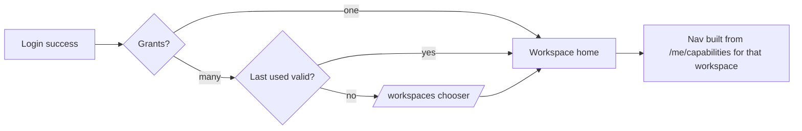
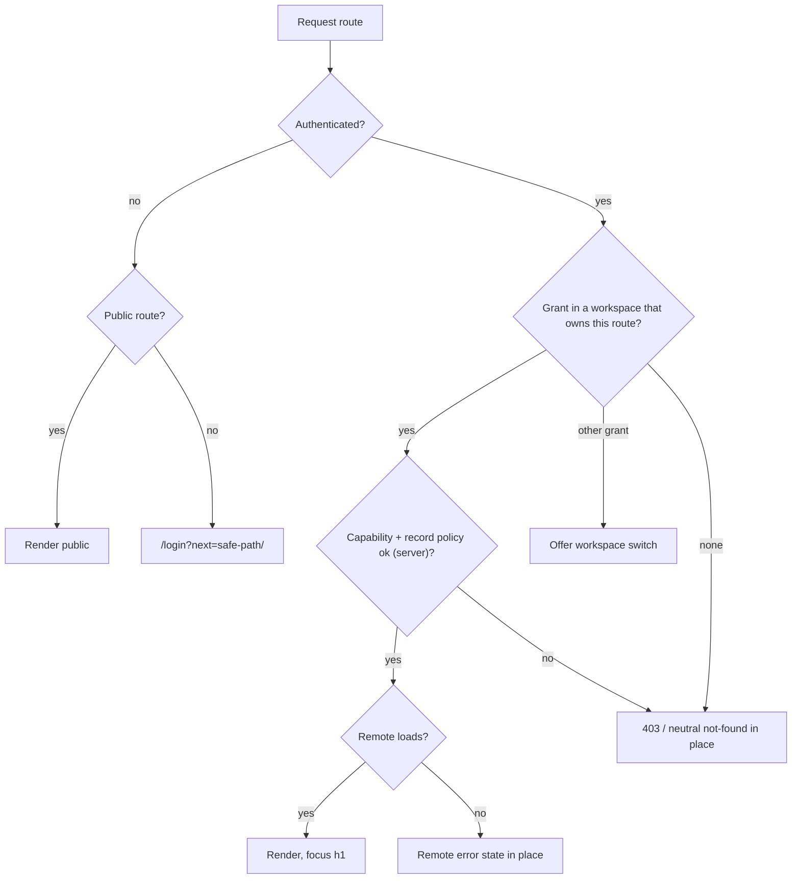

# Target blueprint 07: Ui Ux And Design System

> **Status.** Archive: proposal, not ratified. A greenfield redesign blueprint written in October 2026. Every area was Draft, Under Review or Revision Required (its own document status) and no test was run against it. Its content was mined into `docs/blueprint/`; `SSOT.md` remains the source of intent. Module federation described here was not adopted: the built system is a modular monolith (`ARCHITECTURE.md`).
>
> **What this file holds.** All files of the former `Yash_Final_Project_Document/07_UI_UX_AND_DESIGN_SYSTEM/` folder, in order.
>
> **Merged on 2026-11-25** from the files listed below; each one is a section under its original title. Nothing was removed; the originals are in git history at commit `08387ec`.

| Section | Former file |
|---|---|
| Accessibility Specification — WCAG 2.2 AA Design Targets & Test Plan | `Yash_Final_Project_Document/07_UI_UX_AND_DESIGN_SYSTEM/ACCESSIBILITY_SPEC.md` |
| Action Registry — 231 user and operator actions | `Yash_Final_Project_Document/07_UI_UX_AND_DESIGN_SYSTEM/ACTION_REGISTRY.md` |
| Design System — Tokens, Components, Theming, Localization & the `@ts/ui` Contract | `Yash_Final_Project_Document/07_UI_UX_AND_DESIGN_SYSTEM/DESIGN_SYSTEM.md` |
| Legacy Application Flow (routes, navigation model, request flow, recovery) merged | `Yash_Final_Project_Document/07_UI_UX_AND_DESIGN_SYSTEM/LEGACY_APP_FLOW_MERGE.md` |
| Legacy UI/UX Design System (prior v6.0) merged and reconciled | `Yash_Final_Project_Document/07_UI_UX_AND_DESIGN_SYSTEM/LEGACY_UI_UX_DESIGN_SYSTEM_MERGE.md` |
| Navigation Architecture — Shell Nav, Route Trees, Deep Links, Redirects, Dashboards | `Yash_Final_Project_Document/07_UI_UX_AND_DESIGN_SYSTEM/NAVIGATION_ARCHITECTURE.md` |
| Progressive UX & Feedback — Loading, Lists, Bulk Work, Truthful Progress, Sync States, Failure & Conflict | `Yash_Final_Project_Document/07_UI_UX_AND_DESIGN_SYSTEM/PROGRESSIVE_UX_AND_FEEDBACK.md` |
| Screen Registry — 130 screens across MOD-SHELL and seven remotes | `Yash_Final_Project_Document/07_UI_UX_AND_DESIGN_SYSTEM/SCREEN_REGISTRY.md` |
| Key Screen Specifications — 15 screens | `Yash_Final_Project_Document/07_UI_UX_AND_DESIGN_SYSTEM/SCREEN_SPECIFICATIONS_KEY.md` |
| UI/UX - Review Fixes (revision overlay) | `Yash_Final_Project_Document/07_UI_UX_AND_DESIGN_SYSTEM/UX_REVIEW_FIXES.md` |

## Accessibility Specification — WCAG 2.2 AA Design Targets & Test Plan

_Former file: `Yash_Final_Project_Document/07_UI_UX_AND_DESIGN_SYSTEM/ACCESSIBILITY_SPEC.md`._

Doc ID: UI-06 · Owner: Accessibility Lead · Version 1.0 · Status: Under Review · Relates: GOAL-06, ADR-T03, ADR-T19, FF-09, UI-05 `DESIGN_SYSTEM.md`, UI-02 `SCREEN_REGISTRY.md`, UI-07 `PROGRESSIVE_UX_AND_FEEDBACK.md`

Supersedes nothing; linked from the folder index and `MASTER_INDEX`. **WCAG 2.2 AA is a design target. No conformance has been measured; nothing here claims the product conforms.** Success criteria (SC) listed from the W3C "What's new in WCAG 2.2" / WCAG 2.2 Recommendation as cited in RES-01 R3; 4.1.1 Parsing is obsolete in 2.2 and omitted. Sources of truth for measurements are the tests in §10.

### 1. Policy decisions [TARGET]

| ID      | Decision                                                                                                                                                                                                                                                                                                                              | Rationale                                     |
| ------- | ------------------------------------------------------------------------------------------------------------------------------------------------------------------------------------------------------------------------------------------------------------------------------------------------------------------------------------- | --------------------------------------------- |
| A11Y-D1 | Touch/pointer targets ≥ **44 × 44 CSS px** product-wide (design-system `--ts-target-min`); WCAG 2.5.8 AA floor (24 × 24 with spacing exception) is the _conformance minimum_, 44 px is the product standard (aligns with AAA 2.5.5 intent). Dense desktop tables may use 32 px only with ≥ 8 px gaps and an alternative bulk control. | Mobile-first candidates, motor accessibility. |
| A11Y-D2 | Every drag interaction has a non-drag equivalent (2.5.7): board moves, reorder lists, file drop, slider.                                                                                                                                                                                                                              | Pipeline board and portfolio ordering.        |
| A11Y-D3 | No cognitive function test to authenticate (3.3.8): passkeys, password managers, paste allowed, emailed link/code; no CAPTCHA-style image puzzles as the only path (bot defence uses invisible risk signals with accessible fallback — [OPEN-UX-09]).                                                                                 | Login, referee, signup.                       |
| A11Y-D4 | Previously entered information is never re-requested within a flow (3.3.7).                                                                                                                                                                                                                                                           | Application form, onboarding.                 |
| A11Y-D5 | Help mechanisms in the same relative place on every page (3.2.6): "Help" link in TopBar and form footers; support contact consistent.                                                                                                                                                                                                 | Shell-owned.                                  |
| A11Y-D6 | Sticky elements (TopBar, BottomNav, ActionBar, offline banner, support-access banner) must never fully obscure a focused element (2.4.11); design aims at _not obscured at all_ (2.4.12 AAA) for form fields.                                                                                                                         | Mobile bottom-nav + sticky action bars.       |
| A11Y-D7 | Timeouts: no content timeout shorter than 20 h without warning and extension (2.2.1) **except** timed assessments (essential exception) — which offer pre-declared accommodations (extra time, pause where integrity rules allow) via `ACT-ASM-09`.                                                                                   | Assessments.                                  |
| A11Y-D8 | Accessibility conformance claims are made only from audit evidence (independent audit + AT user testing, [OPEN-UX-10]).                                                                                                                                                                                                               | Honesty.                                      |

### 2. WCAG 2.2 A + AA success-criteria mapping

Legend: **Where** = design artefact owning the control; **AC** = measurable acceptance criterion (pass/fail, testable); **T** = test type (A automated axe/lint, M manual, U user/AT test).

#### 2.1 Perceivable

| SC                                           | Lvl | Design response                                                                                                                      | Measurable acceptance criterion                                                                                          | T                          |
| -------------------------------------------- | --- | ------------------------------------------------------------------------------------------------------------------------------------ | ------------------------------------------------------------------------------------------------------------------------ | -------------------------- |
| 1.1.1 Non-text content                       | A   | Informative images have alt; decorative `alt=""`/`aria-hidden`; icons paired with text; charts have data table; rung icons have text | 0 images without `alt` attr; every `IconButton` has accessible name; every chart has adjacent table or summary           | A, M                       |
| 1.2.1 Audio/video-only                       | A   | Course audio-only gets transcript                                                                                                    | 100 % of published audio-only items have transcript before publish (publish check)                                       | M                          |
| 1.2.2 Captions (prerecorded)                 | A   | Course video requires captions to publish; platform instructor tooling blocks publish otherwise                                      | 0 published videos without caption track                                                                                 | A (publish gate)           |
| 1.2.3 Audio description or media alternative | A   | Transcript with described visuals, or description track                                                                              | Transcript includes visual info for 100 % of videos where visuals carry info (instructor checklist)                      | M                          |
| 1.2.4 Captions (live)                        | AA  | No live streams at launch; if added, live captions required                                                                          | N/A until live feature; gate in feature intake                                                                           | —                          |
| 1.2.5 Audio description (prerecorded)        | AA  | Description track or extended transcript required for instruction-critical visuals                                                   | Publish checklist item answered; sampled audit 20 videos                                                                 | M                          |
| 1.3.1 Info and relationships                 | A   | Semantic landmarks, headings, lists, tables with `th scope`, `fieldset/legend`, `aria-describedby` for help/error                    | axe `region`, `heading-order`, `label`, `th-has-data-cells` 0 violations; exactly one `h1`/route                         | A                          |
| 1.3.2 Meaningful sequence                    | A   | DOM order = visual order; no positive `tabindex`                                                                                     | 0 positive tabindex; reading-order walkthrough passes on 10 key screens                                                  | A, M                       |
| 1.3.3 Sensory characteristics                | A   | Instructions do not rely on shape/colour/position alone ("the green button")                                                         | Copy review checklist: 0 instructions using colour/position only                                                         | M                          |
| 1.3.4 Orientation                            | AA  | No orientation lock; PWA manifest `orientation: any`                                                                                 | Manifest value verified; every screen usable in both orientations                                                        | A, M                       |
| 1.3.5 Identify input purpose                 | AA  | `autocomplete` tokens on personal-data fields                                                                                        | 100 % of name/email/tel/address/org/password fields carry correct token (lint)                                           | A                          |
| 1.4.1 Use of colour                          | A   | Status = colour + icon + text; links underlined in body text                                                                         | Greyscale screenshot test: all statuses distinguishable; body links have underline or ≥ 3:1 + non-colour cue             | M                          |
| 1.4.2 Audio control                          | A   | No autoplay audio; player has pause                                                                                                  | 0 autoplaying media                                                                                                      | A, M                       |
| 1.4.3 Contrast (minimum)                     | AA  | Token pairs in UI-05 §2                                                                                                              | Text ≥ 4.5:1 (≥ 3:1 for ≥ 24 px or ≥ 18.66 px bold); axe `color-contrast` 0 violations in light, dark, HC                | A                          |
| 1.4.4 Resize text                            | AA  | `rem` units; layout flexible                                                                                                         | At 200 % browser text zoom: no loss of content or function on 25 key screens                                             | M                          |
| 1.4.5 Images of text                         | AA  | No text in images except logos                                                                                                       | 0 images of text outside logo (design review)                                                                            | M                          |
| 1.4.10 Reflow                                | AA  | Single-column reflow at 320 CSS px; data tables fall back to card lists                                                              | At 320 × 256 px viewport (400 % zoom of 1280): no 2-D scroll except maps/code editor/charts inside labelled regions      | M, A (Playwright viewport) |
| 1.4.11 Non-text contrast                     | AA  | `--ts-control-border` ≥ 4.4:1; focus ring ≥ 6:1; icon on tints ≥ 4.1:1                                                               | Component states measured: ≥ 3:1 for borders, icons, focus, chart marks                                                  | A, M                       |
| 1.4.12 Text spacing                          | AA  | Layouts tolerate spacing overrides                                                                                                   | With bookmarklet overrides (line 1.5, para 2×, letter 0.12em, word 0.16em): 0 clipped/overlapping text on 25 key screens | M                          |
| 1.4.13 Content on hover/focus                | AA  | Tooltips/popovers dismissible (Esc), hoverable, persistent                                                                           | Test each popover: Esc closes, pointer can enter, stays until dismissed                                                  | M                          |

#### 2.2 Operable

| SC                                      | Lvl | Design response                                                                                                                                                                                                                                                                                                                            | Measurable acceptance criterion                                                                                                                                                                                                                 | T                 |
| --------------------------------------- | --- | ------------------------------------------------------------------------------------------------------------------------------------------------------------------------------------------------------------------------------------------------------------------------------------------------------------------------------------------ | ----------------------------------------------------------------------------------------------------------------------------------------------------------------------------------------------------------------------------------------------- | ----------------- |
| 2.1.1 Keyboard                          | A   | All functions keyboard-operable incl. board, calendar, player, editor                                                                                                                                                                                                                                                                      | Keyboard-only run of all 16 key-screen specs completes with 0 mouse use                                                                                                                                                                         | M                 |
| 2.1.2 No keyboard trap                  | A   | Dialogs trap focus _with_ Esc exit; code editor has documented escape (Esc, Tab)                                                                                                                                                                                                                                                           | 0 traps in sweep; editor escape tested                                                                                                                                                                                                          | M                 |
| 2.1.4 Character key shortcuts           | A   | Single-key shortcuts (e.g. board "j/k") off by default; if on, can be turned off/remapped; Command palette uses modifier                                                                                                                                                                                                                   | Shortcut list in `/settings/display`; toggle works                                                                                                                                                                                              | M                 |
| 2.2.1 Timing adjustable                 | A   | Session timeout warning ≥ 2 min before expiry with extend; assessments excepted with accommodations                                                                                                                                                                                                                                        | Warning dialog test; accommodation path test                                                                                                                                                                                                    | M                 |
| 2.2.2 Pause, stop, hide                 | A   | No auto-updating content except live regions the person opted into; skeleton shimmer respects reduced motion                                                                                                                                                                                                                               | Any motion > 5 s has pause control                                                                                                                                                                                                              | M                 |
| 2.3.1 Three flashes                     | A   | No flashing content                                                                                                                                                                                                                                                                                                                        | Design review + PEAT-class check on media                                                                                                                                                                                                       | M                 |
| 2.4.1 Bypass blocks                     | A   | Skip links (main, nav); landmarks                                                                                                                                                                                                                                                                                                          | First two tab stops are skip links on every shell route                                                                                                                                                                                         | A                 |
| 2.4.2 Page titled                       | A   | Shell sets `document.title` "`<Page> — <Workspace> — TalentSphere`" on every route, including remote routes via `host.router.register`                                                                                                                                                                                                     | 100 % of routes in route registry have non-generic unique title (route-registry lint)                                                                                                                                                           | A                 |
| 2.4.3 Focus order                       | A   | Logical; after route change focus to `h1`; dialogs restore focus                                                                                                                                                                                                                                                                           | Focus-order walkthrough 25 screens                                                                                                                                                                                                              | M                 |
| 2.4.4 Link purpose (in context)         | A   | Links meaningful ("View application for Data Analyst")                                                                                                                                                                                                                                                                                     | 0 "click here"/"read more" without context name                                                                                                                                                                                                 | A (lint), M       |
| 2.4.5 Multiple ways                     | AA  | Nav + search + command palette + breadcrumbs + sitemap `/help/sitemap`                                                                                                                                                                                                                                                                     | ≥ 2 ways to reach every non-process page                                                                                                                                                                                                        | M                 |
| 2.4.6 Headings and labels               | AA  | Descriptive                                                                                                                                                                                                                                                                                                                                | Review checklist                                                                                                                                                                                                                                | M                 |
| 2.4.7 Focus visible                     | AA  | 2 px ring + offset, never removed; HC mode uses system Highlight                                                                                                                                                                                                                                                                           | `:focus-visible` style present on all interactive; screenshot test                                                                                                                                                                              | A, M              |
| **2.4.11 Focus not obscured (minimum)** | AA  | `scroll-padding-top: var(--ts-header-h)` and `scroll-padding-bottom: calc(var(--ts-bottom-nav-h) + var(--ts-action-bar-h) + 8px)` on scroll container; `scroll-margin` on focusable form controls; every remote sticky element registers its inset via `host.layout.registerStickyInset`; BottomNav never auto-hides during keyboard focus | On every form/key screen at 320 and 1280 px, tabbing through each focusable: element is **not fully covered** by any sticky/fixed element (Playwright: bounding-box of `:focus` vs overlay rects = 0 overlap); design goal 0 % overlap (2.4.12) | A (Playwright), M |
| 2.5.1 Pointer gestures                  | A   | No path-based or multi-touch-only gestures; swipe actions have buttons                                                                                                                                                                                                                                                                     | Each gesture has single-pointer alternative                                                                                                                                                                                                     | M                 |
| 2.5.2 Pointer cancellation              | A   | Actions fire on `click`/up-event; drag cancel by Esc/drop outside                                                                                                                                                                                                                                                                          | Press-down-only handlers = 0 (lint `onMouseDown/onTouchStart` on actions)                                                                                                                                                                       | A                 |
| 2.5.3 Label in name                     | A   | Visible label text is contained in accessible name                                                                                                                                                                                                                                                                                         | axe `label-content-name-mismatch` 0                                                                                                                                                                                                             | A                 |
| 2.5.4 Motion actuation                  | A   | No shake/tilt features                                                                                                                                                                                                                                                                                                                     | N/A by design                                                                                                                                                                                                                                   | —                 |
| **2.5.7 Dragging movements**            | AA  | Kanban "Move to…" menu; reorder "Move up/down" buttons; file upload button; slider has +/-                                                                                                                                                                                                                                                 | Each draggable element has a single-pointer alternative reachable in ≤ 2 interactions                                                                                                                                                           | M                 |
| **2.5.8 Target size (minimum)**         | AA  | Product standard 44 px; floor 24 px                                                                                                                                                                                                                                                                                                        | Automated: all interactive elements bounding box ≥ 24 × 24 (hard fail) and ≥ 44 × 44 on `<md` (warn → fail at release) except inline text links and spec exceptions                                                                             | A (Playwright)    |

#### 2.3 Understandable

| SC                                              | Lvl | Design response                                                                                                         | Measurable acceptance criterion                                                                             | T    |
| ----------------------------------------------- | --- | ----------------------------------------------------------------------------------------------------------------------- | ----------------------------------------------------------------------------------------------------------- | ---- |
| 3.1.1 Language of page                          | A   | `<html lang>` from locale                                                                                               | 100 % routes                                                                                                | A    |
| 3.1.2 Language of parts                         | AA  | `lang` on foreign UGC snippets with detected language tag                                                               | Spot-check 10                                                                                               | M    |
| 3.2.1 On focus                                  | A   | No context change on focus                                                                                              | Review                                                                                                      | M    |
| 3.2.2 On input                                  | A   | No auto-submit on select change; OTP auto-submit only on 6th digit with announced message                               | Review; test                                                                                                | M    |
| 3.2.3 Consistent navigation                     | AA  | Shell nav order stable per workspace                                                                                    | Visual diff nav across routes                                                                               | A    |
| 3.2.4 Consistent identification                 | AA  | Same icon+label for same function (design-system tokens)                                                                | Review                                                                                                      | M    |
| **3.2.6 Consistent help**                       | A   | Help link in TopBar + form footer in same order                                                                         | Position diff test                                                                                          | A    |
| 3.3.1 Error identification                      | A   | Inline + summary; text states which field and what is wrong                                                             | Each form: submit empty → summary lists all errors, each linked                                             | A, M |
| 3.3.2 Labels or instructions                    | A   | Visible labels; format hints                                                                                            | axe `label` 0                                                                                               | A    |
| 3.3.3 Error suggestion                          | AA  | Message gives a fix                                                                                                     | Copy review: 100 % validation messages include corrective hint                                              | M    |
| 3.3.4 Error prevention (legal, financial, data) | AA  | Applications, offers, billing, consent changes, erasure: review step and/or confirm + reversible window (withdraw)      | Each listed action has confirm/review/undo as per ACTION_REGISTRY "Idem/Confirm" column                     | M    |
| **3.3.7 Redundant entry**                       | A   | Auto-populate from profile; never re-ask in same process (application, onboarding, referee)                             | Walkthrough: 0 re-asks of already-entered data                                                              | M    |
| **3.3.8 Accessible authentication (minimum)**   | AA  | Passkey, password manager friendly fields, paste allowed, emailed link/code; no puzzle transcription; OTP can be pasted | Login/reset/step-up flows pass with password-manager + paste test; no object-recognition/transcription step | M    |

#### 2.4 Robust

| SC                      | Lvl | Design response                                                                                                                  | Measurable acceptance criterion                                                                             | T    |
| ----------------------- | --- | -------------------------------------------------------------------------------------------------------------------------------- | ----------------------------------------------------------------------------------------------------------- | ---- |
| 4.1.2 Name, role, value | A   | Native elements first; ARIA per APG; state props (`aria-expanded`, `aria-selected`, `aria-pressed`, `aria-current`, `aria-busy`) | axe `aria-*` rules 0 critical; custom widgets pass APG keyboard test                                        | A, M |
| 4.1.3 Status messages   | AA  | Single shell live-region host; polite for status, assertive only for errors blocking progress; list updates announce counts      | NVDA/VoiceOver: save, load-more, bulk progress, offline/online, toast announced; no duplicate announcements | M, U |

### 3. Keyboard model

| Context           | Keys                                                                                                                                                                                                   |
| ----------------- | ------------------------------------------------------------------------------------------------------------------------------------------------------------------------------------------------------ |
| Global            | `Tab`/`Shift+Tab` natural order; `Ctrl/⌘+K` command palette; `?` opens shortcut help (shortcuts off by default except palette; toggle in settings); `Esc` closes topmost overlay                       |
| Skip links        | First tab stops: "Skip to main content", "Skip to navigation" (visible on focus)                                                                                                                       |
| Nav               | SideNav: `Tab` between items; section collapse via button; BottomNav: `Tab`/arrow keys optional roving                                                                                                 |
| Menu / menubutton | `Enter/Space/↓` open; arrows move; `Home/End`; type-ahead; `Esc` close + return focus                                                                                                                  |
| Tabs              | Arrow keys move, `Enter/Space` activate (manual activation), `Home/End`                                                                                                                                |
| Combobox          | `↓` open, arrows, `Enter` select, `Esc` close/clear, announce result count                                                                                                                             |
| Data table        | Normal tab stops on interactive cells; grid mode (pipeline spreadsheets) arrow-key navigation with `aria-rowindex/colindex`; `Space` select row                                                        |
| Kanban board      | `Tab` to card; `Space` pick up; `←/→` change column, `↑/↓` change position; `Enter` drop; `Esc` cancel; each step announced ("Moved to Screening, position 2 of 7"); alternative: card menu "Move to…" |
| Dialog            | Focus moves in on open; `Tab` cycles; `Esc` close; focus returns to opener                                                                                                                             |
| Date/slot picker  | Grid arrows, `PageUp/Down` month, `Home/End` week edges; slot list alternative                                                                                                                         |
| Code editor       | `Esc` then `Tab` leaves editor; screen-reader mode toggle; run via `Ctrl/⌘+Enter` with visible button                                                                                                  |
| Course player     | `Space` play/pause (when player focused), `←/→` ±10 s, `↑/↓` volume, `C` captions, `T` transcript focus — only when player focused (2.1.4-safe)                                                        |

### 4. Screen-reader patterns

| Pattern                  | Markup/behaviour                                                                                                                                                                                                    |
| ------------------------ | ------------------------------------------------------------------------------------------------------------------------------------------------------------------------------------------------------------------- |
| Page structure           | One `banner`, one `nav` labelled "Primary" (+ labelled secondary navs), one `main`, `contentinfo`; each region labelled when repeated                                                                               |
| Headings                 | One `h1` per route (the focus target); logical descent; card titles use level set by context prop                                                                                                                   |
| Lists/tables             | Real `ul/ol/table`; captions via `<caption>` (visually hidden if redundant); sort state `aria-sort`; row count via `aria-rowcount` when virtualized                                                                 |
| Live updates             | `host.announce()`; polite for "Saved", "20 more results", "Application submitted"; assertive for blocking errors; never announce skeleton loading (use `aria-busy` on region and announce once "Loaded 20 results") |
| Evidence rung            | Badge text reads "Evidence strength: Backed by artifact" ; popover button label "What does Backed by artifact mean?"; modifier states in text ("Check in progress", "Revoked on 3 Nov")                             |
| Match explanation        | Region with heading "Why this matched"; strengths list, gaps list, uncertainty statement as text ("Confidence: medium — 2 required skills have no evidence yet"); no meter-only communication                       |
| Forms                    | Error summary announced on submit; each invalid field `aria-invalid="true"` + `aria-describedby` to message; required via text                                                                                      |
| Progress                 | `<progress>` with text for determinate; for bulk ops a status line "12 of 40 processed, 1 needs attention" in polite region at 5-item or 10-second cadence (throttled to avoid chatter)                             |
| Navigation announcements | After route change, `document.title` updated and focus on `h1`; polite announcement "Applications page loaded" **not** duplicated if focus move already read the heading                                            |
| Maps/graphs              | Skills graph and career-transition visualisations ship a table/list alternative as the default accessible view with toggle                                                                                          |
| Support banner           | `role="status"` persistent banner "Support access active, 2h 14m left" updated at 5-min cadence (not per second)                                                                                                    |

### 5. Focus and sticky-element rules (2.4.11 detail)

| Element                           | Height token                                                                                                                                                                                                                      | Rule                                                                    |
| --------------------------------- | --------------------------------------------------------------------------------------------------------------------------------------------------------------------------------------------------------------------------------- | ----------------------------------------------------------------------- |
| TopBar                            | `--ts-header-h` (56 px mobile / 64 px desktop)                                                                                                                                                                                    | sets `scroll-padding-top`                                               |
| BottomNav                         | `--ts-bottom-nav-h` (64 px + safe area)                                                                                                                                                                                           | sets `scroll-padding-bottom`                                            |
| ActionBar (form sticky CTA)       | `--ts-action-bar-h` (72 px)                                                                                                                                                                                                       | registered by form; removed at `≥ lg` when static layout used           |
| Banners (offline, support access) | measured by shell                                                                                                                                                                                                                 | included in `--ts-header-h` stack                                       |
| Cookie/consent banners            | —                                                                                                                                                                                                                                 | not sticky overlays over forms; inline at top; dismissible via keyboard |
| Rule                              | Total sticky inset on viewport ≤ 35 % of viewport height at 320 × 568; if exceeded, ActionBar becomes static in flow. Pop-in toasts placed above BottomNav, not over focused control; toast stack pauses when focus is within it. |
| Test                              | Playwright iterates focusable elements via keyboard on key screens at 320×568, 390×844, 768×1024, 1280×800 and asserts focused element's rect not intersecting fixed/sticky rects (≥ 1 px visible area; target 100 % visible).    |

### 6. Focus management across federated route changes

Federation puts route content from different remotes under one shell `main`. Because each remote renders asynchronously, default browser focus behaviour is lost on client-side navigation.

| Step | Owner                                                     | Behaviour                                                                                                                                                                                                          |
| ---- | --------------------------------------------------------- | ------------------------------------------------------------------------------------------------------------------------------------------------------------------------------------------------------------------ |
| 1    | Shell router                                              | On navigation start: set `main[aria-busy=true]`, keep current focus; if the target remote is not loaded, show `RemoteSkeleton` (after 150 ms)                                                                      |
| 2    | Remote                                                    | Renders route, then calls `host.router.register({ title, headingId })` once it has rendered the `h1` (data may still load; a skeleton under the `h1` is acceptable)                                                |
| 3    | Shell                                                     | On `register`: set `document.title`, `main[aria-busy=false]`, move focus to `#headingId` (`tabindex="-1"`), scroll to top respecting `scroll-padding`, and announce nothing extra (the heading is read)            |
| 4    | Shell                                                     | If `register` isn't called within **3 s** after remote mounted: fall back to focusing `main` and setting generic title; log `a11y.register_timeout` (trace-linked) — contract violation counted per remote release |
| 5    | Shell                                                     | If remote load **fails**: render `RemoteError` in `main`, focus its `h1` ("This part of TalentSphere is unavailable"), announce assertively once                                                                   |
| 6    | Back/forward                                              | Restore scroll position and focus to the previously focused control when navigating back to a list from detail (focus restoration via `history.state.focusKey`)                                                    |
| 7    | In-page changes                                           | Tab switches, filters, load-more: focus stays; results count announced (polite); "Load more" moves focus to first new item                                                                                         |
| 8    | Workspace switch                                          | Focus to new home `h1`; announce "Switched to Acme Corp hiring workspace"                                                                                                                                          |
| 9    | Modal routes (e.g. `/me/work-history/:id/references/new`) | Opened as dialog over previous route; Esc/Close returns to previous route and refocuses opener                                                                                                                     |
| 10   | Session expiry                                            | Re-auth dialog restores focus to the previously focused control; entered form data preserved (not lost)                                                                                                            |

Acceptance: for each of 10 cross-remote navigation pairs (e.g. `/me` → `/jobs/123` → `/hiring`), a screen-reader run hears the new page title/h1 once, focus lands on `h1`, and the remote cannot steal focus after load (assertion: `document.activeElement` stable for 1 s after register).

### 7. Forms and errors

| Rule          | Detail                                                                                                                                      |
| ------------- | ------------------------------------------------------------------------------------------------------------------------------------------- |
| Labels        | Visible label for every input; groups have `legend`                                                                                         |
| Instructions  | Format and constraints before the control (help text via `aria-describedby`)                                                                |
| Error summary | On failed submit: focus moves to summary (`role="alert"` heading + list of links); list each error in DOM order; links move focus to fields |
| Inline errors | Icon + text + `aria-invalid` + describedby; error text never colour-only                                                                    |
| Async errors  | Server problem+json `errors[]` mapped to fields; unmapped errors appear in summary                                                          |
| Success       | Status message polite + inline persistent confirmation (not toast-only)                                                                     |
| Confirmation  | Legal/financial/data actions: review step or confirm dialog or undo                                                                         |
| Auth          | Autofill, paste, show-password; no "type the characters" challenges; magic-link/passkey alternatives                                        |
| OTP / referee | Single field with `one-time-code`; resend countdown shown as text (not per-second announced)                                                |

### 8. Motion, zoom, reflow, text, and display preferences

| Topic                | Target                                                                                                                                                                                          |
| -------------------- | ----------------------------------------------------------------------------------------------------------------------------------------------------------------------------------------------- |
| Reduced motion       | Honour `prefers-reduced-motion`; user override in `/settings/display`; animation never required to understand state                                                                             |
| Zoom 400 %           | Reflow at 320 CSS px without 2-D scroll (1.4.10); sticky bars shrink or de-stick (§5); tables as cards; dialogs scroll internally with sticky title                                             |
| Text size            | 200 % text resize without loss; no `max-height` clipping on text containers                                                                                                                     |
| Contrast preferences | Dark, high contrast, forced colours (UI-05 §2.4)                                                                                                                                                |
| Orientation          | Both                                                                                                                                                                                            |
| Time                 | No fixed timeouts except assessments (accommodations) and security (warned)                                                                                                                     |
| Cognitive load       | Plain language (UI-05 §11), chunked multi-step forms, persistent progress text, undo, no surprise context changes; avoid dense dashboards by default: "Simple view" density toggle [OPEN-UX-11] |

### 9. Role-specific hotspots

| Surface                         | Hazard                                                            | Mitigation                                                                                                                                                              |
| ------------------------------- | ----------------------------------------------------------------- | ----------------------------------------------------------------------------------------------------------------------------------------------------------------------- |
| Pipeline board (SCR-HIR-05)     | Drag-only, huge DOM, live updates                                 | Move menu; list view default for screen readers; virtualization with `aria-rowcount`; live announcements throttled                                                      |
| Assessment runner (SCR-LRN-09)  | Timer anxiety, keyboard traps in code editor, proctoring overlays | Timer announced at 25/50/75/90 % remaining thresholds and last minute only (not continuous); editor escape; accommodations ACT-ASM-09; no mandatory camera for baseline |
| Course player (SCR-LRN-04)      | Captions, transcripts, keyboard                                   | Required captions at publish; transcript sync; keyboard map                                                                                                             |
| Referee form (SCR-SHELL-09)     | One-time mobile page, no account, possible low literacy           | ≤ 3 minutes; 5th–8th grade copy; large targets; works with zoom 400 %; works with screen reader; no timeouts shorter than the link validity; language switch            |
| Consent manager (SCR-ACC-09)    | Dense legal copy                                                  | Layered notices, plain language, per-purpose toggles with explicit state text                                                                                           |
| Support console (SCR-ADM-02/04) | High-risk actions under time pressure                             | Clear persistent banner, countdown at coarse cadence, keyboard shortcuts disabled by default                                                                            |
| Skills graph / career maps      | Visual-only                                                       | Table/list default alternative                                                                                                                                          |
| Charts / analytics              | Colour-only series                                                | Patterns, direct labels, table toggle                                                                                                                                   |

### 10. Testing plan

| Layer                             | What                                                                                                                               | Tooling                                      | When                                        | Gate                                   |
| --------------------------------- | ---------------------------------------------------------------------------------------------------------------------------------- | -------------------------------------------- | ------------------------------------------- | -------------------------------------- |
| Static                            | `jsx-a11y` lint, token lint (contrast pairs from token table), i18n lint, `autocomplete` lint                                      | ESLint + custom rules                        | every PR                                    | Block                                  |
| Component                         | Story-per-state, axe, keyboard-interaction tests (APG), RTL, dark, HC                                                              | Storybook-class + axe-core + Testing Library | every PR touching `@ts/ui`                  | Block on new violations                |
| Remote integration                | axe on each route in each remote at 320 and 1280 px; focus-register contract test; sticky-inset overlap test; target-size test     | Playwright + axe-core                        | per remote build                            | Block (FF-08 adds a11y contract check) |
| End-to-end                        | Key journeys (UJ-01, 02, 05, 11, 17) keyboard-only; WebKit + Chromium + Firefox                                                    | Playwright                                   | nightly                                     | Alert → block at release               |
| Manual — keyboard                 | Full sweep of all key screens                                                                                                      | QA checklist                                 | each release candidate                      | Block on S1/S2                         |
| Manual — screen readers           | NVDA+Firefox, NVDA+Chrome, JAWS+Chrome, VoiceOver+Safari (macOS & iOS), TalkBack+Chrome                                            | AT test script per screen spec               | each minor release; key flows every release | Block on S1/S2                         |
| Manual — display                  | 200 % text, 400 % zoom, text-spacing bookmarklet, forced colours, reduced motion, dark, RTL pseudo-locale                          | Checklist                                    | each minor release                          | Block S1/S2                            |
| Device                            | iOS Safari (installed PWA & browser), Android Chrome; platform matrix (FF-09, OPEN-12)                                             | Real devices                                 | each minor release                          | Block S1                               |
| User testing with disabled people | Recruited task-based sessions (screen-reader, low-vision, motor, cognitive); compensation                                          | Research program [OPEN-UX-10]                | before GA and per major redesign            | Findings triaged                       |
| Independent audit                 | Third-party WCAG 2.2 AA audit                                                                                                      | External                                     | pre-GA; annual                              | Required for any conformance statement |
| Production monitoring             | Synthetic axe scan of public routes; `a11y.register_timeout` and `ui.unknown_status` counters; accessibility feedback link in Help | Observability                                | continuous                                  | Alert                                  |

Severity: **S1** blocks task completion for a user group (e.g. keyboard trap, unlabelled primary control); **S2** significant barrier with workaround; **S3** minor. Defect SLA [OPEN-UX-12]. Accessibility statement and feedback channel published before GA; the statement states known gaps from the latest audit and does not claim conformance not demonstrated.

### 11. Open items

| ID         | Item                                                                                                           |
| ---------- | -------------------------------------------------------------------------------------------------------------- |
| OPEN-UX-09 | Bot-defence mechanism for signup/login that satisfies 3.3.8 (risk-based, invisible, with accessible fallback). |
| OPEN-UX-10 | Funding/recruitment of disabled user-testing panel; independent audit vendor.                                  |
| OPEN-UX-11 | "Simple view" density mode scope.                                                                              |
| OPEN-UX-12 | Accessibility defect SLA by severity.                                                                          |

## Action Registry — 231 user and operator actions

_Former file: `Yash_Final_Project_Document/07_UI_UX_AND_DESIGN_SYSTEM/ACTION_REGISTRY.md`._

Doc ID: UI-04 · Owner: Interaction Design Lead · Version 1.0 · Status: Under Review · Relates: UI-02 `SCREEN_REGISTRY.md`, UI-03, UI-07, ADR-T08, ADR-T10, INV-T01, INV-T04, INV-T05, INV-T08, INV-T09, INV-T10, INV-T15, INV-T17, INV-T18, BR-T001, BR-T004, BR-T005, BR-T041, BR-T050, BR-T060

Supersedes nothing; linked from the folder index and `MASTER_INDEX`. All rows **[TARGET]**. API names are placeholders `API-<module>-<verb>` (see UI-02 OPEN-UX-22). State-machine names (SM-*) are those owned by `06_BUSINESS_PROCESSES`; transitions shown are the UI's expectation, and the server remains authoritative (INV-T11).

### 0. Reading guide and global rules

**Columns:** Trigger · screen = control and where it lives. Actor = ROLE-*. Visible / enabled = when shown / when active (otherwise disabled **with a stated reason**, never silently). Input · validation = fields and rules (client validation is a convenience; the server re-validates and may return RFC 9457 problem+json). Processing = API call and state effects. Feedback = how the person learns the outcome (`T` toast, `I` inline persistent, `A` screen-reader announcement, `N` notification). Failure = specific failures; **global failure classes below apply to every row unless overridden.** Result · navigation = resulting state and where focus/route goes. Idem · Confirm = idempotency and confirmation requirement.

**Idempotency codes:** `K` unsafe mutation sends `Idempotency-Key` (generated once per user intent, reused on retry; FF-07, INV-T10) · `N` natural-key idempotent (set-to-value) · `R` read/safe · `E` ETag/`If-Match` required (ADR-T08).
**Confirmation codes:** `C0` none · `C1` review step or inline summary before commit · `C2` dialog with consequence text and verb-labelled button · `C3` typed confirmation · `U8` undo available for 8 s (server-side delayed commit or soft delete, OPEN-UX-15) · `SU` step-up authentication within last 15 min (SCR-SHELL-07/18).

**Global failure classes (apply by default):**

| Class                     | Behaviour                                                                                                                                                                                                              |
| ------------------------- | ---------------------------------------------------------------------------------------------------------------------------------------------------------------------------------------------------------------------- |
| F-net (offline / timeout) | Keep user input; online-only actions: control disabled with "Needs connection"; unknown-outcome mutation → "checking…" then status query, never blind resubmit (UI-07 §11); ADR-T10 actions queue as "Waiting to sync" |
| F-422 validation          | Field errors + error summary (focus moves), server messages mapped to fields                                                                                                                                           |
| F-401                     | Re-auth overlay (ACT-AUTH-14), then action resumes                                                                                                                                                                     |
| F-403                     | In-place forbidden state; capabilities refetch; no existence disclosure (INV-T02)                                                                                                                                      |
| F-409/412                 | Conflict flow (UI-07 §8)                                                                                                                                                                                               |
| F-429                     | Show wait time from `Retry-After` as text; no auto-hammering                                                                                                                                                           |
| F-5xx                     | `ErrorState` with trace id, Retry, input preserved                                                                                                                                                                     |
| F-remote                  | Remote unavailable state (UI-07 §7)                                                                                                                                                                                    |

**Standing rules:** no action may auto-reject, rank-out, flag or ban a person without a human actor (INV-T09); AI outputs are suggestions that become the user's own text only on adoption and never create evidence (INV-T08); every privileged action is audited (INV-T10, INV-T18); evidence rung is never set by a client action (INV-T04).

### 1. AUTH — identity and session (14)

| ID          | Trigger · screen                     | Actor                 | Visible / enabled                                                     | Input · validation                                                                                                                                                        | Processing                                                                                                     | Feedback                            | Failure (specific)                                                                                                                   | Result · navigation                               | Idem · Confirm                 |
| ----------- | ------------------------------------ | --------------------- | --------------------------------------------------------------------- | ------------------------------------------------------------------------------------------------------------------------------------------------------------------------- | -------------------------------------------------------------------------------------------------------------- | ----------------------------------- | ------------------------------------------------------------------------------------------------------------------------------------ | ------------------------------------------------- | ------------------------------ |
| ACT-AUTH-01 | "Create account" · SHELL-03          | ANON                  | Anon only; enabled when valid                                         | Email RFC-valid ≤254; password ≥12 chars, breach-list check, no composition rules, paste allowed; or "Use a passkey"; unticked terms checkbox; age confirmation [OPEN-09] | `API-identity-register`: Account (unconfirmed); code/link stored as hash (INV-T05); event `account.registered` | `I` "Check your email" + `A`        | Email exists → identical neutral response (no enumeration); breached password → field message; F-429                                 | → SHELL-04                                        | K · C0                         |
| ACT-AUTH-02 | "Confirm" / emailed link · SHELL-04  | ANON (pending)        | Pending account                                                       | 6-digit code, numeric, paste ok; or `#k` secret                                                                                                                           | `API-identity-confirm-email`: single-use, expiring, bound to request; session issued                           | `A` "Email confirmed"               | Wrong code: attempts left shown (max 5) then 15-min lock; expired → ACT-AUTH-03                                                      | → `/me/onboarding` (candidate) or invite flow     | N · C0                         |
| ACT-AUTH-03 | "Send a new code" · SHELL-04         | ANON (pending)        | After 60 s cooldown (text countdown, coarse cadence); ≤5/hour         | —                                                                                                                                                                         | `API-identity-resend-code`; invalidates prior code                                                             | `T` "New code sent"                 | F-429                                                                                                                                | stay; focus on code field                         | K · C0                         |
| ACT-AUTH-04 | "Sign in" · SHELL-02                 | ANON                  | Form complete                                                         | Email, password (never truncated, paste/autofill ok)                                                                                                                      | `API-identity-login`: session cookie, refresh family (BR-T050)                                                 | none on success                     | Generic "email or password incorrect"; lockout after repeated failure with recovery link; paused → RD-16; SSO-enforced → ACT-AUTH-12 | → `next` or workspace home; → SHELL-07 if step-up | K · C0                         |
| ACT-AUTH-05 | "Use a passkey" · SHELL-02           | ANON                  | WebAuthn feature-detected (FF-09), else hidden with password fallback | Browser prompt (conditional UI/autofill)                                                                                                                                  | `API-identity-passkey-options` → `API-identity-passkey-verify`                                                 | —                                   | User cancels → no error banner; unknown credential → offer password; cross-device QR fallback text                                   | as ACT-AUTH-04                                    | K · C0                         |
| ACT-AUTH-06 | "Verify" · SHELL-07 / overlay        | Any (partial session) | Step-up needed (sensitive action or new device)                       | Passkey, or emailed 6-digit code (paste ok)                                                                                                                               | `API-identity-challenge-verify`; marks session "recent auth" 15 min                                            | `A`                                 | 5 attempts then 15-min lock; code expired → resend                                                                                   | Returns to originating action with data preserved | K · C0                         |
| ACT-AUTH-07 | "Send reset link" · SHELL-05         | ANON                  | —                                                                     | Email                                                                                                                                                                     | `API-identity-request-reset`: always 202; hashed single-use token (INV-T05)                                    | `I` neutral "If an account exists…" | F-429                                                                                                                                | stay                                              | K · C0                         |
| ACT-AUTH-08 | "Set password" · SHELL-06            | ANON (token)          | Token valid                                                           | New password (policy as ACT-AUTH-01), show/hide toggle                                                                                                                    | `API-identity-reset-password`: token consumed; all sessions revoked                                            | `I` + `T`                           | Expired/used → request new link; breached → field message                                                                            | → `/login` with message                           | K · C0                         |
| ACT-AUTH-09 | "Sign out" · account menu            | Authed                | Always                                                                | —                                                                                                                                                                         | `API-identity-logout`; clears caches/drafts of sensitive data on device; warns if unsynced queue exists        | `A`                                 | Queue non-empty → dialog "2 changes not synced; signing out discards them"                                                           | → `/`                                             | K · C2 only if queue non-empty |
| ACT-AUTH-10 | "Accept invitation" · SHELL-12       | Any (token)           | Token valid; signed-in email must match invite or user signs up       | Review of org name + role                                                                                                                                                 | `API-orgs-accept-invite`: RoleGrant created; event `org.member.added`                                          | `I`                                 | Wrong account → "Sign out and use `x@…`"; expired/revoked → contact inviter                                                          | → new workspace home; focus `h1`                  | K · C1                         |
| ACT-AUTH-11 | "Add a passkey" · ACC-02             | Authed                | WebAuthn supported; step-up                                           | Nickname 1–40                                                                                                                                                             | `API-identity-passkey-register`                                                                                | `T`                                 | Cancelled; already registered on device                                                                                              | stay                                              | K · SU                         |
| ACT-AUTH-12 | "Continue with SSO" · SHELL-02/03    | ANON                  | Domain has SSO or user chooses                                        | Work email                                                                                                                                                                | `API-orgs-sso-discover` → IdP redirect → `API-identity-sso-callback` (SHELL-19)                                | polite "Signing you in…"            | IdP error/timeouts → login with reason; account not provisioned → request invite                                                     | → workspace home                                  | N · C0                         |
| ACT-AUTH-13 | "Can't use your passkey?" · SHELL-07 | Partial/ANON          | —                                                                     | Email; emailed code                                                                                                                                                       | `API-identity-recover`: notifies existing devices; sensitive changes cool-off 24 h                             | `I`                                 | F-429                                                                                                                                | → reset flow                                      | K · C0                         |
| ACT-AUTH-14 | "Sign in again" · overlay SHELL-18   | Authed (expired)      | Session expired mid-task                                              | Password or passkey                                                                                                                                                       | `API-identity-reauth`; replays pending request                                                                 | `A`                                 | Refresh reuse detected → full logout (BR-T050) with explanation                                                                      | Focus returns to prior control; form data intact  | K · C0                         |

### 2. ONB — candidate onboarding (6)

| ID         | Trigger · screen          | Actor | Visible / enabled                                                   | Input · validation                                                                                   | Processing                                                                                                | Feedback                                      | Failure                                                      | Result · navigation                     | Idem · Confirm |
| ---------- | ------------------------- | ----- | ------------------------------------------------------------------- | ---------------------------------------------------------------------------------------------------- | --------------------------------------------------------------------------------------------------------- | --------------------------------------------- | ------------------------------------------------------------ | --------------------------------------- | -------------- |
| ACT-ONB-01 | "Next" step 1 · CAND-02   | CAND  | First login                                                         | Goals (≥0 of: find a job, switch careers, learn, prove skills, teach)                                | `API-profile-update` (goals); O-q                                                                         | `A` step heading                              | —                                                            | → step 2                                | N · C0         |
| ACT-ONB-02 | "Next" step 2 · CAND-02   | CAND  | —                                                                   | 0–20 skills from taxonomy typeahead; custom text maps to nearest taxonomy skill or stays as free tag | `API-skills-search`, `API-profile-update`                                                                 | `A` count                                     | Taxonomy search offline → free tag allowed, reconciled later | → step 3                                | N · C0         |
| ACT-ONB-03 | "Import résumé" · CAND-02 | CAND  | Optional; parse allowed within AI budget (INV-T07) else manual path | PDF/DOCX ≤5 MB; type + scan                                                                          | `API-platform-upload-init`, `API-ai-parse-resume` via gateway; output = L1 **suggestions** only (INV-T08) | Indeterminate + `A` "Found 8 items to review" | Parse fails / over budget → manual entry; blocked file       | Review list; accept per item            | K · C1         |
| ACT-ONB-04 | "Next" step 4 · CAND-02   | CAND  | —                                                                   | Per-field choice Private / Recruiters I allow / Public; default Private                              | `API-profile-update-visibility`, `API-privacy-set-defaults`                                               | `A`                                           | —                                                            | → step 5                                | N · C0         |
| ACT-ONB-05 | "Skip for now" · CAND-02  | CAND  | Steps 2–4 optional                                                  | —                                                                                                    | Records skip; reminder card on home                                                                       | `A`                                           | —                                                            | next step                               | N · C0         |
| ACT-ONB-06 | "Finish" · CAND-02        | CAND  | Goal answered or skipped                                            | —                                                                                                    | `API-profile-update` (onboarded flag); event                                                              | `T`                                           | —                                                            | → `/me` or `/me/evidence/new` if chosen | K · C0         |

### 3. PRO — profile, portfolio, résumé (14)

| ID         | Trigger · screen                          | Actor      | Visible / enabled                                                              | Input · validation                                                                                        | Processing                                                                                                                                               | Feedback                              | Failure                                                   | Result · navigation            | Idem · Confirm                               |
| ---------- | ----------------------------------------- | ---------- | ------------------------------------------------------------------------------ | --------------------------------------------------------------------------------------------------------- | -------------------------------------------------------------------------------------------------------------------------------------------------------- | ------------------------------------- | --------------------------------------------------------- | ------------------------------ | -------------------------------------------- |
| ACT-PRO-01 | "Save" section / blur autosave · CAND-03  | CAND, INST | Own profile                                                                    | Headline ≤120; summary ≤2000; location free text; links https only, ≤5; pronouns ≤30; languages from list | `API-profile-update` with `If-Match`; event `profile.updated`; O-q queue                                                                                 | `A` "Saved" / badge "Waiting to sync" | 412 → conflict dialog; validation                         | stay                           | K, E · C0                                    |
| ACT-PRO-02 | "Change photo" · CAND-03                  | CAND       | —                                                                              | PNG/JPG/WebP ≤5 MB, ≥200 px; client crop with keyboard-operable controls                                  | `API-platform-upload-init`; scan; set avatar                                                                                                             | Byte progress → "Checking file"       | Blocked/oversized → reason                                | stay                           | K · C0                                       |
| ACT-PRO-03 | Visibility selector · CAND-03/04          | CAND       | —                                                                              | Private / Recruiters I allow / Public per field (Public requires published profile)                       | `API-profile-update-visibility`                                                                                                                          | `A` state text                        | Public without handle → prompt ACT-PRO-04                 | stay                           | N · C1 when moving to Public (shows preview) |
| ACT-PRO-04 | "Publish profile" / "Unpublish" · CAND-04 | CAND       | Handle set; headline present                                                   | Handle 3–30 `[a-z0-9-]`, unique, not reserved                                                             | `API-profile-publish` / `-unpublish`                                                                                                                     | `I` public URL + `T`                  | Handle taken → suggestions                                | stay; URL shown                | K · C2                                       |
| ACT-PRO-05 | "Add skill" · CAND-03/14                  | CAND       | —                                                                              | Taxonomy skill; optional self-rated level                                                                 | `API-profile-add-skill`; confidence recompute async                                                                                                      | `A`                                   | Duplicate → focus existing                                | stay                           | N · C0                                       |
| ACT-PRO-06 | "Remove skill" · CAND-03/14               | CAND       | —                                                                              | —                                                                                                         | `API-profile-remove-skill`; linked evidence stays                                                                                                        | `T` Undo                              | —                                                         | stay                           | K · U8                                       |
| ACT-PRO-07 | "Save project" · CAND-05/06               | CAND       | —                                                                              | Title ≤100, description ≤1000, URL https, evidence links                                                  | `API-profile-create-portfolio-item` / `-update-…`                                                                                                        | `T`                                   | Validation                                                | → CAND-05                      | K, E · C0                                    |
| ACT-PRO-08 | "Move up/down" or drag · CAND-05          | CAND       | ≥2 items                                                                       | Position                                                                                                  | `API-profile-reorder-portfolio`                                                                                                                          | `A` "Moved to position 2 of 6"        | Conflict                                                  | stay; focus kept on moved item | K · C0                                       |
| ACT-PRO-09 | "Add role" · CAND-10                      | CAND       | —                                                                              | Employer ≤120, title ≤120, start ≤ today, end ≥ start or "present", type from list, description ≤2000     | `API-profile-create-work-claim` (L1 Claimed)                                                                                                             | `T`                                   | Overlapping dates → advisory                              | → CAND-11                      | K · C0                                       |
| ACT-PRO-10 | "New résumé" · CAND-15                    | CAND       | Within plan limit (server-derived entitlement)                                 | Name 1–60, template, evidence selection                                                                   | `API-profile-create-resume`                                                                                                                              | `T`                                   | Limit reached → plan explainer (no dark pattern)          | → CAND-16                      | K · C0                                       |
| ACT-PRO-11 | "Export" · CAND-16                        | CAND       | —                                                                              | PDF or DOCX                                                                                               | `API-profile-export-resume` (job)                                                                                                                        | Indeterminate + notify when ready     | Export fails → retry                                      | Download                       | K · C0                                       |
| ACT-PRO-12 | "Use suggestion" / "Dismiss" · AI panel   | CAND       | AI available within budget (INV-T07) and session not `AI_PROHIBITED` (INV-T06) | —                                                                                                         | `API-ai-suggest` (human-gated INV-T09); adoption copies text as user's own L1 content; logs `ai_assisted` [OPEN-UX-04]; never creates evidence (INV-T08) | `A` "Suggestion added to your text"   | Budget exhausted → "Not available on your plan right now" | stay                           | K · C0                                       |
| ACT-PRO-13 | "Preview as…" · CAND-04                   | CAND       | —                                                                              | Viewpoint: Public / Recruiter I allow                                                                     | `API-profile-get-preview` (same policy engine)                                                                                                           | Labelled "Preview" region             | —                                                         | stay                           | R · C0                                       |
| ACT-PRO-14 | "Report" · SHELL-08/11                    | Any        | Not own                                                                        | Reason category; text ≤1000                                                                               | `API-safety-create-report`; case in moderation queue                                                                                                     | `T` "Report received"                 | F-429                                                     | stay                           | K · C1                                       |

### 4. EVD — evidence (12)

| ID         | Trigger · screen                             | Actor           | Visible / enabled                               | Input · validation                                                                                                                                                                        | Processing                                                                                                                                         | Feedback                                              | Failure                                                                                                                 | Result · navigation     | Idem · Confirm          |
| ---------- | -------------------------------------------- | --------------- | ----------------------------------------------- | ----------------------------------------------------------------------------------------------------------------------------------------------------------------------------------------- | -------------------------------------------------------------------------------------------------------------------------------------------------- | ----------------------------------------------------- | ----------------------------------------------------------------------------------------------------------------------- | ----------------------- | ----------------------- |
| ACT-EVD-01 | "Save evidence" · CAND-08                    | CAND, INST      | Online; valid                                   | Type (project, certificate, course, assessment, work sample, publication, other); title 3–120; description 10–2000; dates (end ≥ start, ≤ today); skills 1–10; default visibility Private | `API-evidence-create`: rejects `source=ai` (INV-T08); rung set by server (starts L1 Claimed; L2 once artifact clean); event `evidence.created`     | `I` "Saved as Claimed" + `T`                          | Offline → "Needs connection to save to your library" with local draft; uploads pending are allowed (attach as scanning) | → CAND-09               | K · C0                  |
| ACT-EVD-02 | "Add file" / drop · CAND-08/09               | CAND            | ≤10 files                                       | pdf, docx, png, jpg, md, zip ≤25 MB each; type sniffed server-side                                                                                                                        | `API-evidence-upload-init` (signed upload) → virus scan (BR-T003): invisible to others until clean                                                 | Byte bar → "Uploaded — scanning for safety" → "Ready" | Blocked → reason; retry ACT-EVD-08                                                                                      | stay; focus on file row | K · C0                  |
| ACT-EVD-03 | "Add link" · CAND-08/09                      | CAND            | ≤10 links                                       | https URL ≤2048; no `javascript:`; domain displayed                                                                                                                                       | `API-evidence-add-link` (reachability check async; not an endorsement)                                                                             | `A`                                                   | Unreachable → advisory                                                                                                  | stay                    | K · C0                  |
| ACT-EVD-04 | "Ask someone to attest" · CAND-09            | CAND own        | Evidence exists; no open request to same person | Attester name 2–80, email, relationship (select), message ≤500                                                                                                                            | `API-verification-create-attestation-request`: hashed token, 14-day expiry (INV-T05, BR-T004)                                                      | `I` chip "Requested 3 Nov" + `T`                      | Own email blocked; rate cap 10/day                                                                                      | stay                    | K · C1 (email preview)  |
| ACT-EVD-05 | "Edit" · CAND-09                             | CAND own        | Not revoked                                     | Same rules as ACT-EVD-01                                                                                                                                                                  | `API-evidence-update` with `If-Match`; material edits create a new revision and the prior attestation stays bound to the old revision [OPEN-UX-25] | `A`                                                   | 412 conflict; warning if attested                                                                                       | stay                    | K, E · C2 when attested |
| ACT-EVD-06 | "Archive" · CAND-07/09                       | CAND own        | —                                               | Optional reason                                                                                                                                                                           | `API-evidence-archive` (soft); dependents recomputed (BR-T005)                                                                                     | `T` Undo                                              | —                                                                                                                       | → CAND-07               | K · U8                  |
| ACT-EVD-07 | "Dispute this status" · CAND-09              | CAND own        | Rung revoked or contested                       | Message ≤2000; attachments                                                                                                                                                                | `API-verification-create-dispute` → moderation queue                                                                                               | `I` status "Under review"                             | —                                                                                                                       | stay                    | K · C1                  |
| ACT-EVD-08 | "Retry upload" · CAND-08/09                  | CAND            | Upload failed                                   | —                                                                                                                                                                                         | `API-evidence-upload-init` (resume where possible)                                                                                                 | Byte bar                                              | Repeat failure → report problem link                                                                                    | stay                    | K · C0                  |
| ACT-EVD-09 | "Discard draft" · CAND-08                    | CAND            | Local draft exists                              | —                                                                                                                                                                                         | Local delete only                                                                                                                                  | `T`                                                   | —                                                                                                                       | → CAND-07               | — · C2 if non-empty     |
| ACT-EVD-10 | "Link to skill" · CAND-07/09/14              | CAND own        | —                                               | 1–10 taxonomy skills                                                                                                                                                                      | `API-evidence-link-skill`; confidence recompute async                                                                                              | `A`                                                   | —                                                                                                                       | stay                    | N · C0                  |
| ACT-EVD-11 | "Download file" · CAND-09                    | CAND own        | Artifact clean                                  | —                                                                                                                                                                                         | `API-evidence-get-artifact-url` (short-lived signed URL; audited)                                                                                  | Browser download                                      | Expired link → regenerate                                                                                               | stay                    | R · C0                  |
| ACT-EVD-12 | "How was this checked?" · CAND-09 / SHELL-11 | Any with access | —                                               | —                                                                                                                                                                                         | `API-evidence-get-provenance`                                                                                                                      | Panel                                                 | —                                                                                                                       | stay                    | R · C0                  |

### 5. VER — work-history verification (8)

| ID         | Trigger · screen                    | Actor | Visible / enabled                                  | Input · validation                                                                            | Processing                                                                                                                                                     | Feedback                                                      | Failure                                        | Result · navigation        | Idem · Confirm |
| ---------- | ----------------------------------- | ----- | -------------------------------------------------- | --------------------------------------------------------------------------------------------- | -------------------------------------------------------------------------------------------------------------------------------------------------------------- | ------------------------------------------------------------- | ---------------------------------------------- | -------------------------- | -------------- |
| ACT-VER-01 | "Verify this role" · CAND-11        | CAND  | Claim exists                                       | Choose route: Ask a referee / Confirm with work email                                         | Navigation only                                                                                                                                                | —                                                             | —                                              | → ACT-VER-02 or ACT-VER-05 | R · C0         |
| ACT-VER-02 | "Send request" · CAND-12            | CAND  | <3 open requests per claim                         | Referee name 2–80; email valid, ≠ own; relationship (select) + period; message ≤500; language | `API-verification-create-reference-request`: hashed single-use token bound to this request; 14-day expiry; email via provider port (ADR-T20)                   | `I` "Requested on 3 Nov. We'll tell you when Priya responds." | Invalid/duplicate email; F-429                 | → CAND-11                  | K · C1         |
| ACT-VER-03 | "Send reminder" · CAND-11/13        | CAND  | ≥3 days since last send and <2 reminders (BR-T004) | —                                                                                             | `API-verification-remind`                                                                                                                                      | `T`                                                           | Disabled with reason ("2 of 2 reminders used") | stay                       | K · C0         |
| ACT-VER-04 | "Cancel request" · CAND-11/13       | CAND  | Open request                                       | —                                                                                             | `API-verification-cancel`: token invalidated                                                                                                                   | `T`                                                           | —                                              | stay                       | K · C2         |
| ACT-VER-05 | "Confirm with work email" · CAND-11 | CAND  | Employer-domain email; not free-mail               | Work email                                                                                    | `API-verification-create-email-challenge` (code hashed)                                                                                                        | `I`                                                           | Free-mail domain → use referee route           | → ACT-VER-06               | K · C0         |
| ACT-VER-06 | "Enter code" · CAND-11              | CAND  | Challenge open                                     | 6-digit code                                                                                  | `API-verification-confirm-email-challenge`; copy: "You control an email at acme.com. This does not prove employment on its own." Rung effect decided by server | `A`                                                           | 5 attempts then lock                           | stay                       | N · C0         |
| ACT-VER-07 | "Respond to dispute" · CAND-13      | CAND  | Dispute open                                       | Text ≤2000; files                                                                             | `API-verification-respond`                                                                                                                                     | `T`                                                           | —                                              | stay                       | K · C1         |
| ACT-VER-08 | "Send a new request" · CAND-11/13   | CAND  | Previous expired/declined                          | As ACT-VER-02                                                                                 | New request, old one stays closed                                                                                                                              | `I`                                                           | —                                              | stay                       | K · C1         |

### 6. REF — referee flow, no account (6)

| ID         | Trigger · screen                        | Actor   | Visible / enabled | Input · validation                                                                                                                               | Processing                                                                                                                                                                      | Feedback               | Failure                                                                         | Result · navigation | Idem · Confirm       |
| ---------- | --------------------------------------- | ------- | ----------------- | ------------------------------------------------------------------------------------------------------------------------------------------------ | ------------------------------------------------------------------------------------------------------------------------------------------------------------------------------- | ---------------------- | ------------------------------------------------------------------------------- | ------------------- | -------------------- |
| ACT-REF-01 | Open emailed link · SHELL-09            | REFEREE | Token valid       | `#k` secret, or 8-char code if fragment missing                                                                                                  | `API-verification-get-request-public` returns only candidate name + claim summary; `no-store`; referrer suppressed; secret never echoed                                         | Skeleton → form        | Invalid/used/expired/cancelled → neutral SHELL-10 (never reveals requester)     | Focus `h1`          | R · C0               |
| ACT-REF-02 | "Send my confirmation" · SHELL-09       | REFEREE | Form valid        | Relationship confirm (radio); dates/title (Yes / Partly / No each); optional comment ≤1000; typed name; checkbox "This is from my own knowledge" | `API-verification-submit-attestation`: token consumed (INV-T05); result recorded; evidence becomes **Peer-attested** only via server transition; event `verification.completed` | Page "Thank you" + `A` | Already used → SHELL-10 neutral; network loss → entries retained locally, Retry | → SHELL-10          | K (token-bound) · C1 |
| ACT-REF-03 | "I can't confirm this" · SHELL-09       | REFEREE | —                 | Reason radio (don't know them / can't confirm / prefer not to say)                                                                               | `API-verification-decline`                                                                                                                                                      | `I`                    | —                                                                               | → SHELL-10          | K · C2               |
| ACT-REF-04 | "This isn't for me / report" · SHELL-09 | REFEREE | —                 | Text ≤500                                                                                                                                        | `API-safety-create-report-public` (rate limited)                                                                                                                                | `I`                    | —                                                                               | → SHELL-10          | K · C1               |
| ACT-REF-05 | "Send me a new link" · SHELL-10         | REFEREE | Expired link      | None (link goes only to the original address; UI never accepts a new email)                                                                      | `API-verification-resend-link` (neutral, rate limited)                                                                                                                          | `I` neutral            | F-429                                                                           | stay                | K · C0               |
| ACT-REF-06 | Language select · SHELL-09/10           | REFEREE | —                 | Locale                                                                                                                                           | Local                                                                                                                                                                           | `A`                    | —                                                                               | stay                | R · C0               |

### 7. LRN — learning (11)

| ID         | Trigger · screen                            | Actor | Visible / enabled                                                     | Input · validation    | Processing                                                                                                | Feedback                | Failure                                                                       | Result · navigation   | Idem · Confirm                          |
| ---------- | ------------------------------------------- | ----- | --------------------------------------------------------------------- | --------------------- | --------------------------------------------------------------------------------------------------------- | ----------------------- | ----------------------------------------------------------------------------- | --------------------- | --------------------------------------- |
| ACT-LRN-01 | "Enrol" / "Start course" · LRN-03           | CAND  | Free or entitled; prerequisites met                                   | —                     | `API-learning-enrol`                                                                                      | `T`                     | Prerequisites missing → list; course full                                     | → LRN-04 first lesson | K · C0                                  |
| ACT-LRN-02 | "Continue" · LRN-01/05                      | CAND  | Enrolled                                                              | —                     | `API-learning-get-lesson` (resume point from server)                                                      | Skeleton                | Lesson unpublished → next lesson                                              | → LRN-04              | R · C0                                  |
| ACT-LRN-03 | "Submit answers" quiz · LRN-04              | CAND  | Quiz lesson                                                           | Per question type     | `API-learning-submit-quiz` (server scoring)                                                               | `I` result              | O-x                                                                           | stay / next           | K · C0                                  |
| ACT-LRN-04 | "Save note" · LRN-04                        | CAND  | —                                                                     | ≤2000 chars           | `API-learning-save-note`; O-q (notes are in ADR-T10 set)                                                  | Badge "Waiting to sync" | —                                                                             | stay                  | K · C0                                  |
| ACT-LRN-05 | "Mark complete" / auto at criteria · LRN-04 | CAND  | Criteria met (e.g. quiz passed; media finished as reported by player) | —                     | `API-learning-record-progress`: server verifies criteria; progress UI updates **only after** confirmation | `A` "Lesson 3 complete" | O-x → "Will record when you're online" is NOT shown; progress stays unchanged | Next lesson           | K · C0                                  |
| ACT-LRN-06 | "Add to my evidence" · LRN-05               | CAND  | Course complete                                                       | Optional description  | `API-evidence-create-from-course`: issuer-linked; rung from server per issuer authority [OPEN-UX-26]      | `I`                     | Not eligible → reason                                                         | → CAND-09             | K · C1                                  |
| ACT-LRN-07 | "Buy course" · LRN-03                       | CAND  | Paid course; billing mode on                                          | —                     | `API-billing-create-checkout` → Stripe; access only after verified webhook (INV-T17)                      | Redirect                | Checkout cancelled → return page                                              | → ACC-13              | K · C1 (price, currency, refund policy) |
| ACT-LRN-08 | "Request refund" · LRN-05                   | CAND  | Within refund window                                                  | Reason                | `API-billing-request-refund`                                                                              | `I`                     | Outside window → disabled with reason                                         | stay                  | K · C2                                  |
| ACT-LRN-09 | "Submit review" · LRN-03                    | CAND  | ≥50 % complete                                                        | Stars 1–5; text ≤1000 | `API-learning-create-review` (moderated)                                                                  | `T`                     | —                                                                             | stay                  | K · C0                                  |
| ACT-LRN-10 | "Start path" · LRN-06                       | CAND  | —                                                                     | —                     | `API-learning-start-path`                                                                                 | `T`                     | —                                                                             | → first step          | K · C0                                  |
| ACT-LRN-11 | "Report content" · LRN-03/04                | Any   | —                                                                     | Reason; text          | `API-safety-create-report`                                                                                | `T`                     | —                                                                             | stay                  | K · C1                                  |

### 8. ASM — assessments (10)

| ID         | Trigger · screen                   | Actor    | Visible / enabled                                 | Input · validation                                                              | Processing                                                                                          | Feedback                                     | Failure                                                                                                     | Result · navigation | Idem · Confirm |
| ---------- | ---------------------------------- | -------- | ------------------------------------------------- | ------------------------------------------------------------------------------- | --------------------------------------------------------------------------------------------------- | -------------------------------------------- | ----------------------------------------------------------------------------------------------------------- | ------------------- | -------------- |
| ACT-ASM-01 | "Start assessment" · LRN-07/08     | CAND     | Online; prerequisites; attempts left; window open | Checkbox "I have read the rules" (AI policy, integrity monitoring, timing)      | `API-assessment-start-attempt`: server timer starts; AI gateway blocks if `AI_PROHIBITED` (INV-T06) | `A`                                          | Attempt in progress → resume; offline → disabled "Needs connection"                                         | → LRN-09            | K · C1         |
| ACT-ASM-02 | Answer control · LRN-09            | CAND     | Attempt active                                    | Per question type                                                               | `API-assessment-save-answer` (debounced 2 s, sequence number); server timer authoritative           | Text "Saved 14:02" (not announced each time) | Offline: buffer locally with banner; on expiry server grades what it holds; may be unsaved → shown honestly | stay                | K (seq) · C0   |
| ACT-ASM-03 | "Flag for review" · LRN-09         | CAND     | —                                                 | —                                                                               | Local + `API-assessment-flag-question`                                                              | `A`                                          | —                                                                                                           | stay                | N · C0         |
| ACT-ASM-04 | "Run code" · LRN-09                | CAND     | Code question; sandbox runner available (ADR-T13) | Code ≤50 KB                                                                     | `API-assessment-run-code` (isolated, network-less)                                                  | Indeterminate output panel                   | Runner unavailable → disabled with reason; submission is marked **Unverified**                              | stay                | K · C0         |
| ACT-ASM-05 | "Submit attempt" · LRN-09          | CAND     | Online                                            | Dialog lists unanswered/flagged counts                                          | `API-assessment-submit-attempt` (irreversible)                                                      | `A`                                          | Time expired → auto-submit with saved answers; offline → blocked with reason, server timer continues        | → LRN-10            | K · C2         |
| ACT-ASM-06 | "Pause" / "Leave attempt" · LRN-09 | CAND     | Only if assessment permits                        | —                                                                               | `API-assessment-pause` / `-abandon`                                                                 | `I`                                          | Not permitted → explanation                                                                                 | → LRN-08            | K · C2         |
| ACT-ASM-07 | "View result" · LRN-07/10          | CAND own | Scored                                            | —                                                                               | `API-assessment-get-result`                                                                         | —                                            | `Unverified` shows honest note                                                                              | stay                | R · C0         |
| ACT-ASM-08 | "Ask for a review" · LRN-11        | CAND own | Review requested or result contested              | Statement ≤2000                                                                 | `API-assessment-create-appeal` → human review (INV-T20)                                             | `I` "Review requested"                       | —                                                                                                           | stay                | K · C1         |
| ACT-ASM-09 | "Request accommodation" · LRN-08   | CAND     | Before start                                      | Type (extra time, breaks, assistive tech, other), note ≤1000, optional document | `API-assessment-request-accommodation`; reviewer approves; applied server-side to timer             | `I` status                                   | —                                                                                                           | stay                | K · C1         |
| ACT-ASM-10 | "Add to my evidence" · LRN-10      | CAND own | Passed and verifiable (not Unverified)            | —                                                                               | `API-evidence-create-from-assessment`; rung by server                                               | `I`                                          | Not eligible → reason                                                                                       | → CAND-09           | K · C1         |

### 9. JOB — discovery (11)

| ID         | Trigger · screen                        | Actor     | Visible / enabled | Input · validation                                                        | Processing                                                                                                            | Feedback          | Failure                                                      | Result · navigation | Idem · Confirm    |
| ---------- | --------------------------------------- | --------- | ----------------- | ------------------------------------------------------------------------- | --------------------------------------------------------------------------------------------------------------------- | ----------------- | ------------------------------------------------------------ | ------------------- | ----------------- |
| ACT-JOB-01 | Search box / "Search jobs" · OPP-01     | Any       | —                 | Keywords ≤200; filters (skills, location/remote, type, seniority, posted) | `API-search-jobs` cursor pagination; match summary only when signed in                                                | `A` "42 jobs"     | O-c last results                                             | URL updates         | R · C0            |
| ACT-JOB-02 | Filter chips / "Clear filters" · OPP-01 | Any       | —                 | —                                                                         | Query state in URL                                                                                                    | `A` count         | —                                                            | stay                | R · C0            |
| ACT-JOB-03 | "Save search" · OPP-01                  | CAND      | Signed in         | Name 1–60                                                                 | `API-search-save`                                                                                                     | `T`               | Limit reached                                                | stay                | K · C0            |
| ACT-JOB-04 | "Alert me" · OPP-01/04                  | CAND      | Signed in         | Frequency (instant / daily / weekly); channel (in-app, email, push)       | `API-notify-create-alert`; email only with consent                                                                    | `T`               | Push unsupported → explainer                                 | stay                | K · C0            |
| ACT-JOB-05 | "Why this matched" · OPP-01/02          | Signed-in | —                 | —                                                                         | `API-matching-explain`: strengths, gaps, missing information, confidence, inputs; payment is never an input (INV-T19) | Panel             | Unavailable → "Not enough information to explain this match" | stay                | R · C0            |
| ACT-JOB-06 | "Share" · OPP-02                        | Any       | —                 | —                                                                         | Web Share / copy link                                                                                                 | `A` "Link copied" | Share unsupported → copy                                     | stay                | R · C0            |
| ACT-JOB-07 | "Save job" toggle · OPP-01/02           | CAND      | —                 | —                                                                         | `API-jobs-save` (optimistic)                                                                                          | `A`               | Revert on failure                                            | stay                | N · C0            |
| ACT-JOB-08 | "Not interested" · OPP-01/02            | CAND      | —                 | Optional reason                                                           | `API-jobs-hide` (affects recommendations only)                                                                        | `T` Undo          | —                                                            | stay                | N · U8            |
| ACT-JOB-09 | "Report job" · OPP-02                   | Any       | —                 | Reason; text                                                              | `API-safety-create-report`                                                                                            | `T`               | —                                                            | stay                | K · C1            |
| ACT-JOB-10 | "Edit/Delete alert" · OPP-03/04         | CAND own  | —                 | As ACT-JOB-04                                                             | `API-notify-update-alert` / `-delete-alert`                                                                           | `T`               | —                                                            | stay                | K · C2 for delete |
| ACT-JOB-11 | "Follow company" · OPP-02/05            | CAND      | —                 | —                                                                         | `API-jobs-follow-org`                                                                                                 | `A`               | —                                                            | stay                | N · C0            |

### 10. APP — applying (10)

| ID         | Trigger · screen                    | Actor    | Visible / enabled                                         | Input · validation                                                                                                                       | Processing                                                                                                                                               | Feedback                                                                                    | Failure                                                                                   | Result · navigation | Idem · Confirm       |
| ---------- | ----------------------------------- | -------- | --------------------------------------------------------- | ---------------------------------------------------------------------------------------------------------------------------------------- | -------------------------------------------------------------------------------------------------------------------------------------------------------- | ------------------------------------------------------------------------------------------- | ----------------------------------------------------------------------------------------- | ------------------- | -------------------- |
| ACT-APP-01 | "Apply" · OPP-02                    | CAND     | Job published; no active application (BR-T001); signed in | —                                                                                                                                        | `API-applications-create-draft`                                                                                                                          | Skeleton                                                                                    | Existing application → "View your application"; job closed → explanation                  | → OPP-06            | K · C0               |
| ACT-APP-02 | Autosave / "Save draft" · OPP-06    | CAND     | —                                                         | Any                                                                                                                                      | `API-applications-save-draft` with `If-Match`; O-q                                                                                                       | Badge "Saved" / "Waiting to sync"                                                           | 412 conflict                                                                              | stay                | K, E · C0            |
| ACT-APP-03 | "Submit application" · OPP-06       | CAND     | Online; required fields; job open                         | Résumé variant; ≤10 evidence items; consent selection; screening answers (types per job); contact details prefilled from profile (3.3.7) | `API-applications-submit`: SM-APPLICATION → submitted; event `application.submitted`; consent scope created for chosen evidence (INV-T15); email receipt | `I` persistent confirmation "Submitted. You can withdraw any time before a decision." + `N` | Job closed meanwhile → draft retained, message; idempotent replay shown as normal success | → OPP-08            | K · C1 (review step) |
| ACT-APP-04 | "Withdraw application" · OPP-08     | CAND own | Not terminal                                              | Optional reason                                                                                                                          | `API-applications-withdraw`: terminal; consent scopes tied to it end                                                                                     | `T`                                                                                         | —                                                                                         | → OPP-07            | K · C2               |
| ACT-APP-05 | "Confirm this time" · OPP-09        | CAND own | Slots offered                                             | Slot                                                                                                                                     | `API-applications-select-slot` (atomic)                                                                                                                  | `I` + ICS link                                                                              | Slot taken → refreshed list with message                                                  | stay                | K · C1               |
| ACT-APP-06 | "Suggest other times" · OPP-09      | CAND own | —                                                         | Up to 3 windows with time zone; note ≤300                                                                                                | `API-applications-propose-times`                                                                                                                         | `I`                                                                                         | —                                                                                         | stay                | K · C0               |
| ACT-APP-07 | "Accept offer" · OPP-10             | CAND own | Offer active                                              | Confirm checkbox                                                                                                                         | `API-applications-respond-offer` (accept)                                                                                                                | `I`                                                                                         | Expired → explanation                                                                     | stay                | K · C2, SU           |
| ACT-APP-08 | "Decline offer" · OPP-10            | CAND own | —                                                         | Optional reason                                                                                                                          | `API-applications-respond-offer` (decline)                                                                                                               | `I`                                                                                         | —                                                                                         | stay                | K · C2               |
| ACT-APP-09 | "Choose evidence to share" · OPP-06 | CAND     | —                                                         | Select ≤10 own items; preview of what the employer will see                                                                              | `API-applications-attach-evidence` records consent scope id                                                                                              | `A` count                                                                                   | Item still scanning → excluded with note                                                  | stay                | K · C1               |
| ACT-APP-10 | "Choose résumé" · OPP-06            | CAND     | ≥1 variant                                                | Select                                                                                                                                   | Draft update                                                                                                                                             | `A`                                                                                         | —                                                                                         | stay                | N · C0               |

### 11. HIRE — job management (10)

| ID          | Trigger · screen               | Actor       | Visible / enabled        | Input · validation                                                                                                                                                          | Processing                                                                          | Feedback    | Failure                                               | Result · navigation | Idem · Confirm                 |
| ----------- | ------------------------------ | ----------- | ------------------------ | --------------------------------------------------------------------------------------------------------------------------------------------------------------------------- | ----------------------------------------------------------------------------------- | ----------- | ----------------------------------------------------- | ------------------- | ------------------------------ |
| ACT-HIRE-01 | "Post a job" · HIR-01/02/20    | REC, ORGADM | Seat and plan allow      | Blank or template                                                                                                                                                           | `API-jobs-create-draft`                                                             | Skeleton    | Plan quota → plan explainer                           | → HIR-03            | K · C0                         |
| ACT-HIRE-02 | "Save draft" · HIR-03          | REC, ORGADM | —                        | Title 5–120; description ≥50 chars; location/remote; type; salary range (optional; mandatory where law requires [OPEN]); skills 1–15 (must / nice); screening ≤10 questions | `API-jobs-update` with `If-Match`                                                   | `A` "Saved" | 412 conflict; O-x                                     | stay                | K, E · C0                      |
| ACT-HIRE-03 | "Publish job" · HIR-03         | REC, ORGADM | Required fields complete | Checkbox "Content is accurate and decisions will be made by people"                                                                                                         | `API-jobs-publish`: SM-JOB; content lint may route to review; event `job.published` | `I` + `T`   | Blocked content → "Pending review" status with reason | → HIR-02            | K · C1                         |
| ACT-HIRE-04 | "Pause" · HIR-02/03            | REC, ORGADM | Published                | Optional reason                                                                                                                                                             | `API-jobs-pause`                                                                    | `T`         | —                                                     | stay                | K · C2 (applicants see paused) |
| ACT-HIRE-05 | "Close job" · HIR-02/03        | REC, ORGADM | Published/paused         | Reason (filled, cancelled, other); optional notify applicants (template)                                                                                                    | `API-jobs-close` (applications continue to be handled by people)                    | `T`         | —                                                     | stay                | K · C2                         |
| ACT-HIRE-06 | "Duplicate" · HIR-02           | REC, ORGADM | —                        | —                                                                                                                                                                           | `API-jobs-duplicate`                                                                | `T`         | —                                                     | → HIR-03            | K · C0                         |
| ACT-HIRE-07 | "Use template" · HIR-03/04     | REC, ORGADM | —                        | Template select                                                                                                                                                             | Editor prefill                                                                      | `A`         | —                                                     | stay                | R · C0                         |
| ACT-HIRE-08 | "Add question" · HIR-03        | REC, ORGADM | —                        | Text ≤300; type; required toggle; "flag for review if answer is X" (flag only; **no auto-reject**, INV-T09)                                                                 | In job draft                                                                        | `A`         | —                                                     | stay                | N · C0                         |
| ACT-HIRE-09 | "Archive" · HIR-02             | REC, ORGADM | Closed                   | —                                                                                                                                                                           | `API-jobs-archive`                                                                  | `T` Undo    | —                                                     | stay                | K · U8                         |
| ACT-HIRE-10 | "Save as template" · HIR-03/04 | REC, ORGADM | —                        | Name 1–60                                                                                                                                                                   | `API-jobs-create-template`                                                          | `T`         | —                                                     | stay                | K · C0                         |

### 12. PIPE — pipeline, review, offers, search (19)

Stage changes follow SM-APPLICATION only (INV-T11). "Adverse" = moves to a terminal "Not moving forward" state: always a named human actor, reason category, never triggered by score, rank or AI (INV-T09).

| ID          | Trigger · screen                             | Actor                            | Visible / enabled                                      | Input · validation                                                                                                                       | Processing                                                                                                                        | Feedback                                              | Failure                                                                                                                                     | Result · navigation                     | Idem · Confirm                     |
| ----------- | -------------------------------------------- | -------------------------------- | ------------------------------------------------------ | ---------------------------------------------------------------------------------------------------------------------------------------- | --------------------------------------------------------------------------------------------------------------------------------- | ----------------------------------------------------- | ------------------------------------------------------------------------------------------------------------------------------------------- | --------------------------------------- | ---------------------------------- |
| ACT-PIPE-01 | Drag card to column · HIR-05                 | REC, HM (assigned)               | Pointer; transition allowed by SM                      | Target column                                                                                                                            | `API-applications-move-stage` with `from_stage` and `If-Match`; event `application.stage.changed`; candidate notified by template | `A` "Moved to Interview, position 2 of 7"             | Stale `from_stage` → card snaps back with "Moved to X by Dana 1 min ago" + "Apply my move"; terminal/not allowed → drop refused with reason | Card in new column; focus stays on card | K, E · C0 forward; C2 adverse      |
| ACT-PIPE-02 | "Move to…" menu · HIR-05/06/14               | REC, HM (assigned)               | Always (non-drag path, 2.5.7)                          | Stage select (only legal targets listed)                                                                                                 | As ACT-PIPE-01                                                                                                                    | As above                                              | As above                                                                                                                                    | Same                                    | K, E · same                        |
| ACT-PIPE-03 | "Move selected" · HIR-05                     | REC                              | 1–200 selected                                         | Target stage                                                                                                                             | Bulk op `API-applications-bulk-move`; per-item results (UI-07 §4)                                                                 | Dialog with count/sample/ineligible list, then HIR-12 | Per-item skipped/failed                                                                                                                     | → HIR-12                                | K per item · C2                    |
| ACT-PIPE-04 | "Message selected" · HIR-05/13               | REC                              | Candidates contactable (consent); quota ≥ count        | Template + personalisation preview; message ≤1500                                                                                        | Bulk op `API-messaging-bulk-send`; quota decrement                                                                                | Preview + quota shown ("38 of 100 left")              | Not contactable → skipped with reason                                                                                                       | → HIR-12                                | K per item · C2                    |
| ACT-PIPE-05 | "Not moving forward…" · HIR-05/06            | REC (HM where permitted)         | Human selects each candidate; no preselection by score | Reason category (select, required), optional note ≤1000, message template (respectful default), checkbox "I reviewed these N candidates" | Single or bulk op `API-applications-close-out`; SM → terminal; candidate sees "Not moving forward" with the category              | Confirmation dialog lists names                       | Item changed meanwhile → skipped                                                                                                            | Row moves to closed list                | K per item · C2 (typed N for ≥ 20) |
| ACT-PIPE-06 | "Assign reviewer" · HIR-05/06                | REC, ORGADM                      | —                                                      | Org member with HM/REC role                                                                                                              | `API-applications-assign`                                                                                                         | `T`                                                   | Member lacks access → listed reason                                                                                                         | stay                                    | K · C0                             |
| ACT-PIPE-07 | "Schedule interview" · HIR-06/09             | REC, HM                          | Stage allows                                           | Panel (≥1), ≥1 slot, duration 15–240 min, mode, link/location, time zone shown                                                           | `API-applications-create-interview`; invites + ICS                                                                                | `I` + `N` to candidate                                | Calendar conflict warning                                                                                                                   | stay                                    | K · C1                             |
| ACT-PIPE-08 | "Add note" · HIR-06                          | REC, HM                          | —                                                      | ≤5000 chars; internal only; hint text discourages sensitive-attribute remarks                                                            | `API-applications-add-note`; O-q (notes)                                                                                          | Badge "Waiting to sync" if offline                    | —                                                                                                                                           | stay                                    | K · C0                             |
| ACT-PIPE-09 | "Submit scorecard" · HIR-10                  | REC, HM (panel)                  | Interview complete                                     | Ratings 1–5 per job-linked criterion with anchors; comment required for 1 and 5; overall recommendation (advice, not decision)           | `API-applications-submit-scorecard`; immutable after submit                                                                       | `T`                                                   | Late edit → addendum only                                                                                                                   | → HIR-06                                | K · C2                             |
| ACT-PIPE-10 | "Create offer" · HIR-06                      | REC                              | Stage allows                                           | Role, compensation, start date, expiry ≥3 days                                                                                           | `API-applications-create-offer` (draft)                                                                                           | `T`                                                   | —                                                                                                                                           | → HIR-11                                | K · C0                             |
| ACT-PIPE-11 | "Send offer" · HIR-11                        | REC (approver per policy [OPEN]) | Draft valid                                            | Review summary                                                                                                                           | `API-applications-send-offer`; candidate notified                                                                                 | `I`                                                   | Approval pending → disabled with reason                                                                                                     | → HIR-06                                | K · C2                             |
| ACT-PIPE-12 | "Mark as hired" · HIR-06                     | REC                              | Offer accepted                                         | Start date confirm                                                                                                                       | `API-applications-mark-hired`                                                                                                     | `T`                                                   | —                                                                                                                                           | stay                                    | K · C2                             |
| ACT-PIPE-13 | "Add to shortlist" · HIR-05/06/07            | REC, HM                          | Live consent scope exists                              | List select/create                                                                                                                       | `API-applications-add-shortlist`                                                                                                  | `A`                                                   | No consent → disabled "Candidate hasn't shared this profile"                                                                                | stay                                    | N · C0                             |
| ACT-PIPE-14 | "Request access" · HIR-06/07                 | REC                              | Evidence hidden by consent                             | Message ≤300                                                                                                                             | `API-privacy-create-access-request` → candidate notification (never auto-granted)                                                 | `I` "Requested"                                       | Duplicate pending → shown                                                                                                                   | stay                                    | K · C1                             |
| ACT-PIPE-15 | "Search" · HIR-07                            | REC, ORGADM                      | Entitlement                                            | Skills, minimum rung, location, availability                                                                                             | `API-search-candidates`; discoverable + consented only; explanation + uncertainty; payment never a ranking input (INV-T19)        | `A` count                                             | Quota → message                                                                                                                             | stay                                    | R · C0                             |
| ACT-PIPE-16 | "View evidence" · HIR-06                     | REC, HM                          | Live consent scope                                     | —                                                                                                                                        | `API-evidence-list-consented`; view audited and visible in candidate access log                                                   | —                                                     | Scope revoked mid-view → hidden on next fetch with notice                                                                                   | stay                                    | R · C0                             |
| ACT-PIPE-17 | "Compare" · HIR-05/14                        | REC, HM                          | 2–4 selected                                           | —                                                                                                                                        | `API-applications-compare` (criteria columns; no total score)                                                                     | —                                                     | Consent-hidden columns shown as locked                                                                                                      | → HIR-14                                | R · C0                             |
| ACT-PIPE-18 | "Export" · HIR-05/18                         | REC, ORGADM                      | —                                                      | Field allowlist; date range                                                                                                              | `API-analytics-export` (job; no sensitive attributes)                                                                             | Indeterminate + notify                                | —                                                                                                                                           | Download                                | K · C0                             |
| ACT-PIPE-19 | "Cancel remaining" / "Retry failed" · HIR-12 | Initiator, ORGADM                | Op running / failures exist                            | —                                                                                                                                        | `API-platform-cancel-operation` / `-retry-failed`; completed items are not rolled back                                            | `A`                                                   | —                                                                                                                                           | stay                                    | K · C2 (cancel)                    |

### 13. MSG — messaging (7)

| ID         | Trigger · screen                                  | Actor        | Visible / enabled                             | Input · validation                  | Processing                                                                   | Feedback                                   | Failure                                                                 | Result · navigation                      | Idem · Confirm |
| ---------- | ------------------------------------------------- | ------------ | --------------------------------------------- | ----------------------------------- | ---------------------------------------------------------------------------- | ------------------------------------------ | ----------------------------------------------------------------------- | ---------------------------------------- | -------------- |
| ACT-MSG-01 | "Send" · MSG-02/03, OPP-08                        | Participants | Recipient contactable; thread open            | Text ≤4000; ≤3 attachments          | `API-messaging-send` with client message id; O-q (compose is in ADR-T10 set) | Bubble "Not sent yet" until server accepts | Consent withdrawn/blocked → disabled with reason; moderation hold shown | stay; composer cleared only after accept | K · C0         |
| ACT-MSG-02 | Open thread / "Mark read" · MSG-01                | Participant  | —                                             | —                                   | `API-messaging-mark-read` (optimistic)                                       | —                                          | Revert silently                                                         | stay                                     | N · C0         |
| ACT-MSG-03 | "Mute" · MSG-01/02                                | Participant  | —                                             | Duration (1 h, 8 h, forever)        | `API-messaging-mute`                                                         | `T`                                        | —                                                                       | stay                                     | N · C0         |
| ACT-MSG-04 | "Archive" · MSG-01/02                             | Participant  | —                                             | —                                   | `API-messaging-archive` (optimistic)                                         | `T` Undo                                   | —                                                                       | stay                                     | N · U8         |
| ACT-MSG-05 | "Report message" · MSG-02                         | Participant  | —                                             | Reason; text                        | `API-safety-create-report`                                                   | `T`                                        | —                                                                       | stay                                     | K · C1         |
| ACT-MSG-06 | "Contact" / "Send outreach" · HIR-07/13, SHELL-08 | REC, ORGADM  | Candidate discoverable and contactable; quota | Template + message ≤1500; role link | `API-messaging-send-outreach`; quota decrement; candidate can mute/block     | `I`                                        | Not contactable → disabled with reason; quota → message                 | → MSG-02                                 | K · C1         |
| ACT-MSG-07 | "Attach file" · MSG-02                            | Participant  | —                                             | Allowlisted types ≤10 MB            | Upload + scan                                                                | Byte bar → scanning                        | Blocked                                                                 | stay                                     | K · C0         |

### 14. NTF and NET — notifications and network (8)

| ID         | Trigger · screen                               | Actor  | Visible / enabled                                                                       | Input · validation                                                            | Processing                                      | Feedback                            | Failure                                                           | Result · navigation | Idem · Confirm |
| ---------- | ---------------------------------------------- | ------ | --------------------------------------------------------------------------------------- | ----------------------------------------------------------------------------- | ----------------------------------------------- | ----------------------------------- | ----------------------------------------------------------------- | ------------------- | -------------- |
| ACT-NTF-01 | Open notification / "Mark read" · MSG-04       | Authed | —                                                                                       | —                                                                             | `API-notify-mark-read` (optimistic)             | —                                   | Revert                                                            | Deep link target    | N · C0         |
| ACT-NTF-02 | "Mark all read" · MSG-04                       | Authed | Unread >0                                                                               | —                                                                             | `API-notify-mark-all-read`                      | `T` Undo                            | —                                                                 | stay                | N · U8         |
| ACT-NTF-03 | Preference toggles · ACC-04                    | Authed | —                                                                                       | Category × channel; security and legal notices cannot be disabled (explained) | `API-notify-update-preferences`                 | `I` "Saved" (switch states in text) | —                                                                 | stay                | N · C0         |
| ACT-NTF-04 | "Turn on notifications" · ACC-04/06            | Authed | Web Push supported; on iOS only in installed PWA, after explicit tap (FF-09, RES-01 R2) | Browser permission                                                            | `API-notify-register-push` (VAPID subscription) | `I`                                 | Denied → how to change; unsupported → explanation, email fallback | stay                | K · C0         |
| ACT-NTF-05 | "Quiet hours" · ACC-04                         | Authed | —                                                                                       | Start/end, time zone                                                          | `API-notify-update-preferences`                 | `I`                                 | —                                                                 | stay                | N · C0         |
| ACT-NET-01 | "Connect" · MSG-05/06 [flag]                   | CAND   | Feature on                                                                              | Note ≤200                                                                     | `API-network-request`                           | `T`                                 | Rate cap                                                          | stay                | K · C0         |
| ACT-NET-02 | "Accept" / "Decline" · MSG-06 [flag]           | CAND   | Pending request                                                                         | —                                                                             | `API-network-respond`                           | `T`                                 | —                                                                 | stay                | K · C0         |
| ACT-NET-03 | "Ask to mentor me" · MSG-07 [flag, OPEN-UX-17] | CAND   | Permissions defined                                                                     | Note ≤500                                                                     | `API-network-request-mentor`                    | `T`                                 | Blocked until OPEN-UX-17                                          | stay                | K · C1         |

### 15. ACC — account and settings (11)

| ID         | Trigger · screen                           | Actor                           | Visible / enabled                                           | Input · validation                                               | Processing                                                         | Feedback           | Failure                                    | Result · navigation | Idem · Confirm            |
| ---------- | ------------------------------------------ | ------------------------------- | ----------------------------------------------------------- | ---------------------------------------------------------------- | ------------------------------------------------------------------ | ------------------ | ------------------------------------------ | ------------------- | ------------------------- |
| ACT-ACC-01 | "Change email" · ACC-02                    | Authed                          | —                                                           | New email valid; code sent to new address; notice to old address | `API-identity-change-email`                                        | `I`                | Email in use → neutral                     | stay                | K · SU                    |
| ACT-ACC-02 | "Change password" · ACC-02                 | Authed                          | Has password                                                | New password per policy                                          | `API-identity-change-password`; other sessions revoked             | `T`                | Breached → field message                   | stay                | K · SU                    |
| ACT-ACC-03 | "Rename/Remove passkey" · ACC-02           | Authed                          | At least one other sign-in method remains                   | Nickname 1–40                                                    | `API-identity-passkey-update` / `-delete`                          | `T`                | Last method → disabled with reason         | stay                | K · C2 (remove), SU       |
| ACT-ACC-04 | "Sign out this device" · ACC-03            | Authed                          | Not current device (current uses ACT-AUTH-09)               | —                                                                | `API-identity-revoke-session`                                      | `T`                | —                                          | stay                | K · C2                    |
| ACT-ACC-05 | "Sign out all other devices" · ACC-03      | Authed                          | ≥2 sessions                                                 | —                                                                | `API-identity-revoke-other-sessions`                               | `T`                | —                                          | stay                | K · C2                    |
| ACT-ACC-06 | Display preferences · ACC-05               | Anyone (device-local when anon) | —                                                           | Language, theme, contrast, motion, density                       | `API-identity-update-preferences` + device fallback                | Instant apply, `A` | —                                          | stay                | N · C0                    |
| ACT-ACC-07 | "Clear saved data on this device" · ACC-06 | Authed                          | —                                                           | —                                                                | Clears service-worker caches and local drafts; automatic on logout | `T`                | Queue non-empty → list items first         | stay                | — · C2 if queue non-empty |
| ACT-ACC-08 | "Install app" · ACC-06 / install card      | Authed                          | `beforeinstallprompt` available or iOS instructions (FF-09) | —                                                                | Browser install prompt                                             | `A`                | Unsupported → instructions or "not needed" | stay                | — · C0                    |
| ACT-ACC-09 | "Connect"/"Disconnect" · ACC-14            | CAND, ORGADM                    | DOM-23 enabled                                              | Provider consent screen                                          | `API-integrations-connect` / `-disconnect`                         | `T`                | Provider error                             | stay                | K · C1                    |
| ACT-ACC-10 | "Pause my account" · ACC-15                | CAND                            | Active                                                      | Optional reason; prompts about active applications               | `API-identity-pause`: profile hidden, outreach stopped; data kept  | `I` banner         | —                                          | → ACC-15            | K · C2                    |
| ACT-ACC-11 | "Reactivate" · login / ACC-15              | CAND                            | Paused                                                      | Re-consent if terms/privacy version changed                      | `API-identity-reactivate`                                          | `T`                | —                                          | → `/me`             | K · C1                    |

### 16. BIL — billing (6)

| ID         | Trigger · screen             | Actor                 | Visible / enabled                                           | Input · validation                 | Processing                                                                                               | Feedback                                          | Failure                                     | Result · navigation | Idem · Confirm                                   |
| ---------- | ---------------------------- | --------------------- | ----------------------------------------------------------- | ---------------------------------- | -------------------------------------------------------------------------------------------------------- | ------------------------------------------------- | ------------------------------------------- | ------------------- | ------------------------------------------------ |
| ACT-BIL-01 | "Choose plan" · ACC-08       | CAND, ORGADM, INSTADM | `BILLING_MODE` enabled (else plans hidden with explanation) | Plan; seats (org) ≥ used; currency | `API-billing-create-checkout` → Stripe Checkout; redirect success grants nothing (INV-T17)               | Redirect                                          | Stripe error → return with message          | → Stripe → ACC-13   | K · C1 (price, renewal date, cancellation terms) |
| ACT-BIL-02 | Return page · ACC-13         | Purchaser             | After redirect                                              | —                                  | Polls `API-billing-get-checkout-status` with backoff to 60 s; entitlements appear only from server state | `A` "Confirming your payment…" then "Plan active" | >60 s → "Still confirming; we'll email you" | → ACC-07            | R · C0                                           |
| ACT-BIL-03 | "Manage billing" · ACC-07/12 | Payer                 | Customer exists                                             | —                                  | `API-billing-create-portal-session`                                                                      | Redirect                                          | —                                           | Stripe portal       | K · C0                                           |
| ACT-BIL-04 | "Cancel plan" · ACC-07       | Payer                 | Active                                                      | Reason optional                    | `API-billing-cancel` (end of period)                                                                     | `I` "Ends on 12 Jan"                              | —                                           | stay                | K · C2                                           |
| ACT-BIL-05 | "Change seats" · ACC-07      | ORGADM, INSTADM       | —                                                           | Integer ≥ used seats, ≤1000        | `API-billing-update-seats`; proration preview from Stripe                                                | `I`                                               | Below used → disabled with reason           | stay                | K · C1, SU                                       |
| ACT-BIL-06 | "Download invoice" · ACC-12  | Payer                 | —                                                           | —                                  | `API-billing-get-invoice-url`                                                                            | Download                                          | —                                           | stay                | R · C0                                           |

### 17. PRV — privacy and consent (9)

| ID         | Trigger · screen                                   | Actor                | Visible / enabled                               | Input · validation                                                                                            | Processing                                                                                                        | Feedback                                                                               | Failure                                       | Result · navigation | Idem · Confirm |
| ---------- | -------------------------------------------------- | -------------------- | ----------------------------------------------- | ------------------------------------------------------------------------------------------------------------- | ----------------------------------------------------------------------------------------------------------------- | -------------------------------------------------------------------------------------- | --------------------------------------------- | ------------------- | -------------- |
| ACT-PRV-01 | "Allow" · ACC-09, OPP-06                           | CAND, INST (own)     | Request exists or proactive share               | Purpose (from versioned list); recipient; data categories/ids; duration (30 / 90 / 365 days or until revoked) | `API-privacy-grant`: versioned ConsentRecord (INV-T15); event `consent.changed`                                   | `I` plain summary ("Acme can see 3 evidence items until 12 Jan; change anytime") + `T` | Stale consent version → reload and re-confirm | stay                | K, E · C1      |
| ACT-PRV-02 | "Stop sharing" · ACC-09                            | CAND own             | Active scope                                    | —                                                                                                             | `API-privacy-revoke`: effective for new reads at once; copy: data already downloaded cannot be recalled [OPEN-08] | `I`                                                                                    | —                                             | stay                | K · C2         |
| ACT-PRV-03 | Filters · ACC-10                                   | CAND own, ORGADM (O) | —                                               | Date, actor type                                                                                              | `API-privacy-list-access-log`                                                                                     | `A` count                                                                              | —                                             | stay                | R · C0         |
| ACT-PRV-04 | "Request my data" · ACC-11                         | CAND, INST           | —                                               | Categories; format JSON/CSV                                                                                   | `API-privacy-create-export` (job)                                                                                 | `I` "We're preparing this; we'll notify you" (no % bar)                                | —                                             | stay                | K · SU         |
| ACT-PRV-05 | "Download" · ACC-11                                | Requester            | Ready; link valid 7 days                        | —                                                                                                             | Signed URL                                                                                                        | Download                                                                               | Expired → request again                       | stay                | K · SU         |
| ACT-PRV-06 | "Delete my account" · ACC-11/15                    | CAND, INST           | —                                               | Typed "DELETE"; export offered first; retained-record notice (OPEN-08)                                        | `API-privacy-create-erasure`; account paused; completes ≤30 days (BR-T060); event `erasure.completed`             | `I` persistent receipt with date                                                       | —                                             | → ACC-11 status     | K · C3, SU     |
| ACT-PRV-07 | "Cancel deletion" · ACC-11                         | Requester            | Within cancellation window [OPEN-UX-27]         | —                                                                                                             | `API-privacy-cancel-erasure`                                                                                      | `T`                                                                                    | Window passed → disabled with date            | stay                | K · C2         |
| ACT-PRV-08 | "Ask for a person to review this" · OPP-08, LRN-11 | CAND                 | Any automated score/ranking/flag affecting them | Text ≤2000                                                                                                    | `API-privacy-create-review-request` → human                                                                       | `I`                                                                                    | —                                             | stay                | K · C1         |
| ACT-PRV-09 | Cookie/analytics preferences · SHELL-16, ACC-09    | Anyone               | —                                               | Essential (locked on); analytics off by default                                                               | Local + `API-privacy-set-cookie-prefs`                                                                            | `A`                                                                                    | —                                             | stay                | N · C0         |

### 18. ORG — organization administration (9)

| ID         | Trigger · screen                    | Actor           | Visible / enabled         | Input · validation                                                                                            | Processing                                                   | Feedback               | Failure                                                | Result · navigation | Idem · Confirm |
| ---------- | ----------------------------------- | --------------- | ------------------------- | ------------------------------------------------------------------------------------------------------------- | ------------------------------------------------------------ | ---------------------- | ------------------------------------------------------ | ------------------- | -------------- |
| ACT-ORG-01 | "Invite" · HIR-15/20                | ORGADM          | Seats available           | 1–50 emails; role select                                                                                      | `API-orgs-create-invites` (bulk op if >10)                   | `I`                    | Seat limit → explanation without upsell pressure       | stay                | K · C1         |
| ACT-ORG-02 | "Change role" · HIR-15, ADM-21      | ORGADM, INSTADM | Not last owner            | Role select                                                                                                   | `API-orgs-update-member`; audited; effective on next request | `T`                    | Last owner → disabled with reason                      | stay                | K, E · C2, SU  |
| ACT-ORG-03 | "Remove" · HIR-15                   | ORGADM          | Not last owner            | Reassign owned jobs/applications                                                                              | `API-orgs-remove-member`; org-scope sessions revoked         | `T`                    | —                                                      | stay                | K · C2         |
| ACT-ORG-04 | "Save SSO" / "Enforce SSO" · HIR-16 | ORGADM          | —                         | Issuer/metadata, client id; test login required before enforce; break-glass owner retained                    | `API-identity-sso-config`                                    | `I`                    | Invalid metadata; enforce blocked without passing test | stay                | K · C2, SU     |
| ACT-ORG-05 | "Assign seat" · HIR-15              | ORGADM          | Seat free                 | Member, seat type                                                                                             | `API-billing-assign-seat`                                    | `T`                    | —                                                      | stay                | K · C0         |
| ACT-ORG-06 | "Export audit" · HIR-17             | ORGADM, AUD     | —                         | Range ≤90 days, filters                                                                                       | `API-admin-export-audit-org` (job)                           | Indeterminate + notify | —                                                      | Download            | K · C0         |
| ACT-ORG-07 | "Transfer ownership" · HIR-16       | Owner           | Recipient is admin        | Typed org name                                                                                                | `API-orgs-transfer-owner`                                    | `I`                    | —                                                      | stay                | K · C3, SU     |
| ACT-ORG-08 | "Save organization" · HIR-16        | ORGADM          | —                         | Name; logo ≤1 MB; accent colour must meet 4.5:1 text contrast on white or is rejected with a suggested colour | `API-orgs-update`                                            | `T`                    | —                                                      | stay                | K, E · C0      |
| ACT-ORG-09 | "Update request" · HIR-19           | ORGADM          | Request from own employee | Status, note                                                                                                  | `API-privacy-update-request`; SLA clock                      | `T`                    | —                                                      | stay                | K · C1         |

### 19. INS — institution workspace (8)

| ID         | Trigger · screen                 | Actor                     | Visible / enabled                     | Input · validation                                                              | Processing                                                                                                      | Feedback               | Failure                               | Result · navigation | Idem · Confirm  |
| ---------- | -------------------------------- | ------------------------- | ------------------------------------- | ------------------------------------------------------------------------------- | --------------------------------------------------------------------------------------------------------------- | ---------------------- | ------------------------------------- | ------------------- | --------------- |
| ACT-INS-01 | "New cohort" · ADM-17/18         | INSTADM                   | —                                     | Name, term dates, programme, consent-notice template                            | `API-institutions-create-cohort`                                                                                | `T`                    | —                                     | → ADM-19            | K · C0          |
| ACT-INS-02 | "Invite learners" · ADM-18/19    | INSTADM                   | —                                     | CSV ≤500 rows or paste emails; header check                                     | Bulk op `API-institutions-invite-learners`                                                                      | Op status page         | Invalid rows listed                   | → op status         | K per item · C1 |
| ACT-INS-03 | "Issue credential" · ADM-20      | INSTADM (FAC requests)    | Learner met criteria (human confirms) | Credential type, learners, issue date                                           | `API-evidence-issue-credential` → evidence becomes **Verified by `<Institution>`** via server transition; event | Op status              | Learner not found → skipped           | stay                | K per item · C2 |
| ACT-INS-04 | "Revoke credential" · ADM-20     | INSTADM                   | Issued                                | Reason required                                                                 | `API-evidence-revoke-credential`; dependents recompute (BR-T005); learner notified                              | `T`                    | —                                     | stay                | K · C2, SU      |
| ACT-INS-05 | Cohort coverage view · ADM-17/19 | INSTADM, FAC              | —                                     | Skill/term filters                                                              | `API-institutions-get-coverage` (aggregate; small cells suppressed, OPEN-UX-21)                                 | `A`                    | Small cell → "Fewer than 10 learners" | stay                | R · C0          |
| ACT-INS-06 | "Export report" · ADM-19/22      | INSTADM, FAC (aggregates) | —                                     | Fields allowlist                                                                | `API-institutions-export-report` (job)                                                                          | Indeterminate + notify | —                                     | Download            | K · C0          |
| ACT-INS-07 | "Add faculty / proctor" · ADM-21 | INSTADM                   | —                                     | Email; role                                                                     | `API-orgs-create-invites` (institution scope)                                                                   | `T`                    | —                                     | stay                | K · C1          |
| ACT-INS-08 | "Publish cohort notice" · ADM-19 | INSTADM                   | —                                     | Consent wording selected from versioned templates (cannot free-edit legal text) | `API-privacy-publish-notice`; learners re-consent on version change                                             | `I`                    | —                                     | stay                | K · C2          |

### 20. STU — instructor studio (8)

| ID         | Trigger · screen                   | Actor    | Visible / enabled                                                       | Input · validation                                                            | Processing                                                                              | Feedback                                 | Failure                                                             | Result · navigation | Idem · Confirm  |
| ---------- | ---------------------------------- | -------- | ----------------------------------------------------------------------- | ----------------------------------------------------------------------------- | --------------------------------------------------------------------------------------- | ---------------------------------------- | ------------------------------------------------------------------- | ------------------- | --------------- |
| ACT-STU-01 | "New course" · LRN-13              | INST     | Instructor grant                                                        | Title 5–100; summary ≤500; level; language; category                          | `API-learning-create-course` (draft)                                                    | `T`                                      | —                                                                   | → LRN-14            | K · C0          |
| ACT-STU-02 | "Save lesson" · LRN-15             | INST own | —                                                                       | Title; blocks; quiz items                                                     | `API-learning-update-lesson` with `If-Match`                                            | `A` "Saved"                              | 412 conflict                                                        | stay                | K, E · C0       |
| ACT-STU-03 | "Upload media" · LRN-15            | INST own | —                                                                       | Video/audio ≤2 GB; captions (VTT) and transcript required before publish      | Upload + scan + transcode                                                               | Bytes bar → "Processing" (indeterminate) | Blocked file                                                        | stay                | K · C0          |
| ACT-STU-04 | "Publish course" · LRN-14          | INST own | Checklist passes (captions, evidence mapping, price, assessment policy) | Final checklist confirmation                                                  | `API-learning-publish`; event                                                           | `I`                                      | Checklist failures listed with links                                | stay                | K · C1          |
| ACT-STU-05 | "Unpublish" · LRN-14               | INST own | Published                                                               | —                                                                             | `API-learning-unpublish` (enrolled learners keep access)                                | `T`                                      | —                                                                   | stay                | K · C2          |
| ACT-STU-06 | "Save assessment" · LRN-16         | INST own | —                                                                       | Type; AI policy (`AI_PROHIBITED` default for graded); runner type; time limit | `API-assessment-update`; AI policy locked once attempts exist                           | `A`                                      | Runner unavailable → warning "results will be Unverified" (ADR-T13) | stay                | K, E · C0       |
| ACT-STU-07 | "Confirm learner outcome" · LRN-17 | INST own | Learner met criteria (human decision)                                   | Selection; note                                                               | `API-evidence-issue-course-evidence`; rung decided by server per authority [OPEN-UX-26] | Op status for bulk                       | Learner not eligible → skipped                                      | stay                | K per item · C2 |
| ACT-STU-08 | "Reply" · LRN-17                   | INST own | —                                                                       | Text ≤2000                                                                    | `API-learning-reply`                                                                    | `T`                                      | —                                                                   | stay                | K · C0          |

### 21. SUP — support operator (8)

| ID         | Trigger · screen                  | Actor              | Visible / enabled     | Input · validation                                                                                                                               | Processing                                                                                                                            | Feedback                                              | Failure                                              | Result · navigation | Idem · Confirm |
| ---------- | --------------------------------- | ------------------ | --------------------- | ------------------------------------------------------------------------------------------------------------------------------------------------ | ------------------------------------------------------------------------------------------------------------------------------------- | ----------------------------------------------------- | ---------------------------------------------------- | ------------------- | -------------- |
| ACT-SUP-01 | "Request access" · ADM-02/03/12   | SUP, ADM           | Open case id          | Subject (picker), **reason code** (list), case id, scope checkboxes, duration 30 m / 1 h / 2 h / 4 h (max 4 h, BR-T041), justification ≥20 chars | `API-admin-create-grant`: audited; subject notified via access log (INV-T18); approval policy [OPEN-UX-23]                            | Persistent banner "Support access active until 15:20" | Over cap/no case → blocked with reason               | → ADM-04            | K · C2, SU     |
| ACT-SUP-02 | "End access now" · banner, ADM-04 | SUP, ADM           | Grant active          | —                                                                                                                                                | `API-admin-end-grant`; audited                                                                                                        | `T`                                                   | —                                                    | → ADM-02            | K · C0         |
| ACT-SUP-03 | Tabs · ADM-04                     | SUP (grant holder) | Within scope and time | Tab select                                                                                                                                       | `API-admin-get-user-view`: server-side masking; read-only; **no impersonation**; no tokens/secrets (INV-T14); every view event logged | `A`                                                   | Grant expired → read blocked at once; notes retained | stay                | R · C0         |
| ACT-SUP-04 | "Reveal" · ADM-04                 | SUP                | Field is masked       | Reason code + note ≥10 chars                                                                                                                     | `API-admin-unmask-field` (per-field audit); auto re-mask after 5 min                                                                  | `A`                                                   | Not in scope → disabled                              | stay                | K · C2         |
| ACT-SUP-05 | "Add note" · ADM-04               | SUP                | —                     | ≤5000; guidance not to paste secrets                                                                                                             | `API-admin-add-case-note`                                                                                                             | `T`                                                   | —                                                    | stay                | K · C0         |
| ACT-SUP-06 | "Update request" · ADM-04/11      | SUP (assist), ADM  | Data-rights request   | Status, note (cannot complete erasure alone)                                                                                                     | `API-privacy-update-request`                                                                                                          | `T`                                                   | Needs ADM → shows "Requires admin"                   | stay                | K · C1         |
| ACT-SUP-07 | "Escalate" · ADM-04               | SUP                | —                     | Team, summary                                                                                                                                    | `API-admin-escalate`                                                                                                                  | `T`                                                   | —                                                    | stay                | K · C1         |
| ACT-SUP-08 | "Find" · ADM-01/12                | SUP, ADM           | —                     | Query ≥3 chars                                                                                                                                   | `API-admin-search-directory`: minimal fields; rate limited; search audited                                                            | `A` count                                             | Rate limit                                           | stay                | R · C0         |

### 22. MOD — moderation and integrity (7)

| ID         | Trigger · screen                             | Actor                      | Visible / enabled  | Input · validation                                                                                                    | Processing                                                                | Feedback | Failure                                  | Result · navigation | Idem · Confirm |
| ---------- | -------------------------------------------- | -------------------------- | ------------------ | --------------------------------------------------------------------------------------------------------------------- | ------------------------------------------------------------------------- | -------- | ---------------------------------------- | ------------------- | -------------- |
| ACT-MOD-01 | "Open case" · ADM-05                         | MOD                        | Unassigned or mine | —                                                                                                                     | `API-safety-get-case` (assignment lock)                                   | —        | Already taken → shown                    | → ADM-06            | K · C0         |
| ACT-MOD-02 | "Record decision" · ADM-06                   | MOD                        | Assigned to me     | Decision (no action / warn / remove content / restrict feature / escalate); reason ≥20 chars; notify parties toggle   | `API-safety-decide`: human only (INV-T09); appealable                     | `T`      | Content changed → refresh and re-confirm | → ADM-05            | K · C2         |
| ACT-MOD-03 | "Take down" · ADM-06/14                      | MOD                        | —                  | Reason; template                                                                                                      | `API-learning-takedown` / `API-jobs-takedown`                             | `T`      | —                                        | stay                | K · C2         |
| ACT-MOD-04 | "Ask for more information" · ADM-06/07/08/14 | MOD                        | —                  | Message to reporter/owner                                                                                             | `API-safety-request-info`                                                 | `T`      | —                                        | stay                | K · C1         |
| ACT-MOD-05 | "Resolve review" · ADM-07                    | MOD                        | —                  | Outcome (no concern / retake offered / attempt invalidated); reason; candidate notified, appeal path stated (INV-T20) | `API-assessment-resolve-review`                                           | `T`      | —                                        | stay                | K · C2         |
| ACT-MOD-06 | "Resolve dispute" · ADM-08                   | MOD                        | —                  | Outcome (uphold / revoke / adjust) + reason                                                                           | `API-verification-resolve-dispute`; revocation triggers BR-T005 recompute | `T`      | —                                        | stay                | K · C2         |
| ACT-MOD-07 | "Decide appeal" · ADM-06                     | MOD (not original decider) | Appeal open        | Outcome + reason                                                                                                      | `API-safety-decide-appeal`                                                | `T`      | Same decider → blocked                   | stay                | K · C2         |

### 23. ADM — platform administration (9)

| ID         | Trigger · screen          | Actor    | Visible / enabled      | Input · validation                   | Processing                                                   | Feedback               | Failure                                   | Result · navigation | Idem · Confirm        |
| ---------- | ------------------------- | -------- | ---------------------- | ------------------------------------ | ------------------------------------------------------------ | ---------------------- | ----------------------------------------- | ------------------- | --------------------- |
| ACT-ADM-01 | Flag toggle · ADM-09      | ADM      | —                      | Flag, environment, rollout %, reason | `API-platform-update-flag`; audited                          | `T`                    | —                                         | stay                | K · C2 for production |
| ACT-ADM-02 | "Roll back" · ADM-15      | ADM      | Last-known-good exists | Remote, target version               | `API-platform-rollback-remote`                               | `I`                    | Incompatible with Host Contract → blocked | stay                | K · C2, SU            |
| ACT-ADM-03 | "Pin version" · ADM-15    | ADM      | —                      | Remote, version                      | `API-platform-pin-remote`                                    | `I`                    | Compat check failure                      | stay                | K · C2, SU            |
| ACT-ADM-04 | "Merge skills" · ADM-13   | ADM      | —                      | Source, target; impact preview       | `API-skills-merge`; event `skill.merged`                     | `I`                    | —                                         | stay                | K · C2                |
| ACT-ADM-05 | "Grant role" · ADM-16     | ADM      | —                      | Role, scope, justification, expiry   | `API-admin-grant-role`                                       | `T`                    | —                                         | stay                | K · C2, SU            |
| ACT-ADM-06 | "Revoke role" · ADM-16    | ADM      | —                      | Reason                               | `API-admin-revoke-role`                                      | `T`                    | —                                         | stay                | K · C2                |
| ACT-ADM-07 | "Attest review" · ADM-16  | ADM      | Review due             | Keep / revoke per grant              | `API-admin-attest-review`; dormant (60 d) grants auto-expire | `T`                    | —                                         | stay                | K · C1                |
| ACT-ADM-08 | "Export" · ADM-10         | ADM, AUD | —                      | Range, filters                       | `API-admin-export-audit` (job)                               | Indeterminate + notify | —                                         | Download            | K · C0                |
| ACT-ADM-09 | "Publish notice" · ADM-09 | ADM      | —                      | Message, severity, start/end         | `API-platform-publish-notice`                                | `T`                    | —                                         | stay                | K · C2                |

### 24. SYS — shell and cross-cutting (10)

| ID         | Trigger · screen                           | Actor              | Visible / enabled                | Input · validation                                                                 | Processing                                                                                    | Feedback                      | Failure                                        | Result · navigation      | Idem · Confirm     |
| ---------- | ------------------------------------------ | ------------------ | -------------------------------- | ---------------------------------------------------------------------------------- | --------------------------------------------------------------------------------------------- | ----------------------------- | ---------------------------------------------- | ------------------------ | ------------------ |
| ACT-SYS-01 | `Ctrl/⌘+K` or search button · TopBar       | Authed             | Always                           | Query ≥2 chars for records                                                         | Capability-derived entries + `API-search-workspace-records` (server-scoped)                   | `A` result count              | Search error → nav items still available       | Go to target; focus `h1` | R · C0             |
| ACT-SYS-02 | Workspace switcher · TopBar, SHELL-13      | Authed (≥2 grants) | —                                | Workspace                                                                          | Stores last-used server-side; rebuilds nav                                                    | `A` "Switched to Acme hiring" | Grant revoked → refreshed list                 | → workspace home         | N · C0             |
| ACT-SYS-03 | "Try again" · SHELL-14                     | Any                | Remote load failed               | —                                                                                  | Re-runs `loadRemote` with backoff; uses last-known-good if available (ADR-T18)                | Skeleton → content            | Persistent → status link                       | In place                 | R · C0             |
| ACT-SYS-04 | "Report a problem" · SHELL-14/17, TopBar   | Any                | —                                | Description ≤2000; auto-attached trace id and route (no content); contact optional | `API-platform-create-feedback`                                                                | `T`                           | Offline → queued locally with notice [OPEN]    | stay                     | K · C1             |
| ACT-SYS-05 | "Retry" / "Discard" · Sync panel, SHELL-15 | Authed             | Queue non-empty                  | Item selection                                                                     | Client queue → `API-*` per kind (application-draft, profile-edit, message-compose, note only) | `A` "3 changes synced"        | Server `rejected`/`conflict` → needs-attention | stay                     | K · C2 for discard |
| ACT-SYS-06 | "Review changes" · conflict dialog         | Authed             | 412 received                     | Per-field choice                                                                   | Re-submit merged payload with new ETag                                                        | `T`                           | Another conflict → repeat                      | stay                     | K, E · C1          |
| ACT-SYS-07 | "Not now" · install card                   | Authed             | Card shown                       | —                                                                                  | Local snooze 30 days                                                                          | —                             | —                                              | stay                     | — · C0             |
| ACT-SYS-08 | "Stay signed in" · timeout dialog          | Authed             | ≥2 min before expiry             | —                                                                                  | `API-identity-refresh`                                                                        | `A`                           | Fails → re-auth overlay                        | stay                     | K · C0             |
| ACT-SYS-09 | "Keyboard shortcuts" switch · ACC-05       | Anyone             | —                                | On/off                                                                             | Local/prefs                                                                                   | `A`                           | —                                              | stay                     | N · C0             |
| ACT-SYS-10 | "Help" link · TopBar, footers              | Anyone             | Same position everywhere (3.2.6) | —                                                                                  | Navigate                                                                                      | —                             | —                                              | → SHELL-17               | R · C0             |

### 25. Totals and cross-checks

| Area | Count | Area      | Count   |
| ---- | ----- | --------- | ------- |
| AUTH | 14    | PIPE      | 19      |
| ONB  | 6     | MSG       | 7       |
| PRO  | 14    | NTF       | 5       |
| EVD  | 12    | NET       | 3       |
| VER  | 8     | ACC       | 11      |
| REF  | 6     | BIL       | 6       |
| LRN  | 11    | PRV       | 9       |
| ASM  | 10    | ORG       | 9       |
| JOB  | 11    | INS       | 8       |
| APP  | 10    | STU       | 8       |
| HIRE | 10    | SUP       | 8       |
| MOD  | 7     | ADM       | 9       |
| SYS  | 10    | **Total** | **231** |

Cross-check: every consequential action class in UI-07 §6.1 ("Confirmed") carries `K` and at least `C1`; every ADR-T10 queueable action (ACT-APP-02, ACT-PRO-01, ACT-MSG-01, ACT-PIPE-08, ACT-LRN-04) is the only O-q set; no action sets an evidence rung directly (INV-T04); no action performs an adverse decision without a human actor (INV-T09).

### 26. Open items raised here

| ID         | Item                                                                                                                                                                                                                                           |
| ---------- | ---------------------------------------------------------------------------------------------------------------------------------------------------------------------------------------------------------------------------------------------- |
| OPEN-UX-25 | Behaviour of existing attestations when evidence is materially edited (new revision vs reset).                                                                                                                                                 |
| OPEN-UX-26 | Which rung an instructor's confirmation of course outcomes yields (matrix gives INST "A (own course evidence)" but ADR-T14 reserves authority-verified for authorities); proposed: L4 only if the instructor is an accredited issuer, else L3. |
| OPEN-UX-27 | Cancellation window for erasure requests inside the 30-day completion period (7 days proposed).                                                                                                                                                |

## Patch 2026-10-27: atomic action contracts (ACT-ATOM-01..12)

All **[TARGET]**; values marked PROPOSED are not measured or ratified. These rows refine, and never replace, the base rows above. Platform dependencies: idempotency key and status-query endpoint, queue and multi-tab leader ownership: see [13_API_EVENTS_AND_INTEGRATIONS](13_API_EVENTS_AND_INTEGRATIONS.md#api-design-standards) and [08_PWA_AND_MOBILE](08_PWA_AND_MOBILE.md#record-offline-and-sync-design-rev2) (pending patch). Audit event names and revocation timing are owned by [14_SECURITY_PRIVACY_COMPLIANCE](14_SECURITY_PRIVACY_COMPLIANCE.md#record-security-rev2) (pending patch); names below are PROPOSED. Completion words (`submitted`, `committed`, `queued`...) follow the "Completion-state vocabulary" in [STATE_MACHINES](06_BUSINESS_PROCESSES.md#state-machines-sm-). Hazard ids UXH-* are in PROGRESSIVE_UX_AND_FEEDBACK; guard ids NAV-GRD-* in NAVIGATION_ARCHITECTURE.

**Shared columns.** _Idem key_ = one UUID per user intent, created when the form opens (not on click) and reused by every retry. _Opt/Conf_ = O optimistic, C confirmed, Q queued (ADR-T10). _Perm_ is always re-checked on the server (INV-T11). PROPOSED defaults: request timeout 15 s, then a status query (never a blind resubmit); backoff 1/2/4/8/30 s per UI-07 sec 6.2.

| ACT-ATOM | Base ACT · actor · permission                                | Trigger                                                   | Enabled when                            | Inputs / validation                                                 | Idem key                                         | Opt/Conf                 | Completion criterion                                                                       | Nav / undo                                                                                                                               | Timeout / retry                                                                                                          | Audit event (PROPOSED)                                                            | Concurrency / stale                                                                                                                                                                   | A11y                                                                                                                                                                                    | TEST         |
| -------- | ------------------------------------------------------------ | --------------------------------------------------------- | --------------------------------------- | ------------------------------------------------------------------- | ------------------------------------------------ | ------------------------ | ------------------------------------------------------------------------------------------ | ---------------------------------------------------------------------------------------------------------------------------------------- | ------------------------------------------------------------------------------------------------------------------------ | --------------------------------------------------------------------------------- | ------------------------------------------------------------------------------------------------------------------------------------------------------------------------------------- | --------------------------------------------------------------------------------------------------------------------------------------------------------------------------------------- | ------------ |
| ATOM-01  | ACT-AUTH-04 · ANON · none                                    | "Sign in" reached from a deep link `/login?next=` (RD-01) | Form complete                           | Email, password; `next` same-origin registered pattern only (RD-01) | Per submit; login is not replayed after success  | C                        | Session cookie set AND `next` resolved                                                     | Lands on `next`, focus on `h1`; unsafe or unknown `next` goes to workspace home. No undo                                                 | 15 s then "Couldn't sign in, try again"; no auto-retry (lockout counter)                                                 | `audit.auth.login_succeeded` / `audit.auth.login_failed`                          | Deep link to a record the user cannot access gives RD-08/09 in place, no existence leak. Already signed in from another tab: reuse session, skip form                                 | Error summary takes focus; lock message in polite live region; entered email kept, password cleared                                                                                     | TEST-ACT-001 |
| ATOM-02  | ACT-APP-03 · CAND own · `application.submit`                 | "Submit application"                                      | Online, required fields valid, job open | Per ACT-APP-03; re-validated on server                              | `applicationId` + intent id                      | C                        | Server accepts draft to submitted (SM-APPLICATION) and confirmation page shown             | To OPP-08; Withdraw (ACT-APP-04) is the reversal, no undo toast                                                                          | 15 s then status query by key; repeated click or Enter returns the SAME application (replay)                             | `audit.application.submitted`                                                     | Job closed meanwhile: 409 `job_closed`, draft kept. Second tab submit: replay result, banner "Already submitted"                                                                      | Button `aria-disabled` + text "Submitting" (stays in tab order); result announced once, polite                                                                                          | TEST-ACT-002 |
| ATOM-03  | ACT-APP-02 · CAND own · `application.draft.write`            | Autosave; reconnect flush                                 | Draft open                              | Partial allowed; field size caps                                    | Mutation id + `If-Match` ETag per draft revision | Q                        | Server returns `accepted` for that mutation id; local copy then marked synced              | None; Discard in Sync panel (ACT-SYS-05)                                                                                                 | Flush on reconnect with backoff, one flusher (leader tab, platform doc); `needs-attention` after 5 failures PROPOSED     | `audit.application.draft_synced`                                                  | Stale ETag opens conflict dialog (ACT-SYS-06); job closed: item `rejected`, draft kept read-only. Replayed mutation id is a no-op                                                     | Sync badge has text, not colour alone; flush result batched in a polite region (UXH-06)                                                                                                 | TEST-ACT-003 |
| ATOM-04  | ACT-EVD-01 / ACT-EVD-09 · CAND · `evidence.create`           | "Save evidence"; close or back with edits                 | Online                                  | Per ACT-EVD-01; unsaved-change guard when dirty (NAV-GRD-01)        | Per form open                                    | C                        | Evidence row exists; files may still be `scanning` (SM-FILE); rung stays claimed (INV-T04) | Dirty close opens dialog: Keep editing / Keep local draft / Discard. Discard has no undo; local draft retained 30 d PROPOSED             | 15 s then status query; uploads retried per file (ACT-EVD-08), not the whole form                                        | `audit.evidence.created`                                                          | Edited in another tab: ETag conflict. Session expiry: ACT-AUTH-14, form preserved                                                                                                     | Dialog focus on "Keep editing"; Escape = keep editing; focus returns to the opener                                                                                                      | TEST-ACT-004 |
| ATOM-05  | ACT-SYS-02 · authed (>=2 grants) · membership                | Workspace switcher                                        | No blocking save, or after guard choice | Target workspace                                                    | N (set-to-value)                                 | C                        | New workspace active AND capabilities refetched                                            | To target home. In-flight mutations keep their ORIGIN workspace id; their responses are dropped from the UI, not cancelled on the server | 5 s PROPOSED to refetch; failure keeps old workspace                                                                     | `audit.session.org_context_switched`                                              | In-flight mutation: guard dialog "Finish or leave". Queued writes stay bound to the origin workspace and flush with that header (UXH-02). Other tabs get a "workspace changed" banner | "Switched to <name>" announced once; focus on new `h1`                                                                                                                                  | TEST-ACT-005 |
| ATOM-06  | ACT-PIPE-01/02 · REC, HM assigned · `application.stage.move` | Drag or "Move to"                                         | Transition legal per SM                 | Target stage, `from_stage`, `If-Match`                              | Per move                                         | O with revert            | Server accepts; card stage equals server stage                                             | Undo U8 (8 s) where reversible; adverse moves are never optimistic (ACT-PIPE-05, INV-T09)                                                | 15 s then status query, then refetch card                                                                                | `audit.application.stage_changed`                                                 | `from_stage` mismatch: 409/412, card snaps back, toast "Moved by <name> to <stage>". Late response after navigation: cache only, no toast (UXH-01)                                    | Non-drag path always present; "Moved to <stage>" announced once, not per drag-over                                                                                                      | TEST-ACT-006 |
| ATOM-07  | ACT-PIPE-03 / ACT-PIPE-19 · REC · `application.bulk.move`    | "Move selected"; "Cancel remaining"                       | 1 to 200 selected                       | Target stage; count dialog                                          | Batch key plus item key (batch key + item id)    | C                        | Terminal batch state with per-item results; partial is a valid result                      | Cancel stops items not yet started; completed items are not rolled back; "Retry failed" resends only failed item keys                    | Per item 15 s; progress by polling, not one long request                                                                 | `audit.application.bulk_move_completed` / `audit.application.bulk_move_cancelled` | Cancel racing completion: each item settles as whichever won; summary honest ("42 moved, 3 skipped, 5 not started")                                                                   | Progress text at coarse cadence (every 10 items or 5 s PROPOSED); final summary announced once                                                                                          | TEST-ACT-007 |
| ATOM-08  | ACT-ASM-05 · CAND own · `attempt.submit`                     | "Submit attempt" or timer expiry                          | Active attempt                          | Dialog shows unanswered count                                       | `attemptId` (natural key)                        | C                        | Server shows attempt submitted or scored                                                   | To LRN-10; irreversible                                                                                                                  | Server timer authoritative; offline at expiry shows "Waiting to submit", server decides acceptance (PROGRESSIVE sec 2.1) | `audit.assessment.attempt_submitted`                                              | Late response after the user left: result appears in LRN-07 and as notification, no stale toast. Duplicate submit returns same result                                                 | Timer text at coarse cadence; fixed warning thresholds; not announced every second                                                                                                      | TEST-ACT-008 |
| ATOM-09  | ACT-SYS-03 / ACT-ADM-02 · any / ADM · `remote.rollout`       | "Try again"; version change detected                      | Remote load failed or skew detected     | None                                                                | N                                                | C                        | Remote passes compatibility check (ADR-T18) and mounts                                     | Never reloads mid-edit: banner "Update ready, reload when done" if dirty form or non-empty queue                                         | 3 attempts with backoff, then last-known-good                                                                            | `audit.remote.rollback_executed` (ADM)                                            | Rollout step mid-session: keep running version until a safe point (route change, nothing dirty). Never force reload (UXH-04)                                                          | Banner uses `role=status`, not alert; no focus steal                                                                                                                                    | TEST-ACT-009 |
| ATOM-10  | ACT-ORG-02 · ORGADM · `org.member.role.change` + step-up     | "Change role"                                             | Not last owner, step-up fresh           | Role                                                                | Per change                                       | C                        | Grant updated; effective at next request (revocation timing owned by 14)                   | Change again to restore; no undo                                                                                                         | 15 s then status query                                                                                                   | `audit.org.role_changed`                                                          | Own role changed mid-flow: next 403 triggers RD-11 refetch; form kept if still permitted, else neutral notice. Two admins: ETag                                                       | Dialog states consequence; step-up overlay returns focus to trigger                                                                                                                     | TEST-ACT-010 |
| ATOM-11  | ACT-BIL-01 · CAND, ORGADM · `billing.checkout`               | "Choose plan"                                             | `BILLING_MODE` on                       | Plan, seats                                                         | Per checkout intent                              | C                        | Provider webhook confirms (externally-confirmed); redirect return alone is NOT success     | Return page shows "Confirming payment" until entitlement visible                                                                         | Success with lost response: poll entitlement via status query up to 60 s PROPOSED, then "We'll email you"                | `audit.billing.subscription_confirmed`                                            | Duplicate webhook is idempotent by event id (INV-T17). Plan changed in another tab: refetch                                                                                           | Status text in `role=status`; no success claim before confirmation                                                                                                                      | TEST-ACT-011 |
| ATOM-12  | ACT-ACC-06 · any · none                                      | Motion, contrast, density preference                      | Always                                  | Enum                                                                | N                                                | O (device-local if anon) | Preference applied to `<html>` attributes at once                                          | Choose again to revert                                                                                                                   | n/a                                                                                                                      | `audit.account.preferences_updated` (authed)                                      | Server vs local differ: account value wins on next load                                                                                                                               | `prefers-reduced-motion` honoured by default; "Reduce motion" removes transforms, parallax, auto-scroll, shimmer; state changes remain visible by text or icon; one polite confirmation | TEST-ACT-012 |

### Hazard coverage check

| Scenario                       | Rows                                  |
| ------------------------------ | ------------------------------------- |
| Double submit                  | 02, 07, 08, 11                        |
| Deep link while logged out     | 01                                    |
| Unsaved-dialog close           | 04                                    |
| Workspace switch mid-operation | 05                                    |
| Reconnect after queued write   | 03                                    |
| Late response after navigation | 06, 08                                |
| Cancel batch partway           | 07                                    |
| Remote reload mid-rollout      | 09                                    |
| Reduced motion / screen reader | 12, plus the A11y column of every row |

## Design System — Tokens, Components, Theming, Localization & the `@ts/ui` Contract

_Former file: `Yash_Final_Project_Document/07_UI_UX_AND_DESIGN_SYSTEM/DESIGN_SYSTEM.md`._

Doc ID: UI-05 · Owner: Design-System Architect · Version 1.0 · Status: Under Review · Relates: ADR-T03, ADR-T14, ADR-T18, ADR-T19, INV-T04, INV-T16, INV-T19, DOM-24 · Siblings: UI-06 `ACCESSIBILITY_SPEC.md`, UI-02 `SCREEN_REGISTRY.md`

Supersedes nothing. Linked from the 07_UI_UX_AND_DESIGN_SYSTEM folder index and `MASTER_INDEX`. Tags: **[TARGET]** design decision, **[OPEN]** unresolved, **[REF]** reference-only input. Reference tokens in `packages/ui/src/tokens.ts` were **not** copied; token names and values below are a fresh design. Contrast ratios in §2 were computed (WCAG relative-luminance formula) for this document; they prove token pairs, not product conformance.

### 1. Principles [TARGET]

| #    | Principle                          | Design consequence                                                                                                           |
| ---- | ---------------------------------- | ---------------------------------------------------------------------------------------------------------------------------- |
| DP-1 | Evidence over assertion            | A claim never looks like a verified fact (§7.8). Verification visuals are reserved for server-confirmed rungs (INV-T04).     |
| DP-2 | Calm, honest feedback              | No fake progress, no confetti on pending states, no countdown pressure. See UI-07.                                           |
| DP-3 | One system, many remotes           | Remotes consume tokens/components only through `@ts/ui` (§12). No remote hard-codes colour, spacing or motion.               |
| DP-4 | Touch first, keyboard complete     | Product touch targets ≥ 44 px (above the 24 px WCAG 2.5.8 floor); every interaction has a keyboard path and a non-drag path. |
| DP-5 | Colour never carries meaning alone | Every status pairs colour + icon + text.                                                                                     |
| DP-6 | Graceful at the edges              | Every component defines loading, empty, error, offline and disabled-with-reason states.                                      |
| DP-7 | Dignity in copy                    | No "rejected", "failed candidate", "cheater"; see §11.                                                                       |

### 2. Colour tokens

Tokens are CSS custom properties on `:root` (shell-owned). Theme = `[data-theme="light|dark"]`; default follows `prefers-color-scheme`; `prefers-contrast: more` and `forced-colors: active` have dedicated overrides (§2.4). Components reference **semantic** tokens only; the primitive hexes are in the shell stylesheet and are not importable by remotes.

#### 2.1 Light theme (default)

| Semantic token        | Value                 | Used for                                                        | Check (ratio)                               |
| --------------------- | --------------------- | --------------------------------------------------------------- | ------------------------------------------- |
| `--ts-bg`             | `#FFFFFF`             | page                                                            | —                                           |
| `--ts-bg-subtle`      | `#F5F6F8`             | page bands, table zebra                                         | —                                           |
| `--ts-bg-sunken`      | `#EBEDF1`             | wells, code                                                     | —                                           |
| `--ts-text`           | `#12182B`             | body                                                            | 17.63 on bg, 16.30 on subtle                |
| `--ts-text-2`         | `#3F4859`             | secondary                                                       | 9.20 / 8.51                                 |
| `--ts-text-3`         | `#586174`             | hints, captions                                                 | 6.22 / 5.75 / 5.31 on sunken                |
| `--ts-primary`        | `#4338CA`             | primary button fill, selected                                   | 7.90 vs white (also white-on-primary 7.90)  |
| `--ts-primary-hover`  | `#3730A3`             | hover / pressed, links                                          | 9.93                                        |
| `--ts-control-border` | `#6B7385`             | input/checkbox borders                                          | 4.76 on bg, 4.40 on subtle (≥ 3:1 non-text) |
| `--ts-border`         | `#D0D5DD`             | decorative dividers only (never the sole boundary of a control) | n/a                                         |
| `--ts-focus`          | `#1D4ED8`             | focus ring (2 px + 2 px offset, plus white inner halo)          | 6.70 / 6.20                                 |
| `--ts-success` / tint | `#05603A` / `#ECFDF3` | confirmed system outcomes                                       | 7.66 text; 7.26 on tint                     |
| `--ts-warning` / tint | `#8A4B05` / `#FFFAEB` | needs attention                                                 | 6.80; 7.85 (`#7A4004`) on tint              |
| `--ts-danger` / tint  | `#B42318` / `#FEF3F2` | errors, destructive                                             | 6.57; 7.97 (`#912018`) on tint              |
| `--ts-info` / tint    | `#1849A9` / `#EFF8FF` | neutral notices                                                 | 8.19; 7.62 on tint                          |

#### 2.2 Dark theme

| Token                                      | Value                                         | Check                                                       |
| ------------------------------------------ | --------------------------------------------- | ----------------------------------------------------------- |
| `--ts-bg` / `--ts-surface` / `--ts-raised` | `#0B1020` / `#131A2E` / `#1B2440`             | —                                                           |
| `--ts-text`                                | `#F2F4F8`                                     | 17.19 / 15.70 / 13.89                                       |
| `--ts-text-2` / `--ts-text-3`              | `#C3CAD9` / `#9AA3B8`                         | 10.51 / 6.84 (6.05 on raised)                               |
| `--ts-primary` (text/outline)              | `#A5A0FF`                                     | 7.47 on surface; button fill `#5A4FE0` with white text 5.79 |
| `--ts-control-border`                      | `#7C86A0`                                     | 4.75                                                        |
| `--ts-focus`                               | `#8CB4FF`                                     | 8.30                                                        |
| success / warning / danger / info text     | `#6CE0A4` / `#FDB45C` / `#FF9A92` / `#8EBBFF` | 10.57 / 9.76 / 8.47 / 8.81 on surface                       |

#### 2.3 Evidence-ladder tokens (see §7.8 for components)

| Rung | Name shown to people      | Text on tint (light)          | Icon on tint (light) | Dark text / tint              |
| ---- | ------------------------- | ----------------------------- | -------------------- | ----------------------------- |
| L1   | Claimed                   | `#3F4859` on `#EEF0F4` = 8.06 | `#6B7385` = 4.17     | `#C3CAD9` on `#232C47` = 8.39 |
| L2   | Backed by artifact        | `#1849A9` on `#E6F0FF` = 7.12 | `#1D5FD1` = 5.06     | `#8EBBFF` on `#14264F` = 7.54 |
| L3   | Peer-attested             | `#5B21B6` on `#F1E9FE` = 7.63 | `#7234D3` = 5.66     | `#C4A8FF` on `#2A1A55` = 7.54 |
| L4   | Verified by `<authority>` | `#05603A` on `#E3F7EC` = 6.85 | `#087443` = 5.23     | `#6CE0A4` on `#0F3524` = 8.25 |

Ladder hues are deliberately **not** the generic success/warning hues: green-ish L4 is the only rung that may use the word "Verified", and the same green is never used for "saved" or "completed" toasts on evidence screens (use `info` there).

#### 2.4 Contrast and forced-colour modes

| Mode                     | Rule                                                                                                                                                                                                                              |
| ------------------------ | --------------------------------------------------------------------------------------------------------------------------------------------------------------------------------------------------------------------------------- |
| `prefers-contrast: more` | `--ts-text` `#000`/`#FFF`; borders become 2 px `--ts-text`; primary `#1A0F9B` on white (13.24) / `#C7C3FF` on black (12.68); tints removed (solid bg + 2 px border + icon).                                                       |
| `forced-colors: active`  | Use `CanvasText`, `Canvas`, `Highlight`, `LinkText`, `ButtonText`, `GrayText`; never rely on `background-image` to convey state; ladder rungs differ by icon shape and text only; focus ring uses `outline: 2px solid Highlight`. |
| Text on images/video     | Always on a solid scrim ≥ 4.5:1 computed against the lightest possible region; no text baked into images.                                                                                                                         |
| Disabled                 | Disabled controls use `--ts-text-3` + dashed border + "why disabled" helper (disabled text is exempt from 1.4.3 but must remain legible; design target ≥ 3:1).                                                                    |

### 3. Typography [TARGET]

| Token                            | Value                                                                      | Notes                                                                                                         |
| -------------------------------- | -------------------------------------------------------------------------- | ------------------------------------------------------------------------------------------------------------- |
| `--ts-font-sans`                 | `"Inter Variable", system-ui, "Segoe UI", Roboto, "Noto Sans", sans-serif` | Self-hosted WOFF2 subset; `font-display: swap`; no third-party font CDN at runtime (privacy, INV-T14 spirit). |
| `--ts-font-ar` / `--ts-font-cjk` | `"Noto Sans Arabic"` / `"Noto Sans JP/SC/KR"` fallbacks                    | Loaded on demand per locale (§10).                                                                            |
| `--ts-font-mono`                 | `ui-monospace, "JetBrains Mono", Consolas, monospace`                      | Code assessments, IDs.                                                                                        |
| Base size                        | 16 px = `1rem`; all sizes in `rem`                                         | Respects user font-size; no `px` font sizes.                                                                  |

| Style     | Size / line-height                               | Weight | Use                                              |
| --------- | ------------------------------------------------ | ------ | ------------------------------------------------ |
| `display` | 2.25rem / 2.75rem (md+), 1.75rem / 2.25rem (<md) | 700    | Landing hero only                                |
| `h1`      | 1.75rem / 2.25rem                                | 700    | Page title (exactly one per route; focus target) |
| `h2`      | 1.375rem / 1.875rem                              | 600    | Section                                          |
| `h3`      | 1.125rem / 1.625rem                              | 600    | Card title                                       |
| `body`    | 1rem / 1.5rem                                    | 400    | Default                                          |
| `body-sm` | 0.875rem / 1.25rem                               | 400    | Table cells, helper text (never below 0.875rem)  |
| `caption` | 0.8125rem / 1.125rem                             | 500    | Badges, timestamps; minimum size in product      |
| `label`   | 0.875rem / 1.25rem                               | 600    | Form labels                                      |
| `code`    | 0.875rem / 1.375rem                              | 400    | Mono                                             |

Rules: line length 45–80 characters for prose; paragraphs left-aligned (start-aligned) not justified; text must survive WCAG 1.4.12 spacing overrides (line-height 1.5, paragraph 2×, letter 0.12em, word 0.16em) without clipping; truncation only with `title`-independent full-text access (expand or detail view); numerals use tabular figures in tables.

### 4. Spacing, sizing, radii, elevation

| Group             | Tokens                                                                                                                                                                                                                                                                              |
| ----------------- | ----------------------------------------------------------------------------------------------------------------------------------------------------------------------------------------------------------------------------------------------------------------------------------- |
| Space (4 px base) | `--ts-space-0:0` · `1:4px` · `2:8px` · `3:12px` · `4:16px` · `5:20px` · `6:24px` · `8:32px` · `10:40px` · `12:48px` · `16:64px`                                                                                                                                                     |
| Target size       | `--ts-target-min: 44px` (all pointer/touch controls, incl. icon buttons, checkboxes' hit area, table row actions); `--ts-target-dense: 32px` only in desktop-only dense tables with ≥ 8 px spacing and a keyboard alternative (still ≥ 24 px, WCAG 2.5.8).                          |
| Control heights   | `sm 32` (desktop dense only) · `md 44` (default) · `lg 52` (primary mobile CTA)                                                                                                                                                                                                     |
| Radii             | `--ts-radius-sm:6px` · `md:10px` · `lg:16px` · `pill:999px` · `full:50%` (avatars)                                                                                                                                                                                                  |
| Elevation         | `e0` none · `e1` `0 1px 2px rgb(16 24 40/.08)` (cards) · `e2` `0 4px 12px rgb(16 24 40/.12)` (popovers) · `e3` `0 12px 32px rgb(16 24 40/.18)` (dialogs). In dark theme elevation is expressed by lighter surface (`surface`→`raised`) plus a 1 px `--ts-border`, not shadow alone. |
| Z-index           | `base 0 · sticky 100 · nav 200 · popover 300 · dialog 400 · toast 500 · support-banner 600` (privileged-access banner always above content, below dialogs it opens).                                                                                                                |

### 5. Motion

| Token                | Value                    | Use                                |
| -------------------- | ------------------------ | ---------------------------------- |
| `--ts-dur-instant`   | 80 ms                    | hover/press feedback               |
| `--ts-dur-fast`      | 150 ms                   | toggles, tooltips                  |
| `--ts-dur-base`      | 240 ms                   | dialogs, drawers, route transition |
| `--ts-dur-slow`      | 400 ms                   | max; onboarding illustrations only |
| `--ts-ease-standard` | `cubic-bezier(.2,0,0,1)` | enter/move                         |
| `--ts-ease-exit`     | `cubic-bezier(.4,0,1,1)` | exit                               |

Reduced motion (`prefers-reduced-motion: reduce`, plus in-app override in `/settings/display`): all durations → 0–1 ms for transform/opacity; skeleton shimmer replaced by static tone; no parallax, auto-advancing carousels, or looping animation; spinners replaced by static "Working…" text with an indeterminate `<progress>`; page transitions cross-fade only (or none). Nothing flashes more than 3 times per second. Animation is never the only signal for state change. Autoplay media is off by default (course player).

### 6. Breakpoints and grid

| Name  | Min width | Columns / gutter / margin                          | Shell layout                                        | Notes                           |
| ----- | --------- | -------------------------------------------------- | --------------------------------------------------- | ------------------------------- |
| `xs`  | 0         | 4 / 16 / 16                                        | top bar + **bottom nav** (64 px + safe-area)        | 320 CSS px must reflow (1.4.10) |
| `sm`  | 480       | 4 / 16 / 16                                        | same                                                | large phones                    |
| `md`  | 768       | 8 / 24 / 24                                        | top bar + **icon rail** (72 px)                     | tablets, portrait               |
| `lg`  | 1024      | 12 / 24 / 32                                       | top bar + **sidebar** (256 px, collapsible to rail) | desktop                         |
| `xl`  | 1280      | 12 / 24 / 32                                       | + optional right detail pane (360–420 px)           | master-detail screens           |
| `2xl` | 1536      | 12 / 32 / 48, content max 1280 (data tables fluid) | same                                                |                                 |

Container queries (`@container`) are used inside cards/panes so remote components adapt to pane width, not viewport. Orientation is never locked (1.3.4). Layout uses logical properties (`margin-inline-start`, `inset-inline-end`) for RTL.

### 7. Component catalogue

All components ship from `@ts/ui` (§12). Common state vocabulary: **default · hover · focus-visible · active/pressed · disabled (with reason) · loading · error · success · read-only · selected · offline-pending** where applicable. Every interactive component: ≥ 44 px target, visible focus ring (`--ts-focus`, never removed), accessible name, keyboard operation per ARIA APG, `prefers-reduced-motion` honoured.

#### 7.1 Button (`Button`, `IconButton`, `LinkButton`)

| Aspect   | Spec                                                                                                                                                                                                                                                                                |
| -------- | ----------------------------------------------------------------------------------------------------------------------------------------------------------------------------------------------------------------------------------------------------------------------------------- |
| Anatomy  | container · optional leading icon · label · optional trailing icon/spinner                                                                                                                                                                                                          |
| Variants | `primary` (one per view region), `secondary` (outline), `tertiary` (text), `danger` (destructive, requires confirm pattern), `quiet` (toolbar)                                                                                                                                      |
| Sizes    | `md` 44, `lg` 52; `IconButton` 44×44 minimum with required `label` prop (becomes `aria-label` + tooltip)                                                                                                                                                                            |
| States   | hover, focus-visible, pressed, `loading` (label stays, `aria-busy`, width locked, activation ignored — not `disabled`, so focus is kept), `disabled` (use `aria-disabled="true"` with `describedby` reason when the reason matters; native `disabled` only when nothing to explain) |
| Rules    | Verb-first label ("Submit application", not "Submit"); no icon-only primary actions; destructive actions never primary-filled by default; async actions send an `Idempotency-Key` (generated once per intent, reused on retry)                                                      |
| Mobile   | Sticky action bar variant (`ActionBar`) with safe-area padding and `scroll-padding-bottom` so focused fields are not obscured (2.4.11)                                                                                                                                              |

#### 7.2 Input family (`TextField`, `TextArea`, `Select`, `Combobox`, `Checkbox`, `Radio`, `Switch`, `DatePicker`, `FileDrop`, `OtpField`)

| Aspect                    | Spec                                                                                                                                                                                                                |
| ------------------------- | ------------------------------------------------------------------------------------------------------------------------------------------------------------------------------------------------------------------- |
| Anatomy                   | label (always visible, above) · optional help text · control · optional prefix/suffix · error message · character/limit counter (only when limit exists)                                                            |
| Association               | `<label for>`; help and error via `aria-describedby`; required marked by text "(required)" plus `aria-required`; never placeholder-as-label                                                                         |
| Autocomplete              | `autocomplete` tokens set per field (1.3.5): `name`, `email`, `tel`, `current-password`, `new-password`, `one-time-code`, `organization-title`                                                                      |
| Errors                    | Inline under field, icon + text, `role` not set on each (summary announces); on submit show **error summary** at top of form (§7.3); field-level message states the fix ("Enter a date in the past")                |
| States                    | default · focus · filled · disabled · read-only · invalid · valid-after-touch (no green ticks by default) · `pending-sync` (queued offline write, §UI-07)                                                           |
| Paste & password managers | Never block paste or autofill; password fields have show/hide toggle (3.3.8)                                                                                                                                        |
| `OtpField`                | One logical input (`inputmode="numeric"`, `autocomplete="one-time-code"`), visually segmented; accepts paste of full code; no auto-submit without visible confirmation unless 6th digit entered and focus announced |
| `Combobox`                | APG combobox/listbox; typeahead debounce 200 ms; results count announced politely; creatable option labelled "Add "…"" (skills use the taxonomy first, DOM-04)                                                      |
| `FileDrop`                | Button + drag-drop (drag is optional, never the only path); lists type/size limits up front; per-file row with real byte progress, then "Scanning" state (BR-T003), then "Ready" / "Blocked"; keyboard remove       |
| Number/date               | Native input types preferred on touch; locale formats via `Intl` (§10)                                                                                                                                              |

#### 7.3 Form (`Form`, `FormSection`, `ErrorSummary`, `Stepper`)

| Aspect                 | Spec                                                                                                                                                                                                                                              |
| ---------------------- | ------------------------------------------------------------------------------------------------------------------------------------------------------------------------------------------------------------------------------------------------- |
| Layout                 | single column ≤ 640 px; related fields grouped in `fieldset`/`legend`; max one primary action per form                                                                                                                                            |
| Validation timing      | Validate on blur for format, on submit for completeness; never validate while typing except OTP/length counters; async uniqueness checks debounced and announced                                                                                  |
| `ErrorSummary`         | `role="alert"` region at top, focus moved to it on failed submit, list of links to invalid fields (each link moves focus to the field), count in heading ("3 problems to fix")                                                                    |
| Multi-step (`Stepper`) | Steps are real routes (back button works); previously entered data is auto-filled and never re-requested in the same flow (3.3.7); progress shown as "Step 2 of 4" text + visual; steps are not locked unless a rule requires it                  |
| Drafts                 | Local draft autosave (debounced, device-local, encrypted-at-rest not required for non-sensitive; sensitive fields excluded). Offline-queued writes only for the ADR-T10 set; other forms keep a local draft but show "Needs connection to submit" |
| Concurrency            | `If-Match` ETag on edit; conflict dialog per UI-07 §8                                                                                                                                                                                             |
| Destructive confirm    | Typed-confirmation only for irreversible, high-blast-radius actions (account erasure, org deletion); otherwise a dialog with consequence text and a verb-labelled confirm button                                                                  |

#### 7.4 Table / list (`DataTable`, `ListView`, `VirtualList`)

| Aspect      | Spec                                                                                                                                                                                                                   |
| ----------- | ---------------------------------------------------------------------------------------------------------------------------------------------------------------------------------------------------------------------- |
| Anatomy     | caption/heading · toolbar (search, filters chips, bulk actions) · header row (sortable `<th scope="col">` with `aria-sort`) · rows · empty/loading/error body · pagination or "Load more"                              |
| Semantics   | Real `<table>` for tabular data; `role="grid"` only when cells are individually interactive (pipeline spreadsheets)                                                                                                    |
| Responsive  | `<md`: rows become **cards** (label–value pairs) retaining sort via a "Sort by" select; no horizontal scroll of the page (table may scroll inside a labelled region only for dense admin tables, with a card fallback) |
| Selection   | Row checkbox column; "select all on this page" vs "select all N results" are separate explicit actions; selection count announced (`aria-live=polite`)                                                                 |
| Bulk        | Opens bulk-operation panel (UI-07 §4) with per-item results                                                                                                                                                            |
| Density     | `comfortable` (row ≥ 56 px) default; `compact` (≥ 40 px, desktop only) user preference                                                                                                                                 |
| Row actions | Visible kebab `IconButton` (44 px) — not hover-only; primary row action = whole-row link only when no other control in the row                                                                                         |
| Pagination  | Default cursor "Load more" (list) / numbered cursor pager (admin); virtualization rules in UI-07 §3                                                                                                                    |

#### 7.5 Card (`Card`, `MetricCard`, `EvidenceCard`, `JobCard`, `CandidateCard`)

Anatomy: media (optional, decorative alt="") · header (title as heading level set by context) · body · meta row · footer actions. Interactive card = one primary link on the title (stretched via `::after`) + separate real buttons; never nest links in links. States: default, hover (elevation e1→e2 or border), focus-within ring on the card, selected (check icon + border, not colour only), skeleton, error-inline. `MetricCard` never shows a bare percentage without definition link; "—" for unknown, never 0.

#### 7.6 Navigation (`AppShell`, `SideNav`, `RailNav`, `BottomNav`, `TopBar`, `Breadcrumbs`, `Tabs`, `CommandPalette`, `WorkspaceSwitcher`)

| Component           | Spec                                                                                                                                                                                                                                                             |
| ------------------- | ---------------------------------------------------------------------------------------------------------------------------------------------------------------------------------------------------------------------------------------------------------------- |
| `AppShell`          | Landmarks: `banner` (TopBar), `navigation` (primary; labelled "Primary"), `main` (single, `id="main"`, `tabindex="-1"` focus target), `contentinfo`; skip links "Skip to main content" and "Skip to navigation" first in tab order                               |
| `SideNav` (lg+)     | Sections with headings; current item `aria-current="page"`; collapse to rail persisted per user; item = icon + text (text never dropped except in rail with tooltip + `aria-label`)                                                                              |
| `BottomNav` (<md)   | 3–5 destinations, icon + visible label, 64 px + `env(safe-area-inset-bottom)`; hides on scroll-down only if focus is not inside content below (never hides while keyboard focus moves — avoids 2.4.11 issues); badge counts have text equivalent                 |
| `TopBar`            | Workspace switcher, global search/command trigger, notifications bell, messages icon (<lg), account menu; sticky, height token `--ts-header-h`                                                                                                                   |
| `Breadcrumbs`       | `nav aria-label="Breadcrumb"` ordered list, last item `aria-current="page"`; collapsed middle on <md with "…" menu; shown for depth ≥ 3                                                                                                                          |
| `Tabs`              | APG tabs, automatic activation off by default (manual), routes for deep-linkable tabs; scrollable tab list has visible scroll affordance                                                                                                                         |
| `CommandPalette`    | `Ctrl/⌘+K` and visible trigger button; `role="dialog"` + combobox; results grouped (Go to / Actions / Recent); items derived from `GET /me/capabilities` (visibility only); fully usable by screen reader and touch; escape closes and restores focus to trigger |
| `WorkspaceSwitcher` | Menu of grants `(role, scope)`; announces the new workspace; remembers last used                                                                                                                                                                                 |

#### 7.7 Overlays and feedback (`Dialog`, `Drawer`, `Popover`, `Tooltip`, `Toast`, `Banner`, `Callout`, `Skeleton`, `ProgressBar`, `Spinner`, `EmptyState`, `ErrorState`)

| Component           | Spec                                                                                                                                                                                                                                                                                                                                                                              |
| ------------------- | --------------------------------------------------------------------------------------------------------------------------------------------------------------------------------------------------------------------------------------------------------------------------------------------------------------------------------------------------------------------------------- |
| `Dialog` (modal)    | `role="dialog" aria-modal="true"`, labelled and described; focus trap; first focus on least-destructive control or first field; Esc closes unless unsaved destructive data (then confirm); returns focus to trigger; backdrop click never confirms; mobile: becomes bottom sheet with drag handle (drag optional; Close button always present)                                    |
| `Drawer`            | Side detail panels (non-modal ≥ xl, modal < xl)                                                                                                                                                                                                                                                                                                                                   |
| `Popover`/`Tooltip` | Tooltip content also available non-hover (focus + tap-to-reveal info button) per 1.4.13: dismissible (Esc), hoverable, persistent. No essential information in tooltips only.                                                                                                                                                                                                     |
| `Toast`             | Region `aria-live="polite"` (status) / `role="alert"` (errors only when blocking); min 6 s visible, pause on hover/focus, never auto-dismiss errors that need action; stack max 3; includes Undo (8 s) for reversible actions; never the sole carrier of a result — result also appears inline or in activity list; positioned so it does not cover focused control or bottom nav |
| `Banner`            | Persistent page-level: `offline`, `degraded`, `previous-version`, `support-access-active`, `maintenance`; non-dismissible when safety-relevant (support access)                                                                                                                                                                                                                   |
| `Callout`           | Inline info/warn/danger with icon + heading + text                                                                                                                                                                                                                                                                                                                                |
| `Skeleton`          | Shape-matched placeholders; `aria-hidden`; region has `aria-busy="true"`; shown only after 150 ms and for ≥ 300 ms once shown (avoid flash)                                                                                                                                                                                                                                       |
| `ProgressBar`       | **Determinate only with server/transport-reported counts**; otherwise `Spinner`/indeterminate. Never animated to "feel" faster. Text alternative "12 of 40 processed".                                                                                                                                                                                                            |
| `EmptyState`        | Illustration (decorative) + heading + one-sentence reason + primary action; differentiate "nothing yet", "nothing matches filters" (offer clear filters), "no permission" (explain who can grant)                                                                                                                                                                                 |
| `ErrorState`        | Plain-language what happened + what the person can do + Retry + trace id (copyable) from problem+json `instance`; never raw error text                                                                                                                                                                                                                                            |

#### 7.8 Status and verification components (`StatusBadge`, `EvidenceRungBadge`, `RungMeter`, `ProvenancePanel`, `ConsentChip`, `AiSuggestionChip`)

**Rule set (binding for every remote):**

1. The word **"Verified"** appears only on rung **L4** and always with the issuer: "Verified by Acme University". Rungs L1–L3 never use "verified", a check mark, or a shield. (INV-T04, product constitution.)
2. Rung is shown from server state only (`evidence.rung`, SM-EVIDENCE); the client never computes or upgrades a rung.
3. Candidate-entered or imported data with no server verification transition is **L1 "Claimed"** even if it came from a trusted-looking source. AI-produced text is never a rung (INV-T08); it is labelled "AI suggestion" until the person adopts it, after which it is the person's L1 claim.
4. Account-level facts use different vocabulary: "Email confirmed", "Passkey added" — not "verified" — to avoid collision with evidence verification.
5. Aggregates show counts per rung ("1 Verified · 2 Peer-attested · 3 Claimed"), never a single "% verified" or trust score.
6. Colour is never the only cue: each rung has a unique icon shape and text label (table below).

| Rung (API value)        | Label                                                               | Icon (24 px)       | Shape of badge border | Popover "What this means" (plain language)                                                                                        |
| ----------------------- | ------------------------------------------------------------------- | ------------------ | --------------------- | --------------------------------------------------------------------------------------------------------------------------------- |
| L1 `claimed`            | Claimed by you / "Claimed" (viewer ≠ owner: "Claimed by candidate") | open circle        | dashed                | "This is what the person says. Nothing has been checked yet."                                                                     |
| L2 `artifact-backed`    | Backed by artifact                                                  | paperclip/document | solid                 | "A file or link supports this. The file passed our safety scan. We have not confirmed it proves the claim."                       |
| L3 `peer-attested`      | Peer-attested by `<name or role>`                                   | two-people         | double-line           | "Someone who worked with them confirmed this. We checked the request came from the person named, not that they are an authority." |
| L4 `authority-verified` | Verified by `<authority>`                                           | shield-check       | solid + thick         | "An issuer we can name (employer, institution, assessment) confirmed this through our verification process on `<date>`."          |

| Modifier state                           | Visual                                                                                                         | Rule                                                                           |
| ---------------------------------------- | -------------------------------------------------------------------------------------------------------------- | ------------------------------------------------------------------------------ |
| `pending` (scan, awaiting attestation)   | Same rung as current + clock icon + "Check in progress"                                                        | Never display the target rung before it is reached                             |
| `under-review` (dispute, integrity)      | Amber `Callout`, rung unchanged until a human decides                                                          | INV-T20: anomaly ≠ guilt; copy "Review requested", never "flagged as cheating" |
| `revoked` / `expired`                    | Strikethrough label + "Revoked on `<date>`" + reason category; dependent skills show "Recalculating" (BR-T005) | Terminal; immutable (INV-T11)                                                  |
| `hidden-by-consent` (viewer lacks scope) | Lock icon + "Hidden by candidate" + (recruiter) "Request access"                                               | INV-T15                                                                        |
| `unscanned` (BR-T003)                    | Artifact row shows "Scanning — preview unavailable"                                                            | Not visible to others until clean                                              |

`RungMeter`: 4-segment indicator for the owner's own view with text "Strength: Backed by artifact (2 of 4)"; `role="img"`+text alternative; never animated; never on recruiter candidate lists (they get the compact badge to avoid a pseudo-score). `ProvenancePanel`: who/what/when/how for the current rung — issuer, method, date, link to the verification event and (owner only) the artifacts. `AiSuggestionChip`: "AI suggestion — not evidence" with dismiss/adopt; adopting records `ai_assisted` provenance [OPEN-UX-04].

`StatusBadge` generic statuses (application, job, assignment): label + icon + tint; mapping table lives in the SCREEN_REGISTRY legend; allowed set per state machine (SM-APPLICATION, SM-JOB) — UI never invents states.

#### 7.9 Other core components

| Component                 | Notes                                                                                                                                                                                                                                          |
| ------------------------- | ---------------------------------------------------------------------------------------------------------------------------------------------------------------------------------------------------------------------------------------------- |
| `Avatar`                  | Initials fallback; alt = name or empty when adjacent text names the person                                                                                                                                                                     |
| `Chip`/`FilterChip`       | Toggle chips use `aria-pressed`; removable chips have labelled remove button (44 px)                                                                                                                                                           |
| `Pagination`/`LoadMore`   | `LoadMore` announces "20 more results loaded"; focus moves to first new item                                                                                                                                                                   |
| `Accordion`, `Disclosure` | APG disclosure; heading buttons                                                                                                                                                                                                                |
| `RichTextEditor`          | Constrained (bold/italic/list/link); keyboard help; sanitised; paste-as-plain default                                                                                                                                                          |
| `Timeline`                | Ordered list with timestamps (`<time>`); used for application history and audit                                                                                                                                                                |
| `KanbanBoard`             | Columns as lists; every card has "Move to…" menu (non-drag path, 2.5.7); drag via pointer is enhancement; keyboard: Space to pick up, arrows to move, Enter to drop, Esc cancel, live announcements; consequences of moves confirmed per UI-07 |
| `Calendar/SlotPicker`     | Grid with roving tabindex; slot list alternative; time zone shown explicitly                                                                                                                                                                   |
| `CodeEditor`              | Monaco-class editor behind lazy import; accessibility mode toggle; tab-trap escape (Esc then Tab) documented in UI                                                                                                                             |
| `VideoPlayer`             | Captions required for course media; transcript panel; keyboard controls; no autoplay; speed control; remembers position (server-confirmed)                                                                                                     |
| `Charts`                  | Always paired with data table/summary; patterns + direct labels, not colour only                                                                                                                                                               |
| `CopyField`               | Copy button with "Copied" status announcement                                                                                                                                                                                                  |
| `PermissionGate`          | Renders children if capability present; otherwise renders nothing or `LockedHint` (reason + who can grant). Visibility hint only (INV-T01)                                                                                                     |

### 8. Iconography

Single outlined set (24 px grid, 1.5 px stroke, `currentColor`), shipped as an SVG sprite from `@ts/ui`; each icon has semantic name (`icon.rung.claimed`). Decorative icons `aria-hidden="true"`; meaningful icons never stand alone (text or accessible name). Icons that imply direction mirror in RTL (arrows, chevrons, progress) while logos, media controls, and numerals do not. No emoji as UI icons. Illustrations decorative, one visual style, themable via tokens.

### 9. Theming

| Theme                         | Selection                                                                                                                                                                                                                                                   | Persistence                                                |
| ----------------------------- | ----------------------------------------------------------------------------------------------------------------------------------------------------------------------------------------------------------------------------------------------------------- | ---------------------------------------------------------- |
| System (default), Light, Dark | `/settings/display`, command palette, `prefers-color-scheme`                                                                                                                                                                                                | server profile preference (if signed in) + device fallback |
| High contrast                 | `prefers-contrast: more` auto, manual override                                                                                                                                                                                                              | same                                                       |
| Org branding (employer pages) | Logo + one accent colour **rendered only on the employer's public company page and job cards**; accent is auto-adjusted to ≥ 4.5:1 text contrast or rejected at upload with a message; app chrome never re-themed (keeps ladder/status colours unambiguous) | org settings                                               |

The shell sets `data-theme` before first paint (inline bootstrap script in HTML, CSP-nonce'd) to avoid flash. Remotes read tokens; they must not read `localStorage` for theme.

### 10. Localization, internationalization, RTL [TARGET; English-only at launch per DOM-00 §V]

| Topic                | Rule                                                                                                                                                                                                                                                                    |
| -------------------- | ----------------------------------------------------------------------------------------------------------------------------------------------------------------------------------------------------------------------------------------------------------------------- |
| Framework            | ICU MessageFormat catalogue per remote, namespace-prefixed keys (`cand.evidence.create.title`); extraction lint fails on hard-coded strings in JSX (FF-style CI check [OPEN-UX-05]); shell provides `I18nProvider` and locale negotiation                               |
| Locale resolution    | Account preference → `Accept-Language` → default `en`; `lang` attribute on `<html>` and on inline foreign-language snippets (3.1.2)                                                                                                                                     |
| Formats              | `Intl.DateTimeFormat`, `NumberFormat`, `RelativeTimeFormat`, `ListFormat`, `PluralRules`; currency from billing region; time zones always shown on interview slots and deadlines ("14:00 GMT+1, your time")                                                             |
| Text expansion       | Layouts tolerate +40 % string length and German-length words; no fixed-width buttons; truncate-with-expand only for user-generated content                                                                                                                              |
| RTL                  | `dir="rtl"` on `<html>` for ar/he/fa/ur; logical CSS properties; mirror icons flagged `data-mirror`; numbers/code stay LTR (`<bdi>`/`dir="ltr"`); bidirectional user text wrapped in `<bdi>`; tested with pseudo-locale `ar-XB` and `en-XA` (accents + expansion) in CI |
| Names / addresses    | No first/last assumption: `fullName` + optional `preferredName`; pronouns free text, optional                                                                                                                                                                           |
| Content localisation | Job, course and evidence content is user-generated in its own language; show language tag; no machine translation presented as the author's words                                                                                                                       |
| Non-goals now        | Translation workflow tooling, per-locale legal text (OPEN-08)                                                                                                                                                                                                           |

### 11. Content and voice [TARGET]

| Rule                  | Do                                                                                | Don't                                                                         |
| --------------------- | --------------------------------------------------------------------------------- | ----------------------------------------------------------------------------- |
| Plain, kind, specific | "We couldn't save your changes. Check your connection and try again."             | "Error 500"                                                                   |
| Verification honesty  | "Claimed", "Backed by artifact", "Peer-attested", "Verified by Acme"              | "Verified" for anything not L4; "Trusted", "Certified" for unsupported claims |
| Hiring dignity        | "Not moving forward", "Position filled"                                           | "Rejected", "Failed"                                                          |
| Integrity             | "Review requested", "A person will look at this"                                  | "Cheating detected", "Violation"                                              |
| AI                    | "AI suggestion — you decide"                                                      | "AI verified", "Smart match" without explanation                              |
| Match                 | "Why this matched" with strengths and gaps; "Not enough information" when unknown | A bare percentage; "Perfect match"                                            |
| Time pressure         | Deadlines as facts ("Offer expires 3 Nov 17:00 GMT+1")                            | "Hurry!", fake scarcity                                                       |
| Errors                | What happened → what to do → reference id                                         | Blaming ("You entered an invalid…")                                           |
| Buttons               | Verb + object                                                                     | "OK", "Yes", "Click here"                                                     |
| Reading level         | Target ≈ grade 8, sentence ≤ 20 words, define "attested", "artifact" via popover  | Internal jargon (SM-, rung, outbox)                                           |
| Consent copy          | Purpose, recipient, duration, what changes on revoke, and what cannot be recalled | Pre-ticked boxes, bundled consents                                            |

### 12. Shell-owned shared package contract: `@ts/ui` [TARGET]

Aligns with ADR-T03 (shell + remotes), ADR-T18 (Host Contract), ADR-T19 (federation ≠ isolation), FF-03/FF-04 (no cross-remote imports; shared deps singleton with version range), INV-T16 (remotes never read credentials).

#### 12.1 Ownership and delivery

| Item                      | Contract                                                                                                                                                                                                                                                                                                                                                                                                                    |
| ------------------------- | --------------------------------------------------------------------------------------------------------------------------------------------------------------------------------------------------------------------------------------------------------------------------------------------------------------------------------------------------------------------------------------------------------------------------- |
| Owner                     | Design-System team; **released with the shell Host Contract** (semver). `@ts/ui` is a _shared singleton_ in the Module Federation config: `shared: { '@ts/ui': { singleton: true, requiredVersion: '^<major>.<minor>' }, react, react-dom, react-router, '@ts/i18n' }`. The shell supplies the instance; remotes declare ranges and never bundle a second copy (a build check fails if `@ts/ui` appears in a remote chunk). |
| Tokens                    | Delivered as CSS custom properties by the shell stylesheet (`ts-tokens.css`, served by shell, SRI-protected). Remotes may **read** `var(--ts-*)` only. Adding colours/spacing in remote CSS fails the token-lint (no raw hex/px outside allow-list).                                                                                                                                                                        |
| Versioning                | Semver. Minor = additive components/props. Major = breaking; shell must keep supporting the previous major for ≥ 2 shell releases via compat shim (FF-08 compat gate). Deprecations marked with a console warning in dev and an entry in the component changelog; removal only at a major.                                                                                                                                  |
| Compatibility declaration | Each remote manifest declares `hostContract: "^M.m"`, `ui: "^M.m"`, `apiRange`, `dataSchema` (ADR-T18). Shell rejects incompatible remotes and uses the pinned last-known-good build.                                                                                                                                                                                                                                       |
| Bundle budget             | `@ts/ui` core ≤ 60 KB gz; heavy components (`CodeEditor`, `VideoPlayer`, `Charts`, `RichTextEditor`) exposed as separately lazy-loaded entry points and not in the shell critical path.                                                                                                                                                                                                                                     |
| Visual/a11y regression    | Each component has stories for all states, light/dark/HC/RTL, run in CI: axe-core, keyboard-interaction tests, Chromatic-class visual diff (tool choice OPEN-UX-06). Release blocked on new axe violations.                                                                                                                                                                                                                 |

#### 12.2 Host services exposed to remotes (via `@ts/host` typed contract; remotes import types only)

| Service                        | API (summary)                                                                                                                                           | Rules                                                                                                                                                                                                                                |
| ------------------------------ | ------------------------------------------------------------------------------------------------------------------------------------------------------- | ------------------------------------------------------------------------------------------------------------------------------------------------------------------------------------------------------------------------------------ |
| `host.router`                  | `navigate(to, {replace})`, `useRouteParams()`, `register({title, headingId})`, `prompt(blockerFn)`                                                      | Remote must call `register` after first meaningful render so shell can set `document.title` and move focus to the `h1` (ACCESSIBILITY_SPEC §6). Absolute navigation to another remote only via shell path (`navigate('/jobs/123')`). |
| `host.session`                 | `useCapabilities()`, `useWorkspace()`, `useLocale()`, `useTheme()`                                                                                      | **No tokens exposed** (INV-T16). API calls use shell `host.fetch` (same-origin BFF, cookies automatic).                                                                                                                              |
| `host.fetch`                   | `fetch`-compatible; injects trace context (ADR-T16), CSRF header, `Idempotency-Key` helper `host.idem(intentId)`; maps problem+json to typed `ApiError` | Offline queue integration for the ADR-T10 set only via `host.queue.enqueue(kind, payload)`; `kind` ∈ {`application-draft`,`profile-edit`,`message-compose`,`note`}; any other kind throws.                                           |
| `host.toast` / `host.announce` | `toast({kind, text, undo?})`, `announce(text, 'polite'                                                                                                  | 'assertive')`                                                                                                                                                                                                                        | Single live-region host in shell (avoids duplicate regions). |
| `host.dialog`                  | `confirm({title, body, confirmLabel, tone, typed?})`                                                                                                    | Standard destructive-confirm pattern.                                                                                                                                                                                                |
| `host.telemetry`               | `track(evt)` with allow-listed event names (EVT-*)                                                                                                      | PII-free by construction.                                                                                                                                                                                                            |
| `host.flags`                   | `isOn(flag)`                                                                                                                                            | Flags are UX switches, not security.                                                                                                                                                                                                 |
| `host.errorBoundary`           | `<RemoteBoundary>` wraps each remote route                                                                                                              | Provides remote-load failure UX (UI-07 §7).                                                                                                                                                                                          |

#### 12.3 What remotes must not do

Import another remote's modules (FF-03); read cookies/storage for auth (INV-T16); define global CSS resets or override `:root` tokens; render their own `<main>`/skip links (shell owns landmarks; remote renders content _inside_ `main`); use `position: fixed` bars without registering their height via `host.layout.registerStickyInset(px)` (feeds `scroll-padding`, §ACCESSIBILITY 2.4.11); trap focus outside `Dialog`; use `alert()`/`confirm()`.

#### 12.4 Component API conventions

Props are typed by Zod-free TS interfaces; `className` escape hatch is **not** exposed (use variant props) to keep tokens enforceable; every component accepts `data-testid`; accessibility-critical props are required (`IconButton.label`, `Dialog.title`, `Table.caption`, `Image.alt`) and enforced by types + lint. Components never fetch data. `StatusBadge`/`EvidenceRungBadge` accept **only** API enum values; unknown value renders a neutral "Status unavailable" badge and logs `ui.unknown_status` (so a newer API cannot cause a mislabelled "verified").

### 13. Open design-system items

| ID         | Item                                                                                                                   |
| ---------- | ---------------------------------------------------------------------------------------------------------------------- |
| OPEN-UX-04 | Whether adopting an AI suggestion stores an `ai_assisted` provenance flag visible to viewers (transparency vs stigma). |
| OPEN-UX-05 | i18n extraction lint tool and CI gate selection.                                                                       |
| OPEN-UX-06 | Visual-regression tool and hosting.                                                                                    |
| OPEN-UX-07 | Org accent-colour branding: allow at all at launch? (adds contrast-validation burden).                                 |
| OPEN-UX-08 | Final brand identity (logo, name casing) not yet decided; tokens are brand-neutral beyond the primary hue.             |

## Patch 2026-10-27: Token versioning, RTL and status-not-by-colour notes

**[TARGET].** Complements sec 2, 9 and 10; nothing above is superseded.

| ID     | Topic                      | Rule                                                                                                                                                                                                                                                                                                                                                                                                                                                                                                                                     |
| ------ | -------------------------- | ---------------------------------------------------------------------------------------------------------------------------------------------------------------------------------------------------------------------------------------------------------------------------------------------------------------------------------------------------------------------------------------------------------------------------------------------------------------------------------------------------------------------------------------- |
| DS-N01 | Token versioning           | Tokens carry semver in `@ts/ui` (sec 12). Add or change a value = minor; rename or remove = major with a one-release alias that logs a console deprecation. Remotes declare the token major they were built against; the compatibility check (ADR-T18) refuses a remote built for a major the shell no longer serves. Dark/light themes change together in one version. A token change that moves any contrast pair below the thresholds in sec 2.4 is a defect and fails the visual and contrast checks (OPEN-UX-06).                   |
| DS-N02 | Token naming               | Semantic names only in feature code (`color.status.success`), never raw hex or primitives; org accent colour (ACT-ORG-08) maps into a single `color.brand` slot and is validated at 4.5:1.                                                                                                                                                                                                                                                                                                                                               |
| DS-N03 | RTL                        | Layout logical properties only (start/end), including padding, borders, positioning and text alignment. Directional icons (back, next, chevron) mirror via `data-mirror`; media controls, logos, check marks, charts' time axes and code do not. Mixed-direction user text is wrapped with `<bdi>`. Focus order follows DOM order, which follows reading order under `dir=rtl`. RTL is not released until a pseudo-RTL pass of all primary screens (see responsive matrix in SCREEN_REGISTRY) is clean; English-only at launch (sec 10). |
| DS-N04 | Status not by colour alone | Every status, error, validation, selection, link-in-text, chart series and diff shows at least one non-colour cue: text label, icon with accessible name, pattern or position (WCAG 1.4.1). StatusBadge always renders its text label; icon-only badges are not allowed for states. Evidence rung badges keep text ("Verified by...") plus shape. Charts use direct labels or distinct markers in addition to hue. Forced-colour mode (sec 2.4) must preserve these cues.                                                                |
| DS-N05 | Motion                     | State changes must be understandable with motion removed; `prefers-reduced-motion` and the in-app preference (ACT-ACC-06) both disable non-essential animation.                                                                                                                                                                                                                                                                                                                                                                          |

<a id="record-ux-review-fixes"></a>

### Preserved source record: UX_REVIEW_FIXES

> Consolidated on 2026-10-27 (batch 3). The following is the complete source record, retained for provenance, exceptions and rationale. Its dates, counts and statements about files describe the earlier revision, not the current filesystem. This move neither ratifies proposals nor overrides the owning document’s current precedence rules. Relative references now point to the consolidated records.

<!-- source-record-begin: Yash_Final_Project_Document/07_UI_UX_AND_DESIGN_SYSTEM/UX_REVIEW_FIXES.md -->

<a id="record-ux-review-fixes--uiux---review-fixes-revision-overlay"></a>

## UI/UX - Review Fixes (revision overlay)

Doc ID: UI-REV2 (covers UI-01 navigation, UI-03 screen specifications, UI-05 design system, UI-07 progressive UX, and the screen and action registries) · Owner: Product Design / Frontend Architecture · Version 2.0 · Status: Under Review

> **Folded into `PROGRESSIVE_UX_AND_FEEDBACK.md` on 2026-10-27.** Change record only; edit the original.
> Relates: REVW-07, REVW-08, REVW-15, REVW-24, REVW-37 · REV-RES · MFA-01-REV2, OFF-01-REV2, PWA-01-REV2

Tags: [TARGET] [OPEN]. This file is **additive**: no other file in this folder is changed. Where it differs from the originals it governs; section 6 lists what it supersedes (relationship only). `ACTION_REGISTRY.md` API-name mapping is owned by the backend pass and is not touched.

<a id="record-ux-review-fixes--1-institution-screens-move-to-mod-ins-revw-08"></a>

### 1. Institution screens move to MOD-INS (REVW-08)

The platform back-office (MOD-ADM) and the institution workspace (MOD-INS) are different audiences and cadences. Screen IDs gain module-aligned IDs; the old IDs stay valid as aliases so existing citations (for example USER_JOURNEYS) still resolve.

| New ID     | Alias (SCREEN_REGISTRY section 8) | Route                            | Roles                     | Purpose                                                                                      |
| ---------- | --------------------------------- | -------------------------------- | ------------------------- | -------------------------------------------------------------------------------------------- |
| SCR-INS-01 | SCR-ADM-17                        | `/institution`                   | INSTADM, FAC, proctor     | Institution home: aggregate activation, coverage, credentials                                |
| SCR-INS-02 | SCR-ADM-18                        | `/institution/cohorts`           | INSTADM, FAC (own)        | Cohorts list                                                                                 |
| SCR-INS-03 | SCR-ADM-19                        | `/institution/cohorts/:cohortId` | INSTADM, FAC              | Cohort detail: members, aggregate skill coverage, consented evidence, notice wording         |
| SCR-INS-04 | SCR-ADM-20                        | `/institution/credentials`       | INSTADM                   | Issue and revoke institution credentials (authority-verified; `issuer_class` shown, REVW-12) |
| SCR-INS-05 | SCR-ADM-21                        | `/institution/members`           | INSTADM                   | Faculty, proctor and staff management                                                        |
| SCR-INS-06 | SCR-ADM-22                        | `/institution/reports`           | INSTADM, FAC (aggregates) | Outcomes reports and exports (aggregate only, small-cell suppression)                        |

Columns not listed (primary and secondary actions, APIs, states, offline and a11y codes) are those of the aliased row. Updated counts: MOD-ADM **16** screens (SCR-ADM-01..16), MOD-INS **6**; total stays **130**. SCREEN_REGISTRY title "seven remotes" reads "eight remotes". The institution `Offline` mode stays **O-x** (no cache; consent must be immediate, INV-T15).

Action references (ACTION_REGISTRY section 19 and ACT-ORG-02) read as: ACT-INS-01 INS-01/02 · ACT-INS-02 INS-02/03 · ACT-INS-03 and ACT-INS-04 INS-04 · ACT-INS-05 INS-01/03 · ACT-INS-06 INS-03/06 · ACT-INS-07 INS-05 · ACT-INS-08 INS-03 · ACT-ORG-02 HIR-15 and INS-05. Section 19 is titled "INS - institution workspace (8)" and already has its own prefix; only the screen references change.

<a id="record-ux-review-fixes--11-navigation-navigation_architecture"></a>

#### 1.1 Navigation (NAVIGATION_ARCHITECTURE)

| Place                                      | Read as                                                                                                                     |
| ------------------------------------------ | --------------------------------------------------------------------------------------------------------------------------- |
| Section 2 workspace table, Institution row | Remotes: **MOD-INS**, MOD-LRN, MOD-MSG (not MOD-ADM)                                                                        |
| Section 2, Platform row                    | MOD-ADM                                                                                                                     |
| Section 3.3 institution navigation         | Unchanged (routes unchanged)                                                                                                |
| Section 4.8 route tree                     | Splits into 4.8 MOD-ADM (`/admin/*`, SCR-ADM-01..16) and 4.9 MOD-INS (`/institution/*`, SCR-INS-01..06 in the order above)  |
| Route registration contract                | Prefix `/institution` is owned by MOD-INS; `/admin` by MOD-ADM; in bundled mode the same ownership check runs at build time |
| Deep-link and redirect RD-03               | unchanged                                                                                                                   |

Delivery note for designers: a user with only an institution role never needs back-office chunks; back-office chunks are served only to sessions with `admin.console` (FD-14), so a user who holds both roles sees both workspaces in the switcher and loads each on first entry.

<a id="record-ux-review-fixes--2-offline-ux-for-phase-1-and-the-single-constants-table-revw-15-revw-24"></a>

### 2. Offline UX for Phase 1 and the single constants table (REVW-15, REVW-24)

Phase 1 offline = read cache plus **local unsent drafts, no outbox** (OFF-01-REV2 section 0). UX consequences:

| UX-07 place                                                                                                                                    | Read as                                                                                                                                                                                                                                                                                                                                                             |
| ---------------------------------------------------------------------------------------------------------------------------------------------- | ------------------------------------------------------------------------------------------------------------------------------------------------------------------------------------------------------------------------------------------------------------------------------------------------------------------------------------------------------------------- |
| Section 6.1 "Pending-sync" row; section 6.2 sync indicator and panel; DESIGN_SYSTEM field state `pending-sync`; SCREEN_REGISTRY legend **O-q** | In **Phase 1** the badge is **"Unsent - saved on this device"** (not "Waiting to sync"), the TopBar indicator and Sync panel are not shown, and the screen sends only when the user presses the action while online. The "Waiting to sync" badge, global indicator, Sync panel (ACT-SYS-05) and auto-flush appear only after the outbox activates (ADR-T10 trigger) |
| Section 6.1 set "application drafts, profile edits, message compose, notes"                                                                    | Five classes after the trigger: add **lesson progress checkpoints**. Assessment answers are never in the set                                                                                                                                                                                                                                                        |
| Section 6.2 Reconnect "backoff (1, 2, 4, 8, 30 s cap)"                                                                                         | OFF-01-REV2 section 2: `2 s x 2^n`, +/-30% jitter, cap 5 min; do not restate numbers in UX copy                                                                                                                                                                                                                                                                     |
| Section 6.2 Expiry "older than 30 days" and OPEN-UX-14                                                                                         | **14 days**, warning at 5 days (OFF-01-REV2 section 2); OPEN-UX-14 is closed                                                                                                                                                                                                                                                                                        |
| Section 7 remote-load retry "1/2/4 s, 3 auto-tries"                                                                                            | 2 automatic retries at 500 ms and 1500 ms, 10 s bound (HC-01 section 7 / OFF-01-REV2 section 2)                                                                                                                                                                                                                                                                     |
| ACT-SYS-04 "Report a problem" offline "queued locally [OPEN]"                                                                                  | Phase 1: kept as an unsent local draft with "Needs connection to send"; it is not a queued class                                                                                                                                                                                                                                                                    |
| SCR-LRN-04 course player "notes queue"                                                                                                         | Phase 1: local unsent note; after the trigger `note.put`                                                                                                                                                                                                                                                                                                            |
| SCR-CAND-02 onboarding "Steps 1, 2, 4 work (queued)"                                                                                           | Phase 1: steps work as local drafts; step 3 and finish need a connection                                                                                                                                                                                                                                                                                            |

Draft copy, in Phase 1: "Unsent - saved on this device only. Connect to send." On reconnect: "You're back online. Send your changes?" (no automatic send). Conflict (server version moved): two-way choice Keep mine / Use theirs / Edit (no auto-merge in Phase 1).

<a id="record-ux-review-fixes--21-assessment-connection-loss-supersedes-scr-lrn-09-behaviour"></a>

#### 2.1 Assessment connection loss (supersedes SCR-LRN-09 behaviour)

SCREEN_SPECIFICATIONS_KEY section 13 "Connection loss" currently says answers are kept on this device and sent on reconnect, and "Autosave" says a failed save "keeps local buffer". Both are withdrawn: assessment answers are online-only and are not persisted or replayed (ADR-T10a; OFF-01 section 7 "never persisted"). New contract:

| State                  | Behaviour                                                                                                                                                               |
| ---------------------- | ----------------------------------------------------------------------------------------------------------------------------------------------------------------------- |
| Autosave failure       | "Not saved - reconnect to keep working." The page may retry **in memory only** while it stays open; nothing is written to IndexedDB or Cache Storage                    |
| Connection loss        | Banner: "You're offline. The timer keeps running on our server. Reconnect to keep working. Answers the server has not received yet may be lost if you close this page." |
| Expiry while offline   | The server grades what it received; on reconnect the UI states this plainly (unchanged)                                                                                 |
| Technical interruption | Reported as such, never as an integrity anomaly (INV-T20)                                                                                                               |
| Tests                  | After an attempt, a storage scan finds no item or answer in IndexedDB or Cache Storage                                                                                  |

SCR-LRN-09's registry cell "connection loss (autosave queue limited, ...)" reads "connection loss (online-only, in-memory retry while open)".

<a id="record-ux-review-fixes--3-ios-push-wording-revw-37"></a>

### 3. iOS push wording (REVW-37)

Wherever the install-gated iOS push behaviour is described (ACT-NTF-04 precondition, UX-07 section 9 install and push paragraph, SCR-ACC-04 and SCR-ACC-06 notes) cite the canonical marker from PWA-01-REV2 section 1: "(V(src), PLT-01; not device-verified)". RES-01 R2 is not the citation.

<a id="record-ux-review-fixes--4-idempotency-revw-14-b"></a>

### 4. Idempotency (REVW-14 b)

UX-07 section 11 already says one `Idempotency-Key` per user intent, created when the form opens, reused across retries and reloads and stored with the local draft. That text stands and is the UI half of the rule; `host.api.intentKey()` implements it (HC-01 revised). ACTION_REGISTRY line 11 ("one key per user intent") is consistent; the earlier host behaviour of injecting a fresh key per call is withdrawn (MFA-01-REV2 section 3).

<a id="record-ux-review-fixes--5-bundled-mode-wording-revw-07"></a>

### 5. Bundled-mode wording (REVW-07)

UX-07 section 7 "Remote-load failure UX" applies to chunk-load failures in bundled mode (same screen, copy and retry) and to remote-load failures when federated. Copy must say "this part of TalentSphere", never "remote". The section 7 text "federation" in its title is read as "module load".

<a id="record-ux-review-fixes--6-supersession-map-relationship-only"></a>

### 6. Supersession map (relationship only)

| This file   | Supersedes                                                                                                                                                                                                                                                   |
| ----------- | ------------------------------------------------------------------------------------------------------------------------------------------------------------------------------------------------------------------------------------------------------------ |
| section 1   | SCREEN_REGISTRY section 8 heading and rows for SCR-ADM-17..22 (IDs become aliases), section 10 coverage table counts for MOD-ADM; NAVIGATION_ARCHITECTURE section 2 Institution row and section 4.8 route tree; ACTION_REGISTRY section 19 screen references |
| section 2   | UX-07 sections 6.1, 6.2, 7 (numbers), OPEN-UX-14; DESIGN_SYSTEM `pending-sync` state wording; SCREEN_REGISTRY offline legend O-q for Phase 1; ACT-SYS-04 offline note                                                                                        |
| section 2.1 | SCREEN_SPECIFICATIONS_KEY section 13 rows "Autosave", "Connection loss"; SCR-LRN-09 registry cell                                                                                                                                                            |
| section 3   | ACT-NTF-04 precondition citation; UX-07 section 9 wording                                                                                                                                                                                                    |
| section 4   | Nothing; confirms UX-07 section 11                                                                                                                                                                                                                           |

<a id="record-ux-review-fixes--7-items-for-the-governance-pass"></a>

### 7. Items for the governance pass

ID_REGISTRY: SCR-INS prefix and aliases; USER_JOURNEYS (folder 02) cites SCR-ADM-17..22 (resolved by aliases, edit optional); OPEN-UX-13 (evidence drafts) remains open; renumber OPEN-UX-* into the global register (REVW-33). Registry totals: MOD-ADM 16, MOD-INS 6, sum 130.
<!-- source-record-end: Yash_Final_Project_Document/07_UI_UX_AND_DESIGN_SYSTEM/UX_REVIEW_FIXES.md -->

## Legacy Application Flow (routes, navigation model, request flow, recovery) merged

_Former file: `Yash_Final_Project_Document/07_UI_UX_AND_DESIGN_SYSTEM/LEGACY_APP_FLOW_MERGE.md`._

Doc ID: UI-LEG-01 · Owner: Frontend Architect (with UX Lead) · Version 1.0 · Status: Draft for Review · Relates: `NAVIGATION_ARCHITECTURE.md`, `SCREEN_REGISTRY.md`, `ACTION_REGISTRY.md` (section 0 global failure classes), `PROGRESSIVE_UX_AND_FEEDBACK.md`, `../02_STAKEHOLDERS_AND_USERS/LEGACY_JOURNEY_REGISTRY_J01_J28.md`, `../24_RISKS_AND_DECISIONS/OPEN_DECISIONS_LEGACY_MERGE.md`, `../00_CONTROL_CENTRE/LEGACY_MERGE_LEDGER_A.md`

Supersedes nothing; linked from `../00_CONTROL_CENTRE/LEGACY_MERGE_LEDGER_A.md` and `MASTER_INDEX`. Created under the standing instruction: "i dont want to loos information keep everything in use untile it get improved".

### Merged from legacy: `31_LEGACY_ARCHIVE/docs/experience/APP_FLOW.md` (v6.0)

### 0. Frame

**Nothing is implemented.** The prior attempt's APP_FLOW had two parts: a table of routes it _reported_ as mounted in a prior web shell, and a set of numbered flow sections it described as "intended journey model, not acceptance claims". Here, both are **requirement candidates**. The target route model is `NAVIGATION_ARCHITECTURE.md` (route trees per remote, role workspaces); where the legacy route names differ they are listed so that no name is lost, and the difference is for owner review (OPEN-LGA-14). Nothing below states that a route exists.

### 1. Prior attempt's reported browser routes (reference only)

The prior attempt wrapped authenticated workspaces in a guard that checked **token presence only**, loaded the current user/profile/memberships from the API in a session provider, and left every protected decision to the server. A missing token redirected to `/login?return=...`; the login helper validated that the return path was local.

| Prior routes                                   | UI access / purpose reported                                               |
| ---------------------------------------------- | -------------------------------------------------------------------------- |
| `/`, `/login`, `/signup`                       | Public landing and credentials                                             |
| `/jobs`, `/jobs/:id`                           | Public browsing; application needs authentication                          |
| `/reference/:id`                               | Public shell; emailed token authorises referee access/submission           |
| `/verify/:hash`                                | Public proof verification                                                  |
| `/checkout`, `/privacy`, `/terms`              | Public shells; purchase/account calls need a session; legal text was draft |
| `/dashboard`, `/profile`, `/settings`          | Guarded account workspaces                                                 |
| `/applications`, `/evidence`, `/assessments`   | Guarded application/evidence/challenge workflows                           |
| `/portfolio`, `/resumes`, `/network`           | Guarded, with ephemeral feature state                                      |
| `/learning`, `/learning/:id`, `/career`        | Guarded course and career views; durable journey incomplete                |
| `/notifications`, `/messages`, `/messages/:id` | Guarded messaging and notifications                                        |
| `/hiring`, `/hiring/jobs/:id`, `/admin`        | Guarded shells; API role/ownership checks remain essential                 |
| `*`                                            | NotFoundPage                                                               |

Lessons stated by the prior attempt, kept as target requirements:

1. A client-side guard that checks only for a token is a **usability aid**, never an authorisation control; the server decides every protected action (matches ADR / INV deny-by-default).
2. The return-intent parameter must be validated as a **local path** (open-redirect protection). Target: `NAVIGATION_ARCHITECTURE.md` section 7 (redirect and guard rules) should state this explicitly (OPEN-LGA-14).
3. Public shells that depend on an emailed token (`/reference/:id`) and public proof verification (`/verify/:hash`) exist as distinct public surfaces (target equivalents: referee flow UJ-17; public credential verification, legacy rule BR-150 "every credential has a public verification URL, no PII exposed").
4. Backend endpoints with similar names do not make browser pages exist. (Prior conflict C-18: about 30 documented routes were not mounted.)

### 2. Planned routes named by the prior attempt (not mounted there either)

| Group               | Prior route names                                                                                                         |
| ------------------- | ------------------------------------------------------------------------------------------------------------------------- |
| Public              | `/`, `/login`, `/register`, `/verify/:hash`                                                                               |
| Authenticated core  | `/dashboard`, `/profile`, `/jobs`, `/applications`, `/courses`, `/challenges`, `/messages`, `/notifications`, `/settings` |
| Career intelligence | `/career/readiness`, `/career/transition`, `/career/benchmarks`, `/salaries`                                              |
| Recruiter           | `/recruiter/search`, `/recruiter/pools`, `/recruiter/analytics`, `/hm/dashboard`                                          |
| Learning            | `/paths`, `/teach/*`, `/cart`, `/checkout`, `/orders`                                                                     |
| Social              | `/feed`, `/posts/:id`, `/articles/:id`, `/communities`, `/events`                                                         |
| Institutional       | `/institution/*`                                                                                                          |

Differences to resolve against the target route trees: `/register` vs `/signup`; `/courses` vs `/learning`; `/challenges` vs `/assessments`; `/recruiter/*` and `/hm/dashboard` vs `/hiring`; `/institution/*`. Social routes (`/feed`, `/communities`, `/events`) correspond to legacy features F-53..F-57 (legacy Ph8) which the target treats as late-phase or optional. All names are kept here as aliases until the owner decides the canonical route vocabulary (OPEN-LGA-14).

### 3. Universal request flow (legacy; carried over)

```text
User action
-> UI validation
-> API request
-> AuthN
-> AuthZ + purpose policy
-> domain validation
-> transaction
-> event/audit
-> response
-> query/cache update
-> user feedback
```

Target comparison: matches the layered request path (policy, domain, transaction, outbox event, audit). The legacy step "AuthZ + purpose policy" (purpose-bound authorisation) is the more explicit statement of INV-T15 and should be kept in the backend request-lifecycle diagram.

### 4. Role flows (legacy; carried over)

#### Candidate core flow

```text
Landing -> Sign up / Sign in -> Onboarding -> Career goal -> Skill profile
-> Gap analysis -> Learning -> Practice -> Evidence -> Career profile
-> Job discovery -> Match explanation -> Application -> Interview
-> Outcome -> Feedback -> Next action
```

#### Recruiter flow

```text
Organization setup -> Job creation -> Publish readiness -> Candidate discovery
-> Evidence-aware review -> Shortlist -> Communication -> Interview
-> Scorecard -> Decision -> Outcome record
```

#### Institution flow

```text
Create tenant -> Configure programs -> Manage seats/users -> Assign learning
-> Track progress -> Assess -> Credential -> Employer transition
-> Graduation / independence
```

Target comparison: UJ-01..UJ-09 (candidate), UJ-11..UJ-13 (recruiter, hiring manager), UJ-16 (institution). The legacy candidate flow has **Career goal** and **Gap analysis** as onboarding steps and **Feedback / Next action** at the end; the target UJ-02 onboarding does not name goal-setting (OPEN-LGA-09). The legacy institution flow ends with **Graduation / independence** (legacy rule BR-076: retain verified signals, sever FERPA-restricted records).

### 5. Recovery, state preservation and error screens (legacy; carried over)

Recovery pattern:

```text
Failure -> Explain what failed -> Preserve user work -> Retry safely
-> Offer alternate path -> Confirm final state
```

State preservation: refresh, back/forward and mobile interruption must not cause silent data loss.

| Status      | Required behaviour                                                 |
| ----------- | ------------------------------------------------------------------ |
| 401         | Session expired: reauthenticate **without losing return intent**.  |
| 403         | Explain access scope; do not leak existence-sensitive information. |
| 404         | Safe not-found experience.                                         |
| 409         | Concurrency/idempotency conflict: show current state and recovery. |
| 429         | Rate limit: show retry timing.                                     |
| 5xx         | Generic user message plus request ID plus retry.                   |
| Maintenance | Explain scope and retry path.                                      |

Target comparison: global failure classes already live in `ACTION_REGISTRY.md` section 0 and `PROGRESSIVE_UX_AND_FEEDBACK.md`; the target uses 412 for ETag conflicts (ADR-T08) in addition to 409 for idempotency. Keep both; the legacy statement "request ID on 5xx" should be checked against the error-envelope specification (OPEN-LGA-14).

### 6. Assessment flow (legacy; carried over)

```text
Start assessment -> bind session/policy -> load protected content -> answer
-> autosave -> warning checkpoints -> submit -> server validation -> score -> result
```

Rule: no AI candidate assistance during `AI_PROHIBITED`. Target: ADR-T13 and SPEC-05 (assessment attempt).

### 7. Evidence flow (legacy; carried over)

```text
Evidence created -> provenance recorded -> validation
-> verification (when required) -> status -> capability update
-> matching/recommendation recalculation -> audit
```

Target comparison: SM-EVIDENCE and SPEC-03. The legacy step "capability update then matching/recommendation recalculation" makes the **downstream recompute** explicit; confirm it is an event-driven, asynchronous step in the target design, not part of the evidence write transaction.

### 8. Pointer to the behavioural corpus

The prior APP_FLOW pointed the 28 journeys to its journey registry, and the 66 workflows, integrity traces and state machines to a retired workflows document (content later consolidated into a prior consolidated-documentation set). In this project: journeys are in `../02_STAKEHOLDERS_AND_USERS/LEGACY_JOURNEY_REGISTRY_J01_J28.md`; state machines in `../06_BUSINESS_PROCESSES/STATE_MACHINES.md`. The "66 workflows" register itself is **not** in this merge's source group; the prior file was retired on 2026-10-26 and its disposition is described in `../30_PRIOR_IMPLEMENTATION_REFERENCE/08-ROADMAP-AND-DECISIONS.md` Appendix A/B (OPEN-LGA-15: confirm it is covered by `SSOT_WORKFLOW_CROSSWALK` / `BUSINESS_PROCESS_INVENTORY`).

### 9. Open items

| ID          | Item                                                                                           |
| ----------- | ---------------------------------------------------------------------------------------------- |
| OPEN-LGA-14 | Canonical route vocabulary and guard/redirect/error-ID rules (aliases in sections 1, 2 and 5). |
| OPEN-LGA-15 | Confirm the 66-workflow register is represented in `06_BUSINESS_PROCESSES`.                    |

## Legacy UI/UX Design System (prior v6.0) merged and reconciled

_Former file: `Yash_Final_Project_Document/07_UI_UX_AND_DESIGN_SYSTEM/LEGACY_UI_UX_DESIGN_SYSTEM_MERGE.md`._

Doc ID: UI-LEG-02 · Owner: Design System Lead (with Accessibility Lead) · Version 1.0 · Status: Draft for Review · Relates: `DESIGN_SYSTEM.md` (UI-01), `ACCESSIBILITY_SPEC.md`, `PROGRESSIVE_UX_AND_FEEDBACK.md`, `SCREEN_REGISTRY.md`, `UX_REVIEW_FIXES.md`, `../28_TRACEABILITY_AND_COVERAGE/UX_PATTERN_SOURCE_CROSSWALK.md` (OPEN-50), `../24_RISKS_AND_DECISIONS/OPEN_DECISIONS_LEGACY_MERGE.md`, `../00_CONTROL_CENTRE/LEGACY_MERGE_LEDGER_A.md`

Supersedes nothing; linked from `../00_CONTROL_CENTRE/LEGACY_MERGE_LEDGER_A.md` and `MASTER_INDEX`. Created under the standing instruction: "i dont want to loos information keep everything in use untile it get improved".

### Merged from legacy: `31_LEGACY_ARCHIVE/docs/experience/UI_UX_DESIGN_SYSTEM.md` (v6.0)

### 0. Frame

**Nothing is implemented.** The prior document's own banner said: sections 1 to 9 and the screen families are _intended_ (a design target); its state list and micro-interactions were not verified against any running app. Here every item is a requirement candidate. Where the target `DESIGN_SYSTEM.md` is more detailed or different, **both values are kept** in the tables below and the choice is an open decision (OPEN-LGA-16).

### 1. Design intent (legacy; carried over)

The product should feel: trustworthy; calm; intelligent without being theatrical; dense enough for professionals; progressive rather than overwhelming; mobile-native; accessible.

Target comparison: `DESIGN_SYSTEM.md` section 1 (principles DP-1..DP-4, for example touch first and keyboard complete). The adjectives "calm" and "intelligent without being theatrical" and "dense enough for professionals" are not stated as DPs in the target and are kept here as tone requirements for copy and visual design.

### 2. Core rules (legacy; carried over)

- Mobile-first PWA composition.
- Progressive disclosure.
- Honest loading.
- Actionable empty states.
- Error recovery.
- Consistent keyboard/focus behaviour.
- Dark mode first-class.
- Motion communicates state.
- No critical information encoded only through colour.

Target comparison: covered by DP-* and the accessibility spec; "honest loading" and "actionable empty states" should be traced to `PROGRESSIVE_UX_AND_FEEDBACK.md`.

### 3. Design tokens (legacy vs target)

Legacy rule: use **one generated token source**; feature code never hard-codes raw values. (The prior attempt kept tokens in a shared UI package and told agents not to hard-code colours or spacing.) Target equivalent: `@ts/ui` as the single source (`DESIGN_SYSTEM.md` DP-3 and section 12).

| Token area       | Legacy value                                                                                        | Target value (`DESIGN_SYSTEM.md`)                           | Status                                                                                                       |
| ---------------- | --------------------------------------------------------------------------------------------------- | ----------------------------------------------------------- | ------------------------------------------------------------------------------------------------------------ |
| Spacing grid     | 4 px                                                                                                | 4 px base (`--ts-space-1: 4px` and scale)                   | Same                                                                                                         |
| Colour           | Semantic colour roles                                                                               | Semantic roles with contrast ratios per token               | Same intent                                                                                                  |
| Typography       | Scale `xs` to `4xl`                                                                                 | Defined in target section on typography (check scale names) | Verify names                                                                                                 |
| Radii            | 6 / 10 / 16 / 50%                                                                                   | 6 / 10 / 16 px, pill 999 px, full 50%                       | Compatible (target adds pill)                                                                                |
| Motion durations | 120 / 200 / 320 ms ("initial tokens")                                                               | instant 80 / fast 150 / base 240 / slow 400 ms (max)        | **Different.** Target values govern the draft; legacy values kept as a recorded alternative.                 |
| Focus tokens     | Independent from brand tokens                                                                       | `--ts-focus` never removed                                  | Same                                                                                                         |
| z-index          | Layers owned centrally                                                                              | not stated as a token family in the sections checked        | **Gap.** Add a central z-index scale to the token list.                                                      |
| Theme            | Existing "Aura" token family as the starting design language; all raw values from token definitions | No "Aura" family; target palette defined from scratch       | **Conflict of origin.** "Aura" is a prior-attempt name; do not assume its values are available. OPEN-LGA-16. |

### 4. Component architecture (legacy; carried over)

Atoms, molecules, organisms, templates, feature pages. **Promotion rule:** a component stays feature-local until its **second meaningful reuse**, then is promoted to the shared library. Target: `DESIGN_SYSTEM.md` section 12 (`@ts/ui` ownership). The explicit second-reuse promotion rule is not stated in the target and should be added to the contribution guide for the shared UI package.

### 5. Canonical UI states (legacy vs target)

Legacy list (15 interaction states): IDLE, HOVER, FOCUS, PRESSED, LOADING, SUCCESS, ERROR, EMPTY, DISABLED, VALIDATION, PARTIAL, OFFLINE, SYNCING, PERMISSION_DENIED, RESTRICTED.

Legacy domain-lifecycle labels (8): PENDING, PROCESSING, VERIFIED, REJECTED, EXPIRED, REVOKED, DISPUTED, ARCHIVED.

Target vocabulary (`DESIGN_SYSTEM.md` section 6): default, hover, focus-visible, active/pressed, disabled (with reason), loading, error, success, read-only, selected, offline-pending.

| Legacy state                                             | Target counterpart                       | Note                                                                                                                                                    |
| -------------------------------------------------------- | ---------------------------------------- | ------------------------------------------------------------------------------------------------------------------------------------------------------- |
| IDLE                                                     | default                                  | rename                                                                                                                                                  |
| HOVER, FOCUS, PRESSED, LOADING, SUCCESS, ERROR, DISABLED | same                                     |                                                                                                                                                         |
| EMPTY                                                    | not a component state in the target list | Add as a **view state** ("actionable empty state"), see section 2                                                                                       |
| VALIDATION                                               | not listed                               | Add (field/form validation state; `ErrorSummary` exists)                                                                                                |
| PARTIAL                                                  | not listed                               | Add (partial data or partial success)                                                                                                                   |
| OFFLINE, SYNCING                                         | offline-pending                          | Target merges the two; keep a distinct "syncing" state for background sync visibility                                                                   |
| PERMISSION_DENIED, RESTRICTED                            | not listed                               | Add (distinguish "not allowed" from "hidden by consent/purpose")                                                                                        |
| Domain lifecycle labels                                  | evidence rungs, SM-* states              | The target uses state-machine-specific labels; the legacy labels are a **generic badge vocabulary** and may be kept as the cross-domain status chip set |

Decision: OPEN-LGA-16.

### 6. Micro-interaction contract (legacy; carried over)

```text
Trigger -> User action -> State change -> Immediate feedback -> Result -> Next best action
```

Interactions for which behaviour must be defined: save/bookmark; autosave; upload/processing; assessment timer/submission; streaming AI; application submission; matching explanation; messaging; notification; offline sync; destructive actions.

The prior attempt also kept a **100-pattern micro-interaction register** in its root SSOT (Appendix D, patterns M-01..M-100 according to the target's own crosswalk). That register is in the protected SSOT and is tracked by `UX_PATTERN_SOURCE_CROSSWALK.md` (OPEN-50); this merge does not copy it.

### 7. Accessibility (legacy; carried over)

Target WCAG 2.2 AA. Required: keyboard navigation; visible focus; logical focus management; semantic HTML; labels and descriptions; screen-reader status messages; accessible dialogs; accessible tables; reduced motion; sufficient touch-target size; zoom/reflow support. Legacy rule BR-204: **accessibility is a release gate; WCAG 2.2 AA mandatory.** Target: `ACCESSIBILITY_SPEC.md`; GOAL-06.

### 8. UX acceptance checklist (legacy; carried over)

Every major feature needs: happy path; loading; empty; error; offline/reconnect where applicable; permission denied; destructive-action safety; keyboard/focus; reduced-motion behaviour.

### 9. Responsive behaviour (legacy; carried over)

| Class   | Legacy behaviour                                                     |
| ------- | -------------------------------------------------------------------- |
| Mobile  | Bottom navigation, bottom sheets, stacked cards, compact action bars |
| Tablet  | Adaptive two-pane layouts where content warrants                     |
| Desktop | Sidebar navigation, denser tables, multi-column dashboards           |

Rule: **do not simply scale a desktop layout down.** Target: sidebar (>= lg), icon rail (md), bottom nav (< md) from one nav manifest (`NAVIGATION_ARCHITECTURE.md`); consistent. Legacy BR-203 adds: mobile-first application must keep feature parity with desktop.

### 10. Core screen families (legacy; 22)

Landing; Auth; Onboarding; Dashboard; Profile; Evidence portfolio; Skill explorer; Goal/readiness; Learning catalog; Course player; Challenge/assessment; Job search/detail; Application tracker; Recruiter search/pipeline; Interview; Messages; Notifications; Communities; Institution admin; Admin/moderation; Settings/privacy; Career workspace.

Target: `SCREEN_REGISTRY.md` holds the detailed SCR-* registry. Families that deserve an explicit check there because the legacy lists them as first-class: **Skill explorer**, **Goal/readiness** and **Career workspace** (these correspond to legacy features F-84, F-91 and F-85/F-95 and to the career-graph question in OPEN-LGA-11), and **Communities** (legacy F-55).

### 11. Open items

| ID          | Item                                                                                                                                                                                                                                                |
| ----------- | --------------------------------------------------------------------------------------------------------------------------------------------------------------------------------------------------------------------------------------------------- |
| OPEN-LGA-16 | Choose motion durations, add missing states (EMPTY, VALIDATION, PARTIAL, PERMISSION_DENIED, RESTRICTED, SYNCING), add a z-index scale, decide whether any "Aura" values are reused, add the second-reuse promotion rule. Owner: Design System Lead. |

## Navigation Architecture — Shell Nav, Route Trees, Deep Links, Redirects, Dashboards

_Former file: `Yash_Final_Project_Document/07_UI_UX_AND_DESIGN_SYSTEM/NAVIGATION_ARCHITECTURE.md`._

Doc ID: UI-01 · Owner: Information Architect · Version 1.0 · Status: Under Review · Relates: ADR-T03, ADR-T06, ADR-T07, ADR-T18, INV-T01, INV-T15, INV-T16, FF-01, FF-03, USR-01, UI-02 `SCREEN_REGISTRY.md`, UI-05, UI-06

Supersedes nothing; linked from the folder index and `MASTER_INDEX`. Route prefixes come from the ID registry (MOD-*); route names inside a prefix are **[TARGET]** design. Reference pages in `apps/web/src/pages` informed vocabulary only **[REF]**; the route set is not copied. Screen IDs refer to `SCREEN_REGISTRY.md`.

### 1. Principles [TARGET]

| #   | Principle                                                                                                                                                                                                                                                                          |
| --- | ---------------------------------------------------------------------------------------------------------------------------------------------------------------------------------------------------------------------------------------------------------------------------------- |
| N-1 | **The shell owns navigation chrome, landmarks, focus and auth redirects; remotes own content inside `main`** (ADR-T03, UI-05 §12).                                                                                                                                                 |
| N-2 | **Navigation is capability-derived but never security**: nav items come from `GET /api/v1/me/capabilities` (USR-01 §5); hiding an item is a hint, every route is still authorized server-side (INV-T01, INV-T02) and every route in the registry declares a policy action (FF-01). |
| N-3 | **Workspace = (role, scope)** grant. A principal with several grants switches workspace; navigation, dashboards and branding of context change; data never mixes across tenants (INV-T03).                                                                                         |
| N-4 | **Few top-level destinations** (≤ 5 on mobile bottom nav, ≤ 9 per sidebar section); depth ≤ 4 levels; every page reachable in ≤ 3 interactions from the workspace home.                                                                                                            |
| N-5 | **Deep links are first-class** (email, push, share) and survive login, workspace switch, and remote failure.                                                                                                                                                                       |
| N-6 | Role pages that don't apply are _absent from nav_ but _explained on direct access_ (403 state with "who can grant access"), never a silent redirect that hides why.                                                                                                                |
| N-7 | Remotes never navigate to another remote's internals; cross-remote navigation uses public paths through the shell (FF-03).                                                                                                                                                         |

### 2. Workspaces and roles

| Workspace                          | Grant scope | Roles (ROLE-*)                                                    | Home route                                | Remote(s) mostly used                             |
| ---------------------------------- | ----------- | ----------------------------------------------------------------- | ----------------------------------------- | ------------------------------------------------- |
| **Personal**                       | `self`      | ROLE-CAND, ROLE-INST (instructor tools), ROLE-MENTOR [OPEN-UX-17] | `/me` (instructors: also `/learn/studio`) | MOD-CAND, MOD-LRN, MOD-OPP, MOD-MSG, MOD-ACC      |
| **Organization** `org:<id>`        | org         | ROLE-REC, ROLE-HM, ROLE-ORGADM (`org_owner`/`org_admin`), viewer  | `/hiring`                                 | MOD-HIR, MOD-MSG, MOD-ACC                         |
| **Institution** `institution:<id>` | institution | ROLE-INSTADM, ROLE-FAC, proctor                                   | `/institution`                            | MOD-ADM (institution workspace), MOD-LRN, MOD-MSG |
| **Platform**                       | platform    | ROLE-MOD, ROLE-SUP, ROLE-ADM, ROLE-AUD                            | `/admin`                                  | MOD-ADM                                           |
| **Public / token**                 | none        | ROLE-ANON, ROLE-REFEREE                                           | `/` (anon); `/r/:requestId` (referee)     | MOD-SHELL only (no remotes loaded for referee)    |

Workspace switcher lives in TopBar (UI-05 §7.6). Default workspace after login = last used (server-stored), else the sole grant, else `/workspaces` chooser (SCR-SHELL-13). A candidate who is also a recruiter sees both; the Personal workspace is never hidden.



### 3. Shell navigation per role

Sidebar (≥ lg), icon rail (md), bottom nav (< md) are three renderings of one **nav manifest** per workspace. Items: label · route · required capability (UI hint) · mobile placement. `BN` = bottom nav (max 5), `TB` = top bar, `AM` = account menu / More sheet.

#### 3.1 Personal workspace

| Item                 | Route                | Cap hint                     | Desktop section            | Mobile                            |
| -------------------- | -------------------- | ---------------------------- | -------------------------- | --------------------------------- |
| Home                 | `/me`                | self                         | Main                       | BN                                |
| Evidence             | `/me/evidence`       | evidence.read.own            | Prove                      | BN                                |
| Jobs                 | `/jobs`              | jobs.read                    | Opportunities              | BN                                |
| Applications         | `/applications`      | applications.read.own        | Opportunities              | BN                                |
| Learn                | `/learn`             | learning.read                | Learn                      | BN                                |
| Profile & visibility | `/me/profile`        | profile.update.own           | Showcase                   | AM                                |
| Work history         | `/me/work-history`   | profile.update.own           | Prove                      | AM                                |
| Skills               | `/me/skills`         | skills.read                  | Prove                      | AM                                |
| Résumés              | `/me/resumes`        | resume.read.own              | Showcase                   | AM                                |
| Assessments          | `/learn/assessments` | assessment.read              | Learn                      | AM (also from Learn)              |
| Career               | `/me/career`         | careerintel.read.own         | Grow                       | AM                                |
| Messages             | `/messages`          | messaging.read               | —                          | TB (envelope icon)                |
| Notifications        | `/notifications`     | self                         | —                          | TB (bell)                         |
| Network              | `/network`           | network.read (flag, phase 3) | Community                  | AM (hidden until enabled)         |
| Teach (Studio)       | `/learn/studio`      | learning.author              | Teach (only if instructor) | AM                                |
| Privacy & consent    | `/privacy/consents`  | privacy.manage.own           | Account                    | AM                                |
| Billing              | `/billing`           | billing.read.own             | Account                    | AM                                |
| Settings             | `/settings`          | self                         | Account                    | AM                                |
| Help                 | `/help`              | public                       | —                          | TB/AM (consistent, UI-06 A11Y-D5) |

#### 3.2 Organization workspace

| Item                    | Route                     | Cap hint           | ROLE-REC | ROLE-HM       | ROLE-ORGADM   | viewer | Mobile  |
| ----------------------- | ------------------------- | ------------------ | -------- | ------------- | ------------- | ------ | ------- |
| Home                    | `/hiring`                 | org.member         | ✓        | ✓             | ✓             | ✓      | BN      |
| Jobs                    | `/hiring/jobs`            | jobs.read.org      | ✓        | assigned only | ✓             | ✓      | BN      |
| Verified search         | `/hiring/search`          | search.candidates  | ✓        | —             | ✓             | —      | BN      |
| Interviews              | `/hiring/interviews`      | interviews.read    | ✓        | ✓             | ✓             | —      | BN      |
| Messages                | `/messages`               | messaging.read     | ✓        | ✓             | metadata only | —      | BN / TB |
| Shortlists              | `/hiring/shortlists`      | shortlist.read     | ✓        | ✓             | ✓             | —      | AM      |
| Outreach                | `/hiring/outreach`        | outreach.send      | ✓        | —             | ✓             | —      | AM      |
| Templates               | `/hiring/templates`       | job.template       | ✓        | —             | ✓             | —      | AM      |
| Analytics               | `/hiring/analytics`       | analytics.read.org | ✓ (own)  | —             | ✓             | ✓      | AM      |
| Team & roles            | `/hiring/org/members`     | org.members.manage | —        | —             | ✓             | —      | AM      |
| Org settings & SSO      | `/hiring/org/settings`    | org.settings       | —        | —             | ✓             | —      | AM      |
| Audit log               | `/hiring/org/audit`       | audit.read.org     | —        | —             | ✓             | —      | AM      |
| Data-rights (employees) | `/hiring/org/data-rights` | privacy.org.assist | —        | —             | ✓             | —      | AM      |
| Billing & seats         | `/billing`                | billing.manage.org | —        | —             | ✓             | —      | AM      |
| Settings, Help          | `/settings`, `/help`      | —                  | ✓        | ✓             | ✓             | ✓      | AM      |

Mobile recruiter/HM experience is **triage-first** (review, decide, message, approve); heavy authoring (job editor, bulk, SSO) shows a "Best on a larger screen" hint but remains functional (no native-only features, product constitution).

#### 3.3 Institution workspace

| Item                                    | Route                      | INSTADM | FAC          | Proctor | Mobile |
| --------------------------------------- | -------------------------- | ------- | ------------ | ------- | ------ |
| Home                                    | `/institution`             | ✓       | ✓            | ✓       | BN     |
| Cohorts                                 | `/institution/cohorts`     | ✓       | ✓ (own)      | —       | BN     |
| Credentials                             | `/institution/credentials` | ✓       | request only | —       | BN     |
| Reports                                 | `/institution/reports`     | ✓       | aggregates   | —       | BN     |
| Messages (cohort)                       | `/messages`                | ✓       | ✓            | —       | BN     |
| Members & faculty                       | `/institution/members`     | ✓       | —            | —       | AM     |
| Courses (institution-owned)             | `/learn/studio`            | ✓       | —            | —       | AM     |
| Assessments & proctoring [vendor-gated] | `/learn/assessments`       | ✓       | ✓            | ✓       | AM     |
| Billing & seats                         | `/billing`                 | ✓       | —            | —       | AM     |

Faculty/INSTADM see **cohort aggregates and consented cohort evidence only** (USR-01 matrix "R(O cohort)"); no job-search data (P3 Dr. Lin) — the Cohorts screens never render application/job-search fields. See OPEN-UX-18 on the consent basis.

#### 3.4 Platform workspace

| Item                  | Route                          | MOD | SUP            | ADM | AUD  | Mobile |
| --------------------- | ------------------------------ | --- | -------------- | --- | ---- | ------ |
| Home (queues)         | `/admin`                       | ✓   | ✓              | ✓   | ✓    | BN     |
| Support console       | `/admin/support`               | —   | ✓              | ✓   | read | BN     |
| Moderation            | `/admin/moderation`            | ✓   | read           | ✓   | read | BN     |
| Integrity reviews     | `/admin/integrity`             | ✓   | —              | ✓   | read | AM     |
| Verification disputes | `/admin/verification-disputes` | ✓   | —              | ✓   | read | AM     |
| Data-rights queue     | `/admin/data-rights`           | —   | assist         | ✓   | read | AM     |
| Directory             | `/admin/directory`             | —   | ✓ (min fields) | ✓   | —    | AM     |
| Content review        | `/admin/content`               | ✓   | read           | ✓   | read | AM     |
| Skills curation       | `/admin/skills`                | —   | —              | ✓   | read | AM     |
| Feature flags         | `/admin/flags`                 | —   | —              | ✓   | read | AM     |
| Platform & remotes    | `/admin/platform`              | —   | —              | ✓   | read | AM     |
| Access reviews        | `/admin/access-reviews`        | —   | —              | ✓   | read | AM     |
| Audit explorer        | `/admin/audit`                 | —   | scoped         | ✓   | ✓    | AM     |

Platform workspace is desktop-first; mobile is read/triage. The persistent **Support-access banner** appears in every route while a grant is active (§9, UI-05 §7.7).

#### 3.5 Public and referee

Public header: logo, Jobs, Learn (catalogue), Sign in, Sign up, Help. Footer: legal, accessibility statement, status. Referee pages use a **minimal header** (logo only, language switch, help) with no workspace nav and no remote loading.

### 4. Route trees per remote

Routes marked `(modal)` open as dialog over the previous route and are deep-linkable. `[flag]` = behind feature flag. Every route has `title`, `policyAction` (FF-01), `workspace`, and `heading id` in the remote's route manifest.

#### 4.1 MOD-SHELL

```
/                         SCR-SHELL-01 landing (anon) | redirect to workspace home (authed)
/login                    SCR-SHELL-02
  /login/challenge        SCR-SHELL-07 step-up / second factor
  /login/forgot           SCR-SHELL-05
  /login/reset/:resetId   SCR-SHELL-06  (secret in URL fragment)
/signup                   SCR-SHELL-03
  /signup/confirm         SCR-SHELL-04  (code entry | /signup/confirm/:confirmId#k=…)
/auth/callback            SCR-SHELL-19 (SSO/OIDC return; transient)
/invite/:inviteId         SCR-SHELL-12  (secret in fragment)
/workspaces               SCR-SHELL-13
/p/:handle                SCR-SHELL-08 public profile
/c/:credentialId          SCR-SHELL-11 public credential check
/r/:requestId             SCR-SHELL-09 referee form (secret in fragment or code)
  /r/:requestId/done      SCR-SHELL-10
/legal/:doc               SCR-SHELL-16 (terms, privacy-notice, accessibility, cookies)
/help, /help/sitemap      SCR-SHELL-17
/offline                  SCR-SHELL-15
/error/:kind              SCR-SHELL-14 (forbidden | not-found | remote-unavailable | maintenance)
(overlay) re-auth         SCR-SHELL-18
```

#### 4.2 MOD-CAND (`/me/*`)

```
/me                                        SCR-CAND-01 home (role-adaptive)
/me/onboarding[/:step]                     SCR-CAND-02
/me/profile                                SCR-CAND-03
  /me/profile/visibility                   SCR-CAND-04
/me/portfolio                              SCR-CAND-05
  /me/portfolio/:itemId                    SCR-CAND-06
/me/evidence                               SCR-CAND-07
  /me/evidence/new                         SCR-CAND-08
  /me/evidence/:evidenceId                 SCR-CAND-09
/me/work-history                           SCR-CAND-10
  /me/work-history/:claimId                SCR-CAND-11
    /me/work-history/:claimId/references/new   SCR-CAND-12 (modal)
/me/verifications                          SCR-CAND-13
/me/skills                                 SCR-CAND-14
/me/resumes                                SCR-CAND-15
  /me/resumes/:resumeId                    SCR-CAND-16
/me/career                                 SCR-CAND-17
  /me/career/transitions                   SCR-CAND-18
  /me/career/salary                        SCR-CAND-19
```

#### 4.3 MOD-LRN (`/learn/*`)

```
/learn                                     SCR-LRN-01
/learn/courses                             SCR-LRN-02
  /learn/courses/:courseId                 SCR-LRN-03
  /learn/courses/:courseId/lessons/:lessonId   SCR-LRN-04 (focus layout)
/learn/my                                  SCR-LRN-05
/learn/paths/:pathId                       SCR-LRN-06
/learn/assessments                         SCR-LRN-07
  /learn/assessments/:id                   SCR-LRN-08
  /learn/assessments/:id/attempts/:attemptId          SCR-LRN-09 (focus layout)
  /learn/assessments/:id/attempts/:attemptId/result   SCR-LRN-10
  /learn/assessments/:id/attempts/:attemptId/review   SCR-LRN-11
/learn/challenges                          SCR-LRN-12
/learn/studio                              SCR-LRN-13
  /learn/studio/courses/:courseId          SCR-LRN-14
    /…/lessons/:lessonId                   SCR-LRN-15
    /…/learners                            SCR-LRN-17
  /learn/studio/assessments/:id            SCR-LRN-16
  /learn/studio/earnings                   SCR-LRN-18 [OPEN-06]
```

#### 4.4 MOD-OPP (`/jobs/*`, `/applications/*`)

```
/jobs                                      SCR-OPP-01 (public read for ANON; richer when signed in)
  /jobs/:jobId                             SCR-OPP-02
  /jobs/saved                              SCR-OPP-03
  /jobs/alerts                             SCR-OPP-04
  /jobs/companies/:slug                    SCR-OPP-05
/applications                              SCR-OPP-07
  /applications/new/:jobId                 SCR-OPP-06
  /applications/:applicationId             SCR-OPP-08
    /…/interview                           SCR-OPP-09
    /…/offer                               SCR-OPP-10
```

#### 4.5 MOD-HIR (`/hiring/*`)

```
/hiring                                    SCR-HIR-01 (role-adaptive)
/hiring/onboarding                         SCR-HIR-20
/hiring/jobs                               SCR-HIR-02
  /hiring/jobs/:jobId/edit                 SCR-HIR-03
  /hiring/jobs/:jobId/pipeline             SCR-HIR-05
  /hiring/jobs/:jobId/applications/:applicationId   SCR-HIR-06
    /…/offer                               SCR-HIR-11
  /hiring/jobs/:jobId/compare              SCR-HIR-14
  /hiring/jobs/:jobId/bulk/:opId           SCR-HIR-12
/hiring/templates                          SCR-HIR-04
/hiring/search                             SCR-HIR-07
/hiring/shortlists                         SCR-HIR-08
/hiring/interviews                         SCR-HIR-09
  /hiring/interviews/:interviewId/scorecard    SCR-HIR-10
/hiring/outreach                           SCR-HIR-13
/hiring/analytics                          SCR-HIR-18
/hiring/org/members                        SCR-HIR-15
/hiring/org/settings                       SCR-HIR-16
/hiring/org/audit                          SCR-HIR-17
/hiring/org/data-rights                    SCR-HIR-19
```

#### 4.6 MOD-MSG (`/messages/*`, `/network/*`, `/notifications`)

```
/messages                                  SCR-MSG-01
  /messages/new                            SCR-MSG-03
  /messages/:threadId                      SCR-MSG-02
/notifications                             SCR-MSG-04
/network [flag, phase 3]                   SCR-MSG-05
  /network/connections                     SCR-MSG-06
  /network/mentors [OPEN-UX-17]            SCR-MSG-07
```

#### 4.7 MOD-ACC (`/settings/*`, `/billing/*`, `/privacy/*`)

```
/settings                                  SCR-ACC-01
  /settings/security                       SCR-ACC-02
  /settings/security/sessions              SCR-ACC-03
  /settings/notifications                  SCR-ACC-04
  /settings/display                        SCR-ACC-05
  /settings/app                            SCR-ACC-06
  /settings/integrations                   SCR-ACC-14
  /settings/account                        SCR-ACC-15
/billing                                   SCR-ACC-07
  /billing/plans                           SCR-ACC-08
  /billing/invoices                        SCR-ACC-12
  /billing/return                          SCR-ACC-13
/privacy/consents                          SCR-ACC-09
/privacy/access-log                        SCR-ACC-10
/privacy/data                              SCR-ACC-11
```

#### 4.8 MOD-ADM (`/admin/*`, `/institution/*`)

```
/admin                                     SCR-ADM-01
/admin/support                             SCR-ADM-02
  /admin/support/grants/new                SCR-ADM-03
  /admin/support/sessions/:grantId         SCR-ADM-04
/admin/moderation                          SCR-ADM-05
  /admin/moderation/cases/:caseId          SCR-ADM-06
/admin/integrity                           SCR-ADM-07
/admin/verification-disputes               SCR-ADM-08
/admin/flags                               SCR-ADM-09
/admin/audit                               SCR-ADM-10
/admin/data-rights                         SCR-ADM-11
/admin/directory                           SCR-ADM-12
/admin/skills                              SCR-ADM-13
/admin/content                             SCR-ADM-14
/admin/platform                            SCR-ADM-15
/admin/access-reviews                      SCR-ADM-16
/institution                               SCR-ADM-17
/institution/cohorts                       SCR-ADM-18
  /institution/cohorts/:cohortId           SCR-ADM-19
/institution/credentials                   SCR-ADM-20
/institution/members                       SCR-ADM-21
/institution/reports                       SCR-ADM-22
```

Route registration contract: each remote publishes a **route manifest** in `mf-manifest.json` (path pattern, screen id, `policyAction`, `workspace`, `titleKey`, `headingId`, `layout: default|focus|public`). The shell validates uniqueness across remotes at build (FF-04-style check: no overlapping prefix owned by two remotes; prefixes per ID registry) and refuses a manifest that declares a path outside its prefix.

### 5. Layouts

| Layout              | Used by                                                                     | Chrome                                                                                                                |
| ------------------- | --------------------------------------------------------------------------- | --------------------------------------------------------------------------------------------------------------------- |
| `default`           | most routes                                                                 | TopBar + nav + `main`                                                                                                 |
| `focus`             | course player, assessment runner, application form (optional), referee form | TopBar reduced to logo + "Exit" + essential status; no nav; sticky ActionBar; still has skip link and landmark `main` |
| `public`            | landing, public profile, jobs (anon), help                                  | public header/footer                                                                                                  |
| `workspace-chooser` | `/workspaces`                                                               | minimal                                                                                                               |

### 6. Deep links

| Source                       | Pattern                                  | Auth                                         | Behaviour                                                                                                                   | Fallback                                                            |
| ---------------------------- | ---------------------------------------- | -------------------------------------------- | --------------------------------------------------------------------------------------------------------------------------- | ------------------------------------------------------------------- |
| Email: confirm email         | `/signup/confirm/:confirmId#k=<secret>`  | none                                         | Shell reads fragment, posts to BFF, then clears fragment via `history.replaceState`; shows confirmation                     | Manual code entry on same screen                                    |
| Email: password reset        | `/login/reset/:resetId#k=…`              | none                                         | Same pattern; single-use hashed (INV-T05)                                                                                   | "Request a new link"                                                |
| Email: referee request       | `/r/:requestId#k=…`                      | none, token-bound                            | Shell-only (no remote); `Referrer-Policy: no-referrer`, `Cache-Control: no-store`, no third-party scripts/analytics on page | Enter 8-character code from email; or request new link (ACT-REF-05) |
| Email: invitation            | `/invite/:inviteId#k=…`                  | none → login/signup then accept              | After auth returns to accept screen                                                                                         | Contact inviter                                                     |
| Email/push: new message      | `/messages/:threadId`                    | required                                     | Opens thread; if no access → 403 state                                                                                      | Inbox                                                               |
| Push/email: stage change     | `/applications/:applicationId`           | required                                     | Opens timeline at the event (`#event-<id>`)                                                                                 | Applications list                                                   |
| Email: interview invite      | `/applications/:applicationId/interview` | required                                     | Slot picker with time zone                                                                                                  | Detail page                                                         |
| Email: offer                 | `/applications/:applicationId/offer`     | required + recent auth (step-up if > 15 min) | Offer review                                                                                                                |                                                                     |
| Email: reference responded   | `/me/work-history/:claimId`              | required                                     | Shows status                                                                                                                | Verifications inbox                                                 |
| Recruiter consent request    | `/privacy/consents?request=<id>`         | required                                     | Opens consent manager scrolled to the request; no auto-grant                                                                |                                                                     |
| Export ready                 | `/privacy/data`                          | required + step-up for download              |                                                                                                                             |                                                                     |
| Support-access active notice | `/privacy/access-log`                    | required                                     |                                                                                                                             |                                                                     |
| Job alert / shared job       | `/jobs/:jobId`                           | optional                                     | Public job page; "Apply" → login → `/applications/new/:jobId`                                                               |                                                                     |
| Shared profile / credential  | `/p/:handle`, `/c/:credentialId`         | optional                                     | Public view limited to fields the owner made public; credential check shows rung + issuer only                              | 404 neutral if private (no existence leak)                          |
| Moderation / dispute notice  | `/admin/moderation/cases/:caseId`        | required + role                              |                                                                                                                             |                                                                     |
| Calendar attachments (.ics)  | `/applications/:id/interview`            | required                                     |                                                                                                                             |                                                                     |

Rules: (1) **No secrets in query strings** (privacy rule; also keeps them out of server logs) — fragment only; (2) deep link params are validated by the owning remote and authorized per record (INV-T02); (3) unknown record or no permission → identical neutral message (no existence oracle); (4) links open in the right workspace — if the record belongs to another of the user's grants the shell offers "Switch to Acme Corp workspace to view this" rather than failing; (5) `next=` is stored server-side or as an allow-listed relative path (§7); (6) push notification payloads carry only ids and route, no PII.

### 7. Redirect and guard rules

| ID    | Condition                                                                                                         | Rule                                                                                                                                                                                                                                          |
| ----- | ----------------------------------------------------------------------------------------------------------------- | --------------------------------------------------------------------------------------------------------------------------------------------------------------------------------------------------------------------------------------------- |
| RD-01 | Unauthenticated request to a protected route                                                                      | Redirect to `/login?next=<relative-path>`; `next` must be a same-origin relative path matching a registered route pattern (no scheme/host, no `//`, no `\`, max 512 chars); otherwise ignored. After login go to `next`, else workspace home. |
| RD-02 | Authenticated user visits `/login`, `/signup`                                                                     | Redirect to workspace home (or `next`)                                                                                                                                                                                                        |
| RD-03 | `/` while authenticated                                                                                           | Redirect to last-used workspace home (`/me`, `/hiring`, `/institution`, `/admin`)                                                                                                                                                             |
| RD-04 | Candidate with incomplete onboarding on `/me` or `/jobs`                                                          | Soft prompt card on home; **no forced redirect** except first login after signup → `/me/onboarding` (resume at last step). Skippable steps never block (see SCR-CAND-02).                                                                     |
| RD-05 | Recruiter/org user with no org membership completed                                                               | `/hiring/onboarding` (SCR-HIR-20)                                                                                                                                                                                                             |
| RD-06 | Sensitive area needs recent authentication (billing change, role change, export download, erasure, support grant) | In-place re-auth overlay (SCR-SHELL-18) or `/login/challenge`; returns to the same action with form data preserved                                                                                                                            |
| RD-07 | Session expired during use                                                                                        | Re-auth overlay in place; if refresh-token reuse detected (BR-T050) → full logout to `/login?reason=session-revoked` with explanation                                                                                                         |
| RD-08 | Forbidden (authorized elsewhere or no capability)                                                                 | Render forbidden state at same URL (no redirect) with workspace switch hint or "request access"                                                                                                                                               |
| RD-09 | Not found / private                                                                                               | Neutral not-found state at same URL                                                                                                                                                                                                           |
| RD-10 | Remote unavailable                                                                                                | Remote error state at same URL (UI-07 §7); never redirect loop                                                                                                                                                                                |
| RD-11 | Role-changing events (role removed while viewing)                                                                 | Next API 403 → shell refetches capabilities, shows notice, navigates to workspace home                                                                                                                                                        |
| RD-12 | Public job/profile URL while signed in                                                                            | Same URL, enhanced view                                                                                                                                                                                                                       |
| RD-13 | Trailing slash, case variants                                                                                     | Canonical redirect 308 to lower-case no-slash form                                                                                                                                                                                            |
| RD-14 | Moved routes in later releases                                                                                    | Redirect table maintained in shell (`redirects.json`), versioned with Host Contract; old deep links in emails continue to work ≥ 12 months [OPEN-UX-19]                                                                                       |
| RD-15 | Referee link expired/used                                                                                         | `/r/:requestId/done?state=expired` (neutral copy + request new link); never reveals who requested                                                                                                                                             |
| RD-16 | Account paused/pending erasure                                                                                    | Login allowed to `/settings/account` and `/privacy/data` only with banner; other routes show paused state (SCR-ACC-15)                                                                                                                        |
| RD-17 | Minor/age-gated (OPEN-09)                                                                                         | Block flow screen with guardian path [OPEN]                                                                                                                                                                                                   |
| RD-18 | Org SSO enforced for user's domain                                                                                | `/login` email step detects domain and redirects to SSO (`/auth/callback` return); password path hidden for that account                                                                                                                      |



### 8. Role-adaptive dashboards (home screens)

Widgets are rendered by the owning remote from its own APIs (no cross-remote data fetching); the shell contributes only the greeting, workspace banner and global alerts. Every widget has loading/empty/error states and an "Open" link; widgets reorder by priority not by user customisation at launch [OPEN-UX-20].

| Home                      | Role                   | Widgets (priority order)                                                                                                                                                                                                                                                                                                                             | Primary next-best action logic (rule-based, explainable; no autonomous decisions)                                                                                                                         |
| ------------------------- | ---------------------- | ---------------------------------------------------------------------------------------------------------------------------------------------------------------------------------------------------------------------------------------------------------------------------------------------------------------------------------------------------- | --------------------------------------------------------------------------------------------------------------------------------------------------------------------------------------------------------- |
| `/me` SCR-CAND-01         | Candidate              | 1 Next step card (e.g. "Add your first evidence", "Finish reference request"); 2 Evidence strength summary (counts per rung, not a score); 3 Applications in progress (stage chips); 4 Recommended jobs with "why this matched"; 5 Learning in progress; 6 Pending verifications (awaiting referee); 7 Consent requests; 8 Career readiness snapshot | Priority: security/consent requests > time-bound items (interview/offer) > verification follow-ups > activation (first evidence) > recommendations. All rules documented; user can "Hide this suggestion" |
| `/me`                     | Candidate + instructor | + "Your courses" tile (learner counts, items needing attention)                                                                                                                                                                                                                                                                                      |                                                                                                                                                                                                           |
| `/hiring` SCR-HIR-01      | Recruiter              | 1 Needs your decision (candidates awaiting action, SLA age); 2 Open jobs with pipeline counts; 3 Today's interviews; 4 New applications since last visit; 5 Messages awaiting reply; 6 Outreach quota; 7 Time-to-shortlist                                                                                                                           | Sorting by age and stage; no candidate ranking by score on this page                                                                                                                                      |
| `/hiring`                 | Hiring manager         | 1 Candidates awaiting your review; 2 Scorecards due; 3 Interviews today; 4 Jobs you're assigned to                                                                                                                                                                                                                                                   |                                                                                                                                                                                                           |
| `/hiring`                 | Org admin              | + Seats used/available, pending invitations, access review due (quarterly prompt), org security notices, billing status                                                                                                                                                                                                                              |                                                                                                                                                                                                           |
| `/institution` SCR-ADM-17 | Institution admin      | Cohort activation funnel (aggregate), credentials issued/pending, learners needing nudge (aggregate counts only), seat usage, consent-notice status                                                                                                                                                                                                  | Aggregates only; small-cell suppression (n < 10) [OPEN-UX-21]                                                                                                                                             |
| `/institution`            | Faculty                | Cohort skill coverage, assessment completion (aggregate), messages                                                                                                                                                                                                                                                                                   | No job-search or private fields                                                                                                                                                                           |
| `/admin` SCR-ADM-01       | Moderator              | Queue counts by severity/age, appeals due, integrity reviews due                                                                                                                                                                                                                                                                                     |                                                                                                                                                                                                           |
| `/admin`                  | Support operator       | Open grants (with time left), cases assigned, data-rights assists due                                                                                                                                                                                                                                                                                |                                                                                                                                                                                                           |
| `/admin`                  | Platform admin         | Remote health/versions, flag changes pending, access reviews due, privileged grants expiring                                                                                                                                                                                                                                                         |                                                                                                                                                                                                           |
| `/admin`                  | Auditor                | Recent audit exports, read-only links                                                                                                                                                                                                                                                                                                                |                                                                                                                                                                                                           |
| `/` SCR-SHELL-01          | Anonymous              | Value proposition, search jobs, how verification works (rung explainer), sign up                                                                                                                                                                                                                                                                     |                                                                                                                                                                                                           |

### 9. Persistent global elements

| Element                                       | Where                                                                                                                                                                                         | Behaviour                                                                                                            |
| --------------------------------------------- | --------------------------------------------------------------------------------------------------------------------------------------------------------------------------------------------- | -------------------------------------------------------------------------------------------------------------------- |
| Offline / degraded / previous-version banners | Below TopBar                                                                                                                                                                                  | UI-07 §9                                                                                                             |
| **Support-access banner**                     | Shown to the **support operator** in every route and, when a candidate is viewing own pages during an active grant, a polite notice in `/privacy/access-log` and notification (not intrusive) | Non-dismissible while active; shows reason code, scope, time left (coarse cadence); "End access" button (ACT-SUP-02) |
| Workspace banner                              | When in an org/institution workspace                                                                                                                                                          | Name + role; colour never the only cue                                                                               |
| Sync indicator                                | TopBar                                                                                                                                                                                        | UI-07 §6.2                                                                                                           |
| Session-timeout warning                       | Dialog                                                                                                                                                                                        | ≥ 2 min before expiry; extend (ACT-SYS-08)                                                                           |
| Install prompt                                | In-page card (not modal), post-meaningful-action                                                                                                                                              | FF-09 fallbacks                                                                                                      |

### 10. Breadcrumbs

| Rule       | Detail                                                                                                                           |
| ---------- | -------------------------------------------------------------------------------------------------------------------------------- |
| When shown | Depth ≥ 3 from workspace home (e.g. Hiring › Jobs › Data Analyst › Candidate) or any detail page with a parent list              |
| Source     | Each route in the manifest declares `parent` and `crumbLabel` (may be dynamic via `host.router.setCrumb(label)`, e.g. job title) |
| Behaviour  | Parents link to their list **with preserved filters/cursor** (stored in `history.state`)                                         |
| Mobile     | Collapsed to "‹ Parent" back link + current title (full trail in a menu)                                                         |
| Not used   | Wizard steps (use Stepper), focus layouts, top-level pages                                                                       |
| A11y       | `nav aria-label="Breadcrumb"`, `ol`, `aria-current="page"` on last                                                               |

### 11. Command palette

| Aspect        | Spec                                                                                                                                                                                                                                                                                                                                                                    |
| ------------- | ----------------------------------------------------------------------------------------------------------------------------------------------------------------------------------------------------------------------------------------------------------------------------------------------------------------------------------------------------------------------- |
| Trigger       | `Ctrl/⌘+K`, visible search button in TopBar (mobile: magnifier opens full-screen sheet)                                                                                                                                                                                                                                                                                 |
| Result groups | **Go to** (nav items & recent screens), **Actions** (capability-derived: "Add evidence", "Post a job", "Start support access"), **Records** (recent applications/jobs/candidates the user can open — fetched via search API respecting policy), **Help**                                                                                                                |
| Rules         | Only items from `/me/capabilities` (hint) – selecting still hits server policy; Records search is server-side, scoped to workspace, min 2 characters, debounced 200 ms; no cross-workspace results; never indexes other people's data without a role that already allows opening it; destructive actions are **not** in the palette (they require confirmation context) |
| Accessibility | Dialog + combobox pattern (UI-06 §3); results count announced; works with screen reader and touch; Esc closes and restores focus; no single-key shortcuts when closed unless user enabled (ACT-SYS-09)                                                                                                                                                                  |
| Privacy       | Recent items stored locally per user, cleared on logout                                                                                                                                                                                                                                                                                                                 |

### 12. Desktop sidebar vs mobile bottom nav — behaviour

| Aspect           | Sidebar (≥ lg)                                                                                                                                                                                   | Rail (md)                                               | Bottom nav (< md)                                                                   |
| ---------------- | ------------------------------------------------------------------------------------------------------------------------------------------------------------------------------------------------ | ------------------------------------------------------- | ----------------------------------------------------------------------------------- |
| Items            | Full manifest, grouped with headings                                                                                                                                                             | Icons + tooltip/`aria-label` (items from Main + pinned) | 3–5 primary destinations (`BN` column) + avatar menu for the rest                   |
| Labels           | Visible                                                                                                                                                                                          | Hidden visually, present for AT                         | Always visible (icon + text)                                                        |
| State            | Collapsible, persisted                                                                                                                                                                           | Expand-on-click overlay                                 | Fixed; does not auto-hide while keyboard focus is in content (2.4.11)               |
| Badges           | Counts with `aria-label` ("3 unread messages")                                                                                                                                                   | same                                                    | same; cap "9+"                                                                      |
| Active           | `aria-current="page"` + 3 px inline-start bar + bold (not colour only)                                                                                                                           | same                                                    | icon filled + label bold + top indicator                                            |
| Safe areas       | n/a                                                                                                                                                                                              | n/a                                                     | `padding-bottom: env(safe-area-inset-bottom)`; content gets `scroll-padding-bottom` |
| Landscape phones | Uses rail when width ≥ 768 else bottom nav stays compact (56 px)                                                                                                                                 |                                                         |                                                                                     |
| One-handed       | Primary create action ("Add evidence", "Post job") appears as a **labelled FAB-style button above bottom nav** on home screens only; it is a real button with text, never covering focus targets |                                                         |                                                                                     |
| Gestures         | None required                                                                                                                                                                                    |                                                         | Swipe-to-go-back is browser default, not custom                                     |

### 13. Federation-specific navigation concerns

| Concern           | Rule                                                                                                                                                                                  |
| ----------------- | ------------------------------------------------------------------------------------------------------------------------------------------------------------------------------------- |
| Route ownership   | Prefix → remote per ID registry; shell holds the route table and mounts the remote for the matched prefix                                                                             |
| Lazy preload      | Shell prefetches the next likely remote on nav hover/focus/idle (max 1 prefetch at a time, not on metered `saveData`)                                                                 |
| Layout shift      | Shell reserves `main` min-height; remote skeleton matches page layout                                                                                                                 |
| History           | Shell owns `history`; remotes use `host.router`; scroll and focus restoration per UI-06 §6                                                                                            |
| Cross-remote link | `<ShellLink to="/jobs/123">` from `@ts/ui`; plain `<a href>` also works (full path), falls back to full page load if shell router unavailable                                         |
| Version skew      | During a deploy, a user may hold shell vN with remote vN+1; the compatibility check (ADR-T18) governs; navigation never lands on a remote that fails the check (uses last-known-good) |
| Remote removal    | If a remote is disabled by flag, its prefix serves RD-10 maintenance state; nav items hidden via capability/flag                                                                      |
| Observability     | Route change emits `nav.route` span with remote, version, duration (ADR-T16)                                                                                                          |

### 14. Open items

| ID         | Item                                                                                                                                                                                                                                                                                                                                                |
| ---------- | --------------------------------------------------------------------------------------------------------------------------------------------------------------------------------------------------------------------------------------------------------------------------------------------------------------------------------------------------- |
| OPEN-UX-16 | Fragment-carried secrets (`#k=`) vs path tokens for emailed single-use links: needs security review of mail-client link rewriting and the fallback code.                                                                                                                                                                                            |
| OPEN-UX-17 | ROLE-MENTOR exists in the ID registry but the permission matrix has no column and no screens are specified beyond `/network/mentors`; define permissions before building.                                                                                                                                                                           |
| OPEN-UX-18 | Consent basis for faculty/institution admin cohort-evidence access (matrix says R(O cohort); INV-T15 defines only recruiter consent scopes).                                                                                                                                                                                                        |
| OPEN-UX-19 | Redirect retention period for old emailed links.                                                                                                                                                                                                                                                                                                    |
| OPEN-UX-20 | Whether users may customise dashboard widgets.                                                                                                                                                                                                                                                                                                      |
| OPEN-UX-21 | Small-cell suppression threshold for institution aggregates.                                                                                                                                                                                                                                                                                        |
| OPEN-UX-33 | Public pages `/p/:handle` and `/c/:credentialId` are placed in MOD-SHELL (ID registry assigns "public pages" to the shell) while their data owners are DOM-03/DOM-05 (`mf-candidate`); confirm the shell renders them from public read APIs without importing remote code (FF-03), or move them to MOD-CAND with an anonymous-allowed route policy. |

## Patch 2026-10-27: Unsaved-change guards, focus and scroll restoration

**[TARGET].** Extends section 7 (RD-01..RD-18 above; new rows continue at RD-19). Mechanism for the browser history API and service-worker updates is owned by [10_FRONTEND_ARCHITECTURE](10_FRONTEND_ARCHITECTURE.md) and [08_PWA_AND_MOBILE](08_PWA_AND_MOBILE.md) (pending patch); this section fixes the user-visible rules. Action-level behaviour is in ACTION_REGISTRY ACT-ATOM-04, 05, 09.

### Additional redirect and guard rows

| ID    | Condition                                                                              | Rule                                                                                                                                                                                     |
| ----- | -------------------------------------------------------------------------------------- | ---------------------------------------------------------------------------------------------------------------------------------------------------------------------------------------- |
| RD-19 | In-app navigation (link, nav item, command palette, breadcrumb) away from a dirty form | Guard dialog: Keep editing (default focus) / Save draft (only where a draft exists) / Discard. Route does not change until a choice is made.                                             |
| RD-20 | Browser back/forward, reload or tab close with a dirty form                            | Browser-native `beforeunload` prompt only (custom text is not possible). Back/forward inside the app is intercepted like RD-19; if the guard is dismissed, history position is restored. |
| RD-21 | Workspace switch with dirty form or in-flight mutation                                 | Guard dialog per UXH-02; draft is saved locally under the origin workspace id before switching.                                                                                          |
| RD-22 | Session expiry while dirty                                                             | RD-07 overlay; no guard dialog (nothing is leaving); form state preserved in memory and local draft.                                                                                     |
| RD-23 | Deep link to a route needing a different workspace                                     | Offer workspace switch (RD-08 hint) and keep the target path; after the switch, land on the target, not on home.                                                                         |
| RD-24 | Navigation blocked by a running assessment attempt (SCR-LRN-09)                        | Leave attempt dialog follows ACT-ASM-06 rules; the guard never silently submits.                                                                                                         |

### Guard rules

| ID         | Rule                                                                                                                                                                                                                            |
| ---------- | ------------------------------------------------------------------------------------------------------------------------------------------------------------------------------------------------------------------------------- |
| NAV-GRD-01 | "Dirty" means a user-entered difference from the last saved or loaded value. Autofill and defaults loaded by the app are not dirty. Autosaving forms (ACT-PRO-01, ACT-APP-02) are dirty only while a save is pending or failed. |
| NAV-GRD-02 | Guards are registered per form by the owning screen and removed on unmount; a remote that fails to mount cannot leave a stale guard (shell clears guards on remote error, RD-10).                                               |
| NAV-GRD-03 | The dialog states what will be lost, in plain words, and names buttons by verb ("Discard changes", "Keep editing"). Escape and backdrop click mean Keep editing.                                                                |
| NAV-GRD-04 | A guard never blocks sign-out (ACT-AUTH-09), security redirects (RD-06, RD-07, RD-11) or navigation forced by a revoked grant; in those cases the draft is stored locally first.                                                |
| NAV-GRD-05 | Discard never deletes data that was already saved server-side; it drops only the unsent difference. Local drafts have a retention limit (30 d PROPOSED) and are listed in ACT-ACC-07 "Clear saved data".                        |

### Focus and scroll restoration

| ID         | Rule                                                                                                                                                                                                                                                       |
| ---------- | ---------------------------------------------------------------------------------------------------------------------------------------------------------------------------------------------------------------------------------------------------------- |
| NAV-FOC-01 | After a route change, focus moves to the page `h1` (tabindex -1) and the title is announced once; focus does not move to the skip link or the first nav item.                                                                                              |
| NAV-FOC-02 | Back/forward restores the scroll position and the previously focused control when it still exists; if the record has changed or loads late, restore scroll first and focus the `h1`. Scroll is restored after skeletons resolve to final height (no jump). |
| NAV-FOC-03 | Opening a dialog or drawer moves focus inside it (first field or safest control); closing returns focus to the opener; if the opener was removed, focus goes to the nearest following heading.                                                             |
| NAV-FOC-04 | After a destructive action removes the focused row, focus goes to the next row, else the previous, else the list heading.                                                                                                                                  |
| NAV-FOC-05 | After a failed submit, focus goes to the error summary (first invalid field in single-field forms); entered values are preserved.                                                                                                                          |
| NAV-FOC-06 | Wizard step change focuses the step heading; browser Back inside a wizard goes to the previous step, not out of the wizard.                                                                                                                                |
| NAV-FOC-07 | Pagination or "Load more" keeps focus on the first newly loaded item, announced once; infinite scroll is not used for primary tasks (PROGRESSIVE sec 3).                                                                                                   |
| NAV-FOC-08 | In-page tab/segment changes do not move scroll; if URL-addressable they use `replace`, not `push`, so Back leaves the page.                                                                                                                                |
| NAV-FOC-09 | Tab switch between workspaces restores each workspace's last route and scroll in memory for the session (not persisted across reload).                                                                                                                     |
| NAV-FOC-10 | With `prefers-reduced-motion`, scroll restoration and focus movement are instant (no smooth scroll).                                                                                                                                                       |

## Progressive UX & Feedback — Loading, Lists, Bulk Work, Truthful Progress, Sync States, Failure & Conflict

_Former file: `Yash_Final_Project_Document/07_UI_UX_AND_DESIGN_SYSTEM/PROGRESSIVE_UX_AND_FEEDBACK.md`._

Doc ID: UI-07 · Owner: Interaction Design Lead · Version 1.0 · Status: Under Review · Relates: ADR-T03, ADR-T08, ADR-T10, ADR-T18, INV-T09, INV-T10, INV-T13, BR-T003, FF-09, UI-05, UI-06

> **Revision 2 folded in (2026-10-27)** from `UX_REVIEW_FIXES.md`: appended under "Revision 2 additions"; where it differs from text above, the appended text governs. Status unchanged; proposals still need owner/ARB ratification.

Supersedes nothing; linked from the folder index and `MASTER_INDEX`. All rules **[TARGET]**. Numeric thresholds are design starting points to be tuned with telemetry; they are not measured results.

### 1. Loading states

| Situation                                         | Pattern                                                                                                                                                                 | Rules                                                                                                                                                             |
| ------------------------------------------------- | ----------------------------------------------------------------------------------------------------------------------------------------------------------------------- | ----------------------------------------------------------------------------------------------------------------------------------------------------------------- |
| Route shell → remote code loading                 | `RemoteSkeleton` (page-level) after **150 ms**; before that, keep previous page visible with `aria-busy`                                                                | Skeleton shows page chrome (title placeholder, 2–3 shape-matched blocks), never spinner-only; keeps shell nav interactive                                         |
| Data load for known layout (lists, cards, tables) | Shape-matched `Skeleton` (rows/cards)                                                                                                                                   | Appears after 150 ms, remains ≥ 300 ms once shown (no flash); same count as expected page size (max 6 rows placeholder); `aria-hidden`; region `aria-busy="true"` |
| Short action (< 1 s expected)                     | Button `loading` state (spinner inside, label kept, `aria-busy`)                                                                                                        | Do not disable the control (keep focus); ignore repeat activation; reuse same `Idempotency-Key` on retry                                                          |
| Long wait (> 5 s)                                 | Switch to labelled status: "Still working… this can take up to a minute" + Cancel if cancellable                                                                        | Never show a time estimate unless the system has a measured one (see §5)                                                                                          |
| Background refresh (stale-while-revalidate)       | Keep stale data visible, small "Updated 2 min ago" + refresh indicator; on change, no layout jump; changed rows flagged for screen readers only if user is in that list | Offline: "Showing saved copy from 14:02" (INV-T13: caches are never authoritative)                                                                                |
| Skeleton under reduced motion                     | Static tone, no shimmer                                                                                                                                                 | UI-05 §5                                                                                                                                                          |
| First visit / cold start (PWA)                    | App-shell from service worker, then skeleton                                                                                                                            | Never a blank white screen > 1 s: inline critical CSS + shell frame                                                                                               |
| Images / avatars                                  | Reserved box (aspect ratio) + initials/blur placeholder                                                                                                                 | Prevent layout shift (CLS target < 0.1 [TARGET])                                                                                                                  |

### 2. Empty, error and permission states (common vocabulary)

| State                      | Message pattern                                           | Actions                               |
| -------------------------- | --------------------------------------------------------- | ------------------------------------- |
| First-use empty            | "No evidence yet — add your first item" + why it helps    | Primary CTA                           |
| Filtered-empty             | "No jobs match these filters" + which filters             | "Clear filters", "Save this search"   |
| Permission-empty           | "Ask your org admin for access"                           | Request access                        |
| Consent-hidden (recruiter) | "Hidden by candidate"                                     | Request access (ACT-PIPE-14)          |
| Error (retryable)          | Plain cause + "Try again" + trace id                      | Retry, Report problem                 |
| Error (not retryable)      | What to do instead                                        | Back / Contact support                |
| Offline, nothing cached    | "You're offline and this page isn't saved on this device" | Retry when online, go to cached areas |

### 3. Pagination vs infinite scroll vs virtualization

| Surface                                     | Choice                                                                                                                                                          | Why / rules                                                                                                                                                                      |
| ------------------------------------------- | --------------------------------------------------------------------------------------------------------------------------------------------------------------- | -------------------------------------------------------------------------------------------------------------------------------------------------------------------------------- |
| Job search results (SCR-OPP-01)             | Cursor pagination with **"Load more"** (page size 20); URL keeps `cursor`/filters; position restored on back                                                    | Infinite scroll rejected: breaks footer access, keyboard, focus restore. Focus moves to first new item; count announced                                                          |
| Applications, notifications, messages       | Load more (20) / reverse chronological with "Jump to unread"                                                                                                    |                                                                                                                                                                                  |
| Admin tables (audit log, directory, queues) | Numbered cursor pager + page-size select (25/50/100); sticky header; export capped                                                                              | Deterministic for support references                                                                                                                                             |
| Pipeline board column                       | Each column lazy-loads 25 cards then "Load more in this column"; column counts from server; **virtualize a column only above 200 cards** (`react-window`-class) | Virtualization preserves `aria-setsize/posinset`; keyboard "move" works on unmounted cards by menu on the focused card; Find-in-page limitation noted → in-board search provided |
| Candidate table (hiring list view)          | `role="grid"` + virtualization above 300 rows; `aria-rowcount`; keyboard roving; "select all N" explicit                                                        | List view is the accessible default; board view optional                                                                                                                         |
| Long static lists (<100)                    | Render all                                                                                                                                                      | Simpler, accessible                                                                                                                                                              |
| Messages thread                             | Windowed (last 50 + older on demand) with sticky date separators                                                                                                | New message live-announced only if composer focused elsewhere is **not** disrupted                                                                                               |
| Skills / tag pickers                        | Typeahead with server search, max 10 results                                                                                                                    |                                                                                                                                                                                  |
| Rule                                        | Always show total (or "100+") only when server reports it; never guess totals                                                                                   | Truthfulness                                                                                                                                                                     |

### 4. Bulk operations: per-item status, bounded concurrency

Applies to: bulk stage move, bulk message, bulk reject-with-reason (human-confirmed, INV-T09), bulk invite (org/institution), bulk shortlist add, institution credential issuance, bulk export of own data components.

#### 4.1 Rules

| #   | Rule                                                                                                                                                                                                                                                                                                                                                                                                                                                                                     |
| --- | ---------------------------------------------------------------------------------------------------------------------------------------------------------------------------------------------------------------------------------------------------------------------------------------------------------------------------------------------------------------------------------------------------------------------------------------------------------------------------------------- |
| 1   | **Server-side job, client-visible ledger.** The client creates an _operation_ (`op_id`) with a list of item ids (max **200** items per operation; beyond that, require filter-based operation with server snapshot). The server executes items with **bounded concurrency** (default 4 workers/op, 16/tenant) as background jobs; the UI polls/streams per-item state. Browser tab closing does not cancel the job; progress is resumable at `/hiring/jobs/:id/bulk/:opId` (SCR-HIR-12). |
| 2   | Every item carries its own idempotency key `opId:itemId` (INV-T10); retried items cannot double-send messages or double-move stages.                                                                                                                                                                                                                                                                                                                                                     |
| 3   | **Per-item states**: `queued · running · succeeded · failed(reason) · skipped(reason) · needs-attention`. `skipped` e.g. item changed meanwhile, no consent scope, already in target. Partial success is a normal outcome, not an error banner.                                                                                                                                                                                                                                          |
| 4   | Preview before commit: the confirmation dialog lists count, a sample of first 5 names, any **ineligible** items with reasons, and consequence text (e.g. candidates will be notified, using which template). Destructive/adverse operations (reject-type) require a reason category and **explicit confirm per batch**, never auto-run from scores or AI (INV-T09); AI may suggest candidates for review but cannot pre-tick for reject.                                                 |
| 5   | Summary counters (`12 succeeded · 1 failed · 2 skipped · 25 queued`) come only from server-confirmed items; never from optimistic client counters.                                                                                                                                                                                                                                                                                                                                       |
| 6   | Controls: **Cancel remaining** (stops queued items, running items finish, completed items are not rolled back — copy states this), **Retry failed**, **Download results (CSV)** (ids + status + reason, no PII beyond what the user could already see).                                                                                                                                                                                                                                  |
| 7   | Notifications: completion notification to the initiator in-app; email only if > 2 min runtime and user opted in.                                                                                                                                                                                                                                                                                                                                                                         |
| 8   | Rate limits: org-level outreach quotas (ROLE-REC outreach quota) pre-checked; quota shown in the dialog ("38 of 100 outreach messages left this month").                                                                                                                                                                                                                                                                                                                                 |
| 9   | Accessibility: polite status line "12 of 40 processed, 1 needs attention" updated at most every 5 items or 10 s; per-item list is a real table with status text + icon; focus is not stolen when states change.                                                                                                                                                                                                                                                                          |
| 10  | Locking: items in a running op show a lock chip and cannot be edited by the same user in another op; others see "Being updated".                                                                                                                                                                                                                                                                                                                                                         |

#### 4.2 Item state visual mapping

| State           | Icon                                | Text                      | Colour token |
| --------------- | ----------------------------------- | ------------------------- | ------------ |
| queued          | clock                               | Waiting                   | text-3       |
| running         | spinner/static dot (reduced motion) | Working                   | info         |
| succeeded       | check                               | Done                      | success      |
| failed          | alert-triangle                      | Failed — `reason` + Retry | danger       |
| skipped         | minus-circle                        | Skipped — `reason`        | warning      |
| needs-attention | flag                                | Needs your decision       | warning      |

#### 4.3 Bounded concurrency on the client

Client-side parallelism applies only to short, independent reads (e.g. prefetch candidate cards): max **4** concurrent requests per surface, **6** per origin for the whole page, AbortController on navigation. Mutations in bulk always go through the server op (§4.1.1), never a client `Promise.all` loop.

### 5. Truthful progress

| Case                                                             | Allowed display                                                                                                                                                                                                                         | Forbidden                                                                                                                     |
| ---------------------------------------------------------------- | --------------------------------------------------------------------------------------------------------------------------------------------------------------------------------------------------------------------------------------- | ----------------------------------------------------------------------------------------------------------------------------- |
| File upload                                                      | Determinate bar from transport bytes (fetch upload progress / XHR); after 100 % bytes show **"Uploaded — scanning for safety"** (indeterminate, BR-T003); then "Ready" or "Blocked: reason". Artifact not visible to others until clean | Bar jumping to 100 % at start; "Processing 99 %"                                                                              |
| Server job with known item counts (bulk, import)                 | Determinate by counts: "17 of 40"                                                                                                                                                                                                       | Time-remaining estimates unless derived from ≥ 10 completed items **and** labelled "about"; not shown for variable-cost items |
| Server job with unknown work (resume parsing, report generation) | Indeterminate + status text + elapsed-time at 5 s + Cancel/"Notify me when done"                                                                                                                                                        | Fake staged percentages, rotating "Analysing… Optimising…" messages                                                           |
| Multi-step flows (onboarding, application)                       | "Step 2 of 5" because steps are fixed and enumerable; do not label as completion % of profile quality                                                                                                                                   | A "profile 80 % complete" score implying quality; if used, define "sections filled" with link to what counts                  |
| Course progress                                                  | % of lessons the **server** has recorded as completed (lesson completion is server-confirmed, ACT-LRN-05) ; resume point                                                                                                                | Auto-incrementing on video play without server confirmation                                                                   |
| Assessment timer                                                 | Server-authoritative remaining time with clock-skew correction; local ticker only between syncs                                                                                                                                         | Client-only timer as truth                                                                                                    |
| Verification / reference status                                  | State names (`Requested · Opened · Submitted · Expired`) with timestamps; "We'll tell you when Priya responds"                                                                                                                          | Percent bars, "almost verified"                                                                                               |
| Matching                                                         | "Based on 6 of 9 signals" showing which are missing                                                                                                                                                                                     | Confidence bar with false precision                                                                                           |
| AI generation                                                    | Indeterminate + "AI suggestion" label; can be cancelled; budget-exhausted state is explicit (INV-T07)                                                                                                                                   | Pretending latency is work                                                                                                    |
| Billing                                                          | After Stripe redirect: "We're confirming your payment…" until **webhook-derived** entitlement appears (INV-T17); poll with backoff to 60 s; then "Still confirming — we'll email you and your plan will update here"                    | Granting access on redirect success                                                                                           |

### 6. Optimistic vs confirmed vs pending-sync

#### 6.1 Classification

| Class                                   | Definition                                                                                 | UI behaviour                                                                                                                                     | Examples (ACT ids)                                                                                                                                                                                                                       |
| --------------------------------------- | ------------------------------------------------------------------------------------------ | ------------------------------------------------------------------------------------------------------------------------------------------------ | ---------------------------------------------------------------------------------------------------------------------------------------------------------------------------------------------------------------------------------------- |
| **Optimistic**                          | Reversible, low-stakes, idempotent, server very likely to accept                           | Update UI immediately; subtle "saving" glyph; on failure revert with toast "Couldn't save — undone" and keep user input                          | save/unsave job (ACT-JOB-07), mark notification read (ACT-NTF-01), archive thread (ACT-MSG-04), toggle field visibility _draft_                                                                                                          |
| **Confirmed**                           | Consequential, externally visible, irreversible, money, consent, or affects another person | Disable duplicate submit, show in-progress state, **update only after server confirms**; success is a persistent inline confirmation + toast     | submit application (ACT-APP-03), publish job (ACT-HIRE-03), stage change (ACT-PIPE-01/02), send offer (ACT-PIPE-11), consent change (ACT-PRV-01/02), erasure (ACT-PRV-06), role change (ACT-ORG-02), support grant (ACT-SUP-01), billing |
| **Pending-sync (queued offline write)** | **Only** the ADR-T10 set: application drafts, profile edits, message compose, notes        | Local save instantly; item shows **"Waiting to sync"** badge + time; global sync indicator; on reconnect server revalidates each write (INV-T13) | ACT-APP-02 (draft), ACT-PRO-01 (profile edit), ACT-MSG-01 (compose — queued, marked "Not sent yet"), ACT-PIPE-08 (note)                                                                                                                  |
| **Online-only**                         | Everything else                                                                            | Control disabled with reason "Needs connection"; no queueing                                                                                     | submit application, upload evidence, stage change, consent                                                                                                                                                                               |

Evidence creation is **online-only** in the target (not in the ADR-T10 set); the form keeps a **local, unsent draft** (not a queued write) so nothing is lost, and shows "Needs connection to save to your library" [OPEN-UX-13 asks whether evidence drafts should join the queue set; decision belongs to ADR owners].

#### 6.2 Sync indicator and queue

| Element                   | Spec                                                                                                                                                                         |
| ------------------------- | ---------------------------------------------------------------------------------------------------------------------------------------------------------------------------- |
| Global indicator (TopBar) | `Synced` / `Waiting to sync (3)` / `Sync problem (1)`; icon + text; button opens Sync panel                                                                                  |
| Sync panel (`ACT-SYS-05`) | List of queued items with kind, summary, age, status (`waiting`, `sending`, `needs-attention`), **Retry now**, **Discard**, **Open item**                                    |
| Ordering                  | FIFO per resource; independent resources parallel (max 2)                                                                                                                    |
| Reconnect                 | Auto-flush with backoff (1, 2, 4, 8, 30 s cap) while page visible; on iOS no background sync is assumed — flush on app open/foreground (RES-01 R2)                           |
| Server outcomes           | `accepted` → item leaves queue, toast "3 changes synced"; `rejected` (policy, validation, stale) → `needs-attention` with reason + "Review"; `conflict` → conflict flow (§8) |
| Expiry                    | Queued items older than 30 days flagged "Old unsynced change" and require explicit decision [OPEN-UX-14]                                                                     |
| Consequential guard       | A queued **message** shows "Not sent yet" in thread until accepted; never shown as delivered                                                                                 |
| Draft application         | Submit stays online-only; the draft syncs, final check re-validates job still open (BR-T001 one active application per job)                                                  |

### 7. Remote-load failure UX (federation) [ADR-T03/T18/T19]

| Failure                                                       | Detection                                | User experience                                                                                                                                                                               | Recovery                                                     |
| ------------------------------------------------------------- | ---------------------------------------- | --------------------------------------------------------------------------------------------------------------------------------------------------------------------------------------------- | ------------------------------------------------------------ |
| Remote manifest/script fetch fails (network)                  | `loadRemote` rejects / timeout 10 s      | `RemoteError` in `main`: "Couldn't load this part of TalentSphere" + Retry (exponential backoff 1/2/4 s, 3 auto-tries) + "Go to Home" + trace id; shell nav and other remotes stay usable     | Auto-retry; if offline, show cached shell + "You're offline" |
| Remote throws at render                                       | `RemoteBoundary` error boundary          | Same panel, "Something went wrong here" ; no raw stack; unsaved form data preserved where possible (local draft)                                                                              | Reload that remote only; report problem                      |
| Version incompatible with shell/API (`hostContract` mismatch) | Manifest check at registration (ADR-T18) | Shell silently uses **pinned last-known-good** build; shows `Banner` "You're using a previous version of this area while we update" only if feature parity is reduced; logs `remote.fallback` | Self-heals on next release                                   |
| No last-known-good available                                  | —                                        | "This area is temporarily unavailable" + status link + alternative routes (e.g. mobile web link)                                                                                              | Support page; incident banner from platform flags            |
| Signed-manifest/SRI mismatch (security)                       | Integrity check fails                    | Same generic unavailable panel (no technical detail to user); security event raised                                                                                                           | Never auto-bypass                                            |
| Slow remote (>2 s)                                            | Timer                                    | Skeleton, then after 5 s "Still loading… check your connection"                                                                                                                               | Cancel → go back                                             |
| Chunk 404 after deploy (stale SW)                             | Load error with hash mismatch            | Prompt "A new version is available — Refresh" with form-save safeguard; auto-refresh only on route boundary when no dirty forms                                                               | SW update flow                                               |
| Cross-remote link target unavailable                          | Navigation to unloaded remote fails      | Stay on current page with inline error toast + stay-put (do not blank)                                                                                                                        | Retry                                                        |

Rules: the failure of one remote never removes the shell or other remotes (GOAL-08 containment); error surfaces are in-page (not browser alerts); focus handling per UI-06 §6 step 5; every failure carries a trace id; error rates reported per remote and release.

### 8. Conflict resolution UX (ETag/`If-Match`, ADR-T08)

| Situation                                                            | UX                                                                                                                                                                                               | Resolution options                                                                                               |
| -------------------------------------------------------------------- | ------------------------------------------------------------------------------------------------------------------------------------------------------------------------------------------------ | ---------------------------------------------------------------------------------------------------------------- |
| Edit of same record elsewhere (profile, job, template, note) → `412` | Non-modal `Callout` at top: "This was changed elsewhere at 14:12 by you on another device." Dialog **"Review changes"** with 3-column field diff (Your version / Latest / Result)                | Per field choose mine/latest; "Keep latest and re-apply my text as a copy" for long text; Save merged (new ETag) |
| Offline queued profile edit vs newer server value                    | Item in Sync panel "Needs attention — conflict" with same diff                                                                                                                                   | As above; no silent last-write-wins on fields users edited                                                       |
| Two recruiters move same application                                 | Server rejects stale `from_stage`; board card snaps back to actual stage with inline notice "Moved to Interview by Dana 1 min ago"                                                               | Reapply my move (button) or dismiss; stage changes never auto-reapplied                                          |
| Two people edit the same job                                         | Soft presence hint "Dana is editing" (best-effort); on publish, 412 flow                                                                                                                         | Merge / duplicate as draft                                                                                       |
| Notes                                                                | Append-only model: concurrent notes both kept                                                                                                                                                    | No conflict                                                                                                      |
| Messages                                                             | Append-only; ordering by server time                                                                                                                                                             | No conflict                                                                                                      |
| Consent                                                              | Latest explicit action wins, but UI always reloads current state before showing a change confirmation (stale toggle prevented via `If-Match`)                                                    | Re-confirm against current state                                                                                 |
| Deleted underneath                                                   | "This item was removed" with option to restore draft text as new                                                                                                                                 | Copy text / discard                                                                                              |
| Rule                                                                 | Never discard user text without offering copy; never overwrite consequential state without showing the diff; conflict dialogs are keyboard- and screen-reader-complete (table with row headers). |

### 9. Offline and connectivity banners

| Level           | Trigger                                                                                                                                                                                                               | Banner (non-modal, below TopBar, not covering focus; counted in sticky inset)                                                 | Behaviour                                                                                |
| --------------- | --------------------------------------------------------------------------------------------------------------------------------------------------------------------------------------------------------------------- | ----------------------------------------------------------------------------------------------------------------------------- | ---------------------------------------------------------------------------------------- |
| Offline         | `navigator.onLine=false` **and** failed health probe                                                                                                                                                                  | "You're offline. You can read saved pages. Changes to drafts, profile, notes and messages will sync later."                   | Online-only controls disabled with reason; cached data labelled "Saved copy from `time`" |
| Poor connection | Probe latency > 3 s or ≥ 2 timeouts in 30 s                                                                                                                                                                           | "Connection is slow. Some actions may take longer." (dismissible for session)                                                 | Increase timeouts; keep optimistic items                                                 |
| Reconnected     | Online after offline                                                                                                                                                                                                  | "Back online — syncing 3 changes…" then `status` toast "3 changes synced" ; or "1 needs your attention" linking to Sync panel | Auto-flush                                                                               |
| Server degraded | Platform flag / 5xx burst                                                                                                                                                                                             | "Some features are slow or unavailable. Status: `link`"                                                                       | Read-only mode for affected features                                                     |
| Maintenance     | Flag                                                                                                                                                                                                                  | Scheduled notice ≥ 24 h ahead                                                                                                 |                                                                                          |
| Rules           | Banner `role="status"`, announced once per transition; never repeated; no colour-only; offline state also shown in Sync indicator; privacy: offline cache holds only owner data and is cleared on logout (ACT-ACC-07) |

PWA install and push prompts follow the platform matrix (FF-09): the in-app "Install" explainer appears after the user completes a meaningful action (e.g. first evidence), never on first load; iOS shows Add-to-Home-Screen instructions and offers push **only after** installation and an explicit tap (RES-01 R2).

### 10. Feedback catalogue

| Outcome                  | Channel                                                                            | Persistence    | Example                                                 |
| ------------------------ | ---------------------------------------------------------------------------------- | -------------- | ------------------------------------------------------- |
| Saved / small success    | Inline status + `host.toast` (polite)                                              | toast 6 s      | "Saved" next to field/section                           |
| Consequential success    | Inline persistent confirmation panel + toast + notification entry                  | persistent     | "Application submitted — you can withdraw until `date`" |
| Reversible destructive   | Toast with Undo 8 s (server delays commit for the undo window or uses soft delete) | 8 s            | "Evidence archived. Undo"                               |
| Irreversible             | Confirm dialog before; after: persistent record                                    | persistent     | Erasure request receipt                                 |
| Validation error         | Field + summary                                                                    | until fixed    |                                                         |
| Recoverable system error | Inline `ErrorState` / banner with Retry                                            | until resolved |                                                         |
| Blocking error           | Assertive announce + inline                                                        | until resolved |                                                         |
| Long-running completion  | In-app notification + (opt-in) email/push                                          | persistent     | "Your export is ready"                                  |
| Waiting on others        | State chip + timeline entry with dates                                             | persistent     | "Waiting for Priya (requested 3 Nov)"                   |

Anti-patterns: toast-only critical results; modal for success; auto-dismissing errors; confetti for L1–L3 events (celebratory motion allowed only for hire-outcome milestones the candidate sets, respecting reduced motion).

### 11. Idempotency and double-submit handling (UI contract)

Every unsafe mutation generates one `Idempotency-Key` per user intent when the form opens (not per click), reuses it across retries and page reloads (stored with the local draft), and discards it after a terminal response. A duplicate-response (`200` with `Idempotent-Replayed: true`) is rendered as normal success. Network timeout with unknown outcome shows "We're not sure this went through — checking…" then queries the resource/operation status before offering Retry (never an immediate blind resubmit).

### 12. Open items

| ID         | Item                                                                                   |
| ---------- | -------------------------------------------------------------------------------------- |
| OPEN-UX-13 | Whether evidence drafts (metadata only) should be queueable offline (extends ADR-T10). |
| OPEN-UX-14 | Retention/expiry of unsynced local queue items (30-day proposal).                      |
| OPEN-UX-15 | Server support for undo-window soft commits (affects API design).                      |

## Revision 2 additions (folded 2026-10-27 from `UX_REVIEW_FIXES.md`)

### 1. Institution screens move to MOD-INS (REVW-08)

The platform back-office (MOD-ADM) and the institution workspace (MOD-INS) are different audiences and cadences. Screen IDs gain module-aligned IDs; the old IDs stay valid as aliases so existing citations (for example USER_JOURNEYS) still resolve.

| New ID     | Alias (SCREEN_REGISTRY section 8) | Route                            | Roles                     | Purpose                                                                                      |
| ---------- | --------------------------------- | -------------------------------- | ------------------------- | -------------------------------------------------------------------------------------------- |
| SCR-INS-01 | SCR-ADM-17                        | `/institution`                   | INSTADM, FAC, proctor     | Institution home: aggregate activation, coverage, credentials                                |
| SCR-INS-02 | SCR-ADM-18                        | `/institution/cohorts`           | INSTADM, FAC (own)        | Cohorts list                                                                                 |
| SCR-INS-03 | SCR-ADM-19                        | `/institution/cohorts/:cohortId` | INSTADM, FAC              | Cohort detail: members, aggregate skill coverage, consented evidence, notice wording         |
| SCR-INS-04 | SCR-ADM-20                        | `/institution/credentials`       | INSTADM                   | Issue and revoke institution credentials (authority-verified; `issuer_class` shown, REVW-12) |
| SCR-INS-05 | SCR-ADM-21                        | `/institution/members`           | INSTADM                   | Faculty, proctor and staff management                                                        |
| SCR-INS-06 | SCR-ADM-22                        | `/institution/reports`           | INSTADM, FAC (aggregates) | Outcomes reports and exports (aggregate only, small-cell suppression)                        |

Columns not listed (primary and secondary actions, APIs, states, offline and a11y codes) are those of the aliased row. Updated counts: MOD-ADM **16** screens (SCR-ADM-01..16), MOD-INS **6**; total stays **130**. SCREEN_REGISTRY title "seven remotes" reads "eight remotes". The institution `Offline` mode stays **O-x** (no cache; consent must be immediate, INV-T15).

Action references (ACTION_REGISTRY section 19 and ACT-ORG-02) read as: ACT-INS-01 INS-01/02 · ACT-INS-02 INS-02/03 · ACT-INS-03 and ACT-INS-04 INS-04 · ACT-INS-05 INS-01/03 · ACT-INS-06 INS-03/06 · ACT-INS-07 INS-05 · ACT-INS-08 INS-03 · ACT-ORG-02 HIR-15 and INS-05. Section 19 is titled "INS - institution workspace (8)" and already has its own prefix; only the screen references change.

#### 1.1 Navigation (NAVIGATION_ARCHITECTURE)

| Place                                      | Read as                                                                                                                     |
| ------------------------------------------ | --------------------------------------------------------------------------------------------------------------------------- |
| Section 2 workspace table, Institution row | Remotes: **MOD-INS**, MOD-LRN, MOD-MSG (not MOD-ADM)                                                                        |
| Section 2, Platform row                    | MOD-ADM                                                                                                                     |
| Section 3.3 institution navigation         | Unchanged (routes unchanged)                                                                                                |
| Section 4.8 route tree                     | Splits into 4.8 MOD-ADM (`/admin/*`, SCR-ADM-01..16) and 4.9 MOD-INS (`/institution/*`, SCR-INS-01..06 in the order above)  |
| Route registration contract                | Prefix `/institution` is owned by MOD-INS; `/admin` by MOD-ADM; in bundled mode the same ownership check runs at build time |
| Deep-link and redirect RD-03               | unchanged                                                                                                                   |

Delivery note for designers: a user with only an institution role never needs back-office chunks; back-office chunks are served only to sessions with `admin.console` (FD-14), so a user who holds both roles sees both workspaces in the switcher and loads each on first entry.

### 2. Offline UX for Phase 1 and the single constants table (REVW-15, REVW-24)

Phase 1 offline = read cache plus **local unsent drafts, no outbox** (OFF-01-REV2 section 0). UX consequences:

| UX-07 place                                                                                                                                    | Read as                                                                                                                                                                                                                                                                                                                                                             |
| ---------------------------------------------------------------------------------------------------------------------------------------------- | ------------------------------------------------------------------------------------------------------------------------------------------------------------------------------------------------------------------------------------------------------------------------------------------------------------------------------------------------------------------- |
| Section 6.1 "Pending-sync" row; section 6.2 sync indicator and panel; DESIGN_SYSTEM field state `pending-sync`; SCREEN_REGISTRY legend **O-q** | In **Phase 1** the badge is **"Unsent - saved on this device"** (not "Waiting to sync"), the TopBar indicator and Sync panel are not shown, and the screen sends only when the user presses the action while online. The "Waiting to sync" badge, global indicator, Sync panel (ACT-SYS-05) and auto-flush appear only after the outbox activates (ADR-T10 trigger) |
| Section 6.1 set "application drafts, profile edits, message compose, notes"                                                                    | Five classes after the trigger: add **lesson progress checkpoints**. Assessment answers are never in the set                                                                                                                                                                                                                                                        |
| Section 6.2 Reconnect "backoff (1, 2, 4, 8, 30 s cap)"                                                                                         | OFF-01-REV2 section 2: `2 s x 2^n`, +/-30% jitter, cap 5 min; do not restate numbers in UX copy                                                                                                                                                                                                                                                                     |
| Section 6.2 Expiry "older than 30 days" and OPEN-UX-14                                                                                         | **14 days**, warning at 5 days (OFF-01-REV2 section 2); OPEN-UX-14 is closed                                                                                                                                                                                                                                                                                        |
| Section 7 remote-load retry "1/2/4 s, 3 auto-tries"                                                                                            | 2 automatic retries at 500 ms and 1500 ms, 10 s bound (HC-01 section 7 / OFF-01-REV2 section 2)                                                                                                                                                                                                                                                                     |
| ACT-SYS-04 "Report a problem" offline "queued locally [OPEN]"                                                                                  | Phase 1: kept as an unsent local draft with "Needs connection to send"; it is not a queued class                                                                                                                                                                                                                                                                    |
| SCR-LRN-04 course player "notes queue"                                                                                                         | Phase 1: local unsent note; after the trigger `note.put`                                                                                                                                                                                                                                                                                                            |
| SCR-CAND-02 onboarding "Steps 1, 2, 4 work (queued)"                                                                                           | Phase 1: steps work as local drafts; step 3 and finish need a connection                                                                                                                                                                                                                                                                                            |

Draft copy, in Phase 1: "Unsent - saved on this device only. Connect to send." On reconnect: "You're back online. Send your changes?" (no automatic send). Conflict (server version moved): two-way choice Keep mine / Use theirs / Edit (no auto-merge in Phase 1).

#### 2.1 Assessment connection loss (supersedes SCR-LRN-09 behaviour)

SCREEN_SPECIFICATIONS_KEY section 13 "Connection loss" currently says answers are kept on this device and sent on reconnect, and "Autosave" says a failed save "keeps local buffer". Both are withdrawn: assessment answers are online-only and are not persisted or replayed (ADR-T10a; OFF-01 section 7 "never persisted"). New contract:

| State                  | Behaviour                                                                                                                                                               |
| ---------------------- | ----------------------------------------------------------------------------------------------------------------------------------------------------------------------- |
| Autosave failure       | "Not saved - reconnect to keep working." The page may retry **in memory only** while it stays open; nothing is written to IndexedDB or Cache Storage                    |
| Connection loss        | Banner: "You're offline. The timer keeps running on our server. Reconnect to keep working. Answers the server has not received yet may be lost if you close this page." |
| Expiry while offline   | The server grades what it received; on reconnect the UI states this plainly (unchanged)                                                                                 |
| Technical interruption | Reported as such, never as an integrity anomaly (INV-T20)                                                                                                               |
| Tests                  | After an attempt, a storage scan finds no item or answer in IndexedDB or Cache Storage                                                                                  |

SCR-LRN-09's registry cell "connection loss (autosave queue limited, ...)" reads "connection loss (online-only, in-memory retry while open)".

### 3. iOS push wording (REVW-37)

Wherever the install-gated iOS push behaviour is described (ACT-NTF-04 precondition, UX-07 section 9 install and push paragraph, SCR-ACC-04 and SCR-ACC-06 notes) cite the canonical marker from PWA-01-REV2 section 1: "(V(src), PLT-01; not device-verified)". RES-01 R2 is not the citation.

### 4. Idempotency (REVW-14 b)

UX-07 section 11 already says one `Idempotency-Key` per user intent, created when the form opens, reused across retries and reloads and stored with the local draft. That text stands and is the UI half of the rule; `host.api.intentKey()` implements it (HC-01 revised). ACTION_REGISTRY line 11 ("one key per user intent") is consistent; the earlier host behaviour of injecting a fresh key per call is withdrawn (MFA-01-REV2 section 3).

### 5. Bundled-mode wording (REVW-07)

UX-07 section 7 "Remote-load failure UX" applies to chunk-load failures in bundled mode (same screen, copy and retry) and to remote-load failures when federated. Copy must say "this part of TalentSphere", never "remote". The section 7 text "federation" in its title is read as "module load".

### 6. Supersession map (relationship only)

| This file   | Supersedes                                                                                                                                                                                                                                                   |
| ----------- | ------------------------------------------------------------------------------------------------------------------------------------------------------------------------------------------------------------------------------------------------------------ |
| section 1   | SCREEN_REGISTRY section 8 heading and rows for SCR-ADM-17..22 (IDs become aliases), section 10 coverage table counts for MOD-ADM; NAVIGATION_ARCHITECTURE section 2 Institution row and section 4.8 route tree; ACTION_REGISTRY section 19 screen references |
| section 2   | UX-07 sections 6.1, 6.2, 7 (numbers), OPEN-UX-14; DESIGN_SYSTEM `pending-sync` state wording; SCREEN_REGISTRY offline legend O-q for Phase 1; ACT-SYS-04 offline note                                                                                        |
| section 2.1 | SCREEN_SPECIFICATIONS_KEY section 13 rows "Autosave", "Connection loss"; SCR-LRN-09 registry cell                                                                                                                                                            |
| section 3   | ACT-NTF-04 precondition citation; UX-07 section 9 wording                                                                                                                                                                                                    |
| section 4   | Nothing; confirms UX-07 section 11                                                                                                                                                                                                                           |

### 7. Items for the governance pass

ID_REGISTRY: SCR-INS prefix and aliases; USER_JOURNEYS (folder 02) cites SCR-ADM-17..22 (resolved by aliases, edit optional); OPEN-UX-13 (evidence drafts) remains open; renumber OPEN-UX-* into the global register (REVW-33). Registry totals: MOD-ADM 16, MOD-INS 6, sum 130.

## Patch 2026-10-27: Interaction hazards (UXH-01..UXH-08)

**[TARGET]**, thresholds marked PROPOSED are unmeasured. Each hazard names the rule the UI follows and the action contracts that exercise it ([ACTION_REGISTRY](#action-registry--231-user-and-operator-actions) ACT-ATOM-*). Platform mechanisms (idempotency key and status-query endpoint, queue and multi-tab leader election, service-worker update flow) are owned by [13_API_EVENTS_AND_INTEGRATIONS](13_API_EVENTS_AND_INTEGRATIONS.md#api-design-standards) and [08_PWA_AND_MOBILE](08_PWA_AND_MOBILE.md#record-offline-and-sync-design-rev2) (pending patch); this section defines only what the person sees.

| ID     | Hazard                                   | Rule                                                                                                                                                                                                                                                                                                                                                                                                                                                                                                 | Exercised by     |
| ------ | ---------------------------------------- | ---------------------------------------------------------------------------------------------------------------------------------------------------------------------------------------------------------------------------------------------------------------------------------------------------------------------------------------------------------------------------------------------------------------------------------------------------------------------------------------------------- | ---------------- |
| UXH-01 | Late response after navigation           | Every request is tied to a screen-instance token. A response that arrives after the screen unmounted updates the shared cache only: no toast, no focus move, no announcement. Mutations are NOT cancelled by navigation (the server may already have committed); the outcome appears where the person is now only if it needs attention (failure or conflict) via the notification centre, with a link back. Reads may be aborted with `AbortSignal`.                                                | ATOM-06, 08      |
| UXH-02 | Workspace switch mid-operation           | Each mutation carries its origin workspace id. Switching with a dirty form or in-flight mutation shows a guard dialog (Finish here / Switch and keep draft / Cancel). Queued writes keep their origin workspace and flush under it; if the grant was lost meanwhile, the item becomes `needs-attention` with reason, never silently re-targeted to the new workspace. Cached data is keyed by workspace id; no cross-workspace cache reads.                                                          | ATOM-05          |
| UXH-03 | Multi-tab                                | One tab flushes the write queue (leader chosen by the platform mechanism); other tabs show queue state read-only and never flush. Leader tab closing hands over without duplicating sends (mutation ids make replay a no-op). Sign-out, workspace switch and role change broadcast to all tabs; a non-leader tab shows a banner "Signed out in another tab" and clears its drafts according to ACT-AUTH-09. Two tabs editing one record use ETag conflict flow, not last-write-wins.                 | ATOM-03, 05      |
| UXH-04 | Remote reload / version skew             | A new remote or shell version is never applied while the page holds a dirty form, a running attempt (SCR-LRN-09), an open upload or a non-empty queue. Show a status banner "Update ready" and apply at the next route change with a clean state. Forced reload only when the compatibility check fails (ADR-T18) and then only after saving local drafts.                                                                                                                                           | ATOM-09          |
| UXH-05 | Low bandwidth / low memory               | Honour `saveData` and the Network Information API where present (progressive enhancement, not a gate): no prefetch, no autoplay, smaller image variants, list pages of 20 not 50 (PROPOSED). Skeletons are fixed height to prevent layout shift. Large lists virtualise (DESIGN_SYSTEM 7.4); evidence previews load on demand; a screen that fails to render for memory reasons falls back to the plain list view, never a blank page. Budgets are owned by 15_RELIABILITY_AND_PERFORMANCE.          | all list screens |
| UXH-06 | Announcement noise limits                | Live regions: at most one polite announcement per user action; batched results (sync flush, bulk operation, upload set) produce ONE summary, not one per item; progress announcements at most every 5 s or 10 items (PROPOSED); `assertive` only for session expiry and data-loss risk; timers never announce each second (use fixed warning thresholds); repeated identical messages are suppressed for 10 s (PROPOSED). Toasts that carry only an announcement are not also focusable.             | ATOM-03, 07, 08  |
| UXH-07 | Retry scope must not duplicate mutations | Retry reuses the SAME idempotency key (one per intent, created at form open). After a timeout or lost response the UI first asks the status query ("Checking...") and only re-sends when the server confirms it never saw the key. "Retry failed" in a batch re-sends only failed item keys. Editing the form after a failure creates a NEW intent and key. Automatic retry applies only to reads and `N`/`K` actions; never to a click on a consequential action without the person's confirmation. | ATOM-02, 07, 11  |
| UXH-08 | Success with lost response               | If the response is lost but the server committed, the status query returns the committed result and the UI shows success once. If status cannot be reached, show "We could not confirm this. Check your applications before trying again" with a link to the list; do not offer a plain "Submit again".                                                                                                                                                                                              | ATOM-02, 11      |

### Interaction-hazard acceptance (PROPOSED test hooks)

| Test         | Check                                                                                                  |
| ------------ | ------------------------------------------------------------------------------------------------------ |
| TEST-UXH-001 | Navigate away during a pending mutation: no toast on the new screen; outcome visible in notifications. |
| TEST-UXH-002 | Two tabs, offline then online: each queued mutation id sent exactly once.                              |
| TEST-UXH-003 | Screen reader run of a 50-item bulk move produces at most 2 announcements besides the final summary.   |
| TEST-UXH-004 | Simulate lost response on submit: exactly one application exists afterwards.                           |

## Screen Registry — 130 screens across MOD-SHELL and seven remotes

_Former file: `Yash_Final_Project_Document/07_UI_UX_AND_DESIGN_SYSTEM/SCREEN_REGISTRY.md`._

Doc ID: UI-02 · Owner: Interaction Design Lead · Version 1.0 · Status: Under Review · Relates: UI-01 `NAVIGATION_ARCHITECTURE.md`, UI-03 `SCREEN_SPECIFICATIONS_KEY.md`, UI-04 `ACTION_REGISTRY.md`, UI-05, UI-06, UI-07, USR-01, DOM-00, ID registry

Supersedes nothing; linked from the folder index and `MASTER_INDEX`. Everything is **[TARGET]** design. `[REF]` means the page name is merely terminologically informed by the existing project's page list (`apps/web/src/pages`); no reference screen was copied. **API ids are placeholders** of the form `API-<module>-<verb>` (module = backend module name from the ID registry); real operation ids will be fixed by the API contract documents and must be reconciled [OPEN-UX-22]. Screens belong to the remote that owns their route prefix; the "Roles" column lists who may _reach_ the screen (server-authorized per record, INV-T01/T02), not what nav shows.

### 0. Legend

**Roles:** ANON, CAND, INST (instructor), REC, HM, ORGADM, INSTADM, FAC, MOD, SUP, ADM, AUD, REFEREE (token), MENTOR [OPEN-UX-17]. `own` = record owner; `O` = within own org/institution; `S` = scoped time-boxed grant.

**Standard states (every screen inherits unless a row says otherwise):**
`L` loading = shape-matched skeleton after 150 ms (UI-07 §1) · `E` empty = reason + primary action (UI-07 §2) · `X` error = plain cause + Retry + trace id · `OK` success = content · `403/404` = in-place forbidden or neutral not-found (UI-01 RD-08/09) · Offline mode per screen: **O-c** read-only saved copy of owner data labelled with time (INV-T13) · **O-q** queued writes allowed (ADR-T10 set only) · **O-x** online-only, controls disabled with reason · **O-n** not available offline, explains.

**Responsive codes (UI-05 §6):** R1 table→card list, "Load more" · R2 single-column form with sticky ActionBar · R3 master–detail (split ≥ xl, push < xl) · R4 board→column tabs / list view default < lg · R5 dashboard 12→1 col reflow · R6 focus layout, no nav · R7 reading/content page · R8 wizard (Stepper routes) · R9 dense admin table with card fallback < md.

**Accessibility codes (UI-06):** A1 list/table (caption, sort, selection announcements) · A2 form (summary, labels, autocomplete, 3.3.7) · A3 wizard (step heading focus, progress text) · A4 board/grid (non-drag path 2.5.7, APG keys) · A5 media (captions, transcript, no autoplay) · A6 dialog route (focus trap/restore) · A7 dashboard (landmarks per widget, headings) · A8 timed (timers, accommodations, 2.2.1 exception) · A9 public token page (no account, 3.3.8, zoom 400 %) · A10 high-risk admin (persistent banner, coarse live updates, confirm) · A11 chat/live (polite live regions, no focus steal) · A12 chart + table alternative.

**Shell-level actions** available on every authenticated screen and therefore not repeated per row: ACT-SYS-01 (command palette), ACT-SYS-06 (resolve edit conflict), ACT-SYS-07 (dismiss install prompt), ACT-SYS-08 (extend session), ACT-SYS-10 (help).

**Verification vocabulary:** rungs per DESIGN_SYSTEM §7.8 — Claimed · Backed by artifact · Peer-attested · Verified by `<authority>`. Application statuses shown via `StatusBadge` map in §9.

### 1. MOD-SHELL — host shell, public and token pages (19)

| ID           | Route                     | Roles                          | Purpose                                                                                 | Primary ACT                           | Secondary ACT                                  | Data (API)                                                               | States beyond Std                                                                                    | Responsive · A11y notes                                         |
| ------------ | ------------------------- | ------------------------------ | --------------------------------------------------------------------------------------- | ------------------------------------- | ---------------------------------------------- | ------------------------------------------------------------------------ | ---------------------------------------------------------------------------------------------------- | --------------------------------------------------------------- |
| SCR-SHELL-01 | `/`                       | ANON (authed → RD-03)          | Landing: promise, how the evidence ladder works, featured jobs                          | ACT-AUTH-01                           | ACT-JOB-01, ACT-SYS-10                         | API-jobs-list (public), API-platform-get-status                          | O-c static shell; no E                                                                               | R7 · rung explainer as text list + icons, one `h1`              |
| SCR-SHELL-02 | `/login`                  | ANON                           | Sign in with passkey, password or SSO                                                   | ACT-AUTH-04, ACT-AUTH-05              | ACT-AUTH-07, ACT-AUTH-12, ACT-AUTH-01          | API-identity-login, API-identity-passkey-options, API-orgs-sso-discover  | rate-limited (generic text), SSO-enforced, account paused (RD-16), locked; O-n                       | R2 · A2; 3.3.8 (paste, autofill, no puzzle); full spec UI-03 §1 |
| SCR-SHELL-03 | `/signup`                 | ANON                           | Create account (email + password or passkey)                                            | ACT-AUTH-01                           | ACT-AUTH-12                                    | API-identity-register                                                    | email-in-use shown neutrally ("check your email"); age gate [OPEN-09]; O-n                           | R2 · A2                                                         |
| SCR-SHELL-04 | `/signup/confirm`         | ANON, CAND (pending)           | Confirm email by code or link                                                           | ACT-AUTH-02                           | ACT-AUTH-03                                    | API-identity-confirm-email, API-identity-resend-code                     | code expired, attempts exceeded, already confirmed                                                   | R2 · A2 `OtpField`, resend cooldown as text                     |
| SCR-SHELL-05 | `/login/forgot`           | ANON                           | Request password reset                                                                  | ACT-AUTH-07                           | —                                              | API-identity-request-reset                                               | always neutral confirmation                                                                          | R2 · A2                                                         |
| SCR-SHELL-06 | `/login/reset/:resetId`   | ANON (token)                   | Set new password                                                                        | ACT-AUTH-08                           | —                                              | API-identity-reset-password                                              | link used/expired → request new; policy hints                                                        | R2 · A2; password rules shown up-front                          |
| SCR-SHELL-07 | `/login/challenge`        | CAND, REC, … (partial session) | Step-up / second factor (passkey or emailed code)                                       | ACT-AUTH-06                           | ACT-AUTH-13                                    | API-identity-challenge-options, API-identity-challenge-verify            | attempts exceeded; fallback options                                                                  | R2 · A2; 3.3.8                                                  |
| SCR-SHELL-08 | `/p/:handle`              | ANON, all                      | Public profile (only owner-published fields) with per-rung evidence counts              | ACT-AUTH-01 (anon) / ACT-MSG-06 (REC) | ACT-PRO-14                                     | API-profile-get-public, API-evidence-list-public-summary                 | not published/private → neutral 404; hidden-by-consent for restricted items                          | R7 · A12; badges not colour-only; no "% verified"               |
| SCR-SHELL-09 | `/r/:requestId`           | REFEREE (token)                | Referee confirms/declines a work-history claim in < 3 minutes, no account               | ACT-REF-02                            | ACT-REF-01, ACT-REF-03, ACT-REF-04, ACT-REF-06 | API-verification-get-request-public, API-verification-submit-attestation | expired, already used, cancelled, wrong-device code entry, language switch; O-n with draft preserved | R6/R2 · A9; full spec UI-03 §11                                 |
| SCR-SHELL-10 | `/r/:requestId/done`      | REFEREE                        | Thanks / declined / expired / reported-misuse confirmation                              | ACT-REF-05 (if expired)               | ACT-SYS-10                                     | API-verification-get-request-status                                      | states: submitted, declined, expired, reported                                                       | R7 · A9; neutral copy, no requester disclosure                  |
| SCR-SHELL-11 | `/c/:credentialId`        | ANON, all                      | Public credential check: rung, issuer, date, status (revoked/expired) — no private data | —                                     | ACT-PRO-14                                     | API-evidence-get-public-credential                                       | revoked/expired shown prominently; unknown → neutral 404                                             | R7 · A12; text states "Verified by X on date" only for L4       |
| SCR-SHELL-12 | `/invite/:inviteId`       | ANON, any (token)              | Accept org/institution/instructor invitation                                            | ACT-AUTH-10                           | ACT-AUTH-01                                    | API-orgs-get-invite, API-orgs-accept-invite                              | expired/revoked/wrong account                                                                        | R2 · A2                                                         |
| SCR-SHELL-13 | `/workspaces`             | any authed with ≥ 2 grants     | Choose workspace (role + scope)                                                         | ACT-SYS-02                            | —                                              | API-identity-get-capabilities                                            | single grant skips screen                                                                            | R7 · A1 list of workspaces with role text                       |
| SCR-SHELL-14 | `/error/:kind` (in place) | any                            | Forbidden, not found, remote unavailable, maintenance states                            | ACT-SYS-03                            | ACT-SYS-04, ACT-SYS-02                         | API-platform-get-status                                                  | kinds: forbidden (+request access / switch workspace), not-found, remote-unavailable, maintenance    | R7 · focus on `h1`; assertive announce once                     |
| SCR-SHELL-15 | `/offline`                | any                            | Offline fallback: list of saved areas, queued changes                                   | ACT-SYS-05                            | ACT-SYS-03                                     | (local cache only)                                                       | cached areas empty                                                                                   | R7 · A1                                                         |
| SCR-SHELL-16 | `/legal/:doc`             | ANON, all                      | Terms, privacy notice, cookies, accessibility statement                                 | —                                     | ACT-PRV-09                                     | API-platform-get-legal-doc                                               | version/date shown; locale                                                                           | R7 · headings/TOC; plain-language summary [OPEN-08]             |
| SCR-SHELL-17 | `/help` , `/help/sitemap` | ANON, all                      | Help center, contact, status, accessibility feedback                                    | ACT-SYS-04                            | ACT-SYS-10                                     | API-platform-list-help                                                   | contact form offline queued? no → O-x                                                                | R7 · A2                                                         |
| SCR-SHELL-18 | (overlay) re-auth         | any authed                     | Re-authenticate in place without losing work                                            | ACT-AUTH-14                           | ACT-AUTH-09                                    | API-identity-reauth                                                      | refresh reuse → full logout (BR-T050)                                                                | Dialog · A6; focus restore                                      |
| SCR-SHELL-19 | `/auth/callback`          | ANON                           | SSO/OIDC return handler (transient)                                                     | ACT-AUTH-12                           | —                                              | API-identity-sso-callback                                                | error → back to login with reason                                                                    | R7 · polite status "Signing you in…"                            |

### 2. MOD-CAND — candidate workspace `/me/*` (19)

| ID          | Route                                      | Roles                                              | Purpose                                                                                                                           | Primary ACT | Secondary ACT                                                          | Data (API)                                                                                                                             | States beyond Std                                                                                 | Responsive · A11y notes                    |
| ----------- | ------------------------------------------ | -------------------------------------------------- | --------------------------------------------------------------------------------------------------------------------------------- | ----------- | ---------------------------------------------------------------------- | -------------------------------------------------------------------------------------------------------------------------------------- | ------------------------------------------------------------------------------------------------- | ------------------------------------------ |
| SCR-CAND-01 | `/me`                                      | CAND (INST)                                        | Role-adaptive home: next step, evidence strength summary, applications, recommended jobs, pending verifications, consent requests | ACT-EVD-01  | ACT-JOB-01, ACT-PRV-01                                                 | API-careerintel-get-next-steps, API-evidence-list, API-applications-list, API-matching-list-recommendations, API-privacy-list-requests | per-widget L/E/X; O-c                                                                             | R5 · A7; no single "trust score"           |
| SCR-CAND-02 | `/me/onboarding[/:step]`                   | CAND                                               | Short guided setup: goal, skills, optional résumé import, visibility defaults, first evidence                                     | ACT-ONB-06  | ACT-ONB-01, ACT-ONB-02, ACT-ONB-03, ACT-ONB-04, ACT-ONB-05             | API-profile-update, API-skills-search, API-ai-parse-resume, API-privacy-set-defaults                                                   | resume at last step; every step skippable; import progress indeterminate; O-q for text steps only | R8/R2 · A3; full spec UI-03 §2             |
| SCR-CAND-03 | `/me/profile`                              | CAND, INST                                         | Edit profile (headline, summary, location, links, skills, languages)                                                              | ACT-PRO-01  | ACT-PRO-02, ACT-PRO-03, ACT-PRO-05, ACT-PRO-12, ACT-PRO-13             | API-profile-get, API-profile-update, API-skills-search                                                                                 | pending-sync on fields; conflict dialog; O-q                                                      | R2 · A2; full spec UI-03 §5                |
| SCR-CAND-04 | `/me/profile/visibility`                   | CAND                                               | Control what is public/discoverable/shared; preview as public/recruiter                                                           | ACT-PRO-04  | ACT-PRO-03, ACT-PRO-13, ACT-PRV-01                                     | API-profile-get-visibility, API-profile-update-visibility, API-privacy-list-consents                                                   | unpublished default; O-x                                                                          | R3 · A2; preview region labelled "Preview" |
| SCR-CAND-05 | `/me/portfolio`                            | CAND                                               | Showcase of projects linked to evidence                                                                                           | ACT-PRO-07  | ACT-PRO-08                                                             | API-profile-list-portfolio                                                                                                             | E "Add a project"; O-c                                                                            | R1 grid · A1, reorder non-drag             |
| SCR-CAND-06 | `/me/portfolio/:itemId`                    | CAND                                               | Edit portfolio item, attach evidence                                                                                              | ACT-PRO-07  | ACT-EVD-10, ACT-EVD-02                                                 | API-profile-get-portfolio-item, API-profile-update-portfolio-item                                                                      | scanning artifacts; O-q (text)                                                                    | R2 · A2                                    |
| SCR-CAND-07 | `/me/evidence`                             | CAND, INST                                         | Evidence library with rung filter, status, skill filter                                                                           | ACT-EVD-01  | ACT-EVD-06, ACT-EVD-10                                                 | API-evidence-list, API-skills-list                                                                                                     | E "Add first item" + explainer; filters; O-c                                                      | R1 · A1; rung filter as checkbox group     |
| SCR-CAND-08 | `/me/evidence/new`                         | CAND, INST                                         | Create evidence item: type, claim, skills, artifacts, optional attestation request                                                | ACT-EVD-01  | ACT-EVD-02, ACT-EVD-03, ACT-EVD-04, ACT-EVD-08, ACT-EVD-09, ACT-PRO-12 | API-evidence-create, API-evidence-upload-init, API-skills-search                                                                       | upload/scan states; local unsent draft; O-x submit; AI-suggestion panel                           | R8/R2 · A2/A3; full spec UI-03 §3          |
| SCR-CAND-09 | `/me/evidence/:evidenceId`                 | CAND own; REC/HM/FAC (consented, via other routes) | Evidence detail: claim, rung, provenance, artifacts, attestations, history, who can see                                           | ACT-EVD-04  | ACT-EVD-05, ACT-EVD-06, ACT-EVD-07, ACT-EVD-11, ACT-EVD-12             | API-evidence-get, API-evidence-list-history, API-verification-list-for-evidence, API-privacy-list-grants-for-evidence                  | revoked/expired/under-review modifiers; scanning; O-c                                             | R3 · A12 for history; full spec UI-03 §4   |
| SCR-CAND-10 | `/me/work-history`                         | CAND                                               | Work history entries (claims) with verification status per entry                                                                  | ACT-PRO-09  | ACT-VER-01                                                             | API-profile-list-work-history                                                                                                          | E "Add a role"; O-q for edits                                                                     | R1 · A1                                    |
| SCR-CAND-11 | `/me/work-history/:claimId`                | CAND                                               | One role: details, evidence, reference/verification requests and their states                                                     | ACT-VER-02  | ACT-VER-03, ACT-VER-04, ACT-VER-05, ACT-VER-06, ACT-VER-08             | API-verification-get-claim, API-verification-list-requests                                                                             | request states: requested, opened, submitted, declined, expired (BR-T004 14 d, max 2 reminders)   | R3 · A1; timeline `ol`                     |
| SCR-CAND-12 | `/me/work-history/:claimId/references/new` | CAND                                               | Compose reference request to a named referee                                                                                      | ACT-VER-02  | —                                                                      | API-verification-create-reference-request                                                                                              | referee email validation; duplicate request; rate cap                                             | Dialog route · A6, A2                      |
| SCR-CAND-13 | `/me/verifications`                        | CAND                                               | Inbox of all verification requests/disputes and their statuses                                                                    | ACT-VER-03  | ACT-VER-07, ACT-VER-04                                                 | API-verification-list-mine                                                                                                             | E "Nothing pending"                                                                               | R1 · A1                                    |
| SCR-CAND-14 | `/me/skills`                               | CAND                                               | Skill map: each skill with confidence derived from evidence, gaps                                                                 | ACT-PRO-05  | ACT-PRO-06, ACT-EVD-10                                                 | API-skills-list-mine, API-matching-get-skill-confidence                                                                                | confidence recalculating (BR-T005); uncertainty text                                              | R5 + table alt · A12                       |
| SCR-CAND-15 | `/me/resumes`                              | CAND                                               | Résumé variants list (free tier limit shown)                                                                                      | ACT-PRO-10  | ACT-PRO-11                                                             | API-profile-list-resumes, API-billing-get-entitlements                                                                                 | limit reached → plan explainer (no dark pattern)                                                  | R1 · A1                                    |
| SCR-CAND-16 | `/me/resumes/:resumeId`                    | CAND                                               | Edit/preview résumé variant generated from profile + chosen evidence                                                              | ACT-PRO-11  | ACT-PRO-12                                                             | API-profile-get-resume, API-profile-update-resume, API-ai-suggest                                                                      | AI suggestions labelled; export progress indeterminate                                            | R3 · A2                                    |
| SCR-CAND-17 | `/me/career`                               | CAND                                               | Career readiness summary and recommended next learning/evidence                                                                   | ACT-LRN-01  | ACT-EVD-01                                                             | API-careerintel-get-readiness                                                                                                          | "Not enough data" state; explanation of inputs                                                    | R5 · A12                                   |
| SCR-CAND-18 | `/me/career/transitions`                   | CAND                                               | Explore role transitions with required skills and own gaps                                                                        | ACT-JOB-01  | ACT-LRN-10                                                             | API-careerintel-list-transitions                                                                                                       | uncertainty ranges; table alternative                                                             | R5 · A12                                   |
| SCR-CAND-19 | `/me/career/salary`                        | CAND                                               | Salary ranges by role/location with sample size and source caveats                                                                | —           | ACT-JOB-01                                                             | API-careerintel-get-salary                                                                                                             | insufficient sample → hidden; premium gating per plan (core stays free)                           | R5 · A12                                   |

### 3. MOD-LRN — learning, assessment, instructor studio `/learn/*` (18)

| ID         | Route                                               | Roles                   | Purpose                                                                                              | Primary ACT | Secondary ACT                                  | Data (API)                                                                            | States beyond Std                                                                                                                  | Responsive · A11y notes           |
| ---------- | --------------------------------------------------- | ----------------------- | ---------------------------------------------------------------------------------------------------- | ----------- | ---------------------------------------------- | ------------------------------------------------------------------------------------- | ---------------------------------------------------------------------------------------------------------------------------------- | --------------------------------- |
| SCR-LRN-01 | `/learn`                                            | CAND, INST              | Learning home: continue, recommended, paths, upcoming assessments                                    | ACT-LRN-02  | ACT-LRN-01                                     | API-learning-get-home                                                                 | per-widget states                                                                                                                  | R5 · A7                           |
| SCR-LRN-02 | `/learn/courses`                                    | ANON, all               | Course catalogue with search and filters                                                             | ACT-LRN-01  | ACT-JOB-01                                     | API-learning-list-courses, API-search-courses                                         | filtered-empty; price shown incl. currency                                                                                         | R1 · A1                           |
| SCR-LRN-03 | `/learn/courses/:courseId`                          | ANON, all               | Course detail: syllabus, outcomes, instructor, evidence earned on completion, price, reviews         | ACT-LRN-01  | ACT-LRN-07, ACT-LRN-09, ACT-LRN-11             | API-learning-get-course                                                               | purchase required; enrolled; unpublished (404)                                                                                     | R7 · A1 syllabus as nested list   |
| SCR-LRN-04 | `/learn/courses/:courseId/lessons/:lessonId`        | CAND (enrolled)         | Course player: video/text/quiz lesson with transcript and notes                                      | ACT-LRN-05  | ACT-LRN-02, ACT-LRN-03, ACT-LRN-04             | API-learning-get-lesson, API-learning-record-progress                                 | caption/transcript missing → lesson blocked from publish; resume point; offline O-n (video) with text O-c                          | R6 · A5; full spec UI-03 §12      |
| SCR-LRN-05 | `/learn/my`                                         | CAND                    | My courses, paths, certificates/evidence earned                                                      | ACT-LRN-02  | ACT-LRN-06, ACT-LRN-08                         | API-learning-list-enrollments                                                         | E "Find a course"                                                                                                                  | R1 · A1                           |
| SCR-LRN-06 | `/learn/paths/:pathId`                              | CAND                    | Learning path steps, prerequisites, evidence targets                                                 | ACT-LRN-10  | ACT-LRN-01                                     | API-learning-get-path                                                                 | locked steps with reason                                                                                                           | R7 · A1                           |
| SCR-LRN-07 | `/learn/assessments`                                | CAND                    | Available/upcoming/completed assessments                                                             | ACT-ASM-01  | ACT-ASM-07                                     | API-assessment-list                                                                   | E; vendor-gated proctoring tag                                                                                                     | R1 · A1                           |
| SCR-LRN-08 | `/learn/assessments/:id`                            | CAND                    | Assessment intro: rules, duration, AI policy (`AI_PROHIBITED`), integrity monitoring, accommodations | ACT-ASM-01  | ACT-ASM-09                                     | API-assessment-get                                                                    | unmet prerequisite; accommodation pending; code-runner unavailable → "results stay unverified" notice (ADR-T13)                    | R7 · A8; policy in plain language |
| SCR-LRN-09 | `/learn/assessments/:id/attempts/:attemptId`        | CAND                    | Assessment runner: questions, timer, autosave, flag, submit                                          | ACT-ASM-05  | ACT-ASM-02, ACT-ASM-03, ACT-ASM-04, ACT-ASM-06 | API-assessment-get-attempt, API-assessment-save-answer, API-assessment-submit-attempt | connection loss (autosave queue limited, server timer authoritative), time expired auto-submit, runner unavailable; O-x for submit | R6 · A8; full spec UI-03 §13      |
| SCR-LRN-10 | `/learn/assessments/:id/attempts/:attemptId/result` | CAND own                | Result with breakdown, evidence outcome, next steps                                                  | ACT-ASM-10  | ACT-ASM-08, ACT-LRN-01                         | API-assessment-get-result                                                             | `unverified` (runner pending), review requested, passed with evidence offered                                                      | R7 · A12                          |
| SCR-LRN-11 | `/learn/assessments/:id/attempts/:attemptId/review` | CAND own; MOD (via ADM) | Integrity review notice and appeal ("Review requested")                                              | ACT-ASM-08  | ACT-PRV-08                                     | API-assessment-get-review, API-assessment-create-appeal                               | anomaly≠guilt copy; decision pending/decided                                                                                       | R2 · A2                           |
| SCR-LRN-12 | `/learn/challenges`                                 | CAND                    | Practice/contest challenges (same assessment engine)                                                 | ACT-ASM-01  | —                                              | API-assessment-list-challenges                                                        | leaderboard optional [OPEN]                                                                                                        | R1 · A1                           |
| SCR-LRN-13 | `/learn/studio`                                     | INST, INSTADM           | Studio home: courses, drafts, learner attention items                                                | ACT-STU-01  | ACT-STU-06                                     | API-learning-list-authored                                                            | E "Create your first course"                                                                                                       | R5 · A7                           |
| SCR-LRN-14 | `/learn/studio/courses/:courseId`                   | INST own, INSTADM O     | Course authoring: outline, pricing, evidence mapping, publish checklist                              | ACT-STU-04  | ACT-STU-01, ACT-STU-05                         | API-learning-get-authored-course, API-learning-update-course                          | publish checklist failing (captions, evidence mapping); conflict dialog                                                            | R3 · A2                           |
| SCR-LRN-15 | `/learn/studio/courses/:courseId/lessons/:lessonId` | INST own                | Lesson editor with media upload and captions                                                         | ACT-STU-02  | ACT-STU-03                                     | API-learning-get-lesson-draft, API-learning-update-lesson, API-platform-upload-init   | upload + scan; caption required; O-q none                                                                                          | R2 · A2, A5                       |
| SCR-LRN-16 | `/learn/studio/assessments/:id`                     | INST own, INSTADM O     | Assessment authoring (questions, rubric, AI policy, runner type)                                     | ACT-STU-06  | —                                              | API-assessment-get-authored, API-assessment-update                                    | AI policy locked after first attempt; runner-unavailable warning                                                                   | R3 · A2                           |
| SCR-LRN-17 | `/learn/studio/courses/:courseId/learners`          | INST own                | Learner roster, progress, outcomes; attest outcomes (issue evidence)                                 | ACT-STU-07  | ACT-STU-08                                     | API-learning-list-learners, API-evidence-issue-course-evidence                        | consent-limited fields; bulk attest via op status                                                                                  | R1 · A1                           |
| SCR-LRN-18 | `/learn/studio/earnings`                            | INST                    | Earnings, payouts (revenue share) [OPEN-06]                                                          | —           | —                                              | API-billing-get-instructor-earnings                                                   | feature hidden until OPEN-06 resolved                                                                                              | R1 · A1                           |

### 4. MOD-OPP — jobs and applications `/jobs/*`, `/applications/*` (10)

| ID         | Route                                    | Roles           | Purpose                                                                                                                  | Primary ACT | Secondary ACT                                              | Data (API)                                                                                      | States beyond Std                                                                                             | Responsive · A11y notes                   |
| ---------- | ---------------------------------------- | --------------- | ------------------------------------------------------------------------------------------------------------------------ | ----------- | ---------------------------------------------------------- | ----------------------------------------------------------------------------------------------- | ------------------------------------------------------------------------------------------------------------- | ----------------------------------------- |
| SCR-OPP-01 | `/jobs`                                  | ANON, CAND, all | Job search with filters, sort, saved search                                                                              | ACT-JOB-01  | ACT-JOB-02, ACT-JOB-03, ACT-JOB-04, ACT-JOB-07, ACT-JOB-08 | API-search-jobs, API-matching-explain-summary                                                   | filtered-empty (clear filters/save search), anon (no match info), offline O-c last results; cursor pagination | R1+filter drawer · A1; full spec UI-03 §6 |
| SCR-OPP-02 | `/jobs/:jobId`                           | ANON, all       | Job detail + "Why this matched" explanation (strengths, gaps, uncertainty)                                               | ACT-APP-01  | ACT-JOB-05, ACT-JOB-06, ACT-JOB-07, ACT-JOB-09, ACT-JOB-11 | API-jobs-get, API-matching-explain, API-applications-get-mine-for-job                           | closed/paused job; already applied (BR-T001) → "View application"; match unavailable (insufficient info)      | R7 split · A12; full spec UI-03 §7        |
| SCR-OPP-03 | `/jobs/saved`                            | CAND            | Saved jobs and saved searches                                                                                            | ACT-JOB-01  | ACT-JOB-07, ACT-JOB-10                                     | API-jobs-list-saved, API-search-list-saved-searches                                             | E; closed jobs marked                                                                                         | R1 · A1                                   |
| SCR-OPP-04 | `/jobs/alerts`                           | CAND            | Manage job alerts (frequency, channel)                                                                                   | ACT-JOB-04  | ACT-JOB-10, ACT-NTF-03                                     | API-notify-list-alerts                                                                          | push requires installed PWA explainer                                                                         | R2 · A2                                   |
| SCR-OPP-05 | `/jobs/companies/:slug`                  | ANON, all       | Company page: about, open roles, employer-branding accent (contrast-checked)                                             | ACT-JOB-11  | ACT-JOB-01                                                 | API-orgs-get-public, API-jobs-list-by-org                                                       | unverified-org notice (what this means)                                                                       | R7 · A1                                   |
| SCR-OPP-06 | `/applications/new/:jobId`               | CAND            | Application form: résumé variant, evidence to attach, screening questions, consent for evidence sharing, review & submit | ACT-APP-03  | ACT-APP-02, ACT-APP-09, ACT-APP-10, ACT-PRV-01             | API-applications-create-draft, API-applications-submit, API-jobs-get, API-privacy-list-consents | draft restored; job closed meanwhile; duplicate (BR-T001); O-q draft, O-x submit                              | R6/R2 · A2/A3; full spec UI-03 §8         |
| SCR-OPP-07 | `/applications`                          | CAND            | My applications with status, next step, deadlines                                                                        | ACT-APP-04  | ACT-JOB-01                                                 | API-applications-list-mine                                                                      | filters by status; O-c                                                                                        | R1 · A1                                   |
| SCR-OPP-08 | `/applications/:applicationId`           | CAND own        | Application detail: timeline, stage (human-set), messages, what was shared                                               | ACT-APP-04  | ACT-MSG-01, ACT-PRV-08                                     | API-applications-get, API-applications-list-events                                              | stage "Not moving forward" with reason category; withdrawn terminal                                           | R3 · A1 timeline                          |
| SCR-OPP-09 | `/applications/:applicationId/interview` | CAND own        | Choose or propose interview slot, join info, prep notes                                                                  | ACT-APP-05  | ACT-APP-06                                                 | API-applications-list-slots, API-applications-select-slot                                       | slot taken (conflict), time-zone clarity, cancelled                                                           | R7 · A1 slot list + grid                  |
| SCR-OPP-10 | `/applications/:applicationId/offer`     | CAND own        | Review and accept/decline offer; deadline                                                                                | ACT-APP-07  | ACT-APP-08, ACT-MSG-01                                     | API-applications-get-offer, API-applications-respond-offer                                      | expired, withdrawn by employer; step-up before accept                                                         | R7 · A2                                   |

### 5. MOD-HIR — hiring workspace `/hiring/*` (20)

| ID         | Route                                                   | Roles                          | Purpose                                                                                                     | Primary ACT | Secondary ACT                                                                             | Data (API)                                                                                           | States beyond Std                                                                                                     | Responsive · A11y notes                                              |
| ---------- | ------------------------------------------------------- | ------------------------------ | ----------------------------------------------------------------------------------------------------------- | ----------- | ----------------------------------------------------------------------------------------- | ---------------------------------------------------------------------------------------------------- | --------------------------------------------------------------------------------------------------------------------- | -------------------------------------------------------------------- |
| SCR-HIR-01 | `/hiring`                                               | REC, HM, ORGADM, viewer        | Role-adaptive hiring home (decisions needed, jobs, interviews)                                              | ACT-HIRE-01 | ACT-PIPE-15                                                                               | API-applications-get-hiring-home, API-analytics-get-org-summary                                      | per-widget states                                                                                                     | R5 · A7                                                              |
| SCR-HIR-02 | `/hiring/jobs`                                          | REC, HM (assigned), ORGADM     | Jobs list with status and pipeline counts                                                                   | ACT-HIRE-01 | ACT-HIRE-04, ACT-HIRE-05, ACT-HIRE-06, ACT-HIRE-09                                        | API-jobs-list-org                                                                                    | E; filters; bulk close via op                                                                                         | R1 · A1                                                              |
| SCR-HIR-03 | `/hiring/jobs/:jobId/edit`                              | REC, ORGADM                    | Job editor: description, requirements as skills, screening questions, visibility, review before publish     | ACT-HIRE-03 | ACT-HIRE-02, ACT-HIRE-07, ACT-HIRE-08, ACT-HIRE-10                                        | API-jobs-get, API-jobs-update, API-skills-search                                                     | validation incl. discriminatory-language lint warning (advisory, human decides); 412 conflict; flagged for moderation | R2 · A2; ranking-input allowlist note: payment never affects ranking |
| SCR-HIR-04 | `/hiring/templates`                                     | REC, ORGADM                    | Job templates library                                                                                       | ACT-HIRE-07 | ACT-HIRE-10                                                                               | API-jobs-list-templates                                                                              | E                                                                                                                     | R1 · A1                                                              |
| SCR-HIR-05 | `/hiring/jobs/:jobId/pipeline`                          | REC, HM (assigned), ORGADM (O) | Pipeline board/list by stage with filters and bulk selection                                                | ACT-PIPE-02 | ACT-PIPE-01, ACT-PIPE-03, ACT-PIPE-04, ACT-PIPE-05, ACT-PIPE-06, ACT-PIPE-13, ACT-PIPE-17 | API-applications-list-by-job, API-applications-move-stage                                            | stale stage conflict, per-column load more, consent-hidden evidence, live updates throttled                           | R4 · A4; full spec UI-03 §9                                          |
| SCR-HIR-06 | `/hiring/jobs/:jobId/applications/:applicationId`       | REC, HM (assigned), ORGADM     | Candidate review: application, evidence by rung (consented), match explanation, notes, scorecards, timeline | ACT-PIPE-02 | ACT-PIPE-08, ACT-PIPE-09, ACT-PIPE-14, ACT-PIPE-16, ACT-PIPE-07                           | API-applications-get, API-evidence-list-consented, API-matching-explain, API-applications-list-notes | evidence hidden by consent (request access), withdrawn application, decision lock                                     | R3 · A12; full spec UI-03 §10                                        |
| SCR-HIR-07 | `/hiring/search`                                        | REC, ORGADM                    | Verified-candidate search with filters (skills, rung, location) and explained results                       | ACT-PIPE-15 | ACT-PIPE-13, ACT-MSG-06                                                                   | API-search-candidates, API-matching-explain                                                          | only candidates opted-in as discoverable; quota; explanation + uncertainty; no payment ranking                        | R3 · A1                                                              |
| SCR-HIR-08 | `/hiring/shortlists`                                    | REC, HM                        | Shortlists / talent pools                                                                                   | ACT-PIPE-13 | ACT-MSG-06                                                                                | API-applications-list-shortlists                                                                     | consent expiry flags                                                                                                  | R1 · A1                                                              |
| SCR-HIR-09 | `/hiring/interviews`                                    | REC, HM, ORGADM                | Interview calendar and scheduling                                                                           | ACT-PIPE-07 | ACT-PIPE-09                                                                               | API-applications-list-interviews                                                                     | time zones; conflicts                                                                                                 | R1/R3 · A1, grid + list                                              |
| SCR-HIR-10 | `/hiring/interviews/:interviewId/scorecard`             | REC, HM (panel)                | Structured scorecard (criteria tied to job skills)                                                          | ACT-PIPE-09 | —                                                                                         | API-applications-get-scorecard, API-applications-submit-scorecard                                    | blind-until-submitted option; submitted immutable                                                                     | R2 · A2                                                              |
| SCR-HIR-11 | `/hiring/jobs/:jobId/applications/:applicationId/offer` | REC, ORGADM                    | Compose and send offer (human-confirmed)                                                                    | ACT-PIPE-11 | ACT-PIPE-10, ACT-PIPE-12                                                                  | API-applications-create-offer, API-applications-send-offer                                           | approval chain [OPEN]; expired/withdrawn                                                                              | R2 · A2; review step 3.3.4                                           |
| SCR-HIR-12 | `/hiring/jobs/:jobId/bulk/:opId`                        | initiator, REC, ORGADM         | Bulk operation status with per-item results                                                                 | ACT-PIPE-19 | ACT-PIPE-18                                                                               | API-platform-get-operation, API-platform-list-operation-items                                        | running/partial/done/cancelled                                                                                        | R9 · A1 live region cadence                                          |
| SCR-HIR-13 | `/hiring/outreach`                                      | REC, ORGADM                    | Outreach messages/sequences with quota and consent status                                                   | ACT-MSG-06  | ACT-PIPE-04                                                                               | API-messaging-list-outreach, API-messaging-get-quota                                                 | quota exhausted; candidate not contactable                                                                            | R1 · A2                                                              |
| SCR-HIR-14 | `/hiring/jobs/:jobId/compare`                           | REC, HM                        | Side-by-side candidate comparison on job criteria (no total score)                                          | ACT-PIPE-17 | ACT-PIPE-08                                                                               | API-applications-compare, API-matching-explain                                                       | max 4 candidates; consent-hidden columns                                                                              | R1 stacked · A1 table with row headers                               |
| SCR-HIR-15 | `/hiring/org/members`                                   | ORGADM                         | Members, roles, invitations, seats                                                                          | ACT-ORG-01  | ACT-ORG-02, ACT-ORG-03, ACT-ORG-05, ACT-ORG-07                                            | API-orgs-list-members, API-orgs-update-member                                                        | last owner protection; pending invites; seat limit                                                                    | R9 · A1                                                              |
| SCR-HIR-16 | `/hiring/org/settings`                                  | ORGADM                         | Org profile, branding, SSO, data retention                                                                  | ACT-ORG-04  | ACT-ORG-08                                                                                | API-orgs-get, API-orgs-update, API-identity-sso-config                                               | SSO test connection; branding contrast check                                                                          | R2 · A2                                                              |
| SCR-HIR-17 | `/hiring/org/audit`                                     | ORGADM, AUD                    | Org-scoped audit log                                                                                        | ACT-ORG-06  | —                                                                                         | API-admin-list-audit-org                                                                             | large result sets paged; export job                                                                                   | R9 · A1                                                              |
| SCR-HIR-18 | `/hiring/analytics`                                     | REC (own), ORGADM, viewer      | Hiring funnel, time-to-shortlist; adverse-impact indicators where available [OPEN]                          | ACT-PIPE-18 | —                                                                                         | API-analytics-get-hiring                                                                             | insufficient data; definitions linked                                                                                 | R5 · A12                                                             |
| SCR-HIR-19 | `/hiring/org/data-rights`                               | ORGADM                         | Handle employees' data-rights requests (matrix: A (O employees))                                            | ACT-ORG-09  | —                                                                                         | API-privacy-list-org-requests, API-privacy-update-request                                            | SLA clock; legal-hold flag [OPEN-08]                                                                                  | R9 · A1                                                              |
| SCR-HIR-20 | `/hiring/onboarding`                                    | REC, ORGADM (new)              | First-run: org details, invite team, first job, ranking-fairness explainer                                  | ACT-HIRE-01 | ACT-ORG-01                                                                                | API-orgs-create, API-orgs-invite                                                                     | skippable steps                                                                                                       | R8 · A3                                                              |

### 6. MOD-MSG — messages, notifications, network (7)

| ID         | Route                  | Roles                              | Purpose                                                           | Primary ACT | Secondary ACT                      | Data (API)                                           | States beyond Std                                                   | Responsive · A11y notes |
| ---------- | ---------------------- | ---------------------------------- | ----------------------------------------------------------------- | ----------- | ---------------------------------- | ---------------------------------------------------- | ------------------------------------------------------------------- | ----------------------- |
| SCR-MSG-01 | `/messages`            | CAND, REC, HM, FAC, INST           | Inbox with filters (unread, applications, outreach)               | ACT-MSG-01  | ACT-MSG-02, ACT-MSG-03, ACT-MSG-04 | API-messaging-list-threads                           | E; muted; O-c                                                       | R3 · A1, A11            |
| SCR-MSG-02 | `/messages/:threadId`  | participants only; ORGADM metadata | Conversation thread with application context                      | ACT-MSG-01  | ACT-MSG-05, ACT-MSG-07             | API-messaging-get-thread, API-messaging-send         | queued "Not sent yet"; blocked/consent withdrawn; moderated message | R3 · A11                |
| SCR-MSG-03 | `/messages/new`        | CAND (consented), REC, FAC         | Start a conversation (recipient picker respecting consent/quotas) | ACT-MSG-01  | ACT-MSG-06                         | API-messaging-create-thread, API-messaging-get-quota | recipient not contactable; quota                                    | R2 · A2                 |
| SCR-MSG-04 | `/notifications`       | all authed                         | Notification center with filters and actions                      | ACT-NTF-02  | ACT-NTF-01, ACT-NTF-03             | API-notify-list                                      | E; O-c                                                              | R1 · A1, A11            |
| SCR-MSG-05 | `/network`             | CAND [phase 3, flag]               | Network home (deferred per DOM-00)                                | ACT-NET-01  | —                                  | API-network-get-home                                 | feature off → hidden route (404)                                    | R5 · A7                 |
| SCR-MSG-06 | `/network/connections` | CAND [flag]                        | Connections and requests                                          | ACT-NET-02  | ACT-NET-01                         | API-network-list-connections                         | E                                                                   | R1 · A1                 |
| SCR-MSG-07 | `/network/mentors`     | CAND, MENTOR [flag, OPEN-UX-17]    | Find/offer mentoring                                              | ACT-NET-03  | —                                  | API-network-list-mentors                             | permissions undefined → blocked until OPEN-UX-17                    | R1 · A1                 |

### 7. MOD-ACC — settings, billing, privacy `/settings/*`, `/billing/*`, `/privacy/*` (15)

| ID         | Route                         | Roles                             | Purpose                                                                      | Primary ACT | Secondary ACT                       | Data (API)                                                                       | States beyond Std                                                                                         | Responsive · A11y notes           |
| ---------- | ----------------------------- | --------------------------------- | ---------------------------------------------------------------------------- | ----------- | ----------------------------------- | -------------------------------------------------------------------------------- | --------------------------------------------------------------------------------------------------------- | --------------------------------- |
| SCR-ACC-01 | `/settings`                   | all authed                        | Settings hub                                                                 | —           | ACT-ACC-06                          | API-identity-get-account                                                         | —                                                                                                         | R7 · A1                           |
| SCR-ACC-02 | `/settings/security`          | all authed                        | Password, passkeys, email change, step-up                                    | ACT-ACC-02  | ACT-AUTH-11, ACT-ACC-01, ACT-ACC-03 | API-identity-get-security, API-identity-change-password                          | step-up required for changes                                                                              | R2 · A2                           |
| SCR-ACC-03 | `/settings/security/sessions` | all authed                        | Active sessions/devices, revoke                                              | ACT-ACC-04  | ACT-ACC-05                          | API-identity-list-sessions, API-identity-revoke-session                          | current session marked; O-x                                                                               | R1 · A1                           |
| SCR-ACC-04 | `/settings/notifications`     | all authed                        | Per-category, per-channel preferences, quiet hours, push                     | ACT-NTF-03  | ACT-NTF-04, ACT-NTF-05              | API-notify-get-preferences, API-notify-update-preferences                        | push unsupported/not installed (iOS) explained; O-q? no → O-x                                             | R2 · A2; switches with text state |
| SCR-ACC-05 | `/settings/display`           | all (incl. anon device-local)     | Language, theme, contrast, motion, density, keyboard shortcuts               | ACT-ACC-06  | ACT-SYS-09                          | API-identity-update-preferences                                                  | device-local fallback                                                                                     | R2 · A2                           |
| SCR-ACC-06 | `/settings/app`               | all authed                        | Install app, offline data on device, clear cache, storage used               | ACT-ACC-08  | ACT-ACC-07                          | (local) API-notify-register-push                                                 | iOS instructions; storage estimate API-unavailable → text                                                 | R2 · A2                           |
| SCR-ACC-07 | `/billing`                    | CAND (own), ORGADM, INSTADM, INST | Plan, usage, entitlements, payment status                                    | ACT-BIL-01  | ACT-BIL-03, ACT-BIL-04, ACT-BIL-05  | API-billing-get-subscription, API-billing-get-entitlements                       | billing disabled mode (no plans); past-due; webhook-pending                                               | R5 · A7                           |
| SCR-ACC-08 | `/billing/plans`              | CAND, ORGADM, INSTADM             | Compare plans; "core evidence, applying and messaging always free" statement | ACT-BIL-01  | —                                   | API-billing-list-plans                                                           | currency/region; no dark patterns                                                                         | R1 cards · A1                     |
| SCR-ACC-09 | `/privacy/consents`           | CAND, INST (own)                  | Consent manager: purposes, recipients, scopes, versions, revoke, requests    | ACT-PRV-01  | ACT-PRV-02, ACT-PRV-03, ACT-PRV-09  | API-privacy-list-consents, API-privacy-grant, API-privacy-revoke                 | pending request from org; version change re-consent; O-x                                                  | R3 · A2; full spec UI-03 §14      |
| SCR-ACC-10 | `/privacy/access-log`         | CAND own, ORGADM (O)              | Who accessed my data and why (incl. support grants, recruiter views)         | ACT-PRV-03  | ACT-PRV-08                          | API-privacy-list-access-log                                                      | E "Nobody has viewed"; support grant highlighted                                                          | R1 · A1                           |
| SCR-ACC-11 | `/privacy/data`               | CAND, INST                        | Data export, pause, erasure (BR-T060), status of requests                    | ACT-PRV-04  | ACT-PRV-05, ACT-PRV-06, ACT-PRV-07  | API-privacy-create-export, API-privacy-create-erasure, API-privacy-list-requests | export building (indeterminate), expired link, erasure in grace window, retained-records notice [OPEN-08] | R2 · A2; typed confirmation       |
| SCR-ACC-12 | `/billing/invoices`           | ORGADM, CAND, INSTADM             | Invoices and Stripe portal link                                              | ACT-BIL-06  | ACT-BIL-03                          | API-billing-list-invoices                                                        | E                                                                                                         | R9 · A1                           |
| SCR-ACC-13 | `/billing/return`             | purchaser                         | Post-checkout confirmation: "confirming payment…" until webhook state        | ACT-BIL-02  | —                                   | API-billing-get-checkout-status                                                  | pending beyond 60 s; failed/cancelled; **redirect success grants nothing** (INV-T17)                      | R7 · A11 polite status            |
| SCR-ACC-14 | `/settings/integrations`      | CAND, ORGADM                      | Connected accounts and imports (calendar, résumé import); adapters only      | ACT-ACC-09  | —                                   | API-integrations-list, API-integrations-connect                                  | conditional DOM-23; consent screen per provider                                                           | R1 · A1                           |
| SCR-ACC-15 | `/settings/account`           | CAND, all                         | Pause, reactivate, delete account entry; displays status                     | ACT-ACC-10  | ACT-ACC-11, ACT-PRV-06              | API-identity-get-account-status, API-identity-pause                              | paused, pending-erasure, reactivation window                                                              | R2 · A2                           |

### 8. MOD-ADM — platform admin and institution workspace `/admin/*`, `/institution/*` (22)

| ID         | Route                              | Roles                     | Purpose                                                                                | Primary ACT | Secondary ACT                                              | Data (API)                                                           | States beyond Std                                                                   | Responsive · A11y notes       |
| ---------- | ---------------------------------- | ------------------------- | -------------------------------------------------------------------------------------- | ----------- | ---------------------------------------------------------- | -------------------------------------------------------------------- | ----------------------------------------------------------------------------------- | ----------------------------- |
| SCR-ADM-01 | `/admin`                           | MOD, SUP, ADM, AUD        | Role-adaptive platform home                                                            | ACT-SUP-08  | ACT-MOD-01                                                 | API-admin-get-home                                                   | per-widget                                                                          | R5 · A7, A10                  |
| SCR-ADM-02 | `/admin/support`                   | SUP, ADM; AUD read        | Support access console: active grants, request access, case list                       | ACT-SUP-01  | ACT-SUP-02, ACT-SUP-08                                     | API-admin-list-grants, API-admin-list-cases                          | grant expiring; no active grant; O-n                                                | R9 · A10; full spec UI-03 §15 |
| SCR-ADM-03 | `/admin/support/grants/new`        | SUP, ADM                  | Request time-boxed, reason-coded access (≤ 4 h, BR-T041)                               | ACT-SUP-01  | —                                                          | API-admin-create-grant                                               | reason required; duration cap; approval policy [OPEN-UX-23]                         | R2 · A2, A10                  |
| SCR-ADM-04 | `/admin/support/sessions/:grantId` | SUP, ADM (grant holder)   | Scoped masked read view of a user's data during an active grant                        | ACT-SUP-03  | ACT-SUP-04, ACT-SUP-05, ACT-SUP-06, ACT-SUP-07, ACT-SUP-02 | API-admin-get-user-view, API-admin-unmask-field                      | grant expired mid-view → read blocked, notes retained; read-only (no impersonation) | R9 · A10; persistent banner   |
| SCR-ADM-05 | `/admin/moderation`                | MOD, ADM; SUP/AUD read    | Moderation queue by severity/age                                                       | ACT-MOD-01  | —                                                          | API-safety-list-cases                                                | E; SLA breach flag                                                                  | R9 · A1                       |
| SCR-ADM-06 | `/admin/moderation/cases/:caseId`  | MOD, ADM                  | Case view: reported content, context, history, decision with reason                    | ACT-MOD-02  | ACT-MOD-03, ACT-MOD-04, ACT-MOD-07                         | API-safety-get-case, API-safety-decide                               | decision recorded immutable; appeal state; content hidden by default (blur)         | R3 · A10                      |
| SCR-ADM-07 | `/admin/integrity`                 | MOD, ADM                  | Integrity reviews (anomaly≠guilt)                                                      | ACT-MOD-05  | ACT-MOD-04                                                 | API-assessment-list-integrity-reviews, API-assessment-resolve-review | appeals due                                                                         | R9 · A1                       |
| SCR-ADM-08 | `/admin/verification-disputes`     | MOD, ADM                  | Verification disputes (matrix: MOD A)                                                  | ACT-MOD-06  | ACT-MOD-04                                                 | API-verification-list-disputes, API-verification-resolve-dispute     | two-sided evidence view                                                             | R3 · A1                       |
| SCR-ADM-09 | `/admin/flags`                     | ADM; AUD read             | Feature flags and kill-switches with change history                                    | ACT-ADM-01  | ACT-ADM-09                                                 | API-platform-list-flags, API-platform-update-flag                    | confirm for production-impacting; audit                                             | R9 · A10                      |
| SCR-ADM-10 | `/admin/audit`                     | ADM, AUD; SUP scoped      | Audit explorer (who/what/when/why) with filters and export                             | ACT-ADM-08  | —                                                          | API-admin-list-audit                                                 | large paged; export job                                                             | R9 · A1                       |
| SCR-ADM-11 | `/admin/data-rights`               | ADM; SUP assist; AUD read | Data-rights queue (export/erasure) with SLA                                            | ACT-SUP-06  | —                                                          | API-privacy-list-all-requests, API-privacy-update-request            | SLA 30 d (BR-T060); legal-hold [OPEN-08]                                            | R9 · A1                       |
| SCR-ADM-12 | `/admin/directory`                 | SUP (minimal fields), ADM | Find a user/org (min fields; opening data requires grant)                              | ACT-SUP-08  | ACT-SUP-01                                                 | API-admin-search-directory                                           | results masked; rate-limited                                                        | R9 · A1                       |
| SCR-ADM-13 | `/admin/skills`                    | ADM                       | Skills taxonomy curation (merge/split)                                                 | ACT-ADM-04  | —                                                          | API-skills-list-admin, API-skills-merge                              | merge impact preview; `skill.merged` event                                          | R9 · A1                       |
| SCR-ADM-14 | `/admin/content`                   | MOD, ADM                  | Course/job content review and takedown                                                 | ACT-MOD-03  | ACT-MOD-04                                                 | API-safety-list-content, API-learning-takedown                       | takedown notice templates                                                           | R9 · A1                       |
| SCR-ADM-15 | `/admin/platform`                  | ADM; AUD read             | Remote registry: versions, compat status, last-known-good, rollback                    | ACT-ADM-02  | ACT-ADM-03                                                 | API-platform-list-remotes, API-platform-rollback-remote              | incompatible version warnings                                                       | R9 · A10                      |
| SCR-ADM-16 | `/admin/access-reviews`            | ADM; AUD read             | Privileged-role access reviews (monthly; 60-day dormancy expiry)                       | ACT-ADM-07  | ACT-ADM-05, ACT-ADM-06                                     | API-admin-list-privileged-grants, API-admin-attest-review            | overdue; expiring                                                                   | R9 · A1                       |
| SCR-ADM-17 | `/institution`                     | INSTADM, FAC, proctor     | Institution home: aggregate activation, coverage, credentials                          | ACT-INS-01  | ACT-INS-05                                                 | API-institutions-get-home                                            | small-cell suppression; per-widget                                                  | R5 · A7                       |
| SCR-ADM-18 | `/institution/cohorts`             | INSTADM, FAC (own)        | Cohorts list                                                                           | ACT-INS-01  | ACT-INS-02                                                 | API-institutions-list-cohorts                                        | E                                                                                   | R1 · A1                       |
| SCR-ADM-19 | `/institution/cohorts/:cohortId`   | INSTADM, FAC              | Cohort detail: members, skill coverage (aggregate), consented evidence, notice wording | ACT-INS-05  | ACT-INS-02, ACT-INS-03, ACT-INS-06, ACT-INS-08             | API-institutions-get-cohort, API-institutions-get-coverage           | members who withheld consent shown as count only; small cells suppressed            | R3 · A12                      |
| SCR-ADM-20 | `/institution/credentials`         | INSTADM                   | Issue/revoke institution credentials (authority-verified)                              | ACT-INS-03  | ACT-INS-04                                                 | API-institutions-list-credentials, API-evidence-issue-credential     | bulk via op status; revoke triggers BR-T005 recompute                               | R9 · A1                       |
| SCR-ADM-21 | `/institution/members`             | INSTADM                   | Faculty/proctor/staff management                                                       | ACT-INS-07  | ACT-ORG-02                                                 | API-institutions-list-members                                        | last admin protection                                                               | R9 · A1                       |
| SCR-ADM-22 | `/institution/reports`             | INSTADM, FAC (aggregates) | Outcomes reports and exports (aggregate only)                                          | ACT-INS-06  | —                                                          | API-analytics-get-institution-report                                 | export job indeterminate; suppression                                               | R5 · A12                      |

### 9. StatusBadge vocabulary (UI labels; underlying state names come from the state-machine docs, SM-*)

State names are those of SM-00 (`06_BUSINESS_PROCESSES/STATE_MACHINES.md`, FF-11); labels below are UI text only. The UI must render the server enum via a lookup table with one label per SM-00 state and show a neutral badge for unknown values [OPEN-UX-24 closed for the machines below; REVW-03].

| Context                          | UI label                                                                                                                                                                                                                                                | Icon                                                                             | Notes                                                                           |
| -------------------------------- | ------------------------------------------------------------------------------------------------------------------------------------------------------------------------------------------------------------------------------------------------------- | -------------------------------------------------------------------------------- | ------------------------------------------------------------------------------- |
| Application (SM-APPLICATION)     | `draft` Draft · `submitted` Submitted · `in_review` In review · `shortlisted` Shortlisted · `interviewing` Interview · `offer_extended` Offer · `hired` Hired · `rejected` Not moving forward · `withdrawn` Withdrawn · `offer_declined` Offer declined | doc, send, eye, star, calendar, gift, check-circle, minus-circle, undo, x-circle | "Not moving forward" always carries a human actor and reason category (INV-T09) |
| Job (SM-JOB)                     | `draft` Draft · `pending_review` Pending review · `scheduled` Scheduled · `published` Published · `paused` Paused · `closed` Closed · `taken_down` Taken down                                                                                           |                                                                                  |                                                                                 |
| Reference request (SM-REFERENCE) | `queued`/`sent` Requested · `opened` Opened · `submitted` Submitted (outcome `decline` shows Declined) · `expired` Expired · `cancelled` Cancelled · `bounced` Address problem                                                                          |                                                                                  | BR-T004                                                                         |
| Evidence                         | rung + modifier (DESIGN_SYSTEM §7.8)                                                                                                                                                                                                                    |                                                                                  |                                                                                 |
| Assessment attempt (SM-ATTEMPT)  | `created` Not started · `in_progress` In progress · `submitted` Submitted · `grading` Scoring · `passed`/`failed` Scored · `unverified` Unverified (runner pending) · `under_review` Review requested · `voided` Voided · `expired` Expired             |                                                                                  | Reviewed = leaving `under_review` for `passed`/`failed`/`unverified`            |
| Operation item                   | queued · running · succeeded · failed · skipped · needs-attention                                                                                                                                                                                       |                                                                                  | UI-07 §4                                                                        |
| Support grant                    | Requested · Active · Expiring · Ended · Expired                                                                                                                                                                                                         |                                                                                  |                                                                                 |

### 10. Coverage summary

| Remote    | Screens | Key specs in UI-03                                                        |
| --------- | ------- | ------------------------------------------------------------------------- |
| MOD-SHELL | 19      | login (SHELL-02), referee form (SHELL-09)                                 |
| MOD-CAND  | 19      | onboarding (02), profile (03), evidence create (08), evidence detail (09) |
| MOD-LRN   | 18      | course player (04), assessment runner (09)                                |
| MOD-OPP   | 10      | job search (01), job detail+match (02), application form (06)             |
| MOD-HIR   | 20      | pipeline board (05), candidate review (06)                                |
| MOD-MSG   | 7       | —                                                                         |
| MOD-ACC   | 15      | consent manager (09)                                                      |
| MOD-ADM   | 22      | support access console (02)                                               |
| **Total** | **130** | **15**                                                                    |

Dispositions against canonical docs: all 24 domains have at least one screen except DOM-04 (read by all; curation in SCR-ADM-13), DOM-17 (AI is embedded as labelled suggestion panels, no standalone screen — by design), DOM-21 (surfaces as analytics widgets/reports), DOM-23 (SCR-ACC-14), DOM-24 (SCR-ADM-09/15). Deferred per DOM-00: DOM-14 screens (MSG-05..07), video-interview recording, identity verification (OPEN-10), proctoring (vendor-gated).

### 11. Open items

| ID         | Item                                                                                                            |
| ---------- | --------------------------------------------------------------------------------------------------------------- |
| OPEN-UX-22 | Reconcile placeholder `API-<module>-<verb>` names with the real API contract catalogue.                         |
| OPEN-UX-23 | Approval policy for support-access grants (single operator vs two-person); BR-T041 fixes only ≤ 4 h and reason. |
| OPEN-UX-24 | Final state names from the state-machine registry (SM-APPLICATION, SM-JOB, SM-EVIDENCE, SM-VERIFICATION).       |

## Patch 2026-10-27: Responsive class matrix (primary screens)

**[TARGET].** Adds the missing responsive-class column for the primary screens without rewriting the section tables above. Classes: **compact** = `xs`/`sm` (under 768 px, bottom nav), **medium** = `md` (768 to 1023, icon rail), **expanded** = `lg`/`xl`/`2xl` (1024 px and up, sidebar, optional detail pane); breakpoints are DESIGN_SYSTEM sec 6. R-codes are the legend codes in section 0 (R1..R7). Behaviour at each class is a design requirement, not a measured result.

| Screen                       | Compact                                                | Medium                        | Expanded                                                | R-code |
| ---------------------------- | ------------------------------------------------------ | ----------------------------- | ------------------------------------------------------- | ------ |
| SCR-SHELL-02 `/login`        | Single column, full-width fields, passkey button first | Centered card 480 px          | Same card, optional side panel with no required content | R6     |
| SCR-CAND-02 onboarding       | One step per screen, sticky ActionBar, progress text   | Same, wider card              | Same plus "Why we ask" side panel                       | R2     |
| SCR-CAND-03 `/me/profile`    | Sections stacked, per-section edit                     | Two-column form               | Form plus live preview pane (xl)                        | R2     |
| SCR-CAND-08 evidence create  | Single column, sticky Save, file picker over drag-drop | Single column wide            | Form left, rung/consent explainer right                 | R2     |
| SCR-CAND-09 evidence detail  | Stacked; provenance panel collapsed by default         | Stacked, panel expanded       | Master-detail with ProvenancePanel in pane              | R3     |
| SCR-OPP-01 `/jobs`           | Card list, filters in full-screen sheet, "Load more"   | Card list, filters in drawer  | List plus persistent filter column; detail pane at xl   | R1, R3 |
| SCR-OPP-02 job detail        | Stacked, sticky Apply bar, match panel collapsed       | Stacked, match panel expanded | Two-column, Apply in aside                              | R3     |
| SCR-OPP-06 application form  | Stepper as "Step 2 of 5" text, sticky bar              | Same                          | Stepper vertical left                                   | R2     |
| SCR-HIR-05 pipeline          | Column tabs or list default; move via menu             | Horizontal columns scroll     | Full board, drag plus menu                              | R4     |
| SCR-HIR-06 candidate review  | Tabs for evidence, notes, scorecard, timeline          | Two columns                   | Three regions with sticky decision bar                  | R3     |
| SCR-LRN-09 assessment runner | Focus layout, no nav, timer pinned top                 | Same                          | Question left, navigator right                          | R6     |
| SCR-ACC-08 plans             | Stacked plan cards, comparison as accordion            | Two-up                        | Comparison table                                        | R5     |
| SCR-ACC-09 consent manager   | List with detail pushed on tap                         | List plus drawer              | Master-detail                                           | R3     |

Rules for all rows: no information or action exists only in one class (the compact class must reach every action); touch targets 44 px or larger on compact and medium; layout survives 320 CSS px reflow and 200 % zoom; orientation never locked; container queries decide card layout inside panes.

## Key Screen Specifications — 15 screens

_Former file: `Yash_Final_Project_Document/07_UI_UX_AND_DESIGN_SYSTEM/SCREEN_SPECIFICATIONS_KEY.md`._

Doc ID: UI-03 · Owner: Interaction Design Lead · Version 1.0 · Status: Under Review · Relates: UI-01, UI-02 `SCREEN_REGISTRY.md`, UI-04 `ACTION_REGISTRY.md`, UI-05 `DESIGN_SYSTEM.md`, UI-06 `ACCESSIBILITY_SPEC.md`, UI-07 `PROGRESSIVE_UX_AND_FEEDBACK.md`, INV-T04, INV-T05, INV-T08, INV-T09, INV-T15, INV-T18, INV-T19, INV-T20

Supersedes nothing; linked from the folder index and `MASTER_INDEX`. All content **[TARGET]**. Wireframes are described in regions (no pixel designs). Field limits are design proposals for API contracts to confirm. Terminology from existing pages is **[REF]** only.

### 0. Conventions used in every spec

| Item                     | Convention                                                                                                                                                 |
| ------------------------ | ---------------------------------------------------------------------------------------------------------------------------------------------------------- |
| Regions                  | Named landmarks/sections in DOM order; desktop (≥ lg) / tablet (md) / mobile (< md) behaviour                                                              |
| Fields                   | Type · requirement · rule · autocomplete/a11y note. Server re-validates all rules (client validation is convenience). Error text follows UI-05 §11         |
| Standard form behaviours | Error summary + inline errors (UI-06 §7); one primary action; `Idempotency-Key` per intent; focus to `h1` on arrival; unsaved-changes guard on route leave |
| Standard states          | loading skeleton · empty · error with trace id · offline (O-c / O-q / O-x per SCR registry legend)                                                         |
| Transitions              | `→` = navigation; `⟳` = in-place update; `▢` = dialog/overlay                                                                                              |

---

### 1. Login — SCR-SHELL-02 `/login` (MOD-SHELL)

**Purpose:** Authenticate by passkey, password, or organization SSO without cognitive tests. **Roles:** ANON. **Entry:** header link, RD-01 redirect with `next`, email links, session expiry (full logout only). **Layout:** `public`.

#### Regions

| Region              | Desktop                                                                                 | Tablet | Mobile                                    |
| ------------------- | --------------------------------------------------------------------------------------- | ------ | ----------------------------------------- |
| Header              | Logo (link `/`), language select, Help                                                  | same   | Logo + overflow menu                      |
| Main `h1` "Sign in" | Single centered column, max-width 440                                                   | same   | Full width, 16 px gutters, no card border |
| Step 1: identifier  | Email field + "Continue" (+ passkey autofill via `autocomplete="username webauthn"`)    | same   | same                                      |
| Step 2: method      | If SSO domain → redirect notice; else "Use a passkey" (if supported) and password field | same   | same                                      |
| Secondary links     | "Forgot password?" · "Create an account"                                                | same   | same                                      |
| Footer              | Legal, Accessibility, Status                                                            | same   | same                                      |

#### Components

`TextField` (email), `PasswordField` (show/hide toggle, paste allowed), `Button` primary/secondary, `Callout` (errors, SSO, locked), `LinkButton`.

#### Fields

| Field    | Type     | Req.                          | Rule                                                              | Notes                                                                                                                 |
| -------- | -------- | ----------------------------- | ----------------------------------------------------------------- | --------------------------------------------------------------------------------------------------------------------- |
| Email    | email    | Yes                           | RFC-valid, ≤254, trimmed, case-insensitive                        | `autocomplete="username webauthn"`; label "Email"                                                                     |
| Password | password | Step 2 (non-SSO, non-passkey) | Not empty; never length-truncated; no composition checks at login | `autocomplete="current-password"`; show/hide control labelled "Show password" (toggle state announced); paste enabled |

#### Interaction states

| State                   | Behaviour                                                                                                              |
| ----------------------- | ---------------------------------------------------------------------------------------------------------------------- |
| Default                 | Focus on email field (not auto-focused if it would scroll on mobile; `h1` receives focus first per route contract)     |
| Domain uses SSO (RD-18) | Replaces step 2 with "Your organization uses single sign-on" + "Continue with SSO" (ACT-AUTH-12)                       |
| Passkey available       | "Use a passkey" primary button; browser UI handles chooser; cancel → silent return                                     |
| Submitting              | Button `loading`, fields read-only, `aria-busy`                                                                        |
| Wrong credentials       | Summary alert "Email or password is incorrect" (generic); focus to summary; password cleared, email kept               |
| Locked / rate-limited   | "Too many attempts. Try again in 15 minutes or reset your password." (time as text); links to ACT-AUTH-07, ACT-AUTH-13 |
| Account paused          | "Your account is paused" with reactivate path (RD-16)                                                                  |
| Step-up required        | → `/login/challenge`                                                                                                   |
| Offline                 | Inline callout "You're offline. Sign in needs a connection."; button disabled with reason                              |
| Already signed in       | RD-02 redirect                                                                                                         |

#### Validation

| Case                 | Message                                 |
| -------------------- | --------------------------------------- |
| Empty email          | "Enter your email address."             |
| Invalid email format | "Enter an email like name@example.com." |
| Empty password       | "Enter your password."                  |

#### Navigation transitions

Success → `next` (validated, RD-01) or workspace home (RD-03) or `/workspaces` (many grants). "Create an account" → SHELL-03. "Forgot password?" → SHELL-05.

#### Acceptance (design level)

Works with password manager autofill and paste; keyboard order: skip link → language → email → continue → links; no CAPTCHA puzzle (OPEN-UX-09); error text does not reveal whether the email exists; focus visible and not obscured; WCAG 3.3.8 satisfied by passkey/paste/autofill paths.

---

### 2. Candidate onboarding — SCR-CAND-02 `/me/onboarding[/:step]` (MOD-CAND)

**Purpose:** Get a new candidate to a first useful state in ≤ 5 short steps; the only truly valuable outcome is the first evidence item within 7 days (activation measure, STR-01). **Roles:** CAND. **Entry:** after email confirmation (RD-04), "Finish setup" card. **Layout:** `focus` (reduced chrome; "Save and exit" always visible).

#### Regions

| Region                    | Behaviour                                                                                          |
| ------------------------- | -------------------------------------------------------------------------------------------------- |
| Header                    | Logo; "Step 2 of 5"; "Save and exit"                                                               |
| Stepper (visual)          | Dots + text; steps are routes (`/me/onboarding/goals`, `/skills`, `/resume`, `/privacy`, `/start`) |
| Step body                 | One question group per step; `h1` per step                                                         |
| ActionBar (sticky mobile) | Back (secondary), Next (primary), "Skip for now" (tertiary, optional steps only)                   |
| Why we ask                | Collapsible helper per step explaining use of the data                                             |

#### Steps and fields

| Step      | Field                        | Type                                                                | Req.                             | Rule                                                                                                               |
| --------- | ---------------------------- | ------------------------------------------------------------------- | -------------------------------- | ------------------------------------------------------------------------------------------------------------------ |
| 1 Goals   | Goals                        | checkbox group                                                      | No                               | ≥0 of: Find a job · Switch careers · Learn skills · Prove my skills · Teach                                        |
| 1         | Current situation (optional) | select                                                              | No                               | Student · Working · Between jobs · Other; not used for ranking                                                     |
| 2 Skills  | Skills                       | combobox multi                                                      | No                               | 0–20 from taxonomy; custom text becomes suggestion to nearest taxonomy skill; each shown as removable chip (44 px) |
| 3 Résumé  | File                         | FileDrop                                                            | No                               | PDF/DOCX ≤5 MB; scanned; **parsed items are shown as suggestions (Claimed), never auto-saved** (INV-T08)           |
| 3         | Accept suggestions           | checkbox list                                                       | —                                | Each suggestion individually accepted/edited/dismissed                                                             |
| 4 Privacy | Visibility defaults          | radio per group (Profile basics · Skills · Evidence · Work history) | Yes (defaults prefilled Private) | Private · Recruiters I allow · Public; explanatory text; "You can change anytime in Privacy"                       |
| 5 Start   | First action                 | radio cards                                                         | No                               | Add my first evidence · Find jobs · Take a course · Explore later                                                  |

#### Interaction states

| State                        | Behaviour                                                                                                                                                                                                                      |
| ---------------------------- | ------------------------------------------------------------------------------------------------------------------------------------------------------------------------------------------------------------------------------ |
| Returning mid-flow           | Resumes at last saved step; progress persisted per step (server), local draft for text fields (O-q)                                                                                                                            |
| Résumé parsing               | Indeterminate status "Reading your résumé…" with Cancel; after 5 s "Still working"; result "Found 8 items. Review them below." Over-budget or error → "We couldn't read this file. You can enter details yourself." (no blame) |
| AI budget exceeded (INV-T07) | Résumé import offers non-AI structured parsing if available, else manual path; message states plainly                                                                                                                          |
| Offline                      | Steps 1, 2, 4 work (queued); step 3 disabled "Needs connection"; finish requires connection                                                                                                                                    |
| Skipped steps                | Reminder card on `/me`                                                                                                                                                                                                         |

#### Navigation transitions

Next → next step route (focus `h1`); Back → previous; Save and exit → `/me` with next-step card; Finish → chosen target (`/me/evidence/new`, `/jobs`, `/learn`, `/me`).

#### Acceptance

No step requires the previous optional step; all text can be completed with keyboard only; progress text is real ("Step 2 of 5"), no completion percentage; no forced redirect loops from other routes.

---

### 3. Evidence create — SCR-CAND-08 `/me/evidence/new` (MOD-CAND)

**Purpose:** Capture a claim with artifacts that can later be backed, attested or verified, and make clear what rung it currently has and what could raise it. **Roles:** CAND, INST. **Layout:** `default` with sticky ActionBar (mobile); Stepper optional on mobile (3 steps: Describe → Add proof → Review).

#### Regions

| Region                                       | Content                                                                                                                                  |
| -------------------------------------------- | ---------------------------------------------------------------------------------------------------------------------------------------- |
| Header                                       | `h1` "Add evidence"; breadcrumb (Evidence › New)                                                                                         |
| Section A "What is this?"                    | Type, title, description                                                                                                                 |
| Section B "When and where"                   | Date range, organization/issuer (optional)                                                                                               |
| Section C "Skills it shows"                  | Skills combobox                                                                                                                          |
| Section D "Proof"                            | Files (FileDrop), links; per-item states                                                                                                 |
| Section E "Who can see it"                   | Visibility default (Private) with link to Consent manager                                                                                |
| Section F "Ask someone to attest" (optional) | Attester details (ACT-EVD-04)                                                                                                            |
| Right/aside (≥ xl) or collapsible (mobile)   | "How strong is this?" ladder explainer: current rung preview **"Claimed"** and what raises it; AI suggestion panel (optional, collapsed) |
| ActionBar                                    | Save evidence · Discard draft · (saves as Claimed)                                                                                       |

#### Components

`TextField`, `TextArea` with counter, `Select`, `DatePicker` (native on touch), `Combobox` (skills), `FileDrop`, `RungMeter` (preview state, text "Will be saved as Claimed"), `AiSuggestionChip`, `Callout`.

#### Fields

| Field                                          | Type                       | Req.             | Rule                                                                                   | Notes                                                                                                                              |
| ---------------------------------------------- | -------------------------- | ---------------- | -------------------------------------------------------------------------------------- | ---------------------------------------------------------------------------------------------------------------------------------- |
| Type                                           | select                     | Yes              | project · certificate · course · assessment result · work sample · publication · other | Certificate/course/assessment types show "Better: add from the course or assessment itself" helper (links ACT-LRN-06 / ACT-ASM-10) |
| Title                                          | text                       | Yes              | 3–120 chars                                                                            |                                                                                                                                    |
| Description                                    | textarea                   | Yes              | 10–2000 chars; plain text/markdown subset                                              | Counter appears at 80 %                                                                                                            |
| Start / end date                               | date                       | No               | end ≥ start; not in future for completed items; "ongoing" checkbox                     | `autocomplete="off"`                                                                                                               |
| Issuer / organization                          | text                       | No               | ≤120                                                                                   |                                                                                                                                    |
| Skills                                         | combobox multi             | Yes (≥1)         | 1–10 from taxonomy                                                                     | Chips                                                                                                                              |
| Files                                          | FileDrop                   | No               | ≤10 files, ≤25 MB each; pdf, docx, png, jpg, md, zip                                   | Per-file states: uploading (bytes) → scanning → ready / blocked                                                                    |
| Links                                          | URL list                   | No               | ≤10; https; ≤2048; domain displayed                                                    |                                                                                                                                    |
| Default visibility                             | radio                      | Yes              | Private (default) · Recruiters I allow · Public                                        | Plain-language effect                                                                                                              |
| Attester name / email / relationship / message | text/email/select/textarea | No (all-or-none) | Name 2–80; valid email ≠ own; relationship list; message ≤500                          | Email preview shown before send (C1)                                                                                               |

#### Interaction states

| State         | Behaviour                                                                                                                                                  |
| ------------- | ---------------------------------------------------------------------------------------------------------------------------------------------------------- |
| Local draft   | Autosaves locally (debounced 1 s); banner "Draft on this device"; **save requires connection** (ACT-EVD-01)                                                |
| Uploading     | Real byte progress per file; leaving page warns                                                                                                            |
| Scanning      | "Uploaded — scanning for safety"; file not visible to others until clean (BR-T003)                                                                         |
| Blocked file  | Row error with reason, remove/replace                                                                                                                      |
| Saving        | Button loading; double-submit prevented                                                                                                                    |
| Saved         | Persistent inline confirmation "Saved as Claimed. Add proof or ask someone to attest to strengthen it." with links; focus to confirmation; route → CAND-09 |
| AI suggestion | Panel offers wording help; adoption inserts user-editable text; label "AI suggestion — not evidence"; hidden if budget exhausted                           |
| Offline       | Fields editable; ActionBar shows "Needs connection to save" (disabled with reason)                                                                         |

#### Navigation transitions

Save → SCR-CAND-09; Discard → CAND-07 (confirm if non-empty); Cancel with unsaved changes ▢ "Leave without saving?" (Keep editing / Leave).

#### Acceptance

Rung preview never shows anything above Claimed before server confirmation; upload progress is transport-real; screen reader hears file state changes politely; all controls ≥ 44 px.

---

### 4. Evidence detail — SCR-CAND-09 `/me/evidence/:evidenceId` (MOD-CAND)

**Purpose:** Show one evidence item honestly: what is claimed, how strong it is, why, who has attested/verified, who can see it, and what to do next. **Roles:** CAND (owner). Recruiters/faculty see a consent-filtered view rendered by their own remotes via the same rung components.

#### Regions

| Region              | Content                                                                                                                 |
| ------------------- | ----------------------------------------------------------------------------------------------------------------------- |
| Header              | `h1` title; `EvidenceRungBadge` (+ modifier); type, dates; actions menu (Edit, Archive, Ask someone to attest, Dispute) |
| Tabs (route-synced) | Overview · Proof (artifacts) · Checks (verification) · Sharing · History                                                |
| Overview            | Description, skills, linked applications                                                                                |
| Proof               | Artifact list with scan status; download (ACT-EVD-11); add more (ACT-EVD-02/03)                                         |
| Checks              | `ProvenancePanel` (who/what/when/how for current rung) and a timeline of requests, attestations, disputes               |
| Sharing             | Active consent scopes for this item (with Revoke), pending requests                                                     |
| History             | Revisions and rung changes (append-only list)                                                                           |
| Aside               | "Strengthen this": next-step suggestions as rules ("Ask Priya to attest", "Attach a file")                              |

#### Components

`EvidenceRungBadge`, `RungMeter`, `ProvenancePanel`, `Tabs`, `Timeline`, `DataTable` (artifacts), `Callout` (modifiers), `Dialog` (confirmations).

#### Content rules

| Rung      | Header badge text                                                                                                                                                                         | Aside default suggestion                                           |
| --------- | ----------------------------------------------------------------------------------------------------------------------------------------------------------------------------------------- | ------------------------------------------------------------------ |
| L1        | "Claimed" (dashed border)                                                                                                                                                                 | Attach a file/link; ask someone to attest                          |
| L2        | "Backed by artifact"                                                                                                                                                                      | Ask someone to attest; request verification where an issuer exists |
| L3        | "Peer-attested by Priya Nair (manager)"                                                                                                                                                   | Link to issuer verification if available                           |
| L4        | "Verified by Acme University" + date                                                                                                                                                      | — (shows issuer and method)                                        |
| Modifiers | `pending` "Check in progress"; `under-review` "Review requested"; `revoked`/`expired` struck-through label with date and reason category; dependent skills show "Recalculating" (BR-T005) |                                                                    |

#### Fields (edit mode, same rules as ACT-EVD-01) plus

| Field         | Rule                                                                          |
| ------------- | ----------------------------------------------------------------------------- |
| Revision note | Required when editing an attested/verified item; ≤200 chars; shown in History |

#### Interaction states

| State                 | Behaviour                                                                                   |
| --------------------- | ------------------------------------------------------------------------------------------- |
| Scanning artifact     | Row "Scanning — preview unavailable"                                                        |
| Request open          | Chip "Requested 3 Nov — expires 17 Nov"; reminder button with remaining count               |
| Conflict              | 412 → review dialog                                                                         |
| Revoked               | Page remains viewable; actions limited to Dispute and Archive; banner explains consequences |
| Offline               | O-c read-only; actions disabled with reason                                                 |
| Not found / not yours | Neutral 404 (INV-T02)                                                                       |

#### Navigation transitions

Edit → in-place edit mode (URL `?edit=1`); Archive → CAND-07 with Undo; Ask to attest ▢ dialog route; Sharing tab → "Manage all sharing" → ACC-09 filtered to this item.

#### Acceptance

Rung label and icon come from server enum only; "Verified" appears only for L4 and always with issuer; each modifier available as text; focus order tabs → panel; History is a list not a diff image.

---

### 5. Profile — SCR-CAND-03 `/me/profile` (MOD-CAND)

**Purpose:** Edit the person's profile with explicit control of what each field reveals, plus an honest evidence summary. **Roles:** CAND, INST (own).

#### Regions

| Region               | Content                                                                                                           |
| -------------------- | ----------------------------------------------------------------------------------------------------------------- |
| Header               | `h1` "Your profile"; "Preview as…" (ACT-PRO-13); "Visibility & sharing" link → CAND-04; publish status chip       |
| Identity block       | Avatar (ACT-PRO-02), full name, preferred name, pronouns (optional), headline, location                           |
| About                | Summary textarea                                                                                                  |
| Skills               | Chips list with confidence text from evidence ("2 items", "no evidence yet"), add/remove                          |
| Links                | Up to 5 links                                                                                                     |
| Work history summary | Read-only list with per-entry verification state → CAND-10                                                        |
| Evidence summary     | Counts per rung: "1 Verified · 2 Peer-attested · 3 Backed by artifact · 4 Claimed" (never a % or score) → CAND-07 |
| Aside (xl)           | Profile health: sections empty (text list), visibility summary, "Who has viewed" teaser → ACC-10                  |
| ActionBar            | Save changes (or autosave with explicit "Saved" status)                                                           |

#### Fields

| Field          | Type          | Req.             | Rule                                  | Visibility control                                                                               |
| -------------- | ------------- | ---------------- | ------------------------------------- | ------------------------------------------------------------------------------------------------ |
| Full name      | text          | Yes              | 1–100; `autocomplete="name"`          | Always visible to people the user applies to / has consented; never "Public" unless user selects |
| Preferred name | text          | No               | ≤50                                   | per-field                                                                                        |
| Pronouns       | text          | No               | ≤30                                   | per-field                                                                                        |
| Headline       | text          | Yes (to publish) | ≤120                                  | per-field                                                                                        |
| Location       | text/combobox | No               | free text or city list ≤100           | per-field; precision control (country / region / city)                                           |
| Summary        | textarea      | No               | ≤2000                                 | per-field                                                                                        |
| Links          | url list      | No               | ≤5 https                              | per-field                                                                                        |
| Languages      | multi-select  | No               | ≤10                                   | per-field                                                                                        |
| Availability   | select        | No               | Open · Casually looking · Not looking | per-field; feeds recruiter filters only if shared                                                |
| Handle         | text          | For publishing   | 3–30 `[a-z0-9-]`, unique              | public URL                                                                                       |

#### Interaction states

| State                       | Behaviour                                                                       |
| --------------------------- | ------------------------------------------------------------------------------- |
| Autosave                    | Field-level save on blur; status text "Saved 14:02" / "Waiting to sync" (O-q)   |
| Conflict                    | Review changes dialog (ACT-SYS-06)                                              |
| Visibility change to Public | C1 preview of exactly what becomes public                                       |
| Unpublished                 | Banner "Your profile isn't public. Recruiters can only see it if you share it." |
| Offline                     | Edits queue (ADR-T10)                                                           |

#### Navigation transitions

Preview ⟳ side panel/new route `?preview=public`; Visibility → CAND-04; Evidence summary → CAND-07; Work history → CAND-10.

#### Acceptance

Every field shows its current visibility as text beside the control; no "profile strength" score; changes to AI-assisted text show origin chip until user edits.

---

### 6. Job search — SCR-OPP-01 `/jobs` (MOD-OPP)

**Purpose:** Find relevant jobs quickly with understandable relevance and no pay-to-rank. **Roles:** ANON, CAND, others.

#### Regions

| Region           | Desktop                                                                       | Mobile                                                 |
| ---------------- | ----------------------------------------------------------------------------- | ------------------------------------------------------ |
| Search bar       | Keyword + location + "Search"                                                 | Keyword with filter button                             |
| Filters          | Left panel (collapsible groups)                                               | Full-screen drawer with Apply / Clear; count on button |
| Saved-search bar | "Save this search" · "Alert me" (ACT-JOB-03/04)                               | Same under search                                      |
| Results header   | "42 jobs" (only if server count exact, else "40+"), sort select, view density | Same                                                   |
| Results list     | `JobCard` list, cursor "Load more"                                            | Same                                                   |
| Detail pane (xl) | Optional split view loads SCR-OPP-02 content                                  | Not used                                               |

#### JobCard anatomy

Title (link, h3) · Company (with "Verified employer" **not used**; show "Employer details unverified" only when relevant) · Location/remote · Posted date (`<time>`) · Salary (if given) · 2–4 required skills · **Match chip** (signed-in only): "Strong · Medium · Limited · Not enough information" + "Why" link (ACT-JOB-05) · Save toggle (ACT-JOB-07) · overflow (Not interested, Report).

#### Filters / fields

| Filter                           | Control                      | Rule                                                                           |
| -------------------------------- | ---------------------------- | ------------------------------------------------------------------------------ |
| Keywords                         | text                         | ≤200                                                                           |
| Location / Remote                | combobox + checkbox "Remote" |                                                                                |
| Skills                           | multi-combobox               | taxonomy                                                                       |
| Employment type                  | checkbox group               |                                                                                |
| Seniority                        | checkbox group               |                                                                                |
| Posted within                    | radio                        | 24 h · 7 d · 30 d · any                                                        |
| Salary range                     | min/max numeric              | only jobs that list pay (stated)                                               |
| Minimum evidence strength I have | toggle                       | "Show jobs where my evidence meets must-have skills" (candidate-side, private) |
| Sort                             | select                       | Relevance (explained) · Newest                                                 |

#### Interaction states

| State             | Behaviour                                                               |
| ----------------- | ----------------------------------------------------------------------- |
| Initial load      | Skeleton list of 6                                                      |
| Typing            | Search on submit (not per keystroke); URL updated                       |
| Filtered-empty    | "No jobs match" + chips of active filters + Clear filters + Save search |
| Loading more      | "Load more" (button) → polite "20 more loaded", focus first new         |
| Anon              | No match chips; prompt "Sign in to see why jobs match you"              |
| Offline           | Last results labelled "Saved copy"; search disabled with reason         |
| Match unavailable | chip "Not enough information" (never a number)                          |

#### Navigation transitions

Card title → SCR-OPP-02 (preserves list state); "Why" ▢ opens explanation sheet (same content as OPP-02 panel); Save search ⟳; Apply is not on the card (avoids accidental apply).

#### Acceptance

No "Sponsored"/promoted placement; relevance explained in help text; filter drawer focus-trapped with Esc; sort and filters operable by keyboard; results count announced.

---

### 7. Job detail with match explanation — SCR-OPP-02 `/jobs/:jobId` (MOD-OPP)

**Purpose:** Present the role clearly and explain, with uncertainty, how this person's evidence relates to it (INV-T19, ADR-T22).

#### Regions

| Region               | Content                                                                                                                                                                                                                |
| -------------------- | ---------------------------------------------------------------------------------------------------------------------------------------------------------------------------------------------------------------------- |
| Header               | Title, company (link), location, type, posted, closing, status; Save, Share, overflow (Report)                                                                                                                         |
| Apply panel          | Desktop: sticky right column. Mobile: sticky ActionBar "Apply" (ACT-APP-01). Shows "You applied on 3 Nov — View application" when BR-T001 applies                                                                      |
| Role content         | Summary, responsibilities, requirements (**must-have** vs **nice-to-have** skills as separate lists), compensation, process ("How we hire": steps + that people make decisions), accessibility/accommodation statement |
| **Why this matched** | Match explanation panel (below)                                                                                                                                                                                        |
| Company              | Short about + link to SCR-OPP-05                                                                                                                                                                                       |
| Similar jobs         | List                                                                                                                                                                                                                   |

#### Match explanation panel (signed-in; collapsed summary + expanded details)

| Block                 | Content                                                                                                                                              | Rules                                              |
| --------------------- | ---------------------------------------------------------------------------------------------------------------------------------------------------- | -------------------------------------------------- |
| Summary               | One sentence: "Medium match: you have evidence for 3 of 5 must-have skills."                                                                         | Words not numbers; confidence shown alongside      |
| Strengths             | Skills matched, each with the **rung of the best supporting evidence** (badge) and link to that evidence                                             | Only candidate's own evidence; no other candidates |
| Gaps                  | Must-have skills with **no evidence** vs **claimed only** vs **no match** — distinct labels                                                          | "No evidence yet" ≠ "doesn't have the skill"       |
| Uncertainty           | "Confidence: medium. Based on 6 of 9 signals. Missing: no work-history verification." Lists inputs used and missing                                  | INV-T19 uncertainty-aware                          |
| What could improve it | Rule-based actions linking ACT-EVD-01, ACT-VER-02, ACT-LRN-01                                                                                        | Suggestions, not promises                          |
| Fairness note         | "Companies, not this score, decide who moves forward. Payment never changes how jobs or people are ordered." + "Ask a person to review" (ACT-PRV-08) | Constitution                                       |
| Data used             | Expandable list: profile fields, evidence items (titles), preferences                                                                                | Transparency                                       |

States: unavailable → "We don't have enough information to explain this match yet" + CTA add evidence; anon → sign-in prompt; applied → panel shows snapshot at time of application ("Based on what you shared on 3 Nov").

#### Fields

Read-only screen; the only inputs are Save/Share/Report/Apply controls.

#### Interaction states

| State              | Behaviour                                                |
| ------------------ | -------------------------------------------------------- |
| Job paused/closed  | Banner; Apply disabled with reason; Save kept            |
| Already applied    | Primary becomes "View application"                       |
| Profile incomplete | Apply allowed; form prefills what exists                 |
| Offline            | O-c if previously opened; explanation shows "Saved copy" |

#### Navigation transitions

Apply → OPP-06; Company → OPP-05; Evidence links → CAND-09; Back → list with preserved state.

#### Acceptance

No single bare percentage anywhere; every rung badge follows DESIGN_SYSTEM §7.8; panel is a region with heading "Why this matched"; accessible by screen reader as lists; works at 400 % zoom.

---

### 8. Application form — SCR-OPP-06 `/applications/new/:jobId` (MOD-OPP)

**Purpose:** Submit a considered application in ≤ 4 steps without re-entering data (3.3.7), with explicit, purpose-bound consent for evidence sharing. **Roles:** CAND. **Layout:** `focus`.

#### Steps and fields

| Step                | Region / field                                 | Type                                                       | Req.                | Rule                                                                                                                                                                                                |
| ------------------- | ---------------------------------------------- | ---------------------------------------------------------- | ------------------- | --------------------------------------------------------------------------------------------------------------------------------------------------------------------------------------------------- |
| 1 Contact & résumé  | Name, email, phone                             | prefilled text                                             | Name, email yes     | Editable; phone `autocomplete="tel"`, optional                                                                                                                                                      |
|                     | Résumé variant                                 | radio list                                                 | Yes                 | One of own variants; preview; "Create variant" link opens in new tab-less modal route                                                                                                               |
|                     | Cover note                                     | textarea                                                   | If job requires     | ≤2000                                                                                                                                                                                               |
| 2 Evidence to share | Evidence picker                                | checkbox list with rung badges                             | No (≤10)            | Items scanning excluded; each row shows what the employer will see (title, rung, artifacts?) with per-item toggle "Include files"                                                                   |
|                     | Consent summary                                | static text + checkbox                                     | Yes if any evidence | "Share these N items with Acme Corp for this application. They can view them while the application is active and for X days after unless you revoke." (purpose-bound, INV-T15); unticked by default |
| 3 Questions         | Screening questions                            | per type (text ≤1000, single/multi choice, yes/no, number) | Per job             | Required marked in text; knock-out answers do **not** auto-reject (INV-T09); explanatory line "People review answers"                                                                               |
|                     | Accessibility needs                            | textarea                                                   | No                  | Optional, ≤1000, shared only with recruiter if checked                                                                                                                                              |
| 4 Review & submit   | Read-only summary of all steps with Edit links | —                                                          | —                   | Match snapshot shown ("what Acme will see about fit" mirrors explanation)                                                                                                                           |
|                     | Submit                                         | button                                                     | —                   | ACT-APP-03                                                                                                                                                                                          |

#### Interaction states

| State                                    | Behaviour                                                                                                    |
| ---------------------------------------- | ------------------------------------------------------------------------------------------------------------ |
| Draft                                    | Saved on each step; `Waiting to sync` offline; restores at last step                                         |
| Submit                                   | Button loading; idempotent; on success persistent confirmation + notification; focus to confirmation heading |
| Job closed meanwhile                     | Blocking callout "This job closed on 5 Nov. Your draft is saved."                                            |
| Duplicate (BR-T001)                      | Redirect to existing application with explanation                                                            |
| Evidence changed (revoked) between steps | Row shows "No longer available" and is removed from selection with notice                                    |
| Offline                                  | Steps editable; Submit disabled "Needs connection"                                                           |
| Session expiry                           | Re-auth overlay; data preserved                                                                              |

#### Navigation transitions

Back/Next between steps (routes `/applications/new/:jobId/:step`); Save and exit → OPP-02; Submit → OPP-08.

#### Acceptance

No field asked twice; error summary per step; review step satisfies 3.3.4; consent checkbox not pre-ticked and independent of Submit; progress text "Step 3 of 4".

---

### 9. Pipeline board — SCR-HIR-05 `/hiring/jobs/:jobId/pipeline` (MOD-HIR)

**Purpose:** Let recruiters and hiring managers see where candidates are and move them by human decision — never automatically (INV-T09). **Roles:** REC, HM (assigned), ORGADM (O).

#### Regions

| Region           | Desktop                                                                                                         | Mobile                                         |
| ---------------- | --------------------------------------------------------------------------------------------------------------- | ---------------------------------------------- |
| Header           | Job title, status chip, counts per stage, "Board / List" toggle, bulk-select toggle, overflow (Export, Compare) | Condensed; list view default                   |
| Toolbar          | Search within job, filters (stage, reviewer, "needs decision", rung min., source), sort                         | Filter drawer                                  |
| Board            | Horizontal columns per stage (scrollable region labelled "Pipeline columns"); each column list with count       | Single-column stage tabs (select stage) + list |
| List view        | `DataTable` (default for screen reader users via preference)                                                    | Cards                                          |
| Detail pane (xl) | Selected candidate summary + stage actions                                                                      | Push to HIR-06                                 |
| Bulk bar         | Appears when ≥1 selected: Move, Message, Not moving forward, Add to shortlist, Clear                            | Bottom sheet                                   |

#### Card anatomy

Name (link) · headline · stage age ("In Screening 3 d") · **rung summary** (counts, compact badges) · match chip with Why link (explanation) · flags: "Needs decision", "Interview today", "Evidence hidden by candidate" (lock icon) · assignee avatar · selection checkbox · menu button "Move to…", "Assign", "Add note", "Open". Card has no score and no rank number.

#### Interaction states

| State           | Behaviour                                                                                                       |
| --------------- | --------------------------------------------------------------------------------------------------------------- |
| Loading         | Column skeletons                                                                                                |
| Column load     | 25 cards per column + "Load more in this column"; virtualization >200                                           |
| Drag (pointer)  | Drag handle; drop zones highlighted with text; Esc cancels; non-drag alternative always available (ACT-PIPE-02) |
| Keyboard move   | Space picks up, arrows move, Enter drops; announcements                                                         |
| Stale move      | Card snaps back; inline notice with "Apply my move"                                                             |
| Adverse move    | Moving to "Not moving forward" opens ▢ requiring reason category and confirmation (ACT-PIPE-05)                 |
| Live updates    | Changes by others appear with subtle "Updated" tag; announcements throttled to summary every 30 s               |
| Consent revoked | Card's evidence portion switches to hidden state on next fetch                                                  |
| Empty column    | "No candidates here" + stage guidance                                                                           |
| Offline         | O-c snapshot labelled with time; moves disabled                                                                 |
| Permission      | HM sees only assigned jobs/candidates                                                                           |

#### Fields (filters & dialogs)

| Control                    | Rule                                                                                                                        |
| -------------------------- | --------------------------------------------------------------------------------------------------------------------------- |
| Search                     | ≤100 chars; name/headline/skills                                                                                            |
| Stage filter               | multi-select from job pipeline                                                                                              |
| Reason category (adverse)  | Required select: Skills not matched to role · Position filled · Withdrawn interest · Other (requires note); neutral wording |
| Optional note              | ≤1000; internal                                                                                                             |
| Candidate message template | Select; preview; default respectful template                                                                                |

#### Navigation transitions

Card → SCR-HIR-06 (keeps pipeline filters via history state); Bulk → confirmation ▢ → HIR-12; Compare → HIR-14; breadcrumb: Hiring › Jobs › `<Job>`.

#### Acceptance

Every move is available without dragging; board list semantics (columns as lists with counts); no automatic ordering by score; moves audited; bounded concurrency on bulk (UI-07 §4).

---

### 10. Candidate review — SCR-HIR-06 `/hiring/jobs/:jobId/applications/:applicationId` (MOD-HIR)

**Purpose:** Review one candidate's application and consented evidence, record notes/scorecards, and take human decisions. **Roles:** REC, HM (assigned), ORGADM (O).

#### Regions

| Region             | Content                                                                                                                                                                                                                               |
| ------------------ | ------------------------------------------------------------------------------------------------------------------------------------------------------------------------------------------------------------------------------------- |
| Header             | Candidate name, headline, location; stage chip; assignee; previous/next candidate (within current pipeline filter); actions: Move to…, Schedule interview, Add to shortlist, Not moving forward…                                      |
| Tabs               | Application · Evidence · Fit · Notes & scorecards · Timeline                                                                                                                                                                          |
| Application tab    | Résumé variant viewer, answers to screening questions (human-readable), cover note, availability, accommodation notes (if shared)                                                                                                     |
| Evidence tab       | Items by **rung group** (Verified · Peer-attested · Backed by artifact · Claimed) with provenance; items **hidden by consent** show lock + "Request access" (ACT-PIPE-14); artifacts viewable via audited access                      |
| Fit tab            | Match explanation as in SCR-OPP-02 but recruiter-side: must-haves vs evidence, gaps, uncertainty, **no overall score**, list of inputs; "Flags for review" (e.g. screening knock-out answers) are advisory and say "A person decides" |
| Notes & scorecards | Notes thread (ACT-PIPE-08), scorecards from panel (hidden until own submitted if blind mode), add scorecard                                                                                                                           |
| Timeline           | Application events including candidate-visible messages                                                                                                                                                                               |
| Aside (xl)         | Quick decision card: current stage, next legal stages, reviewers, interview slots                                                                                                                                                     |

#### Fields (dialogs)

| Dialog             | Fields / rules                                                                                                                         |
| ------------------ | -------------------------------------------------------------------------------------------------------------------------------------- |
| Not moving forward | Reason category (required), note ≤1000, message template select, confirm checkbox "I reviewed this application"                        |
| Schedule interview | See ACT-PIPE-07                                                                                                                        |
| Scorecard          | Per-criterion rating 1–5 (anchors), required comment at 1 and 5, recommendation select (Advance · Hold · Do not advance — advice only) |
| Request access     | Message ≤300                                                                                                                           |

#### Interaction states

| State                   | Behaviour                                                                                           |
| ----------------------- | --------------------------------------------------------------------------------------------------- |
| Consent expired/revoked | Evidence tab shows "The candidate stopped sharing this on 5 Nov" with date; cached copies not shown |
| Withdrawn               | Banner; read-only except notes                                                                      |
| Conflict                | Stage changed by another → refreshed with notice                                                    |
| Decision locked         | Terminal stages immutable (INV-T11) with explanation                                                |
| Blind scorecards        | "Scorecards from others are hidden until you submit yours"                                          |
| Offline                 | O-c read-only; notes queue                                                                          |

#### Navigation transitions

Prev/Next candidate keeps tab; Move/Reject ▢ then ⟳; Offer → SCR-HIR-11; Back → pipeline preserving filters.

#### Acceptance

No total score; evidence grouping uses the same rung components; consent-hidden state is explicit; adverse path requires human reason; evidence view events are visible to the candidate in their access log.

---

### 11. Referee form — SCR-SHELL-09 `/r/:requestId` (MOD-SHELL)

**Purpose:** Let a referee (P4 Priya) confirm or decline a work-history claim in **under 3 minutes on a phone, with no account** (STAKEHOLDERS §2; BR-T004). **Roles:** REFEREE (single-use, expiring token bound to one request, INV-T05). **Layout:** `focus`/public, minimal header, **no remotes loaded**, `Cache-Control: no-store`, `Referrer-Policy: no-referrer`, no analytics or third-party scripts. Time budget: ≤ 4 questions, ≤ 90 seconds reading + ≤ 90 seconds answering.

#### Regions

| Region             | Content                                                                                                                                                      |
| ------------------ | ------------------------------------------------------------------------------------------------------------------------------------------------------------ |
| Header             | Logo, language select (ACT-REF-06), Help                                                                                                                     |
| Intro `h1`         | "Can you confirm Asha Rao's work at Acme Ltd?" (names from claim; first name only if candidate chose limited disclosure)                                     |
| What happens       | 2 sentences: "Your answers go to Asha and to employers she chooses to share with. They are not public. It takes about 2 minutes. You don't need an account." |
| Claim summary card | Employer, job title, dates **as claimed** (read-only), nothing else about the candidate                                                                      |
| Questions (4)      | Q1 relationship, Q2 title, Q3 dates, Q4 comment (optional)                                                                                                   |
| Confirmation       | Typed name; consent checkbox                                                                                                                                 |
| Actions            | "Send my confirmation" (primary, ≥ 52 px) · "I can't confirm this" (secondary)                                                                               |
| Footer             | "This isn't for me / report a problem" (ACT-REF-04) · privacy notice link                                                                                    |

#### Fields

| Field                    | Type            | Req. | Rule                                                                         | A11y / notes                           |
| ------------------------ | --------------- | ---- | ---------------------------------------------------------------------------- | -------------------------------------- |
| Q1 How do you know Asha? | radio           | Yes  | Manager · Colleague · Report (I managed them) · Client · Other (+ text ≤100) | Visible `fieldset/legend`              |
| Q2 Job title             | radio per claim | Yes  | "Yes, that's right" · "Partly" · "No"                                        | If not "Yes": text "What was it?" ≤120 |
| Q3 Dates                 | radio           | Yes  | Yes · Partly · No                                                            | If not Yes: dates text ≤60             |
| Q4 Anything to add?      | textarea        | No   | ≤1000; plain text; guidance "Stick to what you saw directly"                 | Counter at 80 %                        |
| Your name                | text            | Yes  | 2–80                                                                         | `autocomplete="name"`                  |
| Your role/title          | text            | No   | ≤80                                                                          | `autocomplete="organization-title"`    |
| Declaration              | checkbox        | Yes  | "This is from my own knowledge"                                              | Not pre-ticked                         |

#### Interaction states

| State                      | Behaviour                                                                                                        |
| -------------------------- | ---------------------------------------------------------------------------------------------------------------- |
| Loading                    | Skeleton card ≤ 1 s; page usable without JS-heavy bundles (shell-only)                                           |
| Token via fragment missing | Show "Enter the 8-character code from your email" field (3.3.8 friendly, paste ok)                               |
| Valid                      | Form as above                                                                                                    |
| Submitting                 | Button loading; entries retained locally if the network drops; retry                                             |
| Submitted                  | → SHELL-10 "Thank you" (no account upsell, no marketing)                                                         |
| Declined                   | → SHELL-10 neutral "Thanks for letting us know"                                                                  |
| Expired / used / cancelled | → SHELL-10 neutral "This link isn't active" + "Send me a new link" to the **original** address only (ACT-REF-05) |
| Partial answer             | Answers are held in memory/session only (not server) for up to 30 min inactivity                                 |
| Offline                    | Banner; submit retry on reconnect with explicit button (no hidden background send)                               |
| Language switch            | Preserves entered answers                                                                                        |

#### Validation messages

"Choose how you know Asha." · "Tell us the job title you remember." · "Enter your name." · "Tick the box to confirm this is from your own knowledge."

#### Navigation transitions

Submit/Decline → SHELL-10; no navigation to authenticated areas; no cross-links to marketing.

#### Acceptance

Completes in ≤ 3 minutes in a scripted walkthrough on a mid-range phone at 4G-slow; 400 % zoom reflows; screen reader complete; the secret never appears in the visible URL after load; token not logged by analytics; page reveals nothing about the requester beyond name+claim; abuse path present.

---

### 12. Course player — SCR-LRN-04 `/learn/courses/:courseId/lessons/:lessonId` (MOD-LRN)

**Purpose:** Deliver a lesson (video, reading, or quiz) with captions/transcript, resumable progress that only counts when the server confirms it, and notes. **Roles:** CAND (enrolled). **Layout:** `focus`.

#### Regions

| Region               | Desktop                                                                                             | Mobile                            |
| -------------------- | --------------------------------------------------------------------------------------------------- | --------------------------------- |
| Top bar              | Course title, "Exit course", progress text "Lesson 3 of 12"                                         | same, compact                     |
| Lesson list (nav)    | Left collapsible panel with sections/lessons and status text (Not started · In progress · Complete) | Drawer opened by "Lessons" button |
| Media / content area | Video player or article; lesson `h1` above                                                          | Full width                        |
| Tabs below           | Transcript · Notes · Resources · Questions                                                          | Same, stacked tabs                |
| Footer controls      | Previous · Next (enabled when criteria met or lesson non-gated) · "Mark complete" when manual       | Sticky ActionBar                  |

#### Components

`VideoPlayer` (captions on by default if user preference; transcript sync; speed 0.75–2×; no autoplay), `Tabs`, `Accordion` (lesson list), `TextArea` (notes), `Callout`.

#### Fields

| Field                               | Rule                                 |
| ----------------------------------- | ------------------------------------ |
| Note                                | ≤2000 chars; autosave; O-q (ADR-T10) |
| Quiz answers                        | per type; submit once or per rules   |
| Speed / captions / transcript prefs | stored per user                      |

#### Interaction states

| State            | Behaviour                                                                                                                           |
| ---------------- | ----------------------------------------------------------------------------------------------------------------------------------- |
| Loading          | Skeleton player 16:9 reserved                                                                                                       |
| Resume           | Starts at server-stored position with "Resume from 12:40 / Start over" choice, not silent autoplay                                  |
| Captions missing | Impossible for published courses (publish gate); if data error → player shows "Captions unavailable" + transcript fallback + report |
| Progress         | Lesson marked complete only after **server confirms** criteria (ACT-LRN-05); UI never increments on play alone                      |
| Offline          | Text lessons O-c if cached; video O-n "Needs connection"; notes queue                                                               |
| Quiz             | Immediate feedback per rules; results via server                                                                                    |
| End of course    | Completion panel: "Add to my evidence" (ACT-LRN-06) with note what rung it will have (set by server per issuer)                     |
| Bandwidth low    | Quality auto-adjusts; manual select; audio-only option                                                                              |

#### Keyboard (player focused only; no global single-key shortcuts)

`Space/K` play/pause · `←/→` ±10 s · `↑/↓` volume · `C` captions · `T` focus transcript · `F` fullscreen · `Esc` exit fullscreen; all also reachable via visible buttons.

#### Navigation transitions

Next/Prev → adjacent lesson route (focus `h1`); Exit → LRN-05 or LRN-03; completion → LRN-05.

#### Acceptance

Captions + transcript for every video; no autoplay; reduced-motion respected; controls ≥ 44 px; focus order list → player → tabs; progress honesty rule enforced.

---

### 13. Assessment runner — SCR-LRN-09 `/learn/assessments/:id/attempts/:attemptId` (MOD-LRN)

**Purpose:** Run a timed attempt with server-authoritative time and honest status; enforce `AI_PROHIBITED` where set (INV-T06); route anomalies to human review rather than penalise (INV-T20). **Roles:** CAND. **Layout:** `focus`.

#### Regions

| Region         | Content                                                                                                                                                                                                |
| -------------- | ------------------------------------------------------------------------------------------------------------------------------------------------------------------------------------------------------ |
| Header         | Assessment title; **Timer** (text "42 min left", updates every minute, seconds only in last minute; visual + text; "Hide timer" option without hiding warnings); save status ("Saved 14:02"); "Submit" |
| Policy strip   | "AI assistance is turned off for this assessment." when `AI_PROHIBITED`; "Integrity notes" explainer link                                                                                              |
| Navigator      | Question grid (status: unanswered, answered, flagged, current — icon+text)                                                                                                                             |
| Question pane  | Prompt, answer controls by type; "Flag for later"; Previous/Next                                                                                                                                       |
| Code questions | Split editor + output panel; Run (ACT-ASM-04); language select; reset starter                                                                                                                          |
| Footer         | Unanswered count text; "Review and submit"                                                                                                                                                             |

#### Question types and fields

| Type                   | Control                             | Notes                                                                                   |
| ---------------------- | ----------------------------------- | --------------------------------------------------------------------------------------- |
| Single/multiple choice | radio / checkbox group              | Shuffle only if configured; order stable per attempt                                    |
| Short text             | textarea ≤ limit                    | counter                                                                                 |
| Numeric                | text with `inputmode="decimal"`     | units shown                                                                             |
| Code                   | editor (keyboard escape documented) | Runner unavailable → Run disabled with reason; results will be **Unverified** (ADR-T13) |
| File upload            | FileDrop                            | scan states                                                                             |

#### Interaction states

| State              | Behaviour                                                                                                                                                                                                                               |
| ------------------ | --------------------------------------------------------------------------------------------------------------------------------------------------------------------------------------------------------------------------------------- |
| Starting           | Rules acknowledgement happens on SCR-LRN-08; runner opens at question 1 or resume                                                                                                                                                       |
| Autosave           | Debounced 2 s with sequence; status text; failed save shows "Not saved — we'll keep trying" and keeps local buffer                                                                                                                      |
| Connection loss    | Banner "You're offline. The timer keeps running on our server. Answers are kept on this device and sent when you reconnect." If attempt expires while offline, server grades what it received; the UI states this honestly on reconnect |
| Timer milestones   | Polite announcements at 50 %, 25 %, 10 minutes, 1 minute; not continuous                                                                                                                                                                |
| Accommodation      | Extra time reflected in timer; label "Includes 25 % extra time"                                                                                                                                                                         |
| Integrity events   | Page-leave events are recorded as notes; UI shows non-judgemental notice "We noted you left the page. This is only a note for a person to review if needed." Never auto-fail (INV-T09, INV-T20)                                         |
| Submit dialog      | Lists unanswered/flagged; "Submit now" (irreversible)                                                                                                                                                                                   |
| Time expired       | Auto-submit, then result page                                                                                                                                                                                                           |
| Runner unavailable | Notice before start and in header: "Code results will be marked Unverified"                                                                                                                                                             |
| Camera/proctoring  | Not part of baseline; vendor-gated, separate consent screen if ever enabled (DOM-00)                                                                                                                                                    |

#### Navigation transitions

Next/Prev ⟳; Submit ▢ → SCR-LRN-10; Pause (if allowed) → LRN-08; Exit blocked while active except Pause/Submit (explained).

#### Acceptance

Timer not the only way to know time (text); no focus trap in editor; announcements limited; all controls ≥ 44 px; accommodations honoured; no wording implies cheating.

---

### 14. Consent manager — SCR-ACC-09 `/privacy/consents` (MOD-ACC)

**Purpose:** Let a person see, understand and change exactly who can access which data, for what purpose, and until when (INV-T15). **Roles:** CAND, INST (own). **Layout:** `default`.

#### Regions

| Region         | Content                                                                                                                                                                                                                                       |
| -------------- | --------------------------------------------------------------------------------------------------------------------------------------------------------------------------------------------------------------------------------------------- |
| Header         | `h1` "Who can see your data"; one-line explainer; link to access log (ACC-10)                                                                                                                                                                 |
| Summary bar    | Counts: "3 active sharing agreements · 1 request waiting" (text)                                                                                                                                                                              |
| Tabs           | Requests · Active sharing · History · Defaults                                                                                                                                                                                                |
| Requests tab   | Cards: requester (org + person role), purpose (e.g. "Review your application for Data Analyst"), requested items (with rung badges), duration offered, actions: **Allow selected**, **Not now**, **Decline**; "Why are they asking?" expander |
| Active sharing | Table/cards: recipient, purpose, data scope (items/categories), granted date, expires, last viewed, consent version; actions: **Edit scope**, **Stop sharing**                                                                                |
| History        | Chronological list of grants/revocations with versions                                                                                                                                                                                        |
| Defaults       | Per data group default (Private / Recruiters I allow / Public), discoverability to recruiters, outreach preferences                                                                                                                           |
| Aside          | Plain-language "What stopping sharing does and does not do"                                                                                                                                                                                   |

#### Grant / edit dialog fields

| Field     | Type                                                    | Req.     | Rule                                                         |
| --------- | ------------------------------------------------------- | -------- | ------------------------------------------------------------ |
| Recipient | read-only (org/person or "verified recruiters I allow") | —        | Named; no wildcard grants                                    |
| Purpose   | read-only chosen from versioned list                    | —        | Shown in plain language + version id                         |
| Items     | checkbox list with rung badges                          | Yes (≥1) | Includes "files too?" toggle per item                        |
| Duration  | radio                                                   | Yes      | 30 days · 90 days · 1 year · Until I stop (default shortest) |
| Confirm   | button "Allow"                                          | —        | Summary sentence read-back (C1)                              |

#### Interaction states

| State                 | Behaviour                                                                                                                                                                   |
| --------------------- | --------------------------------------------------------------------------------------------------------------------------------------------------------------------------- |
| Loading               | Skeleton cards                                                                                                                                                              |
| Empty                 | "You haven't shared anything yet. By default, nobody can see your evidence."                                                                                                |
| Request pending       | Notification badge; no auto-grant; expires after 30 days                                                                                                                    |
| Version change        | Banner "Our sharing terms changed (v3). Review to keep sharing." Affected scopes marked "Needs review"; sharing continues only as originally consented (no silent widening) |
| Stop sharing          | ▢ C2: "Acme will no longer be able to open these items. Anything they already downloaded can't be taken back; their policy says…" ; effect immediate for new reads          |
| Conflict              | Reload current state before showing confirmations (stale `If-Match`)                                                                                                        |
| Offline               | O-x: read-only saved copy; changes disabled with reason (consent is consequential)                                                                                          |
| Org withdrawn request | Card disappears with note in History                                                                                                                                        |

#### Navigation transitions

From a recruiter request notification (`?request=<id>`) scrolls to the card; "View access log" → ACC-10; item links → CAND-09.

#### Acceptance

Every control has text state; no pre-ticked bundled consent; wording tested at grade ≈ 8; revoke is one clear path; keyboard-complete; announcements politely state results ("Stopped sharing with Acme").

---

### 15. Admin support-access console — SCR-ADM-02 `/admin/support` (+ ADM-03 request, ADM-04 session) (MOD-ADM)

**Purpose:** Let a support operator (P5 Sam) obtain **scoped, time-boxed, reason-coded, audited, read-only** access to a user's data to resolve a case (INV-T18, BR-T041), and make that access visible to the user. **Roles:** SUP, ADM (AUD read-only). **Layout:** `default` + persistent `Banner` while a grant is active (z-index above content).

#### Regions (ADM-02)

| Region         | Content                                                                                                                                                       |
| -------------- | ------------------------------------------------------------------------------------------------------------------------------------------------------------- |
| Header         | `h1` "Support access"; role notice "All views are logged and visible to the person"                                                                           |
| Active grants  | Cards: subject (masked: initials + id suffix), scope chips, reason code, case id, **time left** (text, updates every 5 min), "Open session", "End access now" |
| Request access | Primary button → ADM-03 (disabled with reason if no case id)                                                                                                  |
| Cases          | Table: case id, status, subject (masked), age, SLA, assigned, "Request access" row action                                                                     |
| Recent grants  | Ended/expired grants with duration and view count (own only; ADM sees all)                                                                                    |

#### Request form (ADM-03) fields

| Field           | Type                                  | Req.     | Rule                                                                                                                                                                                                                |
| --------------- | ------------------------------------- | -------- | ------------------------------------------------------------------------------------------------------------------------------------------------------------------------------------------------------------------- |
| Subject         | picker (directory search, min fields) | Yes      | Resolves to one account/org                                                                                                                                                                                         |
| Case id         | select from open cases assigned to me | Yes      | No grant without a case                                                                                                                                                                                             |
| Reason code     | select                                | Yes      | e.g. Account access issue · Data-rights assistance · Billing dispute · Abuse report investigation · Bug reproduction (consented) — list governed [OPEN-UX-23]                                                       |
| Scope           | checkbox group                        | Yes (≥1) | Profile basics · Evidence metadata · Applications summary · Billing summary · Messages metadata (not content) · Security events; **message content, passwords, tokens, raw artifacts are not available to support** |
| Duration        | radio                                 | Yes      | 30 min · 1 h · 2 h · 4 h (**max 4 h**, BR-T041); default 1 h                                                                                                                                                        |
| Justification   | textarea                              | Yes      | 20–500 chars; guidance "Do not paste personal data here"                                                                                                                                                            |
| Acknowledgement | checkbox                              | Yes      | "I understand this access is logged and visible to the person."                                                                                                                                                     |
| Step-up         | passkey/code                          | Yes      | Within 15 min                                                                                                                                                                                                       |

#### Session workspace (ADM-04) key regions

Persistent banner "Support access active — reason: Account access issue — expires 15:20 (1 h 12 m left)" with **End access now**; tabbed read-only views (only scopes granted); **masked fields** show `••••` with "Reveal" (reason + note ≥ 10 chars, per-field audit, auto re-mask in 5 min); case notes panel (ACT-SUP-05); "Assist data-rights request" and "Escalate" actions; **no edit/impersonate/send-as controls exist** (read-only by design; "view as user" is intentionally absent [OPEN-UX-28]).

#### Interaction states

| State                                                           | Behaviour                                                                                              |
| --------------------------------------------------------------- | ------------------------------------------------------------------------------------------------------ |
| No active grant                                                 | Empty state explains how to request; cases list still visible (no personal data)                       |
| Requesting                                                      | Button loading; on success banner + redirect to ADM-04                                                 |
| Approval required (if OPEN-UX-23 → two-person)                  | Status "Waiting for approval from `<role>`"; no access until approved                                  |
| Active, nearing expiry                                          | At 10 min and 2 min: polite notice + "Request a new grant" (cannot extend; new justification required) |
| Expired mid-view                                                | Content replaced immediately with "Access ended"; unsaved note draft kept                              |
| Subject notified                                                | Access log entry created for the person (SCR-ACC-10) and notification, wording neutral                 |
| Policy violation attempts (unmask without reason, out-of-scope) | Blocked with explanation; attempt audited                                                              |
| Offline                                                         | O-n                                                                                                    |

#### Navigation transitions

Request → ADM-03 → ADM-04; End access → ADM-02; cases link to case tools (outside scope); directory → ADM-12.

#### Acceptance

Banner present on every route during a grant (shell-level); countdown coarse and non-anxious for assistive tech; no keyboard shortcuts enabled by default; all actions audited with reason; support cannot see message bodies or secrets; privileged UI colours are not the only signal (icon + "Support access" text).

---

### 16. Coverage and open items

| Required screen                | Spec             | Section |
| ------------------------------ | ---------------- | ------- |
| Login                          | SCR-SHELL-02     | §1      |
| Onboarding                     | SCR-CAND-02      | §2      |
| Evidence create / detail       | SCR-CAND-08 / 09 | §3 / §4 |
| Profile                        | SCR-CAND-03      | §5      |
| Job search                     | SCR-OPP-01       | §6      |
| Job detail + match explanation | SCR-OPP-02       | §7      |
| Application form               | SCR-OPP-06       | §8      |
| Pipeline board                 | SCR-HIR-05       | §9      |
| Candidate review               | SCR-HIR-06       | §10     |
| Referee form                   | SCR-SHELL-09     | §11     |
| Course player                  | SCR-LRN-04       | §12     |
| Assessment runner              | SCR-LRN-09       | §13     |
| Consent manager                | SCR-ACC-09       | §14     |
| Admin support-access console   | SCR-ADM-02/03/04 | §15     |

| ID         | Open item                                                                                                                      |
| ---------- | ------------------------------------------------------------------------------------------------------------------------------ |
| OPEN-UX-28 | Whether a "view as user" mode is ever allowed to support operators (design excludes it; matrix grants S(R) read only).         |
| OPEN-UX-29 | Referee disclosure level: full candidate name vs first name only; default proposed: full name, with candidate option to limit. |
| OPEN-UX-30 | Telemetry for integrity "page-leave" notes — scope, retention, and legal review before building.                               |

## Patch 2026-10-27: Field-level validation matrix (FLD-*)

**[TARGET].** Limits are copied from the action rows in ACTION_REGISTRY (cited per row); where this table adds a rule it is marked PROPOSED. Server is always authoritative (INV-T11); the client rule is a convenience and must never be stricter than the server except for obvious typing aids.

### Template (copy for each new field)

| Column                | Meaning                                                                  |
| --------------------- | ------------------------------------------------------------------------ |
| FLD id / screen / ACT | Stable id `FLD-<area>-NN`, owning SCR-*, and the ACT that submits it     |
| Type                  | Input component (DESIGN_SYSTEM 7.2)                                      |
| Req                   | Yes / No / Conditional (state the condition)                             |
| Limits                | Min/max length or range, with unit (code points, bytes, items)           |
| Normalisation         | Applied before validation and storage                                    |
| Authority             | C = client convenience only, S = server only, C+S = both; server decides |
| Error wording         | Exact visible message pattern (what is wrong, how to fix; no blame)      |
| Focus on error        | Where focus goes (error summary for forms, field for single-field)       |
| Preserve              | What is kept after failure (all values except secrets)                   |
| Boundary test         | min-1, min, max, max+1, and one hostile value                            |

**Global normalisation (PROPOSED):** Unicode NFC; trim leading/trailing whitespace; strip control characters except newline in multi-line fields; length counted in Unicode code points after normalisation (the same count shown by the character counter); emails lower-cased on the domain part only; no silent truncation, over-limit input is rejected with a message. Passwords are never trimmed, normalised, truncated or logged.

### Filled rows (top forms)

| FLD         | Screen · ACT           | Field              | Type                    | Req                       | Limits                                                             | Normalisation                                      | Authority                    | Error wording                                                                            | Focus on error      | Preserve             | Boundary test                                                       |
| ----------- | ---------------------- | ------------------ | ----------------------- | ------------------------- | ------------------------------------------------------------------ | -------------------------------------------------- | ---------------------------- | ---------------------------------------------------------------------------------------- | ------------------- | -------------------- | ------------------------------------------------------------------- |
| FLD-AUTH-01 | SHELL-03 · ACT-AUTH-01 | Email              | email TextField         | Yes                       | RFC-valid, <=254                                                   | trim; domain lower-case                            | C+S                          | "Enter an email like name@example.com"                                                   | Summary, then field | Email                | 254 ok / 255 reject; `a@b`; mixed-case domain; leading space        |
| FLD-AUTH-02 | SHELL-03 · ACT-AUTH-01 | Password           | password with show/hide | Yes (or passkey)          | >=12 chars; breach-list check; no composition rules; paste allowed | none                                               | C+S (breach check S)         | "Use at least 12 characters" / "This password appeared in a data breach. Choose another" | Field               | Nothing (cleared)    | 11 reject / 12 ok; known breached value; 1,000-char value; emoji    |
| FLD-AUTH-03 | SHELL-04 · ACT-AUTH-02 | Confirmation code  | OtpField                | Yes                       | 6 digits                                                           | strip spaces, accept paste                         | C+S                          | "Code didn't match. 3 attempts left"                                                     | Field               | Email context        | 5 / 6 / 7 digits; letters; expired code                             |
| FLD-PRO-01  | CAND-03 · ACT-PRO-01   | Headline           | TextField               | No                        | <=120                                                              | NFC, trim                                          | C+S                          | "Headline is 3 characters too long"                                                      | Field               | Entered text         | 120 / 121; combining-mark string; RTL text                          |
| FLD-PRO-02  | CAND-03 · ACT-PRO-01   | Summary            | TextArea                | No                        | <=2000                                                             | NFC, trim, keep newlines                           | C+S                          | as above                                                                                 | Field               | Entered text         | 2000 / 2001; 3-byte and 4-byte characters at limit                  |
| FLD-PRO-03  | CAND-03 · ACT-PRO-01   | Links              | repeating URL           | No                        | https only, <=5, each <=2048                                       | trim; punycode shown decoded with domain displayed | C+S                          | "Links must start with https://"                                                         | Field               | All links            | 5 / 6 links; `http://`; `javascript:`; IDN homograph                |
| FLD-EVD-01  | CAND-08 · ACT-EVD-01   | Title              | TextField               | Yes                       | 3-120                                                              | NFC, trim                                          | C+S                          | "Add a title of at least 3 characters"                                                   | Summary             | All fields           | 2 / 3 / 120 / 121; whitespace-only                                  |
| FLD-EVD-02  | CAND-08 · ACT-EVD-01   | Description        | TextArea                | Yes                       | 10-2000                                                            | NFC, trim                                          | C+S                          | "Describe what you did in at least 10 characters"                                        | Summary             | All fields           | 9 / 10 / 2000 / 2001                                                |
| FLD-EVD-03  | CAND-08 · ACT-EVD-01   | Start/end date     | DatePicker              | Yes (start); end optional | end >= start, <= today (user-local day)                            | stored as date (no time)                           | C+S                          | "End date can't be before the start date"                                                | Field               | Dates                | end = start; end = today; end = tomorrow; start after end           |
| FLD-EVD-04  | CAND-08 · ACT-EVD-02   | File               | FileDrop                | No                        | <=10 files; pdf, docx, png, jpg, md, zip; <=25 MB each             | filename sanitised; type sniffed on server         | S authoritative, C pre-check | "report.pdf is over 25 MB. Choose a smaller file"                                        | Summary             | Other files and form | 25 MB / 25 MB + 1 byte; renamed `.exe`; zero-byte; 11th file        |
| FLD-EVD-05  | CAND-08 · ACT-EVD-03   | Link               | URL                     | No                        | https, <=2048, <=10                                                | trim                                               | C+S                          | "Enter a link that starts with https://"                                                 | Field               | Entered URL          | 2048 / 2049; `javascript:`; private IP host (S rejects, SSRF guard) |
| FLD-APP-01  | OPP-06 · ACT-APP-03    | Evidence to attach | multi-select            | No                        | <=10 own items                                                     | n/a                                                | S                            | "You can share up to 10 items"                                                           | Field               | Selection            | 10 / 11; item revoked meanwhile                                     |
| FLD-REF-01  | CAND-12 · ACT-VER-02   | Referee name       | TextField               | Yes                       | 2-80                                                               | NFC, trim                                          | C+S                          | "Enter the referee's name"                                                               | Summary             | All fields           | 1 / 2 / 80 / 81; single-name; non-Latin script                      |
| FLD-REF-02  | CAND-12 · ACT-VER-02   | Referee email      | email                   | Yes                       | valid, not own email                                               | as FLD-AUTH-01                                     | C+S                          | "Use an email that is not your own"                                                      | Summary             | All fields           | own email; own email with different case; plus-addressing           |
| FLD-REF-03  | CAND-12 · ACT-VER-02   | Message            | TextArea                | No                        | <=500                                                              | NFC, trim                                          | C+S                          | counter text                                                                             | Field               | Entered text         | 500 / 501                                                           |
| FLD-MSG-01  | MSG-02 · ACT-MSG-01    | Message text       | TextArea                | Yes                       | 1-4000                                                             | NFC; trim trailing                                 | C+S                          | "Message is too long by N characters"                                                    | Field               | Text and attachments | 4000 / 4001; whitespace-only; 4th attachment                        |
| FLD-PIPE-01 | HIR-06 · ACT-PIPE-08   | Note               | TextArea                | Yes                       | 1-5000                                                             | NFC, trim                                          | C+S                          | counter text                                                                             | Field               | Text                 | 5000 / 5001; sensitive-attribute hint shown, never blocks           |
| FLD-PIPE-02 | HIR-06 · ACT-PIPE-05   | Reason category    | Select                  | Yes                       | list                                                               | n/a                                                | S                            | "Choose a reason"                                                                        | Field               | Note text            | none selected; value not in list (S)                                |
| FLD-ORG-01  | HIR-15 · ACT-ORG-01    | Invitee emails     | multi-entry             | Yes                       | 1-50, valid, seats available                                       | per FLD-AUTH-01; duplicates removed with notice    | C+S                          | "3 addresses are not valid" with list                                                    | Field               | Valid entries        | 50 / 51; duplicate; seat limit                                      |
| FLD-ORG-02  | HIR-16 · ACT-ORG-08    | Accent colour      | colour                  | No                        | text contrast >= 4.5:1 on white                                    | hex normalised                                     | S                            | "This colour is too light. Try #xxxxxx"                                                  | Field               | Choice               | 4.49 / 4.5 ratio                                                    |

Open items: **OPEN-UX-34** (PROPOSED): code-point vs grapheme-cluster counting for limits shown to people (emoji sequences). **OPEN-UX-35** (PROPOSED): whether `N` normalisation (NFC) is applied to names displayed on credentials, where exact source spelling may matter.

## UI/UX - Review Fixes (revision overlay)

_Former file: `Yash_Final_Project_Document/07_UI_UX_AND_DESIGN_SYSTEM/UX_REVIEW_FIXES.md`._

Doc ID: UI-REV2 (covers UI-01 navigation, UI-03 screen specifications, UI-05 design system, UI-07 progressive UX, and the screen and action registries) · Owner: Product Design / Frontend Architecture · Version 2.0 · Status: Under Review
Relates: REVW-07, REVW-08, REVW-15, REVW-24, REVW-37 · REV-RES · MFA-01-REV2, OFF-01-REV2, PWA-01-REV2

Tags: [TARGET] [OPEN]. This file is **additive**: no other file in this folder is changed. Where it differs from the originals it governs; section 6 lists what it supersedes (relationship only). `ACTION_REGISTRY.md` API-name mapping is owned by the backend pass and is not touched.

### 1. Institution screens move to MOD-INS (REVW-08)

The platform back-office (MOD-ADM) and the institution workspace (MOD-INS) are different audiences and cadences. Screen IDs gain module-aligned IDs; the old IDs stay valid as aliases so existing citations (for example USER_JOURNEYS) still resolve.

| New ID     | Alias (SCREEN_REGISTRY section 8) | Route                            | Roles                     | Purpose                                                                                      |
| ---------- | --------------------------------- | -------------------------------- | ------------------------- | -------------------------------------------------------------------------------------------- |
| SCR-INS-01 | SCR-ADM-17                        | `/institution`                   | INSTADM, FAC, proctor     | Institution home: aggregate activation, coverage, credentials                                |
| SCR-INS-02 | SCR-ADM-18                        | `/institution/cohorts`           | INSTADM, FAC (own)        | Cohorts list                                                                                 |
| SCR-INS-03 | SCR-ADM-19                        | `/institution/cohorts/:cohortId` | INSTADM, FAC              | Cohort detail: members, aggregate skill coverage, consented evidence, notice wording         |
| SCR-INS-04 | SCR-ADM-20                        | `/institution/credentials`       | INSTADM                   | Issue and revoke institution credentials (authority-verified; `issuer_class` shown, REVW-12) |
| SCR-INS-05 | SCR-ADM-21                        | `/institution/members`           | INSTADM                   | Faculty, proctor and staff management                                                        |
| SCR-INS-06 | SCR-ADM-22                        | `/institution/reports`           | INSTADM, FAC (aggregates) | Outcomes reports and exports (aggregate only, small-cell suppression)                        |

Columns not listed (primary and secondary actions, APIs, states, offline and a11y codes) are those of the aliased row. Updated counts: MOD-ADM **16** screens (SCR-ADM-01..16), MOD-INS **6**; total stays **130**. SCREEN_REGISTRY title "seven remotes" reads "eight remotes". The institution `Offline` mode stays **O-x** (no cache; consent must be immediate, INV-T15).

Action references (ACTION_REGISTRY section 19 and ACT-ORG-02) read as: ACT-INS-01 INS-01/02 · ACT-INS-02 INS-02/03 · ACT-INS-03 and ACT-INS-04 INS-04 · ACT-INS-05 INS-01/03 · ACT-INS-06 INS-03/06 · ACT-INS-07 INS-05 · ACT-INS-08 INS-03 · ACT-ORG-02 HIR-15 and INS-05. Section 19 is titled "INS - institution workspace (8)" and already has its own prefix; only the screen references change.

#### 1.1 Navigation (NAVIGATION_ARCHITECTURE)

| Place                                      | Read as                                                                                                                     |
| ------------------------------------------ | --------------------------------------------------------------------------------------------------------------------------- |
| Section 2 workspace table, Institution row | Remotes: **MOD-INS**, MOD-LRN, MOD-MSG (not MOD-ADM)                                                                        |
| Section 2, Platform row                    | MOD-ADM                                                                                                                     |
| Section 3.3 institution navigation         | Unchanged (routes unchanged)                                                                                                |
| Section 4.8 route tree                     | Splits into 4.8 MOD-ADM (`/admin/*`, SCR-ADM-01..16) and 4.9 MOD-INS (`/institution/*`, SCR-INS-01..06 in the order above)  |
| Route registration contract                | Prefix `/institution` is owned by MOD-INS; `/admin` by MOD-ADM; in bundled mode the same ownership check runs at build time |
| Deep-link and redirect RD-03               | unchanged                                                                                                                   |

Delivery note for designers: a user with only an institution role never needs back-office chunks; back-office chunks are served only to sessions with `admin.console` (FD-14), so a user who holds both roles sees both workspaces in the switcher and loads each on first entry.

### 2. Offline UX for Phase 1 and the single constants table (REVW-15, REVW-24)

Phase 1 offline = read cache plus **local unsent drafts, no outbox** (OFF-01-REV2 section 0). UX consequences:

| UX-07 place                                                                                                                                    | Read as                                                                                                                                                                                                                                                                                                                                                             |
| ---------------------------------------------------------------------------------------------------------------------------------------------- | ------------------------------------------------------------------------------------------------------------------------------------------------------------------------------------------------------------------------------------------------------------------------------------------------------------------------------------------------------------------- |
| Section 6.1 "Pending-sync" row; section 6.2 sync indicator and panel; DESIGN_SYSTEM field state `pending-sync`; SCREEN_REGISTRY legend **O-q** | In **Phase 1** the badge is **"Unsent - saved on this device"** (not "Waiting to sync"), the TopBar indicator and Sync panel are not shown, and the screen sends only when the user presses the action while online. The "Waiting to sync" badge, global indicator, Sync panel (ACT-SYS-05) and auto-flush appear only after the outbox activates (ADR-T10 trigger) |
| Section 6.1 set "application drafts, profile edits, message compose, notes"                                                                    | Five classes after the trigger: add **lesson progress checkpoints**. Assessment answers are never in the set                                                                                                                                                                                                                                                        |
| Section 6.2 Reconnect "backoff (1, 2, 4, 8, 30 s cap)"                                                                                         | OFF-01-REV2 section 2: `2 s x 2^n`, +/-30% jitter, cap 5 min; do not restate numbers in UX copy                                                                                                                                                                                                                                                                     |
| Section 6.2 Expiry "older than 30 days" and OPEN-UX-14                                                                                         | **14 days**, warning at 5 days (OFF-01-REV2 section 2); OPEN-UX-14 is closed                                                                                                                                                                                                                                                                                        |
| Section 7 remote-load retry "1/2/4 s, 3 auto-tries"                                                                                            | 2 automatic retries at 500 ms and 1500 ms, 10 s bound (HC-01 section 7 / OFF-01-REV2 section 2)                                                                                                                                                                                                                                                                     |
| ACT-SYS-04 "Report a problem" offline "queued locally [OPEN]"                                                                                  | Phase 1: kept as an unsent local draft with "Needs connection to send"; it is not a queued class                                                                                                                                                                                                                                                                    |
| SCR-LRN-04 course player "notes queue"                                                                                                         | Phase 1: local unsent note; after the trigger `note.put`                                                                                                                                                                                                                                                                                                            |
| SCR-CAND-02 onboarding "Steps 1, 2, 4 work (queued)"                                                                                           | Phase 1: steps work as local drafts; step 3 and finish need a connection                                                                                                                                                                                                                                                                                            |

Draft copy, in Phase 1: "Unsent - saved on this device only. Connect to send." On reconnect: "You're back online. Send your changes?" (no automatic send). Conflict (server version moved): two-way choice Keep mine / Use theirs / Edit (no auto-merge in Phase 1).

#### 2.1 Assessment connection loss (supersedes SCR-LRN-09 behaviour)

SCREEN_SPECIFICATIONS_KEY section 13 "Connection loss" currently says answers are kept on this device and sent on reconnect, and "Autosave" says a failed save "keeps local buffer". Both are withdrawn: assessment answers are online-only and are not persisted or replayed (ADR-T10a; OFF-01 section 7 "never persisted"). New contract:

| State                  | Behaviour                                                                                                                                                               |
| ---------------------- | ----------------------------------------------------------------------------------------------------------------------------------------------------------------------- |
| Autosave failure       | "Not saved - reconnect to keep working." The page may retry **in memory only** while it stays open; nothing is written to IndexedDB or Cache Storage                    |
| Connection loss        | Banner: "You're offline. The timer keeps running on our server. Reconnect to keep working. Answers the server has not received yet may be lost if you close this page." |
| Expiry while offline   | The server grades what it received; on reconnect the UI states this plainly (unchanged)                                                                                 |
| Technical interruption | Reported as such, never as an integrity anomaly (INV-T20)                                                                                                               |
| Tests                  | After an attempt, a storage scan finds no item or answer in IndexedDB or Cache Storage                                                                                  |

SCR-LRN-09's registry cell "connection loss (autosave queue limited, ...)" reads "connection loss (online-only, in-memory retry while open)".

### 3. iOS push wording (REVW-37)

Wherever the install-gated iOS push behaviour is described (ACT-NTF-04 precondition, UX-07 section 9 install and push paragraph, SCR-ACC-04 and SCR-ACC-06 notes) cite the canonical marker from PWA-01-REV2 section 1: "(V(src), PLT-01; not device-verified)". RES-01 R2 is not the citation.

### 4. Idempotency (REVW-14 b)

UX-07 section 11 already says one `Idempotency-Key` per user intent, created when the form opens, reused across retries and reloads and stored with the local draft. That text stands and is the UI half of the rule; `host.api.intentKey()` implements it (HC-01 revised). ACTION_REGISTRY line 11 ("one key per user intent") is consistent; the earlier host behaviour of injecting a fresh key per call is withdrawn (MFA-01-REV2 section 3).

### 5. Bundled-mode wording (REVW-07)

UX-07 section 7 "Remote-load failure UX" applies to chunk-load failures in bundled mode (same screen, copy and retry) and to remote-load failures when federated. Copy must say "this part of TalentSphere", never "remote". The section 7 text "federation" in its title is read as "module load".

### 6. Supersession map (relationship only)

| This file   | Supersedes                                                                                                                                                                                                                                                   |
| ----------- | ------------------------------------------------------------------------------------------------------------------------------------------------------------------------------------------------------------------------------------------------------------ |
| section 1   | SCREEN_REGISTRY section 8 heading and rows for SCR-ADM-17..22 (IDs become aliases), section 10 coverage table counts for MOD-ADM; NAVIGATION_ARCHITECTURE section 2 Institution row and section 4.8 route tree; ACTION_REGISTRY section 19 screen references |
| section 2   | UX-07 sections 6.1, 6.2, 7 (numbers), OPEN-UX-14; DESIGN_SYSTEM `pending-sync` state wording; SCREEN_REGISTRY offline legend O-q for Phase 1; ACT-SYS-04 offline note                                                                                        |
| section 2.1 | SCREEN_SPECIFICATIONS_KEY section 13 rows "Autosave", "Connection loss"; SCR-LRN-09 registry cell                                                                                                                                                            |
| section 3   | ACT-NTF-04 precondition citation; UX-07 section 9 wording                                                                                                                                                                                                    |
| section 4   | Nothing; confirms UX-07 section 11                                                                                                                                                                                                                           |

### 7. Items for the governance pass

ID_REGISTRY: SCR-INS prefix and aliases; USER_JOURNEYS (folder 02) cites SCR-ADM-17..22 (resolved by aliases, edit optional); OPEN-UX-13 (evidence drafts) remains open; renumber OPEN-UX-* into the global register (REVW-33). Registry totals: MOD-ADM 16, MOD-INS 6, sum 130.
