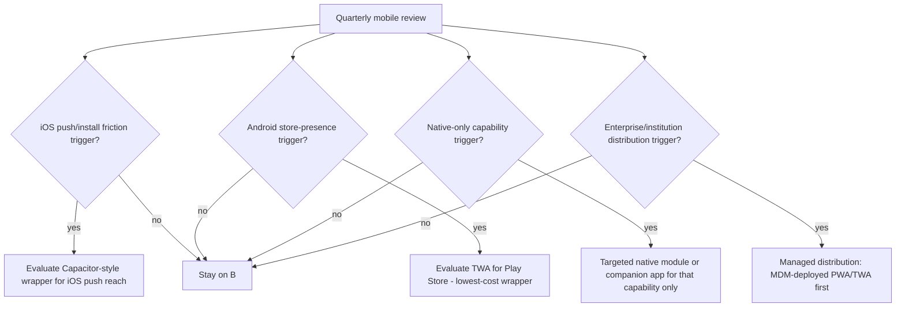
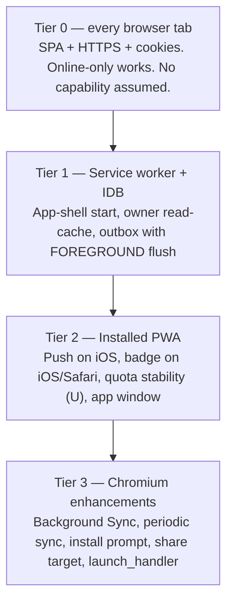
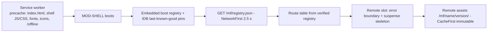
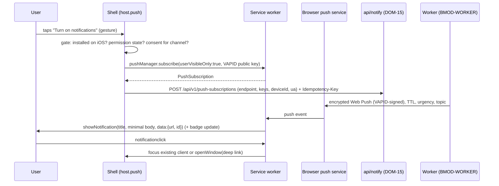
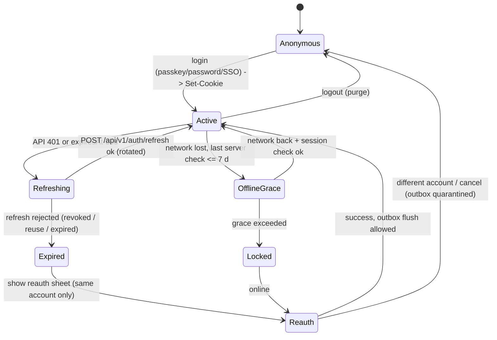

# Target blueprint 08: Pwa And Mobile

> **Status.** Archive: proposal, not ratified. A greenfield redesign blueprint written in October 2026. Every area was Draft, Under Review or Revision Required (its own document status) and no test was run against it. Its content was mined into `docs/blueprint/`; `SSOT.md` remains the source of intent. Module federation described here was not adopted: the built system is a modular monolith (`ARCHITECTURE.md`).
>
> **What this file holds.** All files of the former `Yash_Final_Project_Document/08_PWA_AND_MOBILE/` folder, in order.
>
> **Merged on 2026-11-25** from the files listed below; each one is a section under its original title. Nothing was removed; the originals are in git history at commit `08387ec`.

| Section | Former file |
|---|---|
| Legacy Merge B-08: PWA and Offline Claims (Prior Attempt) and the Six-Flag Offline Declaration | `Yash_Final_Project_Document/08_PWA_AND_MOBILE/LEGACY_MERGE_PWA_AND_OFFLINE.md` |
| Mobile Distribution Decision | `Yash_Final_Project_Document/08_PWA_AND_MOBILE/MOBILE_DISTRIBUTION_DECISION.md` |
| Offline and Sync Design | `Yash_Final_Project_Document/08_PWA_AND_MOBILE/OFFLINE_AND_SYNC_DESIGN.md` |
| Platform Compatibility Matrix | `Yash_Final_Project_Document/08_PWA_AND_MOBILE/PLATFORM_COMPATIBILITY_MATRIX.md` |
| PWA Architecture | `Yash_Final_Project_Document/08_PWA_AND_MOBILE/PWA_ARCHITECTURE.md` |
| PWA and Mobile - Review Fixes (revision overlay) | `Yash_Final_Project_Document/08_PWA_AND_MOBILE/PWA_MOBILE_REVIEW_FIXES.md` |
| Offline and Sync Design - Revision 2 (review fixes) | `Yash_Final_Project_Document/08_PWA_AND_MOBILE/OFFLINE_AND_SYNC_DESIGN_REV2.md` |

## Legacy Merge B-08: PWA and Offline Claims (Prior Attempt) and the Six-Flag Offline Declaration

_Former file: `Yash_Final_Project_Document/08_PWA_AND_MOBILE/LEGACY_MERGE_PWA_AND_OFFLINE.md`._

Doc ID: LGM-B-08 · Owner: Frontend/Platform Architecture (PWA engineering) · Version 1.0 · Status: Draft for Review · Supersedes nothing · Relates: PWA-01, OFF-01-REV2, PLT-01, ADR-T02, ADR-T10, INV-T13, OPEN-12, OPEN-40 · Ledger: `../00_CONTROL_CENTRE/LEGACY_MERGE_LEDGER_B.md`

Preservation instruction (project owner, verbatim): "i dont want to loos information keep everything in use untile it get improved".

Merged from legacy: `31_LEGACY_ARCHIVE/docs/engineering/TRD.md` section 2 and section 8, `.../system-model/02-flows.md` F7 status notes, `.../system-model/01-inventory-and-coverage.md` (feature status table: browser shell/PWA), root `ARCHITECTURE.md` section 15, `.../quality/TESTING.md` accessibility coverage.

### 0. Frame

Nothing is built. The items below are what an earlier attempt reported about its PWA/offline posture. PWA-01 (section 1 "Reference gap [REF]") already records that the prior attempt shipped a manifest, icons and a capability-detection module but no offline sync and kept the bearer token in browser storage. This file adds the remaining unique facts and the legacy offline declaration template.

### 1. Facts reported (prior attempt)

- The manifest and a small capability module only **reported** capabilities; "offline readiness" was detected from an _existing_ service-worker controller; nothing registered a service worker. The page footer nevertheless said "PWA Installable" (a claim without backing; recorded as a UI-honesty defect in `../10_FRONTEND_ARCHITECTURE/LEGACY_MERGE_FRONTEND_AND_UI_QUALITY.md` section 3).
- No durable offline mutation or sync system was found. Feature-status table classified the browser shell/PWA as "partially implemented: mounted pages, session recovery, error boundaries, manifest/capability reporting; offline sync not implemented".
- Session token lived in browser `localStorage` (XSS-readable); there was no refresh flow, so any offline design would have had to keep a long-lived bearer in script-reachable storage.
- Accessibility automation covered reflow at 320 px, 200% zoom and `prefers-reduced-motion`; contrast checking and screen-reader verification were not automated (relevant to installed-PWA display modes).

**Target requires:** (a) install and offline indicators driven by actual capability checks, never static text; (b) tokens never in script-readable storage (ADR-T06); (c) offline caches are never authoritative (INV-T13) and queued writes are server-revalidated; (d) draft persistence follows OPEN-40 (allow-list of non-sensitive fields).

### 2. Legacy offline declaration template (TRD section 8)

Each feature declares six properties: `READ_OFFLINE`, `WRITE_OFFLINE`, `QUEUE`, `SYNC`, `CONFLICT`, `SERVER_REQUIRED`. "No secure assessment or other explicitly server-authoritative decision relies on offline authority."

Mapping to the blueprint: ADR-T10 defines tiers (read-cache of owner data; queued writes only for application drafts, profile edits, message compose, notes; everything consequential online-only) and FEA-01 requires each query to declare `meta.offline = { class, ttl }`. The six-flag template is a _different vocabulary for the same intent_. **Decision needed (L-B08-01, owner Frontend Architect):** keep the six flags as the per-feature spec fields in `05_FEATURE_SPECIFICATIONS` (and derive `meta.offline` from them), or declare them superseded by the tier classes. Until decided, feature specs may list both.

### 3. Open items

| ID       | Question                                               | Owner                                   |
| -------- | ------------------------------------------------------ | --------------------------------------- |
| L-B08-01 | Six-flag offline declaration vs tier classes (ADR-T10) | Frontend Architect                      |
| OPEN-12  | Verified iOS/Android PWA facts and device matrix       | QA + Frontend Platform                  |
| OPEN-40  | Allow-list for persisted offline drafts                | Security Architect + Frontend Architect |

## Mobile Distribution Decision

_Former file: `Yash_Final_Project_Document/08_PWA_AND_MOBILE/MOBILE_DISTRIBUTION_DECISION.md`._

Doc ID: MOB-01 · Owner: Frontend/Platform Architecture · Version 1.0 · Status: Under Review
Relates: ADR-T02 (PWA-first; wrapper only on verified need), ADR-T10, ADR-T20 · PWA-01, PLT-01, OFF-01 · OPEN-10 (identity verification), proctoring (vendor-gated, DOMAIN_ARCHITECTURE §6)

### 1. Decision [TARGET]

**Launch with Option B: browser + installable PWA, no store packaging** (confirms ADR-T02). Option A (plain browser tab) is always supported and is the baseline for every journey. Options C and D are **trigger-gated** (§5); a trigger needs measured evidence, not opinion. No store account, signing, review or release process is built before a trigger fires.

### 2. Options

| ID  | Option        | What it is                                                                                                                      | Distribution           |
| --- | ------------- | ------------------------------------------------------------------------------------------------------------------------------- | ---------------------- |
| A   | Browser       | Mobile/desktop browser tab                                                                                                      | URL                    |
| B   | Installed PWA | Same code, installed from the browser (Add to Home Screen / install prompt)                                                     | URL; no store          |
| C   | Wrapped       | Thin shell around the same web app: Android **TWA** (Trusted Web Activity) or **Capacitor**-style WebView wrapper (iOS/Android) | Play Store / App Store |
| D   | Native        | Separate Swift/Kotlin (or RN/Flutter) clients over the same API                                                                 | Stores                 |

### 3. Assessment

Scores 1 (poor) – 5 (strong) are **architect judgement**, not measurements; weights reflect ADR-T01/T02 and the stage of the product. Every score has the reason in the cell.

| Criterion (weight)                                                              | A Browser                                               | B Installed PWA                                                                             | C Wrapped                                                                                                   | D Native                                                |
| ------------------------------------------------------------------------------- | ------------------------------------------------------- | ------------------------------------------------------------------------------------------- | ----------------------------------------------------------------------------------------------------------- | ------------------------------------------------------- |
| Time/cost to ship and maintain, one codebase (5)                                | 5 — single web build                                    | 5 — manifest + SW on same build                                                             | 3 — adds store pipeline, signing, review cycles, per-OS wrapper upkeep                                      | 1 — new clients; ADR-T02 estimated ~3× cost (judgement) |
| Reach / zero-friction entry, shareable deep links (4)                           | 5                                                       | 4 — install optional                                                                        | 2 — store install step                                                                                      | 2                                                       |
| Push reliability (3)                                                            | 2 — none on iOS tab (V(src) PLT-01); desktop/Android OK | 3 — iOS only after Home-Screen install (V(src)); Android/desktop fine; delivery best-effort | 4 — native push (APNs/FCM) removes iOS install gating (U for integration details)                           | 5                                                       |
| Offline/sync robustness (3)                                                     | 2 — SW exists but storage evictable                     | 3 — installed quota behaviour better but eviction exemption U                               | 3 — still WebView storage rules (U)                                                                         | 5 — durable storage, true background work               |
| Store discoverability and trust signalling (2)                                  | 1                                                       | 1                                                                                           | 4                                                                                                           | 4                                                       |
| Platform capability breadth (camera SDKs, NFC, ID verification, proctoring) (2) | 2                                                       | 2                                                                                           | 3 — plugins                                                                                                 | 5                                                       |
| Review/policy risk (3)                                                          | 5                                                       | 5                                                                                           | 2 — thin wrappers risk "minimum functionality" rejection (App Store Guideline 4.2, **verify** — OPEN-FE-09) | 3                                                       |
| Security surface and update control (3)                                         | 4 — instant deploy                                      | 4 — SW update policy (PWA-01 §5)                                                            | 3 — two release channels; wrapper must follow CSP/session rules                                             | 3 — store release latency                               |
| Accessibility parity with design system (07_*) (2)                              | 4                                                       | 4                                                                                           | 4                                                                                                           | 3 — duplicate component library                         |
| **Weighted total (weights sum 27, max 135)**                                    | **98**                                                  | **100**                                                                                     | **81**                                                                                                      | **85**                                                  |

Totals are Σ(weight × score), recomputed by script. Reading: A and B are within 2 points because B is A plus an optional install step; B is preferred because it is the only no-store option that reaches iOS push (V(src), PLT-01) at near-zero cost. C scores below D here because wrapping adds a store pipeline without removing the web storage limits, while D buys real push/offline/capability breadth at high cost. The ranking is **sensitive to the push, offline and capability weights** (change any of them by ±1 and C/D can swap) — which is why §5 re-opens the decision on measured triggers, not on this table.

### 4. Platform consequences of choosing B

- iOS push, badge and the most stable storage need **Home-Screen install** (V(src), PLT-01). Mitigation: install-gated push UX, email and in-app notification as channels of record for consequential events (PWA-01 §8).
- Android: install prompt (Chromium), Background Sync/periodic sync enhancements, possible TWA later at low cost.
- Desktop: installable on Chromium and Safari 14+ ; Firefox desktop is tab-only (V(src)).
- Anything requiring native APIs not available to the web is **out of scope until a trigger**, and the feature is re-planned (not hacked into a wrapper).

### 5. Triggers to re-open (each with measurement)



| #   | Trigger                                                                                                                      | Measurement (source of evidence)                                                                                                                               | Threshold                                                                                                                            | Action                                                                                      |
| --- | ---------------------------------------------------------------------------------------------------------------------------- | -------------------------------------------------------------------------------------------------------------------------------------------------------------- | ------------------------------------------------------------------------------------------------------------------------------------ | ------------------------------------------------------------------------------------------- |
| T1  | iOS users cannot receive/act on notifications because they never install                                                     | Share of iOS sessions that are standalone; push opt-in among iOS users who saw the install sheet; missed-event rate (interview invite opened >24 h after send) | **> 15% of iOS users blocked by push/install friction** (threshold fixed in ADR-T02)                                                 | Spike Capacitor-class wrapper for iOS; check Guideline 4.2 risk first (OPEN-FE-09)          |
| T2  | Acquisition depends on store presence                                                                                        | Attributed acquisition surveys + store-search demand; institution/recruiter requirements citing a store listing                                                | Documented demand from ≥ 3 enterprise/institution customers **or** measured acquisition gap — threshold [OPEN-FE-15], set by Product | Evaluate **TWA** for Android (reuses PWA; Digital Asset Links; Play requirements to verify) |
| T3  | A required capability has no web equivalent (ID verification OPEN-10 camera/NFC SDK, vendor proctoring, background location) | Requirement signed off in a PRD with a named capability and why web fails (spike result)                                                                       | Any single _confirmed_ requirement                                                                                                   | Isolated native/companion module for that flow only; rest stays PWA                         |
| T4  | Institutions need managed deployment                                                                                         | Procurement requirement                                                                                                                                        | ≥ 1 contracted customer                                                                                                              | MDM-pushed PWA/TWA; no store listing necessarily                                            |
| T5  | Offline requirement escalates beyond ADR-T10 tiers (low-connectivity core use)                                               | Research + telemetry: share of sessions with offline periods; outbox usage                                                                                     | Evidence in `26_*` that offline core use is material                                                                                 | Revisit ADR-T10 first (server-side scope), wrapper second                                   |
| T6  | Platform regression (browser removes/limits a capability we depend on)                                                       | Release-note monitoring + device suite failures (PLT-01 §5)                                                                                                    | Any regression that breaks a Tier 0/1 journey                                                                                        | Incident, not a distribution change; Tier rule keeps journeys on Tier 0/1                   |

### 6. Constraints that apply if C/D is ever adopted

1. Auth stays BFF-cookie based; wrappers must not introduce tokens in JS-accessible storage (ADR-T06, INV-T14). A native client would need a different token transport — a new ADR.
2. Same Host Contract / remotes load unchanged inside a wrapper; no wrapper-specific fork of remotes.
3. Update control: wrapper must not pin stale shell bundles; remote updates through the registry continue to work (VC-01).
4. Store review and privacy-label obligations (DOM-22) are scoped before commitment.
5. No decision to wrap is taken from a single stakeholder request; it needs a trigger record in the decision log.

### 7. Open items

OPEN-FE-09 App Store Guideline 4.2 / wrapper policy verification · OPEN-FE-15 T2 threshold (Product) · OPEN-FE-01 device evidence feeding T1.

## Offline and Sync Design

_Former file: `Yash_Final_Project_Document/08_PWA_AND_MOBILE/OFFLINE_AND_SYNC_DESIGN.md`._

Doc ID: OFF-01 · Owner: Frontend/Platform Architecture (PWA engineering) · Version 1.0 · Status: Under Review

> **Revision 2 folded in (2026-10-27)** from `OFFLINE_AND_SYNC_DESIGN.md#record-offline-and-sync-design-rev2`: appended under "Revision 2 additions"; where it differs from text above, the appended text governs. Status unchanged; proposals still need owner/ARB ratification.
> Relates: ADR-T05, ADR-T08, ADR-T10 · INV-T10, INV-T13, INV-T14, INV-T15, INV-T04, INV-T17 · BR-T050, BR-T003 · PWA-01, PLT-01, MFA-01, HC-01 · Research RES-02 F4/F5/F10

Tags: [CONF] [TARGET] [OPEN] [REF]. API paths in examples are **illustrative** until `api/*` contracts exist (OPEN-FE-12). Numeric limits are [TARGET] starting hypotheses with the stated measurement; none is a benchmark.

### 1. Principles

1. **Server is authoritative** (INV-T13). The client holds disposable copies and a short list of _intentions_ (outbox). The server revalidates every queued write exactly like an online write: authn, policy, state machine, consent, entitlements.
2. **Honest scope** (ADR-T10). Offline reads of the owner's own data; queued writes only for **application drafts, profile edits, message compose, notes**. Everything consequential is online-only.
3. **No false success.** A queued item is shown as _Waiting to sync_, never as sent/submitted/verified. Verified status, scores, entitlements and consent are never computed or promoted client-side (INV-T04, INV-T17, INV-T15).
4. **Foreground-first sync** — Background Sync exists only in Chromium (V(src), PLT-01); it is an enhancement, never the mechanism.
5. **Data minimisation**: cache the least that makes a read useful; short lifetimes; purge aggressively.
6. **Account-bound**: every local record belongs to exactly one account alias; no cross-account reads.

### 2. Operation classification

Classes: **FO** fully offline (needs no server) · **RO** read-only from cache (stale-labelled) · **QW** queued write (outbox, revalidated on flush) · **ON** online-only (control disabled with reason when offline). "TTL" = max cache age shown offline.

| #   | Feature (domain)                                                                          | Module       | Offline class                                             | Detail / queued op                                                                | TTL / cache             | Rationale                                                                                    |
| --- | ----------------------------------------------------------------------------------------- | ------------ | --------------------------------------------------------- | --------------------------------------------------------------------------------- | ----------------------- | -------------------------------------------------------------------------------------------- |
| 1   | App start, navigation, chrome, offline page                                               | SHELL        | **FO**                                                    | Precached shell                                                                   | until SW update         | Core PWA                                                                                     |
| 2   | Theme, locale, density prefs                                                              | SHELL        | **FO**                                                    | `ts-meta.kv.prefs`; synced to server when online (last-write-wins, non-sensitive) | n/a                     | No server needed                                                                             |
| 3   | Login, signup, passkey enrol, SSO                                                         | SHELL/ACC    | **ON**                                                    | —                                                                                 | none                    | Credentials; BFF cookies (ADR-T06)                                                           |
| 4   | Session snapshot, capabilities hints (DOM-01)                                             | SHELL        | **RO**                                                    | `ts-meta`/account `queryCache`                                                    | 7 d (offline grace)     | UI hints only; server decides (INV-T01)                                                      |
| 5   | View own profile & portfolio (DOM-03)                                                     | CAND         | **RO**                                                    | —                                                                                 | 7 d                     | Owner data                                                                                   |
| 6   | Edit profile text fields (DOM-03)                                                         | CAND         | **QW**                                                    | `profile.patch` (field-level, `If-Match`)                                         | draft 14 d              | ADR-T10                                                                                      |
| 7   | Upload/replace avatar, portfolio files, evidence artefacts (DOM-05)                       | CAND         | **ON**                                                    | —                                                                                 | none (no blobs)         | Virus scan before visible (BR-T003); large blobs; ADR-T10 excludes                           |
| 8   | View own evidence list, rung & provenance (DOM-05/06)                                     | CAND         | **RO**                                                    | metadata only, no artefact files                                                  | 7 d, labelled "as of …" | Never presented as fresher than cached time                                                  |
| 9   | Create/update evidence claim, request verification, referee request (DOM-06)              | CAND         | **ON**                                                    | —                                                                                 | none                    | Consequential, token issuance (INV-T05)                                                      |
| 10  | Resume variants: view list                                                                | CAND         | **RO**                                                    | metadata only                                                                     | 7 d                     |                                                                                              |
| 11  | Resume generate/export (AI, files) (DOM-03/17)                                            | CAND         | **ON**                                                    | —                                                                                 | none                    | AI gateway + budget (INV-T07)                                                                |
| 12  | Career intelligence views (DOM-12)                                                        | CAND         | **RO**                                                    | —                                                                                 | 7 d                     | Derived; labelled                                                                            |
| 13  | Browse jobs lists / search (DOM-09/11)                                                    | OPP          | **RO** (recent only)                                      | last 5 result sets                                                                | 24 h                    | Freshness matters; search itself **ON**                                                      |
| 14  | Job detail (last viewed ≤ 20)                                                             | OPP          | **RO**                                                    | —                                                                                 | 72 h                    |                                                                                              |
| 15  | Search, match explanations (DOM-11)                                                       | OPP          | **ON**                                                    | —                                                                                 | none                    | Server-ranked, explainable (INV-T19)                                                         |
| 16  | Save job / follow search / alert toggle                                                   | OPP          | **ON**                                                    | —                                                                                 | none                    | Outside ADR-T10 list; **candidate for ADR-T10 amendment** (low-risk idempotent) — OPEN-FE-13 |
| 17  | Application **draft** edit (DOM-10)                                                       | OPP          | **QW**                                                    | `application.draft.put` (`PUT …/drafts/{draftId}`, client id, `If-Match`)         | draft 14 d              | ADR-T10                                                                                      |
| 18  | Application **submit** / withdraw                                                         | OPP          | **ON**                                                    | —                                                                                 | none                    | Consequential; BR-T001, SM-APPLICATION; INV-T10                                              |
| 19  | View own applications & status                                                            | OPP          | **RO**                                                    | list + status                                                                     | 7 d, "as of" banner     | Status may be stale; no actions offline                                                      |
| 20  | Course catalogue / enrolled course text                                                   | LRN          | **RO** (enrolled, last 3 courses, text only)              | no video/media                                                                    | 7 d                     | Low sensitivity                                                                              |
| 21  | Lesson progress, complete lesson/course                                                   | LRN          | **ON**                                                    | —                                                                                 | none                    | `course.completed` may mint evidence (DOM-05)                                                |
| 22  | Assessment attempts, challenges (DOM-07)                                                  | LRN          | **ON**, additionally blocked from local caching of items  | —                                                                                 | none                    | Integrity (INV-T06/T20); no offline attempts                                                 |
| 23  | Instructor studio authoring (DOM-08)                                                      | LRN          | **ON**                                                    | —                                                                                 | none                    | Not in ADR-T10 list; revisit if instructors report low-connectivity need (OPEN-FE-13)        |
| 24  | Read conversations (DOM-13)                                                               | MSG          | **RO**                                                    | last 20 conversations × last 50 messages                                          | 72 h                    | Sensitive; bounded                                                                           |
| 25  | Compose/send message                                                                      | MSG          | **QW**                                                    | `message.put` (`PUT …/messages/{clientMessageId}`)                                | 14 d                    | ADR-T10; shown as "Not sent yet"                                                             |
| 26  | Mark read, mute, block, report                                                            | MSG          | **ON**                                                    | —                                                                                 | none                    | Safety flows (DOM-19)                                                                        |
| 27  | Notifications list                                                                        | MSG          | **RO**                                                    | —                                                                                 | 72 h                    |                                                                                              |
| 28  | Notes (candidate job notes, recruiter notes)                                              | CAND/OPP/HIR | **QW**                                                    | `note.put` (`PUT …/notes/{clientNoteId}`; edits `If-Match`)                       | 14 d                    | ADR-T10                                                                                      |
| 29  | Network / connections (DOM-14)                                                            | MSG          | **ON** (read **RO** last 7 d list)                        | —                                                                                 | 7 d                     |                                                                                              |
| 30  | Settings view                                                                             | ACC          | **RO**                                                    | —                                                                                 | 7 d                     |                                                                                              |
| 31  | Settings change, passkeys, sessions, MFA                                                  | ACC          | **ON**                                                    | —                                                                                 | none                    | Security-sensitive                                                                           |
| 32  | Billing, plans, checkout, invoices (DOM-16)                                               | ACC          | **ON** — never cached                                     | —                                                                                 | none                    | INV-T17: redirect success grants nothing                                                     |
| 33  | Consent, privacy, data export/erasure (DOM-22)                                            | ACC          | **ON** — never cached                                     | —                                                                                 | none                    | INV-T15: consent change must be immediate and observable                                     |
| 34  | Hiring workspace: jobs authoring, pipeline, candidate profiles/evidence (DOM-09/10/06/11) | HIR          | **ON** — **no offline cache of other people's data**      | —                                                                                 | none                    | INV-T15: recruiter access needs a _live_ consent scope; a cache would outlive revocation     |
| 35  | Recruiter notes on a candidate                                                            | HIR          | **QW** (note text + target id only, authored by the user) | `note.put`                                                                        | 14 d                    | ADR-T10; no candidate profile data cached                                                    |
| 36  | Interview scheduling, offers                                                              | HIR          | **ON**                                                    | —                                                                                 | none                    |                                                                                              |
| 37  | Admin/support/institution/moderation                                                      | ADM          | **ON** — never cached                                     | —                                                                                 | none                    | INV-T18 privileged access time-boxed and audited                                             |
| 38  | Public pages (landing, public job list, public profile)                                   | SHELL        | **RO**                                                    | SW SWR on public API (PWA-01 R5)                                                  | 24 h                    | Server-labelled public only                                                                  |

Every QW operation must be listed in the owning remote's manifest `queueableOps` (REMOTE_MANIFEST.schema.json); the shell refuses to enqueue anything not on the allowlist (enforces ADR-T10 mechanically).

### 3. Storage layout

| Store                                                                                                                                                                                                                            | Tech          | Holds                                                                               | Account-scoped | Purged on logout/switch |
| -------------------------------------------------------------------------------------------------------------------------------------------------------------------------------------------------------------------------------- | ------------- | ----------------------------------------------------------------------------------- | -------------- | ----------------------- |
| Precache + remote assets (`ts-precache-*`, `ts-remote-*`)                                                                                                                                                                        | Cache Storage | code only                                                                           | no             | no (no user data)       |
| `ts-registry`, `ts-public-api`, `ts-img`, `ts-static`                                                                                                                                                                            | Cache Storage | public, non-personal                                                                | no             | no                      |
| `ts-meta` (DB)                                                                                                                                                                                                                   | IndexedDB     | device id, LKG pins, install/UI prefs, `signedOutPending`, schema versions          | no             | partial (§10)           |
| `ts-acct-<alias>` (DB)                                                                                                                                                                                                           | IndexedDB     | query cache, outbox, drafts, conflicts, sync state                                  | **yes**        | **deleted**             |
| localStorage/sessionStorage                                                                                                                                                                                                      | Web Storage   | non-sensitive UI flags only (reload guard, last tab); **never tokens or user data** | no             | cleared `ts.*`          |
| No authenticated HTTP response is ever in Cache Storage (PWA-01 R0). `alias = first 16 chars of base32(SHA-256(accountId ‖ deviceSalt))`, so DB names do not disclose the account id and can be enumerated by the purge routine. |

### 4. IndexedDB schema [TARGET]

Library: Dexie 4 (versioned migrations, transactions) [TARGET; alternative `idb`; confirm in spike]. Only the **shell** opens these databases; remotes use `host.sync`, `host.data` and `host.storage.scoped(moduleId)`. (Same-origin code can technically open IDB — this is lint + convention, not isolation: ADR-T19.)

```ts
// ts-meta  v1  (store: kv)
type MetaKey =
  | 'deviceSalt'
  | 'deviceId'
  | 'lastAccountAlias'
  | 'signedOutPending'
  | 'schema.local'
  | `lkg.${ModuleId}`
  | 'registry.lastSequence.${ModuleId}'
  | 'prefs'
  | 'installState'
  | 'persistRequestedAt';
interface MetaRow {
  key: MetaKey;
  value: unknown;
  updatedAt: number;
}

// ts-acct-<alias>  v1
interface QueryCacheRow {
  // PK queryHash
  queryHash: string;
  queryKey: unknown[];
  moduleId: ModuleId;
  class:
    | 'owner-profile'
    | 'owner-evidence'
    | 'owner-apps'
    | 'jobs'
    | 'messages'
    | 'notifications'
    | 'settings'
    | 'learning'
    | 'career';
  data: unknown;
  etag?: string;
  fetchedAt: number;
  expiresAt: number;
  lastAccess: number;
  bytes: number; // idx: class, expiresAt, lastAccess
}
interface OutboxRow {
  // PK id (UUIDv7, sortable)
  id: string;
  seq: number; // monotonic per account
  accountAlias: string;
  sessionEpoch: number;
  opType: 'profile.patch' | 'application.draft.put' | 'message.put' | 'note.put';
  opSchema: number; // version of descriptor shape
  moduleId: ModuleId; // enqueuing remote (for the allowlist check and UX)
  aggregateKey: string; // e.g. "application-draft:{id}" -> ordered per key
  request: {
    method: 'PUT' | 'PATCH';
    path: string;
    headers: Record<string, string>;
    body: unknown;
  };
  idempotencyKey: string; // UUIDv4 generated at enqueue
  ifMatch?: string; // ETag the edit was based on
  base?: unknown; // base snapshot of touched fields (for 3-way merge)
  mine: unknown; // intended values (display + merge)
  status:
    | 'queued'
    | 'inflight'
    | 'retry-wait'
    | 'conflict'
    | 'rejected'
    | 'needs-reauth'
    | 'quarantined'
    | 'expired';
  attempts: number;
  nextAttemptAt: number;
  lastError?: ProblemSummary;
  createdAt: number;
  expiresAt: number; // createdAt + 14 d
  // idx: status, [aggregateKey+seq], nextAttemptAt, createdAt
}
interface DraftRow {
  draftId: string;
  kind: 'application' | 'profile' | 'message' | 'note';
  serverId?: string;
  baseEtag?: string;
  base?: unknown;
  data: unknown;
  dirty: boolean;
  updatedAt: number;
  expiresAt: number;
}
interface ConflictRow {
  opId: string;
  aggregateKey: string;
  base: unknown;
  mine: unknown;
  theirs: unknown;
  theirsEtag: string;
  createdAt: number;
}
interface SyncStateRow {
  key: string;
  value: unknown;
} // sessionEpoch, lastFullSyncAt, cursors
interface RescueRow {
  id: string;
  reason: 'migration' | 'quota' | 'purge-export';
  payload: unknown;
  createdAt: number;
}
```

`ProblemSummary` = `{type, status, code}` from RFC 9457 `application/problem+json` (ADR-T08), **never the response body text** (may contain PII).

### 5. Cache classes and expiry

| Class                                                                                                                                                                                                                                                                                                                                                                                                                                                                      | Store                   | Eviction priority (1 = first) | Max age                | Max size            | Notes                                |
| -------------------------------------------------------------------------------------------------------------------------------------------------------------------------------------------------------------------------------------------------------------------------------------------------------------------------------------------------------------------------------------------------------------------------------------------------------------------------- | ----------------------- | ----------------------------- | ---------------------- | ------------------- | ------------------------------------ |
| CC0 shell precache                                                                                                                                                                                                                                                                                                                                                                                                                                                         | Cache Storage           | 9 (never LRU)                 | until SW update        | ≤ 1.5 MB            | Required to boot                     |
| CC1 remote assets                                                                                                                                                                                                                                                                                                                                                                                                                                                          | Cache Storage           | 5                             | current + LKG versions | ≤ 40 MB total       | PWA-01 R3                            |
| CC2 registry                                                                                                                                                                                                                                                                                                                                                                                                                                                               | Cache Storage + IDB LKG | 8                             | 7 d (offline only)     | < 100 KB            | Signature + `notAfter` still apply   |
| CC3 public API                                                                                                                                                                                                                                                                                                                                                                                                                                                             | Cache Storage           | 2                             | 24 h                   | ≤ 5 MB              |                                      |
| CC4 public images                                                                                                                                                                                                                                                                                                                                                                                                                                                          | Cache Storage           | 1                             | 30 d                   | ≤ 15 MB             |                                      |
| CC5 owner query cache                                                                                                                                                                                                                                                                                                                                                                                                                                                      | IDB `queryCache`        | 3 (by class TTL then LRU)     | table §2 (24 h – 7 d)  | ≤ 30 MB             | `meta.offline` allowlist only        |
| CC6 drafts                                                                                                                                                                                                                                                                                                                                                                                                                                                                 | IDB `drafts`            | 7                             | 14 d                   | ≤ 5 MB              | User intent: evict only with consent |
| CC7 outbox                                                                                                                                                                                                                                                                                                                                                                                                                                                                 | IDB `outbox`            | **never evicted silently**    | 14 d, warn at 5 d      | ≤ 10 MB (text only) |                                      |
| CC8 meta/LKG                                                                                                                                                                                                                                                                                                                                                                                                                                                               | IDB `ts-meta`           | 8                             | n/a                    | < 1 MB              |                                      |
| Eviction order under pressure: CC4 → CC3 → CC5 LRU → CC1 old versions → (stop; warn) — CC6/CC7 only with explicit user action. Total app-managed budget **≤ 100 MB** [TARGET hypothesis; rationale: far below the smallest documented quotas on modern browsers (V(src) F4: Chromium up to 60% of disk, Safari ~60%), leaves room on low-storage phones; **measure** `storage.usage_pct` and eviction/`QuotaExceededError` rate by platform, tighten or loosen from data]. |
| Owner-data TTLs are _display_ limits, not freshness: offline views carry an "as of <time>" label; when online, SWR revalidates (stale-while-revalidate in TanStack Query), ETag-conditioned requests (`If-None-Match`) keep refetch cheap.                                                                                                                                                                                                                                 |

### 6. Storage persistence and quota handling

| Event                                            | Behaviour                                                                                                                                                                                                                                                                                              |
| ------------------------------------------------ | ------------------------------------------------------------------------------------------------------------------------------------------------------------------------------------------------------------------------------------------------------------------------------------------------------ |
| Boot                                             | If `storage.estimate` exists: record usage/quota (telemetry); if usage > 70% of quota or free < 50 MB → run eviction pass (§5 order)                                                                                                                                                                   |
| `persist()`                                      | Requested after PWA install or at first queued write, once per 30 d; result stored; Firefox prompt expected (V(src)); Chrome/Safari auto-decided                                                                                                                                                       |
| `QuotaExceededError` on write                    | (1) catch in the single storage gateway; (2) evict by §5 order and retry once; (3) if still failing for an **outbox/draft** write: do **not** enqueue; keep form in memory, show "Can't save offline — storage full. Reconnect to submit or free space"; (4) telemetry `storage.quota_exceeded{class}` |
| IDB unavailable (private mode, blocked, corrupt) | Detected at startup by open/transaction probe → **online-only mode**; offline classes degrade to ON; UI banner explains. No crash.                                                                                                                                                                     |
| Browser eviction (Safari 7-day, pressure)        | On boot, missing `ts-acct-*` with `lastAccountAlias` set ⇒ treat as clean cache; if the user had unsent items (server cannot know) nothing recoverable — mitigated by outbox warn at 5 d and Sync Center showing age                                                                                   |
| Storage-pressure UX                              | Settings → Offline data: usage by class, "Clear offline data", persistence status; never claims durability the platform did not grant                                                                                                                                                                  |

### 7. Sensitive data rules

| Rule                     | Detail                                                                                                                                                                                                                                                                                                                                                                                                  |
| ------------------------ | ------------------------------------------------------------------------------------------------------------------------------------------------------------------------------------------------------------------------------------------------------------------------------------------------------------------------------------------------------------------------------------------------------- |
| Allowlist, not blocklist | A query is persisted only if its definition carries `meta.offline = { class, ttl }` (lint requires `class` ∈ table §5). Unannotated queries live in memory only.                                                                                                                                                                                                                                        |
| Never persisted          | Passwords, tokens, cookies (not readable anyway), verification codes, referee tokens (INV-T05), payment/billing data, consent receipts and decisions, assessment items and answers, AI conversation content ("AI memory is not evidence", INV-T08), other users' profiles/evidence for recruiters (INV-T15), admin/support data (INV-T18), file/artefact bodies (resumes, evidence files), signed URLs. |
| Minimised                | Message bodies limited to §2 row 24; attachments excluded; profile cache holds the owner's fields only.                                                                                                                                                                                                                                                                                                 |
| Redaction                | Outbox bodies and cached payloads are never logged or sent to telemetry (INV-T14); errors use `ProblemSummary`. Crash reports strip IDB contents.                                                                                                                                                                                                                                                       |
| At rest                  | **No app-layer encryption at launch.** A non-extractable WebCrypto key kept in the same origin protects against nothing a same-origin XSS cannot undo, so claiming it as a control would be dishonest. Protection = minimisation + short TTL + purge + OS disk encryption. Security review to confirm [OPEN-FE-14].                                                                                     |
| Shared-device mode       | No IDB owner cache, no outbox beyond the current page session, no push, no `persist()` (PWA-01 §10).                                                                                                                                                                                                                                                                                                    |
| Screens                  | Offline "as of" banner; sensitive classes (messages) show a lock-state when the offline grace has expired.                                                                                                                                                                                                                                                                                              |

### 8. Outbox queue

#### 8.1 Enqueue contract (`host.sync.enqueue`)

Remote code supplies **data only** — an operation descriptor — never a callback. Rationale: at flush time the remote may be unloaded, rolled back or incompatible (VC-01); descriptor + server revalidation makes flush independent of remote code.

```ts
interface QueuedOpInput {
  opType: OpType; // must appear in the remote's manifest queueableOps
  aggregateKey: string; // ordering domain
  request: { method: 'PUT' | 'PATCH'; path: string; body: unknown };
  ifMatch?: string;
  base?: unknown;
  mine: unknown;
  display: { titleKey: string; summary: string }; // for Sync Center, no secrets
}
```

Shell validates: allowlist, `path` template match (`/api/v1/...`, no absolute URL), body size ≤ 256 KB, `accountAlias` current, session not `Anonymous`. Idempotency key (UUIDv4) assigned here, **not at send time**.

#### 8.2 State machine (`SM-CLIENT-OUTBOX`, local)

```mermaid
stateDiagram-v2
  [*] --> queued
  queued --> inflight: flusher picks (lock held, session valid)
  inflight --> [*]: 2xx (server state replaces local; row deleted)
  inflight --> retry_wait: network error, 408/425/429/5xx
  retry_wait --> queued: backoff elapsed
  inflight --> conflict: 412 (ETag) or 409 (state)
  inflight --> rejected: 400/403/404/410/422
  inflight --> needs_reauth: 401 after single-flight refresh failed
  needs_reauth --> queued: same-account reauth
  needs_reauth --> quarantined: different account / cancel
  conflict --> queued: user resolves (merged op, new ifMatch + new idempotency key)
  conflict --> [*]: user discards
  rejected --> [*]: user dismisses (text kept for copy)
  queued --> expired: createdAt + 14 d
  quarantined --> [*]: export or discard
```



#### 8.3 Flushing

| Aspect          | Design                                                                                                                                                                                                                                              |
| --------------- | --------------------------------------------------------------------------------------------------------------------------------------------------------------------------------------------------------------------------------------------------- |
| Triggers        | App start, `online`, `visibilitychange→visible`, after enqueue (if online), 30 s timer while visible and items pending, "Sync now". Chromium additionally registers Background Sync tag `ts-outbox` (SW wakes, takes the same lock, aborts on 401). |
| Single flusher  | `navigator.locks.request('ts-outbox-flush', {ifAvailable:true})` — one flusher across tabs/SW (V(src) F10). Fallback without Web Locks: BroadcastChannel leader election; double-send is still safe via idempotency.                                |
| Ordering        | FIFO **per `aggregateKey`** (a conflict on one draft does not block unrelated aggregates). Across aggregates parallelism ≤ 3.                                                                                                                       |
| Retry           | Exponential backoff: 2 s × 2ⁿ, ±30% jitter, cap 5 min; honour `Retry-After`; after 8 attempts → status stays `retry-wait` with "Needs attention" (never auto-deleted).                                                                              |
| Circuit breaker | 3 consecutive 5xx/timeouts on different aggregates ⇒ pause 60 s (avoids hammering during incidents, FAULT FI-10/FI-11).                                                                                                                             |
| Auth            | 401 → shared single-flight refresh (PWA-01 §10); if refresh fails → all rows `needs-reauth`, flusher stops. Rows carry `sessionEpoch`/`accountAlias`; a flusher never sends a row whose alias ≠ current session.                                    |
| Client identity | Header `X-TS-Client: shell=<v>;hc=<v>;sw=<v>;ls=<localSchema>` on every call (stale-client handling, VC-06).                                                                                                                                        |
| Observability   | Metrics: `outbox.depth`, `outbox.oldest_age_s`, `outbox.flush_success/conflict/rejected`, `outbox.retry_count`; trace per op linked to the originating span (OTel, ADR-T16).                                                                        |

#### 8.4 Idempotency (INV-T10, FF-07)

- Every queued unsafe request carries `Idempotency-Key`; creates additionally use **client-generated resource ids in the URL** (`PUT …/messages/{clientMessageId}`), giving natural-key idempotency even if the server's key store has expired.
- Server contract needed (**OPEN-FE-12 → api docs**): idempotency record retention ≥ outbox TTL (14 d), replays return the original status with `Idempotent-Replayed: true`, and a reused key with a different body ⇒ `422`/`409` problem.
- A resolved conflict produces a **new** op (new key, new `If-Match`); the original key is never reused with a changed body.

### 9. Conflict detection and resolution UX

Detection: reads return `ETag` (strong or `W/"v<version>"`, ADR-T08); queued `PUT/PATCH` send `If-Match`. `412` = version moved; `409` = business-state conflict (e.g., job closed, conversation blocked).

| Entity                                                                                                                                                                                                                                                                                 | Merge rule                                                                                                                                                                           | UX                                                                                                                                                                      |
| -------------------------------------------------------------------------------------------------------------------------------------------------------------------------------------------------------------------------------------------------------------------------------------- | ------------------------------------------------------------------------------------------------------------------------------------------------------------------------------------ | ----------------------------------------------------------------------------------------------------------------------------------------------------------------------- |
| Profile fields (`profile.patch`)                                                                                                                                                                                                                                                       | Field-level three-way merge using `base`, `mine`, `theirs` (fetched on 412). Non-overlapping fields auto-merge and re-queue with fresh `If-Match`. Overlapping fields need a choice. | "Your edit to _Headline_ conflicts with a newer change." Side-by-side: **Keep mine / Use theirs / Edit**. Default selection is _none_ — no silent overwrite either way. |
| Application draft                                                                                                                                                                                                                                                                      | Same field-level merge. `409 job-closed/not-open` ⇒ draft **kept**, op `rejected` with reason.                                                                                       | Banner: "This job is no longer accepting applications. Your draft is saved." (no submit control)                                                                        |
| Message compose                                                                                                                                                                                                                                                                        | No conflict (create-by-id). `403/409` (blocked, closed, permission lost) ⇒ `rejected`.                                                                                               | Message stays in the composer area marked "Couldn't send: <reason>" with Copy.                                                                                          |
| Notes                                                                                                                                                                                                                                                                                  | Create-by-id never conflicts. Edit of an existing note with 412 ⇒ keep both: theirs stays, mine saved as a new note ("Your version").                                                | Inline notice with one-tap merge into the server note.                                                                                                                  |
| Anything `rejected` (400/403/404/410/422)                                                                                                                                                                                                                                              | Never retried automatically.                                                                                                                                                         | Sync Center row, reason, "Copy my text", Dismiss.                                                                                                                       |
| Server authoritative                                                                                                                                                                                                                                                                   | After any success the response body replaces local state (TanStack cache `setQueryData` with server value + ETag).                                                                   | —                                                                                                                                                                       |
| Sync Center (Settings → Offline & sync): list of pending/conflict/rejected items with age, one-tap "Retry", "Resolve", "Export unsent (JSON)", "Discard". Accessibility: status changes announced via `aria-live=polite`; focus-managed conflict dialog (WCAG 2.2 focus not obscured). |

### 10. Logout, account-switch and forced purge

| Trigger                                                                                                                                                                                                                                                                                                                                                                                                                                                                                                                                                                                                                                                                                                                                                                                                                                                                               | Preconditions                                                                           | Result                                                                                               |
| ------------------------------------------------------------------------------------------------------------------------------------------------------------------------------------------------------------------------------------------------------------------------------------------------------------------------------------------------------------------------------------------------------------------------------------------------------------------------------------------------------------------------------------------------------------------------------------------------------------------------------------------------------------------------------------------------------------------------------------------------------------------------------------------------------------------------------------------------------------------------------------- | --------------------------------------------------------------------------------------- | ---------------------------------------------------------------------------------------------------- |
| User logout                                                                                                                                                                                                                                                                                                                                                                                                                                                                                                                                                                                                                                                                                                                                                                                                                                                                           | If outbox non-empty: flush attempt if online, then prompt **Discard / Export / Cancel** | Full purge below                                                                                     |
| Account switch / login as different account                                                                                                                                                                                                                                                                                                                                                                                                                                                                                                                                                                                                                                                                                                                                                                                                                                           | Same prompt for previous account's unsent items                                         | Previous account purged before the new session is created                                            |
| Session revoked server-side (401 reason `session-revoked`, refresh-reuse revoke BR-T050, "sign out everywhere")                                                                                                                                                                                                                                                                                                                                                                                                                                                                                                                                                                                                                                                                                                                                                                       | none (forced)                                                                           | Purge without export; outbox rows quarantined text kept only in-memory until dismissed, then dropped |
| Account erasure (DOM-22, BR-T060)                                                                                                                                                                                                                                                                                                                                                                                                                                                                                                                                                                                                                                                                                                                                                                                                                                                     | none                                                                                    | Forced purge + push unsubscribe                                                                      |
| Offline grace exceeded                                                                                                                                                                                                                                                                                                                                                                                                                                                                                                                                                                                                                                                                                                                                                                                                                                                                | none                                                                                    | Data stays but locked; purge if never reauthenticated within **30 d** [TARGET]                       |
| "Clear offline data" (Settings)                                                                                                                                                                                                                                                                                                                                                                                                                                                                                                                                                                                                                                                                                                                                                                                                                                                       | confirm                                                                                 | Purge local data, stay signed in                                                                     |
| Shared-computer logout                                                                                                                                                                                                                                                                                                                                                                                                                                                                                                                                                                                                                                                                                                                                                                                                                                                                | none                                                                                    | Purge + `persist` not requested                                                                      |
| **Purge algorithm (idempotent, resumable via `ts-meta.purging=true`):** 1) set flag, lock UI, broadcast `ts-purge` (all tabs stop work and close DB connections via `versionchange`); 2) release flusher lock and abort in-flight fetches; 3) unsubscribe push + `DELETE /push-subscriptions/{id}` (queue the delete in `ts-meta` if offline); 4) `POST /api/v1/auth/logout` if online, else `signedOutPending=true` (cookies are httpOnly and cannot be cleared offline; next online action must call logout first, PWA-01 §10); 5) `indexedDB.deleteDatabase('ts-acct-<alias>')` (retry on `blocked`); 6) delete any `ts-user-*` caches (none by design) and clear `ts.*` Web Storage; 7) `navigator.clearAppBadge()`; 8) remove `lastAccountAlias`; 9) clear flag; route to `/login`. If the process dies mid-way, the flag makes boot resume the purge before rendering anything. |
| **Verification (automated):** after purge, e2e asserts `indexedDB.databases()` contains no `ts-acct-*`, `caches.keys()` has no user caches, Web Storage has no `ts.*` user keys, push subscription is null, and a second account sees nothing of the first (FF-05-style canary on the client).                                                                                                                                                                                                                                                                                                                                                                                                                                                                                                                                                                                        |

### 11. Local schema migration

| Rule                                                  | Detail                                                                                                                                                                                                               |
| ----------------------------------------------------- | -------------------------------------------------------------------------------------------------------------------------------------------------------------------------------------------------------------------- |
| Versions                                              | `LOCAL_DATA_SCHEMA` (int, in host contract) = IDB version. Bumped only by shell releases; changes in `dataSchema` range of remote manifests gate which remotes may run (HC-01, VC-01).                               |
| Store classes                                         | **Derived** (`queryCache`) → on incompatible change _drop and rebuild_ (also `persistQueryClient.buster`). **Authoritative-local** (`outbox`, `drafts`, `conflicts`) → must migrate forward; never dropped silently. |
| Op descriptors                                        | Carry `opSchema`; flusher keeps translators for current and previous `opSchema` (≥ 2 versions) so old queued ops still send after an upgrade.                                                                        |
| Forward-only                                          | Migrations are append-only and tested with golden fixtures per version (like FF-10 for SQL).                                                                                                                         |
| Failure                                               | Migration error ⇒ copy affected rows to `rescue` (exportable), rebuild derived stores, show Sync Center notice; telemetry `schema.migration_failed`.                                                                 |
| Multi-tab                                             | `onversionchange` ⇒ old tabs close the DB and show "Reload to update"; new tab waits on `blocked` with a timeout and a visible prompt.                                                                               |
| Downgrade (older shell sees newer DB: `VersionError`) | Do not delete. Treat as stale client → force-update flow; if update impossible, run online-only without local DB.                                                                                                    |
| Ownership                                             | Only the shell runs migrations, before any remote mounts.                                                                                                                                                            |

### 12. Test plan (OFF-01 acceptance)

| Test                                                                                  | Layer                                         |
| ------------------------------------------------------------------------------------- | --------------------------------------------- |
| Offline start from SW cache on Chromium/WebKit/Firefox                                | Playwright                                    |
| Enqueue→kill tab→reopen→flush; double-tab single flusher; flusher death releases lock | Playwright + unit                             |
| Idempotency replay: send same op twice ⇒ one server effect (INV-T10)                  | integration (API contract)                    |
| 412 and 409 paths for each queued op type; 3-way merge cases                          | unit + e2e                                    |
| 401 mid-flush ⇒ single refresh across 3 tabs does **not** trigger reuse revoke        | integration with token-family logic (BR-T050) |
| Logout/switch/forced purge leaves no residue (§10 verification)                       | e2e                                           |
| Quota exceeded on outbox write ⇒ no silent loss, user told                            | unit with mocked storage                      |
| Migration chain v1→vN with golden fixtures; downgrade guard                           | unit                                          |
| Offline never shows a consequential action as completed                               | e2e assertion over all ON/QW rows in §2       |
| Recruiter cache check: revoked consent ⇒ nothing retained (class 34)                  | e2e                                           |

### 13. Open items

OPEN-FE-12 idempotency retention + client-id PUT contracts · OPEN-FE-13 ADR-T10 amendment candidates (saved jobs/search follows; instructor authoring) · OPEN-FE-14 at-rest encryption stance (security review) · OPEN-FE-01 device verification of eviction behaviour.

## Revision 2 additions (folded 2026-10-27 from `OFFLINE_AND_SYNC_DESIGN.md#record-offline-and-sync-design-rev2`)

### 0. Phase scope: what ships in Phase 1 (REVW-24)

OFF-01 specifies a large subsystem (IndexedDB schema, locks, three-way merge, purge, migration, Background Sync) for four operation types whose value is unevidenced: no research on low-connectivity use exists, personas are hypothetical (OPEN-07), and the platform facts the outbox works around are unverified on devices (OPEN-12). ADR-T10's own revisit trigger is "research shows low-connectivity core use".

| Capability                                                                                                                                                     | Phase 1                                | After the ADR-T10 trigger fires                               |
| -------------------------------------------------------------------------------------------------------------------------------------------------------------- | -------------------------------------- | ------------------------------------------------------------- |
| Offline app start from the service worker (class FO)                                                                                                           | **Yes**                                | Yes                                                           |
| Read cache for the owner's own data (class RO, OFF-01 section 2 TTLs, "as of" labels)                                                                          | **Yes**                                | Yes                                                           |
| **Local unsent drafts** (class LD, section 1)                                                                                                                  | **Yes**                                | Yes                                                           |
| Outbox, flusher, Web Locks election, Background Sync, Sync Center, three-way merge, `opSchema` translators (OFF-01 sections 4 OutboxRow, 8, 9, 11 translators) | **No (dormant, not built)**            | Activate as specified, with the amendments in sections 2 to 5 |
| Purge on logout, account switch, forced purge (OFF-01 section 10)                                                                                              | **Yes** (applies to caches and drafts) | Yes                                                           |
| Downloadable video or media offline                                                                                                                            | **No** (out of Phase 1 and Phase 2)    | Revisit by new ADR                                            |

**Trigger to build the outbox** (ADR-T10 revisit): telemetry or research shows material core use under poor connectivity. Telemetry to collect from Phase 1 (names are proposals, no PII): `draft.saved_while_offline`, `draft.sent_after_reconnect`, `draft.discarded_unsent`, `draft.unsent_age_s` at send, `submit.failed_network_rate` by route, plus a research question in the user-research plan. The numeric threshold is **[OPEN]**: owner Product Director with Frontend Platform Lead; to be set before the Phase 1 exit review.

### 1. Class LD: local unsent draft (Phase 1)

Class legend addition: **LD** = the user's input is kept on this device as a draft and is sent by an explicit user action when online. Nothing is queued, retried or sent automatically.

| Aspect                       | Rule                                                                                                                                                                                                |
| ---------------------------- | --------------------------------------------------------------------------------------------------------------------------------------------------------------------------------------------------- |
| Store                        | `DraftRow` in `ts-acct-<alias>` (OFF-01 section 4), kinds `application`, `profile`, `message`, `note`; account-bound; purged by OFF-01 section 10                                                   |
| Label                        | Always "Unsent - saved on this device only". Never "Waiting to sync", never "Sent", because nothing will sync by itself                                                                             |
| Send                         | User presses the normal action (Save, Send, Submit) while online; the request is an ordinary online write with one `Idempotency-Key` per user intent (UX-07 idempotency rule) stored with the draft |
| Offline press                | Control shows "Needs connection to send"; the draft stays. No queue entry is created                                                                                                                |
| Reconnect                    | The page shows "You're back online - send your changes?"; no automatic write                                                                                                                        |
| Server moved on              | If the server `ETag` differs from the draft's `baseEtag`, show a two-way choice (Keep mine / Use theirs / Edit); there is no automatic merge in Phase 1                                             |
| Expiry                       | 14 days (section 2 table), warning at 5 days, evicted only with consent                                                                                                                             |
| Safari 7-day eviction, quota | Unchanged (OFF-01 section 6); a lost draft is the documented limitation                                                                                                                             |
| Consequential actions        | Still online-only. A draft of an application is never a submission (BR-T001, SM-APPLICATION)                                                                                                        |

Row-level effect on OFF-01 section 2: rows 6, 17, 25, 28 and 35 (class QW) are **LD** in Phase 1 and **QW** only after the trigger. Their server-side contracts (client-generated ids, `If-Match`) are unchanged and are still the target when the outbox activates.

### 2. One expiry and backoff table (REVW-15), cited by all UX documents

This is the single source of truth for queue and offline timing constants. UX documents cite it and must not restate numbers. Earlier figures (30-day expiry and 1/2/4/8/30 s backoff in UX-07; 2 s x 2^n in OFF-01 section 8.3 with the cap stated only there) are replaced by this table.

| Constant                           | Value [TARGET]                                                                                                 | Applies to                                               | Notes                                                                                                                        |
| ---------------------------------- | -------------------------------------------------------------------------------------------------------------- | -------------------------------------------------------- | ---------------------------------------------------------------------------------------------------------------------------- |
| Draft and queued-item lifetime     | **14 days** from creation                                                                                      | LD drafts (Phase 1), queued items (after trigger)        | Equals the Idempotency-Key retention required in section 4                                                                   |
| Warning before expiry              | at **5 days** old: "Old unsynced change" with an explicit decision (send, keep, discard)                       | LD and QW                                                | Replaces "older than 30 days flagged" in UX-07 and closes OPEN-UX-14                                                         |
| Retry backoff                      | `delay = 2 s x 2^n`, +/-30% jitter, cap **5 min**; honour `Retry-After`                                        | QW flush only (after trigger); LD has no retries         | Replaces "1, 2, 4, 8, 30 s cap" in UX-07                                                                                     |
| Attempts before "Needs attention"  | 8 attempts; the item is never auto-deleted                                                                     | QW                                                       |                                                                                                                              |
| Circuit breaker                    | 3 consecutive 5xx or timeouts on different aggregates: pause **60 s**                                          | QW flush, and the online-only retry policy of `host.api` | OFF-01 section 8.3                                                                                                           |
| Flush triggers                     | App start, `online`, visible, after enqueue if online, 30 s timer while visible with pending items, "Sync now" | QW                                                       | Background Sync is an enhancement on Chromium only (PLT-01)                                                                  |
| Offline read grace                 | **7 days** since last server session check                                                                     | RO caches                                                | PWA-01 section 10                                                                                                            |
| Locked data purge                  | **30 days** without reauthentication                                                                           | all local data                                           | OFF-01 section 10 (this is a purge limit, not a queue expiry; do not confuse with the 30-day figure above that is withdrawn) |
| Remote or chunk load retry         | 2 automatic retries at 500 ms and 1500 ms, then fallback; 10 s bound                                           | module load only ([FED] and lazy-chunk failure)          | HC-01 section 7 governs; UX-07's "1/2/4 s, 3 auto-tries" is withdrawn                                                        |
| Idempotency-Key retention (server) | **>= 14 days** for any queued-op route that lacks a natural key                                                | see section 4                                            | REVW-14                                                                                                                      |
| Cache TTLs per data class          | OFF-01 section 2 and section 5 tables                                                                          | RO                                                       | unchanged                                                                                                                    |

### 3. Scope amendments (ADR-T10a, REVW-15)

| Item                                     | Decision                                                                                                                                                                                                                                                                                                                                                                                                                                                                                               |
| ---------------------------------------- | ------------------------------------------------------------------------------------------------------------------------------------------------------------------------------------------------------------------------------------------------------------------------------------------------------------------------------------------------------------------------------------------------------------------------------------------------------------------------------------------------------ |
| Queued-write classes (after trigger)     | Five: `profile.patch`, `application.draft.put`, `message.put`, `note.put`, **`lesson.progress.put`** (new)                                                                                                                                                                                                                                                                                                                                                                                             |
| `lesson.progress.put`                    | Progress checkpoints only (position, percent, "viewed"). Natural key: enrolment id + lesson id; server applies a monotonic upsert (max of position, never un-completes). The server alone derives lesson or course completion and any evidence that results (DOM-05); the client never displays "completed" or "evidence earned" until the server acknowledges. Until the outbox is active, lesson progress is **online-only** (the player keeps position in page memory; there is no persisted queue) |
| Assessment attempts and answers          | **Online-only. Never queued, cached, persisted locally or replayed.** Assessment items and answers stay on OFF-01 section 7 "never persisted". This removes the SPEC-G3 "answers are kept on this device and sent when you reconnect" behaviour                                                                                                                                                                                                                                                        |
| Assessment connection loss (UX contract) | Banner: "You're offline. The timer keeps running on our server. Reconnect to keep working. Answers the server has not received yet may be lost if you close this page." While the page stays open it may retry in memory only. If the attempt expires while offline, the server grades what it received and the UI says so on reconnect (SM-ATTEMPT, SM-ENROLMENT recovery rows must follow this)                                                                                                      |
| Downloadable video                       | Out of Phase 1 and Phase 2                                                                                                                                                                                                                                                                                                                                                                                                                                                                             |
| Instructor authoring, saved jobs         | Unchanged: online-only; OPEN-FE-13 stays as a revisit item                                                                                                                                                                                                                                                                                                                                                                                                                                             |

OFF-01 section 2 row 21 becomes: Lesson progress = **QW** after the trigger, **ON** before it. Row 22 stays **ON** and adds "answers never leave the page".

### 4. Idempotency admission rule for queued routes (REVW-14 b, c)

A queued write may be flushed up to 14 days after it was made. A route may appear in a remote's `queueableOps` only if **(a)** it declares a natural key, or **(b)** the server retains `Idempotency-Key` records for at least the queue lifetime (14 days). FF-07 is reworded to: "every unsafe operation accepts `Idempotency-Key` **or declares a natural key**"; the manifest validator rejects a `queueableOps` entry whose OpenAPI operation satisfies neither.

| opType                          | Route shape                                           | Natural key                                                             | 14-day key needed |
| ------------------------------- | ----------------------------------------------------- | ----------------------------------------------------------------------- | ----------------- |
| `application.draft.put`         | `PUT /me/application-drafts/{jobId}` (client id)      | Yes (id in URL; PUT replaces)                                           | No                |
| `message.put`                   | `PUT .../messages/{clientMessageId}`                  | Yes (create-by-id)                                                      | No                |
| `note.put` create               | `PUT .../notes/{clientNoteId}`                        | Yes                                                                     | No                |
| `note.put` edit with `If-Match` | same                                                  | Partly: a replay after a lost response hits `412`                       | **Yes**           |
| `profile.patch`                 | `PATCH /me` with `If-Match`                           | **No** (a replay after success returns `412` and looks like a conflict) | **Yes**           |
| `lesson.progress.put`           | `PUT .../enrolments/{id}/lessons/{lessonId}/progress` | Yes (monotonic upsert)                                                  | No                |

`host.api` and the outbox use a **mutation-scoped key**: one key per user intent (`api.intentKey()`, HC-01), identical on every retry of that intent, assigned at enqueue time, never at send time, and never regenerated per call. The previous `'auto'` per-call injection is withdrawn because it defeats retry safety. A resolved conflict is a new intent with a new key. Backend action: BE-01 section 8 retention for these routes must be >= 14 days or the routes must declare natural keys (owner Backend Architect; closes OPEN-FE-12 together with FF-07).

### 5. What is unchanged

OFF-01 sections 1 (principles 1, 3 to 6), 3, 5, 6, 7, 10 (purge), 12 (tests, with the dormant-outbox tests run only after activation) and 13. Phase 1 adds these tests: draft survives reload and offline restart; draft is purged on logout and account switch; offline press of Send creates no network request and no queue row; no assessment item or answer appears in any IndexedDB store or Cache Storage (storage scan after an attempt).

### 6. Session leftovers (REVW-05, frontend side)

The frontend session contract follows SEC-02 section 2.3 and API-STD: access cookie `__Host-ts_at` (`HttpOnly; Secure; SameSite=Lax; Path=/`), refresh cookie `__Secure-ts_rt` (`Path=/api/v1/auth/refresh`, `SameSite=Strict`), CSRF header `X-CSRF-Token`, logout `POST /api/v1/auth/logout`, session view `GET /api/v1/me`. The `/bff/*` namespace is not used. Remaining stale phrases in the originals are listed in section 7 so readers apply this rule.

### 7. Stale wording in unchanged originals (read as corrected)

| Document and place                                                                 | Stale wording                              | Read as                                                                          |
| ---------------------------------------------------------------------------------- | ------------------------------------------ | -------------------------------------------------------------------------------- |
| OFF-01 section 1 principle 2; PWA-01 section 11                                    | queued writes for the four ADR-T10 classes | five classes after the trigger; Phase 1 = local drafts only                      |
| OFF-01 section 2 row 3                                                             | "BFF cookies"                              | session cookies per SEC-02 section 2.3                                           |
| OFF-01 section 8.3 retry row                                                       | backoff as the only statement              | section 2 table                                                                  |
| OFF-01 section 8.4                                                                 | "retention >= outbox TTL" as a request     | admission rule in section 4                                                      |
| PWA-01 section 10 heading and FEA-01 section 12 "cookies via BFF ... SameSite=Lax" | BFF, single SameSite value                 | access cookie `SameSite=Lax`, refresh cookie `SameSite=Strict`, no BFF namespace |
| MOB-01 section on tokens                                                           | "BFF-cookie based"                         | session-cookie based                                                             |
| DESIGN_SYSTEM `host.fetch` row, NAV confirm-email row                              | "same-origin BFF" / "posts to BFF"         | same-origin `/api/v1`                                                            |
| SPEC-G3 (folder 05, not edited here)                                               | assessment answers replay                  | online-only (section 3)                                                          |

### 8. Supersession map (relationship only; originals unchanged)

| This revision | Supersedes (in OFF-01 unless stated)                                                                                             |
| ------------- | -------------------------------------------------------------------------------------------------------------------------------- |
| section 0     | section 1 principle 2 and the scope implied by sections 4, 8, 9 for Phase 1                                                      |
| section 1     | section 2 rows 6, 17, 25, 28, 35 (QW) for Phase 1                                                                                |
| section 2     | section 8.3 retry row; UX-07 sections on reconnect, expiry and remote retry; PWA-01 section 10 grace figures stay                |
| section 3     | section 2 rows 21 and 22; section 4 `OutboxRow.opType`; HC-01 `OpType`; SCH-01 `opType` (see `REMOTE_MANIFEST.schema_REV2.json`) |
| section 4     | section 8.4 and OPEN-FE-12; FF-07 wording; FEA-01 section 7 Idempotency row; HC-01 `idempotencyKey`                              |

### 9. Items for the governance pass

ADR-T10a (this file, sections 0, 3, 4); FF-07 rewording; OPEN item for the outbox trigger threshold (owner Product Director); close OPEN-UX-14, OPEN-UX-13 stays open; SPEC-G3, SM-ATTEMPT, SM-ENROLMENT and BE-01 section 8 need matching edits by their owners.

## PATCH 2026-10-27: partitioning, device loss and SW lifecycle (PROPOSED)

IDs: PWA-PT-01..10. Extends sections 6, 8, 10, 11 above without replacing them. Nothing here is device-verified; needs real iOS/Android/desktop testing (OPEN-FE-01) and UX confirmation of the UXH items.

| ID        | Topic                            | Rule (PROPOSED)                                                                                                                                                                                                                                                                                                                                                                                       |
| --------- | -------------------------------- | ----------------------------------------------------------------------------------------------------------------------------------------------------------------------------------------------------------------------------------------------------------------------------------------------------------------------------------------------------------------------------------------------------- |
| PWA-PT-01 | Cache partition keys             | Every IndexedDB database name and Cache Storage cache name embeds `<userIdHash>.<tenantId>` (hash of a server-issued id, never email). Authenticated API responses are cached only in the user partition; the shared public partition holds only anonymous assets and public pages. No cross-partition reads in code (lint + test).                                                                   |
| PWA-PT-02 | Eviction                         | LRU per partition by class (section 5 expiry); user partition capped by quota budget (PWA-PT-07); partitions of users not seen for 30 days are deleted at next boot [TARGET value].                                                                                                                                                                                                                   |
| PWA-PT-03 | Logout / account switch wipe     | Logout and account switch delete the outgoing user partition (IDB, Cache Storage, in-memory state, queued reads), unregister push subscription, and block UI until the wipe completes. Unsent queue entries: prompt "export or discard" before wipe; never silently sent under the next account.                                                                                                      |
| PWA-PT-04 | Revoked permission while offline | Offline reads cached before revocation remain on device. On reconnect the first authenticated call returning 401/403 triggers partition wipe of affected tenant scope; queued writes are revalidated by the server (INV-T13) and rejected 403 with a visible "no longer permitted" item. Offline display of tenant data is bounded by cache TTL (section 5); this exposure window is a residual risk. |
| PWA-PT-05 | Device loss                      | No refresh token or secret in IDB (httpOnly cookies only, ADR-T06). User can revoke sessions server-side (session list); revoked session fails at next call and triggers PWA-PT-03 wipe. Sensitive classes (section 7) are not cached at all, so loss exposes only the section 5 read cache. Remote wipe of an offline device is impossible; state this honestly in privacy copy.                     |
| PWA-PT-06 | SW activation and migration      | New SW installs, waits, and activates only at a safe point (no open form, queue idle) or on explicit "Update" prompt; `skipWaiting` not used automatically. Activation runs IDB migration (section 11) before serving; old-schema reads fail closed to network. Old caches deleted on activate by name prefix.                                                                                        |
| PWA-PT-07 | Quota recovery                   | On `QuotaExceededError`: evict read-cache classes in order (prefetch, derivative media, lists) never queue/drafts; if still failing, surface storage banner and refuse new queue entries with a clear message. Request `navigator.storage.persist()` where supported; do not assume it is granted (iOS behaviour unverified).                                                                         |
| PWA-PT-08 | Queue quota + multi-tab leader   | Queue cap per user (entries and bytes) [TARGET: owner to set from UXH]; at cap, new writes are refused, not dropped. One flusher via `navigator.locks` (section 8.3); fallback where unsupported = `BroadcastChannel` leader election with heartbeat and lease timeout, plus idempotent server ops so a double flush is harmless. Enqueue from any tab, flush from leader only.                       |
| PWA-PT-09 | Stale module / API mismatch      | Each API response carries server `api-version`; client compares with build's expected range. Mismatch on an unsafe write blocks the queue flush (no blind replay), prompts update, keeps entries. Stale lazy chunk 404 after deploy triggers one reload-at-safe-point then the "Update required" screen.                                                                                              |
| PWA-PT-10 | UX dependency (UXH)              | The user-visible wording, thresholds and flows for PWA-PT-03/04/07/08 (discard prompt, storage-full banner, queue-full state, update prompt) are owned by the UX team folder (`06_*`/`07_*`); this file states behaviour only. Open item: confirm UXH ids and linked screens.                                                                                                                         |

---

<a id="record-offline-and-sync-design-rev2"></a>

### Preserved source record: OFFLINE_AND_SYNC_DESIGN_REV2

> Consolidated on 2026-10-27. The following is the complete source record, retained for provenance, exceptions and rationale. Its dates, counts and statements about files describe the earlier revision, not the current filesystem. Approval conditions and authority remain unchanged: this move neither ratifies proposals nor overrides the owning document’s current precedence rules. Relative references now point to the consolidated records.

<!-- source-record-begin: Yash_Final_Project_Document/08_PWA_AND_MOBILE/OFFLINE_AND_SYNC_DESIGN_REV2.md -->

<a id="record-offline-and-sync-design-rev2--offline-and-sync-design---revision-2-review-fixes"></a>

## Offline and Sync Design - Revision 2 (review fixes)

Doc ID: OFF-01-REV2 · Owner: Frontend/Platform Architecture (PWA engineering) · Version 2.0 · Status: Under Review

> **Folded into `OFFLINE_AND_SYNC_DESIGN.md` on 2026-10-27.** Change record only; edit the original.
> Relates: ADR-T10 (amended by ADR-T10a, proposed), ADR-T08, INV-T10, INV-T13, INV-T15 · REVW-14, REVW-15, REVW-24 · REV-RES · OFF-01, PWA-01, PLT-01, HC-01, MFA-01, PROGRESSIVE_UX_AND_FEEDBACK (UX-07)

Tags: [CONF] [TARGET] [OPEN]. This file is **additive**. `OFFLINE_AND_SYNC_DESIGN.md` (OFF-01) is unchanged and remains the detailed design. Where this revision states a different rule, this revision governs and the superseded OFF-01 section is listed in section 8. Supersession here is a relationship between documents, not a deletion. Numbers are [TARGET] starting values; none is a benchmark.

<a id="record-offline-and-sync-design-rev2--0-phase-scope-what-ships-in-phase-1-revw-24"></a>

### 0. Phase scope: what ships in Phase 1 (REVW-24)

OFF-01 specifies a large subsystem (IndexedDB schema, locks, three-way merge, purge, migration, Background Sync) for four operation types whose value is unevidenced: no research on low-connectivity use exists, personas are hypothetical (OPEN-07), and the platform facts the outbox works around are unverified on devices (OPEN-12). ADR-T10's own revisit trigger is "research shows low-connectivity core use".

| Capability                                                                                                                                                     | Phase 1                                | After the ADR-T10 trigger fires                               |
| -------------------------------------------------------------------------------------------------------------------------------------------------------------- | -------------------------------------- | ------------------------------------------------------------- |
| Offline app start from the service worker (class FO)                                                                                                           | **Yes**                                | Yes                                                           |
| Read cache for the owner's own data (class RO, OFF-01 section 2 TTLs, "as of" labels)                                                                          | **Yes**                                | Yes                                                           |
| **Local unsent drafts** (class LD, section 1)                                                                                                                  | **Yes**                                | Yes                                                           |
| Outbox, flusher, Web Locks election, Background Sync, Sync Center, three-way merge, `opSchema` translators (OFF-01 sections 4 OutboxRow, 8, 9, 11 translators) | **No (dormant, not built)**            | Activate as specified, with the amendments in sections 2 to 5 |
| Purge on logout, account switch, forced purge (OFF-01 section 10)                                                                                              | **Yes** (applies to caches and drafts) | Yes                                                           |
| Downloadable video or media offline                                                                                                                            | **No** (out of Phase 1 and Phase 2)    | Revisit by new ADR                                            |

**Trigger to build the outbox** (ADR-T10 revisit): telemetry or research shows material core use under poor connectivity. Telemetry to collect from Phase 1 (names are proposals, no PII): `draft.saved_while_offline`, `draft.sent_after_reconnect`, `draft.discarded_unsent`, `draft.unsent_age_s` at send, `submit.failed_network_rate` by route, plus a research question in the user-research plan. The numeric threshold is **[OPEN]**: owner Product Director with Frontend Platform Lead; to be set before the Phase 1 exit review.

<a id="record-offline-and-sync-design-rev2--1-class-ld-local-unsent-draft-phase-1"></a>

### 1. Class LD: local unsent draft (Phase 1)

Class legend addition: **LD** = the user's input is kept on this device as a draft and is sent by an explicit user action when online. Nothing is queued, retried or sent automatically.

| Aspect                       | Rule                                                                                                                                                                                                |
| ---------------------------- | --------------------------------------------------------------------------------------------------------------------------------------------------------------------------------------------------- |
| Store                        | `DraftRow` in `ts-acct-<alias>` (OFF-01 section 4), kinds `application`, `profile`, `message`, `note`; account-bound; purged by OFF-01 section 10                                                   |
| Label                        | Always "Unsent - saved on this device only". Never "Waiting to sync", never "Sent", because nothing will sync by itself                                                                             |
| Send                         | User presses the normal action (Save, Send, Submit) while online; the request is an ordinary online write with one `Idempotency-Key` per user intent (UX-07 idempotency rule) stored with the draft |
| Offline press                | Control shows "Needs connection to send"; the draft stays. No queue entry is created                                                                                                                |
| Reconnect                    | The page shows "You're back online - send your changes?"; no automatic write                                                                                                                        |
| Server moved on              | If the server `ETag` differs from the draft's `baseEtag`, show a two-way choice (Keep mine / Use theirs / Edit); there is no automatic merge in Phase 1                                             |
| Expiry                       | 14 days (section 2 table), warning at 5 days, evicted only with consent                                                                                                                             |
| Safari 7-day eviction, quota | Unchanged (OFF-01 section 6); a lost draft is the documented limitation                                                                                                                             |
| Consequential actions        | Still online-only. A draft of an application is never a submission (BR-T001, SM-APPLICATION)                                                                                                        |

Row-level effect on OFF-01 section 2: rows 6, 17, 25, 28 and 35 (class QW) are **LD** in Phase 1 and **QW** only after the trigger. Their server-side contracts (client-generated ids, `If-Match`) are unchanged and are still the target when the outbox activates.

<a id="record-offline-and-sync-design-rev2--2-one-expiry-and-backoff-table-revw-15-cited-by-all-ux-documents"></a>

### 2. One expiry and backoff table (REVW-15), cited by all UX documents

This is the single source of truth for queue and offline timing constants. UX documents cite it and must not restate numbers. Earlier figures (30-day expiry and 1/2/4/8/30 s backoff in UX-07; 2 s x 2^n in OFF-01 section 8.3 with the cap stated only there) are replaced by this table.

| Constant                           | Value [TARGET]                                                                                                 | Applies to                                               | Notes                                                                                                                        |
| ---------------------------------- | -------------------------------------------------------------------------------------------------------------- | -------------------------------------------------------- | ---------------------------------------------------------------------------------------------------------------------------- |
| Draft and queued-item lifetime     | **14 days** from creation                                                                                      | LD drafts (Phase 1), queued items (after trigger)        | Equals the Idempotency-Key retention required in section 4                                                                   |
| Warning before expiry              | at **5 days** old: "Old unsynced change" with an explicit decision (send, keep, discard)                       | LD and QW                                                | Replaces "older than 30 days flagged" in UX-07 and closes OPEN-UX-14                                                         |
| Retry backoff                      | `delay = 2 s x 2^n`, +/-30% jitter, cap **5 min**; honour `Retry-After`                                        | QW flush only (after trigger); LD has no retries         | Replaces "1, 2, 4, 8, 30 s cap" in UX-07                                                                                     |
| Attempts before "Needs attention"  | 8 attempts; the item is never auto-deleted                                                                     | QW                                                       |                                                                                                                              |
| Circuit breaker                    | 3 consecutive 5xx or timeouts on different aggregates: pause **60 s**                                          | QW flush, and the online-only retry policy of `host.api` | OFF-01 section 8.3                                                                                                           |
| Flush triggers                     | App start, `online`, visible, after enqueue if online, 30 s timer while visible with pending items, "Sync now" | QW                                                       | Background Sync is an enhancement on Chromium only (PLT-01)                                                                  |
| Offline read grace                 | **7 days** since last server session check                                                                     | RO caches                                                | PWA-01 section 10                                                                                                            |
| Locked data purge                  | **30 days** without reauthentication                                                                           | all local data                                           | OFF-01 section 10 (this is a purge limit, not a queue expiry; do not confuse with the 30-day figure above that is withdrawn) |
| Remote or chunk load retry         | 2 automatic retries at 500 ms and 1500 ms, then fallback; 10 s bound                                           | module load only ([FED] and lazy-chunk failure)          | HC-01 section 7 governs; UX-07's "1/2/4 s, 3 auto-tries" is withdrawn                                                        |
| Idempotency-Key retention (server) | **>= 14 days** for any queued-op route that lacks a natural key                                                | see section 4                                            | REVW-14                                                                                                                      |
| Cache TTLs per data class          | OFF-01 section 2 and section 5 tables                                                                          | RO                                                       | unchanged                                                                                                                    |

<a id="record-offline-and-sync-design-rev2--3-scope-amendments-adr-t10a-revw-15"></a>

### 3. Scope amendments (ADR-T10a, REVW-15)

| Item                                     | Decision                                                                                                                                                                                                                                                                                                                                                                                                                                                                                               |
| ---------------------------------------- | ------------------------------------------------------------------------------------------------------------------------------------------------------------------------------------------------------------------------------------------------------------------------------------------------------------------------------------------------------------------------------------------------------------------------------------------------------------------------------------------------------ |
| Queued-write classes (after trigger)     | Five: `profile.patch`, `application.draft.put`, `message.put`, `note.put`, **`lesson.progress.put`** (new)                                                                                                                                                                                                                                                                                                                                                                                             |
| `lesson.progress.put`                    | Progress checkpoints only (position, percent, "viewed"). Natural key: enrolment id + lesson id; server applies a monotonic upsert (max of position, never un-completes). The server alone derives lesson or course completion and any evidence that results (DOM-05); the client never displays "completed" or "evidence earned" until the server acknowledges. Until the outbox is active, lesson progress is **online-only** (the player keeps position in page memory; there is no persisted queue) |
| Assessment attempts and answers          | **Online-only. Never queued, cached, persisted locally or replayed.** Assessment items and answers stay on OFF-01 section 7 "never persisted". This removes the SPEC-G3 "answers are kept on this device and sent when you reconnect" behaviour                                                                                                                                                                                                                                                        |
| Assessment connection loss (UX contract) | Banner: "You're offline. The timer keeps running on our server. Reconnect to keep working. Answers the server has not received yet may be lost if you close this page." While the page stays open it may retry in memory only. If the attempt expires while offline, the server grades what it received and the UI says so on reconnect (SM-ATTEMPT, SM-ENROLMENT recovery rows must follow this)                                                                                                      |
| Downloadable video                       | Out of Phase 1 and Phase 2                                                                                                                                                                                                                                                                                                                                                                                                                                                                             |
| Instructor authoring, saved jobs         | Unchanged: online-only; OPEN-FE-13 stays as a revisit item                                                                                                                                                                                                                                                                                                                                                                                                                                             |

OFF-01 section 2 row 21 becomes: Lesson progress = **QW** after the trigger, **ON** before it. Row 22 stays **ON** and adds "answers never leave the page".

<a id="record-offline-and-sync-design-rev2--4-idempotency-admission-rule-for-queued-routes-revw-14-b-c"></a>

### 4. Idempotency admission rule for queued routes (REVW-14 b, c)

A queued write may be flushed up to 14 days after it was made. A route may appear in a remote's `queueableOps` only if **(a)** it declares a natural key, or **(b)** the server retains `Idempotency-Key` records for at least the queue lifetime (14 days). FF-07 is reworded to: "every unsafe operation accepts `Idempotency-Key` **or declares a natural key**"; the manifest validator rejects a `queueableOps` entry whose OpenAPI operation satisfies neither.

| opType                          | Route shape                                           | Natural key                                                             | 14-day key needed |
| ------------------------------- | ----------------------------------------------------- | ----------------------------------------------------------------------- | ----------------- |
| `application.draft.put`         | `PUT /me/application-drafts/{jobId}` (client id)      | Yes (id in URL; PUT replaces)                                           | No                |
| `message.put`                   | `PUT .../messages/{clientMessageId}`                  | Yes (create-by-id)                                                      | No                |
| `note.put` create               | `PUT .../notes/{clientNoteId}`                        | Yes                                                                     | No                |
| `note.put` edit with `If-Match` | same                                                  | Partly: a replay after a lost response hits `412`                       | **Yes**           |
| `profile.patch`                 | `PATCH /me` with `If-Match`                           | **No** (a replay after success returns `412` and looks like a conflict) | **Yes**           |
| `lesson.progress.put`           | `PUT .../enrolments/{id}/lessons/{lessonId}/progress` | Yes (monotonic upsert)                                                  | No                |

`host.api` and the outbox use a **mutation-scoped key**: one key per user intent (`api.intentKey()`, HC-01), identical on every retry of that intent, assigned at enqueue time, never at send time, and never regenerated per call. The previous `'auto'` per-call injection is withdrawn because it defeats retry safety. A resolved conflict is a new intent with a new key. Backend action: BE-01 section 8 retention for these routes must be >= 14 days or the routes must declare natural keys (owner Backend Architect; closes OPEN-FE-12 together with FF-07).

<a id="record-offline-and-sync-design-rev2--5-what-is-unchanged"></a>

### 5. What is unchanged

OFF-01 sections 1 (principles 1, 3 to 6), 3, 5, 6, 7, 10 (purge), 12 (tests, with the dormant-outbox tests run only after activation) and 13. Phase 1 adds these tests: draft survives reload and offline restart; draft is purged on logout and account switch; offline press of Send creates no network request and no queue row; no assessment item or answer appears in any IndexedDB store or Cache Storage (storage scan after an attempt).

<a id="record-offline-and-sync-design-rev2--6-session-leftovers-revw-05-frontend-side"></a>

### 6. Session leftovers (REVW-05, frontend side)

The frontend session contract follows SEC-02 section 2.3 and API-STD: access cookie `__Host-ts_at` (`HttpOnly; Secure; SameSite=Lax; Path=/`), refresh cookie `__Secure-ts_rt` (`Path=/api/v1/auth/refresh`, `SameSite=Strict`), CSRF header `X-CSRF-Token`, logout `POST /api/v1/auth/logout`, session view `GET /api/v1/me`. The `/bff/*` namespace is not used. Remaining stale phrases in the originals are listed in section 7 so readers apply this rule.

<a id="record-offline-and-sync-design-rev2--7-stale-wording-in-unchanged-originals-read-as-corrected"></a>

### 7. Stale wording in unchanged originals (read as corrected)

| Document and place                                                                 | Stale wording                              | Read as                                                                          |
| ---------------------------------------------------------------------------------- | ------------------------------------------ | -------------------------------------------------------------------------------- |
| OFF-01 section 1 principle 2; PWA-01 section 11                                    | queued writes for the four ADR-T10 classes | five classes after the trigger; Phase 1 = local drafts only                      |
| OFF-01 section 2 row 3                                                             | "BFF cookies"                              | session cookies per SEC-02 section 2.3                                           |
| OFF-01 section 8.3 retry row                                                       | backoff as the only statement              | section 2 table                                                                  |
| OFF-01 section 8.4                                                                 | "retention >= outbox TTL" as a request     | admission rule in section 4                                                      |
| PWA-01 section 10 heading and FEA-01 section 12 "cookies via BFF ... SameSite=Lax" | BFF, single SameSite value                 | access cookie `SameSite=Lax`, refresh cookie `SameSite=Strict`, no BFF namespace |
| MOB-01 section on tokens                                                           | "BFF-cookie based"                         | session-cookie based                                                             |
| DESIGN_SYSTEM `host.fetch` row, NAV confirm-email row                              | "same-origin BFF" / "posts to BFF"         | same-origin `/api/v1`                                                            |
| SPEC-G3 (folder 05, not edited here)                                               | assessment answers replay                  | online-only (section 3)                                                          |

<a id="record-offline-and-sync-design-rev2--8-supersession-map-relationship-only-originals-unchanged"></a>

### 8. Supersession map (relationship only; originals unchanged)

| This revision | Supersedes (in OFF-01 unless stated)                                                                                             |
| ------------- | -------------------------------------------------------------------------------------------------------------------------------- |
| section 0     | section 1 principle 2 and the scope implied by sections 4, 8, 9 for Phase 1                                                      |
| section 1     | section 2 rows 6, 17, 25, 28, 35 (QW) for Phase 1                                                                                |
| section 2     | section 8.3 retry row; UX-07 sections on reconnect, expiry and remote retry; PWA-01 section 10 grace figures stay                |
| section 3     | section 2 rows 21 and 22; section 4 `OutboxRow.opType`; HC-01 `OpType`; SCH-01 `opType` (see `REMOTE_MANIFEST.schema_REV2.json`) |
| section 4     | section 8.4 and OPEN-FE-12; FF-07 wording; FEA-01 section 7 Idempotency row; HC-01 `idempotencyKey`                              |

<a id="record-offline-and-sync-design-rev2--9-items-for-the-governance-pass"></a>

### 9. Items for the governance pass

ADR-T10a (this file, sections 0, 3, 4); FF-07 rewording; OPEN item for the outbox trigger threshold (owner Product Director); close OPEN-UX-14, OPEN-UX-13 stays open; SPEC-G3, SM-ATTEMPT, SM-ENROLMENT and BE-01 section 8 need matching edits by their owners.

<!-- source-record-end: Yash_Final_Project_Document/08_PWA_AND_MOBILE/OFFLINE_AND_SYNC_DESIGN_REV2.md -->

## Platform Compatibility Matrix

_Former file: `Yash_Final_Project_Document/08_PWA_AND_MOBILE/PLATFORM_COMPATIBILITY_MATRIX.md`._

Doc ID: PLT-01 · Owner: Frontend/Platform Architecture (browser-platform specialists) · Version 1.0 · Status: Under Review
Relates: ADR-T02, ADR-T10 · FF-09 · PWA-01, OFF-01, MOB-01 · Research RES-02 (F1–F14)

### 0. How to read cells

| Mark                                                                                                                                                                                                                                                                                                                                                                                                                                                                                       | Meaning                                                                                                                                                                        |
| ------------------------------------------------------------------------------------------------------------------------------------------------------------------------------------------------------------------------------------------------------------------------------------------------------------------------------------------------------------------------------------------------------------------------------------------------------------------------------------------ | ------------------------------------------------------------------------------------------------------------------------------------------------------------------------------ |
| **V(src)**                                                                                                                                                                                                                                                                                                                                                                                                                                                                                 | Verified **from a named primary documentation source** (MDN, MDN BCD JSON, WebKit blog, Chrome docs), accessed 2026-10-25, listed in RES-02. Not run on a device.              |
| **V(dev)**                                                                                                                                                                                                                                                                                                                                                                                                                                                                                 | Verified on a real device/OS version by this project. **None exist yet** (OPEN-FE-01). Cells upgrade only with a dated test record.                                            |
| **U**                                                                                                                                                                                                                                                                                                                                                                                                                                                                                      | Unverified: secondary source, inferred (including BCD `mirror` rows with no stated version), or not found. Treat as "may not work"; the fallback in §3 must carry the journey. |
| `—`                                                                                                                                                                                                                                                                                                                                                                                                                                                                                        | Not applicable.                                                                                                                                                                |
| Platforms: **D-Chr** desktop Chrome/Edge (Chromium) · **D-FF** desktop Firefox · **D-Saf** desktop Safari (macOS) · **A-Chr** Android Chrome · **A-Sam** Samsung Internet · **iOS-T** iOS/iPadOS Safari tab (and other iOS browsers, same WebKit engine) · **iOS-I** iOS/iPadOS installed Home Screen web app. Versions in parentheses are the first version listed in source. Chromium-family rows marked "mirror" in BCD (Edge, Samsung, Chrome Android) are source-derived from Chrome. |

### 1. Capability matrix

| Capability                                    | D-Chr                                                                                             | D-FF                                                            | D-Saf                                                                                                                     | A-Chr                                            | A-Sam                                                                                  | iOS-T                                                                                                     | iOS-I                                                                                                                   |
| --------------------------------------------- | ------------------------------------------------------------------------------------------------- | --------------------------------------------------------------- | ------------------------------------------------------------------------------------------------------------------------- | ------------------------------------------------ | -------------------------------------------------------------------------------------- | --------------------------------------------------------------------------------------------------------- | ----------------------------------------------------------------------------------------------------------------------- |
| **Install to home/desktop**                   | V(src): install icon in URL bar (MDN)                                                             | V(src): **no native install; extension required** (MDN)         | V(src): macOS 14+ "Add to Dock" (MDN)                                                                                     | V(src): menu "Install" (MDN)                     | U: MDN silent; `beforeinstallprompt` present (5.0, V(src)) so install UI likely exists | V(src): "Add to Home Screen" available iOS 16.4+ from any supporting browser (MDN); no install prompt API | V(src): is the installed state; tied to installing browser; not listed in Settings (MDN)                                |
| **`beforeinstallprompt`**                     | V(src): Chrome 44                                                                                 | V(src): none                                                    | V(src): none                                                                                                              | V(src): 44                                       | V(src): 5.0                                                                            | V(src): none                                                                                              | —                                                                                                                       |
| **Service worker / offline shell**            | V(src): SW 40 (Edge 17), navigationPreload 59                                                     | V(src): 44; navigationPreload 99                                | V(src): 11.1; navigationPreload 15.4                                                                                      | V(src): 40                                       | V(src): 40; navPreload 4.0                                                             | V(src): 11.1 (Safari iOS)                                                                                 | V(src) for engine; U for standalone-specific lifecycle quirks                                                           |
| **Web Push**                                  | V(src): Chrome 42, Edge 17                                                                        | V(src): 44 (desktop must be running: U)                         | V(src): Safari 16, macOS Ventura+                                                                                         | V(src): 42                                       | V(src): 40 (mirror)                                                                    | V(src): **not available in a tab** — Home Screen apps only (WebKit blog)                                  | V(src): iOS 16.4+, permission only on direct user gesture; each push must show a notification; allow `*.push.apple.com` |
| **Declarative Web Push (no SW handler)**      | U                                                                                                 | U                                                               | V(src): Safari 18.5+ on macOS (WebKit); exact app-context behavior still needs device coverage                            | U                                                | U                                                                                      | V(src): Home Screen web apps only; unavailable in tabs                                                    | V(src): iOS/iPadOS 18.4+ Home Screen web apps (WebKit); product integration remains unverified                          |
| **Background Sync (`registration.sync`)**     | V(src): 49                                                                                        | V(src): **none**                                                | V(src): **none**                                                                                                          | V(src): 49                                       | V(src): 4.0                                                                            | V(src): **none**                                                                                          | V(src): **none**                                                                                                        |
| **Periodic Background Sync**                  | V(src): 80 (installed/engagement preconditions U)                                                 | V(src): none                                                    | V(src): none                                                                                                              | V(src): 80 (preconditions U)                     | V(src): 80                                                                             | V(src): none                                                                                              | V(src): none                                                                                                            |
| **`navigator.storage.persist()`**             | V(src): 55, auto-decided by engagement, no prompt                                                 | V(src): 57, **prompts user**                                    | V(src): 15.2, auto-decided                                                                                                | V(src): 55                                       | U: BCD "mirror" without version                                                        | V(src): 15.2 auto-decided                                                                                 | V(src): API as iOS-T; eviction exemption for installed apps **U** (secondary R2 says exempt; MDN silent)                |
| **`storage.estimate()`**                      | V(src): 61                                                                                        | V(src): 57                                                      | V(src): **17** (absent in older)                                                                                          | V(src): 61                                       | U                                                                                      | V(src): 17                                                                                                | V(src): 17                                                                                                              |
| **Quota / eviction**                          | V(src): up to 60% disk; LRU eviction of best-effort origins under pressure                        | V(src): best-effort min(10% disk, 10 GiB); persistent up to 50% | V(src): ~60% disk/origin; **7-day eviction of script-writable data without user interaction when tracking prevention on** | V(src): as Chromium                              | U                                                                                      | V(src): as Safari incl. 7-day rule                                                                        | V(src): Home-Screen app uses browser-app quota (~60%); 7-day-rule exemption **U**                                       |
| **Web Locks (`navigator.locks`)**             | V(src): 69                                                                                        | V(src): 96                                                      | V(src): 15.4                                                                                                              | V(src): 69                                       | U (mirror)                                                                             | V(src): 15.4                                                                                              | V(src): 15.4                                                                                                            |
| **Web Share Target (manifest)**               | V*: Chrome documents support, installed-only; version U (MDN: limited availability, experimental) | U                                                               | U                                                                                                                         | V*: as D-Chr (Chrome docs)                       | U                                                                                      | U                                                                                                         | U                                                                                                                       |
| **Badging (`setAppBadge`)**                   | V(src): 81 (Windows, macOS; ChromeOS 91; **no Linux OS API**)                                     | V(src): none                                                    | V(src): 17, **installed web apps only** (macOS Sonoma+)                                                                   | V(src): 81; OS display behaviour U               | U                                                                                      | V(src): **not exposed in Safari tabs**                                                                    | V(src): 16.4; badge displays only with notification permission granted                                                  |
| **Deep-link capture into installed app**      | U                                                                                                 | U                                                               | U                                                                                                                         | U (WebAPK intent filters expected, not verified) | U                                                                                      | —                                                                                                         | U (links from Mail/Messages expected to open Safari; push taps open app — not verified)                                 |
| **Passkeys (WebAuthn) incl. standalone mode** | U (OPEN-13)                                                                                       | U                                                               | U                                                                                                                         | U                                                | U                                                                                      | U                                                                                                         | U — must be device-tested; password fallback required                                                                   |
| **Camera/mic for in-app capture**             | U                                                                                                 | U                                                               | U                                                                                                                         | U                                                | U                                                                                      | U                                                                                                         | U — owning remote must provide upload alternative                                                                       |

### 2. Capability tiers (design consequence)



Rule: **a journey may only depend on Tier 0/1**. Tier 2/3 features may improve it; each has a fallback (§3). This is how FF-09 is satisfied structurally rather than by exception.

### 3. Fallback and test requirement per capability (FF-09)

| Capability               | Feature detection                                                       | Fallback (must exist before capability is used)                         | Test requirement                                                                                                                                             |
| ------------------------ | ----------------------------------------------------------------------- | ----------------------------------------------------------------------- | ------------------------------------------------------------------------------------------------------------------------------------------------------------ |
| Install                  | `beforeinstallprompt` listener; `display-mode` / `navigator.standalone` | Instruction sheet (iOS/Safari); app fully usable as tab                 | E2E: Chromium prompt capture. **Manual**: iOS Add-to-Home-Screen, Samsung Internet install, Safari Dock                                                      |
| Service worker / offline | `'serviceWorker' in navigator`                                          | Online-only mode, connectivity chip says offline unavailable            | E2E on Chromium, WebKit, Firefox: offline start, update, kill-switch SW                                                                                      |
| Web Push                 | `'PushManager' in window` and (iOS) standalone                          | In-app notification centre + email (ADR-T20)                            | **Device**: iOS installed, Android Chrome, Samsung, desktop Chrome/Safari; permission-after-gesture; notification click deep link; subscription expiry (410) |
| Declarative push         | feature probe                                                           | Imperative SW handler                                                   | Spike on iOS ≥ 18.4 device (OPEN-FE-02)                                                                                                                      |
| Background Sync          | `'SyncManager' in window`                                               | Foreground flush: `online`, `visibilitychange`, start, "Sync now"       | Unit: flusher identical with/without SyncManager; E2E: forced offline→online on WebKit/Firefox (no Background Sync)                                          |
| Periodic Sync            | `'periodicSync' in registration`                                        | Refresh on foreground                                                   | none required (enhancement)                                                                                                                                  |
| `persist()`              | `navigator.storage?.persist`                                            | Best-effort storage; budget conservative; no "your data is safe" claims | Unit: quota-exceeded path; Firefox prompt behaviour manual                                                                                                   |
| `estimate()`             | `navigator.storage?.estimate`                                           | Fixed byte caps from OFF-01 §5                                          | Safari <17 simulated absence                                                                                                                                 |
| Web Locks                | `'locks' in navigator`                                                  | BroadcastChannel leader election + idempotent server ops                | Unit with stub removed                                                                                                                                       |
| Share target             | manifest only                                                           | In-app "Add evidence"                                                   | Phase 2; Chromium manual                                                                                                                                     |
| Badging                  | `'setAppBadge' in navigator`                                            | In-app unread indicator                                                 | Manual iOS installed (needs notification permission), desktop Chromium                                                                                       |
| Deep links               | n/a                                                                     | Every link works in a tab; unauth ⇒ `/login?return=`                    | **Device**: Mail → link on iOS installed, Android WebAPK, Windows installed Chrome                                                                           |
| Passkeys standalone      | `PublicKeyCredential`                                                   | Password / SSO                                                          | **Device** per platform (OPEN-13)                                                                                                                            |

### 4. Notable platform behaviours that shape the design

| Behaviour                                                                          | Source status | Design consequence                                                                              |
| ---------------------------------------------------------------------------------- | ------------- | ----------------------------------------------------------------------------------------------- |
| No Background Sync on Safari and Firefox                                           | V(src)        | Outbox flushes in the foreground first-class (ADR-T10)                                          |
| iOS push only for Home-Screen apps, gesture-gated                                  | V(src)        | Install-gated push UX (PWA-01 §8)                                                               |
| Tab-installed and browser-installed copies don't share storage                     | V(src) MDN    | Server is the only sync channel; no "your app has your drafts" copy                             |
| Safari evicts script-writable data after 7 days without interaction in browser use | V(src)        | No long-lived client-only state; outbox TTL ≤ 14 d plus warning when unsent items are > 5 d old |
| `estimate()` absent on Safari < 17                                                 | V(src)        | Detect; fixed budgets                                                                           |
| Chromium `persist()` decided by engagement, Firefox prompts                        | V(src)        | Request after install/first queued write, never on load                                         |
| EU / region-specific home-screen web app behaviour                                 | U             | Check on EU-configured device before regional launch (OPEN-FE-11)                               |
| WebView-embedded browsers (in-app browsers from social apps)                       | U             | Detect `wv`/in-app UA, show "Open in browser" banner; no SW/push assumed                        |

### 5. Verification plan (turns U into V(dev))

| Layer                                                                                                                     | Scope                                                                                                                                 | Cadence                                                                               | Evidence recorded                                                                                                                 |
| ------------------------------------------------------------------------------------------------------------------------- | ------------------------------------------------------------------------------------------------------------------------------------- | ------------------------------------------------------------------------------------- | --------------------------------------------------------------------------------------------------------------------------------- |
| CI emulation                                                                                                              | Playwright Chromium, Firefox, **WebKit** (FF-09 e2e) for SW update, offline start, outbox flush, fallback paths                       | Every PR touching SW/sync/shell                                                       | Test report. **WebKit ≠ iOS Safari**: no APNs, no Home-Screen install, no real eviction — never used to upgrade a cell to V(dev). |
| Real-device suite                                                                                                         | iPhone (current iOS + N−1), iPad, Pixel (Chrome), Samsung (Samsung Internet), Windows (Chrome, Edge, Firefox), macOS (Safari, Chrome) | Before launch; every release that touches SW, push, install, auth; full run quarterly | Dated record per cell: device, OS, browser version, result → matrix cell becomes `V(dev) <date>`                                  |
| Telemetry                                                                                                                 | `ts.install_state`, `push.permission`, `storage.usage_pct`, `client.version_age_days` by platform class                               | Continuous                                                                            | Dashboard; unexpected platform behaviour opens an [OPEN]                                                                          |
| Device lab                                                                                                                | Owned devices or real-device cloud                                                                                                    | **OPEN-FE-01** (budget/vendor undecided)                                              | —                                                                                                                                 |
| Release gate (FF-09 extension): a release that adds a new capability use without a §3 row (fallback + test) fails review. |

### 6. Open items

OPEN-FE-01 device lab · OPEN-FE-02 declarative push · OPEN-FE-05 share target value · OPEN-FE-11 EU/regional iOS behaviour and in-app-browser handling · OPEN-13 (global) passkey matrix.

## PWA Architecture

_Former file: `Yash_Final_Project_Document/08_PWA_AND_MOBILE/PWA_ARCHITECTURE.md`._

Doc ID: PWA-01 · Owner: Frontend/Platform Architecture (PWA engineering) · Version 1.0 · Status: Under Review

> **Revision 2 folded in (2026-10-27)** from `PWA_MOBILE_REVIEW_FIXES.md`: appended under "Revision 2 additions"; where it differs from text above, the appended text governs. Status unchanged; proposals still need owner/ARB ratification.
> Relates: ADR-T02, ADR-T03, ADR-T06, ADR-T10, ADR-T16, ADR-T18, ADR-T19, ADR-T20 · INV-T13, INV-T14, INV-T16 · FF-08, FF-09 · PLT-01 (`PLATFORM_COMPATIBILITY_MATRIX.md`), OFF-01 (`OFFLINE_AND_SYNC_DESIGN.md`), MOB-01, MFA-01 (`09_MODULE_FEDERATION/`), FEA-01 (`10_FRONTEND_ARCHITECTURE/`) · Research: RES-02 (F1–F14)

Tags: **[CONF]** confirmed requirement · **[TARGET]** design decision · **[OPEN]** unresolved · **[REF]** reference code. Capability claims carry `V(src)` (documented in a named primary source, RES-02) or `U` (unverified). **No claim here is device-verified** (OPEN-FE-01).

### 1. Scope and stance

| Topic                      | Stance                                                                                                                                                                                                                                                                       |
| -------------------------- | ---------------------------------------------------------------------------------------------------------------------------------------------------------------------------------------------------------------------------------------------------------------------------- |
| Product shape              | PWA-first, no store packaging at launch (ADR-T02). Installed PWA and browser tab are the same codebase; the browser tab is always a supported baseline.                                                                                                                      |
| Reference gap [REF]        | `apps/web` ships `public/manifest.webmanifest`, icons and `src/pwa.ts` but **no offline sync** and keeps the bearer token in `localStorage` (`lib/api.ts` `getToken()`). Target replaces both (ADR-T06, ADR-T10). Nothing in the reference service-worker code is inherited. |
| Server is system of record | Every client cache is a disposable convenience (INV-T13). A cache hit is never proof of current state, authorisation or consent.                                                                                                                                             |
| Capability policy          | Each platform capability is **feature-detected and has a listed fallback** (FF-09); no capability is required for a core journey.                                                                                                                                            |
| Federation vs SW           | One service worker per origin controls shell **and** all remotes (single scope `/`). Federation gives no SW isolation (ADR-T19, `FAULT_ISOLATION_MATRIX.md` FI-19).                                                                                                          |

### 2. Web App Manifest [TARGET]

```json
{
  "id": "/",
  "name": "TalentSphere",
  "short_name": "TalentSphere",
  "description": "Prove your skills. Get hired on evidence.",
  "start_url": "/?source=pwa",
  "scope": "/",
  "display": "standalone",
  "display_override": ["standalone", "minimal-ui"],
  "orientation": "any",
  "theme_color": "<token: color.brand.primary>",
  "background_color": "<token: color.surface.base>",
  "lang": "en",
  "dir": "auto",
  "categories": ["business", "education"],
  "icons": [
    { "src": "/icons/192.png", "sizes": "192x192", "type": "image/png", "purpose": "any" },
    { "src": "/icons/512.png", "sizes": "512x512", "type": "image/png", "purpose": "any" },
    {
      "src": "/icons/maskable-512.png",
      "sizes": "512x512",
      "type": "image/png",
      "purpose": "maskable"
    }
  ],
  "screenshots": [
    { "src": "/shots/wide-1.png", "sizes": "1280x720", "type": "image/png", "form_factor": "wide" },
    {
      "src": "/shots/narrow-1.png",
      "sizes": "720x1280",
      "type": "image/png",
      "form_factor": "narrow"
    }
  ],
  "shortcuts": [
    { "name": "Jobs", "url": "/jobs?source=shortcut" },
    { "name": "My applications", "url": "/applications?source=shortcut" },
    { "name": "Messages", "url": "/messages?source=shortcut" }
  ],
  "launch_handler": { "client_mode": ["focus-existing", "auto"] }
}
```

| Field                     | Decision / rationale                                                                                                                                                                                                                                                                                                                                 |
| ------------------------- | ---------------------------------------------------------------------------------------------------------------------------------------------------------------------------------------------------------------------------------------------------------------------------------------------------------------------------------------------------- |
| `id: "/"`                 | Stable identity independent of `start_url` changes.                                                                                                                                                                                                                                                                                                  |
| `scope: "/"`              | Single scope; remotes are path prefixes on the same origin (FD-03) so every route stays in the app window.                                                                                                                                                                                                                                           |
| `start_url` `?source=pwa` | Lets telemetry split installed vs tab sessions; shell strips the param after reading it.                                                                                                                                                                                                                                                             |
| `shortcuts`               | Role-neutral entries only; role-specific shortcuts (hiring) cannot be conditional in a static manifest [OPEN-FE-04: per-role manifest vs static].                                                                                                                                                                                                    |
| `launch_handler`          | Chromium-only hint (U) — ignored elsewhere; never relied on.                                                                                                                                                                                                                                                                                         |
| `share_target`            | **Omitted at launch** (phase 2, Chromium-only, installed-only — RES-02 F8). If adopted: `POST` multipart to `/share-target`, SW stores file in `staging` store and redirects to `/me/evidence/new?shared=1`; shared files are untrusted, size-capped, virus-scanned (BR-T003) and require explicit user confirmation. Product value is [OPEN-FE-05]. |
| `related_applications`    | Empty; `prefer_related_applications: false`.                                                                                                                                                                                                                                                                                                         |
| Screenshots               | Provide `wide` and `narrow` for richer install UI (Chromium; U elsewhere).                                                                                                                                                                                                                                                                           |
| Theme                     | Colour values come from design tokens (07_*), not literals; dark-mode `theme_color` via `<meta name="theme-color" media>` per scheme.                                                                                                                                                                                                                |

### 3. Application shell



- Shell HTML is a **static, user-independent** document (no per-user data, no tokens, no inline state) so the precached copy is safe for any account (INV-T14).
- Navigation fallback: any in-scope navigation not matching `/api`, `/mf`, `/assets`, `/.well-known` is answered with the precached shell; the router renders the route or the offline/404 screen.
- First paint of a returning user is shell chrome + skeleton from SW cache, never blocked on registry or `/me` (measured by RUM `shell.fcp`; budget in FEA-01 §14).
- Public tokenised flows (referee, email confirm, invite) live under shell-owned `/r/*` [OPEN-FE-06: prefix absent from ID_REGISTRY MOD-SHELL list; propose `/r/*`, `/invite/*`, `/p/*` public profile]; they never use SW per-URL caching (the URL carries a token) — the precache fallback serves the generic shell.

### 4. Service worker strategy

Library: Workbox modules (`workbox-precaching`, `-routing`, `-strategies`, `-expiration`, `-cacheable-response`, `-background-sync` used only where supported) [TARGET]; version pinned, generated by `vite-plugin-pwa` in `injectManifest` mode so routing rules are hand-written, reviewed code, not generated defaults [OPEN-FE-07: confirm plugin compatibility with MF build].

#### 4.1 Routing rules per resource class (first match wins)

| #   | Match                                                                                   | Strategy (Workbox)                                                                              | Cache name                     | Expiry / limits                                                                                                          | Rationale and rules                                                                                                                                                                                                 |
| --- | --------------------------------------------------------------------------------------- | ----------------------------------------------------------------------------------------------- | ------------------------------ | ------------------------------------------------------------------------------------------------------------------------ | ------------------------------------------------------------------------------------------------------------------------------------------------------------------------------------------------------------------- |
| R0  | `/api/v1/*` (non-public), any request with `Authorization`, any `POST/PUT/PATCH/DELETE` | **NetworkOnly**                                                                                 | none                           | —                                                                                                                        | **Authenticated responses are never put in Cache Storage** (cross-account leakage, `Cache-Control: private/no-store`). Offline reads come from the app-layer owner cache in IndexedDB keyed by account (OFF-01 §5). |
| R1  | Navigation requests (`mode: navigate`)                                                  | **NavigationRoute → precached `index.html`** (denylist: R0 paths, `/mf/`, `/assets/`, `/sw.js`) | `ts-precache-v<swVersion>`     | revision-keyed                                                                                                           | Offline-capable app start; `navigationPreload` enabled where supported (V(src): Chrome 59, Firefox 99, Safari 15.4) to avoid SW boot latency.                                                                       |
| R2  | `/assets/*` (shell, hashed)                                                             | **Precache** (revisioned)                                                                       | `ts-precache-v<swVersion>`     | replaced atomically on SW activate                                                                                       | Shell bundle is small and versioned with the SW.                                                                                                                                                                    |
| R3  | `/mf/<remote>/<version>/**` (hashed, immutable)                                         | **CacheFirst** + `cacheableResponse {200}` + integrity check plugin (§12)                       | `ts-remote-<remote>-<version>` | keep **current + last-known-good** versions per remote; delete others on `activate`; ≤ 30 days; ≤ 60 entries per version | Immutable URLs make CacheFirst safe; decouples remote releases from SW releases (VC-01).                                                                                                                            |
| R4  | `/mf/registry.json`, `/mf/<remote>/mf-manifest.json`                                    | **NetworkFirst**, `networkTimeoutSeconds: 2.5`                                                  | `ts-registry`                  | 1 entry per URL; `maxAgeSeconds` 7 d (offline use only)                                                                  | Freshness matters (rollback speed); stale registry still verifies by signature + `notAfter` (§8, VC-03).                                                                                                            |
| R5  | `/api/v1/public/**` (server-asserted public, credential-free)                           | **StaleWhileRevalidate**                                                                        | `ts-public-api`                | ≤ 200 entries, 24 h; skip if response lacks `X-TS-Cache-Class: public`                                                   | Taxonomy/skills catalogue and public job lists. SW issues these with `credentials: 'omit'`; only server-labelled responses are cached (`cacheWillUpdate` plugin).                                                   |
| R6  | Public images (`/media/public/**`: avatars, org logos)                                  | **CacheFirst**                                                                                  | `ts-img`                       | 100 entries, 30 d, purge on logout is unnecessary (public)                                                               | Private artefacts (resumes, evidence files, signed URLs) are **never** cached (R0-class by exclusion).                                                                                                              |
| R7  | Fonts, icons (`/fonts/*`, `/icons/*`)                                                   | **CacheFirst**                                                                                  | `ts-static`                    | 1 y (hashed)                                                                                                             |                                                                                                                                                                                                                     |
| R8  | Third-party origins (Stripe, push services, OTLP)                                       | **NetworkOnly** (not intercepted)                                                               | —                              | —                                                                                                                        | CSP `connect-src` allowlist; never cached.                                                                                                                                                                          |
| R9  | Anything else                                                                           | Pass through (no handler)                                                                       | —                              | —                                                                                                                        | Deny-by-default for caching: unknown routes are not cached.                                                                                                                                                         |

#### 4.2 Registration and scope

- Registered by the shell after first interactive paint (`load` + idle), `updateViaCache: 'none'`, script at `/sw.js` served `Cache-Control: no-cache`, root scope `/`.
- SW handles **no business logic** and never reads tokens (it cannot — cookies are httpOnly and attached by the browser to same-origin fetches; the SW does not touch them).
- SW message API (`postMessage`): `SKIP_WAITING`, `PURGE_USER_CACHES`, `GET_VERSION`; messages are accepted only from same-origin clients and validated by schema.

### 5. Update lifecycle and `skipWaiting` policy

```mermaid
sequenceDiagram
  participant B as Browser
  participant SW1 as SW v1 (active)
  participant SW2 as SW v2 (installing)
  participant S as Shell (client)
  B->>SW2: update check (on navigation, focus, every 6 h while open)
  SW2->>SW2: install: precache v2 assets (no skipWaiting)
  SW2-->>S: statechange: installed (waiting)
  S->>S: UpdateManager classifies (normal | critical)
  alt normal
    S-->>S: show non-blocking "Update ready"; apply at idle navigation boundary when no dirty forms and outbox not mid-flush, or on user tap
    S->>SW2: postMessage SKIP_WAITING
  else critical (security / incompatible API: min-client flag)
    S->>S: autosave drafts to IDB, then apply at next navigation
    S->>SW2: SKIP_WAITING
  end
  SW2->>B: activate, clients.claim()
  B-->>S: controllerchange (once)
  S->>S: reload exactly once (guarded by sessionStorage flag)
```

| Rule                      | Decision                                                                                                                                                                                                                                                                                                                                               |
| ------------------------- | ------------------------------------------------------------------------------------------------------------------------------------------------------------------------------------------------------------------------------------------------------------------------------------------------------------------------------------------------------ |
| Default                   | **No unconditional `skipWaiting()`** in `install`. A new SW waits until it is applied through the UpdateManager. Rationale: shell JS, registry-selected remotes and cached chunks must not change under an open tab mid-form.                                                                                                                          |
| Apply conditions (normal) | (a) user taps "Update"; or (b) at a route change when no form is dirty (`host.lifecycle.hasUnsavedWork()` is false) and the outbox flusher holds no lock. Never during an assessment attempt (DOM-07) or a payment redirect.                                                                                                                           |
| Critical updates          | `GET /version.json` (NetworkOnly, `no-store`) carries `minShell` and `critical:true`. Also server responds `426` problem+json `type: /problems/client-outdated` when `X-TS-Client` is below the API floor (VC-06). Shell autosaves drafts, then forces update at the next navigation; if offline it continues read-only and blocks queued-write flush. |
| Remote-only releases      | Do **not** need a SW update: new remote versions arrive via the registry (R4) and hashed assets (R3). Applied on next remote load (not mid-session unless `critical`).                                                                                                                                                                                 |
| Multi-tab                 | `skipWaiting`+reload affects all tabs. Shell broadcasts `ts:update-applying` (BroadcastChannel) so other tabs autosave and reload together.                                                                                                                                                                                                            |
| Reload loop guard         | At most one automatic reload per 60 s per version; otherwise show a persistent banner.                                                                                                                                                                                                                                                                 |
| Stale clients             | Clients unopened for weeks (iOS installed) boot an old SW, then pull the registry; the shell checks `hostContract` (VC-03) and `minShell`. API floor window ≥ 90 days [TARGET], rationale: installed PWAs may stay closed for months; **measure** with `client_version` histogram, revise to p99 age of active clients.                                |
| Broken SW                 | `/sw.js` fetch failing validation (installs but errors) is recoverable by publishing a **kill-switch SW** (same URL) that unregisters itself and deletes `ts-*` caches; runbook in 17_*. Tested in FAULT matrix FI-19.                                                                                                                                 |
| Cache hygiene             | `activate` deletes caches not in `EXPECTED_CACHES` (derived from `swVersion` + registry LKG set).                                                                                                                                                                                                                                                      |

### 6. Install UX [TARGET]

| Platform                               | Mechanism                                                                                                       | Rule                                                                                                                                                                                                                                                                                                                                                                                                                                   |
| -------------------------------------- | --------------------------------------------------------------------------------------------------------------- | -------------------------------------------------------------------------------------------------------------------------------------------------------------------------------------------------------------------------------------------------------------------------------------------------------------------------------------------------------------------------------------------------------------------------------------- |
| Chromium (desktop, Android, Samsung)   | Capture `beforeinstallprompt` (V(src): Chrome 44, Samsung 5.0); show our own sheet                              | Never on first visit. Eligible after **≥ 2 distinct days of use** or after a first high-intent action (application draft saved, evidence added), whichever first. Dismiss ⇒ back off 30 days; after 3 dismissals stop and leave menu entry in Settings. Rationale: install prompts without value context are low-conversion/annoying; thresholds are [TARGET] to be tuned from `install_prompt_shown/accepted` telemetry, not assumed. |
| Safari iOS/iPadOS (any browser, 16.4+) | No programmatic prompt (U for Safari/Firefox: no `beforeinstallprompt`, V(src))                                 | Detect `!navigator.standalone && /iPad\|iPhone/` (or `display-mode` media query) and show a **how-to-add instructions sheet** (Share → Add to Home Screen) tied to the benefit (notifications, app icon). Same back-off rules.                                                                                                                                                                                                         |
| Safari macOS 14+                       | "Add to Dock" manual (V(src) MDN)                                                                               | Instruction sheet in Settings only.                                                                                                                                                                                                                                                                                                                                                                                                    |
| Firefox desktop                        | No native PWA install (V(src) MDN: extension needed)                                                            | No prompt; app works as a normal tab.                                                                                                                                                                                                                                                                                                                                                                                                  |
| Installed detection                    | `matchMedia('(display-mode: standalone)')`, `navigator.standalone` (iOS), `appinstalled` event                  | Stored in telemetry as `ts.install_state`; UI changes (badge, push prompt) key off it.                                                                                                                                                                                                                                                                                                                                                 |
| Account mixing                         | A PWA is tied to the browser that installed it (V(src) MDN): tab and installed copies **do not share** storage. | Do not tell users their drafts "sync to the app" — server sync is the only bridge.                                                                                                                                                                                                                                                                                                                                                     |
| Uninstall/data                         | Uninstall behaviour differs per browser (V(src)); data purge not guaranteed.                                    | Offline data minimised; logout purge (OFF-01 §10) is the control, not uninstall.                                                                                                                                                                                                                                                                                                                                                       |

### 7. Permissions UX

| Permission                                                                                                                                                                     | When requested                                                                                                                                         | Pre-prompt                                                                                         | If denied                                                                                                                         |
| ------------------------------------------------------------------------------------------------------------------------------------------------------------------------------ | ------------------------------------------------------------------------------------------------------------------------------------------------------ | -------------------------------------------------------------------------------------------------- | --------------------------------------------------------------------------------------------------------------------------------- |
| Notifications                                                                                                                                                                  | On a user gesture on a "Turn on notifications" control only (iOS requires direct interaction — V(src) F1; also best practice elsewhere); never on load | Explains exactly which events (interview invite, application status, new message), shows a preview | In-app notification centre + email (Brevo via provider port, ADR-T20) remain; Settings shows state and OS-specific re-enable help |
| Storage persistence                                                                                                                                                            | `navigator.storage.persist()` after install **or** first queued write (not on load: Firefox prompts, V(src) F4)                                        | None needed for Chrome/Safari (auto-decided)                                                       | Continue best-effort; show "offline data may be cleared by the browser" only in Offline settings                                  |
| Camera/mic (interview, evidence capture)                                                                                                                                       | At the moment of the action, by the owning remote through `host.permissions`                                                                           | Remote-specific copy                                                                               | Offer upload alternative                                                                                                          |
| Geolocation                                                                                                                                                                    | Not requested at launch [TARGET]                                                                                                                       | —                                                                                                  | —                                                                                                                                 |
| Remotes **never** call `Notification.requestPermission` or `pushManager.subscribe` directly; they call `host.push.requestEnable()` so gating, copy and analytics stay uniform. |

### 8. Push via Web Push / VAPID [TARGET]



| Topic                | Decision                                                                                                                                                                                                                                                                                                                                                              |
| -------------------- | --------------------------------------------------------------------------------------------------------------------------------------------------------------------------------------------------------------------------------------------------------------------------------------------------------------------------------------------------------------------- |
| Keys                 | One VAPID key pair per environment; private key only in `apps/worker` secrets (INV-T14); public key shipped in config. Rotation: new key requires re-subscription; shell re-subscribes silently when `applicationServerKey` mismatch is detected (`pushsubscriptionchange` where fired; otherwise on next foreground).                                                |
| iOS gating           | Push UI is **only offered when installed (standalone) and `PushManager` present** (V(src) F1: Home Screen apps only, permission after gesture). In a Safari tab the CTA becomes "Install to get notifications" + instructions. Allow `*.push.apple.com` egress from the worker (V(src)).                                                                              |
| Payload privacy      | Payloads carry **no personal data and no secrets**: `{type, notificationId, deepLink, titleKey}`; title/body are generic ("New message", "Application update") unless the user opted into previews. The SW fetches details only after click, through the authenticated app. Push-service operators and OS notification centres are third parties/lock-screen readers. |
| Visible notification | Every push shows a notification (`userVisibleOnly:true`; WebKit requires it — V(src)). Silent data pushes are not used.                                                                                                                                                                                                                                               |
| Delivery semantics   | Best-effort, may be delayed/dropped; **never the only channel** for consequential events (interview invites also in-app + email). Dedupe by `notificationId`; collapse with `topic`.                                                                                                                                                                                  |
| Lifecycle            | One subscription row per (account, device). On logout: `unsubscribe()` + server delete (OFF-01 §10). Dead endpoints (410/404) pruned by worker. Subscriptions belong to the browser instance, not the person.                                                                                                                                                         |
| Consent              | Channel preferences are DOM-15/DOM-22 data; push respects them server-side; browser permission ≠ consent to marketing (marketing push not offered at launch).                                                                                                                                                                                                         |
| Badge                | `navigator.setAppBadge(unreadCount)` guarded by feature detection (V(src): Chromium 81, Safari 17 installed, iOS 16.4 Home Screen; Firefox none); iOS needs notification permission to display. Updated from push event and on foreground.                                                                                                                            |
| Declarative Web Push | Spike only (OPEN-FE-02).                                                                                                                                                                                                                                                                                                                                              |
| Test                 | Real devices required (PLT-01 §5); Playwright WebKit cannot validate APNs/permission flows.                                                                                                                                                                                                                                                                           |

### 9. Deep links

| Surface                            | Behaviour                                                                                                                                                                                                                                                       | Status               |
| ---------------------------------- | --------------------------------------------------------------------------------------------------------------------------------------------------------------------------------------------------------------------------------------------------------------- | -------------------- |
| URL scheme                         | Canonical `https://app.<domain>/…` routes owned by MODs (ID_REGISTRY). **No custom URL schemes.** Cross-module links are built with `@ts/host-sdk/routes` path builders (HC-01 §3, MFA-01 §6) so a remote cannot break another's links.                         | [TARGET]             |
| Unauthenticated                    | `/login?return=<path>`; `return` must be a same-origin path matching `^/[^/\\]` and is re-validated by the router against the route table (no open redirect). After login, land on `return`.                                                                    | [TARGET]             |
| Push / email links                 | Always the https deep link; notification click focuses an existing window and `postMessage`s a navigate, else `openWindow(url)`.                                                                                                                                | [TARGET]             |
| Android installed (WebAPK)         | Links inside scope **may** open in the installed app.                                                                                                                                                                                                           | U                    |
| iOS installed                      | Links tapped in Mail/Messages/Safari likely open **Safari, not the Home Screen app**; notification taps do open the app (V(src) F1 implies push targets the Home Screen app).                                                                                   | U — verify on device |
| Desktop Chromium                   | "Open in app" link capturing browser-dependent; `launch_handler` hint only.                                                                                                                                                                                     | U                    |
| Fallback                           | Every deep link must work in a plain tab. Optional "Open in app" banner using `getInstalledRelatedApps` is Chromium-only and U.                                                                                                                                 | [TARGET]             |
| Tokenised links (referee, confirm) | Single-use hashed tokens (INV-T05); page sets `Referrer-Policy: no-referrer`, removes the token from the address bar via `history.replaceState` after exchange, exchange is a `POST` (so the token is not retained in API GET logs) [OPEN-FE-06 with security]. | [TARGET]             |

### 10. Auth lifecycle with BFF cookies (ADR-T06) [TARGET]

Cookies: `__Host-ts_at` (access, 15 min) and `__Secure-ts_rt` (refresh, rotating, `Path=/api/v1/auth/refresh`, `SameSite=Strict`); both `HttpOnly; Secure` (`__Host-` cannot be path-scoped, see SEC-02 §2.3). JS never sees either (INV-T14, INV-T16). Refresh-token lifetime is not fixed by ADR-T06 → [OPEN-FE-08].



| Concern                      | Design                                                                                                                                                                                                                                                                                                                                                                                                                                                                               |
| ---------------------------- | ------------------------------------------------------------------------------------------------------------------------------------------------------------------------------------------------------------------------------------------------------------------------------------------------------------------------------------------------------------------------------------------------------------------------------------------------------------------------------------ |
| Session view                 | Shell calls `GET /api/v1/me` → `{status, accountAlias, roles[], activeOrgId, capabilitiesEtag, accessExpiresAt}`; cached non-secret snapshot in `ts-meta.session`. Remotes get only the read-only `SessionView` via `host.session`.                                                                                                                                                                                                                                                  |
| Refresh single-flight        | **All refreshes run under `navigator.locks.request('ts-refresh')`** (V(src) F10: Chrome 69, Firefox 96, Safari 15.4) and the result is broadcast (BroadcastChannel `ts-session`). Rationale: BR-T050 revokes the whole token family on refresh-token reuse, so two tabs/SW refreshing with the same old cookie would log the user out. Backend should also accept a short same-client grace for the previous refresh token (**[OPEN-FE-10] security/backend: grace window ≤ 10 s**). |
| Expired access while offline | Reads: allowed from owner cache until **offline grace** ends = 7 days since last successful server session check [TARGET; rationale: bounds exposure on a lost device and aligns with Safari's 7-day script-storage eviction (V(src) F4); tune with security review]. Writes: queued-write operations may be enqueued during grace tagged `accountAlias` + `sessionEpoch`; none is sent until the session is valid.                                                                  |
| Reconnect with dead session  | `needs-reauth`: outbox paused, reauth sheet (passkey first). Success **as the same account** → resume. Different account / cancel → outbox quarantined (never sent as another account), offered export/discard.                                                                                                                                                                                                                                                                      |
| 401 semantics                | One meaning: session invalid → try single-flight refresh once → else Reauth. 403 is not handled globally (surface inline). [REF] `lib/api.ts` has the same 401 stance; target removes the localStorage token.                                                                                                                                                                                                                                                                        |
| CSRF                         | Same-origin only; unsafe methods require custom header `X-CSRF-Token` (per-session value issued by `GET /api/v1/me` / login) plus server `Origin`/`Sec-Fetch-Site` check; the API client in host-sdk adds it, remotes cannot omit it [OPEN-FE-10 with security for exact token vs header-only policy].                                                                                                                                                                               |
| Logout offline               | httpOnly cookies cannot be cleared by JS offline. Shell purges local data, sets `ts-meta.signedOutPending=true`, locks the UI locally, and on reconnect **calls `/api/v1/auth/logout` before any other request** to revoke the server session. Lost-device revocation: sessions list + "sign out everywhere" in MOD-ACC.                                                                                                                                                             |
| Shared device                | Login option "This is a shared computer": no offline cache, no push, no persist(), shorter session [TARGET].                                                                                                                                                                                                                                                                                                                                                                         |
| Passkeys in standalone       | WebAuthn inside installed iOS/Android PWAs: U — device test (PLT-01 §5). Password fallback always present.                                                                                                                                                                                                                                                                                                                                                                           |
| SSO (OIDC/SAML)              | Redirect flows leave and re-enter scope; callback lands on `/login/callback` (shell). Installed iOS: the redirect may open in an in-app sheet; U.                                                                                                                                                                                                                                                                                                                                    |

### 11. Offline behaviour summary (detail in OFF-01)

Offline classes per feature are fully specified in `OFFLINE_AND_SYNC_DESIGN.md` §2 (ADR-T10: queued writes only for application drafts, profile edits, message compose, notes; everything consequential online-only). UI contract: a global **connectivity chip** (online / offline / syncing N / needs attention), per-item "Waiting to sync" badges, and disabled-with-reason controls for online-only actions. Offline never fakes success of a consequential action (submit application, verify, pay, consent change).

### 12. Security of caches and the PWA surface (ADR-T19, INV-T14)

| Risk                                      | Control                                                                                                                                                                                                                                                                                                                                                                                                                                                                                                                                                                                                                             |
| ----------------------------------------- | ----------------------------------------------------------------------------------------------------------------------------------------------------------------------------------------------------------------------------------------------------------------------------------------------------------------------------------------------------------------------------------------------------------------------------------------------------------------------------------------------------------------------------------------------------------------------------------------------------------------------------------- |
| Cross-account leak via Cache Storage      | R0: authenticated responses never cached by SW; only public, server-labelled responses (R5); IDB owner cache per-account DB, purged on logout/switch (OFF-01).                                                                                                                                                                                                                                                                                                                                                                                                                                                                      |
| Poisoned SW cache / tampered remote asset | Registry entries are **signed** (Ed25519, key id, `notAfter`, per-remote monotonic `sequence`); shell verifies before use; assets have SRI hashes in the entry. Because ESM `import()` cannot carry per-call `integrity`, enforcement is layered: (L1) immutable content-hashed URLs from the verified registry, (L2) import-map/`modulepreload` `integrity` where the browser supports it (U), (L3) SW integrity plugin hashing R3 responses against the registry's `assets[].integrity` before cache write and serve. First-load-before-SW is only covered by L1/L2. **[OPEN-FE-03]** spike; no claim of full SRI until verified. |
| XSS ⇒ cache read                          | Same-origin XSS can read IDB and call APIs with cookies; federation does not change this (ADR-T19). Controls: strict CSP, Trusted Types, no `dangerouslySetInnerHTML` without sanitizer policy, minimal data cached, short offline grace (FEA-01 §12).                                                                                                                                                                                                                                                                                                                                                                              |
| Stale-but-sensitive data                  | Per-class max age (OFF-01 §5); recruiters' views of candidate evidence are never cached (INV-T15 requires a live consent scope).                                                                                                                                                                                                                                                                                                                                                                                                                                                                                                    |
| Push payload leakage                      | §8 payload privacy.                                                                                                                                                                                                                                                                                                                                                                                                                                                                                                                                                                                                                 |
| Service-worker scope hijack               | SW served from `/sw.js` with `Service-Worker-Allowed` unset; no user-controlled path on the origin can host a script (upload origin separated: user uploads on a different registrable origin/`Content-Disposition: attachment`).                                                                                                                                                                                                                                                                                                                                                                                                   |
| Install-state spoofing                    | Install state is a UX hint only; never an authorisation input.                                                                                                                                                                                                                                                                                                                                                                                                                                                                                                                                                                      |
| Share target abuse (if enabled)           | Files untrusted, size/type allowlist, virus scan before visibility (BR-T003), CSRF-protected endpoint.                                                                                                                                                                                                                                                                                                                                                                                                                                                                                                                              |

### 13. Capability fallbacks (FF-09 summary; full cells in PLT-01)

| Capability                       | Detect                                      | Fallback                                                                       |
| -------------------------------- | ------------------------------------------- | ------------------------------------------------------------------------------ |
| Service worker / offline         | `'serviceWorker' in navigator`              | Online-only SPA; connectivity chip shows "Offline unavailable"                 |
| Push                             | `'PushManager' in window` + installed (iOS) | In-app notifications + email                                                   |
| Background Sync                  | `'SyncManager' in window`                   | Foreground flush on `online`, `visibilitychange`, app start, manual "Sync now" |
| Periodic sync                    | `'periodicSync' in registration`            | Refresh on foreground                                                          |
| Badging                          | `'setAppBadge' in navigator`                | In-app unread count only                                                       |
| Storage persist / estimate       | `navigator.storage?.persist` / `estimate`   | Best-effort storage; conservative budget                                       |
| Web Locks                        | `'locks' in navigator`                      | BroadcastChannel leader election + server-side idempotency (degraded)          |
| Share target                     | n/a (manifest)                              | In-app "Add evidence"                                                          |
| beforeinstallprompt              | event                                       | Instruction sheet                                                              |
| Network Information (`saveData`) | `navigator.connection`                      | Default prefetch policy                                                        |

### 14. Telemetry for PWA health (feeds FEA-01 §11)

`ts.install_state`, `sw.version`, `sw.update_applied`, `sw.update_wait_ms`, `outbox.depth`, `outbox.oldest_age_s`, `storage.usage_pct` (when `estimate()` available), `push.permission`, `push.delivery_to_click`, `client.version_age_days`. No PII; account alias hashed.

### 15. Open items (this doc)

OPEN-FE-01 device lab · OPEN-FE-02 declarative push · OPEN-FE-03 SRI under federation · OPEN-FE-04 role-specific shortcuts · OPEN-FE-05 share target value · OPEN-FE-06 public/tokenised route prefixes + token exchange · OPEN-FE-07 vite-plugin-pwa × MF compatibility · OPEN-FE-08 refresh-token lifetime · OPEN-FE-10 CSRF policy + refresh grace window. (Register in `24_*` OPEN list with global numbers.)

## Revision 2 additions (folded 2026-10-27 from `PWA_MOBILE_REVIEW_FIXES.md`)

### 1. iOS Web Push claim: one marker, used everywhere (REVW-37)

The claim recurs in many documents with different source tiers. The canonical form is defined here and in PLT-01 (marks V(src), V(dev), U):

> **IOS-PUSH-CLAIM** - Web Push on iOS and iPadOS is available only to Home Screen web apps (installed), after a user gesture, from iOS 16.4. **V(src)** (WebKit and MDN documentation, PLT-01 section 1; accessed 2026-10-25). **Not device-verified**: no V(dev) record exists (OPEN-FE-01 / OPEN-12).

Rule: any document that repeats the claim writes "(V(src), PLT-01; not device-verified)" or links to this text; none states it unmarked and none cites a secondary source (RES-01 R2) for it.

| Place that repeats the claim                                                      | Marker status             | Fix                                       |
| --------------------------------------------------------------------------------- | ------------------------- | ----------------------------------------- |
| PLT-01 sections 1, 4                                                              | V(src) present            | none (source of the marker)               |
| PWA-01 section 8 "iOS gating"                                                     | V(src) F1 present         | add "not device-verified"                 |
| MOB-01 sections 3, 4                                                              | V(src) present            | add "not device-verified"                 |
| ACTION_REGISTRY ACT-NTF-04; UX-07 install and push paragraph                      | cites RES-01 R2 only      | replace with the canonical marker         |
| FEA-01 section 3 "Browser targets" (iOS 16.4+ floor)                              | "PLT-01" without tier     | add "(V(src), not device-verified)"       |
| PROJECT_MASTER section 6 table; ADR-T02 "secondary sources" (outside this folder) | no marker, secondary tier | governance pass: use the canonical marker |

The declarative-push row in PLT-01 was updated by another editor to V(src) for several columns; the product-integration part stays unverified.

### 2. Service worker rules for the bundled default and gated back-office code (REVW-07, REVW-08)

PWA-01 section 4.1 rules R2 and R3 are written for federated remotes under `/mf/**`. In the default bundled mode (ADR-T23) there is one build. Overlay:

| Rule                                                | Overlay                                                                                                                                                                                                                                                                                                                                                             |
| --------------------------------------------------- | ------------------------------------------------------------------------------------------------------------------------------------------------------------------------------------------------------------------------------------------------------------------------------------------------------------------------------------------------------------------- |
| R2 (supersedes the "/assets/* (shell, hashed)" row) | **Precache only** the shell critical path and the offline page (budget B13, <= 1.5 MB). Lazy module chunks under `/assets/` are **not** precached; they are runtime-cached `CacheFirst` on first use (hashed, immutable), expiry as R3                                                                                                                              |
| R2b (new)                                           | **Never precache or runtime-cache the back-office path** `/assets/bo/**` (and `/mf/mf-admin/**` when federated). These paths sit behind the authenticated edge rule FD-14; precaching would make every installing client download back-office code and would bypass the rule. A CI test lists the generated precache manifest and fails if any `bo` path is present |
| R3                                                  | Applies only when federated                                                                                                                                                                                                                                                                                                                                         |
| R4                                                  | Applies only when federated (no registry exists in bundled mode)                                                                                                                                                                                                                                                                                                    |
| Update apply condition (section 5)                  | "outbox not mid-flush" applies only after the outbox exists; in Phase 1 the condition is "no dirty form and no unsent draft being edited"                                                                                                                                                                                                                           |
| Navigation fallback                                 | Unchanged. The back-office and institution routes render the shell, which then requests the gated chunk; an unauthenticated request for the chunk gets `404` and the shell shows "no access"                                                                                                                                                                        |

### 3. Session contract leftovers (REVW-05, frontend side)

The authoritative contract is SEC-02 section 2.3 / API-STD: `__Host-ts_at` (`HttpOnly; Secure; SameSite=Lax; Path=/`), `__Secure-ts_rt` (`Path=/api/v1/auth/refresh`, `SameSite=Strict`), `X-CSRF-Token`, `GET /api/v1/me`, `POST /api/v1/auth/refresh` and `/auth/logout`. No `/bff/*` namespace exists. Read the following as corrected: PWA-01 section 10 heading ("BFF cookies" means session cookies), FEA-01 section 12 credentials row (SameSite per cookie), MOB-01 section 6 ("session-cookie based"), OFF-01 row 3. A native client would still need a different token transport (new ADR), as MOB-01 says.

### 4. Mobile distribution (MOB-01) consistency

| Item                                     | Overlay                                                                                                                          |
| ---------------------------------------- | -------------------------------------------------------------------------------------------------------------------------------- |
| Trigger T5 (offline need beyond ADR-T10) | Evidence source is the Phase 1 draft telemetry in OFF-01-REV2 section 0; revisit ADR-T10 first, wrapper second (unchanged order) |
| Option scoring                           | Unchanged; the iOS-push cell uses the section 1 marker                                                                           |
| Store-wrapper decision                   | Unchanged: PWA first; no change from the bundled default                                                                         |

### 5. Items for the governance pass

IOS-PUSH-CLAIM wording in PROJECT_MASTER section 6 and ADR-T02; confirm FD-14 edge rule is accepted before R2b is implemented; device verification (OPEN-FE-01) is still open, so no cell is upgraded to V(dev).

<a id="record-pwa-mobile-review-fixes"></a>

### Preserved source record: PWA_MOBILE_REVIEW_FIXES

> Consolidated on 2026-10-27 (batch 3). The following is the complete source record, retained for provenance, exceptions and rationale. Its dates, counts and statements about files describe the earlier revision, not the current filesystem. This move neither ratifies proposals nor overrides the owning document’s current precedence rules. Relative references now point to the consolidated records.

<!-- source-record-begin: Yash_Final_Project_Document/08_PWA_AND_MOBILE/PWA_MOBILE_REVIEW_FIXES.md -->

<a id="record-pwa-mobile-review-fixes--pwa-and-mobile---review-fixes-revision-overlay"></a>

## PWA and Mobile - Review Fixes (revision overlay)

Doc ID: PWA-01-REV2 · Owner: Frontend/Platform Architecture · Version 2.0 · Status: Under Review

> **Folded into `PWA_ARCHITECTURE.md` on 2026-10-27.** Change record only; edit the original.
> Relates: PWA-01, PLT-01, MOB-01, OFF-01 / OFF-01-REV2, MFA-01, FEA-01 · REVW-05, REVW-07, REVW-08, REVW-24, REVW-37 · REV-RES

This file is **additive**. The originals in this folder are unchanged; where this overlay differs, it governs, and the superseded place is named. Supersession is a relationship, not a deletion. Offline scope, constants and idempotency are in `OFFLINE_AND_SYNC_DESIGN.md#record-offline-and-sync-design-rev2`.

<a id="record-pwa-mobile-review-fixes--1-ios-web-push-claim-one-marker-used-everywhere-revw-37"></a>

### 1. iOS Web Push claim: one marker, used everywhere (REVW-37)

The claim recurs in many documents with different source tiers. The canonical form is defined here and in PLT-01 (marks V(src), V(dev), U):

> **IOS-PUSH-CLAIM** - Web Push on iOS and iPadOS is available only to Home Screen web apps (installed), after a user gesture, from iOS 16.4. **V(src)** (WebKit and MDN documentation, PLT-01 section 1; accessed 2026-10-25). **Not device-verified**: no V(dev) record exists (OPEN-FE-01 / OPEN-12).

Rule: any document that repeats the claim writes "(V(src), PLT-01; not device-verified)" or links to this text; none states it unmarked and none cites a secondary source (RES-01 R2) for it.

| Place that repeats the claim                                                      | Marker status             | Fix                                       |
| --------------------------------------------------------------------------------- | ------------------------- | ----------------------------------------- |
| PLT-01 sections 1, 4                                                              | V(src) present            | none (source of the marker)               |
| PWA-01 section 8 "iOS gating"                                                     | V(src) F1 present         | add "not device-verified"                 |
| MOB-01 sections 3, 4                                                              | V(src) present            | add "not device-verified"                 |
| ACTION_REGISTRY ACT-NTF-04; UX-07 install and push paragraph                      | cites RES-01 R2 only      | replace with the canonical marker         |
| FEA-01 section 3 "Browser targets" (iOS 16.4+ floor)                              | "PLT-01" without tier     | add "(V(src), not device-verified)"       |
| PROJECT_MASTER section 6 table; ADR-T02 "secondary sources" (outside this folder) | no marker, secondary tier | governance pass: use the canonical marker |

The declarative-push row in PLT-01 was updated by another editor to V(src) for several columns; the product-integration part stays unverified.

<a id="record-pwa-mobile-review-fixes--2-service-worker-rules-for-the-bundled-default-and-gated-back-office-code-revw-07-revw-08"></a>

### 2. Service worker rules for the bundled default and gated back-office code (REVW-07, REVW-08)

PWA-01 section 4.1 rules R2 and R3 are written for federated remotes under `/mf/**`. In the default bundled mode (ADR-T23) there is one build. Overlay:

| Rule                                                | Overlay                                                                                                                                                                                                                                                                                                                                                             |
| --------------------------------------------------- | ------------------------------------------------------------------------------------------------------------------------------------------------------------------------------------------------------------------------------------------------------------------------------------------------------------------------------------------------------------------- |
| R2 (supersedes the "/assets/* (shell, hashed)" row) | **Precache only** the shell critical path and the offline page (budget B13, <= 1.5 MB). Lazy module chunks under `/assets/` are **not** precached; they are runtime-cached `CacheFirst` on first use (hashed, immutable), expiry as R3                                                                                                                              |
| R2b (new)                                           | **Never precache or runtime-cache the back-office path** `/assets/bo/**` (and `/mf/mf-admin/**` when federated). These paths sit behind the authenticated edge rule FD-14; precaching would make every installing client download back-office code and would bypass the rule. A CI test lists the generated precache manifest and fails if any `bo` path is present |
| R3                                                  | Applies only when federated                                                                                                                                                                                                                                                                                                                                         |
| R4                                                  | Applies only when federated (no registry exists in bundled mode)                                                                                                                                                                                                                                                                                                    |
| Update apply condition (section 5)                  | "outbox not mid-flush" applies only after the outbox exists; in Phase 1 the condition is "no dirty form and no unsent draft being edited"                                                                                                                                                                                                                           |
| Navigation fallback                                 | Unchanged. The back-office and institution routes render the shell, which then requests the gated chunk; an unauthenticated request for the chunk gets `404` and the shell shows "no access"                                                                                                                                                                        |

<a id="record-pwa-mobile-review-fixes--3-session-contract-leftovers-revw-05-frontend-side"></a>

### 3. Session contract leftovers (REVW-05, frontend side)

The authoritative contract is SEC-02 section 2.3 / API-STD: `__Host-ts_at` (`HttpOnly; Secure; SameSite=Lax; Path=/`), `__Secure-ts_rt` (`Path=/api/v1/auth/refresh`, `SameSite=Strict`), `X-CSRF-Token`, `GET /api/v1/me`, `POST /api/v1/auth/refresh` and `/auth/logout`. No `/bff/*` namespace exists. Read the following as corrected: PWA-01 section 10 heading ("BFF cookies" means session cookies), FEA-01 section 12 credentials row (SameSite per cookie), MOB-01 section 6 ("session-cookie based"), OFF-01 row 3. A native client would still need a different token transport (new ADR), as MOB-01 says.

<a id="record-pwa-mobile-review-fixes--4-mobile-distribution-mob-01-consistency"></a>

### 4. Mobile distribution (MOB-01) consistency

| Item                                     | Overlay                                                                                                                          |
| ---------------------------------------- | -------------------------------------------------------------------------------------------------------------------------------- |
| Trigger T5 (offline need beyond ADR-T10) | Evidence source is the Phase 1 draft telemetry in OFF-01-REV2 section 0; revisit ADR-T10 first, wrapper second (unchanged order) |
| Option scoring                           | Unchanged; the iOS-push cell uses the section 1 marker                                                                           |
| Store-wrapper decision                   | Unchanged: PWA first; no change from the bundled default                                                                         |

<a id="record-pwa-mobile-review-fixes--5-items-for-the-governance-pass"></a>

### 5. Items for the governance pass

IOS-PUSH-CLAIM wording in PROJECT_MASTER section 6 and ADR-T02; confirm FD-14 edge rule is accepted before R2b is implemented; device verification (OPEN-FE-01) is still open, so no cell is upgraded to V(dev).
<!-- source-record-end: Yash_Final_Project_Document/08_PWA_AND_MOBILE/PWA_MOBILE_REVIEW_FIXES.md -->

<a id="record-mobile-distribution-decision"></a>

### Preserved source record: MOBILE_DISTRIBUTION_DECISION

> Consolidated on 2026-10-27 (batch 3). The following is the complete source record, retained for provenance, exceptions and rationale. Its dates, counts and statements about files describe the earlier revision, not the current filesystem. This move neither ratifies proposals nor overrides the owning document’s current precedence rules. Relative references now point to the consolidated records.

<!-- source-record-begin: Yash_Final_Project_Document/08_PWA_AND_MOBILE/MOBILE_DISTRIBUTION_DECISION.md -->

<a id="record-mobile-distribution-decision--mobile-distribution-decision"></a>

## Mobile Distribution Decision

Doc ID: MOB-01 · Owner: Frontend/Platform Architecture · Version 1.0 · Status: Under Review
Relates: ADR-T02 (PWA-first; wrapper only on verified need), ADR-T10, ADR-T20 · PWA-01, PLT-01, OFF-01 · OPEN-10 (identity verification), proctoring (vendor-gated, DOMAIN_ARCHITECTURE §6)

<a id="record-mobile-distribution-decision--1-decision-target"></a>

### 1. Decision [TARGET]

**Launch with Option B: browser + installable PWA, no store packaging** (confirms ADR-T02). Option A (plain browser tab) is always supported and is the baseline for every journey. Options C and D are **trigger-gated** (§5); a trigger needs measured evidence, not opinion. No store account, signing, review or release process is built before a trigger fires.

<a id="record-mobile-distribution-decision--2-options"></a>

### 2. Options

| ID  | Option        | What it is                                                                                                                      | Distribution           |
| --- | ------------- | ------------------------------------------------------------------------------------------------------------------------------- | ---------------------- |
| A   | Browser       | Mobile/desktop browser tab                                                                                                      | URL                    |
| B   | Installed PWA | Same code, installed from the browser (Add to Home Screen / install prompt)                                                     | URL; no store          |
| C   | Wrapped       | Thin shell around the same web app: Android **TWA** (Trusted Web Activity) or **Capacitor**-style WebView wrapper (iOS/Android) | Play Store / App Store |
| D   | Native        | Separate Swift/Kotlin (or RN/Flutter) clients over the same API                                                                 | Stores                 |

<a id="record-mobile-distribution-decision--3-assessment"></a>

### 3. Assessment

Scores 1 (poor) – 5 (strong) are **architect judgement**, not measurements; weights reflect ADR-T01/T02 and the stage of the product. Every score has the reason in the cell.

| Criterion (weight)                                                              | A Browser                                               | B Installed PWA                                                                             | C Wrapped                                                                                                   | D Native                                                |
| ------------------------------------------------------------------------------- | ------------------------------------------------------- | ------------------------------------------------------------------------------------------- | ----------------------------------------------------------------------------------------------------------- | ------------------------------------------------------- |
| Time/cost to ship and maintain, one codebase (5)                                | 5 — single web build                                    | 5 — manifest + SW on same build                                                             | 3 — adds store pipeline, signing, review cycles, per-OS wrapper upkeep                                      | 1 — new clients; ADR-T02 estimated ~3× cost (judgement) |
| Reach / zero-friction entry, shareable deep links (4)                           | 5                                                       | 4 — install optional                                                                        | 2 — store install step                                                                                      | 2                                                       |
| Push reliability (3)                                                            | 2 — none on iOS tab (V(src) PLT-01); desktop/Android OK | 3 — iOS only after Home-Screen install (V(src)); Android/desktop fine; delivery best-effort | 4 — native push (APNs/FCM) removes iOS install gating (U for integration details)                           | 5                                                       |
| Offline/sync robustness (3)                                                     | 2 — SW exists but storage evictable                     | 3 — installed quota behaviour better but eviction exemption U                               | 3 — still WebView storage rules (U)                                                                         | 5 — durable storage, true background work               |
| Store discoverability and trust signalling (2)                                  | 1                                                       | 1                                                                                           | 4                                                                                                           | 4                                                       |
| Platform capability breadth (camera SDKs, NFC, ID verification, proctoring) (2) | 2                                                       | 2                                                                                           | 3 — plugins                                                                                                 | 5                                                       |
| Review/policy risk (3)                                                          | 5                                                       | 5                                                                                           | 2 — thin wrappers risk "minimum functionality" rejection (App Store Guideline 4.2, **verify** — OPEN-FE-09) | 3                                                       |
| Security surface and update control (3)                                         | 4 — instant deploy                                      | 4 — SW update policy (PWA-01 §5)                                                            | 3 — two release channels; wrapper must follow CSP/session rules                                             | 3 — store release latency                               |
| Accessibility parity with design system (07_*) (2)                              | 4                                                       | 4                                                                                           | 4                                                                                                           | 3 — duplicate component library                         |
| **Weighted total (weights sum 27, max 135)**                                    | **98**                                                  | **100**                                                                                     | **81**                                                                                                      | **85**                                                  |

Totals are Σ(weight × score), recomputed by script. Reading: A and B are within 2 points because B is A plus an optional install step; B is preferred because it is the only no-store option that reaches iOS push (V(src), PLT-01) at near-zero cost. C scores below D here because wrapping adds a store pipeline without removing the web storage limits, while D buys real push/offline/capability breadth at high cost. The ranking is **sensitive to the push, offline and capability weights** (change any of them by ±1 and C/D can swap) — which is why §5 re-opens the decision on measured triggers, not on this table.

<a id="record-mobile-distribution-decision--4-platform-consequences-of-choosing-b"></a>

### 4. Platform consequences of choosing B

- iOS push, badge and the most stable storage need **Home-Screen install** (V(src), PLT-01). Mitigation: install-gated push UX, email and in-app notification as channels of record for consequential events (PWA-01 §8).
- Android: install prompt (Chromium), Background Sync/periodic sync enhancements, possible TWA later at low cost.
- Desktop: installable on Chromium and Safari 14+ ; Firefox desktop is tab-only (V(src)).
- Anything requiring native APIs not available to the web is **out of scope until a trigger**, and the feature is re-planned (not hacked into a wrapper).

<a id="record-mobile-distribution-decision--5-triggers-to-re-open-each-with-measurement"></a>

### 5. Triggers to re-open (each with measurement)


| #   | Trigger                                                                                                                      | Measurement (source of evidence)                                                                                                                               | Threshold                                                                                                                            | Action                                                                                      |
| --- | ---------------------------------------------------------------------------------------------------------------------------- | -------------------------------------------------------------------------------------------------------------------------------------------------------------- | ------------------------------------------------------------------------------------------------------------------------------------ | ------------------------------------------------------------------------------------------- |
| T1  | iOS users cannot receive/act on notifications because they never install                                                     | Share of iOS sessions that are standalone; push opt-in among iOS users who saw the install sheet; missed-event rate (interview invite opened >24 h after send) | **> 15% of iOS users blocked by push/install friction** (threshold fixed in ADR-T02)                                                 | Spike Capacitor-class wrapper for iOS; check Guideline 4.2 risk first (OPEN-FE-09)          |
| T2  | Acquisition depends on store presence                                                                                        | Attributed acquisition surveys + store-search demand; institution/recruiter requirements citing a store listing                                                | Documented demand from ≥ 3 enterprise/institution customers **or** measured acquisition gap — threshold [OPEN-FE-15], set by Product | Evaluate **TWA** for Android (reuses PWA; Digital Asset Links; Play requirements to verify) |
| T3  | A required capability has no web equivalent (ID verification OPEN-10 camera/NFC SDK, vendor proctoring, background location) | Requirement signed off in a PRD with a named capability and why web fails (spike result)                                                                       | Any single _confirmed_ requirement                                                                                                   | Isolated native/companion module for that flow only; rest stays PWA                         |
| T4  | Institutions need managed deployment                                                                                         | Procurement requirement                                                                                                                                        | ≥ 1 contracted customer                                                                                                              | MDM-pushed PWA/TWA; no store listing necessarily                                            |
| T5  | Offline requirement escalates beyond ADR-T10 tiers (low-connectivity core use)                                               | Research + telemetry: share of sessions with offline periods; outbox usage                                                                                     | Evidence in `26_*` that offline core use is material                                                                                 | Revisit ADR-T10 first (server-side scope), wrapper second                                   |
| T6  | Platform regression (browser removes/limits a capability we depend on)                                                       | Release-note monitoring + device suite failures (PLT-01 §5)                                                                                                    | Any regression that breaks a Tier 0/1 journey                                                                                        | Incident, not a distribution change; Tier rule keeps journeys on Tier 0/1                   |

<a id="record-mobile-distribution-decision--6-constraints-that-apply-if-cd-is-ever-adopted"></a>

### 6. Constraints that apply if C/D is ever adopted

1. Auth stays BFF-cookie based; wrappers must not introduce tokens in JS-accessible storage (ADR-T06, INV-T14). A native client would need a different token transport — a new ADR.
2. Same Host Contract / remotes load unchanged inside a wrapper; no wrapper-specific fork of remotes.
3. Update control: wrapper must not pin stale shell bundles; remote updates through the registry continue to work (VC-01).
4. Store review and privacy-label obligations (DOM-22) are scoped before commitment.
5. No decision to wrap is taken from a single stakeholder request; it needs a trigger record in the decision log.

<a id="record-mobile-distribution-decision--7-open-items"></a>

### 7. Open items

OPEN-FE-09 App Store Guideline 4.2 / wrapper policy verification · OPEN-FE-15 T2 threshold (Product) · OPEN-FE-01 device evidence feeding T1.
<!-- source-record-end: Yash_Final_Project_Document/08_PWA_AND_MOBILE/MOBILE_DISTRIBUTION_DECISION.md -->

## PWA and Mobile - Review Fixes (revision overlay)

_Former file: `Yash_Final_Project_Document/08_PWA_AND_MOBILE/PWA_MOBILE_REVIEW_FIXES.md`._

Doc ID: PWA-01-REV2 · Owner: Frontend/Platform Architecture · Version 2.0 · Status: Under Review
Relates: PWA-01, PLT-01, MOB-01, OFF-01 / OFF-01-REV2, MFA-01, FEA-01 · REVW-05, REVW-07, REVW-08, REVW-24, REVW-37 · REV-RES

This file is **additive**. The originals in this folder are unchanged; where this overlay differs, it governs, and the superseded place is named. Supersession is a relationship, not a deletion. Offline scope, constants and idempotency are in `OFFLINE_AND_SYNC_DESIGN_REV2.md`.

### 1. iOS Web Push claim: one marker, used everywhere (REVW-37)

The claim recurs in many documents with different source tiers. The canonical form is defined here and in PLT-01 (marks V(src), V(dev), U):

> **IOS-PUSH-CLAIM** - Web Push on iOS and iPadOS is available only to Home Screen web apps (installed), after a user gesture, from iOS 16.4. **V(src)** (WebKit and MDN documentation, PLT-01 section 1; accessed 2026-10-25). **Not device-verified**: no V(dev) record exists (OPEN-FE-01 / OPEN-12).

Rule: any document that repeats the claim writes "(V(src), PLT-01; not device-verified)" or links to this text; none states it unmarked and none cites a secondary source (RES-01 R2) for it.

| Place that repeats the claim                                                      | Marker status             | Fix                                       |
| --------------------------------------------------------------------------------- | ------------------------- | ----------------------------------------- |
| PLT-01 sections 1, 4                                                              | V(src) present            | none (source of the marker)               |
| PWA-01 section 8 "iOS gating"                                                     | V(src) F1 present         | add "not device-verified"                 |
| MOB-01 sections 3, 4                                                              | V(src) present            | add "not device-verified"                 |
| ACTION_REGISTRY ACT-NTF-04; UX-07 install and push paragraph                      | cites RES-01 R2 only      | replace with the canonical marker         |
| FEA-01 section 3 "Browser targets" (iOS 16.4+ floor)                              | "PLT-01" without tier     | add "(V(src), not device-verified)"       |
| PROJECT_MASTER section 6 table; ADR-T02 "secondary sources" (outside this folder) | no marker, secondary tier | governance pass: use the canonical marker |

The declarative-push row in PLT-01 was updated by another editor to V(src) for several columns; the product-integration part stays unverified.

### 2. Service worker rules for the bundled default and gated back-office code (REVW-07, REVW-08)

PWA-01 section 4.1 rules R2 and R3 are written for federated remotes under `/mf/**`. In the default bundled mode (ADR-T23) there is one build. Overlay:

| Rule                                                | Overlay                                                                                                                                                                                                                                                                                                                                                             |
| --------------------------------------------------- | ------------------------------------------------------------------------------------------------------------------------------------------------------------------------------------------------------------------------------------------------------------------------------------------------------------------------------------------------------------------- |
| R2 (supersedes the "/assets/* (shell, hashed)" row) | **Precache only** the shell critical path and the offline page (budget B13, <= 1.5 MB). Lazy module chunks under `/assets/` are **not** precached; they are runtime-cached `CacheFirst` on first use (hashed, immutable), expiry as R3                                                                                                                              |
| R2b (new)                                           | **Never precache or runtime-cache the back-office path** `/assets/bo/**` (and `/mf/mf-admin/**` when federated). These paths sit behind the authenticated edge rule FD-14; precaching would make every installing client download back-office code and would bypass the rule. A CI test lists the generated precache manifest and fails if any `bo` path is present |
| R3                                                  | Applies only when federated                                                                                                                                                                                                                                                                                                                                         |
| R4                                                  | Applies only when federated (no registry exists in bundled mode)                                                                                                                                                                                                                                                                                                    |
| Update apply condition (section 5)                  | "outbox not mid-flush" applies only after the outbox exists; in Phase 1 the condition is "no dirty form and no unsent draft being edited"                                                                                                                                                                                                                           |
| Navigation fallback                                 | Unchanged. The back-office and institution routes render the shell, which then requests the gated chunk; an unauthenticated request for the chunk gets `404` and the shell shows "no access"                                                                                                                                                                        |

### 3. Session contract leftovers (REVW-05, frontend side)

The authoritative contract is SEC-02 section 2.3 / API-STD: `__Host-ts_at` (`HttpOnly; Secure; SameSite=Lax; Path=/`), `__Secure-ts_rt` (`Path=/api/v1/auth/refresh`, `SameSite=Strict`), `X-CSRF-Token`, `GET /api/v1/me`, `POST /api/v1/auth/refresh` and `/auth/logout`. No `/bff/*` namespace exists. Read the following as corrected: PWA-01 section 10 heading ("BFF cookies" means session cookies), FEA-01 section 12 credentials row (SameSite per cookie), MOB-01 section 6 ("session-cookie based"), OFF-01 row 3. A native client would still need a different token transport (new ADR), as MOB-01 says.

### 4. Mobile distribution (MOB-01) consistency

| Item                                     | Overlay                                                                                                                          |
| ---------------------------------------- | -------------------------------------------------------------------------------------------------------------------------------- |
| Trigger T5 (offline need beyond ADR-T10) | Evidence source is the Phase 1 draft telemetry in OFF-01-REV2 section 0; revisit ADR-T10 first, wrapper second (unchanged order) |
| Option scoring                           | Unchanged; the iOS-push cell uses the section 1 marker                                                                           |
| Store-wrapper decision                   | Unchanged: PWA first; no change from the bundled default                                                                         |

### 5. Items for the governance pass

IOS-PUSH-CLAIM wording in PROJECT_MASTER section 6 and ADR-T02; confirm FD-14 edge rule is accepted before R2b is implemented; device verification (OPEN-FE-01) is still open, so no cell is upgraded to V(dev).

## Change record: Offline and Sync Design - Revision 2 (review fixes)

_Former file: `Yash_Final_Project_Document/08_PWA_AND_MOBILE/OFFLINE_AND_SYNC_DESIGN_REV2.md`._

Doc ID: OFF-01-REV2 · Owner: Frontend/Platform Architecture (PWA engineering) · Version 2.0 · Status: Under Review
Relates: ADR-T10 (amended by ADR-T10a, proposed), ADR-T08, INV-T10, INV-T13, INV-T15 · REVW-14, REVW-15, REVW-24 · REV-RES · OFF-01, PWA-01, PLT-01, HC-01, MFA-01, PROGRESSIVE_UX_AND_FEEDBACK (UX-07)

Tags: [CONF] [TARGET] [OPEN]. This file is **additive**. `OFFLINE_AND_SYNC_DESIGN.md` (OFF-01) is unchanged and remains the detailed design. Where this revision states a different rule, this revision governs and the superseded OFF-01 section is listed in section 8. Supersession here is a relationship between documents, not a deletion. Numbers are [TARGET] starting values; none is a benchmark.

### 0. Phase scope: what ships in Phase 1 (REVW-24)

OFF-01 specifies a large subsystem (IndexedDB schema, locks, three-way merge, purge, migration, Background Sync) for four operation types whose value is unevidenced: no research on low-connectivity use exists, personas are hypothetical (OPEN-07), and the platform facts the outbox works around are unverified on devices (OPEN-12). ADR-T10's own revisit trigger is "research shows low-connectivity core use".

| Capability                                                                                                                                                     | Phase 1                                | After the ADR-T10 trigger fires                               |
| -------------------------------------------------------------------------------------------------------------------------------------------------------------- | -------------------------------------- | ------------------------------------------------------------- |
| Offline app start from the service worker (class FO)                                                                                                           | **Yes**                                | Yes                                                           |
| Read cache for the owner's own data (class RO, OFF-01 section 2 TTLs, "as of" labels)                                                                          | **Yes**                                | Yes                                                           |
| **Local unsent drafts** (class LD, section 1)                                                                                                                  | **Yes**                                | Yes                                                           |
| Outbox, flusher, Web Locks election, Background Sync, Sync Center, three-way merge, `opSchema` translators (OFF-01 sections 4 OutboxRow, 8, 9, 11 translators) | **No (dormant, not built)**            | Activate as specified, with the amendments in sections 2 to 5 |
| Purge on logout, account switch, forced purge (OFF-01 section 10)                                                                                              | **Yes** (applies to caches and drafts) | Yes                                                           |
| Downloadable video or media offline                                                                                                                            | **No** (out of Phase 1 and Phase 2)    | Revisit by new ADR                                            |

**Trigger to build the outbox** (ADR-T10 revisit): telemetry or research shows material core use under poor connectivity. Telemetry to collect from Phase 1 (names are proposals, no PII): `draft.saved_while_offline`, `draft.sent_after_reconnect`, `draft.discarded_unsent`, `draft.unsent_age_s` at send, `submit.failed_network_rate` by route, plus a research question in the user-research plan. The numeric threshold is **[OPEN]**: owner Product Director with Frontend Platform Lead; to be set before the Phase 1 exit review.

### 1. Class LD: local unsent draft (Phase 1)

Class legend addition: **LD** = the user's input is kept on this device as a draft and is sent by an explicit user action when online. Nothing is queued, retried or sent automatically.

| Aspect                       | Rule                                                                                                                                                                                                |
| ---------------------------- | --------------------------------------------------------------------------------------------------------------------------------------------------------------------------------------------------- |
| Store                        | `DraftRow` in `ts-acct-<alias>` (OFF-01 section 4), kinds `application`, `profile`, `message`, `note`; account-bound; purged by OFF-01 section 10                                                   |
| Label                        | Always "Unsent - saved on this device only". Never "Waiting to sync", never "Sent", because nothing will sync by itself                                                                             |
| Send                         | User presses the normal action (Save, Send, Submit) while online; the request is an ordinary online write with one `Idempotency-Key` per user intent (UX-07 idempotency rule) stored with the draft |
| Offline press                | Control shows "Needs connection to send"; the draft stays. No queue entry is created                                                                                                                |
| Reconnect                    | The page shows "You're back online - send your changes?"; no automatic write                                                                                                                        |
| Server moved on              | If the server `ETag` differs from the draft's `baseEtag`, show a two-way choice (Keep mine / Use theirs / Edit); there is no automatic merge in Phase 1                                             |
| Expiry                       | 14 days (section 2 table), warning at 5 days, evicted only with consent                                                                                                                             |
| Safari 7-day eviction, quota | Unchanged (OFF-01 section 6); a lost draft is the documented limitation                                                                                                                             |
| Consequential actions        | Still online-only. A draft of an application is never a submission (BR-T001, SM-APPLICATION)                                                                                                        |

Row-level effect on OFF-01 section 2: rows 6, 17, 25, 28 and 35 (class QW) are **LD** in Phase 1 and **QW** only after the trigger. Their server-side contracts (client-generated ids, `If-Match`) are unchanged and are still the target when the outbox activates.

### 2. One expiry and backoff table (REVW-15), cited by all UX documents

This is the single source of truth for queue and offline timing constants. UX documents cite it and must not restate numbers. Earlier figures (30-day expiry and 1/2/4/8/30 s backoff in UX-07; 2 s x 2^n in OFF-01 section 8.3 with the cap stated only there) are replaced by this table.

| Constant                           | Value [TARGET]                                                                                                 | Applies to                                               | Notes                                                                                                                        |
| ---------------------------------- | -------------------------------------------------------------------------------------------------------------- | -------------------------------------------------------- | ---------------------------------------------------------------------------------------------------------------------------- |
| Draft and queued-item lifetime     | **14 days** from creation                                                                                      | LD drafts (Phase 1), queued items (after trigger)        | Equals the Idempotency-Key retention required in section 4                                                                   |
| Warning before expiry              | at **5 days** old: "Old unsynced change" with an explicit decision (send, keep, discard)                       | LD and QW                                                | Replaces "older than 30 days flagged" in UX-07 and closes OPEN-UX-14                                                         |
| Retry backoff                      | `delay = 2 s x 2^n`, +/-30% jitter, cap **5 min**; honour `Retry-After`                                        | QW flush only (after trigger); LD has no retries         | Replaces "1, 2, 4, 8, 30 s cap" in UX-07                                                                                     |
| Attempts before "Needs attention"  | 8 attempts; the item is never auto-deleted                                                                     | QW                                                       |                                                                                                                              |
| Circuit breaker                    | 3 consecutive 5xx or timeouts on different aggregates: pause **60 s**                                          | QW flush, and the online-only retry policy of `host.api` | OFF-01 section 8.3                                                                                                           |
| Flush triggers                     | App start, `online`, visible, after enqueue if online, 30 s timer while visible with pending items, "Sync now" | QW                                                       | Background Sync is an enhancement on Chromium only (PLT-01)                                                                  |
| Offline read grace                 | **7 days** since last server session check                                                                     | RO caches                                                | PWA-01 section 10                                                                                                            |
| Locked data purge                  | **30 days** without reauthentication                                                                           | all local data                                           | OFF-01 section 10 (this is a purge limit, not a queue expiry; do not confuse with the 30-day figure above that is withdrawn) |
| Remote or chunk load retry         | 2 automatic retries at 500 ms and 1500 ms, then fallback; 10 s bound                                           | module load only ([FED] and lazy-chunk failure)          | HC-01 section 7 governs; UX-07's "1/2/4 s, 3 auto-tries" is withdrawn                                                        |
| Idempotency-Key retention (server) | **>= 14 days** for any queued-op route that lacks a natural key                                                | see section 4                                            | REVW-14                                                                                                                      |
| Cache TTLs per data class          | OFF-01 section 2 and section 5 tables                                                                          | RO                                                       | unchanged                                                                                                                    |

### 3. Scope amendments (ADR-T10a, REVW-15)

| Item                                     | Decision                                                                                                                                                                                                                                                                                                                                                                                                                                                                                               |
| ---------------------------------------- | ------------------------------------------------------------------------------------------------------------------------------------------------------------------------------------------------------------------------------------------------------------------------------------------------------------------------------------------------------------------------------------------------------------------------------------------------------------------------------------------------------ |
| Queued-write classes (after trigger)     | Five: `profile.patch`, `application.draft.put`, `message.put`, `note.put`, **`lesson.progress.put`** (new)                                                                                                                                                                                                                                                                                                                                                                                             |
| `lesson.progress.put`                    | Progress checkpoints only (position, percent, "viewed"). Natural key: enrolment id + lesson id; server applies a monotonic upsert (max of position, never un-completes). The server alone derives lesson or course completion and any evidence that results (DOM-05); the client never displays "completed" or "evidence earned" until the server acknowledges. Until the outbox is active, lesson progress is **online-only** (the player keeps position in page memory; there is no persisted queue) |
| Assessment attempts and answers          | **Online-only. Never queued, cached, persisted locally or replayed.** Assessment items and answers stay on OFF-01 section 7 "never persisted". This removes the SPEC-G3 "answers are kept on this device and sent when you reconnect" behaviour                                                                                                                                                                                                                                                        |
| Assessment connection loss (UX contract) | Banner: "You're offline. The timer keeps running on our server. Reconnect to keep working. Answers the server has not received yet may be lost if you close this page." While the page stays open it may retry in memory only. If the attempt expires while offline, the server grades what it received and the UI says so on reconnect (SM-ATTEMPT, SM-ENROLMENT recovery rows must follow this)                                                                                                      |
| Downloadable video                       | Out of Phase 1 and Phase 2                                                                                                                                                                                                                                                                                                                                                                                                                                                                             |
| Instructor authoring, saved jobs         | Unchanged: online-only; OPEN-FE-13 stays as a revisit item                                                                                                                                                                                                                                                                                                                                                                                                                                             |

OFF-01 section 2 row 21 becomes: Lesson progress = **QW** after the trigger, **ON** before it. Row 22 stays **ON** and adds "answers never leave the page".

### 4. Idempotency admission rule for queued routes (REVW-14 b, c)

A queued write may be flushed up to 14 days after it was made. A route may appear in a remote's `queueableOps` only if **(a)** it declares a natural key, or **(b)** the server retains `Idempotency-Key` records for at least the queue lifetime (14 days). FF-07 is reworded to: "every unsafe operation accepts `Idempotency-Key` **or declares a natural key**"; the manifest validator rejects a `queueableOps` entry whose OpenAPI operation satisfies neither.

| opType                          | Route shape                                           | Natural key                                                             | 14-day key needed |
| ------------------------------- | ----------------------------------------------------- | ----------------------------------------------------------------------- | ----------------- |
| `application.draft.put`         | `PUT /me/application-drafts/{jobId}` (client id)      | Yes (id in URL; PUT replaces)                                           | No                |
| `message.put`                   | `PUT .../messages/{clientMessageId}`                  | Yes (create-by-id)                                                      | No                |
| `note.put` create               | `PUT .../notes/{clientNoteId}`                        | Yes                                                                     | No                |
| `note.put` edit with `If-Match` | same                                                  | Partly: a replay after a lost response hits `412`                       | **Yes**           |
| `profile.patch`                 | `PATCH /me` with `If-Match`                           | **No** (a replay after success returns `412` and looks like a conflict) | **Yes**           |
| `lesson.progress.put`           | `PUT .../enrolments/{id}/lessons/{lessonId}/progress` | Yes (monotonic upsert)                                                  | No                |

`host.api` and the outbox use a **mutation-scoped key**: one key per user intent (`api.intentKey()`, HC-01), identical on every retry of that intent, assigned at enqueue time, never at send time, and never regenerated per call. The previous `'auto'` per-call injection is withdrawn because it defeats retry safety. A resolved conflict is a new intent with a new key. Backend action: BE-01 section 8 retention for these routes must be >= 14 days or the routes must declare natural keys (owner Backend Architect; closes OPEN-FE-12 together with FF-07).

### 5. What is unchanged

OFF-01 sections 1 (principles 1, 3 to 6), 3, 5, 6, 7, 10 (purge), 12 (tests, with the dormant-outbox tests run only after activation) and 13. Phase 1 adds these tests: draft survives reload and offline restart; draft is purged on logout and account switch; offline press of Send creates no network request and no queue row; no assessment item or answer appears in any IndexedDB store or Cache Storage (storage scan after an attempt).

### 6. Session leftovers (REVW-05, frontend side)

The frontend session contract follows SEC-02 section 2.3 and API-STD: access cookie `__Host-ts_at` (`HttpOnly; Secure; SameSite=Lax; Path=/`), refresh cookie `__Secure-ts_rt` (`Path=/api/v1/auth/refresh`, `SameSite=Strict`), CSRF header `X-CSRF-Token`, logout `POST /api/v1/auth/logout`, session view `GET /api/v1/me`. The `/bff/*` namespace is not used. Remaining stale phrases in the originals are listed in section 7 so readers apply this rule.

### 7. Stale wording in unchanged originals (read as corrected)

| Document and place                                                                 | Stale wording                              | Read as                                                                          |
| ---------------------------------------------------------------------------------- | ------------------------------------------ | -------------------------------------------------------------------------------- |
| OFF-01 section 1 principle 2; PWA-01 section 11                                    | queued writes for the four ADR-T10 classes | five classes after the trigger; Phase 1 = local drafts only                      |
| OFF-01 section 2 row 3                                                             | "BFF cookies"                              | session cookies per SEC-02 section 2.3                                           |
| OFF-01 section 8.3 retry row                                                       | backoff as the only statement              | section 2 table                                                                  |
| OFF-01 section 8.4                                                                 | "retention >= outbox TTL" as a request     | admission rule in section 4                                                      |
| PWA-01 section 10 heading and FEA-01 section 12 "cookies via BFF ... SameSite=Lax" | BFF, single SameSite value                 | access cookie `SameSite=Lax`, refresh cookie `SameSite=Strict`, no BFF namespace |
| MOB-01 section on tokens                                                           | "BFF-cookie based"                         | session-cookie based                                                             |
| DESIGN_SYSTEM `host.fetch` row, NAV confirm-email row                              | "same-origin BFF" / "posts to BFF"         | same-origin `/api/v1`                                                            |
| SPEC-G3 (folder 05, not edited here)                                               | assessment answers replay                  | online-only (section 3)                                                          |

### 8. Supersession map (relationship only; originals unchanged)

| This revision | Supersedes (in OFF-01 unless stated)                                                                                             |
| ------------- | -------------------------------------------------------------------------------------------------------------------------------- |
| section 0     | section 1 principle 2 and the scope implied by sections 4, 8, 9 for Phase 1                                                      |
| section 1     | section 2 rows 6, 17, 25, 28, 35 (QW) for Phase 1                                                                                |
| section 2     | section 8.3 retry row; UX-07 sections on reconnect, expiry and remote retry; PWA-01 section 10 grace figures stay                |
| section 3     | section 2 rows 21 and 22; section 4 `OutboxRow.opType`; HC-01 `OpType`; SCH-01 `opType` (see `REMOTE_MANIFEST.schema_REV2.json`) |
| section 4     | section 8.4 and OPEN-FE-12; FF-07 wording; FEA-01 section 7 Idempotency row; HC-01 `idempotencyKey`                              |

### 9. Items for the governance pass

ADR-T10a (this file, sections 0, 3, 4); FF-07 rewording; OPEN item for the outbox trigger threshold (owner Product Director); close OPEN-UX-14, OPEN-UX-13 stays open; SPEC-G3, SM-ATTEMPT, SM-ENROLMENT and BE-01 section 8 need matching edits by their owners.
