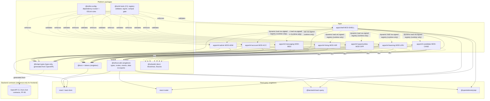
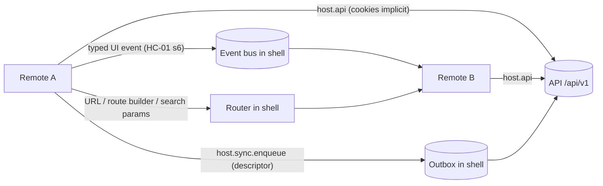
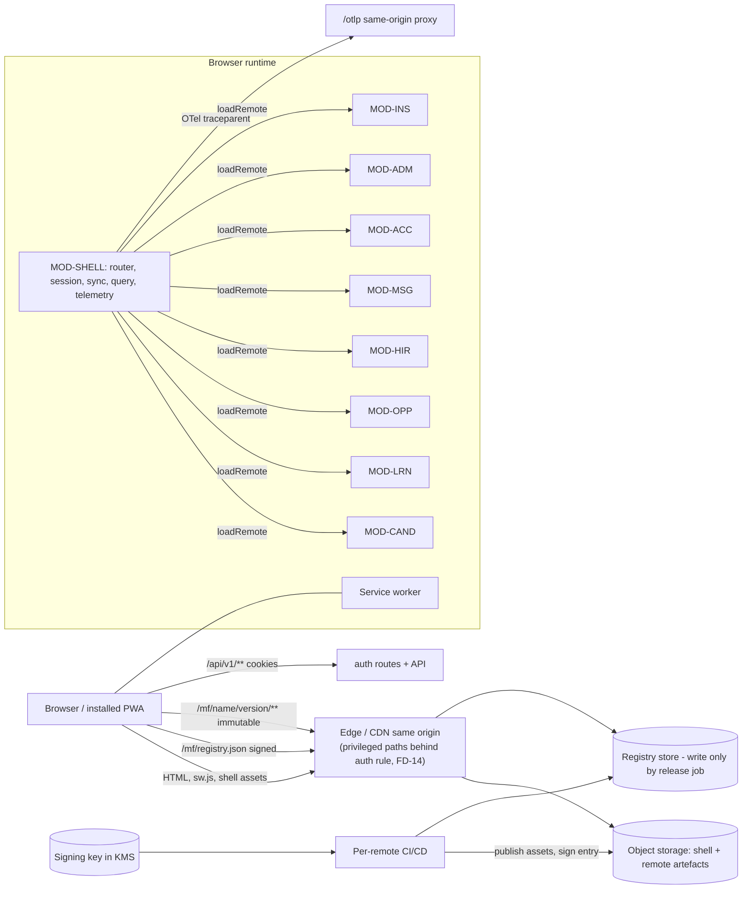
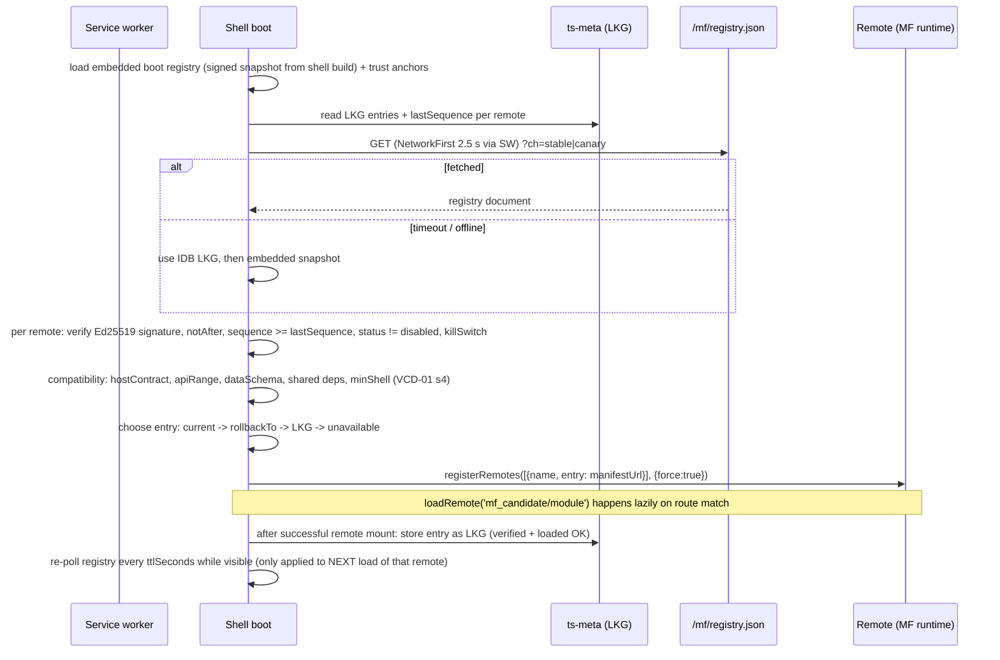
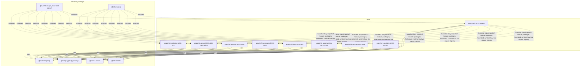
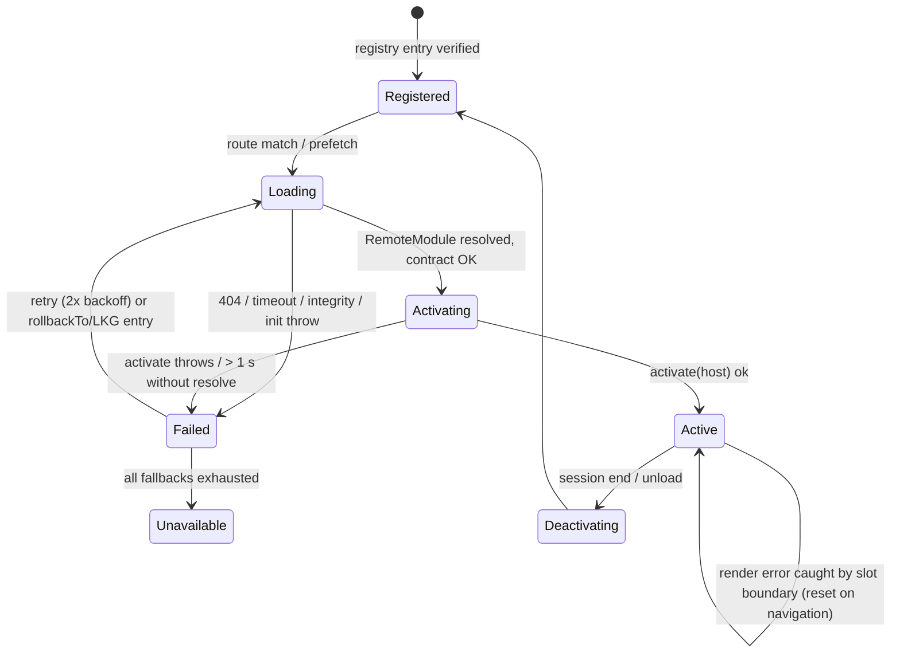
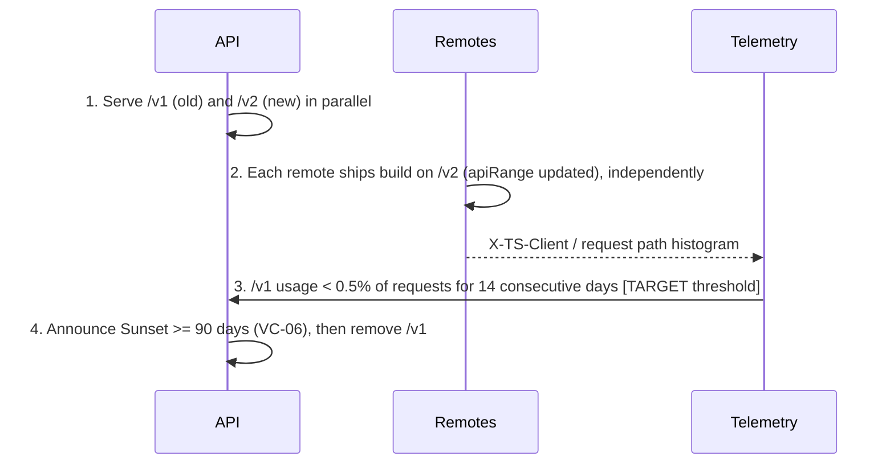
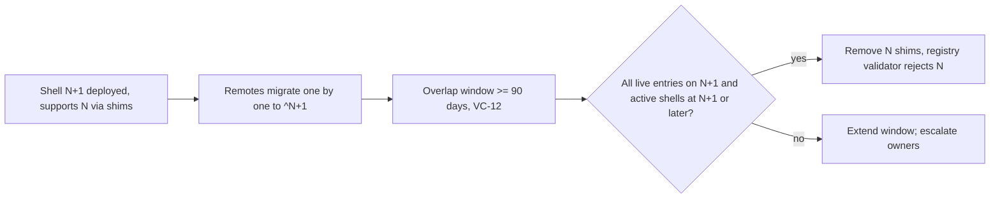

# Target blueprint 09: Module Federation

> **Status.** Archive: proposal, not ratified. A greenfield redesign blueprint written in October 2026. Every area was Draft, Under Review or Revision Required (its own document status) and no test was run against it. Its content was mined into `docs/blueprint/`; `SSOT.md` remains the source of intent. Module federation described here was not adopted: the built system is a modular monolith (`ARCHITECTURE.md`).
>
> **What this file holds.** All files of the former `Yash_Final_Project_Document/09_MODULE_FEDERATION/` folder, in order.
>
> **Merged on 2026-11-25** from the files listed below; each one is a section under its original title. Nothing was removed; the originals are in git history at commit `08387ec`.

| Section | Former file |
|---|---|
| Dependency and Ownership Map | `Yash_Final_Project_Document/09_MODULE_FEDERATION/DEPENDENCY_AND_OWNERSHIP_MAP.md` |
| Fault Isolation Matrix | `Yash_Final_Project_Document/09_MODULE_FEDERATION/FAULT_ISOLATION_MATRIX.md` |
| Module Federation Architecture | `Yash_Final_Project_Document/09_MODULE_FEDERATION/FEDERATION_ARCHITECTURE.md` |
| Module Federation - Review Fixes (revision overlay) | `Yash_Final_Project_Document/09_MODULE_FEDERATION/FEDERATION_REVIEW_FIXES.md` |
| Host Contract v1 and Remote Contracts | `Yash_Final_Project_Document/09_MODULE_FEDERATION/HOST_CONTRACT_AND_REMOTE_CONTRACTS.md` |
| Legacy Merge B-09: Module Boundary Rules from the Prior Attempt (No Federation Existed) | `Yash_Final_Project_Document/09_MODULE_FEDERATION/LEGACY_MERGE_MODULE_BOUNDARY_RULES.md` |
| REMOTE_MANIFEST.schema.json | `Yash_Final_Project_Document/09_MODULE_FEDERATION/REMOTE_MANIFEST.schema.json` |
| REMOTE_REGISTRY.example.json | `Yash_Final_Project_Document/09_MODULE_FEDERATION/REMOTE_REGISTRY.example.json` |
| REMOTE_REGISTRY.schema.json | `Yash_Final_Project_Document/09_MODULE_FEDERATION/REMOTE_REGISTRY.schema.json` |
| Version Compatibility Design | `Yash_Final_Project_Document/09_MODULE_FEDERATION/VERSION_COMPATIBILITY_DESIGN.md` |
| REMOTE_MANIFEST.schema_REV2.json | `Yash_Final_Project_Document/09_MODULE_FEDERATION/REMOTE_MANIFEST.schema_REV2.json` |
| REMOTE_REGISTRY.example_REV2.json | `Yash_Final_Project_Document/09_MODULE_FEDERATION/REMOTE_REGISTRY.example_REV2.json` |
| REMOTE_REGISTRY.schema_REV2.json | `Yash_Final_Project_Document/09_MODULE_FEDERATION/REMOTE_REGISTRY.schema_REV2.json` |

## Dependency and Ownership Map

_Former file: `Yash_Final_Project_Document/09_MODULE_FEDERATION/DEPENDENCY_AND_OWNERSHIP_MAP.md`._

Doc ID: DEP-01 · Owner: Frontend/Platform Architecture · Version 1.0 · Status: Under Review
Relates: ADR-T03, ADR-T07, ADR-T08, ADR-T17, ADR-T19 · INV-T01, INV-T16 · FF-02, FF-03, FF-04, FF-06, FF-08 · MFA-01, HC-01, FEA-01

Tags: [TARGET] unless marked. Team names are placeholders for roles; the count and split depend on OPEN-03 (fewer than 3 frontend teams ⇒ `MF_MODE=bundled`, ownership table collapses to path-based CODEOWNERS only).

### 1. Dependency graph (build-time and load-time)



Reading rules: solid arrows are compile/bundle dependencies, the single dashed arrow from SHELL is the only shell→remote relationship and exists **only at runtime through the registry** (no import). There are **no edges between remotes** (FF-03) and the graph is acyclic (FF-04).

### 2. Runtime interaction paths (allowed)



Everything else (direct calls, shared mutable globals, `postMessage` between remotes, shared storage keys, reading another remote's query keys) is forbidden.

### 3. Ownership

| Unit                                                                                                  | Path (monorepo, ADR-T17)                      | Owning team                                                      | Required reviewers (CODEOWNERS)                  | Release cadence          | Change control                                   |
| ----------------------------------------------------------------------------------------------------- | --------------------------------------------- | ---------------------------------------------------------------- | ------------------------------------------------ | ------------------------ | ------------------------------------------------ |
| Shell MOD-SHELL                                                                                       | `apps/shell`                                  | Platform Frontend                                                | Platform Frontend + Security for auth/session/SW | Weekly, staged           | Host Contract changes need ARB note (MFA-01 §15) |
| `@ts/host-sdk`                                                                                        | `packages/host-sdk`                           | Platform Frontend                                                | Platform Frontend + ≥ 1 remote owner             | With shell               | Semver; contract tests mandatory                 |
| `@ts/ui`, tokens                                                                                      | `packages/ui`                                 | Design System (may be Platform Frontend until OPEN-03 resolved)  | Design System + a11y lead                        | Weekly                   | Breaking = major; visual regression              |
| `@ts/api-types`                                                                                       | `packages/api-types` (generated)              | API platform (backend) generates; Platform Frontend owns tooling | Backend module owner for the changed paths       | On every OpenAPI change  | FF-06 (oasdiff) gate                             |
| `@ts/mf-tools`                                                                                        | `packages/mf-tools`                           | Platform Frontend (release engineering)                          | Security for signer/validator                    | As needed                | Keys never in repo                               |
| `@ts/lint-config`                                                                                     | `packages/lint-config`                        | Platform Frontend                                                | Architecture Review Board delegate               | As needed                | Rule removal = ARB decision                      |
| `@ts/testkit`                                                                                         | `packages/testkit`                            | Platform Frontend                                                | Remote owners consulted                          | With host-sdk            |                                                  |
| MOD-CAND                                                                                              | `apps/mf-candidate`                           | Candidate Experience                                             | team                                             | Continuous (independent) | Per MFA-01 §12                                   |
| MOD-LRN                                                                                               | `apps/mf-learning`                            | Learning & Assessment                                            | team + integrity reviewer                        | Continuous               | assessment-runner changes need integrity suite   |
| MOD-OPP                                                                                               | `apps/mf-opportunities`                       | Opportunities & Applications                                     | team                                             | Continuous               | ranking inputs allowlist review (INV-T19)        |
| MOD-HIR                                                                                               | `apps/mf-hiring`                              | Hiring Workspace                                                 | team + privacy reviewer for consent-scoped views | Continuous               | no auto-reject UI (INV-T09)                      |
| MOD-MSG                                                                                               | `apps/mf-messaging`                           | Collaboration & Notifications                                    | team + safety reviewer for report/block          | Continuous               |                                                  |
| MOD-ACC                                                                                               | `apps/mf-account`                             | Account & Trust                                                  | team + Security + Billing owner                  | Gated                    | strict review                                    |
| MOD-ADM                                                                                               | `apps/mf-admin`                               | Platform Back-office                                             | team + Security                                  | Gated                    | internal canary first                            |
| OpenAPI / API modules                                                                                 | `apps/api`, `packages/contracts` [REF layout] | Backend module teams                                             | per module                                       | independent              | FF-02, FF-06, FF-07                              |
| Registry + signing keys                                                                               | release infra                                 | Platform Frontend (release eng.) + Security                      | two-person rule for key ops [OPEN-FE-16]         | n/a                      | audit log of every publish                       |
| Escalation key per remote lives in the registry entry (`owner.escalation`), personal contacts do not. |

### 4. Allowed / forbidden dependencies

| #                                                       | From                 | To                                                                                                                                                      | Verdict                                                                                 | Enforcement                                                                                                     |
| ------------------------------------------------------- | -------------------- | ------------------------------------------------------------------------------------------------------------------------------------------------------- | --------------------------------------------------------------------------------------- | --------------------------------------------------------------------------------------------------------------- |
| 1                                                       | Shell                | Remote (load)                                                                                                                                           | **Allowed — runtime only**, via verified registry; never `import`                       | MF config check; dependency-cruiser forbids `apps/mf-*` imports from `apps/shell`                               |
| 2                                                       | Shell                | `@ts/host-sdk`, `@ts/ui`, singletons                                                                                                                    | Allowed                                                                                 | —                                                                                                               |
| 3                                                       | Remote               | `@ts/host-sdk` (incl. `/routes`, `/events`, `/data`, `/testing` in tests only)                                                                          | Allowed (required)                                                                      | FF-04 manifest validator                                                                                        |
| 4                                                       | Remote               | `@ts/ui`                                                                                                                                                | Allowed (singleton)                                                                     | —                                                                                                               |
| 5                                                       | Remote               | `@ts/api-types`                                                                                                                                         | Allowed (type-only; erased at build)                                                    | `importsNotUsedAsValues`/lint                                                                                   |
| 6                                                       | Remote               | its own generated API operations (bundled)                                                                                                              | Allowed; transport only via `host.api`                                                  | ESLint `no-restricted-globals` for `fetch`, `XMLHttpRequest`, `WebSocket`, `EventSource` (except host-provided) |
| 7                                                       | Remote               | **another remote** (import, deep path, MF `remotes` config, shared mutable module)                                                                      | **Forbidden**                                                                           | FF-03 (dependency-cruiser + MF config check)                                                                    |
| 8                                                       | Remote               | shell internals (anything not exported by `@ts/host-sdk`)                                                                                               | **Forbidden**                                                                           | dependency-cruiser path rule                                                                                    |
| 9                                                       | Remote               | `document.cookie`, `localStorage`/`sessionStorage`/`indexedDB` for app data, `navigator.serviceWorker`, `Notification.requestPermission`, `pushManager` | **Forbidden** (use `host.*`)                                                            | ESLint rules; CSP does not stop these — hygiene only (ADR-T19)                                                  |
| 10                                                      | Remote               | Tokens/credentials in any form                                                                                                                          | **Forbidden** and none exist (INV-T16, ADR-T06)                                         | Secret scan; no API returns them                                                                                |
| 11                                                      | Remote               | `packages/domain`, `packages/policy` (backend business rules/authz)                                                                                     | **Forbidden** — UI shows server state and `allowedActions`; no restated rules (INV-T01) | dependency-cruiser                                                                                              |
| 12                                                      | Remote               | `packages/contracts` (Zod runtime)                                                                                                                      | Forbidden at runtime; types only via `@ts/api-types`                                    | dependency-cruiser                                                                                              |
| 13                                                      | Remote               | New third-party package that is also on the shared list                                                                                                 | Must be declared in `shared[]` with policy                                              | FF-04                                                                                                           |
| 14                                                      | Remote               | New third-party package otherwise                                                                                                                       | Allowed, **bundled per remote**; license/SCA and size budget gates                      | CI                                                                                                              |
| 15                                                      | `@ts/ui`             | `@ts/host-sdk` or any remote                                                                                                                            | **Forbidden** (UI is leaf)                                                              | dependency-cruiser                                                                                              |
| 16                                                      | `@ts/host-sdk`       | `@ts/ui`, remotes, shell internals                                                                                                                      | **Forbidden** (contract is leaf; only types + re-exports)                               | dependency-cruiser                                                                                              |
| 17                                                      | Any package          | Remote/app (reverse edge)                                                                                                                               | **Forbidden**                                                                           | dependency-cruiser                                                                                              |
| 18                                                      | Any cycle            | —                                                                                                                                                       | **Forbidden**                                                                           | FF-04 acyclic check                                                                                             |
| 19                                                      | Remote → Remote data | Via API, URL, or typed events only                                                                                                                      | Allowed channels                                                                        | HC-01 §6; lint on `window.__ts_*`, custom DOM events                                                            |
| 20                                                      | Test code            | `@ts/testkit`                                                                                                                                           | Allowed in `*.test.*`/`testing` only                                                    | lint scope                                                                                                      |
| 21                                                      | Frontend             | Backend module internals (`apps/api/**`)                                                                                                                | Forbidden; OpenAPI is the only contract                                                 | dependency-cruiser; FF-02 mirror                                                                                |
| Example `dependency-cruiser` rule shape (illustrative): |

```js
{ name: 'no-remote-to-remote', severity: 'error',
  from: { path: '^apps/(mf-[^/]+)/' },
  to:   { path: '^apps/(mf-[^/]+|shell)/', pathNot: '^apps/$1/' } }   // $1 = capture group of `from` (dependency-cruiser syntax; verify in spike)
```

### 5. Impact analysis rules

| Change in              | Re-test / notify                                                                                         |
| ---------------------- | -------------------------------------------------------------------------------------------------------- |
| `@ts/host-sdk` minor   | Contract suites of all 7 remotes (affected-only: only those using the changed member), shell conformance |
| `@ts/host-sdk` major   | All teams; VCD-01 §6.5 train                                                                             |
| `@ts/ui` minor/major   | Visual regression across all remotes; major = train                                                      |
| OpenAPI path change    | Remotes whose `apiRange` covers the path (computed from generated-client usage)                          |
| Singleton version bump | All remotes (VCD-01 §6.6)                                                                                |
| One remote             | Only that remote + its contract/e2e; no other team involved                                              |

### 6. Open items

OPEN-03 (global) team count · OPEN-FE-16 key custody/two-person rule · OPEN-FE-27 who owns `@ts/ui` (07_* design-system team vs Platform Frontend) · OPEN-FE-28 CODEOWNERS and repo layout reconciliation with the existing monorepo (FEA-01 §15).

## Fault Isolation Matrix

_Former file: `Yash_Final_Project_Document/09_MODULE_FEDERATION/FAULT_ISOLATION_MATRIX.md`._

Doc ID: FIM-01 · Owner: Frontend/Platform Architecture · Version 1.0 · Status: Under Review
Relates: ADR-T03, ADR-T05, ADR-T10, ADR-T16, ADR-T18, ADR-T19 · INV-T13, INV-T14, INV-T16 · BR-T050 · MFA-01, HC-01, VCD-01, PWA-01, OFF-01, FEA-01

Tags: [CONF] [TARGET] [OPEN]. Thresholds for alerts are [TARGET] starting points, tuned from baseline telemetry; they are not benchmarks. "Verification" names the test that must exist before the scenario is claimed handled.

Blast-radius legend: **R** = one remote area · **P** = whole shell/page · **U** = all users (server/CDN) · **D** = one device/browser profile. Shared-dependency legend: SH = shell, SW = service worker, QC = QueryClient, RT = router, UI = `@ts/ui`, REACT = React singleton, IDB = IndexedDB, API = backend, CDN = edge/object storage, REG = registry.

### 1. Scenarios — cause, scope, detection

| ID    | Scenario                                                                                 | Source                                                                                              | Blast radius                                                           | Shared deps involved   | Detection                                                                                                             |
| ----- | ---------------------------------------------------------------------------------------- | --------------------------------------------------------------------------------------------------- | ---------------------------------------------------------------------- | ---------------------- | --------------------------------------------------------------------------------------------------------------------- |
| FI-01 | Remote entry/chunk **404**                                                               | Missed upload, CDN replica lag, bad `publicPath`                                                    | R (all users of that build)                                            | CDN, REG               | MF `loadEntryError`/`errorLoadRemote`; `mf.remote.load_error{status=404}`; healthcheck asset-reachability pre-publish |
| FI-02 | Remote **slow** / timeout                                                                | Slow network, large chunk, CDN degradation                                                          | R, user-perceived P (spinner)                                          | CDN, SW                | Load timer > 10 s; `mf.remote.load_ms` p75/p99 vs budget; Web Vitals by route                                         |
| FI-03 | Remote **runtime crash at init** (import or `activate` throws, `selfCheck` fails)        | Bad build, contract misuse                                                                          | R                                                                      | REACT, SH              | `activate` rejection/timeout (1 s); error boundary at slot; `mf.remote.fallback`                                      |
| FI-04 | Remote **render error** (exception in React tree)                                        | Component bug, bad data                                                                             | R (one route subtree)                                                  | REACT, UI              | Slot/route `ErrorBoundary` → `errors.report`; JS error rate by `ts.module`                                            |
| FI-05 | **Shared-dependency conflict** (duplicate React, range unsatisfied, `@ts/ui` major skew) | Bad publish bypassing gate, stale shell vs new remote                                               | R (if gate holds) → P (if duplicate singleton leaks)                   | REACT, RT, QC, UI      | CI FF-04; runtime range check; MF `errorLoadShare`/strict-version error; singleton identity probe at boot             |
| FI-06 | **Registry/manifest corrupt** (invalid JSON, schema violation, truncated)                | Publisher bug, partial write, CDN corruption                                                        | P (all remotes) if unhandled; contained to the invalid entry otherwise | REG, SH                | JSON parse/Schema validation in shell; `registry.invalid`; per-entry validation                                       |
| FI-07 | Entry **signature invalid / tampered / replayed (lower sequence)**                       | Registry-store compromise, MITM on non-TLS path, replay                                             | R per entry (attack)                                                   | REG, trust anchors     | Signature/sequence check; `registry.signature_failed` (page-worthy, security signal)                                  |
| FI-08 | **Registry unreachable** (offline, 5xx, DNS)                                             | Network, edge                                                                                       | P (boot)                                                               | REG, SW                | Fetch timeout 2.5 s; SW NetworkFirst fallback; `registry.fetch_failed`                                                |
| FI-09 | **Single-domain API 5xx** (e.g., `api/jobs`)                                             | Backend module fault                                                                                | R (screens calling it)                                                 | API                    | `api.error_rate{module}`; ApiError 5xx; trace error spans                                                             |
| FI-10 | **API-wide outage / 5xx storm**                                                          | Backend/gateway/DB failure                                                                          | U (every online-only flow)                                             | API, QC                | Error ratio across modules; synthetic probe; circuit breaker opens (OFF-01 §8.3)                                      |
| FI-11 | **Database outage / degraded read** (server)                                             | Postgres failover, saturation (ADR-T05)                                                             | U                                                                      | API                    | API returns `503` problem `type:/problems/degraded` with `Retry-After`; capability endpoint reports degraded domains  |
| FI-12 | **Outbox queue stall**                                                                   | Poison op blocking an aggregate; flusher lock held; clock/session problems; item stuck `retry-wait` | D (one device/account)                                                 | IDB, SH, API           | `outbox.oldest_age_s` > 15 min online; Sync Center "Needs attention"; per-op attempt counters                         |
| FI-13 | **Third-party outage — Stripe** (Checkout/Portal/webhook delay)                          | Stripe or network to Stripe                                                                         | R (MOD-ACC billing paths)                                              | API (webhook), ext.    | Redirect failure/timeouts; entitlement polling timeout; billing error metrics                                         |
| FI-14 | **Bad shell deploy** (broken HTML/JS, bad route table, bad SW)                           | Release defect                                                                                      | P → U                                                                  | SH, SW, CDN            | Post-deploy smoke + SLO guard; JS error spike; boot success ratio `shell.boot_ok`; RUM FCP                            |
| FI-15 | **Bad remote deploy that passes health** (functional/UX/perf regression)                 | Release defect                                                                                      | R (cohort during canary, then all)                                     | CDN, REG               | Canary SLO guard (errors, INP, remote load, domain KPIs); user-reported; `mf.remote.error_rate` delta vs stable       |
| FI-16 | **Regional CDN/edge outage** or lagging replication                                      | Provider incident                                                                                   | U in region                                                            | CDN, REG, SW           | Synthetic probes per region; `edge.fetch_failed` by country/colo; load errors by region                               |
| FI-17 | **Incompatible remote** (Host Contract/minShell/dataSchema mismatch)                     | Stale shell (clients) or drift                                                                      | R for affected clients                                                 | SH, REG                | Shell selection logic; `mf.remote.incompatible{reason}`                                                               |
| FI-18 | **Stale client vs newer API** (426 / schema drift)                                       | Long-unopened PWA                                                                                   | D                                                                      | API, SH                | `426 client-outdated`; `api.426_count`; client version histogram                                                      |
| FI-19 | **Broken or stuck service worker** (bad precache, handler bug, update never activates)   | SW defect                                                                                           | D → U (each client on that SW)                                         | SW                     | Boot probe `sw.version` vs expected; precache install failures; `sw.controllerchange_loops`; support reports          |
| FI-20 | **IndexedDB unavailable / quota exceeded / corrupted**                                   | Private mode, eviction, disk full, bug                                                              | D                                                                      | IDB, SH                | Open/transaction probe at boot; `QuotaExceededError` handler; `storage.quota_exceeded`                                |
| FI-21 | **Session expiry or refresh race mid-flow** (multi-tab, reuse detection BR-T050)         | Cookie expiry, concurrent refresh, remote revocation                                                | D (all tabs of one session)                                            | SH, API                | 401 handler; `session.refresh_failed`; `session.reuse_revoked` (server)                                               |
| FI-22 | **Long task / memory leak / infinite loop in one remote**                                | Remote code defect                                                                                  | **P** (main thread shared)                                             | main thread, REACT     | Long Tasks / INP by route; memory growth sampling; watchdog timer in shell (`shell.longtask_over_5s`)                 |
| FI-23 | **CSS/global style leakage or token conflict**                                           | Remote global CSS, UI version skew                                                                  | P (visual)                                                             | UI, DOM                | Visual regression CI; CSS lint (no global selectors in remotes); RUM CLS spikes                                       |
| FI-24 | **Event-bus handler throws / event flood**                                               | Subscriber bug, loop (A emits B emits A)                                                            | R (subscriber) or P (flood)                                            | SH bus                 | Handler try/catch; rate limiter per topic (e.g., > 50/s); `bus.handler_error`, `bus.flood`                            |
| FI-25 | **Feature-flag or capabilities endpoint down**                                           | Flag service/`/me/capabilities` failure                                                             | U (online)                                                             | API, SH                | Fetch failure; stale-snapshot age metric                                                                              |
| FI-26 | **Telemetry pipeline down** (OTLP proxy/collector)                                       | Observability outage                                                                                | none for users; blind ops                                              | SH telemetry           | Exporter failure counters; synthetic span                                                                             |
| FI-27 | **Push delivery failure** (APNs/FCM/Web Push service)                                    | Provider outage, expired subscriptions                                                              | D / U for push only                                                    | SW, API/worker         | Delivery receipts/410s; `push.send_failure_rate`; click-through gaps                                                  |
| FI-28 | **Compromised or malicious remote/shared-package code (supply chain / XSS)**             | Dependency compromise, injected script                                                              | **P/U** — not isolated                                                 | everything same-origin | CSP violation reports, SRI/SW mismatch, anomaly in network egress, dependency scanning (SCA), signature failures      |
| FI-29 | **Regional backend outage (cloud region)**                                               | Provider region failure                                                                             | U in region/all                                                        | API, DB                | Regional health, synthetic probes, error ratio by region                                                              |
| FI-30 | **Realtime channel (SSE/WebSocket) down**                                                | Proxy/idle timeout, backend                                                                         | R (MOD-MSG live updates)                                               | API                    | `msg.sse_reconnects`, heartbeat misses                                                                                |

### 2. Scenarios — response

| ID    | Containment                                                                                                                                                                                             | Fallback                                                                               | User-visible behaviour                                                                    | Recovery                                                                                | Monitoring / alert                                                     | Verification                                                                         |
| ----- | ------------------------------------------------------------------------------------------------------------------------------------------------------------------------------------------------------- | -------------------------------------------------------------------------------------- | ----------------------------------------------------------------------------------------- | --------------------------------------------------------------------------------------- | ---------------------------------------------------------------------- | ------------------------------------------------------------------------------------ |
| FI-01 | Slot-level failure; other remotes and chrome unaffected                                                                                                                                                 | 2 retries (500/1500 ms) → `rollbackTo` entry → LKG                                     | Skeleton then "This area is updating — Retry / Go home"                                   | Registry rollback; CDN fix; assets are immutable so re-upload same path is idempotent   | Alert: remote 404 ratio > 1% over 5 min [TARGET]                       | e2e network fault injection; pre-publish multi-region reachability gate              |
| FI-02 | Timeout bounded (10 s; reconciled with Host Contract, see HOST_CONTRACT_AND_REMOTE_CONTRACTS.md "Timer reconciliation") so no infinite spinner                                                          | Skeleton → timeout → retry chain                                                       | Progress skeleton, then retry/unavailable                                                 | Retry; prefetch on idle reduces recurrence                                              | `mf.remote.load_ms` p75 > budget; p99 > 10 s                           | e2e throttled (slow-4G profile)                                                      |
| FI-03 | `activate` guarded (1 s timeout, try/catch); failure marks build bad for 24 h on this client                                                                                                            | `rollbackTo` → LKG                                                                     | "This area is unavailable"                                                                | Auto rollback by SLO guard; operator publish                                            | Alert on `mf.remote.fallback` > 0.5% of loads [TARGET]                 | contract test: `activate` throws; unit shell                                         |
| FI-04 | Route/slot ErrorBoundary resets on navigation; sibling routes live                                                                                                                                      | Retry button re-mounts subtree                                                         | Inline error panel with Retry; rest of app usable                                         | Fix + new build; boundary reset                                                         | Error rate by module + release; Sentry-like grouping                   | Component tests; chaos route that throws                                             |
| FI-05 | Pre-load range check; strict versions fail load instead of dual instance                                                                                                                                | Fallback chain; if shell itself broken see FI-14                                       | Unavailable area                                                                          | Rebuild remote with compatible ranges; widen→flip→narrow train for majors (VCD-01 §6.6) | `mf.remote.incompatible{shared}`; singleton identity probe fail = page | CI FF-04 negative tests; e2e with deliberately skewed remote                         |
| FI-06 | Validation per entry; invalid entry skipped; boot snapshot + LKG used                                                                                                                                   | Embedded snapshot → LKG                                                                | Usually none; stale versions possible                                                     | Republish registry (atomic put)                                                         | `registry.invalid` page-worthy                                         | Fuzz tests on registry parser; schema CI on publish                                  |
| FI-07 | Entry dropped; others unaffected; security event                                                                                                                                                        | Next candidate (rollbackTo/LKG)                                                        | None or "unavailable" for that area                                                       | Investigate key/store compromise; rotate keys via shell release                         | Page security on-call                                                  | Unit tamper/replay (VCD-01 T5/T6)                                                    |
| FI-08 | Boot never blocks on registry (> 2.5 s)                                                                                                                                                                 | IDB LKG → embedded snapshot                                                            | None; offline banner if offline                                                           | Auto on next poll                                                                       | `registry.fetch_failed` ratio                                          | e2e offline boot                                                                     |
| FI-09 | Per-query errors surface in that screen only; QC retry policy (limited, backoff)                                                                                                                        | Cached RO data labelled "as of" if class allows; otherwise inline error                | Section-level error with Retry; rest of page fine                                         | Backend fix                                                                             | `api.error_rate{module}` > baseline [TARGET 2% sustained 5 min]        | Integration fault injection; e2e                                                     |
| FI-10 | Client circuit breaker (60 s) stops hammering; no retry storms (jitter)                                                                                                                                 | RO cached screens; queued writes keep queuing                                          | Global "Service temporarily unavailable" banner; online-only actions disabled with reason | Backend recovery; queue flushes automatically                                           | Sev incident; synthetic failing; error ratio                           | e2e mock 503; load test with retries                                                 |
| FI-11 | Backend returns explicit `degraded` problem; shell consumes capability `degraded` list                                                                                                                  | Read-only mode for affected domains; online-only mutations blocked                     | "Some features are read-only right now"                                                   | DB failover (17_*)                                                                      | DB/API SLO alerts                                                      | Integration with fault proxy                                                         |
| FI-12 | Ordered per aggregate; other aggregates keep flowing; Web Lock released on tab death                                                                                                                    | "Needs attention" tray; user can retry/discard/export                                  | Item shows reason; app otherwise normal                                                   | User resolves; support export (JSON)                                                    | `outbox.oldest_age_s` p95 across devices; stuck-item rate              | Unit/integration: poison op, dead lock holder                                        |
| FI-13 | Billing paths isolated in MOD-ACC; success redirect grants nothing (INV-T17)                                                                                                                            | Entitlement shown from server state only; support link                                 | "Payment page is unavailable — try later"; entitlements unchanged until webhook state     | Stripe recovery; webhook replay                                                         | Stripe webhook lag, checkout error rate                                | e2e with stubbed Stripe failure; webhook-delay test                                  |
| FI-14 | Staged rollout; SW and HTML cache-busting; previous shell stays in clients' SW until update applied                                                                                                     | Rollback pipeline; kill-switch SW if SW broken; `MF_MODE=bundled` as alternative build | Possible blank/broken app for updated clients until rollback                              | Re-publish previous build with new SW version string                                    | `shell.boot_ok` < 99.5% [TARGET] page; JS error spike                  | Pre-release smoke on production-like env; rollback drill each quarter                |
| FI-15 | Canary cohort (5%) with SLO guard; per-remote rollback independent of others                                                                                                                            | Auto-rollback to `rollbackTo`; kill switch                                             | Degraded area for canary cohort only                                                      | Registry flip (≤ 300 s TTL)                                                             | Canary guard metrics; support tickets                                  | Canary rehearsal in staging; synthetic journeys per remote                           |
| FI-16 | Multi-region object storage + CDN failover; immutable URLs cache widely                                                                                                                                 | SW cache serves already-seen versions; app shell offline                               | Cached users unaffected; new users in region see error page                               | Provider failover; DNS/CDN steering                                                     | Synthetic probes per region; edge error rate                           | Game-day: block region                                                               |
| FI-17 | Strict VC-02 rule; no partial mount                                                                                                                                                                     | `rollbackTo` → LKG → "Update required" if shell is the stale party                     | "Update required" (reload) or "area updating"                                             | Client update; remote republishes lower bound if mistake                                | `mf.remote.incompatible{reason}` > 1% [TARGET]                         | VCD-01 T1–T3, T9                                                                     |
| FI-18 | Server floor + client header; force-update flow                                                                                                                                                         | Read-only until update; outbox preserved                                               | Blocking "Update required" modal (offline: banner + read-only)                            | Update SW; outbox translators                                                           | `api.426_count`, client age distribution                               | VCD-01 T11                                                                           |
| FI-19 | Kill-switch SW unregisters itself and clears `ts-*` caches; SW code has no business logic                                                                                                               | Online-only plain SPA (no SW)                                                          | Possibly one extra reload; offline unavailable temporarily                                | Fix SW, redeploy with new version string                                                | `sw.controllerchange_loops`; precache failure rate                     | SW test harness: broken-install simulation; kill-switch drill                        |
| FI-20 | Boot probe → online-only mode; quota handler per OFF-01 §6; no crash                                                                                                                                    | In-memory forms; clear message; no outbox                                              | Banner "Offline features unavailable" or "Storage full"                                   | User frees storage / retry; cache rebuild                                               | `storage.quota_exceeded`, `idb.open_failed` rates by platform          | Unit with mocked IDB errors; Safari private-mode manual                              |
| FI-21 | Single-flight refresh via Web Locks across tabs; shell owns refresh; remotes cannot refresh                                                                                                             | Reauth sheet; queued writes preserved under same-account rule                          | "Sign in again" sheet, no data loss                                                       | Reauth; if reuse-revoke, full sign-in                                                   | `session.refresh_failed`, server `reuse_revoked`                       | Integration with 3 tabs + token family (BR-T050)                                     |
| FI-22 | **Not contained.** Mitigate: per-remote perf budgets; code-splitting; watchdog reports offending module; long-task attribution; kill-switch                                                             | Rollback/kill-switch the offending remote                                              | Janky/frozen tab                                                                          | Rollback; browser "wait/kill"                                                           | Long-task/INP alerts by module                                         | Perf CI (Lighthouse CI) + soak test with memory sampling                             |
| FI-23 | CSS lint forbids global selectors in remotes; tokens via `@ts/ui`; CSS Layers/ scoping convention                                                                                                       | Rollback remote                                                                        | Visual glitches                                                                           | Fix and republish                                                                       | Visual regression diff; CLS                                            | Visual regression suite across remotes together                                      |
| FI-24 | Bus wraps handlers in try/catch; per-topic rate limit; loop detection (emit depth)                                                                                                                      | Drop events beyond limit; subscribers refetch on next focus                            | Possibly stale UI part                                                                    | Fix subscriber                                                                          | `bus.handler_error`, `bus.flood`                                       | Unit: throwing handler, flood                                                        |
| FI-25 | Flags default to safe values; capabilities snapshot (age-labelled) used; server remains authority                                                                                                       | Stale snapshot; hide nothing that API would deny                                       | Maybe missing/extra UI affordances; API still denies                                      | Service recovery                                                                        | Snapshot age gauge                                                     | e2e with endpoint failing                                                            |
| FI-26 | Exporter async, bounded buffer, drops on overflow; never blocks UI                                                                                                                                      | Local error console + `sendBeacon` best-effort                                         | None                                                                                      | Fix collector                                                                           | Synthetic span lag                                                     | Unit: exporter failure                                                               |
| FI-27 | Push is never the only channel for consequential events                                                                                                                                                 | In-app centre + email (ADR-T20)                                                        | Missed OS notification; in-app item present                                               | Provider recovery; prune dead subscriptions                                             | send failure rate; 410 pruning                                         | Worker integration with push stub                                                    |
| FI-28 | **Not isolated by federation.** Reduce likelihood/impact: strict CSP, Trusted Types, signed entries + SRI/SW verify, SCA & lockfile policy, minimal data cached, no tokens in JS, server-enforced authz | Kill switch + key rotation + rollback; server-side session revocation (BR-T050)        | Depends on attack; may include data exposure                                              | Incident response (19_*): revoke sessions, rotate keys, republish                       | CSP reports, signature failures, SCA alerts, anomalous API patterns    | Security tests: CSP header tests, SRI/signature tamper tests, dependency policy gate |
| FI-29 | Multi-region failover (infra docs); client unaffected by region beyond latency                                                                                                                          | RO caches; queue                                                                       | Same as FI-10 for failover duration                                                       | Failover                                                                                | Regional SLO                                                           | Game-day                                                                             |
| FI-30 | Reconnect with backoff + jitter, polling fallback                                                                                                                                                       | Poll every 30 s while visible [TARGET]                                                 | Slight delay in new messages                                                              | Auto                                                                                    | `msg.sse_reconnects`                                                   | e2e: server closes stream                                                            |

### 3. What federation does NOT isolate (honest scope, ADR-T19)

| #                                                                                                                                                                                                                                                                            | Not isolated                                                                             | Consequence                                                                                                                       | Mitigation / where handled                                                                                                                                                               |
| ---------------------------------------------------------------------------------------------------------------------------------------------------------------------------------------------------------------------------------------------------------------------------- | ---------------------------------------------------------------------------------------- | --------------------------------------------------------------------------------------------------------------------------------- | ---------------------------------------------------------------------------------------------------------------------------------------------------------------------------------------- |
| 1                                                                                                                                                                                                                                                                            | **JS realm and DOM** — all remotes run in the same window, same prototypes, same globals | One compromised or buggy remote can read/modify anything the user can in the page; can monkey-patch `fetch`, DOM, React internals | CSP + Trusted Types, signed registry, lint `no-restricted-globals`, dependency policy; sandboxed iframes only for untrusted third-party content (ADR-T19). Tag: not a security boundary. |
| 2                                                                                                                                                                                                                                                                            | **Origin storage** (IndexedDB, Cache Storage, localStorage, SW)                          | Any remote can read the account DB and caches                                                                                     | Minimise cached data, short TTL, purge on logout (OFF-01); `host.storage.scoped` is convention                                                                                           |
| 3                                                                                                                                                                                                                                                                            | **Authority of cookies**                                                                 | Browser attaches session cookies to same-origin calls from any remote code                                                        | Server authz for every request (INV-T01/T02), CSRF header policy, short access token, anomaly detection                                                                                  |
| 4                                                                                                                                                                                                                                                                            | **Main thread CPU / memory / event loop**                                                | FI-22: one remote can freeze the page                                                                                             | Budgets, splitting, watchdog, rollback; Worker offload where justified                                                                                                                   |
| 5                                                                                                                                                                                                                                                                            | **Global CSS cascade and layout**                                                        | FI-23 style bleed                                                                                                                 | CSS lint, tokens, visual regression                                                                                                                                                      |
| 6                                                                                                                                                                                                                                                                            | **Shared singletons** (React, router, QueryClient, `@ts/ui`, `@ts/host-sdk`)             | A bug or breaking change affects every remote                                                                                     | Strict ranges, widen→flip→narrow, canary                                                                                                                                                 |
| 7                                                                                                                                                                                                                                                                            | **The shell and service worker**                                                         | Single point of failure for boot/offline for everyone (FI-14, FI-19)                                                              | Small shell, SW without business logic, kill-switch SW, bundled-mode fallback                                                                                                            |
| 8                                                                                                                                                                                                                                                                            | **Backend, database, API, auth**                                                         | Federation does nothing for server outages (FI-09…FI-11, FI-29)                                                                   | Backend resilience (17__/18__), degraded-mode contracts, caches, circuit breaker                                                                                                         |
| 9                                                                                                                                                                                                                                                                            | **Network / CDN / DNS / TLS**                                                            | Same-origin hosting concentrates risk at the edge (FI-16)                                                                         | Multi-region, immutable assets, SW caches                                                                                                                                                |
| 10                                                                                                                                                                                                                                                                           | **Supply chain of shared packages and build tooling**                                    | Compromise of `@ts/*` or a transitive dependency reaches all modules that bundle it                                               | Lockfile, SCA, provenance, reviews, build isolation                                                                                                                                      |
| 11                                                                                                                                                                                                                                                                           | **Telemetry and flags**                                                                  | Shared providers; their failure affects visibility/behaviour everywhere                                                           | Fail-open, bounded buffers (FI-25/26)                                                                                                                                                    |
| 12                                                                                                                                                                                                                                                                           | **Release coordination on contract changes**                                             | Host Contract/shared-dep majors couple all teams                                                                                  | VCD-01 trains and windows                                                                                                                                                                |
| 13                                                                                                                                                                                                                                                                           | **Data correctness**                                                                     | A remote can send wrong requests; only the server prevents harm                                                                   | Server validation/state machines/policy; INV-T10/T11                                                                                                                                     |
| 14                                                                                                                                                                                                                                                                           | **Accessibility and UX consistency**                                                     | Independent teams can diverge                                                                                                     | `@ts/ui`, a11y CI, design reviews                                                                                                                                                        |
| Net: federation buys **independent delivery, smaller per-persona bundles, per-remote rollback and failure containment for _render and load_ faults** (FI-01…FI-04, FI-15, FI-17). It does not buy security isolation or protection from shared-resource and platform faults. |

### 4. Coverage check

| Mission category                                 | Scenarios          |
| ------------------------------------------------ | ------------------ |
| Remote 404 / slow / runtime crash / render error | FI-01, 02, 03, 04  |
| Shared-dependency conflict                       | FI-05              |
| Manifest/registry corrupt, signature             | FI-06, 07, 08      |
| API 5xx / database outage                        | FI-09, 10, 11, 29  |
| Queue stall                                      | FI-12              |
| Third-party outage                               | FI-13, 27 (and 26) |
| Bad deploy                                       | FI-14, 15          |
| Regional                                         | FI-16, 29          |
| Compatibility / stale                            | FI-17, 18, 19      |
| Client storage / session                         | FI-20, 21          |
| Shared-resource faults federation cannot contain | FI-22, 23, 24, 28  |

### 5. Verification program

Game-days (quarterly): block a remote path (FI-01), poison registry (FI-06/07), SW kill-switch (FI-19), API 503 storm (FI-10), region block (FI-16/29). Each scenario's row above is a test requirement; a scenario is "handled" only when its verification exists in CI or the game-day log. Owners: remote cards in HC-01 §7 for R-scoped; Platform Frontend for P/U-scoped.

### 6. Open items

OPEN-FE-24 alert thresholds to be re-based after 4 weeks of production baseline · OPEN-FE-25 watchdog design for FI-22 (what the shell can actually do without killing user state) · OPEN-FE-26 infra-side FI-16/29 runbooks (17_*).

## Module Federation Architecture

_Former file: `Yash_Final_Project_Document/09_MODULE_FEDERATION/FEDERATION_ARCHITECTURE.md`._

Doc ID: MFA-01 · Owner: Frontend/Platform Architecture (Module Federation) · Version 1.0 · Status: Under Review

> **Revision 2 folded in (2026-10-27)** from `FEDERATION_REVIEW_FIXES.md`: appended under "Revision 2 additions"; where it differs from text above, the appended text governs. Status unchanged; proposals still need owner/ARB ratification.
> Relates: ADR-T03 (amended by ADR-T23, proposed), ADR-T16, ADR-T17, ADR-T18, ADR-T19, ADR-T24 (proposed) · INV-T13, INV-T16 · FF-03, FF-04, FF-08 · MOD-SHELL, MOD-CAND, MOD-LRN, MOD-OPP, MOD-HIR, MOD-MSG, MOD-ACC, MOD-ADM, MOD-INS · HC-01, SCH-01/02, VCD-01, FIM-01, DEP-01, PWA-01, OFF-01, FEA-01 · Research RES-01 R1, RES-02 F11

Tags: [CONF] [TARGET] [OPEN] [REF] and **[FED]** (applies only when `MF_MODE=federated`). Local decision IDs `FD-nn` are proposals to be registered as ADR-T23+ by the Architecture Review Board (global OPEN register: REVW-33); FD-09 is superseded by ADR-T23 (below).

> **Amendment banner (ADR-T23; REVW-07, REVW-08; binding decision REV-RES).** The default is **`MF_MODE=bundled`**: one shell build, every module a lazy route-chunk group behind the same typed module contract, per-route error boundaries, and one deploy. The federated runtime (signed registry, last-known-good, canary channel, SRI/SW verification, two-person key custody) is an **activation option**, enabled only when OPEN-03 closes with **at least three named independent frontend teams** and WP-FED-SPIKE has passed (§11.1). Earlier wording that called federated "the production default" is withdrawn. Everything marked **[FED]** is design for that option and is **not on the Phase 1 critical path**. The typed module contract (FD-09, HC-01), remote boundaries (§4) and manifest schema (SCH-01) are kept unchanged as the design for the option, so activating it needs no module rewrite.

### 1. Position

ADR-T03 is under review. ADR-T23 proposes a bundled initial mode with a typed module contract; federation is conditional on ARB approval, evidence of independently staffed teams, and the WP-FED-SPIKE gates. This document describes that optional federated runtime, not the production default. It therefore:

1. Makes federation an **implementation of a typed module contract**, so each remote can be built `federated` or `bundled` (`MF_MODE`) without code change (FD-09).
2. Treats federation as **delivery and fault-containment tooling, not a security boundary** (ADR-T19; §14, FIM-01 §3).
3. Is gated by a spike (WP-FED-SPIKE, §16); the plugin is actively released, but current docs do not establish compatibility with this exact toolchain or SRI behavior (RES-01 R1, RES-02 F11, OPEN-FE-03).

FD-01 through FD-14: see the applicability note after the table. Bundled mode uses the module contract but has no runtime remote registry, remote signing keys, or per-remote rollback. Nothing in this folder claims client assets are confidential; FD-14 controls only who can obtain privileged code, and the server authorises every data call and action (ADR-T19, INV-T01).

| ID    | Decision [TARGET]                                                                                                                                                                                                                                                                                                                                                                                                                                 | Why                                                                                                                                                                                                                                                                                                                                                                      |
| ----- | ------------------------------------------------------------------------------------------------------------------------------------------------------------------------------------------------------------------------------------------------------------------------------------------------------------------------------------------------------------------------------------------------------------------------------------------------- | ------------------------------------------------------------------------------------------------------------------------------------------------------------------------------------------------------------------------------------------------------------------------------------------------------------------------------------------------------------------------ |
| FD-01 | Vite + `@module-federation/vite`; MF runtime API (`registerRemotes`, `loadRemote`, runtime plugins) driven by our registry, not hard-coded remote URLs                                                                                                                                                                                                                                                                                            | ADR-T03; RES-02 F11                                                                                                                                                                                                                                                                                                                                                      |
| FD-02 | Shell is the **only owner** of: router instance, QueryClient, session, outbox/sync engine, telemetry provider, theme/i18n providers                                                                                                                                                                                                                                                                                                               | Singletons must be unique; keeps credentials out of remotes (INV-T16)                                                                                                                                                                                                                                                                                                    |
| FD-03 | Remotes are served **same-origin** under `/mf/<name>/<version>/`                                                                                                                                                                                                                                                                                                                                                                                  | One CSP origin, SW can serve them offline, cookies same-site, no CORS surface                                                                                                                                                                                                                                                                                            |
| FD-04 | Per-remote registry entries are **Ed25519-signed**, carry monotonic `sequence`, `notAfter`, SRI list; trust anchors embedded in the shell build                                                                                                                                                                                                                                                                                                   | Registry-store compromise ≠ code execution; anti-rollback                                                                                                                                                                                                                                                                                                                |
| FD-05 | Remotes contribute routes **as data** to the shell-owned router; no remote creates a Router                                                                                                                                                                                                                                                                                                                                                       | One history/router singleton; route ownership checkable (FF-03)                                                                                                                                                                                                                                                                                                          |
| FD-06 | Cross-remote interaction = typed UI event bus + URL only                                                                                                                                                                                                                                                                                                                                                                                          | No hidden coupling (FF-03/INV-T16)                                                                                                                                                                                                                                                                                                                                       |
| FD-07 | Top-level navigation model is shell-owned data (labels, icons, prefix, capability); a remote contributes secondary nav after it loads                                                                                                                                                                                                                                                                                                             | Nav renders before/without remote code (offline, failure)                                                                                                                                                                                                                                                                                                                |
| FD-08 | Queued offline operations are **data descriptors** executed by the shell                                                                                                                                                                                                                                                                                                                                                                          | Flush must not depend on a remote being loadable (OFF-01 §8)                                                                                                                                                                                                                                                                                                             |
| FD-09 | `MF_MODE=bundled                                                                                                                                                                                                                                                                                                                                                                                                                                  | federated`per environment; **default`bundled`** (ADR-T23)                                                                                                                                                                                                                                                                                                                | ADR-T03 mitigation; OPEN-03; REVW-07 |
| FD-10 | Singleton deps declared `singleton:true, import:false` in remotes (host provides)                                                                                                                                                                                                                                                                                                                                                                 | Prevents silent duplicate React/Router copies; load fails loudly instead                                                                                                                                                                                                                                                                                                 |
| FD-11 | Shell persists verified **last-known-good (LKG)** entry per remote and falls back to it, then to `rollbackTo`, then to degraded screen                                                                                                                                                                                                                                                                                                            | ADR-T18                                                                                                                                                                                                                                                                                                                                                                  |
| FD-12 | The service worker is independent of remote releases (remote assets cached by immutable URL)                                                                                                                                                                                                                                                                                                                                                      | Remote deploys need no SW update (PWA-01 R3)                                                                                                                                                                                                                                                                                                                             |
| FD-13 | Generated OpenAPI client code is bundled **per remote**; transport (`host.api`) is host-provided                                                                                                                                                                                                                                                                                                                                                  | Client follows API version of the remote, credentials stay in host                                                                                                                                                                                                                                                                                                       |
| FD-14 | **Privileged delivery gate** (REVW-08). Back-office code (MOD-ADM) is served only behind an authenticated edge rule: `/mf/mf-admin/**` when federated, the back-office chunk path `/assets/bo/**` when bundled. The rule requires a valid session and the `admin.console` capability claim and answers `404` otherwise. MOD-INS is customer-facing and is gated by the route guard only. Precache/SW rules exclude the gated paths (PWA-01 R2/R3) | The earlier claim "privileged UI is never delivered to non-admins" had no mechanism: assets sat on public immutable paths named in a public registry and the only gate was a client-side route guard. Honest scope: the edge rule controls **who can obtain** the code; it is not secrecy of the bundle and not a substitute for server authorisation (ADR-T19, INV-T01) |

**Applicability.** Hold in **both** modes: FD-02, FD-05, FD-06, FD-07, FD-08, FD-09, FD-13, FD-14 (the module contract, shell ownership, routes-as-data, events, descriptors). **[FED] only:** FD-01, FD-03, FD-04, FD-10, FD-11, FD-12 (registry, signing, runtime loading, LKG, shared-scope configuration, SW/remote independence). In bundled mode a module's "remote" is a lazy chunk group of the shell build and `registerRemotes/loadRemote` are not used.

### 2. Topology [FED]

Topology of the federated option. In the default bundled mode there is no registry, no `/mf/**` path and no remote artefact set: the same edge serves one shell build whose module chunks live under `/assets/` (back-office chunks under the gated `/assets/bo/` path, FD-14).



### 3. Shell responsibilities and limits (MOD-SHELL)

| Responsibility                                                                                                                                                                                                                                                                                                                                                                                                                                                            | Included                                                                                                                                                   | Explicitly NOT in shell                                                                                                         |
| ------------------------------------------------------------------------------------------------------------------------------------------------------------------------------------------------------------------------------------------------------------------------------------------------------------------------------------------------------------------------------------------------------------------------------------------------------------------------- | ---------------------------------------------------------------------------------------------------------------------------------------------------------- | ------------------------------------------------------------------------------------------------------------------------------- |
| Boot                                                                                                                                                                                                                                                                                                                                                                                                                                                                      | SW registration, update manager (PWA-01 §5); **[FED]** registry fetch/verify, LKG, compat selection                                                        | Any domain screen                                                                                                               |
| Identity                                                                                                                                                                                                                                                                                                                                                                                                                                                                  | Session snapshot (`GET /api/v1/me`), login/signup/passkey screens, reauth sheet, logout/purge (OFF-01 §10)                                                 | Tokens in JS (none exist, ADR-T06)                                                                                              |
| Routing                                                                                                                                                                                                                                                                                                                                                                                                                                                                   | Single router, route table (static in bundled mode; from the registry when [FED]), guards (session/capability hints), redirects, 404/offline pages         | Remote-internal route trees                                                                                                     |
| Layout                                                                                                                                                                                                                                                                                                                                                                                                                                                                    | Header, primary nav, notification bell/badge slot, connectivity chip, toasts, error-boundary slots                                                         | Business widgets                                                                                                                |
| Data plumbing                                                                                                                                                                                                                                                                                                                                                                                                                                                             | `host.api` (CSRF, `Idempotency-Key`, `If-Match`, traceparent, problem+json), QueryClient, offline persister                                                | Per-domain query hooks (live in remotes)                                                                                        |
| Sync                                                                                                                                                                                                                                                                                                                                                                                                                                                                      | Local unsent drafts (Phase 1); outbox, flusher, Sync Center UI, conflict dialog frame activate on the ADR-T10 trigger (OFF-01 §0)                          | Operation logic (descriptors only)                                                                                              |
| Platform                                                                                                                                                                                                                                                                                                                                                                                                                                                                  | Install prompt, push enrolment, permissions, badging, storage/quota                                                                                        | Domain notification logic                                                                                                       |
| Cross-cutting                                                                                                                                                                                                                                                                                                                                                                                                                                                             | Telemetry, feature flags provider, i18n core, theming, a11y live regions, error reporting                                                                  | Domain translations (bundled per remote)                                                                                        |
| Public pages                                                                                                                                                                                                                                                                                                                                                                                                                                                              | Landing, login/signup, tokenised referee/invite/confirm flows (`/r/*`, `/invite/*`), offline, 404 (prefix registration pending in ID_REGISTRY, OPEN-FE-06) | SEO-critical public job/profile rendering — edge prerender + sitemap proposed in **ADR-T24** (FEA-01 §2.1); app routes stay SPA |
| **Limits:** (a) The shell must boot and render chrome with **zero remotes** (kill-switch, outage). (b) No business rules: UI shows server-provided state, `allowedActions`, reasons (INV-T01, repo rule "business rules live only in packages/domain"). (c) A capability needed by ≥ 2 remotes is promoted to `@ts/ui` or `@ts/host-sdk` through a contract change, not copied. (d) Shell JS budget in FEA-01 §14; each new shell feature must name the budget it spends. |

### 4. Remotes and rationale

Eight remote boundaries (REVW-08). In bundled mode each is a lazy chunk group with the same `RemoteModule` contract; in the federated option each is a separately deployed remote.

| Remote                                                                                                                                                                                                                                                                                                                                                                                                                                                    | Route prefix (ID_REGISTRY)                    | Domains                                   | Audience                                                                                                  | Why a separate remote                                                                                                                                                                                                                                                                                                                                                                                                                 |
| --------------------------------------------------------------------------------------------------------------------------------------------------------------------------------------------------------------------------------------------------------------------------------------------------------------------------------------------------------------------------------------------------------------------------------------------------------- | --------------------------------------------- | ----------------------------------------- | --------------------------------------------------------------------------------------------------------- | ------------------------------------------------------------------------------------------------------------------------------------------------------------------------------------------------------------------------------------------------------------------------------------------------------------------------------------------------------------------------------------------------------------------------------------- |
| MOD-CAND `mf-candidate`                                                                                                                                                                                                                                                                                                                                                                                                                                   | `/me/*`                                       | DOM-03, 05, 06 (candidate side), 12       | ROLE-CAND                                                                                                 | Core loop (Showcase/Prove); largest candidate surface; evidence UI is the differentiator and changes weekly                                                                                                                                                                                                                                                                                                                           |
| MOD-LRN `mf-learning`                                                                                                                                                                                                                                                                                                                                                                                                                                     | `/learn/*`                                    | DOM-07, 08                                | ROLE-CAND, ROLE-INST                                                                                      | Heavy, specialised (editors, assessment runner UI, media); route-level lazy loading can limit routine transfer, but client code is not confidential; integrity-sensitive changes need review. The instructor studio (`/learn/studio/*`) is a **separate lazy chunk group outside the remote's initial JS**, loaded only for holders of `instructor.studio`, so ordinary learners do not download it (REVW-08; budget B10 excludes it) |
| MOD-OPP `mf-opportunities`                                                                                                                                                                                                                                                                                                                                                                                                                                | `/jobs/*`, `/applications/*`                  | DOM-09/10/11 (candidate side)             | ROLE-CAND                                                                                                 | Highest-traffic discovery/apply flows; separate perf budget; match explanations                                                                                                                                                                                                                                                                                                                                                       |
| MOD-HIR `mf-hiring`                                                                                                                                                                                                                                                                                                                                                                                                                                       | `/hiring/*`                                   | DOM-02, 09, 10, 06 (review), 11           | ROLE-REC, ROLE-HM, ROLE-ORGADM                                                                            | ATS complexity and a potentially distinct release cadence if separately staffed; route-level lazy loading is a performance choice, never an authorization control                                                                                                                                                                                                                                                                     |
| MOD-MSG `mf-messaging`                                                                                                                                                                                                                                                                                                                                                                                                                                    | `/messages/*`, `/network/*`, `/notifications` | DOM-13, 14, 15                            | all authenticated                                                                                         | Realtime/SSE, compose, notification centre; shared by every persona but independent domain                                                                                                                                                                                                                                                                                                                                            |
| MOD-ACC `mf-account`                                                                                                                                                                                                                                                                                                                                                                                                                                      | `/settings/*`, `/billing/*`, `/privacy/*`     | DOM-16, 22, 01 (security settings)        | all authenticated                                                                                         | Security/billing/consent: strict review, low change rate, Stripe-redirect flows, must stay available when others fail                                                                                                                                                                                                                                                                                                                 |
| MOD-ADM `mf-admin`                                                                                                                                                                                                                                                                                                                                                                                                                                        | `/admin/*`                                    | DOM-19, 20 (+21 platform reporting views) | ROLE-ADM, ROLE-SUP, ROLE-MOD, ROLE-AUD (platform back-office: support, moderation, admin, auditor, flags) | Back-office code is served only behind the authenticated edge rule (FD-14), so customers do not download it (INV-T18; the control is delivery policy, not confidentiality of the bundle); internal canary cadence is acceptable because no customer feature depends on it; lowest traffic                                                                                                                                             |
| MOD-INS `mf-institution`                                                                                                                                                                                                                                                                                                                                                                                                                                  | `/institution/*`                              | DOM-18 (+21 institution reporting views)  | ROLE-INSTADM, ROLE-FAC, institution proctor (customers)                                                   | Customer-facing institution workspace (cohorts, credentials, members, reports) with its own owner and release cadence, decoupled from the internal back-office canary; ships no back-office code                                                                                                                                                                                                                                      |
| **Split status (REVW-08).** REV-RES (binding decision of the orchestrator acting as ARB) splits the former single MOD-ADM: total **8 remotes**. The split is design-complete in this folder (route prefixes, screens SCR-INS-01..06, host contract card HC-01 §7.8, manifest schema, registry example, dependency map, fault matrix); ID_REGISTRY (`/institution/*` moves to MOD-INS) and the ADR register still need the governance pass to register it. |
| Observations the registry does not state (**[OPEN-FE-18]**, renumber into the global register): (1) ROLE-HM/REC also need MOD-MSG and MOD-ACC, (2) closed by REVW-08 (split above), (3) DOM-21 analytics has no owning remote in the registry; recruiter analytics views are assumed in MOD-HIR, platform analytics in MOD-ADM and institution aggregates in MOD-INS.                                                                                     |
| **Split heuristics (when to add/merge a remote):** separate team + separate release cadence + distinct audience or sensitivity + bundle > 150 KB gz attributable. Proposed baseline is bundled; federation activation requires ADR-T23 ratification and OPEN-03 closure. A privileged/institution module split remains a proposal until its ID, host contract, registry, build and operations changes are approved together.                              |

### 5. Runtime discovery and manifest registry [FED]

All of §5 to §10 and §12 to §13 describe the federated option. In the default bundled mode the registry, signatures, LKG and anti-rollback rows do not apply; the module list is the build.



| Aspect                  | Design                                                                                                                                                                                                                                                                                                                                                                                                                                                                                                                                                                                                                                                                                                                                                                                                                                                                                                                                                                                 |
| ----------------------- | -------------------------------------------------------------------------------------------------------------------------------------------------------------------------------------------------------------------------------------------------------------------------------------------------------------------------------------------------------------------------------------------------------------------------------------------------------------------------------------------------------------------------------------------------------------------------------------------------------------------------------------------------------------------------------------------------------------------------------------------------------------------------------------------------------------------------------------------------------------------------------------------------------------------------------------------------------------------------------------- |
| Trust anchors           | Ed25519 public keys (`keyId`→key, validity window) compiled into the shell build; not fetched. Key rotation = ship new shell with both keys (overlap ≥ 1 release), then retire. Registry document carries no keys (SCH-02).                                                                                                                                                                                                                                                                                                                                                                                                                                                                                                                                                                                                                                                                                                                                                            |
| Per-entry signature     | Over RFC 8785 JCS canonical JSON of the entry minus `signature` (SCH-01). Example in `REMOTE_REGISTRY.example.json` (eight entries): **illustrative; signed with a published example key that is not a trust anchor**. The example key is derived from the public seed string `talentsphere-example-registry-key-v1 (NOT A SECRET; example only)` through SHA-256 (the digest is the Ed25519 private seed), public key (base64url) `AYyNjNhNolnrIarjLtXNPeKuYdbFyL5dzD4msKCpizA`; hashes in `assets[]` and `rollbackTo` are placeholders (SHA-384 of placeholder strings), not hashes of real artefacts. The example validates against SCH-01/SCH-02 (jsonschema 2020-12) and each signature verifies against that public key over the JCS (RFC 8785) canonical form with `signature` removed (Python `json.dumps(sort_keys=True, separators=(",", ":"), ensure_ascii=False)` equals JCS for this ASCII-keyed, integer/string data). A production key never appears in the repository. |
| Anti-rollback           | Shell stores highest verified `sequence` per remote. Lower sequence is accepted **only** if referenced by `rollbackTo` of a currently valid higher-sequence entry and its `entryIntegrity` matches.                                                                                                                                                                                                                                                                                                                                                                                                                                                                                                                                                                                                                                                                                                                                                                                    |
| Expiry                  | `notAfter` ≈ issue + 30 d; the release pipeline re-issues (heartbeat) at least weekly. Expired entries are treated as stale: usable as LKG for ≤ 14 d grace with `registry.entry_expired` telemetry, never as "current". Avoids total outage if the heartbeat job fails.                                                                                                                                                                                                                                                                                                                                                                                                                                                                                                                                                                                                                                                                                                               |
| Caching                 | `registry.json`: `Cache-Control: no-cache` + ETag; SW NetworkFirst 2.5 s (PWA-01 R4). Remote assets: immutable.                                                                                                                                                                                                                                                                                                                                                                                                                                                                                                                                                                                                                                                                                                                                                                                                                                                                        |
| Atomic publish          | Registry store write is a single put of the whole document; consumers never see a half-published set.                                                                                                                                                                                                                                                                                                                                                                                                                                                                                                                                                                                                                                                                                                                                                                                                                                                                                  |
| Per-remote independence | Each entry is verified and chosen independently; one bad entry never blocks others (FIM-01 FI-06/07).                                                                                                                                                                                                                                                                                                                                                                                                                                                                                                                                                                                                                                                                                                                                                                                                                                                                                  |
| Mid-session changes     | New registry content affects only the **next** load of a not-yet-loaded remote; already mounted remotes are never swapped under the user, except `critical`/kill-switch which triggers the update flow (PWA-01 §5).                                                                                                                                                                                                                                                                                                                                                                                                                                                                                                                                                                                                                                                                                                                                                                    |
| Integrity of assets     | Layered SRI/SW verification; unresolved gaps [OPEN-FE-03] (a gate for activating the federated option, §11.1).                                                                                                                                                                                                                                                                                                                                                                                                                                                                                                                                                                                                                                                                                                                                                                                                                                                                         |
| Privileged assets       | Back-office entry and chunks sit behind the edge rule of FD-14; the registry still lists the entry (its existence is not secret), but fetching `/mf/mf-admin/**` without an admin-capable session returns `404`. The SW never precaches or runtime-caches this path for non-admin sessions.                                                                                                                                                                                                                                                                                                                                                                                                                                                                                                                                                                                                                                                                                            |
| Offline                 | Registry from LKG; assets from SW cache; remote versions not cached are unavailable offline → "This area isn't available offline" screen (not blank).                                                                                                                                                                                                                                                                                                                                                                                                                                                                                                                                                                                                                                                                                                                                                                                                                                  |

### 6. Route ownership

| Rule                 | Detail                                                                                                                                                                                                                                                                                                 |
| -------------------- | ------------------------------------------------------------------------------------------------------------------------------------------------------------------------------------------------------------------------------------------------------------------------------------------------------ |
| Single owner         | Each top-level prefix has exactly one owner (table §4 = ID_REGISTRY). Registry validator rejects overlap and prefixes not allocated to that `moduleId` (checked by CI and by the shell).                                                                                                               |
| Shell-owned          | `/`, `/login`, `/signup`, `/login/callback`, `/offline`, `/r/*` and `/invite/*` (public tokenised), `/p/*` (public profile), 404. Prefixes absent from ID_REGISTRY's MOD-SHELL list: `/r/*`, `/invite/*`, `/p/*`, `/login/callback`, `/offline`, `/help` [OPEN-FE-06; governance pass registers them]. |
| Remote routes        | `RemoteModule.routes` returns route objects relative to the prefix; the shell mounts them lazily under `/<prefix>/*` inside the layout, with per-remote `ErrorBoundary` + `Suspense`.                                                                                                                  |
| Guards               | Shell guard: session status + capability hint (`GET /me/capabilities`) hide/deny UI early; **the API is the authority** (INV-T01). A direct hit on a route without capability renders "no access" without loading the remote bundle.                                                                   |
| Links across remotes | Only via `@ts/host-sdk/routes` typed builders (e.g., `routes.applications.detail({id})`); a breaking path change requires a shell redirect entry in the same Host Contract release (VCD-01).                                                                                                           |
| Nav                  | Shell nav model (FD-07); remote adds in-area secondary nav.                                                                                                                                                                                                                                            |
| Deep link            | Hard-load of `/jobs/123` boots shell → (bundled: loads the MOD-OPP chunk group; [FED]: resolves registry → loads MOD-OPP) → renders (skeleton during). Route data loaders fetch through `host.api`.                                                                                                    |
| Not found            | Unknown prefix ⇒ shell 404; known prefix but remote unavailable ⇒ remote-unavailable screen with retry and link home.                                                                                                                                                                                  |

### 7. Shared singleton policy [FED]

In bundled mode these are ordinary dependencies of the single build (one copy by construction); the table and the FF-04 checks matter when remotes are built separately.

| Package                                                                                                                                                                                                                                                                                                                                             | Policy                                     | Version range                                                                                                                                             | Notes                                                                                                                                                                                |
| --------------------------------------------------------------------------------------------------------------------------------------------------------------------------------------------------------------------------------------------------------------------------------------------------------------------------------------------------- | ------------------------------------------ | --------------------------------------------------------------------------------------------------------------------------------------------------------- | ------------------------------------------------------------------------------------------------------------------------------------------------------------------------------------ |
| `react`, `react-dom`                                                                                                                                                                                                                                                                                                                                | singleton, `strictVersion`, `import:false` | `^19.0.0`                                                                                                                                                 | Duplicate React ⇒ hooks break; fail load rather than run (FIM-01 FI-05). Reference uses React 19 [REF].                                                                              |
| `react-router`                                                                                                                                                                                                                                                                                                                                      | singleton, strict                          | `^7.0.0` [TARGET; **unverified**: the reference uses `react-router-dom` and the v7 package layout and API names used here are not confirmed — OPEN-FE-19] | Router is created by the shell; remotes use hooks/components only                                                                                                                    |
| `@tanstack/react-query`                                                                                                                                                                                                                                                                                                                             | singleton, strict                          | `^5.0.0`                                                                                                                                                  | One QueryClient; remotes use via `@ts/host-sdk/data` re-exports                                                                                                                      |
| `@ts/ui`                                                                                                                                                                                                                                                                                                                                            | singleton, non-strict within major         | `^1.0.0`                                                                                                                                                  | Design system (07_*); tokens; non-strict allows minor skew; any breaking = major                                                                                                     |
| `@ts/host-sdk`                                                                                                                                                                                                                                                                                                                                      | singleton, strict                          | `^1.0.0`                                                                                                                                                  | The contract. Remote declares the range it was built for.                                                                                                                            |
| `@opentelemetry/api`                                                                                                                                                                                                                                                                                                                                | singleton (global API by design)           | `^1.9` [OPEN: confirm]                                                                                                                                    | Context propagation across remotes; SDK lives in the shell                                                                                                                           |
| Everything else                                                                                                                                                                                                                                                                                                                                     | **not shared** — bundled per remote        | —                                                                                                                                                         | Includes date libs, zod, icons, markdown, charts. Adding to the shared list requires a contract-change review (MFA change control) because it creates a coupling and a failure mode. |
| CI check (FF-04): manifest validator verifies (a) the six singletons present with `singleton:true`, (b) ranges overlap with the shell's provided versions, (c) no extra undeclared shared packages, (d) dependency graph acyclic (no remote → remote edges). Version ranges are evaluated at publish (FF-08) **and** at runtime (shell, VCD-01 §4). |

### 8. State ownership

| State                                                                                                                                                      | Owner                                                                      | Access for remotes                                                      | Persisted                                                 |
| ---------------------------------------------------------------------------------------------------------------------------------------------------------- | -------------------------------------------------------------------------- | ----------------------------------------------------------------------- | --------------------------------------------------------- |
| Session view (status, account alias, roles, active org)                                                                                                    | Shell                                                                      | `host.session` read-only + `session.changed@1` event                    | `ts-meta` snapshot (non-secret)                           |
| Capabilities / entitlement hints                                                                                                                           | Shell (from `/me/capabilities`)                                            | `host.capabilities.has(key)`                                            | Query cache (7 d)                                         |
| Feature flags                                                                                                                                              | Shell                                                                      | `host.flags.get(key)`                                                   | Snapshot in `ts-meta`                                     |
| Server data (queries)                                                                                                                                      | Shell's QueryClient; **key namespaces owned by remotes** (`[moduleId, …]`) | `useQuery` via host-sdk; reading another module's key is lint-forbidden | Allowlisted classes only (OFF-01 §7)                      |
| Outbox / drafts / conflicts                                                                                                                                | Shell                                                                      | `host.sync.*`                                                           | IDB per account                                           |
| URL (route, search params, filters, selected ids)                                                                                                          | Router (shell)                                                             | `useSearchParams`, route builders                                       | Browser history                                           |
| Form state, UI state, local component state                                                                                                                | The remote                                                                 | n/a                                                                     | Memory; drafts through `host.sync` only if a queued class |
| Theme, locale, density                                                                                                                                     | Shell                                                                      | `host.theme`, `host.i18n`                                               | `ts-meta.prefs`                                           |
| Connectivity, install/update state                                                                                                                         | Shell                                                                      | `host.lifecycle`                                                        | Memory                                                    |
| Cross-remote shared mutable state                                                                                                                          | **None allowed**                                                           | —                                                                       | —                                                         |
| Remote-local stores (e.g., Zustand) are allowed but private; they are not read by other modules and are reset on logout via `host.lifecycle.onSessionEnd`. |

### 9. Cross-remote communication: typed events + URL only (FD-06)

- **UI event bus** (`host.events`): `emit<T extends TopicKey>(topic, payload: Payload[T])`, `on(topic, handler)`. Topics are `domain.noun-verb@major` (e.g., `profile.updated@1`), declared in the emitting remote's manifest (`events.publishes`) and in `@ts/host-sdk/events` types. These are **UI notifications**, not backend domain events (EVT-*, outbox) and never authoritative (INV-T13).
- Rules: payload JSON-serialisable, ≤ 2 KB, no tokens/PII beyond ids; fire-and-forget (no request/response, no return values); handlers isolated (a throwing handler is caught and reported, FI-24); delivery only to currently loaded subscribers; no replay except `session.changed@1` (sticky current value). Schema major bump = new topic name; both emitted during deprecation window.
- **URL**: navigation and shared context across remotes pass through route builders and search params (e.g., `applications.detail({id})`); no hidden channels (globals on `window`, shared singleton stores, `localStorage` mailboxes).
- Forbidden: importing another remote's code (FF-03), `window.__ts_*` globals, `postMessage` between remotes, reading another module's query cache keys, custom DOM events as API.
- Consistency pattern: after a mutation that affects another module, the emitter emits an event; subscribers **invalidate and refetch** — they never trust the payload as data.
- Catalogue of initial topics is in HC-01 §6 and each remote card.

### 10. Dependency rules (full table in DEP-01)

Allowed: shell → remotes (dynamic, via registry only); remotes → `@ts/host-sdk`, `@ts/ui`, shared singletons, own generated API client, own code. Forbidden: remote → remote (any import, FF-03), remote → shell internals (only the published SDK), packages → remotes, circular package graph, remote → `packages/domain` business-rule functions (UI never restates rules), any module reading `document.cookie`/tokens (INV-T16; CSP + lint; not isolation). Enforced by dependency-cruiser + MF config check (FF-03/FF-04) in CI.

### 11. Bundled vs federated (`MF_MODE`, FD-09, ADR-T23)

| Aspect                                                                                                                                                                                                                                                                                                                                                                                                                                                                                                                                                                                                                                                                                                                                     | `bundled` (proposed initial baseline; ADR-T23 pending)                                                                                                    | `federated` (optional after ADR-T23/OPEN-03 gates)                                                                                 |
| ------------------------------------------------------------------------------------------------------------------------------------------------------------------------------------------------------------------------------------------------------------------------------------------------------------------------------------------------------------------------------------------------------------------------------------------------------------------------------------------------------------------------------------------------------------------------------------------------------------------------------------------------------------------------------------------------------------------------------------------ | --------------------------------------------------------------------------------------------------------------------------------------------------------- | ---------------------------------------------------------------------------------------------------------------------------------- |
| Remote resolution                                                                                                                                                                                                                                                                                                                                                                                                                                                                                                                                                                                                                                                                                                                          | Static dynamic `import('@ts/mod-candidate')` of the workspace package                                                                                     | Registry → `loadRemote()` over network                                                                                             |
| Build output                                                                                                                                                                                                                                                                                                                                                                                                                                                                                                                                                                                                                                                                                                                               | Single shell build containing all modules as lazy chunks                                                                                                  | Shell + N remote artefact sets                                                                                                     |
| Deploy                                                                                                                                                                                                                                                                                                                                                                                                                                                                                                                                                                                                                                                                                                                                     | One deploy; one version                                                                                                                                   | Independent per remote                                                                                                             |
| Compat checks                                                                                                                                                                                                                                                                                                                                                                                                                                                                                                                                                                                                                                                                                                                              | CI gate only (all built together)                                                                                                                         | Runtime registry gate + CI gate                                                                                                    |
| Contract                                                                                                                                                                                                                                                                                                                                                                                                                                                                                                                                                                                                                                                                                                                                   | Identical `RemoteModule` interface and `HostApi`                                                                                                          | Identical                                                                                                                          |
| Rollback                                                                                                                                                                                                                                                                                                                                                                                                                                                                                                                                                                                                                                                                                                                                   | Whole-app rollback                                                                                                                                        | Registry flip/LKG per remote                                                                                                       |
| Use when                                                                                                                                                                                                                                                                                                                                                                                                                                                                                                                                                                                                                                                                                                                                   | Initial delivery; local development; end-to-end runs; fallback                                                                                            | Only after ≥ 3 named independent frontend teams, a demonstrated independent-release need, ARB approval, and passing spike          |
| Benefits available without federation                                                                                                                                                                                                                                                                                                                                                                                                                                                                                                                                                                                                                                                                                                      | Route-level code splitting, per-route `ErrorBoundary`, privileged chunks behind the FD-14 edge rule, the same typed contract                              | Independent deploy and per-remote rollback                                                                                         |
| Failure and rollback trade-off                                                                                                                                                                                                                                                                                                                                                                                                                                                                                                                                                                                                                                                                                                             | Removes runtime registry, manifest, signing, partial-remote-deploy and remote-availability failure modes; a bad module deploy requires whole-app rollback | Enables per-remote fallback and rollback; adds registry, manifest, signing, shared-dependency and partial-deployment failure modes |
| Mechanism: each domain module exports `module.ts` (default `RemoteModule`). The initial shell imports modules through a generated `modules.bundled.ts`. A `ModuleLoader` port may add a `FederatedLoader` only if federation is activated. Do not build or operate the registry/signing pipeline before the activation decision; validate the bundled contract as the baseline. **CI builds bundled on every release** (release artefact and e2e target); the federated build runs as a **scheduled non-release job** (weekly) so the option does not rot, and becomes a release build only after activation. This replaces the earlier "build both on every release" rule, which doubled build cost before any federation need was shown. |

#### 11.1 Activation criteria for the federated option (all required; ARB decision)

| #                                                                                          | Criterion                                                                                                                                                        | Evidence                                                 |
| ------------------------------------------------------------------------------------------ | ---------------------------------------------------------------------------------------------------------------------------------------------------------------- | -------------------------------------------------------- |
| 1                                                                                          | OPEN-03 closed with at least 3 **named** independent frontend teams (staffing plan names them)                                                                   | Staffing record; ownership map DEP-01 §3 with real teams |
| 2                                                                                          | A measured need that route chunks plus error boundaries do not meet (independent release cadence blocked, shared-release incident, cross-team deploy contention) | Release-queue and incident data; threshold [OPEN]        |
| 3                                                                                          | WP-FED-SPIKE passes all seven §16 questions on the pinned plugin version                                                                                         | Spike report                                             |
| 4                                                                                          | SRI/integrity for federated ESM resolved or accepted by ADR (OPEN-FE-03)                                                                                         | ADR or documented per-browser behaviour                  |
| 5                                                                                          | Signing-key custody and two-person rule decided (OPEN-FE-16)                                                                                                     | Security sign-off                                        |
| 6                                                                                          | Availability allowance reconciled: per-remote registry/CDN dependency must not give a lower availability allowance than the API (OPS-SLO SLO-03)                 | SLO owner sign-off                                       |
| Until then `MF_MODE=bundled` and no registry, signing or canary-channel work is scheduled. |

### 12. Independent build and deploy [FED]

In bundled mode the pipeline is the standard single-app pipeline (affected-only CI, contract tests per module, one build, canary by shell cohort/flag, whole-app rollback); the flow below adds the per-remote publishing steps of the federated option.

```mermaid
flowchart LR
  A[PR in remote package] --> B[affected-only CI ADR-T17: lint, types, unit]
  B --> C[contract tests vs MockHost for each supported Host Contract minor]
  C --> D[build federated + bundled]
  D --> E[static gates: FF-03 imports, FF-04 shared singletons, size budgets, SRI list generated]
  E --> F[FF-08 compat gate vs current shell + registry + API OpenAPI range]
  F --> G[publish immutable assets /mf/name/version/]
  G --> H[contract-smoke in headless host against staging registry]
  H --> I[sign entry with KMS key, sequence+1, rollbackTo = current stable]
  I --> J[canary registry channel ?ch=canary]
  J --> K{SLO guard: error rate, JS errors, INP, remote load p75}
  K -- ok --> L[promote: write stable entry]
  K -- breach --> M[auto-rollback: publish rollbackTo target]
```



| Point                    | Rule                                                                                                                                                                                                                                                                         |
| ------------------------ | ---------------------------------------------------------------------------------------------------------------------------------------------------------------------------------------------------------------------------------------------------------------------------- |
| Artefacts                | Immutable, content-hashed, never overwritten. Retention: current + previous 5 versions + any LKG-eligible within 30 d (clients on stale shells may still request them).                                                                                                      |
| Signing                  | Release job identity only; private key in KMS; two-person approval for key creation/rotation [OPEN-FE-16].                                                                                                                                                                   |
| Canary                   | Shell flag selects `?ch=canary` for a cohort; canary entry has the same schema (`channel:"canary"`). Cohort size and soak time are [TARGET] defaults 5% / 30 min, justified by the need for enough sessions to see an error-rate change — **confirm with baseline traffic**. |
| No cross-remote lockstep | Remotes release independently unless Host Contract has a major change (VCD-01 §6).                                                                                                                                                                                           |
| Shell release            | Separate pipeline; must pass a compatibility run against every currently published remote entry (inverse of FF-08).                                                                                                                                                          |

### 13. Rollback (summary; sequencing in VCD-01 §6) [FED, except the last two rows]

| Level                                     | Mechanism                                                                                                                          | Time to effect                     |
| ----------------------------------------- | ---------------------------------------------------------------------------------------------------------------------------------- | ---------------------------------- |
| Client self-heal                          | Remote fails to load/initialise ⇒ shell tries `rollbackTo` entry, else LKG, marks bad build for 24 h, reports `mf.remote.fallback` | next load of that remote (seconds) |
| Operator rollback                         | Publish previous artefacts as a new entry with higher `sequence` (keeps anti-rollback intact)                                      | registry TTL (≤ 300 s) + next load |
| Kill switch                               | `status:"disabled"` for one remote, or `killSwitch.modules` / `global`                                                             | registry TTL                       |
| Federation off (or bundled-mode rollback) | Deploy the previous bundled build                                                                                                  | one deploy                         |
| Shell rollback                            | Previous shell + SW; SW kill-switch if SW is the fault                                                                             | SW update cycle (PWA-01 §5)        |

### 14. Security posture (ADR-T19) — what this design does and does not claim

Does: signed registry entries and SRI/SW verification reduce _supply-chain tampering at the registry/CDN layer_; CSP + Trusted Types + no tokens in JS reduce XSS impact; capability checks are server-enforced. Does **not** claim: that remotes are isolated from each other — they share one JS realm, DOM, storage, cookies' send-context and CSP; compromised or buggy remote code can call any same-origin API as the user, read IDB, patch prototypes or `window`. Lint rules "remotes never read tokens/other internals" (INV-T16) are _hygiene guarded by CI_, not a sandbox. Untrusted third-party content, if ever required, goes in sandboxed iframes with a postMessage contract (ADR-T19 trigger). Full list in FIM-01 §3.

**Privileged delivery, stated precisely (REVW-08).** Three different claims must not be conflated: (1) the shell **does not request** a remote the session lacks the capability for (client behaviour, network-tested); (2) the edge **will not serve** back-office code to a session without `admin.console` (FD-14; a server-side control that exists only if the edge rule is configured and tested, including that the SW does not precache it); (3) the server **authorises every call** (ADR-T19, INV-T01), which is the actual security control. Only (2)+(3) justify "customers never download back-office code"; (1) alone does not. MOD-HIR's and MOD-INS's "never downloaded by non-members" statements are claim (1) and are worded that way in HC-01.

### 15. Change control

Adding a shared singleton, changing `HostApi`, removing a topic, changing a route prefix, or changing manifest schema = **contract change**: version bump per VCD-01, compat window, notice to all remote owners, and a contract test added to `@ts/host-sdk/testkit`.

### 16. Spike WP-FED-SPIKE (time-boxed option; exit criteria before activating federation, OPEN-11)

The spike is **not** a Phase 1 prerequisite for the bundled default; it runs only to keep the option credible and to feed §11.1 criterion 3. API names below (`registerRemotes`, `loadRemote`, `errorLoadRemote`, `loadEntryError`, `createScript`) and the react-router `patchRoutesOnNavigation` hook (FEA-01 §4) are **unverified** until the spike confirms them against the pinned versions.

| #                                                                                                                      | Question                                                                                                                                          | Pass condition                                                                    |
| ---------------------------------------------------------------------------------------------------------------------- | ------------------------------------------------------------------------------------------------------------------------------------------------- | --------------------------------------------------------------------------------- |
| 1                                                                                                                      | Vite plugin version and MF manifest runtime with `registerRemotes` + `loadRemote` work with React 19 + react-router 7 + singletons `import:false` | Host loads two remotes; one React instance (verified by identity check)           |
| 2                                                                                                                      | Runtime plugin `errorLoadRemote` / `loadEntryError` yields fallback and retry as designed                                                         | Forced 404 and thrown init errors reach the error boundary; fallback entry loads  |
| 3                                                                                                                      | Integrity: can `createScript`/import-map/modulepreload enforce SRI on federated ESM?                                                              | Documented behaviour per browser; else SW verification plugin proven (OPEN-FE-03) |
| 4                                                                                                                      | `vite-plugin-pwa` (injectManifest) coexists with MF build                                                                                         | SW precache excludes `/mf/**`; builds reproducible (OPEN-FE-07)                   |
| 5                                                                                                                      | Dev experience: remote runs standalone against `MockHost`                                                                                         | Hot reload, tests without shell                                                   |
| 6                                                                                                                      | Same-origin path hosting with versioned URLs and `publicPath` correctness                                                                         | No absolute-URL leaks; works from SW cache offline                                |
| 7                                                                                                                      | Build both `federated` and `bundled` from the same sources                                                                                        | Both pass e2e smoke                                                               |
| If #1 or #2 fail at acceptable effort ⇒ stay in `bundled` mode (the default anyway) and revisit; no other doc changes. |

### 17. Open items

OPEN-03/OPEN-11 (global) · OPEN-FE-03 SRI · OPEN-FE-06 public/tokenised prefixes · OPEN-FE-07 · OPEN-FE-16 signing custody · OPEN-FE-17 SEO/public-page rendering strategy: **proposed answer ADR-T24** (§18) · OPEN-FE-18 persona coverage gaps (item 2 closed by REVW-08) · OPEN-FE-19 router version. FE-namespace items are to be renumbered into the single global register (REVW-33).

### 18. ADR amendments and proposals arising from the review fix pass

| ID       | Statement                                                                                                                                                                                                                                                                                                                                                                   | Status                                              |
| -------- | --------------------------------------------------------------------------------------------------------------------------------------------------------------------------------------------------------------------------------------------------------------------------------------------------------------------------------------------------------------------------- | --------------------------------------------------- |
| ADR-T23  | Amends ADR-T03: default `MF_MODE=bundled`; the federated runtime is an activation option gated by §11.1; remotes total **8** (MOD-ADM back-office + MOD-INS institution); the typed module contract, remote boundaries and manifest schema are retained                                                                                                                     | Proposed (REVW-07, REVW-08); ARB to register        |
| FD-14    | Privileged delivery gate (authenticated edge rule for back-office chunks)                                                                                                                                                                                                                                                                                                   | Proposed; register as ADR-T23+ or fold into ADR-T23 |
| ADR-T10a | Amends ADR-T10: assessment answers are online-only (no offline replay); lesson progress is a queued-write class (`lesson.progress.put`); downloadable video offline is out of Ph1-2; **Phase 1 offline = read cache + local unsent drafts, no outbox**; the outbox activates on ADR-T10's own trigger; queued-op routes need a natural key or 14-day key retention (OFF-01) | Proposed (REVW-14, 15, 24)                          |
| ADR-T24  | Public job and profile pages are prerendered at the edge with a sitemap; app routes stay SPA (FEA-01 §2.1)                                                                                                                                                                                                                                                                  | Proposed (REVW-13)                                  |

## Revision 2 additions (folded 2026-10-27 from `FEDERATION_REVIEW_FIXES.md`)

### 0. Disclosure: earlier in-place edit

Before the additive-only rule was issued, one in-place edit pass was applied to `FEDERATION_ARCHITECTURE.md` (MFA-01) only (and nowhere else in this folder). It added: an amendment banner, the "[FED]" tags, FD-14, the MOD-ADM/MOD-INS split rows in section 4, section 11.1 activation criteria, the scheduled federated build, section 14 "privileged delivery, stated precisely", section 16 unverified-API note and section 18 ADR table. Another editor had also changed that file (ADR-T23 wording). The prior text is in git. This revision restates the same content so that the overlay is self-contained; if the in-place edit is reverted, nothing here is lost.

### 1. Default delivery mode (REVW-07)

`MF_MODE=bundled` is the default (ADR-T23, proposed). The federated runtime (signed registry, last-known-good, canary channel, SRI/SW verification, two-person key custody) is an **activation option**. The typed module contract (FD-09, HC-01), the remote boundaries and the manifest schema stay as the design for that option. "Federated is the production default" (MFA-01 section 11 table header) is withdrawn.

Activation requires all of (ARB decision): (1) OPEN-03 closed with at least three **named** independent frontend teams; (2) a measured need that route chunks plus error boundaries do not meet (threshold [OPEN]); (3) WP-FED-SPIKE passes all seven MFA-01 section 16 questions on the pinned plugin version; (4) SRI/integrity for federated ESM resolved or accepted by ADR (OPEN-FE-03); (5) signing-key custody and two-person rule decided (OPEN-FE-16); (6) the per-remote availability allowance (OPS-SLO SLO-03, 216 min/month) is reconciled so a remote is not allowed lower availability than the API; (7) the first-visit LCP budget holds with the 250 ms overhead (FEA-01-REV2 section 4.3, B16). CI builds **bundled on every release**; a federated build runs weekly as a non-release job.

#### 1.1 What applies in each mode

| Item                                                                                             | Bundled (default)                                                                                                                 | Federated                                                   |
| ------------------------------------------------------------------------------------------------ | --------------------------------------------------------------------------------------------------------------------------------- | ----------------------------------------------------------- |
| FD-02, 05, 06, 07, 08, 09, 13, 14                                                                | Apply                                                                                                                             | Apply                                                       |
| FD-01, 03, 04, 10, 11, 12                                                                        | Not used                                                                                                                          | Apply                                                       |
| MFA-01 sections 5, 7, 12, 13 (registry, shared singletons, per-remote pipeline, remote rollback) | Not used                                                                                                                          | Apply                                                       |
| VCD-01 axes                                                                                      | A1 shell, A5 service worker, A6 cache schema, A7 local DB schema, A8 API, A9 event topics. A2 host contract is a build-time check | All ten (A1 to A10)                                         |
| VCD-01 rules                                                                                     | VC-02 (CI only), VC-05, VC-06, VC-07, VC-08, VC-09, VC-13 (trivially), VC-14                                                      | All VC-01 to VC-14                                          |
| VCD-01 section 3 matrix, section 4 selection algorithm, VC-03, VC-10, VC-11, VC-12               | Not used                                                                                                                          | Apply                                                       |
| VCD-01 tests                                                                                     | T9 to T12, T15 to T18 and T21 apply; T1 to T8, T13, T14, T19, T20 do not                                                          | All; T21 (bundled/federated parity) becomes a scheduled job |
| FIM-01 scenarios                                                                                 | FI-04, FI-09 to FI-14 (FI-12 only after the outbox exists; FI-14 as bad shell deploy), FI-16, FI-18 to FI-30, FI-31 (new)         | All FI-01 to FI-31                                          |
| FIM-01 section 3 (what federation does not isolate)                                              | Rows 1 to 14 still describe the same realm and platform limits and apply as written                                               | Apply                                                       |
| Rollback                                                                                         | Whole-app rollback                                                                                                                | Per-remote (registry flip, LKG)                             |

### 2. Split of MOD-ADM into MOD-ADM and MOD-INS (REVW-08)

Total remotes: **8**.

| Module                   | Route prefix     | Domains                             | Audience                                                                                                  | Delivery                                                                       |
| ------------------------ | ---------------- | ----------------------------------- | --------------------------------------------------------------------------------------------------------- | ------------------------------------------------------------------------------ |
| MOD-ADM `mf-admin`       | `/admin/*`       | DOM-19, 20, platform part of DOM-21 | ROLE-ADM, ROLE-SUP, ROLE-MOD, ROLE-AUD (platform back-office: support, moderation, admin, auditor, flags) | Gated by the authenticated edge rule FD-14; internal canary cadence            |
| MOD-INS `mf-institution` | `/institution/*` | DOM-18, institution part of DOM-21  | ROLE-INSTADM, ROLE-FAC, institution proctor (customers)                                                   | Customer-facing release cadence; route guard only (no back-office code inside) |

The instructor studio (`/learn/studio/*`) is a separate lazy chunk group outside MOD-LRN's initial JS, loaded only for `instructor.studio` holders (the earlier rationale "studio code must not ship to every candidate" was defeated by hosting it in the remote every learner loads).

#### 2.1 Screens and routes

`/institution/*` screens move from MOD-ADM to MOD-INS. To keep traceability while IDs stay stable, the six screens get module-aligned IDs and the old IDs remain as aliases; see `07_UI_UX_AND_DESIGN_SYSTEM/UX_REVIEW_FIXES.md` (SCR-INS-01..06 = SCR-ADM-17..22). ID_REGISTRY must move the `/institution` prefix to MOD-INS and list MOD-INS (governance pass).

#### 2.2 DEP-01 changes

Dependency graph (replaces the diagram in DEP-01 section 1; the reading rules are unchanged: solid edges are build dependencies, the single dashed edge from SHELL is a runtime-only relationship in the federated option, no remote-to-remote edges, acyclic):



Ownership rows (replace the MOD-ADM row of DEP-01 section 3):

| Unit    | Path                  | Owning team          | Required reviewers                                      | Release cadence                     | Change control                                    |
| ------- | --------------------- | -------------------- | ------------------------------------------------------- | ----------------------------------- | ------------------------------------------------- |
| MOD-ADM | `apps/mf-admin`       | Platform Back-office | team + Security                                         | Gated; internal canary first        | Edge rule FD-14 must pass its test before release |
| MOD-INS | `apps/mf-institution` | Institutions         | team + privacy reviewer for consent-scoped cohort views | Continuous (customer-facing canary) | no back-office imports (dependency rule below)    |

Team names remain role placeholders. In bundled mode with fewer than three teams the ownership table collapses to path-based CODEOWNERS, as DEP-01's header already says. Impact analysis (DEP-01 section 5): "all 7 remotes" reads "all 8". New allowed/forbidden row: **MOD-INS must not import MOD-ADM code or any `/assets/bo/` chunk** (same rule as remote-to-remote, FF-03). DEP-01's example `dependency-cruiser` rule keeps its intent; the exact back-reference syntax is **unverified** (FEA-01-REV2 section 6).

#### 2.3 FIM-01 additions

| ID    | Scenario                                                                                                                                 | Source                                                                           | Blast radius                                                                                                          | Shared deps | Detection                                                                                                                                                                                                                                   |
| ----- | ---------------------------------------------------------------------------------------------------------------------------------------- | -------------------------------------------------------------------------------- | --------------------------------------------------------------------------------------------------------------------- | ----------- | ------------------------------------------------------------------------------------------------------------------------------------------------------------------------------------------------------------------------------------------- |
| FI-31 | **Back-office code served to a session without `admin.console`** (edge rule absent, misordered with the cache, or SW precaches the path) | Edge/CDN misconfiguration, release that moves the chunk path, SW precache change | U (all customers can obtain admin UI code; no data is exposed by this alone because the server authorises every call) | CDN, SW     | Scheduled synthetic: anonymous and non-admin fetch of the back-office entry must return `404`; CI check that the precache manifest contains no `bo` path; edge deny counter; alert on any `200` for the gated path to a non-admin synthetic |

| ID    | Containment                                                                         | Fallback                                                            | User-visible behaviour                                   | Recovery                                                                                    | Monitoring / alert                                                        | Verification                                                                          |
| ----- | ----------------------------------------------------------------------------------- | ------------------------------------------------------------------- | -------------------------------------------------------- | ------------------------------------------------------------------------------------------- | ------------------------------------------------------------------------- | ------------------------------------------------------------------------------------- |
| FI-31 | Server authorisation (INV-T01) is unaffected; the leak is limited to code, not data | Disable the gated path at the edge (deny all) and redeploy the rule | None for customers; admins see "unavailable" until fixed | Fix rule, purge CDN cache of the gated path, rotate nothing (no secret in bundle by policy) | Sev-2 page to Security on any non-admin `200`; deny/allow ratio dashboard | Release gate: edge-rule test (anonymous, candidate, admin sessions); SW precache scan |

FIM-01 section 3 gains one row: **"Privileged code delivery"** - federation and bundling do not by themselves keep back-office code from customers; only the FD-14 edge rule (a server-side control) does, and it controls who can obtain the code, not secrecy of the bundle; server authorisation remains the security control (ADR-T19).

#### 2.4 FD-14 privileged delivery gate (edge rule)

| Aspect                             | Design [TARGET]                                                                                                                                                                                                                                                                                                                                        |
| ---------------------------------- | ------------------------------------------------------------------------------------------------------------------------------------------------------------------------------------------------------------------------------------------------------------------------------------------------------------------------------------------------------ |
| Paths                              | `/mf/mf-admin/**` (federated) and `/assets/bo/**` (bundled)                                                                                                                                                                                                                                                                                            |
| Rule                               | Valid session AND capability claim `admin.console`; otherwise `404` (not `403`, to avoid advertising the path). The registry may still list the entry (existence is not secret)                                                                                                                                                                        |
| Ordering                           | The check runs **before** any shared cache lookup. Gated responses carry `Cache-Control: private, max-age=31536000, immutable` and `Vary: Cookie`; they are never stored in a shared cache without the check                                                                                                                                           |
| Service worker                     | Never precache or runtime-cache the gated path for sessions without the capability (PWA-01-REV2 rule R2b)                                                                                                                                                                                                                                              |
| How the edge learns the capability | **[OPEN, owner Security Architect]**: (a) edge verifies the signed session token and a capability claim (needs key material at the edge; the self-issued HMAC token of ADR-T06 would put a shared secret there, so an asymmetric signature or option b is preferred), or (b) edge sub-request to an auth-check endpoint with a short per-session cache |
| What it is not                     | Not bundle confidentiality, not an authorisation control, not a defence against a compromised admin session                                                                                                                                                                                                                                            |
| Test                               | Anonymous, candidate and admin sessions fetch the entry: `404`, `404`, `200`; precache scan; cache-order test                                                                                                                                                                                                                                          |

### 3. HC-01 changes (Host Contract)

| HC-01 place                           | Revised content                                                                                                                                                                                                                                                                                                                                                                    |
| ------------------------------------- | ---------------------------------------------------------------------------------------------------------------------------------------------------------------------------------------------------------------------------------------------------------------------------------------------------------------------------------------------------------------------------------- |
| Section 2 `ModuleId`                  | add `'MOD-INS'`                                                                                                                                                                                                                                                                                                                                                                    |
| Section 2 `OpType`                    | add `'lesson.progress.put'` (five classes; ADR-T10a); assessment answers are never an `OpType`                                                                                                                                                                                                                                                                                     |
| Section 2 `ApiRequest.idempotencyKey` | `idempotencyKey?: string`: for unsafe methods, obtain once per user intent from `api.intentKey()` and reuse on every retry; the host never injects a fresh key per call; an unsafe request with neither a key nor a natural-key operation is rejected (REVW-14)                                                                                                                    |
| Section 2 `ApiApi`                    | add `intentKey(): string`                                                                                                                                                                                                                                                                                                                                                          |
| Section 6 events                      | `admin.context-changed@1` (MOD-ADM) payload `{}`; add `institution.context-changed@1` (MOD-INS) payload `{ institutionId }`; `org.context-changed@1` subscribers add MOD-INS                                                                                                                                                                                                       |
| Section 7 heading                     | "all eight"                                                                                                                                                                                                                                                                                                                                                                        |
| Section 7.2 MOD-LRN, State row        | queued op after the outbox trigger: `lesson.progress.put`; assessment answers online-only, never persisted or replayed. Loading row adds the studio chunk group                                                                                                                                                                                                                    |
| Section 7.4 MOD-HIR, Loading row      | "the shell does not request it without the capability (network-tested)" is client behaviour, not an access control; remove "never downloaded by non-recruiters" as an assurance                                                                                                                                                                                                    |
| Section 7.7 MOD-ADM                   | Domain DOM-19, 20 (+ platform DOM-21); routes `/admin/*` only; APIs `api/admin`, `api/safety`, `api/orgs`, `api/analytics` (platform), `api/platform`; events publish `admin.context-changed@1`, subscribe `session.changed@1`, `org.context-changed@1`; permission `admin.console` with the FD-14 delivery rule; tests add the edge-rule test; monitoring adds edge-denial alerts |
| New 7.8 MOD-INS                       | below                                                                                                                                                                                                                                                                                                                                                                              |

#### 3.1 Remote contract card 7.8 MOD-INS - `mf-institution`

| Field                          | Value                                                                                                                                                                                                                                                           |
| ------------------------------ | --------------------------------------------------------------------------------------------------------------------------------------------------------------------------------------------------------------------------------------------------------------- |
| Module ID / name               | MOD-INS / `mf-institution` (`mf_institution`)                                                                                                                                                                                                                   |
| Domain                         | DOM-18 institutions workspace (+ institution reporting views of DOM-21)                                                                                                                                                                                         |
| Purpose                        | Customer-facing workspace for institution administrators, faculty and proctors: cohorts, credentials, members, aggregate reports                                                                                                                                |
| Owning team                    | Institutions [TARGET; OPEN-03]                                                                                                                                                                                                                                  |
| Exposes                        | `./module`, `./testkit`                                                                                                                                                                                                                                         |
| Routes (prefix `/institution`) | `/institution`, `/institution/cohorts`, `/institution/cohorts/:cohortId`, `/institution/credentials`, `/institution/members`, `/institution/reports` (SCR-INS-01..06)                                                                                           |
| State                          | Private; **no persistence and no offline** (institution data and consented cohort evidence must not outlive consent, INV-T15). Namespace `['MOD-INS', ...]`                                                                                                     |
| APIs                           | `api/institutions`, `api/orgs` (institution scope), `api/evidence` (issue/revoke credential), `api/analytics` (institution report), `api/privacy` (cohort notices)                                                                                              |
| Events                         | Publishes `institution.context-changed@1`. Subscribes `session.changed@1`, `org.context-changed@1`, `consent.changed@1`                                                                                                                                         |
| Shared libs                    | Six singletons; bundled: data grid, charts                                                                                                                                                                                                                      |
| Permissions                    | `institution.workspace` (ROLE-INSTADM, ROLE-FAC, proctor). The shell does not request the module without the capability; the server authorises every call and applies small-cell suppression and consent scope (INV-T01, INV-T02, INV-T15). No back-office code |
| Loading                        | Route-lazy; capability gate before load                                                                                                                                                                                                                         |
| Versioning / deployment        | As common; customer-facing canary, independent of the back-office internal canary                                                                                                                                                                               |
| Failure behaviour              | Unavailable screen; candidate and recruiter products unaffected                                                                                                                                                                                                 |
| Recovery                       | Fallback chain (federated) or reload (bundled); credential issue/revoke are server operations with operation-status pages, nothing half-applied client-side                                                                                                     |
| Tests                          | Common + aggregate-only rendering (no job-search fields for faculty), small-cell suppression text, credential revoke recompute notice, ROLE-FAC sees no issue/revoke controls                                                                                   |
| Monitoring                     | Common + `ins.credential_action_error`, `ins.report_export_pending_ms`                                                                                                                                                                                          |

### 4. Schemas and example (SCH-01, SCH-02)

New files (jsonschema 2020-12; the example validates against them and every signature verifies):

- `REMOTE_MANIFEST.schema_REV2.json` (`$id` .../remote-manifest/1.1.json): `moduleId` adds `MOD-INS`; `opType` adds `lesson.progress.put`; new optional `access` object (`audience` public or privileged; privileged requires `edgeRule` and `requiredCapability`). `manifestSchema` stays 1 because all changes are additive.
- `REMOTE_REGISTRY.schema_REV2.json` (`$id` .../remote-registry/1.1.json): remote key pattern includes INS and references the 1.1 manifest.
- `REMOTE_REGISTRY.example_REV2.json`: eight entries. MOD-ADM re-issued as 1.1.0, sequence 47, back-office only, `access.audience: privileged`, `rollbackTo` the earlier 1.0.0 build; MOD-INS new, 1.0.0, sequence 1.

**Illustrative, signed with a published example key that is not a trust anchor.** The original example's signing key was not retained, so all eight entries in REV2 are re-signed. Key derivation: SHA-256 of the public string `talentsphere-example-registry-key-v1 (NOT A SECRET; example only)` is the Ed25519 private seed; public key (base64url) `AYyNjNhNolnrIarjLtXNPeKuYdbFyL5dzD4msKCpizA`; `keyId` `ts-registry-2026-a`. Signature = Ed25519 over the RFC 8785 canonical JSON of the entry with `signature` removed (computed with `json.dumps(sort_keys=True, separators=(",", ":"), ensure_ascii=False)`, which equals JCS for ASCII keys with string/integer/boolean/null values; `sampleRate` 0.1 serialises identically). SRI values and `rollbackTo.entryIntegrity` are SHA-384 of placeholder strings, not real artefacts; `assetsDigest` follows the schema rule (SHA-384 of the sorted `<path> <integrity>` lines joined by newlines) and was checked. Validation and signature verification were re-run after the files were written. The original `REMOTE_REGISTRY.example.json` (seven entries) is unchanged and remains valid against the original schemas.

### 5. Claims marked unverified in this folder

Plugin and runtime API names (`registerRemotes`, `loadRemote`, `errorLoadRemote`, `loadEntryError`, `createScript`), react-router `patchRoutesOnNavigation`, the `$1` back-reference in the dependency-cruiser example, and SRI behaviour for federated ESM are **unverified** until WP-FED-SPIKE; none is relied on by the bundled default. See FEA-01-REV2 section 6.

### 6. Open items (for the single global register, REVW-33)

OPEN-03 (team count; blocking for activation, not for the bundled default) · OPEN-FE-03 SRI · OPEN-FE-16 key custody · OPEN-FE-18 closed by the split · new: how the edge learns `admin.console` (FD-14, owner Security Architect) · new: activation threshold for criterion 2 (owner Frontend Platform Lead) · OPEN-FE-12 partly answered by REVW-14.

### 7. ADR and register items for the governance pass

ADR-T23 (bundled baseline, already proposed) should also state the 8-remote split and FD-14, or FD-14 registers as its own ADR-T25+; ADR-T10a (OFF-01-REV2); ADR-T24 (FEA-01-REV2); ID_REGISTRY: add MOD-INS, move `/institution/*`, add shell prefixes `/r/*`, `/invite/*`, `/p/*`, `/login/callback`, `/offline`, `/help`; screen IDs SCR-INS-01..06 with aliases; USER_JOURNEYS (folder 02) still cites SCR-ADM-17..22 (resolved by the alias table).

### 8. Quality checks run

JSON schemas pass `check_schema`; example validates (0 errors); privileged entry without `edgeRule` is rejected (negative test); 8 signatures verify; `assetsDigest` recomputed for all entries.

### 9. Supersession map (relationship only)

| This revision | Supersedes                                                                                                                                                                  |
| ------------- | --------------------------------------------------------------------------------------------------------------------------------------------------------------------------- |
| section 1     | MFA-01 sections 1 (position), 11 table header and "CI builds both on every release"; DEP-01 header assumption of 8 owning teams; VCD-01 scope (applies to federated option) |
| section 2     | MFA-01 section 4 rows MOD-ADM and observations; DEP-01 sections 1, 3, 5; FIM-01 sections 1, 2, 3 (adds FI-31); ID_REGISTRY MOD-ADM entry (relationship)                     |
| section 3     | HC-01 sections 2, 6, 7.2, 7.4, 7.7 and heading of section 7                                                                                                                 |
| section 4     | SCH-01, SCH-02 and `REMOTE_REGISTRY.example.json` (originals remain valid for their own content)                                                                            |

## Module Federation - Review Fixes (revision overlay)

_Former file: `Yash_Final_Project_Document/09_MODULE_FEDERATION/FEDERATION_REVIEW_FIXES.md`._

Doc ID: MFA-01-REV2 (covers MFA-01, DEP-01, FIM-01, HC-01, VCD-01, SCH-01, SCH-02) · Owner: Frontend/Platform Architecture · Version 2.0 · Status: Under Review

> **Folded into `FEDERATION_ARCHITECTURE.md` on 2026-10-27.** Change record only; edit the original.
> Relates: ADR-T03 (amended by ADR-T23, proposed), ADR-T10a (proposed), ADR-T19 · REVW-07, REVW-08, REVW-14, REVW-15 · REV-RES · OPEN-03

Tags: [CONF] [TARGET] [OPEN] [FED] (federated option only). This file is **additive**. The other files in this folder are not modified by this revision; where this file differs it governs, and section 9 names what it supersedes (a relationship, not a deletion). New machine-readable files: `REMOTE_MANIFEST.schema_REV2.json`, `REMOTE_REGISTRY.schema_REV2.json`, `REMOTE_REGISTRY.example_REV2.json`.

### 0. Disclosure: earlier in-place edit

Before the additive-only rule was issued, one in-place edit pass was applied to `FEDERATION_ARCHITECTURE.md` (MFA-01) only (and nowhere else in this folder). It added: an amendment banner, the "[FED]" tags, FD-14, the MOD-ADM/MOD-INS split rows in section 4, section 11.1 activation criteria, the scheduled federated build, section 14 "privileged delivery, stated precisely", section 16 unverified-API note and section 18 ADR table. Another editor had also changed that file (ADR-T23 wording). The prior text is in git. This revision restates the same content so that the overlay is self-contained; if the in-place edit is reverted, nothing here is lost.

### 1. Default delivery mode (REVW-07)

`MF_MODE=bundled` is the default (ADR-T23, proposed). The federated runtime (signed registry, last-known-good, canary channel, SRI/SW verification, two-person key custody) is an **activation option**. The typed module contract (FD-09, HC-01), the remote boundaries and the manifest schema stay as the design for that option. "Federated is the production default" (MFA-01 section 11 table header) is withdrawn.

Activation requires all of (ARB decision): (1) OPEN-03 closed with at least three **named** independent frontend teams; (2) a measured need that route chunks plus error boundaries do not meet (threshold [OPEN]); (3) WP-FED-SPIKE passes all seven MFA-01 section 16 questions on the pinned plugin version; (4) SRI/integrity for federated ESM resolved or accepted by ADR (OPEN-FE-03); (5) signing-key custody and two-person rule decided (OPEN-FE-16); (6) the per-remote availability allowance (OPS-SLO SLO-03, 216 min/month) is reconciled so a remote is not allowed lower availability than the API; (7) the first-visit LCP budget holds with the 250 ms overhead (FEA-01-REV2 section 4.3, B16). CI builds **bundled on every release**; a federated build runs weekly as a non-release job.

#### 1.1 What applies in each mode

| Item                                                                                             | Bundled (default)                                                                                                                 | Federated                                                   |
| ------------------------------------------------------------------------------------------------ | --------------------------------------------------------------------------------------------------------------------------------- | ----------------------------------------------------------- |
| FD-02, 05, 06, 07, 08, 09, 13, 14                                                                | Apply                                                                                                                             | Apply                                                       |
| FD-01, 03, 04, 10, 11, 12                                                                        | Not used                                                                                                                          | Apply                                                       |
| MFA-01 sections 5, 7, 12, 13 (registry, shared singletons, per-remote pipeline, remote rollback) | Not used                                                                                                                          | Apply                                                       |
| VCD-01 axes                                                                                      | A1 shell, A5 service worker, A6 cache schema, A7 local DB schema, A8 API, A9 event topics. A2 host contract is a build-time check | All ten (A1 to A10)                                         |
| VCD-01 rules                                                                                     | VC-02 (CI only), VC-05, VC-06, VC-07, VC-08, VC-09, VC-13 (trivially), VC-14                                                      | All VC-01 to VC-14                                          |
| VCD-01 section 3 matrix, section 4 selection algorithm, VC-03, VC-10, VC-11, VC-12               | Not used                                                                                                                          | Apply                                                       |
| VCD-01 tests                                                                                     | T9 to T12, T15 to T18 and T21 apply; T1 to T8, T13, T14, T19, T20 do not                                                          | All; T21 (bundled/federated parity) becomes a scheduled job |
| FIM-01 scenarios                                                                                 | FI-04, FI-09 to FI-14 (FI-12 only after the outbox exists; FI-14 as bad shell deploy), FI-16, FI-18 to FI-30, FI-31 (new)         | All FI-01 to FI-31                                          |
| FIM-01 section 3 (what federation does not isolate)                                              | Rows 1 to 14 still describe the same realm and platform limits and apply as written                                               | Apply                                                       |
| Rollback                                                                                         | Whole-app rollback                                                                                                                | Per-remote (registry flip, LKG)                             |

### 2. Split of MOD-ADM into MOD-ADM and MOD-INS (REVW-08)

Total remotes: **8**.

| Module                   | Route prefix     | Domains                             | Audience                                                                                                  | Delivery                                                                       |
| ------------------------ | ---------------- | ----------------------------------- | --------------------------------------------------------------------------------------------------------- | ------------------------------------------------------------------------------ |
| MOD-ADM `mf-admin`       | `/admin/*`       | DOM-19, 20, platform part of DOM-21 | ROLE-ADM, ROLE-SUP, ROLE-MOD, ROLE-AUD (platform back-office: support, moderation, admin, auditor, flags) | Gated by the authenticated edge rule FD-14; internal canary cadence            |
| MOD-INS `mf-institution` | `/institution/*` | DOM-18, institution part of DOM-21  | ROLE-INSTADM, ROLE-FAC, institution proctor (customers)                                                   | Customer-facing release cadence; route guard only (no back-office code inside) |

The instructor studio (`/learn/studio/*`) is a separate lazy chunk group outside MOD-LRN's initial JS, loaded only for `instructor.studio` holders (the earlier rationale "studio code must not ship to every candidate" was defeated by hosting it in the remote every learner loads).

#### 2.1 Screens and routes

`/institution/*` screens move from MOD-ADM to MOD-INS. To keep traceability while IDs stay stable, the six screens get module-aligned IDs and the old IDs remain as aliases; see `07_UI_UX_AND_DESIGN_SYSTEM/UX_REVIEW_FIXES.md` (SCR-INS-01..06 = SCR-ADM-17..22). ID_REGISTRY must move the `/institution` prefix to MOD-INS and list MOD-INS (governance pass).

#### 2.2 DEP-01 changes

Dependency graph (replaces the diagram in DEP-01 section 1; the reading rules are unchanged: solid edges are build dependencies, the single dashed edge from SHELL is a runtime-only relationship in the federated option, no remote-to-remote edges, acyclic):


Ownership rows (replace the MOD-ADM row of DEP-01 section 3):

| Unit    | Path                  | Owning team          | Required reviewers                                      | Release cadence                     | Change control                                    |
| ------- | --------------------- | -------------------- | ------------------------------------------------------- | ----------------------------------- | ------------------------------------------------- |
| MOD-ADM | `apps/mf-admin`       | Platform Back-office | team + Security                                         | Gated; internal canary first        | Edge rule FD-14 must pass its test before release |
| MOD-INS | `apps/mf-institution` | Institutions         | team + privacy reviewer for consent-scoped cohort views | Continuous (customer-facing canary) | no back-office imports (dependency rule below)    |

Team names remain role placeholders. In bundled mode with fewer than three teams the ownership table collapses to path-based CODEOWNERS, as DEP-01's header already says. Impact analysis (DEP-01 section 5): "all 7 remotes" reads "all 8". New allowed/forbidden row: **MOD-INS must not import MOD-ADM code or any `/assets/bo/` chunk** (same rule as remote-to-remote, FF-03). DEP-01's example `dependency-cruiser` rule keeps its intent; the exact back-reference syntax is **unverified** (FEA-01-REV2 section 6).

#### 2.3 FIM-01 additions

| ID    | Scenario                                                                                                                                 | Source                                                                           | Blast radius                                                                                                          | Shared deps | Detection                                                                                                                                                                                                                                   |
| ----- | ---------------------------------------------------------------------------------------------------------------------------------------- | -------------------------------------------------------------------------------- | --------------------------------------------------------------------------------------------------------------------- | ----------- | ------------------------------------------------------------------------------------------------------------------------------------------------------------------------------------------------------------------------------------------- |
| FI-31 | **Back-office code served to a session without `admin.console`** (edge rule absent, misordered with the cache, or SW precaches the path) | Edge/CDN misconfiguration, release that moves the chunk path, SW precache change | U (all customers can obtain admin UI code; no data is exposed by this alone because the server authorises every call) | CDN, SW     | Scheduled synthetic: anonymous and non-admin fetch of the back-office entry must return `404`; CI check that the precache manifest contains no `bo` path; edge deny counter; alert on any `200` for the gated path to a non-admin synthetic |

| ID    | Containment                                                                         | Fallback                                                            | User-visible behaviour                                   | Recovery                                                                                    | Monitoring / alert                                                        | Verification                                                                          |
| ----- | ----------------------------------------------------------------------------------- | ------------------------------------------------------------------- | -------------------------------------------------------- | ------------------------------------------------------------------------------------------- | ------------------------------------------------------------------------- | ------------------------------------------------------------------------------------- |
| FI-31 | Server authorisation (INV-T01) is unaffected; the leak is limited to code, not data | Disable the gated path at the edge (deny all) and redeploy the rule | None for customers; admins see "unavailable" until fixed | Fix rule, purge CDN cache of the gated path, rotate nothing (no secret in bundle by policy) | Sev-2 page to Security on any non-admin `200`; deny/allow ratio dashboard | Release gate: edge-rule test (anonymous, candidate, admin sessions); SW precache scan |

FIM-01 section 3 gains one row: **"Privileged code delivery"** - federation and bundling do not by themselves keep back-office code from customers; only the FD-14 edge rule (a server-side control) does, and it controls who can obtain the code, not secrecy of the bundle; server authorisation remains the security control (ADR-T19).

#### 2.4 FD-14 privileged delivery gate (edge rule)

| Aspect                             | Design [TARGET]                                                                                                                                                                                                                                                                                                                                        |
| ---------------------------------- | ------------------------------------------------------------------------------------------------------------------------------------------------------------------------------------------------------------------------------------------------------------------------------------------------------------------------------------------------------ |
| Paths                              | `/mf/mf-admin/**` (federated) and `/assets/bo/**` (bundled)                                                                                                                                                                                                                                                                                            |
| Rule                               | Valid session AND capability claim `admin.console`; otherwise `404` (not `403`, to avoid advertising the path). The registry may still list the entry (existence is not secret)                                                                                                                                                                        |
| Ordering                           | The check runs **before** any shared cache lookup. Gated responses carry `Cache-Control: private, max-age=31536000, immutable` and `Vary: Cookie`; they are never stored in a shared cache without the check                                                                                                                                           |
| Service worker                     | Never precache or runtime-cache the gated path for sessions without the capability (PWA-01-REV2 rule R2b)                                                                                                                                                                                                                                              |
| How the edge learns the capability | **[OPEN, owner Security Architect]**: (a) edge verifies the signed session token and a capability claim (needs key material at the edge; the self-issued HMAC token of ADR-T06 would put a shared secret there, so an asymmetric signature or option b is preferred), or (b) edge sub-request to an auth-check endpoint with a short per-session cache |
| What it is not                     | Not bundle confidentiality, not an authorisation control, not a defence against a compromised admin session                                                                                                                                                                                                                                            |
| Test                               | Anonymous, candidate and admin sessions fetch the entry: `404`, `404`, `200`; precache scan; cache-order test                                                                                                                                                                                                                                          |

### 3. HC-01 changes (Host Contract)

| HC-01 place                           | Revised content                                                                                                                                                                                                                                                                                                                                                                    |
| ------------------------------------- | ---------------------------------------------------------------------------------------------------------------------------------------------------------------------------------------------------------------------------------------------------------------------------------------------------------------------------------------------------------------------------------- |
| Section 2 `ModuleId`                  | add `'MOD-INS'`                                                                                                                                                                                                                                                                                                                                                                    |
| Section 2 `OpType`                    | add `'lesson.progress.put'` (five classes; ADR-T10a); assessment answers are never an `OpType`                                                                                                                                                                                                                                                                                     |
| Section 2 `ApiRequest.idempotencyKey` | `idempotencyKey?: string`: for unsafe methods, obtain once per user intent from `api.intentKey()` and reuse on every retry; the host never injects a fresh key per call; an unsafe request with neither a key nor a natural-key operation is rejected (REVW-14)                                                                                                                    |
| Section 2 `ApiApi`                    | add `intentKey(): string`                                                                                                                                                                                                                                                                                                                                                          |
| Section 6 events                      | `admin.context-changed@1` (MOD-ADM) payload `{}`; add `institution.context-changed@1` (MOD-INS) payload `{ institutionId }`; `org.context-changed@1` subscribers add MOD-INS                                                                                                                                                                                                       |
| Section 7 heading                     | "all eight"                                                                                                                                                                                                                                                                                                                                                                        |
| Section 7.2 MOD-LRN, State row        | queued op after the outbox trigger: `lesson.progress.put`; assessment answers online-only, never persisted or replayed. Loading row adds the studio chunk group                                                                                                                                                                                                                    |
| Section 7.4 MOD-HIR, Loading row      | "the shell does not request it without the capability (network-tested)" is client behaviour, not an access control; remove "never downloaded by non-recruiters" as an assurance                                                                                                                                                                                                    |
| Section 7.7 MOD-ADM                   | Domain DOM-19, 20 (+ platform DOM-21); routes `/admin/*` only; APIs `api/admin`, `api/safety`, `api/orgs`, `api/analytics` (platform), `api/platform`; events publish `admin.context-changed@1`, subscribe `session.changed@1`, `org.context-changed@1`; permission `admin.console` with the FD-14 delivery rule; tests add the edge-rule test; monitoring adds edge-denial alerts |
| New 7.8 MOD-INS                       | below                                                                                                                                                                                                                                                                                                                                                                              |

#### 3.1 Remote contract card 7.8 MOD-INS - `mf-institution`

| Field                          | Value                                                                                                                                                                                                                                                           |
| ------------------------------ | --------------------------------------------------------------------------------------------------------------------------------------------------------------------------------------------------------------------------------------------------------------- |
| Module ID / name               | MOD-INS / `mf-institution` (`mf_institution`)                                                                                                                                                                                                                   |
| Domain                         | DOM-18 institutions workspace (+ institution reporting views of DOM-21)                                                                                                                                                                                         |
| Purpose                        | Customer-facing workspace for institution administrators, faculty and proctors: cohorts, credentials, members, aggregate reports                                                                                                                                |
| Owning team                    | Institutions [TARGET; OPEN-03]                                                                                                                                                                                                                                  |
| Exposes                        | `./module`, `./testkit`                                                                                                                                                                                                                                         |
| Routes (prefix `/institution`) | `/institution`, `/institution/cohorts`, `/institution/cohorts/:cohortId`, `/institution/credentials`, `/institution/members`, `/institution/reports` (SCR-INS-01..06)                                                                                           |
| State                          | Private; **no persistence and no offline** (institution data and consented cohort evidence must not outlive consent, INV-T15). Namespace `['MOD-INS', ...]`                                                                                                     |
| APIs                           | `api/institutions`, `api/orgs` (institution scope), `api/evidence` (issue/revoke credential), `api/analytics` (institution report), `api/privacy` (cohort notices)                                                                                              |
| Events                         | Publishes `institution.context-changed@1`. Subscribes `session.changed@1`, `org.context-changed@1`, `consent.changed@1`                                                                                                                                         |
| Shared libs                    | Six singletons; bundled: data grid, charts                                                                                                                                                                                                                      |
| Permissions                    | `institution.workspace` (ROLE-INSTADM, ROLE-FAC, proctor). The shell does not request the module without the capability; the server authorises every call and applies small-cell suppression and consent scope (INV-T01, INV-T02, INV-T15). No back-office code |
| Loading                        | Route-lazy; capability gate before load                                                                                                                                                                                                                         |
| Versioning / deployment        | As common; customer-facing canary, independent of the back-office internal canary                                                                                                                                                                               |
| Failure behaviour              | Unavailable screen; candidate and recruiter products unaffected                                                                                                                                                                                                 |
| Recovery                       | Fallback chain (federated) or reload (bundled); credential issue/revoke are server operations with operation-status pages, nothing half-applied client-side                                                                                                     |
| Tests                          | Common + aggregate-only rendering (no job-search fields for faculty), small-cell suppression text, credential revoke recompute notice, ROLE-FAC sees no issue/revoke controls                                                                                   |
| Monitoring                     | Common + `ins.credential_action_error`, `ins.report_export_pending_ms`                                                                                                                                                                                          |

### 4. Schemas and example (SCH-01, SCH-02)

New files (jsonschema 2020-12; the example validates against them and every signature verifies):

- `REMOTE_MANIFEST.schema_REV2.json` (`$id` .../remote-manifest/1.1.json): `moduleId` adds `MOD-INS`; `opType` adds `lesson.progress.put`; new optional `access` object (`audience` public or privileged; privileged requires `edgeRule` and `requiredCapability`). `manifestSchema` stays 1 because all changes are additive.
- `REMOTE_REGISTRY.schema_REV2.json` (`$id` .../remote-registry/1.1.json): remote key pattern includes INS and references the 1.1 manifest.
- `REMOTE_REGISTRY.example_REV2.json`: eight entries. MOD-ADM re-issued as 1.1.0, sequence 47, back-office only, `access.audience: privileged`, `rollbackTo` the earlier 1.0.0 build; MOD-INS new, 1.0.0, sequence 1.

**Illustrative, signed with a published example key that is not a trust anchor.** The original example's signing key was not retained, so all eight entries in REV2 are re-signed. Key derivation: SHA-256 of the public string `talentsphere-example-registry-key-v1 (NOT A SECRET; example only)` is the Ed25519 private seed; public key (base64url) `AYyNjNhNolnrIarjLtXNPeKuYdbFyL5dzD4msKCpizA`; `keyId` `ts-registry-2026-a`. Signature = Ed25519 over the RFC 8785 canonical JSON of the entry with `signature` removed (computed with `json.dumps(sort_keys=True, separators=(",", ":"), ensure_ascii=False)`, which equals JCS for ASCII keys with string/integer/boolean/null values; `sampleRate` 0.1 serialises identically). SRI values and `rollbackTo.entryIntegrity` are SHA-384 of placeholder strings, not real artefacts; `assetsDigest` follows the schema rule (SHA-384 of the sorted `<path> <integrity>` lines joined by newlines) and was checked. Validation and signature verification were re-run after the files were written. The original `REMOTE_REGISTRY.example.json` (seven entries) is unchanged and remains valid against the original schemas.

### 5. Claims marked unverified in this folder

Plugin and runtime API names (`registerRemotes`, `loadRemote`, `errorLoadRemote`, `loadEntryError`, `createScript`), react-router `patchRoutesOnNavigation`, the `$1` back-reference in the dependency-cruiser example, and SRI behaviour for federated ESM are **unverified** until WP-FED-SPIKE; none is relied on by the bundled default. See FEA-01-REV2 section 6.

### 6. Open items (for the single global register, REVW-33)

OPEN-03 (team count; blocking for activation, not for the bundled default) · OPEN-FE-03 SRI · OPEN-FE-16 key custody · OPEN-FE-18 closed by the split · new: how the edge learns `admin.console` (FD-14, owner Security Architect) · new: activation threshold for criterion 2 (owner Frontend Platform Lead) · OPEN-FE-12 partly answered by REVW-14.

### 7. ADR and register items for the governance pass

ADR-T23 (bundled baseline, already proposed) should also state the 8-remote split and FD-14, or FD-14 registers as its own ADR-T25+; ADR-T10a (OFF-01-REV2); ADR-T24 (FEA-01-REV2); ID_REGISTRY: add MOD-INS, move `/institution/*`, add shell prefixes `/r/*`, `/invite/*`, `/p/*`, `/login/callback`, `/offline`, `/help`; screen IDs SCR-INS-01..06 with aliases; USER_JOURNEYS (folder 02) still cites SCR-ADM-17..22 (resolved by the alias table).

### 8. Quality checks run

JSON schemas pass `check_schema`; example validates (0 errors); privileged entry without `edgeRule` is rejected (negative test); 8 signatures verify; `assetsDigest` recomputed for all entries.

### 9. Supersession map (relationship only)

| This revision | Supersedes                                                                                                                                                                  |
| ------------- | --------------------------------------------------------------------------------------------------------------------------------------------------------------------------- |
| section 1     | MFA-01 sections 1 (position), 11 table header and "CI builds both on every release"; DEP-01 header assumption of 8 owning teams; VCD-01 scope (applies to federated option) |
| section 2     | MFA-01 section 4 rows MOD-ADM and observations; DEP-01 sections 1, 3, 5; FIM-01 sections 1, 2, 3 (adds FI-31); ID_REGISTRY MOD-ADM entry (relationship)                     |
| section 3     | HC-01 sections 2, 6, 7.2, 7.4, 7.7 and heading of section 7                                                                                                                 |
| section 4     | SCH-01, SCH-02 and `REMOTE_REGISTRY.example.json` (originals remain valid for their own content)                                                                            |

## Host Contract v1 and Remote Contracts

_Former file: `Yash_Final_Project_Document/09_MODULE_FEDERATION/HOST_CONTRACT_AND_REMOTE_CONTRACTS.md`._

Doc ID: HC-01 · Owner: Frontend/Platform Architecture (Module Federation) · Version 1.0 · Status: Under Review
Relates: ADR-T03, ADR-T06, ADR-T08, ADR-T10, ADR-T16, ADR-T18, ADR-T19 · INV-T01, INV-T10, INV-T13, INV-T14, INV-T16 · FF-03, FF-04, FF-07, FF-08 · MFA-01, SCH-01/02, VCD-01, FIM-01, DEP-01, OFF-01, PWA-01

Tags: [CONF] [TARGET] [OPEN]. Interfaces are the **design contract**, not code that exists. `HOST_CONTRACT_VERSION = '1.0.0'`; semver rules in §9 and VCD-01. Package: `@ts/host-sdk` (types + thin runtime glue provided by the shell as a singleton) with subpaths `/routes`, `/events`, `/data`, `/testing`.

### 1. What the contract guarantees

| Direction      | Guarantee                                                                                                                                                                                                                                      |
| -------------- | ---------------------------------------------------------------------------------------------------------------------------------------------------------------------------------------------------------------------------------------------- |
| Shell → remote | `HostApi` is fully constructed before `activate()`; every member present at `contractVersion` ≥ the member's introduction version; additive minors never remove or change members; unknown optional members must be tolerated.                 |
| Remote → shell | Default export of `./module` is a `RemoteModule`; no side effects at import time except defining it (import must be cheap and never throw); no global writes; no direct network/storage outside `HostApi` (lint + CI, not isolation, ADR-T19). |
| Both           | Everything crossing the boundary is serialisable data or typed function references; no shared mutable objects other than singleton library instances.                                                                                          |
| Credentials    | There is **no API** that returns a token, cookie or credential (INV-T16). `host.api` attaches cookies implicitly through the browser.                                                                                                          |

### 2. Host Contract v1 — TypeScript

```ts
// ===== @ts/host-sdk  (HOST_CONTRACT_VERSION = '1.0.0') =====
export type ModuleId =
  'MOD-CAND' | 'MOD-LRN' | 'MOD-OPP' | 'MOD-HIR' | 'MOD-MSG' | 'MOD-ACC' | 'MOD-ADM';
export type RoleKey =
  | 'ROLE-CAND'
  | 'ROLE-INST'
  | 'ROLE-REC'
  | 'ROLE-HM'
  | 'ROLE-ORGADM'
  | 'ROLE-INSTADM'
  | 'ROLE-FAC'
  | 'ROLE-MENTOR'
  | 'ROLE-MOD'
  | 'ROLE-SUP'
  | 'ROLE-ADM'
  | 'ROLE-AUD'; // REFEREE/ANON/SVC never reach remotes
export type CapabilityKey = `${string}.${string}`; // UI hints only (INV-T01)
export type MessageKey = string; // i18n key, never user text
export type OpType = 'profile.patch' | 'application.draft.put' | 'message.put' | 'note.put'; // ADR-T10 closed set

/** Default export of the remote's './module' expose. */
export interface RemoteModule {
  readonly moduleId: ModuleId;
  /** Host Contract semver range this build supports; must match the registry entry hostContract. */
  readonly hostContract: string;
  readonly routes: readonly RemoteRoute[]; // relative to the module prefix
  /** Secondary navigation inside the module area (primary nav is shell-owned, FD-07). */
  secondaryNav?(host: HostApi): readonly NavItem[];
  /** Called once per session after the module is first loaded. Must resolve < 1 s; no network required. */
  activate(host: HostApi): void | Promise<void>;
  /** Called on session end/logout/module unload. Release timers, subscriptions, local stores. */
  deactivate?(): void;
  /** Headless contract smoke used by CI and registry healthcheck probe 'contract-smoke'. */
  selfCheck?(host: HostApi): Promise<SelfCheckResult>;
}
export interface SelfCheckResult {
  ok: boolean;
  checks: { name: string; ok: boolean; detail?: string }[];
}

export interface RemoteRoute {
  path: string; // e.g. 'profile', 'evidence/:evidenceId'
  index?: boolean;
  lazy?: () => Promise<{ Component: React.ComponentType; loader?: RouteLoader; action?: never }>; // actions go through host.api/sync, never router actions
  children?: readonly RemoteRoute[];
  handle: RouteHandle;
}
export interface RouteHandle {
  title: MessageKey;
  analyticsName: string; // stable id for telemetry (no PII)
  requires?: readonly CapabilityKey[]; // UI gate; server still authoritative
  offline: 'FO' | 'RO' | 'QW' | 'ON'; // OFF-01 §2 class for this screen
  crumbs?: readonly MessageKey[];
}
export type RouteLoader = (ctx: {
  params: Record<string, string>;
  request: Request;
  host: HostApi;
}) => unknown | Promise<unknown>;
export interface NavItem {
  id: string;
  label: MessageKey;
  to: string;
  badge?: number;
  requires?: readonly CapabilityKey[];
}

export interface HostApi {
  readonly contractVersion: string; // semver of the running host
  readonly moduleId: ModuleId; // identity of the caller (set by host, not claimed by remote)
  supports(feature: HostFeature): boolean; // additive-minor feature detection
  readonly session: SessionApi;
  readonly capabilities: CapabilitiesApi;
  readonly api: ApiApi;
  readonly sync: SyncApi;
  readonly events: EventBus;
  readonly nav: NavApi;
  readonly flags: FlagsApi;
  readonly i18n: I18nApi;
  readonly telemetry: TelemetryApi;
  readonly storage: ScopedStorageApi;
  readonly lifecycle: LifecycleApi;
  readonly notify: NotifyApi;
  readonly push: PushApi;
  readonly permissions: PermissionsApi;
  readonly theme: ThemeApi;
  readonly errors: ErrorsApi;
}
export type HostFeature =
  'push' | 'badge' | 'share-target' | 'background-sync' | 'sync-queue' | 'persistent-storage';

// ---- session & capabilities (read-only; no credentials exist in this API) ----
export type SessionStatus =
  'anonymous' | 'active' | 'refreshing' | 'offline-grace' | 'needs-reauth' | 'locked' | 'ending';
export interface SessionView {
  readonly status: SessionStatus;
  readonly accountAlias: string | null; // opaque per-device alias, not the account id
  readonly displayName: string | null;
  readonly roles: readonly RoleKey[];
  readonly activeOrg: { id: string; name: string; role: RoleKey } | null;
  readonly offlineGraceEndsAt: number | null; // epoch ms
}
export interface SessionApi {
  get(): SessionView;
  subscribe(cb: (s: SessionView) => void): Unsubscribe;
  /** Ask the shell to show the reauth sheet (e.g., before a sensitive action). Resolves true if reauth succeeded for the SAME account. */
  requestReauth(reason: MessageKey): Promise<boolean>;
}
export interface CapabilitiesApi {
  has(key: CapabilityKey): boolean; // hint; stale-labelled when offline
  etag(): string;
  subscribe(cb: () => void): Unsubscribe;
}

// ---- network ----
export interface ApiRequest {
  method: 'GET' | 'POST' | 'PUT' | 'PATCH' | 'DELETE';
  path: `/api/v1/${string}`; // same-origin /api/v1 only; absolute URLs rejected
  query?: Record<string, string | number | boolean | undefined>;
  body?: unknown; // JSON only
  ifMatch?: string; // ETag for concurrent edits (ADR-T08)
  idempotencyKey?: 'auto' | string; // 'auto' generated by host; REQUIRED semantic for unsafe methods (FF-07): host injects when absent
  signal?: AbortSignal;
  timeoutMs?: number; // default 15000 = host.api request timeout ONLY, not remote load (remote load = 10000 ms, see Timer reconciliation)
}
export interface ApiResult<T> {
  status: number;
  data: T;
  etag?: string;
  replayed?: boolean;
  requestId: string;
}
export interface ProblemDetails {
  type: string;
  title: string;
  status: number;
  detail?: string;
  instance?: string;
  code?: string;
  errors?: { path: string; message: string }[];
} // RFC 9457
export class ApiError extends Error {
  readonly problem: ProblemDetails;
  readonly retriable: boolean;
}
export interface ApiApi {
  request<T = unknown>(req: ApiRequest): Promise<ApiResult<T>>; // throws ApiError; 401 handled globally (refresh → reauth), 403 surfaced to caller
}
/* Host adds: credentials (cookies), X-CSRF-Token, X-TS-Client, traceparent, Accept-Language, Idempotency-Key; remote cannot override them. */

// ---- offline write queue (descriptors only; allowlist from the manifest) ----
export interface QueuedOpInput {
  opType: OpType;
  aggregateKey: string;
  request: { method: 'PUT' | 'PATCH'; path: `/api/v1/${string}`; body: unknown };
  ifMatch?: string;
  base?: unknown;
  mine: unknown;
  display: { titleKey: MessageKey; summary: string };
}
export interface SyncItemView {
  id: string;
  opType: OpType;
  aggregateKey: string;
  status:
    | 'queued'
    | 'inflight'
    | 'retry-wait'
    | 'conflict'
    | 'rejected'
    | 'needs-reauth'
    | 'quarantined'
    | 'expired';
  createdAt: number;
  lastError?: { type: string; status: number };
}
export interface SyncApi {
  enqueue(op: QueuedOpInput): Promise<{ id: string }>; // rejects if opType not in this module's manifest queueableOps
  items(filter?: { aggregateKey?: string }): readonly SyncItemView[];
  subscribe(cb: () => void): Unsubscribe;
  resolveConflict(
    opId: string,
    resolution: { choice: 'mine' | 'theirs' | 'merged'; merged?: unknown }
  ): Promise<void>;
  discard(opId: string): Promise<void>;
}

// ---- typed UI events (§6) ----
export interface EventBus {
  emit<K extends keyof UiEventMap>(topic: K, payload: UiEventMap[K]): void;
  on<K extends keyof UiEventMap>(topic: K, handler: (payload: UiEventMap[K]) => void): Unsubscribe;
}
// ---- navigation ----
export interface NavApi {
  go(to: string, opts?: { replace?: boolean; state?: never }): void; // same-origin paths only
  readonly routes: typeof import('./routes').routes; // typed builders
}
// ---- flags / i18n / telemetry ----
export interface FlagsApi {
  get<T extends boolean | string | number = boolean>(key: string, fallback: T): T;
  subscribe(cb: () => void): Unsubscribe;
} // keys declared in manifest flags[]
export interface I18nApi {
  readonly locale: string;
  readonly dir: 'ltr' | 'rtl';
  t(key: MessageKey, vars?: Record<string, string | number>): string;
  registerCatalog(ns: string, loader: (locale: string) => Promise<Record<string, string>>): void;
  format: {
    number(n: number, o?: Intl.NumberFormatOptions): string;
    date(d: Date | number, o?: Intl.DateTimeFormatOptions): string;
  };
}
export interface TelemetryApi {
  tracer(): import('@opentelemetry/api').Tracer; // scope ts-web-<module>, resource attrs ts.module, ts.module.version set by host
  event(name: string, attrs?: Record<string, string | number | boolean>): void; // allowlisted names; PII scrubbed
  measure<T>(name: string, fn: () => Promise<T>): Promise<T>;
}
// ---- storage (non-sensitive, namespaced, purged on session end) ----
export interface ScopedStorageApi {
  get<T>(key: string): Promise<T | undefined>;
  set(key: string, value: unknown): Promise<void>;
  remove(key: string): Promise<void>;
} // JSON ≤ 64 KB/value, ≤ 1 MB/module
// ---- lifecycle ----
export interface LifecycleApi {
  readonly online: boolean;
  onOnlineChange(cb: (online: boolean) => void): Unsubscribe;
  readonly visibility: 'visible' | 'hidden';
  setDirty(key: string, dirty: boolean): void; // blocks non-critical update apply while true
  onSessionEnd(cb: () => void | Promise<void>): Unsubscribe; // reset private stores
  onUpdateReady(cb: (info: { critical: boolean }) => void): Unsubscribe;
}
// ---- UX services ----
export interface NotifyApi {
  toast(o: {
    kind: 'info' | 'success' | 'warning' | 'error';
    messageKey: MessageKey;
    action?: { labelKey: MessageKey; onAction: () => void };
  }): void;
  announce(messageKey: MessageKey, politeness?: 'polite' | 'assertive'): void;
  confirm(o: {
    titleKey: MessageKey;
    bodyKey: MessageKey;
    destructive?: boolean;
  }): Promise<boolean>;
}
export interface PushApi {
  readonly state: 'unsupported' | 'needs-install' | 'default' | 'granted' | 'denied';
  requestEnable(): Promise<'granted' | 'denied' | 'dismissed' | 'needs-install'>;
} // the ONLY way to ask for notification permission (PWA-01 §7)
export interface PermissionsApi {
  query(name: 'camera' | 'microphone'): Promise<PermissionState>;
}
export interface ThemeApi {
  readonly scheme: 'light' | 'dark';
  readonly tokens: Readonly<Record<string, string>>;
}
export interface ErrorsApi {
  report(error: unknown, ctx?: { area: string; severity?: 'info' | 'warning' | 'error' }): void;
}
export type Unsubscribe = () => void;
```

### 3. Route builders (`@ts/host-sdk/routes`) [TARGET]

```ts
export const routes = {
  home: () => '/',
  me: {
    profile: () => '/me/profile',
    evidence: {
      list: () => '/me/evidence',
      detail: (p: { evidenceId: string }) => `/me/evidence/${p.evidenceId}`,
    },
  },
  jobs: { list: () => '/jobs', detail: (p: { jobId: string }) => `/jobs/${p.jobId}` },
  applications: {
    list: () => '/applications',
    detail: (p: { applicationId: string }) => `/applications/${p.applicationId}`,
  },
  hiring: { pipeline: (p: { jobId: string }) => `/hiring/jobs/${p.jobId}/pipeline` },
  messages: { thread: (p: { conversationId: string }) => `/messages/${p.conversationId}` },
  settings: {
    security: () => '/settings/security',
    notifications: () => '/settings/notifications',
    offline: () => '/settings/offline',
  },
  billing: { overview: () => '/billing' },
  privacy: { consents: () => '/privacy/consents' },
} as const;
```

A path may be added in a minor; renamed/removed only with a shell redirect and a deprecation window (VCD-01).

### 4. Cross-module data contracts

- **No data objects cross modules** except ids in route params and event payloads. A module needing another's data calls the API (the API is the shared contract, ADR-T08), not the other remote.
- Shared UI types for display (e.g., `EvidenceRung`, `ApplicationStageLabel`) are generated from the OpenAPI document into `@ts/api-types` (a type-only package, no runtime) to avoid redefining enums (FF-06 governs change).

### 5. Lifecycle of a remote



### 6. UI event catalogue v1 (typed bus)

Topic = `domain.event@major`. All are **notifications to refetch**, not data transfer (INV-T13).

| Topic                                                                                                     | Publisher | Payload                                 | Typical subscribers                           |
| --------------------------------------------------------------------------------------------------------- | --------- | --------------------------------------- | --------------------------------------------- |
| `session.changed@1` (sticky)                                                                              | Shell     | `{ status, accountAlias, activeOrgId }` | all (reset local stores, refetch)             |
| `sync.item-resolved@1`                                                                                    | Shell     | `{ opType, aggregateKey, outcome: 'ok'  | 'conflict'                                    | 'rejected' }`     | owner of the aggregate (CAND, OPP, MSG, HIR) |
| `profile.updated@1`                                                                                       | MOD-CAND  | `{ fields: string[] }`                  | MOD-OPP (match inputs), shell (display name)  |
| `evidence.changed@1`                                                                                      | MOD-CAND  | `{ evidenceId, change: 'created'        | 'updated'                                     | 'revoked-seen' }` | MOD-OPP, MOD-LRN                             |
| `course.progressed@1`                                                                                     | MOD-LRN   | `{ courseId, status }`                  | MOD-CAND (evidence list refetch)              |
| `assessment.attempt-started@1`                                                                            | MOD-LRN   | `{ assessmentId }`                      | shell (suppress non-critical updates)         |
| `application.submitted@1`                                                                                 | MOD-OPP   | `{ applicationId, jobId }`              | MOD-MSG (thread appears), shell               |
| `job.saved@1`                                                                                             | MOD-OPP   | `{ jobId, saved }`                      | —                                             |
| `pipeline.stage-changed@1`                                                                                | MOD-HIR   | `{ applicationId, jobId }`              | MOD-MSG                                       |
| `notification.count-changed@1`                                                                            | MOD-MSG   | `{ unread }`                            | shell badge                                   |
| `message.sent@1`                                                                                          | MOD-MSG   | `{ conversationId }`                    | —                                             |
| `consent.changed@1`                                                                                       | MOD-ACC   | `{ scope }`                             | all (purge caches for scope; MOD-HIR refetch) |
| `entitlement.refresh-requested@1`                                                                         | MOD-ACC   | `{}`                                    | shell (refetch capabilities)                  |
| `org.context-changed@1`                                                                                   | Shell     | `{ orgId }`                             | MOD-HIR, MOD-ADM, MOD-ACC                     |
| `admin.context-changed@1`                                                                                 | MOD-ADM   | `{ institutionId? }`                    | —                                             |
| Adding a topic = contract minor (PR to `@ts/host-sdk/events`); a remote may not invent topics at runtime. |

### 7. Remote contract cards (all seven)

Common to every card (not repeated): contract = `RemoteModule`, `hostContract ^1.0.0`; shared libs = the six singletons (MFA-01 §7) + own bundled deps; hosted same-origin at `/mf/<name>/<version>/`; telemetry `serviceName ts-web-<name>`; load timeout 10 s cold with 2 automatic retries (500 ms, 1500 ms) then fallback chain (`rollbackTo` → LKG → unavailable screen) — the 10 s bound and retry counts are [TARGET] starting values (rationale: finite wait on slow 3G-class links; refine from `mf.remote.load_ms` p99); versioning = semver, `sequence` monotonic, breaking `./module` contract ⇒ major; deployment = pipeline of MFA-01 §12 with canary and auto-rollback; tests = unit, component, **contract tests against MockHost at each supported Host Contract minor**, a11y (axe, WCAG 2.2 AA), e2e journeys on Chromium/WebKit/Firefox, offline e2e for QW/RO screens, budget checks; monitoring = `mf.remote.load_ms`, `mf.remote.load_error`, `mf.remote.fallback`, JS error rate and INP by `ts.module`, API error rate by module, route-level LCP, plus the module-specific metrics listed.

#### 7.1 MOD-CAND — `mf-candidate`

| Field                      | Value                                                                                                                                                                                                             |
| -------------------------- | ----------------------------------------------------------------------------------------------------------------------------------------------------------------------------------------------------------------- |
| Module ID / name           | MOD-CAND / `mf-candidate` (`mf_candidate`)                                                                                                                                                                        |
| Domain                     | DOM-03 profile/portfolio/resume, DOM-05 evidence, DOM-06 verification (candidate side), DOM-12 career intelligence                                                                                                |
| Purpose                    | Let a candidate build, evidence-back and showcase their profile (Prove → Showcase)                                                                                                                                |
| Owning team                | Candidate Experience [TARGET; OPEN-03]                                                                                                                                                                            |
| Public interface / exposes | `./module` (RemoteModule), `./testkit` (fixtures/MockHost presets). No widgets.                                                                                                                                   |
| Routes (prefix `/me`)      | `/me/profile`, `/me/portfolio`, `/me/evidence`, `/me/evidence/:evidenceId`, `/me/evidence/new`, `/me/verification`, `/me/resumes`, `/me/career`, `/me/notes` [indicative]                                         |
| State                      | Private: forms, uploader state. Query namespace `['MOD-CAND', …]`. Queued ops: `profile.patch`, `note.put`. Drafts in shell store (kind `profile`, `note`).                                                       |
| APIs (BMOD)                | `api/profile`, `api/evidence`, `api/verification`, `api/careerintel`, `api/skills` (read), `api/ai` (resume/profile assist via gateway; never autonomous)                                                         |
| Events                     | Publishes `profile.updated@1`, `evidence.changed@1`. Subscribes `session.changed@1`, `sync.item-resolved@1`, `course.progressed@1`.                                                                               |
| Shared libs                | Six singletons; bundled: form lib, file-upload helper, charts for readiness.                                                                                                                                      |
| Permissions (UI hints)     | `candidate.profile`, `candidate.evidence`; ROLE-CAND. Verified status rendered **only** from server fields (INV-T04).                                                                                             |
| Loading behaviour          | Route-lazy; prefetch on idle for candidates after first paint; skeletons per route; evidence artefact viewer lazy chunk                                                                                           |
| Versioning / deployment    | As common. Evidence ladder UI changes are the highest-churn area → feature flag `cand.evidence_ladder_v2`.                                                                                                        |
| Failure behaviour          | Slot boundary shows "Profile tools unavailable" with retry; shell chrome, nav, MOD-OPP/MSG keep working. Job-apply funnel continues because applications live in MOD-OPP.                                         |
| Recovery                   | Auto fallback chain; reload; if LKG also fails → unavailable screen with link to read-only public profile preview [OPEN-FE-20: server-rendered fallback]. Queued profile/note ops flush regardless (descriptors). |
| Tests                      | Common + conflict-merge UX tests for profile; evidence status never promoted client-side; upload virus-scan-pending state (BR-T003)                                                                               |
| Monitoring                 | Common + `cand.evidence_upload_error`, `outbox.conflict{opType=profile.patch}`, profile completion funnel (non-PII)                                                                                               |

#### 7.2 MOD-LRN — `mf-learning`

| Field                      | Value                                                                                                                                                                                                                                                                                                                                                      |
| -------------------------- | ---------------------------------------------------------------------------------------------------------------------------------------------------------------------------------------------------------------------------------------------------------------------------------------------------------------------------------------------------------- |
| Module ID / name           | MOD-LRN / `mf-learning`                                                                                                                                                                                                                                                                                                                                    |
| Domain                     | DOM-07 assessment/challenges/integrity, DOM-08 learning                                                                                                                                                                                                                                                                                                    |
| Purpose                    | Courses, paths, assessments and challenges that convert learning into evidence; instructor studio                                                                                                                                                                                                                                                          |
| Owning team                | Learning & Assessment [TARGET]                                                                                                                                                                                                                                                                                                                             |
| Public interface / exposes | `./module`, `./testkit`                                                                                                                                                                                                                                                                                                                                    |
| Routes (prefix `/learn`)   | `/learn/courses`, `/learn/courses/:courseId`, `/learn/paths`, `/learn/assessments/:assessmentId`, `/learn/challenges`, `/learn/studio/*` (instructor)                                                                                                                                                                                                      |
| State                      | Private: lesson player state, attempt UI state. Namespace `['MOD-LRN', …]`. **No queued ops** (assessment/progress are online-only). Attempt timer/autosave is server-side (DOM-07); UI never decides pass/fail.                                                                                                                                           |
| APIs                       | `api/learning`, `api/assessment`, `api/skills` (read), `api/ai` (blocked server-side in `AI_PROHIBITED` sessions, INV-T06)                                                                                                                                                                                                                                 |
| Events                     | Publishes `course.progressed@1`, `assessment.attempt-started@1`. Subscribes `session.changed@1`.                                                                                                                                                                                                                                                           |
| Shared libs                | Six singletons; bundled: rich-text/code editor (large, lazy), media player, markdown                                                                                                                                                                                                                                                                       |
| Permissions                | `learner.courses`, `learner.assessments`; instructor routes need `instructor.studio` (ROLE-INST)                                                                                                                                                                                                                                                           |
| Loading behaviour          | Route-lazy; editor and media player as separate lazy chunks; assessment runner loads on explicit start                                                                                                                                                                                                                                                     |
| Versioning / deployment    | As common; assessment-runner UI changes pass an integrity-regression suite first                                                                                                                                                                                                                                                                           |
| Failure behaviour          | Outside an attempt: unavailable screen. **During an attempt:** render failure is a _technical interruption_, never an integrity anomaly (INV-T20); UI reports `assessment.tech_interruption` to the API so reviewers see the cause; attempt state is server-side so reload resumes per DOM-07 rules [OPEN-FE-21: resume/timer policy owned by DOM-07 docs] |
| Recovery                   | Reload resumes attempt; fallback chain as common; no silent version swap mid-attempt (update apply blocked via `setDirty`)                                                                                                                                                                                                                                 |
| Tests                      | Common + attempt-resume e2e, AI-prohibited UI state, no-offline-attempt assertion, a11y of timers (WCAG 2.2 AA)                                                                                                                                                                                                                                            |
| Monitoring                 | Common + `lrn.attempt_start_to_first_item_ms`, `lrn.tech_interruption` count (critical alert), editor chunk load p95                                                                                                                                                                                                                                       |

#### 7.3 MOD-OPP — `mf-opportunities`

| Field                                      | Value                                                                                                                                                                                                                                                                                                   |
| ------------------------------------------ | ------------------------------------------------------------------------------------------------------------------------------------------------------------------------------------------------------------------------------------------------------------------------------------------------------- |
| Module ID / name                           | MOD-OPP / `mf-opportunities`                                                                                                                                                                                                                                                                            |
| Domain                                     | DOM-09 opportunities (candidate side), DOM-10 applications (candidate side), DOM-11 search/matching UI                                                                                                                                                                                                  |
| Purpose                                    | Discover jobs with explainable matches and apply with evidence (Match → Apply)                                                                                                                                                                                                                          |
| Owning team                                | Opportunities & Applications [TARGET]                                                                                                                                                                                                                                                                   |
| Public interface / exposes                 | `./module`, `./testkit`                                                                                                                                                                                                                                                                                 |
| Routes (prefixes `/jobs`, `/applications`) | `/jobs`, `/jobs/:jobId`, `/jobs/saved`, `/jobs/alerts`, `/applications`, `/applications/:applicationId`, `/applications/:applicationId/draft`                                                                                                                                                           |
| State                                      | Private: filters (mirrored in URL), compare tray. Namespace `['MOD-OPP', …]`. Queued ops: `application.draft.put`, `note.put`. Submit/withdraw online-only (BR-T001, SM-APPLICATION).                                                                                                                   |
| APIs                                       | `api/jobs`, `api/applications`, `api/search`, `api/matching`, `api/evidence` (attach), `api/ai` (draft assist)                                                                                                                                                                                          |
| Events                                     | Publishes `application.submitted@1`, `job.saved@1`. Subscribes `session.changed@1`, `sync.item-resolved@1`, `profile.updated@1`, `evidence.changed@1`.                                                                                                                                                  |
| Shared libs                                | Six singletons; bundled: virtualised list, map (if any, lazy)                                                                                                                                                                                                                                           |
| Permissions                                | `candidate.jobs`, `candidate.applications`                                                                                                                                                                                                                                                              |
| Loading behaviour                          | Route-lazy; highest-traffic remote → preloaded after shell idle on `/` and on landing from push/email deep links                                                                                                                                                                                        |
| Versioning / deployment                    | As common; match-explanation UI behind `opp.match_explanations` flag; ranking inputs allowlisted server-side (INV-T19)                                                                                                                                                                                  |
| Failure behaviour                          | Unavailable screen: "Jobs are temporarily unavailable" (the remote's own RO cached views need the remote's code, so they are unavailable too; cached data is not shown by shell code). Queued items: draft remains in outbox/server. Never presents an application as submitted without a server `201`. |
| Recovery                                   | Fallback chain; `application.draft.put` conflict UX (job closed ⇒ draft kept); circuit breaker on repeated API 5xx                                                                                                                                                                                      |
| Tests                                      | Common + draft offline→online flush, submit disabled offline, 409 job-closed path, match explanation shows uncertainty (INV-T19 UI check), duplicate-application prevention reflected (BR-T001)                                                                                                         |
| Monitoring                                 | Common + `opp.search_to_result_ms`, `opp.apply_funnel` (non-PII), outbox draft metrics                                                                                                                                                                                                                  |

#### 7.4 MOD-HIR — `mf-hiring`

| Field                      | Value                                                                                                                                                                              |
| -------------------------- | ---------------------------------------------------------------------------------------------------------------------------------------------------------------------------------- |
| Module ID / name           | MOD-HIR / `mf-hiring`                                                                                                                                                              |
| Domain                     | DOM-02 org/team admin (org side), DOM-09 job authoring, DOM-10 pipeline/interviews, DOM-06 verification review, DOM-11 candidate search                                            |
| Purpose                    | Let recruiters/hiring managers author jobs, review evidence-backed candidates and run the pipeline (Hire)                                                                          |
| Owning team                | Hiring Workspace [TARGET]                                                                                                                                                          |
| Public interface / exposes | `./module`, `./testkit`                                                                                                                                                            |
| Routes (prefix `/hiring`)  | `/hiring/jobs`, `/hiring/jobs/:jobId`, `/hiring/jobs/:jobId/pipeline`, `/hiring/candidates/:applicationId`, `/hiring/interviews`, `/hiring/team`, `/hiring/analytics` [indicative] |
| State                      | Private: pipeline board UI, bulk selection. Namespace `['MOD-HIR', …]`. **No persisted query cache** (INV-T15). Queued ops: `note.put` only.                                       |
| APIs                       | `api/orgs`, `api/jobs`, `api/applications`, `api/verification`, `api/search`, `api/matching`, `api/analytics` (recruiter views), `api/messaging` (links)                           |
| Events                     | Publishes `pipeline.stage-changed@1`. Subscribes `session.changed@1`, `org.context-changed@1`, `consent.changed@1`.                                                                |
| Shared libs                | Six singletons; bundled: drag-drop board, table/virtualisation, charts                                                                                                             |
| Permissions                | `org.hiring`, `org.jobs-manage`; ROLE-REC, ROLE-HM, ROLE-ORGADM. Candidate evidence views render only consent-scoped data returned by the API (INV-T15).                           |
| Loading behaviour          | Route-lazy; **never preloaded for candidates** (not even fetched: capability gate before load; the bundle is never downloaded by non-recruiters — verified by network test)        |
| Versioning / deployment    | As common; pipeline actions are human-confirmed (INV-T09) — no auto-reject UI; canary limited to internal org first                                                                |
| Failure behaviour          | Unavailable screen; candidate-facing flows unaffected; stage changes are server calls, so nothing half-applied client-side                                                         |
| Recovery                   | Fallback chain; reload; ATS actions retried only by user (no auto-retry of consequential mutations except idempotent-keyed ones)                                                   |
| Tests                      | Common + cross-tenant UI canary (FF-05 client side), consent-revocation e2e (no cached candidate data after revoke), no-auto-reject assertion, bulk-action idempotency             |
| Monitoring                 | Common + `hir.pipeline_action_error`, `hir.board_render_ms`, org-scoped error rate (tenant id hashed)                                                                              |

#### 7.5 MOD-MSG — `mf-messaging`

| Field                      | Value                                                                                                                                                                                                               |
| -------------------------- | ------------------------------------------------------------------------------------------------------------------------------------------------------------------------------------------------------------------- |
| Module ID / name           | MOD-MSG / `mf-messaging`                                                                                                                                                                                            |
| Domain                     | DOM-13 messaging, DOM-14 networking/community (phase 3 parts flagged), DOM-15 notifications centre                                                                                                                  |
| Purpose                    | Conversations around applications, notification centre, connections                                                                                                                                                 |
| Owning team                | Collaboration & Notifications [TARGET]                                                                                                                                                                              |
| Public interface / exposes | `./module`, `./testkit`                                                                                                                                                                                             |
| Routes                     | `/messages`, `/messages/:conversationId`, `/network`, `/network/connections`, `/notifications`                                                                                                                      |
| State                      | Private: composer UI, scroll/virtualisation. Namespace `['MOD-MSG', …]`. Queued op: `message.put`. Realtime channel (SSE, cookie-auth) owned by this remote while active; reconnect with backoff; polling fallback. |
| APIs                       | `api/messaging`, `api/network`, `api/notify`, `api/safety` (report/block)                                                                                                                                           |
| Events                     | Publishes `notification.count-changed@1`, `message.sent@1`. Subscribes `session.changed@1`, `sync.item-resolved@1`, `application.submitted@1`, `pipeline.stage-changed@1`.                                          |
| Shared libs                | Six singletons; bundled: virtual list, emoji/attachment helpers (lazy)                                                                                                                                              |
| Permissions                | `messaging.use`; block/report always available                                                                                                                                                                      |
| Loading behaviour          | Route-lazy; unread count/badge is **shell-owned** (lightweight query) so the bell works even if this remote is down                                                                                                 |
| Versioning / deployment    | As common                                                                                                                                                                                                           |
| Failure behaviour          | Messages unavailable screen; bell + push + email still carry events; queued messages keep flushing via shell                                                                                                        |
| Recovery                   | Fallback chain; SSE → polling fallback; message `rejected` (blocked/closed) keeps text for copy                                                                                                                     |
| Tests                      | Common + compose offline→online, duplicate-send prevention (`clientMessageId`), reduced-motion/aria-live for new messages, report/block flows                                                                       |
| Monitoring                 | Common + `msg.send_to_ack_ms`, `msg.sse_reconnects`, outbox `message.put` conflicts/rejections                                                                                                                      |

#### 7.6 MOD-ACC — `mf-account`

| Field                      | Value                                                                                                                                                                                            |
| -------------------------- | ------------------------------------------------------------------------------------------------------------------------------------------------------------------------------------------------ |
| Module ID / name           | MOD-ACC / `mf-account`                                                                                                                                                                           |
| Domain                     | DOM-16 billing/plans/entitlements, DOM-22 privacy/consent/data rights, DOM-01 security settings (passkeys, sessions, MFA)                                                                        |
| Purpose                    | Self-service settings, subscription, privacy and consent management                                                                                                                              |
| Owning team                | Account & Trust [TARGET]                                                                                                                                                                         |
| Public interface / exposes | `./module`, `./testkit`                                                                                                                                                                          |
| Routes                     | `/settings`, `/settings/profile`, `/settings/security`, `/settings/notifications`, `/settings/offline`, `/billing`, `/billing/checkout/return`, `/privacy`, `/privacy/consents`, `/privacy/data` |
| State                      | Private only; **nothing persisted** (billing/consent never cached, OFF-01 §2). Namespace `['MOD-ACC', …]`. No queued ops.                                                                        |
| APIs                       | `api/billing` (Stripe Checkout/portal redirects; entitlements from webhook-derived state only, INV-T17), `api/privacy`, `api/identity` (credentials management), `api/notify` (preferences)      |
| Events                     | Publishes `consent.changed@1`, `entitlement.refresh-requested@1`. Subscribes `session.changed@1`, `org.context-changed@1`.                                                                       |
| Shared libs                | Six singletons; bundled: form lib                                                                                                                                                                |
| Permissions                | `account.settings`, `account.privacy`; all authenticated roles                                                                                                                                   |
| Loading behaviour          | Route-lazy; checkout-return route is minimal and **never grants anything** — it polls `GET /billing/entitlements` until the webhook-derived state changes (INV-T17)                              |
| Versioning / deployment    | As common; strictest review (security/billing); deploy freeze rules around billing incidents                                                                                                     |
| Failure behaviour          | Unavailable screen with support link; shell still provides **logout / sign-out-everywhere** and the offline-data purge (shell-owned) so a failure here never traps a user's data                 |
| Recovery                   | Fallback chain; passkey flows fall back to password; consent changes are server-confirmed before UI states "changed"                                                                             |
| Tests                      | Common + checkout-return grants nothing without webhook state, consent change immediately visible to MOD-HIR (cache purge), erasure request flow, re-auth gating of sensitive changes            |
| Monitoring                 | Common + `acc.checkout_return_pending_ms`, `acc.consent_change_error`, passkey enrolment success rate by platform (feeds PLT-01 U cells)                                                         |

#### 7.7 MOD-ADM — `mf-admin`

| Field                                      | Value                                                                                                                                                                                                                   |
| ------------------------------------------ | ----------------------------------------------------------------------------------------------------------------------------------------------------------------------------------------------------------------------- |
| Module ID / name                           | MOD-ADM / `mf-admin`                                                                                                                                                                                                    |
| Domain                                     | DOM-18 institutions workspace, DOM-19 trust & safety/moderation, DOM-20 administration/support (+ DOM-21 platform reporting views)                                                                                      |
| Purpose                                    | Privileged back-office and institution workspace                                                                                                                                                                        |
| Owning team                                | Platform Back-office (institution workspace sub-team if split) [TARGET]                                                                                                                                                 |
| Public interface / exposes                 | `./module`, `./testkit`                                                                                                                                                                                                 |
| Routes (prefixes `/admin`, `/institution`) | `/admin/users`, `/admin/support/access`, `/admin/moderation`, `/admin/flags`, `/admin/audit`, `/institution/cohorts`, `/institution/reports` [indicative]                                                               |
| State                                      | Private only; **no persistence**, no offline (INV-T18). Namespace `['MOD-ADM', …]`. Time-boxed access grants (≤ 4 h, reason required — BR-T041) displayed with countdown; UI never extends silently.                    |
| APIs                                       | `api/admin`, `api/safety`, `api/institutions`, `api/orgs`, `api/analytics`, `api/platform` (flags)                                                                                                                      |
| Events                                     | Publishes `admin.context-changed@1`. Subscribes `session.changed@1`, `org.context-changed@1`.                                                                                                                           |
| Shared libs                                | Six singletons; bundled: data-grid, charts                                                                                                                                                                              |
| Permissions                                | `admin.console` (ROLE-ADM/SUP/MOD/AUD), `institution.workspace` (ROLE-INSTADM/FAC). Remote bundle is **never downloaded** by users lacking the capability (network-tested). Server authorises every call (INV-T01/T02). |
| Loading behaviour                          | Route-lazy; capability gate precedes load; stricter session policy (recent reauth required for privileged actions via `host.session.requestReauth`)                                                                     |
| Versioning / deployment                    | As common; separate internal canary; change-freeze with incident process                                                                                                                                                |
| Failure behaviour                          | Unavailable screen; end-user product unaffected (strongest isolation benefit of splitting this remote)                                                                                                                  |
| Recovery                                   | Fallback chain; break-glass operational path documented in 17__/21__ (not a UI workaround) [OPEN-FE-22]                                                                                                                 |
| Tests                                      | Common + capability-gated download test, access-grant expiry UX, audit-visible actions, auditor read-only (ROLE-AUD) enforcement                                                                                        |
| Monitoring                                 | Common + `adm.privileged_action_count`, `adm.grant_expiry_events`; alerts on unusual admin bundle downloads by non-admin sessions (security signal)                                                                     |

### 8. Contract tests (`@ts/host-sdk/testing`)

- `MockHost(version)` implements `HostApi` for each supported minor, with controllable session/capabilities/network/outbox/flags/events and fault injection (offline, 401, 412, 5xx, slow).
- **Remote conformance suite** run in every remote CI: `activate` < 1 s and no network; no import-time side effects; routes valid; all `handle.offline` values present; only declared topics emitted; only manifest-declared `queueableOps` enqueued; no `fetch`/`XMLHttpRequest`/`localStorage`/`indexedDB`/`document.cookie` use (static + runtime guard); `selfCheck` passes.
- **Host conformance suite** run in shell CI against fixture remotes built for N and N−1 majors (§9).

### 9. Versioning rules (detail: VCD-01)

| Change                                                                                                                                                                           | Version impact                                                                                                                                         |
| -------------------------------------------------------------------------------------------------------------------------------------------------------------------------------- | ------------------------------------------------------------------------------------------------------------------------------------------------------ |
| New optional `HostApi` member / new event topic / new route builder / new `HostFeature`                                                                                          | minor                                                                                                                                                  |
| Doc, perf, bugfix with unchanged types                                                                                                                                           | patch                                                                                                                                                  |
| Remove/rename member, change a signature or semantics, remove topic, change required `RemoteModule` member                                                                       | **major**; shell supports majors N and N−1 simultaneously for ≥ 90 days via contract shims [TARGET; rationale: same as stale-client window, PWA-01 §5] |
| A remote declares `hostContract: ^1.x` (lowest minor it needs). The shell refuses to mount a remote whose range excludes `HOST_CONTRACT_VERSION`; it never mounts "best effort". |

### 10. Open items

OPEN-FE-20 server-rendered fallback for profile preview · OPEN-FE-21 attempt resume/timer policy (DOM-07) · OPEN-FE-22 admin break-glass path · OPEN-FE-12 idempotency/API conventions for queued-op endpoints · OPEN-03 team count (global).

### Timer reconciliation (PATCH 2026-10-27, PROPOSED; closes audit gap: 10 s vs 15000 ms)

The two numbers measured different timers. **Chosen value: remote load timeout = 10 000 ms (cold), 2 retries (500 ms, 1500 ms)**, matching `FAULT_ISOLATION_MATRIX.md` FI-02 and FAILURE_MODE_ANALYSIS FM-01. The `15000` in `ApiRequest.timeoutMs` is the default for `host.api` calls and is unchanged; it is **not** a remote-load timer. Rationale: a finite wait that still fits slow 3G-class links; 15 s of spinner exceeds typical user patience and the fallback chain (`rollbackTo` then LKG) is only useful if reached early. All values are [TARGET] starting values; refine from `mf.remote.load_ms` p99 (needs measured data; none exists). Searched `09_MODULE_FEDERATION`: no other remote-load timer value found (registry fetch 2.5 s FI-08, `activate` 1 s FI-03, health-probe `timeoutMs` 3000 in registry examples are separate timers).

| Timer                      | Value                        | Source                         |
| -------------------------- | ---------------------------- | ------------------------------ |
| Remote load (cold)         | 10 000 ms, 2 retries         | this section; FI-02            |
| Remote `activate`          | 1 000 ms                     | FI-03                          |
| Registry fetch             | 2 500 ms                     | FI-08                          |
| `host.api` request default | 15 000 ms                    | `ApiRequest.timeoutMs`         |
| Remote health probe        | 3 000 ms (registry examples) | `REMOTE_REGISTRY.example.json` |

## Legacy Merge B-09: Module Boundary Rules from the Prior Attempt (No Federation Existed)

_Former file: `Yash_Final_Project_Document/09_MODULE_FEDERATION/LEGACY_MERGE_MODULE_BOUNDARY_RULES.md`._

Doc ID: LGM-B-09 · Owner: Frontend/Platform Architecture · Version 1.0 · Status: Draft for Review · Supersedes nothing · Relates: MFA-01, HC-01, DEP-01, FIM-01, ADR-T03, ADR-T19, ADR-T23, INV-T16, OPEN-03, OPEN-47 · Ledger: `../00_CONTROL_CENTRE/LEGACY_MERGE_LEDGER_B.md`

Preservation instruction (project owner, verbatim): "i dont want to loos information keep everything in use untile it get improved".

Merged from legacy: `31_LEGACY_ARCHIVE/docs/engineering/TARGET_ARCHITECTURE.md` (sections 4, 5, 5.1, 11-12) and `.../engineering/TRD.md` section 3. **Finding: none of the assigned legacy sources describes Module Federation.** The prior attempt was a single-bundle React app. The material below is the closest legacy content: module-boundary and import rules that the bundled-mode module contract (ADR-T23, `MF_MODE=bundled`) must satisfy regardless of whether federation is ever activated.

### 1. Rules (legacy wording kept; full context in `../11_BACKEND_ARCHITECTURE/LEGACY_MERGE_ARCHITECTURE_RULES_AND_ADRS.md`)

- Feature -> own local components first; shared UI only after demonstrated reuse (TRD).
- Cross-feature imports go through a feature's public `index.ts` only (legacy ARCH-016); cross-context communication through events or application-service interfaces (ARCH-018); zero circular dependencies (ARCH-019).
- `shared/platform` stays intentionally small: no business domain moves into a generic shared kernel merely to avoid imports (legacy V6 correction).
- The earlier "Web OS" layer concept became a Career Workspace _feature boundary_ (not a runtime layer).
- Intra-package rule: never import a package's own barrel; leaf `core` module imports nothing.

### 2. Target mapping and decisions

| Legacy rule                                        | Target counterpart                                                             | Note                                                                                                      |
| -------------------------------------------------- | ------------------------------------------------------------------------------ | --------------------------------------------------------------------------------------------------------- |
| Public `index.ts` barrel per feature               | Host contract (HC-01) in federated mode; typed module contract in bundled mode | Barrel rule is the bundled-mode equivalent of "remotes never import another remote's internals" (INV-T16) |
| Zero circular dependencies                         | Add to CI as a dependency-cruiser-style check (affected-only)                  | Legacy enforced only by review; see proposal in the 11 file section 2.1                                   |
| Small shared platform                              | DEP-01 ownership map "shared singletons" list                                  | Verify the shared-singleton list stays minimal (React, router, query client, design-system, host SDK)     |
| Chrome extension local-first (legacy SSOT ADR-006) | Not in target scope                                                            | Out of scope unless re-decided; record as a legacy-only decision                                          |

**L-B09-01 (open, owner Frontend Platform Lead):** confirm the bundled-mode module contract forbids deep imports across modules by lint, using the legacy barrel rule as the acceptance wording.

## REMOTE_MANIFEST.schema.json

_Former file: `Yash_Final_Project_Document/09_MODULE_FEDERATION/REMOTE_MANIFEST.schema.json`._

Converted from `.json`; the content is unchanged inside the code block.

```json
{
  "$schema": "https://json-schema.org/draft/2020-12/schema",
  "$id": "https://schemas.talentsphere.example/frontend/remote-manifest/1.0.json",
  "title": "TalentSphere Remote Registry Entry",
  "description": "Doc ID SCH-01 (09_MODULE_FEDERATION). One signed entry per remote in the runtime registry (ADR-T03, ADR-T18, FF-04, FF-08). The browser-side MF manifest (mf-manifest.json) produced by @module-federation/vite is referenced by 'entry'; this entry adds compatibility ranges, integrity, signature, healthcheck and rollback. Semver range strings are shape-checked here and semantically checked by the registry validator (node-semver). Signature covers the RFC 8785 (JCS) canonical JSON of this object with 'signature' removed.",
  "$comment": "Hash and signature values in this schema are format checks only; verification is performed by the shell and by the CI registry publisher.",
  "type": "object",
  "additionalProperties": false,
  "required": [
    "manifestSchema",
    "moduleId",
    "remoteName",
    "version",
    "buildId",
    "status",
    "sequence",
    "issuedAt",
    "notAfter",
    "entry",
    "hostContract",
    "apiRange",
    "dataSchema",
    "shared",
    "exposes",
    "routes",
    "assets",
    "integrity",
    "signature",
    "healthcheck",
    "rollbackTo",
    "owner"
  ],
  "properties": {
    "manifestSchema": {
      "const": 1,
      "description": "Schema major. Bumping requires shell support for both during the deprecation window (VCD-01 VC-10)."
    },
    "moduleId": { "$ref": "#/$defs/moduleId" },
    "remoteName": {
      "type": "string",
      "pattern": "^mf_[a-z][a-z0-9_]{1,30}$",
      "description": "Module Federation container name (valid JS identifier)."
    },
    "version": { "$ref": "#/$defs/semver" },
    "buildId": {
      "type": "string",
      "pattern": "^[0-9]{8}T[0-9]{6}Z-[0-9a-f]{7,40}$",
      "description": "UTC build time + git sha; immutable per artefact set."
    },
    "channel": { "enum": ["stable", "canary", "preview"], "default": "stable" },
    "status": {
      "enum": ["active", "degraded", "disabled", "retired"],
      "description": "disabled = shell must not load it (kill switch, FAULT FI-15); degraded = load but show service-notice; retired = routes removed."
    },
    "sequence": {
      "type": "integer",
      "minimum": 1,
      "description": "Monotonic per remote. Shell rejects a lower sequence than its stored last-known-good unless referenced by a valid higher-sequence entry's rollbackTo (anti-rollback)."
    },
    "issuedAt": { "type": "string", "format": "date-time" },
    "notAfter": {
      "type": "string",
      "format": "date-time",
      "description": "Entry expiry; shell treats an expired entry as stale and prefers last-known-good within its own notAfter grace (VC-03)."
    },
    "minShell": {
      "$ref": "#/$defs/semver",
      "description": "Lowest shell build that may load this entry (optional hard floor beyond hostContract)."
    },
    "entry": {
      "type": "object",
      "additionalProperties": false,
      "required": ["manifestUrl", "remoteEntryUrl"],
      "properties": {
        "manifestUrl": { "$ref": "#/$defs/mfPath" },
        "remoteEntryUrl": { "$ref": "#/$defs/mfPath" },
        "publicPath": {
          "type": "string",
          "pattern": "^/mf/mf-[a-z-]+/[0-9]+\\.[0-9]+\\.[0-9]+(-[0-9A-Za-z.-]+)?/$"
        }
      }
    },
    "hostContract": {
      "$ref": "#/$defs/semverRange",
      "description": "Host Contract versions this build supports, e.g. '^1.2.0' (HC-01). Checked against the shell's HOST_CONTRACT_VERSION."
    },
    "apiRange": {
      "type": "object",
      "additionalProperties": false,
      "required": ["basePath", "openapi"],
      "properties": {
        "basePath": {
          "enum": ["/api/v1"],
          "description": "Major API surface the remote calls (ADR-T08). Adding /api/v2 requires a schema update."
        },
        "openapi": {
          "$ref": "#/$defs/semverRange",
          "description": "Range of the published OpenAPI document version (FF-06 oasdiff-governed) the generated client was built against."
        }
      }
    },
    "dataSchema": {
      "type": "object",
      "additionalProperties": false,
      "required": ["localSchemaMin", "localSchemaMax", "opSchemas"],
      "properties": {
        "localSchemaMin": { "type": "integer", "minimum": 1 },
        "localSchemaMax": { "type": "integer", "minimum": 1 },
        "opSchemas": {
          "type": "array",
          "description": "Outbox opSchema versions this remote emits (OFF-01 s4/s11).",
          "items": {
            "type": "object",
            "additionalProperties": false,
            "required": ["opType", "version"],
            "properties": {
              "opType": { "$ref": "#/$defs/opType" },
              "version": { "type": "integer", "minimum": 1 }
            }
          }
        }
      }
    },
    "shared": {
      "type": "array",
      "minItems": 4,
      "uniqueItems": true,
      "items": { "$ref": "#/$defs/sharedDep" },
      "allOf": [
        {
          "contains": {
            "type": "object",
            "properties": { "name": { "const": "react" }, "singleton": { "const": true } },
            "required": ["name", "singleton"]
          }
        },
        {
          "contains": {
            "type": "object",
            "properties": { "name": { "const": "react-router" }, "singleton": { "const": true } },
            "required": ["name", "singleton"]
          }
        },
        {
          "contains": {
            "type": "object",
            "properties": { "name": { "const": "@ts/ui" }, "singleton": { "const": true } },
            "required": ["name", "singleton"]
          }
        },
        {
          "contains": {
            "type": "object",
            "properties": { "name": { "const": "@ts/host-sdk" }, "singleton": { "const": true } },
            "required": ["name", "singleton"]
          }
        }
      ],
      "description": "Shared singleton policy (FF-04): the four contract singletons are mandatory and must be singleton:true."
    },
    "exposes": {
      "type": "array",
      "minItems": 1,
      "items": {
        "type": "object",
        "additionalProperties": false,
        "required": ["name", "kind"],
        "properties": {
          "name": { "type": "string", "pattern": "^\\./[a-z][a-zA-Z0-9-]*$" },
          "kind": { "enum": ["module", "widget", "testkit"] },
          "contract": { "type": "string", "pattern": "^@ts/host-sdk#RemoteModule@[0-9]+$" }
        }
      },
      "contains": {
        "type": "object",
        "properties": { "name": { "const": "./module" } },
        "required": ["name"]
      },
      "description": "Every remote exposes './module' (the RemoteModule default export). Other exposes are allowlisted widgets; exposing internals to other remotes is forbidden (FF-03)."
    },
    "routes": {
      "type": "array",
      "minItems": 1,
      "uniqueItems": true,
      "items": { "type": "string", "pattern": "^/[a-z][a-z0-9-]*$" },
      "description": "Top-level path prefixes owned by this remote; must match ID_REGISTRY ownership (validator cross-check)."
    },
    "assets": {
      "type": "array",
      "minItems": 1,
      "items": {
        "type": "object",
        "additionalProperties": false,
        "required": ["path", "type", "integrity", "size"],
        "properties": {
          "path": { "$ref": "#/$defs/mfPath" },
          "type": { "enum": ["js", "css", "font", "image", "json", "wasm"] },
          "integrity": { "$ref": "#/$defs/sri" },
          "size": { "type": "integer", "minimum": 1, "maximum": 5242880 },
          "critical": { "type": "boolean", "default": false },
          "preload": { "type": "boolean", "default": false }
        }
      }
    },
    "integrity": {
      "type": "object",
      "additionalProperties": false,
      "required": ["algorithm", "manifest", "assetsDigest"],
      "properties": {
        "algorithm": { "const": "sha384" },
        "manifest": {
          "$ref": "#/$defs/sri",
          "description": "SRI of the mf-manifest.json file at entry.manifestUrl."
        },
        "remoteEntry": { "$ref": "#/$defs/sri", "description": "SRI of the remoteEntry file." },
        "assetsDigest": {
          "$ref": "#/$defs/sri",
          "description": "SHA-384 over the newline-joined sorted '<path> <integrity>' lines of 'assets' (cheap whole-set check)."
        }
      }
    },
    "signature": {
      "type": "object",
      "additionalProperties": false,
      "required": ["alg", "keyId", "canonicalization", "value"],
      "properties": {
        "alg": { "const": "Ed25519" },
        "keyId": {
          "type": "string",
          "pattern": "^[a-z0-9][a-z0-9-]{2,40}$",
          "description": "Resolved against trustedKeys embedded in the shell build (not fetched from the same store as the entry)."
        },
        "canonicalization": { "const": "RFC8785-JCS" },
        "value": {
          "type": "string",
          "pattern": "^[A-Za-z0-9_-]{86}$",
          "description": "base64url (no padding) of the 64-byte Ed25519 signature."
        }
      }
    },
    "healthcheck": {
      "type": "object",
      "additionalProperties": false,
      "required": ["url", "expectStatus", "timeoutMs", "intervalSec", "probe"],
      "properties": {
        "url": { "$ref": "#/$defs/mfPath" },
        "expectStatus": { "type": "integer", "minimum": 200, "maximum": 299 },
        "timeoutMs": { "type": "integer", "minimum": 100, "maximum": 30000 },
        "intervalSec": { "type": "integer", "minimum": 15, "maximum": 3600 },
        "probe": {
          "enum": ["asset-reachability", "contract-smoke"],
          "description": "asset-reachability: HEAD all critical assets and compare integrity; contract-smoke: load './module' in a headless host and run RemoteModule.selfCheck()."
        },
        "expectBuildId": { "type": "boolean", "default": true }
      }
    },
    "rollbackTo": {
      "description": "Pre-declared safe target; null only for the first release of a remote.",
      "oneOf": [
        { "type": "null" },
        {
          "type": "object",
          "additionalProperties": false,
          "required": ["version", "sequence", "entryUrl", "entryIntegrity"],
          "properties": {
            "version": { "$ref": "#/$defs/semver" },
            "sequence": { "type": "integer", "minimum": 1 },
            "entryUrl": {
              "$ref": "#/$defs/mfPath",
              "description": "URL of the previous, itself signed, registry entry."
            },
            "entryIntegrity": { "$ref": "#/$defs/sri" },
            "reason": { "type": "string", "maxLength": 200 }
          }
        }
      ]
    },
    "queueableOps": {
      "type": "array",
      "description": "Allowlist for host.sync.enqueue (ADR-T10). Empty/absent means the remote queues nothing.",
      "items": {
        "type": "object",
        "additionalProperties": false,
        "required": ["opType", "method", "pathTemplate"],
        "properties": {
          "opType": { "$ref": "#/$defs/opType" },
          "method": { "enum": ["PUT", "PATCH"] },
          "pathTemplate": { "type": "string", "pattern": "^/api/v1/[A-Za-z0-9/{}_-]+$" },
          "maxBodyBytes": { "type": "integer", "minimum": 1, "maximum": 262144, "default": 65536 }
        }
      }
    },
    "capabilities": {
      "type": "array",
      "uniqueItems": true,
      "items": { "type": "string", "pattern": "^[a-z][a-z0-9-]*(\\.[a-z][a-z0-9-]*)+$" },
      "description": "Capability keys from GET /me/capabilities that gate nav/routes (UI hint only; INV-T01)."
    },
    "events": {
      "type": "object",
      "additionalProperties": false,
      "properties": {
        "publishes": {
          "type": "array",
          "uniqueItems": true,
          "items": { "$ref": "#/$defs/uiTopic" }
        },
        "subscribes": {
          "type": "array",
          "uniqueItems": true,
          "items": { "$ref": "#/$defs/uiTopic" }
        }
      }
    },
    "flags": {
      "type": "array",
      "uniqueItems": true,
      "items": { "type": "string", "pattern": "^[a-z][a-z0-9_.-]{2,60}$" }
    },
    "telemetry": {
      "type": "object",
      "additionalProperties": false,
      "required": ["serviceName"],
      "properties": {
        "serviceName": { "type": "string", "pattern": "^ts-web-[a-z-]+$" },
        "sampleRate": { "type": "number", "minimum": 0, "maximum": 1 }
      }
    },
    "bundledFallback": {
      "type": "boolean",
      "description": "true if the module can also be built into the shell (MF_MODE=bundled, ADR-T03)."
    },
    "owner": {
      "type": "object",
      "additionalProperties": false,
      "required": ["team", "escalation"],
      "properties": {
        "team": { "type": "string", "minLength": 2, "maxLength": 60 },
        "escalation": {
          "type": "string",
          "pattern": "^[a-z0-9-]+$",
          "description": "On-call rotation key (no personal data in the registry)."
        }
      }
    }
  },
  "$defs": {
    "moduleId": {
      "enum": ["MOD-CAND", "MOD-LRN", "MOD-OPP", "MOD-HIR", "MOD-MSG", "MOD-ACC", "MOD-ADM"]
    },
    "semver": {
      "type": "string",
      "pattern": "^(0|[1-9][0-9]*)\\.(0|[1-9][0-9]*)\\.(0|[1-9][0-9]*)(-[0-9A-Za-z.-]+)?(\\+[0-9A-Za-z.-]+)?$"
    },
    "semverRange": {
      "type": "string",
      "minLength": 1,
      "maxLength": 80,
      "pattern": "^[0-9xX*^~<>=|. \\-+A-Za-z]+$",
      "$comment": "Shape only; semantic validity checked by node-semver in the registry publisher and the shell."
    },
    "sri": { "type": "string", "pattern": "^sha384-[A-Za-z0-9+/]{64}$" },
    "mfPath": {
      "type": "string",
      "pattern": "^/mf/[A-Za-z0-9._/-]+$",
      "description": "Same-origin path only; no scheme, host or query (FD-03)."
    },
    "opType": { "enum": ["profile.patch", "application.draft.put", "message.put", "note.put"] },
    "uiTopic": {
      "type": "string",
      "pattern": "^[a-z]+(\\.[a-z-]+){1,3}@[1-9][0-9]*$",
      "description": "Typed UI event topic with payload schema major, e.g. profile.updated@1."
    },
    "sharedDep": {
      "type": "object",
      "additionalProperties": false,
      "required": ["name", "singleton", "requiredVersion"],
      "properties": {
        "name": { "type": "string", "pattern": "^(@[a-z0-9-]+/)?[a-z0-9._-]+$" },
        "singleton": { "type": "boolean" },
        "requiredVersion": { "$ref": "#/$defs/semverRange" },
        "strictVersion": { "type": "boolean", "default": false },
        "import": {
          "type": "boolean",
          "default": true,
          "description": "false = remote ships no fallback copy and requires the host to provide it (used for singletons)."
        }
      }
    }
  }
}
```

## REMOTE_REGISTRY.example.json

_Former file: `Yash_Final_Project_Document/09_MODULE_FEDERATION/REMOTE_REGISTRY.example.json`._

Converted from `.json`; the content is unchanged inside the code block.

```json
{
  "registrySchema": 1,
  "environment": "production",
  "generatedAt": "2026-10-21T08:00:30Z",
  "registrySequence": 4172,
  "ttlSeconds": 300,
  "killSwitch": {
    "global": false,
    "modules": []
  },
  "remotes": {
    "MOD-CAND": {
      "manifestSchema": 1,
      "moduleId": "MOD-CAND",
      "remoteName": "mf_candidate",
      "version": "1.4.2",
      "buildId": "20261020T101500Z-6fb4f7d83",
      "channel": "stable",
      "status": "active",
      "sequence": 40,
      "issuedAt": "2026-10-21T08:00:00Z",
      "notAfter": "2026-11-20T08:00:00Z",
      "minShell": "1.0.0",
      "entry": {
        "manifestUrl": "/mf/mf-candidate/1.4.2/mf-manifest.json",
        "remoteEntryUrl": "/mf/mf-candidate/1.4.2/remoteEntry.js",
        "publicPath": "/mf/mf-candidate/1.4.2/"
      },
      "hostContract": "^1.0.0",
      "apiRange": {
        "basePath": "/api/v1",
        "openapi": ">=1.0.0 <2.0.0"
      },
      "dataSchema": {
        "localSchemaMin": 1,
        "localSchemaMax": 2,
        "opSchemas": [
          {
            "opType": "profile.patch",
            "version": 1
          },
          {
            "opType": "note.put",
            "version": 1
          }
        ]
      },
      "shared": [
        {
          "name": "react",
          "singleton": true,
          "requiredVersion": "^19.0.0",
          "strictVersion": true,
          "import": false
        },
        {
          "name": "react-dom",
          "singleton": true,
          "requiredVersion": "^19.0.0",
          "strictVersion": true,
          "import": false
        },
        {
          "name": "react-router",
          "singleton": true,
          "requiredVersion": "^7.0.0",
          "strictVersion": true,
          "import": false
        },
        {
          "name": "@tanstack/react-query",
          "singleton": true,
          "requiredVersion": "^5.0.0",
          "strictVersion": true,
          "import": false
        },
        {
          "name": "@ts/ui",
          "singleton": true,
          "requiredVersion": "^1.0.0",
          "strictVersion": false,
          "import": false
        },
        {
          "name": "@ts/host-sdk",
          "singleton": true,
          "requiredVersion": "^1.0.0",
          "strictVersion": true,
          "import": false
        }
      ],
      "exposes": [
        {
          "name": "./module",
          "kind": "module",
          "contract": "@ts/host-sdk#RemoteModule@1"
        },
        {
          "name": "./testkit",
          "kind": "testkit"
        }
      ],
      "routes": ["/me"],
      "assets": [
        {
          "path": "/mf/mf-candidate/1.4.2/remoteEntry.js",
          "type": "js",
          "integrity": "sha384-l9z+1wgQ15xnh5Wc8aYxSHOb94u2IDHBGOc50DijBf5L6dwrupY3A4cyycFl68Il",
          "size": 9216,
          "critical": true,
          "preload": true
        },
        {
          "path": "/mf/mf-candidate/1.4.2/assets/main-4f2a9c1e.js",
          "type": "js",
          "integrity": "sha384-QQPgDe0567uTMccvQI3qXabIU5bqCey/l8KRKKU+zGOunt4Zl92ARZTce9TiWYQr",
          "size": 98304,
          "critical": true,
          "preload": false
        },
        {
          "path": "/mf/mf-candidate/1.4.2/assets/main-7b1d3e5a.css",
          "type": "css",
          "integrity": "sha384-6Tb0Hv/1B/wbEyvh4iUiGoaRFEPgE2qtH97UsvIydLYrxnQgaQ/DBEPRFjq9A+o/",
          "size": 14336,
          "critical": false,
          "preload": false
        },
        {
          "path": "/mf/mf-candidate/1.4.2/mf-manifest.json",
          "type": "json",
          "integrity": "sha384-MamhrMOfFDyyNNiMxPa4HlVnCoIM0j81VkBNfrk0/9AeaPAU8sAD4dTydtK8kRdq",
          "size": 2048,
          "critical": true,
          "preload": false
        }
      ],
      "integrity": {
        "algorithm": "sha384",
        "manifest": "sha384-MamhrMOfFDyyNNiMxPa4HlVnCoIM0j81VkBNfrk0/9AeaPAU8sAD4dTydtK8kRdq",
        "remoteEntry": "sha384-l9z+1wgQ15xnh5Wc8aYxSHOb94u2IDHBGOc50DijBf5L6dwrupY3A4cyycFl68Il",
        "assetsDigest": "sha384-nx2lQGwT6XGYgIa+12G8bp27LsWiQ9WmGD84f3RiuGZuhUIlYYcZgR9S6FwwXHF6"
      },
      "healthcheck": {
        "url": "/mf/mf-candidate/1.4.2/health.json",
        "expectStatus": 200,
        "timeoutMs": 3000,
        "intervalSec": 60,
        "probe": "contract-smoke",
        "expectBuildId": true
      },
      "rollbackTo": {
        "version": "1.4.1",
        "sequence": 39,
        "entryUrl": "/mf/registry/entries/mf-candidate-1.4.1.json",
        "entryIntegrity": "sha384-okKkLYrJBwe+/Uy24U1THVf1hpzh1HnZI3UprgRFD1z5dvXPAiNUIyvy5orI8jep",
        "reason": "previous stable release"
      },
      "queueableOps": [
        {
          "opType": "profile.patch",
          "method": "PATCH",
          "pathTemplate": "/api/v1/profile",
          "maxBodyBytes": 65536
        },
        {
          "opType": "note.put",
          "method": "PUT",
          "pathTemplate": "/api/v1/notes/{noteId}",
          "maxBodyBytes": 65536
        }
      ],
      "capabilities": ["candidate.profile", "candidate.evidence"],
      "events": {
        "publishes": ["profile.updated@1", "evidence.changed@1"],
        "subscribes": ["session.changed@1", "sync.item-resolved@1"]
      },
      "flags": ["cand.evidence_ladder_v2"],
      "telemetry": {
        "serviceName": "ts-web-candidate",
        "sampleRate": 0.1
      },
      "bundledFallback": true,
      "owner": {
        "team": "Candidate Experience",
        "escalation": "fe-candidate"
      },
      "signature": {
        "alg": "Ed25519",
        "keyId": "ts-registry-2026-a",
        "canonicalization": "RFC8785-JCS",
        "value": "XWvqEN59DAjg98xnSVtQ5YCmb60SVZX_BQ7IPJtlWBFoFQQzT2pG_3UlIEJ5a3AWkWN2glDlBLZqLBa7vlwmAA"
      }
    },
    "MOD-LRN": {
      "manifestSchema": 1,
      "moduleId": "MOD-LRN",
      "remoteName": "mf_learning",
      "version": "1.3.0",
      "buildId": "20261020T101500Z-dc4109814",
      "channel": "stable",
      "status": "active",
      "sequence": 41,
      "issuedAt": "2026-10-21T08:00:00Z",
      "notAfter": "2026-11-20T08:00:00Z",
      "minShell": "1.0.0",
      "entry": {
        "manifestUrl": "/mf/mf-learning/1.3.0/mf-manifest.json",
        "remoteEntryUrl": "/mf/mf-learning/1.3.0/remoteEntry.js",
        "publicPath": "/mf/mf-learning/1.3.0/"
      },
      "hostContract": "^1.0.0",
      "apiRange": {
        "basePath": "/api/v1",
        "openapi": ">=1.0.0 <2.0.0"
      },
      "dataSchema": {
        "localSchemaMin": 1,
        "localSchemaMax": 2,
        "opSchemas": []
      },
      "shared": [
        {
          "name": "react",
          "singleton": true,
          "requiredVersion": "^19.0.0",
          "strictVersion": true,
          "import": false
        },
        {
          "name": "react-dom",
          "singleton": true,
          "requiredVersion": "^19.0.0",
          "strictVersion": true,
          "import": false
        },
        {
          "name": "react-router",
          "singleton": true,
          "requiredVersion": "^7.0.0",
          "strictVersion": true,
          "import": false
        },
        {
          "name": "@tanstack/react-query",
          "singleton": true,
          "requiredVersion": "^5.0.0",
          "strictVersion": true,
          "import": false
        },
        {
          "name": "@ts/ui",
          "singleton": true,
          "requiredVersion": "^1.0.0",
          "strictVersion": false,
          "import": false
        },
        {
          "name": "@ts/host-sdk",
          "singleton": true,
          "requiredVersion": "^1.0.0",
          "strictVersion": true,
          "import": false
        }
      ],
      "exposes": [
        {
          "name": "./module",
          "kind": "module",
          "contract": "@ts/host-sdk#RemoteModule@1"
        },
        {
          "name": "./testkit",
          "kind": "testkit"
        }
      ],
      "routes": ["/learn"],
      "assets": [
        {
          "path": "/mf/mf-learning/1.3.0/remoteEntry.js",
          "type": "js",
          "integrity": "sha384-LdKn8693HRwMXdmI35XCt/vdQuOOJ2JAP8CyBrWAqTd3LwxwouPBuQLIdmnM4CV/",
          "size": 9216,
          "critical": true,
          "preload": true
        },
        {
          "path": "/mf/mf-learning/1.3.0/assets/main-4f2a9c1e.js",
          "type": "js",
          "integrity": "sha384-H58xQf6YDHt2TjPfWxxOYoefnZGQ8mcF8JMYvahjOLYaISCIWatJY+vEdi5JHByk",
          "size": 98304,
          "critical": true,
          "preload": false
        },
        {
          "path": "/mf/mf-learning/1.3.0/assets/main-7b1d3e5a.css",
          "type": "css",
          "integrity": "sha384-I/xzwsBPmddn0GwcfiDIXNRN7Nfzvs9dTzbHmPFsF4ndH7eH/AWAHxVP6PK7h8ge",
          "size": 14336,
          "critical": false,
          "preload": false
        },
        {
          "path": "/mf/mf-learning/1.3.0/mf-manifest.json",
          "type": "json",
          "integrity": "sha384-2E8553ozvcuEHBdcIFmPYKUsb57kIwdpHkPiPLyy7Zf2mBQMFmJW2IwK3JaafAJq",
          "size": 2048,
          "critical": true,
          "preload": false
        }
      ],
      "integrity": {
        "algorithm": "sha384",
        "manifest": "sha384-2E8553ozvcuEHBdcIFmPYKUsb57kIwdpHkPiPLyy7Zf2mBQMFmJW2IwK3JaafAJq",
        "remoteEntry": "sha384-LdKn8693HRwMXdmI35XCt/vdQuOOJ2JAP8CyBrWAqTd3LwxwouPBuQLIdmnM4CV/",
        "assetsDigest": "sha384-udn19Lh/ZaC3y8h4mkk3SCoT857AqzEoXfG+q7yXLaHibFQiQexb4xy8ISAtTXKk"
      },
      "healthcheck": {
        "url": "/mf/mf-learning/1.3.0/health.json",
        "expectStatus": 200,
        "timeoutMs": 3000,
        "intervalSec": 60,
        "probe": "contract-smoke",
        "expectBuildId": true
      },
      "rollbackTo": {
        "version": "1.2.5",
        "sequence": 40,
        "entryUrl": "/mf/registry/entries/mf-learning-1.2.5.json",
        "entryIntegrity": "sha384-GQuExPmlqDsLruGUjp5VRD4OkIVy0c8iI+guwDklM2Dxa6JyIqB4qSidjAEzEWnm",
        "reason": "previous stable release"
      },
      "capabilities": ["learner.courses", "learner.assessments"],
      "events": {
        "publishes": ["course.progressed@1", "assessment.attempt-started@1"],
        "subscribes": ["session.changed@1"]
      },
      "flags": ["lrn.challenges_enabled"],
      "telemetry": {
        "serviceName": "ts-web-learning",
        "sampleRate": 0.1
      },
      "bundledFallback": true,
      "owner": {
        "team": "Learning & Assessment",
        "escalation": "fe-learning"
      },
      "signature": {
        "alg": "Ed25519",
        "keyId": "ts-registry-2026-a",
        "canonicalization": "RFC8785-JCS",
        "value": "wtnjmnnCirhZjJYOgqkMNVVKe2MEZbwqGsU8fUVaEt0d7l5NxwvsclCKxUcq1qYZ5vlqrmvhBaFuWcl9QkouBw"
      }
    },
    "MOD-OPP": {
      "manifestSchema": 1,
      "moduleId": "MOD-OPP",
      "remoteName": "mf_opportunities",
      "version": "1.5.1",
      "buildId": "20261020T101500Z-901acdbac",
      "channel": "stable",
      "status": "active",
      "sequence": 42,
      "issuedAt": "2026-10-21T08:00:00Z",
      "notAfter": "2026-11-20T08:00:00Z",
      "minShell": "1.0.0",
      "entry": {
        "manifestUrl": "/mf/mf-opportunities/1.5.1/mf-manifest.json",
        "remoteEntryUrl": "/mf/mf-opportunities/1.5.1/remoteEntry.js",
        "publicPath": "/mf/mf-opportunities/1.5.1/"
      },
      "hostContract": "^1.0.0",
      "apiRange": {
        "basePath": "/api/v1",
        "openapi": ">=1.0.0 <2.0.0"
      },
      "dataSchema": {
        "localSchemaMin": 1,
        "localSchemaMax": 2,
        "opSchemas": [
          {
            "opType": "application.draft.put",
            "version": 1
          },
          {
            "opType": "note.put",
            "version": 1
          }
        ]
      },
      "shared": [
        {
          "name": "react",
          "singleton": true,
          "requiredVersion": "^19.0.0",
          "strictVersion": true,
          "import": false
        },
        {
          "name": "react-dom",
          "singleton": true,
          "requiredVersion": "^19.0.0",
          "strictVersion": true,
          "import": false
        },
        {
          "name": "react-router",
          "singleton": true,
          "requiredVersion": "^7.0.0",
          "strictVersion": true,
          "import": false
        },
        {
          "name": "@tanstack/react-query",
          "singleton": true,
          "requiredVersion": "^5.0.0",
          "strictVersion": true,
          "import": false
        },
        {
          "name": "@ts/ui",
          "singleton": true,
          "requiredVersion": "^1.0.0",
          "strictVersion": false,
          "import": false
        },
        {
          "name": "@ts/host-sdk",
          "singleton": true,
          "requiredVersion": "^1.0.0",
          "strictVersion": true,
          "import": false
        }
      ],
      "exposes": [
        {
          "name": "./module",
          "kind": "module",
          "contract": "@ts/host-sdk#RemoteModule@1"
        },
        {
          "name": "./testkit",
          "kind": "testkit"
        }
      ],
      "routes": ["/jobs", "/applications"],
      "assets": [
        {
          "path": "/mf/mf-opportunities/1.5.1/remoteEntry.js",
          "type": "js",
          "integrity": "sha384-AikOU5AGOraIC3LtbQ66jW7J4ILaT4/lgOa00UNDesjFb0yrdKUwxyuDZPsPvr6y",
          "size": 9216,
          "critical": true,
          "preload": true
        },
        {
          "path": "/mf/mf-opportunities/1.5.1/assets/main-4f2a9c1e.js",
          "type": "js",
          "integrity": "sha384-+LEHYXIg6r0RSgZha6xyI24K1Lre6tgvrMTd2xxjTdaGoJGcVsHuUDO41jonymKX",
          "size": 98304,
          "critical": true,
          "preload": false
        },
        {
          "path": "/mf/mf-opportunities/1.5.1/assets/main-7b1d3e5a.css",
          "type": "css",
          "integrity": "sha384-p7+K7Wq69hDVDVuHaxHfV+fcP9xfYrWr+xZKWauAy8zCGI2/NMKIYuaaSUp0sTgN",
          "size": 14336,
          "critical": false,
          "preload": false
        },
        {
          "path": "/mf/mf-opportunities/1.5.1/mf-manifest.json",
          "type": "json",
          "integrity": "sha384-XaozBC+z50cEYAGDkb/HP0rvDUmiQ0wqu+SkNY3IzjljJobA6pFEo8GtVIKbPMdZ",
          "size": 2048,
          "critical": true,
          "preload": false
        }
      ],
      "integrity": {
        "algorithm": "sha384",
        "manifest": "sha384-XaozBC+z50cEYAGDkb/HP0rvDUmiQ0wqu+SkNY3IzjljJobA6pFEo8GtVIKbPMdZ",
        "remoteEntry": "sha384-AikOU5AGOraIC3LtbQ66jW7J4ILaT4/lgOa00UNDesjFb0yrdKUwxyuDZPsPvr6y",
        "assetsDigest": "sha384-6A7xIj62UrG8xMHNTn8PTom73Tpm/+eYu81YibPRYMK1EJi4LkPw/0fQ22sNFTgn"
      },
      "healthcheck": {
        "url": "/mf/mf-opportunities/1.5.1/health.json",
        "expectStatus": 200,
        "timeoutMs": 3000,
        "intervalSec": 60,
        "probe": "contract-smoke",
        "expectBuildId": true
      },
      "rollbackTo": {
        "version": "1.5.0",
        "sequence": 41,
        "entryUrl": "/mf/registry/entries/mf-opportunities-1.5.0.json",
        "entryIntegrity": "sha384-VX1jLvgkr7zedfHBiairVTRQ6NUZBqaDvVuu/xODZDsSXWdx2tW20SOgbgYO/ns4",
        "reason": "previous stable release"
      },
      "queueableOps": [
        {
          "opType": "application.draft.put",
          "method": "PUT",
          "pathTemplate": "/api/v1/applications/drafts/{draftId}",
          "maxBodyBytes": 65536
        },
        {
          "opType": "note.put",
          "method": "PUT",
          "pathTemplate": "/api/v1/notes/{noteId}",
          "maxBodyBytes": 65536
        }
      ],
      "capabilities": ["candidate.jobs", "candidate.applications"],
      "events": {
        "publishes": ["application.submitted@1", "job.saved@1"],
        "subscribes": ["session.changed@1", "sync.item-resolved@1"]
      },
      "flags": ["opp.match_explanations"],
      "telemetry": {
        "serviceName": "ts-web-opportunities",
        "sampleRate": 0.1
      },
      "bundledFallback": true,
      "owner": {
        "team": "Opportunities & Applications",
        "escalation": "fe-opportunities"
      },
      "signature": {
        "alg": "Ed25519",
        "keyId": "ts-registry-2026-a",
        "canonicalization": "RFC8785-JCS",
        "value": "ZYi3c4j1SDGEenrdWxcrrj9u-V5sgcuzU5YK88aGBUmw4zxfEO7p4E7VU_m4HEpjsz5Sd0fQRmMNhpbUE-9MBw"
      }
    },
    "MOD-HIR": {
      "manifestSchema": 1,
      "moduleId": "MOD-HIR",
      "remoteName": "mf_hiring",
      "version": "1.2.4",
      "buildId": "20261020T101500Z-0163f61bd",
      "channel": "stable",
      "status": "active",
      "sequence": 43,
      "issuedAt": "2026-10-21T08:00:00Z",
      "notAfter": "2026-11-20T08:00:00Z",
      "minShell": "1.0.0",
      "entry": {
        "manifestUrl": "/mf/mf-hiring/1.2.4/mf-manifest.json",
        "remoteEntryUrl": "/mf/mf-hiring/1.2.4/remoteEntry.js",
        "publicPath": "/mf/mf-hiring/1.2.4/"
      },
      "hostContract": "^1.0.0",
      "apiRange": {
        "basePath": "/api/v1",
        "openapi": ">=1.0.0 <2.0.0"
      },
      "dataSchema": {
        "localSchemaMin": 1,
        "localSchemaMax": 2,
        "opSchemas": [
          {
            "opType": "note.put",
            "version": 1
          }
        ]
      },
      "shared": [
        {
          "name": "react",
          "singleton": true,
          "requiredVersion": "^19.0.0",
          "strictVersion": true,
          "import": false
        },
        {
          "name": "react-dom",
          "singleton": true,
          "requiredVersion": "^19.0.0",
          "strictVersion": true,
          "import": false
        },
        {
          "name": "react-router",
          "singleton": true,
          "requiredVersion": "^7.0.0",
          "strictVersion": true,
          "import": false
        },
        {
          "name": "@tanstack/react-query",
          "singleton": true,
          "requiredVersion": "^5.0.0",
          "strictVersion": true,
          "import": false
        },
        {
          "name": "@ts/ui",
          "singleton": true,
          "requiredVersion": "^1.0.0",
          "strictVersion": false,
          "import": false
        },
        {
          "name": "@ts/host-sdk",
          "singleton": true,
          "requiredVersion": "^1.0.0",
          "strictVersion": true,
          "import": false
        }
      ],
      "exposes": [
        {
          "name": "./module",
          "kind": "module",
          "contract": "@ts/host-sdk#RemoteModule@1"
        },
        {
          "name": "./testkit",
          "kind": "testkit"
        }
      ],
      "routes": ["/hiring"],
      "assets": [
        {
          "path": "/mf/mf-hiring/1.2.4/remoteEntry.js",
          "type": "js",
          "integrity": "sha384-d5lDRyEhgql40URfCofJVjmdC3Al/uzAQ12zNtI88d+8NUdIJzDuhxjLkDErUX3K",
          "size": 9216,
          "critical": true,
          "preload": true
        },
        {
          "path": "/mf/mf-hiring/1.2.4/assets/main-4f2a9c1e.js",
          "type": "js",
          "integrity": "sha384-4vWDAD+k9h0N/o1rXww8yCDCQ59vsN/0RN/Y1cRahNq4gxBYrnmr3fGQwhQw4Ww2",
          "size": 98304,
          "critical": true,
          "preload": false
        },
        {
          "path": "/mf/mf-hiring/1.2.4/assets/main-7b1d3e5a.css",
          "type": "css",
          "integrity": "sha384-HH+0mflvub1r48I44T0Q+YQZEUw83n3t0Ce2neVI0Vcb0P9gR3DETEFYIEx63cds",
          "size": 14336,
          "critical": false,
          "preload": false
        },
        {
          "path": "/mf/mf-hiring/1.2.4/mf-manifest.json",
          "type": "json",
          "integrity": "sha384-P0rY5Rh7ssnX0MTEB0xLYHgoQX2/igLlB7xtBeQEpDltIzgXbdbaQqwonesL4w4v",
          "size": 2048,
          "critical": true,
          "preload": false
        }
      ],
      "integrity": {
        "algorithm": "sha384",
        "manifest": "sha384-P0rY5Rh7ssnX0MTEB0xLYHgoQX2/igLlB7xtBeQEpDltIzgXbdbaQqwonesL4w4v",
        "remoteEntry": "sha384-d5lDRyEhgql40URfCofJVjmdC3Al/uzAQ12zNtI88d+8NUdIJzDuhxjLkDErUX3K",
        "assetsDigest": "sha384-aT3pvfl7hS9EpAbSlI5uSiMwnOYyVHUmyrF1vlb64nvyYD3ovpDAzssexUKRk4Dq"
      },
      "healthcheck": {
        "url": "/mf/mf-hiring/1.2.4/health.json",
        "expectStatus": 200,
        "timeoutMs": 3000,
        "intervalSec": 60,
        "probe": "contract-smoke",
        "expectBuildId": true
      },
      "rollbackTo": {
        "version": "1.2.3",
        "sequence": 42,
        "entryUrl": "/mf/registry/entries/mf-hiring-1.2.3.json",
        "entryIntegrity": "sha384-UjRWCGNW/q4k1gEMq1H6jIqWYiBJh04Fcwm4JRvIYTQMigPTkWXRbJP9g1EQ4FV2",
        "reason": "previous stable release"
      },
      "queueableOps": [
        {
          "opType": "note.put",
          "method": "PUT",
          "pathTemplate": "/api/v1/notes/{noteId}",
          "maxBodyBytes": 65536
        }
      ],
      "capabilities": ["org.hiring", "org.jobs-manage"],
      "events": {
        "publishes": ["pipeline.stage-changed@1"],
        "subscribes": ["session.changed@1", "org.context-changed@1"]
      },
      "flags": ["hir.pipeline_bulk_actions"],
      "telemetry": {
        "serviceName": "ts-web-hiring",
        "sampleRate": 0.1
      },
      "bundledFallback": true,
      "owner": {
        "team": "Hiring Workspace",
        "escalation": "fe-hiring"
      },
      "signature": {
        "alg": "Ed25519",
        "keyId": "ts-registry-2026-a",
        "canonicalization": "RFC8785-JCS",
        "value": "bQ860vKPOnYJ4R5An37-BZgiLbwWVW_c2N8QjMhC1QB4avEcHpEE4kcBW2ZLdfA2PSy6y2QkTSMZzwnUwKOyCQ"
      }
    },
    "MOD-MSG": {
      "manifestSchema": 1,
      "moduleId": "MOD-MSG",
      "remoteName": "mf_messaging",
      "version": "1.1.0",
      "buildId": "20261020T101500Z-9d6d4f3ba",
      "channel": "stable",
      "status": "active",
      "sequence": 44,
      "issuedAt": "2026-10-21T08:00:00Z",
      "notAfter": "2026-11-20T08:00:00Z",
      "minShell": "1.0.0",
      "entry": {
        "manifestUrl": "/mf/mf-messaging/1.1.0/mf-manifest.json",
        "remoteEntryUrl": "/mf/mf-messaging/1.1.0/remoteEntry.js",
        "publicPath": "/mf/mf-messaging/1.1.0/"
      },
      "hostContract": "^1.0.0",
      "apiRange": {
        "basePath": "/api/v1",
        "openapi": ">=1.0.0 <2.0.0"
      },
      "dataSchema": {
        "localSchemaMin": 1,
        "localSchemaMax": 2,
        "opSchemas": [
          {
            "opType": "message.put",
            "version": 1
          }
        ]
      },
      "shared": [
        {
          "name": "react",
          "singleton": true,
          "requiredVersion": "^19.0.0",
          "strictVersion": true,
          "import": false
        },
        {
          "name": "react-dom",
          "singleton": true,
          "requiredVersion": "^19.0.0",
          "strictVersion": true,
          "import": false
        },
        {
          "name": "react-router",
          "singleton": true,
          "requiredVersion": "^7.0.0",
          "strictVersion": true,
          "import": false
        },
        {
          "name": "@tanstack/react-query",
          "singleton": true,
          "requiredVersion": "^5.0.0",
          "strictVersion": true,
          "import": false
        },
        {
          "name": "@ts/ui",
          "singleton": true,
          "requiredVersion": "^1.0.0",
          "strictVersion": false,
          "import": false
        },
        {
          "name": "@ts/host-sdk",
          "singleton": true,
          "requiredVersion": "^1.0.0",
          "strictVersion": true,
          "import": false
        }
      ],
      "exposes": [
        {
          "name": "./module",
          "kind": "module",
          "contract": "@ts/host-sdk#RemoteModule@1"
        },
        {
          "name": "./testkit",
          "kind": "testkit"
        }
      ],
      "routes": ["/messages", "/network", "/notifications"],
      "assets": [
        {
          "path": "/mf/mf-messaging/1.1.0/remoteEntry.js",
          "type": "js",
          "integrity": "sha384-Ewa/XB9oSlRs3cAJXJ6v7E+kuQTAKIjh06+wKVUn2gv5h+nczs2neh+oB4LQT0Zn",
          "size": 9216,
          "critical": true,
          "preload": true
        },
        {
          "path": "/mf/mf-messaging/1.1.0/assets/main-4f2a9c1e.js",
          "type": "js",
          "integrity": "sha384-7fIr/HdDT/Aql8EcqB/aPtqqR6a0/e5vBB03B3dAL1wvk5HJNiworvq/mpYrI4pz",
          "size": 98304,
          "critical": true,
          "preload": false
        },
        {
          "path": "/mf/mf-messaging/1.1.0/assets/main-7b1d3e5a.css",
          "type": "css",
          "integrity": "sha384-rpasUMity8ichZXRDU7isxifJktDEAPK1Uluvb4+SGL//zsTvf5F0vOtCThGmqjA",
          "size": 14336,
          "critical": false,
          "preload": false
        },
        {
          "path": "/mf/mf-messaging/1.1.0/mf-manifest.json",
          "type": "json",
          "integrity": "sha384-SBQjJx0bQMjzyf7H7iW49s4zP8JOkVICWc6xA9SVzm0pWgJvTFTKjyWA693yrBgW",
          "size": 2048,
          "critical": true,
          "preload": false
        }
      ],
      "integrity": {
        "algorithm": "sha384",
        "manifest": "sha384-SBQjJx0bQMjzyf7H7iW49s4zP8JOkVICWc6xA9SVzm0pWgJvTFTKjyWA693yrBgW",
        "remoteEntry": "sha384-Ewa/XB9oSlRs3cAJXJ6v7E+kuQTAKIjh06+wKVUn2gv5h+nczs2neh+oB4LQT0Zn",
        "assetsDigest": "sha384-AVpe1cpXfQBGbEmuqaNrKTqShrVgrC9FDhvUwM5q+pplRZWpOROZVvyKx+aXmG3D"
      },
      "healthcheck": {
        "url": "/mf/mf-messaging/1.1.0/health.json",
        "expectStatus": 200,
        "timeoutMs": 3000,
        "intervalSec": 60,
        "probe": "contract-smoke",
        "expectBuildId": true
      },
      "rollbackTo": {
        "version": "1.0.9",
        "sequence": 43,
        "entryUrl": "/mf/registry/entries/mf-messaging-1.0.9.json",
        "entryIntegrity": "sha384-BROiaA02O0EEzl9xgWQMu0Gb+7rWDsaFpbOtTWUzd9+RSUe/QikT0Nt2NjYUoV7Q",
        "reason": "previous stable release"
      },
      "queueableOps": [
        {
          "opType": "message.put",
          "method": "PUT",
          "pathTemplate": "/api/v1/conversations/{conversationId}/messages/{messageId}",
          "maxBodyBytes": 65536
        }
      ],
      "capabilities": ["messaging.use"],
      "events": {
        "publishes": ["notification.count-changed@1", "message.sent@1"],
        "subscribes": ["session.changed@1", "sync.item-resolved@1"]
      },
      "flags": ["msg.realtime_sse"],
      "telemetry": {
        "serviceName": "ts-web-messaging",
        "sampleRate": 0.1
      },
      "bundledFallback": true,
      "owner": {
        "team": "Collaboration & Notifications",
        "escalation": "fe-collab"
      },
      "signature": {
        "alg": "Ed25519",
        "keyId": "ts-registry-2026-a",
        "canonicalization": "RFC8785-JCS",
        "value": "ejbFmiRrw7uJ8sLDiqAMn2B3U92k2eI3COVaVrHzChq5xEg64dlmMzLTY23yueXqbX7q7j1D29Tefto2F1fsBA"
      }
    },
    "MOD-ACC": {
      "manifestSchema": 1,
      "moduleId": "MOD-ACC",
      "remoteName": "mf_account",
      "version": "1.2.0",
      "buildId": "20261020T101500Z-820b134fd",
      "channel": "stable",
      "status": "active",
      "sequence": 45,
      "issuedAt": "2026-10-21T08:00:00Z",
      "notAfter": "2026-11-20T08:00:00Z",
      "minShell": "1.0.0",
      "entry": {
        "manifestUrl": "/mf/mf-account/1.2.0/mf-manifest.json",
        "remoteEntryUrl": "/mf/mf-account/1.2.0/remoteEntry.js",
        "publicPath": "/mf/mf-account/1.2.0/"
      },
      "hostContract": "^1.0.0",
      "apiRange": {
        "basePath": "/api/v1",
        "openapi": ">=1.0.0 <2.0.0"
      },
      "dataSchema": {
        "localSchemaMin": 1,
        "localSchemaMax": 2,
        "opSchemas": []
      },
      "shared": [
        {
          "name": "react",
          "singleton": true,
          "requiredVersion": "^19.0.0",
          "strictVersion": true,
          "import": false
        },
        {
          "name": "react-dom",
          "singleton": true,
          "requiredVersion": "^19.0.0",
          "strictVersion": true,
          "import": false
        },
        {
          "name": "react-router",
          "singleton": true,
          "requiredVersion": "^7.0.0",
          "strictVersion": true,
          "import": false
        },
        {
          "name": "@tanstack/react-query",
          "singleton": true,
          "requiredVersion": "^5.0.0",
          "strictVersion": true,
          "import": false
        },
        {
          "name": "@ts/ui",
          "singleton": true,
          "requiredVersion": "^1.0.0",
          "strictVersion": false,
          "import": false
        },
        {
          "name": "@ts/host-sdk",
          "singleton": true,
          "requiredVersion": "^1.0.0",
          "strictVersion": true,
          "import": false
        }
      ],
      "exposes": [
        {
          "name": "./module",
          "kind": "module",
          "contract": "@ts/host-sdk#RemoteModule@1"
        },
        {
          "name": "./testkit",
          "kind": "testkit"
        }
      ],
      "routes": ["/settings", "/billing", "/privacy"],
      "assets": [
        {
          "path": "/mf/mf-account/1.2.0/remoteEntry.js",
          "type": "js",
          "integrity": "sha384-hDjF2A4kzAubpkBu3atYoXen/9PeampgkkzVvg6lbeYnSh4WpxcOOr2KELQ0/UMP",
          "size": 9216,
          "critical": true,
          "preload": true
        },
        {
          "path": "/mf/mf-account/1.2.0/assets/main-4f2a9c1e.js",
          "type": "js",
          "integrity": "sha384-zp/Jn4kEuC3vJxqL0G8mVQCsrjr0K2pdHeQlfPAAs36rggQ5rYDf231R6k/sHPUE",
          "size": 98304,
          "critical": true,
          "preload": false
        },
        {
          "path": "/mf/mf-account/1.2.0/assets/main-7b1d3e5a.css",
          "type": "css",
          "integrity": "sha384-obxXKZyFboBw6+7VrS4ty+t3dXcXi2+U2EiZ6mqduvUSqLIfA+PxzN7rEO0QHpXW",
          "size": 14336,
          "critical": false,
          "preload": false
        },
        {
          "path": "/mf/mf-account/1.2.0/mf-manifest.json",
          "type": "json",
          "integrity": "sha384-YB0cRXTTSoO0gynaoaiYfNKnWxz3BTQUKdO8UKJdqxrr4kZdMW6xae2ZllH+m3da",
          "size": 2048,
          "critical": true,
          "preload": false
        }
      ],
      "integrity": {
        "algorithm": "sha384",
        "manifest": "sha384-YB0cRXTTSoO0gynaoaiYfNKnWxz3BTQUKdO8UKJdqxrr4kZdMW6xae2ZllH+m3da",
        "remoteEntry": "sha384-hDjF2A4kzAubpkBu3atYoXen/9PeampgkkzVvg6lbeYnSh4WpxcOOr2KELQ0/UMP",
        "assetsDigest": "sha384-P+GfUNUw7zpoQf9IV53cw1JJYCHaCQoT7Y98IhhOAsqJM2TliWQF1OBef6J92fOA"
      },
      "healthcheck": {
        "url": "/mf/mf-account/1.2.0/health.json",
        "expectStatus": 200,
        "timeoutMs": 3000,
        "intervalSec": 60,
        "probe": "contract-smoke",
        "expectBuildId": true
      },
      "rollbackTo": {
        "version": "1.1.2",
        "sequence": 44,
        "entryUrl": "/mf/registry/entries/mf-account-1.1.2.json",
        "entryIntegrity": "sha384-jPEXollZXqp08MHHfQPUlo8pNw1ajx/tixdrXj7mT2c3cxEzgjzWpYQo5XGrMO3Y",
        "reason": "previous stable release"
      },
      "capabilities": ["account.settings", "account.privacy"],
      "events": {
        "publishes": ["consent.changed@1", "entitlement.refresh-requested@1"],
        "subscribes": ["session.changed@1"]
      },
      "flags": ["acc.passkey_management"],
      "telemetry": {
        "serviceName": "ts-web-account",
        "sampleRate": 0.1
      },
      "bundledFallback": true,
      "owner": {
        "team": "Account & Trust",
        "escalation": "fe-account"
      },
      "signature": {
        "alg": "Ed25519",
        "keyId": "ts-registry-2026-a",
        "canonicalization": "RFC8785-JCS",
        "value": "Y3O5731wRq4YVP6Fkc8a6jpKeP0kiLigLIhGkfWzdmAH5I4RjxvMrt6-5m27UzJCj43l-2Hg34Jgt98j8ncJBA"
      }
    },
    "MOD-ADM": {
      "manifestSchema": 1,
      "moduleId": "MOD-ADM",
      "remoteName": "mf_admin",
      "version": "1.0.0",
      "buildId": "20261020T101500Z-a1fa77ed8",
      "channel": "stable",
      "status": "active",
      "sequence": 46,
      "issuedAt": "2026-10-21T08:00:00Z",
      "notAfter": "2026-11-20T08:00:00Z",
      "minShell": "1.0.0",
      "entry": {
        "manifestUrl": "/mf/mf-admin/1.0.0/mf-manifest.json",
        "remoteEntryUrl": "/mf/mf-admin/1.0.0/remoteEntry.js",
        "publicPath": "/mf/mf-admin/1.0.0/"
      },
      "hostContract": "^1.0.0",
      "apiRange": {
        "basePath": "/api/v1",
        "openapi": ">=1.0.0 <2.0.0"
      },
      "dataSchema": {
        "localSchemaMin": 1,
        "localSchemaMax": 2,
        "opSchemas": []
      },
      "shared": [
        {
          "name": "react",
          "singleton": true,
          "requiredVersion": "^19.0.0",
          "strictVersion": true,
          "import": false
        },
        {
          "name": "react-dom",
          "singleton": true,
          "requiredVersion": "^19.0.0",
          "strictVersion": true,
          "import": false
        },
        {
          "name": "react-router",
          "singleton": true,
          "requiredVersion": "^7.0.0",
          "strictVersion": true,
          "import": false
        },
        {
          "name": "@tanstack/react-query",
          "singleton": true,
          "requiredVersion": "^5.0.0",
          "strictVersion": true,
          "import": false
        },
        {
          "name": "@ts/ui",
          "singleton": true,
          "requiredVersion": "^1.0.0",
          "strictVersion": false,
          "import": false
        },
        {
          "name": "@ts/host-sdk",
          "singleton": true,
          "requiredVersion": "^1.0.0",
          "strictVersion": true,
          "import": false
        }
      ],
      "exposes": [
        {
          "name": "./module",
          "kind": "module",
          "contract": "@ts/host-sdk#RemoteModule@1"
        },
        {
          "name": "./testkit",
          "kind": "testkit"
        }
      ],
      "routes": ["/admin", "/institution"],
      "assets": [
        {
          "path": "/mf/mf-admin/1.0.0/remoteEntry.js",
          "type": "js",
          "integrity": "sha384-VKcYOzKXWSRruGZjFixUze/PlwL9EBszOCfV+0W6ZvNEKIm88pIj5BjKn3bFw3vc",
          "size": 9216,
          "critical": true,
          "preload": true
        },
        {
          "path": "/mf/mf-admin/1.0.0/assets/main-4f2a9c1e.js",
          "type": "js",
          "integrity": "sha384-++jn5bIlrnr+uOXERa4L5FffJ7xHsZcLyZ2e1RyQpyYQaug5/DPFG3hX2wrxWGEQ",
          "size": 98304,
          "critical": true,
          "preload": false
        },
        {
          "path": "/mf/mf-admin/1.0.0/assets/main-7b1d3e5a.css",
          "type": "css",
          "integrity": "sha384-HOgU9LL3Ax8wxd2bglQR5BuVXU4M0o17H+Dr8MDV4l4Auf5lBoEq+v9C73FLsZoj",
          "size": 14336,
          "critical": false,
          "preload": false
        },
        {
          "path": "/mf/mf-admin/1.0.0/mf-manifest.json",
          "type": "json",
          "integrity": "sha384-1KF7ldge5ldLYBEYWR7hJ2VOx+kQHukNTuEhoMN/aS+gbdI9uur3tpPUOGm4KYwQ",
          "size": 2048,
          "critical": true,
          "preload": false
        }
      ],
      "integrity": {
        "algorithm": "sha384",
        "manifest": "sha384-1KF7ldge5ldLYBEYWR7hJ2VOx+kQHukNTuEhoMN/aS+gbdI9uur3tpPUOGm4KYwQ",
        "remoteEntry": "sha384-VKcYOzKXWSRruGZjFixUze/PlwL9EBszOCfV+0W6ZvNEKIm88pIj5BjKn3bFw3vc",
        "assetsDigest": "sha384-jZkNDk2NUqtwgYVWLiBHODKBgt+XDRbDpR80ormqoiOImxNlBu2hT1C3D4o4cvQd"
      },
      "healthcheck": {
        "url": "/mf/mf-admin/1.0.0/health.json",
        "expectStatus": 200,
        "timeoutMs": 3000,
        "intervalSec": 60,
        "probe": "contract-smoke",
        "expectBuildId": true
      },
      "rollbackTo": null,
      "capabilities": ["admin.console", "institution.workspace"],
      "events": {
        "publishes": ["admin.context-changed@1"],
        "subscribes": ["session.changed@1"]
      },
      "flags": ["adm.support_access_grants"],
      "telemetry": {
        "serviceName": "ts-web-admin",
        "sampleRate": 0.1
      },
      "bundledFallback": true,
      "owner": {
        "team": "Platform Back-office",
        "escalation": "fe-backoffice"
      },
      "signature": {
        "alg": "Ed25519",
        "keyId": "ts-registry-2026-a",
        "canonicalization": "RFC8785-JCS",
        "value": "z4W4vsjJr1gNS_dTqSL2_y8sHXDFEZ1JcMsBy54Sa1CwXMId-956VUR0uLcIngEk7tGFqZ2fdaRHJ_8mndMUBA"
      }
    }
  }
}
```

## REMOTE_REGISTRY.schema.json

_Former file: `Yash_Final_Project_Document/09_MODULE_FEDERATION/REMOTE_REGISTRY.schema.json`._

Converted from `.json`; the content is unchanged inside the code block.

```json
{
  "$schema": "https://json-schema.org/draft/2020-12/schema",
  "$id": "https://schemas.talentsphere.example/frontend/remote-registry/1.0.json",
  "title": "TalentSphere Remote Registry Document",
  "description": "Doc ID SCH-02 (09_MODULE_FEDERATION). The document served at /mf/registry.json: one signed RemoteEntry (REMOTE_MANIFEST.schema.json) per remote plus registry-level metadata. Trust anchors (public keys) are NOT in this document; they are embedded in the shell build so a compromised registry store cannot mint trust (ADR-T19).",
  "type": "object",
  "additionalProperties": false,
  "required": [
    "registrySchema",
    "environment",
    "generatedAt",
    "registrySequence",
    "ttlSeconds",
    "killSwitch",
    "remotes"
  ],
  "properties": {
    "registrySchema": { "const": 1 },
    "environment": { "enum": ["production", "staging", "preview"] },
    "generatedAt": { "type": "string", "format": "date-time" },
    "registrySequence": {
      "type": "integer",
      "minimum": 1,
      "description": "Monotonic registry publication counter (diagnostics; per-remote 'sequence' is the security control)."
    },
    "ttlSeconds": {
      "type": "integer",
      "minimum": 30,
      "maximum": 3600,
      "description": "Client revalidation interval while the app is open."
    },
    "killSwitch": {
      "type": "object",
      "additionalProperties": false,
      "required": ["global", "modules"],
      "properties": {
        "global": {
          "type": "boolean",
          "description": "true = shell loads no remotes (maintenance); shell chrome and online-only notice remain."
        },
        "modules": {
          "type": "array",
          "uniqueItems": true,
          "items": {
            "$ref": "https://schemas.talentsphere.example/frontend/remote-manifest/1.0.json#/$defs/moduleId"
          }
        }
      }
    },
    "remotes": {
      "type": "object",
      "additionalProperties": false,
      "patternProperties": {
        "^MOD-(CAND|LRN|OPP|HIR|MSG|ACC|ADM)$": {
          "$ref": "https://schemas.talentsphere.example/frontend/remote-manifest/1.0.json"
        }
      },
      "minProperties": 1
    }
  }
}
```

## Version Compatibility Design

_Former file: `Yash_Final_Project_Document/09_MODULE_FEDERATION/VERSION_COMPATIBILITY_DESIGN.md`._

Doc ID: VCD-01 · Owner: Frontend/Platform Architecture (Module Federation + PWA engineering) · Version 1.0 · Status: Under Review
Relates: ADR-T03, ADR-T08, ADR-T17, ADR-T18, ADR-T19 · INV-T13 · FF-04, FF-06, FF-08, FF-10 · MFA-01, HC-01, SCH-01/02, FIM-01, PWA-01, OFF-01

Tags: [CONF] [TARGET] [OPEN]. Windows and thresholds are starting values with a stated measurement; none is a benchmark.

### 1. Version axes and their coupling

| #                                                                                                                                                             | Axis                                                     | Identified by                                                                         | Declared where                                                    | Checked where / when                                                                  | Mismatch consequence                                                    |
| ------------------------------------------------------------------------------------------------------------------------------------------------------------- | -------------------------------------------------------- | ------------------------------------------------------------------------------------- | ----------------------------------------------------------------- | ------------------------------------------------------------------------------------- | ----------------------------------------------------------------------- |
| A1                                                                                                                                                            | **Shell** build                                          | semver `shellVersion` + build id; `minShell` in entries                               | `/version.json`, `X-TS-Client`                                    | Remote entry `minShell`; API floor (426)                                              | Remote rejected; or force-update flow                                   |
| A2                                                                                                                                                            | **Host Contract**                                        | semver `HOST_CONTRACT_VERSION` (HC-01)                                                | Shell build; remote `hostContract` range (entry + `RemoteModule`) | Shell at registry selection (runtime) + CI FF-08                                      | Remote not mounted; fallback chain                                      |
| A3                                                                                                                                                            | **Remote** build                                         | semver `version`, `buildId`, monotonic `sequence`                                     | Registry entry (signed)                                           | Signature, sequence, notAfter at runtime                                              | Entry ignored/stale; LKG                                                |
| A4                                                                                                                                                            | **Shared dependencies**                                  | per-package `requiredVersion` range, `singleton`, `strictVersion`                     | Entry `shared[]`; shell provides versions                         | CI FF-04; runtime check against shell-provided versions; MF runtime (`strictVersion`) | Remote not loaded (clean error) instead of broken render                |
| A5                                                                                                                                                            | **Service worker**                                       | `swVersion` = shell build hash; cache names embed it                                  | `sw.js`, `GET_VERSION` message                                    | UpdateManager; `minSw` in `/version.json`                                             | Update waiting → apply per policy                                       |
| A6                                                                                                                                                            | **Cache schema** (Cache Storage + persisted query cache) | cache-name suffix; `persistQueryClient` `buster` = `LOCAL_DATA_SCHEMA`+class versions | SW code; shell                                                    | Activate cleanup; hydrate-time check                                                  | Stale caches dropped and rebuilt                                        |
| A7                                                                                                                                                            | **Local DB schema**                                      | IDB version `LOCAL_DATA_SCHEMA`; outbox `opSchema`                                    | Shell; entry `dataSchema`                                         | Shell migration at boot; entry range check                                            | Remote not mounted if outside range; migration/rescue path (OFF-01 §11) |
| A8                                                                                                                                                            | **API**                                                  | `/api/v1` base + OpenAPI document semver (oasdiff, FF-06)                             | Entry `apiRange`; `X-TS-Client`                                   | CI FF-08 (generated client vs spec); server floor check                               | 426 `client-outdated`; or deprecation signals                           |
| A9                                                                                                                                                            | **UI event topics**                                      | `topic@major`                                                                         | Entry `events` + `HC-01 §6`                                       | CI (declared vs emitted); runtime bus                                                 | Unknown topic ignored; deprecated topic dual-emitted                    |
| A10                                                                                                                                                           | **Registry / manifest schema**                           | `registrySchema`, `manifestSchema`                                                    | Documents                                                         | Shell supports N and N−1                                                              | Entry ignored; boot snapshot/LKG                                        |
| Principle: **everything that can disagree carries an explicit version and is checked at a defined point; nothing is assumed to deploy atomically** (ADR-T18). |

### 2. Rules

| ID    | Rule                                                                                                                                                                                                                                                                                                                                                                                                                                                                                                                                                                                                                              |
| ----- | --------------------------------------------------------------------------------------------------------------------------------------------------------------------------------------------------------------------------------------------------------------------------------------------------------------------------------------------------------------------------------------------------------------------------------------------------------------------------------------------------------------------------------------------------------------------------------------------------------------------------------- |
| VC-01 | **Remote releases are independent of shell and SW releases.** Remote assets live at immutable versioned URLs; adding/removing a remote version needs no SW update; queued offline ops are data descriptors so flush never needs remote code (FD-08, FD-12).                                                                                                                                                                                                                                                                                                                                                                       |
| VC-02 | **Host Contract check is strict.** Mount iff `semver.satisfies(HOST_CONTRACT_VERSION, entry.hostContract)` and `shellVersion ≥ entry.minShell`. No "best effort" mounts. Additive minors (HC-01 §9) never need remote rebuilds.                                                                                                                                                                                                                                                                                                                                                                                                   |
| VC-03 | **Registry trust.** Entry accepted only if Ed25519 signature valid with an embedded trust anchor in its validity window, `sequence ≥ storedSequence[remote]` (or authorised by a signed `rollbackTo`), `status≠disabled`, and not killed. `notAfter` expiry is _soft_: an expired entry may serve as LKG for ≤ 14 d grace (telemetry + alert), never as "current".                                                                                                                                                                                                                                                                |
| VC-04 | **Shared dependencies.** Singleton ranges must be satisfied by shell-provided versions (checked in CI and at runtime). A singleton **major** upgrade follows the three-step _widen → flip → narrow_ train (§6.6). `@ts/ui` minors are non-strict; majors strict.                                                                                                                                                                                                                                                                                                                                                                  |
| VC-05 | **Local data schema.** Shell migrates IDB before any remote mounts. Mount iff `dataSchema.localSchemaMin ≤ LOCAL_DATA_SCHEMA ≤ localSchemaMax` and all `opSchemas` have shell translators. Shell never lowers the schema; remotes must tolerate the whole range they declare.                                                                                                                                                                                                                                                                                                                                                     |
| VC-06 | **API compatibility.** Within `/api/v1` only additive, oasdiff-clean changes (FF-06). Server honours clients up to a **90-day floor** after a deprecation notice (`Deprecation`/`Sunset` response headers, RFC 8594 for Sunset) [TARGET]. Every request carries `X-TS-Client: shell=…;hc=…;sw=…;ls=…`; below the floor the server answers `426` with problem `type:/problems/client-outdated` and `minShell`. Rationale for 90 days: installed PWAs can stay closed for months (PWA-01 §5); **measure** the age distribution of `shell` versions in requests and set the window to cover the p99 of active clients, then re-tune. |
| VC-07 | **Caches are versioned and disposable.** Cache names embed `swVersion` (shell/precache) or `remote@version`. `activate` removes unknown caches. Persisted query cache `buster` changes force a cold rebuild (never a crash).                                                                                                                                                                                                                                                                                                                                                                                                      |
| VC-08 | **SW ↔ shell.** Shell reads `swVersion`; if below `minSw` from `/version.json` it triggers update (critical path). A shell must run correctly with an SW one minor behind (SW does not own business logic).                                                                                                                                                                                                                                                                                                                                                                                                                       |
| VC-09 | **Events are versioned by topic name.** Breaking payload change = new `@major`; emitter dual-emits for ≥ 1 release train (≥ 30 days); subscribers ignore unknown topics.                                                                                                                                                                                                                                                                                                                                                                                                                                                          |
| VC-10 | **Schema evolution of registry/manifest.** Shell supports `manifestSchema` N and N−1; publisher writes the lower schema until ≥ 99% of active shells (by telemetry) support the higher one [TARGET].                                                                                                                                                                                                                                                                                                                                                                                                                              |
| VC-11 | **Last-known-good (LKG) pinning.** A remote entry becomes LKG only after (a) verification, (b) successful `activate` and first route render without boundary error in a real session. Retained per remote: 1 LKG + the previous current. LKG assets are retained in SW cache and on the CDN ≥ 30 days after retirement.                                                                                                                                                                                                                                                                                                           |
| VC-12 | **Contract majors overlap.** Shell supports Host Contract majors N and N−1 simultaneously (shims) for ≥ 90 days [TARGET; same measurement as VC-06]. After the window the registry validator refuses entries for N−1.                                                                                                                                                                                                                                                                                                                                                                                                             |
| VC-13 | **No inter-remote version dependencies.** A remote may never require a specific version of another remote; features depending on others detect via `host.supports()`/capabilities/events (FF-04 acyclic). Publish order of remotes is therefore unconstrained.                                                                                                                                                                                                                                                                                                                                                                    |
| VC-14 | **Compatibility is never encoded in feature flags.** Flags change behaviour within a compatible set; version ranges decide compatibility.                                                                                                                                                                                                                                                                                                                                                                                                                                                                                         |

### 3. Compatibility matrix (current-state template; CI renders the live version)

Cells state what the system does, not what is "supported by promise".

| Shell \ Remote built for                             | HC `^1.0.0`                    | HC `^1.2.0`                              | HC `^2.0.0`                                                                        |
| ---------------------------------------------------- | ------------------------------ | ---------------------------------------- | ---------------------------------------------------------------------------------- |
| Shell HC 1.0.x                                       | mount                          | **reject** (needs ≥1.2) → rollbackTo/LKG | reject                                                                             |
| Shell HC 1.2.x                                       | mount                          | mount                                    | reject                                                                             |
| Shell HC 2.0.x (supports N and N−1 via shims, VC-12) | mount via 1.x shims (≤ window) | mount via shims                          | mount                                                                              |
| Shared dep                                           | Shell provides                 | Remote requires                          | Result                                                                             |
| ---                                                  | ---                            | ---                                      | ---                                                                                |
| `react`                                              | 19.1.x                         | `^19.0.0`                                | ok                                                                                 |
| `react`                                              | 19.1.x                         | `^18.3.0`                                | reject; remote not loaded (never double-React)                                     |
| `@ts/ui`                                             | 1.4.x                          | `^1.2.0`                                 | ok (non-strict minor skew)                                                         |
| `@ts/ui`                                             | 1.4.x                          | `^2.0.0`                                 | reject                                                                             |
| Local schema                                         | Shell                          | Remote `[min,max]`                       | Result                                                                             |
| ---                                                  | ---                            | ---                                      | ---                                                                                |
| `LOCAL_DATA_SCHEMA` 2                                | 2                              | `[1,2]`                                  | mount                                                                              |
| 3 (after migration)                                  | 3                              | `[1,2]`                                  | reject remote (older remote cannot read v3); fallback; remote must publish `max:3` |
| API                                                  | Server `/api/v1` OpenAPI       | Remote `openapi`                         | Result                                                                             |
| 1.9.0                                                | 1.9.0                          | `>=1.0.0 <2.0.0`                         | ok                                                                                 |
| 1.9.0                                                | 2.0.0 (new major path)         | `<2.0.0`                                 | not applicable: breaking = new base path `/api/v2` with parallel serving           |
| Client floor                                         | client shell 1.0               | floor 1.3                                | 426 → forced update                                                                |

### 4. Runtime selection algorithm (per remote, deterministic)

```text
select(remoteId, registryDoc, embeddedSnapshot, idbState, host):
  candidates = [ registryDoc.remotes[id]            // "current"
               , current?.rollbackTo -> fetch+verify (entryIntegrity)
               , idbState.lkg[id]                    // verified before, ran OK
               , embeddedSnapshot.remotes[id] ]      // from the shell build; may be old
  for e in candidates (skip null):
      if !verifySignature(e, trustAnchors)            -> log(FI-07); continue
      if e.sequence < idbState.maxSeq[id] and !authorisedRollback(e): -> log(anti-rollback); continue
      if expired(e) and not (e is LKG and withinGrace(e, 14d))       -> continue
      if e.status == disabled or killSwitch.global or id in killSwitch.modules -> return UNAVAILABLE(disabled)
      if !satisfies(HOST_CONTRACT_VERSION, e.hostContract) or shellVersion < e.minShell -> log(FI-17); continue
      if !sharedOk(e.shared, host.provided)           -> log(FI-05); continue
      if !dataSchemaOk(e.dataSchema, LOCAL_DATA_SCHEMA, host.opTranslators) -> continue
      if !manifestSchemaSupported(e)                  -> continue
      return e
  return UNAVAILABLE(incompatible)                    // show update-required if the cause is shell age
```

`UNAVAILABLE(incompatible)` with every candidate failing only on A1/A2/A5 shows **"Update required"** and starts the force-update flow; otherwise a plain "temporarily unavailable" screen.

### 5. Stale clients

| Scenario                              | What happens                                                                                                                                                                                                                        | Control      |
| ------------------------------------- | ----------------------------------------------------------------------------------------------------------------------------------------------------------------------------------------------------------------------------------- | ------------ |
| Tab open for days                     | `registry.json` re-polled every `ttlSeconds` while visible; `/version.json` checked on focus and every 6 h; critical flag triggers apply at next navigation                                                                         | PWA-01 §5    |
| Installed PWA unopened for 2 weeks    | Old SW serves old shell → registry fetched → entries need newer HC? → LKG/rollbackTo else "Update required" → `registration.update()` + apply                                                                                       | VC-02, VC-11 |
| Unopened > floor (90 d)               | API returns 426; shell shows blocking "Update required" (offline: read-only until online); drafts in outbox preserved; queued ops translated by `opSchema` translators if within 2 versions, else exported/quarantined (OFF-01 §11) | VC-06        |
| Unopened and storage evicted (Safari) | Starts as fresh install; outbox lost (documented limitation)                                                                                                                                                                        | OFF-01 §6    |
| SW broken/stuck                       | Kill-switch SW                                                                                                                                                                                                                      | FIM-01 FI-19 |
| Two tabs on different shell versions  | Both share SW? only one active SW; old tab warned by `ts:update-applying`; IDB `versionchange` forces reload                                                                                                                        | OFF-01 §11   |
| Clock skew (device clock wrong)       | `notAfter`/`issuedAt` checks use server `Date` header skew estimate captured from the registry response; if skew > 24 h expiry checks are skipped with telemetry (avoid locking out users with bad clocks) [TARGET]                 | VC-03        |

### 6. Deploy and rollback sequencing

#### 6.1 General rule

**Expand → migrate → contract.** Consumers must be able to handle both old and new before producers switch; removal happens only after telemetry shows the old shape is unused (§6.8). Roll back in **reverse order of rollout**. Never roll back a producer below what any _live_ consumer requires: before an API rollback the release tool queries the registry (all live entries' `apiRange`), and before a shell rollback it checks every live entry's `hostContract`/`minShell`.

#### 6.2 Additive API change (common case)

1. Deploy API with new endpoint/field (oasdiff non-breaking, FF-06). 2. Release remote using it, `apiRange` lower bound = the new OpenAPI minor. 3. CI blocks remote publish if production API OpenAPI version < lower bound (FF-08). Rollback: remote registry flip; API untouched (old remote still valid).

#### 6.3 Breaking API change



`apiRange.basePath` currently allows only `/api/v1` (SCH-01) — schema update accompanies the first `/api/v2`. Rollback of step 2 per remote is a registry flip while `/v1` still lives.

#### 6.4 Host Contract minor

Order: shell (new minor) first → remotes that need it (`hostContract ^1.k`). Pipeline gate: remote publish is blocked until the _production_ shell's HC satisfies the lower bound (FF-08). Rollback of shell below `k` is blocked while any live entry requires ≥ k.

#### 6.5 Host Contract major



Rollback: shell N+1 → N allowed only while no live entry requires N+1.

#### 6.6 Singleton major upgrade (e.g., React 19 → 20)

Widen → flip → narrow: (1) every remote publishes with `requiredVersion` covering both (`^19 || ^20`) and tests on both in CI; (2) shell upgrades React (singleton) — remotes still work; (3) remotes narrow to the new major. Rollback of the shell is safe while step (3) hasn't occurred. Because a singleton cannot have two majors, this is a coordinated _platform train_ with a named owner, not independent releases.

#### 6.7 Local DB schema change

Expand: shell ships migration `vN→vN+1` and widens translators; remotes widen `localSchemaMax`. Flip: the new IDB version becomes default (migration runs at boot). Contract: after the window, raise `localSchemaMin`. Because IDB cannot be downgraded, **rollback = forward-fix** (FF-10 style): a shell rollback sees `VersionError` → treat as stale client → force update (OFF-01 §11). Hence schema migrations ship one release before any code depends on them.

#### 6.8 Contract-phase thresholds

Removal criteria use telemetry: share of requests/loads from the old shape over a rolling window, with a minimum sample size so low-traffic periods don't trigger early removal. Starting values (0.5% / 14 days / n ≥ 1 000 requests/day) are [TARGET] placeholders chosen to avoid stranding long-tail installed clients; validate against real client-age distributions and adjust.

#### 6.9 Service worker / shell

SW and shell ship together (A5). Order: static assets and SW published → `/version.json` updated (`minShell` only if critical) → clients update per PWA-01 §5. Rollback: re-publish previous shell+SW with _new_ SW version string (so browsers see a changed script); if the new SW is itself broken, publish the kill-switch SW.

### 7. Partial deployments

| Situation                                               | Behaviour                                                                                                                             | Rule         |
| ------------------------------------------------------- | ------------------------------------------------------------------------------------------------------------------------------------- | ------------ |
| Some remotes on new build, others old                   | Supported always; no inter-remote version dependency                                                                                  | VC-13        |
| Registry published but CDN replica lagging (assets 404) | Entry's `healthcheck` (asset-reachability) must pass from ≥ N regions **before** the registry write; client falls back on 404 (FI-01) | MFA-01 §12   |
| Shell new, remote still on old contract                 | Works (minor) or shim (major)                                                                                                         | VC-02, VC-12 |
| Mixed canary/stable cohorts                             | Different users see different remote builds; cross-user features rely on API, not remote parity                                       | MFA-01 §12   |
| Two registry documents differ by cohort                 | Cohort chosen by flag → `?ch=` param; offline defaults to stable/LKG                                                                  |              |
| Database migration partially applied                    | Out of scope for frontend; API reports `degraded` capability; remotes degrade per FI-11                                               | FF-10        |

### 8. Incompatible remote handling (user-visible)

1. Never a white screen: slot boundary renders "This area is updating" (incompatible/unavailable) or "Update required" (client-side stale) with **Reload/Update** and **Go home**.
2. Deep link preserved so after update the user returns to the same URL.
3. Quiet telemetry (`mf.remote.incompatible{reason,remote,from,to}`) and alert when > 1% of loads for a remote end in `UNAVAILABLE` over 10 minutes [TARGET threshold; tune].
4. Queued writes, session and chrome unaffected.
5. A remote that fails compatibility in the registry **at publish** is never published (CI gate) — runtime rejection is for drift only (stale shells).

### 9. Test plan for mismatches

| #                                                                                                                       | Case                                                     | Expected                                            | Level                                 |
| ----------------------------------------------------------------------------------------------------------------------- | -------------------------------------------------------- | --------------------------------------------------- | ------------------------------------- |
| T1                                                                                                                      | Entry `hostContract: ^1.2` vs shell 1.0                  | rejected → rollbackTo/LKG; telemetry `incompatible` | shell unit + e2e with fixture remotes |
| T2                                                                                                                      | Shell 2.0 + remote `^1.0`                                | mounts via shim; contract tests pass                | host conformance suite (N−1 fixtures) |
| T3                                                                                                                      | Remote requires React `^18`                              | not loaded; clean error; one React instance still   | e2e                                   |
| T4                                                                                                                      | Duplicate React forced via bad build                     | runtime identity check fails fast (FI-05)           | e2e + build check (FF-04)             |
| T5                                                                                                                      | Tampered entry (byte flip)                               | signature fail → next candidate                     | unit                                  |
| T6                                                                                                                      | Replay of older signed entry (lower sequence)            | rejected unless authorised rollbackTo               | unit                                  |
| T7                                                                                                                      | Expired entry, LKG within 14 d                           | used as LKG with alert; beyond grace → unavailable  | unit                                  |
| T8                                                                                                                      | Clock skew > 24 h                                        | expiry checks skipped, telemetry                    | unit                                  |
| T9                                                                                                                      | Local schema 3 vs remote `[1,2]`                         | remote rejected; shell offers update; outbox intact | integration                           |
| T10                                                                                                                     | Old `opSchema` in outbox after upgrade                   | translated and sent                                 | unit + integration                    |
| T11                                                                                                                     | Client below API floor                                   | 426 → forced update, drafts preserved               | API contract + e2e                    |
| T12                                                                                                                     | Deprecated endpoint with `Sunset`                        | telemetry marks; no user impact                     | integration                           |
| T13                                                                                                                     | Registry kill-switch module / global                     | module gone; shell chrome stays; offline unaffected | e2e                                   |
| T14                                                                                                                     | Remote 404 at asset level (CDN lag)                      | retry → fallback chain                              | e2e (network fault injection)         |
| T15                                                                                                                     | SW update waiting with dirty form                        | not applied until clean (non-critical)              | e2e                                   |
| T16                                                                                                                     | Critical update with dirty form                          | autosave then apply; no data loss                   | e2e                                   |
| T17                                                                                                                     | Event topic `@2` dual emit; subscriber only knows `@1`   | works                                               | unit                                  |
| T18                                                                                                                     | Two tabs, schema bump                                    | `versionchange` handled; no corruption              | e2e                                   |
| T19                                                                                                                     | Shell rollback blocked when live entry requires newer HC | release tool refuses                                | release-tool test                     |
| T20                                                                                                                     | `manifestSchema` 2 entry to shell supporting 1           | ignored; LKG                                        | unit                                  |
| T21                                                                                                                     | Bundled vs federated parity                              | identical behaviour on smoke suite                  | e2e                                   |
| CI runs T1–T10 and T13–T21 on every shell/contract change and a subset (contract + conformance) on every remote change. |

### 10. Telemetry for compatibility

`client.shell_version`, `client.hc_version`, `client.sw_version`, `client.local_schema`, `mf.remote.selected{source=current|rollbackTo|lkg|snapshot}`, `mf.remote.incompatible{reason}`, `registry.entry_expired`, `api.426_count`, `api.deprecated_hit{endpoint}`. Dashboards: version distribution (feeds VC-06/VC-12 windows).

### 11. Open items

OPEN-FE-23 hosting of `/version.json` and canary query param vs cohort header (CDN Vary behaviour) · OPEN-FE-16 signing custody · OPEN-FE-12 API conventions · windows (90 d, 14 d grace, 0.5%/14 d) [TARGET] pending client-age telemetry.

### 12. Compatibility and release-train rules (PATCH 2026-10-27, PROPOSED; applies only if federation is activated per ADR-T23)

IDs: FED-RT-01..10. Validation needed: WP-FED-SPIKE, real-device matrix, security review of manifest signing.

| ID        | Topic                                  | Rule (PROPOSED)                                                                                                                                                                                                                                                                                                                                                                                                                                                                                                                          |
| --------- | -------------------------------------- | ---------------------------------------------------------------------------------------------------------------------------------------------------------------------------------------------------------------------------------------------------------------------------------------------------------------------------------------------------------------------------------------------------------------------------------------------------------------------------------------------------------------------------------------- |
| FED-RT-01 | Shared dependency ranges               | Six singletons pinned with `requiredVersion` caret range on the host major; remote build fails CI (FF-04) if its range does not intersect the host's. Singleton major bump follows section 6.6 (dual-build window, never mixed realms).                                                                                                                                                                                                                                                                                                  |
| FED-RT-02 | Public contract version                | Host Contract semver is the only public surface; remote declares `hostContract` range; minor = additive only, major = breaking with a >= 1 release-train overlap. Supported minors tested by MockHost contract tests.                                                                                                                                                                                                                                                                                                                    |
| FED-RT-03 | Manifest provenance, integrity, origin | Registry entry signed (Ed25519, dual-key rotation window per FM-48); each asset carries SRI hash; assets load only from the allowed same-origin `/mf/<name>/<version>/` path; CSP `script-src` allow-list matches; unsigned, hash-mismatched or off-origin entry is rejected and treated as FM-05. Monotonic `sequence` blocks rollback-attacks.                                                                                                                                                                                         |
| FED-RT-04 | Incompatible client                    | Client outside `[minShell, maxShell]` or Host Contract range keeps its LKG remote; if none, shows "Update required" and forces SW update at a safe point (no mid-form reload). Never loads a remote it cannot validate.                                                                                                                                                                                                                                                                                                                  |
| FED-RT-05 | Rollback                               | Registry `rollbackTo` publishes previous signed entry with a new higher `sequence` (no sequence reuse); target <= 5 min to propagate is a [TARGET], unmeasured. Bad build marked bad client-side for 24 h (FI-03).                                                                                                                                                                                                                                                                                                                       |
| FED-RT-06 | Cache invalidation                     | Registry `no-cache` + ETag; remote assets immutable content-hashed; SW precache keyed by shell version; on rollback the registry change is the invalidator, assets are never mutated in place.                                                                                                                                                                                                                                                                                                                                           |
| FED-RT-07 | Feature flags                          | Flags gate behaviour inside a remote, not remote identity; flag defaults safe when flag service unreachable; flag state included in telemetry. A release pairs each remote version with an explicit kill-switch flag.                                                                                                                                                                                                                                                                                                                    |
| FED-RT-08 | Log correlation                        | W3C trace-context from shell to remote to API (ADR-T16); every log/RUM event carries `shell_ver`, `hc_version`, `remote_name`, `remote_ver`, `flag_set_hash`, `request_id`.                                                                                                                                                                                                                                                                                                                                                              |
| FED-RT-09 | Release train                          | Fixed cadence [TARGET, owner to set]: contract freeze, canary cohort, promote or auto-halt on guardrails (FM-07); a remote may skip a train but must stay inside the supported Host Contract window.                                                                                                                                                                                                                                                                                                                                     |
| FED-RT-10 | **Residual risk: shared JS runtime**   | Remotes share one realm with the shell. Not mitigated by this design: prototype pollution, global monkey-patching, DOM/storage access, CPU/memory hogging, and a compromised remote reading anything the shell page can read. Controls reduce likelihood only (signing, SRI, CSP, review, no client-held secrets, server-side authz). Untrusted/third-party code must use iframe sandbox or worker isolation (see `24_RISKS_AND_DECISIONS/ADR_REGISTER.md` "Decision analysis" D-05). Accepted residual: owned first-party remotes only. |

## Change record: REMOTE_MANIFEST.schema_REV2.json

_Former file: `Yash_Final_Project_Document/09_MODULE_FEDERATION/REMOTE_MANIFEST.schema_REV2.json`._

Converted from `.json`; the content is unchanged inside the code block.

```json
{
  "$schema": "https://json-schema.org/draft/2020-12/schema",
  "$id": "https://schemas.talentsphere.example/frontend/remote-manifest/1.1.json",
  "title": "TalentSphere Remote Registry Entry (REV2)",
  "description": "REV2 of SCH-01 (09_MODULE_FEDERATION). Supersedes REMOTE_MANIFEST.schema.json as a relationship only; the original file is unchanged. Changes: moduleId adds MOD-INS (REVW-08 split of MOD-ADM); opType adds lesson.progress.put (ADR-T10a, REVW-15); optional 'access' object states the delivery audience and edge rule for privileged remotes (FD-14). manifestSchema stays 1: all changes are additive enum values or an optional property. Applies only when MF_MODE=federated (default is bundled, ADR-T23). Doc ID SCH-01 (09_MODULE_FEDERATION). One signed entry per remote in the runtime registry (ADR-T03, ADR-T18, FF-04, FF-08). The browser-side MF manifest (mf-manifest.json) produced by @module-federation/vite is referenced by 'entry'; this entry adds compatibility ranges, integrity, signature, healthcheck and rollback. Semver range strings are shape-checked here and semantically checked by the registry validator (node-semver). Signature covers the RFC 8785 (JCS) canonical JSON of this object with 'signature' removed.",
  "$comment": "Hash and signature values in this schema are format checks only; verification is performed by the shell and by the CI registry publisher.",
  "type": "object",
  "additionalProperties": false,
  "required": [
    "manifestSchema",
    "moduleId",
    "remoteName",
    "version",
    "buildId",
    "status",
    "sequence",
    "issuedAt",
    "notAfter",
    "entry",
    "hostContract",
    "apiRange",
    "dataSchema",
    "shared",
    "exposes",
    "routes",
    "assets",
    "integrity",
    "signature",
    "healthcheck",
    "rollbackTo",
    "owner"
  ],
  "properties": {
    "manifestSchema": {
      "const": 1,
      "description": "Schema major. Bumping requires shell support for both during the deprecation window (VCD-01 VC-10)."
    },
    "moduleId": {
      "$ref": "#/$defs/moduleId"
    },
    "remoteName": {
      "type": "string",
      "pattern": "^mf_[a-z][a-z0-9_]{1,30}$",
      "description": "Module Federation container name (valid JS identifier)."
    },
    "version": {
      "$ref": "#/$defs/semver"
    },
    "buildId": {
      "type": "string",
      "pattern": "^[0-9]{8}T[0-9]{6}Z-[0-9a-f]{7,40}$",
      "description": "UTC build time + git sha; immutable per artefact set."
    },
    "channel": {
      "enum": ["stable", "canary", "preview"],
      "default": "stable"
    },
    "status": {
      "enum": ["active", "degraded", "disabled", "retired"],
      "description": "disabled = shell must not load it (kill switch, FAULT FI-15); degraded = load but show service-notice; retired = routes removed."
    },
    "sequence": {
      "type": "integer",
      "minimum": 1,
      "description": "Monotonic per remote. Shell rejects a lower sequence than its stored last-known-good unless referenced by a valid higher-sequence entry's rollbackTo (anti-rollback)."
    },
    "issuedAt": {
      "type": "string",
      "format": "date-time"
    },
    "notAfter": {
      "type": "string",
      "format": "date-time",
      "description": "Entry expiry; shell treats an expired entry as stale and prefers last-known-good within its own notAfter grace (VC-03)."
    },
    "minShell": {
      "$ref": "#/$defs/semver",
      "description": "Lowest shell build that may load this entry (optional hard floor beyond hostContract)."
    },
    "entry": {
      "type": "object",
      "additionalProperties": false,
      "required": ["manifestUrl", "remoteEntryUrl"],
      "properties": {
        "manifestUrl": {
          "$ref": "#/$defs/mfPath"
        },
        "remoteEntryUrl": {
          "$ref": "#/$defs/mfPath"
        },
        "publicPath": {
          "type": "string",
          "pattern": "^/mf/mf-[a-z-]+/[0-9]+\\.[0-9]+\\.[0-9]+(-[0-9A-Za-z.-]+)?/$"
        }
      }
    },
    "hostContract": {
      "$ref": "#/$defs/semverRange",
      "description": "Host Contract versions this build supports, e.g. '^1.2.0' (HC-01). Checked against the shell's HOST_CONTRACT_VERSION."
    },
    "apiRange": {
      "type": "object",
      "additionalProperties": false,
      "required": ["basePath", "openapi"],
      "properties": {
        "basePath": {
          "enum": ["/api/v1"],
          "description": "Major API surface the remote calls (ADR-T08). Adding /api/v2 requires a schema update."
        },
        "openapi": {
          "$ref": "#/$defs/semverRange",
          "description": "Range of the published OpenAPI document version (FF-06 oasdiff-governed) the generated client was built against."
        }
      }
    },
    "dataSchema": {
      "type": "object",
      "additionalProperties": false,
      "required": ["localSchemaMin", "localSchemaMax", "opSchemas"],
      "properties": {
        "localSchemaMin": {
          "type": "integer",
          "minimum": 1
        },
        "localSchemaMax": {
          "type": "integer",
          "minimum": 1
        },
        "opSchemas": {
          "type": "array",
          "description": "Outbox opSchema versions this remote emits (OFF-01 s4/s11).",
          "items": {
            "type": "object",
            "additionalProperties": false,
            "required": ["opType", "version"],
            "properties": {
              "opType": {
                "$ref": "#/$defs/opType"
              },
              "version": {
                "type": "integer",
                "minimum": 1
              }
            }
          }
        }
      }
    },
    "shared": {
      "type": "array",
      "minItems": 4,
      "uniqueItems": true,
      "items": {
        "$ref": "#/$defs/sharedDep"
      },
      "allOf": [
        {
          "contains": {
            "type": "object",
            "properties": {
              "name": {
                "const": "react"
              },
              "singleton": {
                "const": true
              }
            },
            "required": ["name", "singleton"]
          }
        },
        {
          "contains": {
            "type": "object",
            "properties": {
              "name": {
                "const": "react-router"
              },
              "singleton": {
                "const": true
              }
            },
            "required": ["name", "singleton"]
          }
        },
        {
          "contains": {
            "type": "object",
            "properties": {
              "name": {
                "const": "@ts/ui"
              },
              "singleton": {
                "const": true
              }
            },
            "required": ["name", "singleton"]
          }
        },
        {
          "contains": {
            "type": "object",
            "properties": {
              "name": {
                "const": "@ts/host-sdk"
              },
              "singleton": {
                "const": true
              }
            },
            "required": ["name", "singleton"]
          }
        }
      ],
      "description": "Shared singleton policy (FF-04): the four contract singletons are mandatory and must be singleton:true."
    },
    "exposes": {
      "type": "array",
      "minItems": 1,
      "items": {
        "type": "object",
        "additionalProperties": false,
        "required": ["name", "kind"],
        "properties": {
          "name": {
            "type": "string",
            "pattern": "^\\./[a-z][a-zA-Z0-9-]*$"
          },
          "kind": {
            "enum": ["module", "widget", "testkit"]
          },
          "contract": {
            "type": "string",
            "pattern": "^@ts/host-sdk#RemoteModule@[0-9]+$"
          }
        }
      },
      "contains": {
        "type": "object",
        "properties": {
          "name": {
            "const": "./module"
          }
        },
        "required": ["name"]
      },
      "description": "Every remote exposes './module' (the RemoteModule default export). Other exposes are allowlisted widgets; exposing internals to other remotes is forbidden (FF-03)."
    },
    "routes": {
      "type": "array",
      "minItems": 1,
      "uniqueItems": true,
      "items": {
        "type": "string",
        "pattern": "^/[a-z][a-z0-9-]*$"
      },
      "description": "Top-level path prefixes owned by this remote; must match ID_REGISTRY ownership (validator cross-check)."
    },
    "assets": {
      "type": "array",
      "minItems": 1,
      "items": {
        "type": "object",
        "additionalProperties": false,
        "required": ["path", "type", "integrity", "size"],
        "properties": {
          "path": {
            "$ref": "#/$defs/mfPath"
          },
          "type": {
            "enum": ["js", "css", "font", "image", "json", "wasm"]
          },
          "integrity": {
            "$ref": "#/$defs/sri"
          },
          "size": {
            "type": "integer",
            "minimum": 1,
            "maximum": 5242880
          },
          "critical": {
            "type": "boolean",
            "default": false
          },
          "preload": {
            "type": "boolean",
            "default": false
          }
        }
      }
    },
    "integrity": {
      "type": "object",
      "additionalProperties": false,
      "required": ["algorithm", "manifest", "assetsDigest"],
      "properties": {
        "algorithm": {
          "const": "sha384"
        },
        "manifest": {
          "$ref": "#/$defs/sri",
          "description": "SRI of the mf-manifest.json file at entry.manifestUrl."
        },
        "remoteEntry": {
          "$ref": "#/$defs/sri",
          "description": "SRI of the remoteEntry file."
        },
        "assetsDigest": {
          "$ref": "#/$defs/sri",
          "description": "SHA-384 over the newline-joined sorted '<path> <integrity>' lines of 'assets' (cheap whole-set check)."
        }
      }
    },
    "signature": {
      "type": "object",
      "additionalProperties": false,
      "required": ["alg", "keyId", "canonicalization", "value"],
      "properties": {
        "alg": {
          "const": "Ed25519"
        },
        "keyId": {
          "type": "string",
          "pattern": "^[a-z0-9][a-z0-9-]{2,40}$",
          "description": "Resolved against trustedKeys embedded in the shell build (not fetched from the same store as the entry)."
        },
        "canonicalization": {
          "const": "RFC8785-JCS"
        },
        "value": {
          "type": "string",
          "pattern": "^[A-Za-z0-9_-]{86}$",
          "description": "base64url (no padding) of the 64-byte Ed25519 signature."
        }
      }
    },
    "healthcheck": {
      "type": "object",
      "additionalProperties": false,
      "required": ["url", "expectStatus", "timeoutMs", "intervalSec", "probe"],
      "properties": {
        "url": {
          "$ref": "#/$defs/mfPath"
        },
        "expectStatus": {
          "type": "integer",
          "minimum": 200,
          "maximum": 299
        },
        "timeoutMs": {
          "type": "integer",
          "minimum": 100,
          "maximum": 30000
        },
        "intervalSec": {
          "type": "integer",
          "minimum": 15,
          "maximum": 3600
        },
        "probe": {
          "enum": ["asset-reachability", "contract-smoke"],
          "description": "asset-reachability: HEAD all critical assets and compare integrity; contract-smoke: load './module' in a headless host and run RemoteModule.selfCheck()."
        },
        "expectBuildId": {
          "type": "boolean",
          "default": true
        }
      }
    },
    "rollbackTo": {
      "description": "Pre-declared safe target; null only for the first release of a remote.",
      "oneOf": [
        {
          "type": "null"
        },
        {
          "type": "object",
          "additionalProperties": false,
          "required": ["version", "sequence", "entryUrl", "entryIntegrity"],
          "properties": {
            "version": {
              "$ref": "#/$defs/semver"
            },
            "sequence": {
              "type": "integer",
              "minimum": 1
            },
            "entryUrl": {
              "$ref": "#/$defs/mfPath",
              "description": "URL of the previous, itself signed, registry entry."
            },
            "entryIntegrity": {
              "$ref": "#/$defs/sri"
            },
            "reason": {
              "type": "string",
              "maxLength": 200
            }
          }
        }
      ]
    },
    "queueableOps": {
      "type": "array",
      "description": "Allowlist for host.sync.enqueue (ADR-T10). Empty/absent means the remote queues nothing.",
      "items": {
        "type": "object",
        "additionalProperties": false,
        "required": ["opType", "method", "pathTemplate"],
        "properties": {
          "opType": {
            "$ref": "#/$defs/opType"
          },
          "method": {
            "enum": ["PUT", "PATCH"]
          },
          "pathTemplate": {
            "type": "string",
            "pattern": "^/api/v1/[A-Za-z0-9/{}_-]+$"
          },
          "maxBodyBytes": {
            "type": "integer",
            "minimum": 1,
            "maximum": 262144,
            "default": 65536
          }
        }
      }
    },
    "capabilities": {
      "type": "array",
      "uniqueItems": true,
      "items": {
        "type": "string",
        "pattern": "^[a-z][a-z0-9-]*(\\.[a-z][a-z0-9-]*)+$"
      },
      "description": "Capability keys from GET /me/capabilities that gate nav/routes (UI hint only; INV-T01)."
    },
    "events": {
      "type": "object",
      "additionalProperties": false,
      "properties": {
        "publishes": {
          "type": "array",
          "uniqueItems": true,
          "items": {
            "$ref": "#/$defs/uiTopic"
          }
        },
        "subscribes": {
          "type": "array",
          "uniqueItems": true,
          "items": {
            "$ref": "#/$defs/uiTopic"
          }
        }
      }
    },
    "flags": {
      "type": "array",
      "uniqueItems": true,
      "items": {
        "type": "string",
        "pattern": "^[a-z][a-z0-9_.-]{2,60}$"
      }
    },
    "telemetry": {
      "type": "object",
      "additionalProperties": false,
      "required": ["serviceName"],
      "properties": {
        "serviceName": {
          "type": "string",
          "pattern": "^ts-web-[a-z-]+$"
        },
        "sampleRate": {
          "type": "number",
          "minimum": 0,
          "maximum": 1
        }
      }
    },
    "bundledFallback": {
      "type": "boolean",
      "description": "true if the module can also be built into the shell (MF_MODE=bundled, ADR-T03)."
    },
    "owner": {
      "type": "object",
      "additionalProperties": false,
      "required": ["team", "escalation"],
      "properties": {
        "team": {
          "type": "string",
          "minLength": 2,
          "maxLength": 60
        },
        "escalation": {
          "type": "string",
          "pattern": "^[a-z0-9-]+$",
          "description": "On-call rotation key (no personal data in the registry)."
        }
      }
    },
    "access": {
      "type": "object",
      "additionalProperties": false,
      "required": ["audience"],
      "description": "Delivery audience of this remote's assets (FD-14). 'privileged' = served only behind an authenticated edge rule that requires a valid session and requiredCapability; otherwise the edge answers 404. Controls who can obtain the code; it is not bundle confidentiality and not an authorisation control (ADR-T19). Absent = 'public'.",
      "properties": {
        "audience": {
          "enum": ["public", "privileged"]
        },
        "edgeRule": {
          "type": "string",
          "pattern": "^[a-z][a-z0-9-]{2,40}$",
          "description": "Identifier of the edge rule in the release infrastructure."
        },
        "requiredCapability": {
          "type": "string",
          "pattern": "^[a-z][a-z0-9-]*(\\.[a-z][a-z0-9-]*)+$"
        }
      },
      "if": {
        "properties": {
          "audience": {
            "const": "privileged"
          }
        },
        "required": ["audience"]
      },
      "then": {
        "required": ["edgeRule", "requiredCapability"]
      }
    }
  },
  "$defs": {
    "moduleId": {
      "enum": [
        "MOD-CAND",
        "MOD-LRN",
        "MOD-OPP",
        "MOD-HIR",
        "MOD-MSG",
        "MOD-ACC",
        "MOD-ADM",
        "MOD-INS"
      ]
    },
    "semver": {
      "type": "string",
      "pattern": "^(0|[1-9][0-9]*)\\.(0|[1-9][0-9]*)\\.(0|[1-9][0-9]*)(-[0-9A-Za-z.-]+)?(\\+[0-9A-Za-z.-]+)?$"
    },
    "semverRange": {
      "type": "string",
      "minLength": 1,
      "maxLength": 80,
      "pattern": "^[0-9xX*^~<>=|. \\-+A-Za-z]+$",
      "$comment": "Shape only; semantic validity checked by node-semver in the registry publisher and the shell."
    },
    "sri": {
      "type": "string",
      "pattern": "^sha384-[A-Za-z0-9+/]{64}$"
    },
    "mfPath": {
      "type": "string",
      "pattern": "^/mf/[A-Za-z0-9._/-]+$",
      "description": "Same-origin path only; no scheme, host or query (FD-03)."
    },
    "opType": {
      "enum": [
        "profile.patch",
        "application.draft.put",
        "message.put",
        "note.put",
        "lesson.progress.put"
      ]
    },
    "uiTopic": {
      "type": "string",
      "pattern": "^[a-z]+(\\.[a-z-]+){1,3}@[1-9][0-9]*$",
      "description": "Typed UI event topic with payload schema major, e.g. profile.updated@1."
    },
    "sharedDep": {
      "type": "object",
      "additionalProperties": false,
      "required": ["name", "singleton", "requiredVersion"],
      "properties": {
        "name": {
          "type": "string",
          "pattern": "^(@[a-z0-9-]+/)?[a-z0-9._-]+$"
        },
        "singleton": {
          "type": "boolean"
        },
        "requiredVersion": {
          "$ref": "#/$defs/semverRange"
        },
        "strictVersion": {
          "type": "boolean",
          "default": false
        },
        "import": {
          "type": "boolean",
          "default": true,
          "description": "false = remote ships no fallback copy and requires the host to provide it (used for singletons)."
        }
      }
    }
  }
}
```

## Change record: REMOTE_REGISTRY.example_REV2.json

_Former file: `Yash_Final_Project_Document/09_MODULE_FEDERATION/REMOTE_REGISTRY.example_REV2.json`._

Converted from `.json`; the content is unchanged inside the code block.

```json
{
  "registrySchema": 1,
  "environment": "production",
  "generatedAt": "2026-10-25T08:00:30Z",
  "registrySequence": 4173,
  "ttlSeconds": 300,
  "killSwitch": {
    "global": false,
    "modules": []
  },
  "remotes": {
    "MOD-CAND": {
      "manifestSchema": 1,
      "moduleId": "MOD-CAND",
      "remoteName": "mf_candidate",
      "version": "1.4.2",
      "buildId": "20261020T101500Z-6fb4f7d83",
      "channel": "stable",
      "status": "active",
      "sequence": 40,
      "issuedAt": "2026-10-21T08:00:00Z",
      "notAfter": "2026-11-20T08:00:00Z",
      "minShell": "1.0.0",
      "entry": {
        "manifestUrl": "/mf/mf-candidate/1.4.2/mf-manifest.json",
        "remoteEntryUrl": "/mf/mf-candidate/1.4.2/remoteEntry.js",
        "publicPath": "/mf/mf-candidate/1.4.2/"
      },
      "hostContract": "^1.0.0",
      "apiRange": {
        "basePath": "/api/v1",
        "openapi": ">=1.0.0 <2.0.0"
      },
      "dataSchema": {
        "localSchemaMin": 1,
        "localSchemaMax": 2,
        "opSchemas": [
          {
            "opType": "profile.patch",
            "version": 1
          },
          {
            "opType": "note.put",
            "version": 1
          }
        ]
      },
      "shared": [
        {
          "name": "react",
          "singleton": true,
          "requiredVersion": "^19.0.0",
          "strictVersion": true,
          "import": false
        },
        {
          "name": "react-dom",
          "singleton": true,
          "requiredVersion": "^19.0.0",
          "strictVersion": true,
          "import": false
        },
        {
          "name": "react-router",
          "singleton": true,
          "requiredVersion": "^7.0.0",
          "strictVersion": true,
          "import": false
        },
        {
          "name": "@tanstack/react-query",
          "singleton": true,
          "requiredVersion": "^5.0.0",
          "strictVersion": true,
          "import": false
        },
        {
          "name": "@ts/ui",
          "singleton": true,
          "requiredVersion": "^1.0.0",
          "strictVersion": false,
          "import": false
        },
        {
          "name": "@ts/host-sdk",
          "singleton": true,
          "requiredVersion": "^1.0.0",
          "strictVersion": true,
          "import": false
        }
      ],
      "exposes": [
        {
          "name": "./module",
          "kind": "module",
          "contract": "@ts/host-sdk#RemoteModule@1"
        },
        {
          "name": "./testkit",
          "kind": "testkit"
        }
      ],
      "routes": ["/me"],
      "assets": [
        {
          "path": "/mf/mf-candidate/1.4.2/remoteEntry.js",
          "type": "js",
          "integrity": "sha384-l9z+1wgQ15xnh5Wc8aYxSHOb94u2IDHBGOc50DijBf5L6dwrupY3A4cyycFl68Il",
          "size": 9216,
          "critical": true,
          "preload": true
        },
        {
          "path": "/mf/mf-candidate/1.4.2/assets/main-4f2a9c1e.js",
          "type": "js",
          "integrity": "sha384-QQPgDe0567uTMccvQI3qXabIU5bqCey/l8KRKKU+zGOunt4Zl92ARZTce9TiWYQr",
          "size": 98304,
          "critical": true,
          "preload": false
        },
        {
          "path": "/mf/mf-candidate/1.4.2/assets/main-7b1d3e5a.css",
          "type": "css",
          "integrity": "sha384-6Tb0Hv/1B/wbEyvh4iUiGoaRFEPgE2qtH97UsvIydLYrxnQgaQ/DBEPRFjq9A+o/",
          "size": 14336,
          "critical": false,
          "preload": false
        },
        {
          "path": "/mf/mf-candidate/1.4.2/mf-manifest.json",
          "type": "json",
          "integrity": "sha384-MamhrMOfFDyyNNiMxPa4HlVnCoIM0j81VkBNfrk0/9AeaPAU8sAD4dTydtK8kRdq",
          "size": 2048,
          "critical": true,
          "preload": false
        }
      ],
      "integrity": {
        "algorithm": "sha384",
        "manifest": "sha384-MamhrMOfFDyyNNiMxPa4HlVnCoIM0j81VkBNfrk0/9AeaPAU8sAD4dTydtK8kRdq",
        "remoteEntry": "sha384-l9z+1wgQ15xnh5Wc8aYxSHOb94u2IDHBGOc50DijBf5L6dwrupY3A4cyycFl68Il",
        "assetsDigest": "sha384-nx2lQGwT6XGYgIa+12G8bp27LsWiQ9WmGD84f3RiuGZuhUIlYYcZgR9S6FwwXHF6"
      },
      "healthcheck": {
        "url": "/mf/mf-candidate/1.4.2/health.json",
        "expectStatus": 200,
        "timeoutMs": 3000,
        "intervalSec": 60,
        "probe": "contract-smoke",
        "expectBuildId": true
      },
      "rollbackTo": {
        "version": "1.4.1",
        "sequence": 39,
        "entryUrl": "/mf/registry/entries/mf-candidate-1.4.1.json",
        "entryIntegrity": "sha384-okKkLYrJBwe+/Uy24U1THVf1hpzh1HnZI3UprgRFD1z5dvXPAiNUIyvy5orI8jep",
        "reason": "previous stable release"
      },
      "queueableOps": [
        {
          "opType": "profile.patch",
          "method": "PATCH",
          "pathTemplate": "/api/v1/profile",
          "maxBodyBytes": 65536
        },
        {
          "opType": "note.put",
          "method": "PUT",
          "pathTemplate": "/api/v1/notes/{noteId}",
          "maxBodyBytes": 65536
        }
      ],
      "capabilities": ["candidate.profile", "candidate.evidence"],
      "events": {
        "publishes": ["profile.updated@1", "evidence.changed@1"],
        "subscribes": ["session.changed@1", "sync.item-resolved@1"]
      },
      "flags": ["cand.evidence_ladder_v2"],
      "telemetry": {
        "serviceName": "ts-web-candidate",
        "sampleRate": 0.1
      },
      "bundledFallback": true,
      "owner": {
        "team": "Candidate Experience",
        "escalation": "fe-candidate"
      },
      "signature": {
        "alg": "Ed25519",
        "keyId": "ts-registry-2026-a",
        "canonicalization": "RFC8785-JCS",
        "value": "P-JXhXb-Onqe3hJiF8GpuKAq_68_EU--1i78AHqG_hTx2fIxJqVlZlkBLo53p2vFTb7kXzD2J5VeMH44zcFfBA"
      }
    },
    "MOD-LRN": {
      "manifestSchema": 1,
      "moduleId": "MOD-LRN",
      "remoteName": "mf_learning",
      "version": "1.3.0",
      "buildId": "20261020T101500Z-dc4109814",
      "channel": "stable",
      "status": "active",
      "sequence": 41,
      "issuedAt": "2026-10-21T08:00:00Z",
      "notAfter": "2026-11-20T08:00:00Z",
      "minShell": "1.0.0",
      "entry": {
        "manifestUrl": "/mf/mf-learning/1.3.0/mf-manifest.json",
        "remoteEntryUrl": "/mf/mf-learning/1.3.0/remoteEntry.js",
        "publicPath": "/mf/mf-learning/1.3.0/"
      },
      "hostContract": "^1.0.0",
      "apiRange": {
        "basePath": "/api/v1",
        "openapi": ">=1.0.0 <2.0.0"
      },
      "dataSchema": {
        "localSchemaMin": 1,
        "localSchemaMax": 2,
        "opSchemas": []
      },
      "shared": [
        {
          "name": "react",
          "singleton": true,
          "requiredVersion": "^19.0.0",
          "strictVersion": true,
          "import": false
        },
        {
          "name": "react-dom",
          "singleton": true,
          "requiredVersion": "^19.0.0",
          "strictVersion": true,
          "import": false
        },
        {
          "name": "react-router",
          "singleton": true,
          "requiredVersion": "^7.0.0",
          "strictVersion": true,
          "import": false
        },
        {
          "name": "@tanstack/react-query",
          "singleton": true,
          "requiredVersion": "^5.0.0",
          "strictVersion": true,
          "import": false
        },
        {
          "name": "@ts/ui",
          "singleton": true,
          "requiredVersion": "^1.0.0",
          "strictVersion": false,
          "import": false
        },
        {
          "name": "@ts/host-sdk",
          "singleton": true,
          "requiredVersion": "^1.0.0",
          "strictVersion": true,
          "import": false
        }
      ],
      "exposes": [
        {
          "name": "./module",
          "kind": "module",
          "contract": "@ts/host-sdk#RemoteModule@1"
        },
        {
          "name": "./testkit",
          "kind": "testkit"
        }
      ],
      "routes": ["/learn"],
      "assets": [
        {
          "path": "/mf/mf-learning/1.3.0/remoteEntry.js",
          "type": "js",
          "integrity": "sha384-LdKn8693HRwMXdmI35XCt/vdQuOOJ2JAP8CyBrWAqTd3LwxwouPBuQLIdmnM4CV/",
          "size": 9216,
          "critical": true,
          "preload": true
        },
        {
          "path": "/mf/mf-learning/1.3.0/assets/main-4f2a9c1e.js",
          "type": "js",
          "integrity": "sha384-H58xQf6YDHt2TjPfWxxOYoefnZGQ8mcF8JMYvahjOLYaISCIWatJY+vEdi5JHByk",
          "size": 98304,
          "critical": true,
          "preload": false
        },
        {
          "path": "/mf/mf-learning/1.3.0/assets/main-7b1d3e5a.css",
          "type": "css",
          "integrity": "sha384-I/xzwsBPmddn0GwcfiDIXNRN7Nfzvs9dTzbHmPFsF4ndH7eH/AWAHxVP6PK7h8ge",
          "size": 14336,
          "critical": false,
          "preload": false
        },
        {
          "path": "/mf/mf-learning/1.3.0/mf-manifest.json",
          "type": "json",
          "integrity": "sha384-2E8553ozvcuEHBdcIFmPYKUsb57kIwdpHkPiPLyy7Zf2mBQMFmJW2IwK3JaafAJq",
          "size": 2048,
          "critical": true,
          "preload": false
        }
      ],
      "integrity": {
        "algorithm": "sha384",
        "manifest": "sha384-2E8553ozvcuEHBdcIFmPYKUsb57kIwdpHkPiPLyy7Zf2mBQMFmJW2IwK3JaafAJq",
        "remoteEntry": "sha384-LdKn8693HRwMXdmI35XCt/vdQuOOJ2JAP8CyBrWAqTd3LwxwouPBuQLIdmnM4CV/",
        "assetsDigest": "sha384-udn19Lh/ZaC3y8h4mkk3SCoT857AqzEoXfG+q7yXLaHibFQiQexb4xy8ISAtTXKk"
      },
      "healthcheck": {
        "url": "/mf/mf-learning/1.3.0/health.json",
        "expectStatus": 200,
        "timeoutMs": 3000,
        "intervalSec": 60,
        "probe": "contract-smoke",
        "expectBuildId": true
      },
      "rollbackTo": {
        "version": "1.2.5",
        "sequence": 40,
        "entryUrl": "/mf/registry/entries/mf-learning-1.2.5.json",
        "entryIntegrity": "sha384-GQuExPmlqDsLruGUjp5VRD4OkIVy0c8iI+guwDklM2Dxa6JyIqB4qSidjAEzEWnm",
        "reason": "previous stable release"
      },
      "capabilities": ["learner.courses", "learner.assessments"],
      "events": {
        "publishes": ["course.progressed@1", "assessment.attempt-started@1"],
        "subscribes": ["session.changed@1"]
      },
      "flags": ["lrn.challenges_enabled"],
      "telemetry": {
        "serviceName": "ts-web-learning",
        "sampleRate": 0.1
      },
      "bundledFallback": true,
      "owner": {
        "team": "Learning & Assessment",
        "escalation": "fe-learning"
      },
      "signature": {
        "alg": "Ed25519",
        "keyId": "ts-registry-2026-a",
        "canonicalization": "RFC8785-JCS",
        "value": "I18lKEGWk0--6UyEqy3mC-vVNpdh5mq61saUiTva644S48n0tUw56ouDi3H21PMBBrb6zmy22l_TYrkaALL9BQ"
      }
    },
    "MOD-OPP": {
      "manifestSchema": 1,
      "moduleId": "MOD-OPP",
      "remoteName": "mf_opportunities",
      "version": "1.5.1",
      "buildId": "20261020T101500Z-901acdbac",
      "channel": "stable",
      "status": "active",
      "sequence": 42,
      "issuedAt": "2026-10-21T08:00:00Z",
      "notAfter": "2026-11-20T08:00:00Z",
      "minShell": "1.0.0",
      "entry": {
        "manifestUrl": "/mf/mf-opportunities/1.5.1/mf-manifest.json",
        "remoteEntryUrl": "/mf/mf-opportunities/1.5.1/remoteEntry.js",
        "publicPath": "/mf/mf-opportunities/1.5.1/"
      },
      "hostContract": "^1.0.0",
      "apiRange": {
        "basePath": "/api/v1",
        "openapi": ">=1.0.0 <2.0.0"
      },
      "dataSchema": {
        "localSchemaMin": 1,
        "localSchemaMax": 2,
        "opSchemas": [
          {
            "opType": "application.draft.put",
            "version": 1
          },
          {
            "opType": "note.put",
            "version": 1
          }
        ]
      },
      "shared": [
        {
          "name": "react",
          "singleton": true,
          "requiredVersion": "^19.0.0",
          "strictVersion": true,
          "import": false
        },
        {
          "name": "react-dom",
          "singleton": true,
          "requiredVersion": "^19.0.0",
          "strictVersion": true,
          "import": false
        },
        {
          "name": "react-router",
          "singleton": true,
          "requiredVersion": "^7.0.0",
          "strictVersion": true,
          "import": false
        },
        {
          "name": "@tanstack/react-query",
          "singleton": true,
          "requiredVersion": "^5.0.0",
          "strictVersion": true,
          "import": false
        },
        {
          "name": "@ts/ui",
          "singleton": true,
          "requiredVersion": "^1.0.0",
          "strictVersion": false,
          "import": false
        },
        {
          "name": "@ts/host-sdk",
          "singleton": true,
          "requiredVersion": "^1.0.0",
          "strictVersion": true,
          "import": false
        }
      ],
      "exposes": [
        {
          "name": "./module",
          "kind": "module",
          "contract": "@ts/host-sdk#RemoteModule@1"
        },
        {
          "name": "./testkit",
          "kind": "testkit"
        }
      ],
      "routes": ["/jobs", "/applications"],
      "assets": [
        {
          "path": "/mf/mf-opportunities/1.5.1/remoteEntry.js",
          "type": "js",
          "integrity": "sha384-AikOU5AGOraIC3LtbQ66jW7J4ILaT4/lgOa00UNDesjFb0yrdKUwxyuDZPsPvr6y",
          "size": 9216,
          "critical": true,
          "preload": true
        },
        {
          "path": "/mf/mf-opportunities/1.5.1/assets/main-4f2a9c1e.js",
          "type": "js",
          "integrity": "sha384-+LEHYXIg6r0RSgZha6xyI24K1Lre6tgvrMTd2xxjTdaGoJGcVsHuUDO41jonymKX",
          "size": 98304,
          "critical": true,
          "preload": false
        },
        {
          "path": "/mf/mf-opportunities/1.5.1/assets/main-7b1d3e5a.css",
          "type": "css",
          "integrity": "sha384-p7+K7Wq69hDVDVuHaxHfV+fcP9xfYrWr+xZKWauAy8zCGI2/NMKIYuaaSUp0sTgN",
          "size": 14336,
          "critical": false,
          "preload": false
        },
        {
          "path": "/mf/mf-opportunities/1.5.1/mf-manifest.json",
          "type": "json",
          "integrity": "sha384-XaozBC+z50cEYAGDkb/HP0rvDUmiQ0wqu+SkNY3IzjljJobA6pFEo8GtVIKbPMdZ",
          "size": 2048,
          "critical": true,
          "preload": false
        }
      ],
      "integrity": {
        "algorithm": "sha384",
        "manifest": "sha384-XaozBC+z50cEYAGDkb/HP0rvDUmiQ0wqu+SkNY3IzjljJobA6pFEo8GtVIKbPMdZ",
        "remoteEntry": "sha384-AikOU5AGOraIC3LtbQ66jW7J4ILaT4/lgOa00UNDesjFb0yrdKUwxyuDZPsPvr6y",
        "assetsDigest": "sha384-6A7xIj62UrG8xMHNTn8PTom73Tpm/+eYu81YibPRYMK1EJi4LkPw/0fQ22sNFTgn"
      },
      "healthcheck": {
        "url": "/mf/mf-opportunities/1.5.1/health.json",
        "expectStatus": 200,
        "timeoutMs": 3000,
        "intervalSec": 60,
        "probe": "contract-smoke",
        "expectBuildId": true
      },
      "rollbackTo": {
        "version": "1.5.0",
        "sequence": 41,
        "entryUrl": "/mf/registry/entries/mf-opportunities-1.5.0.json",
        "entryIntegrity": "sha384-VX1jLvgkr7zedfHBiairVTRQ6NUZBqaDvVuu/xODZDsSXWdx2tW20SOgbgYO/ns4",
        "reason": "previous stable release"
      },
      "queueableOps": [
        {
          "opType": "application.draft.put",
          "method": "PUT",
          "pathTemplate": "/api/v1/applications/drafts/{draftId}",
          "maxBodyBytes": 65536
        },
        {
          "opType": "note.put",
          "method": "PUT",
          "pathTemplate": "/api/v1/notes/{noteId}",
          "maxBodyBytes": 65536
        }
      ],
      "capabilities": ["candidate.jobs", "candidate.applications"],
      "events": {
        "publishes": ["application.submitted@1", "job.saved@1"],
        "subscribes": ["session.changed@1", "sync.item-resolved@1"]
      },
      "flags": ["opp.match_explanations"],
      "telemetry": {
        "serviceName": "ts-web-opportunities",
        "sampleRate": 0.1
      },
      "bundledFallback": true,
      "owner": {
        "team": "Opportunities & Applications",
        "escalation": "fe-opportunities"
      },
      "signature": {
        "alg": "Ed25519",
        "keyId": "ts-registry-2026-a",
        "canonicalization": "RFC8785-JCS",
        "value": "ULxFDpTSIPFm_AhMuqP1MqFFg5TF_ny33w_kul0aHmofvd4sXqm0nSZHp0vVcnePfpcUIJTgpWatQlLOWTdxDg"
      }
    },
    "MOD-HIR": {
      "manifestSchema": 1,
      "moduleId": "MOD-HIR",
      "remoteName": "mf_hiring",
      "version": "1.2.4",
      "buildId": "20261020T101500Z-0163f61bd",
      "channel": "stable",
      "status": "active",
      "sequence": 43,
      "issuedAt": "2026-10-21T08:00:00Z",
      "notAfter": "2026-11-20T08:00:00Z",
      "minShell": "1.0.0",
      "entry": {
        "manifestUrl": "/mf/mf-hiring/1.2.4/mf-manifest.json",
        "remoteEntryUrl": "/mf/mf-hiring/1.2.4/remoteEntry.js",
        "publicPath": "/mf/mf-hiring/1.2.4/"
      },
      "hostContract": "^1.0.0",
      "apiRange": {
        "basePath": "/api/v1",
        "openapi": ">=1.0.0 <2.0.0"
      },
      "dataSchema": {
        "localSchemaMin": 1,
        "localSchemaMax": 2,
        "opSchemas": [
          {
            "opType": "note.put",
            "version": 1
          }
        ]
      },
      "shared": [
        {
          "name": "react",
          "singleton": true,
          "requiredVersion": "^19.0.0",
          "strictVersion": true,
          "import": false
        },
        {
          "name": "react-dom",
          "singleton": true,
          "requiredVersion": "^19.0.0",
          "strictVersion": true,
          "import": false
        },
        {
          "name": "react-router",
          "singleton": true,
          "requiredVersion": "^7.0.0",
          "strictVersion": true,
          "import": false
        },
        {
          "name": "@tanstack/react-query",
          "singleton": true,
          "requiredVersion": "^5.0.0",
          "strictVersion": true,
          "import": false
        },
        {
          "name": "@ts/ui",
          "singleton": true,
          "requiredVersion": "^1.0.0",
          "strictVersion": false,
          "import": false
        },
        {
          "name": "@ts/host-sdk",
          "singleton": true,
          "requiredVersion": "^1.0.0",
          "strictVersion": true,
          "import": false
        }
      ],
      "exposes": [
        {
          "name": "./module",
          "kind": "module",
          "contract": "@ts/host-sdk#RemoteModule@1"
        },
        {
          "name": "./testkit",
          "kind": "testkit"
        }
      ],
      "routes": ["/hiring"],
      "assets": [
        {
          "path": "/mf/mf-hiring/1.2.4/remoteEntry.js",
          "type": "js",
          "integrity": "sha384-d5lDRyEhgql40URfCofJVjmdC3Al/uzAQ12zNtI88d+8NUdIJzDuhxjLkDErUX3K",
          "size": 9216,
          "critical": true,
          "preload": true
        },
        {
          "path": "/mf/mf-hiring/1.2.4/assets/main-4f2a9c1e.js",
          "type": "js",
          "integrity": "sha384-4vWDAD+k9h0N/o1rXww8yCDCQ59vsN/0RN/Y1cRahNq4gxBYrnmr3fGQwhQw4Ww2",
          "size": 98304,
          "critical": true,
          "preload": false
        },
        {
          "path": "/mf/mf-hiring/1.2.4/assets/main-7b1d3e5a.css",
          "type": "css",
          "integrity": "sha384-HH+0mflvub1r48I44T0Q+YQZEUw83n3t0Ce2neVI0Vcb0P9gR3DETEFYIEx63cds",
          "size": 14336,
          "critical": false,
          "preload": false
        },
        {
          "path": "/mf/mf-hiring/1.2.4/mf-manifest.json",
          "type": "json",
          "integrity": "sha384-P0rY5Rh7ssnX0MTEB0xLYHgoQX2/igLlB7xtBeQEpDltIzgXbdbaQqwonesL4w4v",
          "size": 2048,
          "critical": true,
          "preload": false
        }
      ],
      "integrity": {
        "algorithm": "sha384",
        "manifest": "sha384-P0rY5Rh7ssnX0MTEB0xLYHgoQX2/igLlB7xtBeQEpDltIzgXbdbaQqwonesL4w4v",
        "remoteEntry": "sha384-d5lDRyEhgql40URfCofJVjmdC3Al/uzAQ12zNtI88d+8NUdIJzDuhxjLkDErUX3K",
        "assetsDigest": "sha384-aT3pvfl7hS9EpAbSlI5uSiMwnOYyVHUmyrF1vlb64nvyYD3ovpDAzssexUKRk4Dq"
      },
      "healthcheck": {
        "url": "/mf/mf-hiring/1.2.4/health.json",
        "expectStatus": 200,
        "timeoutMs": 3000,
        "intervalSec": 60,
        "probe": "contract-smoke",
        "expectBuildId": true
      },
      "rollbackTo": {
        "version": "1.2.3",
        "sequence": 42,
        "entryUrl": "/mf/registry/entries/mf-hiring-1.2.3.json",
        "entryIntegrity": "sha384-UjRWCGNW/q4k1gEMq1H6jIqWYiBJh04Fcwm4JRvIYTQMigPTkWXRbJP9g1EQ4FV2",
        "reason": "previous stable release"
      },
      "queueableOps": [
        {
          "opType": "note.put",
          "method": "PUT",
          "pathTemplate": "/api/v1/notes/{noteId}",
          "maxBodyBytes": 65536
        }
      ],
      "capabilities": ["org.hiring", "org.jobs-manage"],
      "events": {
        "publishes": ["pipeline.stage-changed@1"],
        "subscribes": ["session.changed@1", "org.context-changed@1"]
      },
      "flags": ["hir.pipeline_bulk_actions"],
      "telemetry": {
        "serviceName": "ts-web-hiring",
        "sampleRate": 0.1
      },
      "bundledFallback": true,
      "owner": {
        "team": "Hiring Workspace",
        "escalation": "fe-hiring"
      },
      "signature": {
        "alg": "Ed25519",
        "keyId": "ts-registry-2026-a",
        "canonicalization": "RFC8785-JCS",
        "value": "c2OQ3KRsvZjRsZ6nvI3zRy0CEuxbW9FcFO4c5RIU56tcAy7wesQ5ShRoOuwdpCoHWIqDY_1x7SVmzjpdWByyBg"
      }
    },
    "MOD-MSG": {
      "manifestSchema": 1,
      "moduleId": "MOD-MSG",
      "remoteName": "mf_messaging",
      "version": "1.1.0",
      "buildId": "20261020T101500Z-9d6d4f3ba",
      "channel": "stable",
      "status": "active",
      "sequence": 44,
      "issuedAt": "2026-10-21T08:00:00Z",
      "notAfter": "2026-11-20T08:00:00Z",
      "minShell": "1.0.0",
      "entry": {
        "manifestUrl": "/mf/mf-messaging/1.1.0/mf-manifest.json",
        "remoteEntryUrl": "/mf/mf-messaging/1.1.0/remoteEntry.js",
        "publicPath": "/mf/mf-messaging/1.1.0/"
      },
      "hostContract": "^1.0.0",
      "apiRange": {
        "basePath": "/api/v1",
        "openapi": ">=1.0.0 <2.0.0"
      },
      "dataSchema": {
        "localSchemaMin": 1,
        "localSchemaMax": 2,
        "opSchemas": [
          {
            "opType": "message.put",
            "version": 1
          }
        ]
      },
      "shared": [
        {
          "name": "react",
          "singleton": true,
          "requiredVersion": "^19.0.0",
          "strictVersion": true,
          "import": false
        },
        {
          "name": "react-dom",
          "singleton": true,
          "requiredVersion": "^19.0.0",
          "strictVersion": true,
          "import": false
        },
        {
          "name": "react-router",
          "singleton": true,
          "requiredVersion": "^7.0.0",
          "strictVersion": true,
          "import": false
        },
        {
          "name": "@tanstack/react-query",
          "singleton": true,
          "requiredVersion": "^5.0.0",
          "strictVersion": true,
          "import": false
        },
        {
          "name": "@ts/ui",
          "singleton": true,
          "requiredVersion": "^1.0.0",
          "strictVersion": false,
          "import": false
        },
        {
          "name": "@ts/host-sdk",
          "singleton": true,
          "requiredVersion": "^1.0.0",
          "strictVersion": true,
          "import": false
        }
      ],
      "exposes": [
        {
          "name": "./module",
          "kind": "module",
          "contract": "@ts/host-sdk#RemoteModule@1"
        },
        {
          "name": "./testkit",
          "kind": "testkit"
        }
      ],
      "routes": ["/messages", "/network", "/notifications"],
      "assets": [
        {
          "path": "/mf/mf-messaging/1.1.0/remoteEntry.js",
          "type": "js",
          "integrity": "sha384-Ewa/XB9oSlRs3cAJXJ6v7E+kuQTAKIjh06+wKVUn2gv5h+nczs2neh+oB4LQT0Zn",
          "size": 9216,
          "critical": true,
          "preload": true
        },
        {
          "path": "/mf/mf-messaging/1.1.0/assets/main-4f2a9c1e.js",
          "type": "js",
          "integrity": "sha384-7fIr/HdDT/Aql8EcqB/aPtqqR6a0/e5vBB03B3dAL1wvk5HJNiworvq/mpYrI4pz",
          "size": 98304,
          "critical": true,
          "preload": false
        },
        {
          "path": "/mf/mf-messaging/1.1.0/assets/main-7b1d3e5a.css",
          "type": "css",
          "integrity": "sha384-rpasUMity8ichZXRDU7isxifJktDEAPK1Uluvb4+SGL//zsTvf5F0vOtCThGmqjA",
          "size": 14336,
          "critical": false,
          "preload": false
        },
        {
          "path": "/mf/mf-messaging/1.1.0/mf-manifest.json",
          "type": "json",
          "integrity": "sha384-SBQjJx0bQMjzyf7H7iW49s4zP8JOkVICWc6xA9SVzm0pWgJvTFTKjyWA693yrBgW",
          "size": 2048,
          "critical": true,
          "preload": false
        }
      ],
      "integrity": {
        "algorithm": "sha384",
        "manifest": "sha384-SBQjJx0bQMjzyf7H7iW49s4zP8JOkVICWc6xA9SVzm0pWgJvTFTKjyWA693yrBgW",
        "remoteEntry": "sha384-Ewa/XB9oSlRs3cAJXJ6v7E+kuQTAKIjh06+wKVUn2gv5h+nczs2neh+oB4LQT0Zn",
        "assetsDigest": "sha384-AVpe1cpXfQBGbEmuqaNrKTqShrVgrC9FDhvUwM5q+pplRZWpOROZVvyKx+aXmG3D"
      },
      "healthcheck": {
        "url": "/mf/mf-messaging/1.1.0/health.json",
        "expectStatus": 200,
        "timeoutMs": 3000,
        "intervalSec": 60,
        "probe": "contract-smoke",
        "expectBuildId": true
      },
      "rollbackTo": {
        "version": "1.0.9",
        "sequence": 43,
        "entryUrl": "/mf/registry/entries/mf-messaging-1.0.9.json",
        "entryIntegrity": "sha384-BROiaA02O0EEzl9xgWQMu0Gb+7rWDsaFpbOtTWUzd9+RSUe/QikT0Nt2NjYUoV7Q",
        "reason": "previous stable release"
      },
      "queueableOps": [
        {
          "opType": "message.put",
          "method": "PUT",
          "pathTemplate": "/api/v1/conversations/{conversationId}/messages/{messageId}",
          "maxBodyBytes": 65536
        }
      ],
      "capabilities": ["messaging.use"],
      "events": {
        "publishes": ["notification.count-changed@1", "message.sent@1"],
        "subscribes": ["session.changed@1", "sync.item-resolved@1"]
      },
      "flags": ["msg.realtime_sse"],
      "telemetry": {
        "serviceName": "ts-web-messaging",
        "sampleRate": 0.1
      },
      "bundledFallback": true,
      "owner": {
        "team": "Collaboration & Notifications",
        "escalation": "fe-collab"
      },
      "signature": {
        "alg": "Ed25519",
        "keyId": "ts-registry-2026-a",
        "canonicalization": "RFC8785-JCS",
        "value": "FeFa-ItmTFvaczRwZFmoPZ5EymvoyRtFFhwQ1Vy0JdHnkGbdHI-dEVPbxxyabcBxWJ17HpKjc1B520zgN1cVCw"
      }
    },
    "MOD-ACC": {
      "manifestSchema": 1,
      "moduleId": "MOD-ACC",
      "remoteName": "mf_account",
      "version": "1.2.0",
      "buildId": "20261020T101500Z-820b134fd",
      "channel": "stable",
      "status": "active",
      "sequence": 45,
      "issuedAt": "2026-10-21T08:00:00Z",
      "notAfter": "2026-11-20T08:00:00Z",
      "minShell": "1.0.0",
      "entry": {
        "manifestUrl": "/mf/mf-account/1.2.0/mf-manifest.json",
        "remoteEntryUrl": "/mf/mf-account/1.2.0/remoteEntry.js",
        "publicPath": "/mf/mf-account/1.2.0/"
      },
      "hostContract": "^1.0.0",
      "apiRange": {
        "basePath": "/api/v1",
        "openapi": ">=1.0.0 <2.0.0"
      },
      "dataSchema": {
        "localSchemaMin": 1,
        "localSchemaMax": 2,
        "opSchemas": []
      },
      "shared": [
        {
          "name": "react",
          "singleton": true,
          "requiredVersion": "^19.0.0",
          "strictVersion": true,
          "import": false
        },
        {
          "name": "react-dom",
          "singleton": true,
          "requiredVersion": "^19.0.0",
          "strictVersion": true,
          "import": false
        },
        {
          "name": "react-router",
          "singleton": true,
          "requiredVersion": "^7.0.0",
          "strictVersion": true,
          "import": false
        },
        {
          "name": "@tanstack/react-query",
          "singleton": true,
          "requiredVersion": "^5.0.0",
          "strictVersion": true,
          "import": false
        },
        {
          "name": "@ts/ui",
          "singleton": true,
          "requiredVersion": "^1.0.0",
          "strictVersion": false,
          "import": false
        },
        {
          "name": "@ts/host-sdk",
          "singleton": true,
          "requiredVersion": "^1.0.0",
          "strictVersion": true,
          "import": false
        }
      ],
      "exposes": [
        {
          "name": "./module",
          "kind": "module",
          "contract": "@ts/host-sdk#RemoteModule@1"
        },
        {
          "name": "./testkit",
          "kind": "testkit"
        }
      ],
      "routes": ["/settings", "/billing", "/privacy"],
      "assets": [
        {
          "path": "/mf/mf-account/1.2.0/remoteEntry.js",
          "type": "js",
          "integrity": "sha384-hDjF2A4kzAubpkBu3atYoXen/9PeampgkkzVvg6lbeYnSh4WpxcOOr2KELQ0/UMP",
          "size": 9216,
          "critical": true,
          "preload": true
        },
        {
          "path": "/mf/mf-account/1.2.0/assets/main-4f2a9c1e.js",
          "type": "js",
          "integrity": "sha384-zp/Jn4kEuC3vJxqL0G8mVQCsrjr0K2pdHeQlfPAAs36rggQ5rYDf231R6k/sHPUE",
          "size": 98304,
          "critical": true,
          "preload": false
        },
        {
          "path": "/mf/mf-account/1.2.0/assets/main-7b1d3e5a.css",
          "type": "css",
          "integrity": "sha384-obxXKZyFboBw6+7VrS4ty+t3dXcXi2+U2EiZ6mqduvUSqLIfA+PxzN7rEO0QHpXW",
          "size": 14336,
          "critical": false,
          "preload": false
        },
        {
          "path": "/mf/mf-account/1.2.0/mf-manifest.json",
          "type": "json",
          "integrity": "sha384-YB0cRXTTSoO0gynaoaiYfNKnWxz3BTQUKdO8UKJdqxrr4kZdMW6xae2ZllH+m3da",
          "size": 2048,
          "critical": true,
          "preload": false
        }
      ],
      "integrity": {
        "algorithm": "sha384",
        "manifest": "sha384-YB0cRXTTSoO0gynaoaiYfNKnWxz3BTQUKdO8UKJdqxrr4kZdMW6xae2ZllH+m3da",
        "remoteEntry": "sha384-hDjF2A4kzAubpkBu3atYoXen/9PeampgkkzVvg6lbeYnSh4WpxcOOr2KELQ0/UMP",
        "assetsDigest": "sha384-P+GfUNUw7zpoQf9IV53cw1JJYCHaCQoT7Y98IhhOAsqJM2TliWQF1OBef6J92fOA"
      },
      "healthcheck": {
        "url": "/mf/mf-account/1.2.0/health.json",
        "expectStatus": 200,
        "timeoutMs": 3000,
        "intervalSec": 60,
        "probe": "contract-smoke",
        "expectBuildId": true
      },
      "rollbackTo": {
        "version": "1.1.2",
        "sequence": 44,
        "entryUrl": "/mf/registry/entries/mf-account-1.1.2.json",
        "entryIntegrity": "sha384-jPEXollZXqp08MHHfQPUlo8pNw1ajx/tixdrXj7mT2c3cxEzgjzWpYQo5XGrMO3Y",
        "reason": "previous stable release"
      },
      "capabilities": ["account.settings", "account.privacy"],
      "events": {
        "publishes": ["consent.changed@1", "entitlement.refresh-requested@1"],
        "subscribes": ["session.changed@1"]
      },
      "flags": ["acc.passkey_management"],
      "telemetry": {
        "serviceName": "ts-web-account",
        "sampleRate": 0.1
      },
      "bundledFallback": true,
      "owner": {
        "team": "Account & Trust",
        "escalation": "fe-account"
      },
      "signature": {
        "alg": "Ed25519",
        "keyId": "ts-registry-2026-a",
        "canonicalization": "RFC8785-JCS",
        "value": "pSGSm-3rL9MMn45fD6pHG2U-q_5az36vuzHWWsj8ADmO6-8U4P8pcCSpxxnhNqUTqgdWQEwzp2uPhV4tfJraDQ"
      }
    },
    "MOD-ADM": {
      "manifestSchema": 1,
      "moduleId": "MOD-ADM",
      "remoteName": "mf_admin",
      "version": "1.1.0",
      "buildId": "20261025T070000Z-b17c5d2e4",
      "channel": "stable",
      "status": "active",
      "sequence": 47,
      "issuedAt": "2026-10-25T08:00:00Z",
      "notAfter": "2026-11-24T08:00:00Z",
      "minShell": "1.0.0",
      "entry": {
        "manifestUrl": "/mf/mf-admin/1.1.0/mf-manifest.json",
        "remoteEntryUrl": "/mf/mf-admin/1.1.0/remoteEntry.js",
        "publicPath": "/mf/mf-admin/1.1.0/"
      },
      "hostContract": "^1.0.0",
      "apiRange": {
        "basePath": "/api/v1",
        "openapi": ">=1.0.0 <2.0.0"
      },
      "dataSchema": {
        "localSchemaMin": 1,
        "localSchemaMax": 2,
        "opSchemas": []
      },
      "shared": [
        {
          "name": "react",
          "singleton": true,
          "requiredVersion": "^19.0.0",
          "strictVersion": true,
          "import": false
        },
        {
          "name": "react-dom",
          "singleton": true,
          "requiredVersion": "^19.0.0",
          "strictVersion": true,
          "import": false
        },
        {
          "name": "react-router",
          "singleton": true,
          "requiredVersion": "^7.0.0",
          "strictVersion": true,
          "import": false
        },
        {
          "name": "@tanstack/react-query",
          "singleton": true,
          "requiredVersion": "^5.0.0",
          "strictVersion": true,
          "import": false
        },
        {
          "name": "@ts/ui",
          "singleton": true,
          "requiredVersion": "^1.0.0",
          "strictVersion": false,
          "import": false
        },
        {
          "name": "@ts/host-sdk",
          "singleton": true,
          "requiredVersion": "^1.0.0",
          "strictVersion": true,
          "import": false
        }
      ],
      "exposes": [
        {
          "name": "./module",
          "kind": "module",
          "contract": "@ts/host-sdk#RemoteModule@1"
        },
        {
          "name": "./testkit",
          "kind": "testkit"
        }
      ],
      "routes": ["/admin"],
      "assets": [
        {
          "path": "/mf/mf-admin/1.1.0/remoteEntry.js",
          "type": "js",
          "integrity": "sha384-qQcfkMdz6fKggmzkDbjeZeWpSSkGUBXwVemA1wA+f1ZFrt82xzMq7u3/GGkhxOGT",
          "size": 9216,
          "critical": true,
          "preload": true
        },
        {
          "path": "/mf/mf-admin/1.1.0/assets/main-4f2a9c1e.js",
          "type": "js",
          "integrity": "sha384-pJtdsISHwJmBkaiz+6o+Z6XrMOZDL38qz/0x9ETs+c9hkqvEW1nArU8VwhatYP2m",
          "size": 98304,
          "critical": true,
          "preload": false
        },
        {
          "path": "/mf/mf-admin/1.1.0/assets/main-7b1d3e5a.css",
          "type": "css",
          "integrity": "sha384-t55PcFBH4JXnCneQC7BOrjPZ5wyFWvbarVmX2igivy7BZEodTpqLWm+wsoRDlvZX",
          "size": 14336,
          "critical": false,
          "preload": false
        },
        {
          "path": "/mf/mf-admin/1.1.0/mf-manifest.json",
          "type": "json",
          "integrity": "sha384-nG2jyThIFHTB9gpWm3QUB3Jd6LpG83VSVC/rFgCHyB+vKwVJn8C/J10JPw/HQbct",
          "size": 2048,
          "critical": true,
          "preload": false
        }
      ],
      "integrity": {
        "algorithm": "sha384",
        "manifest": "sha384-nG2jyThIFHTB9gpWm3QUB3Jd6LpG83VSVC/rFgCHyB+vKwVJn8C/J10JPw/HQbct",
        "remoteEntry": "sha384-qQcfkMdz6fKggmzkDbjeZeWpSSkGUBXwVemA1wA+f1ZFrt82xzMq7u3/GGkhxOGT",
        "assetsDigest": "sha384-vB+ekotNP/bZRpsjq5xIdtd38IzB743rF7upw2KJF/E96eIXIKKBdQTKFw1FmBPO"
      },
      "healthcheck": {
        "url": "/mf/mf-admin/1.1.0/health.json",
        "expectStatus": 200,
        "timeoutMs": 3000,
        "intervalSec": 60,
        "probe": "contract-smoke",
        "expectBuildId": true
      },
      "rollbackTo": {
        "version": "1.0.0",
        "sequence": 46,
        "entryUrl": "/mf/mf-admin/1.0.0/entry.json",
        "entryIntegrity": "sha384-Zfnl2wy6Ty+A0B7bB5ph5Eo6r4Ch2VzprXjZARpwfSqz4wV4JgU9bifhLjL8NFSq",
        "reason": "Pre-split bundle that also contained institution screens"
      },
      "capabilities": ["admin.console"],
      "events": {
        "publishes": ["admin.context-changed@1"],
        "subscribes": ["session.changed@1", "org.context-changed@1"]
      },
      "flags": ["adm.support_access_grants"],
      "telemetry": {
        "serviceName": "ts-web-admin",
        "sampleRate": 0.1
      },
      "bundledFallback": true,
      "owner": {
        "team": "Platform Back-office",
        "escalation": "fe-backoffice"
      },
      "access": {
        "audience": "privileged",
        "edgeRule": "bo-admin-console",
        "requiredCapability": "admin.console"
      },
      "signature": {
        "alg": "Ed25519",
        "keyId": "ts-registry-2026-a",
        "canonicalization": "RFC8785-JCS",
        "value": "hBL0vNdh_59kVrL_rML7h7_V_XbSWBMQfpK07C5NlqUac_6CfqHw73Xe-1jlr7KyiLIjC1gB64AhynPMjLoRAg"
      }
    },
    "MOD-INS": {
      "manifestSchema": 1,
      "moduleId": "MOD-INS",
      "remoteName": "mf_institution",
      "version": "1.0.0",
      "buildId": "20261025T070500Z-3c9d1e2a7",
      "channel": "stable",
      "status": "active",
      "sequence": 1,
      "issuedAt": "2026-10-25T08:00:00Z",
      "notAfter": "2026-11-24T08:00:00Z",
      "minShell": "1.0.0",
      "entry": {
        "manifestUrl": "/mf/mf-institution/1.0.0/mf-manifest.json",
        "remoteEntryUrl": "/mf/mf-institution/1.0.0/remoteEntry.js",
        "publicPath": "/mf/mf-institution/1.0.0/"
      },
      "hostContract": "^1.0.0",
      "apiRange": {
        "basePath": "/api/v1",
        "openapi": ">=1.0.0 <2.0.0"
      },
      "dataSchema": {
        "localSchemaMin": 1,
        "localSchemaMax": 2,
        "opSchemas": []
      },
      "shared": [
        {
          "name": "react",
          "singleton": true,
          "requiredVersion": "^19.0.0",
          "strictVersion": true,
          "import": false
        },
        {
          "name": "react-dom",
          "singleton": true,
          "requiredVersion": "^19.0.0",
          "strictVersion": true,
          "import": false
        },
        {
          "name": "react-router",
          "singleton": true,
          "requiredVersion": "^7.0.0",
          "strictVersion": true,
          "import": false
        },
        {
          "name": "@tanstack/react-query",
          "singleton": true,
          "requiredVersion": "^5.0.0",
          "strictVersion": true,
          "import": false
        },
        {
          "name": "@ts/ui",
          "singleton": true,
          "requiredVersion": "^1.0.0",
          "strictVersion": false,
          "import": false
        },
        {
          "name": "@ts/host-sdk",
          "singleton": true,
          "requiredVersion": "^1.0.0",
          "strictVersion": true,
          "import": false
        }
      ],
      "exposes": [
        {
          "name": "./module",
          "kind": "module",
          "contract": "@ts/host-sdk#RemoteModule@1"
        },
        {
          "name": "./testkit",
          "kind": "testkit"
        }
      ],
      "routes": ["/institution"],
      "assets": [
        {
          "path": "/mf/mf-institution/1.0.0/remoteEntry.js",
          "type": "js",
          "integrity": "sha384-rp96qShIZA4zL5agNaw3iwkIJU63Fe7TOBhArRHhaPmupEtmlBCtBgHAONy8OrrH",
          "size": 9216,
          "critical": true,
          "preload": true
        },
        {
          "path": "/mf/mf-institution/1.0.0/assets/main-4f2a9c1e.js",
          "type": "js",
          "integrity": "sha384-EuuM1reteUglkmhA5dj3G+RBhXMphYJENhxOkTPeykyFYSBanc3A7hxenDQRbYhD",
          "size": 90112,
          "critical": true,
          "preload": false
        },
        {
          "path": "/mf/mf-institution/1.0.0/assets/main-7b1d3e5a.css",
          "type": "css",
          "integrity": "sha384-lteqACIoJ74xhrA4yLxTCFymOTT90QaXgU1xyPcFEfi+xRJ2qstTshrUxQKAkoCm",
          "size": 12288,
          "critical": false,
          "preload": false
        },
        {
          "path": "/mf/mf-institution/1.0.0/mf-manifest.json",
          "type": "json",
          "integrity": "sha384-R8gdBegzeC8uLhCZEdnxlsTeJOn6S9pVUv1sXpofTdLlQpYDrXUdqOb4v0snLOU8",
          "size": 2048,
          "critical": true,
          "preload": false
        }
      ],
      "integrity": {
        "algorithm": "sha384",
        "manifest": "sha384-R8gdBegzeC8uLhCZEdnxlsTeJOn6S9pVUv1sXpofTdLlQpYDrXUdqOb4v0snLOU8",
        "remoteEntry": "sha384-rp96qShIZA4zL5agNaw3iwkIJU63Fe7TOBhArRHhaPmupEtmlBCtBgHAONy8OrrH",
        "assetsDigest": "sha384-SG99G8SYrXxZ6hlewwhdxrVp+OQOnGtHP4UhGpukC6mk/PKz6UzK6QRB+nMDnn1s"
      },
      "healthcheck": {
        "url": "/mf/mf-institution/1.0.0/health.json",
        "expectStatus": 200,
        "timeoutMs": 3000,
        "intervalSec": 60,
        "probe": "contract-smoke",
        "expectBuildId": true
      },
      "rollbackTo": null,
      "capabilities": ["institution.workspace"],
      "events": {
        "publishes": ["institution.context-changed@1"],
        "subscribes": ["session.changed@1", "org.context-changed@1", "consent.changed@1"]
      },
      "flags": ["ins.cohort_coverage_view"],
      "telemetry": {
        "serviceName": "ts-web-institution",
        "sampleRate": 0.1
      },
      "bundledFallback": true,
      "owner": {
        "team": "Institutions",
        "escalation": "fe-institutions"
      },
      "signature": {
        "alg": "Ed25519",
        "keyId": "ts-registry-2026-a",
        "canonicalization": "RFC8785-JCS",
        "value": "aWkUFAkyh3cfm1StCfmdq-0B6AU1ysRIWEMZsjLw7RPp8b5Wct80KvthukOBQKg62VeHKq71LB9KTW3Vvb8GDA"
      }
    }
  }
}
```

## Change record: REMOTE_REGISTRY.schema_REV2.json

_Former file: `Yash_Final_Project_Document/09_MODULE_FEDERATION/REMOTE_REGISTRY.schema_REV2.json`._

Converted from `.json`; the content is unchanged inside the code block.

```json
{
  "$schema": "https://json-schema.org/draft/2020-12/schema",
  "$id": "https://schemas.talentsphere.example/frontend/remote-registry/1.1.json",
  "title": "TalentSphere Remote Registry Document (REV2)",
  "description": "REV2 of SCH-02. Supersedes REMOTE_REGISTRY.schema.json as a relationship only. Eight remotes (MOD-INS added). Doc ID SCH-02 (09_MODULE_FEDERATION). The document served at /mf/registry.json: one signed RemoteEntry (REMOTE_MANIFEST.schema.json) per remote plus registry-level metadata. Trust anchors (public keys) are NOT in this document; they are embedded in the shell build so a compromised registry store cannot mint trust (ADR-T19).",
  "type": "object",
  "additionalProperties": false,
  "required": [
    "registrySchema",
    "environment",
    "generatedAt",
    "registrySequence",
    "ttlSeconds",
    "killSwitch",
    "remotes"
  ],
  "properties": {
    "registrySchema": {
      "const": 1
    },
    "environment": {
      "enum": ["production", "staging", "preview"]
    },
    "generatedAt": {
      "type": "string",
      "format": "date-time"
    },
    "registrySequence": {
      "type": "integer",
      "minimum": 1,
      "description": "Monotonic registry publication counter (diagnostics; per-remote 'sequence' is the security control)."
    },
    "ttlSeconds": {
      "type": "integer",
      "minimum": 30,
      "maximum": 3600,
      "description": "Client revalidation interval while the app is open."
    },
    "killSwitch": {
      "type": "object",
      "additionalProperties": false,
      "required": ["global", "modules"],
      "properties": {
        "global": {
          "type": "boolean",
          "description": "true = shell loads no remotes (maintenance); shell chrome and online-only notice remain."
        },
        "modules": {
          "type": "array",
          "uniqueItems": true,
          "items": {
            "$ref": "https://schemas.talentsphere.example/frontend/remote-manifest/1.1.json#/$defs/moduleId"
          }
        }
      }
    },
    "remotes": {
      "type": "object",
      "additionalProperties": false,
      "patternProperties": {
        "^MOD-(CAND|LRN|OPP|HIR|MSG|ACC|ADM|INS)$": {
          "$ref": "https://schemas.talentsphere.example/frontend/remote-manifest/1.1.json"
        }
      },
      "minProperties": 1
    }
  }
}
```
