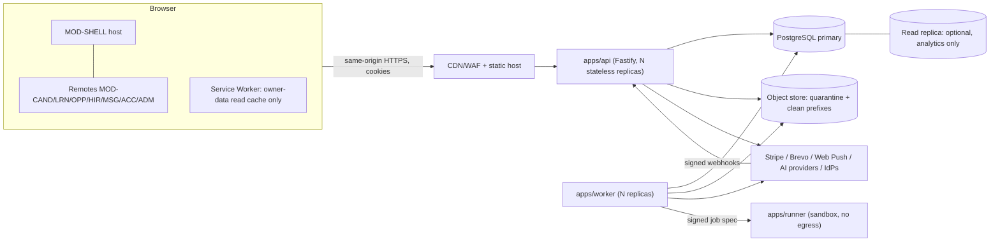
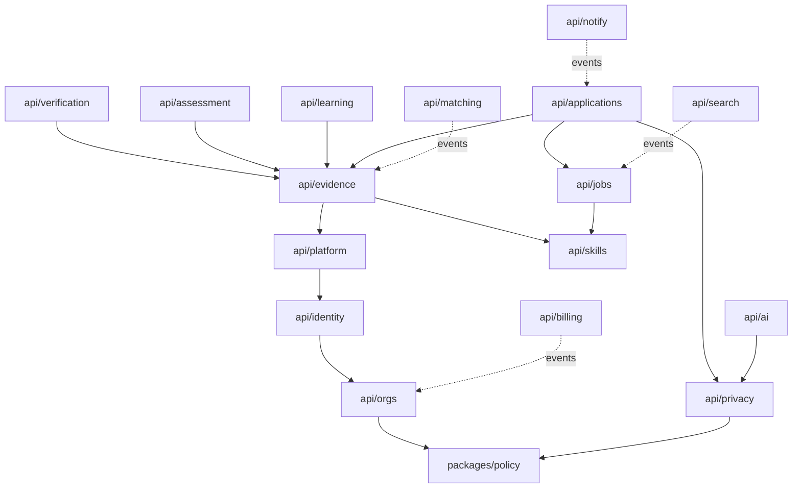
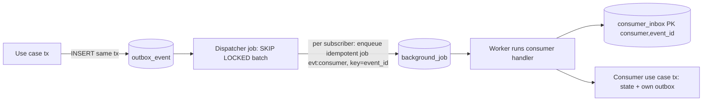
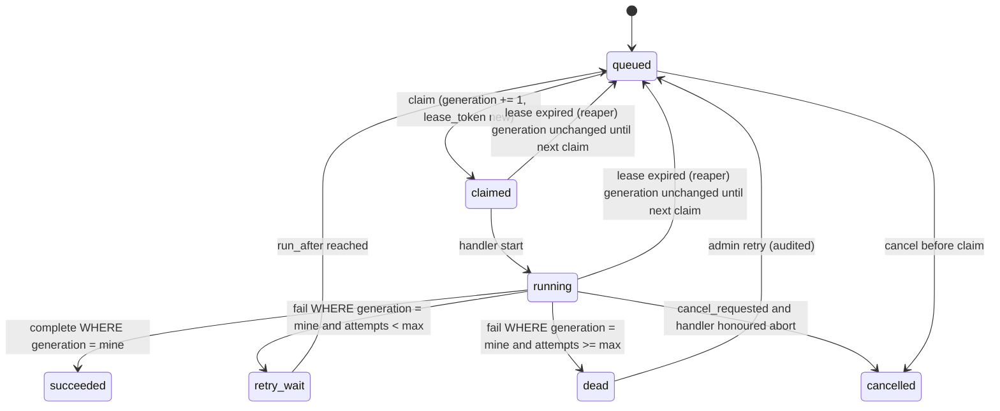
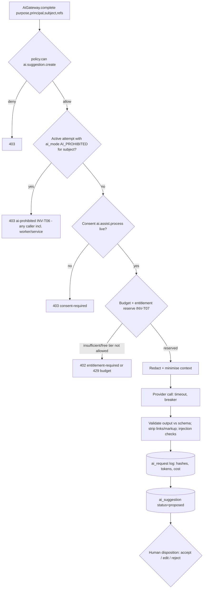

# Target blueprint 11: Backend Architecture

> **Status.** Archive: proposal, not ratified. A greenfield redesign blueprint written in October 2026. Every area was Draft, Under Review or Revision Required (its own document status) and no test was run against it. Its content was mined into `docs/blueprint/`; `SSOT.md` remains the source of intent. Module federation described here was not adopted: the built system is a modular monolith (`ARCHITECTURE.md`).
>
> **What this file holds.** All files of the former `Yash_Final_Project_Document/11_BACKEND_ARCHITECTURE/` folder, in order.
>
> **Merged on 2026-11-25** from the files listed below; each one is a section under its original title. Nothing was removed; the originals are in git history at commit `08387ec`.

| Section | Former file |
|---|---|
| 11 Backend Architecture - Index | `Yash_Final_Project_Document/11_BACKEND_ARCHITECTURE/INDEX.md` |
| Backend Architecture (Target) | `Yash_Final_Project_Document/11_BACKEND_ARCHITECTURE/BACKEND_ARCHITECTURE.md` |
| Legacy Merge B-11a: Architecture Rules, Import Rules, Legacy ADR Set, TRD Baseline and Code Style | `Yash_Final_Project_Document/11_BACKEND_ARCHITECTURE/LEGACY_MERGE_ARCHITECTURE_RULES_AND_ADRS.md` |
| Legacy Merge B-11b: Prior-Attempt "Architecture as Implemented" - Topology, Owners, Invariants, Async and Decision Register | `Yash_Final_Project_Document/11_BACKEND_ARCHITECTURE/LEGACY_MERGE_IMPLEMENTED_TOPOLOGY_LESSONS.md` |
| Backend Architecture, Revision 2 (BE-01 REV2) | `Yash_Final_Project_Document/11_BACKEND_ARCHITECTURE/BACKEND_ARCHITECTURE_REV2.md` |

## 11 Backend Architecture - Index

_Former file: `Yash_Final_Project_Document/11_BACKEND_ARCHITECTURE/INDEX.md`._

Supersedes nothing. Doc ID: IDX-11 · Owner: Backend Architecture Team · Version 1.0 · Status: Under Review · Relates: BE-01

- [BACKEND_ARCHITECTURE.md](#backend-architecture-target) (BE-01)

## Backend Architecture (Target)

_Former file: `Yash_Final_Project_Document/11_BACKEND_ARCHITECTURE/BACKEND_ARCHITECTURE.md`._

Doc ID: BE-01 · Owner: Backend Architecture Team · Version 1.0 · Status: Under Review · Relates: ADR-T04..T09, T11..T15, T20, T21 · DOM-01..24 · INV-T01..T20 · FF-01, FF-02, FF-05, FF-07 · Companions: `12_DATA_AND_DATABASE/*`, `13_API_EVENTS_AND_INTEGRATIONS/*`, `14_SECURITY_PRIVACY_COMPLIANCE/*`

> **Revision 2 folded in (2026-10-27)** from `BACKEND_ARCHITECTURE.md#record-backend-architecture-rev2`: changed sections replaced in place or appended under "Revision 2 additions". Status unchanged; proposals still need ownership ratification.

Tags: **[CONF]** confirmed requirement · **[TARGET]** design decision · **[OPEN]** open assumption · **[REF]** reference-project observation (read-only evidence, not inherited). Numeric values marked **[TARGET]** are starting defaults with stated rationale; none is a measured benchmark. Calibration is tracked as OPEN-B2.

### 1. Scope, reference lessons and design stance

Greenfield backend for a PWA career-evidence platform. The reference project (`ARCHITECTURE.md`, `docs/engineering/DATABASE.md`, `supabase/migrations`) is read for lessons only.

| #   | Reference weakness [REF]                                                                      | Target design response                                                                                                                   | Where       |
| --- | --------------------------------------------------------------------------------------------- | ---------------------------------------------------------------------------------------------------------------------------------------- | ----------- |
| L1  | In-process `Map` read model hydrated at boot; single writer; stale reads (ADR-T05 rejects it) | Every read/write is SQL; API replicas are stateless                                                                                      | §3, §7      |
| L2  | Job leases not fenced: a slow worker can finish after lease expiry and double-execute         | `lease_generation` fencing token checked in every completion/side-effect write                                                           | §6          |
| L3  | Bearer token in `localStorage`                                                                | httpOnly cookies (`__Host-ts_at`, `__Secure-ts_rt`) via same-origin `/api/v1/auth/*` routes; remotes never see tokens (ADR-T06, INV-T16) | §4, SEC-02  |
| L4  | Assessment "pass" simulated for code challenges                                               | Sandbox runner or `unverified`; never mints verified evidence (ADR-T13)                                                                  | §14         |
| L5  | Org-role checks inline in handlers                                                            | Central `packages/policy`; route registry requires a policy action (FF-01)                                                               | §5          |
| L6  | No idempotency keys, no pagination                                                            | Idempotency middleware (FF-07); cursor pagination mandatory on list routes                                                               | §8, API-STD |
| L7  | Long-tail modules in memory labelled `ephemeral`                                              | No ephemeral modules: a capability is persisted or not shipped                                                                           | §3          |
| L8  | Reference referee `token` stored plaintext; referee email plaintext                           | Hash-only tokens (INV-T05); field-level encryption for referee/employer emails                                                           | §11, DB-02  |
| L9  | PBKDF2-SHA512 password hashes                                                                 | Argon2id with lazy rehash on login                                                                                                       | MIG-DATA-01 |

### 2. Runtime topology



| Deployable                          | Role                                                       | State                                      | Scaling unit                       |
| ----------------------------------- | ---------------------------------------------------------- | ------------------------------------------ | ---------------------------------- |
| `apps/api` (BMOD per DOM table)     | HTTP: BFF cookie routes, REST `/api/v1`, webhook receivers | none (stateless; no in-process read model) | replicas behind LB                 |
| `apps/worker` (BMOD-WORKER, DOM-24) | Outbox dispatcher, job engine, schedulers, projections     | none                                       | replicas; concurrency per job kind |
| `apps/runner` [TARGET]              | Isolated code-assessment execution only                    | ephemeral per run                          | pool sized by assessment demand    |
| `packages/policy` (BMOD-POLICY)     | `can()` + capability set; pure                             | none                                       | library                            |
| `packages/domain`                   | Business rules, state machines (SM-*)                      | none                                       | library                            |
| `packages/contracts`                | Zod schemas -> OpenAPI/AsyncAPI/JSON Schema                | none                                       | library                            |

Postgres is the only required stateful dependency besides the object store (ADR-T05). No Redis/broker at launch (ADR-T09); rate-limit store decision is OPEN-B1 (§16).

### 3. Module layout and public-interface rule

Modules are `api/<name>` for each backend DOM (ID_REGISTRY). A module is a directory with a fixed anatomy:

```
apps/api/src/modules/<name>/
  index.ts            # ONLY public surface: service interface type, factory, event types, error codes
  http/               # routes + Zod request/response binding (adapter layer)
  app/                # use cases: transaction boundary, orchestration, calls policy + domain
  domain/             # re-exports/adapters of packages/domain rules (no I/O)
  data/               # repositories (SQL only); owns this module's tables exclusively
  events/             # producer helpers (outbox) + consumers (inbox-deduped)
  jobs/               # job handlers registered with the worker
  ports/              # interfaces for outbound dependencies (EmailPort, ...)
  adapters/           # concrete implementations of ports
```

**Public-interface rule (FF-02, DOM-00 §2).** (1) Another module may import only `api/<name>/index.ts`. (2) A module never reads or writes another module's tables; cross-module reads go through the owner's service interface; cross-module reactions go through events. (3) The service interface is the unit of future extraction (§18) so it takes and returns plain DTOs (no repository types, no `pg` clients, no request objects). (4) Every public method takes an explicit `Actor` (`{principal, requestId, traceId}`) and an optional `Tx` handle; it never reads ambient request state. (5) `dependency-cruiser` enforces (1)-(2) in CI; a table-ownership manifest (`module -> tables`) is checked by a SQL-parsing lint against repository files.

Module dependency direction (acyclic, enforced by FF-02 plus a cycle check):



Solid arrows are synchronous interface calls; dotted are event subscriptions. Where DOM-00 lists a flow in both directions (e.g. evidence <-> verification), the synchronous direction is one-way and the return path is an event (`verification.completed` -> evidence), which keeps the call graph acyclic.

### 4. Layers and request lifecycle

| Layer                        | Responsibility                                                                                                    | May call                                               | Must not                                             |
| ---------------------------- | ----------------------------------------------------------------------------------------------------------------- | ------------------------------------------------------ | ---------------------------------------------------- |
| HTTP adapter (`http/`)       | Parse + validate (Zod), authenticate, bind policy action, idempotency, ETag, map errors to problem+json           | app layer                                              | contain business rules (BR-*), SQL                   |
| Application service (`app/`) | One use case = one transaction; load resource, call `policy.can`, call domain rules, write state + outbox + audit | domain, repositories, other modules' `index.ts`, ports | open its own pool connection outside the passed `Tx` |
| Domain (`packages/domain`)   | Pure rules and state-machine tables (SM-*)                                                                        | nothing external                                       | do I/O, read clock directly (clock injected)         |
| Repository (`data/`)         | Parameterised SQL; sets tenant context; optimistic-lock updates                                                   | `Tx`                                                   | contain authz decisions, call other modules          |
| Ports/adapters               | Email, push, AI, scan, runner, object store, payments, search                                                     | provider SDKs                                          | leak provider types upward (anti-corruption, INT-01) |

```mermaid
sequenceDiagram
  participant C as Client (remote via shell fetch)
  participant H as HTTP adapter
  participant I as Idempotency mw
  participant P as policy.can
  participant A as App service
  participant D as Domain rules
  participant DB as Postgres (tx)
  C->>H: POST /api/v1/... (cookie, CSRF hdr, Idempotency-Key, If-Match)
  H->>H: authn (session cookie), rate limit, Zod validate
  H->>I: reserve (principal,key,request_hash)
  I-->>H: new | replay stored response | 409 in-flight | 422 key reuse
  H->>A: execute(actor, input)
  A->>DB: BEGIN; set_config(app.*) ; load resource FOR UPDATE (if mutating)
  A->>P: can(principal, action, resource)
  P-->>A: Decision{allow|deny, obligations}
  A->>D: apply rule / SM transition
  A->>DB: UPDATE (version check) + INSERT outbox_event + INSERT audit_event
  A->>DB: COMMIT
  A-->>H: result DTO
  H->>I: complete(store status+body hash)
  H-->>C: 2xx + ETag + RateLimit headers
```

Rules: `Tx` is created by the app layer (`withTx(actor, {isolation}, fn)`), which executes `SET LOCAL` of `app.account_id`, `app.org_ids`, `app.platform_roles`, `app.grants_version` (RLS inputs, DB-02 §RLS) and commits only after outbox and audit rows are written (INV-T10, INV-T12). The audit insert is **lock-free**: the repository computes `row_hash` for the row alone and writes a person as the opaque `subject_ref`, never an account id or email; tamper-evidence comes from the off-path `audit.anchor` job (DB-02 §4.1-4.2), and the rows and locks each P0 use case takes are tracked in the write-budget table (DB-02 §17, REVW-06). Reads for list endpoints use the same helper with `READ ONLY`. Errors thrown by domain/app are typed `DomainError(code)`; the adapter maps codes to problem types in the API-STD catalogue; unknown errors become `500 internal` with a `traceId`, never a stack.

### 5. Policy module (`packages/policy`, ADR-T07, INV-T01/T02)

```ts
type Principal = {
  accountId: string | null;
  kind: 'user' | 'service' | 'referee_token' | 'anonymous';
  grants: Grant[];
  grantsVersion: number;
  supportGrantId?: string;
  amr: string[];
  recentAuthAt?: Date;
};
type Grant = {
  role: RoleName;
  scope:
    | { type: 'platform' }
    | { type: 'org'; id: string }
    | { type: 'institution'; id: string }
    | { type: 'self' };
};
type Decision = { allow: boolean; reason: ReasonCode; obligations: Obligation[] };
// Obligation: field_mask(fields) | require_consent(scope,{grantee,target}) | require_step_up | audit(level) | time_box(expiresAt)
function can(principal: Principal, action: ActionId, resource: ResourceRef, ctx?: Ctx): Decision;
```

| Aspect           | Design                                                                                                                                                                                                                                                                                                                                                                                                                                                                                                                                                                                                                                                                                                                                    |
| ---------------- | ----------------------------------------------------------------------------------------------------------------------------------------------------------------------------------------------------------------------------------------------------------------------------------------------------------------------------------------------------------------------------------------------------------------------------------------------------------------------------------------------------------------------------------------------------------------------------------------------------------------------------------------------------------------------------------------------------------------------------------------- |
| Action ids       | `<module>.<resource>.<verb>` (e.g. `evidence.item.read`, `applications.stage.transition`); registry in `packages/policy/actions.ts` generated from route registry                                                                                                                                                                                                                                                                                                                                                                                                                                                                                                                                                                         |
| Evaluation       | Pure function over (grants, resource attributes incl. owner/org/institution/participants/state, context). Resource attributes are loaded by the module's repository via a `ResourceLoader` bound to the action; policy never queries the DB itself, except through the injected `ConsentPort` for `require_consent`                                                                                                                                                                                                                                                                                                                                                                                                                       |
| Default          | Deny. A missing rule, missing resource, or unknown action denies (INV-T01). Existence disclosure: for resources the principal cannot see, return 404 not 403 (avoid IDOR oracle) unless the principal can see the container                                                                                                                                                                                                                                                                                                                                                                                                                                                                                                               |
| Consent          | `evidence.item.read` by ROLE-REC/HM/ORGADM returns allow + `require_consent(scope, {grantee, target})` with the scope chosen by the read context, using canonical ids from the Consent Scope Catalogue: inside an application `require_consent('application.share_snapshot', {grantee: {org: orgId}, target: {application: appId}})`; outside one `require_consent('evidence.share_artefact', {grantee: {org: orgId}, target: {evidence: id}})` (search summaries add `search.discoverable` and `evidence.share_summary`; contact details `profile.share_contact`). The app layer resolves the obligation through `privacy` (live scope read from the primary at read time, no consent cache, INV-T15; CSC section 6) and masks if absent |
| Support/admin    | Personal-data actions require a live `support_access_grant` (<=4 h, reason-coded, BR-T041); decision carries `audit('privileged')` and `time_box`                                                                                                                                                                                                                                                                                                                                                                                                                                                                                                                                                                                         |
| Capabilities     | `GET /me/capabilities` runs `can` over the action catalogue for a scope and returns actions + flags; UI hints only (INV-T01). Cached per `grantsVersion`                                                                                                                                                                                                                                                                                                                                                                                                                                                                                                                                                                                  |
| Grants freshness | Grants are embedded in the access token with `grants_version`; a role change bumps `account.grants_version`, and the API compares the token's version to a cached per-account version (TTL <=15 s [TARGET]); mismatch forces reload from DB. Bounded staleness = min(token TTL 15 min, cache TTL)                                                                                                                                                                                                                                                                                                                                                                                                                                         |
| Testing          | The permission matrix (USR-01 §4) is the source for a table-driven test generator (`role x action x resource-relationship`); FF-05 canary suite is generated from the same registry                                                                                                                                                                                                                                                                                                                                                                                                                                                                                                                                                       |

Route registration (FF-01, FF-07): `registerRoute({method, path, action, authn, rateClass, idempotent, ifMatch, req, res})`. The CI lint fails when `action` is absent, when an unsafe method lacks `idempotent` (or an explicit `idempotent:'natural'` justification), or when a list route lacks `pagination: 'cursor'`.

### 6. Transactions, outbox and consumers (ADR-T05, T09, INV-T10..T12)

**Transactional outbox.** `withOutbox(tx).emit(event)` inserts into `outbox_event` in the caller's transaction (no dual write). Columns: `id` (UUIDv7 = `event_id`), `aggregate_type`, `aggregate_id`, `aggregate_seq` (per-aggregate monotonic counter maintained by the repository from the aggregate's `version`), `type`, `version`, `tenant jsonb`, `payload jsonb`, `trace_id`, `occurred_at`, `available_at`, `published_at`.



| Concern          | Rule                                                                                                                                                                                                                                                                                                                                                                                                                          |
| ---------------- | ----------------------------------------------------------------------------------------------------------------------------------------------------------------------------------------------------------------------------------------------------------------------------------------------------------------------------------------------------------------------------------------------------------------------------- |
| Delivery         | At-least-once. Dispatcher selects `published_at IS NULL AND available_at <= now()` with `FOR UPDATE SKIP LOCKED`, enqueues one `evt:<consumer>` job per registered subscriber with `idempotency_key = event_id` (unique with kind), then sets `published_at`. Crash between the two steps re-enqueues harmlessly (unique key)                                                                                                 |
| Dedupe           | Consumer handler first `INSERT INTO consumer_inbox(consumer,event_id) ON CONFLICT DO NOTHING`; zero rows -> already applied -> ack. Insert and consumer state change share one transaction                                                                                                                                                                                                                                    |
| Ordering         | Total order is not promised. Per-aggregate order is best-effort via `aggregate_seq`. Order-sensitive consumers (search index, skill confidence, entitlement projection) keep `last_seq` per aggregate: `seq <= last` skip; `seq > last+1` defer (retry later, bounded) then fall back to rebuilding from the owner's interface. Every projection must be rebuildable from source tables (no projection is a system of record) |
| Poison events    | After max attempts the consumer job goes `dead` (§7); the dispatcher does not block other events; alert fires; admin replay (`POST /admin/jobs/{id}/retry`) re-runs the same job (idempotent)                                                                                                                                                                                                                                 |
| Schema evolution | `version` integer per event type; additive changes keep the version; breaking = new version published in parallel for one deprecation window; consumers declare accepted versions (AsyncAPI)                                                                                                                                                                                                                                  |
| Retention        | Published outbox rows purged after 14 days [TARGET]; table partitioned monthly (DB-02) so purge is `DROP PARTITION`                                                                                                                                                                                                                                                                                                           |

**Isolation per operation** is tabulated in DB-02 §8; the default is `READ COMMITTED` with explicit row locks or unique constraints, escalating to `SERIALIZABLE` (with bounded retry) only where listed.

### 7. Worker and job engine (DOM-24)

#### 7.1 Job table contract

`background_job(id, kind, payload, status, priority, run_after, attempts, max_attempts, lease_token, lease_generation, leased_by, lease_expires_at, heartbeat_at, cancel_requested_at, idempotency_key, last_error_class, last_error, dead_at, created_at, updated_at)`; `UNIQUE(kind, idempotency_key)`; status in `queued | claimed | running | retry_wait | succeeded | dead | cancelled` (vocabulary owned by SM-BGJOB in `06_BUSINESS_PROCESSES/STATE_MACHINES.md`; attempt limits and backoff below diverge from SM-BGJOB and are tracked as REVW-19). Attempt history in `background_job_attempt` (partitioned monthly).

#### 7.2 Fenced leases (fixes L2)



| Step          | SQL/behaviour                                                                                                                                                                                                                                                                                                                                                                                                                |
| ------------- | ---------------------------------------------------------------------------------------------------------------------------------------------------------------------------------------------------------------------------------------------------------------------------------------------------------------------------------------------------------------------------------------------------------------------------- |
| Claim         | `UPDATE background_job SET status='claimed', lease_generation=lease_generation+1, lease_token=$new, leased_by=$w, lease_expires_at=now()+$lease, attempts=attempts+1 WHERE id IN (SELECT id FROM background_job WHERE status IN ('queued','retry_wait') AND run_after<=now() AND kind = ANY($kinds) ORDER BY priority DESC, run_after LIMIT $n FOR UPDATE SKIP LOCKED) RETURNING id, lease_generation, lease_token, payload` |
| Heartbeat     | Every lease/3: `UPDATE ... SET lease_expires_at=..., heartbeat_at=now() WHERE id=$id AND lease_generation=$g RETURNING cancel_requested_at`. Zero rows = lease lost: handler's `AbortSignal` fires; the worker stops and discards results                                                                                                                                                                                    |
| Complete/fail | Always `WHERE id=$id AND lease_generation=$g AND status='running'`. Zero rows = a newer claim exists; the stale worker does nothing further                                                                                                                                                                                                                                                                                  |
| Side effects  | The fencing token (`job_id`, `lease_generation`) is passed to every handler; external calls use `job_id`-derived idempotency keys (Stripe key, email `idempotencyKey`, push topic) so a zombie worker that already acted is harmless to the new run; DB writes inside the handler carry `WHERE lease_generation = $g` via the shared `fencedTx` helper                                                                       |
| Reaper        | Scheduler job every 30 s [TARGET] returns expired leases to `queued` (no generation change; the next claim increments). Lease length per kind (default 60 s, runner/export 5 min) with heartbeat so long jobs do not expire                                                                                                                                                                                                  |
| Liveness      | `worker_heartbeat(worker_id, kinds, last_seen)`; `/readyz` of worker fails if no claim loop tick for 3x poll interval                                                                                                                                                                                                                                                                                                        |

#### 7.3 Retries, backoff, dead letter, cancellation

| Policy        | Value [TARGET]                                                                                                                                                                                                                                     | Rationale                                                                            |
| ------------- | -------------------------------------------------------------------------------------------------------------------------------------------------------------------------------------------------------------------------------------------------- | ------------------------------------------------------------------------------------ |
| Backoff       | `delay = min(cap, base * 2^(attempt-1))` with full jitter (`random(0, delay)`); base 5 s, cap 15 min (`email.send`/`webhook.deliver`: base 60 s, cap 6 h; per-kind table in [REV2 §3.2](#record-backend-architecture-rev2)) | Avoids synchronised retry storms against a recovering provider                       |
| Max attempts  | default 8; `email.send`/`webhook.deliver` 12 (about 20.5 h worst case with the 60 s / 6 h values; the 5 s / 15 min defaults would span only about 66 min); `ai.*` 3; `assessment.run` 2; `evt:*` 8                                                 | Provider outages of hours should heal without operator action; AI retries cost money |
| Error classes | `transient` (retry), `permanent` (dead immediately: validation, 4xx except 408/429), `rate_limited` (retry honouring `Retry-After`), `cancelled`                                                                                                   | Prevents burning attempts on permanent failures                                      |
| Dead letter   | `status='dead'`, `dead_at`, error retained; alert when any dead job of a protected kind (billing, erasure, evidence) exists, or dead count > threshold                                                                                             | Erasure/billing must not silently stall                                              |
| Cancel        | `POST /admin/jobs/{id}/cancellation` sets `cancel_requested_at`; queued jobs flip to `cancelled`; running jobs observe it at heartbeat and abort at the next checkpoint; handlers must be idempotent on resume                                     | Operator control without kill -9                                                     |
| Scheduling    | `job_schedule(kind, cron, next_run_at, last_run_at)` claimed with the same lease protocol (one runner per tick via unique `(kind, idempotency_key = tick_time)`)                                                                                   | Single execution of cron-like work across replicas                                   |
| Concurrency   | Per kind max concurrency + per-tenant fairness key (`payload.tenantKey`) so one org's bulk import cannot starve others                                                                                                                             | Noisy-neighbour control                                                              |

#### 7.4 Job kinds (registry; owner module registers handler)

`outbox.dispatch`, `evt:<consumer>`, `email.send`, `push.send`, `file.scan`, `file.derive`, `resume.export`, `search.index`, `ai.embed`, `match.recompute`, `verification.reference_sweep` (BR-T004 expiry/reminders), `assessment.run`, `privacy.export.build`, `privacy.erasure.step`, `billing.reconcile`, `webhook.deliver`, `import.run`, `retention.purge`, `retention.replay_erasure` (restore runbook), `audit.anchor` (single runner per slot, seals Merkle batches; DB-02 §4.2), `audit.anchor_verify` (daily), `analytics.rollup`, `job.reaper`.

### 8. Idempotency middleware (INV-T10, FF-07) — Revision 2 text

| Item                         | Design                                                                                                                                                                                                                                                                                                                                                                                                                                                                                                                                                                                                                                                                                    |
| ---------------------------- | ----------------------------------------------------------------------------------------------------------------------------------------------------------------------------------------------------------------------------------------------------------------------------------------------------------------------------------------------------------------------------------------------------------------------------------------------------------------------------------------------------------------------------------------------------------------------------------------------------------------------------------------------------------------------------------------- |
| Scope (FF-07 reworded)       | Every unsafe route (`POST`, `PUT`, `PATCH`, `DELETE`) **either accepts `Idempotency-Key` (client UUIDv4/7, 16 to 64 chars) or declares a natural key** in the route registry: `idempotent: 'natural'` with the key named (for example `PUT /me/saved-jobs/{jobId}`: account + job; a single-use token route: token hash), or `idempotent: 'none'` with a stated reason for credential and token-consuming routes. The route-registry lint fails an unsafe route with none of the three. A natural-key route that also receives the header ignores it for dedupe and does not reject it                                                                                                    |
| One key per intent           | A user intent has exactly one key, reused on every retry and carried through the outbox when the outbox exists. The shell's `host.api` never generates a fresh key per call when the remote passes none (HC-01: `idempotencyKey?: 'auto'` per call defeats retry safety); it requires a mutation-scoped key or a natural-key route                                                                                                                                                                                                                                                                                                                                                        |
| Store                        | `idempotency_key(principal_id, key, method, route_template, request_hash, state, response_status, response_body_ref, locked_until, created_at, expires_at)`, PK `(principal_id, key)`; anonymous routes scope by `ip_hash`. Physically two daily-partitioned tables by retention class, `idempotency_short` and `idempotency_queued` (DB-02-R2 section 7)                                                                                                                                                                                                                                                                                                                                 |
| Write cost: one row, not two | **DB-only operation (the common case):** inside the use-case transaction, `INSERT ... ON CONFLICT DO NOTHING` the finished row with status and body, together with the business writes. A concurrent duplicate blocks on the unique index until the first commits, then replays the stored response. No `in_progress` row, no completion update. **Operation with external effects:** reserve (`in_progress`, `locked_until = now() + 30 s`) then complete after commit: two writes. Conflict with a different hash or route: `422 idempotency-key-reuse`; conflict with unexpired `in_progress`: `409 idempotency-in-flight` plus `Retry-After`; expired `in_progress` (crash): takeover |
| Body                         | Stored inline only when 8 KB or smaller [TARGET], column-encrypted for `C2+` classes; larger or binary: status plus resource reference and hash, replay returns a fresh representation (API-STD). Smaller and fewer stored bodies are part of the write budget                                                                                                                                                                                                                                                                                                                                                                                                                            |
| **Retention (CONST-S12)**    | **Class `queued`: 14 days = the outbox TTL (OFF-01 section 8.4)** for every route flagged `queuedOp: true`, because a queued write may flush up to 14 days after the user acted and a server that forgot the key after 24 h would run the write twice. **Class `short`: 24 h** for online-only routes, 7 days for payment-adjacent routes (checkout, portal). A route that cannot hold keys 14 days must declare a natural key and the offline queue must send it. Lint: `queuedOp: true` requires class `queued` or `idempotent: 'natural'`                                                                                                                                              |
| Phase note                   | Ph1 offline is a read cache plus local unsent drafts, no outbox (REV-RES REVW-24), so no route is `queuedOp` in Ph1; the lint and the `queued` table are created when the outbox activates on the ADR-T10 trigger. Lesson progress is the first queued write (REV-RES REVW-15)                                                                                                                                                                                                                                                                                                                                                                                                            |
| Layering                     | Business uniqueness (BR-T001 one active application) is enforced by the partial unique index, not by the key; the key only makes retries cheap and responses stable                                                                                                                                                                                                                                                                                                                                                                                                                                                                                                                       |
| Existing contract            | 25 unsafe operations of `openapi.yaml` carry no header parameter. APIC-02 section 3.4 classifies each as `natural`, `natural` guarded by `If-Match`, or `none`                                                                                                                                                                                                                                                                                                                                                                                                                                                                                                                            |

### 9. Concurrency control (ETag / If-Match)

| Item          | Design                                                                                                                                                                                                                                                                                                                                         |
| ------------- | ---------------------------------------------------------------------------------------------------------------------------------------------------------------------------------------------------------------------------------------------------------------------------------------------------------------------------------------------- |
| Version       | Mutable aggregates carry `version bigint` incremented in the same `UPDATE`. Strong ETag = `"<resourceType>-<id>-<version>"` (opaque to clients)                                                                                                                                                                                                |
| Required      | `If-Match` is **required** (428 `precondition-required`) on PATCH/PUT and on state-transition POSTs listed in the catalogue (`m` flag): profile, evidence update, job update, application stage transition, verification decision, pipeline/role changes. Mismatch -> `412 precondition-failed` with the current ETag and a pointer to refetch |
| Write         | `UPDATE t SET ..., version=version+1 WHERE id=$1 AND version=$2`; zero rows -> 412 (or 404 if not visible)                                                                                                                                                                                                                                     |
| Hot rows      | Application stage transitions additionally `SELECT ... FOR UPDATE` so concurrent recruiters serialise; second request sees new version -> 412                                                                                                                                                                                                  |
| Offline queue | Queued writes (ADR-T10) carry the ETag from when edited; on replay a 412 produces a conflict item the user resolves (INV-T13)                                                                                                                                                                                                                  |

### 10. Search port (DOM-11, ADR-T11)

```ts
interface SearchPort {
  index(doc: SearchDoc): Promise<void>; // idempotent upsert by (kind,id,sourceVersion)
  remove(kind: DocKind, id: string): Promise<void>;
  query(q: SearchQuery, scope: SearchScope): Promise<Page<SearchHit>>; // scope carries tenant + consent epoch
  similar(kind: DocKind, id: string, scope: SearchScope): Promise<Page<SearchHit>>;
}
```

| Aspect           | Postgres adapter design                                                                                                                                                                                                                                                                        |
| ---------------- | ---------------------------------------------------------------------------------------------------------------------------------------------------------------------------------------------------------------------------------------------------------------------------------------------- |
| Lexical          | `tsvector` generated columns (weighted: title A, skills B, body C) + GIN; language config per locale                                                                                                                                                                                           |
| Fuzzy            | `pg_trgm` GIN on title/skill names for typo tolerance and autocomplete                                                                                                                                                                                                                         |
| Semantic         | `pgvector` column + HNSW index on embeddings from `ai.embed` jobs (derived data; model version stored; rebuildable)                                                                                                                                                                            |
| Ranking          | Weighted blend of lexical rank, trigram similarity, vector similarity, and evidence-rung factors. **Payment is not an input** (INV-T19): the ranking-input allowlist is a typed constant checked by test                                                                                       |
| Candidate search | `search_candidate_doc` contains only candidates with live `matching.recommend` consent, holds only consented visible fields, and carries `consent_epoch`; on `consent.changed` the doc is removed/updated; query applies tenant + entitlement + consent-epoch filters in SQL (not post-filter) |
| Authorisation    | Search returns IDs + safe projections; detail reads re-run `policy.can` (INV-T02). Cursor pagination is keyset on `(rank_bucket, id)` with a signed cursor                                                                                                                                     |
| Replacement      | OpenSearch adapter implementable against the same port when the ADR-T11 trigger fires (p95 > 400 ms at target corpus or relevance gap). Dual-write via the same events during cutover                                                                                                          |

### 11. Ports for email and push (DOM-15, ADR-T20)

| Port        | Interface                                                                                                               | Adapters                                                                               | Rules                                                                                                                                                                                                                                                                                                                                                                                                                                                        |
| ----------- | ----------------------------------------------------------------------------------------------------------------------- | -------------------------------------------------------------------------------------- | ------------------------------------------------------------------------------------------------------------------------------------------------------------------------------------------------------------------------------------------------------------------------------------------------------------------------------------------------------------------------------------------------------------------------------------------------------------ |
| `EmailPort` | `send({templateId, to, vars, locale, idempotencyKey, category, headers})` -> `{providerMessageId}`; `parseWebhook(req)` | `BrevoAdapter` (default), `DevOutboxAdapter` (dev: labelled outbox table, never sends) | Called only from `email.send` jobs. Templates stored by id + version in repo. Category `transactional` vs `marketing` (marketing requires `comms.marketing_email` consent and one-click unsubscribe, RFC 8058 headers). Suppression list checked before send. Bounce/complaint webhooks (signature-verified) -> `email_suppression` + `email.bounced` event. No secrets/tokens in logs; one-time links carry only the opaque token (hashed at rest, INV-T05) |
| `PushPort`  | `send(subscription, payload, {ttl, urgency, topic})`; `generateVapidKeys` out-of-band                                   | `WebPushAdapter` (VAPID, payload encryption per RFC 8291)                              | Payload is generic ("You have an update") plus deep-link id; sensitive text is fetched after authenticated open. HTTP 404/410 -> delete subscription; 429/5xx -> retry with backoff and `TTL`. Push is opt-in (permission prompt after a user gesture) and capability-detected (FF-09)                                                                                                                                                                       |

### 12. File upload pipeline (BR-T003, INV-T14)

```mermaid
stateDiagram-v2
  [*] --> intent: POST /files/upload-intents (type, size, sha256 declared)
  intent --> uploaded: client PUT to presigned URL (quarantine prefix)
  uploaded --> verifying: POST completion (server HEAD: size, checksum)
  verifying --> rejected: size/hash mismatch, type not allowlisted, magic-byte mismatch
  verifying --> scanning: file.scan job
  scanning --> clean: AV clean + (image: re-encode; pdf: structure check)
  scanning --> infected: AV positive
  clean --> deleted: owner removal / erasure
  infected --> deleted: purge after retention
```



| Control        | Design                                                                                                                                                                                                                                                                                                                              |
| -------------- | ----------------------------------------------------------------------------------------------------------------------------------------------------------------------------------------------------------------------------------------------------------------------------------------------------------------------------------- |
| Intent         | Authenticated; purpose-specific allowlist and size cap (e.g. evidence artifact: pdf/png/jpeg/webp/txt/md up to 25 MB [TARGET]; avatar: image up to 5 MB); per-user pending-intent and daily-bytes quotas; random object key `q/<fileId>`; presigned `PUT` with `Content-Length-Range`, content-type, checksum header, expiry 10 min |
| Quarantine     | Objects are written to a quarantine prefix that no read path serves; file row state `uploaded`. Evidence artifacts attached to evidence are `pending` and not shown to anyone but the owner (as "scanning") until `clean`                                                                                                           |
| Sniffing       | Server reads the first bytes (magic numbers) and compares to declared type and allowlist; never trusts extension/`Content-Type`. Archives (zip), executables, SVG, HTML are not allowlisted at launch (script/zip-bomb risk). SVG avatars are rasterised or refused                                                                 |
| Scan           | `ScanPort` (ClamAV-class engine behind a port; vendor OPEN-B3). **Fail-closed**: scanner unavailable -> file stays `scanning`, never visible; backlog alert                                                                                                                                                                         |
| Sanitise       | Images re-encoded (strips EXIF/GPS and polyglot payloads) producing derivative sizes; PDFs structurally validated and flagged if they contain embedded JavaScript/launch actions (rejected at launch)                                                                                                                               |
| Promote        | On clean, copy to the `clean` prefix and flip state; emit `file.scanned` (consumers: evidence/profile/learning)                                                                                                                                                                                                                     |
| Download       | `GET .../download-url` runs `policy.can` then returns a signed URL (<=5 min [TARGET]); served from a separate cookieless user-content origin with `Content-Disposition: attachment` for non-images, `X-Content-Type-Options: nosniff`, restrictive CSP `sandbox`; never from the app origin                                         |
| Erasure        | `deleted` state triggers object delete + CDN purge; backups per DB-03 §deletion                                                                                                                                                                                                                                                     |
| Resume exports | Generated by `resume.export`, stored as private files with 24 h link validity                                                                                                                                                                                                                                                       |

### 13. AI gateway (DOM-17, ADR-T12, INV-T06..T09)



| Control           | Design                                                                                                                                                                                                                                                                                                                                                                                                                                                                       |
| ----------------- | ---------------------------------------------------------------------------------------------------------------------------------------------------------------------------------------------------------------------------------------------------------------------------------------------------------------------------------------------------------------------------------------------------------------------------------------------------------------------------- |
| Single door       | Only `api/ai` imports provider SDKs (FF-02 lint: provider packages restricted to `api/ai/adapters`). Other modules call `ai.complete()` through its `index.ts`                                                                                                                                                                                                                                                                                                               |
| Prohibited mode   | Before any call the gateway queries `assessment` interface `getActiveAiMode(accountId)`; if an in-progress attempt has `AI_PROHIBITED` (or `AI_RESTRICTED` and purpose not whitelisted) the call is denied **inside the gateway**, regardless of caller, route or role; denial is audited. The attempt's `ai_mode` is snapshotted at start so later edits to the assessment cannot weaken it                                                                                 |
| Budgets (INV-T07) | `ai_budget(scope, scope_key, period, limit_micros, allow_free_inference, hard_stop)`; scopes global > plan > org > account (strictest wins). Reserve-then-settle: `ai_spend.reserved_micros` incremented atomically (`UPDATE ... WHERE spent+reserved+$est <= limit`); settle with actual tokens; release on failure. Free tier: allowed only when the effective policy has `allow_free_inference=true`, and then capped per day. Cost per purpose estimated from max tokens |
| Redaction         | Purpose-specific context builders send only allowlisted fields; deterministic redactor replaces emails, phone numbers, government-ID patterns, URLs with tokens, and names of third parties (referees) with placeholders; secrets/tokens, private messages, referee responses and assessment answer keys are never eligible context. Redaction summary (counts only) logged                                                                                                  |
| Prompt injection  | User/content text is passed only as quoted data in a delimited block; system prompt states it is untrusted; model has **no tools with side effects** in v1; output is schema-validated (JSON mode/Zod), length-capped, stripped of links/HTML, and rendered as text. Output cannot trigger any state transition (INV-T09)                                                                                                                                                    |
| Human gate        | Result is an `ai_suggestion` in `proposed`; adoption into profile/cover note requires the user to accept or edit (disposition recorded). Evidence creation rejects `source='ai'` (CHECK constraint + schema, INV-T08); AI "memory" features, if ever added, are stored outside evidence/profile tables and are user-viewable/deletable                                                                                                                                       |
| Logging           | `ai_request` stores purpose, model, token counts, cost, prompt SHA-256, redaction counts, denial reason, latency; **no raw prompts/outputs** by default (short-lived encrypted debug capture behind an admin flag, 7 days [OPEN-B4])                                                                                                                                                                                                                                         |
| Embeddings        | `ai.embed` jobs go through the same gateway (purpose `embedding`), with consent `matching.recommend` for candidate data; derived vectors are deleted on consent revoke/erasure                                                                                                                                                                                                                                                                                               |
| Failure           | Provider failure degrades only the AI feature; core flows never depend on AI. No automatic failover to a second provider at launch (data-processing agreements differ; OPEN-B5)                                                                                                                                                                                                                                                                                              |

### 14. Sandbox assessment runner (ADR-T13)

| Item               | Design                                                                                                                                                                                                                                                                                                                                                                                                     |
| ------------------ | ---------------------------------------------------------------------------------------------------------------------------------------------------------------------------------------------------------------------------------------------------------------------------------------------------------------------------------------------------------------------------------------------------------- |
| Position           | Separate deployable `apps/runner`, not in the API/worker process or network zone. Worker is the only caller (`assessment.run` job) through `RunnerPort` using mutually authenticated, signed run requests                                                                                                                                                                                                  |
| Isolation          | One ephemeral sandbox per run (microVM or user-space-kernel container class; technology selection OPEN-B6): read-only root filesystem, **no network egress**, no secrets mounted, non-root, cgroup limits (CPU, memory, pids, disk), wall-clock timeout, output size cap, no host mounts. Candidate code and hidden tests are mounted separately; hidden tests and answer keys are never exposed in output |
| Protocol           | Request = `{runId, attemptId, assessmentVersion, artifactRef(hash), limits}`; runner fetches artifact by signed URL, runs, returns `{runId, status, results, durationMs, imageDigest}` signed with a per-deployment key. Worker verifies signature, run-to-attempt binding, and idempotency (`runId` unique) before recording                                                                              |
| Verification basis | `attempt.verification_basis` in {`auto_graded_objective`, `runner_verified`, `human_graded`, `unverified`}. Code/project assessments with `requires_runner=true` may reach `passed` **only** with `runner_verified` (or `human_graded` by an authorised human). Otherwise the attempt ends `unverified`, `assessment.passed` is **not** emitted, and no evidence is minted (ADR-T13, INV-T04)              |
| Feature gate       | `assessment.runner.enabled` flag (default off) and a startup check: if the flag is on but runner health/attestation fails, code assessments are not offered                                                                                                                                                                                                                                                |
| Abuse              | Per-user and per-tenant run quotas; no outbound network prevents exfiltration and crypto-mining payoff; wall-clock caps; runs are not retained beyond results + hashes (30 days)                                                                                                                                                                                                                           |
| Integrity          | Integrity signals (tab blur, paste, timing) are advisory; they open an `integrity_flag` for human review and never void or fail an attempt automatically (INV-T20)                                                                                                                                                                                                                                         |

### 15. Media

| Asset                    | Pipeline                                                                                                                                                                                    |
| ------------------------ | ------------------------------------------------------------------------------------------------------------------------------------------------------------------------------------------- |
| Avatars/images           | Upload pipeline (§12) -> `file.derive` produces re-encoded WebP/AVIF/JPEG derivatives at fixed sizes with cache-busting hashes; served from the user-content origin via CDN                 |
| Resume/portfolio exports | `resume.export` job renders from structured data (HTML->PDF in an isolated render context, no network), private file, link TTL 24 h                                                         |
| Course video/audio       | Provider-hosted streaming/transcoding behind a `MediaPort` [OPEN-B7: provider]; the app stores references, captions (WCAG) and signed playback tokens; no self-hosted transcoding at launch |
| Documents                | No server-side Office conversion at launch (attack surface); PDFs only                                                                                                                      |

### 16. Rate limiting (INV-T10 abuse controls) — Revision 2 text

| Layer                   | Design                                                                                                                                                                                                                                                                                                                                                                                                                                                                                                      |
| ----------------------- | ----------------------------------------------------------------------------------------------------------------------------------------------------------------------------------------------------------------------------------------------------------------------------------------------------------------------------------------------------------------------------------------------------------------------------------------------------------------------------------------------------------- |
| Edge first              | CDN/WAF is the first limiter and the only protection for origin capacity: per-IP and per-ASN limits, bot challenge and managed rules on all auth routes (`RL-AUTH`, `RL-TOKEN`) and on `RL-PUBLIC`/`RL-WEBHOOK` paths; provider OPEN-B47. The application never relies on the edge for per-account protection                                                                                                                                                                                               |
| App: local buckets      | `RL-READ`, `RL-WRITE`, `RL-PUBLIC`, `RL-HEAVY`: in-process token bucket per replica keyed by `(rateClass, key)`. **No database write per request.** Configured per-replica limit = cluster limit ÷ replica count; worst-case cluster burst is replicas × per-replica limit and is accepted for these classes. Cost control for expensive features is business budgets (entitlement counters in `billing`, AI budget ledger), not these buckets                                                              |
| App: durable counters   | Only where exactness matters: login, password reset, email-challenge and token-consume routes (`RL-AUTH`, `RL-TOKEN`; per-account and per-IP+account counters with progressive delay) and the per-recipient caps on third-party mail (BR-T004, BR-T121). Store: `RateLimitStore` port; default adapter a **logged** table `auth_throttle`. The UNLOGGED `rate_limit_bucket` of v1.0 is removed: an unlogged table is truncated by crash recovery and is not replicated, so a failover reset login throttles |
| Redis trigger (earlier) | Introduce the Redis adapter when **any** holds: `auth_throttle` writes exceed 5% of primary write IOPS, or limit-check p95 exceeds 5 ms; a credential-stuffing incident of Sev-2 or higher; before production runs three or more API replicas. The v1.0 trigger (20% of IOPS, all buckets) fired too late and covered the wrong tables                                                                                                                                                                      |
| Signalling              | `RateLimit-Policy`, `RateLimit` and `Retry-After` on 429; limits are configuration                                                                                                                                                                                                                                                                                                                                                                                                                          |
| Write cost              | Ordinary requests: 0 rows. Auth-class requests: 1 `auth_throttle` upsert, on those routes only                                                                                                                                                                                                                                                                                                                                                                                                              |

OPEN-B1 is restated: durable counter store, logged Postgres table versus Redis, with the trigger above.

### 17. Configuration and secrets (INV-T14)

| Item          | Design                                                                                                                                                                                                                                   |
| ------------- | ---------------------------------------------------------------------------------------------------------------------------------------------------------------------------------------------------------------------------------------- |
| Schema        | A single Zod `AppConfig` per deployable; validated at boot; missing/invalid -> process exits (fail fast). Typed accessors only (no `process.env` reads elsewhere, lint-enforced)                                                         |
| Sources       | Environment variables for non-secrets; secret manager (or platform secret store) injected as env at runtime for secrets; no secrets in repo, images, or client bundle (build-time scan, INV-T14)                                         |
| Separation    | Distinct DB roles: `ts_migrator` (DDL, owner), `ts_app` (DML; no BYPASSRLS), `ts_worker` (DML on job/outbox + module tables via grants), `ts_readonly` (analytics). Distinct object-store credentials for quarantine write vs clean read |
| Client config | A minimal public config object (API base, feature flag snapshot, VAPID public key, manifest URL); never secrets                                                                                                                          |
| Flags         | Runtime feature flags in `feature_flag` (DOM-20) cached per replica (TTL 30 s [TARGET]); flags gate rollout, never security controls (a security check cannot be disabled by flag except `assessment.runner.enabled` which fails closed) |
| Rotation      | Secrets referenced by name+version; dual-key acceptance windows for HMAC/JWT signing keys, webhook secrets, VAPID, field-encryption KEKs (SEC-02)                                                                                        |

### 18. Extraction triggers and service-boundary decisions (ADR-T04)

| Component                | Decision [TARGET]                                                           | Reason                                                                  | Extraction / change trigger                                                                                      |
| ------------------------ | --------------------------------------------------------------------------- | ----------------------------------------------------------------------- | ---------------------------------------------------------------------------------------------------------------- |
| All `api/<name>` modules | One deployable `apps/api`, enforced module boundaries                       | Transactional consistency, team size, ops cost                          | Module needs independent scaling/SLA, distinct residency, or team contention (ADR-T04)                           |
| Worker / job engine      | Separate process, same repo and DB                                          | Isolates background load from request latency; independent scaling      | n/a                                                                                                              |
| Sandbox runner           | **Separate service from day one when enabled**                              | Executes untrusted code; network and trust isolation are non-negotiable | n/a                                                                                                              |
| AI gateway               | Module in monolith; provider calls from API (interactive) or worker (batch) | Needs transactional budget ledger and consent/assessment lookups        | Provider latency starving API pool, or regulated-data processor split -> dedicated service                       |
| Search                   | Module + Postgres adapter behind `SearchPort`                               | ADR-T11                                                                 | p95 search > 400 ms at target corpus or proven relevance gap -> OpenSearch adapter                               |
| Matching compute         | Worker jobs (`match.recompute`)                                             | Batch/derived, rebuildable                                              | Compute cost/latency requires GPU/vector service                                                                 |
| Media derivation         | Worker jobs                                                                 | CPU-bound, async                                                        | Sustained queue age > SLO -> dedicated media workers (still same code)                                           |
| Notifications/email      | Module + worker                                                             | Port-isolated                                                           | Volume or deliverability needs dedicated pipeline                                                                |
| Billing                  | Module; Stripe webhook receiver in API                                      | Entitlement derivation needs org/identity data                          | Compliance scope isolation (PCI-adjacent) needs separate deployable                                              |
| Event transport          | Outbox -> Postgres-backed jobs (ADR-T09)                                    | Single store, no broker ops                                             | Outbox throughput exceeds Postgres budget, or a service is extracted -> NATS/Kafka adapter behind the dispatcher |
| Analytics                | Consent-gated event table + rollup jobs; optional read replica              | Minimal footprint                                                       | Event volume warrants columnar store                                                                             |

### 19. Failure, timeout and circuit-breaker policy

Defaults are **[TARGET]** starting values chosen from the interactive-vs-background distinction (interactive paths must fail fast and degrade; background paths may wait and retry), not from benchmarks; calibration under load test is OPEN-B2. A breaker is per dependency per process: _open_ when >=5 consecutive failures or >=50% failures over a 30 s window with >=10 calls; _half-open_ after 30 s, admitting 3 probes; state exported as a metric.

| Dependency                 | Connect / total timeout                                                               | Retry                                                                    | Breaker                                      | Behaviour on failure (user-visible)                                                                                   |
| -------------------------- | ------------------------------------------------------------------------------------- | ------------------------------------------------------------------------ | -------------------------------------------- | --------------------------------------------------------------------------------------------------------------------- |
| PostgreSQL (API)           | pool acquire 2 s; `statement_timeout` 5 s; `idle_in_transaction_session_timeout` 10 s | none in request (except serialization failures: 3 tries)                 | n/a (pool saturation -> 503 + `Retry-After`) | 503 `upstream-unavailable`; reads of cached owner data continue in PWA read cache (stale label, INV-T13)              |
| PostgreSQL (worker)        | `statement_timeout` 60 s                                                              | per job policy                                                           | n/a                                          | jobs retry with backoff                                                                                               |
| Object store               | connect 2 s / total 10 s (signing is local)                                           | 2 retries on 5xx/timeouts with jitter                                    | yes                                          | upload start 503; downloads 503 with retry hint; no partial state (state advances only after HEAD verify)             |
| Stripe (outbound API)      | 3 s / 10 s                                                                            | up to 2 retries with the same Stripe idempotency key                     | yes                                          | checkout creation fails with 503 and message; **entitlements never change on outbound failure or redirect** (INV-T17) |
| Stripe (inbound webhook)   | respond < 5 s: verify signature, insert `stripe_event_inbox`, enqueue, return 200     | Stripe retries delivery; our processing job retries 8x                   | n/a                                          | If processing is delayed, plan state is stale until reconcile job (`billing.reconcile`, periodic) heals it            |
| Email provider             | 3 s / 10 s inside `email.send` job                                                    | 12 attempts over ~20.5 h (60 s base, 6 h cap)                            | yes (pauses sending, queue grows)            | Transactional mail delayed; in-app notification still delivered; user can resend verification (rate-limited)          |
| Web Push services          | 3 s / 5 s                                                                             | 404/410 delete; 429/5xx retry (<= 4, TTL-bounded)                        | per-endpoint-host                            | No push; in-app notification unaffected                                                                               |
| AI provider                | 3 s / 30 s                                                                            | 1 retry on 5xx/timeout (not on 4xx)                                      | yes                                          | Feature banner "assistant unavailable"; budget reservation released; core flows unaffected                            |
| Virus scanner              | 5 s / 60 s per file (size-scaled)                                                     | 5 attempts                                                               | yes                                          | **Fail-closed**: file remains "scanning"; nothing becomes visible                                                     |
| Sandbox runner             | 3 s / assessment limit + 30 s                                                         | 2 attempts (new `runId`, same attempt)                                   | yes                                          | Attempt shown "awaiting verification"; ends `unverified` if runner is down beyond SLA; never auto-pass                |
| OIDC/SAML IdP              | 3 s / 8 s                                                                             | none                                                                     | per-IdP                                      | SSO login error; password/passkey fallback only if org policy allows                                                  |
| Breached-password API      | 1 s                                                                                   | none                                                                     | n/a                                          | **Fail-open** (log), because blocking registration on a third party is worse than the marginal risk                   |
| Outbound customer webhooks | 3 s / 5 s; SSRF-guarded resolver                                                      | 12 attempts / ~20.5 h, then endpoint auto-paused after sustained failure | per-endpoint                                 | Customer sees delivery log; no impact on core flows                                                                   |
| Import sources (URL/file)  | 3 s / 15 s; size cap                                                                  | 3                                                                        | per-host                                     | Import job fails with report; no partial publish                                                                      |

Cross-cutting: every outbound call has a timeout and an `AbortSignal`; no unbounded queues in memory; bulkheads via separate pools/concurrency per dependency; graceful shutdown drains in-flight requests and stops claiming jobs; each request has a deadline propagated to calls (`min(request deadline, dependency timeout)`).

### 20. Observability hooks (ADR-T16)

W3C `traceparent` accepted from shell fetch, stored on `outbox_event.trace_id` and `background_job.payload.trace`, and restored by the worker so a trace spans request -> event -> consumer. Pino JSON logs with redaction paths (`*.password`, `*.token`, `*.email` hashed, cookies, `authorization`) enforced by a log test (INV-T14). Metrics: queue age per kind, lease-lost count, outbox lag, dead jobs, breaker state, policy denials by action, idempotency replays.

### 21. Extraction/processing triggers for derived data

| Trigger (event or schedule)          | Effect                                                                                                                          | Idempotency basis             |
| ------------------------------------ | ------------------------------------------------------------------------------------------------------------------------------- | ----------------------------- |
| `evidence.verified/revoked/updated`  | recompute `competency` confidence; invalidate `match_explanation`; reindex candidate doc (BR-T005, async + audited)             | `(evidenceId, aggregate_seq)` |
| `profile.updated`, `consent.changed` | reindex or remove candidate doc                                                                                                 | `(accountId, consent_epoch)`  |
| `job.published/updated/closed`       | reindex job doc; fan out saved-search alerts                                                                                    | `(jobId, version)`            |
| `skill.merged`                       | remap `evidence_skill`, `job_skill_requirement`, `competency`                                                                   | `(fromSkillId, intoSkillId)`  |
| nightly schedule                     | `verification.reference_sweep` (expire at 14 d, send <=2 reminders), `retention.purge`, `billing.reconcile`, `analytics.rollup` | tick time                     |

### 22. Contradictions, assumptions and open items

**Contradictions / gaps found against canonical docs** (none silently resolved): (1) ADR-T04..T22 mention T22 (matching) though the brief enumerated T04..T21; this doc treats T22 as binding. (2) ID_REGISTRY lists `MASTER_INDEX.md` and `99_FINAL_MASTER_BLUEPRINT` as authority, but neither exists yet; this doc is linked from the folder index in `11_BACKEND_ARCHITECTURE` only until MASTER_INDEX is created. (3) resolved (REVW-03): SM-00 (`06_BUSINESS_PROCESSES/STATE_MACHINES.md`) is the single state vocabulary and `12_*`/`13_*` derive from it (FF-11); the job-engine limits in §7 still differ from SM-BGJOB (REVW-19). (4) DOM-00 §2 says "no module reads another module's tables" while DOM-11 search/matching "consume" job/evidence data; resolved here as event-fed projections owned by `api/search`/`api/matching` (no cross-table reads).

| ID      | Open item                                                                           |
| ------- | ----------------------------------------------------------------------------------- |
| OPEN-B1 | Rate-limit store: Postgres unlogged vs Redis (trigger in §16)                       |
| OPEN-B2 | Calibrate all timeouts, breaker thresholds, lease lengths, rate limits by load test |
| OPEN-B3 | Virus-scan engine/vendor                                                            |
| OPEN-B4 | Whether to keep any raw AI prompt capture (debug) and its retention                 |
| OPEN-B5 | Multi-provider AI failover (DPA implications)                                       |
| OPEN-B6 | Sandbox isolation technology                                                        |
| OPEN-B7 | Course video/transcoding provider                                                   |
| OPEN-B8 | Breached-password check adoption                                                    |
| OPEN-B9 | PostgreSQL major version (native `uuidv7()` needs PG 18+; otherwise app-generated)  |

(Proposed OPEN ids; to be registered in the central OPEN register by the Documentation Architect.)

## Revision 2 additions (folded 2026-10-27)

Sections below override same-topic text above (module graph, job engine backoff, consumer modes, consent, telemetry, SQL transition rules).

### 1. Consumers without a job per subscriber (REVW-06 remainder)

Problem: one outbox event fanned out to one `background_job` row per subscriber (BE-01 section 6), so every business write caused 1 + N further writes, plus one idempotency row per unsafe request and one rate-limit row per request. ADR-T05 claims horizontal API replicas without a single writer; the write path has to match that claim.

#### 1.1 Consumer modes

Each consumer registers a mode in the consumer registry (`events/` directory of the owner module). The mode is a property of the consumer, never of the event.

| Mode               | For                                                                                                                                                                                                                                                                      | Runs                                                                                                         | Rows written on success                                                                 | On failure                                                                                                                 |
| ------------------ | ------------------------------------------------------------------------------------------------------------------------------------------------------------------------------------------------------------------------------------------------------------------------ | ------------------------------------------------------------------------------------------------------------ | --------------------------------------------------------------------------------------- | -------------------------------------------------------------------------------------------------------------------------- |
| `inline` (default) | Cheap, DB-only reactions that finish well under 50 ms: in-app notification rows, analytics counters, search-document removal on `consent.changed`, cache invalidation, delivery-row creation for `notify`                                                                | Directly in the dispatcher process, in its own transaction (inbox insert plus the state change), 2 s timeout | the consumer's own state rows and one `consumer_inbox` row; **no `background_job` row** | one `evt:<consumer>` job for that single (event, consumer) pair, `idempotency_key = event_id`; it then follows section 3.3 |
| `job`              | Anything that calls a provider, the AI gateway or the object store; anything slow; anything needing its own retry budget: `email.send`, `push.send`, `webhook.deliver`, `search.index` (with embeddings), `match.recompute`, `privacy.erasure.step`, `billing.reconcile` | A worker job                                                                                                 | one job row per event, or one per burst when coalesced (below)                          | job retry policy                                                                                                           |

Coalescing: projection consumers that rebuild from the owner's interface (search documents, match explanations, skill confidence) enqueue **at most one queued job per `(consumer, aggregate_id)`**. A burst of events on one aggregate updates `payload.upto_seq` of the queued job instead of adding rows (partial unique index on `(kind, idempotency_key)` where `status = 'queued'`, key `consumer:aggregate_id`). Non-mergeable consumers (billing, privacy steps, outbound webhooks) get one job per event.

Net effect on the write budget (DB-02-R2 section 17): the happy path of an inline consumer adds an inbox row and its own state, never a job row; job-mode projections add at most one job row per aggregate burst.

#### 1.2 LISTEN/NOTIFY

The finding allows `LISTEN/NOTIFY` or direct handlers. Decision: **direct handlers (section 1.1) are the mechanism; `LISTEN/NOTIFY` is not used on the request path.** PostgreSQL serialises the commit of transactions that issued `NOTIFY` behind a database-wide lock **[verify under WP-LOADBASE]**, which would re-create the single commit point that DB-02 section 4.2 removed. The dispatcher polls `outbox_event` with an adaptive interval (250 ms under load, backing off to 2 s idle). An optional wake-up `NOTIFY` may be sent by the dispatcher tick itself, never by a business transaction; it carries no data and nothing depends on it. `LISTEN` needs a session connection, so the dispatcher uses one dedicated non-pooled connection, outside the transaction-mode pooler (DB-02 section 14).

### 2. Module dependency graph (REVW-42)

BE-01 section 3 drew 17 of 24 backend modules and omitted edges that sections 10 and 13 require (`ai` to `assessment` for `getActiveAiMode`; every module that returns consent-guarded data to `privacy`). The cycle check (FF-02) cannot be trusted on an incomplete graph. This table is the **declared baseline** for all backend modules plus `packages/policy`. The deferred networking module (`api/network`, DOM-14, Ph4) is omitted until Ph4 (REVW-34).

"May import" is a synchronous call through the target's `index.ts` only. "Subscribes to" lists event subscriptions: they are not imports and cannot form an import cycle.

| Module         | May import (sync, `index.ts` only)                      | Subscribes to (events)                                        |
| -------------- | ------------------------------------------------------- | ------------------------------------------------------------- |
| `platform`     | `identity`                                              | -                                                             |
| `identity`     | `orgs`                                                  | -                                                             |
| `orgs`         | `policy`                                                | -                                                             |
| `policy`       | -                                                       | -                                                             |
| `privacy`      | `policy`                                                | -                                                             |
| `skills`       | -                                                       | -                                                             |
| `profile`      | `skills`, `platform`, `privacy`, `evidence`, `ai`       | -                                                             |
| `evidence`     | `skills`, `platform`, `privacy`                         | `assessment`, `learning`, `verification`                      |
| `verification` | `evidence`, `identity`                                  | `evidence`                                                    |
| `assessment`   | `skills`                                                | -                                                             |
| `learning`     | `assessment`, `billing`, `ai`, `skills`                 | -                                                             |
| `jobs`         | `skills`, `orgs`, `billing`, `privacy`                  | `orgs`, `billing`                                             |
| `applications` | `jobs`, `evidence`, `privacy`, `orgs`, `ai`             | `jobs`, `evidence`                                            |
| `search`       | `ai`, `privacy`                                         | `jobs`, `evidence`, `profile`, `privacy`, `billing`, `skills` |
| `matching`     | `ai`, `privacy`                                         | `evidence`, `jobs`, `profile`, `privacy`, `skills`            |
| `careerintel`  | `evidence`, `skills`, `privacy`, `ai`                   | -                                                             |
| `messaging`    | `applications`, `orgs`, `privacy`                       | `applications`                                                |
| `notify`       | `identity`, `orgs`, `privacy`                           | all domain events                                             |
| `billing`      | `orgs`                                                  | `orgs`                                                        |
| `ai`           | `privacy`, `assessment`, `billing`, `policy`            | -                                                             |
| `institutions` | `evidence`, `learning`, `assessment`, `privacy`, `orgs` | -                                                             |
| `safety`       | `jobs`, `evidence`, `identity`, `messaging`, `profile`  | `profile`, `messaging`, `jobs`                                |
| `admin`        | `identity`, `orgs`, `platform`, `privacy`, `policy`     | -                                                             |
| `analytics`    | `privacy`                                               | `applications`, `jobs`, `evidence`                            |
| `integrations` | `orgs`, `jobs`                                          | `jobs`, `applications`, `evidence`                            |

Check run on this baseline (Tarjan strongly-connected-components over the 25 nodes, from a script kept outside the repository): 25 nodes, no strongly connected component, no self-import, every module named in ID_REGISTRY appears.

Design rules behind the edges:

1. **Consent.** Any module that returns data under a `require_consent` obligation imports `privacy`; `privacy` imports only `policy`, which defines `ConsentPort`. Search and matching filter at query time through the privacy-owned published view `pv_consent_current` (section 6), which is the only cross-module read the table-ownership lint allows.
2. **Erasure and export.** `privacy` does not call every module (that would put it at the root of a cycle). Each module registers an `ErasureParticipant` and an `ExportParticipant` at the composition root, using port types exported by `privacy`; `privacy.erasure.step` jobs invoke the registered participants.
3. **`notify` is a leaf.** Nobody imports it. Producers emit notification-bearing events (transactional mail for identity, verification, applications), and `notify` resolves contact data through `identity`.
4. **Assessment and learning publish, evidence consumes.** `assessment.passed` and `course.completed` reach `evidence` as events (DOM-00 section 3, SM-00 cross-machine table); BE-01 v1.0 drew `assessment` and `learning` as importing `evidence`, which duplicated the event path.
5. **`ai` is the single door** (FF-02 lint restricts provider SDKs to `api/ai/adapters`). `ai` calls `assessment.getActiveAiMode` (INV-T06) and `billing` for budget and entitlement reserve (INV-T07). Callers of AI features import `ai`.
6. **Two-way flows** (evidence and verification): the synchronous direction is one-way, the return path is an event.

**The table must be generated, not maintained by hand (FF-02 amendment).** CI builds the real graph from imports (`dependency-cruiser --output-type json`), renders the diagram into the docs build, and fails when (a) an actual edge is absent from this baseline, (b) the import graph has a cycle, or (c) a module is missing from the table. A pull request that adds an edge edits this table in the same change. Once the generator exists, this table is replaced by its output.

### 3. Job engine (REVW-19)

#### 3.1 Authority and consistency

BE-01 section 7 stays the authority for the job engine, and `STATE_MACHINES.md#record-state-machines-rev2` section 2.8 already mirrors it (state set `queued, claimed, running, retry_wait, succeeded, dead, cancelled`; `retry_wait → dead` removed; `running → cancelled` added). Consistency points confirmed here:

| Point     | Rule                                                                                                                                                                                  |
| --------- | ------------------------------------------------------------------------------------------------------------------------------------------------------------------------------------- |
| State set | Equal in SM-BGJOB (SM-00-R2), `background_job.status` CHECK (DB-01) and the `Operation`/`ExportJob` state enums of the OpenAPI addendum; FF-11 compares them                          |
| Attempts  | Every claim, including a re-claim after lease expiry, increments `attempts`; `dead` is reached only from `running` when `attempts >= max_attempts` or the error class is `permanent`  |
| Cancel    | `cancel_requested_at` set; queued and `retry_wait` jobs go to `cancelled` at once; a `running` job reaches `cancelled` only when the handler honours the abort at its next checkpoint |

#### 3.2 Backoff and attempt policy (corrects the "spans about 24 h" claim)

SM-00-R2 flagged an open arithmetic problem for the backend owner: with base 5 s and cap 15 min, 12 attempts do not span about 24 h. Confirmed and corrected here. Worst-case span is the sum of the waits between attempts with no jitter (full jitter halves the expected wait).

| Kind                                                              | Max attempts | Base     | Cap     | Worst-case span (no jitter)                                                 | Why                                                                                                                                                                                                            |
| ----------------------------------------------------------------- | ------------ | -------- | ------- | --------------------------------------------------------------------------- | -------------------------------------------------------------------------------------------------------------------------------------------------------------------------------------------------------------- |
| default (`evt:*` fallback jobs, `search.index`, `file.*`, others) | 8            | 5 s      | 15 min  | 5+10+20+40+80+160+320 s = 635 s, **about 11 min**                           | Internal work; an outage longer than this ends in `dead`, an alert and audited replay                                                                                                                          |
| `email.send`, `webhook.deliver`                                   | 12           | **60 s** | **6 h** | 60 s doubling to 15,360 s, then 21,600 s twice = 73,860 s, **about 20.5 h** | Provider outages of hours should heal without an operator; this matches the ~24 h delivery expectation of the original text. The old values (5 s, 15 min) give 3,975 s, **about 66 min**, as SM-00-R2 computed |
| `push.send`                                                       | 4            | 60 s     | 15 min  | 60+120+240 s = 420 s                                                        | TTL-bounded; a late push is useless                                                                                                                                                                            |
| `ai.*`                                                            | 3            | 5 s      | 15 min  | 15 s                                                                        | Retries cost money                                                                                                                                                                                             |
| `assessment.run`                                                  | 2            | 5 s      | 15 min  | 5 s                                                                         | A new `runId` per attempt (section 19)                                                                                                                                                                         |

Per-kind overrides are configuration (`jobKinds.<kind>.{maxAttempts, baseMs, capMs}`), validated at boot. Formula unchanged: `delay = min(cap, base × 2^(attempt−1))` with full jitter `random(0, delay)`; error classes `transient`, `permanent`, `rate_limited` (honours `Retry-After`) and `cancelled` as in BE-01 section 7.3. **Amendment for SM-00-R2:** its t4 and t7 rows state the default numbers; they should add "per-kind overrides in BE-01-R2 section 3.2".

#### 3.3 SM-NOTIFY retry is the job retry

There is **one** retry layer for a delivery, not two. The `notify` consumer creates the delivery row (notification × channel) inline; the `email.send` or `push.send` job it enqueues is the only retry mechanism. Mapping:

| Job (SM-BGJOB)                                                       | Delivery row (SM-NOTIFY)                                               |
| -------------------------------------------------------------------- | ---------------------------------------------------------------------- |
| `queued`, `claimed`, `running`                                       | `sending`                                                              |
| `retry_wait` (SM-BGJOB t4)                                           | `failed_retry` (SM-NOTIFY t6)                                          |
| `dead`, or error class `permanent` (4xx except 408 and 429)          | `failed` (SM-NOTIFY t8)                                                |
| `succeeded`                                                          | `sent`, then `delivered` or `bounced`/`complained` by provider webhook |
| delivery TTL passed (SM-NOTIFY t10: 72 h time-sensitive, 7 d others) | `expired`; the job is cancelled                                        |

SM-00-R2 section 2.7 already states this; this section adds the table and the TTL link, so that email's 12 attempts and the 72 h time-sensitive TTL cannot disagree: the job span of about 20.5 h is shorter than the shortest delivery TTL.

#### 3.4 One name for the 409 state error

SM-00 U2 and several acceptance criteria say `409 invalid_transition`; API-STD section 5 and every OpenAPI response say `state-transition-invalid`. **Canonical: `state-transition-invalid`** (kebab-case, like every other problem type; problem `type` URI `/problems/state-transition-invalid`). SM-00 U2, SPEC-G2 AC-05-05-05 and SPEC-G4 AC-10-05-03 and AC-10-05-04 should adopt it. For the same reason SM-00-R2's `409 reapply_cooldown` becomes `409 reapply-cooldown-active`. API-STD gains that one row (APIC-02 section 3.3).

### 6. Consent: authorization at read time, no cache everywhere (REVW-25, CONST-S13)

Decision (REV-RES, CONST-S13): **a revocation takes effect at the first read after the revoking commit; there is no consent cache.** The four formulations in earlier text (instantly, within 1 minute, within a cache TTL, next API read) collapse into this one.

| Place                    | Rule                                                                                                                                                                                                                                                                                                                                                                                    |
| ------------------------ | --------------------------------------------------------------------------------------------------------------------------------------------------------------------------------------------------------------------------------------------------------------------------------------------------------------------------------------------------------------------------------------- |
| Policy (BE-01 section 5) | `require_consent` is resolved by `privacy` against the primary at read time (INV-T15). The `grantsVersion` cache covers **roles and capabilities only**; capabilities are UI hints (INV-T01)                                                                                                                                                                                            |
| Search and matching      | The consent predicate joins the live privacy-owned **published view** `pv_consent_current` on the primary in the same SQL statement as the query (never a replica, never a cached copy). `consent_epoch` on a document is a rebuild and cleanup marker only: a document whose epoch no longer matches is excluded the instant the epoch changes, whether or not the cleanup job has run |
| Cleanup                  | `consent.changed` consumers (inline mode, section 1) delete or recompute derived documents. The "index removal within 15 minutes" of BR-T063 is **cleanup, not enforcement**: the read path already denies                                                                                                                                                                              |
| Application snapshots    | Recruiter reads of `application_evidence` are authorised against the snapshot **and** the live `application.share_snapshot` grant (DB-01); revocation takes the same effect                                                                                                                                                                                                             |
| Tests                    | A TTL appears in a consent test only as a **timeout** (a test may poll up to 60 s for an asynchronous cleanup effect), never as a tolerance for authorization (INV-T25's "cache TTL <= 60 s" and TEST-SEC-009's "within the cache TTL" are retired; scenario S14 reads "the next read")                                                                                                 |
| Event                    | `consent.changed` carries no authorization role; no consumer may be the only enforcement point (EVENT_CATALOG section 2)                                                                                                                                                                                                                                                                |

### 7. Telemetry endpoints (REVW-31, backend part)

Two routes are separated by class: operational telemetry (`/otlp` same-origin proxy, fixed upstream, allowlisted schema, no identity accepted from the body) and product analytics (`POST /analytics/events`, API-21-02, rejected server-side when `analytics.product` is not granted). Classification, allowlist, retention and the synthetic-only alternative are in SEC-02-R2 section 4; the abuse controls are in the threat model rows added there.

### 8. Event envelope (REVW-44)

`EventEnvelope.actor` carries `human` (boolean, derived by the producer, never client-supplied) beside `kind`. "Human actor" in SM-00 U6 and INV-T09 means `human = true` and `kind ∈ {user, support}`; a referee is human but never an authorised decider. SM-00 U6 should read "actor is human (envelope `human = true`, `kind` user or support)". Already applied in `EventEnvelope.schema.json`, `asyncapi.yaml` and EVENT_CATALOG section 1 (listed in the fix-pass report).

### 9. SQL transition rules (REVW-45)

DB-02 section 4 keeps `SECURITY DEFINER` transition functions for evidence, attempt and application. Their edge rules are generated from the machine-readable SM table, and a parity test is mandatory; details and the CI rule are in DB-02-R2 section 5. **FF-11 amendment wording:** "SQL transition functions read their allowed edges from a table generated from the SM table; a parity test runs every (state × event) pair through the domain function and the SQL function and fails on any difference in accept/reject or target state."

### 10. Other backend parts

| Finding | Backend change                                                                                                                                                                                                                                                                                                                                |
| ------- | --------------------------------------------------------------------------------------------------------------------------------------------------------------------------------------------------------------------------------------------------------------------------------------------------------------------------------------------- |
| REVW-08 | `api/institutions` and the institution rows of the API catalog name the new consumer remote **MOD-INS**; customer org administration rows name MOD-HIR; MOD-ADM remains the platform back-office consumer (APIC-02 section 3.1). BE-01 section 2 topology lists MOD-INS among the remotes                                                     |
| REVW-32 | User content is served from a separate **registrable domain**; the refresh token is bound to the session id of the `__Host-` access cookie (SEC-02-R2). BE-01 section 12 "Download" reads: "served from a separate cookieless user-content registrable domain, never a subdomain of the app apex"                                             |
| REVW-34 | `api/network` and the `/network/*` routes are absent from the Ph1 to Ph3 route registry and OpenAPI; DOM-14 is Ph4 (APIC-02 section 3.2)                                                                                                                                                                                                      |
| REVW-12 | `issuer_class` on evidence attestations and credentials; API fields `EvidenceIssuer`, `IssuerClass` (OpenAPI addendum); database part in DB-02-R2 section 6. The `evidence` module's `evidence_apply_transition` rejects an `instructor` record when instructor equals learner or a shared account, device or payment signal exists (INV-T47) |

### 11. Amendments and open items for governance

| Item              | Needed                                                                                                                                            |
| ----------------- | ------------------------------------------------------------------------------------------------------------------------------------------------- |
| ADR-T05 amendment | Add: consumers run inline or as coalesced jobs; `LISTEN/NOTIFY` is not on the request path                                                        |
| ADR-T09 amendment | Job-per-subscriber replaced by consumer modes; per-kind backoff overrides; SM-NOTIFY retry is the job retry                                       |
| FF-07             | Reword to "accepts `Idempotency-Key` or declares a natural key" (`idempotent: 'natural'` or `'none'` with reason)                                 |
| FF-02             | Add: module graph generated from imports, fails on cycle and on edges outside the baseline; `pv_*` published views are the only cross-module read |
| FF-11             | Add the SQL edge-table and parity clause (section 9)                                                                                              |
| SM-00-R2          | t4/t7 of SM-BGJOB add per-kind overrides; U6 reads `human`; problem type names (section 3.4)                                                      |
| API-STD           | Add `reapply-cooldown-active` (409)                                                                                                               |
| OPEN-B1           | Restated (section 5)                                                                                                                              |
| OPEN-B57          | Concrete user-content registrable domain (SEC-02-R2 section 2)                                                                                    |
| OPEN-08           | Counsel: operational telemetry basis (SEC-02-R2 section 4)                                                                                        |

---

<a id="record-backend-architecture-rev2"></a>

### Preserved source record: BACKEND_ARCHITECTURE_REV2

> Consolidated on 2026-10-27. The following is the complete source record, retained for provenance, exceptions and rationale. Its dates, counts and statements about files describe the earlier revision, not the current filesystem. Approval conditions and authority remain unchanged: this move neither ratifies proposals nor overrides the owning document’s current precedence rules. Relative references now point to the consolidated records.

<!-- source-record-begin: Yash_Final_Project_Document/11_BACKEND_ARCHITECTURE/BACKEND_ARCHITECTURE_REV2.md -->

<a id="record-backend-architecture-rev2--backend-architecture-revision-2-be-01-rev2"></a>

## Backend Architecture, Revision 2 (BE-01 REV2)

Doc ID: BE-01-R2 · Owner: Backend Architecture Team · Version 2.0 · Status: Proposed (Under Review) · Date: 2026-10-25 · Closes: REVW-06 (remainder), REVW-14(a), REVW-19, REVW-25, REVW-41, REVW-42 · Backend part of: REVW-08, REVW-31, REVW-32, REVW-34, REVW-44, REVW-45 · Relates: BE-01, DB-02-R2 `12_DATA_AND_DATABASE/PHYSICAL_DESIGN.md#record-physical-design-rev2`, SEC-02-R2 `14_SECURITY_PRIVACY_COMPLIANCE/SECURITY_ARCHITECTURE.md#record-security-rev2`, APIC-02 `13_API_EVENTS_AND_INTEGRATIONS/API_CATALOG.md#record-api-catalog-addendum`, SM-00-R2, BR-REG-R2

> **Folded into `BACKEND_ARCHITECTURE.md` on 2026-10-27.** Change record only; edit the original.

**Relationship (state of supersession only).** No original file was edited for this revision. Once governance accepts it, this file **supersedes** these parts of `BACKEND_ARCHITECTURE.md` (BE-01 v1.0): in section 3 the paragraph and diagram "Module dependency direction"; in section 6 the diagram and the "Delivery" and "Poison events" rows; in section 7.1 the sentence about divergence from SM-BGJOB; in section 7.3 the "Backoff" and "Max attempts" rows; section 8 (idempotency) as a whole; in section 10 the "Candidate search" row; section 16 (rate limiting) as a whole; in section 12 the "Download" origin wording; in section 22 contradiction (3) and open item OPEN-B1. Everything else in BE-01 stands. Until accepted, BE-01 v1.0 remains the text of record. Governance should link this file from `11_BACKEND_ARCHITECTURE/INDEX.md` and `00_CONTROL_CENTRE/MASTER_INDEX.md`.

Earlier in this fix pass, before the additive-only rule, six existing files were edited in place: `SECURITY_ARCHITECTURE.md`, `THREAT_MODEL.md`, `PRIVACY_AND_DATA_LIFECYCLE_DESIGN.md`, `contracts/schemas/EventEnvelope.schema.json`, `contracts/asyncapi.yaml` and `EVENT_CATALOG.md`. Those edits are additive in effect and are consistent with this revision (SEC-02-R2 restates them); the fix-pass report lists them.

All content is **[TARGET]**. Numbers marked **[TARGET]** are design allocations, not measurements; calibration stays OPEN-B2 and WP-LOADBASE.

<a id="record-backend-architecture-rev2--1-consumers-without-a-job-per-subscriber-revw-06-remainder"></a>

### 1. Consumers without a job per subscriber (REVW-06 remainder)

Problem: one outbox event fanned out to one `background_job` row per subscriber (BE-01 section 6), so every business write caused 1 + N further writes, plus one idempotency row per unsafe request and one rate-limit row per request. ADR-T05 claims horizontal API replicas without a single writer; the write path has to match that claim.

<a id="record-backend-architecture-rev2--11-consumer-modes"></a>

#### 1.1 Consumer modes

Each consumer registers a mode in the consumer registry (`events/` directory of the owner module). The mode is a property of the consumer, never of the event.

| Mode               | For                                                                                                                                                                                                                                                                      | Runs                                                                                                         | Rows written on success                                                                 | On failure                                                                                                                 |
| ------------------ | ------------------------------------------------------------------------------------------------------------------------------------------------------------------------------------------------------------------------------------------------------------------------ | ------------------------------------------------------------------------------------------------------------ | --------------------------------------------------------------------------------------- | -------------------------------------------------------------------------------------------------------------------------- |
| `inline` (default) | Cheap, DB-only reactions that finish well under 50 ms: in-app notification rows, analytics counters, search-document removal on `consent.changed`, cache invalidation, delivery-row creation for `notify`                                                                | Directly in the dispatcher process, in its own transaction (inbox insert plus the state change), 2 s timeout | the consumer's own state rows and one `consumer_inbox` row; **no `background_job` row** | one `evt:<consumer>` job for that single (event, consumer) pair, `idempotency_key = event_id`; it then follows section 3.3 |
| `job`              | Anything that calls a provider, the AI gateway or the object store; anything slow; anything needing its own retry budget: `email.send`, `push.send`, `webhook.deliver`, `search.index` (with embeddings), `match.recompute`, `privacy.erasure.step`, `billing.reconcile` | A worker job                                                                                                 | one job row per event, or one per burst when coalesced (below)                          | job retry policy                                                                                                           |

Coalescing: projection consumers that rebuild from the owner's interface (search documents, match explanations, skill confidence) enqueue **at most one queued job per `(consumer, aggregate_id)`**. A burst of events on one aggregate updates `payload.upto_seq` of the queued job instead of adding rows (partial unique index on `(kind, idempotency_key)` where `status = 'queued'`, key `consumer:aggregate_id`). Non-mergeable consumers (billing, privacy steps, outbound webhooks) get one job per event.

Net effect on the write budget (DB-02-R2 section 17): the happy path of an inline consumer adds an inbox row and its own state, never a job row; job-mode projections add at most one job row per aggregate burst.

<a id="record-backend-architecture-rev2--12-listennotify"></a>

#### 1.2 LISTEN/NOTIFY

The finding allows `LISTEN/NOTIFY` or direct handlers. Decision: **direct handlers (section 1.1) are the mechanism; `LISTEN/NOTIFY` is not used on the request path.** PostgreSQL serialises the commit of transactions that issued `NOTIFY` behind a database-wide lock **[verify under WP-LOADBASE]**, which would re-create the single commit point that DB-02 section 4.2 removed. The dispatcher polls `outbox_event` with an adaptive interval (250 ms under load, backing off to 2 s idle). An optional wake-up `NOTIFY` may be sent by the dispatcher tick itself, never by a business transaction; it carries no data and nothing depends on it. `LISTEN` needs a session connection, so the dispatcher uses one dedicated non-pooled connection, outside the transaction-mode pooler (DB-02 section 14).

<a id="record-backend-architecture-rev2--2-module-dependency-graph-revw-42"></a>

### 2. Module dependency graph (REVW-42)

BE-01 section 3 drew 17 of 24 backend modules and omitted edges that sections 10 and 13 require (`ai` to `assessment` for `getActiveAiMode`; every module that returns consent-guarded data to `privacy`). The cycle check (FF-02) cannot be trusted on an incomplete graph. This table is the **declared baseline** for all backend modules plus `packages/policy`. The deferred networking module (`api/network`, DOM-14, Ph4) is omitted until Ph4 (REVW-34).

"May import" is a synchronous call through the target's `index.ts` only. "Subscribes to" lists event subscriptions: they are not imports and cannot form an import cycle.

| Module         | May import (sync, `index.ts` only)                      | Subscribes to (events)                                        |
| -------------- | ------------------------------------------------------- | ------------------------------------------------------------- |
| `platform`     | `identity`                                              | -                                                             |
| `identity`     | `orgs`                                                  | -                                                             |
| `orgs`         | `policy`                                                | -                                                             |
| `policy`       | -                                                       | -                                                             |
| `privacy`      | `policy`                                                | -                                                             |
| `skills`       | -                                                       | -                                                             |
| `profile`      | `skills`, `platform`, `privacy`, `evidence`, `ai`       | -                                                             |
| `evidence`     | `skills`, `platform`, `privacy`                         | `assessment`, `learning`, `verification`                      |
| `verification` | `evidence`, `identity`                                  | `evidence`                                                    |
| `assessment`   | `skills`                                                | -                                                             |
| `learning`     | `assessment`, `billing`, `ai`, `skills`                 | -                                                             |
| `jobs`         | `skills`, `orgs`, `billing`, `privacy`                  | `orgs`, `billing`                                             |
| `applications` | `jobs`, `evidence`, `privacy`, `orgs`, `ai`             | `jobs`, `evidence`                                            |
| `search`       | `ai`, `privacy`                                         | `jobs`, `evidence`, `profile`, `privacy`, `billing`, `skills` |
| `matching`     | `ai`, `privacy`                                         | `evidence`, `jobs`, `profile`, `privacy`, `skills`            |
| `careerintel`  | `evidence`, `skills`, `privacy`, `ai`                   | -                                                             |
| `messaging`    | `applications`, `orgs`, `privacy`                       | `applications`                                                |
| `notify`       | `identity`, `orgs`, `privacy`                           | all domain events                                             |
| `billing`      | `orgs`                                                  | `orgs`                                                        |
| `ai`           | `privacy`, `assessment`, `billing`, `policy`            | -                                                             |
| `institutions` | `evidence`, `learning`, `assessment`, `privacy`, `orgs` | -                                                             |
| `safety`       | `jobs`, `evidence`, `identity`, `messaging`, `profile`  | `profile`, `messaging`, `jobs`                                |
| `admin`        | `identity`, `orgs`, `platform`, `privacy`, `policy`     | -                                                             |
| `analytics`    | `privacy`                                               | `applications`, `jobs`, `evidence`                            |
| `integrations` | `orgs`, `jobs`                                          | `jobs`, `applications`, `evidence`                            |

Check run on this baseline (Tarjan strongly-connected-components over the 25 nodes, from a script kept outside the repository): 25 nodes, no strongly connected component, no self-import, every module named in ID_REGISTRY appears.

Design rules behind the edges:

1. **Consent.** Any module that returns data under a `require_consent` obligation imports `privacy`; `privacy` imports only `policy`, which defines `ConsentPort`. Search and matching filter at query time through the privacy-owned published view `pv_consent_current` (section 6), which is the only cross-module read the table-ownership lint allows.
2. **Erasure and export.** `privacy` does not call every module (that would put it at the root of a cycle). Each module registers an `ErasureParticipant` and an `ExportParticipant` at the composition root, using port types exported by `privacy`; `privacy.erasure.step` jobs invoke the registered participants.
3. **`notify` is a leaf.** Nobody imports it. Producers emit notification-bearing events (transactional mail for identity, verification, applications), and `notify` resolves contact data through `identity`.
4. **Assessment and learning publish, evidence consumes.** `assessment.passed` and `course.completed` reach `evidence` as events (DOM-00 section 3, SM-00 cross-machine table); BE-01 v1.0 drew `assessment` and `learning` as importing `evidence`, which duplicated the event path.
5. **`ai` is the single door** (FF-02 lint restricts provider SDKs to `api/ai/adapters`). `ai` calls `assessment.getActiveAiMode` (INV-T06) and `billing` for budget and entitlement reserve (INV-T07). Callers of AI features import `ai`.
6. **Two-way flows** (evidence and verification): the synchronous direction is one-way, the return path is an event.

**The table must be generated, not maintained by hand (FF-02 amendment).** CI builds the real graph from imports (`dependency-cruiser --output-type json`), renders the diagram into the docs build, and fails when (a) an actual edge is absent from this baseline, (b) the import graph has a cycle, or (c) a module is missing from the table. A pull request that adds an edge edits this table in the same change. Once the generator exists, this table is replaced by its output.

<a id="record-backend-architecture-rev2--3-job-engine-revw-19"></a>

### 3. Job engine (REVW-19)

<a id="record-backend-architecture-rev2--31-authority-and-consistency"></a>

#### 3.1 Authority and consistency

BE-01 section 7 stays the authority for the job engine, and `STATE_MACHINES.md#record-state-machines-rev2` section 2.8 already mirrors it (state set `queued, claimed, running, retry_wait, succeeded, dead, cancelled`; `retry_wait → dead` removed; `running → cancelled` added). Consistency points confirmed here:

| Point     | Rule                                                                                                                                                                                  |
| --------- | ------------------------------------------------------------------------------------------------------------------------------------------------------------------------------------- |
| State set | Equal in SM-BGJOB (SM-00-R2), `background_job.status` CHECK (DB-01) and the `Operation`/`ExportJob` state enums of the OpenAPI addendum; FF-11 compares them                          |
| Attempts  | Every claim, including a re-claim after lease expiry, increments `attempts`; `dead` is reached only from `running` when `attempts >= max_attempts` or the error class is `permanent`  |
| Cancel    | `cancel_requested_at` set; queued and `retry_wait` jobs go to `cancelled` at once; a `running` job reaches `cancelled` only when the handler honours the abort at its next checkpoint |

<a id="record-backend-architecture-rev2--32-backoff-and-attempt-policy-corrects-the-spans-about-24-h-claim"></a>

#### 3.2 Backoff and attempt policy (corrects the "spans about 24 h" claim)

SM-00-R2 flagged an open arithmetic problem for the backend owner: with base 5 s and cap 15 min, 12 attempts do not span about 24 h. Confirmed and corrected here. Worst-case span is the sum of the waits between attempts with no jitter (full jitter halves the expected wait).

| Kind                                                              | Max attempts | Base     | Cap     | Worst-case span (no jitter)                                                 | Why                                                                                                                                                                                                            |
| ----------------------------------------------------------------- | ------------ | -------- | ------- | --------------------------------------------------------------------------- | -------------------------------------------------------------------------------------------------------------------------------------------------------------------------------------------------------------- |
| default (`evt:*` fallback jobs, `search.index`, `file.*`, others) | 8            | 5 s      | 15 min  | 5+10+20+40+80+160+320 s = 635 s, **about 11 min**                           | Internal work; an outage longer than this ends in `dead`, an alert and audited replay                                                                                                                          |
| `email.send`, `webhook.deliver`                                   | 12           | **60 s** | **6 h** | 60 s doubling to 15,360 s, then 21,600 s twice = 73,860 s, **about 20.5 h** | Provider outages of hours should heal without an operator; this matches the ~24 h delivery expectation of the original text. The old values (5 s, 15 min) give 3,975 s, **about 66 min**, as SM-00-R2 computed |
| `push.send`                                                       | 4            | 60 s     | 15 min  | 60+120+240 s = 420 s                                                        | TTL-bounded; a late push is useless                                                                                                                                                                            |
| `ai.*`                                                            | 3            | 5 s      | 15 min  | 15 s                                                                        | Retries cost money                                                                                                                                                                                             |
| `assessment.run`                                                  | 2            | 5 s      | 15 min  | 5 s                                                                         | A new `runId` per attempt (section 19)                                                                                                                                                                         |

Per-kind overrides are configuration (`jobKinds.<kind>.{maxAttempts, baseMs, capMs}`), validated at boot. Formula unchanged: `delay = min(cap, base × 2^(attempt−1))` with full jitter `random(0, delay)`; error classes `transient`, `permanent`, `rate_limited` (honours `Retry-After`) and `cancelled` as in BE-01 section 7.3. **Amendment for SM-00-R2:** its t4 and t7 rows state the default numbers; they should add "per-kind overrides in BE-01-R2 section 3.2".

<a id="record-backend-architecture-rev2--33-sm-notify-retry-is-the-job-retry"></a>

#### 3.3 SM-NOTIFY retry is the job retry

There is **one** retry layer for a delivery, not two. The `notify` consumer creates the delivery row (notification × channel) inline; the `email.send` or `push.send` job it enqueues is the only retry mechanism. Mapping:

| Job (SM-BGJOB)                                                       | Delivery row (SM-NOTIFY)                                               |
| -------------------------------------------------------------------- | ---------------------------------------------------------------------- |
| `queued`, `claimed`, `running`                                       | `sending`                                                              |
| `retry_wait` (SM-BGJOB t4)                                           | `failed_retry` (SM-NOTIFY t6)                                          |
| `dead`, or error class `permanent` (4xx except 408 and 429)          | `failed` (SM-NOTIFY t8)                                                |
| `succeeded`                                                          | `sent`, then `delivered` or `bounced`/`complained` by provider webhook |
| delivery TTL passed (SM-NOTIFY t10: 72 h time-sensitive, 7 d others) | `expired`; the job is cancelled                                        |

SM-00-R2 section 2.7 already states this; this section adds the table and the TTL link, so that email's 12 attempts and the 72 h time-sensitive TTL cannot disagree: the job span of about 20.5 h is shorter than the shortest delivery TTL.

<a id="record-backend-architecture-rev2--34-one-name-for-the-409-state-error"></a>

#### 3.4 One name for the 409 state error

SM-00 U2 and several acceptance criteria say `409 invalid_transition`; API-STD section 5 and every OpenAPI response say `state-transition-invalid`. **Canonical: `state-transition-invalid`** (kebab-case, like every other problem type; problem `type` URI `/problems/state-transition-invalid`). SM-00 U2, SPEC-G2 AC-05-05-05 and SPEC-G4 AC-10-05-03 and AC-10-05-04 should adopt it. For the same reason SM-00-R2's `409 reapply_cooldown` becomes `409 reapply-cooldown-active`. API-STD gains that one row (APIC-02 section 3.3).

<a id="record-backend-architecture-rev2--4-idempotency-revw-14a-replaces-be-01-section-8"></a>

### 4. Idempotency (REVW-14(a), replaces BE-01 section 8)

| Item                         | Design                                                                                                                                                                                                                                                                                                                                                                                                                                                                                                                                                                                                                                                                                    |
| ---------------------------- | ----------------------------------------------------------------------------------------------------------------------------------------------------------------------------------------------------------------------------------------------------------------------------------------------------------------------------------------------------------------------------------------------------------------------------------------------------------------------------------------------------------------------------------------------------------------------------------------------------------------------------------------------------------------------------------------- |
| Scope (FF-07 reworded)       | Every unsafe route (`POST`, `PUT`, `PATCH`, `DELETE`) **either accepts `Idempotency-Key` (client UUIDv4/7, 16 to 64 chars) or declares a natural key** in the route registry: `idempotent: 'natural'` with the key named (for example `PUT /me/saved-jobs/{jobId}`: account + job; a single-use token route: token hash), or `idempotent: 'none'` with a stated reason for credential and token-consuming routes. The route-registry lint fails an unsafe route with none of the three. A natural-key route that also receives the header ignores it for dedupe and does not reject it                                                                                                    |
| One key per intent           | A user intent has exactly one key, reused on every retry and carried through the outbox when the outbox exists. The shell's `host.api` never generates a fresh key per call when the remote passes none (HC-01: `idempotencyKey?: 'auto'` per call defeats retry safety); it requires a mutation-scoped key or a natural-key route                                                                                                                                                                                                                                                                                                                                                        |
| Store                        | `idempotency_key(principal_id, key, method, route_template, request_hash, state, response_status, response_body_ref, locked_until, created_at, expires_at)`, PK `(principal_id, key)`; anonymous routes scope by `ip_hash`. Physically two daily-partitioned tables by retention class, `idempotency_short` and `idempotency_queued` (DB-02-R2 section 7)                                                                                                                                                                                                                                                                                                                                 |
| Write cost: one row, not two | **DB-only operation (the common case):** inside the use-case transaction, `INSERT ... ON CONFLICT DO NOTHING` the finished row with status and body, together with the business writes. A concurrent duplicate blocks on the unique index until the first commits, then replays the stored response. No `in_progress` row, no completion update. **Operation with external effects:** reserve (`in_progress`, `locked_until = now() + 30 s`) then complete after commit: two writes. Conflict with a different hash or route: `422 idempotency-key-reuse`; conflict with unexpired `in_progress`: `409 idempotency-in-flight` plus `Retry-After`; expired `in_progress` (crash): takeover |
| Body                         | Stored inline only when 8 KB or smaller [TARGET], column-encrypted for `C2+` classes; larger or binary: status plus resource reference and hash, replay returns a fresh representation (API-STD). Smaller and fewer stored bodies are part of the write budget                                                                                                                                                                                                                                                                                                                                                                                                                            |
| **Retention (CONST-S12)**    | **Class `queued`: 14 days = the outbox TTL (OFF-01 section 8.4)** for every route flagged `queuedOp: true`, because a queued write may flush up to 14 days after the user acted and a server that forgot the key after 24 h would run the write twice. **Class `short`: 24 h** for online-only routes, 7 days for payment-adjacent routes (checkout, portal). A route that cannot hold keys 14 days must declare a natural key and the offline queue must send it. Lint: `queuedOp: true` requires class `queued` or `idempotent: 'natural'`                                                                                                                                              |
| Phase note                   | Ph1 offline is a read cache plus local unsent drafts, no outbox (REV-RES REVW-24), so no route is `queuedOp` in Ph1; the lint and the `queued` table are created when the outbox activates on the ADR-T10 trigger. Lesson progress is the first queued write (REV-RES REVW-15)                                                                                                                                                                                                                                                                                                                                                                                                            |
| Layering                     | Business uniqueness (BR-T001 one active application) is enforced by the partial unique index, not by the key; the key only makes retries cheap and responses stable                                                                                                                                                                                                                                                                                                                                                                                                                                                                                                                       |
| Existing contract            | 25 unsafe operations of `openapi.yaml` carry no header parameter. APIC-02 section 3.4 classifies each as `natural`, `natural` guarded by `If-Match`, or `none`                                                                                                                                                                                                                                                                                                                                                                                                                                                                                                                            |

<a id="record-backend-architecture-rev2--5-rate-limiting-revw-41-and-revw-06-replaces-be-01-section-16"></a>

### 5. Rate limiting (REVW-41 and REVW-06, replaces BE-01 section 16)

| Layer                   | Design                                                                                                                                                                                                                                                                                                                                                                                                                                                                                                      |
| ----------------------- | ----------------------------------------------------------------------------------------------------------------------------------------------------------------------------------------------------------------------------------------------------------------------------------------------------------------------------------------------------------------------------------------------------------------------------------------------------------------------------------------------------------- |
| Edge first              | CDN/WAF is the first limiter and the only protection for origin capacity: per-IP and per-ASN limits, bot challenge and managed rules on all auth routes (`RL-AUTH`, `RL-TOKEN`) and on `RL-PUBLIC`/`RL-WEBHOOK` paths; provider OPEN-B47. The application never relies on the edge for per-account protection                                                                                                                                                                                               |
| App: local buckets      | `RL-READ`, `RL-WRITE`, `RL-PUBLIC`, `RL-HEAVY`: in-process token bucket per replica keyed by `(rateClass, key)`. **No database write per request.** Configured per-replica limit = cluster limit ÷ replica count; worst-case cluster burst is replicas × per-replica limit and is accepted for these classes. Cost control for expensive features is business budgets (entitlement counters in `billing`, AI budget ledger), not these buckets                                                              |
| App: durable counters   | Only where exactness matters: login, password reset, email-challenge and token-consume routes (`RL-AUTH`, `RL-TOKEN`; per-account and per-IP+account counters with progressive delay) and the per-recipient caps on third-party mail (BR-T004, BR-T121). Store: `RateLimitStore` port; default adapter a **logged** table `auth_throttle`. The UNLOGGED `rate_limit_bucket` of v1.0 is removed: an unlogged table is truncated by crash recovery and is not replicated, so a failover reset login throttles |
| Redis trigger (earlier) | Introduce the Redis adapter when **any** holds: `auth_throttle` writes exceed 5% of primary write IOPS, or limit-check p95 exceeds 5 ms; a credential-stuffing incident of Sev-2 or higher; before production runs three or more API replicas. The v1.0 trigger (20% of IOPS, all buckets) fired too late and covered the wrong tables                                                                                                                                                                      |
| Signalling              | `RateLimit-Policy`, `RateLimit` and `Retry-After` on 429; limits are configuration                                                                                                                                                                                                                                                                                                                                                                                                                          |
| Write cost              | Ordinary requests: 0 rows. Auth-class requests: 1 `auth_throttle` upsert, on those routes only                                                                                                                                                                                                                                                                                                                                                                                                              |

OPEN-B1 is restated: durable counter store, logged Postgres table versus Redis, with the trigger above.

<a id="record-backend-architecture-rev2--6-consent-authorization-at-read-time-no-cache-everywhere-revw-25-const-s13"></a>

### 6. Consent: authorization at read time, no cache everywhere (REVW-25, CONST-S13)

Decision (REV-RES, CONST-S13): **a revocation takes effect at the first read after the revoking commit; there is no consent cache.** The four formulations in earlier text (instantly, within 1 minute, within a cache TTL, next API read) collapse into this one.

| Place                    | Rule                                                                                                                                                                                                                                                                                                                                                                                    |
| ------------------------ | --------------------------------------------------------------------------------------------------------------------------------------------------------------------------------------------------------------------------------------------------------------------------------------------------------------------------------------------------------------------------------------- |
| Policy (BE-01 section 5) | `require_consent` is resolved by `privacy` against the primary at read time (INV-T15). The `grantsVersion` cache covers **roles and capabilities only**; capabilities are UI hints (INV-T01)                                                                                                                                                                                            |
| Search and matching      | The consent predicate joins the live privacy-owned **published view** `pv_consent_current` on the primary in the same SQL statement as the query (never a replica, never a cached copy). `consent_epoch` on a document is a rebuild and cleanup marker only: a document whose epoch no longer matches is excluded the instant the epoch changes, whether or not the cleanup job has run |
| Cleanup                  | `consent.changed` consumers (inline mode, section 1) delete or recompute derived documents. The "index removal within 15 minutes" of BR-T063 is **cleanup, not enforcement**: the read path already denies                                                                                                                                                                              |
| Application snapshots    | Recruiter reads of `application_evidence` are authorised against the snapshot **and** the live `application.share_snapshot` grant (DB-01); revocation takes the same effect                                                                                                                                                                                                             |
| Tests                    | A TTL appears in a consent test only as a **timeout** (a test may poll up to 60 s for an asynchronous cleanup effect), never as a tolerance for authorization (INV-T25's "cache TTL <= 60 s" and TEST-SEC-009's "within the cache TTL" are retired; scenario S14 reads "the next read")                                                                                                 |
| Event                    | `consent.changed` carries no authorization role; no consumer may be the only enforcement point (EVENT_CATALOG section 2)                                                                                                                                                                                                                                                                |

<a id="record-backend-architecture-rev2--7-telemetry-endpoints-revw-31-backend-part"></a>

### 7. Telemetry endpoints (REVW-31, backend part)

Two routes are separated by class: operational telemetry (`/otlp` same-origin proxy, fixed upstream, allowlisted schema, no identity accepted from the body) and product analytics (`POST /analytics/events`, API-21-02, rejected server-side when `analytics.product` is not granted). Classification, allowlist, retention and the synthetic-only alternative are in SEC-02-R2 section 4; the abuse controls are in the threat model rows added there.

<a id="record-backend-architecture-rev2--8-event-envelope-revw-44"></a>

### 8. Event envelope (REVW-44)

`EventEnvelope.actor` carries `human` (boolean, derived by the producer, never client-supplied) beside `kind`. "Human actor" in SM-00 U6 and INV-T09 means `human = true` and `kind ∈ {user, support}`; a referee is human but never an authorised decider. SM-00 U6 should read "actor is human (envelope `human = true`, `kind` user or support)". Already applied in `EventEnvelope.schema.json`, `asyncapi.yaml` and EVENT_CATALOG section 1 (listed in the fix-pass report).

<a id="record-backend-architecture-rev2--9-sql-transition-rules-revw-45"></a>

### 9. SQL transition rules (REVW-45)

DB-02 section 4 keeps `SECURITY DEFINER` transition functions for evidence, attempt and application. Their edge rules are generated from the machine-readable SM table, and a parity test is mandatory; details and the CI rule are in DB-02-R2 section 5. **FF-11 amendment wording:** "SQL transition functions read their allowed edges from a table generated from the SM table; a parity test runs every (state × event) pair through the domain function and the SQL function and fails on any difference in accept/reject or target state."

<a id="record-backend-architecture-rev2--10-other-backend-parts"></a>

### 10. Other backend parts

| Finding | Backend change                                                                                                                                                                                                                                                                                                                                |
| ------- | --------------------------------------------------------------------------------------------------------------------------------------------------------------------------------------------------------------------------------------------------------------------------------------------------------------------------------------------- |
| REVW-08 | `api/institutions` and the institution rows of the API catalog name the new consumer remote **MOD-INS**; customer org administration rows name MOD-HIR; MOD-ADM remains the platform back-office consumer (APIC-02 section 3.1). BE-01 section 2 topology lists MOD-INS among the remotes                                                     |
| REVW-32 | User content is served from a separate **registrable domain**; the refresh token is bound to the session id of the `__Host-` access cookie (SEC-02-R2). BE-01 section 12 "Download" reads: "served from a separate cookieless user-content registrable domain, never a subdomain of the app apex"                                             |
| REVW-34 | `api/network` and the `/network/*` routes are absent from the Ph1 to Ph3 route registry and OpenAPI; DOM-14 is Ph4 (APIC-02 section 3.2)                                                                                                                                                                                                      |
| REVW-12 | `issuer_class` on evidence attestations and credentials; API fields `EvidenceIssuer`, `IssuerClass` (OpenAPI addendum); database part in DB-02-R2 section 6. The `evidence` module's `evidence_apply_transition` rejects an `instructor` record when instructor equals learner or a shared account, device or payment signal exists (INV-T47) |

<a id="record-backend-architecture-rev2--11-amendments-and-open-items-for-governance"></a>

### 11. Amendments and open items for governance

| Item              | Needed                                                                                                                                            |
| ----------------- | ------------------------------------------------------------------------------------------------------------------------------------------------- |
| ADR-T05 amendment | Add: consumers run inline or as coalesced jobs; `LISTEN/NOTIFY` is not on the request path                                                        |
| ADR-T09 amendment | Job-per-subscriber replaced by consumer modes; per-kind backoff overrides; SM-NOTIFY retry is the job retry                                       |
| FF-07             | Reword to "accepts `Idempotency-Key` or declares a natural key" (`idempotent: 'natural'` or `'none'` with reason)                                 |
| FF-02             | Add: module graph generated from imports, fails on cycle and on edges outside the baseline; `pv_*` published views are the only cross-module read |
| FF-11             | Add the SQL edge-table and parity clause (section 9)                                                                                              |
| SM-00-R2          | t4/t7 of SM-BGJOB add per-kind overrides; U6 reads `human`; problem type names (section 3.4)                                                      |
| API-STD           | Add `reapply-cooldown-active` (409)                                                                                                               |
| OPEN-B1           | Restated (section 5)                                                                                                                              |
| OPEN-B57          | Concrete user-content registrable domain (SEC-02-R2 section 2)                                                                                    |
| OPEN-08           | Counsel: operational telemetry basis (SEC-02-R2 section 4)                                                                                        |

<!-- source-record-end: Yash_Final_Project_Document/11_BACKEND_ARCHITECTURE/BACKEND_ARCHITECTURE_REV2.md -->

## Legacy Merge B-11a: Architecture Rules, Import Rules, Legacy ADR Set, TRD Baseline and Code Style

_Former file: `Yash_Final_Project_Document/11_BACKEND_ARCHITECTURE/LEGACY_MERGE_ARCHITECTURE_RULES_AND_ADRS.md`._

Doc ID: LGM-B-11A · Owner: Backend Architecture Team · Version 1.0 · Status: Draft for Review · Supersedes nothing · Relates: BE-01, ADR-T04, ADR-T05, OPEN-52, CC-ID · Ledger: `../00_CONTROL_CENTRE/LEGACY_MERGE_LEDGER_B.md`

Preservation instruction (project owner, verbatim): "i dont want to loos information keep everything in use untile it get improved".

### 0. Frame and how to read this file

- **Nothing is implemented in this project.** The project is just starting. Every statement below tagged **prior attempt reported** is a claim made by a legacy document about an _earlier attempt_ (snapshot `431c425a`, 2026-10-23). It is reference material, not a fact about this project, and has not been re-verified.
- Every statement tagged **target requires** is a requirement or proposal for this project. It never claims existence.
- Merged from legacy: `31_LEGACY_ARCHIVE/docs/engineering/TARGET_ARCHITECTURE.md`, `.../TRD.md`, `.../CODE_STYLE.md`, `.../adr/ADR-015-core-loop-persistence.md`. Companion files: `LEGACY_MERGE_IMPLEMENTED_TOPOLOGY_LESSONS.md` (root `ARCHITECTURE.md`), `../25_DIAGRAM_LIBRARY/LEGACY_MERGE_DIAGRAMS.md` (the Mermaid diagrams of these sources).
- Source files contain `?` where a non-ASCII character (arrow or dash) was lost in an earlier export; this file restores the obvious meaning in hand-written text and keeps `?` in verbatim blocks.

### 1. Legacy "target architecture v6.0" decision, restated for this project

**Prior attempt's intended decision:** build a _modular monolith first_; it must remain domain-oriented, contract-first, auditable, replaceable at provider boundaries, and capable of later extraction. (Legacy `TARGET_ARCHITECTURE.md` §1.)

**Target requires:** same stance (ADR-T04, modular monolith plus separate worker). No microservices by default. Extraction requires all five of: measurable load/latency evidence, domain ownership, failure-isolation need, operational readiness, and a migration plan (legacy §10). Scale evolution path (legacy TRD §4): `modular monolith -> worker scaling -> cache -> search extraction -> replicas -> selective service extraction`.

#### 1.1 Legacy runtime architecture (text form of the diagram)

Browser / installed PWA -> React feature UI -> TanStack Query / client state -> Fastify HTTP API -> application use cases -> {authorization/privacy/AI policy, domain modules}; domain modules -> PostgreSQL (with RLS and grants) and storage; use cases -> Supabase Queues -> worker; use cases -> selective realtime; use cases -> integration adapters -> payment, email, media, AI providers. The Mermaid source is in `../25_DIAGRAM_LIBRARY/LEGACY_MERGE_DIAGRAMS.md` section 1.

**Conflict L-B11-01 (legacy intent vs this blueprint):** the legacy diagram names TanStack Query, Supabase Queues, Supabase Auth and selective realtime as intended parts. This blueprint chose a transactional outbox plus worker (ADR-T09), cookie sessions through the API (ADR-T06) and SQL-only reads/writes (ADR-T05). Decisions: outbox and sessions already decided (ADR-T09, ADR-T06); the client server-state library is decided as TanStack Query v5 (FD-F2 in FEA-01, which weighed it against SWR, RTK Query, Apollo and the prior attempt's plain fetch + context), so the legacy TRD row is consistent with the blueprint; the prior attempt's as-built plain-`fetch` helper is a lesson only (see `../10_FRONTEND_ARCHITECTURE/LEGACY_MERGE_FRONTEND_AND_UI_QUALITY.md` section 4). Realtime scope remains OPEN-49.

#### 1.2 Legacy repository layout (intended)

```text
/
|-- apps/
|   |-- web/    src/{app,features,pages,shared,pwa,config}
|   |-- api/    src/{modules,routes,middleware,policies,adapters}, server.ts
|   `-- worker/ src/{jobs,consumers}, worker.ts
|-- packages/   ui, contracts, domain, observability, config, testing
|-- supabase/   migrations, functions, tests, seed
|-- scripts/ tests/ docs/ .github/ package.json SSOT.md
```

**Target requires:** a pnpm monorepo of this shape is the starting point (ADR-T17 qualifies per-remote pipelines until federation is activated). Prior attempt's tree is a layout idea only; no code exists.

#### 1.3 Legacy core domains (29)

`identity, profile, ontology, evidence, verification, learning, assessment, credential, opportunity, application, hiring, interview, matching, recommendation, career, networking, messaging, organization, institution, reputation, notification, billing, analytics, moderation, trust, ai, integration, admin, audit`.

**Target requires:** reconcile with the 24 target domains DOM-01..DOM-24 (`../00_CONTROL_CENTRE/ID_REGISTRY.md`) without silently renaming; OPEN-47 already tracks the domain-boundary reconciliation. Mapping hint: opportunity -> DOM-09, application+hiring+interview -> DOM-10, ontology -> DOM-04, credential+verification -> DOM-05/06, trust+moderation -> DOM-19, admin+audit -> DOM-20, integration -> platform ports (ADR-T20).

### 2. Import and dependency rules (legacy, preserved)

```text
UI -> application API
Application -> domain
Infrastructure -> ports
Domain -> no framework/provider dependency
Feature -> own local components first
Cross-domain -> application interface/event
```

- Circular dependencies are prohibited.
- Legacy bounded-context rules (ARCH-013..ARCH-020), quoted in full in section 4.2.

#### 2.1 Intra-package barrel-cycle rule (full text; unique to legacy)

`packages/domain/src/index.ts` is a **barrel only**: it re-exports sibling modules and declares nothing. A module inside a package must never import that package's own barrel (`from './index.js'`), because the barrel re-exports the importing module and the edge becomes a cycle (`auth.ts -> index.ts -> auth.ts`).

Rule: intra-package imports target the module that **declares** the symbol.

- `core.ts` is the leaf foundation and must never import anything. It holds shared primitives with no owning feature module: `Role`, `User`, `UserStatus`, `Profile`, `ProfilePrivacy`, `Evidence`, `EvidenceType`, `VerificationLevel`, `EvidenceStatus`, `ApplicationState`, `ALLOWED_APPLICATION_TRANSITIONS`, `canTransitionApplication`, `AssessmentPolicyMode`, `AssessmentSession`, `isAIAssistanceAllowed`, `DomainErrorCode`, `DomainError`.
- Feature modules import from `core.ts` for the above, and from the specific sibling that owns anything else (example: `gamification.ts -> assessment.js` for `XpTransaction`; `instructor-reputation.ts -> reputation-engine.js` for `ReputationBand`).
- Consumers outside the package (`apps/*`, `tests/*`) import the public surface via `@talentsphere/domain`. The public API is unchanged by this layering.
- **Enforcement (prior attempt):** `tsc` does not detect cycles; the rule was checked by review plus a dependency-graph scan. Any new `from './index.js'` inside `packages/domain/src/` is a regression.

**Target requires (proposed, not yet an ADR):** the same leaf-foundation + declaring-module rule for every shared package, **plus** an automated cycle check in CI (for example an import-boundary lint or dependency-graph tool) because review-only enforcement is weak. Record as a gate under `../17_DEVOPS_AND_INFRASTRUCTURE` RG-01 when a tool is selected.

### 3. Persistence, API boundary, async and realtime rules (legacy §6-§9)

- Postgres is authoritative for relational state. Storage is authoritative for binary objects. **Queue state is operational state, not business truth.**
- Browser calls application APIs. Direct table access is not the primary application contract.
- Use a queue for: file processing, media processing, notification fan-out, recommendation refresh, analytics aggregation, plagiarism/similarity, credential propagation, scheduled maintenance.
- Use realtime for: messaging, presence, non-critical live progress, selected dashboards.
- Never use realtime as the _only_ path for: payment state, authorization, assessment scoring, credential issuance, audit persistence.

**Target requires:** these four constraints are retained verbatim as design rules (they align with ADR-T05/T09/T12/T15). The queue-use list is a candidate input to `../13_API_EVENTS_AND_INTEGRATIONS/EVENT_CATALOG.md`; the realtime exclusions are inputs to OPEN-49.

### 4. Legacy "source-derived architecture corpus" (TARGET_ARCHITECTURE section 11)

#### 4.1 Logical architecture layers

| Layer          | Contents                                                 | Technology (legacy)                                       |
| -------------- | -------------------------------------------------------- | --------------------------------------------------------- |
| Presentation   | Web app, extension, PWA, admin                           | React + TypeScript + Vite PWA, React 18+, Tailwind, Radix |
| Application    | HTTP application APIs, route handlers, use cases         | TypeScript strict                                         |
| Domain         | Aggregates, entities, VOs, domain events, business rules | Pure TS                                                   |
| Infrastructure | Repositories, adapters, integrations                     | Supabase, Stripe, providers                               |
| Data           | PostgreSQL with RLS, storage buckets, realtime channels  | Supabase                                                  |
| External       | AI providers, payment, media, email, IDV                 | Integration layer                                         |

#### 4.2 Bounded contexts (7 + shared kernel) and domain boundary rules

| Context       | Contents                                                                                                                                          | Aggregates                                       |
| ------------- | ------------------------------------------------------------------------------------------------------------------------------------------------- | ------------------------------------------------ |
| identity      | Auth, profiles, orgs, tenancy, managed learners, instructor approval                                                                              | User, Profile, Organization, Membership          |
| marketplace   | Jobs, requisitions, applications, offers, interviews, employer insights                                                                           | Job, Application, Offer, CompanyReview           |
| learning      | Courses, lessons/content items, media, enrolments, progress, quizzes, assignments, paths, certificates, XP/gamification, contests, certifications | Course, Enrolment, Assessment, XPLedger, Contest |
| community     | Connections, follows, posts/articles/newsletters, comments/reactions/reposts, groups, events, messaging, notifications                            | Thread, Post, Community                          |
| billing       | Subscriptions, entitlements, course commerce, coupons, orders, refunds, licence pools, procurement, payouts                                       | Subscription, Order, LicencePool, Payout         |
| governance    | Admin, moderation, trust, audit, flags, verification                                                                                              | Report, ModerationAction, FeatureFlag            |
| analytics     | Event tracking, KPIs, dashboards, experimentation                                                                                                 | AnalyticsEvent, KPISnapshot                      |
| Shared kernel | Event backbone, UOM, TIG, automation, agents, healing, liquidity, DQ, health, media engine, integrations, AI service, UI kit, types, utilities    | DomainEvent, MediaSource, ProviderAdapter        |

Domain boundary rules (legacy IDs preserved):

- ARCH-013 Domain layer is pure TypeScript.
- ARCH-014 Application layer orchestrates; HTTP application APIs are thin adapters.
- ARCH-015 Infrastructure implements domain ports.
- ARCH-016 Cross-feature imports via `index.ts` barrels only.
- ARCH-017 Atomic promotion rule.
- ARCH-018 Cross-context via events or application-service interfaces.
- ARCH-019 Zero circular dependencies.
- ARCH-020 Routes are thin composition.

**Legacy-internal conflict L-B11-02:** ARCH-016 ("cross-feature imports via `index.ts` barrels only") and the intra-package rule in section 2.1 ("never import your own package barrel") are compatible only if read as _cross-feature_ vs _intra-package_. A future implementer must keep both readings explicit. **Decision needed:** adopt ARCH-013..ARCH-020 as target IDs or map them to `INV-T01..T20`; owner Backend Architecture Team; track with OPEN-47.

**Note on "atomic promotion rule" (ARCH-017):** the legacy text states only the name. Its meaning is not defined in the inspected sources. Treat as **unknown**; do not invent semantics.

#### 4.3 Legacy ADR set ("locked at 13") - SSOT-aligned numbering

| ID      | Decision (legacy)                                                   |
| ------- | ------------------------------------------------------------------- |
| ADR-001 | Supabase Auth sole session authority                                |
| ADR-002 | Modular monolith (React/Vite + Supabase + managed hosting provider) |
| ADR-003 | 50 canonical tables + RLS deny-by-default                           |
| ADR-004 | Supabase Realtime messaging authority                               |
| ADR-005 | Stripe webhook idempotency + demo stubs                             |
| ADR-006 | Chrome extension local-first                                        |
| ADR-007 | Provider-agnostic media                                             |
| ADR-008 | Institutional tenancy                                               |
| ADR-009 | Dual-queue boundary                                                 |
| ADR-010 | RLS policy template generator                                       |
| ADR-011 | Media model is authority for lesson content                         |
| ADR-012 | DDD + Feature-Based + Atomic Design combination                     |
| ADR-013 | Cross-domain via events or application-service interfaces only      |

**Numbering conflict L-B11-03 (kept visible):** three ADR numbering namespaces exist across the legacy corpus: (a) the list above (SSOT-aligned; ADR-001..013); (b) root `ARCHITECTURE.md` section 26 (implemented architecture; ADR-001..011, 015, 016) - see `LEGACY_MERGE_IMPLEMENTED_TOPOLOGY_LESSONS.md` section 9; (c) this blueprint's `ADR-T01..T23`. Collisions: legacy (a) ADR-001 = "Supabase Auth sole session authority" while (b) ADR-001 = "Fastify modular monolith" and (c) ADR-T06 = cookie sessions through the API. Legacy ADR-014 is unassigned. **Decision needed:** ARB secretary to retire (a) and (b) as historical, keep only ADR-T## going forward. Until then every citation of a legacy ADR must carry its namespace (for example "legacy-SSOT ADR-001").

#### 4.4 Legacy "V6 corrections" to the historical architecture (verbatim intent)

- Browser/PWA domain mutations use the Fastify application API.
- Supabase RLS remains the database authorization boundary, not the complete business authorization model.
- `shared/platform` remains intentionally small; no business domain moves into a generic shared kernel merely to avoid imports.
- The previous "Web OS" concept is represented as a Career Workspace feature boundary.
- AI is accessed through the central AI Gateway/Orchestrator.
- Search/realtime/cache infrastructure remains measurement-gated.

Legacy overlap warning (2026-10-21, preserved): 118 of 144 unique lines of that corpus also appear in legacy SSOT Part VI; the remaining were older diagram labels ("Edge Middleware", "AI Router", "Web OS Layer") later replaced; its ADR list was not in SSOT and needed an owner decision (legacy `GAP_ANALYSIS.md` C-13).

### 5. Legacy TRD v6.0 (technical requirements) - preserved and reconciled

#### 5.1 Technical baseline table (legacy "standard") vs this blueprint

| Area              | Legacy TRD standard                                    | Prior attempt reported (as built)    | This blueprint              |
| ----------------- | ------------------------------------------------------ | ------------------------------------ | --------------------------- |
| Frontend          | React + TypeScript + Vite                              | same                                 | same (FEA-01)               |
| PWA               | Service Worker + offline capability layer              | no service worker registered         | PWA-01 / ADR-T10            |
| Routing           | React Router                                           | react-router-dom                     | open (FEA-01)               |
| Server state      | TanStack Query                                         | plain React state + `fetch` helper   | FD-F2: TanStack Query v5    |
| Backend           | Node.js + Fastify + TypeScript                         | same                                 | ADR-T04                     |
| Validation        | Zod                                                    | same                                 | ADR-T08                     |
| API               | REST/JSON + OpenAPI 3.1                                | no generated OpenAPI                 | ADR-T08 (generate from Zod) |
| Database          | PostgreSQL                                             | same                                 | ADR-T05                     |
| Platform          | Supabase                                               | Supabase assets only for SQL history | OPEN-14                     |
| Auth              | Supabase Auth behind an application identity boundary  | self-issued HMAC tokens              | ADR-T06 (cookie sessions)   |
| Storage           | Supabase Storage                                       | none                                 | object storage port         |
| Queue             | Supabase Queues                                        | Postgres `background_jobs`           | ADR-T09 outbox + worker     |
| Workers           | Dedicated worker process                               | yes                                  | ADR-T04                     |
| Search            | PostgreSQL FTS + trigram initially                     | in-process matching                  | ADR-T11                     |
| Realtime          | Selective                                              | none                                 | OPEN-49                     |
| Telemetry         | OpenTelemetry-compatible                               | Pino logs only                       | ADR-T16                     |
| Product analytics | Event pipeline with privacy controls                   | in-memory                            | 20_ANALYTICS                |
| AI                | Central AI Gateway / Orchestrator                      | local heuristic                      | ADR-T12                     |
| Tests             | Vitest / React Testing Library / Playwright-compatible | Vitest + Playwright                  | 16_                         |

Legacy TRD open question: "Open question: GAP_ANALYSIS conflict C-5" (target stack vs built stack). **Decision needed:** none for the stack table - every row is closed by ADR-T04..T16 or FD-F2; only hosting (`Platform` row) stays open as OPEN-14.

#### 5.2 Architecture requirements (legacy TRD §3), preserved

- **Frontend:** feature-oriented modules; shared UI only after demonstrated reuse; no domain mutation directly from presentation components; server state separated from UI state; URL state for shareable filters/search.
- **Backend:** thin routes; use-case/application services; domain invariants in the domain layer; repository ports at the domain/application boundary; infrastructure adapters implement ports; no duplicated business logic across controllers.
- **Database:** SQL migrations authoritative; FK, unique/check constraints and transaction boundaries explicit; RLS mandatory where Supabase/Data API exposure exists; sensitive tables deny-by-default; important lifecycle history auditable.
- **API:** consistent error contract; idempotency on retriable side effects; cursor pagination; allow-listed filters/sorts; rate limiting; request/trace IDs.

#### 5.3 Non-functional requirements (legacy TRD §4)

- Security: no critical unresolved security findings at release; server-side authorization for every protected mutation; tenant isolation tests required.
- Accessibility: WCAG 2.2 AA target.
- Reliability: service-specific SLOs; explicit retry/timeout policies; provider outage fallback.
- Performance: measure real p75/p95/p99; define route-specific budgets only after baseline measurement; avoid false precision before measurement.
- Scalability: evolution path in section 1.

#### 5.4 Data rules, AI, assessment, offline and release requirements (legacy TRD §5-§9)

- Data: UTC timestamps; integer minor units for money + ISO 4217; opaque external identifiers; optimistic concurrency for high-value editable records; append-only audit/event semantics where required.
- AI technical pipeline: `Feature -> Identity -> Entitlement -> Data classification -> Policy -> Assessment context -> Provider selection -> Execution -> Output validation -> Provenance`. No paid free-user cloud inference outside policy.
- Assessment: an active assessment session must carry policy context; the AI gateway checks that context on every AI invocation.
- Offline: each feature declares `READ_OFFLINE`, `WRITE_OFFLINE`, `QUEUE`, `SYNC`, `CONFLICT`, `SERVER_REQUIRED`. No secure assessment or other server-authoritative decision relies on offline authority.
- Release: CI must run lint/format, typecheck, unit/component, build, migration checks, authorization/RLS tests, API contract tests, security scans, critical E2E, accessibility smoke, performance checks for release-critical paths.

**Target requires:** the six-flag offline declaration per feature is a template input for `../08_PWA_AND_MOBILE/OFFLINE_AND_SYNC_DESIGN.md#record-offline-and-sync-design-rev2`; check that document already uses these or equivalent tiers (ADR-T10) and add the flag names to the feature template if not.

### 6. Legacy CODE_STYLE v6.0 (full text, preserved)

1. **TypeScript:** strict mode; explicit public types; avoid `any`; prefer discriminated unions for domain states; no implicit `undefined` assumptions; validate external input.
2. **Naming:** `camelCase` variables/functions; `PascalCase` components/classes/types; `UPPER_SNAKE_CASE` true constants only; IDs use stable prefixes (`F-`, `J-`, `BR-`, etc.); filenames `kebab-case` or the repository-standard convention, consistently.
3. **Structure:** routes are thin; use cases contain application orchestration; domain contains business rules; repositories hide persistence; adapters hide providers.
4. **React:** functional components; hooks for behavior; no business rules buried in JSX; accessible semantics; explicit loading/error/empty states.
5. **Errors:** typed/canonical error codes; do not throw strings; preserve request IDs through error paths.
6. **Async:** timeout external calls; bounded retries; idempotency for retriable side effects; abort/cancel when relevant.
7. **Database:** migrations are reviewed; constraints preferred over application-only assumptions; no ad hoc production schema edits; RLS policy tests accompany policy migrations.
8. **Security - never:** commit secrets; log tokens/passwords; trust client role flags; expose raw DB errors; pass unrestricted user content to external providers.
9. **Abstraction rule:** do not create an abstraction before a real reuse or boundary need exists. Shared abstractions require ownership and tests.
10. **PR rule:** a PR changing behavior must update affected tests, analytics, docs, migration, feature status, and the ADR/decision record where material.

Project-level additions recorded in the repository instructions of the prior attempt (relevant to the PR rule): use design tokens rather than hard-coded colours/spacing; business rules live only in the domain package and routes never restate them; no weakening of auth, RLS, rate limits or honesty/migration tests; do not call a feature "implemented" from documentation alone.

**Target requires:** this style guide is adopted as the starting `29_DEVELOPER_IMPLEMENTATION_GUIDE` code-style baseline (owner: Documentation Architect to link). Prior-attempt enforcement facts worth keeping: `noUnusedLocals` and `noUnusedParameters` enabled in every tsconfig so dead code fails the typecheck; intentionally-unused parameters take a leading underscore (see `../16_QA_AND_TESTING/LEGACY_MERGE_TESTING_STRATEGY.md`).

### 7. ADR-015 - "Persist the core career loop; keep the API's Maps as a read model" (verbatim prior-attempt record)

**Why this is kept in full:** ADR-015 is a _reference ADR_. It documents a hybrid (SQL write path + in-memory read model) that this blueprint **rejects** in ADR-T05 (SQL-only reads and writes). The conflict is tracked as OPEN-52 and TRC-18 and must stay visible. Status in the prior attempt: accepted for that branch, pending owner ratification; nothing about it is a decision for this project.

- **Status:** Accepted for this branch, **pending owner ratification** (it changes the schema — see "Escalation").
- **Date:** 2026-10-10
- **Supersedes:** ADR-003 in `ARCHITECTURE.md` §26 ("in-memory Maps as runtime persistence") for the entities listed below.
- **Numbering:** `SSOT.md` uses ADR-001…013 for intended architecture and `ARCHITECTURE.md` §26 uses ADR-001…011 for the implemented one. ADR-014 is unassigned.

### Context

Until this change every user, organization, job, application, evidence item and work-history record lived in in-process `Map`s inside `buildApp()` and was lost on restart (production audit P0-04). The product's promise — a career record that employers can trust — cannot be kept by a store that forgets. A Postgres schema existed (migrations 00001–00042) and `pg` was already a dependency (durable background jobs, `dbcc2456`), but nothing wrote entity rows.

`apps/api/src/server.ts` has ~270 routes and ~150 Maps. Rewriting every read path to SQL in one step would touch nearly every route and could not be verified in one increment.

### Decision

1. **Write path.** Core-loop entities change only through `persist(...ops: CoreOp[])` (`apps/api/src/server.ts`). In `STORAGE=pg` the ops commit to Postgres in **one transaction** (`PgCoreStore.commit`, `apps/api/src/storage/core-store.ts`); only after `COMMIT` does `applyToReadModel` update the Maps. A failed commit throws before the read model is touched, so the API never acknowledges or serves state it could not save.
2. **Read path.** Reads keep using the Maps, now a read model hydrated from Postgres at boot (before the server accepts traffic).
3. **Scope.** Users, profiles, organizations, memberships, skills, jobs (+ `job_skills`), applications (+ `application_evidence`), evidence (+ `evidence_skills`), verified work history, references and corporate-email challenges; since migration `00044`, notifications and notification preferences, written in the same transaction as the event that causes them; since `00046`, signed-out sessions (`revoked_sessions`); since 2026-10-11, messaging (`message_threads`, `thread_participants`, `messages` from `00006`), each message's notification in its transaction. The routes they serve are listed in `apps/api/src/durability.ts` (`DURABLE_ROUTES`).
4. **Honesty about the rest.** Every other route keeps its state in memory and says so: responses carry `x-talentsphere-durability: ephemeral`, and admin health diagnostics report the split. `tests/security/core-authz.test.ts` checks that every registered route exists and `tests/pg/concurrency.test.ts` checks the header against a real database.
5. **Concurrency (added after adversarial review).** Because a commit is an `await`, two requests can both pass a check before either writes. Update ops carry `base` — the read-model value they were derived from. `persist()` refuses (409 `CONFLICT`, `reason: concurrent_modification`) when another write to the same record is in flight or the record is no longer `base`; Postgres re-checks the decisive columns inside the transaction (`WHERE status = …`, `WHERE attempts = … AND code_hash = …`), so the guarantee also holds against a second writer.
6. **Schema alignment.** Migration `00043_core_persistence_alignment.sql` reconciles schema and domain: missing job/application/evidence columns and CHECKs; BR-15 as a partial unique index (one _active_ application per job and candidate, re-applying after withdrawal allowed) instead of a plain `UNIQUE(job_id, candidate_id)`; work-history and reference FKs re-pointed from `profiles(id)` to `users(id)` (the API and the 00041 RLS policies use user ids); reference tokens stored as SHA-256 only (`token_hash`, plaintext column dropped after backfill); a `work_history_email_challenges` table (service-role only); case-insensitive unique emails.

### Consequences

- **Single writer.** The read model makes the API a single writer: run exactly one API process per database. Two replicas would serve diverging state (the database guards in point 5 stop lost updates on the guarded records, not stale reads). A session-level PostgreSQL advisory lock now refuses a second API writer at startup; losing the lock makes the API unhealthy. This still does not permit horizontal scale-out — see `docs/quality/OPERATIONS.md`.
- **Out-of-band changes need a restart.** A row changed directly in SQL (e.g. bootstrapping the first admin) is seen after the API restarts and re-hydrates.
- **Boot time and memory grow with the data.** Hydration reads every core row. Acceptable at pre-launch volume; not at scale.
- **Long-tail modules are still ephemeral** (~220 routes: learning, gamification, interviews, saved searches, connections, billing records, …). They are labelled, not hidden.

### Exit path

Move reads for a module to SQL (repository functions in `apps/api`), delete its Maps, and the single-writer constraint disappears for that module. When no core read uses a Map, the API can run more than one replica. Do this before a second replica is needed, or before core data outgrows comfortable boot-time hydration.

### Verification

- `tests/pg/core-persistence.test.ts` — the whole loop writes real rows; a brand-new process serves identical state after restart; concurrent duplicate sign-ups resolve 201/409/409 with one row; BR-15 re-apply; erasure removes rows and stays erased after restart. Disabling `commit` fails every test (mutation-checked).
- `tests/pg/concurrency.test.ts` — 40 concurrent wrong email codes are all counted (was: recorded as 1, after which the correct code was accepted); a concurrent hire and withdrawal acknowledge exactly one, matching the database. Disabling the guards fails both tests; disabling only the in-process guard (simulating a second writer) still passes — the database guard holds on its own.
- CI runs both files against a `postgres:16` service container (`.github/workflows/ci.yml`), plus a migration-idempotency step.

### Escalation

Schema-changing and constraint-changing (dropping `UNIQUE(job_id, candidate_id)`, dropping `employment_references.token` after hashing it). At adoption no production database was reported; that is not a current deployment claim. The owner should ratify before `00043` is applied to any populated database. `uq_users_email_lower` will fail to build if a database already holds two emails that differ only by case; check first.

#### 7.1 Target interpretation of ADR-015 (lessons carried into the blueprint)

| Prior attempt reported                                                                                                                                                                                                                                                                                                                                                                                                                                             | Target requires                                                                                                                                                                                 | Where                                                        |
| ------------------------------------------------------------------------------------------------------------------------------------------------------------------------------------------------------------------------------------------------------------------------------------------------------------------------------------------------------------------------------------------------------------------------------------------------------------------ | ----------------------------------------------------------------------------------------------------------------------------------------------------------------------------------------------- | ------------------------------------------------------------ |
| Writes only through one `persist(...ops)` function; one DB transaction; read model updated only after COMMIT                                                                                                                                                                                                                                                                                                                                                       | All state changes through a single transactional unit-of-work per use case; no state visible before commit                                                                                      | BE-01, DB-02                                                 |
| Update ops carry `base` (the read-model value they were derived from); 409 `CONFLICT` with `reason: concurrent_modification` when another write is in flight or the record is no longer `base`; DB re-checks decisive columns (`WHERE status = ...`, `WHERE attempts = ... AND code_hash = ...`)                                                                                                                                                                   | Optimistic concurrency for guarded records using `If-Match`/version column (ADR-T08); decisive-column guards inside SQL for verification attempt counters and state transitions                 | 13_ API standards                                            |
| Reads served from Maps hydrated at boot; exactly one API process; advisory lock `pg_try_advisory_lock(718201, 1)`; losing the lock makes the API unhealthy                                                                                                                                                                                                                                                                                                         | No read model, so no single-writer constraint (ADR-T05); API replicas allowed                                                                                                                   | OPEN-52                                                      |
| Out-of-band SQL changes need a restart                                                                                                                                                                                                                                                                                                                                                                                                                             | Not applicable once reads are SQL                                                                                                                                                               | -                                                            |
| Boot time and memory grow with data                                                                                                                                                                                                                                                                                                                                                                                                                                | Not applicable once reads are SQL                                                                                                                                                               | -                                                            |
| Long tail of ~220 routes ephemeral and labelled `x-talentsphere-durability: ephemeral`                                                                                                                                                                                                                                                                                                                                                                             | Every route durable by default; any exception must be a documented, tested, labelled preview module                                                                                             | 16_ testing: persistence-honesty                             |
| Migration `00043` aligned schema with domain: BR-15 as partial unique index (one _active_ application per job and candidate, re-apply after withdrawal allowed) instead of plain `UNIQUE(job_id, candidate_id)`; FKs re-pointed to `users(id)`; reference tokens stored as SHA-256 (`token_hash`) with plaintext column dropped after backfill; `work_history_email_challenges` table (service-role only); case-insensitive unique emails (`uq_users_email_lower`) | Same constraints belong in the first schema: partial unique index for active applications, hashed verification credentials, citext/lower unique email                                           | `../12_DATA_AND_DATABASE/LEGACY_MERGE_DATABASE_REFERENCE.md` |
| Verification evidence: whole loop writes real rows; fresh process serves identical state after restart; 40 concurrent wrong email codes all counted; concurrent hire and withdrawal acknowledge exactly one; disabling `commit` or the guards fails tests (mutation-checked); CI against a `postgres:16` service container plus a migration-idempotency step                                                                                                       | Same test classes are required of the new implementation, mutation-checked where cheap                                                                                                          | `../16_QA_AND_TESTING/LEGACY_MERGE_TESTING_STRATEGY.md`      |
| Escalation: schema/constraint-changing; `uq_users_email_lower` fails to build if two emails differ only by case; owner ratifies before applying to a populated DB                                                                                                                                                                                                                                                                                                  | Not applicable to a greenfield database; keep the "check duplicates first" rule in any import from a reference database (`../23_MIGRATION_AND_EVOLUTION/REFERENCE_TO_TARGET_DATA_MIGRATION.md`) | OPEN-17                                                      |

**Exit path (prior attempt):** move reads for a module to SQL (repository functions), delete its Maps, and the single-writer constraint disappears for that module; when no core read uses a Map the API can run more than one replica. **Target requires** that exit already be complete at v1.

### 8. Open items raised by this file

| ID       | Question                                                       | Link                                          |
| -------- | -------------------------------------------------------------- | --------------------------------------------- |
| L-B11-01 | Realtime scope (client server-state library is decided: FD-F2) | OPEN-49                                       |
| L-B11-02 | Adopt ARCH-013..020 as IDs or map to INV-T01..T20              | OPEN-47                                       |
| L-B11-03 | Retire legacy ADR numbering namespaces                         | ARB secretary                                 |
| OPEN-52  | ADR-015 hybrid vs ADR-T05 SQL-only                             | `../24_RISKS_AND_DECISIONS/OPEN_DECISIONS.md` |

<!-- ledger-D D-09b -->

### Merged from legacy: 31_LEGACY_ARCHIVE/docs/reports/ARCHITECTURE_DURABILITY_REPORT.md (gap closure D-09b)

Frame: nothing is implemented in this project. The prior attempt reported or required the items below; earlier merges condensed them away. They are quoted verbatim from the archived source (`L<n>` = source line number) as reference evidence about the prior attempt only. Quoted code paths, commands, hashes, counts and URLs are not facts about this project. Source file stays unchanged in the archive. Closed under the standing instruction: "i dont want to loos information keep everything in use untile it get improved".

Named by the preservation audit: about 118 code/SQL/line-reference tokens (for example `server.ts:12701`, `core-store.ts:803-854`, `EMAIL_CHALLENGE_TTL_MS = 15 * 60 * 1000`, `EMAIL_CHALLENGE_MAX_ATTEMPTS = 5`, `writesInFlight: Set<string>`) and the URL https://api.resend.com/emails; token-bearing lines quoted.

```text
L7: **Repository:** `https://github.com/yhsomani/talentsphere-complete.git`
[...]
L23: 5. **AI Governance**: `AI_PROHIBITED` is enforced server-side, but relies on an in-memory assessment session map that clears on restart (**SEC-05**). Quota metering hardcodes `userTier: 'free'`, capping paying users at free limits (**SEC-06**). No remote LLMs are integrated; all responses are generated via local heuristic pattern matching.
[...]
L33: - **Write Path**: In `apps/api/src/server.ts:13317-13335`, state mutations pass through `persist(...ops: CoreOp[])`. In `STORAGE=pg`, ops are committed inside a single PostgreSQL transaction (`PgCoreStore.commit` in `apps/api/src/storage/core-store.ts:785-801`). Only after successful transaction `COMMIT` does `applyToReadModel` mutate in-process memory `Map`s. If the transaction aborts, the read model is untouched and the request fails with a 4xx/5xx error.
L34: - **Topological Write Ordering (`WRITE_ORDER`)**: `apps/api/src/storage/core-store.ts:753-778` orders operations topologically:
[...]
L37: - **Boot Hydration**: `apps/api/src/storage/core-store.ts:803-854` (`PgCoreStore.load`) executes 20 parallel `SELECT * FROM table ORDER BY created_at, id` queries to hydrate the in-process Maps prior to accepting traffic.
L38: - **Single-Writer Advisory Lock**: Because reads query in-process Maps, running two API replicas against the same database would cause read-model divergence. To prevent horizontal split-brain, `apps/api/src/storage/index.ts:107-137` acquires a session-level PostgreSQL advisory lock on boot:
[...]
L42:   If a second API replica attempts to start against the database, `acquireWriterLease()` throws:
[...]
L44:   A lost database connection marks `writerLeaseLost = true`, causing `app.addHook('onRequest')` (`apps/api/src/server.ts:523-535`) to fail closed with `503 SERVICE_UNAVAILABLE`.
[...]
L48: To prevent race conditions during the asynchronous `await storage.core.commit(ops)` window:
L49: 1. **In-Flight Write Locks**: `apps/api/src/server.ts:13317-13335` registers record keys in `writesInFlight: Set<string>`. If another concurrent write targets the same record key, it immediately throws `409 CONFLICT` (`concurrent_modification`).
L50: 2. **Read-Model Optimistic Checks**: Updates carry `base`. If `currentRecord(op) !== op.base`, `persist()` rejects with `409 CONFLICT`.
[...]
L52:    - `jobs` (`core-store.ts:354`): `WHERE $14::text IS NULL OR jobs.status::text = $14::text`
L53:    - `job_applications` (`core-store.ts:396`): `WHERE $15::text IS NULL OR job_applications.status::text = $15::text`
L54:    - `evidence` (`core-store.ts:441`): `WHERE $17::text IS NULL OR (evidence.status::text = $17::text AND evidence.verification_level::text = $18::text)`
L55:    - `verified_work_histories` (`core-store.ts:495`): `WHERE $20::boolean IS NOT TRUE OR (verification_score = $21 AND email_verified_at IS NOT DISTINCT FROM $22::timestamptz)`
L56:    - `employment_references` (`core-store.ts:541`): `WHERE $20::text IS NULL OR employment_references.status::text = $20::text`
L57:    - `work_history_email_challenges` (`core-store.ts:577`): `WHERE work_history_id = $1 AND code_hash = $3 AND attempts = $4`
L58:    `assertGuardHeld(expected, result)` throws `DomainError('CONFLICT', 'Record was modified concurrently.')` if `result.rowCount === 0`.
[...]
L62: `apps/api/src/durability.ts` and `apps/api/src/server.ts:574-579` enforce runtime durability disclosure:
[...]
L79: | **LMS & Courses** | ~24 | `POST /api/v1/courses`, `POST /api/v1/courses/:id/enroll`, `POST /api/v1/courses/lessons/:id/progress`, `POST /api/v1/courses/:id/certificate` | All created courses, enrollments, module progress, and issued certificates are deleted. |
L80: | **Code Arena & Assessments** | ~14 | `POST /api/v1/challenges`, `POST /api/v1/challenges/:id/sessions`, `POST /api/v1/challenges/sessions/:id/submit` | Active exam sessions, candidate code submissions, and execution scores are wiped. |
L81: | **Gamification & XP** | ~8 | `GET /api/v1/xp/ledger`, `GET /api/v1/gamification/leaderboard`, `POST /api/v1/gamification/badges/claim` | XP transaction histories and daily cap trackers reset to 0. |
L82: | **Technical Interviews** | ~18 | `POST /api/v1/interviews/sessions`, `POST /api/v1/interviews/sessions/:id/scorecards` | Recruiter scorecards and candidate assessment records are lost. |
L83: | **Reputation & Endorsements** | ~22 | `POST /api/v1/endorsements`, `POST /api/v1/instructors/:id/reviews`, `POST /api/v1/employers/:id/reviews` | Peer credibility endorsements, student reviews, and calculated scores disappear. |
L84: | **Career Trajectory & Forecasts**| ~16 | `POST /api/v1/careers/transitions`, `POST /api/v1/skills/forecast` | Anonymized benchmark transitions and 12-month supply/demand forecasts are wiped. |
[...]
L86: | **Application Drafts & Resumes** | ~14 | `POST /api/v1/applications/drafts`, `POST /api/v1/resumes` | Candidate draft applications and resume documents are deleted. |
[...]
L94:    On every update to a job, application, or evidence record, `PgCoreStore.writeOp` executes:
[...]
L111: Implemented in `apps/api/src/server.ts:12421-12553` across two distinct steps:
[...]
L113:    - `assertCorporateEmailEligible(email, companyDomain)` validates domain matching (`verifyCorporateEmailDomain`) and rejects disposable email providers (`DISPOSABLE_EMAIL_DOMAINS`) or consumer webmail (`CONSUMER_WEBMAIL_DOMAINS`).
L114:    - Generation: `const code = crypto.randomInt(0, 1_000_000).toString().padStart(6, '0');` (6-digit numeric string, $\approx 19.93$ bits of entropy).
[...]
L126:    - TTL: `EMAIL_CHALLENGE_TTL_MS = 15 * 60 * 1000` (15 minutes).
L127:    - Delivery: Enqueued durably via `storage.jobs.enqueue({ kind: 'work_history.email_verification_requested', ... })`. Never returned in HTTP responses.
[...]
L129:    - Compares candidate code against `challenge.codeHash`:
[...]
L131:      if (!safeEqualHex(sha256Hex(`${id}:${body.verificationCode.trim()}`), challenge.codeHash))
[...]
L133:    - Brute-force & Concurrency Defense: `EMAIL_CHALLENGE_MAX_ATTEMPTS = 5`.
L134:      When an incorrect code is submitted, an optimistic update increments `attempts: challenge.attempts + 1` with `base: challenge`. In SQL (`core-store.ts:574-580`):
[...]
L139:    - Single-use Consumption: Upon verification, `emailChallengeDelete` deletes the challenge with `base: challenge`, and `verifyCorporateEmail()` awards verified status.
[...]
L142: - **Severity**: **High** (CWE-328 / CWE-916)
[...]
L148: - **Remediation**: Hash with `crypto.createHmac('sha256', env.TOKEN_SECRET).update(`${id}:${code}`).digest('hex')`.
[...]
L154: Implemented in `apps/api/src/server.ts:12555-12780` and `packages/domain/src/work-history-graph.ts:494-585`:
[...]
L161:    - The token plaintext is stripped from API response payloads (`publicReference` in `server.ts:12366-12369`).
L162:    - Stored in database table `employment_references` as `token_hash CHAR(64)` (`00043_core_persistence_alignment.sql:105`).
[...]
L165:    - The referee accesses `GET /api/v1/references/:refId` passing header `x-reference-token: <token>`.
L166:    - Token is verified using constant-time comparison: `safeEqualHex(sha256Hex(token), reference.tokenHash)`.
L167:    - Candidate details and dates are returned; invalid tokens return generic `404 NOT_FOUND` to prevent ID harvesting (`server.ts:12668`).
[...]
L170:    - Concurrency is guarded by `base: reference` in SQL:
[...]
L176:    - In domain (`work-history-graph.ts:499-507`):
L177:      - `refereeUserId === candidateUserId` $\to$ throws `409 CONFLICT`
L178:      - `refereeEmail === candidateEmail` $\to$ throws `409 CONFLICT`
L179:    - In API route (`server.ts:12701`):
L180:      - `session && session.userId === reference.candidateId` $\to$ throws `403 FORBIDDEN`
[...]
L182:    - `clientRequestId` idempotency key: `referencesByClientRequest` deduplicates retry submissions.
[...]
L189: - **Severity**: **Medium** (CWE-613)
[...]
L192: - **Remediation**: Add `expires_at TIMESTAMPTZ` (30 days TTL) to `employment_references` and validate `Date.now() < Date.parse(reference.expiresAt)` upon lookup and submission.
[...]
L200: Implemented in `packages/domain/src/auth.ts:1-91`:
[...]
L202: - **Iteration Floor**: `PBKDF2_DEFAULT_ITERATIONS = 210_000` (meets OWASP 2023 recommendations).
L203: - **Environment Override Floor**: `configuredPasswordIterations()` enforces a hard minimum floor:
[...]
L208: - **Transparent Re-Hash**: On successful sign-in (`apps/api/src/server.ts:1053-1063`), if `passwordNeedsRehash(user.passwordHash)` is true, the hash is upgraded to 210,000 iterations while the plaintext password is in memory.
[...]
L213: Implemented in `packages/domain/src/auth.ts:94-178` and `apps/api/src/server.ts:860-930, 1159-1210`:
L214: 1. **Token Minting**: HMAC-SHA256 signed JWT-like strings (`base64url(payload).signature`). Signing key fails safe: an unconfigured secret generates a random per-process secret rather than using a default key.
L215: 2. **Session Identification**: Every token contains a unique `sessionId: crypto.randomBytes(16).toString('base64url')`.
[...]
L217:    Created in migration `00046_session_sign_out.sql`. When a user signs out (`POST /api/v1/auth/sign-out`), `{ sessionId, userId, expiresAt }` is persisted to `revoked_sessions`. Opportunistic cleanup purges expired sessions (`DELETE FROM public.revoked_sessions WHERE expires_at <= now()`).
L218: 4. **Runtime Check**: `resolveSession` verifies `!revokedSessions.has(session.sessionId)` on every request.
L219: 5. **Global Cut-Off (`sessions_valid_after`)**: Added in migration `00045_session_revocation.sql`. Triggered on password change or `POST /api/v1/auth/sign-out-others`: sets `users.sessions_valid_after = now() + 1s`. Any token issued prior to this timestamp is rejected with `401 UNAUTHENTICATED`.
[...]
L230: - In `job_applications`: `candidate_id` references `public.profiles(id)` (`00001_core_schema.sql:182`).
L231: - In `verified_work_histories`: `candidate_id` references `public.users(id)` (`00043_core_persistence_alignment.sql:80`).
L232: - In `employment_references`: `candidate_id` references `public.users(id)` (`00043_core_persistence_alignment.sql:91`).
L233: API handlers frequently translate `profilesByUserId.get(session.userId)` to obtain the profile UUID, creating subtle risks of ID confusion.
[...]
L243:    - `packages/domain/src/assessment.ts:33-44`:
[...]
L259:    Active assessment sessions live in `assessmentSessionsByCandidateId = new Map<string, AssessmentSession[]>()`. If the API restarts during an assessment, the in-memory session map is lost. The candidate can immediately access AI assistance for the remainder of the session without server restriction.
[...]
L263: Implemented in `packages/domain/src/ai-gateway.ts:52-172`:
[...]
L266:    In `apps/api/src/server.ts:6097`:
[...]
L271:    `userTier` is **hardcoded to `'free'`**. Even if a user has an active Pro subscription in `subscriptionsByUserId`, they are permanently throttled to 20 requests/day and 5,000 tokens/day. Furthermore, `aiUsageMetersByUserAndDate` is an in-process Map; restarting the server resets all daily quota consumption to 0.
[...]
L274: - **Execution Mode**: `generateCareerAssistantResponse()` executes entirely locally (`executionMode: 'local_heuristic'`) using keyword pattern matching.
[...]
L284: - In `NODE_ENV === 'development'`, emails are logged to console (`DEV OUTBOX`).
L285: - In staging/production, requires `EMAIL_PROVIDER === 'resend'`, `RESEND_API_KEY`, and `EMAIL_FROM`.
L286: - Dispatches HTTP POST to `https://api.resend.com/emails` with `Idempotency-Key: jobId` header (preventing duplicate sends on worker retries).
[...]
L291: - **Payment Processor**: No live Stripe API integration exists. When `BILLING_MODE !== 'simulated'`, paid plans are refused with `503 SERVICE_UNAVAILABLE`.
[...]
L293:   `POST /api/v1/billing/webhook` requires header `x-talentsphere-signature: t=<unix_seconds>,v1=<hex_hmac_sha256>`. Fastify uses a raw string content-type parser to guarantee byte-for-byte HMAC verification against `BILLING_WEBHOOK_SECRET`. Replays older than 5 minutes are rejected.
[...]
L297: - **Architecture**: Multi-arch ARM64 images (`node:24-bookworm-slim`, `postgres:16-bookworm`, `caddy:2-alpine`).
L298: - **Network Isolation**: Three networks (`public`, `egress`, `internal`). `db` is strictly connected to `internal` with **zero published host ports**; `api` is connected to `internal` and `egress` with **zero published host ports**. Only Caddy binds to `80`/`443`.
[...]
L301:   - **Defect OPS-02 (Caddy Health Route)**: `deploy/oracle/Caddyfile` routes only `/api/*` to Fastify. Requests to `https://SITE_DOMAIN/health` are intercepted by Caddy's static file handler, returning `index.html` 200 OK and masking API failure.
[...]
L309: | **SEC-01** | Cryptography | `apps/api/src/server.ts:12440` | Corporate email verification code uses plain SHA-256 with public UUID salt, not HMAC. | Rainbow-table precomputation of 6-digit codes ($10^6$) in $<50$ms upon DB leak. | **High** | Replace with HMAC-SHA256 keyed by server `TOKEN_SECRET`. |
L310: | **SEC-02** | Cryptography | `packages/domain/src/work-history-graph.ts:510` | Referee voucher tokens have no expiration timestamp (TTL). | Emailed voucher links remain valid indefinitely; ex-employees can voucher years later. | **Medium** | Add `expires_at TIMESTAMPTZ` (30 days TTL) to `employment_references` and validate on submit. |
[...]
L313: | **SEC-05** | AI Governance | `apps/api/src/server.ts:4770` | Active assessment session map is in-memory; resets on restart. | Server restart during active exam unblocks AI assistant, bypassing `AI_PROHIBITED`. | **High** | Persist active assessment sessions in PostgreSQL (`00004_challenges_assessment_schema.sql`). |
L314: | **SEC-06** | AI Governance | `apps/api/src/server.ts:6097` | `userTier` hardcoded to `'free'` in `/api/v1/ai/career-assistant/chat`; usage meter is in-memory. | Paid subscribers throttled to free limits; token usage resets on server restart. | **Medium** | Read plan tier from `subscriptionsByUserId`; persist `ai_usage_meters` in PostgreSQL. |
L315: | **OPS-01** | Scalability | `apps/api/src/storage/core-store.ts:803` | Boot hydration reads entire database ($O(N)$ memory/time); single-writer lock blocks scaling. | Scaling ceiling; memory exhaustion and deployment timeouts as data grows. | **High** | Move core reads directly to SQL queries; retire in-memory Maps to unlock multi-replica API scaling. |
L316: | **OPS-02** | Deployment | `deploy/oracle/Caddyfile:7` | Caddy fails to route `/health` to API container. | Synthetic healthchecks return `index.html` 200 OK, masking API crash or outage. | **Low** | Route `/health` and `/api/*` to `api:4000` in `Caddyfile`. |
```

## Legacy Merge B-11b: Prior-Attempt "Architecture as Implemented" - Topology, Owners, Invariants, Async and Decision Register

_Former file: `Yash_Final_Project_Document/11_BACKEND_ARCHITECTURE/LEGACY_MERGE_IMPLEMENTED_TOPOLOGY_LESSONS.md`._

Doc ID: LGM-B-11B · Owner: Backend Architecture Team · Version 1.0 · Status: Draft for Review · Supersedes nothing · Relates: BE-01, BE-01-R2, INV-T01..T20, ADR-T04..T09, OPEN-52 · Ledger: `../00_CONTROL_CENTRE/LEGACY_MERGE_LEDGER_B.md`

Preservation instruction (project owner, verbatim): "i dont want to loos information keep everything in use untile it get improved".

### 0. Frame

- **Nothing is implemented in this project.** This file records what the repository-root `ARCHITECTURE.md` (source cross-check `431c425a`, 2026-10-23, 393 lines, 28 sections) reported about an _earlier attempt_. It is a catalogue of lessons, constraints and gaps to design against - never a status report. Root `ARCHITECTURE.md` is not edited by this work.
- Evidence vocabulary the prior attempt used (kept because it prevents over-claiming): **implemented** = source presence; **partial** = incomplete contract coverage; **planned** = explicit future scope; **not implemented** = absent from inspected sources; **unverified** = missing proof. Runtime or production claims need separately recorded execution evidence. For this project the only state is _specified / designed / not built_.
- Companion: `LEGACY_MERGE_ARCHITECTURE_RULES_AND_ADRS.md` (target architecture v6.0, TRD, code style, ADR-015). Diagrams: `../25_DIAGRAM_LIBRARY/LEGACY_MERGE_DIAGRAMS.md`.

### 1. Purpose, authority and precedence (prior attempt)

The prior document gave maintainers topology, ownership, extension points and risks "without copying product requirements or dated audit results". Code won a factual conflict; changing intended behaviour followed the SSOT and `AGENTS.md` authority. Requirements were explicitly separated from enforcement gaps.

**Target requires:** the same separation in this blueprint - `SSOT.md` = intent, blueprint = design, code (when it exists) = fact. Already implied by `../00_CONTROL_CENTRE/PROJECT_SCOPE.md`; no new decision needed.

### 2. Architecture at a glance (prior attempt)

One React browser app, one Fastify API writer per database, and a PostgreSQL-backed worker formed a pnpm modular monolith. Most routes shared a single `buildApp` closure in one very large server file; Stripe routes used an injected dependency interface. Domain modules provided pure business functions; the API owned orchestration, authorization wiring, read models, persistence and integrations.

Diagram (Mermaid) is in `../25_DIAGRAM_LIBRARY/LEGACY_MERGE_DIAGRAMS.md` section 2. Lesson: a single closure holding ~270 routes and ~150 in-memory maps made the file very hard to audit; **target requires** module-per-domain route registration (BE-01) with the policy module (ADR-T07).

### 3. System boundary table (prior attempt - area, boundary, limit)

| Area        | Implemented boundary                                                                           | Limit                                                                    |
| ----------- | ---------------------------------------------------------------------------------------------- | ------------------------------------------------------------------------ |
| Identity    | Email/password, HMAC sessions, password change and session revocation                          | No Supabase Auth, OAuth or password-reset email flow                     |
| Persistence | PostgreSQL core plus dedicated stores; explicit memory mode                                    | Many long-tail features are ephemeral                                    |
| Billing     | Stripe Checkout/Portal/SDK callback, durable subscription/invoice/event records                | Disabled by default; live acceptance unverified                          |
| Email       | Opt-in Brevo (provider-independent service) for work-email verification and reference requests | Provider acceptance is not mailbox delivery; no push/SMS                 |
| AI          | Local heuristic and simpler assistant scaffold                                                 | No remote model execution; saved BYO keys are not integration            |
| Search      | In-process matching/ranking over available data                                                | No PostgreSQL FTS runtime integration                                    |
| Browser     | React routes, API fetch helpers, PWA manifest/capability detection                             | No implemented offline synchronization/service-worker installation       |
| Hosting     | Oracle container/Compose/proxy/backup assets exist                                             | Configuration is not proof of deployment or restore                      |
| Supabase    | SQL history and hosted adapter assets                                                          | Custom API identity remains distinct; live applied state unverified here |

**Target requires:** each "Limit" cell is a deliberate gap to close in the first release or an explicit non-goal: no OAuth / password-reset email flow (target has account recovery per SEC-02), no remote model execution (ADR-T12 gateway), search without FTS (ADR-T11 requires FTS + trigram + pgvector), no offline sync (ADR-T10), hosting assets are not proof of deployment (OPEN-14).

### 4. Component responsibilities (prior attempt)

| Location                                                   | Responsibility                                                                       |
| ---------------------------------------------------------- | ------------------------------------------------------------------------------------ |
| `apps/api/src/index.ts`                                    | Load environment, validate deployed configuration, build and listen                  |
| `apps/api/src/server.ts`                                   | `buildApp`, hooks/errors, route orchestration, authorization, read models, `persist` |
| `apps/api/src/storage/`                                    | Core and dedicated SQL/memory implementations                                        |
| `apps/api/src/billing-stripe.ts`, `stripe-gateway.ts`      | Billing orchestration and the only Stripe SDK boundary                               |
| `apps/worker/src/index.ts`, `claim.ts`, `mail-provider.ts` | Durable claims, event acknowledgements and transactional email                       |
| `apps/web/src/App.tsx`, `pages/`, `components/`, `lib/`    | Routes, UI, session state and HTTP helpers                                           |
| `packages/domain/src/`                                     | State machines, scoring, policy and auth primitives; injected-query job store        |
| `packages/contracts/src/index.ts`                          | Zod request schemas, validation helpers and error envelope                           |
| `packages/config/src/env.ts`                               | Server environment schema and deployment/Stripe refusal checks                       |
| `packages/observability/src/`                              | Pino logger/redaction and separate audit interface                                   |
| `packages/ui/src/`                                         | Design tokens; components remain in the web app                                      |
| `packages/testing/src/`                                    | Shared mock factories                                                                |
| `supabase/`, `scripts/`, `tests/`                          | SQL, operational tools and executable checks                                         |

### 5. Responsibility owners ("reuse, do not duplicate") - preserved rules

- Authentication reuse: `hashPassword`/`verifyPassword`, `createSessionToken`/`verifySessionToken`; API identity via `extractUser`/`resolveSession`. Resource checks sit beside domain predicates and existing route authorization.
- Application transitions use one table (`ALLOWED_APPLICATION_TRANSITIONS`); evidence rules live in one module; billing plans in one constant (`PLATFORM_PLANS`) with Stripe normalization and reconciliation in their adapters/domain module. Request shapes belong in contracts; errors in the global handler.
- Core writes go through one `persist` + core store; dedicated stores own their own transactions; one claim loop (`runClaimCycle`) owns job processing, not the unused in-memory queue engine.
- Browser: one session provider and `lib/session` own session state; one `apiJson` owns common request/error behaviour; shared web components use existing UI primitives.
- Dependency direction: Browser -> API -> contracts/domain -> storage/provider adapter. The worker uses the injected-query job store and its own mail adapter; it cannot see API process memory. Domain business functions never import Fastify, Zod or provider SDKs. Contracts stay independent of domain. Never put privileged credentials or database clients in the browser; UI checks never authoritative; no parallel auth helpers, error envelopes, queues, audit stores or component libraries. "Some authorization remained inline" (see the route-authorization findings).

**Target requires:** one owner per concern is an anti-duplication principle; map to INV-T01 (server-side authz), INV-T02 (single domain definition) and ADR-T07 (central policy module). Record "no second queue / audit store / UI kit" as a review checklist item for pull requests (`../29_DEVELOPER_IMPLEMENTATION_GUIDE`).

### 6. Decision rationale (prior attempt)

- Monolith avoids premature independent services; pure domain functions make business logic testable without Fastify; HMAC sessions avoid an external identity provider but need stable signing keys and explicit revocation; Zod plus one error handler avoids divergent boundary validation/error formats; local heuristic AI avoids external inference cost but is not an LLM.
- ADR-015 kept core Map reads to avoid rewriting every route while adding transactional writes; trade-off: boot-time hydration, single-writer scope, stale reads after external SQL changes. Pending owner ratification. Historical "memory-only", "unconnected worker" and "SQL-as-text migration" descriptions were superseded.
- **Target position:** the blueprint prefers cookie sessions through the API (ADR-T06) over self-issued bearer tokens kept in `localStorage`; see section 8.

### 6A. Essential transaction boundaries (prior attempt, root architecture section 8) and the rule "failures are not uniformly atomic"

1. Login parsed credentials, checked the password against the account read model, optionally upgraded the hash, issued a token; subsequent requests re-resolved current account roles/status and session revocation/cutoff.
2. Evidence creation validated skills, computed domain state and committed evidence plus skill links **before** updating the in-memory maps; verification used guarded transitions.
3. Job applications validated job/evidence/actor, applied domain rules and committed; a partial database unique index arbitrated duplicate active applications.
4. Work-history email verification stored a hashed, expiring challenge and queued delivery; reference requests stored a token hash; submission consumed the token and updated work-history trust; references expired after 30 days in API checks.
5. Checkout redirected to the payment provider; signed provider events reconciled local billing; redirect success alone granted nothing; billing state and event recording shared a transaction, but subsequent background dispatch did not.
6. API effects usually committed inline before `dispatchJob`; the worker recorded most events and executed only the two transactional mail kinds.

"Failures are not uniformly atomic across these steps. See database erasure limits, worker lease risks and billing retry semantics." **Target requires:** every one of the six flows is a single transaction plus outbox event (INV-T12); the list is reused as an acceptance checklist of "state change + event + side-effect" atomicity per flow in BE-01.

Also reported in the prior document's rules section: "Server-side ownership, evidence provenance, secret handling and assessment policy cannot be weakened to make a test pass. Known violations stay visible" - the same non-weakening rule applies to this project's test and gate suites (`../16_QA_AND_TESTING/`).

### 7. Extension points (prior attempt)

| Change                    | Existing home                                                                             |
| ------------------------- | ----------------------------------------------------------------------------------------- |
| Domain rule/state machine | Owning `packages/domain/src/<context>.ts` and unit tests                                  |
| API route                 | Existing context in `server.ts`, or existing injected billing module                      |
| Payload                   | Contracts schema and route parsing                                                        |
| Persistent record         | Owning storage interface/implementation; additive migration if approved                   |
| Async effect              | Dispatch-kind registry plus worker handler; do not acknowledge undelivered work           |
| Notification              | Domain notification type/preferences; transactional core notification op where applicable |
| Browser page/component    | `pages`, `App.tsx`, existing navigation and `components/ui`                               |
| Session/data errors       | `SessionProvider`, `lib/session.ts`, `apiFetch`/`apiJson`                                 |
| Environment               | `packages/config/src/env.ts` and documented example, subject to build-file restriction    |
| Provider                  | Existing adapter boundary or an explicitly approved new integration                       |

Escalation rule (prior attempt, preserved): schema-breaking design, security architecture, provider/AI entitlement, pricing, major API versioning and consequential decisions are escalated to the owner with affected owners identified and a concrete bounded change proposed; ordinary fixes within established boundaries need no extra approval; protected build files stay read-only without explicit authorization. **Target requires:** map to the ARB process in `../24_RISKS_AND_DECISIONS/ADR_REGISTER.md`; no new decision.

### 8. Authentication, data, API and frontend facts reported (design lessons)

- **Tokens:** contain user ID, email, roles, issuance/expiry and a session ID; lifetime 24 h; account roles/status re-read from the account store override signed role snapshots on every request. Password change and "sign out other devices" advance an issuance cutoff; individual sign-out persists a revoked session. Non-active accounts keep restricted access to appeals and data rights; an erased credential is denied. Memory-mode tests accepted signed identities with no account row; durable mode refused them.
- **Weaknesses reported:** tokens live in browser `localStorage` (XSS-readable); no refresh-token flow; resource authorization per handler instead of a global middleware; several organization actions accepted any membership without checking the membership role (a policy gap, not an intended tenancy model).
- **Target requires:** httpOnly cookie sessions + CSRF token (ADR-T06), refresh rotation, central policy (ADR-T07), organization-role RBAC (OPEN-44 defines the role model).
- **Frontend facts:** `main.tsx` mounts React; `App.tsx` uses BrowserRouter and a shared Layout; guards check only token presence (UX only; API authoritative); state is React hooks + SessionContext (no TanStack Query/Redux); `apiFetch` attaches the token and clears/redirects on a 401 when a token exists, keeps the session on 403, handles login bad-credentials separately; `apiJson` adds a default 20 s timeout, JSON/error parsing, throttle timing and server-error masking; a route error boundary handles render failures; PWA manifest and `pwa.ts` only report capabilities - offline readiness was detected from an existing service-worker controller, not implemented. See `../10_FRONTEND_ARCHITECTURE/LEGACY_MERGE_FRONTEND_AND_UI_QUALITY.md`.
- **API facts:** hooks provided Helmet, CORS, rate limiting, request IDs and one global error envelope; handlers invoked authorization and domain validation; no generated OpenAPI; no universal pagination/idempotency layer. See `../13_API_EVENTS_AND_INTEGRATIONS/LEGACY_MERGE_API_CONTRACTS.md`.
- **Data facts:** core Map reads authoritative only within the single writer; table existence and durability headers cannot establish whole-feature durability; dedicated billing/settings/audit stores were not part of every core transaction. See `../12_DATA_AND_DATABASE/LEGACY_MERGE_DATABASE_REFERENCE.md`.

### 9. Backend startup, integrations, async behaviour, errors (prior attempt facts and target lessons)

#### 9.1 Startup

The entry file loaded environment and checked production-config problems; `buildApp` validated configuration, created storage, checked health, acquired the writer lease and hydrated core records before returning. `STORAGE=memory` was explicit for non-durable development/tests and refused in deployed entry checks. The worker read its own environment and checked delivery prerequisites; it did not run the whole API environment validator. **Target requires:** one shared config-validation package used by API **and** worker at boot (closes conflict CF-21 follow-up "confirm validate runs at every boot including the worker").

#### 9.2 Integrations

Stripe SDK calls lived in one gateway module; normalized snapshots kept provider objects out of business rules. Email went through a provider-independent service: logical template ids and variable validation (`templates.ts`), a vendor-free contract (`types.ts`), one provider registry (`service.ts`), the only Brevo code (`brevo.ts`, native fetch, 20 s timeout) and the worker's single env reader (`config.ts`). **To add a provider:** write an adapter that passes the shared provider-contract test (`tests/unit/email/provider-contract.ts`), add it to `buildProvider` and `SUPPORTED_EMAIL_PROVIDERS`, set `EMAIL_PROVIDER`; call sites do not change. Development mail goes to a labelled log outbox. Unimplemented targets: Supabase Auth/Storage/Realtime/Queues, Mux, OAuth, LinkedIn, external LLM adapters. **Target requires:** same port/adapter + shared contract-test pattern for every provider (ADR-T20 email port; INT-01).

#### 9.3 Asynchronous behaviour (important operational constants and defects)

- `runClaimCycle` claimed up to **10 jobs** under a **60-second lease**, ran handlers sequentially with a **30-second** `Promise.race` timeout; default maximum attempts **3**; exponential backoff with jitter and a cap; unknown handlers dead-letter; permanent errors fail; transient failures retry or become dead; cancellation is cooperative at acknowledgement and does not undo effects.
- Defects reported: a timeout does not abort the underlying promise; batch waiting can consume later jobs' leases; expired leases can be reclaimed and execution duplicated; completion is not fenced by claim generation; no exactly-once delivery; most handlers only record events; no digest/rollup scheduler or heavy queue; an unused in-memory `JobQueueEngine` stayed in the tree; in memory mode the standalone worker idled because it could not see API Maps.
- **Target requires:** fenced leases with claim generation (ADR-T09), abortable handlers (AbortSignal) with per-handler budgets, heartbeat extension for long handlers, reclaim path that checks `attempts` (closes CF-24), at-least-once with consumer dedupe by `event_id`, no unused second scheduler. Test hooks: duplicate-execution probe, lease-expiry reclaim probe (`../16_QA_AND_TESTING/LEGACY_MERGE_TESTING_STRATEGY.md`).

#### 9.4 Error handling

Domain and validation errors went through one central HTTP mapper; plugin status codes preserved; unexpected deployed errors masked; rejected 4xx logged at info, 5xx at error (alert on error-level); provider adapters translated failures without exposing secrets; no general client retry framework or distributed transaction. **Target requires:** RFC 9457 problem+json (ADR-T08) instead of the legacy `{error:{code,message,request_id,details}}` envelope; keep the 4xx-info / 5xx-error logging split and request-ID propagation (see 13_ legacy file for the envelope).

### 10. Security boundaries and limits reported

PBKDF2-SHA512 (default 210,000 iterations), HMAC sessions with revocation, refusals for unsafe deployed configuration, request validation, role/resource checks, rate limiting, CORS/Helmet, hashed trust credentials and log redaction existed. Limits: hashes do not prove credential delivery or employer identity; the API's database connection could bypass RLS so policies needed separate tests; cohort suppression alone is not differential privacy. Open gaps listed: assessment submission did not execute code yet could return simulated `passed`/100 while storing unverified evidence (`executed:false`); interview execution simulated and refused in staging/production; course completion could mint authority-verified evidence without the final assessment; AI chat enforced a free quota but a second assistant-query path skipped it; saved consent not universally enforced.

**Target requires** (traceable to existing ADRs): ADR-T13 (no verified evidence from simulated execution), ADR-T14 (evidence ladder with server-side verification transition), ADR-T12 (one AI gateway; inherited `AI_PROHIBITED`), OPEN-27 sandbox. Details in `../14_SECURITY_PRIVACY_COMPLIANCE/LEGACY_MERGE_SECURITY_CONTROLS.md`.

### 11. Observability, testing, deployment facts reported

- Pino logs and request IDs; SQL admin audit; admin health diagnostics. Liveness alone did not prove database reachability or job completion. Worker heartbeat written between claim cycles when 10 s elapsed (long batches could delay it); API treated a heartbeat older than 45 s as unhealthy. Maintenance mode only changed diagnostics, not request admission. No deployed metrics/tracing/alert backend established.
- Testing architecture: unit tests often imported source while the API imported _built_ workspace packages, so stale `dist` produced misleading passes or failures; shared test signing keys kept copies compatible but did not prove matching source; PostgreSQL tests exercised durability/RLS; Playwright used built API/web. **Target requires:** tests run against source or against a freshly built artifact in the same job (never stale build output); see QA file.
- Deployment: root build built packages before apps; CI on Node 24; package manager pinned in the manifest; Oracle container/Compose/proxy/recovery assets existed; local migrations used a custom runner while hosted Supabase used a separate gated manual adapter; `supabase db push` was not a substitute for the repository workflow. See `../17_DEVOPS_AND_INFRASTRUCTURE/LEGACY_MERGE_DEVOPS_AND_DEPLOY.md`.

### 12. Prior-attempt risks and unresolved decisions (R-/U- ids preserved)

| ID           | Statement (prior attempt)                                                                                                                             | Target handling                                      |
| ------------ | ----------------------------------------------------------------------------------------------------------------------------------------------------- | ---------------------------------------------------- |
| R-2          | Inline/duplicated authorization and organization-role inconsistencies                                                                                 | ADR-T07 central policy; OPEN-44 role model           |
| R-3          | UI tokens and web primitives are distinct owners; no second UI kit                                                                                    | `../07_UI_UX_AND_DESIGN_SYSTEM` single design system |
| R-4          | AI tier hardcoded free despite billing entitlements; consent/quotas differ between assistant paths; entitlement changes need owner decision           | ADR-T12, OPEN-19, OPEN-24                            |
| R-6          | SQL admin audit and the observability audit interface differ; cross-system coverage/retention not established                                         | one audit sink (OPS-OBS)                             |
| (unnumbered) | Long-tail persistence, worker leases/timeouts, erasure recovery, certificate assessment/revocation and billing concurrency are material release risks | `../24_RISKS_AND_DECISIONS/RISK_REGISTER.md`         |
| U-1/U-2      | Deployment assets and local proxies exist; deployed topology, gateway, restore and runtime acceptance unverified                                      | OPEN-14, RG-14 restore drill                         |
| U-3          | Tenant/membership permissions need explicit policy reconciliation                                                                                     | OPEN-44                                              |

Finding ids (CF-01..CF-45) are kept in `../23_MIGRATION_AND_EVOLUTION/LEGACY_MERGE_CONFLICT_REGISTER.md` and `../14_SECURITY_PRIVACY_COMPLIANCE/LEGACY_MERGE_ROUTE_AUTHORIZATION_FINDINGS.md`.

### 13. Architectural invariants reported (INVARIANT-001..015)

These were "constraints to preserve and complete"; they did not assert that gaps were fixed. INVARIANT-007 had a known assistant-scaffold exception; INVARIANT-015 describes stored credentials, not the transient queued delivery payload.

- **INVARIANT-001:** Authorization is enforced server-side on every protected route; client checks are advisory only.
- **INVARIANT-002:** Every business rule/state machine has exactly one definition in `@talentsphere/domain`; routes and UI call it, never restate it.
- **INVARIANT-003:** `packages/domain` never imports frameworks, providers, or performs I/O; `core.ts` never imports anything; no domain module imports its own barrel.
- **INVARIANT-004:** All API failures are expressed as `DomainError`/`ZodError` and rendered solely through the global handler's `ErrorEnvelope` with a `request_id`.
- **INVARIANT-005:** Only `apps/api` (its `storage/` layer) and `apps/worker` may hold a database client; neither `apps/web`, `packages/domain` logic, nor `packages/contracts` ever may. (The domain package's job store takes an injected query function — it holds no client.)
- **INVARIANT-006:** Session tokens are signed with `TOKEN_SECRET` or a random per-process key — never a committed/hardcoded secret.
- **INVARIANT-007:** Free-tier AI usage always passes `assertWithinAIQuota`; paid inference for free users requires the explicit env policy flag plus human approval.
- **INVARIANT-008:** During `AI_PROHIBITED` assessment sessions, every AI entry point is rejected server-side (`ASSESSMENT_AI_PROHIBITED`).
- **INVARIANT-009:** Migration filenames form a contiguous sequence from `00001`; nothing in the repo claims SQL execution that didn't happen (honesty tests are part of the contract).
- **INVARIANT-010:** Application records move only along `ALLOWED_APPLICATION_TRANSITIONS`; terminal states are immutable.
- **INVARIANT-011:** New infrastructure technology (DB driver, broker, provider SDK, auth provider) enters the system only through a recorded human decision (ADR added to §26).
- **INVARIANT-012:** The durable worker claim loop is the current execution path; the in-process `JobQueueEngine` is reserved and not instantiated at runtime. Do not introduce a second scheduler/queue without an architecture decision.
- **INVARIANT-013:** A core-loop entity changes only through `persist()`; an update passes the read-model value it was derived from as `base`. The read model is never mutated before the database commits.
- **INVARIANT-014:** Every route that loads a record by id authorizes the caller against that record (owner, organization, participant, admin); "authenticated" is never sufficient on its own.
- **INVARIANT-015:** A verification credential (email code, referee token) is never returned to the person it verifies and is stored only as a hash.

**Target mapping (suggested, needs owner confirmation - see L-B11-04):**

| Legacy                                                                                                                      | Closest target invariant / decision (from `CANONICAL_INVARIANTS.md`)                                         |
| --------------------------------------------------------------------------------------------------------------------------- | ------------------------------------------------------------------------------------------------------------ |
| INVARIANT-001 server-side authz on every protected route                                                                    | INV-T01                                                                                                      |
| INVARIANT-002 one definition per business rule in the domain package                                                        | no direct INV-T; BE-01 module rules and INV-T11 (declared state machines) are adjacent                       |
| INVARIANT-003 domain imports nothing from frameworks/providers; `core.ts` imports nothing; no module imports its own barrel | no INV-T equivalent; see rule 2.1 in `LEGACY_MERGE_ARCHITECTURE_RULES_AND_ADRS.md`                           |
| INVARIANT-004 one global error envelope with request id                                                                     | ADR-T08 (problem+json); no INV-T                                                                             |
| INVARIANT-005 only the API storage layer and worker may hold a database client                                              | no equivalent found (candidate new invariant)                                                                |
| INVARIANT-006 session tokens signed with a configured secret or per-process random key, never a committed constant          | INV-T14 (secrets), ADR-T06, OPEN-22                                                                          |
| INVARIANT-007 free-tier AI usage always passes the quota check                                                              | INV-T07                                                                                                      |
| INVARIANT-008 AI prohibited sessions reject every AI entry point server-side                                                | INV-T06                                                                                                      |
| INVARIANT-009 contiguous migration sequence; honesty tests                                                                  | DB-04 migration policy; no INV-T                                                                             |
| INVARIANT-010 application records move only along the allowed-transition table; terminal states immutable                   | INV-T11                                                                                                      |
| INVARIANT-011 new infrastructure technology only through a recorded human decision (ADR)                                    | ADR_REGISTER process; no INV-T                                                                               |
| INVARIANT-012 durable claim loop is the only execution path; no second scheduler                                            | ADR-T09, INV-T12                                                                                             |
| INVARIANT-013 core entity changes only through `persist()` with `base`; read model never mutated before commit              | INV-T12 (outbox in same transaction) and ADR-T05; the read-model half is not applicable to a SQL-only design |
| INVARIANT-014 every route that loads a record by id authorizes the caller against it                                        | INV-T02                                                                                                      |
| INVARIANT-015 verification credentials never returned to the person verified and stored only as a hash                      | INV-T05                                                                                                      |

**L-B11-04 (open, owner: Architecture Review Board):** `00_CONTROL_CENTRE/CANONICAL_INVARIANTS.md` is the canonical list and is not edited by this work. Legacy INVARIANT-002, -003, -004, -005, -009 and -011 have no INV-T counterpart; decide whether each becomes a new INV-T, a BE-01 rule, or is retired. INVARIANT-013's read-model clause is retired by ADR-T05.

### 14. Prior-attempt decision register (implemented-architecture namespace)

"These IDs belong to the implemented-architecture register; SSOT has a distinct numbering namespace." Preserved:

| ID      | Decision / status                                       | Reason and trade-off / revisit                                                               |
| ------- | ------------------------------------------------------- | -------------------------------------------------------------------------------------------- |
| ADR-001 | Fastify modular monolith                                | Shared domain boundaries; split only for measured ownership/scale needs                      |
| ADR-002 | Pure domain business functions                          | Testability and reuse; preserve framework independence                                       |
| ADR-003 | Memory persistence, superseded for core by ADR-015      | Long tail still loses state; migrate deliberately                                            |
| ADR-004 | Self-issued HMAC sessions                               | No external IdP; stable secret/revocation required; provider adoption is a security decision |
| ADR-005 | Shared Zod contracts                                    | One request-shape owner; large file can be split without duplicate schemas                   |
| ADR-006 | Central error envelope                                  | Consistent clients/logs; extend mappings deliberately                                        |
| ADR-007 | Local heuristic AI                                      | No external inference cost; remote provider needs explicit approval                          |
| ADR-008 | Early memory queue engine, superseded at runtime        | Durable claim loop now runs; unused engine retained pending removal decision                 |
| ADR-009 | Early SQL-as-text migration guard, superseded           | Runner now executes SQL; checksum/honesty controls remain                                    |
| ADR-010 | pnpm, packages before apps                              | Built workspace dependencies are required; toolchain changes respect build-file protection   |
| ADR-011 | Reticle for visible changes                             | Real flow verdict required; setup alone is not verification                                  |
| ADR-015 | Core persistence/read model, pending owner ratification | One writer and boot hydration; move reads to SQL before scaling                              |
| ADR-016 | Browser UI quality gates                                | Browser evidence, with its documented coverage limits                                        |

Namespace collision with the SSOT-aligned list is recorded as L-B11-03 in `LEGACY_MERGE_ARCHITECTURE_RULES_AND_ADRS.md`.

### 15. Agent quick reference (prior attempt, preserved as a working rule)

Read the agent rules, SSOT, and relevant requirements/contracts/security/testing rules; locate the existing owner before changing code; trace callers, validation, side effects and tests; preserve architecture and the build-file restriction; report contradictions instead of silently changing policy; do not copy demo fallbacks, do not introduce parallel systems, and do not call documentation implemented.

**Target requires:** the same instruction set belongs in `../29_DEVELOPER_IMPLEMENTATION_GUIDE` for AI-assisted implementation. In particular: "do not copy demo fallbacks" - the prior attempt removed seed data that presented invented people and demand as real (see `../23_MIGRATION_AND_EVOLUTION/LEGACY_MERGE_CONFLICT_REGISTER.md` CF-01..CF-04 and `LEGACY_MERGE_INVENTORY_AND_COVERAGE.md` section 5). This blueprint's hard rule: **no fabricated records presented as real, ever.**

## Change record: Backend Architecture, Revision 2 (BE-01 REV2)

_Former file: `Yash_Final_Project_Document/11_BACKEND_ARCHITECTURE/BACKEND_ARCHITECTURE_REV2.md`._

Doc ID: BE-01-R2 · Owner: Backend Architecture Team · Version 2.0 · Status: Proposed (Under Review) · Date: 2026-10-25 · Closes: REVW-06 (remainder), REVW-14(a), REVW-19, REVW-25, REVW-41, REVW-42 · Backend part of: REVW-08, REVW-31, REVW-32, REVW-34, REVW-44, REVW-45 · Relates: BE-01, DB-02-R2 `12_DATA_AND_DATABASE/PHYSICAL_DESIGN_REV2.md`, SEC-02-R2 `14_SECURITY_PRIVACY_COMPLIANCE/SECURITY_REV2.md`, APIC-02 `13_API_EVENTS_AND_INTEGRATIONS/API_CATALOG_ADDENDUM.md`, SM-00-R2, BR-REG-R2

**Relationship (state of supersession only).** No original file was edited for this revision. Once governance accepts it, this file **supersedes** these parts of `BACKEND_ARCHITECTURE.md` (BE-01 v1.0): in section 3 the paragraph and diagram "Module dependency direction"; in section 6 the diagram and the "Delivery" and "Poison events" rows; in section 7.1 the sentence about divergence from SM-BGJOB; in section 7.3 the "Backoff" and "Max attempts" rows; section 8 (idempotency) as a whole; in section 10 the "Candidate search" row; section 16 (rate limiting) as a whole; in section 12 the "Download" origin wording; in section 22 contradiction (3) and open item OPEN-B1. Everything else in BE-01 stands. Until accepted, BE-01 v1.0 remains the text of record. Governance should link this file from `11_BACKEND_ARCHITECTURE/INDEX.md` and `00_CONTROL_CENTRE/MASTER_INDEX.md`.

Earlier in this fix pass, before the additive-only rule, six existing files were edited in place: `SECURITY_ARCHITECTURE.md`, `THREAT_MODEL.md`, `PRIVACY_AND_DATA_LIFECYCLE_DESIGN.md`, `contracts/schemas/EventEnvelope.schema.json`, `contracts/asyncapi.yaml` and `EVENT_CATALOG.md`. Those edits are additive in effect and are consistent with this revision (SEC-02-R2 restates them); the fix-pass report lists them.

All content is **[TARGET]**. Numbers marked **[TARGET]** are design allocations, not measurements; calibration stays OPEN-B2 and WP-LOADBASE.

### 1. Consumers without a job per subscriber (REVW-06 remainder)

Problem: one outbox event fanned out to one `background_job` row per subscriber (BE-01 section 6), so every business write caused 1 + N further writes, plus one idempotency row per unsafe request and one rate-limit row per request. ADR-T05 claims horizontal API replicas without a single writer; the write path has to match that claim.

#### 1.1 Consumer modes

Each consumer registers a mode in the consumer registry (`events/` directory of the owner module). The mode is a property of the consumer, never of the event.

| Mode               | For                                                                                                                                                                                                                                                                      | Runs                                                                                                         | Rows written on success                                                                 | On failure                                                                                                                 |
| ------------------ | ------------------------------------------------------------------------------------------------------------------------------------------------------------------------------------------------------------------------------------------------------------------------ | ------------------------------------------------------------------------------------------------------------ | --------------------------------------------------------------------------------------- | -------------------------------------------------------------------------------------------------------------------------- |
| `inline` (default) | Cheap, DB-only reactions that finish well under 50 ms: in-app notification rows, analytics counters, search-document removal on `consent.changed`, cache invalidation, delivery-row creation for `notify`                                                                | Directly in the dispatcher process, in its own transaction (inbox insert plus the state change), 2 s timeout | the consumer's own state rows and one `consumer_inbox` row; **no `background_job` row** | one `evt:<consumer>` job for that single (event, consumer) pair, `idempotency_key = event_id`; it then follows section 3.3 |
| `job`              | Anything that calls a provider, the AI gateway or the object store; anything slow; anything needing its own retry budget: `email.send`, `push.send`, `webhook.deliver`, `search.index` (with embeddings), `match.recompute`, `privacy.erasure.step`, `billing.reconcile` | A worker job                                                                                                 | one job row per event, or one per burst when coalesced (below)                          | job retry policy                                                                                                           |

Coalescing: projection consumers that rebuild from the owner's interface (search documents, match explanations, skill confidence) enqueue **at most one queued job per `(consumer, aggregate_id)`**. A burst of events on one aggregate updates `payload.upto_seq` of the queued job instead of adding rows (partial unique index on `(kind, idempotency_key)` where `status = 'queued'`, key `consumer:aggregate_id`). Non-mergeable consumers (billing, privacy steps, outbound webhooks) get one job per event.

Net effect on the write budget (DB-02-R2 section 17): the happy path of an inline consumer adds an inbox row and its own state, never a job row; job-mode projections add at most one job row per aggregate burst.

#### 1.2 LISTEN/NOTIFY

The finding allows `LISTEN/NOTIFY` or direct handlers. Decision: **direct handlers (section 1.1) are the mechanism; `LISTEN/NOTIFY` is not used on the request path.** PostgreSQL serialises the commit of transactions that issued `NOTIFY` behind a database-wide lock **[verify under WP-LOADBASE]**, which would re-create the single commit point that DB-02 section 4.2 removed. The dispatcher polls `outbox_event` with an adaptive interval (250 ms under load, backing off to 2 s idle). An optional wake-up `NOTIFY` may be sent by the dispatcher tick itself, never by a business transaction; it carries no data and nothing depends on it. `LISTEN` needs a session connection, so the dispatcher uses one dedicated non-pooled connection, outside the transaction-mode pooler (DB-02 section 14).

### 2. Module dependency graph (REVW-42)

BE-01 section 3 drew 17 of 24 backend modules and omitted edges that sections 10 and 13 require (`ai` to `assessment` for `getActiveAiMode`; every module that returns consent-guarded data to `privacy`). The cycle check (FF-02) cannot be trusted on an incomplete graph. This table is the **declared baseline** for all backend modules plus `packages/policy`. The deferred networking module (`api/network`, DOM-14, Ph4) is omitted until Ph4 (REVW-34).

"May import" is a synchronous call through the target's `index.ts` only. "Subscribes to" lists event subscriptions: they are not imports and cannot form an import cycle.

| Module         | May import (sync, `index.ts` only)                      | Subscribes to (events)                                        |
| -------------- | ------------------------------------------------------- | ------------------------------------------------------------- |
| `platform`     | `identity`                                              | -                                                             |
| `identity`     | `orgs`                                                  | -                                                             |
| `orgs`         | `policy`                                                | -                                                             |
| `policy`       | -                                                       | -                                                             |
| `privacy`      | `policy`                                                | -                                                             |
| `skills`       | -                                                       | -                                                             |
| `profile`      | `skills`, `platform`, `privacy`, `evidence`, `ai`       | -                                                             |
| `evidence`     | `skills`, `platform`, `privacy`                         | `assessment`, `learning`, `verification`                      |
| `verification` | `evidence`, `identity`                                  | `evidence`                                                    |
| `assessment`   | `skills`                                                | -                                                             |
| `learning`     | `assessment`, `billing`, `ai`, `skills`                 | -                                                             |
| `jobs`         | `skills`, `orgs`, `billing`, `privacy`                  | `orgs`, `billing`                                             |
| `applications` | `jobs`, `evidence`, `privacy`, `orgs`, `ai`             | `jobs`, `evidence`                                            |
| `search`       | `ai`, `privacy`                                         | `jobs`, `evidence`, `profile`, `privacy`, `billing`, `skills` |
| `matching`     | `ai`, `privacy`                                         | `evidence`, `jobs`, `profile`, `privacy`, `skills`            |
| `careerintel`  | `evidence`, `skills`, `privacy`, `ai`                   | -                                                             |
| `messaging`    | `applications`, `orgs`, `privacy`                       | `applications`                                                |
| `notify`       | `identity`, `orgs`, `privacy`                           | all domain events                                             |
| `billing`      | `orgs`                                                  | `orgs`                                                        |
| `ai`           | `privacy`, `assessment`, `billing`, `policy`            | -                                                             |
| `institutions` | `evidence`, `learning`, `assessment`, `privacy`, `orgs` | -                                                             |
| `safety`       | `jobs`, `evidence`, `identity`, `messaging`, `profile`  | `profile`, `messaging`, `jobs`                                |
| `admin`        | `identity`, `orgs`, `platform`, `privacy`, `policy`     | -                                                             |
| `analytics`    | `privacy`                                               | `applications`, `jobs`, `evidence`                            |
| `integrations` | `orgs`, `jobs`                                          | `jobs`, `applications`, `evidence`                            |

Check run on this baseline (Tarjan strongly-connected-components over the 25 nodes, from a script kept outside the repository): 25 nodes, no strongly connected component, no self-import, every module named in ID_REGISTRY appears.

Design rules behind the edges:

1. **Consent.** Any module that returns data under a `require_consent` obligation imports `privacy`; `privacy` imports only `policy`, which defines `ConsentPort`. Search and matching filter at query time through the privacy-owned published view `pv_consent_current` (section 6), which is the only cross-module read the table-ownership lint allows.
2. **Erasure and export.** `privacy` does not call every module (that would put it at the root of a cycle). Each module registers an `ErasureParticipant` and an `ExportParticipant` at the composition root, using port types exported by `privacy`; `privacy.erasure.step` jobs invoke the registered participants.
3. **`notify` is a leaf.** Nobody imports it. Producers emit notification-bearing events (transactional mail for identity, verification, applications), and `notify` resolves contact data through `identity`.
4. **Assessment and learning publish, evidence consumes.** `assessment.passed` and `course.completed` reach `evidence` as events (DOM-00 section 3, SM-00 cross-machine table); BE-01 v1.0 drew `assessment` and `learning` as importing `evidence`, which duplicated the event path.
5. **`ai` is the single door** (FF-02 lint restricts provider SDKs to `api/ai/adapters`). `ai` calls `assessment.getActiveAiMode` (INV-T06) and `billing` for budget and entitlement reserve (INV-T07). Callers of AI features import `ai`.
6. **Two-way flows** (evidence and verification): the synchronous direction is one-way, the return path is an event.

**The table must be generated, not maintained by hand (FF-02 amendment).** CI builds the real graph from imports (`dependency-cruiser --output-type json`), renders the diagram into the docs build, and fails when (a) an actual edge is absent from this baseline, (b) the import graph has a cycle, or (c) a module is missing from the table. A pull request that adds an edge edits this table in the same change. Once the generator exists, this table is replaced by its output.

### 3. Job engine (REVW-19)

#### 3.1 Authority and consistency

BE-01 section 7 stays the authority for the job engine, and `STATE_MACHINES_REV2.md` section 2.8 already mirrors it (state set `queued, claimed, running, retry_wait, succeeded, dead, cancelled`; `retry_wait → dead` removed; `running → cancelled` added). Consistency points confirmed here:

| Point     | Rule                                                                                                                                                                                  |
| --------- | ------------------------------------------------------------------------------------------------------------------------------------------------------------------------------------- |
| State set | Equal in SM-BGJOB (SM-00-R2), `background_job.status` CHECK (DB-01) and the `Operation`/`ExportJob` state enums of the OpenAPI addendum; FF-11 compares them                          |
| Attempts  | Every claim, including a re-claim after lease expiry, increments `attempts`; `dead` is reached only from `running` when `attempts >= max_attempts` or the error class is `permanent`  |
| Cancel    | `cancel_requested_at` set; queued and `retry_wait` jobs go to `cancelled` at once; a `running` job reaches `cancelled` only when the handler honours the abort at its next checkpoint |

#### 3.2 Backoff and attempt policy (corrects the "spans about 24 h" claim)

SM-00-R2 flagged an open arithmetic problem for the backend owner: with base 5 s and cap 15 min, 12 attempts do not span about 24 h. Confirmed and corrected here. Worst-case span is the sum of the waits between attempts with no jitter (full jitter halves the expected wait).

| Kind                                                              | Max attempts | Base     | Cap     | Worst-case span (no jitter)                                                 | Why                                                                                                                                                                                                            |
| ----------------------------------------------------------------- | ------------ | -------- | ------- | --------------------------------------------------------------------------- | -------------------------------------------------------------------------------------------------------------------------------------------------------------------------------------------------------------- |
| default (`evt:*` fallback jobs, `search.index`, `file.*`, others) | 8            | 5 s      | 15 min  | 5+10+20+40+80+160+320 s = 635 s, **about 11 min**                           | Internal work; an outage longer than this ends in `dead`, an alert and audited replay                                                                                                                          |
| `email.send`, `webhook.deliver`                                   | 12           | **60 s** | **6 h** | 60 s doubling to 15,360 s, then 21,600 s twice = 73,860 s, **about 20.5 h** | Provider outages of hours should heal without an operator; this matches the ~24 h delivery expectation of the original text. The old values (5 s, 15 min) give 3,975 s, **about 66 min**, as SM-00-R2 computed |
| `push.send`                                                       | 4            | 60 s     | 15 min  | 60+120+240 s = 420 s                                                        | TTL-bounded; a late push is useless                                                                                                                                                                            |
| `ai.*`                                                            | 3            | 5 s      | 15 min  | 15 s                                                                        | Retries cost money                                                                                                                                                                                             |
| `assessment.run`                                                  | 2            | 5 s      | 15 min  | 5 s                                                                         | A new `runId` per attempt (section 19)                                                                                                                                                                         |

Per-kind overrides are configuration (`jobKinds.<kind>.{maxAttempts, baseMs, capMs}`), validated at boot. Formula unchanged: `delay = min(cap, base × 2^(attempt−1))` with full jitter `random(0, delay)`; error classes `transient`, `permanent`, `rate_limited` (honours `Retry-After`) and `cancelled` as in BE-01 section 7.3. **Amendment for SM-00-R2:** its t4 and t7 rows state the default numbers; they should add "per-kind overrides in BE-01-R2 section 3.2".

#### 3.3 SM-NOTIFY retry is the job retry

There is **one** retry layer for a delivery, not two. The `notify` consumer creates the delivery row (notification × channel) inline; the `email.send` or `push.send` job it enqueues is the only retry mechanism. Mapping:

| Job (SM-BGJOB)                                                       | Delivery row (SM-NOTIFY)                                               |
| -------------------------------------------------------------------- | ---------------------------------------------------------------------- |
| `queued`, `claimed`, `running`                                       | `sending`                                                              |
| `retry_wait` (SM-BGJOB t4)                                           | `failed_retry` (SM-NOTIFY t6)                                          |
| `dead`, or error class `permanent` (4xx except 408 and 429)          | `failed` (SM-NOTIFY t8)                                                |
| `succeeded`                                                          | `sent`, then `delivered` or `bounced`/`complained` by provider webhook |
| delivery TTL passed (SM-NOTIFY t10: 72 h time-sensitive, 7 d others) | `expired`; the job is cancelled                                        |

SM-00-R2 section 2.7 already states this; this section adds the table and the TTL link, so that email's 12 attempts and the 72 h time-sensitive TTL cannot disagree: the job span of about 20.5 h is shorter than the shortest delivery TTL.

#### 3.4 One name for the 409 state error

SM-00 U2 and several acceptance criteria say `409 invalid_transition`; API-STD section 5 and every OpenAPI response say `state-transition-invalid`. **Canonical: `state-transition-invalid`** (kebab-case, like every other problem type; problem `type` URI `/problems/state-transition-invalid`). SM-00 U2, SPEC-G2 AC-05-05-05 and SPEC-G4 AC-10-05-03 and AC-10-05-04 should adopt it. For the same reason SM-00-R2's `409 reapply_cooldown` becomes `409 reapply-cooldown-active`. API-STD gains that one row (APIC-02 section 3.3).

### 4. Idempotency (REVW-14(a), replaces BE-01 section 8)

| Item                         | Design                                                                                                                                                                                                                                                                                                                                                                                                                                                                                                                                                                                                                                                                                    |
| ---------------------------- | ----------------------------------------------------------------------------------------------------------------------------------------------------------------------------------------------------------------------------------------------------------------------------------------------------------------------------------------------------------------------------------------------------------------------------------------------------------------------------------------------------------------------------------------------------------------------------------------------------------------------------------------------------------------------------------------- |
| Scope (FF-07 reworded)       | Every unsafe route (`POST`, `PUT`, `PATCH`, `DELETE`) **either accepts `Idempotency-Key` (client UUIDv4/7, 16 to 64 chars) or declares a natural key** in the route registry: `idempotent: 'natural'` with the key named (for example `PUT /me/saved-jobs/{jobId}`: account + job; a single-use token route: token hash), or `idempotent: 'none'` with a stated reason for credential and token-consuming routes. The route-registry lint fails an unsafe route with none of the three. A natural-key route that also receives the header ignores it for dedupe and does not reject it                                                                                                    |
| One key per intent           | A user intent has exactly one key, reused on every retry and carried through the outbox when the outbox exists. The shell's `host.api` never generates a fresh key per call when the remote passes none (HC-01: `idempotencyKey?: 'auto'` per call defeats retry safety); it requires a mutation-scoped key or a natural-key route                                                                                                                                                                                                                                                                                                                                                        |
| Store                        | `idempotency_key(principal_id, key, method, route_template, request_hash, state, response_status, response_body_ref, locked_until, created_at, expires_at)`, PK `(principal_id, key)`; anonymous routes scope by `ip_hash`. Physically two daily-partitioned tables by retention class, `idempotency_short` and `idempotency_queued` (DB-02-R2 section 7)                                                                                                                                                                                                                                                                                                                                 |
| Write cost: one row, not two | **DB-only operation (the common case):** inside the use-case transaction, `INSERT ... ON CONFLICT DO NOTHING` the finished row with status and body, together with the business writes. A concurrent duplicate blocks on the unique index until the first commits, then replays the stored response. No `in_progress` row, no completion update. **Operation with external effects:** reserve (`in_progress`, `locked_until = now() + 30 s`) then complete after commit: two writes. Conflict with a different hash or route: `422 idempotency-key-reuse`; conflict with unexpired `in_progress`: `409 idempotency-in-flight` plus `Retry-After`; expired `in_progress` (crash): takeover |
| Body                         | Stored inline only when 8 KB or smaller [TARGET], column-encrypted for `C2+` classes; larger or binary: status plus resource reference and hash, replay returns a fresh representation (API-STD). Smaller and fewer stored bodies are part of the write budget                                                                                                                                                                                                                                                                                                                                                                                                                            |
| **Retention (CONST-S12)**    | **Class `queued`: 14 days = the outbox TTL (OFF-01 section 8.4)** for every route flagged `queuedOp: true`, because a queued write may flush up to 14 days after the user acted and a server that forgot the key after 24 h would run the write twice. **Class `short`: 24 h** for online-only routes, 7 days for payment-adjacent routes (checkout, portal). A route that cannot hold keys 14 days must declare a natural key and the offline queue must send it. Lint: `queuedOp: true` requires class `queued` or `idempotent: 'natural'`                                                                                                                                              |
| Phase note                   | Ph1 offline is a read cache plus local unsent drafts, no outbox (REV-RES REVW-24), so no route is `queuedOp` in Ph1; the lint and the `queued` table are created when the outbox activates on the ADR-T10 trigger. Lesson progress is the first queued write (REV-RES REVW-15)                                                                                                                                                                                                                                                                                                                                                                                                            |
| Layering                     | Business uniqueness (BR-T001 one active application) is enforced by the partial unique index, not by the key; the key only makes retries cheap and responses stable                                                                                                                                                                                                                                                                                                                                                                                                                                                                                                                       |
| Existing contract            | 25 unsafe operations of `openapi.yaml` carry no header parameter. APIC-02 section 3.4 classifies each as `natural`, `natural` guarded by `If-Match`, or `none`                                                                                                                                                                                                                                                                                                                                                                                                                                                                                                                            |

### 5. Rate limiting (REVW-41 and REVW-06, replaces BE-01 section 16)

| Layer                   | Design                                                                                                                                                                                                                                                                                                                                                                                                                                                                                                      |
| ----------------------- | ----------------------------------------------------------------------------------------------------------------------------------------------------------------------------------------------------------------------------------------------------------------------------------------------------------------------------------------------------------------------------------------------------------------------------------------------------------------------------------------------------------- |
| Edge first              | CDN/WAF is the first limiter and the only protection for origin capacity: per-IP and per-ASN limits, bot challenge and managed rules on all auth routes (`RL-AUTH`, `RL-TOKEN`) and on `RL-PUBLIC`/`RL-WEBHOOK` paths; provider OPEN-B47. The application never relies on the edge for per-account protection                                                                                                                                                                                               |
| App: local buckets      | `RL-READ`, `RL-WRITE`, `RL-PUBLIC`, `RL-HEAVY`: in-process token bucket per replica keyed by `(rateClass, key)`. **No database write per request.** Configured per-replica limit = cluster limit ÷ replica count; worst-case cluster burst is replicas × per-replica limit and is accepted for these classes. Cost control for expensive features is business budgets (entitlement counters in `billing`, AI budget ledger), not these buckets                                                              |
| App: durable counters   | Only where exactness matters: login, password reset, email-challenge and token-consume routes (`RL-AUTH`, `RL-TOKEN`; per-account and per-IP+account counters with progressive delay) and the per-recipient caps on third-party mail (BR-T004, BR-T121). Store: `RateLimitStore` port; default adapter a **logged** table `auth_throttle`. The UNLOGGED `rate_limit_bucket` of v1.0 is removed: an unlogged table is truncated by crash recovery and is not replicated, so a failover reset login throttles |
| Redis trigger (earlier) | Introduce the Redis adapter when **any** holds: `auth_throttle` writes exceed 5% of primary write IOPS, or limit-check p95 exceeds 5 ms; a credential-stuffing incident of Sev-2 or higher; before production runs three or more API replicas. The v1.0 trigger (20% of IOPS, all buckets) fired too late and covered the wrong tables                                                                                                                                                                      |
| Signalling              | `RateLimit-Policy`, `RateLimit` and `Retry-After` on 429; limits are configuration                                                                                                                                                                                                                                                                                                                                                                                                                          |
| Write cost              | Ordinary requests: 0 rows. Auth-class requests: 1 `auth_throttle` upsert, on those routes only                                                                                                                                                                                                                                                                                                                                                                                                              |

OPEN-B1 is restated: durable counter store, logged Postgres table versus Redis, with the trigger above.

### 6. Consent: authorization at read time, no cache everywhere (REVW-25, CONST-S13)

Decision (REV-RES, CONST-S13): **a revocation takes effect at the first read after the revoking commit; there is no consent cache.** The four formulations in earlier text (instantly, within 1 minute, within a cache TTL, next API read) collapse into this one.

| Place                    | Rule                                                                                                                                                                                                                                                                                                                                                                                    |
| ------------------------ | --------------------------------------------------------------------------------------------------------------------------------------------------------------------------------------------------------------------------------------------------------------------------------------------------------------------------------------------------------------------------------------- |
| Policy (BE-01 section 5) | `require_consent` is resolved by `privacy` against the primary at read time (INV-T15). The `grantsVersion` cache covers **roles and capabilities only**; capabilities are UI hints (INV-T01)                                                                                                                                                                                            |
| Search and matching      | The consent predicate joins the live privacy-owned **published view** `pv_consent_current` on the primary in the same SQL statement as the query (never a replica, never a cached copy). `consent_epoch` on a document is a rebuild and cleanup marker only: a document whose epoch no longer matches is excluded the instant the epoch changes, whether or not the cleanup job has run |
| Cleanup                  | `consent.changed` consumers (inline mode, section 1) delete or recompute derived documents. The "index removal within 15 minutes" of BR-T063 is **cleanup, not enforcement**: the read path already denies                                                                                                                                                                              |
| Application snapshots    | Recruiter reads of `application_evidence` are authorised against the snapshot **and** the live `application.share_snapshot` grant (DB-01); revocation takes the same effect                                                                                                                                                                                                             |
| Tests                    | A TTL appears in a consent test only as a **timeout** (a test may poll up to 60 s for an asynchronous cleanup effect), never as a tolerance for authorization (INV-T25's "cache TTL <= 60 s" and TEST-SEC-009's "within the cache TTL" are retired; scenario S14 reads "the next read")                                                                                                 |
| Event                    | `consent.changed` carries no authorization role; no consumer may be the only enforcement point (EVENT_CATALOG section 2)                                                                                                                                                                                                                                                                |

### 7. Telemetry endpoints (REVW-31, backend part)

Two routes are separated by class: operational telemetry (`/otlp` same-origin proxy, fixed upstream, allowlisted schema, no identity accepted from the body) and product analytics (`POST /analytics/events`, API-21-02, rejected server-side when `analytics.product` is not granted). Classification, allowlist, retention and the synthetic-only alternative are in SEC-02-R2 section 4; the abuse controls are in the threat model rows added there.

### 8. Event envelope (REVW-44)

`EventEnvelope.actor` carries `human` (boolean, derived by the producer, never client-supplied) beside `kind`. "Human actor" in SM-00 U6 and INV-T09 means `human = true` and `kind ∈ {user, support}`; a referee is human but never an authorised decider. SM-00 U6 should read "actor is human (envelope `human = true`, `kind` user or support)". Already applied in `EventEnvelope.schema.json`, `asyncapi.yaml` and EVENT_CATALOG section 1 (listed in the fix-pass report).

### 9. SQL transition rules (REVW-45)

DB-02 section 4 keeps `SECURITY DEFINER` transition functions for evidence, attempt and application. Their edge rules are generated from the machine-readable SM table, and a parity test is mandatory; details and the CI rule are in DB-02-R2 section 5. **FF-11 amendment wording:** "SQL transition functions read their allowed edges from a table generated from the SM table; a parity test runs every (state × event) pair through the domain function and the SQL function and fails on any difference in accept/reject or target state."

### 10. Other backend parts

| Finding | Backend change                                                                                                                                                                                                                                                                                                                                |
| ------- | --------------------------------------------------------------------------------------------------------------------------------------------------------------------------------------------------------------------------------------------------------------------------------------------------------------------------------------------- |
| REVW-08 | `api/institutions` and the institution rows of the API catalog name the new consumer remote **MOD-INS**; customer org administration rows name MOD-HIR; MOD-ADM remains the platform back-office consumer (APIC-02 section 3.1). BE-01 section 2 topology lists MOD-INS among the remotes                                                     |
| REVW-32 | User content is served from a separate **registrable domain**; the refresh token is bound to the session id of the `__Host-` access cookie (SEC-02-R2). BE-01 section 12 "Download" reads: "served from a separate cookieless user-content registrable domain, never a subdomain of the app apex"                                             |
| REVW-34 | `api/network` and the `/network/*` routes are absent from the Ph1 to Ph3 route registry and OpenAPI; DOM-14 is Ph4 (APIC-02 section 3.2)                                                                                                                                                                                                      |
| REVW-12 | `issuer_class` on evidence attestations and credentials; API fields `EvidenceIssuer`, `IssuerClass` (OpenAPI addendum); database part in DB-02-R2 section 6. The `evidence` module's `evidence_apply_transition` rejects an `instructor` record when instructor equals learner or a shared account, device or payment signal exists (INV-T47) |

### 11. Amendments and open items for governance

| Item              | Needed                                                                                                                                            |
| ----------------- | ------------------------------------------------------------------------------------------------------------------------------------------------- |
| ADR-T05 amendment | Add: consumers run inline or as coalesced jobs; `LISTEN/NOTIFY` is not on the request path                                                        |
| ADR-T09 amendment | Job-per-subscriber replaced by consumer modes; per-kind backoff overrides; SM-NOTIFY retry is the job retry                                       |
| FF-07             | Reword to "accepts `Idempotency-Key` or declares a natural key" (`idempotent: 'natural'` or `'none'` with reason)                                 |
| FF-02             | Add: module graph generated from imports, fails on cycle and on edges outside the baseline; `pv_*` published views are the only cross-module read |
| FF-11             | Add the SQL edge-table and parity clause (section 9)                                                                                              |
| SM-00-R2          | t4/t7 of SM-BGJOB add per-kind overrides; U6 reads `human`; problem type names (section 3.4)                                                      |
| API-STD           | Add `reapply-cooldown-active` (409)                                                                                                               |
| OPEN-B1           | Restated (section 5)                                                                                                                              |
| OPEN-B57          | Concrete user-content registrable domain (SEC-02-R2 section 2)                                                                                    |
| OPEN-08           | Counsel: operational telemetry basis (SEC-02-R2 section 4)                                                                                        |
