# Target blueprint 12: Data And Database

> **Status.** Archive: proposal, not ratified. A greenfield redesign blueprint written in October 2026. Every area was Draft, Under Review or Revision Required (its own document status) and no test was run against it. Its content was mined into `docs/blueprint/`; `SSOT.md` remains the source of intent. Module federation described here was not adopted: the built system is a modular monolith (`ARCHITECTURE.md`).
>
> **What this file holds.** All files of the former `Yash_Final_Project_Document/12_DATA_AND_DATABASE/` folder, in order.
>
> **Merged on 2026-11-25** from the files listed below; each one is a section under its original title. Nothing was removed; the originals are in git history at commit `08387ec`.

| Section | Former file |
|---|---|
| 12 Data & Database - Index | `Yash_Final_Project_Document/12_DATA_AND_DATABASE/INDEX.md` |
| Conceptual & Logical Data Model (Target) | `Yash_Final_Project_Document/12_DATA_AND_DATABASE/CONCEPTUAL_AND_LOGICAL_MODEL.md` |
| Data Governance & Lifecycle (Target) | `Yash_Final_Project_Document/12_DATA_AND_DATABASE/DATA_GOVERNANCE_AND_LIFECYCLE.md` |
| Legacy Merge B-12: Database and Persistence Reference (Prior Attempt) Reconciled to the Target Data Design | `Yash_Final_Project_Document/12_DATA_AND_DATABASE/LEGACY_MERGE_DATABASE_REFERENCE.md` |
| Database Migration Policy (Target) | `Yash_Final_Project_Document/12_DATA_AND_DATABASE/MIGRATION_POLICY.md` |
| Physical Database Design (Target) | `Yash_Final_Project_Document/12_DATA_AND_DATABASE/PHYSICAL_DESIGN.md` |
| Physical Database Design, Revision 2 (DB-02 REV2) | `Yash_Final_Project_Document/12_DATA_AND_DATABASE/PHYSICAL_DESIGN_REV2.md` |

## 12 Data & Database - Index

_Former file: `Yash_Final_Project_Document/12_DATA_AND_DATABASE/INDEX.md`._

Supersedes nothing. Doc ID: IDX-12 · Owner: Data Architecture · Version 1.0 · Status: Under Review · Relates: DB-01..DB-04

- [CONCEPTUAL_AND_LOGICAL_MODEL.md](#conceptual--logical-data-model-target) (DB-01)
- [PHYSICAL_DESIGN.md](#physical-database-design-target) (DB-02)
- [DATA_GOVERNANCE_AND_LIFECYCLE.md](#data-governance--lifecycle-target) (DB-03)
- [MIGRATION_POLICY.md](#database-migration-policy-target) (DB-04)
- Reference-to-target data note: [../23_MIGRATION_AND_EVOLUTION/REFERENCE_TO_TARGET_DATA_MIGRATION.md](23_MIGRATION_AND_EVOLUTION.md#reference-to-target-data-migration-note) (MIG-DATA-01)

## Conceptual & Logical Data Model (Target)

_Former file: `Yash_Final_Project_Document/12_DATA_AND_DATABASE/CONCEPTUAL_AND_LOGICAL_MODEL.md`._

Doc ID: DB-01 · Owner: Data Architecture (DBA + Domain Architects) · Version 1.0 · Status: Under Review · Relates: DOM-00, ADR-T05, T14, T21, INV-T03/T04/T05/T08/T10/T11/T12/T15, FF-05, FF-10 · Companions: DB-02 `PHYSICAL_DESIGN.md`, DB-03 `DATA_GOVERNANCE_AND_LIFECYCLE.md`, BE-01

Tags: **[TARGET]** design decision · **[OPEN]** open assumption · **[REF]** reference-project observation. This is a _design_; no table exists yet and nothing here claims implementation. Names of states in `state`/`status`/`lifecycle` CHECK lists for the 14 machines in §5 are **derived** from the state-machine registry (SM-00, `06_BUSINESS_PROCESSES/STATE_MACHINES.md`); where they differ, SM-00 wins and this file is amended in the same change (FF-11, enum-vs-SM lint).

### 1. Modelling conventions

| Convention        | Rule                                                                                                                                                                                                                                           |
| ----------------- | ---------------------------------------------------------------------------------------------------------------------------------------------------------------------------------------------------------------------------------------------- |
| Keys              | `id uuid` PK, UUIDv7 (time-ordered, app-generated; DB-02 §1). Natural/composite keys only on pure join/projection tables                                                                                                                       |
| Auto columns      | `std` = `id, created_at, updated_at, version`; `imm` = `id, created_at` (append-only, no UPDATE grant); `imm+` = `id, created_at, updated_at`; `none` = explicit composite PK. Auto columns are listed first in each table                     |
| Types             | `timestamptz` (UTC) for instants, `date` for calendar dates, `citext` for case-insensitive identifiers, `text` + `CHECK` for enumerations (not PG enums, to keep migrations additive; DB-02 §10), `jsonb` only per the JSONB policy (DB-02 §9) |
| Nullability       | `NN` = NOT NULL. Anything not marked `NN` is nullable by design                                                                                                                                                                                |
| Tenancy (INV-T03) | Tenant-owned tables carry `org_id` or `institution_id` (or are reachable only through a parent that does, with RLS via join-free denormalised column where hot). `RLS-*` class per entity is listed; policies in DB-02 §6                      |
| Money             | Integer minor units + ISO currency; never float                                                                                                                                                                                                |
| PII               | Direct identifiers are columns of `account`/`profile` or field-encrypted (`*_enc`) with a blind-index hash (`*_hash`) where equality lookup is required. Classification per DATA-GOV (DB-03)                                                   |
| Derived data      | Marked `derived`; rebuildable from sources + events; never a system of record; deleted on erasure/consent revocation                                                                                                                           |
| Deletion          | Soft-delete via explicit `lifecycle`/`state`/`*_at` columns only where the business needs history; erasure is a separate orchestrated process (DB-03)                                                                                          |
| Audit             | Every consequential mutation writes `audit_event` and `outbox_event` in the same transaction (INV-T10/T12)                                                                                                                                     |

RLS classes: **RLS-OWNER** row belongs to one account; **RLS-ORG / RLS-INST** visible to active members of the tenant per role; **RLS-PARTICIPANT** visible to conversation/connection participants; **RLS-PUBLIC-READ** reference or published data readable by all roles, writable only by owner module; **RLS-GRANT** visible to grantee while a live support grant exists; **RLS-INTERNAL** no end-user DB role has access; read and written only by server roles through module code.

### 2. Conceptual model (aggregates and their relationships)

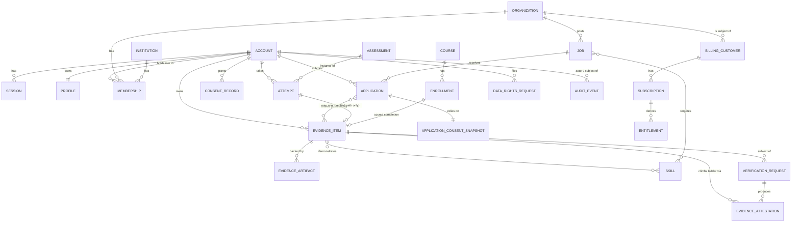

#### 2.1 Aggregate coverage (DOMAIN_ARCHITECTURE §3 -> entities)

| DOMAIN_ARCHITECTURE aggregate roots              | Logical entities                                                                          |
| ------------------------------------------------ | ----------------------------------------------------------------------------------------- |
| Account, Session, Passkey, Device                | `account, session, passkey, device`                                                       |
| Organization, Membership, RoleGrant              | `organization, membership, role_grant`                                                    |
| Profile, Portfolio, ResumeVariant                | `profile, portfolio_item, resume_variant`                                                 |
| Skill, SkillRelation, Competency                 | `skill, skill_relation, competency`                                                       |
| EvidenceItem, Credential                         | `evidence_item, credential (+ evidence_attestation, evidence_event, evidence_artifact)`   |
| VerificationRequest, ReferenceRequest, WorkClaim | `verification_request, reference_request, work_claim`                                     |
| Assessment, Attempt, IntegritySession            | `assessment, attempt, integrity_session (+ sandbox_run, integrity_flag)`                  |
| Course, Enrollment, Path                         | `course, enrollment, learning_path`                                                       |
| Job, JobTemplate, SavedSearch                    | `job, job_template, saved_search`                                                         |
| Application, Pipeline, Interview                 | `application, pipeline, interview`                                                        |
| MatchExplanation, SearchIndex                    | `match_explanation, search_job_doc, search_candidate_doc`                                 |
| Conversation, Message                            | `conversation, message`                                                                   |
| Notification, Preference, Delivery               | `notification, notification_preference, notification_delivery`                            |
| Subscription, Entitlement, Invoice               | `subscription, entitlement, invoice`                                                      |
| ConsentRecord, DataRightsRequest                 | `consent_record, data_rights_request` (+ `subject_identity_map`, the erasable token link) |
| Report, ModerationCase                           | `report, moderation_case`                                                                 |
| SupportAccessGrant, AuditEvent, FeatureFlag      | `support_access_grant, audit_event (+ audit_anchor), feature_flag`                        |
| (platform, not a domain aggregate)               | `outbox_event, consumer_inbox, idempotency_key, background_job, file_object`              |

### 3. Evidence ladder, provenance and the verification chain (ADR-T14, INV-T04, INV-T05, INV-T08)

`evidence_item.rung` is a **denormalised read value** equal to the highest rung among that item's `valid` attestations (default `claimed`). It is written only inside the `evidence` module's server-side transition function, in the same transaction that inserts the `evidence_attestation` / `evidence_event` rows and the outbox event. No API accepts a `rung` or `verified` field from a client. A claim is never displayed as verified (INV-T04).

| Rung                 | Meaning                                                                                                                                      | Established by (`method`)                                  | Attester kind                            | Revocable by                         |
| -------------------- | -------------------------------------------------------------------------------------------------------------------------------------------- | ---------------------------------------------------------- | ---------------------------------------- | ------------------------------------ |
| `claimed`            | Self-asserted; no independent support                                                                                                        | creation                                                   | none                                     | n/a                                  |
| `artifact_backed`    | Has >=1 scanned-clean artifact **or** proof of control of an employer-domain mailbox. Shows supporting material exists; does not prove truth | `artifact_scan`, `employer_email`                          | system                                   | owner removing artifact; moderator   |
| `peer_attested`      | A named non-account referee or peer confirmed facts via a single-use token                                                                   | `reference`                                                | referee                                  | platform reviewer on dispute; expiry |
| `authority_verified` | The issuing/owning authority (institution, platform assessment runner, authorised platform reviewer) confirmed                               | `institution_issuer`, `assessment_runner`, `manual_review` | institution / system / platform_reviewer | issuing authority; admin with reason |

Rules [TARGET]: (1) A material edit (change of `content_hash`) expires attestations that attest content and recomputes the rung; the owner is told which proofs were lost. (2) Attestations may have `expires_at` (e.g. employer mailbox proofs); expiry recomputes the rung via a scheduled job. (3) Revocation (`evidence.revoked`) sets lifecycle `revoked`, emits an event, and triggers async recomputation of dependent `competency` and `match_explanation` rows (BR-T005). (4) `evidence_event` is the append-only provenance history shown on the evidence "history" view and to authorised reviewers. (5) `source='ai'` does not exist as a value (CHECK), and AI suggestions live in `ai_suggestion` (INV-T08). (6) `assessment_runner` attestations can be written only when `attempt.verification_basis in ('runner_verified','auto_graded_objective','human_graded')`; an `unverified` attempt cannot reach evidence (ADR-T13). (7) `reference_request.token_hash` and `email_challenge.code_hmac` are the only stored forms of those credentials; the raw values are emailed to the verifier and never returned to the candidate (INV-T05).

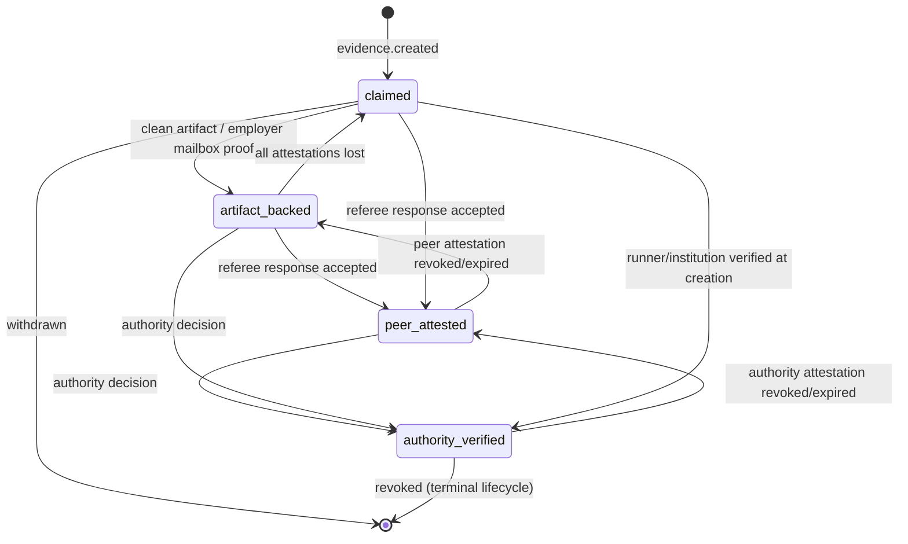

(`lifecycle` `withdrawn` and `revoked` are terminal and immutable except for erasure — INV-T11; the diagram shows `rung` movement, which is a derived value.)

### 4. Consent model (INV-T15)

`consent_record` is append-only: each grant or revoke inserts a row (`granted` true/false) carrying the **data object** it is about (`target_type`/`target_id`: `evidence` or `application`, or none), the **grantee** (`grantee_type`/`grantee_id`: all verified orgs, one org, one institution, or none), an optional `expires_at` and, for alumni sharing only, the chosen `field_set`. The current state is the latest row per `(subject, scope, target_type, target_id, grantee_type, grantee_id)` exposed via a view `consent_current` that omits expired grants. Per-employer and per-artefact grants are rows of this ledger; there is no separate grant table. The scope vocabulary is **not defined here**: the only list is `00_CONTROL_CENTRE/CONSENT_SCOPE_CATALOGUE.md` (CSC, 14 scopes, FF-12). Summary [TARGET]:

| Scope                        | Purpose it gates                                                   | Grain (CSC section 2)                            |
| ---------------------------- | ------------------------------------------------------------------ | ------------------------------------------------ |
| `profile.public_view`        | Profile visible beyond owner                                       | account                                          |
| `search.discoverable`        | Presence in recruiter search                                       | audience (all verified orgs)                     |
| `matching.recommend`         | Recommendations and match explanations for the candidate           | account                                          |
| `outreach.recruiter_contact` | Recruiter-initiated first contact                                  | audience                                         |
| `evidence.share_summary`     | Evidence titles, skills, rung in recruiter results                 | audience                                         |
| `evidence.share_artefact`    | One employer opens evidence artefacts                              | grantee_object (org required, evidence optional) |
| `profile.share_contact`      | One employer sees email/phone                                      | grantee (org)                                    |
| `application.share_snapshot` | Hiring team of the job sees the application snapshot               | application (job org + application)              |
| `evidence.share_institution` | Institution cohort reads and aggregates                            | grantee (institution)                            |
| `alumni.share_outcomes`      | Chosen outcome fields shared with the institution after graduation | grantee (institution) + `field_set`              |
| `ai.assist.process`          | Sending user content to AI providers                               | account                                          |
| `analytics.product`          | Product analytics events                                           | account                                          |
| `comms.marketing_email`      | Marketing/lifecycle email                                          | account                                          |
| `data.research_aggregate`    | Aggregate/anonymised analysis [OPEN-B10]                           | account                                          |

The earlier scope `evidence.share_recruiter` is retired and split by target (CSC section 4 crosswalk).

Applying to a job creates an immutable `application_consent_snapshot` that references the exact `consent_record` ids relied on; recruiter reads of `application_evidence` are authorised against the snapshot **and** the live `application.share_snapshot` grant (revocation takes effect for future reads; already-disclosed information is a governance matter, DB-03).

### 5. State machines referenced by CHECK constraints

State names are **derived** from `06_BUSINESS_PROCESSES/STATE_MACHINES.md` (SM-00), which is the single vocabulary source (see its "Vocabulary authority" section and FF-11). Every CHECK below equals the machine's persisted state set; transitions, guards and diagrams live only in SM-00 and are not restated here.

| SM-00 machine   | Stored in                                                  | Persisted states                                                                                                                                       |
| --------------- | ---------------------------------------------------------- | ------------------------------------------------------------------------------------------------------------------------------------------------------ |
| SM-ACCOUNT      | `account.status`                                           | pending_verification, active, suspended, deactivated, pending_erasure, erased (`purged` is event-only; sign-in lockout is `locked_until`, not a state) |
| SM-EVIDENCE     | `evidence_item.lifecycle`                                  | draft, pending_scan, active, quarantined, under_review, revoked, withdrawn, expired, erased                                                            |
| SM-VERIFICATION | `verification_request.state`                               | created, awaiting_proof, verified, failed, expired, cancelled, revoked                                                                                 |
| SM-REFERENCE    | `reference_request.state`                                  | queued, sent, opened, submitted, expired, cancelled, bounced                                                                                           |
| SM-ATTEMPT      | `attempt.state`                                            | created, in_progress, submitted, grading, passed, failed, unverified, under_review, voided, expired                                                    |
| SM-ENROLMENT    | `enrollment.state`                                         | pending_payment, active, completed, dropped, expired, refunded, suspended                                                                              |
| SM-JOB          | `job.state`                                                | draft, pending_review, scheduled, published, paused, closed, taken_down                                                                                |
| SM-APPLICATION  | `application.state` (`draft` lives in `application_draft`) | submitted, in_review, shortlisted, interviewing, offer_extended, hired, rejected, withdrawn, offer_declined                                            |
| SM-INTERVIEW    | `interview.state`                                          | proposed, scheduled, completed, cancelled, rescheduled, no_show, expired                                                                               |
| SM-SUBSCRIPTION | `subscription.state`                                       | incomplete, active, canceling, past_due, unpaid, canceled, incomplete_expired                                                                          |
| SM-DSR          | `data_rights_request.state` (all kinds, including erasure) | received, verifying, cooling_off, in_progress, on_hold, completed, completed_with_retention, rejected, cancelled, failed                               |
| SM-MODCASE      | `moderation_case.state`                                    | open, triaged, in_review, awaiting_info, actioned, appealed, closed                                                                                    |
| SM-NOTIFY       | `notification_delivery.state`                              | queued, suppressed, deferred, sending, sent, delivered, failed_retry, failed, bounced, complained, expired                                             |
| SM-BGJOB        | `background_job.status`                                    | queued, claimed, running, retry_wait, succeeded, dead, cancelled                                                                                       |

Old-to-new name mapping: see "Vocabulary authority" in SM-00. Not yet in SM-00 (REVW-20): **SM-FILE** (`file_object.state`) keeps its provisional set intact: intent -> uploaded -> verifying -> scanning -> clean / rejected / infected; any -> deleted (BR-T003); SM-EVIDENCE t3/t4 consume its result. The former provisional SM-ERASURE is folded into SM-DSR.

### 6. Logical model by domain

Each domain lists an ER diagram (keys, foreign keys, state columns) followed by full attribute tables. Foreign keys to entities of other domains are drawn for orientation only: at the **module** level they are not queried across (FF-02); DB-level FKs across modules are permitted for referential integrity but are listed in the table-ownership manifest, and cross-module reads still go through interfaces. Where integrity must survive module extraction, a deferrable FK is replaced by an application check plus periodic reconciliation (DB-02 §11).

#### DOM-01 Identity, Sessions & Access (module `api/identity`)

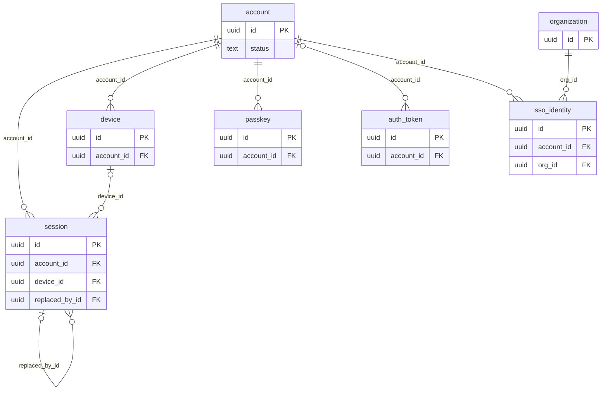

##### DATA-E0101 `account` — Account

Role: root · Tenancy/RLS: RLS-OWNER · Owner module: `api/identity`

| Attribute             | Type        | Constraints / notes                                                                                                                                                             |
| --------------------- | ----------- | ------------------------------------------------------------------------------------------------------------------------------------------------------------------------------- |
| `id`                  | uuid        | PK, UUIDv7, app-generated                                                                                                                                                       |
| `created_at`          | timestamptz | NN, DEF now()                                                                                                                                                                   |
| `updated_at`          | timestamptz | NN, DEF now()                                                                                                                                                                   |
| `version`             | bigint      | NN, DEF 1; optimistic lock / ETag                                                                                                                                               |
| `email`               | citext      | NN, UQ (case-insensitive), CHK length<=254                                                                                                                                      |
| `email_verified_at`   | timestamptz | NULL until verified                                                                                                                                                             |
| `display_name`        | text        | NN, CHK length 1..100                                                                                                                                                           |
| `locale`              | text        | NN, DEF 'en'                                                                                                                                                                    |
| `timezone`            | text        | NULL (IANA name)                                                                                                                                                                |
| `status`              | text        | NN, CHK in (pending_verification,active,suspended,deactivated,pending_erasure,erased), DEF 'pending_verification' (SM-ACCOUNT; sign-in lockout is `locked_until`, not a status) |
| `password_hash`       | text        | NULL for passkey/SSO-only; Argon2id PHC string; never selected by general queries                                                                                               |
| `password_updated_at` | timestamptz | NULL                                                                                                                                                                            |
| `failed_login_count`  | int         | NN, DEF 0, CHK >=0                                                                                                                                                              |
| `locked_until`        | timestamptz | NULL                                                                                                                                                                            |
| `grants_version`      | bigint      | NN, DEF 1; bumped on any role/grant change (policy freshness)                                                                                                                   |
| `consent_epoch`       | bigint      | NN, DEF 0; incremented on every consent change; stamps derived search/match data                                                                                                |
| `terms_version`       | text        | NN                                                                                                                                                                              |
| `terms_accepted_at`   | timestamptz | NN                                                                                                                                                                              |
| `last_login_at`       | timestamptz | NULL                                                                                                                                                                            |
| `erased_at`           | timestamptz | NULL; set by erasure orchestrator                                                                                                                                               |

##### DATA-E0102 `session` — Session (refresh-token family member)

Role: member of Account · Tenancy/RLS: RLS-OWNER · Owner module: `api/identity`

| Attribute             | Type        | Constraints / notes                                                     |
| --------------------- | ----------- | ----------------------------------------------------------------------- |
| `id`                  | uuid        | PK, UUIDv7                                                              |
| `created_at`          | timestamptz | NN, DEF now()                                                           |
| `updated_at`          | timestamptz | NN, DEF now()                                                           |
| `account_id`          | uuid        | NN, FK(account.id)                                                      |
| `family_id`           | uuid        | NN; all rotations of one login share a family (BR-T050)                 |
| `generation`          | int         | NN, DEF 1; increments on each rotation                                  |
| `refresh_token_hash`  | bytea       | NN, UQ; SHA-256 of 256-bit random token (INV-T05 style hash-only)       |
| `device_id`           | uuid        | NULL, FK(device.id)                                                     |
| `user_agent_class`    | text        | NULL (coarse class, not raw UA)                                         |
| `ip_prefix`           | inet        | NULL (truncated /24 or /48)                                             |
| `last_seen_at`        | timestamptz | NN                                                                      |
| `refresh_expires_at`  | timestamptz | NN                                                                      |
| `absolute_expires_at` | timestamptz | NN; hard cap regardless of rotation                                     |
| `recent_auth_at`      | timestamptz | NULL; step-up marker                                                    |
| `revoked_at`          | timestamptz | NULL                                                                    |
| `revoke_reason`       | text        | NULL, CHK in (user,admin,password_change,reuse_detected,expiry,erasure) |
| `replaced_by_id`      | uuid        | NULL, FK(session.id); reuse of a replaced token revokes family          |

##### DATA-E0103 `device` — Device

Role: member of Account · Tenancy/RLS: RLS-OWNER · Owner module: `api/identity`

| Attribute       | Type        | Constraints / notes               |
| --------------- | ----------- | --------------------------------- |
| `id`            | uuid        | PK, UUIDv7, app-generated         |
| `created_at`    | timestamptz | NN, DEF now()                     |
| `updated_at`    | timestamptz | NN, DEF now()                     |
| `version`       | bigint      | NN, DEF 1; optimistic lock / ETag |
| `account_id`    | uuid        | NN, FK(account.id)                |
| `label`         | text        | NULL                              |
| `first_seen_at` | timestamptz | NN                                |
| `last_seen_at`  | timestamptz | NN                                |

##### DATA-E0104 `passkey` — Passkey (WebAuthn credential)

Role: member of Account · Tenancy/RLS: RLS-OWNER · Owner module: `api/identity`

| Attribute         | Type        | Constraints / notes               |
| ----------------- | ----------- | --------------------------------- |
| `id`              | uuid        | PK, UUIDv7, app-generated         |
| `created_at`      | timestamptz | NN, DEF now()                     |
| `updated_at`      | timestamptz | NN, DEF now()                     |
| `version`         | bigint      | NN, DEF 1; optimistic lock / ETag |
| `account_id`      | uuid        | NN, FK(account.id)                |
| `credential_id`   | bytea       | NN, UQ                            |
| `public_key`      | bytea       | NN                                |
| `sign_count`      | bigint      | NN, DEF 0                         |
| `transports`      | text[]      | NULL                              |
| `label`           | text        | NULL                              |
| `backup_eligible` | bool        | NN                                |
| `backup_state`    | bool        | NN                                |
| `last_used_at`    | timestamptz | NULL                              |
| `revoked_at`      | timestamptz | NULL                              |

##### DATA-E0105 `auth_token` — AuthToken (one-time link/code token)

Role: member of Account · Tenancy/RLS: RLS-INTERNAL · Owner module: `api/identity`

| Attribute     | Type        | Constraints / notes                                 |
| ------------- | ----------- | --------------------------------------------------- |
| `id`          | uuid        | PK, UUIDv7                                          |
| `created_at`  | timestamptz | NN, DEF now(); row is append-only                   |
| `account_id`  | uuid        | NULL, FK(account.id)                                |
| `purpose`     | text        | NN, CHK in (password_reset,email_verify,org_invite) |
| `token_hash`  | bytea       | NN, UQ; hash only, single use (INV-T05)             |
| `expires_at`  | timestamptz | NN                                                  |
| `consumed_at` | timestamptz | NULL                                                |

##### DATA-E0106 `sso_identity` — SsoIdentity

Role: member of Account · Tenancy/RLS: RLS-OWNER · Owner module: `api/identity`

| Attribute    | Type        | Constraints / notes               |
| ------------ | ----------- | --------------------------------- |
| `id`         | uuid        | PK, UUIDv7                        |
| `created_at` | timestamptz | NN, DEF now(); row is append-only |
| `account_id` | uuid        | NN, FK(account.id)                |
| `org_id`     | uuid        | NN, FK(organization.id)           |
| `issuer`     | text        | NN                                |
| `subject`    | text        | NN; UQ(issuer,subject)            |

#### DOM-02 Organizations, Tenancy & Roles (module `api/orgs`)

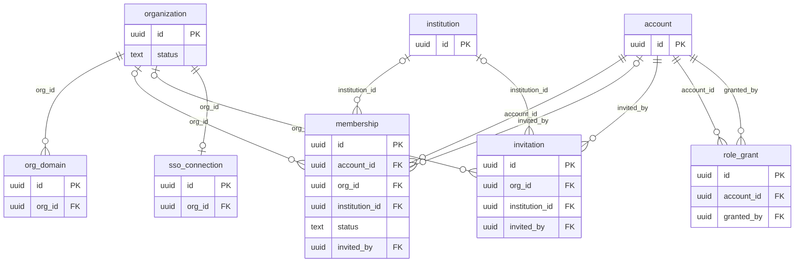

##### DATA-E0201 `organization` — Organization (employer tenant)

Role: root · Tenancy/RLS: RLS-ORG · Owner module: `api/orgs`

| Attribute     | Type        | Constraints / notes                                |
| ------------- | ----------- | -------------------------------------------------- |
| `id`          | uuid        | PK, UUIDv7, app-generated                          |
| `created_at`  | timestamptz | NN, DEF now()                                      |
| `updated_at`  | timestamptz | NN, DEF now()                                      |
| `version`     | bigint      | NN, DEF 1; optimistic lock / ETag                  |
| `name`        | text        | NN, CHK length 1..150                              |
| `slug`        | citext      | NN, UQ                                             |
| `status`      | text        | NN, CHK in (active,suspended,closed), DEF 'active' |
| `size_band`   | text        | NULL                                               |
| `website`     | text        | NULL                                               |
| `verified_at` | timestamptz | NULL (org identity verification, if offered)       |

##### DATA-E0202 `org_domain` — OrgDomain

Role: member of Organization · Tenancy/RLS: RLS-ORG · Owner module: `api/orgs`

| Attribute     | Type        | Constraints / notes                   |
| ------------- | ----------- | ------------------------------------- |
| `id`          | uuid        | PK, UUIDv7, app-generated             |
| `created_at`  | timestamptz | NN, DEF now()                         |
| `updated_at`  | timestamptz | NN, DEF now()                         |
| `version`     | bigint      | NN, DEF 1; optimistic lock / ETag     |
| `org_id`      | uuid        | NN, FK(organization.id)               |
| `domain`      | citext      | NN, UQ                                |
| `verified_at` | timestamptz | NULL; DNS TXT proof                   |
| `purpose`     | text        | NN, CHK in (sso,employer_email_match) |

##### DATA-E0203 `membership` — Membership (account in tenant with role)

Role: root · Tenancy/RLS: RLS-ORG · Owner module: `api/orgs`

| Attribute        | Type        | Constraints / notes                                                                         |
| ---------------- | ----------- | ------------------------------------------------------------------------------------------- |
| `id`             | uuid        | PK, UUIDv7, app-generated                                                                   |
| `created_at`     | timestamptz | NN, DEF now()                                                                               |
| `updated_at`     | timestamptz | NN, DEF now()                                                                               |
| `version`        | bigint      | NN, DEF 1; optimistic lock / ETag                                                           |
| `account_id`     | uuid        | NN, FK(account.id)                                                                          |
| `org_id`         | uuid        | NULL, FK(organization.id)                                                                   |
| `institution_id` | uuid        | NULL, FK(institution.id)                                                                    |
| `role`           | text        | NN, CHK in (org_owner,org_admin,recruiter,hiring_manager,viewer,inst_admin,faculty,proctor) |
| `status`         | text        | NN, CHK in (invited,active,removed)                                                         |
| `invited_by`     | uuid        | NULL, FK(account.id)                                                                        |
| `joined_at`      | timestamptz | NULL                                                                                        |
| `removed_at`     | timestamptz | NULL                                                                                        |

##### DATA-E0204 `invitation` — Invitation

Role: member of Membership · Tenancy/RLS: RLS-ORG · Owner module: `api/orgs`

| Attribute        | Type        | Constraints / notes               |
| ---------------- | ----------- | --------------------------------- |
| `id`             | uuid        | PK, UUIDv7, app-generated         |
| `created_at`     | timestamptz | NN, DEF now()                     |
| `updated_at`     | timestamptz | NN, DEF now()                     |
| `version`        | bigint      | NN, DEF 1; optimistic lock / ETag |
| `org_id`         | uuid        | NULL, FK(organization.id)         |
| `institution_id` | uuid        | NULL, FK(institution.id)          |
| `email_hash`     | bytea       | NN; HMAC of normalised email      |
| `email_enc`      | bytea       | NN; field-encrypted for sending   |
| `role`           | text        | NN                                |
| `token_hash`     | bytea       | NN, UQ                            |
| `invited_by`     | uuid        | NN, FK(account.id)                |
| `expires_at`     | timestamptz | NN                                |
| `accepted_at`    | timestamptz | NULL                              |

##### DATA-E0205 `role_grant` — PlatformRoleGrant (moderator/support/admin/auditor)

Role: root · Tenancy/RLS: RLS-INTERNAL · Owner module: `api/orgs`

| Attribute      | Type        | Constraints / notes                                   |
| -------------- | ----------- | ----------------------------------------------------- |
| `id`           | uuid        | PK, UUIDv7, app-generated                             |
| `created_at`   | timestamptz | NN, DEF now()                                         |
| `updated_at`   | timestamptz | NN, DEF now()                                         |
| `version`      | bigint      | NN, DEF 1; optimistic lock / ETag                     |
| `account_id`   | uuid        | NN, FK(account.id)                                    |
| `role`         | text        | NN, CHK in (moderator,support,admin,auditor)          |
| `granted_by`   | uuid        | NN, FK(account.id)                                    |
| `expires_at`   | timestamptz | NN; dormant grants auto-expire (60 d rule, USR-01 §6) |
| `last_used_at` | timestamptz | NULL                                                  |
| `revoked_at`   | timestamptz | NULL                                                  |

##### DATA-E0206 `sso_connection` — SsoConnection

Role: member of Organization · Tenancy/RLS: RLS-ORG · Owner module: `api/orgs`

| Attribute    | Type        | Constraints / notes                                 |
| ------------ | ----------- | --------------------------------------------------- |
| `id`         | uuid        | PK, UUIDv7, app-generated                           |
| `created_at` | timestamptz | NN, DEF now()                                       |
| `updated_at` | timestamptz | NN, DEF now()                                       |
| `version`    | bigint      | NN, DEF 1; optimistic lock / ETag                   |
| `org_id`     | uuid        | NN, FK(organization.id), UQ                         |
| `protocol`   | text        | NN, CHK in (oidc,saml)                              |
| `issuer`     | text        | NN                                                  |
| `client_id`  | text        | NULL                                                |
| `secret_ref` | text        | NULL; reference to secret manager, never the secret |
| `metadata`   | jsonb       | NN; validated IdP metadata (bounded size)           |
| `enforced`   | bool        | NN, DEF false                                       |

#### DOM-03 Profile, Portfolio & Resume (module `api/profile`)

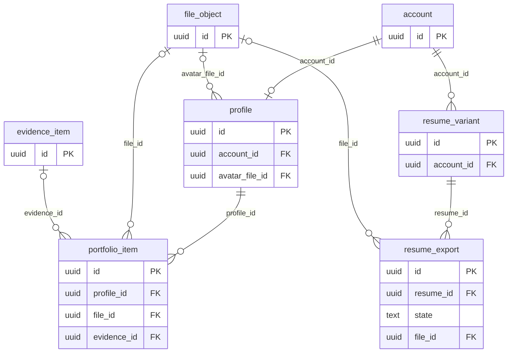

##### DATA-E0301 `profile` — Profile

Role: root · Tenancy/RLS: RLS-OWNER (+ public projection) · Owner module: `api/profile`

| Attribute        | Type        | Constraints / notes                                 |
| ---------------- | ----------- | --------------------------------------------------- |
| `id`             | uuid        | PK, UUIDv7, app-generated                           |
| `created_at`     | timestamptz | NN, DEF now()                                       |
| `updated_at`     | timestamptz | NN, DEF now()                                       |
| `version`        | bigint      | NN, DEF 1; optimistic lock / ETag                   |
| `account_id`     | uuid        | NN, FK(account.id), UQ                              |
| `handle`         | citext      | NN, UQ, CHK ^[a-z0-9-]{3,40}$                       |
| `headline`       | text        | NULL, CHK length<=160                               |
| `summary`        | text        | NULL, CHK length<=4000                              |
| `location_text`  | text        | NULL                                                |
| `country_code`   | text        | NULL, CHK length=2                                  |
| `visibility`     | text        | NN, CHK in (private,members,public), DEF 'private'  |
| `open_to_work`   | bool        | NN, DEF false                                       |
| `avatar_file_id` | uuid        | NULL, FK(file_object.id)                            |
| `links`          | jsonb       | NN, DEF '[]'; bounded array validated by Zod (<=10) |

##### DATA-E0302 `portfolio_item` — PortfolioItem

Role: member of Profile · Tenancy/RLS: RLS-OWNER · Owner module: `api/profile`

| Attribute     | Type        | Constraints / notes               |
| ------------- | ----------- | --------------------------------- |
| `id`          | uuid        | PK, UUIDv7, app-generated         |
| `created_at`  | timestamptz | NN, DEF now()                     |
| `updated_at`  | timestamptz | NN, DEF now()                     |
| `version`     | bigint      | NN, DEF 1; optimistic lock / ETag |
| `profile_id`  | uuid        | NN, FK(profile.id)                |
| `title`       | text        | NN                                |
| `description` | text        | NULL                              |
| `url`         | text        | NULL; https only                  |
| `file_id`     | uuid        | NULL, FK(file_object.id)          |
| `evidence_id` | uuid        | NULL, FK(evidence_item.id)        |
| `position`    | int         | NN                                |
| `visibility`  | text        | NN, CHK in (private,public)       |

##### DATA-E0303 `resume_variant` — ResumeVariant

Role: member of Profile · Tenancy/RLS: RLS-OWNER · Owner module: `api/profile`

| Attribute          | Type        | Constraints / notes                                         |
| ------------------ | ----------- | ----------------------------------------------------------- |
| `id`               | uuid        | PK, UUIDv7, app-generated                                   |
| `created_at`       | timestamptz | NN, DEF now()                                               |
| `updated_at`       | timestamptz | NN, DEF now()                                               |
| `version`          | bigint      | NN, DEF 1; optimistic lock / ETag                           |
| `account_id`       | uuid        | NN, FK(account.id)                                          |
| `name`             | text        | NN                                                          |
| `template_key`     | text        | NN                                                          |
| `content_refs`     | jsonb       | NN; ordered references (evidence/portfolio ids), not copies |
| `last_exported_at` | timestamptz | NULL                                                        |

##### DATA-E0304 `resume_export` — ResumeExport

Role: member of ResumeVariant · Tenancy/RLS: RLS-OWNER · Owner module: `api/profile`

| Attribute    | Type        | Constraints / notes                                  |
| ------------ | ----------- | ---------------------------------------------------- |
| `id`         | uuid        | PK, UUIDv7, app-generated                            |
| `created_at` | timestamptz | NN, DEF now()                                        |
| `updated_at` | timestamptz | NN, DEF now()                                        |
| `version`    | bigint      | NN, DEF 1; optimistic lock / ETag                    |
| `resume_id`  | uuid        | NN, FK(resume_variant.id)                            |
| `state`      | text        | NN, CHK in (requested,building,ready,failed,expired) |
| `file_id`    | uuid        | NULL, FK(file_object.id)                             |
| `expires_at` | timestamptz | NULL                                                 |

#### DOM-04 Skills Graph & Taxonomy (module `api/skills`)

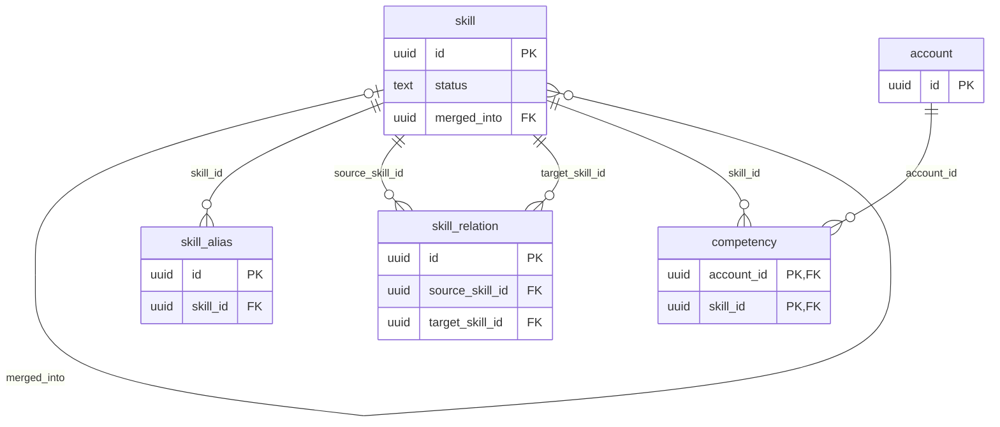

##### DATA-E0401 `skill` — Skill

Role: root · Tenancy/RLS: RLS-PUBLIC-READ · Owner module: `api/skills`

| Attribute     | Type         | Constraints / notes                                 |
| ------------- | ------------ | --------------------------------------------------- |
| `id`          | uuid         | PK, UUIDv7, app-generated                           |
| `created_at`  | timestamptz  | NN, DEF now()                                       |
| `updated_at`  | timestamptz  | NN, DEF now()                                       |
| `version`     | bigint       | NN, DEF 1; optimistic lock / ETag                   |
| `slug`        | text         | NN, UQ                                              |
| `name`        | text         | NN                                                  |
| `category`    | text         | NN                                                  |
| `description` | text         | NULL                                                |
| `status`      | text         | NN, CHK in (active,deprecated,merged), DEF 'active' |
| `merged_into` | uuid         | NULL, FK(skill.id)                                  |
| `embedding`   | vector(1536) | NULL; derived (dimension per model; OPEN-B9 family) |

##### DATA-E0402 `skill_alias` — SkillAlias

Role: member of Skill · Tenancy/RLS: RLS-PUBLIC-READ · Owner module: `api/skills`

| Attribute    | Type        | Constraints / notes               |
| ------------ | ----------- | --------------------------------- |
| `id`         | uuid        | PK, UUIDv7, app-generated         |
| `created_at` | timestamptz | NN, DEF now()                     |
| `updated_at` | timestamptz | NN, DEF now()                     |
| `version`    | bigint      | NN, DEF 1; optimistic lock / ETag |
| `skill_id`   | uuid        | NN, FK(skill.id)                  |
| `alias`      | citext      | NN, UQ                            |
| `locale`     | text        | NN, DEF 'en'                      |

##### DATA-E0403 `skill_relation` — SkillRelation

Role: member of Skill · Tenancy/RLS: RLS-PUBLIC-READ · Owner module: `api/skills`

| Attribute         | Type         | Constraints / notes                                                                                                                           |
| ----------------- | ------------ | --------------------------------------------------------------------------------------------------------------------------------------------- |
| `id`              | uuid         | PK, UUIDv7, app-generated                                                                                                                     |
| `created_at`      | timestamptz  | NN, DEF now()                                                                                                                                 |
| `updated_at`      | timestamptz  | NN, DEF now()                                                                                                                                 |
| `version`         | bigint       | NN, DEF 1; optimistic lock / ETag                                                                                                             |
| `source_skill_id` | uuid         | NN, FK(skill.id)                                                                                                                              |
| `target_skill_id` | uuid         | NN, FK(skill.id)                                                                                                                              |
| `relation_type`   | text         | NN, CHK in (prerequisite_of,subskill_of,supersedes,correlates_with); UQ(source,target,type); acyclic for hierarchical types (domain-enforced) |
| `weight`          | numeric(3,2) | NN, DEF 1.0, CHK 0..1                                                                                                                         |

##### DATA-E0404 `competency` — Competency (derived confidence)

Role: derived from Evidence · Tenancy/RLS: RLS-OWNER · Owner module: `api/skills`

| Attribute       | Type         | Constraints / notes                                        |
| --------------- | ------------ | ---------------------------------------------------------- |
| `account_id`    | uuid         | NN, FK(account.id); PK part                                |
| `skill_id`      | uuid         | NN, FK(skill.id); PK part                                  |
| `confidence`    | numeric(4,3) | NN, CHK 0..1                                               |
| `basis`         | jsonb        | NN; explanation: contributing evidence ids, rungs, weights |
| `model_version` | text         | NN                                                         |
| `computed_at`   | timestamptz  | NN                                                         |

#### DOM-05 Evidence & Credentials (module `api/evidence`)

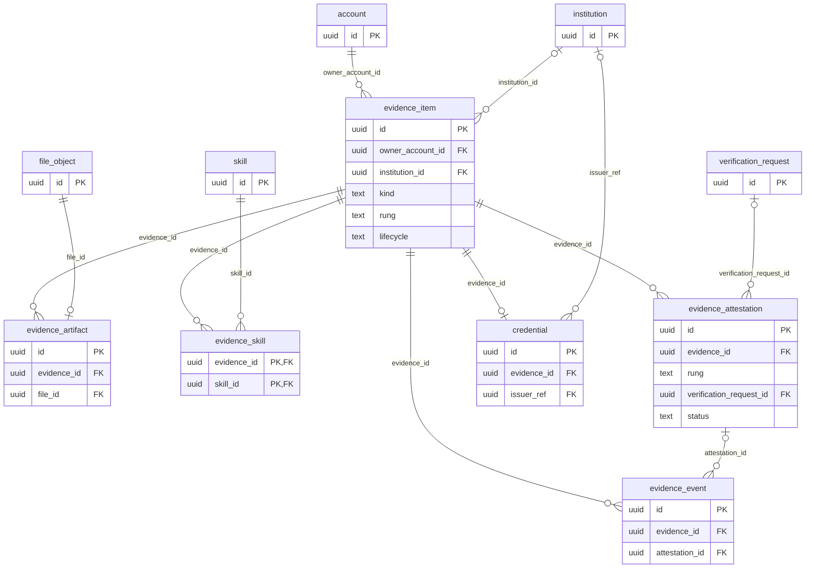

##### DATA-E0501 `evidence_item` — EvidenceItem

Role: root · Tenancy/RLS: RLS-OWNER (+ consented share) · Owner module: `api/evidence`

| Attribute          | Type        | Constraints / notes                                                                                                                           |
| ------------------ | ----------- | --------------------------------------------------------------------------------------------------------------------------------------------- |
| `id`               | uuid        | PK, UUIDv7, app-generated                                                                                                                     |
| `created_at`       | timestamptz | NN, DEF now()                                                                                                                                 |
| `updated_at`       | timestamptz | NN, DEF now()                                                                                                                                 |
| `version`          | bigint      | NN, DEF 1; optimistic lock / ETag                                                                                                             |
| `owner_account_id` | uuid        | NN, FK(account.id)                                                                                                                            |
| `institution_id`   | uuid        | NULL, FK(institution.id); set for institution-issued evidence                                                                                 |
| `kind`             | text        | NN, CHK in (project,work_experience,education,certification,publication,assessment_result,course_completion,other)                            |
| `title`            | text        | NN, CHK length<=200                                                                                                                           |
| `summary`          | text        | NULL, CHK length<=4000                                                                                                                        |
| `source`           | text        | NN, CHK in (self,course,assessment,institution,import) -- 'ai' is not a member (INV-T08)                                                      |
| `source_ref_type`  | text        | NULL                                                                                                                                          |
| `source_ref_id`    | uuid        | NULL                                                                                                                                          |
| `rung`             | text        | NN, CHK in (claimed,artifact_backed,peer_attested,authority_verified), DEF 'claimed'; written only by evidence module SM transition (INV-T04) |
| `lifecycle`        | text        | NN, CHK in (draft,pending_scan,active,quarantined,under_review,revoked,withdrawn,expired,erased), DEF 'draft' (SM-EVIDENCE)                   |
| `visibility`       | text        | NN, CHK in (private,share_on_request,public), DEF 'private'                                                                                   |
| `occurred_from`    | date        | NULL                                                                                                                                          |
| `occurred_to`      | date        | NULL, CHK >= occurred_from                                                                                                                    |
| `external_url`     | text        | NULL; https only; never fetched server-side without SSRF guard                                                                                |
| `content_hash`     | bytea       | NULL; hash of material fields (change detection resets attestations)                                                                          |
| `revoked_at`       | timestamptz | NULL                                                                                                                                          |
| `revoked_reason`   | text        | NULL                                                                                                                                          |

##### DATA-E0502 `evidence_artifact` — EvidenceArtifact

Role: member of EvidenceItem · Tenancy/RLS: RLS-OWNER · Owner module: `api/evidence`

| Attribute     | Type        | Constraints / notes               |
| ------------- | ----------- | --------------------------------- |
| `id`          | uuid        | PK, UUIDv7, app-generated         |
| `created_at`  | timestamptz | NN, DEF now()                     |
| `updated_at`  | timestamptz | NN, DEF now()                     |
| `version`     | bigint      | NN, DEF 1; optimistic lock / ETag |
| `evidence_id` | uuid        | NN, FK(evidence_item.id)          |
| `file_id`     | uuid        | NN, FK(file_object.id), UQ        |
| `label`       | text        | NULL                              |
| `removed_at`  | timestamptz | NULL                              |

##### DATA-E0503 `evidence_skill` — EvidenceSkill

Role: member of EvidenceItem · Tenancy/RLS: RLS-OWNER · Owner module: `api/evidence`

| Attribute     | Type        | Constraints / notes               |
| ------------- | ----------- | --------------------------------- |
| `evidence_id` | uuid        | NN, FK(evidence_item.id); PK part |
| `skill_id`    | uuid        | NN, FK(skill.id); PK part         |
| `added_at`    | timestamptz | NN                                |

##### DATA-E0504 `evidence_attestation` — EvidenceAttestation (ladder rung proof)

Role: member of EvidenceItem · Tenancy/RLS: RLS-OWNER (read) / module-write · Owner module: `api/evidence`

| Attribute                 | Type        | Constraints / notes                                                                                    |
| ------------------------- | ----------- | ------------------------------------------------------------------------------------------------------ |
| `id`                      | uuid        | PK, UUIDv7, app-generated                                                                              |
| `created_at`              | timestamptz | NN, DEF now()                                                                                          |
| `updated_at`              | timestamptz | NN, DEF now()                                                                                          |
| `version`                 | bigint      | NN, DEF 1; optimistic lock / ETag                                                                      |
| `evidence_id`             | uuid        | NN, FK(evidence_item.id)                                                                               |
| `rung`                    | text        | NN, CHK in (artifact_backed,peer_attested,authority_verified)                                          |
| `method`                  | text        | NN, CHK in (artifact_scan,employer_email,reference,institution_issuer,assessment_runner,manual_review) |
| `attester_kind`           | text        | NN, CHK in (system,referee,employer_domain,institution,platform_reviewer)                              |
| `attester_ref`            | text        | NULL; pseudonymous reference (never raw email)                                                         |
| `verification_request_id` | uuid        | NULL, FK(verification_request.id)                                                                      |
| `status`                  | text        | NN, CHK in (valid,revoked,expired), DEF 'valid'                                                        |
| `granted_at`              | timestamptz | NN                                                                                                     |
| `expires_at`              | timestamptz | NULL                                                                                                   |
| `revoked_at`              | timestamptz | NULL                                                                                                   |
| `revoked_reason`          | text        | NULL                                                                                                   |
| `provenance`              | jsonb       | NN, DEF '{}'; method-specific facts (hashes, runner digest, domain), bounded                           |

##### DATA-E0505 `evidence_event` — EvidenceEvent (append-only ladder history)

Role: member of EvidenceItem · Tenancy/RLS: RLS-OWNER (read) · Owner module: `api/evidence`

| Attribute        | Type        | Constraints / notes                                                                                                                  |
| ---------------- | ----------- | ------------------------------------------------------------------------------------------------------------------------------------ |
| `id`             | uuid        | PK, UUIDv7                                                                                                                           |
| `created_at`     | timestamptz | NN, DEF now(); row is append-only                                                                                                    |
| `evidence_id`    | uuid        | NN; soft reference to evidence_item.id, **no FK** (erasure hard-deletes the item; history keeps the bare id, DB-02 §4.1)             |
| `seq`            | bigint      | NN, UQ(evidence_id,seq)                                                                                                              |
| `event`          | text        | NN, CHK in (created,edited,attestation_granted,attestation_revoked,attestation_expired,withdrawn,revoked,rung_changed)               |
| `from_rung`      | text        | NULL                                                                                                                                 |
| `to_rung`        | text        | NULL                                                                                                                                 |
| `actor_kind`     | text        | NN, CHK in (owner,system,referee,authority,moderator,admin)                                                                          |
| `actor_ref`      | text        | NULL; opaque `subject_ref` for account actors or a random per-request `referee_ref`; never an email, name or account id (DB-02 §4.1) |
| `attestation_id` | uuid        | NULL; soft reference to evidence_attestation.id, no FK                                                                               |
| `details`        | jsonb       | NN, DEF '{}'; allowlisted keys only, no referee-supplied facts or user text (those live in erasable attestation provenance)          |
| `prev_hash`      | bytea       | NULL; row_hash of the previous event of the same evidence_id (aggregate chain under the item's row lock; DB-02 §4.2)                 |
| `row_hash`       | bytea       | NN; SHA256(canonical(row)); sealed into `audit_anchor` batches                                                                       |

##### DATA-E0506 `credential` — Credential (publicly verifiable)

Role: root · Tenancy/RLS: RLS-PUBLIC-READ (by code) · Owner module: `api/evidence`

| Attribute           | Type        | Constraints / notes                        |
| ------------------- | ----------- | ------------------------------------------ |
| `id`                | uuid        | PK, UUIDv7, app-generated                  |
| `created_at`        | timestamptz | NN, DEF now()                              |
| `updated_at`        | timestamptz | NN, DEF now()                              |
| `version`           | bigint      | NN, DEF 1; optimistic lock / ETag          |
| `evidence_id`       | uuid        | NN, FK(evidence_item.id), UQ               |
| `issuer_kind`       | text        | NN, CHK in (platform,institution,external) |
| `issuer_ref`        | uuid        | NULL, FK(institution.id)                   |
| `public_code`       | text        | NN, UQ; >=128-bit random, base32           |
| `issued_at`         | timestamptz | NN                                         |
| `expires_at`        | timestamptz | NULL                                       |
| `revoked_at`        | timestamptz | NULL                                       |
| `revocation_reason` | text        | NULL                                       |

#### DOM-06 Verification & Trust (module `api/verification`)

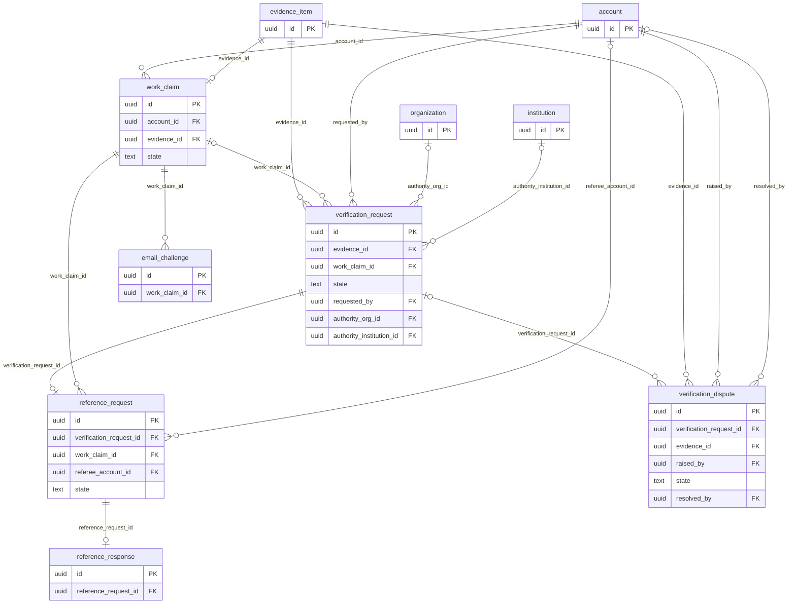

##### DATA-E0601 `work_claim` — WorkClaim

Role: root · Tenancy/RLS: RLS-OWNER · Owner module: `api/verification`

| Attribute              | Type        | Constraints / notes                                            |
| ---------------------- | ----------- | -------------------------------------------------------------- |
| `id`                   | uuid        | PK, UUIDv7, app-generated                                      |
| `created_at`           | timestamptz | NN, DEF now()                                                  |
| `updated_at`           | timestamptz | NN, DEF now()                                                  |
| `version`              | bigint      | NN, DEF 1; optimistic lock / ETag                              |
| `account_id`           | uuid        | NN, FK(account.id)                                             |
| `evidence_id`          | uuid        | NN, FK(evidence_item.id), UQ                                   |
| `employer_name`        | text        | NN                                                             |
| `employer_domain`      | citext      | NULL                                                           |
| `title`                | text        | NN                                                             |
| `employment_type`      | text        | NN, CHK in (full_time,part_time,contract,internship,freelance) |
| `start_date`           | date        | NN                                                             |
| `end_date`             | date        | NULL, CHK >= start_date                                        |
| `is_current`           | bool        | NN                                                             |
| `corporate_email_enc`  | bytea       | NULL; field-encrypted                                          |
| `corporate_email_hash` | bytea       | NULL                                                           |
| `email_verified_at`    | timestamptz | NULL                                                           |
| `state`                | text        | NN, CHK in (draft,submitted,disputed,withdrawn)                |

##### DATA-E0602 `verification_request` — VerificationRequest

Role: root · Tenancy/RLS: RLS-OWNER / authority · Owner module: `api/verification`

| Attribute                  | Type        | Constraints / notes                                                                                                                                                                                                                       |
| -------------------------- | ----------- | ----------------------------------------------------------------------------------------------------------------------------------------------------------------------------------------------------------------------------------------- |
| `id`                       | uuid        | PK, UUIDv7, app-generated                                                                                                                                                                                                                 |
| `created_at`               | timestamptz | NN, DEF now()                                                                                                                                                                                                                             |
| `updated_at`               | timestamptz | NN, DEF now()                                                                                                                                                                                                                             |
| `version`                  | bigint      | NN, DEF 1; optimistic lock / ETag                                                                                                                                                                                                         |
| `evidence_id`              | uuid        | NN, FK(evidence_item.id)                                                                                                                                                                                                                  |
| `work_claim_id`            | uuid        | NULL, FK(work_claim.id)                                                                                                                                                                                                                   |
| `method`                   | text        | NN, CHK in (artifact_scan,employer_email,reference,institution_issuer,assessment_runner,manual_review)                                                                                                                                    |
| `state`                    | text        | NN, CHK in (created,awaiting_proof,verified,failed,expired,cancelled,revoked), DEF 'created' (SM-VERIFICATION; all methods; `failed` carries `reason` in attempts_exhausted, authority_rejected; disputes live in `verification_dispute`) |
| `requested_by`             | uuid        | NN, FK(account.id)                                                                                                                                                                                                                        |
| `authority_org_id`         | uuid        | NULL, FK(organization.id)                                                                                                                                                                                                                 |
| `authority_institution_id` | uuid        | NULL, FK(institution.id)                                                                                                                                                                                                                  |
| `expires_at`               | timestamptz | NULL                                                                                                                                                                                                                                      |
| `decided_at`               | timestamptz | NULL                                                                                                                                                                                                                                      |
| `decided_by_kind`          | text        | NULL, CHK in (system,referee,authority,platform_reviewer)                                                                                                                                                                                 |
| `decided_by_ref`           | text        | NULL                                                                                                                                                                                                                                      |
| `decision_reason_code`     | text        | NULL                                                                                                                                                                                                                                      |
| `decision_note`            | text        | NULL                                                                                                                                                                                                                                      |

##### DATA-E0603 `email_challenge` — EmailChallenge

Role: member of WorkClaim · Tenancy/RLS: RLS-INTERNAL · Owner module: `api/verification`

| Attribute       | Type        | Constraints / notes                                                              |
| --------------- | ----------- | -------------------------------------------------------------------------------- |
| `id`            | uuid        | PK, UUIDv7, app-generated                                                        |
| `created_at`    | timestamptz | NN, DEF now()                                                                    |
| `updated_at`    | timestamptz | NN, DEF now()                                                                    |
| `version`       | bigint      | NN, DEF 1; optimistic lock / ETag                                                |
| `work_claim_id` | uuid        | NN, FK(work_claim.id)                                                            |
| `code_hmac`     | bytea       | NN; HMAC(server key, code); code never stored or returned to candidate (INV-T05) |
| `attempts`      | int         | NN, DEF 0, CHK <= 5                                                              |
| `send_count`    | int         | NN, DEF 1                                                                        |
| `expires_at`    | timestamptz | NN                                                                               |
| `consumed_at`   | timestamptz | NULL                                                                             |

##### DATA-E0604 `reference_request` — ReferenceRequest

Role: member of VerificationRequest · Tenancy/RLS: RLS-OWNER (masked) / token path · Owner module: `api/verification`

| Attribute                 | Type        | Constraints / notes                                                                                                             |
| ------------------------- | ----------- | ------------------------------------------------------------------------------------------------------------------------------- |
| `id`                      | uuid        | PK, UUIDv7, app-generated                                                                                                       |
| `created_at`              | timestamptz | NN, DEF now()                                                                                                                   |
| `updated_at`              | timestamptz | NN, DEF now()                                                                                                                   |
| `version`                 | bigint      | NN, DEF 1; optimistic lock / ETag                                                                                               |
| `verification_request_id` | uuid        | NN, FK(verification_request.id), UQ                                                                                             |
| `work_claim_id`           | uuid        | NN, FK(work_claim.id)                                                                                                           |
| `referee_name_enc`        | bytea       | NN                                                                                                                              |
| `referee_email_enc`       | bytea       | NN                                                                                                                              |
| `referee_email_hash`      | bytea       | NN; for dedupe and abuse limits                                                                                                 |
| `referee_account_id`      | uuid        | NULL, FK(account.id)                                                                                                            |
| `relationship`            | text        | NN, CHK in (manager,peer,direct_report,mentor,client)                                                                           |
| `token_hash`              | bytea       | NN, UQ; single-use, bound to this request (INV-T05)                                                                             |
| `state`                   | text        | NN, CHK in (queued,sent,opened,submitted,expired,cancelled,bounced), DEF 'queued' (SM-REFERENCE)                                |
| `outcome`                 | text        | NULL, CHK in (confirm,dispute,decline,unknown_candidate); set with `submitted` (`decline` replaces the former `declined` state) |
| `reminders_sent`          | int         | NN, DEF 0, CHK <= 2 (BR-T004)                                                                                                   |
| `last_reminded_at`        | timestamptz | NULL                                                                                                                            |
| `expires_at`              | timestamptz | NN; = requested_at + 14 days (BR-T004)                                                                                          |
| `opened_at`               | timestamptz | NULL                                                                                                                            |
| `responded_at`            | timestamptz | NULL                                                                                                                            |

##### DATA-E0605 `reference_response` — ReferenceResponse

Role: member of ReferenceRequest · Tenancy/RLS: RLS-OWNER (read, masked) / authority · Owner module: `api/verification`

| Attribute              | Type        | Constraints / notes               |
| ---------------------- | ----------- | --------------------------------- |
| `id`                   | uuid        | PK, UUIDv7                        |
| `created_at`           | timestamptz | NN, DEF now(); row is append-only |
| `reference_request_id` | uuid        | NN, FK(reference_request.id), UQ  |
| `confirms_employment`  | bool        | NN                                |
| `confirms_dates`       | bool        | NULL                              |
| `confirms_title`       | bool        | NULL                              |
| `ratings`              | jsonb       | NN, DEF '{}'                      |
| `endorsed_skill_ids`   | uuid[]      | NN, DEF '{}'                      |
| `comment`              | text        | NULL, CHK length<=2000            |
| `ip_hash`              | bytea       | NULL                              |
| `user_agent_class`     | text        | NULL                              |

##### DATA-E0606 `verification_dispute` — VerificationDispute

Role: root · Tenancy/RLS: RLS-INTERNAL / involved · Owner module: `api/verification`

| Attribute                 | Type        | Constraints / notes                                         |
| ------------------------- | ----------- | ----------------------------------------------------------- |
| `id`                      | uuid        | PK, UUIDv7, app-generated                                   |
| `created_at`              | timestamptz | NN, DEF now()                                               |
| `updated_at`              | timestamptz | NN, DEF now()                                               |
| `version`                 | bigint      | NN, DEF 1; optimistic lock / ETag                           |
| `verification_request_id` | uuid        | NULL, FK(verification_request.id)                           |
| `evidence_id`             | uuid        | NN, FK(evidence_item.id)                                    |
| `raised_by`               | uuid        | NN, FK(account.id)                                          |
| `reason`                  | text        | NN                                                          |
| `state`                   | text        | NN, CHK in (open,under_review,upheld,dismissed), DEF 'open' |
| `resolved_by`             | uuid        | NULL, FK(account.id)                                        |
| `resolution_note`         | text        | NULL                                                        |
| `resolved_at`             | timestamptz | NULL                                                        |

#### DOM-07 Assessment, Challenges & Integrity (module `api/assessment`)

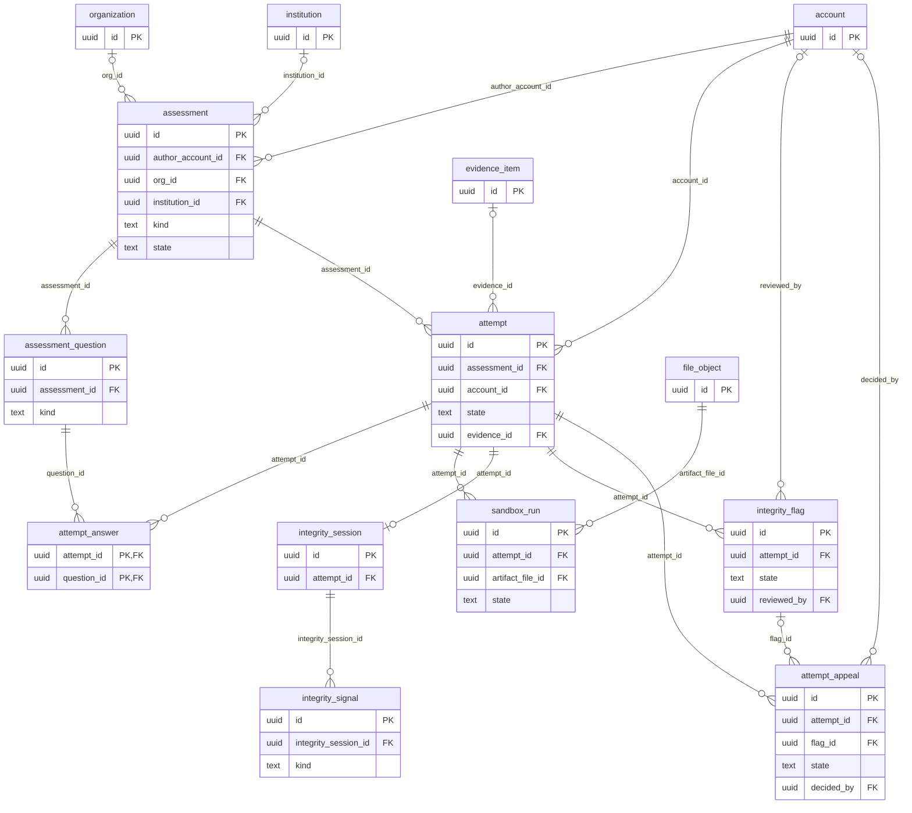

##### DATA-E0701 `assessment` — Assessment

Role: root · Tenancy/RLS: RLS-ORG/INST author + public published · Owner module: `api/assessment`

| Attribute            | Type         | Constraints / notes                                                      |
| -------------------- | ------------ | ------------------------------------------------------------------------ |
| `id`                 | uuid         | PK, UUIDv7, app-generated                                                |
| `created_at`         | timestamptz  | NN, DEF now()                                                            |
| `updated_at`         | timestamptz  | NN, DEF now()                                                            |
| `version`            | bigint       | NN, DEF 1; optimistic lock / ETag                                        |
| `author_account_id`  | uuid         | NN, FK(account.id)                                                       |
| `org_id`             | uuid         | NULL, FK(organization.id)                                                |
| `institution_id`     | uuid         | NULL, FK(institution.id)                                                 |
| `title`              | text         | NN                                                                       |
| `kind`               | text         | NN, CHK in (quiz,code,project,timed_challenge)                           |
| `ai_mode`            | text         | NN, CHK in (AI_PROHIBITED,AI_RESTRICTED,AI_ALLOWED), DEF 'AI_PROHIBITED' |
| `requires_runner`    | bool         | NN; true for code/project kinds (ADR-T13)                                |
| `state`              | text         | NN, CHK in (draft,published,retired)                                     |
| `time_limit_seconds` | int          | NULL                                                                     |
| `pass_threshold`     | numeric(5,2) | NN                                                                       |
| `spec`               | jsonb        | NN; versioned spec                                                       |
| `skill_ids`          | uuid[]       | NN                                                                       |

##### DATA-E0702 `assessment_question` — AssessmentQuestion

Role: member of Assessment · Tenancy/RLS: RLS-INTERNAL (answer key never exposed) · Owner module: `api/assessment`

| Attribute        | Type         | Constraints / notes                           |
| ---------------- | ------------ | --------------------------------------------- |
| `id`             | uuid         | PK, UUIDv7, app-generated                     |
| `created_at`     | timestamptz  | NN, DEF now()                                 |
| `updated_at`     | timestamptz  | NN, DEF now()                                 |
| `version`        | bigint       | NN, DEF 1; optimistic lock / ETag             |
| `assessment_id`  | uuid         | NN, FK(assessment.id)                         |
| `position`       | int          | NN                                            |
| `kind`           | text         | NN                                            |
| `prompt`         | jsonb        | NN                                            |
| `answer_key_enc` | bytea        | NULL; encrypted; read only by grading service |
| `points`         | numeric(6,2) | NN                                            |

##### DATA-E0703 `attempt` — Attempt

Role: root · Tenancy/RLS: RLS-OWNER · Owner module: `api/assessment`

| Attribute            | Type         | Constraints / notes                                                                                                                 |
| -------------------- | ------------ | ----------------------------------------------------------------------------------------------------------------------------------- |
| `id`                 | uuid         | PK, UUIDv7, app-generated                                                                                                           |
| `created_at`         | timestamptz  | NN, DEF now()                                                                                                                       |
| `updated_at`         | timestamptz  | NN, DEF now()                                                                                                                       |
| `version`            | bigint       | NN, DEF 1; optimistic lock / ETag                                                                                                   |
| `assessment_id`      | uuid         | NN, FK(assessment.id)                                                                                                               |
| `assessment_version` | bigint       | NN; snapshot                                                                                                                        |
| `account_id`         | uuid         | NN, FK(account.id)                                                                                                                  |
| `ai_mode_snapshot`   | text         | NN; copied at start so edits cannot weaken (INV-T06)                                                                                |
| `state`              | text         | NN, CHK in (created,in_progress,submitted,grading,passed,failed,unverified,under_review,voided,expired), DEF 'created' (SM-ATTEMPT) |
| `started_at`         | timestamptz  | NN                                                                                                                                  |
| `deadline_at`        | timestamptz  | NULL                                                                                                                                |
| `submitted_at`       | timestamptz  | NULL                                                                                                                                |
| `score`              | numeric(5,2) | NULL                                                                                                                                |
| `passed`             | bool         | NULL                                                                                                                                |
| `verification_basis` | text         | NULL, CHK in (auto_graded_objective,runner_verified,human_graded,unverified)                                                        |
| `evidence_id`        | uuid         | NULL, FK(evidence_item.id); set only when passed with a valid basis                                                                 |

##### DATA-E0704 `attempt_answer` — AttemptAnswer

Role: member of Attempt · Tenancy/RLS: RLS-OWNER · Owner module: `api/assessment`

| Attribute     | Type        | Constraints / notes                     |
| ------------- | ----------- | --------------------------------------- |
| `attempt_id`  | uuid        | NN, FK(attempt.id); PK part             |
| `question_id` | uuid        | NN, FK(assessment_question.id); PK part |
| `answer`      | jsonb       | NN                                      |
| `saved_at`    | timestamptz | NN                                      |

##### DATA-E0705 `sandbox_run` — SandboxRun

Role: member of Attempt · Tenancy/RLS: RLS-INTERNAL · Owner module: `api/assessment`

| Attribute          | Type        | Constraints / notes                                  |
| ------------------ | ----------- | ---------------------------------------------------- |
| `id`               | uuid        | PK, UUIDv7, app-generated                            |
| `created_at`       | timestamptz | NN, DEF now()                                        |
| `updated_at`       | timestamptz | NN, DEF now()                                        |
| `version`          | bigint      | NN, DEF 1; optimistic lock / ETag                    |
| `attempt_id`       | uuid        | NN, FK(attempt.id)                                   |
| `run_id`           | uuid        | NN, UQ                                               |
| `artifact_file_id` | uuid        | NN, FK(file_object.id)                               |
| `state`            | text        | NN, CHK in (queued,running,completed,failed,timeout) |
| `image_digest`     | text        | NULL                                                 |
| `limits`           | jsonb       | NN                                                   |
| `result`           | jsonb       | NULL                                                 |
| `result_signature` | bytea       | NULL; verified by worker before use                  |
| `started_at`       | timestamptz | NULL                                                 |
| `finished_at`      | timestamptz | NULL                                                 |

##### DATA-E0706 `integrity_session` — IntegritySession

Role: member of Attempt · Tenancy/RLS: RLS-INTERNAL · Owner module: `api/assessment`

| Attribute      | Type        | Constraints / notes               |
| -------------- | ----------- | --------------------------------- |
| `id`           | uuid        | PK, UUIDv7, app-generated         |
| `created_at`   | timestamptz | NN, DEF now()                     |
| `updated_at`   | timestamptz | NN, DEF now()                     |
| `version`      | bigint      | NN, DEF 1; optimistic lock / ETag |
| `attempt_id`   | uuid        | NN, FK(attempt.id), UQ            |
| `policy`       | jsonb       | NN                                |
| `signal_count` | int         | NN, DEF 0                         |

##### DATA-E0707 `integrity_signal` — IntegritySignal (append-only; partition candidate)

Role: member of IntegritySession · Tenancy/RLS: RLS-INTERNAL · Owner module: `api/assessment`

| Attribute              | Type        | Constraints / notes                                                                  |
| ---------------------- | ----------- | ------------------------------------------------------------------------------------ |
| `id`                   | uuid        | PK, UUIDv7                                                                           |
| `created_at`           | timestamptz | NN, DEF now(); row is append-only                                                    |
| `integrity_session_id` | uuid        | NN, FK(integrity_session.id)                                                         |
| `kind`                 | text        | NN                                                                                   |
| `observed_at`          | timestamptz | NN                                                                                   |
| `payload`              | jsonb       | NN; bounded size; allowlisted keys, no account identifiers or user text (DB-02 §4.1) |

##### DATA-E0708 `integrity_flag` — IntegrityFlag (advisory, human-reviewed)

Role: root · Tenancy/RLS: RLS-INTERNAL / reviewer · Owner module: `api/assessment`

| Attribute      | Type        | Constraints / notes                                                                        |
| -------------- | ----------- | ------------------------------------------------------------------------------------------ |
| `id`           | uuid        | PK, UUIDv7, app-generated                                                                  |
| `created_at`   | timestamptz | NN, DEF now()                                                                              |
| `updated_at`   | timestamptz | NN, DEF now()                                                                              |
| `version`      | bigint      | NN, DEF 1; optimistic lock / ETag                                                          |
| `attempt_id`   | uuid        | NN, FK(attempt.id)                                                                         |
| `severity`     | text        | NN, CHK in (low,medium,high)                                                               |
| `reasons`      | jsonb       | NN                                                                                         |
| `state`        | text        | NN, CHK in (open,in_review,cleared,confirmed,appealed), DEF 'open'                         |
| `reviewed_by`  | uuid        | NULL, FK(account.id); CHK reviewed_by NOT NULL when state in (cleared,confirmed) (INV-T20) |
| `reviewed_at`  | timestamptz | NULL                                                                                       |
| `outcome_note` | text        | NULL                                                                                       |

##### DATA-E0709 `attempt_appeal` — AttemptAppeal

Role: member of Attempt · Tenancy/RLS: RLS-OWNER · Owner module: `api/assessment`

| Attribute    | Type        | Constraints / notes                |
| ------------ | ----------- | ---------------------------------- |
| `id`         | uuid        | PK, UUIDv7, app-generated          |
| `created_at` | timestamptz | NN, DEF now()                      |
| `updated_at` | timestamptz | NN, DEF now()                      |
| `version`    | bigint      | NN, DEF 1; optimistic lock / ETag  |
| `attempt_id` | uuid        | NN, FK(attempt.id)                 |
| `flag_id`    | uuid        | NULL, FK(integrity_flag.id)        |
| `statement`  | text        | NN                                 |
| `state`      | text        | NN, CHK in (open,upheld,dismissed) |
| `decided_by` | uuid        | NULL, FK(account.id)               |

#### DOM-08 Learning (module `api/learning`)

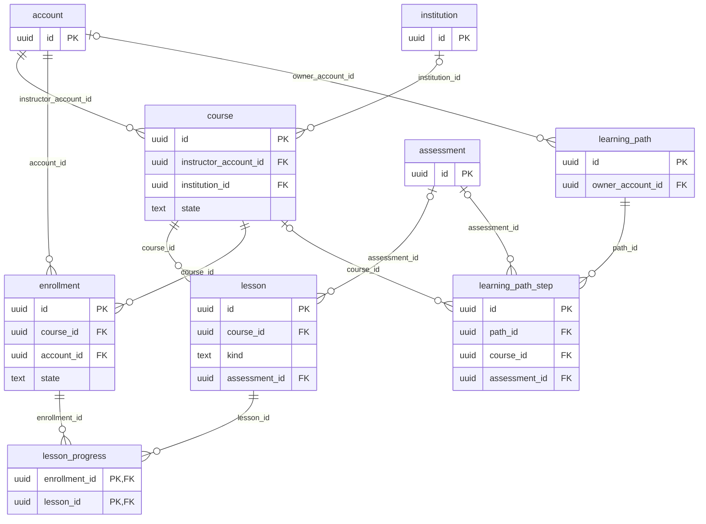

##### DATA-E0801 `course` — Course

Role: root · Tenancy/RLS: RLS-PUBLIC-READ published / author · Owner module: `api/learning`

| Attribute               | Type        | Constraints / notes                                           |
| ----------------------- | ----------- | ------------------------------------------------------------- |
| `id`                    | uuid        | PK, UUIDv7, app-generated                                     |
| `created_at`            | timestamptz | NN, DEF now()                                                 |
| `updated_at`            | timestamptz | NN, DEF now()                                                 |
| `version`               | bigint      | NN, DEF 1; optimistic lock / ETag                             |
| `instructor_account_id` | uuid        | NN, FK(account.id)                                            |
| `institution_id`        | uuid        | NULL, FK(institution.id)                                      |
| `title`                 | text        | NN                                                            |
| `slug`                  | text        | NN, UQ                                                        |
| `summary`               | text        | NULL                                                          |
| `level`                 | text        | NULL                                                          |
| `access`                | text        | NN, CHK in (free,subscription,paid), DEF 'free'               |
| `state`                 | text        | NN, CHK in (draft,in_review,published,unpublished,taken_down) |
| `published_at`          | timestamptz | NULL                                                          |

##### DATA-E0802 `lesson` — Lesson

Role: member of Course · Tenancy/RLS: RLS-PUBLIC-READ published · Owner module: `api/learning`

| Attribute       | Type        | Constraints / notes                        |
| --------------- | ----------- | ------------------------------------------ |
| `id`            | uuid        | PK, UUIDv7, app-generated                  |
| `created_at`    | timestamptz | NN, DEF now()                              |
| `updated_at`    | timestamptz | NN, DEF now()                              |
| `version`       | bigint      | NN, DEF 1; optimistic lock / ETag          |
| `course_id`     | uuid        | NN, FK(course.id)                          |
| `position`      | int         | NN                                         |
| `kind`          | text        | NN, CHK in (video,reading,quiz,assessment) |
| `content_ref`   | jsonb       | NN                                         |
| `assessment_id` | uuid        | NULL, FK(assessment.id)                    |

##### DATA-E0803 `enrollment` — Enrollment

Role: root · Tenancy/RLS: RLS-OWNER · Owner module: `api/learning`

| Attribute      | Type         | Constraints / notes                                                                             |
| -------------- | ------------ | ----------------------------------------------------------------------------------------------- |
| `id`           | uuid         | PK, UUIDv7, app-generated                                                                       |
| `created_at`   | timestamptz  | NN, DEF now()                                                                                   |
| `updated_at`   | timestamptz  | NN, DEF now()                                                                                   |
| `version`      | bigint       | NN, DEF 1; optimistic lock / ETag                                                               |
| `course_id`    | uuid         | NN, FK(course.id)                                                                               |
| `account_id`   | uuid         | NN, FK(account.id); UQ(course,account)                                                          |
| `state`        | text         | NN, CHK in (pending_payment,active,completed,dropped,expired,refunded,suspended) (SM-ENROLMENT) |
| `progress_pct` | numeric(5,2) | NN, DEF 0                                                                                       |
| `started_at`   | timestamptz  | NN                                                                                              |
| `completed_at` | timestamptz  | NULL                                                                                            |

##### DATA-E0804 `lesson_progress` — LessonProgress

Role: member of Enrollment · Tenancy/RLS: RLS-OWNER · Owner module: `api/learning`

| Attribute       | Type        | Constraints / notes            |
| --------------- | ----------- | ------------------------------ |
| `enrollment_id` | uuid        | NN, FK(enrollment.id); PK part |
| `lesson_id`     | uuid        | NN, FK(lesson.id); PK part     |
| `completed_at`  | timestamptz | NN                             |

##### DATA-E0805 `learning_path` — LearningPath

Role: root · Tenancy/RLS: RLS-OWNER / PUBLIC-READ system paths · Owner module: `api/learning`

| Attribute          | Type        | Constraints / notes                  |
| ------------------ | ----------- | ------------------------------------ |
| `id`               | uuid        | PK, UUIDv7, app-generated            |
| `created_at`       | timestamptz | NN, DEF now()                        |
| `updated_at`       | timestamptz | NN, DEF now()                        |
| `version`          | bigint      | NN, DEF 1; optimistic lock / ETag    |
| `owner_account_id` | uuid        | NULL, FK(account.id); NULL = curated |
| `title`            | text        | NN                                   |
| `goal_skill_ids`   | uuid[]      | NN                                   |

##### DATA-E0806 `learning_path_step` — LearningPathStep

Role: member of LearningPath · Tenancy/RLS: same as path · Owner module: `api/learning`

| Attribute       | Type        | Constraints / notes               |
| --------------- | ----------- | --------------------------------- |
| `id`            | uuid        | PK, UUIDv7, app-generated         |
| `created_at`    | timestamptz | NN, DEF now()                     |
| `updated_at`    | timestamptz | NN, DEF now()                     |
| `version`       | bigint      | NN, DEF 1; optimistic lock / ETag |
| `path_id`       | uuid        | NN, FK(learning_path.id)          |
| `position`      | int         | NN                                |
| `course_id`     | uuid        | NULL, FK(course.id)               |
| `assessment_id` | uuid        | NULL, FK(assessment.id)           |

#### DOM-09 Opportunities (module `api/jobs`)

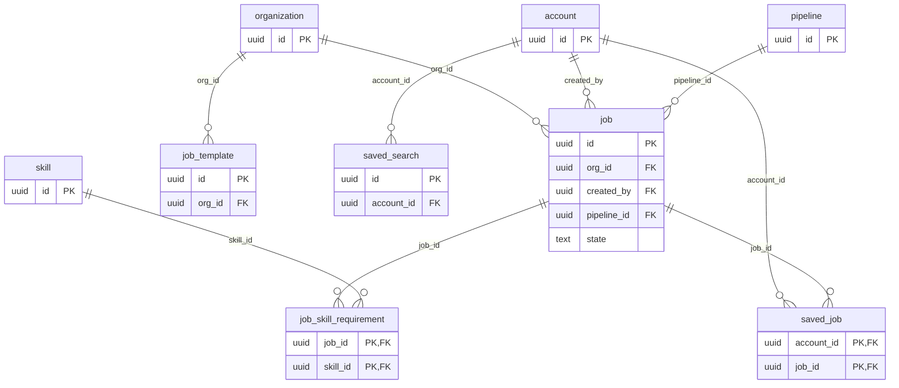

##### DATA-E0901 `job` — Job

Role: root · Tenancy/RLS: RLS-ORG + public published · Owner module: `api/jobs`

| Attribute         | Type        | Constraints / notes                                                                                             |
| ----------------- | ----------- | --------------------------------------------------------------------------------------------------------------- |
| `id`              | uuid        | PK, UUIDv7, app-generated                                                                                       |
| `created_at`      | timestamptz | NN, DEF now()                                                                                                   |
| `updated_at`      | timestamptz | NN, DEF now()                                                                                                   |
| `version`         | bigint      | NN, DEF 1; optimistic lock / ETag                                                                               |
| `org_id`          | uuid        | NN, FK(organization.id)                                                                                         |
| `created_by`      | uuid        | NN, FK(account.id)                                                                                              |
| `pipeline_id`     | uuid        | NN, FK(pipeline.id)                                                                                             |
| `title`           | text        | NN                                                                                                              |
| `description`     | text        | NN                                                                                                              |
| `location_text`   | text        | NULL                                                                                                            |
| `work_mode`       | text        | NN, CHK in (onsite,hybrid,remote)                                                                               |
| `employment_type` | text        | NN                                                                                                              |
| `salary_min`      | int         | NULL                                                                                                            |
| `salary_max`      | int         | NULL, CHK >= salary_min                                                                                         |
| `salary_currency` | text        | NULL                                                                                                            |
| `salary_period`   | text        | NULL, CHK in (hour,month,year)                                                                                  |
| `state`           | text        | NN, CHK in (draft,pending_review,scheduled,published,paused,closed,taken_down), DEF 'draft' (SM-JOB)            |
| `close_reason`    | text        | NULL, CHK in (filled,expired,cancelled); required when `state = 'closed'` (replaces the former `expired` state) |
| `publish_at`      | timestamptz | NULL; required when `state = 'scheduled'`, at most 30 days ahead                                                |
| `published_at`    | timestamptz | NULL                                                                                                            |
| `closes_at`       | timestamptz | NULL                                                                                                            |

##### DATA-E0902 `job_skill_requirement` — JobSkillRequirement

Role: member of Job · Tenancy/RLS: RLS-ORG + public · Owner module: `api/jobs`

| Attribute    | Type | Constraints / notes                                                     |
| ------------ | ---- | ----------------------------------------------------------------------- |
| `job_id`     | uuid | NN, FK(job.id); PK part                                                 |
| `skill_id`   | uuid | NN, FK(skill.id); PK part                                               |
| `importance` | text | NN, CHK in (required,preferred)                                         |
| `min_rung`   | text | NULL, CHK in (claimed,artifact_backed,peer_attested,authority_verified) |

##### DATA-E0903 `job_template` — JobTemplate

Role: root · Tenancy/RLS: RLS-ORG · Owner module: `api/jobs`

| Attribute    | Type        | Constraints / notes               |
| ------------ | ----------- | --------------------------------- |
| `id`         | uuid        | PK, UUIDv7, app-generated         |
| `created_at` | timestamptz | NN, DEF now()                     |
| `updated_at` | timestamptz | NN, DEF now()                     |
| `version`    | bigint      | NN, DEF 1; optimistic lock / ETag |
| `org_id`     | uuid        | NN, FK(organization.id)           |
| `name`       | text        | NN                                |
| `body`       | jsonb       | NN                                |

##### DATA-E0904 `saved_search` — SavedSearch

Role: root · Tenancy/RLS: RLS-OWNER · Owner module: `api/jobs`

| Attribute         | Type        | Constraints / notes                      |
| ----------------- | ----------- | ---------------------------------------- |
| `id`              | uuid        | PK, UUIDv7, app-generated                |
| `created_at`      | timestamptz | NN, DEF now()                            |
| `updated_at`      | timestamptz | NN, DEF now()                            |
| `version`         | bigint      | NN, DEF 1; optimistic lock / ETag        |
| `account_id`      | uuid        | NN, FK(account.id)                       |
| `name`            | text        | NN                                       |
| `query`           | jsonb       | NN                                       |
| `alert_frequency` | text        | NN, CHK in (off,daily,weekly), DEF 'off' |
| `last_run_at`     | timestamptz | NULL                                     |

##### DATA-E0905 `saved_job` — SavedJob

Role: member of Job · Tenancy/RLS: RLS-OWNER · Owner module: `api/jobs`

| Attribute    | Type        | Constraints / notes         |
| ------------ | ----------- | --------------------------- |
| `account_id` | uuid        | NN, FK(account.id); PK part |
| `job_id`     | uuid        | NN, FK(job.id); PK part     |
| `saved_at`   | timestamptz | NN                          |

#### DOM-10 Applications & Hiring Pipeline (module `api/applications`)

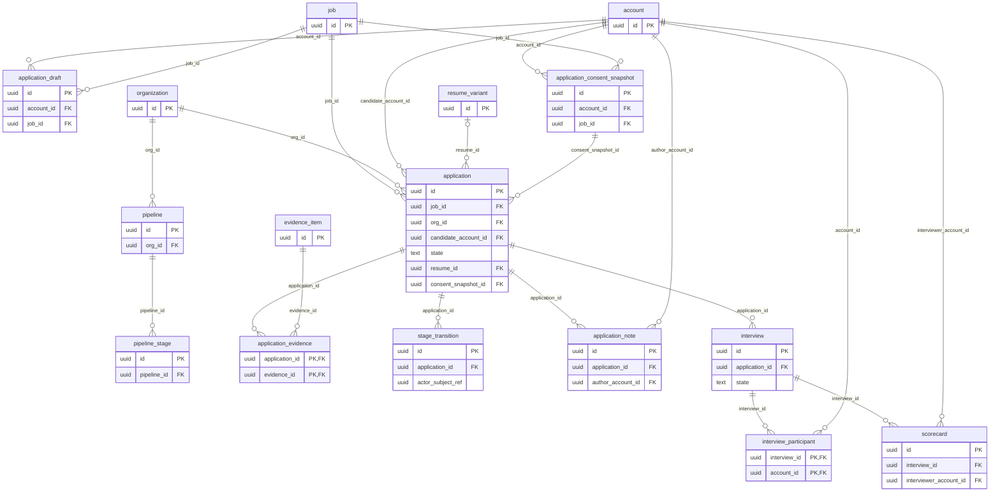

##### DATA-E1001 `pipeline` — Pipeline

Role: root · Tenancy/RLS: RLS-ORG · Owner module: `api/applications`

| Attribute    | Type        | Constraints / notes               |
| ------------ | ----------- | --------------------------------- |
| `id`         | uuid        | PK, UUIDv7, app-generated         |
| `created_at` | timestamptz | NN, DEF now()                     |
| `updated_at` | timestamptz | NN, DEF now()                     |
| `version`    | bigint      | NN, DEF 1; optimistic lock / ETag |
| `org_id`     | uuid        | NN, FK(organization.id)           |
| `name`       | text        | NN                                |
| `is_default` | bool        | NN, DEF false                     |

##### DATA-E1002 `pipeline_stage` — PipelineStage

Role: member of Pipeline · Tenancy/RLS: RLS-ORG · Owner module: `api/applications`

| Attribute     | Type        | Constraints / notes                                                                                               |
| ------------- | ----------- | ----------------------------------------------------------------------------------------------------------------- |
| `id`          | uuid        | PK, UUIDv7, app-generated                                                                                         |
| `created_at`  | timestamptz | NN, DEF now()                                                                                                     |
| `updated_at`  | timestamptz | NN, DEF now()                                                                                                     |
| `version`     | bigint      | NN, DEF 1; optimistic lock / ETag                                                                                 |
| `pipeline_id` | uuid        | NN, FK(pipeline.id)                                                                                               |
| `stage_key`   | text        | NN; UQ(pipeline,stage_key)                                                                                        |
| `label`       | text        | NN                                                                                                                |
| `position`    | int         | NN                                                                                                                |
| `macro_state` | text        | NN, CHK in (in_review,shortlisted,interviewing,offer_extended,hired,rejected); maps stage to SM-APPLICATION state |

##### DATA-E1003 `application` — Application

Role: root · Tenancy/RLS: RLS-OWNER + RLS-ORG · Owner module: `api/applications`

| Attribute              | Type        | Constraints / notes                                                                                                                                                                                  |
| ---------------------- | ----------- | ---------------------------------------------------------------------------------------------------------------------------------------------------------------------------------------------------- |
| `id`                   | uuid        | PK, UUIDv7, app-generated                                                                                                                                                                            |
| `created_at`           | timestamptz | NN, DEF now()                                                                                                                                                                                        |
| `updated_at`           | timestamptz | NN, DEF now()                                                                                                                                                                                        |
| `version`              | bigint      | NN, DEF 1; optimistic lock / ETag                                                                                                                                                                    |
| `job_id`               | uuid        | NN, FK(job.id)                                                                                                                                                                                       |
| `org_id`               | uuid        | NN, FK(organization.id); denormalised tenant column for RLS                                                                                                                                          |
| `candidate_account_id` | uuid        | NN, FK(account.id)                                                                                                                                                                                   |
| `state`                | text        | NN, CHK in (submitted,in_review,shortlisted,interviewing,offer_extended,hired,rejected,withdrawn,offer_declined), DEF 'submitted' (SM-APPLICATION; its `draft` state is the `application_draft` row) |
| `stage_key`            | text        | NN                                                                                                                                                                                                   |
| `resume_id`            | uuid        | NULL, FK(resume_variant.id)                                                                                                                                                                          |
| `cover_note`           | text        | NULL, CHK length<=4000                                                                                                                                                                               |
| `consent_snapshot_id`  | uuid        | NN, FK(application_consent_snapshot.id)                                                                                                                                                              |
| `submitted_at`         | timestamptz | NN                                                                                                                                                                                                   |
| `terminal_at`          | timestamptz | NULL; set on rejected/withdrawn/hired/offer_declined; terminal rows immutable (INV-T11)                                                                                                              |

##### DATA-E1004 `application_draft` — ApplicationDraft

Role: member of Application · Tenancy/RLS: RLS-OWNER · Owner module: `api/applications`

| Attribute    | Type        | Constraints / notes               |
| ------------ | ----------- | --------------------------------- |
| `id`         | uuid        | PK, UUIDv7, app-generated         |
| `created_at` | timestamptz | NN, DEF now()                     |
| `updated_at` | timestamptz | NN, DEF now()                     |
| `version`    | bigint      | NN, DEF 1; optimistic lock / ETag |
| `account_id` | uuid        | NN, FK(account.id)                |
| `job_id`     | uuid        | NN, FK(job.id); UQ(account,job)   |
| `payload`    | jsonb       | NN; bounded size                  |
| `expires_at` | timestamptz | NN                                |

##### DATA-E1005 `application_consent_snapshot` — ConsentSnapshot

Role: member of Application · Tenancy/RLS: RLS-OWNER read / ORG read · Owner module: `api/applications`

| Attribute            | Type        | Constraints / notes                         |
| -------------------- | ----------- | ------------------------------------------- |
| `id`                 | uuid        | PK, UUIDv7                                  |
| `created_at`         | timestamptz | NN, DEF now(); row is append-only           |
| `account_id`         | uuid        | NN, FK(account.id)                          |
| `job_id`             | uuid        | NN, FK(job.id)                              |
| `consent_record_ids` | uuid[]      | NN; the exact consent_record rows relied on |
| `policy_version`     | text        | NN                                          |

##### DATA-E1006 `application_evidence` — ApplicationEvidence

Role: member of Application · Tenancy/RLS: RLS-OWNER + RLS-ORG(consented) · Owner module: `api/applications`

| Attribute            | Type   | Constraints / notes               |
| -------------------- | ------ | --------------------------------- |
| `application_id`     | uuid   | NN, FK(application.id); PK part   |
| `evidence_id`        | uuid   | NN, FK(evidence_item.id); PK part |
| `rung_at_submission` | text   | NN                                |
| `evidence_version`   | bigint | NN                                |

##### DATA-E1007 `stage_transition` — StageTransition (append-only)

Role: member of Application · Tenancy/RLS: RLS-ORG · Owner module: `api/applications`

| Attribute           | Type        | Constraints / notes                                                                                                                              |
| ------------------- | ----------- | ------------------------------------------------------------------------------------------------------------------------------------------------ |
| `id`                | uuid        | PK, UUIDv7                                                                                                                                       |
| `created_at`        | timestamptz | NN, DEF now(); row is append-only                                                                                                                |
| `application_id`    | uuid        | NN, FK(application.id)                                                                                                                           |
| `from_state`        | text        | NN                                                                                                                                               |
| `to_state`          | text        | NN                                                                                                                                               |
| `from_stage`        | text        | NN                                                                                                                                               |
| `to_stage`          | text        | NN                                                                                                                                               |
| `actor_subject_ref` | uuid        | NN; opaque `subject_ref` of the acting human, no FK, resolved through subject_identity_map (DB-02 §4.1); NOT NULL enforces human actor (INV-T09) |
| `reason_code`       | text        | NULL                                                                                                                                             |
| `note_ref`          | uuid        | NULL; soft reference to application_note.id (free-text narrative lives in the erasable note, never in this append-only row)                      |
| `idempotency_key`   | text        | NULL                                                                                                                                             |
| `prev_hash`         | bytea       | NULL; row_hash of the previous transition of the same application (aggregate chain under the application row lock; DB-02 §4.2)                   |
| `row_hash`          | bytea       | NN; SHA256(canonical(row)); sealed into `audit_anchor` batches                                                                                   |

##### DATA-E1008 `application_note` — ApplicationNote

Role: member of Application · Tenancy/RLS: RLS-ORG · Owner module: `api/applications`

| Attribute           | Type        | Constraints / notes               |
| ------------------- | ----------- | --------------------------------- |
| `id`                | uuid        | PK, UUIDv7, app-generated         |
| `created_at`        | timestamptz | NN, DEF now()                     |
| `updated_at`        | timestamptz | NN, DEF now()                     |
| `version`           | bigint      | NN, DEF 1; optimistic lock / ETag |
| `application_id`    | uuid        | NN, FK(application.id)            |
| `author_account_id` | uuid        | NN, FK(account.id)                |
| `body`              | text        | NN, CHK length<=4000              |

##### DATA-E1009 `interview` — Interview

Role: member of Application · Tenancy/RLS: RLS-ORG + candidate participant · Owner module: `api/applications`

| Attribute          | Type        | Constraints / notes                                                                                            |
| ------------------ | ----------- | -------------------------------------------------------------------------------------------------------------- |
| `id`               | uuid        | PK, UUIDv7, app-generated                                                                                      |
| `created_at`       | timestamptz | NN, DEF now()                                                                                                  |
| `updated_at`       | timestamptz | NN, DEF now()                                                                                                  |
| `version`          | bigint      | NN, DEF 1; optimistic lock / ETag                                                                              |
| `application_id`   | uuid        | NN, FK(application.id)                                                                                         |
| `scheduled_at`     | timestamptz | NULL until a slot is confirmed; NN when `state` in (scheduled,completed,no_show)                               |
| `proposed_slots`   | jsonb       | NULL; 1..5 slots offered while `state = 'proposed'` (72 h hold)                                                |
| `reschedule_of`    | uuid        | NULL, FK(interview.id); set on the new `proposed` record that supersedes a `rescheduled` one                   |
| `duration_minutes` | int         | NN                                                                                                             |
| `mode`             | text        | NN, CHK in (video,phone,onsite)                                                                                |
| `location_ref`     | text        | NULL                                                                                                           |
| `state`            | text        | NN, CHK in (proposed,scheduled,completed,cancelled,rescheduled,no_show,expired), DEF 'proposed' (SM-INTERVIEW) |

##### DATA-E1010 `interview_participant` — InterviewParticipant

Role: member of Interview · Tenancy/RLS: RLS-ORG · Owner module: `api/applications`

| Attribute      | Type | Constraints / notes                         |
| -------------- | ---- | ------------------------------------------- |
| `interview_id` | uuid | NN, FK(interview.id); PK part               |
| `account_id`   | uuid | NN, FK(account.id); PK part                 |
| `role`         | text | NN, CHK in (interviewer,candidate,observer) |

##### DATA-E1011 `scorecard` — Scorecard

Role: member of Interview · Tenancy/RLS: RLS-ORG · Owner module: `api/applications`

| Attribute                | Type        | Constraints / notes                                     |
| ------------------------ | ----------- | ------------------------------------------------------- |
| `id`                     | uuid        | PK, UUIDv7, app-generated                               |
| `created_at`             | timestamptz | NN, DEF now()                                           |
| `updated_at`             | timestamptz | NN, DEF now()                                           |
| `version`                | bigint      | NN, DEF 1; optimistic lock / ETag                       |
| `interview_id`           | uuid        | NN, FK(interview.id)                                    |
| `interviewer_account_id` | uuid        | NN, FK(account.id); UQ(interview,interviewer)           |
| `ratings`                | jsonb       | NN                                                      |
| `recommendation`         | text        | NN, CHK in (strong_yes,yes,no,strong_no); human-entered |
| `submitted_at`           | timestamptz | NN                                                      |

#### DOM-11 Matching, Search & Recommendations (module `api/search, api/matching`)

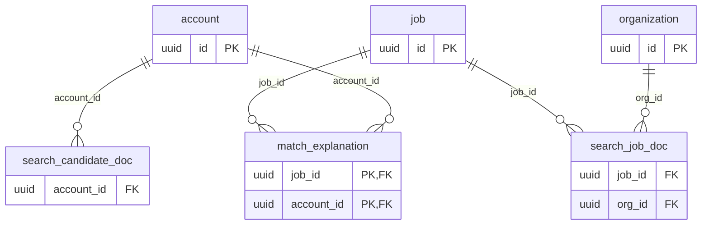

##### DATA-E1101 `search_job_doc` — SearchJobDoc (derived)

Role: derived from Job · Tenancy/RLS: RLS-PUBLIC-READ published · Owner module: `api/search, api/matching`

| Attribute        | Type         | Constraints / notes     |
| ---------------- | ------------ | ----------------------- |
| `job_id`         | uuid         | NN, FK(job.id); PK      |
| `org_id`         | uuid         | NN, FK(organization.id) |
| `tsv`            | tsvector     | NN                      |
| `embedding`      | vector(1536) | NULL                    |
| `facets`         | jsonb        | NN                      |
| `source_version` | bigint       | NN                      |
| `indexed_at`     | timestamptz  | NN                      |

##### DATA-E1102 `search_candidate_doc` — SearchCandidateDoc (derived, consent-gated)

Role: derived from Profile+Evidence · Tenancy/RLS: RLS-INTERNAL (queries via module only) · Owner module: `api/search, api/matching`

| Attribute        | Type         | Constraints / notes                         |
| ---------------- | ------------ | ------------------------------------------- |
| `account_id`     | uuid         | NN, FK(account.id); PK                      |
| `tsv`            | tsvector     | NN                                          |
| `embedding`      | vector(1536) | NULL                                        |
| `visible_fields` | jsonb        | NN; only consented fields                   |
| `rung_summary`   | jsonb        | NN                                          |
| `consent_epoch`  | bigint       | NN; mismatch with current epoch invalidates |
| `indexed_at`     | timestamptz  | NN                                          |

##### DATA-E1103 `match_explanation` — MatchExplanation (derived)

Role: derived · Tenancy/RLS: RLS-OWNER + RLS-ORG(consented) · Owner module: `api/search, api/matching`

| Attribute       | Type         | Constraints / notes                               |
| --------------- | ------------ | ------------------------------------------------- |
| `job_id`        | uuid         | NN, FK(job.id); PK part                           |
| `account_id`    | uuid         | NN, FK(account.id); PK part                       |
| `score`         | numeric(5,4) | NN                                                |
| `factors`       | jsonb        | NN; [{skill, evidenceRung, weight, contribution}] |
| `uncertainty`   | jsonb        | NN                                                |
| `model_version` | text         | NN                                                |
| `stale`         | bool         | NN, DEF false                                     |
| `computed_at`   | timestamptz  | NN                                                |
| `expires_at`    | timestamptz  | NN                                                |

#### DOM-12 Career Intelligence (module `api/careerintel`)

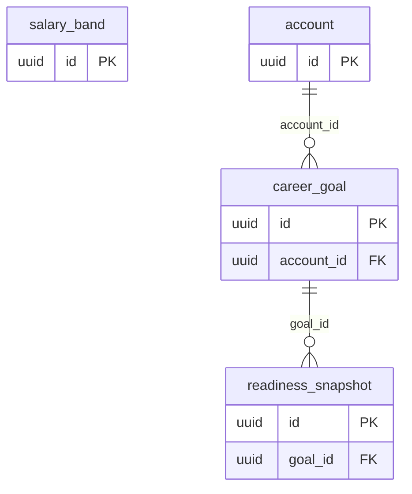

##### DATA-E1201 `career_goal` — CareerGoal

Role: root · Tenancy/RLS: RLS-OWNER · Owner module: `api/careerintel`

| Attribute          | Type        | Constraints / notes               |
| ------------------ | ----------- | --------------------------------- |
| `id`               | uuid        | PK, UUIDv7, app-generated         |
| `created_at`       | timestamptz | NN, DEF now()                     |
| `updated_at`       | timestamptz | NN, DEF now()                     |
| `version`          | bigint      | NN, DEF 1; optimistic lock / ETag |
| `account_id`       | uuid        | NN, FK(account.id)                |
| `target_role`      | text        | NN                                |
| `target_skill_ids` | uuid[]      | NN                                |
| `target_date`      | date        | NULL                              |

##### DATA-E1202 `readiness_snapshot` — ReadinessSnapshot (derived)

Role: derived · Tenancy/RLS: RLS-OWNER · Owner module: `api/careerintel`

| Attribute       | Type         | Constraints / notes               |
| --------------- | ------------ | --------------------------------- |
| `id`            | uuid         | PK, UUIDv7                        |
| `created_at`    | timestamptz  | NN, DEF now(); row is append-only |
| `goal_id`       | uuid         | NN, FK(career_goal.id)            |
| `score`         | numeric(5,2) | NN                                |
| `gaps`          | jsonb        | NN                                |
| `model_version` | text         | NN                                |

##### DATA-E1203 `salary_band` — SalaryBand (reference data)

Role: root · Tenancy/RLS: RLS-PUBLIC-READ · Owner module: `api/careerintel`

| Attribute     | Type        | Constraints / notes                           |
| ------------- | ----------- | --------------------------------------------- |
| `id`          | uuid        | PK, UUIDv7, app-generated                     |
| `created_at`  | timestamptz | NN, DEF now()                                 |
| `updated_at`  | timestamptz | NN, DEF now()                                 |
| `version`     | bigint      | NN, DEF 1; optimistic lock / ETag             |
| `role_family` | text        | NN                                            |
| `region`      | text        | NN                                            |
| `p25`         | int         | NN                                            |
| `p50`         | int         | NN                                            |
| `p75`         | int         | NN                                            |
| `currency`    | text        | NN                                            |
| `source`      | text        | NN; provenance of dataset (OPEN: data source) |
| `as_of`       | date        | NN                                            |

#### DOM-13 Messaging & Collaboration (module `api/messaging`)

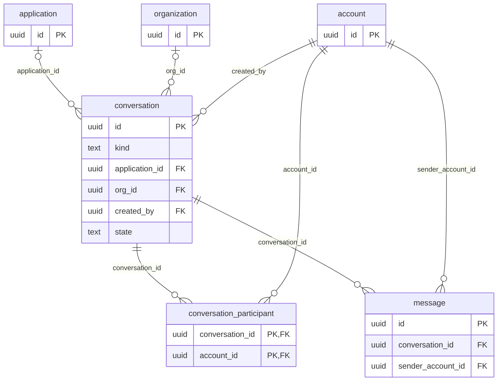

##### DATA-E1301 `conversation` — Conversation

Role: root · Tenancy/RLS: RLS-PARTICIPANT · Owner module: `api/messaging`

| Attribute         | Type        | Constraints / notes                          |
| ----------------- | ----------- | -------------------------------------------- |
| `id`              | uuid        | PK, UUIDv7, app-generated                    |
| `created_at`      | timestamptz | NN, DEF now()                                |
| `updated_at`      | timestamptz | NN, DEF now()                                |
| `version`         | bigint      | NN, DEF 1; optimistic lock / ETag            |
| `kind`            | text        | NN, CHK in (direct,application,outreach)     |
| `application_id`  | uuid        | NULL, FK(application.id)                     |
| `org_id`          | uuid        | NULL, FK(organization.id)                    |
| `created_by`      | uuid        | NN, FK(account.id)                           |
| `state`           | text        | NN, CHK in (open,closed,blocked), DEF 'open' |
| `last_message_at` | timestamptz | NULL                                         |

##### DATA-E1302 `conversation_participant` — ConversationParticipant

Role: member of Conversation · Tenancy/RLS: RLS-PARTICIPANT · Owner module: `api/messaging`

| Attribute              | Type        | Constraints / notes              |
| ---------------------- | ----------- | -------------------------------- |
| `conversation_id`      | uuid        | NN, FK(conversation.id); PK part |
| `account_id`           | uuid        | NN, FK(account.id); PK part      |
| `role`                 | text        | NN                               |
| `muted`                | bool        | NN, DEF false                    |
| `last_read_message_id` | uuid        | NULL                             |
| `joined_at`            | timestamptz | NN                               |
| `left_at`              | timestamptz | NULL                             |

##### DATA-E1303 `message` — Message

Role: member of Conversation · Tenancy/RLS: RLS-PARTICIPANT · Owner module: `api/messaging`

| Attribute           | Type        | Constraints / notes                                               |
| ------------------- | ----------- | ----------------------------------------------------------------- |
| `id`                | uuid        | PK, UUIDv7                                                        |
| `created_at`        | timestamptz | NN, DEF now(); row is append-only                                 |
| `conversation_id`   | uuid        | NN, FK(conversation.id)                                           |
| `sender_account_id` | uuid        | NN, FK(account.id)                                                |
| `body`              | text        | NN, CHK length<=8000; treated as untrusted text, never HTML       |
| `client_msg_id`     | text        | NN; UQ(conversation,sender,client_msg_id) dedupes offline retries |
| `edited_at`         | timestamptz | NULL                                                              |
| `deleted_at`        | timestamptz | NULL                                                              |
| `moderation_state`  | text        | NN, CHK in (ok,flagged,hidden), DEF 'ok'                          |

#### DOM-14 Networking & Community (phase 3, conditional) (module `api/network`)

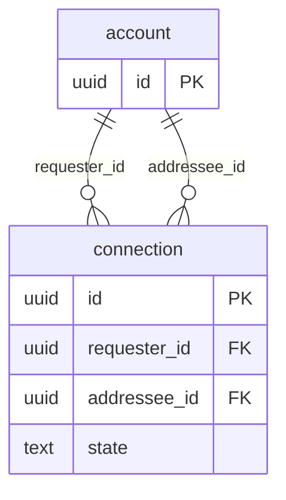

##### DATA-E1401 `connection` — Connection

Role: root · Tenancy/RLS: RLS-PARTICIPANT · Owner module: `api/network`

| Attribute      | Type        | Constraints / notes                             |
| -------------- | ----------- | ----------------------------------------------- |
| `id`           | uuid        | PK, UUIDv7, app-generated                       |
| `created_at`   | timestamptz | NN, DEF now()                                   |
| `updated_at`   | timestamptz | NN, DEF now()                                   |
| `version`      | bigint      | NN, DEF 1; optimistic lock / ETag               |
| `requester_id` | uuid        | NN, FK(account.id)                              |
| `addressee_id` | uuid        | NN, FK(account.id); UQ on (least,greatest) pair |
| `state`        | text        | NN, CHK in (pending,accepted,declined,blocked)  |
| `responded_at` | timestamptz | NULL                                            |

#### DOM-15 Notifications & Engagement (module `api/notify`)

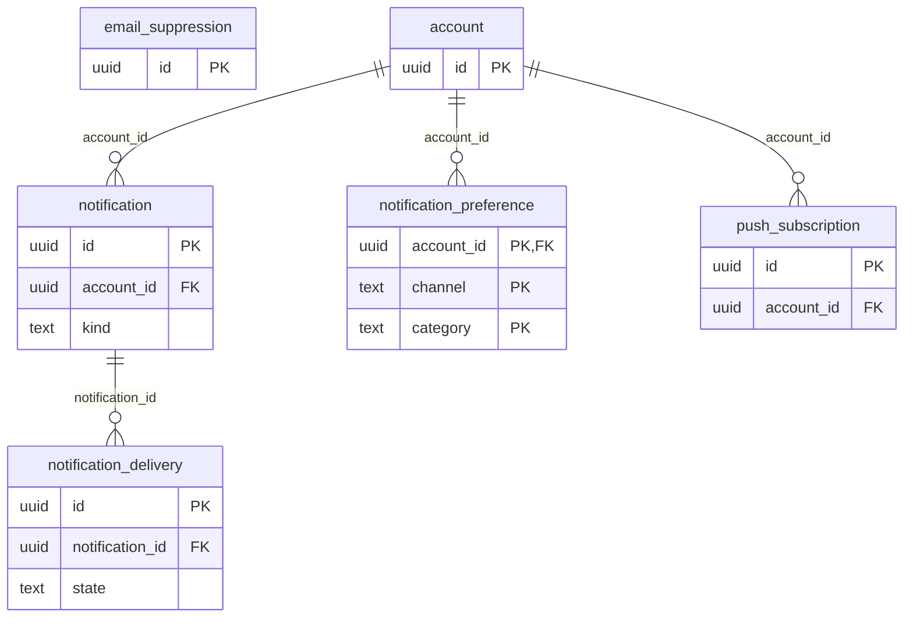

##### DATA-E1501 `notification` — Notification

Role: root · Tenancy/RLS: RLS-OWNER · Owner module: `api/notify`

| Attribute         | Type        | Constraints / notes                               |
| ----------------- | ----------- | ------------------------------------------------- |
| `id`              | uuid        | PK, UUIDv7                                        |
| `created_at`      | timestamptz | NN, DEF now()                                     |
| `updated_at`      | timestamptz | NN, DEF now()                                     |
| `account_id`      | uuid        | NN, FK(account.id)                                |
| `kind`            | text        | NN                                                |
| `payload`         | jsonb       | NN; references only (ids), no sensitive free text |
| `dedupe_key`      | text        | NN; UQ(account,dedupe_key)                        |
| `source_event_id` | uuid        | NULL                                              |
| `read_at`         | timestamptz | NULL                                              |

##### DATA-E1502 `notification_preference` — NotificationPreference

Role: member of Account · Tenancy/RLS: RLS-OWNER · Owner module: `api/notify`

| Attribute     | Type  | Constraints / notes                     |
| ------------- | ----- | --------------------------------------- |
| `account_id`  | uuid  | NN, FK(account.id); PK part             |
| `channel`     | text  | NN, CHK in (in_app,email,push); PK part |
| `category`    | text  | NN; PK part                             |
| `enabled`     | bool  | NN                                      |
| `frequency`   | text  | NN, CHK in (immediate,daily,weekly)     |
| `quiet_hours` | jsonb | NULL                                    |

##### DATA-E1503 `notification_delivery` — NotificationDelivery (partition candidate)

Role: member of Notification · Tenancy/RLS: RLS-INTERNAL · Owner module: `api/notify`

| Attribute             | Type        | Constraints / notes                                                                                                                     |
| --------------------- | ----------- | --------------------------------------------------------------------------------------------------------------------------------------- |
| `id`                  | uuid        | PK, UUIDv7                                                                                                                              |
| `created_at`          | timestamptz | NN, DEF now()                                                                                                                           |
| `updated_at`          | timestamptz | NN, DEF now()                                                                                                                           |
| `notification_id`     | uuid        | NN, FK(notification.id)                                                                                                                 |
| `channel`             | text        | NN                                                                                                                                      |
| `state`               | text        | NN, CHK in (queued,suppressed,deferred,sending,sent,delivered,failed_retry,failed,bounced,complained,expired), DEF 'queued' (SM-NOTIFY) |
| `provider`            | text        | NULL                                                                                                                                    |
| `provider_message_id` | text        | NULL                                                                                                                                    |
| `attempts`            | int         | NN, DEF 0                                                                                                                               |
| `last_error_class`    | text        | NULL                                                                                                                                    |
| `sent_at`             | timestamptz | NULL                                                                                                                                    |

##### DATA-E1504 `push_subscription` — PushSubscription

Role: member of Account · Tenancy/RLS: RLS-OWNER · Owner module: `api/notify`

| Attribute          | Type        | Constraints / notes               |
| ------------------ | ----------- | --------------------------------- |
| `id`               | uuid        | PK, UUIDv7, app-generated         |
| `created_at`       | timestamptz | NN, DEF now()                     |
| `updated_at`       | timestamptz | NN, DEF now()                     |
| `version`          | bigint      | NN, DEF 1; optimistic lock / ETag |
| `account_id`       | uuid        | NN, FK(account.id)                |
| `endpoint_hash`    | bytea       | NN, UQ                            |
| `endpoint_enc`     | bytea       | NN                                |
| `p256dh_enc`       | bytea       | NN                                |
| `auth_enc`         | bytea       | NN                                |
| `user_agent_class` | text        | NULL                              |
| `last_success_at`  | timestamptz | NULL                              |
| `expired_at`       | timestamptz | NULL                              |

##### DATA-E1505 `email_suppression` — EmailSuppression

Role: root · Tenancy/RLS: RLS-INTERNAL · Owner module: `api/notify`

| Attribute         | Type        | Constraints / notes                              |
| ----------------- | ----------- | ------------------------------------------------ |
| `id`              | uuid        | PK, UUIDv7, app-generated                        |
| `created_at`      | timestamptz | NN, DEF now()                                    |
| `updated_at`      | timestamptz | NN, DEF now()                                    |
| `version`         | bigint      | NN, DEF 1; optimistic lock / ETag                |
| `email_hash`      | bytea       | NN, UQ                                           |
| `reason`          | text        | NN, CHK in (bounce,complaint,unsubscribe,manual) |
| `source_event_id` | uuid        | NULL                                             |

#### DOM-16 Billing, Plans & Entitlements (module `api/billing`)

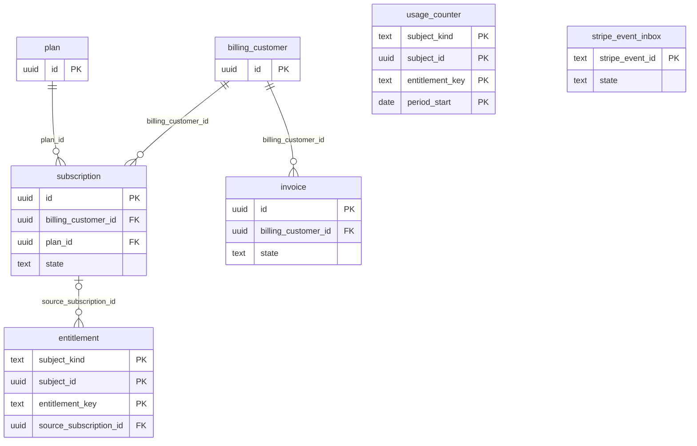

##### DATA-E1601 `plan` — Plan (configuration data)

Role: root · Tenancy/RLS: RLS-PUBLIC-READ · Owner module: `api/billing`

| Attribute         | Type        | Constraints / notes               |
| ----------------- | ----------- | --------------------------------- |
| `id`              | uuid        | PK, UUIDv7, app-generated         |
| `created_at`      | timestamptz | NN, DEF now()                     |
| `updated_at`      | timestamptz | NN, DEF now()                     |
| `version`         | bigint      | NN, DEF 1; optimistic lock / ETag |
| `plan_key`        | text        | NN, UQ                            |
| `name`            | text        | NN                                |
| `subject_kind`    | text        | NN, CHK in (account,org)          |
| `interval`        | text        | NN, CHK in (month,year)           |
| `price_minor`     | int         | NN                                |
| `currency`        | text        | NN                                |
| `stripe_price_id` | text        | NN, UQ                            |
| `features`        | jsonb       | NN; entitlement keys and limits   |
| `active`          | bool        | NN                                |

##### DATA-E1602 `billing_customer` — BillingCustomer

Role: root · Tenancy/RLS: RLS-ORG / OWNER · Owner module: `api/billing`

| Attribute            | Type        | Constraints / notes               |
| -------------------- | ----------- | --------------------------------- |
| `id`                 | uuid        | PK, UUIDv7, app-generated         |
| `created_at`         | timestamptz | NN, DEF now()                     |
| `updated_at`         | timestamptz | NN, DEF now()                     |
| `version`            | bigint      | NN, DEF 1; optimistic lock / ETag |
| `subject_kind`       | text        | NN, CHK in (account,org)          |
| `subject_id`         | uuid        | NN; UQ(subject_kind,subject_id)   |
| `stripe_customer_id` | text        | NN, UQ                            |

##### DATA-E1603 `subscription` — Subscription

Role: member of BillingCustomer · Tenancy/RLS: RLS-ORG / OWNER · Owner module: `api/billing`

| Attribute                   | Type        | Constraints / notes                                                                                                                                                                                    |
| --------------------------- | ----------- | ------------------------------------------------------------------------------------------------------------------------------------------------------------------------------------------------------ |
| `id`                        | uuid        | PK, UUIDv7, app-generated                                                                                                                                                                              |
| `created_at`                | timestamptz | NN, DEF now()                                                                                                                                                                                          |
| `updated_at`                | timestamptz | NN, DEF now()                                                                                                                                                                                          |
| `version`                   | bigint      | NN, DEF 1; optimistic lock / ETag                                                                                                                                                                      |
| `billing_customer_id`       | uuid        | NN, FK(billing_customer.id)                                                                                                                                                                            |
| `plan_id`                   | uuid        | NN, FK(plan.id)                                                                                                                                                                                        |
| `stripe_subscription_id`    | text        | NN, UQ                                                                                                                                                                                                 |
| `state`                     | text        | NN, CHK in (incomplete,active,canceling,past_due,unpaid,canceled,incomplete_expired) (SM-SUBSCRIPTION; no `trialing`; `canceled` is the processor spelling; "no subscription" is the absence of a row) |
| `seats`                     | int         | NN, DEF 1                                                                                                                                                                                              |
| `current_period_end`        | timestamptz | NULL                                                                                                                                                                                                   |
| `cancel_at_period_end`      | bool        | NN, DEF false; processor mirror; `state = 'canceling'` implies true                                                                                                                                    |
| `provider_event_created_at` | timestamptz | NN; out-of-order webhook guard                                                                                                                                                                         |

##### DATA-E1604 `entitlement` — Entitlement (derived server-side)

Role: derived from Subscription · Tenancy/RLS: RLS-ORG / OWNER · Owner module: `api/billing`

| Attribute                | Type        | Constraints / notes       |
| ------------------------ | ----------- | ------------------------- |
| `subject_kind`           | text        | NN; PK part               |
| `subject_id`             | uuid        | NN; PK part               |
| `entitlement_key`        | text        | NN; PK part               |
| `limit_value`            | bigint      | NULL (NULL = unlimited)   |
| `source_subscription_id` | uuid        | NULL, FK(subscription.id) |
| `valid_until`            | timestamptz | NULL                      |
| `computed_at`            | timestamptz | NN                        |

##### DATA-E1605 `usage_counter` — UsageCounter

Role: member of Entitlement · Tenancy/RLS: RLS-ORG / OWNER · Owner module: `api/billing`

| Attribute         | Type   | Constraints / notes                                  |
| ----------------- | ------ | ---------------------------------------------------- |
| `subject_kind`    | text   | NN; PK part                                          |
| `subject_id`      | uuid   | NN; PK part                                          |
| `entitlement_key` | text   | NN; PK part                                          |
| `period_start`    | date   | NN; PK part                                          |
| `used`            | bigint | NN, DEF 0; atomic `used = used + n` with limit guard |

##### DATA-E1606 `invoice` — Invoice

Role: member of BillingCustomer · Tenancy/RLS: RLS-ORG / OWNER · Owner module: `api/billing`

| Attribute             | Type        | Constraints / notes               |
| --------------------- | ----------- | --------------------------------- |
| `id`                  | uuid        | PK, UUIDv7, app-generated         |
| `created_at`          | timestamptz | NN, DEF now()                     |
| `updated_at`          | timestamptz | NN, DEF now()                     |
| `version`             | bigint      | NN, DEF 1; optimistic lock / ETag |
| `billing_customer_id` | uuid        | NN, FK(billing_customer.id)       |
| `stripe_invoice_id`   | text        | NN, UQ                            |
| `amount_due_minor`    | int         | NN                                |
| `amount_paid_minor`   | int         | NN                                |
| `currency`            | text        | NN                                |
| `state`               | text        | NN                                |
| `hosted_invoice_url`  | text        | NULL                              |
| `issued_at`           | timestamptz | NN                                |

##### DATA-E1607 `stripe_event_inbox` — StripeEventInbox (webhook dedupe)

Role: root · Tenancy/RLS: RLS-INTERNAL · Owner module: `api/billing`

| Attribute         | Type        | Constraints / notes                            |
| ----------------- | ----------- | ---------------------------------------------- |
| `stripe_event_id` | text        | NN, PK                                         |
| `event_type`      | text        | NN                                             |
| `received_at`     | timestamptz | NN                                             |
| `processed_at`    | timestamptz | NULL                                           |
| `state`           | text        | NN, CHK in (received,processed,failed,ignored) |
| `payload_hash`    | bytea       | NN                                             |

#### DOM-17 AI Gateway & Governance (module `api/ai`)

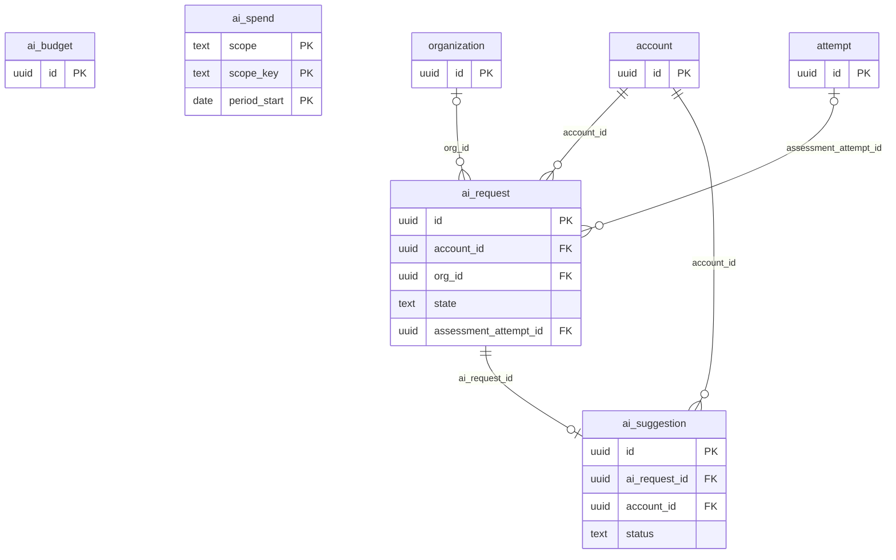

##### DATA-E1701 `ai_request` — AiRequest (partition candidate)

Role: root · Tenancy/RLS: RLS-OWNER read / INTERNAL · Owner module: `api/ai`

| Attribute               | Type        | Constraints / notes                                              |
| ----------------------- | ----------- | ---------------------------------------------------------------- |
| `id`                    | uuid        | PK, UUIDv7                                                       |
| `created_at`            | timestamptz | NN, DEF now(); row is append-only                                |
| `account_id`            | uuid        | NN, FK(account.id)                                               |
| `org_id`                | uuid        | NULL, FK(organization.id)                                        |
| `purpose`               | text        | NN                                                               |
| `provider`              | text        | NN                                                               |
| `model`                 | text        | NN                                                               |
| `state`                 | text        | NN, CHK in (reserved,completed,denied,failed)                    |
| `denial_reason`         | text        | NULL, CHK in (prohibited_mode,consent,budget,entitlement,policy) |
| `assessment_attempt_id` | uuid        | NULL, FK(attempt.id)                                             |
| `prompt_hash`           | bytea       | NN; SHA-256; no raw prompt stored                                |
| `input_tokens`          | int         | NULL                                                             |
| `output_tokens`         | int         | NULL                                                             |
| `cost_micros`           | bigint      | NULL                                                             |
| `redaction_summary`     | jsonb       | NN                                                               |
| `latency_ms`            | int         | NULL                                                             |

##### DATA-E1702 `ai_suggestion` — AiSuggestion

Role: member of AiRequest · Tenancy/RLS: RLS-OWNER · Owner module: `api/ai`

| Attribute        | Type        | Constraints / notes                                                    |
| ---------------- | ----------- | ---------------------------------------------------------------------- |
| `id`             | uuid        | PK, UUIDv7, app-generated                                              |
| `created_at`     | timestamptz | NN, DEF now()                                                          |
| `updated_at`     | timestamptz | NN, DEF now()                                                          |
| `version`        | bigint      | NN, DEF 1; optimistic lock / ETag                                      |
| `ai_request_id`  | uuid        | NN, FK(ai_request.id), UQ                                              |
| `account_id`     | uuid        | NN, FK(account.id)                                                     |
| `target_type`    | text        | NN                                                                     |
| `target_id`      | uuid        | NULL                                                                   |
| `content`        | text        | NN; classification C2; encrypted at rest                               |
| `status`         | text        | NN, CHK in (proposed,accepted,edited,rejected,expired), DEF 'proposed' |
| `disposition_at` | timestamptz | NULL                                                                   |
| `expires_at`     | timestamptz | NN                                                                     |

##### DATA-E1703 `ai_budget` — AiBudget

Role: root · Tenancy/RLS: RLS-INTERNAL · Owner module: `api/ai`

| Attribute              | Type        | Constraints / notes                  |
| ---------------------- | ----------- | ------------------------------------ |
| `id`                   | uuid        | PK, UUIDv7, app-generated            |
| `created_at`           | timestamptz | NN, DEF now()                        |
| `updated_at`           | timestamptz | NN, DEF now()                        |
| `version`              | bigint      | NN, DEF 1; optimistic lock / ETag    |
| `scope`                | text        | NN, CHK in (global,plan,org,account) |
| `scope_key`            | text        | NN; UQ(scope,scope_key,period)       |
| `period`               | text        | NN, CHK in (day,month)               |
| `limit_micros`         | bigint      | NN                                   |
| `allow_free_inference` | bool        | NN, DEF false (INV-T07)              |
| `hard_stop`            | bool        | NN, DEF true                         |

##### DATA-E1704 `ai_spend` — AiSpend

Role: member of AiBudget · Tenancy/RLS: RLS-INTERNAL · Owner module: `api/ai`

| Attribute         | Type   | Constraints / notes                                             |
| ----------------- | ------ | --------------------------------------------------------------- |
| `scope`           | text   | NN; PK part                                                     |
| `scope_key`       | text   | NN; PK part                                                     |
| `period_start`    | date   | NN; PK part                                                     |
| `spent_micros`    | bigint | NN, DEF 0                                                       |
| `reserved_micros` | bigint | NN, DEF 0, CHK spent+reserved <= limit enforced in UPDATE guard |

#### DOM-18 Institutions (B2B2C) (module `api/institutions`)

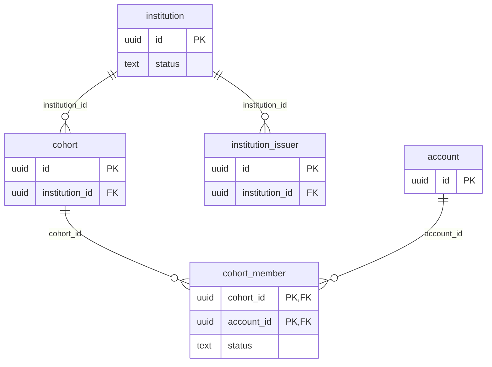

##### DATA-E1801 `institution` — Institution (tenant)

Role: root · Tenancy/RLS: RLS-INST · Owner module: `api/institutions`

| Attribute    | Type        | Constraints / notes                  |
| ------------ | ----------- | ------------------------------------ |
| `id`         | uuid        | PK, UUIDv7, app-generated            |
| `created_at` | timestamptz | NN, DEF now()                        |
| `updated_at` | timestamptz | NN, DEF now()                        |
| `version`    | bigint      | NN, DEF 1; optimistic lock / ETag    |
| `name`       | text        | NN                                   |
| `slug`       | citext      | NN, UQ                               |
| `status`     | text        | NN, CHK in (active,suspended,closed) |
| `domain`     | citext      | NULL                                 |

##### DATA-E1802 `cohort` — Cohort

Role: member of Institution · Tenancy/RLS: RLS-INST · Owner module: `api/institutions`

| Attribute        | Type        | Constraints / notes               |
| ---------------- | ----------- | --------------------------------- |
| `id`             | uuid        | PK, UUIDv7, app-generated         |
| `created_at`     | timestamptz | NN, DEF now()                     |
| `updated_at`     | timestamptz | NN, DEF now()                     |
| `version`        | bigint      | NN, DEF 1; optimistic lock / ETag |
| `institution_id` | uuid        | NN, FK(institution.id)            |
| `name`           | text        | NN                                |
| `term_start`     | date        | NULL                              |
| `term_end`       | date        | NULL                              |

##### DATA-E1803 `cohort_member` — CohortMember

Role: member of Cohort · Tenancy/RLS: RLS-INST + RLS-OWNER · Owner module: `api/institutions`

| Attribute    | Type        | Constraints / notes                                                                                      |
| ------------ | ----------- | -------------------------------------------------------------------------------------------------------- |
| `cohort_id`  | uuid        | NN, FK(cohort.id); PK part                                                                               |
| `account_id` | uuid        | NN, FK(account.id); PK part                                                                              |
| `status`     | text        | NN, CHK in (invited,active,left)                                                                         |
| `joined_at`  | timestamptz | NULL; cohort-level visibility of the member's evidence requires consent scope evidence.share_institution |

##### DATA-E1804 `institution_issuer` — InstitutionIssuer

Role: member of Institution · Tenancy/RLS: RLS-INST · Owner module: `api/institutions`

| Attribute         | Type        | Constraints / notes                            |
| ----------------- | ----------- | ---------------------------------------------- |
| `id`              | uuid        | PK, UUIDv7, app-generated                      |
| `created_at`      | timestamptz | NN, DEF now()                                  |
| `updated_at`      | timestamptz | NN, DEF now()                                  |
| `version`         | bigint      | NN, DEF 1; optimistic lock / ETag              |
| `institution_id`  | uuid        | NN, FK(institution.id)                         |
| `display_name`    | text        | NN                                             |
| `verified_at`     | timestamptz | NULL                                           |
| `signing_key_ref` | text        | NULL; reference to KMS key, never key material |

#### DOM-19 Trust, Safety & Moderation (module `api/safety`)

```mermaid
erDiagram
  report {
    uuid id PK
    uuid reporter_account_id FK
    text state
  }
  moderation_case {
    uuid id PK
    text state
    uuid assigned_to FK
  }
  moderation_case_report {
    uuid case_id PK,FK
    uuid report_id PK,FK
  }
  moderation_action {
    uuid id PK
    uuid case_id FK
    uuid actor_account_id FK
  }
  moderation_appeal {
    uuid id PK
    uuid case_id FK
    uuid appellant_account_id FK
    text state
    uuid decided_by FK
  }
  account {
    uuid id PK
  }
  account |o--o{ report : "reporter_account_id"
  account |o--o{ moderation_case : "assigned_to"
  moderation_case ||--o{ moderation_case_report : "case_id"
  report ||--o{ moderation_case_report : "report_id"
  moderation_case ||--o{ moderation_action : "case_id"
  account ||--o{ moderation_action : "actor_account_id"
  moderation_case ||--o{ moderation_appeal : "case_id"
  account ||--o{ moderation_appeal : "appellant_account_id"
  account |o--o{ moderation_appeal : "decided_by"
```

##### DATA-E1901 `report` — Report

Role: root · Tenancy/RLS: RLS-INTERNAL + reporter read · Owner module: `api/safety`

| Attribute             | Type        | Constraints / notes               |
| --------------------- | ----------- | --------------------------------- |
| `id`                  | uuid        | PK, UUIDv7, app-generated         |
| `created_at`          | timestamptz | NN, DEF now()                     |
| `updated_at`          | timestamptz | NN, DEF now()                     |
| `version`             | bigint      | NN, DEF 1; optimistic lock / ETag |
| `reporter_account_id` | uuid        | NULL, FK(account.id)              |
| `subject_type`        | text        | NN                                |
| `subject_id`          | uuid        | NN                                |
| `reason_code`         | text        | NN                                |
| `details`             | text        | NULL                              |
| `content_snapshot`    | jsonb       | NULL; bounded, short retention    |
| `state`               | text        | NN, CHK in (open,triaged,closed)  |

##### DATA-E1902 `moderation_case` — ModerationCase

Role: root · Tenancy/RLS: RLS-INTERNAL · Owner module: `api/safety`

| Attribute        | Type        | Constraints / notes                                                                                                                         |
| ---------------- | ----------- | ------------------------------------------------------------------------------------------------------------------------------------------- |
| `id`             | uuid        | PK, UUIDv7, app-generated                                                                                                                   |
| `created_at`     | timestamptz | NN, DEF now()                                                                                                                               |
| `updated_at`     | timestamptz | NN, DEF now()                                                                                                                               |
| `version`        | bigint      | NN, DEF 1; optimistic lock / ETag                                                                                                           |
| `subject_type`   | text        | NN                                                                                                                                          |
| `subject_id`     | uuid        | NN                                                                                                                                          |
| `state`          | text        | NN, CHK in (open,triaged,in_review,awaiting_info,actioned,appealed,closed), DEF 'open' (SM-MODCASE)                                         |
| `outcome`        | text        | NULL, CHK in (no_action,warned,content_removed,suspended,restored); set with `actioned` (`no_action` replaces the former `dismissed` state) |
| `appeal_outcome` | text        | NULL, CHK in (none,upheld,overturned); set with `closed` (`overturned` replaces the former `reversed` state)                                |
| `assigned_to`    | uuid        | NULL, FK(account.id)                                                                                                                        |
| `sla_due_at`     | timestamptz | NULL                                                                                                                                        |
| `closed_at`      | timestamptz | NULL                                                                                                                                        |

##### DATA-E1903 `moderation_case_report` — CaseReport link

Role: member of ModerationCase · Tenancy/RLS: RLS-INTERNAL · Owner module: `api/safety`

| Attribute   | Type | Constraints / notes                 |
| ----------- | ---- | ----------------------------------- |
| `case_id`   | uuid | NN, FK(moderation_case.id); PK part |
| `report_id` | uuid | NN, FK(report.id); PK part          |

##### DATA-E1904 `moderation_action` — ModerationAction

Role: member of ModerationCase · Tenancy/RLS: RLS-INTERNAL · Owner module: `api/safety`

| Attribute          | Type        | Constraints / notes                                                       |
| ------------------ | ----------- | ------------------------------------------------------------------------- |
| `id`               | uuid        | PK, UUIDv7                                                                |
| `created_at`       | timestamptz | NN, DEF now(); row is append-only                                         |
| `case_id`          | uuid        | NN, FK(moderation_case.id)                                                |
| `action`           | text        | NN, CHK in (warn,hide_content,takedown,suspend_messaging,suspend_account) |
| `actor_account_id` | uuid        | NN, FK(account.id); human actor required (INV-T09)                        |
| `reason`           | text        | NN                                                                        |
| `expires_at`       | timestamptz | NULL                                                                      |
| `reversed_at`      | timestamptz | NULL                                                                      |

##### DATA-E1905 `moderation_appeal` — ModerationAppeal

Role: member of ModerationCase · Tenancy/RLS: RLS-INTERNAL + appellant · Owner module: `api/safety`

| Attribute              | Type        | Constraints / notes                                                                                                                                                                                  |
| ---------------------- | ----------- | ---------------------------------------------------------------------------------------------------------------------------------------------------------------------------------------------------- |
| `id`                   | uuid        | PK, UUIDv7, app-generated                                                                                                                                                                            |
| `created_at`           | timestamptz | NN, DEF now()                                                                                                                                                                                        |
| `updated_at`           | timestamptz | NN, DEF now()                                                                                                                                                                                        |
| `version`              | bigint      | NN, DEF 1; optimistic lock / ETag                                                                                                                                                                    |
| `case_id`              | uuid        | NN, FK(moderation_case.id)                                                                                                                                                                           |
| `appellant_account_id` | uuid        | NN, FK(account.id)                                                                                                                                                                                   |
| `statement`            | text        | NN                                                                                                                                                                                                   |
| `state`                | text        | NN, CHK in (open,upheld,overturned), DEF 'open'; `upheld` = original decision stands (former `dismissed`), `overturned` = appeal succeeded (former `upheld`); feeds `moderation_case.appeal_outcome` |
| `decided_by`           | uuid        | NULL, FK(account.id)                                                                                                                                                                                 |

#### DOM-20 Administration, Support & Back Office (module `api/admin`)

```mermaid
erDiagram
  support_access_grant {
    uuid id PK
    uuid grantee_account_id FK
    uuid subject_account_id FK
    uuid approved_by FK
  }
  audit_event {
    uuid id PK
    uuid support_grant_id FK
  }
  feature_flag {
    uuid id PK
  }
  account {
    uuid id PK
  }
  account ||--o{ support_access_grant : "grantee_account_id"
  account ||--o{ support_access_grant : "subject_account_id"
  account |o--o{ support_access_grant : "approved_by"
  support_access_grant |o--o{ audit_event : "support_grant_id"
```

##### DATA-E2001 `support_access_grant` — SupportAccessGrant

Role: root · Tenancy/RLS: RLS-GRANT · Owner module: `api/admin`

| Attribute            | Type        | Constraints / notes                                                        |
| -------------------- | ----------- | -------------------------------------------------------------------------- |
| `id`                 | uuid        | PK, UUIDv7, app-generated                                                  |
| `created_at`         | timestamptz | NN, DEF now()                                                              |
| `updated_at`         | timestamptz | NN, DEF now()                                                              |
| `version`            | bigint      | NN, DEF 1; optimistic lock / ETag                                          |
| `grantee_account_id` | uuid        | NN, FK(account.id)                                                         |
| `subject_account_id` | uuid        | NN, FK(account.id)                                                         |
| `scope`              | text        | NN, CHK in (read_summary,read_profile,read_evidence_metadata,read_billing) |
| `reason_code`        | text        | NN                                                                         |
| `reason_text`        | text        | NN                                                                         |
| `ticket_ref`         | text        | NULL                                                                       |
| `approved_by`        | uuid        | NULL, FK(account.id); required for read_evidence_metadata                  |
| `starts_at`          | timestamptz | NN                                                                         |
| `expires_at`         | timestamptz | NN, CHK expires_at <= starts_at + interval '4 hours' (BR-T041)             |
| `revoked_at`         | timestamptz | NULL                                                                       |

##### DATA-E2002 `audit_event` — AuditEvent (append-only, partitioned monthly)

Role: root · Tenancy/RLS: RLS-INTERNAL (+ own-access-log view) · Owner module: `api/admin`

| Attribute               | Type        | Constraints / notes                                                                                                                                    |
| ----------------------- | ----------- | ------------------------------------------------------------------------------------------------------------------------------------------------------ |
| `id`                    | uuid        | PK, UUIDv7                                                                                                                                             |
| `created_at`            | timestamptz | NN, DEF now(); row is append-only                                                                                                                      |
| `occurred_at`           | timestamptz | NN; partition key                                                                                                                                      |
| `actor_kind`            | text        | NN, CHK in (user,service,system,support,referee)                                                                                                       |
| `actor_subject_ref`     | uuid        | NULL; opaque `subject_ref` of the acting person (never `account.id`); no FK; resolved through subject_identity_map, which erasure deletes (DB-02 §4.1) |
| `subject_ref`           | uuid        | NULL; opaque ref of the person the event concerns (subject access log); no FK                                                                          |
| `support_grant_id`      | uuid        | NULL, FK(support_access_grant.id)                                                                                                                      |
| `tenant_org_id`         | uuid        | NULL                                                                                                                                                   |
| `tenant_institution_id` | uuid        | NULL                                                                                                                                                   |
| `action`                | text        | NN; policy action id                                                                                                                                   |
| `resource_type`         | text        | NN                                                                                                                                                     |
| `resource_id`           | uuid        | NULL; CHK: NULL when `resource_type='account'` (the person is carried by `subject_ref`)                                                                |
| `outcome`               | text        | NN, CHK in (allow,deny,success,failure)                                                                                                                |
| `reason_code`           | text        | NULL; enum code only, no free text                                                                                                                     |
| `request_id`            | text        | NULL                                                                                                                                                   |
| `trace_id`              | text        | NULL                                                                                                                                                   |
| `ip_prefix`             | inet        | NULL; truncated prefix; whether it is personal data is OPEN-08                                                                                         |
| `changed_fields`        | text[]      | NULL; names only for C3+ data, never values                                                                                                            |
| `row_hash`              | bytea       | NN; SHA256(canonical(row)) computed by the application, no previous-row dependency and no lock; sealed into `audit_anchor` batches (DB-02 §4.2)        |

##### DATA-E2004 `audit_anchor` — AuditAnchor (append-only; KMS-signed Merkle batch over closed windows)

Role: root · Tenancy/RLS: RLS-INTERNAL · Owner module: `api/admin` (written only by the `audit.anchor` job)

| Attribute          | Type        | Constraints / notes                                                                    |
| ------------------ | ----------- | -------------------------------------------------------------------------------------- |
| `id`               | uuid        | PK, UUIDv7                                                                             |
| `created_at`       | timestamptz | NN, DEF now(); row is append-only                                                      |
| `source_table`     | text        | NN, CHK in (audit_event,consent_record,evidence_event,stage_transition)                |
| `first_id`         | uuid        | NN; first row id of the window (UUIDv7 order)                                          |
| `last_id`          | uuid        | NN; last row id of the window                                                          |
| `row_count`        | int         | NN; leaves in the tree                                                                 |
| `merkle_root`      | bytea       | NN; root over the window's `row_hash` leaves                                           |
| `prev_anchor_root` | bytea       | NULL; `merkle_root` of the previous anchor for the same `source_table` (single writer) |
| `key_id`           | text        | NN; KMS signing key version                                                            |
| `signature`        | bytea       | NN; KMS signature over the canonical anchor fields                                     |
| `sealed_at`        | timestamptz | NN                                                                                     |
| UQ                 |             | (source_table, first_id)                                                               |

##### DATA-E2003 `feature_flag` — FeatureFlag

Role: root · Tenancy/RLS: RLS-INTERNAL · Owner module: `api/admin`

| Attribute     | Type        | Constraints / notes               |
| ------------- | ----------- | --------------------------------- |
| `id`          | uuid        | PK, UUIDv7, app-generated         |
| `created_at`  | timestamptz | NN, DEF now()                     |
| `updated_at`  | timestamptz | NN, DEF now()                     |
| `version`     | bigint      | NN, DEF 1; optimistic lock / ETag |
| `flag_key`    | text        | NN, UQ                            |
| `description` | text        | NN                                |
| `enabled`     | bool        | NN                                |
| `rollout`     | jsonb       | NN; percentage, allowlists        |
| `owner`       | text        | NN                                |
| `review_by`   | date        | NULL; stale-flag review date      |

#### DOM-21 Analytics & Reporting (module `api/analytics`)

```mermaid
erDiagram
  analytics_event {
    uuid id PK
  }
  funnel_daily {
    uuid org_id PK,FK
    uuid job_id PK,FK
    text stage_key PK
    date day PK
  }
  job {
    uuid id PK
  }
  organization {
    uuid id PK
  }
  organization ||--o{ funnel_daily : "org_id"
  job ||--o{ funnel_daily : "job_id"
```

##### DATA-E2101 `analytics_event` — AnalyticsEvent (consent-gated; partition daily)

Role: root · Tenancy/RLS: RLS-INTERNAL · Owner module: `api/analytics`

| Attribute     | Type        | Constraints / notes                            |
| ------------- | ----------- | ---------------------------------------------- |
| `id`          | uuid        | PK, UUIDv7                                     |
| `created_at`  | timestamptz | NN, DEF now(); row is append-only              |
| `occurred_at` | timestamptz | NN; partition key                              |
| `subject_key` | bytea       | NN; rotating pseudonymous key (not account id) |
| `name`        | text        | NN; allowlisted event names                    |
| `props`       | jsonb       | NN; allowlisted keys only                      |
| `org_id`      | uuid        | NULL                                           |

##### DATA-E2102 `funnel_daily` — FunnelDaily (derived rollup)

Role: derived · Tenancy/RLS: RLS-ORG · Owner module: `api/analytics`

| Attribute   | Type | Constraints / notes                                    |
| ----------- | ---- | ------------------------------------------------------ |
| `org_id`    | uuid | NN, FK(organization.id); PK part                       |
| `job_id`    | uuid | NN, FK(job.id); PK part                                |
| `stage_key` | text | NN; PK part                                            |
| `day`       | date | NN; PK part                                            |
| `count`     | int  | NN; small counts suppressed in API (k-threshold, OPEN) |

#### DOM-22 Privacy, Consent & Data Rights (module `api/privacy`)

```mermaid
erDiagram
  consent_record {
    uuid id PK
    uuid subject_ref
    uuid supersedes_id FK
  }
  subject_identity_map {
    uuid subject_ref PK
    uuid account_id FK
  }
  data_rights_request {
    uuid id PK
    uuid account_id FK
    text kind
    text state
    uuid handler_account_id FK
  }
  data_export {
    uuid id PK
    uuid request_id FK
    text state
    uuid file_id FK
  }
  erasure_request {
    uuid id PK
    uuid request_id FK
    timestamptz cooling_off_until
  }
  erasure_step {
    uuid erasure_request_id PK,FK
    text module PK
    text state
  }
  erasure_ledger {
    uuid id PK
  }
  legal_hold {
    uuid id PK
    uuid placed_by FK
  }
  account {
    uuid id PK
  }
  file_object {
    uuid id PK
  }
  account ||--o| subject_identity_map : "account_id"
  consent_record |o--o{ consent_record : "supersedes_id"
  account ||--o{ data_rights_request : "account_id"
  account |o--o{ data_rights_request : "handler_account_id"
  data_rights_request ||--o| data_export : "request_id"
  file_object |o--o{ data_export : "file_id"
  data_rights_request ||--o| erasure_request : "request_id"
  erasure_request ||--o{ erasure_step : "erasure_request_id"
  account ||--o{ legal_hold : "placed_by"
```

##### DATA-E2201 `consent_record` — ConsentRecord (append-only)

Role: root · Tenancy/RLS: RLS-OWNER · Owner module: `api/privacy`

| Attribute          | Type        | Constraints / notes                                                                                                                                                                                                                                                                                                                                                                                                                                                               |
| ------------------ | ----------- | --------------------------------------------------------------------------------------------------------------------------------------------------------------------------------------------------------------------------------------------------------------------------------------------------------------------------------------------------------------------------------------------------------------------------------------------------------------------------------- |
| `id`               | uuid        | PK, UUIDv7                                                                                                                                                                                                                                                                                                                                                                                                                                                                        |
| `created_at`       | timestamptz | NN, DEF now(); row is append-only                                                                                                                                                                                                                                                                                                                                                                                                                                                 |
| `subject_ref`      | uuid        | NN; opaque per-subject token, no FK; maps to the account only through subject_identity_map, which erasure deletes (DB-02 §4.1). Replaces `subject_account_id` so the ledger never needs rewriting                                                                                                                                                                                                                                                                                 |
| `scope`            | text        | NN, CHK in (profile.public_view,search.discoverable,matching.recommend,outreach.recruiter_contact,evidence.share_summary,evidence.share_artefact,profile.share_contact,application.share_snapshot,evidence.share_institution,alumni.share_outcomes,ai.assist.process,analytics.product,comms.marketing_email,data.research_aggregate); **generated from `00_CONTROL_CENTRE/CONSENT_SCOPE_CATALOGUE.md` section 8 (FF-12)**; the retired `evidence.share_recruiter` is not allowed |
| `target_type`      | text        | NULL, CHK in (evidence,application); the data object the grant is about                                                                                                                                                                                                                                                                                                                                                                                                           |
| `target_id`        | uuid        | NULL; NN when `target_type` is set                                                                                                                                                                                                                                                                                                                                                                                                                                                |
| `grantee_type`     | text        | NULL, CHK in (all_verified_orgs,org,institution); who may use the data (NULL = no named grantee)                                                                                                                                                                                                                                                                                                                                                                                  |
| `grantee_id`       | uuid        | NULL; NN when `grantee_type` is `org` or `institution`; NULL when `all_verified_orgs`                                                                                                                                                                                                                                                                                                                                                                                             |
| `field_set`        | text[]      | NULL; allowed only for `alumni.share_outcomes` (fields chosen by the learner)                                                                                                                                                                                                                                                                                                                                                                                                     |
| `expires_at`       | timestamptz | NULL = until revoked; `consent_current` omits rows past `expires_at`; must be > `created_at`                                                                                                                                                                                                                                                                                                                                                                                      |
| `granted`          | bool        | NN                                                                                                                                                                                                                                                                                                                                                                                                                                                                                |
| `policy_version`   | text        | NN                                                                                                                                                                                                                                                                                                                                                                                                                                                                                |
| `source`           | text        | NN, CHK in (signup,settings,application,prompt,import)                                                                                                                                                                                                                                                                                                                                                                                                                            |
| `ip_hash`          | bytea       | NULL; HMAC under the per-subject key held in subject_identity_map (unlinkable once the key is destroyed)                                                                                                                                                                                                                                                                                                                                                                          |
| `user_agent_class` | text        | NULL                                                                                                                                                                                                                                                                                                                                                                                                                                                                              |
| `supersedes_id`    | uuid        | NULL, FK(consent_record.id)                                                                                                                                                                                                                                                                                                                                                                                                                                                       |
| `prev_hash`        | bytea       | NULL; row_hash of the previous record of the same `subject_ref` (aggregate chain under the account row lock taken for `consent_epoch`; DB-02 §4.2)                                                                                                                                                                                                                                                                                                                                |
| `row_hash`         | bytea       | NN; SHA256(canonical(row)); sealed into `audit_anchor` batches                                                                                                                                                                                                                                                                                                                                                                                                                    |

Table CHECK `consent_grain_ck` (generated, CSC section 5) fixes the allowed `grantee_type`/`target_type` combination per scope, for example `evidence.share_artefact` requires `grantee_type='org'` and a `grantee_id`, and `application.share_snapshot` additionally requires `target_type='application'` and a `target_id`. `consent_current` = latest row per `(subject_ref, scope, target_type, target_id, grantee_type, grantee_id)` where `granted AND (expires_at IS NULL OR expires_at > now())`; the view joins `subject_identity_map` to expose `subject_account_id` for RLS and policy code, so after erasure the rows resolve to no account.

##### DATA-E2202 `data_rights_request` — DataRightsRequest

Role: root · Tenancy/RLS: RLS-OWNER · Owner module: `api/privacy`

| Attribute            | Type        | Constraints / notes                                                                                                                                                                                 |
| -------------------- | ----------- | --------------------------------------------------------------------------------------------------------------------------------------------------------------------------------------------------- |
| `id`                 | uuid        | PK, UUIDv7, app-generated                                                                                                                                                                           |
| `created_at`         | timestamptz | NN, DEF now()                                                                                                                                                                                       |
| `updated_at`         | timestamptz | NN, DEF now()                                                                                                                                                                                       |
| `version`            | bigint      | NN, DEF 1; optimistic lock / ETag                                                                                                                                                                   |
| `account_id`         | uuid        | NN, FK(account.id)                                                                                                                                                                                  |
| `kind`               | text        | NN, CHK in (access,export,erasure,rectification,restriction,objection,human_review)                                                                                                                 |
| `state`              | text        | NN, CHK in (received,verifying,cooling_off,in_progress,on_hold,completed,completed_with_retention,rejected,cancelled,failed), DEF 'received' (SM-DSR; all kinds; only `erasure` uses `cooling_off`) |
| `due_at`             | timestamptz | NOT NULL; erasure 30 days (BR-T060); other kinds OPEN-08                                                                                                                                            |
| `completed_at`       | timestamptz | NULL                                                                                                                                                                                                |
| `handler_account_id` | uuid        | NULL, FK(account.id)                                                                                                                                                                                |
| `details`            | jsonb       | NN, DEF '{}'                                                                                                                                                                                        |

##### DATA-E2203 `data_export` — DataExport

Role: member of DataRightsRequest · Tenancy/RLS: RLS-OWNER · Owner module: `api/privacy`

| Attribute    | Type        | Constraints / notes                                  |
| ------------ | ----------- | ---------------------------------------------------- |
| `id`         | uuid        | PK, UUIDv7, app-generated                            |
| `created_at` | timestamptz | NN, DEF now()                                        |
| `updated_at` | timestamptz | NN, DEF now()                                        |
| `version`    | bigint      | NN, DEF 1; optimistic lock / ETag                    |
| `request_id` | uuid        | NN, FK(data_rights_request.id), UQ                   |
| `state`      | text        | NN, CHK in (requested,building,ready,expired,failed) |
| `file_id`    | uuid        | NULL, FK(file_object.id)                             |
| `manifest`   | jsonb       | NULL                                                 |
| `expires_at` | timestamptz | NULL                                                 |

##### DATA-E2204 `erasure_request` — ErasureRequest

Role: member of DataRightsRequest · Tenancy/RLS: RLS-OWNER · Owner module: `api/privacy`

| Attribute           | Type        | Constraints / notes                                                                                                                                                 |
| ------------------- | ----------- | ------------------------------------------------------------------------------------------------------------------------------------------------------------------- |
| `id`                | uuid        | PK, UUIDv7, app-generated                                                                                                                                           |
| `created_at`        | timestamptz | NN, DEF now()                                                                                                                                                       |
| `updated_at`        | timestamptz | NN, DEF now()                                                                                                                                                       |
| `version`           | bigint      | NN, DEF 1; optimistic lock / ETag                                                                                                                                   |
| `request_id`        | uuid        | NN, FK(data_rights_request.id), UQ                                                                                                                                  |
| (no state column)   | n/a         | lifecycle is `data_rights_request.state` (SM-DSR, formerly the separate SM-ERASURE); this row keeps `cooling_off_until`, `completed_at` and its `erasure_step` rows |
| `cooling_off_until` | timestamptz | NULL                                                                                                                                                                |
| `completed_at`      | timestamptz | NULL                                                                                                                                                                |

##### DATA-E2205 `erasure_step` — ErasureStep

Role: member of ErasureRequest · Tenancy/RLS: RLS-INTERNAL · Owner module: `api/privacy`

| Attribute            | Type        | Constraints / notes                       |
| -------------------- | ----------- | ----------------------------------------- |
| `erasure_request_id` | uuid        | NN, FK(erasure_request.id); PK part       |
| `module`             | text        | NN; PK part                               |
| `state`              | text        | NN, CHK in (pending,done,failed,retained) |
| `retained_reason`    | text        | NULL                                      |
| `completed_at`       | timestamptz | NULL                                      |

##### DATA-E2206 `erasure_ledger` — ErasureLedger (minimal, no PII)

Role: root · Tenancy/RLS: RLS-INTERNAL · Owner module: `api/privacy`

| Attribute            | Type        | Constraints / notes                                                                                                                          |
| -------------------- | ----------- | -------------------------------------------------------------------------------------------------------------------------------------------- |
| `id`                 | uuid        | PK, UUIDv7                                                                                                                                   |
| `created_at`         | timestamptz | NN, DEF now(); row is append-only                                                                                                            |
| `erased_subject_ref` | uuid        | NN; opaque token only (never `account.id`, never both), kept so a restore replay can find and delete the restored `subject_identity_map` row |
| `erased_at`          | timestamptz | NN                                                                                                                                           |
| `retain_until`       | timestamptz | NN; backup-window + margin (OPEN-08 with counsel)                                                                                            |

##### DATA-E2207 `legal_hold` — LegalHold

Role: root · Tenancy/RLS: RLS-INTERNAL · Owner module: `api/privacy`

| Attribute            | Type        | Constraints / notes               |
| -------------------- | ----------- | --------------------------------- |
| `id`                 | uuid        | PK, UUIDv7, app-generated         |
| `created_at`         | timestamptz | NN, DEF now()                     |
| `updated_at`         | timestamptz | NN, DEF now()                     |
| `version`            | bigint      | NN, DEF 1; optimistic lock / ETag |
| `subject_account_id` | uuid        | NN                                |
| `reason`             | text        | NN                                |
| `placed_by`          | uuid        | NN, FK(account.id)                |
| `released_at`        | timestamptz | NULL                              |

##### DATA-E2208 `subject_identity_map` — SubjectIdentityMap (the only erasable link from history to a person; REVW-04)

Role: root · Tenancy/RLS: RLS-INTERNAL (server roles only; no end-user path) · Owner module: `api/privacy`

| Attribute             | Type        | Constraints / notes                                                                                                                                                                                    |
| --------------------- | ----------- | ------------------------------------------------------------------------------------------------------------------------------------------------------------------------------------------------------ |
| `subject_ref`         | uuid        | PK; random 128-bit token from a CSPRNG, minted with the account; not derived from account id, email or any key                                                                                         |
| `account_id`          | uuid        | NN, UQ, FK(account.id); the sole place that links the token to an identity                                                                                                                             |
| `created_at`          | timestamptz | NN, DEF now()                                                                                                                                                                                          |
| `wrapped_subject_key` | bytea       | NULL; per-subject data key wrapped by KMS, used to HMAC subject-linkable values in append-only rows (e.g. `consent_record.ip_hash`); deleting it, plus KMS key destruction, crypto-shreds those values |

Rules: rows are inserted with the account and never updated; the erasure function deletes the row (and schedules key destruction) as its last step, after which the post-erasure sweep runs (INV-T38). `account` has no `subject_ref` column. Referees, who have no account, receive a random `referee_ref` per reference request instead of a map row. Append-only tables hold no FK to this table (DB-02 §4.1).

#### DOM-23 Integrations & Developer Platform (module `api/integrations`)

```mermaid
erDiagram
  webhook_endpoint {
    uuid id PK
    uuid org_id FK
    text state
  }
  webhook_delivery {
    uuid id PK
    uuid endpoint_id FK
    text state
  }
  api_client {
    uuid id PK
    uuid org_id FK
    text state
    uuid created_by FK
  }
  import_job {
    uuid id PK
    uuid org_id FK
    uuid account_id FK
    uuid source_file_id FK
    text state
    uuid report_file_id FK
  }
  account {
    uuid id PK
  }
  file_object {
    uuid id PK
  }
  organization {
    uuid id PK
  }
  organization ||--o{ webhook_endpoint : "org_id"
  webhook_endpoint ||--o{ webhook_delivery : "endpoint_id"
  organization ||--o{ api_client : "org_id"
  account ||--o{ api_client : "created_by"
  organization |o--o{ import_job : "org_id"
  account |o--o{ import_job : "account_id"
  file_object |o--o{ import_job : "source_file_id"
  file_object |o--o{ import_job : "report_file_id"
```

##### DATA-E2301 `webhook_endpoint` — WebhookEndpoint

Role: root · Tenancy/RLS: RLS-ORG · Owner module: `api/integrations`

| Attribute              | Type        | Constraints / notes                                  |
| ---------------------- | ----------- | ---------------------------------------------------- |
| `id`                   | uuid        | PK, UUIDv7, app-generated                            |
| `created_at`           | timestamptz | NN, DEF now()                                        |
| `updated_at`           | timestamptz | NN, DEF now()                                        |
| `version`              | bigint      | NN, DEF 1; optimistic lock / ETag                    |
| `org_id`               | uuid        | NN, FK(organization.id)                              |
| `url`                  | text        | NN; https only; SSRF-validated at create and at send |
| `secret_enc`           | bytea       | NN                                                   |
| `event_types`          | text[]      | NN                                                   |
| `state`                | text        | NN, CHK in (active,paused,disabled)                  |
| `consecutive_failures` | int         | NN, DEF 0                                            |
| `last_success_at`      | timestamptz | NULL                                                 |

##### DATA-E2302 `webhook_delivery` — WebhookDelivery (partition candidate)

Role: member of WebhookEndpoint · Tenancy/RLS: RLS-ORG · Owner module: `api/integrations`

| Attribute         | Type        | Constraints / notes                             |
| ----------------- | ----------- | ----------------------------------------------- |
| `id`              | uuid        | PK, UUIDv7                                      |
| `created_at`      | timestamptz | NN, DEF now()                                   |
| `updated_at`      | timestamptz | NN, DEF now()                                   |
| `endpoint_id`     | uuid        | NN, FK(webhook_endpoint.id)                     |
| `event_id`        | uuid        | NN                                              |
| `attempt`         | int         | NN                                              |
| `state`           | text        | NN, CHK in (pending,succeeded,failed,abandoned) |
| `response_status` | int         | NULL                                            |
| `next_attempt_at` | timestamptz | NULL                                            |

##### DATA-E2303 `api_client` — ApiClient (ROLE-SVC)

Role: root · Tenancy/RLS: RLS-ORG · Owner module: `api/integrations`

| Attribute      | Type        | Constraints / notes               |
| -------------- | ----------- | --------------------------------- |
| `id`           | uuid        | PK, UUIDv7, app-generated         |
| `created_at`   | timestamptz | NN, DEF now()                     |
| `updated_at`   | timestamptz | NN, DEF now()                     |
| `version`      | bigint      | NN, DEF 1; optimistic lock / ETag |
| `org_id`       | uuid        | NN, FK(organization.id)           |
| `name`         | text        | NN                                |
| `client_id`    | text        | NN, UQ                            |
| `secret_hash`  | bytea       | NN; Argon2id or HMAC with pepper  |
| `scopes`       | text[]      | NN                                |
| `state`        | text        | NN, CHK in (active,revoked)       |
| `expires_at`   | timestamptz | NULL                              |
| `last_used_at` | timestamptz | NULL                              |
| `created_by`   | uuid        | NN, FK(account.id)                |

##### DATA-E2304 `import_job` — ImportJob

Role: root · Tenancy/RLS: RLS-ORG / OWNER · Owner module: `api/integrations`

| Attribute        | Type        | Constraints / notes                                    |
| ---------------- | ----------- | ------------------------------------------------------ |
| `id`             | uuid        | PK, UUIDv7, app-generated                              |
| `created_at`     | timestamptz | NN, DEF now()                                          |
| `updated_at`     | timestamptz | NN, DEF now()                                          |
| `version`        | bigint      | NN, DEF 1; optimistic lock / ETag                      |
| `org_id`         | uuid        | NULL, FK(organization.id)                              |
| `account_id`     | uuid        | NULL, FK(account.id)                                   |
| `adapter_key`    | text        | NN                                                     |
| `source_file_id` | uuid        | NULL, FK(file_object.id)                               |
| `source_url`     | text        | NULL; SSRF-guarded fetch                               |
| `state`          | text        | NN, CHK in (queued,running,completed,failed,cancelled) |
| `counts`         | jsonb       | NN                                                     |
| `report_file_id` | uuid        | NULL, FK(file_object.id)                               |

#### DOM-24 Platform (flags, media, job queue, observability) (module `api/platform, apps/worker`)

```mermaid
erDiagram
  outbox_event {
    uuid id PK
  }
  consumer_inbox {
    text consumer PK
    uuid event_id PK
  }
  idempotency_key {
    text principal_id PK
    text idem_key PK
    text state
  }
  background_job {
    uuid id PK
    text kind
    text status
  }
  background_job_attempt {
    uuid id PK
    uuid job_id FK
  }
  job_schedule {
    uuid id PK
    text kind
  }
  file_object {
    uuid id PK
    uuid owner_account_id FK
    uuid org_id FK
    text state
  }
  rate_limit_bucket {
    text bucket_class PK
    text bucket_key PK
  }
  worker_heartbeat {
    text worker_id PK
  }
  schema_migration {
    text version PK
    text kind
  }
  account {
    uuid id PK
  }
  organization {
    uuid id PK
  }
  background_job ||--o{ background_job_attempt : "job_id"
  account ||--o{ file_object : "owner_account_id"
  organization |o--o{ file_object : "org_id"
```

##### DATA-E2401 `outbox_event` — OutboxEvent (partition monthly)

Role: root · Tenancy/RLS: RLS-INTERNAL · Owner module: `api/platform, apps/worker`

| Attribute        | Type        | Constraints / notes                                                                                                                                                                                                                                                                                                 |
| ---------------- | ----------- | ------------------------------------------------------------------------------------------------------------------------------------------------------------------------------------------------------------------------------------------------------------------------------------------------------------------- |
| `id`             | uuid        | PK, UUIDv7                                                                                                                                                                                                                                                                                                          |
| `created_at`     | timestamptz | NN, DEF now(); row is append-only                                                                                                                                                                                                                                                                                   |
| `aggregate_type` | text        | NN                                                                                                                                                                                                                                                                                                                  |
| `aggregate_id`   | uuid        | NN                                                                                                                                                                                                                                                                                                                  |
| `aggregate_seq`  | bigint      | NN                                                                                                                                                                                                                                                                                                                  |
| `event_type`     | text        | NN                                                                                                                                                                                                                                                                                                                  |
| `event_version`  | int         | NN                                                                                                                                                                                                                                                                                                                  |
| `tenant`         | jsonb       | NN; {org_id?, institution_id?}                                                                                                                                                                                                                                                                                      |
| `payload`        | jsonb       | NN; schema-registered, no emails, names or free text; a person appears as `subject_ref` (for aggregate_type `account`, `aggregate_id` is the `subject_ref`); consumers resolve through subject_identity_map and skip when it is gone (DB-02 §4.1). Transient transport: published partitions are dropped after 14 d |
| `trace_id`       | text        | NULL                                                                                                                                                                                                                                                                                                                |
| `occurred_at`    | timestamptz | NN                                                                                                                                                                                                                                                                                                                  |
| `available_at`   | timestamptz | NN                                                                                                                                                                                                                                                                                                                  |
| `published_at`   | timestamptz | NULL                                                                                                                                                                                                                                                                                                                |

##### DATA-E2402 `consumer_inbox` — ConsumerInbox

Role: root · Tenancy/RLS: RLS-INTERNAL · Owner module: `api/platform, apps/worker`

| Attribute      | Type        | Constraints / notes |
| -------------- | ----------- | ------------------- |
| `consumer`     | text        | NN; PK part         |
| `event_id`     | uuid        | NN; PK part         |
| `processed_at` | timestamptz | NN                  |

##### DATA-E2403 `idempotency_key` — IdempotencyKey (partition daily)

Role: root · Tenancy/RLS: RLS-INTERNAL · Owner module: `api/platform, apps/worker`

| Attribute         | Type        | Constraints / notes                 |
| ----------------- | ----------- | ----------------------------------- |
| `principal_id`    | text        | NN; PK part (account id or ip hash) |
| `idem_key`        | text        | NN; PK part                         |
| `method`          | text        | NN                                  |
| `route_template`  | text        | NN                                  |
| `request_hash`    | bytea       | NN                                  |
| `state`           | text        | NN, CHK in (in_progress,completed)  |
| `response_status` | int         | NULL                                |
| `response_body`   | bytea       | NULL; encrypted when class C2+      |
| `locked_until`    | timestamptz | NN                                  |
| `expires_at`      | timestamptz | NN                                  |

##### DATA-E2404 `background_job` — BackgroundJob

Role: root · Tenancy/RLS: RLS-INTERNAL · Owner module: `api/platform, apps/worker`

| Attribute             | Type        | Constraints / notes                                                                |
| --------------------- | ----------- | ---------------------------------------------------------------------------------- |
| `id`                  | uuid        | PK, UUIDv7, app-generated                                                          |
| `created_at`          | timestamptz | NN, DEF now()                                                                      |
| `updated_at`          | timestamptz | NN, DEF now()                                                                      |
| `version`             | bigint      | NN, DEF 1; optimistic lock / ETag                                                  |
| `kind`                | text        | NN                                                                                 |
| `payload`             | jsonb       | NN                                                                                 |
| `status`              | text        | NN, CHK in (queued,claimed,running,retry_wait,succeeded,dead,cancelled) (SM-BGJOB) |
| `priority`            | int         | NN, DEF 0                                                                          |
| `run_after`           | timestamptz | NN                                                                                 |
| `attempts`            | int         | NN, DEF 0                                                                          |
| `max_attempts`        | int         | NN                                                                                 |
| `lease_token`         | uuid        | NULL                                                                               |
| `lease_generation`    | bigint      | NN, DEF 0; fencing token (ADR-T09)                                                 |
| `leased_by`           | text        | NULL                                                                               |
| `lease_expires_at`    | timestamptz | NULL                                                                               |
| `heartbeat_at`        | timestamptz | NULL                                                                               |
| `cancel_requested_at` | timestamptz | NULL                                                                               |
| `idempotency_key`     | text        | NULL; UNIQUE(kind,idempotency_key)                                                 |
| `last_error_class`    | text        | NULL, CHK in (transient,permanent,rate_limited,cancelled)                          |
| `last_error`          | text        | NULL, CHK length<=4096                                                             |
| `dead_at`             | timestamptz | NULL                                                                               |

##### DATA-E2405 `background_job_attempt` — BackgroundJobAttempt (partition monthly)

Role: member of BackgroundJob · Tenancy/RLS: RLS-INTERNAL · Owner module: `api/platform, apps/worker`

| Attribute          | Type        | Constraints / notes               |
| ------------------ | ----------- | --------------------------------- |
| `id`               | uuid        | PK, UUIDv7                        |
| `created_at`       | timestamptz | NN, DEF now(); row is append-only |
| `job_id`           | uuid        | NN, FK(background_job.id)         |
| `attempt_no`       | int         | NN                                |
| `lease_generation` | bigint      | NN                                |
| `started_at`       | timestamptz | NN                                |
| `finished_at`      | timestamptz | NULL                              |
| `outcome`          | text        | NULL                              |
| `error_class`      | text        | NULL                              |

##### DATA-E2406 `job_schedule` — JobSchedule

Role: root · Tenancy/RLS: RLS-INTERNAL · Owner module: `api/platform, apps/worker`

| Attribute     | Type        | Constraints / notes               |
| ------------- | ----------- | --------------------------------- |
| `id`          | uuid        | PK, UUIDv7, app-generated         |
| `created_at`  | timestamptz | NN, DEF now()                     |
| `updated_at`  | timestamptz | NN, DEF now()                     |
| `version`     | bigint      | NN, DEF 1; optimistic lock / ETag |
| `kind`        | text        | NN, UQ                            |
| `cron`        | text        | NN                                |
| `next_run_at` | timestamptz | NN                                |
| `last_run_at` | timestamptz | NULL                              |

##### DATA-E2407 `file_object` — FileObject

Role: root · Tenancy/RLS: RLS-OWNER · Owner module: `api/platform, apps/worker`

| Attribute               | Type        | Constraints / notes                                                                                        |
| ----------------------- | ----------- | ---------------------------------------------------------------------------------------------------------- |
| `id`                    | uuid        | PK, UUIDv7, app-generated                                                                                  |
| `created_at`            | timestamptz | NN, DEF now()                                                                                              |
| `updated_at`            | timestamptz | NN, DEF now()                                                                                              |
| `version`               | bigint      | NN, DEF 1; optimistic lock / ETag                                                                          |
| `owner_account_id`      | uuid        | NN, FK(account.id)                                                                                         |
| `org_id`                | uuid        | NULL, FK(organization.id)                                                                                  |
| `purpose`               | text        | NN, CHK in (evidence_artifact,avatar,resume_export,data_export,import_source,course_media,runner_artifact) |
| `state`                 | text        | NN, CHK in (intent,uploaded,verifying,scanning,clean,rejected,infected,deleted)                            |
| `object_key`            | text        | NN, UQ                                                                                                     |
| `declared_content_type` | text        | NN                                                                                                         |
| `sniffed_content_type`  | text        | NULL                                                                                                       |
| `size_bytes`            | bigint      | NN                                                                                                         |
| `sha256`                | bytea       | NN                                                                                                         |
| `scanned_at`            | timestamptz | NULL                                                                                                       |
| `scan_engine_version`   | text        | NULL                                                                                                       |
| `deleted_at`            | timestamptz | NULL                                                                                                       |

##### DATA-E2408 `rate_limit_bucket` — RateLimitBucket (UNLOGGED)

Role: root · Tenancy/RLS: RLS-INTERNAL · Owner module: `api/platform, apps/worker`

| Attribute      | Type        | Constraints / notes |
| -------------- | ----------- | ------------------- |
| `bucket_class` | text        | NN; PK part         |
| `bucket_key`   | text        | NN; PK part         |
| `tokens`       | numeric     | NN                  |
| `refilled_at`  | timestamptz | NN                  |

##### DATA-E2409 `worker_heartbeat` — WorkerHeartbeat

Role: root · Tenancy/RLS: RLS-INTERNAL · Owner module: `api/platform, apps/worker`

| Attribute      | Type        | Constraints / notes |
| -------------- | ----------- | ------------------- |
| `worker_id`    | text        | NN, PK              |
| `kinds`        | text[]      | NN                  |
| `last_seen_at` | timestamptz | NN                  |
| `version`      | text        | NN                  |

##### DATA-E2410 `schema_migration` — SchemaMigration

Role: root · Tenancy/RLS: RLS-INTERNAL · Owner module: `api/platform, apps/worker`

| Attribute    | Type        | Constraints / notes                          |
| ------------ | ----------- | -------------------------------------------- |
| `version`    | text        | NN, PK; contiguous NNNNN (FF-10)             |
| `checksum`   | bytea       | NN                                           |
| `applied_at` | timestamptz | NN                                           |
| `applied_by` | text        | NN                                           |
| `kind`       | text        | NN, CHK in (expand,backfill,contract,repair) |

### 7. Cross-cutting platform entities (summary of contracts)

| Entity                 | Contract highlights                                                                                                                                                                                                            | Referenced by                   |
| ---------------------- | ------------------------------------------------------------------------------------------------------------------------------------------------------------------------------------------------------------------------------ | ------------------------------- |
| `outbox_event`         | Inserted in the same transaction as the state change (INV-T12); `aggregate_seq` gives per-aggregate order; partitioned monthly; published rows purged after 14 days                                                            | BE-01 §6, EVENT_CATALOG         |
| `consumer_inbox`       | `(consumer, event_id)` PK = idempotent consumption                                                                                                                                                                             | BE-01 §6                        |
| `idempotency_key`      | `(principal_id, idem_key)` PK; request-hash binding; 24 h default TTL                                                                                                                                                          | BE-01 §8, API-STD               |
| `background_job`       | `lease_generation` fencing token; `UNIQUE(kind, idempotency_key)`; dead-letter status                                                                                                                                          | BE-01 §7                        |
| `audit_event`          | Append-only; per-row `row_hash` sealed into KMS-signed Merkle batches (`audit_anchor`), no inline chain lock; actors and subjects stored as opaque `subject_ref`, never account ids; names of changed fields only for C3+ data | SEC-02, INV-T18, DB-02 §4.1-4.2 |
| `consent_record`       | Append-only; versioned policy; purpose-bound; subject held as opaque `subject_ref` (erasure deletes the mapping, not the rows)                                                                                                 | SEC-03, INV-T15, DB-02 §4.1     |
| `subject_identity_map` | The only token-to-account link; deleted on erasure; per-subject key optional (crypto-shred)                                                                                                                                    | DB-02 §4.1, DB-03 §5            |

### 8. Entity count and integrity checks

126 logical entities across 24 domains (124 generated plus `audit_anchor` and `subject_identity_map` added for REVW-04/06, which the generator must emit) were generated from a single source and cross-checked mechanically: every `FK(...)` target exists; every DOMAIN_ARCHITECTURE aggregate root maps to at least one entity (table in §2.1). Referential rules and ON DELETE behaviours are specified in DB-02 §2 (default `RESTRICT`; `CASCADE` only for pure child rows of one aggregate; erasure never relies on cascades).

### 9. Open items

| ID       | Item                                                                                                     |
| -------- | -------------------------------------------------------------------------------------------------------- |
| OPEN-B10 | Scope `data.research_aggregate`: whether to offer it at all, and its legal basis (counsel)               |
| OPEN-B11 | `salary_band.source`: licensed/crowd/government dataset provenance and licensing                         |
| OPEN-B12 | Minimum-count (k) suppression threshold for `funnel_daily` and institution coverage aggregates           |
| OPEN-B13 | Whether `competency.confidence` is exposed numerically or banded to users (uncertainty display, INV-T19) |

## Data Governance & Lifecycle (Target)

_Former file: `Yash_Final_Project_Document/12_DATA_AND_DATABASE/DATA_GOVERNANCE_AND_LIFECYCLE.md`._

Doc ID: DB-03 · Owner: Data Governance Lead + Privacy Engineer · Version 1.0 · Status: Under Review · Relates: DOM-22, INV-T05, INV-T08, INV-T14, INV-T15, INV-T18, BR-T041, BR-T060, OPEN-08, OPEN-09, OPEN-10 · Companions: DB-01, DB-02, SEC-01..SEC-04, BE-01

Tags: **[TARGET]** design · **[OPEN]** open · **[REF]** reference. **No legal requirement is asserted here.** Retention periods marked [TARGET] are engineering defaults chosen for function and data minimisation; any period that is legally driven is **[OPEN-08]** and must be set with counsel. This document makes no compliance or certification claim.

### 1. Classification scheme

| Class                               | Definition                                     | Examples                                                                                                                                                                                                    | Handling controls                                                                                                                                     |
| ----------------------------------- | ---------------------------------------------- | ----------------------------------------------------------------------------------------------------------------------------------------------------------------------------------------------------------- | ----------------------------------------------------------------------------------------------------------------------------------------------------- |
| C0 Public                           | Intended for anyone                            | Published job, public profile fields the user chose to publish, skill taxonomy, plan catalogue                                                                                                              | Integrity controls; cacheable                                                                                                                         |
| C1 Internal                         | Business data without personal data            | Feature flags, job queue metadata, aggregate rollups                                                                                                                                                        | Authenticated server access; no export to third parties without review                                                                                |
| C2 Personal                         | Identifies or relates to a person              | Account, profile, evidence, applications, messages, consents, notifications                                                                                                                                 | Encryption in transit and at rest (volume); RLS; access audited; included in export/erasure                                                           |
| C3 Sensitive personal / high-impact | Harm if exposed is high, or credentials/proofs | Referee names/emails, employer emails, verification outcomes, assessment answers & integrity data, files uploaded as evidence, billing identifiers, support-access records, dispute/moderation case content | C2 + field-level encryption for contact data, purpose-bound access via consent/grant, names-only audit diffs, no analytics use, shorter log retention |
| C4 Secret                           | Authenticates or decrypts                      | Password hashes, refresh/reset/referee token hashes, API client secrets, KEKs/DEKs, webhook secrets, VAPID private key, Stripe keys                                                                         | Never in logs/events/exports; KMS/secret manager; rotation; hash-only where verifiable by hash                                                        |

Special categories of personal data are **not intentionally collected**. Fields invited by the product (free text, uploads) can contain them; the product shows a collection notice and moderation/redaction paths exist (SEC-03). Whether any processing involves legally special categories is a counsel question (OPEN-B23).

### 2. Data inventory

Owner = accountable module (`api/<name>`); the business steward role is in §3. Retention: [TARGET] engineering default unless marked OPEN-08.

| DATA ID  | Data set                                     | Tables                                                                                                                                                              | Class                                                   | Owner                              | Purpose                                                 | Source                                      | Recipients                                       | Retention                                                                                  | Deletion on erasure                                                                                                                                                                                                                                                                                |
| -------- | -------------------------------------------- | ------------------------------------------------------------------------------------------------------------------------------------------------------------------- | ------------------------------------------------------- | ---------------------------------- | ------------------------------------------------------- | ------------------------------------------- | ------------------------------------------------ | ------------------------------------------------------------------------------------------ | -------------------------------------------------------------------------------------------------------------------------------------------------------------------------------------------------------------------------------------------------------------------------------------------------- |
| DATA-001 | Account identity (email, name, locale)       | account                                                                                                                                                             | C2                                                      | identity                           | Authentication, contact                                 | User                                        | Email provider (transactional)                   | Life of account                                                                            | Tombstone (DB-02 §12)                                                                                                                                                                                                                                                                              |
| DATA-002 | Credentials (password hash, passkeys)        | account.password_hash, passkey                                                                                                                                      | C4                                                      | identity                           | Authentication                                          | User                                        | none                                             | Life of account                                                                            | Hard delete                                                                                                                                                                                                                                                                                        |
| DATA-003 | Sessions/devices                             | session, device                                                                                                                                                     | C2                                                      | identity                           | Security, session mgmt                                  | System                                      | none                                             | Expiry + 30 d (security forensics) [TARGET]                                                | Hard delete                                                                                                                                                                                                                                                                                        |
| DATA-004 | One-time tokens (reset/verify/invite)        | auth_token, invitation                                                                                                                                              | C4                                                      | identity/orgs                      | Account flows                                           | System                                      | Email provider (link)                            | Until expiry + 7 d                                                                         | Hard delete                                                                                                                                                                                                                                                                                        |
| DATA-005 | SSO identity link                            | sso_identity                                                                                                                                                        | C2                                                      | identity                           | SSO login                                               | IdP                                         | IdP                                              | Life of membership                                                                         | Hard delete                                                                                                                                                                                                                                                                                        |
| DATA-006 | Organization & members                       | organization, membership, invitation, role_grant                                                                                                                    | C2 (member data) / C1 (org)                             | orgs                               | Tenancy, RBAC                                           | Org admin                                   | Org admins                                       | Life of org; membership history 24 mo [TARGET]                                             | Member pseudonymised in org history                                                                                                                                                                                                                                                                |
| DATA-007 | Profile & portfolio                          | profile, portfolio_item, resume_variant, resume_export                                                                                                              | C2 (C0 where published)                                 | profile                            | Showcase                                                | User                                        | Public (if visibility), consented recruiters     | Life of account                                                                            | Hard delete + CDN purge                                                                                                                                                                                                                                                                            |
| DATA-008 | Evidence items & artifacts                   | evidence_item, evidence_artifact, evidence_skill, file_object                                                                                                       | C2 (artifacts C3 by default)                            | evidence                           | Prove skills                                            | User / courses / assessments / institutions | Consented recruiters/faculty                     | Life of account (user-controlled)                                                          | Hard delete rows + objects                                                                                                                                                                                                                                                                         |
| DATA-009 | Attestations & provenance                    | evidence_attestation, evidence_event                                                                                                                                | C2                                                      | evidence                           | Trust ladder                                            | System/referee/authority                    | Consented viewers (summary)                      | Life of evidence                                                                           | Attestations deleted; referee-supplied facts removed with them. `evidence_event` (append-only) is not rewritten: it holds only opaque refs and allowlisted codes, so it becomes an unlinkable skeleton and leaves by retention (DB-02 §4.1) [OPEN-08]                                              |
| DATA-010 | Credentials (public)                         | credential                                                                                                                                                          | C0 (display name only)                                  | evidence                           | Public verification                                     | System/institution                          | Public by code                                   | Until revoked/expired + 12 mo [TARGET]                                                     | Hard delete; public code invalidated                                                                                                                                                                                                                                                               |
| DATA-011 | Work claims                                  | work_claim                                                                                                                                                          | C3 (employer email)                                     | verification                       | Work-history verification                               | User                                        | Referees (limited view)                          | Life of account                                                                            | Hard delete                                                                                                                                                                                                                                                                                        |
| DATA-012 | Reference requests & referee contact         | reference_request                                                                                                                                                   | C3                                                      | verification                       | Reference flow                                          | User supplies referee                       | Referee (email)                                  | Request: 14 d active + 90 d [TARGET]; referee PII minimised after completion               | Hard delete                                                                                                                                                                                                                                                                                        |
| DATA-013 | Reference responses                          | reference_response                                                                                                                                                  | C3                                                      | verification                       | Attestation                                             | Referee                                     | Candidate (masked), authorised reviewers         | With evidence                                                                              | Deleted with evidence; referee can request own deletion (§5.5)                                                                                                                                                                                                                                     |
| DATA-014 | Email challenges                             | email_challenge                                                                                                                                                     | C4                                                      | verification                       | Employer-domain proof                                   | System                                      | Employer mailbox                                 | Expiry + 7 d                                                                               | Hard delete                                                                                                                                                                                                                                                                                        |
| DATA-015 | Verification requests/disputes               | verification_request, verification_dispute                                                                                                                          | C2/C3                                                   | verification                       | Decisions & appeals                                     | Users/authorities                           | Authorities, moderators                          | Life of evidence; disputes 24 mo [OPEN-08]                                                 | Pseudonymise reviewer notes; delete subject link                                                                                                                                                                                                                                                   |
| DATA-016 | Assessment attempts & answers                | attempt, attempt_answer, sandbox_run                                                                                                                                | C3                                                      | assessment                         | Grading, integrity                                      | User                                        | Instructors (own course), authorised reviewers   | Attempt 24 mo [TARGET] unless evidence minted                                              | Hard delete; evidence minted from it handled as DATA-008                                                                                                                                                                                                                                           |
| DATA-017 | Integrity signals & flags                    | integrity_session, integrity_signal, integrity_flag, attempt_appeal                                                                                                 | C3                                                      | assessment                         | Advisory integrity review (INV-T20)                     | System                                      | Human reviewers                                  | Signals 90 d after closure; flags with attempt                                             | Hard delete                                                                                                                                                                                                                                                                                        |
| DATA-018 | Course/learning progress                     | enrollment, lesson_progress, learning_path                                                                                                                          | C2                                                      | learning                           | Learning                                                | User                                        | Instructors (aggregate), institution (consented) | Life of account                                                                            | Hard delete                                                                                                                                                                                                                                                                                        |
| DATA-019 | Instructor/authoring content                 | course, lesson, assessment, assessment_question                                                                                                                     | C0/C1 (author is C2)                                    | learning/assessment                | Content supply                                          | Instructor                                  | Learners                                         | Until withdrawn                                                                            | Author pseudonymised; content may remain if licensed [OPEN-B24]                                                                                                                                                                                                                                    |
| DATA-020 | Jobs & templates                             | job, job_skill_requirement, job_template, saved_search, saved_job                                                                                                   | C0 (jobs) / C2 (candidate saves)                        | jobs                               | Opportunities                                           | Org / user                                  | Public / user                                    | Job: 24 mo after close [TARGET]; saves: life of account                                    | Candidate saves deleted; org jobs unaffected                                                                                                                                                                                                                                                       |
| DATA-021 | Applications & pipeline                      | application, application_draft, application_evidence, application_consent_snapshot, stage_transition, application_note, interview, interview_participant, scorecard | C2/C3                                                   | applications                       | Hiring                                                  | Candidate / recruiters                      | Org members                                      | Per org policy within platform max 24 mo after close [OPEN-08]                             | Mutable rows (application, notes, interviews, scorecards): candidate identifiers pseudonymised in org view; see §5.3. `stage_transition` (append-only) is not rewritten: actor held as `subject_ref`, narrative in `application_note`                                                              |
| DATA-022 | Search/match derived data                    | search_job_doc, search_candidate_doc, match_explanation, competency, readiness_snapshot                                                                             | C2 (derived)                                            | search/matching/skills/careerintel | Discovery, explanation                                  | Derived                                     | Consented viewers                                | Rebuildable; deleted on consent revoke                                                     | Hard delete (rebuild excludes user)                                                                                                                                                                                                                                                                |
| DATA-023 | Embeddings                                   | embedding columns                                                                                                                                                   | C2 (derived; may be invertible in principle)            | search/skills                      | Semantic search                                         | Derived                                     | none                                             | With source                                                                                | Hard delete                                                                                                                                                                                                                                                                                        |
| DATA-024 | Messages & conversations                     | conversation, conversation_participant, message, connection                                                                                                         | C2                                                      | messaging                          | Communication                                           | Users                                       | Participants                                     | 24 mo after last activity [TARGET, OPEN-08]                                                | Sender pseudonymised in others' threads ("Deleted user"); own-only threads deleted                                                                                                                                                                                                                 |
| DATA-025 | Notifications & preferences                  | notification, notification_preference, notification_delivery, push_subscription, email_suppression                                                                  | C2                                                      | notify                             | Engagement                                              | System                                      | Email/push providers                             | Notifications 12 mo; deliveries 90 d; suppression keeps hash [TARGET]                      | Delete; suppression hash retained to honour opt-out (hash only) [OPEN-B25]                                                                                                                                                                                                                         |
| DATA-026 | Billing                                      | billing_customer, subscription, entitlement, usage_counter, invoice, stripe_event_inbox                                                                             | C3 (identifiers)                                        | billing                            | Payments, entitlements                                  | User/org + Stripe                           | Stripe                                           | Financial records per law [OPEN-08]; inbox payloads 30 d                                   | Retain minimum financial records; delete the rest; Stripe customer data handled per Stripe (§5.4)                                                                                                                                                                                                  |
| DATA-027 | AI requests & suggestions                    | ai_request, ai_suggestion, ai_spend                                                                                                                                 | C2 (no raw prompts)                                     | ai                                 | Assistance, cost control                                | System                                      | AI provider (redacted input)                     | Metadata 13 mo [TARGET]; suggestions 7 d unless adopted                                    | Hard delete                                                                                                                                                                                                                                                                                        |
| DATA-028 | Consents                                     | consent_record                                                                                                                                                      | C2                                                      | privacy                            | Purpose-bound processing                                | User                                        | none                                             | Life of account + proof period [OPEN-08]                                                   | Ledger rows hold only `subject_ref` (no FK); never UPDATEd or DELETEd by erasure. Deleting the mapping (DATA-041) makes them unlinkable; whether they may be kept as consent proof, and for how long, is [OPEN-08]; if counsel requires full removal they go by whole-aggregate purge (DB-02 §4.2) |
| DATA-029 | Data-rights requests                         | data_rights_request, data_export, erasure_request, erasure_step                                                                                                     | C2                                                      | privacy                            | Rights handling                                         | User                                        | Handlers                                         | 36 mo [TARGET, OPEN-08]                                                                    | Retained as proof of handling (minimal fields)                                                                                                                                                                                                                                                     |
| DATA-030 | Erasure ledger                               | erasure_ledger                                                                                                                                                      | C1 (surrogate id only)                                  | privacy                            | Backup-restore replay                                   | System                                      | none                                             | Backup retention + margin                                                                  | Not erasable by design: holds `erased_subject_ref` only, never `account.id` (contains no personal data once the mapping is gone)                                                                                                                                                                   |
| DATA-031 | Safety reports & cases                       | report, moderation_case, moderation_action, moderation_appeal                                                                                                       | C3                                                      | safety                             | Trust & safety                                          | Users/mods                                  | Moderators                                       | 24 mo after closure [OPEN-08]                                                              | Reporter pseudonymised; case outcome retained if needed for repeat-offender controls [OPEN-B26]                                                                                                                                                                                                    |
| DATA-032 | Support access & audit                       | support_access_grant, audit_event, audit_anchor                                                                                                                     | C3 (audit_anchor C1: hashes and signatures)             | admin                              | Accountability (INV-T18)                                | System                                      | Auditors/admins                                  | [OPEN-08]; engineering default 24 mo; anchors kept after the rows they cover are purged    | `audit_event` is never rewritten: actor and subject are opaque `subject_ref` values, unlinkable once the mapping is deleted; event skeleton retained. `support_access_grant` (mutable) is pseudonymised by UPDATE                                                                                  |
| DATA-033 | Product analytics                            | analytics_event, funnel_daily                                                                                                                                       | C2 pseudonymous                                         | analytics                          | Product improvement                                     | Consented clients                           | none external at launch                          | 13 mo [TARGET]                                                                             | Subject key discarded; rollups aggregate only                                                                                                                                                                                                                                                      |
| DATA-034 | Integrations                                 | webhook_endpoint, webhook_delivery, api_client, import_job                                                                                                          | C1 / C4 secrets                                         | integrations                       | B2B integration                                         | Org admins                                  | Customer endpoints                               | Endpoint life; deliveries 30 d                                                             | Org-owned (not user erasure)                                                                                                                                                                                                                                                                       |
| DATA-035 | Institution data                             | institution, cohort, cohort_member, institution_issuer                                                                                                              | C2 (members) / C1                                       | institutions                       | B2B2C                                                   | Institution                                 | Faculty (consented)                              | Per institution contract [OPEN-B27]                                                        | Member rows deleted on erasure; cohort aggregates unaffected                                                                                                                                                                                                                                       |
| DATA-036 | Platform operational                         | outbox_event, consumer_inbox, idempotency_key, background_job(+attempt), rate_limit_bucket, worker_heartbeat, schema_migration                                      | C1 (payloads may carry ids)                             | platform                           | Operations                                              | System                                      | none                                             | 14 d / 24 h-7 d / 30 d (DB-02 §7)                                                          | Expire by partition drop; no personal free text by design                                                                                                                                                                                                                                          |
| DATA-037 | Logs & traces                                | (external)                                                                                                                                                          | C1 (PII redacted, INV-T14)                              | platform                           | Operations                                              | System                                      | Observability vendor                             | 30 d logs, 7 d traces [TARGET]                                                             | Not needed (no PII); test enforces                                                                                                                                                                                                                                                                 |
| DATA-038 | Backups                                      | (external)                                                                                                                                                          | all classes                                             | platform                           | Disaster recovery                                       | System                                      | Backup storage                                   | [OPEN-B28]                                                                                 | Age out; erasure replay on restore                                                                                                                                                                                                                                                                 |
| DATA-039 | Salary reference data                        | salary_band                                                                                                                                                         | C0                                                      | careerintel                        | Insights                                                | Licensed dataset [OPEN-B11]                 | Candidates                                       | Dataset licence                                                                            | n/a                                                                                                                                                                                                                                                                                                |
| DATA-040 | Feature flags & config                       | feature_flag                                                                                                                                                        | C1                                                      | admin                              | Rollout                                                 | Admins                                      | none                                             | Flag life                                                                                  | n/a                                                                                                                                                                                                                                                                                                |
| DATA-041 | Subject identity map (token to account link) | subject_identity_map                                                                                                                                                | C2 (the only link from append-only history to a person) | privacy                            | Keep history free of identifiers while allowing lookups | System                                      | none (server roles only)                         | Life of account; on erasure deleted immediately, together with the wrapped per-subject key | Hard delete is the erasure act for history; KMS key destruction scheduled; backups age out (DATA-038)                                                                                                                                                                                              |

Maintenance: this inventory is the source for the record-of-processing register and for the column-level data-class registry that migrations must update (DB-04 lint: a new column in a table of class C2+ without a class label fails).

### 3. Ownership and stewardship

| Role                                                                                                                                                         | Responsibility                                                                                                                                                 |
| ------------------------------------------------------------------------------------------------------------------------------------------------------------ | -------------------------------------------------------------------------------------------------------------------------------------------------------------- |
| Data owner (module lead, `api/<name>`)                                                                                                                       | Accountable for schema, retention, quality metrics, access rules of the module's tables; approves changes touching class C3+                                   |
| Data steward (product-domain lead)                                                                                                                           | Defines meaning, vocabularies (e.g. consent scopes, skill taxonomy), resolves duplicates and disputes                                                          |
| Platform custodian (SRE/DBA)                                                                                                                                 | Backups, encryption, partitions, access, restore drills; no business-level access to C3 plaintext                                                              |
| Privacy lead / DPO function                                                                                                                                  | Rights handling process, DPIA triggers, third-party register, retention-list with counsel (OPEN-08). Whether a statutory DPO is required is a counsel question |
| Security lead                                                                                                                                                | Key management, access reviews, incident response                                                                                                              |
| Access to production personal data by humans is exceptional, time-boxed, reason-coded and audited (INV-T18, BR-T041); no standing read access for engineers. |

### 4. Retention and minimisation

Principles: (1) collect only fields a documented purpose needs; (2) every table in the inventory has a retention rule enforced by a job (`retention.purge`), not by convention; (3) derived data has no retention of its own beyond its sources; (4) logs and events carry ids, not personal free text (INV-T14); (5) retention extension requires a legal hold record (`legal_hold`) that is itself audited.
Mechanisms: partition drop for time-series tables; batched `DELETE` with `lock_timeout` for others; object-store lifecycle rules for files; purge jobs emit metrics (rows purged, oldest row age) and alert if the oldest row exceeds policy.

### 5. Deletion and erasure

#### 5.1 Process (BR-T060: complete within 30 days except legally retained records)

```mermaid
stateDiagram-v2
  [*] --> requested: POST /me/erasure-requests (step-up auth)
  requested --> cooling_off: confirmation email; account deactivated (login disabled, public data hidden)
  cooling_off --> cancelled: user cancels (login again)
  cooling_off --> in_progress: cooling-off elapsed (7 days [TARGET]) and no legal hold
  in_progress --> in_progress: each module runs privacy.erasure.step (idempotent)
  in_progress --> completed: all erasure_step rows done or retained
  completed --> [*]: erasure_ledger row written; confirmation sent to a retained contact address, then address discarded
```

Orchestration: `erasure.requested` event fans out to every module (EVT-22-03); each module executes its steps as a `privacy.erasure.step` job, records `erasure_step(module, state, retained_reason)`, and emits `erasure.module_completed`. Failure keeps the request `in_progress`, retries with backoff, and pages after the SLA margin (BR-T060 days remaining < 7). The cooling-off length is a product decision [TARGET 7 days, user-cancellable] and counts inside the 30 days.

#### 5.2 Per-module action

| Module                             | Action                                                                                                                                                                                                                                                                                                                                                                  | Retained (if any) and why                                                                                           |
| ---------------------------------- | ----------------------------------------------------------------------------------------------------------------------------------------------------------------------------------------------------------------------------------------------------------------------------------------------------------------------------------------------------------------------- | ------------------------------------------------------------------------------------------------------------------- |
| identity                           | Delete sessions, passkeys, tokens, SSO links; tombstone account (the account row carries no `subject_ref`)                                                                                                                                                                                                                                                              | Account id (surrogate)                                                                                              |
| profile                            | Delete profile, portfolio, resumes, exports; purge CDN                                                                                                                                                                                                                                                                                                                  | none                                                                                                                |
| evidence                           | Delete items, artifacts, attestations; delete objects; invalidate credentials (public code returns "not found"). `evidence_event` rows are left untouched: identifier-free by construction, they become unlinkable skeletons (DB-02 §4.1)                                                                                                                               | none; institution-issued credential records of the _institution_ remain in the institution's own records [OPEN-B27] |
| verification                       | Delete work claims, requests, challenges, responses; referee contact data removed                                                                                                                                                                                                                                                                                       | Dispute outcome skeleton if needed for fraud controls [OPEN-B26]                                                    |
| assessment                         | Delete attempts, answers, runs, signals, flags                                                                                                                                                                                                                                                                                                                          | Aggregate statistics only                                                                                           |
| learning                           | Delete enrollments/progress                                                                                                                                                                                                                                                                                                                                             | Aggregates                                                                                                          |
| applications                       | Remove candidate-owned drafts/snapshots; **org-owned mutable records pseudonymised by UPDATE** (`stage_transition` is append-only and is not touched: it holds `subject_ref` only): candidate identity fields replaced by a stable pseudonym, free-text notes about the candidate by recruiters kept only if org retention policy requires and then without identifiers | Org hiring records per policy [OPEN-08, counsel]                                                                    |
| messaging                          | Delete own-only conversations; in shared threads replace sender with "Deleted user" and remove body if requested                                                                                                                                                                                                                                                        | Counterparty's copy of their own messages [OPEN-B29]                                                                |
| notify                             | Delete notifications, subscriptions, deliveries; keep email hash in suppression list to honour opt-out                                                                                                                                                                                                                                                                  | email hash [OPEN-B25]                                                                                               |
| billing                            | Detach customer link; delete non-financial rows                                                                                                                                                                                                                                                                                                                         | Invoices/records legally required [OPEN-08]; Stripe retains its own records                                         |
| ai                                 | Delete requests/suggestions                                                                                                                                                                                                                                                                                                                                             | none                                                                                                                |
| search/matching/skills/careerintel | Delete derived rows and embeddings; remove from indexes                                                                                                                                                                                                                                                                                                                 | none                                                                                                                |
| analytics                          | Subject key rotated/discarded (events unlinkable); aggregates untouched                                                                                                                                                                                                                                                                                                 | Aggregates                                                                                                          |
| privacy                            | Keep minimal request rows; `consent_record` is not rewritten (holds `subject_ref` only); write `erasure_ledger` with `erased_subject_ref`; **last step: delete the `subject_identity_map` row and its wrapped key, schedule KMS key destruction**, then run the sweep                                                                                                   | proof of handling; consent rows as unlinkable proof if counsel confirms [OPEN-08]                                   |
| admin/audit                        | **No UPDATE.** `audit_event` and `audit_anchor` are untouched: audit rows carry `subject_ref`, which stops resolving when the mapping is deleted, so hash batches stay valid. `support_access_grant` (mutable) is pseudonymised                                                                                                                                         | security accountability, action skeleton [OPEN-08]                                                                  |
| platform                           | Delete files; purge outbox/job payloads referencing the account if still within retention                                                                                                                                                                                                                                                                               | none                                                                                                                |

#### 5.3 Data about a person held by others

Organizations own their hiring records about candidates (DATA-021). Candidate erasure pseudonymises identity in those records and the org is notified; whether the org may keep the residual record, and for how long, is policy set with counsel (OPEN-08). Recruiter notes are never visible to the candidate and are not part of export unless counsel requires (OPEN-B30).

#### 5.4 Third parties

| Processor              | Erasure action                                                                                                 | Verification                              |
| ---------------------- | -------------------------------------------------------------------------------------------------------------- | ----------------------------------------- |
| Stripe                 | Delete/anonymise the customer where Stripe permits; financial records retained by Stripe under its obligations | Confirmation stored in `erasure_step`     |
| Email provider (Brevo) | Delete contact record and event history; keep suppression hash                                                 | API response stored                       |
| AI provider            | Contractual zero-retention/no-training terms required before launch (OPEN-B31); no raw prompts stored locally  | Contract + `ai_request` metadata deletion |
| Object store / CDN     | Delete objects, purge cache                                                                                    | Delete markers + purge ack                |
| Push services          | Subscription deletion (no data held beyond endpoint)                                                           | n/a                                       |
| Observability vendor   | Not applicable by design (no PII in logs/traces); redaction test is the control                                | CI test                                   |

#### 5.5 Referees (non-account data subjects)

A referee's data (name, email, response) is processed only for the reference request. After completion, referee contact data is minimised (name/email deleted or reduced to hash) after the request retention window. A referee may ask for deletion via an emailed link or the support channel; fulfilment deletes the response, **revokes the dependent attestation, recomputes the candidate's rung (BR-T005) and notifies the candidate**. Referee contact addresses are never used for marketing.

#### 5.6 Backups and restore

Erased data persists in backups until they age out ([OPEN-B28] retention window; encrypted, access-restricted, immutable). Rule: **a restored database is never exposed to users before the erasure ledger is re-applied** (restore runbook step: `retention.replay_erasure` takes every `erased_subject_ref` in the ledger newer than the backup's snapshot, resolves it through the restored `subject_identity_map` row to the account, re-runs the erasure steps, and deletes the map row last). The ledger holds only the opaque `subject_ref` (never `account.id`, so the ledger itself is not a durable link to an identity) and is kept for backup retention plus margin. Backup age-out and whether destroyed per-subject KMS keys count as erasure of backed-up history copies are [OPEN-08]. Restore drills include this step and verify counts. Whether this satisfies a given legal standard for backups is for counsel to confirm.

#### 5.7 Append-only history, opaque refs and the post-erasure sweep (resolves REVW-04)

| Topic                 | Rule                                                                                                                                                                                                                                                                                                                                                                                                                                                                                                                                                                                                  |
| --------------------- | ----------------------------------------------------------------------------------------------------------------------------------------------------------------------------------------------------------------------------------------------------------------------------------------------------------------------------------------------------------------------------------------------------------------------------------------------------------------------------------------------------------------------------------------------------------------------------------------------------- |
| Mechanism             | Append-only tables (`audit_event`, `consent_record`, `evidence_event`, `stage_transition`, `outbox_event`, `integrity_signal`) never store a direct identifier. A person appears as an opaque `subject_ref` (referees as a per-request `referee_ref`). The token-to-account link lives only in `subject_identity_map` (DATA-041). Erasure deletes that row; it never UPDATEs history, so row hashes and signed batch anchors stay valid (DB-02 §4.1-4.2)                                                                                                                                              |
| Optional crypto-shred | Subject-linkable values in history (e.g. `consent_record.ip_hash`) are keyed with a per-subject KMS-wrapped key stored in the map row; erasure deletes it and schedules key destruction                                                                                                                                                                                                                                                                                                                                                                                                               |
| Sweep (INV-T38)       | Searches every primary store, search index, cache and object store for the account id, email, email hash, artefact hashes and referee contact data. `subject_ref` and `referee_ref` values are **excluded** from hit terms (they are not personal data once unmapped). The sweep additionally asserts: no `subject_identity_map` row and no wrapped key for the subject; the integrity verifier still passes for every anchor covering the subject's history rows (TEST-PRV-009). Allowlisted survivors: the tombstoned `account` row (surrogate id, no personal fields) and the `erasure_ledger` row |
| Write-time guard      | A CI test and a migration lint reject an identifier-bearing column or free-text column in an append-only table (TEST-PRV-010); JSONB columns in history tables use registered allowlist schemas                                                                                                                                                                                                                                                                                                                                                                                                       |
| What survives         | Unlinkable skeletons: timestamps, action ids, state names, tenant ids. They leave through retention (partition drop, or whole-aggregate purge that writes a receipt). Whether skeletons, truncated IP prefixes and consent proof rows may or must be kept is [OPEN-08]                                                                                                                                                                                                                                                                                                                                |
| Legal-hold exception  | If counsel allows keeping the map row for a subject under legal hold (OPEN-08), the hold is a `legal_hold` record, the DSR is `on_hold`, and erasure is not reported complete                                                                                                                                                                                                                                                                                                                                                                                                                         |

### 6. Export / portability

| Aspect         | Design                                                                                                                                                                                                                                                                                                                                                                                    |
| -------------- | ----------------------------------------------------------------------------------------------------------------------------------------------------------------------------------------------------------------------------------------------------------------------------------------------------------------------------------------------------------------------------------------- |
| Trigger        | `POST /me/data-exports` (step-up auth); async job `privacy.export.build`                                                                                                                                                                                                                                                                                                                  |
| Scope [TARGET] | Data the user provided or generated: account, profile, portfolio, evidence + artifacts (original files), attestations summary, work claims, applications they submitted (their own answers, evidence shared), messages they sent/received, consents + history, notification preferences, billing summary, AI usage metadata, data-rights history, access log of who viewed their evidence |
| Exclusions     | Other people's personal data (referee contact details are masked; recruiter notes, scorecards, internal org data), security secrets, derived scores unless the user asks for explanations (explanations of matches are included as they relate to the user, OPEN-B13/B30)                                                                                                                 |
| Format         | ZIP: `manifest.json` (schema version, generated-at, file list, SHA-256), one JSON file per entity group (stable documented schemas), `files/` with originals; human-readable `README`                                                                                                                                                                                                     |
| Consistency    | REPEATABLE READ snapshot; derived data labelled `derived`                                                                                                                                                                                                                                                                                                                                 |
| Delivery       | Stored as private `file_object` (purpose `data_export`), signed link valid 24 h, new link re-issuable while export row `ready` (expiry 7 days [TARGET]), notification when ready; link use audited                                                                                                                                                                                        |
| Integrity      | Export builder uses the same policy engine as the API (it runs _as the subject_), so it cannot leak more than the subject may see                                                                                                                                                                                                                                                         |
| Timing         | Target completion within the 30-day envelope for rights requests; system target is minutes-to-hours depending on files [TARGET]                                                                                                                                                                                                                                                           |

### 7. Residency [OPEN-B32]

No residency commitment is made. Design hooks: (1) all stateful stores (primary DB, replicas, object store, backups, logs, search index) are enumerated in DATA-038/§2 so a regional decision covers all of them; (2) tenants carry a `home_region` attribute reserved for a future multi-region cell design (not implemented; ADR-T21 rejects schema-per-tenant); (3) AI and email providers are the main cross-border flows and are port-isolated, so region-specific adapters/endpoints can be chosen; (4) no cross-region replication or analytics export is enabled by default. Decision triggers: first customer or regulator requirement for in-region storage/processing, or launch in a market where counsel advises it.

### 8. Data quality

| Dimension                   | Control                                                                                                                                   | Metric (alert when)                      |
| --------------------------- | ----------------------------------------------------------------------------------------------------------------------------------------- | ---------------------------------------- |
| Validity                    | Zod at boundary; DB CHECKs; normalised unicode, trimmed, length-capped                                                                    | validation-failure rate by field (spike) |
| Uniqueness                  | Partial unique indexes (DB-02 §3.1); duplicate detection for skills (alias/trigram) and organizations (domain) with steward review queue  | duplicate-candidate backlog              |
| Referential integrity       | Declared FKs + nightly cross-module reconciliation (DB-02 §11)                                                                            | orphan count > 0                         |
| Consistency of derived data | Rebuild-equivalence test: rebuild from sources equals live projection                                                                     | drift count; stale-flag age              |
| Timeliness                  | Outbox lag, queue age, projection staleness                                                                                               | p95 lag over SLO (SLOs set in 17_*)      |
| Provenance completeness     | Every evidence item has `source`; every attestation has `method`/`attester_kind`; every AI-assisted field is traceable to `ai_suggestion` | null-provenance count = 0                |
| Accuracy of verification    | Dispute upheld rate per method/authority; reference confirmation anomaly checks                                                           | dispute-upheld rate trend                |
| Taxonomy health             | Skill merge/deprecate workflow; unmapped evidence skills                                                                                  | unmapped-skill ratio                     |
| Reference data              | `salary_band` carries source and `as_of`; stale data hidden after expiry                                                                  | datasets older than policy               |

### 9. Lineage

```mermaid
flowchart LR
  U[User input] --> EV[evidence_item claimed]
  F[file_object clean] --> EV
  REF[reference_response] --> AT[evidence_attestation]
  EML[employer email proof] --> AT
  ASM[attempt runner_verified] --> AT
  INS[institution issuer] --> AT
  AT --> EV2[evidence_item rung]
  EV2 --> COMP[competency confidence]
  SK[skill graph] --> COMP
  COMP --> MATCH[match_explanation]
  JOBS[job + job_skill_requirement] --> MATCH
  EV2 --> SCD[search_candidate_doc]
  CONS[consent_record] --> SCD
  CONS --> APPV[application_evidence view]
  EV2 --> APPV
  AIQ[ai_request/ai_suggestion] -. human-adopted text only .-> U
```

Mechanics: (1) provenance is _in the row_ (`source`, `method`, `attester_kind`, `provenance`), (2) causal lineage is in events (`correlation_id`, `causation_id`, `aggregate_seq`), (3) every derived table records `model_version`/`source_version`/`consent_epoch` and `computed_at`, (4) explanations (`competency.basis`, `match_explanation.factors`) are first-class data shown to users (INV-T19), (5) lineage-affecting changes (taxonomy merges, model upgrades) are versioned jobs with before/after counts. AI never appears upstream of evidence (INV-T08); the dotted edge shows that only user-adopted text re-enters as user input.

### 10. Governance processes

| Process              | Rule                                                                                                                                      |
| -------------------- | ----------------------------------------------------------------------------------------------------------------------------------------- |
| Schema change        | PR template requires data class, purpose, retention, erasure behaviour, export inclusion for each new column/table; lint blocks otherwise |
| Access review        | Quarterly for DB roles and platform grants (USR-01 §6); breakglass use reviewed within 24 h                                               |
| Third-party register | Maintained in SEC-03; adding a processor needs privacy review and DPIA-trigger check                                                      |
| Logging              | PII-redaction test in CI (INV-T14); production log sampling forbidden to include request bodies                                           |
| Incident / breach    | Procedure outline in SEC-02; personal-data incidents trigger privacy-lead assessment of notification duties with counsel                  |
| Training data        | User content is **not** used to train models by TalentSphere; provider terms must prohibit provider training on our data (OPEN-B31)       |

### 11. Open items

| ID       | Item                                                                                             |
| -------- | ------------------------------------------------------------------------------------------------ |
| OPEN-08  | Legal retention list (audit, billing, hiring records, consent proof, data-rights logs) — counsel |
| OPEN-B23 | Treatment of potentially special-category content inside free text/uploads                       |
| OPEN-B24 | Licensing/ownership of instructor content after instructor erasure                               |
| OPEN-B25 | Keep hashed email in suppression list after erasure (opt-out honouring vs minimisation)          |
| OPEN-B26 | Whether a minimal safety/fraud record may survive erasure and its basis                          |
| OPEN-B27 | Institution-held records and contractual retention for credentials/cohorts                       |
| OPEN-B28 | Backup retention window and immutability tooling                                                 |
| OPEN-B29 | Counterparty copies of messages after one party's erasure                                        |
| OPEN-B30 | Whether recruiter notes/scorecards/derived scores fall within access/export rights               |
| OPEN-B31 | AI provider terms: zero retention, no training, sub-processor list                               |
| OPEN-B32 | Data residency decision and triggers                                                             |
| OPEN-09  | Minors in education contexts (affects retention, consent, institution data)                      |
| OPEN-10  | Identity verification (if added) introduces C3+ biometric/ID data; out of scope until decided    |

## Legacy Merge B-12: Database and Persistence Reference (Prior Attempt) Reconciled to the Target Data Design

_Former file: `Yash_Final_Project_Document/12_DATA_AND_DATABASE/LEGACY_MERGE_DATABASE_REFERENCE.md`._

Doc ID: LGM-B-12 · Owner: Data Architecture · Version 1.0 · Status: Draft for Review · Supersedes nothing · Relates: DB-01..DB-04, DB-02-R2, ADR-T05, ADR-T21, INV-T03, INV-T04, INV-T05, MIG-DATA-01, OPEN-08, OPEN-14, OPEN-17, OPEN-52 · Ledger: `../00_CONTROL_CENTRE/LEGACY_MERGE_LEDGER_B.md`

Preservation instruction (project owner, verbatim): "i dont want to loos information keep everything in use untile it get improved".

Merged from legacy: `31_LEGACY_ARCHIVE/docs/engineering/DATABASE.md`, `.../HOSTED_SUPABASE_MIGRATION_GATE.md`, the schema-alignment section of `.../adr/ADR-015-core-loop-persistence.md`, and the database/lifecycle parts of `.../quality/OPERATIONS.md` and `.../quality/SECURITY.md`.

### 0. Frame

- **No database exists in this project.** "Prior attempt reported ..." means a legacy document claimed it of an earlier attempt (source cross-check `431c425a`, 2026-10-23, source-only; "no database was queried, migrated or tested" by that documentation pass). "Target requires ..." is a requirement for this project.
- Legacy `DATABASE.md` was itself a _source/storage reference, not a claim about an applied database_. Legacy text uses `?` where an arrow or en dash was lost in export; hand-written text below restores the meaning.
- The prior attempt's duplicated target-table lists ("50 / ~220 tables") were already removed upstream in favour of the SSOT Part VII sections 24.1-24.3; this blueprint's authoritative physical design is DB-02 / DB-02-R2.

### 1. Store ownership and relationships (prior attempt) - lessons for the target

Prior attempt reported: the storage factory chose PostgreSQL by default (memory for tests unless overridden); PostgreSQL failure never silently fell back to memory; the core store loaded its tables before the API accepted traffic; a retained connection held a session advisory lock `pg_try_advisory_lock(718201, 1)` so a second API writer was refused; losing that connection made traffic fail until restart; **transaction pooling could not be assumed compatible with the session-scoped lease**.

Store table as reported (verbatim; `?` = lost arrow):

| Store                 | Persisted records / relationship                                                                                                                                                                                                                                              | Read/write behavior                                                                            |
| --------------------- | ----------------------------------------------------------------------------------------------------------------------------------------------------------------------------------------------------------------------------------------------------------------------------- | ---------------------------------------------------------------------------------------------- |
| core-store.ts         | `users` ? `profiles`; organizations ? `org_memberships`; jobs ? `job_skills`; applications ? `application_evidence`; evidence ? `evidence_skills`; work histories ? references/email challenges; threads ? participants/messages; notifications/preferences; revoked sessions | Boot-hydrated Maps; `persist` commits operations then updates read model                       |
| account-store.ts      | `user_settings`, `data_export_requests`, keyed by account                                                                                                                                                                                                                     | SQL-backed settings/export history; BYO credentials encrypted with separate AES-GCM key        |
| erasure-store.ts      | `data_erasure_requests`, account relationship                                                                                                                                                                                                                                 | Request/status/cancel/complete; account-row locking serializes requests                        |
| saved-search-store.ts | `saved_searches` owned by user                                                                                                                                                                                                                                                | Owner-scoped CRUD; alert-generation state remains separate                                     |
| saved-job-store.ts    | `saved_jobs` joins user/job                                                                                                                                                                                                                                                   | Database uniqueness prevents duplicate bookmarks                                               |
| admin-audit-store.ts  | `admin_audit_logs`                                                                                                                                                                                                                                                            | Append and filtered list; distinct from observability's in-memory sink                         |
| feature-flag-store.ts | `feature_flags`                                                                                                                                                                                                                                                               | SQL list/get/upsert; maintenance-mode state is separate                                        |
| billing-store.ts      | `subscriptions`, `invoices`, `entitlements`, `billing_events`, `stripe_customers`                                                                                                                                                                                             | Transactional state/event writes and customer ownership mapping                                |
| background-jobs.ts    | `background_jobs`                                                                                                                                                                                                                                                             | Injected query boundary; enqueue, leased claim, completion/failure, cancellation and retention |

Reported cautions kept as design lessons:

| Prior attempt reported                                                                                                                                                                                                                                                                                 | Target requires                                                                                                                                                                                                                                                |
| ------------------------------------------------------------------------------------------------------------------------------------------------------------------------------------------------------------------------------------------------------------------------------------------------------ | -------------------------------------------------------------------------------------------------------------------------------------------------------------------------------------------------------------------------------------------------------------- |
| User IDs and profile IDs were different keys: applications/evidence/messaging often used profile IDs while billing/settings used account IDs; joins required checking the actual FK first                                                                                                              | One canonical person key (`subject`/`user_id`) and an explicit rule for what profile ids are; no table may use two interchangeable id spaces (DB-01 domain model; add lint "FK targets the canonical id").                                                     |
| Migration 00043 aligned core persistence; 00047-00048 repaired private-data policies; 00052-00053 added billing persistence and hardened grants; 00054 repointed historical `auth.users` foreign keys to application-owned `public.users`                                                              | Design identity ownership once (application-owned `users`, never FK to a provider-managed schema) so no repoint migration is ever needed. See hosted Supabase section 6.                                                                                       |
| Long-tail modules (courses/enrollments/certificates, challenge sessions, resumes, portfolio, connections, analytics, reputation, intelligence) kept in-memory Maps _even where SQL tables existed_; course/challenge routes could persist evidence while their originating records vanished on restart | A table existing is not durability. Acceptance for any feature: restart-survival test against real PostgreSQL (see `../16_QA_AND_TESTING/LEGACY_MERGE_TESTING_STRATEGY.md`); no feature may be listed as "available" if its source of truth is process memory. |

### 2. Transactions, reads and failure recovery (prior attempt) - lessons

- Prior attempt: core writes went through one function that rejected writes to a record already being written, or whose `base` object was stale; the store re-checked important database columns and wrote in one transaction; only after COMMIT was the read model (Maps and indexes) updated; unique violations became 409 conflicts, FK/check/data errors became validation failures; a failed commit left the read model unchanged; direct SQL changes to hydrated records required an API restart. "This is a single-writer architecture, not a distributed cache."
- Prior attempt: the core transaction did **not** automatically include dedicated stores, Stripe calls or queued jobs; job dispatch followed committed effects and logged enqueue failures; **no transactional outbox** guaranteed delivery of every committed event (conflict CF-23).
- **Target requires:** (a) no read model - SQL-only reads and writes (ADR-T05; reconciles OPEN-52); (b) event write in the **same transaction** as the state change (INV-T12 / transactional outbox) so no committed change can lose its event; (c) unique violation -> 409, FK/check -> 422 (RFC 9457) - same mapping; (d) optimistic concurrency by version/ETag on guarded records plus decisive-column guards inside SQL for counters and state (`WHERE status = ...`, `WHERE attempts = ... AND code_hash = ...`); (e) external calls (payment gateway, email) never inside a DB transaction.

### 3. Data lifecycle and privacy (prior attempt facts that constrain the target)

- Passwords: salted, versioned PBKDF2 hashes (details in the security file). Work-email codes and reference bearer tokens stored as SHA-256 hashes. Pending email jobs necessarily carried delivery payloads; those payloads were scrubbed on terminal transitions. Development outbox logs contained delivery text and had to be treated as sensitive. BYO AI key encryption used its own key (`BYO_AI_KEY_ENCRYPTION_KEY`, AES-256-GCM, 64 hex chars) rather than the session signing secret; rotating it needed re-encryption of existing ciphertext; no key meant a BYO secret was refused rather than stored as plaintext.
- Erasure: request history was durable, but **no scheduled grace-period executor existed**; the execute route performed immediate deletion without checking the grace period: billing/customer cleanup first, then one core anonymization transaction, then queued-email cancellation and additional store/Map cleanup. Failure after account deactivation could stop the caller from retrying later steps. Retained multi-party records needed a retention/redaction policy; full erasure, legal-hold and recovery were not established. Export compiled the available account data and was **not** an exhaustive archive of ephemeral modules.
- Requirements the prior attempt said "remain": explicit constraints, UTC timestamps, integer minor units with currency, auditable lifecycle, concurrency policy, and corrections that preserve evidence lineage. "The current evidence code mutates state; do not equate these requirements with an implemented append-only version/event system."
- **Target requires** (all already designed in DB-03 / SEC-03; this list is the acceptance cross-check): erasure as an idempotent, resumable multi-step saga with per-step state (`erasure_request`, `erasure_step`), grace period enforced server-side (cancelled by login or user) with the exact period set by OPEN-08; no "execute immediately" route that bypasses the grace period except a separately authorized legal-hold-aware path; export that enumerates every personal-data table via the DATA-xxx inventory and declares what is excluded; append-only evidence lineage (ADR-T14) so corrections never overwrite. Conflict L-B12-01 (open): the legacy UI promised a 30-day grace period and the legacy API ignored it (CF-33); decide the period and the emergency-delete policy (OPEN-08, owner Legal/Privacy Lead).

### 4. Local migration runner steps (prior attempt) - kept as runner requirements

Reported runner behaviour (`pnpm db:migrate`, one mutating command, not a linter):

1. Check filenames are non-empty and contiguous from `00001`.
2. Load environment; require `DATABASE_URL`; create the local database if needed.
3. Refuse a detected hosted Supabase **before** its identity bootstrap.
4. Add local compatibility roles/auth helpers and organization alias views.
5. Validate the `schema_migrations` ledger filenames/checksums with a pure helper (`assertMigrationHistory`).
6. Apply each pending file and its ledger row in **one transaction**; a failing file rolls back, earlier files stay applied.
7. Maintain the local identity-mirror compatibility helper.

Rules reported: preserve applied SQL checksums; use additive migrations; each migration states purpose, affected data/index/RLS impact, verification, release ordering and a rollback or forward-fix plan. CI applied all migrations to an empty database and re-ran the runner on every push (second run a no-op). A manual read-only preflight script existed (modes `pre-00043`, `schema`, `operational`) - see `../17_DEVOPS_AND_INFRASTRUCTURE/LEGACY_MERGE_DEVOPS_AND_DEPLOY.md` section 5.

**Target requires:** DB-04 already specifies ledger `schema_migration(version, checksum, applied_at, applied_by, kind)`, append-only files, expand/contract and CI lints. Items from the reference not yet explicit in DB-04, to add when DB-04 is next revised: (i) filenames contiguous from the first file with a gap-check lint; (ii) "refuse to run against the wrong environment" guard keyed on a configured expected project reference and TLS verify-full; (iii) one transaction per file with the ledger row in the same transaction; (iv) the pure `assertMigrationHistory`-style checksum helper unit-tested separately from the runner (the prior attempt had five such helper tests); (v) idempotency step (second run is a no-op) in CI.

### 5. RLS and authorization boundary (prior attempt lessons)

- The API authorized in code using its own sessions; its privileged connection bypassed RLS; "the privileged database connection is not proof that RLS protects API calls". Grants, policies, views and privileged functions had to be reviewed separately before any direct Data API access; application tokens were not provider-auth identities.
- Two-user private-data RLS tests existed (`tests/pg/private-data-rls.test.ts`); memory and SQL-text tests could not prove hosted isolation.
- Lessons on RLS defects found by real two-account tests: profile-id vs auth-user-id comparison errors; recursive thread-participant policy (replaced by a fixed-search-path `SECURITY DEFINER` membership helper); an unqualified `user_id` inside a subquery bound to the inner table and denied legitimate owners (fixed by a forward-only migration qualifying the column). Details in `../14_SECURITY_PRIVACY_COMPLIANCE/LEGACY_MERGE_SECURITY_CONTROLS.md` section 2.
- **Target requires:** every policy ships with an allow/deny two-principal test (CODE_STYLE rule 7, "RLS policy tests accompany policy migrations"); qualify every column in policy subqueries; membership helpers are `SECURITY DEFINER` with fixed `search_path`; RLS is defence-in-depth under ADR-T05/T21, never a substitute for API authorization.

### 6. Hosted Supabase migration gate (full text, reframed) - prerequisites for any managed-database use

**Rule (prior attempt, kept as a target rule):** an ordinary local migration runner must never be pointed at a hosted Supabase project. It prepares local compatibility objects, including `auth.users`, `auth.uid()` and `auth.jwt()`, and explicitly refuses the hosted identity footprint; hosted Auth objects belong to the platform.

Prior attempt reported current repository support and _unknown_ live state:

- A manual adapter existed: first migration, organization alias views, migrations 00002-00053, migration 00054 (repoint FKs), then Data API lockdown and exact checksum ledger recording. This superseded an older statement that no hosted path existed. It did not establish the sequence had run or was safe on populated data. The adapter's README recorded a historical partial application through 00038; older reports described an earlier empty project; neither was a current observation; the documentation pass made no live connection.
- Named historical target: `talentsphere-production`, project ref `qidckctwrkxyiwworchd`, Mumbai (`ap-south-1`). **Target requires:** validate the intended target and current schema/ledger before any action; never infer current state from snapshots; never mark equivalent objects applied without matching checksums. (Project ref is not a secret; no credentials are recorded here.)

Static dependency audit (kept as a reusable gate): a script read all migrations without a database connection and printed JSON listing identity references (`auth.users`, `auth.uid()`, `auth.jwt()`), RLS declarations, privileged functions and public views. Exit code 1 was _expected_ while historical SQL referenced the provider identity. It was a dependency signal, not a test of current grants or authorization. Migration 00054 fixed FKs but neither removed old file references nor made application tokens provider identities.

Release prerequisites (prior attempt, six steps, preserved):

1. Review all ordered migration/bootstrap dependencies and the hosted adapter; preserve historical SQL/checksums and the local migration path.
2. Keep the application identity boundary explicit: application users live in `public.users`. Do **not** insert synthetic platform Auth users or replace provider-managed functions. Changes of identity authority require approval.
3. Rehearse the complete additive sequence on a disposable managed project, including clean and populated upgrades, foreign keys, alias views and ledger.
4. Review grants, RLS, privileged functions and views. Deny unintended Data API access for `anon`/`authenticated`; test actual two-user/two-organization reads and forged-owner mutations. API checks remain mandatory with a privileged connection. **An empty advisor result is not acceptance evidence.**
5. Configure only a server-side `DATABASE_URL`; the API config checks the expected `SUPABASE_PROJECT_REF` and `sslmode=verify-full` when that ref is configured. Account for the session-scoped single-writer lease when choosing connectivity (no transaction pooler).
6. Verify backup/restore, restart, concurrent writes, application workflows and rollback/forward recovery before enabling production traffic or real users.

Conflict list kept visible: **CF-13** (migrations 00016, 00018, 00022, 00023 referenced `auth.users(id)` while the app kept users in `public.users`; on hosted Supabase those inserts would fail and `auth.uid()` policies would not recognise application tokens) - prior status "Confirmed, Blocked" (issue #46). **Target requires:** greenfield schema never references a provider-managed schema; hosting choice is OPEN-14; if a managed Supabase project is chosen later, use this gate as the checklist. **Decision needed:** identity authority (application sessions vs provider auth) is decided for this blueprint by ADR-T06; hosting by OPEN-14 (owner: Platform Architect + SRE Lead + ARB).

### 7. Migration inventory (prior attempt, static, not a live schema count)

"Table names are extracted from CREATE TABLE statements; alterations/policies are not table creation, and presence does not establish applied state or runtime use." 55 numbered migrations; 112 distinct table names. **Use in this project:** a checklist of capability areas the prior attempt thought worth tables - compare against DB-01/DB-02 entity lists (gap check, owner: Data Architect). Notably present in the prior list and worth verifying exist in DB-01/DB-02: `revoked_sessions`, `worker_health`, `admin_audit_logs`, `feature_flags`, `stripe_customers`, `work_history_email_challenges`, `salary_aggregates`, `analytics_daily_kpis`, `skill_freshness_history`, `certificate_revocations`, `application_draft_versions`.

55 numbered migrations; 112 distinct table names in CREATE TABLE statements (not a live schema count).

| Migration                                     | Created tables                                                                                                                 |
| --------------------------------------------- | ------------------------------------------------------------------------------------------------------------------------------ |
| 00001_core_schema.sql                         | `users`, `profiles`, `evidence`, `organizations`, `org_memberships`, `jobs`, `job_applications`, `audit_logs`, `feature_flags` |
| 00002_evidence_skills_schema.sql              | `skills`, `skill_relationships`, `evidence_skills`                                                                             |
| 00003_jobs_applications_schema.sql            | `job_skills`, `application_evidence`                                                                                           |
| 00004_challenges_assessment_schema.sql        | `challenges`, `assessment_sessions`, `challenge_submissions`, `xp_transactions`                                                |
| 00005_lms_courses_schema.sql                  | `courses`, `course_modules`, `lessons`, `course_enrollments`, `lesson_progress`, `course_certificates`, `course_skills`        |
| 00006_messaging_schema.sql                    | `message_threads`, `thread_participants`, `messages`                                                                           |
| 00007_notifications_schema.sql                | `notifications`, `notification_preferences`                                                                                    |
| 00008_ai_gateway_schema.sql                   | `ai_conversations`, `ai_messages`, `ai_usage_meters`                                                                           |
| 00009_resumes_schema.sql                      | `resumes`, `resume_exports`                                                                                                    |
| 00010_networking_connections_schema.sql       | `connections`                                                                                                                  |
| 00011_portfolio_showcase_schema.sql           | `portfolio_projects`, `portfolio_project_skills`, `portfolio_project_media`, `portfolio_project_evidence`                      |
| 00012_gamification_xp_ledger_schema.sql       | `user_gamification_profiles`, `gamification_badges`, `user_badges`                                                             |
| 00013_account_settings_privacy_schema.sql     | `user_settings`, `data_erasure_requests`, `data_export_requests`                                                               |
| 00014_billing_subscriptions_schema.sql        | `subscriptions`, `invoices`, `entitlements`, `billing_events`                                                                  |
| 00015_admin_governance_schema.sql             | `platform_config`                                                                                                              |
| 00016_search_discovery_schema.sql             | `search_history`                                                                                                               |
| 00017_moderation_trust_safety_schema.sql      | `moderation_reports`, `moderation_appeals`                                                                                     |
| 00018_saved_searches_job_alerts_schema.sql    | `saved_searches`, `job_alerts`, `saved_jobs`                                                                                   |
| 00019_application_drafts_schema.sql           | `application_drafts`, `application_draft_versions`                                                                             |
| 00020_product_analytics_schema.sql            | `analytics_events`, `analytics_daily_kpis`                                                                                     |
| 00021_certificate_verification_schema.sql     | `certificate_revocations`                                                                                                      |
| 00022_job_templates_schema.sql                | `job_templates`                                                                                                                |
| 00023_salary_intelligence_schema.sql          | `salary_reports`, `salary_aggregates`                                                                                          |
| 00024_application_feedback_schema.sql         | `feedback_templates`, `application_feedback`                                                                                   |
| 00025_skill_decay_schema.sql                  | `skill_freshness`, `skill_freshness_history`                                                                                   |
| 00026_technical_interview_platform_schema.sql | `interview_questions`, `interview_assessments`, `interview_scorecards`, `interview_ai_feedbacks`                               |
| 00027_reputation_engine_schema.sql            | `reputation_scores`, `reputation_signals`, `reputation_history`, `reputation_recovery_plans`                                   |
| 00028_warm_introductions_schema.sql           | `warm_introduction_preferences`, `warm_introduction_requests`                                                                  |
| 00029_referral_requests_schema.sql            | `referral_requests`, `referral_outcomes`                                                                                       |
| 00030_activity_contributions_schema.sql       | `activity_events`, `contribution_scores`                                                                                       |
| 00031_instructor_reputation_schema.sql        | `instructor_reputation_breakdown`, `instructor_endorsements`                                                                   |
| 00032_peer_credibility_schema.sql             | `skill_endorsements`, `endorsement_weights`                                                                                    |
| 00033_alumni_networks_schema.sql              | `alumni_affiliations`, `alumni_groups`, `alumni_group_members`, `alumni_mentorship`                                            |
| 00034_employer_reputation_schema.sql          | `employer_reputation_breakdown`, `employer_reviews`                                                                            |
| 00035_skill_forecasting_schema.sql            | `skill_market_signals`, `skill_forecasts`                                                                                      |
| 00036_career_trajectory_schema.sql            | `career_transitions`, `progression_benchmarks`, `career_milestone_evaluations`                                                 |
| 00037_learning_impact_schema.sql              | `learning_outcomes`, `learning_impact_metrics`                                                                                 |
| 00038_talent_pool_intelligence_schema.sql     | `talent_pools`, `talent_pool_members`                                                                                          |
| 00039_behavioral_talent_discovery_schema.sql  | `behavioral_talent_profiles`                                                                                                   |
| 00040_talent_segmentation_schema.sql          | `candidate_segmentations`                                                                                                      |
| 00041_verified_work_history_schema.sql        | `verified_work_histories`, `employment_references`                                                                             |
| 00042_background_jobs_schema.sql              | `background_jobs`                                                                                                              |
| 00043_core_persistence_alignment.sql          | `work_history_email_challenges`                                                                                                |
| 00044_notifications_persistence.sql           | Alterations, policies, indexes or operational alignment; inspect SQL                                                           |
| 00045_session_revocation.sql                  | Alterations, policies, indexes or operational alignment; inspect SQL                                                           |
| 00046_session_sign_out.sql                    | `revoked_sessions`                                                                                                             |
| 00047_private_data_rls_hardening.sql          | Alterations, policies, indexes or operational alignment; inspect SQL                                                           |
| 00048_notification_preferences_rls_scope.sql  | Alterations, policies, indexes or operational alignment; inspect SQL                                                           |
| 00049_worker_liveness.sql                     | `worker_health`                                                                                                                |
| 00050_admin_audit_logs.sql                    | `admin_audit_logs`                                                                                                             |
| 00051_feature_flags.sql                       | `feature_flags`                                                                                                                |
| 00052_billing_persistence_and_stripe.sql      | `stripe_customers`                                                                                                             |
| 00053_billing_role_grants_hardening.sql       | Alterations, policies, indexes or operational alignment; inspect SQL                                                           |
| 00054_repoint_auth_users_foreign_keys.sql     | Alterations, policies, indexes or operational alignment; inspect SQL                                                           |
| 00055_certificate_revocations_rls.sql         | Alterations, policies, indexes or operational alignment; inspect SQL                                                           |

### 8. Open items raised by this file

| ID       | Question                                                                                                                                                                     | Owner                         |
| -------- | ---------------------------------------------------------------------------------------------------------------------------------------------------------------------------- | ----------------------------- |
| L-B12-01 | Erasure grace period and emergency-delete policy (legacy UI promised 30 days; legacy API ignored it)                                                                         | Legal/Privacy Lead - OPEN-08  |
| L-B12-02 | Gap check: do DB-01/DB-02 cover each capability area of the 112-table legacy list (including worker liveness table, admin audit, revoked sessions, certificate revocations)? | Data Architect                |
| L-B12-03 | Add the six migration-runner behaviours in section 4 to DB-04 on next revision                                                                                               | Database Architecture         |
| OPEN-52  | Hybrid read model vs SQL-only                                                                                                                                                | ARB                           |
| OPEN-14  | Hosting platform / managed Postgres                                                                                                                                          | Platform Architect + SRE Lead |

<!-- ledger-D D-04 -->

### Merged from legacy: 31_LEGACY_ARCHIVE/docs/engineering/HOSTED_SUPABASE_MIGRATION_GATE.md (gap closure D-04)

Frame: nothing is implemented in this project. The prior attempt reported or required the items below; earlier merges condensed them away. They are quoted verbatim from the archived source (`L<n>` = source line number) as reference evidence about the prior attempt only. Quoted code paths, commands, hashes, counts and URLs are not facts about this project. Source file stays unchanged in the archive. Closed under the standing instruction: "i dont want to loos information keep everything in use untile it get improved".

Named by the preservation audit: closing scope sentence (lines 59-60: the dependency-audit document is consolidated; no migration, credential, grant, schema, policy or deployment was changed) and the audit script name `scripts/audit-hosted-supabase-migrations.mjs` (line 30).

````text
L26:
L27: From the repository root:
L28:
L29: ```sh
L30: node scripts/audit-hosted-supabase-migrations.mjs
L31: ```
L32:
L33: This reads checked-in migrations without a database connection and writes JSON
L34: to stdout. Exit 1 is expected while historical SQL refers to `auth.users`,
[...]
L59: The historical dependency-audit document is consolidated here. No migration,
L60: credential, grant, schema, policy or deployment was changed by this audit.
````

## Database Migration Policy (Target)

_Former file: `Yash_Final_Project_Document/12_DATA_AND_DATABASE/MIGRATION_POLICY.md`._

Doc ID: DB-04 · Owner: Database Architecture + Release Engineering · Version 1.0 · Status: Under Review · Relates: FF-10, ADR-T05, ADR-T18, INV-T03, INV-T04 · Companions: DB-02, DB-03, MIG-DATA-01, BE-01

Tags: **[TARGET]** policy · **[OPEN]** open · **[REF]** reference. The reference repository's migration runner (`scripts/migrate.mjs`, `migration-integrity` checks, 55 numbered files) is **[REF]**: its contiguity/checksum idea is kept, the rest is re-specified. Nothing here has been executed.

### 1. Principles

1. **Append-only.** An applied migration file is never edited, renamed or deleted. Fixes are new migrations. Enforced by checksum (FF-10).
2. **Contiguous and ordered.** Versions are zero-padded integers `00001…` with no gaps and no duplicates (FF-10). Parallel branches that collide are renumbered _before_ merge, never after release.
3. **Forward-only in practice.** Prefer forward-fix over down-migrations; every migration still documents how to recover (§5).
4. **Compatible with the previous app release.** Schema N must work with application N-1 and N (expand/contract, §3), so deploys and rollbacks of the application never require a schema rollback.
5. **Reviewed like code, tested like code**: every migration has an owner module, a risk assessment and CI evidence (§7).
6. **No data and schema mixing.** Backfills are separate, resumable, throttled jobs (§4.3), not DML inside DDL migrations.

### 2. File format and metadata

Path `supabase/migrations`-equivalent (final directory name decided with the build team; the reference location is **[REF]**): `db/migrations/NNNNN_<kebab-description>.sql`. Migrations that cannot run in a transaction (`CREATE INDEX CONCURRENTLY`, `ALTER TYPE ... ADD VALUE` where used) are `NNNNN_<name>.nontx.sql` and must be idempotent (`IF NOT EXISTS`).

Mandatory header (parsed by the lint):

```sql
-- migration: 00123
-- title: add reference_request partial unique index
-- class: expand            -- expand | backfill | contract | repair | seed
-- owner: api/verification
-- adr/inv: BR-T004, INV-T05
-- risk: low                -- low | medium | high (high needs DBA approval)
-- locks: none (CONCURRENTLY); lock_timeout 2s
-- rls-impact: none         -- or: new table, policies rls_x_*
-- data-class: C3 (referee_email_hash)   -- required for new columns on C2+ tables
-- rollback: R0 drop index uq_reference_pending
-- compat: app N-1 unaffected
-- est-rows: 2.1M
-- verified-on: staging snapshot 2026-xx-xx, 41s
```

Rollback/forward-fix categories: **R0** reversible by dropping the added object; **R1** forward-fix only (data changed; describe the corrective migration or job); **R2** irreversible (contract phase; requires backup point reference and approval).

### 3. Expand / backfill / contract

| Phase                                                                                                             | Release                                                                                       | Allowed                                                                                                                                                                                                                        | Forbidden                                                                                                |
| ----------------------------------------------------------------------------------------------------------------- | --------------------------------------------------------------------------------------------- | ------------------------------------------------------------------------------------------------------------------------------------------------------------------------------------------------------------------------------ | -------------------------------------------------------------------------------------------------------- |
| Expand (class `expand`)                                                                                           | N                                                                                             | Add tables, nullable columns, columns with constant defaults, new indexes (concurrently), new constraints `NOT VALID`, new enum values (via CHECK replacement), new functions/triggers/views, new RLS policies, new partitions | Drop/rename anything; tighten constraints on existing data; change column type in place                  |
| Dual write / read-switch (application)                                                                            | N                                                                                             | App writes old and new shapes; reads prefer new with fallback; feature flag governs the switch                                                                                                                                 | Reading new shape exclusively before backfill complete                                                   |
| Backfill (class `backfill` job)                                                                                   | N                                                                                             | Batched, throttled, resumable, idempotent population; verification query proves completeness                                                                                                                                   | Single large UPDATE; holding locks > lock_timeout                                                        |
| Validate                                                                                                          | N+                                                                                            | `VALIDATE CONSTRAINT`; then `SET NOT NULL` using the validated CHECK                                                                                                                                                           | Skipping validation                                                                                      |
| Contract (class `contract`)                                                                                       | N+1 or later, after N-1 is fully retired (all API replicas, workers, and any rollback target) | Drop old columns/tables/indexes, drop dual-write code first, remove old CHECK values                                                                                                                                           | Running before the code that reads the old shape is gone (CI check against code search for column names) |
| Rename = add new + dual write + backfill + switch + drop old. Type change = new column of new type, same pattern. |

Remote/shell independence: the database is hidden behind the API, so remote releases (ADR-T18) are not blocked by schema changes; the API contract diff (FF-06) is the compatibility gate. Remote manifests declare `dataSchema`/`apiRange`; a migration that requires an API breaking change is a two-release sequence announced in the deprecation window (API-STD §3).

### 4. Zero-downtime rules

#### 4.1 Lock and timeout discipline

Every migration session sets `SET lock_timeout = '2s'; SET statement_timeout = '15min'` (long backfills run elsewhere); on `lock_timeout` the runner retries with jittered backoff (max 5 attempts) and then fails the deploy rather than queueing behind a long transaction and blocking all traffic. Migrations run during normal hours with metrics on lock waits; no maintenance window is assumed [TARGET].

#### 4.2 Operation playbook

| Operation                            | Safe pattern                                                                                                    | Notes                                          |
| ------------------------------------ | --------------------------------------------------------------------------------------------------------------- | ---------------------------------------------- |
| Add column                           | `ADD COLUMN x type NULL` or with constant `DEFAULT` (metadata-only on modern PostgreSQL)                        | Volatile defaults rewrite the table: forbidden |
| Make column NOT NULL                 | `ADD CONSTRAINT ck CHECK (x IS NOT NULL) NOT VALID` -> `VALIDATE CONSTRAINT` -> `SET NOT NULL` -> drop CHECK    | Validate scans without blocking writes         |
| Add FK                               | `ADD FOREIGN KEY ... NOT VALID` -> `VALIDATE CONSTRAINT`; index on FK column first (concurrently)               |                                                |
| Add index                            | `CREATE INDEX CONCURRENTLY IF NOT EXISTS`; check for `INVALID` indexes after failure and drop/retry             | Non-tx migration                               |
| Unique constraint on populated table | Build unique index concurrently, then `ADD CONSTRAINT ... USING INDEX`                                          |                                                |
| Drop index / column / table          | Contract phase only; `DROP INDEX CONCURRENTLY`; `DROP COLUMN` after code has stopped reading for >= one release |                                                |
| Add enum value                       | Replace CHECK: add new CHECK `NOT VALID` including the value, validate, drop old CHECK                          | no table rewrite                               |
| Change type / rename                 | New column + dual write + backfill + switch + drop (§3)                                                         |                                                |
| Create table                         | Create with RLS enabled, policies, grants, indexes in the same migration (lint-enforced)                        |                                                |
| Partitioned tables                   | Create partition ahead of use; attach with `NOT VALID` CHECK then validate to avoid scans                       |                                                |
| Large deletes                        | Batched `DELETE ... WHERE ctid IN (SELECT ... LIMIT n)` job with sleeps, or drop partitions                     |                                                |
| Functions / `SECURITY DEFINER`       | `CREATE OR REPLACE`; set `search_path` explicitly; owner = `ts_migrator`; revoke default `PUBLIC` execute       |                                                |
| Extensions                           | Added by DBA-approved migration only; version recorded                                                          | availability OPEN-B19                          |

#### 4.3 Backfill jobs

Kind `migration.backfill:<name>` on the job engine (BE-01 §7): processes keyset batches (default 1,000 rows, adjustable), commits per batch, records a cursor for resumability, throttles on replication lag and p95 latency of the primary, is idempotent (`WHERE new_col IS NULL`), supports pause/cancel, and ends by running its verification query (expected remaining = 0). Progress and ETA are visible in `/admin/jobs`. A backfill never holds locks across batches.

### 5. Rollback vs forward-fix

| Situation                                                                                                                                                                       | Action                                                                                                                                                                                       |
| ------------------------------------------------------------------------------------------------------------------------------------------------------------------------------- | -------------------------------------------------------------------------------------------------------------------------------------------------------------------------------------------- |
| Migration fails mid-way (transactional)                                                                                                                                         | Whole migration rolled back automatically; fix and re-run                                                                                                                                    |
| Non-transactional migration partially applied                                                                                                                                   | Idempotent re-run (`IF NOT EXISTS`); check/drop `INVALID` indexes                                                                                                                            |
| Application release bad                                                                                                                                                         | Roll back application only (schema is compatible by §1.4)                                                                                                                                    |
| Schema change harmful but compatible                                                                                                                                            | New forward migration (R0 drop / R1 corrective job)                                                                                                                                          |
| Data corruption                                                                                                                                                                 | Stop writes if needed; PITR to a side instance; compare; selective repair via a `repair` migration/job; full PITR restore is last resort and triggers the erasure-ledger replay (DB-03 §5.6) |
| Contract migration (R2)                                                                                                                                                         | Requires a verified backup/PITR point recorded in the migration header and explicit approval; run only after observation window of the previous expand/backfill                              |
| Down migrations are not authored for data-bearing changes (they invite untested destructive paths). Reversible DDL-only changes may include a documented inverse in the header. |

### 6. Runner behaviour

| Aspect          | Rule                                                                                                                                                                               |
| --------------- | ---------------------------------------------------------------------------------------------------------------------------------------------------------------------------------- |
| Ledger          | `schema_migration(version, checksum, applied_at, applied_by, kind)`; checksum mismatch on any applied file aborts and pages                                                        |
| Concurrency     | Single runner via `pg_advisory_lock`; deploys wait or fail fast, never run two                                                                                                     |
| Role            | Connects as `ts_migrator` with short-lived credentials from CI; the application roles cannot DDL                                                                                   |
| Order in deploy | 1) expand migrations 2) deploy workers + API (compatible) 3) backfills 4) flip flags 5) later release: contract migrations (separately gated)                                      |
| Dry run         | Executed in CI against a schema-only clone of production plus a data-sampled staging copy; DDL timings recorded; high-risk migrations require a rehearsal on production-sized data |
| Observability   | Lock-wait, duration and error metrics per migration; deploy blocked if replication lag or long-running transactions exceed thresholds                                              |
| Seeds           | Reference data (taxonomy, plans, permissions registry) uses class `seed` migrations that are idempotent `INSERT ... ON CONFLICT DO UPDATE`, versioned, and never touch user data   |

### 7. CI lints and tests (FF-10 and related)

| Check                                | Rule                                                                                                                                                                                                                                         |
| ------------------------------------ | -------------------------------------------------------------------------------------------------------------------------------------------------------------------------------------------------------------------------------------------- |
| Contiguity/immutability              | No gaps/duplicates; checksum of applied files unchanged                                                                                                                                                                                      |
| Header                               | All fields present; `class` consistent with content                                                                                                                                                                                          |
| Statement policy                     | `expand` migrations contain no `DROP`, `RENAME`, `ALTER COLUMN TYPE`, `SET NOT NULL` on populated tables, non-concurrent `CREATE INDEX` on existing tables, or volatile defaults; `contract` must carry `-- destructive: approved-by <name>` |
| RLS (INV-T03)                        | Each new table in tenant/personal classes enables + forces RLS and declares policies, or is listed as P8 internal (DB-02 §6)                                                                                                                 |
| Data class                           | New columns on C2+ tables carry a data-class label registered in the column registry (DB-03)                                                                                                                                                 |
| Indexing                             | FK columns indexed; each new index names a query                                                                                                                                                                                             |
| Privileges                           | New table grants limited to module roles; protected columns (e.g. `evidence_item.rung`) not granted to `ts_app` (INV-T04)                                                                                                                    |
| Back-compat test                     | Previous release's integration suite runs against the migrated schema (N-1 compatibility)                                                                                                                                                    |
| RLS regression                       | DB-level cross-tenant canary (FF-05) runs after migrations                                                                                                                                                                                   |
| Migrate-from-empty and from-snapshot | Both paths must produce an identical schema dump (`pg_dump --schema-only` diff)                                                                                                                                                              |
| Parser                               | SQL parsed (libpg_query-class parser); unknown/unsafe constructs fail closed                                                                                                                                                                 |

### 8. Governance

Approvers: owning module lead + DBA for any migration; security review for RLS/privilege/crypto changes; privacy lead for new C3 columns. Emergency (hotfix) migrations follow the same lints with a fast-track reviewer pair and a retrospective entry. A quarterly review lists R2 migrations and open expand-without-contract debt (columns/tables awaiting removal) so expand/contract does not rot.

### 9. Open items

| ID       | Item                                                                                              |
| -------- | ------------------------------------------------------------------------------------------------- |
| OPEN-B19 | Managed PostgreSQL vendor/version determines `uuidv7()`, `pg_partman` and extension availability  |
| OPEN-B34 | Whether a maintenance window is acceptable for a rare high-risk R2 migration (policy default: no) |
| OPEN-B35 | Choice of migration runner (build vs adopt) — must satisfy §6-§7 regardless                       |

## Physical Database Design (Target)

_Former file: `Yash_Final_Project_Document/12_DATA_AND_DATABASE/PHYSICAL_DESIGN.md`._

Doc ID: DB-02 · Owner: Database Architecture (DBA) · Version 1.0 · Status: Under Review · Relates: ADR-T05, ADR-T09, ADR-T11, ADR-T21, INV-T03, INV-T04, INV-T10..T12, FF-02, FF-05, FF-10 · Companions: DB-01 `CONCEPTUAL_AND_LOGICAL_MODEL.md`, DB-03, DB-04, BE-01

> **Revision 2 folded in (2026-10-27)** from `PHYSICAL_DESIGN.md#record-physical-design-rev2`: changed sections replaced in place or appended under "Revision 2 additions". Status unchanged; proposals still need ownership ratification.

Tags: **[TARGET]** decision · **[OPEN]** open · **[REF]** reference observation. The target is **plain PostgreSQL** (managed service vendor OPEN-B19); nothing here depends on Supabase Auth/PostgREST. No SQL below has been executed against any database; snippets are design illustrations. Numbers are starting values with rationale, not benchmarks.

### 1. Keys and identifiers

| Topic             | Decision                                                                                                                                                                                                                                            | Rationale                                                                                                                                                                                                                                                                                   |
| ----------------- | --------------------------------------------------------------------------------------------------------------------------------------------------------------------------------------------------------------------------------------------------- | ------------------------------------------------------------------------------------------------------------------------------------------------------------------------------------------------------------------------------------------------------------------------------------------- |
| Primary keys      | `uuid` UUIDv7, generated in the application (`packages/ids`) before insert                                                                                                                                                                          | Time-ordered values keep B-tree inserts append-mostly (less page splitting than random v4); client-independent; ids can be created before the row (outbox, idempotent retries). PostgreSQL 18+ offers native `uuidv7()`; adopt as column default when the platform version allows (OPEN-B9) |
| Exposure          | Ids are not secrets. Authorisation never relies on id unguessability (INV-T02). Time-ordering leaks creation time: accepted; where creation time is sensitive (credentials, referee/verification tokens) a separate random value is used            |                                                                                                                                                                                                                                                                                             |
| Public codes      | `credential.public_code`, tokens: >=128-bit CSPRNG, base32/base64url, UNIQUE; tokens stored as SHA-256 hash (high entropy -> fast hash is sufficient); short numeric codes (email challenge) stored as `HMAC(server_key, code)` with attempt limits | INV-T05                                                                                                                                                                                                                                                                                     |
| Natural keys      | Only composite PKs on pure join/projection tables (`evidence_skill`, `consumer_inbox`, `competency`)                                                                                                                                                |                                                                                                                                                                                                                                                                                             |
| Business ordinals | `aggregate_seq`, `evidence_event.seq`: per-aggregate counters assigned under the aggregate's row lock; never global sequences                                                                                                                       | no hot sequence                                                                                                                                                                                                                                                                             |
| Collation         | `C`-like deterministic collation for keys/indexes; `citext` for emails/handles/slugs; ICU collation only in display sorting at query time                                                                                                           | stable uniqueness semantics                                                                                                                                                                                                                                                                 |

### 2. Referential integrity and naming

| Rule                | Detail                                                                                                                                                                                                                                                                                        |
| ------------------- | --------------------------------------------------------------------------------------------------------------------------------------------------------------------------------------------------------------------------------------------------------------------------------------------- |
| Default `ON DELETE` | `RESTRICT` (no accidental cascades). `CASCADE` only for pure children owned by one aggregate and never relied on for erasure (e.g. `attempt_answer -> attempt`, `lesson_progress -> enrollment`). `SET NULL` only for optional back-references (e.g. `profile.avatar_file_id`)                |
| Circular references | `application.consent_snapshot_id -> application_consent_snapshot` and the snapshot's `job_id` are created in one transaction; the FK is `DEFERRABLE INITIALLY DEFERRED`                                                                                                                       |
| Cross-module FKs    | Permitted for integrity but recorded in the **table-ownership manifest** (`module -> tables`, `FK edges across modules`); CI lint fails on an undeclared cross-module FK or a cross-module read in repositories (FF-02)                                                                       |
| Names               | `pk_<table>`, `fk_<table>_<col>`, `uq_<table>_<cols>`, `ix_<table>_<cols>`, `ck_<table>_<rule>`, policies `rls_<table>_<role>_<op>`; snake_case; tables singular; time columns `*_at`; hashes `*_hash`; encrypted `*_enc`; derived tables suffixed `_doc`/`_snapshot` or documented `derived` |
| Every FK column     | Indexed unless the table is tiny or the column is the leading PK column (justified in the migration note)                                                                                                                                                                                     |

### 3. Index design

Principle: an index exists because a documented query needs it; each migration that adds one names the query. `CREATE INDEX CONCURRENTLY` only (DB-04). Review monthly using `pg_stat_statements` and unused-index statistics; drop via contract migration.

#### 3.1 Partial unique indexes (business rules enforced by the database)

```sql
-- BR-T001: one active application per (candidate, job). Terminal states free the slot (re-apply after rejection/withdrawal is [OPEN-B20]).
-- Terminal set = SM-APPLICATION terminals; `draft` is not in application.state (application_draft has UQ(account, job)); submit checks both.
CREATE UNIQUE INDEX CONCURRENTLY uq_application_active
  ON application (candidate_account_id, job_id)
  WHERE state NOT IN ('rejected','withdrawn','hired','offer_declined');

-- one in-flight verification request per (evidence, method)
CREATE UNIQUE INDEX CONCURRENTLY uq_verification_open
  ON verification_request (evidence_id, method)
  WHERE state IN ('created','awaiting_proof');

-- one pending reference request per (work claim, referee) -> anti-spam toward third parties
CREATE UNIQUE INDEX CONCURRENTLY uq_reference_pending
  ON reference_request (work_claim_id, referee_email_hash)
  WHERE state IN ('queued','sent','opened');

-- one valid attestation per (evidence, method)
CREATE UNIQUE INDEX CONCURRENTLY uq_attestation_valid
  ON evidence_attestation (evidence_id, method)
  WHERE status = 'valid';

-- one live membership per (account, tenant)
CREATE UNIQUE INDEX CONCURRENTLY uq_membership_org  ON membership (account_id, org_id)         WHERE org_id IS NOT NULL         AND status <> 'removed';
CREATE UNIQUE INDEX CONCURRENTLY uq_membership_inst ON membership (account_id, institution_id) WHERE institution_id IS NOT NULL AND status <> 'removed';
ALTER TABLE membership ADD CONSTRAINT ck_membership_one_tenant CHECK ((org_id IS NULL) <> (institution_id IS NULL));

-- at least one owner per org is enforced in the application under an org-row lock (a unique index cannot express "last owner")

-- idempotent job enqueue and consumer dedupe
CREATE UNIQUE INDEX uq_background_job_idem ON background_job (kind, idempotency_key) WHERE idempotency_key IS NOT NULL;

-- one pending erasure per account
CREATE UNIQUE INDEX uq_erasure_open ON data_rights_request (account_id) WHERE kind='erasure' AND state NOT IN ('completed','completed_with_retention','rejected','cancelled');

-- one non-expired draft per (account, job)
ALTER TABLE application_draft ADD CONSTRAINT uq_application_draft UNIQUE (account_id, job_id);
```

#### 3.2 Access-path indexes (selected; authoritative list lives with each module's migrations)

| Table                  | Index                                                                                                                                              | Serves                                                                                                                                                                                                                         |
| ---------------------- | -------------------------------------------------------------------------------------------------------------------------------------------------- | ------------------------------------------------------------------------------------------------------------------------------------------------------------------------------------------------------------------------------ |
| `account`              | `UNIQUE (email)` (citext)                                                                                                                          | login lookup                                                                                                                                                                                                                   |
| `session`              | `UNIQUE (refresh_token_hash)`; `(family_id)`; `(account_id, revoked_at)` partial `WHERE revoked_at IS NULL`                                        | refresh, family revoke, session list                                                                                                                                                                                           |
| `evidence_item`        | `(owner_account_id, created_at DESC, id DESC)`; `(owner_account_id, rung) WHERE lifecycle='active'`                                                | own list, rung filters                                                                                                                                                                                                         |
| `evidence_attestation` | `(evidence_id) WHERE status='valid'`; `(expires_at) WHERE status='valid' AND expires_at IS NOT NULL`                                               | rung recompute, expiry sweep                                                                                                                                                                                                   |
| `reference_request`    | `(expires_at) WHERE state IN ('sent','opened')`; `UNIQUE (token_hash)`                                                                             | BR-T004 sweep, token lookup                                                                                                                                                                                                    |
| `job`                  | `(state, published_at DESC, id DESC) WHERE state='published'`; `(org_id, state, created_at DESC)`                                                  | public feed, org list                                                                                                                                                                                                          |
| `application`          | `(org_id, job_id, state, submitted_at DESC, id DESC)`; `(candidate_account_id, submitted_at DESC)`                                                 | pipeline, own list                                                                                                                                                                                                             |
| `stage_transition`     | `(application_id, created_at)`                                                                                                                     | timeline                                                                                                                                                                                                                       |
| `message`              | `(conversation_id, id DESC)`; `UNIQUE (conversation_id, sender_account_id, client_msg_id)`                                                         | thread paging, offline dedupe                                                                                                                                                                                                  |
| `notification`         | `(account_id, id DESC) WHERE read_at IS NULL`; `UNIQUE (account_id, dedupe_key)`                                                                   | unread badge, dedupe                                                                                                                                                                                                           |
| `consent_record`       | `(subject_ref, scope, target_type, target_id, grantee_type, grantee_id, created_at DESC)` (subject_ref, not account id: §4.1)                      | `consent_current` DISTINCT ON the same six key columns, keeping rows where `granted AND (expires_at IS NULL OR expires_at > now())` (CSC section 5); the view maps back to `subject_account_id` through `subject_identity_map` |
| `outbox_event`         | `(available_at, id) WHERE published_at IS NULL`                                                                                                    | dispatcher scan                                                                                                                                                                                                                |
| `background_job`       | `(priority DESC, run_after) WHERE status IN ('queued','retry_wait')`; `(lease_expires_at) WHERE status IN ('claimed','running')`; `(kind, status)` | claim, reaper, admin views                                                                                                                                                                                                     |
| `idempotency_key`      | PK `(principal_id, idem_key)`                                                                                                                      | reserve/replay                                                                                                                                                                                                                 |
| `audit_event`          | per partition: `(tenant_org_id, occurred_at DESC)`, `(actor_account_id, occurred_at DESC)`; `BRIN (occurred_at)`                                   | admin queries, subject access log                                                                                                                                                                                              |
| `file_object`          | `(owner_account_id, created_at DESC)`; `(state, created_at) WHERE state IN ('uploaded','verifying','scanning')`                                    | own files, scan backlog                                                                                                                                                                                                        |
| `search_job_doc`       | `GIN (tsv)`; `GIN (title gin_trgm_ops)`; `HNSW (embedding vector_cosine_ops)`                                                                      | FTS, fuzzy, semantic (ADR-T11)                                                                                                                                                                                                 |
| `search_candidate_doc` | same trio + `(consent_epoch)`                                                                                                                      | recruiter search                                                                                                                                                                                                               |
| `match_explanation`    | PK `(job_id, account_id)`; `(account_id, score DESC)`                                                                                              | per-candidate recommendations                                                                                                                                                                                                  |
| `webhook_delivery`     | `(next_attempt_at) WHERE state='pending'`                                                                                                          | delivery scheduler                                                                                                                                                                                                             |

`INCLUDE` columns are used only to make hot list queries index-only (e.g. job feed). Vector index parameters (`m`, `ef_construction`) are set from recall/latency tests on a realistic corpus, not guessed (OPEN-B21).

### 4. Constraints, privileges and triggers

| Mechanism                                                | Policy                                                                                                                                                                                                                                                                                                                                                                                                                                                                                                                       |
| -------------------------------------------------------- | ---------------------------------------------------------------------------------------------------------------------------------------------------------------------------------------------------------------------------------------------------------------------------------------------------------------------------------------------------------------------------------------------------------------------------------------------------------------------------------------------------------------------------- |
| NOT NULL / CHECK                                         | Default NOT NULL; enumerations as `CHECK (col IN (...))`; length caps on every free-text column; date order checks; money non-negative                                                                                                                                                                                                                                                                                                                                                                                       |
| Column-level privileges (INV-T04)                        | `ts_app` is granted `UPDATE` only on non-protected columns of `evidence_item`; `rung`, `lifecycle`, `revoked_*` are updated only through the `SECURITY DEFINER` function `evidence_apply_transition(...)` owned by the migrator role, which the `evidence` module calls. A compromised handler therefore cannot set `rung='authority_verified'` with a plain `UPDATE`. Similar guard on `attempt.passed/verification_basis` and `application.state` (state set via transition function)                                      |
| Append-only tables                                       | `audit_event`, `consent_record`, `evidence_event`, `stage_transition`, `outbox_event` (except `published_at`), `integrity_signal`: `REVOKE UPDATE, DELETE` from app roles plus a `BEFORE UPDATE OR DELETE` trigger raising an exception (retention purge uses partition drop, or the whole-aggregate purge function of §4.2, by the migrator/retention role). **There is no erasure exemption**: erasure never updates or deletes these tables, because they hold no direct identifier (§4.1). Satisfies INV-T11 for history |
| Terminal-state immutability                              | `BEFORE UPDATE` trigger on `application`, `evidence_item` (terminal lifecycle: `revoked`, `withdrawn`, `expired`, `erased`), `verification_request` rejects changes when the old row is terminal (terminal sets per SM-00), except the erasure function (this exemption applies to these mutable aggregates only, never to the append-only tables above)                                                                                                                                                                     |
| Triggers otherwise                                       | Avoided for business logic (kept in `packages/domain`). Allowed: immutability guards, `updated_at/version` maintenance is done in SQL by repositories, not triggers                                                                                                                                                                                                                                                                                                                                                          |
| Integrity anchoring (replaces the inline chain, REVW-06) | Each history row carries `row_hash = SHA256(canonical(row))` computed in the application with **no lock and no read of a previous row**; aggregate histories also carry a per-aggregate `prev_hash` taken under the aggregate lock the use case already holds. A single off-path `audit.anchor` job seals closed windows into KMS-signed Merkle batches (`audit_anchor`); a verifier job re-checks them daily. Tamper evidence, not tamper proof (SEC-02). Detail in §4.2                                                    |
| Encrypted columns                                        | `*_enc` hold AES-256-GCM envelopes (key id + nonce + ciphertext) produced in the application; blind-index `*_hash` = HMAC(index key, normalised value). Keys in KMS (SEC-02). The database never sees keys                                                                                                                                                                                                                                                                                                                   |

#### 4.1 Subject references: history never holds identifiers (resolves REVW-04)

Problem solved: erasure used to mean "pseudonymise identifiers in audit, consent and transition history". That is an UPDATE, which the append-only guard blocks and which would invalidate every later hash. Mechanism chosen: **history is never rewritten because it never contains an identifier.**

| Element                             | Decision                                                                                                                                                                                                                                                                                                                                                                                                                                |
| ----------------------------------- | --------------------------------------------------------------------------------------------------------------------------------------------------------------------------------------------------------------------------------------------------------------------------------------------------------------------------------------------------------------------------------------------------------------------------------------- |
| `subject_ref`                       | A random 128-bit opaque token (CSPRNG; not derived from account id, email or any key, so it cannot be recomputed), minted with the account. It is the only way a person appears in `audit_event`, `consent_record`, `evidence_event`, `stage_transition`, `outbox_event` payloads and `integrity_signal`                                                                                                                                |
| `subject_identity_map` (DATA-E2208) | The **only** table linking `subject_ref` to `account.id`; owner `api/privacy`; `ts_app` can SELECT/INSERT, only the erasure function can DELETE. `account` itself carries no `subject_ref` column, so a tombstoned account row cannot re-link to history                                                                                                                                                                                |
| Erasure                             | Delete the map row. Hash chains and anchors stay valid because no history row is touched. Optional hardening **[TARGET]**: a per-subject data key (KMS-wrapped, stored in the map row) is used to HMAC subject-linkable values in history (e.g. `consent_record.ip_hash`); erasure deletes the wrapped key and schedules KMS key destruction (crypto-shredding), so even those values become unlinkable                                 |
| Columns                             | `audit_event.actor_subject_ref`, `audit_event.subject_ref` (the person the event concerns); `consent_record.subject_ref`; `stage_transition.actor_subject_ref`; `evidence_event.actor_ref` (a `subject_ref`, or a random `referee_ref` minted per reference request for non-account actors); `outbox_event` payload `subject_ref`. If `resource_type='account'` then `resource_id` is NULL (CHECK) and `subject_ref` carries the person |
| Resolution                          | Repositories look up `subject_ref` by `account_id` (PK/unique lookup, immutable, cached per request). Consumers resolve ref to account through the map; no mapping means "subject erased": skip the work or render "Deleted user"                                                                                                                                                                                                       |
| `consent_current`                   | The view joins the map and exposes `subject_account_id`, so RLS policies in §6 are unchanged; after erasure the rows join to nothing                                                                                                                                                                                                                                                                                                    |
| Foreign keys                        | History tables hold **no FK** to `account`, `subject_identity_map` or erasable aggregates (a declared exception to §2, recorded in the table-ownership manifest as a "soft ref"). Deleting an erasable aggregate (e.g. `evidence_item`) therefore never blocks on history rows                                                                                                                                                          |
| Content allowlist                   | `details`, `payload`, `reason_code` and similar columns in history tables are validated against a registered schema of allowlisted keys and enum values; no user-entered strings, names, emails or free text. Narrative lives in erasable tables (e.g. `stage_transition.note` becomes `note_ref` to `application_note`)                                                                                                                |
| Surviving rows                      | After erasure, history rows of the subject remain as unlinkable skeletons (timestamps, action ids, state names, tenant ids) and leave through ordinary retention (§4.2, §7). Whether skeletons count as anonymous data, whether truncated `ip_prefix` is personal data, and the retention length are **[OPEN-08]**                                                                                                                      |
| Backups                             | Backups still contain the map row until they age out. `erasure_ledger` stores `erased_subject_ref` only (never `account.id`, never both), so a restore replay deletes the restored map row without re-creating a durable link (DB-03 §5.6)                                                                                                                                                                                              |
| Post-erasure sweep (INV-T38)        | Searches for account id, email, email hash, artefact hashes and referee contact data; **excludes** `subject_ref` and `referee_ref` values from the hit terms; additionally asserts that no `subject_identity_map` row or wrapped key exists for the subject. Allowlisted survivors: the tombstoned `account` row and the ledger row                                                                                                     |

#### 4.2 Integrity anchoring: batches instead of a lock (resolves the audit-lock part of REVW-06)

Problem solved: a per-partition advisory lock inside the business transaction made every mutating request serialise on one month-wide lock at commit.

| Element             | Design **[TARGET, parameters calibrated in WP-LOADBASE]**                                                                                                                                                                                                                                                                                                                                                                                                                                                                                            |
| ------------------- | ---------------------------------------------------------------------------------------------------------------------------------------------------------------------------------------------------------------------------------------------------------------------------------------------------------------------------------------------------------------------------------------------------------------------------------------------------------------------------------------------------------------------------------------------------- |
| Row hash            | `row_hash = SHA256(canonical(row))`, computed by the application before INSERT. No `prev_hash` read for `audit_event`, so inserts take no lock and never wait on each other                                                                                                                                                                                                                                                                                                                                                                          |
| Per-aggregate chain | `evidence_event` (per `evidence_id`), `stage_transition` (per `application_id`), `consent_record` (per `subject_ref`) also store `prev_hash` = previous row hash of the same aggregate. The use case already holds that aggregate's row lock (§8), so no new lock is introduced                                                                                                                                                                                                                                                                      |
| Window              | A window is an id range (UUIDv7 order) of one source table. It may be sealed only after every transaction that could still insert into it has finished (`pg_snapshot_xmin` has passed the window end, plus a safety lag of 2 minutes)                                                                                                                                                                                                                                                                                                                |
| Anchor job          | `audit.anchor`: one runner at a time (lease, `UNIQUE (kind, idempotency_key = slot)`), outside any request transaction, every 5 minutes. For each of `audit_event`, `consent_record`, `evidence_event`, `stage_transition` it builds a Merkle tree over the window's `row_hash` leaves and inserts one `audit_anchor` row (DATA-E2004) with `merkle_root`, `row_count`, id range, `prev_anchor_root` (chain across anchors; single writer, so no contention) and a KMS asymmetric signature over the canonical anchor. `audit_anchor` is append-only |
| External copy       | Anchors (root + signature only, no personal data) are exported at least daily to a write-once (object-lock) archive so a database administrator cannot rewrite rows and anchors together                                                                                                                                                                                                                                                                                                                                                             |
| Verifier            | Daily: recompute row hashes, aggregate chains, Merkle roots, anchor chain and signatures; compare with the archive. Findings: modified row, removed row, row inside a sealed window that the anchor does not cover (late insert), truncated tail, missing anchor. Any finding is a Sev-2 integrity incident                                                                                                                                                                                                                                          |
| Exposure window     | Rows are unanchored for up to about 7 minutes; tamper evidence starts at sealing, not at insert. Tamper evidence, not tamper proof (SEC-02)                                                                                                                                                                                                                                                                                                                                                                                                          |
| Retention           | Partitioned tables leave by partition drop; `consent_record`, `evidence_event` and `stage_transition` leave only through a whole-aggregate purge function (never row-level inside a chain) that writes a receipt event. Anchors are kept after purge (hashes only, append-only); the purge receipt event tells the verifier which ranges are intentionally absent                                                                                                                                                                                    |
| Key rotation        | The signing key id is stored per anchor; old public keys stay available to the verifier                                                                                                                                                                                                                                                                                                                                                                                                                                                              |

| Role            | Purpose                                                        | Notes                                                                                                                                                                                                                            |
| --------------- | -------------------------------------------------------------- | -------------------------------------------------------------------------------------------------------------------------------------------------------------------------------------------------------------------------------- |
| `ts_migrator`   | Owner; DDL; runs migrations; owns `SECURITY DEFINER` functions | No application connection; short-lived credentials via CI                                                                                                                                                                        |
| `ts_app`        | API runtime                                                    | DML via grants per module's tables; **no `BYPASSRLS`**; `FORCE ROW LEVEL SECURITY` on all personal/tenant tables so even the owner path is policed; default `statement_timeout=5s`, `idle_in_transaction_session_timeout=10s`    |
| `ts_worker`     | Worker runtime                                                 | Grants on job/outbox/inbox plus module tables needed by consumers; policies require `app.tenant_org()` match for tenant tables when processing tenant-scoped events (INV-T03 holds for background work); `statement_timeout=60s` |
| `ts_readonly`   | Analytics/replica reporting                                    | SELECT on derived/rollup tables and masked views only; no personal-data tables                                                                                                                                                   |
| `ts_breakglass` | Emergency access                                               | No standing credentials; issued by two-person approval; every session logged (INV-T18)                                                                                                                                           |

Per transaction the app layer runs:

```sql
SELECT set_config('app.account_id', $1, true),      -- uuid or ''
       set_config('app.org_ids',    $2, true),      -- '{uuid,...}' orgs where member
       set_config('app.org_roles',  $3, true),      -- jsonb {orgId:[roles]}
       set_config('app.inst_ids',   $4, true),
       set_config('app.platform_roles', $5, true),  -- '{moderator,...}'
       set_config('app.support_grant', $6, true),   -- grant id or ''
       set_config('app.actor_kind', $7, true);      -- user|service|system|referee
```

`set_config(..., true)` is transaction-local, therefore safe behind PgBouncer in transaction-pooling mode (no session state, no `SET` without `LOCAL`). Helper functions `app.account_id()`, `app.org_ids()`, `app.has_org_role(org uuid, roles text[])` are `STABLE`; policies reference them as `(SELECT app.account_id())` so the planner evaluates once per statement.

### 6. Row-level security patterns (ADR-T05 defence in depth; INV-T03; FF-05)

RLS is **not** the primary authorisation (that is `packages/policy` in the application). It is the net that catches a missed check or SQL bug. All policies are `PERMISSIVE` per role with explicit `USING`/`WITH CHECK`; tables with RLS but no matching policy deny by default.

```sql
ALTER TABLE evidence_item ENABLE ROW LEVEL SECURITY;
ALTER TABLE evidence_item FORCE  ROW LEVEL SECURITY;

-- P1 owner
CREATE POLICY rls_evidence_item_owner ON evidence_item FOR ALL TO ts_app
  USING      (owner_account_id = (SELECT app.account_id()))
  WITH CHECK (owner_account_id = (SELECT app.account_id()));

-- P5 consent-gated cross-user read: only via an application the candidate submitted, with live consent
CREATE POLICY rls_evidence_item_shared ON evidence_item FOR SELECT TO ts_app
  USING (EXISTS (
    SELECT 1
    FROM application_evidence ae
    JOIN application a ON a.id = ae.application_id
    WHERE ae.evidence_id = evidence_item.id
      AND a.org_id = ANY ((SELECT app.org_ids()))
      AND (SELECT app.has_org_role(a.org_id, ARRAY['recruiter','hiring_manager','org_admin','org_owner']))
      AND EXISTS (SELECT 1 FROM consent_current c
                  WHERE c.subject_account_id = evidence_item.owner_account_id
                    AND c.scope = 'application.share_snapshot' AND c.granted
                    AND c.target_type = 'application' AND c.target_id = a.id
                    AND c.grantee_type = 'org' AND c.grantee_id = a.org_id)));

-- P5b consent-gated read by a granted employer outside an application (per-employer, optionally per-artefact grant)
CREATE POLICY rls_evidence_item_granted ON evidence_item FOR SELECT TO ts_app
  USING (EXISTS (SELECT 1 FROM consent_current c
                 WHERE c.subject_account_id = evidence_item.owner_account_id
                   AND c.scope = 'evidence.share_artefact' AND c.granted
                   AND c.grantee_type = 'org' AND c.grantee_id = ANY ((SELECT app.org_ids()))
                   AND (SELECT app.has_org_role(c.grantee_id, ARRAY['recruiter','hiring_manager','org_admin','org_owner']))
                   AND (c.target_id IS NULL OR c.target_id = evidence_item.id)));

-- P6 support access: live grant, scoped
CREATE POLICY rls_evidence_item_support ON evidence_item FOR SELECT TO ts_app
  USING (EXISTS (SELECT 1 FROM support_access_grant g
                 WHERE g.id = NULLIF((SELECT current_setting('app.support_grant', true)),'')::uuid
                   AND g.subject_account_id = evidence_item.owner_account_id
                   AND g.scope IN ('read_evidence_metadata')
                   AND g.starts_at <= now() AND g.expires_at > now() AND g.revoked_at IS NULL));
```

| Pattern                  | Used for                                                                                                                                                 | Policy shape                                                                                                                                                                                                                             |
| ------------------------ | -------------------------------------------------------------------------------------------------------------------------------------------------------- | ---------------------------------------------------------------------------------------------------------------------------------------------------------------------------------------------------------------------------------------- |
| P1 Owner                 | profile, evidence_item, consent_record, notification, file_object, enrollment, attempt...                                                                | `owner_col = app.account_id()`                                                                                                                                                                                                           |
| P2 Org member by role    | job, pipeline, application (org side), webhook_endpoint, api_client, billing                                                                             | `org_id = ANY(app.org_ids()) AND app.has_org_role(org_id, roles)`; institution analogue with `inst_ids`                                                                                                                                  |
| P3 Participant           | conversation, message, connection                                                                                                                        | `EXISTS (SELECT 1 FROM conversation_participant p WHERE p.conversation_id = ... AND p.account_id = app.account_id() AND p.left_at IS NULL)` backed by PK index; hot path denormalises `conversation_id` into `message` (already present) |
| P4 Public/published      | skill, plan, published job/course, credential by code                                                                                                    | `state = 'published'` / read-only; writes restricted to owner module role                                                                                                                                                                |
| P5 / P5b Consent-gated   | evidence for recruiters/faculty: P5 via a submitted application (`application.share_snapshot`), P5b via a per-employer grant (`evidence.share_artefact`) | as above; also used in `search_candidate_doc` queries (`search.discoverable` and `evidence.share_summary`, with a query-time `consent_epoch` match)                                                                                      |
| P6 Support grant         | personal-data reads by ROLE-SUP/ADM                                                                                                                      | live grant row, scope, unexpired                                                                                                                                                                                                         |
| P7 Worker tenant pinning | tenant tables for `ts_worker`                                                                                                                            | `org_id = NULLIF(current_setting('app.tenant_org', true),'')::uuid OR current_setting('app.actor_kind', true) = 'system'` with `system` allowed only on listed tables via grants                                                         |
| P8 Internal              | outbox, inbox, idempotency, job, rate-limit                                                                                                              | no end-user path exists; RLS disabled but privileges limited to server roles (no policy surface to misconfigure); documented exception list reviewed in each migration                                                                   |

Testing (FF-05): the canary suite seeds tenants A and B, runs every list/get endpoint as A and asserts zero B rows; a **database-level** variant runs `SELECT` as `ts_app` with A's context against every RLS table and asserts zero B rows. A migration adding a tenant/personal table without RLS or a documented P8 exemption fails the migration lint (FF-10). A cross-tenant read is Sev-1 (ADR-T21).

### 7. Partitioning candidates

Partition only append-heavy tables whose retention is time-based; core aggregates stay unpartitioned until a measured trigger.

| Table                                                                                                                                                                                                                          | Scheme                                                        | Retention action                                                                        | Trigger / note                                            |
| ------------------------------------------------------------------------------------------------------------------------------------------------------------------------------------------------------------------------------ | ------------------------------------------------------------- | --------------------------------------------------------------------------------------- | --------------------------------------------------------- |
| `outbox_event`                                                                                                                                                                                                                 | RANGE monthly on `occurred_at`                                | published partitions dropped after 14 d (all rows published); unpublished never dropped | PK includes `occurred_at`; dispatcher index per partition |
| `audit_event`                                                                                                                                                                                                                  | RANGE monthly                                                 | detach to cold storage per retention (OPEN-08); never UPDATE                            | per-row `row_hash`, batch-anchored (§4.2); no chain lock  |
| `idempotency_key`                                                                                                                                                                                                              | RANGE daily on `expires_at` day                               | drop expired daily partitions                                                           | cheaper than DELETE; TTL 24 h/7 d                         |
| `consumer_inbox`                                                                                                                                                                                                               | RANGE monthly on `processed_at`                               | drop after outbox retention + margin                                                    |                                                           |
| `background_job_attempt`                                                                                                                                                                                                       | RANGE monthly                                                 | 30 d                                                                                    |                                                           |
| `notification_delivery`                                                                                                                                                                                                        | RANGE monthly                                                 | 90 d [TARGET]                                                                           | provider ids for support                                  |
| `ai_request`                                                                                                                                                                                                                   | RANGE monthly                                                 | per DB-03                                                                               | cost reconciliation                                       |
| `integrity_signal`                                                                                                                                                                                                             | RANGE monthly                                                 | 90 d after attempt closed                                                               |                                                           |
| `analytics_event`                                                                                                                                                                                                              | RANGE daily                                                   | 13 months [OPEN]                                                                        | consent-gated                                             |
| `webhook_delivery`                                                                                                                                                                                                             | RANGE monthly                                                 | 30 d                                                                                    |                                                           |
| `message`                                                                                                                                                                                                                      | none at launch; HASH(conversation_id) or RANGE if >~500M rows | n/a                                                                                     | measured trigger only                                     |
| Mechanics: partitions created 3 months ahead by `retention.purge` job (or `pg_partman` if available, OPEN-B19); unique keys must include the partition key; a missing future partition is a paging alert (inserts would fail). |

### 8. Transaction isolation and locking per operation

Default **READ COMMITTED** with explicit constraints/locks; **SERIALIZABLE** only where stated; serialization failures retried up to 3 times with jitter. All multi-statement writes are single transactions including outbox/audit.

| Operation                                                                                                                                                        | Isolation                             | Concurrency control                                                                                                                                                                                                                          |
| ---------------------------------------------------------------------------------------------------------------------------------------------------------------- | ------------------------------------- | -------------------------------------------------------------------------------------------------------------------------------------------------------------------------------------------------------------------------------------------- |
| Apply to job (BR-T001)                                                                                                                                           | READ COMMITTED                        | `INSERT` guarded by `uq_application_active`; conflict -> `duplicate-application`; consent snapshot + evidence links + outbox in same tx                                                                                                      |
| Application stage transition                                                                                                                                     | READ COMMITTED                        | `SELECT ... FOR UPDATE` on application; `version` check (If-Match); transition function validates SM; writes `stage_transition`                                                                                                              |
| Evidence attestation grant/revoke/expiry                                                                                                                         | READ COMMITTED                        | `FOR UPDATE` on `evidence_item`; recompute rung from valid attestations; write `evidence_event` + outbox                                                                                                                                     |
| Verification decision                                                                                                                                            | READ COMMITTED                        | `FOR UPDATE` on `verification_request`; state guard `WHERE state IN (...)`; idempotent via key                                                                                                                                               |
| Referee response (single use)                                                                                                                                    | READ COMMITTED                        | `UPDATE reference_request SET state='submitted', outcome=$2 ... WHERE token_hash=$1 AND state IN ('sent','opened') AND expires_at > now()` : rowcount 1 = win, 0 = replay/expired                                                            |
| Email challenge confirm                                                                                                                                          | READ COMMITTED                        | attempts incremented and committed **before** comparison so failed guesses cannot be rolled back; row lock                                                                                                                                   |
| Refresh rotation (BR-T050)                                                                                                                                       | READ COMMITTED                        | `FOR UPDATE` on session; if presented token already replaced -> revoke whole `family_id` in same tx                                                                                                                                          |
| Consent change                                                                                                                                                   | READ COMMITTED                        | append `consent_record`; `UPDATE account SET consent_epoch = consent_epoch + 1` (row lock orders concurrent changes); outbox                                                                                                                 |
| Entitlement recompute from Stripe event                                                                                                                          | READ COMMITTED                        | `pg_advisory_xact_lock(hash(subject))`; ignore events older than `provider_event_created_at`                                                                                                                                                 |
| Usage counter / AI budget reserve                                                                                                                                | READ COMMITTED                        | single atomic `UPDATE ... SET used = used + $n WHERE used + $n <= limit RETURNING`; zero rows = over quota                                                                                                                                   |
| Idempotency reserve                                                                                                                                              | READ COMMITTED                        | `INSERT ... ON CONFLICT DO NOTHING`                                                                                                                                                                                                          |
| Job claim                                                                                                                                                        | READ COMMITTED                        | `FOR UPDATE SKIP LOCKED`; fencing generation                                                                                                                                                                                                 |
| Org role change / last-owner protection                                                                                                                          | READ COMMITTED                        | `FOR UPDATE` on organization row, then count owners                                                                                                                                                                                          |
| Data export build                                                                                                                                                | REPEATABLE READ, READ ONLY            | consistent snapshot across tables; runs on primary or replica with replay-lag guard                                                                                                                                                          |
| Erasure orchestration                                                                                                                                            | READ COMMITTED per module step        | each step idempotent; `FOR UPDATE` on `erasure_request`; step rows record outcome; never writes to append-only tables (§4.1); the last step deletes the `subject_identity_map` row (and the wrapped subject key), after which the sweep runs |
| Skill merge                                                                                                                                                      | READ COMMITTED in batches             | idempotent remap; `merged_into` set last; dual-read during window                                                                                                                                                                            |
| Reporting rollups                                                                                                                                                | REPEATABLE READ, READ ONLY on replica | snapshot per rollup                                                                                                                                                                                                                          |
| Billing reconcile                                                                                                                                                | READ COMMITTED                        | compares to Stripe, writes corrections through the same entitlement function                                                                                                                                                                 |
| Long transactions are forbidden in request paths (`idle_in_transaction_session_timeout`); external calls are never made inside a transaction (outbox decouples). |

### 9. JSONB use policy

| Allowed                                                                                                                                                                                                                                                                                                                                       | Not allowed                                                                                             |
| --------------------------------------------------------------------------------------------------------------------------------------------------------------------------------------------------------------------------------------------------------------------------------------------------------------------------------------------- | ------------------------------------------------------------------------------------------------------- |
| Bounded, versioned documents not filtered on hot paths: assessment `spec`, `ratings`, `factors`, `provenance`, feature `rollout`, webhook/Stripe payload snapshots, outbox payloads, `visible_fields`                                                                                                                                         | Identifiers, foreign keys, statuses, or anything in a `WHERE`/`JOIN` on a hot path (promote to columns) |
| Config/blob data with a registered Zod schema                                                                                                                                                                                                                                                                                                 | Unclassified personal data (every JSONB column is listed in the data inventory with its class, DB-03)   |
| Small arrays bounded by CHECK                                                                                                                                                                                                                                                                                                                 | Unbounded arrays (use child table)                                                                      |
| Rules: each JSONB column has `CHECK (jsonb_typeof(col) = 'object')` (or array) and a size cap (`pg_column_size(col) < N`), a `v` version key, and a schema registered in the column registry; GIN indexes only with a recorded query need; shape changes follow expand/contract (DB-04); `jsonb_path` queries on large tables require review. |

### 10. Types and enumerations

| Topic    | Decision                                                                                                                                                                                               |
| -------- | ------------------------------------------------------------------------------------------------------------------------------------------------------------------------------------------------------ |
| Enums    | `text` + `CHECK` (not PG `ENUM`): adding a value is `ADD CONSTRAINT ... NOT VALID` then `VALIDATE` (no table rewrite, no `ALTER TYPE` ordering limits); removing a value is a contract-phase migration |
| Booleans | `bool NOT NULL DEFAULT` (never tri-state); optional facts use nullable timestamps (`verified_at`)                                                                                                      |
| Money    | `integer`/`bigint` minor units + `text` currency (ISO 4217, CHECK length 3)                                                                                                                            |
| Time     | `timestamptz` only; UTC; application clock injected; `date` for calendar facts; never store local times without zone                                                                                   |
| Text     | `text` with explicit CHECK length; no `varchar(n)` ladder; normalisation (NFC) at the API boundary                                                                                                     |
| Arrays   | Only small id/tag arrays (`uuid[]`, `text[]`) not used for joins at scale (e.g. `skill_ids` on assessment); otherwise child table                                                                      |
| Vectors  | `vector(n)` with `n` fixed per embedding model; `model_version` stored; re-embedding is a backfill job                                                                                                 |

### 11. Cross-module integrity and reconciliation

FKs across modules are allowed in the monolith but must not block extraction (ADR-T04). Design rule: any cross-module reference that would have to become a network call after extraction is (a) declared in the manifest, (b) validated through the owner's interface at write time in addition to the FK, and (c) covered by a nightly reconciliation query (`orphans = 0`) reported as a metric. Derived tables (`competency`, `match_explanation`, `search_*_doc`, `entitlement`) have no inbound FKs from source-of-truth tables and are rebuildable by event replay or full-rebuild jobs; a rebuild never needs downtime.

### 12. Soft delete vs erasure

| Mechanism                                                                                                                                                                                                                                                                                                                    | Where                                                                                                   | Meaning                                                                                                                                                                                                                                                                                                             |
| ---------------------------------------------------------------------------------------------------------------------------------------------------------------------------------------------------------------------------------------------------------------------------------------------------------------------------- | ------------------------------------------------------------------------------------------------------- | ------------------------------------------------------------------------------------------------------------------------------------------------------------------------------------------------------------------------------------------------------------------------------------------------------------------- |
| Business lifecycle state                                                                                                                                                                                                                                                                                                     | `evidence_item.lifecycle`, `job.state`, `application.state`, `organization.status`                      | History the business needs (withdrawn, closed, rejected). Row stays; visibility controlled by policy/partial indexes                                                                                                                                                                                                |
| `*_at` soft marker                                                                                                                                                                                                                                                                                                           | `file_object.deleted_at`, `message.deleted_at`, `evidence_artifact.removed_at`, `membership.removed_at` | User-initiated removal pending purge; excluded by default in repositories; purged by `retention.purge` after the documented grace (DB-03)                                                                                                                                                                           |
| Erasure (privacy right)                                                                                                                                                                                                                                                                                                      | Orchestrated by `api/privacy` (DB-03 §Deletion)                                                         | **Not** a soft delete. Per entity: hard delete, or pseudonymise to a tombstone where a legal/business record must survive (mutable aggregates only). **Append-only history is never pseudonymised by UPDATE**: it carries `subject_ref` and erasure deletes the mapping (§4.1). Never relies on `ON DELETE CASCADE` |
| No global `deleted_at`                                                                                                                                                                                                                                                                                                       | -                                                                                                       | A single generic flag invites forgotten filters (data leak) and defeats erasure. Each table chooses one of the three mechanisms explicitly                                                                                                                                                                          |
| Tombstone for `account`: `email := 'erased-<id>@erased.invalid'`, `display_name := 'Deleted user'`, `password_hash := NULL`, `status := 'erased'`, `erased_at := now()`; dependent rows with legal/business retention keep the account id only (no personal fields). Unique/NN constraints stay satisfiable by construction. |

### 13. Extensions

| Extension            | Use                                                                               | Risk / note                                                                |
| -------------------- | --------------------------------------------------------------------------------- | -------------------------------------------------------------------------- |
| `citext`             | emails, handles, slugs                                                            | collation-independent case-insensitivity                                   |
| `pg_trgm`            | fuzzy search/autocomplete                                                         | index size; limit to short columns                                         |
| `vector` (pgvector)  | semantic search (ADR-T11)                                                         | version/recall testing; HNSW memory (OPEN-B21)                             |
| `unaccent`           | FTS normalisation                                                                 |                                                                            |
| `pgcrypto`           | `digest`, `gen_random_bytes` in migrations/functions                              | app-level crypto preferred for field encryption                            |
| `pg_stat_statements` | workload review                                                                   | restricted visibility (may expose literals; normalised)                    |
| `pg_partman`         | partition automation                                                              | availability depends on host (OPEN-B19); fallback is `retention.purge` job |
| Not used             | `uuid-ossp`, `plv8`/untrusted PLs, FDW, logical-decoding-as-integration at launch | smaller attack surface; outbox is the integration seam                     |

### 14. Connection management and operations

| Item          | Design                                                                                                                                                                                                                           |
| ------------- | -------------------------------------------------------------------------------------------------------------------------------------------------------------------------------------------------------------------------------- |
| Pooling       | Connection pooler in **transaction mode**; app is compatible by construction (no session state; `set_config(...,true)` only; prepared statements via protocol-level named statements disabled or pooler-aware)                   |
| Pool sizing   | Total app+worker connections must stay under the DB limit minus reserve for migrator/breakglass/monitoring; per-replica pool derived from DB cores and replica count (formula documented in the runbook, not a guessed constant) |
| Timeouts      | Role-level `statement_timeout`, `lock_timeout` (2 s for app DDL-free paths), `idle_in_transaction_session_timeout`                                                                                                               |
| Replicas      | Optional read replica for analytics rollups/exports only; never for read-after-write product paths; lag guard on consumers                                                                                                       |
| Backup / PITR | Continuous WAL archiving + base backups; PITR drills; retention windows in DB-03 (OPEN-08); restore re-applies the erasure ledger (DB-03)                                                                                        |
| Maintenance   | Autovacuum tuned per hot table (outbox, job, idempotency are high-churn: aggressive scale factors); bloat monitoring; `REINDEX CONCURRENTLY` runbooks                                                                            |
| Observability | Slow-query log, lock waits, queue depth (outbox/job age), partition horizon, replication lag, unused indexes, RLS-policy-count drift check                                                                                       |

### 15. Reference-schema contrast [REF]

The reference migrations (`supabase/migrations`, 55 files, ~113 `CREATE TABLE` statements) use `gen_random_uuid()` keys, `VARCHAR` enums with CHECKs, Supabase `auth.users` FKs (repointed to `public.users` in migration 54), RLS written per migration, and a `background_jobs` table with `lock_expires_at` but no fencing token. Migration 00041 initially stored a referee bearer token and referee email; migration 00043 backfilled the token to SHA-256 `token_hash` and dropped the raw token column. The referee email remains a separate personal-data field; the source docs also say queued delivery credentials are stripped on terminal job transitions. Treat the migration history and current schema separately. The target keeps the good parts (CHECK-based enums, RLS on product tables, SKIP LOCKED claim) and replaces the rest as described above; data continuity is in MIG-DATA-01.

### 16. Open items

| ID                   | Item                                                                                                                                                                                                                                                                                                                                                                                                                                                                                                                                                                                                       |
| -------------------- | ---------------------------------------------------------------------------------------------------------------------------------------------------------------------------------------------------------------------------------------------------------------------------------------------------------------------------------------------------------------------------------------------------------------------------------------------------------------------------------------------------------------------------------------------------------------------------------------------------------- |
| OPEN-B19             | Managed PostgreSQL vendor/version and extension availability (pg_partman, pgvector version, uuidv7)                                                                                                                                                                                                                                                                                                                                                                                                                                                                                                        |
| OPEN-B20             | May a candidate re-apply to the same job after a terminal state? (affects `uq_application_active` predicate)                                                                                                                                                                                                                                                                                                                                                                                                                                                                                               |
| OPEN-B21             | Vector dimension, HNSW parameters and recall target from evaluation on a realistic corpus                                                                                                                                                                                                                                                                                                                                                                                                                                                                                                                  |
| OPEN-B22             | Row count / size thresholds that trigger partitioning `message` and archiving `audit_event`                                                                                                                                                                                                                                                                                                                                                                                                                                                                                                                |
| OPEN-08 (legal part) | Counsel questions left by the REVW-04 design: (1) are surviving history skeletons (timestamps, action ids, tenant ids, no identifier) anonymous data once the mapping is deleted; (2) is a truncated `ip_prefix` in `audit_event` personal data; (3) retention length of audit and consent proof; (4) may `subject_identity_map` rows be kept beyond erasure under a legal hold, and for what purpose; (5) does the `erasure_ledger` `erased_subject_ref` need its own retention limit; (6) backup age-out and whether KMS key destruction of a per-subject key is accepted as erasure of backed-up copies |
| OPEN-B56             | Anchor parameters (window length, safety lag, signing key type, archive target) and whether `outbox_event` payloads are also anchored; set from WP-LOADBASE and SEC-02                                                                                                                                                                                                                                                                                                                                                                                                                                     |

### 17. Write budget per P0 use case (resolves the budget part of REVW-06) **[skeleton — counts are design-derived, to be replaced by measured values]**

Purpose: tie SLO class C3 (400 ms p95 write, OPS-SLO §5) to what a mutating transaction actually writes and locks. Every unsafe request shares the same overhead rows: 1 `idempotency_key` insert + 1 completion update (BE-01 §8), 1 `rate_limit_bucket` upsert (UNLOGGED, no WAL; BE-01 §16), 1 `audit_event` insert (lock-free, §4.2) and at least 1 `outbox_event` insert. Rows written after commit by the dispatcher (1 `background_job` per subscriber of each event, `consumer_inbox` rows) are counted separately because they are outside the request transaction but inside the same database.

| UC    | Use case (API class)              | State rows                                                          | History rows                         | Outbox | Row locks held                              | Shared / global locks | Dispatcher jobs per event        | Measured rows / lock wait p95 | Budget |
| ----- | --------------------------------- | ------------------------------------------------------------------- | ------------------------------------ | ------ | ------------------------------------------- | --------------------- | -------------------------------- | ----------------------------- | ------ |
| UC-01 | Register account (C4)             | account, subject_identity_map, session                              | -                                    | 1      | none beyond unique indexes                  | 0                     | N(notify, audit view)            | TBD                           | TBD    |
| UC-02 | Sign in / refresh rotation (C4)   | session (1 update, 1 insert)                                        | -                                    | 0-1    | `session` row (FOR UPDATE)                  | 0                     | 0                                | TBD                           | TBD    |
| UC-03 | Create evidence item (C3)         | evidence_item, evidence_artifact (0..k)                             | evidence_event 1                     | 1      | none (new aggregate)                        | 0                     | N(search, skills)                | TBD                           | TBD    |
| UC-04 | Attestation grant / revoke (C3)   | evidence_attestation 1, evidence_item 1                             | evidence_event 1 (aggregate chain)   | 1      | `evidence_item` row                         | 0                     | N(search, skills, match, notify) | TBD                           | TBD    |
| UC-05 | Apply to job (C3)                 | application, consent snapshot, application_evidence k, draft delete | stage_transition 1                   | 1      | none (unique index `uq_application_active`) | 0                     | N(notify, search, analytics)     | TBD                           | TBD    |
| UC-06 | Application stage transition (C3) | application 1                                                       | stage_transition 1 (aggregate chain) | 1      | `application` row                           | 0                     | N(notify, analytics)             | TBD                           | TBD    |
| UC-07 | Consent change (C3)               | account 1 (`consent_epoch`)                                         | consent_record 1 (aggregate chain)   | 1      | `account` row                               | 0                     | N(search, match, notify)         | TBD                           | TBD    |
| UC-08 | Publish job (C3)                  | job 1                                                               | -                                    | 1      | `organization` row (slot count)             | 0                     | N(search, notify)                | TBD                           | TBD    |
| UC-09 | Send message (C3)                 | message 1, conversation 1                                           | -                                    | 0-1    | `conversation` row                          | 0                     | N(notify)                        | TBD                           | TBD    |
| UC-10 | Erasure step per module (worker)  | module-specific deletes                                             | none (never touches history, §4.1)   | 1      | per-subject rows only                       | 0                     | 0                                | TBD                           | TBD    |

Rules: (1) the "Shared / global locks" column budget is **0** for every request-path use case; any non-zero entry blocks WP-DB-BASE exit (the former month-wide audit lock is gone, §4.2); (2) the table is completed with measured rows, statements per transaction and lock-wait p95 under WP-LOADBASE (TEST-PER-010) and the budget column is then set from the C3 target, not guessed; (3) a PR adding a write or lock to a P0 use case updates this table; (4) the `audit.anchor` job is the only designed single writer and runs off the request path.
**Not resolved here (REVW-06 remainder):** one `background_job` row per event subscriber (BE-01 §6) and in-process consumers via `LISTEN/NOTIFY`, one idempotency row per unsafe request, and `rate_limit_bucket` write amplification remain open for the Backend Architecture Team; this table makes their cost visible.

## Revision 2 additions (folded 2026-10-27)

The write-budget (replaces section 17 skeleton), the two-table idempotency form, `auth_throttle` (replaces UNLOGGED `rate_limit_bucket`), transition-edge table and extra columns/CHECKs below override same-topic text above.

### 1. Rate-limit storage (REVW-41, REVW-06)

`rate_limit_bucket` (UNLOGGED, one upsert per request) is **removed**. Ordinary request limiting is in-process per replica and writes nothing (BE-01-R2 section 5). Only durable counters remain, in a **logged** table, written on auth-class routes only:

```sql
CREATE TABLE auth_throttle (
  scope        text        NOT NULL CHECK (scope IN ('login_account','login_ip_account','reset','challenge','token_consume','recipient_cap')),
  throttle_key bytea       NOT NULL,                 -- HMAC of the normalised key; never an email or ip in clear
  window_start timestamptz NOT NULL,
  attempts     int         NOT NULL DEFAULT 0 CHECK (attempts >= 0),
  locked_until timestamptz NULL,
  PRIMARY KEY (scope, throttle_key, window_start)
);
```

Rules: written with `INSERT ... ON CONFLICT DO UPDATE SET attempts = auth_throttle.attempts + 1`; rows are disposable after their window plus a day and are removed by `retention.purge`; the table is logged, so a crash or failover does not reset a throttle; if a measured trigger fires (BE-01-R2 section 5) the same port is implemented on Redis and this table is retired.

### 2. Idempotency storage (REVW-14(a))

One logical store, two physical tables by retention class (CONST-S12: default 24 h, payment 7 d, queued-op routes 14 d = outbox TTL), so that a 24 h key does not occupy 14 days of storage:

```sql
CREATE TABLE idempotency_short  (LIKE idempotency_template INCLUDING ALL) PARTITION BY RANGE (expires_at);  -- daily; drop after 2 d (7 d payment routes: 8 d)
CREATE TABLE idempotency_queued (LIKE idempotency_template INCLUDING ALL) PARTITION BY RANGE (expires_at);  -- daily; drop after 15 d
-- idempotency_template columns = DATA-E2403 with these changes:
--   response_body    bytea NULL CHECK (octet_length(response_body) <= 8192)   -- was unbounded; larger responses store response_body_ref
--   response_body_ref text NULL                                               -- resource reference + hash for larger or binary responses
--   state            text  NOT NULL CHECK (state IN ('in_progress','completed')) -- 'in_progress' used only for operations with external effects
```

Write pattern: a DB-only operation inserts the **finished** row (`state = 'completed'`, status, body) inside the use-case transaction: one write, no update, no `in_progress` row. External-effect operations insert `in_progress` and complete after commit. The routing between the two tables is the route-registry flag `queuedOp`. Partition drop replaces `DELETE`; the "missing future partition" alert of section 7 covers both tables.

### 3. Outbox consumers and job coalescing (REVW-06)

`consumer_inbox` is unchanged (dedupe for every consumer, inline or job). Job-mode projection consumers are coalesced with an additive column and a partial unique index:

```sql
ALTER TABLE background_job ADD COLUMN coalesce_key text NULL;          -- 'search:evidence:<id>'; NULL for ordinary jobs
CREATE UNIQUE INDEX uq_background_job_coalesce ON background_job (kind, coalesce_key)
  WHERE coalesce_key IS NOT NULL AND status = 'queued';
-- enqueue:
INSERT INTO background_job (id, kind, payload, status, run_after, max_attempts, coalesce_key, ...)
VALUES (...) ON CONFLICT (kind, coalesce_key) WHERE coalesce_key IS NOT NULL AND status = 'queued'
DO UPDATE SET payload = jsonb_set(background_job.payload, '{upto_seq}', to_jsonb(GREATEST((background_job.payload->>'upto_seq')::bigint, $seq)));
```

Claiming flips `status` to `claimed`, which leaves the partial index, so an event that arrives while a job runs creates the next queued job (the running handler rebuilds from the owner's interface and the next job is idempotent). The existing `uq_background_job_idem (kind, idempotency_key)` still serves inline-failure fallbacks (`idempotency_key = event_id`) and cron ticks. The `background_job.status` CHECK, columns and fencing are unchanged and already equal the SM-BGJOB set (SM-00-R2 section 2.8); `max_attempts` is set per kind from the BE-01-R2 section 3.2 table.

### 4. Consent at read time (REVW-25)

`api/privacy` publishes two read-only views (the only sanctioned cross-module reads, table-ownership manifest type `published_view`): `pv_consent_current` (live, non-expired grants: subject, scope, target, grantee, field set, epoch) and `pv_consent_epoch` (account to `consent_epoch`). Search and matching join them on the **primary** in the same statement as the query. They are not materialised and not cached. `search_candidate_doc.consent_epoch` and `match_explanation.consent_epoch` remain, as rebuild and cleanup markers: a mismatch excludes the row from reads at once. `consent_current` (RLS inputs, section 6 of DB-02) is the same definition.

### 5. SQL transition rules: generated, and proven equal (REVW-45)

Problem: transition rules exist twice, in `packages/domain` and in the `SECURITY DEFINER` functions (`evidence_apply_transition`, and the same for attempt and application), with nothing tying them together.

**Decision: the SQL side contains no hand-written rules.** Two mechanisms, both mandatory:

1. **Generated edge table.** The machine-readable SM table in `packages/domain` (states, persisted flag, transitions; SM-00 vocabulary section) is compiled by `pnpm gen:sm` into a committed migration that fills:

```sql
CREATE TABLE sm_edge (
  machine      text NOT NULL,            -- 'SM-EVIDENCE'
  from_state   text NOT NULL,
  event        text NOT NULL,            -- 't3'
  to_state     text NOT NULL,
  requires_human boolean NOT NULL,       -- SM-00 U6
  PRIMARY KEY (machine, from_state, event)
);
CREATE TABLE sm_terminal (machine text NOT NULL, state text NOT NULL, PRIMARY KEY (machine, state));
```

`sm_edge` and `sm_terminal` are owned by `ts_migrator`, read-only for `ts_app`; the migration carries the SHA-256 of the source table, and CI fails when the committed hash differs from a fresh generation. Each transition function is generated from one template and only does what SQL must do for data integrity: verify `(machine, from_state, event, to_state)` exists in `sm_edge`, reject any change when the old state is in `sm_terminal`, check `version`, check `requires_human` against `app.actor_kind`, apply the protected column write, append the history row. Guards that need business data (entitlement, consent, independence checks, rung recompute) stay in `packages/domain` and run before the call.

2. **Parity test (`TEST` class integration, runs under `pnpm test:pg`).** For every machine that has a transition function, the test enumerates the full Cartesian product (state × event). For each pair it prepares a throwaway row in that state, calls the domain function and the SQL function, and asserts the same accept/reject outcome and the same target state; it also asserts that every persisted state appears in `sm_edge` or `sm_terminal`. A change to either side without the other fails CI. The same test supplies the SM-00 obligation "one test per forbidden pair expecting `409 state-transition-invalid`".

Functions generated at launch: evidence, attempt, application (as DB-02 section 4), plus `organization.verification_state`, `credential.state`, `first_contact_request.state`, `support_access_grant.state` and `verification_dispute.state`, whose protected columns need the same column-privilege guard (INV-T04, INV-T11). **FF-11 amendment wording** is in BE-01-R2 section 9.

### 6. Issuer class on the authority rung (REVW-12, database part)

```sql
ALTER TABLE evidence_attestation
  ADD COLUMN issuer_class text NULL CHECK (issuer_class IN ('platform','institution','employer_org','instructor')),
  ADD COLUMN issuer_ref uuid NULL,                       -- institution / employer org / instructor account; NULL for platform
  ADD COLUMN independence_result text NULL CHECK (independence_result IN ('passed','failed')),
  ADD COLUMN independence_checked_at timestamptz NULL,
  ADD COLUMN domain_binding text NULL CHECK (domain_binding IN ('bound','unbound'));   -- SM-VERIFICATION, REVW-22
ALTER TABLE evidence_attestation DROP CONSTRAINT evidence_attestation_method_check,
  ADD CONSTRAINT evidence_attestation_method_check CHECK (method IN
    ('artifact_scan','employer_email','reference','institution_issuer','assessment_runner','manual_review','instructor_signoff'));
ALTER TABLE evidence_attestation ADD CONSTRAINT ck_authority_has_issuer
  CHECK (rung <> 'authority_verified' OR issuer_class IS NOT NULL);
ALTER TABLE evidence_attestation ADD CONSTRAINT ck_issuer_class_by_method CHECK (
     (method IN ('assessment_runner','manual_review') AND (issuer_class = 'platform' OR issuer_class IS NULL))
  OR (method = 'institution_issuer' AND issuer_class = 'institution')
  OR (method = 'employer_email'     AND (issuer_class = 'employer_org' OR rung <> 'authority_verified'))
  OR (method = 'instructor_signoff' AND issuer_class = 'instructor')
  OR (method IN ('artifact_scan','reference') AND issuer_class IS NULL));
ALTER TABLE evidence_attestation ADD CONSTRAINT ck_platform_issuer_ref CHECK (issuer_class <> 'platform' OR issuer_ref IS NULL);
ALTER TABLE evidence_attestation ADD CONSTRAINT ck_instructor_independent
  CHECK (issuer_class <> 'instructor' OR independence_result = 'passed');
ALTER TABLE evidence_item ADD COLUMN top_issuer_class text NULL CHECK (top_issuer_class IN ('platform','institution','employer_org','instructor'));
ALTER TABLE credential ADD COLUMN issuer_class text NULL CHECK (issuer_class IN ('platform','institution','employer_org','instructor'));
-- backfill credential.issuer_class from issuer_kind (platform->platform, institution->institution, external->employer_org|instructor by issuer record), then SET NOT NULL, then drop issuer_kind in the contract phase
```

Rules: `issuer_class`, `issuer_ref` and `independence_*` are written only by `evidence_apply_transition` (column privileges, section 4 of DB-02; `ts_app` has no UPDATE on them); `evidence_item.top_issuer_class` is a denormalised read value of the highest valid `authority_verified` attestation, written in the same function as `rung` (INV-T04); the function rejects an `instructor` record when the issuer's `subject_ref` equals the owner's, or when a shared account, device or payment signal exists (INV-T47), and records `independence_result`. The `competency` and matching weights read `top_issuer_class`; instructor-issued records are revocable like any record (SM-EVIDENCE t8).

### 7. Columns, tables and CHECKs for the new and amended machines (REVW-20)

SM-00-R2 section 4 lists what the data owner must mirror; this is that change set. Column names follow DB-01. The enum-vs-SM manifest (FF-11) gains one line per row.

| Machine             | Change                                                                                                                                                                                                                                                            | CHECK (persisted set from SM-00-R2)                                                                                                |
| ------------------- | ----------------------------------------------------------------------------------------------------------------------------------------------------------------------------------------------------------------------------------------------------------------- | ---------------------------------------------------------------------------------------------------------------------------------- |
| SM-ORG status       | none                                                                                                                                                                                                                                                              | `organization.status IN ('active','suspended','closed')`                                                                           |
| SM-ORG verification | `ALTER TABLE organization ADD COLUMN verification_state text NOT NULL DEFAULT 'unverified'`; `verified_at` becomes derived (set by the transition function when state becomes `verified`, NULL otherwise); backfill: `verified_at IS NOT NULL` becomes `verified` | `verification_state IN ('unverified','pending','verified','rejected','revoked')`                                                   |
| SM-CREDENTIAL       | `ALTER TABLE credential ADD COLUMN state text NOT NULL DEFAULT 'issued'`; `issuer_class` as section 6                                                                                                                                                             | `state IN ('issued','suspended','revoked','expired')`                                                                              |
| SM-DISPUTE          | `verification_dispute.state` CHECK gains `withdrawn` (add constraint `NOT VALID`, validate, drop old)                                                                                                                                                             | `state IN ('open','under_review','upheld','dismissed','withdrawn')`                                                                |
| SM-WORKCLAIM        | none                                                                                                                                                                                                                                                              | `work_claim.state IN ('draft','submitted','disputed','withdrawn')`                                                                 |
| SM-COURSE           | none                                                                                                                                                                                                                                                              | `course.state IN ('draft','in_review','published','unpublished','taken_down')`                                                     |
| SM-FILE             | none (set confirmed)                                                                                                                                                                                                                                              | `file_object.state IN ('intent','uploaded','verifying','scanning','clean','rejected','infected','deleted')`                        |
| SM-SUPPORTGRANT     | `ALTER TABLE support_access_grant ADD COLUMN state text NOT NULL DEFAULT 'active'`; `approved_by uuid NULL`; CHECK `approved_by IS NULL OR approved_by <> requested_by`                                                                                           | `state IN ('pending_approval','active','expired','revoked','rejected')`; `expires_at <= created_at + interval '4 hours'` (BR-T041) |
| SM-EXPORT           | none                                                                                                                                                                                                                                                              | `data_export.state`, `resume_export.state IN ('requested','building','ready','expired','failed')`                                  |
| SM-FIRSTCONTACT     | **new table** `first_contact_request` (below); block rows in `account_block` (BR-T083)                                                                                                                                                                            | `state IN ('pending','accepted','declined','expired','withdrawn')`                                                                 |
| SM-BGJOB            | none                                                                                                                                                                                                                                                              | `background_job.status IN ('queued','claimed','running','retry_wait','succeeded','dead','cancelled')` (already)                    |

```sql
CREATE TABLE first_contact_request (
  id uuid PRIMARY KEY, created_at timestamptz NOT NULL DEFAULT now(), updated_at timestamptz NOT NULL DEFAULT now(),
  version bigint NOT NULL DEFAULT 1,
  org_id uuid NOT NULL REFERENCES organization(id), sender_account_id uuid NOT NULL REFERENCES account(id),
  candidate_account_id uuid NOT NULL REFERENCES account(id), job_id uuid NULL REFERENCES job(id),
  note_ref uuid NULL,                              -- message text lives in an erasable table, not here
  state text NOT NULL DEFAULT 'pending' CHECK (state IN ('pending','accepted','declined','expired','withdrawn')),
  expires_at timestamptz NOT NULL,                 -- created_at + 14 days (SM-FIRSTCONTACT t4)
  answered_at timestamptz NULL, conversation_id uuid NULL REFERENCES conversation(id),
  CHECK (state <> 'accepted' OR conversation_id IS NOT NULL)
);
CREATE UNIQUE INDEX uq_first_contact_pending ON first_contact_request (org_id, candidate_account_id) WHERE state = 'pending';
CREATE TABLE account_block (blocker_account_id uuid NOT NULL REFERENCES account(id), blocked_account_id uuid NOT NULL REFERENCES account(id),
  created_at timestamptz NOT NULL DEFAULT now(), PRIMARY KEY (blocker_account_id, blocked_account_id));
```

Further columns named in SM-00-R2 section 4: `application.reapplied_from uuid NULL REFERENCES application(id)` and `application.withdrawn_at timestamptz NULL`; `account.min_age_attested_at timestamptz NULL` (BR-T120) with `CHECK (status <> 'active' OR min_age_attested_at IS NOT NULL) NOT VALID` then `VALIDATE` after backfill (INV-T50; the `account` status column is named per DB-01); `reference_request.reminder_count int NOT NULL DEFAULT 0 CHECK (reminder_count BETWEEN 0 AND 2)` (BR-T121); `conversation.state` stays `open/closed/blocked` (it is a conversation flag, not the first-contact machine). The unique index `uq_application_active` keeps its predicate over active states, so a withdrawn application no longer blocks a new one (BR-T125 closes OPEN-B20); the 24 h cooldown is a domain guard, not an index.

**Message id for offline-safe sends.** The send route `PUT /conversations/{c}/messages/{messageId}` (APIC-02) takes a client-generated UUIDv7 as `message.id`; `message.client_msg_id` remains the dedupe column for messages created by `POST`, and for a `PUT` it equals the id. `UQ(conversation, sender, client_msg_id)` is unchanged.

### 8. Partitioning table (replaces the `idempotency_key` row)

| Table                | Partitioning                | Retention                                                        | Notes                       |
| -------------------- | --------------------------- | ---------------------------------------------------------------- | --------------------------- |
| `idempotency_short`  | RANGE daily on `expires_at` | drop partitions older than 2 d (8 d for the 7-day payment class) | CONST-S12                   |
| `idempotency_queued` | RANGE daily on `expires_at` | drop partitions older than 15 d                                  | outbox TTL 14 d plus margin |
| `auth_throttle`      | none                        | `retention.purge` removes rows whose window ended a day ago      | small, attacker-bound       |

A missing future partition on either idempotency table is a paging alert (inserts would fail).

### 9. Write budget per P0 use case (replaces DB-02 section 17; resolves the budget part of REVW-06)

Purpose: tie SLO class C3 (400 ms p95 write, OPS-SLO section 5) to what a mutating transaction writes and locks. **Counts are design-derived from the REV2 design and are not measurements**; the measured columns are filled under WP-LOADBASE (TEST-PER-010).

**Standard overhead of an unsafe request in REV2:** idempotency 1 insert for a Key route and 0 for a natural-key or `none` route (BE-01-R2 section 4, was 2); rate limiting **0** rows (was 1), except 1 `auth_throttle` upsert on auth-class routes; audit 1 insert (lock-free, DB-02 section 4.2) for audited actions only; outbox at least 1. Post-commit work (outside the request transaction): inline consumers write their own state plus one `consumer_inbox` row and **no job row**; job-mode projections write at most one coalesced job row per aggregate burst (BE-01-R2 section 1).

| UC     | Use case (API class)              | State rows                                                                | History rows                           | Outbox | Idem             | Rate-limit                    | Audit                     | **Rows in request tx** | Row locks held                                              | Global / shared locks | Post-commit: inline (state + inbox)         | Post-commit: job rows                                                  |
| ------ | --------------------------------- | ------------------------------------------------------------------------- | -------------------------------------- | ------ | ---------------- | ----------------------------- | ------------------------- | ---------------------- | ----------------------------------------------------------- | --------------------- | ------------------------------------------- | ---------------------------------------------------------------------- |
| UC-01  | Register account (C4)             | 3 (account, subject_identity_map, session)                                | 0                                      | 1      | 1                | 1 (`auth_throttle`)           | 1                         | **7**                  | none (unique indexes on email, handle)                      | 0                     | notify delivery row + inbox                 | 1 (`email.send`)                                                       |
| UC-02a | Sign in (C4)                      | 2 (session family, refresh token)                                         | 0                                      | 1      | 0                | 1                             | 1                         | **5**                  | none                                                        | 0                     | notify (new-device notice)                  | 1 (`email.send`, only on a new device)                                 |
| UC-02b | Refresh rotation (C4)             | 2 (replace token)                                                         | 0                                      | 0      | 0                | 0                             | 0 (audited on reuse only) | **2**                  | `session` row                                               | 0                     | 0                                           | 0                                                                      |
| UC-03  | Create evidence item (C3)         | 1 + k artifacts                                                           | 1                                      | 1      | 1                | 0                             | 1                         | **5 + k**              | none (new aggregate)                                        | 0                     | analytics counter                           | up to 2 (search.index, skill confidence; coalesced)                    |
| UC-04a | Referee response (token, C3)      | 3 (reference_request, evidence_attestation, evidence_item)                | 1                                      | 1      | 1                | 1 (`auth_throttle`, RL-TOKEN) | 1                         | **8**                  | `evidence_item`, `reference_request` (guarded UPDATE)       | 0                     | notify                                      | up to 3 (search, skills, match; coalesced) + 1 `email.send`            |
| UC-04b | Attestation revoke by issuer (C3) | 2                                                                         | 1                                      | 1      | 1                | 0                             | 1                         | **6**                  | `evidence_item`                                             | 0                     | notify                                      | up to 3 coalesced                                                      |
| UC-05  | Apply to job (C3)                 | 3 + k (application, consent snapshot, draft delete, application_evidence) | 1                                      | 1      | 1 (key required) | 0                             | 1                         | **7 + k**              | none (partial unique index `uq_application_active`)         | 0                     | notify (2 delivery rows), analytics counter | up to 2 (`email.send`)                                                 |
| UC-06  | Application stage transition (C3) | 1                                                                         | 1                                      | 1      | 1                | 0                             | 1                         | **5**                  | `application` row                                           | 0                     | notify, analytics counter                   | up to 1 (`email.send`)                                                 |
| UC-07  | Consent change (C3)               | 1 (`account.consent_epoch`)                                               | 1                                      | 1      | 0 (natural PUT)  | 0                             | 1                         | **4**                  | `account` row                                               | 0                     | search-doc removal (1 delete), notify       | up to 1 (match.recompute; coalesced)                                   |
| UC-08  | Publish job (C3)                  | 2 (job, organization slot counter)                                        | 0                                      | 1      | 1                | 0                             | 1                         | **5**                  | `organization` row (slot reservation, per org)              | 0                     | notify                                      | up to 2 (search.index; saved-search alert fan-out as one batching job) |
| UC-09  | Send message by id (C3)           | 2 (message, conversation)                                                 | 0                                      | 1      | 0 (natural PUT)  | 0                             | 0                         | **3**                  | `conversation` row (hot on busy threads: `last_message_at`) | 0                     | notify (in-app)                             | 0                                                                      |
| UC-10  | Erasure step per module (worker)  | n (module deletes)                                                        | 0 (never touches history, section 4.1) | 1      | 0                | 0                             | 1                         | **n + 2**              | per-subject rows only                                       | 0                     | 0                                           | 0                                                                      |

Budget (design ceilings, replaced by measured values at WP-LOADBASE exit):

| Item                                               | Ceiling [TARGET allocation]                                                                                                                    |
| -------------------------------------------------- | ---------------------------------------------------------------------------------------------------------------------------------------------- |
| Global / shared locks in any request-path use case | **0** (any non-zero blocks WP-DB-BASE exit; the month-wide audit lock is gone, section 4.2 of DB-02)                                           |
| Rows written per request transaction               | at most the **Rows in request tx** column plus 2; a PR adding a write or lock to a P0 use case updates this table                              |
| Statements per request transaction                 | at most 12                                                                                                                                     |
| Database time of a C3 write                        | at most 150 ms of the 400 ms p95 target, leaving the rest for validation, network and serialisation; to be confirmed or changed by measurement |
| Lock wait p95 on a row lock                        | at most 20 ms                                                                                                                                  |
| Hot rows                                           | UC-09 `conversation.last_message_at`: if lock wait exceeds the ceiling, update it through a coalesced 1 s write instead of per message         |

Remaining single writer by design: the `audit.anchor` job (off the request path, DB-02 section 4.2). Request-path overhead fell from 4 fixed rows (idempotency 2, rate limit 1, audit 1) plus 1 + N job rows per event to 1 to 3 fixed rows plus at most one coalesced job row per aggregate burst.

### 10. Open items

| ID       | Item                                                                                                                                                                                                  |
| -------- | ----------------------------------------------------------------------------------------------------------------------------------------------------------------------------------------------------- |
| OPEN-B58 | Measured fill of section 9 and calibration of its ceilings (WP-LOADBASE, TEST-PER-010)                                                                                                                |
| OPEN-B59 | Whether `top_issuer_class` stays a denormalised column or becomes a view; decided by the first matching-weight query plan                                                                             |
| DATA ids | Proposed new entity ids for governance to assign: `auth_throttle`, `idempotency_short`/`idempotency_queued` (replacing DATA-E2403), `sm_edge`/`sm_terminal`, `first_contact_request`, `account_block` |

## PATCH 2026-10-27: Distributed correctness (PROPOSED)

IDs: DC-01..DC-10. Values are [TARGET]; none measured. Verification needed: load test (WP-LOADBASE), replica-lag measurement, ARB ratification.

### DC-A. Clock and timezone rules

| ID    | Rule                                                                                                                                                                                                                                                                                   |
| ----- | -------------------------------------------------------------------------------------------------------------------------------------------------------------------------------------------------------------------------------------------------------------------------------------- |
| DC-01 | Persist all instants as `timestamptz` in UTC; server clock (DB `now()`) is authoritative for ordering, expiry and tokens; client clocks never decide validity.                                                                                                                         |
| DC-02 | Date-only business values (deadlines, start/end) stored as `date` plus IANA zone id (`Europe/London` style, never offsets or abbreviations) on the owning record; display converts at the edge. Deadline "end of day" resolves in the record's zone. PROPOSED, needs product decision. |
| DC-03 | Tolerance window for cross-node skew per FM-20; monotonic ordering uses DB sequences/`version`, not wall clock.                                                                                                                                                                        |

### DC-B. Consistency windows per read model (PROPOSED starting values)

| Read model                                   | Source               | Window                                           | Rule                                         |
| -------------------------------------------- | -------------------- | ------------------------------------------------ | -------------------------------------------- |
| Authz, entitlements, consent                 | primary              | 0 (strong)                                       | never from replica or cache (FM-26)          |
| Own writes (profile, evidence, applications) | primary then replica | read-your-writes for a short window [TARGET 5 s] | route to primary after write                 |
| Lists, dashboards                            | replica              | <= replica lag budget [TARGET 5 s]               | labelled "as of" when stale                  |
| Search index                                 | outbox-fed           | <= index lag budget [TARGET 60 s]                | rebuildable (FM-33)                          |
| Matching/recommendations                     | job-computed         | <= recompute interval [TARGET 15 min]            | explanation shows compute time               |
| Notifications / counters                     | outbox consumers     | <= consumer lag [TARGET 30 s]                    | eventually consistent, deduped by `event_id` |
| Analytics / reports                          | batch                | daily [TARGET]                                   | not for decisions needing freshness          |

### DC-C. Idempotency lifetime and outcome discovery

| ID    | Rule                                                                                                                                                                                                                                                                                                                                                                      |
| ----- | ------------------------------------------------------------------------------------------------------------------------------------------------------------------------------------------------------------------------------------------------------------------------------------------------------------------------------------------------------------------------- |
| DC-04 | Key lifetime: `short` class 24 h, `queued` class 14 days (section 2 of Revision 2 above); key + request fingerprint + stored response; same key different body = 422 `idempotency-key-reuse`; in flight = 409 `idempotency-in-flight` (already in API_DESIGN_STANDARDS). Expired key = treated as new request; therefore natural keys are required for consequential ops. |
| DC-05 | **Lost-response outcome discovery** (PROPOSED, not in OpenAPI): `GET /api/v1/idempotency/{key}` (owner-scoped; same user only) returns `{state: in_flight                                                                                                                                                                                                                 | succeeded | failed | unknown, status, resourceRef, completedAt}`without replaying body. Client uses it before re-sending after a timeout. Existing`GET /operations/{operationId}` (API-24-11) covers async operations only. Needs API owner decision and contract addition. |
| DC-06 | Operator view (PROPOSED): support/admin read-only lookup by `request_id` or key hash returning state, actor, route, attempt count, linked outbox events; audited, PII-minimised, no body. Runbook link to be added by 18_*.                                                                                                                                               |

### DC-D. Poison messages, DLQ, reconciliation

| ID    | Rule                                                                                                                                                                                                                                                                                                                                   |
| ----- | -------------------------------------------------------------------------------------------------------------------------------------------------------------------------------------------------------------------------------------------------------------------------------------------------------------------------------------- |
| DC-07 | Outbox/job poison: per-event attempt cap [TARGET 12 for email class, 5 default], exponential backoff with jitter, then DLQ with payload hash, last error, first-seen; dispatcher continues past poison (FM-30, FM-37). DLQ depth and age alert; owner triages within the runbook SLA.                                                  |
| DC-08 | DLQ replay is manual or scripted, idempotent by `event_id`, rate-limited, and audited; replaying never bypasses current authz or consent checks.                                                                                                                                                                                       |
| DC-09 | Reconciliation jobs (read-only detect, separate fix step): Stripe subscription state vs entitlements (FM-41); outbox events vs consumer-applied markers; search index vs source counts; evidence file rows vs object store; orphaned pending uploads. Output = drift report with count and sample ids; auto-fix only for derived data. |
| DC-10 | Cadence and thresholds for reconciliation are [OPEN-15]; first measured baseline sets alert levels.                                                                                                                                                                                                                                    |

---

<a id="record-physical-design-rev2"></a>

### Preserved source record: PHYSICAL_DESIGN_REV2

> Consolidated on 2026-10-27. The following is the complete source record, retained for provenance, exceptions and rationale. Its dates, counts and statements about files describe the earlier revision, not the current filesystem. Approval conditions and authority remain unchanged: this move neither ratifies proposals nor overrides the owning document’s current precedence rules. Relative references now point to the consolidated records.

<!-- source-record-begin: Yash_Final_Project_Document/12_DATA_AND_DATABASE/PHYSICAL_DESIGN_REV2.md -->

<a id="record-physical-design-rev2--physical-database-design-revision-2-db-02-rev2"></a>

## Physical Database Design, Revision 2 (DB-02 REV2)

Doc ID: DB-02-R2 · Owner: Data Architect + Backend Architecture Team · Version 2.0 · Status: Proposed (Under Review) · Date: 2026-10-25 · Closes: REVW-06 (budget and remainder), REVW-14(a) (storage part), REVW-45 · Database part of: REVW-12, REVW-19, REVW-20, REVW-25, REVW-41 · Relates: DB-02, DB-01 `CONCEPTUAL_AND_LOGICAL_MODEL.md`, BE-01-R2 `11_BACKEND_ARCHITECTURE/BACKEND_ARCHITECTURE.md#record-backend-architecture-rev2`, SM-00-R2 `06_BUSINESS_PROCESSES/STATE_MACHINES.md#record-state-machines-rev2`, BR-REG-R2

> **Folded into `PHYSICAL_DESIGN.md` on 2026-10-27.** Change record only; edit the original.

**Relationship (state of supersession only).** No original file was edited for this revision. Once governance accepts it, this file **supersedes** these parts of `PHYSICAL_DESIGN.md` (DB-02 v1.0): section 17 (the write-budget skeleton and its "Not resolved here" paragraph); the `idempotency_key` row of section 7 and, in DB-01, entity DATA-E2403 as the single `idempotency_key` table (replaced by the two-table form below); DB-01 entity DATA-E2408 `rate_limit_bucket` (UNLOGGED, replaced by `auth_throttle`). It **supplements** section 4 (adds the transition-edge table of section 5) and DB-01 (adds the columns, tables and CHECKs of sections 6 and 7). Everything else stands. Until accepted, DB-02 v1.0 and DB-01 remain the text of record. Governance should link this file from `12_DATA_AND_DATABASE/INDEX.md`.

All content is **[TARGET]**; DDL is illustrative and is applied through expand/contract migrations (MIGRATION_POLICY, DB-04): every change below is additive (new column, new table, `CHECK ... NOT VALID` then `VALIDATE`).

<a id="record-physical-design-rev2--1-rate-limit-storage-revw-41-revw-06"></a>

### 1. Rate-limit storage (REVW-41, REVW-06)

`rate_limit_bucket` (UNLOGGED, one upsert per request) is **removed**. Ordinary request limiting is in-process per replica and writes nothing (BE-01-R2 section 5). Only durable counters remain, in a **logged** table, written on auth-class routes only:

```sql
CREATE TABLE auth_throttle (
  scope        text        NOT NULL CHECK (scope IN ('login_account','login_ip_account','reset','challenge','token_consume','recipient_cap')),
  throttle_key bytea       NOT NULL,                 -- HMAC of the normalised key; never an email or ip in clear
  window_start timestamptz NOT NULL,
  attempts     int         NOT NULL DEFAULT 0 CHECK (attempts >= 0),
  locked_until timestamptz NULL,
  PRIMARY KEY (scope, throttle_key, window_start)
);
```

Rules: written with `INSERT ... ON CONFLICT DO UPDATE SET attempts = auth_throttle.attempts + 1`; rows are disposable after their window plus a day and are removed by `retention.purge`; the table is logged, so a crash or failover does not reset a throttle; if a measured trigger fires (BE-01-R2 section 5) the same port is implemented on Redis and this table is retired.

<a id="record-physical-design-rev2--2-idempotency-storage-revw-14a"></a>

### 2. Idempotency storage (REVW-14(a))

One logical store, two physical tables by retention class (CONST-S12: default 24 h, payment 7 d, queued-op routes 14 d = outbox TTL), so that a 24 h key does not occupy 14 days of storage:

```sql
CREATE TABLE idempotency_short  (LIKE idempotency_template INCLUDING ALL) PARTITION BY RANGE (expires_at);  -- daily; drop after 2 d (7 d payment routes: 8 d)
CREATE TABLE idempotency_queued (LIKE idempotency_template INCLUDING ALL) PARTITION BY RANGE (expires_at);  -- daily; drop after 15 d
-- idempotency_template columns = DATA-E2403 with these changes:
--   response_body    bytea NULL CHECK (octet_length(response_body) <= 8192)   -- was unbounded; larger responses store response_body_ref
--   response_body_ref text NULL                                               -- resource reference + hash for larger or binary responses
--   state            text  NOT NULL CHECK (state IN ('in_progress','completed')) -- 'in_progress' used only for operations with external effects
```

Write pattern: a DB-only operation inserts the **finished** row (`state = 'completed'`, status, body) inside the use-case transaction: one write, no update, no `in_progress` row. External-effect operations insert `in_progress` and complete after commit. The routing between the two tables is the route-registry flag `queuedOp`. Partition drop replaces `DELETE`; the "missing future partition" alert of section 7 covers both tables.

<a id="record-physical-design-rev2--3-outbox-consumers-and-job-coalescing-revw-06"></a>

### 3. Outbox consumers and job coalescing (REVW-06)

`consumer_inbox` is unchanged (dedupe for every consumer, inline or job). Job-mode projection consumers are coalesced with an additive column and a partial unique index:

```sql
ALTER TABLE background_job ADD COLUMN coalesce_key text NULL;          -- 'search:evidence:<id>'; NULL for ordinary jobs
CREATE UNIQUE INDEX uq_background_job_coalesce ON background_job (kind, coalesce_key)
  WHERE coalesce_key IS NOT NULL AND status = 'queued';
-- enqueue:
INSERT INTO background_job (id, kind, payload, status, run_after, max_attempts, coalesce_key, ...)
VALUES (...) ON CONFLICT (kind, coalesce_key) WHERE coalesce_key IS NOT NULL AND status = 'queued'
DO UPDATE SET payload = jsonb_set(background_job.payload, '{upto_seq}', to_jsonb(GREATEST((background_job.payload->>'upto_seq')::bigint, $seq)));
```

Claiming flips `status` to `claimed`, which leaves the partial index, so an event that arrives while a job runs creates the next queued job (the running handler rebuilds from the owner's interface and the next job is idempotent). The existing `uq_background_job_idem (kind, idempotency_key)` still serves inline-failure fallbacks (`idempotency_key = event_id`) and cron ticks. The `background_job.status` CHECK, columns and fencing are unchanged and already equal the SM-BGJOB set (SM-00-R2 section 2.8); `max_attempts` is set per kind from the BE-01-R2 section 3.2 table.

<a id="record-physical-design-rev2--4-consent-at-read-time-revw-25"></a>

### 4. Consent at read time (REVW-25)

`api/privacy` publishes two read-only views (the only sanctioned cross-module reads, table-ownership manifest type `published_view`): `pv_consent_current` (live, non-expired grants: subject, scope, target, grantee, field set, epoch) and `pv_consent_epoch` (account to `consent_epoch`). Search and matching join them on the **primary** in the same statement as the query. They are not materialised and not cached. `search_candidate_doc.consent_epoch` and `match_explanation.consent_epoch` remain, as rebuild and cleanup markers: a mismatch excludes the row from reads at once. `consent_current` (RLS inputs, section 6 of DB-02) is the same definition.

<a id="record-physical-design-rev2--5-sql-transition-rules-generated-and-proven-equal-revw-45"></a>

### 5. SQL transition rules: generated, and proven equal (REVW-45)

Problem: transition rules exist twice, in `packages/domain` and in the `SECURITY DEFINER` functions (`evidence_apply_transition`, and the same for attempt and application), with nothing tying them together.

**Decision: the SQL side contains no hand-written rules.** Two mechanisms, both mandatory:

1. **Generated edge table.** The machine-readable SM table in `packages/domain` (states, persisted flag, transitions; SM-00 vocabulary section) is compiled by `pnpm gen:sm` into a committed migration that fills:

```sql
CREATE TABLE sm_edge (
  machine      text NOT NULL,            -- 'SM-EVIDENCE'
  from_state   text NOT NULL,
  event        text NOT NULL,            -- 't3'
  to_state     text NOT NULL,
  requires_human boolean NOT NULL,       -- SM-00 U6
  PRIMARY KEY (machine, from_state, event)
);
CREATE TABLE sm_terminal (machine text NOT NULL, state text NOT NULL, PRIMARY KEY (machine, state));
```

`sm_edge` and `sm_terminal` are owned by `ts_migrator`, read-only for `ts_app`; the migration carries the SHA-256 of the source table, and CI fails when the committed hash differs from a fresh generation. Each transition function is generated from one template and only does what SQL must do for data integrity: verify `(machine, from_state, event, to_state)` exists in `sm_edge`, reject any change when the old state is in `sm_terminal`, check `version`, check `requires_human` against `app.actor_kind`, apply the protected column write, append the history row. Guards that need business data (entitlement, consent, independence checks, rung recompute) stay in `packages/domain` and run before the call.

2. **Parity test (`TEST` class integration, runs under `pnpm test:pg`).** For every machine that has a transition function, the test enumerates the full Cartesian product (state × event). For each pair it prepares a throwaway row in that state, calls the domain function and the SQL function, and asserts the same accept/reject outcome and the same target state; it also asserts that every persisted state appears in `sm_edge` or `sm_terminal`. A change to either side without the other fails CI. The same test supplies the SM-00 obligation "one test per forbidden pair expecting `409 state-transition-invalid`".

Functions generated at launch: evidence, attempt, application (as DB-02 section 4), plus `organization.verification_state`, `credential.state`, `first_contact_request.state`, `support_access_grant.state` and `verification_dispute.state`, whose protected columns need the same column-privilege guard (INV-T04, INV-T11). **FF-11 amendment wording** is in BE-01-R2 section 9.

<a id="record-physical-design-rev2--6-issuer-class-on-the-authority-rung-revw-12-database-part"></a>

### 6. Issuer class on the authority rung (REVW-12, database part)

```sql
ALTER TABLE evidence_attestation
  ADD COLUMN issuer_class text NULL CHECK (issuer_class IN ('platform','institution','employer_org','instructor')),
  ADD COLUMN issuer_ref uuid NULL,                       -- institution / employer org / instructor account; NULL for platform
  ADD COLUMN independence_result text NULL CHECK (independence_result IN ('passed','failed')),
  ADD COLUMN independence_checked_at timestamptz NULL,
  ADD COLUMN domain_binding text NULL CHECK (domain_binding IN ('bound','unbound'));   -- SM-VERIFICATION, REVW-22
ALTER TABLE evidence_attestation DROP CONSTRAINT evidence_attestation_method_check,
  ADD CONSTRAINT evidence_attestation_method_check CHECK (method IN
    ('artifact_scan','employer_email','reference','institution_issuer','assessment_runner','manual_review','instructor_signoff'));
ALTER TABLE evidence_attestation ADD CONSTRAINT ck_authority_has_issuer
  CHECK (rung <> 'authority_verified' OR issuer_class IS NOT NULL);
ALTER TABLE evidence_attestation ADD CONSTRAINT ck_issuer_class_by_method CHECK (
     (method IN ('assessment_runner','manual_review') AND (issuer_class = 'platform' OR issuer_class IS NULL))
  OR (method = 'institution_issuer' AND issuer_class = 'institution')
  OR (method = 'employer_email'     AND (issuer_class = 'employer_org' OR rung <> 'authority_verified'))
  OR (method = 'instructor_signoff' AND issuer_class = 'instructor')
  OR (method IN ('artifact_scan','reference') AND issuer_class IS NULL));
ALTER TABLE evidence_attestation ADD CONSTRAINT ck_platform_issuer_ref CHECK (issuer_class <> 'platform' OR issuer_ref IS NULL);
ALTER TABLE evidence_attestation ADD CONSTRAINT ck_instructor_independent
  CHECK (issuer_class <> 'instructor' OR independence_result = 'passed');
ALTER TABLE evidence_item ADD COLUMN top_issuer_class text NULL CHECK (top_issuer_class IN ('platform','institution','employer_org','instructor'));
ALTER TABLE credential ADD COLUMN issuer_class text NULL CHECK (issuer_class IN ('platform','institution','employer_org','instructor'));
-- backfill credential.issuer_class from issuer_kind (platform->platform, institution->institution, external->employer_org|instructor by issuer record), then SET NOT NULL, then drop issuer_kind in the contract phase
```

Rules: `issuer_class`, `issuer_ref` and `independence_*` are written only by `evidence_apply_transition` (column privileges, section 4 of DB-02; `ts_app` has no UPDATE on them); `evidence_item.top_issuer_class` is a denormalised read value of the highest valid `authority_verified` attestation, written in the same function as `rung` (INV-T04); the function rejects an `instructor` record when the issuer's `subject_ref` equals the owner's, or when a shared account, device or payment signal exists (INV-T47), and records `independence_result`. The `competency` and matching weights read `top_issuer_class`; instructor-issued records are revocable like any record (SM-EVIDENCE t8).

<a id="record-physical-design-rev2--7-columns-tables-and-checks-for-the-new-and-amended-machines-revw-20"></a>

### 7. Columns, tables and CHECKs for the new and amended machines (REVW-20)

SM-00-R2 section 4 lists what the data owner must mirror; this is that change set. Column names follow DB-01. The enum-vs-SM manifest (FF-11) gains one line per row.

| Machine             | Change                                                                                                                                                                                                                                                            | CHECK (persisted set from SM-00-R2)                                                                                                |
| ------------------- | ----------------------------------------------------------------------------------------------------------------------------------------------------------------------------------------------------------------------------------------------------------------- | ---------------------------------------------------------------------------------------------------------------------------------- |
| SM-ORG status       | none                                                                                                                                                                                                                                                              | `organization.status IN ('active','suspended','closed')`                                                                           |
| SM-ORG verification | `ALTER TABLE organization ADD COLUMN verification_state text NOT NULL DEFAULT 'unverified'`; `verified_at` becomes derived (set by the transition function when state becomes `verified`, NULL otherwise); backfill: `verified_at IS NOT NULL` becomes `verified` | `verification_state IN ('unverified','pending','verified','rejected','revoked')`                                                   |
| SM-CREDENTIAL       | `ALTER TABLE credential ADD COLUMN state text NOT NULL DEFAULT 'issued'`; `issuer_class` as section 6                                                                                                                                                             | `state IN ('issued','suspended','revoked','expired')`                                                                              |
| SM-DISPUTE          | `verification_dispute.state` CHECK gains `withdrawn` (add constraint `NOT VALID`, validate, drop old)                                                                                                                                                             | `state IN ('open','under_review','upheld','dismissed','withdrawn')`                                                                |
| SM-WORKCLAIM        | none                                                                                                                                                                                                                                                              | `work_claim.state IN ('draft','submitted','disputed','withdrawn')`                                                                 |
| SM-COURSE           | none                                                                                                                                                                                                                                                              | `course.state IN ('draft','in_review','published','unpublished','taken_down')`                                                     |
| SM-FILE             | none (set confirmed)                                                                                                                                                                                                                                              | `file_object.state IN ('intent','uploaded','verifying','scanning','clean','rejected','infected','deleted')`                        |
| SM-SUPPORTGRANT     | `ALTER TABLE support_access_grant ADD COLUMN state text NOT NULL DEFAULT 'active'`; `approved_by uuid NULL`; CHECK `approved_by IS NULL OR approved_by <> requested_by`                                                                                           | `state IN ('pending_approval','active','expired','revoked','rejected')`; `expires_at <= created_at + interval '4 hours'` (BR-T041) |
| SM-EXPORT           | none                                                                                                                                                                                                                                                              | `data_export.state`, `resume_export.state IN ('requested','building','ready','expired','failed')`                                  |
| SM-FIRSTCONTACT     | **new table** `first_contact_request` (below); block rows in `account_block` (BR-T083)                                                                                                                                                                            | `state IN ('pending','accepted','declined','expired','withdrawn')`                                                                 |
| SM-BGJOB            | none                                                                                                                                                                                                                                                              | `background_job.status IN ('queued','claimed','running','retry_wait','succeeded','dead','cancelled')` (already)                    |

```sql
CREATE TABLE first_contact_request (
  id uuid PRIMARY KEY, created_at timestamptz NOT NULL DEFAULT now(), updated_at timestamptz NOT NULL DEFAULT now(),
  version bigint NOT NULL DEFAULT 1,
  org_id uuid NOT NULL REFERENCES organization(id), sender_account_id uuid NOT NULL REFERENCES account(id),
  candidate_account_id uuid NOT NULL REFERENCES account(id), job_id uuid NULL REFERENCES job(id),
  note_ref uuid NULL,                              -- message text lives in an erasable table, not here
  state text NOT NULL DEFAULT 'pending' CHECK (state IN ('pending','accepted','declined','expired','withdrawn')),
  expires_at timestamptz NOT NULL,                 -- created_at + 14 days (SM-FIRSTCONTACT t4)
  answered_at timestamptz NULL, conversation_id uuid NULL REFERENCES conversation(id),
  CHECK (state <> 'accepted' OR conversation_id IS NOT NULL)
);
CREATE UNIQUE INDEX uq_first_contact_pending ON first_contact_request (org_id, candidate_account_id) WHERE state = 'pending';
CREATE TABLE account_block (blocker_account_id uuid NOT NULL REFERENCES account(id), blocked_account_id uuid NOT NULL REFERENCES account(id),
  created_at timestamptz NOT NULL DEFAULT now(), PRIMARY KEY (blocker_account_id, blocked_account_id));
```

Further columns named in SM-00-R2 section 4: `application.reapplied_from uuid NULL REFERENCES application(id)` and `application.withdrawn_at timestamptz NULL`; `account.min_age_attested_at timestamptz NULL` (BR-T120) with `CHECK (status <> 'active' OR min_age_attested_at IS NOT NULL) NOT VALID` then `VALIDATE` after backfill (INV-T50; the `account` status column is named per DB-01); `reference_request.reminder_count int NOT NULL DEFAULT 0 CHECK (reminder_count BETWEEN 0 AND 2)` (BR-T121); `conversation.state` stays `open/closed/blocked` (it is a conversation flag, not the first-contact machine). The unique index `uq_application_active` keeps its predicate over active states, so a withdrawn application no longer blocks a new one (BR-T125 closes OPEN-B20); the 24 h cooldown is a domain guard, not an index.

**Message id for offline-safe sends.** The send route `PUT /conversations/{c}/messages/{messageId}` (APIC-02) takes a client-generated UUIDv7 as `message.id`; `message.client_msg_id` remains the dedupe column for messages created by `POST`, and for a `PUT` it equals the id. `UQ(conversation, sender, client_msg_id)` is unchanged.

<a id="record-physical-design-rev2--8-partitioning-table-replaces-the-idempotency_key-row"></a>

### 8. Partitioning table (replaces the `idempotency_key` row)

| Table                | Partitioning                | Retention                                                        | Notes                       |
| -------------------- | --------------------------- | ---------------------------------------------------------------- | --------------------------- |
| `idempotency_short`  | RANGE daily on `expires_at` | drop partitions older than 2 d (8 d for the 7-day payment class) | CONST-S12                   |
| `idempotency_queued` | RANGE daily on `expires_at` | drop partitions older than 15 d                                  | outbox TTL 14 d plus margin |
| `auth_throttle`      | none                        | `retention.purge` removes rows whose window ended a day ago      | small, attacker-bound       |

A missing future partition on either idempotency table is a paging alert (inserts would fail).

<a id="record-physical-design-rev2--9-write-budget-per-p0-use-case-replaces-db-02-section-17-resolves-the-budget-part-of-revw-06"></a>

### 9. Write budget per P0 use case (replaces DB-02 section 17; resolves the budget part of REVW-06)

Purpose: tie SLO class C3 (400 ms p95 write, OPS-SLO section 5) to what a mutating transaction writes and locks. **Counts are design-derived from the REV2 design and are not measurements**; the measured columns are filled under WP-LOADBASE (TEST-PER-010).

**Standard overhead of an unsafe request in REV2:** idempotency 1 insert for a Key route and 0 for a natural-key or `none` route (BE-01-R2 section 4, was 2); rate limiting **0** rows (was 1), except 1 `auth_throttle` upsert on auth-class routes; audit 1 insert (lock-free, DB-02 section 4.2) for audited actions only; outbox at least 1. Post-commit work (outside the request transaction): inline consumers write their own state plus one `consumer_inbox` row and **no job row**; job-mode projections write at most one coalesced job row per aggregate burst (BE-01-R2 section 1).

| UC     | Use case (API class)              | State rows                                                                | History rows                           | Outbox | Idem             | Rate-limit                    | Audit                     | **Rows in request tx** | Row locks held                                              | Global / shared locks | Post-commit: inline (state + inbox)         | Post-commit: job rows                                                  |
| ------ | --------------------------------- | ------------------------------------------------------------------------- | -------------------------------------- | ------ | ---------------- | ----------------------------- | ------------------------- | ---------------------- | ----------------------------------------------------------- | --------------------- | ------------------------------------------- | ---------------------------------------------------------------------- |
| UC-01  | Register account (C4)             | 3 (account, subject_identity_map, session)                                | 0                                      | 1      | 1                | 1 (`auth_throttle`)           | 1                         | **7**                  | none (unique indexes on email, handle)                      | 0                     | notify delivery row + inbox                 | 1 (`email.send`)                                                       |
| UC-02a | Sign in (C4)                      | 2 (session family, refresh token)                                         | 0                                      | 1      | 0                | 1                             | 1                         | **5**                  | none                                                        | 0                     | notify (new-device notice)                  | 1 (`email.send`, only on a new device)                                 |
| UC-02b | Refresh rotation (C4)             | 2 (replace token)                                                         | 0                                      | 0      | 0                | 0                             | 0 (audited on reuse only) | **2**                  | `session` row                                               | 0                     | 0                                           | 0                                                                      |
| UC-03  | Create evidence item (C3)         | 1 + k artifacts                                                           | 1                                      | 1      | 1                | 0                             | 1                         | **5 + k**              | none (new aggregate)                                        | 0                     | analytics counter                           | up to 2 (search.index, skill confidence; coalesced)                    |
| UC-04a | Referee response (token, C3)      | 3 (reference_request, evidence_attestation, evidence_item)                | 1                                      | 1      | 1                | 1 (`auth_throttle`, RL-TOKEN) | 1                         | **8**                  | `evidence_item`, `reference_request` (guarded UPDATE)       | 0                     | notify                                      | up to 3 (search, skills, match; coalesced) + 1 `email.send`            |
| UC-04b | Attestation revoke by issuer (C3) | 2                                                                         | 1                                      | 1      | 1                | 0                             | 1                         | **6**                  | `evidence_item`                                             | 0                     | notify                                      | up to 3 coalesced                                                      |
| UC-05  | Apply to job (C3)                 | 3 + k (application, consent snapshot, draft delete, application_evidence) | 1                                      | 1      | 1 (key required) | 0                             | 1                         | **7 + k**              | none (partial unique index `uq_application_active`)         | 0                     | notify (2 delivery rows), analytics counter | up to 2 (`email.send`)                                                 |
| UC-06  | Application stage transition (C3) | 1                                                                         | 1                                      | 1      | 1                | 0                             | 1                         | **5**                  | `application` row                                           | 0                     | notify, analytics counter                   | up to 1 (`email.send`)                                                 |
| UC-07  | Consent change (C3)               | 1 (`account.consent_epoch`)                                               | 1                                      | 1      | 0 (natural PUT)  | 0                             | 1                         | **4**                  | `account` row                                               | 0                     | search-doc removal (1 delete), notify       | up to 1 (match.recompute; coalesced)                                   |
| UC-08  | Publish job (C3)                  | 2 (job, organization slot counter)                                        | 0                                      | 1      | 1                | 0                             | 1                         | **5**                  | `organization` row (slot reservation, per org)              | 0                     | notify                                      | up to 2 (search.index; saved-search alert fan-out as one batching job) |
| UC-09  | Send message by id (C3)           | 2 (message, conversation)                                                 | 0                                      | 1      | 0 (natural PUT)  | 0                             | 0                         | **3**                  | `conversation` row (hot on busy threads: `last_message_at`) | 0                     | notify (in-app)                             | 0                                                                      |
| UC-10  | Erasure step per module (worker)  | n (module deletes)                                                        | 0 (never touches history, section 4.1) | 1      | 0                | 0                             | 1                         | **n + 2**              | per-subject rows only                                       | 0                     | 0                                           | 0                                                                      |

Budget (design ceilings, replaced by measured values at WP-LOADBASE exit):

| Item                                               | Ceiling [TARGET allocation]                                                                                                                    |
| -------------------------------------------------- | ---------------------------------------------------------------------------------------------------------------------------------------------- |
| Global / shared locks in any request-path use case | **0** (any non-zero blocks WP-DB-BASE exit; the month-wide audit lock is gone, section 4.2 of DB-02)                                           |
| Rows written per request transaction               | at most the **Rows in request tx** column plus 2; a PR adding a write or lock to a P0 use case updates this table                              |
| Statements per request transaction                 | at most 12                                                                                                                                     |
| Database time of a C3 write                        | at most 150 ms of the 400 ms p95 target, leaving the rest for validation, network and serialisation; to be confirmed or changed by measurement |
| Lock wait p95 on a row lock                        | at most 20 ms                                                                                                                                  |
| Hot rows                                           | UC-09 `conversation.last_message_at`: if lock wait exceeds the ceiling, update it through a coalesced 1 s write instead of per message         |

Remaining single writer by design: the `audit.anchor` job (off the request path, DB-02 section 4.2). Request-path overhead fell from 4 fixed rows (idempotency 2, rate limit 1, audit 1) plus 1 + N job rows per event to 1 to 3 fixed rows plus at most one coalesced job row per aggregate burst.

<a id="record-physical-design-rev2--10-open-items"></a>

### 10. Open items

| ID       | Item                                                                                                                                                                                                  |
| -------- | ----------------------------------------------------------------------------------------------------------------------------------------------------------------------------------------------------- |
| OPEN-B58 | Measured fill of section 9 and calibration of its ceilings (WP-LOADBASE, TEST-PER-010)                                                                                                                |
| OPEN-B59 | Whether `top_issuer_class` stays a denormalised column or becomes a view; decided by the first matching-weight query plan                                                                             |
| DATA ids | Proposed new entity ids for governance to assign: `auth_throttle`, `idempotency_short`/`idempotency_queued` (replacing DATA-E2403), `sm_edge`/`sm_terminal`, `first_contact_request`, `account_block` |

<!-- source-record-end: Yash_Final_Project_Document/12_DATA_AND_DATABASE/PHYSICAL_DESIGN_REV2.md -->

## Change record: Physical Database Design, Revision 2 (DB-02 REV2)

_Former file: `Yash_Final_Project_Document/12_DATA_AND_DATABASE/PHYSICAL_DESIGN_REV2.md`._

Doc ID: DB-02-R2 · Owner: Data Architect + Backend Architecture Team · Version 2.0 · Status: Proposed (Under Review) · Date: 2026-10-25 · Closes: REVW-06 (budget and remainder), REVW-14(a) (storage part), REVW-45 · Database part of: REVW-12, REVW-19, REVW-20, REVW-25, REVW-41 · Relates: DB-02, DB-01 `CONCEPTUAL_AND_LOGICAL_MODEL.md`, BE-01-R2 `11_BACKEND_ARCHITECTURE/BACKEND_ARCHITECTURE_REV2.md`, SM-00-R2 `06_BUSINESS_PROCESSES/STATE_MACHINES_REV2.md`, BR-REG-R2

**Relationship (state of supersession only).** No original file was edited for this revision. Once governance accepts it, this file **supersedes** these parts of `PHYSICAL_DESIGN.md` (DB-02 v1.0): section 17 (the write-budget skeleton and its "Not resolved here" paragraph); the `idempotency_key` row of section 7 and, in DB-01, entity DATA-E2403 as the single `idempotency_key` table (replaced by the two-table form below); DB-01 entity DATA-E2408 `rate_limit_bucket` (UNLOGGED, replaced by `auth_throttle`). It **supplements** section 4 (adds the transition-edge table of section 5) and DB-01 (adds the columns, tables and CHECKs of sections 6 and 7). Everything else stands. Until accepted, DB-02 v1.0 and DB-01 remain the text of record. Governance should link this file from `12_DATA_AND_DATABASE/INDEX.md`.

All content is **[TARGET]**; DDL is illustrative and is applied through expand/contract migrations (MIGRATION_POLICY, DB-04): every change below is additive (new column, new table, `CHECK ... NOT VALID` then `VALIDATE`).

### 1. Rate-limit storage (REVW-41, REVW-06)

`rate_limit_bucket` (UNLOGGED, one upsert per request) is **removed**. Ordinary request limiting is in-process per replica and writes nothing (BE-01-R2 section 5). Only durable counters remain, in a **logged** table, written on auth-class routes only:

```sql
CREATE TABLE auth_throttle (
  scope        text        NOT NULL CHECK (scope IN ('login_account','login_ip_account','reset','challenge','token_consume','recipient_cap')),
  throttle_key bytea       NOT NULL,                 -- HMAC of the normalised key; never an email or ip in clear
  window_start timestamptz NOT NULL,
  attempts     int         NOT NULL DEFAULT 0 CHECK (attempts >= 0),
  locked_until timestamptz NULL,
  PRIMARY KEY (scope, throttle_key, window_start)
);
```

Rules: written with `INSERT ... ON CONFLICT DO UPDATE SET attempts = auth_throttle.attempts + 1`; rows are disposable after their window plus a day and are removed by `retention.purge`; the table is logged, so a crash or failover does not reset a throttle; if a measured trigger fires (BE-01-R2 section 5) the same port is implemented on Redis and this table is retired.

### 2. Idempotency storage (REVW-14(a))

One logical store, two physical tables by retention class (CONST-S12: default 24 h, payment 7 d, queued-op routes 14 d = outbox TTL), so that a 24 h key does not occupy 14 days of storage:

```sql
CREATE TABLE idempotency_short  (LIKE idempotency_template INCLUDING ALL) PARTITION BY RANGE (expires_at);  -- daily; drop after 2 d (7 d payment routes: 8 d)
CREATE TABLE idempotency_queued (LIKE idempotency_template INCLUDING ALL) PARTITION BY RANGE (expires_at);  -- daily; drop after 15 d
-- idempotency_template columns = DATA-E2403 with these changes:
--   response_body    bytea NULL CHECK (octet_length(response_body) <= 8192)   -- was unbounded; larger responses store response_body_ref
--   response_body_ref text NULL                                               -- resource reference + hash for larger or binary responses
--   state            text  NOT NULL CHECK (state IN ('in_progress','completed')) -- 'in_progress' used only for operations with external effects
```

Write pattern: a DB-only operation inserts the **finished** row (`state = 'completed'`, status, body) inside the use-case transaction: one write, no update, no `in_progress` row. External-effect operations insert `in_progress` and complete after commit. The routing between the two tables is the route-registry flag `queuedOp`. Partition drop replaces `DELETE`; the "missing future partition" alert of section 7 covers both tables.

### 3. Outbox consumers and job coalescing (REVW-06)

`consumer_inbox` is unchanged (dedupe for every consumer, inline or job). Job-mode projection consumers are coalesced with an additive column and a partial unique index:

```sql
ALTER TABLE background_job ADD COLUMN coalesce_key text NULL;          -- 'search:evidence:<id>'; NULL for ordinary jobs
CREATE UNIQUE INDEX uq_background_job_coalesce ON background_job (kind, coalesce_key)
  WHERE coalesce_key IS NOT NULL AND status = 'queued';
-- enqueue:
INSERT INTO background_job (id, kind, payload, status, run_after, max_attempts, coalesce_key, ...)
VALUES (...) ON CONFLICT (kind, coalesce_key) WHERE coalesce_key IS NOT NULL AND status = 'queued'
DO UPDATE SET payload = jsonb_set(background_job.payload, '{upto_seq}', to_jsonb(GREATEST((background_job.payload->>'upto_seq')::bigint, $seq)));
```

Claiming flips `status` to `claimed`, which leaves the partial index, so an event that arrives while a job runs creates the next queued job (the running handler rebuilds from the owner's interface and the next job is idempotent). The existing `uq_background_job_idem (kind, idempotency_key)` still serves inline-failure fallbacks (`idempotency_key = event_id`) and cron ticks. The `background_job.status` CHECK, columns and fencing are unchanged and already equal the SM-BGJOB set (SM-00-R2 section 2.8); `max_attempts` is set per kind from the BE-01-R2 section 3.2 table.

### 4. Consent at read time (REVW-25)

`api/privacy` publishes two read-only views (the only sanctioned cross-module reads, table-ownership manifest type `published_view`): `pv_consent_current` (live, non-expired grants: subject, scope, target, grantee, field set, epoch) and `pv_consent_epoch` (account to `consent_epoch`). Search and matching join them on the **primary** in the same statement as the query. They are not materialised and not cached. `search_candidate_doc.consent_epoch` and `match_explanation.consent_epoch` remain, as rebuild and cleanup markers: a mismatch excludes the row from reads at once. `consent_current` (RLS inputs, section 6 of DB-02) is the same definition.

### 5. SQL transition rules: generated, and proven equal (REVW-45)

Problem: transition rules exist twice, in `packages/domain` and in the `SECURITY DEFINER` functions (`evidence_apply_transition`, and the same for attempt and application), with nothing tying them together.

**Decision: the SQL side contains no hand-written rules.** Two mechanisms, both mandatory:

1. **Generated edge table.** The machine-readable SM table in `packages/domain` (states, persisted flag, transitions; SM-00 vocabulary section) is compiled by `pnpm gen:sm` into a committed migration that fills:

```sql
CREATE TABLE sm_edge (
  machine      text NOT NULL,            -- 'SM-EVIDENCE'
  from_state   text NOT NULL,
  event        text NOT NULL,            -- 't3'
  to_state     text NOT NULL,
  requires_human boolean NOT NULL,       -- SM-00 U6
  PRIMARY KEY (machine, from_state, event)
);
CREATE TABLE sm_terminal (machine text NOT NULL, state text NOT NULL, PRIMARY KEY (machine, state));
```

`sm_edge` and `sm_terminal` are owned by `ts_migrator`, read-only for `ts_app`; the migration carries the SHA-256 of the source table, and CI fails when the committed hash differs from a fresh generation. Each transition function is generated from one template and only does what SQL must do for data integrity: verify `(machine, from_state, event, to_state)` exists in `sm_edge`, reject any change when the old state is in `sm_terminal`, check `version`, check `requires_human` against `app.actor_kind`, apply the protected column write, append the history row. Guards that need business data (entitlement, consent, independence checks, rung recompute) stay in `packages/domain` and run before the call.

2. **Parity test (`TEST` class integration, runs under `pnpm test:pg`).** For every machine that has a transition function, the test enumerates the full Cartesian product (state × event). For each pair it prepares a throwaway row in that state, calls the domain function and the SQL function, and asserts the same accept/reject outcome and the same target state; it also asserts that every persisted state appears in `sm_edge` or `sm_terminal`. A change to either side without the other fails CI. The same test supplies the SM-00 obligation "one test per forbidden pair expecting `409 state-transition-invalid`".

Functions generated at launch: evidence, attempt, application (as DB-02 section 4), plus `organization.verification_state`, `credential.state`, `first_contact_request.state`, `support_access_grant.state` and `verification_dispute.state`, whose protected columns need the same column-privilege guard (INV-T04, INV-T11). **FF-11 amendment wording** is in BE-01-R2 section 9.

### 6. Issuer class on the authority rung (REVW-12, database part)

```sql
ALTER TABLE evidence_attestation
  ADD COLUMN issuer_class text NULL CHECK (issuer_class IN ('platform','institution','employer_org','instructor')),
  ADD COLUMN issuer_ref uuid NULL,                       -- institution / employer org / instructor account; NULL for platform
  ADD COLUMN independence_result text NULL CHECK (independence_result IN ('passed','failed')),
  ADD COLUMN independence_checked_at timestamptz NULL,
  ADD COLUMN domain_binding text NULL CHECK (domain_binding IN ('bound','unbound'));   -- SM-VERIFICATION, REVW-22
ALTER TABLE evidence_attestation DROP CONSTRAINT evidence_attestation_method_check,
  ADD CONSTRAINT evidence_attestation_method_check CHECK (method IN
    ('artifact_scan','employer_email','reference','institution_issuer','assessment_runner','manual_review','instructor_signoff'));
ALTER TABLE evidence_attestation ADD CONSTRAINT ck_authority_has_issuer
  CHECK (rung <> 'authority_verified' OR issuer_class IS NOT NULL);
ALTER TABLE evidence_attestation ADD CONSTRAINT ck_issuer_class_by_method CHECK (
     (method IN ('assessment_runner','manual_review') AND (issuer_class = 'platform' OR issuer_class IS NULL))
  OR (method = 'institution_issuer' AND issuer_class = 'institution')
  OR (method = 'employer_email'     AND (issuer_class = 'employer_org' OR rung <> 'authority_verified'))
  OR (method = 'instructor_signoff' AND issuer_class = 'instructor')
  OR (method IN ('artifact_scan','reference') AND issuer_class IS NULL));
ALTER TABLE evidence_attestation ADD CONSTRAINT ck_platform_issuer_ref CHECK (issuer_class <> 'platform' OR issuer_ref IS NULL);
ALTER TABLE evidence_attestation ADD CONSTRAINT ck_instructor_independent
  CHECK (issuer_class <> 'instructor' OR independence_result = 'passed');
ALTER TABLE evidence_item ADD COLUMN top_issuer_class text NULL CHECK (top_issuer_class IN ('platform','institution','employer_org','instructor'));
ALTER TABLE credential ADD COLUMN issuer_class text NULL CHECK (issuer_class IN ('platform','institution','employer_org','instructor'));
-- backfill credential.issuer_class from issuer_kind (platform->platform, institution->institution, external->employer_org|instructor by issuer record), then SET NOT NULL, then drop issuer_kind in the contract phase
```

Rules: `issuer_class`, `issuer_ref` and `independence_*` are written only by `evidence_apply_transition` (column privileges, section 4 of DB-02; `ts_app` has no UPDATE on them); `evidence_item.top_issuer_class` is a denormalised read value of the highest valid `authority_verified` attestation, written in the same function as `rung` (INV-T04); the function rejects an `instructor` record when the issuer's `subject_ref` equals the owner's, or when a shared account, device or payment signal exists (INV-T47), and records `independence_result`. The `competency` and matching weights read `top_issuer_class`; instructor-issued records are revocable like any record (SM-EVIDENCE t8).

### 7. Columns, tables and CHECKs for the new and amended machines (REVW-20)

SM-00-R2 section 4 lists what the data owner must mirror; this is that change set. Column names follow DB-01. The enum-vs-SM manifest (FF-11) gains one line per row.

| Machine             | Change                                                                                                                                                                                                                                                            | CHECK (persisted set from SM-00-R2)                                                                                                |
| ------------------- | ----------------------------------------------------------------------------------------------------------------------------------------------------------------------------------------------------------------------------------------------------------------- | ---------------------------------------------------------------------------------------------------------------------------------- |
| SM-ORG status       | none                                                                                                                                                                                                                                                              | `organization.status IN ('active','suspended','closed')`                                                                           |
| SM-ORG verification | `ALTER TABLE organization ADD COLUMN verification_state text NOT NULL DEFAULT 'unverified'`; `verified_at` becomes derived (set by the transition function when state becomes `verified`, NULL otherwise); backfill: `verified_at IS NOT NULL` becomes `verified` | `verification_state IN ('unverified','pending','verified','rejected','revoked')`                                                   |
| SM-CREDENTIAL       | `ALTER TABLE credential ADD COLUMN state text NOT NULL DEFAULT 'issued'`; `issuer_class` as section 6                                                                                                                                                             | `state IN ('issued','suspended','revoked','expired')`                                                                              |
| SM-DISPUTE          | `verification_dispute.state` CHECK gains `withdrawn` (add constraint `NOT VALID`, validate, drop old)                                                                                                                                                             | `state IN ('open','under_review','upheld','dismissed','withdrawn')`                                                                |
| SM-WORKCLAIM        | none                                                                                                                                                                                                                                                              | `work_claim.state IN ('draft','submitted','disputed','withdrawn')`                                                                 |
| SM-COURSE           | none                                                                                                                                                                                                                                                              | `course.state IN ('draft','in_review','published','unpublished','taken_down')`                                                     |
| SM-FILE             | none (set confirmed)                                                                                                                                                                                                                                              | `file_object.state IN ('intent','uploaded','verifying','scanning','clean','rejected','infected','deleted')`                        |
| SM-SUPPORTGRANT     | `ALTER TABLE support_access_grant ADD COLUMN state text NOT NULL DEFAULT 'active'`; `approved_by uuid NULL`; CHECK `approved_by IS NULL OR approved_by <> requested_by`                                                                                           | `state IN ('pending_approval','active','expired','revoked','rejected')`; `expires_at <= created_at + interval '4 hours'` (BR-T041) |
| SM-EXPORT           | none                                                                                                                                                                                                                                                              | `data_export.state`, `resume_export.state IN ('requested','building','ready','expired','failed')`                                  |
| SM-FIRSTCONTACT     | **new table** `first_contact_request` (below); block rows in `account_block` (BR-T083)                                                                                                                                                                            | `state IN ('pending','accepted','declined','expired','withdrawn')`                                                                 |
| SM-BGJOB            | none                                                                                                                                                                                                                                                              | `background_job.status IN ('queued','claimed','running','retry_wait','succeeded','dead','cancelled')` (already)                    |

```sql
CREATE TABLE first_contact_request (
  id uuid PRIMARY KEY, created_at timestamptz NOT NULL DEFAULT now(), updated_at timestamptz NOT NULL DEFAULT now(),
  version bigint NOT NULL DEFAULT 1,
  org_id uuid NOT NULL REFERENCES organization(id), sender_account_id uuid NOT NULL REFERENCES account(id),
  candidate_account_id uuid NOT NULL REFERENCES account(id), job_id uuid NULL REFERENCES job(id),
  note_ref uuid NULL,                              -- message text lives in an erasable table, not here
  state text NOT NULL DEFAULT 'pending' CHECK (state IN ('pending','accepted','declined','expired','withdrawn')),
  expires_at timestamptz NOT NULL,                 -- created_at + 14 days (SM-FIRSTCONTACT t4)
  answered_at timestamptz NULL, conversation_id uuid NULL REFERENCES conversation(id),
  CHECK (state <> 'accepted' OR conversation_id IS NOT NULL)
);
CREATE UNIQUE INDEX uq_first_contact_pending ON first_contact_request (org_id, candidate_account_id) WHERE state = 'pending';
CREATE TABLE account_block (blocker_account_id uuid NOT NULL REFERENCES account(id), blocked_account_id uuid NOT NULL REFERENCES account(id),
  created_at timestamptz NOT NULL DEFAULT now(), PRIMARY KEY (blocker_account_id, blocked_account_id));
```

Further columns named in SM-00-R2 section 4: `application.reapplied_from uuid NULL REFERENCES application(id)` and `application.withdrawn_at timestamptz NULL`; `account.min_age_attested_at timestamptz NULL` (BR-T120) with `CHECK (status <> 'active' OR min_age_attested_at IS NOT NULL) NOT VALID` then `VALIDATE` after backfill (INV-T50; the `account` status column is named per DB-01); `reference_request.reminder_count int NOT NULL DEFAULT 0 CHECK (reminder_count BETWEEN 0 AND 2)` (BR-T121); `conversation.state` stays `open/closed/blocked` (it is a conversation flag, not the first-contact machine). The unique index `uq_application_active` keeps its predicate over active states, so a withdrawn application no longer blocks a new one (BR-T125 closes OPEN-B20); the 24 h cooldown is a domain guard, not an index.

**Message id for offline-safe sends.** The send route `PUT /conversations/{c}/messages/{messageId}` (APIC-02) takes a client-generated UUIDv7 as `message.id`; `message.client_msg_id` remains the dedupe column for messages created by `POST`, and for a `PUT` it equals the id. `UQ(conversation, sender, client_msg_id)` is unchanged.

### 8. Partitioning table (replaces the `idempotency_key` row)

| Table                | Partitioning                | Retention                                                        | Notes                       |
| -------------------- | --------------------------- | ---------------------------------------------------------------- | --------------------------- |
| `idempotency_short`  | RANGE daily on `expires_at` | drop partitions older than 2 d (8 d for the 7-day payment class) | CONST-S12                   |
| `idempotency_queued` | RANGE daily on `expires_at` | drop partitions older than 15 d                                  | outbox TTL 14 d plus margin |
| `auth_throttle`      | none                        | `retention.purge` removes rows whose window ended a day ago      | small, attacker-bound       |

A missing future partition on either idempotency table is a paging alert (inserts would fail).

### 9. Write budget per P0 use case (replaces DB-02 section 17; resolves the budget part of REVW-06)

Purpose: tie SLO class C3 (400 ms p95 write, OPS-SLO section 5) to what a mutating transaction writes and locks. **Counts are design-derived from the REV2 design and are not measurements**; the measured columns are filled under WP-LOADBASE (TEST-PER-010).

**Standard overhead of an unsafe request in REV2:** idempotency 1 insert for a Key route and 0 for a natural-key or `none` route (BE-01-R2 section 4, was 2); rate limiting **0** rows (was 1), except 1 `auth_throttle` upsert on auth-class routes; audit 1 insert (lock-free, DB-02 section 4.2) for audited actions only; outbox at least 1. Post-commit work (outside the request transaction): inline consumers write their own state plus one `consumer_inbox` row and **no job row**; job-mode projections write at most one coalesced job row per aggregate burst (BE-01-R2 section 1).

| UC     | Use case (API class)              | State rows                                                                | History rows                           | Outbox | Idem             | Rate-limit                    | Audit                     | **Rows in request tx** | Row locks held                                              | Global / shared locks | Post-commit: inline (state + inbox)         | Post-commit: job rows                                                  |
| ------ | --------------------------------- | ------------------------------------------------------------------------- | -------------------------------------- | ------ | ---------------- | ----------------------------- | ------------------------- | ---------------------- | ----------------------------------------------------------- | --------------------- | ------------------------------------------- | ---------------------------------------------------------------------- |
| UC-01  | Register account (C4)             | 3 (account, subject_identity_map, session)                                | 0                                      | 1      | 1                | 1 (`auth_throttle`)           | 1                         | **7**                  | none (unique indexes on email, handle)                      | 0                     | notify delivery row + inbox                 | 1 (`email.send`)                                                       |
| UC-02a | Sign in (C4)                      | 2 (session family, refresh token)                                         | 0                                      | 1      | 0                | 1                             | 1                         | **5**                  | none                                                        | 0                     | notify (new-device notice)                  | 1 (`email.send`, only on a new device)                                 |
| UC-02b | Refresh rotation (C4)             | 2 (replace token)                                                         | 0                                      | 0      | 0                | 0                             | 0 (audited on reuse only) | **2**                  | `session` row                                               | 0                     | 0                                           | 0                                                                      |
| UC-03  | Create evidence item (C3)         | 1 + k artifacts                                                           | 1                                      | 1      | 1                | 0                             | 1                         | **5 + k**              | none (new aggregate)                                        | 0                     | analytics counter                           | up to 2 (search.index, skill confidence; coalesced)                    |
| UC-04a | Referee response (token, C3)      | 3 (reference_request, evidence_attestation, evidence_item)                | 1                                      | 1      | 1                | 1 (`auth_throttle`, RL-TOKEN) | 1                         | **8**                  | `evidence_item`, `reference_request` (guarded UPDATE)       | 0                     | notify                                      | up to 3 (search, skills, match; coalesced) + 1 `email.send`            |
| UC-04b | Attestation revoke by issuer (C3) | 2                                                                         | 1                                      | 1      | 1                | 0                             | 1                         | **6**                  | `evidence_item`                                             | 0                     | notify                                      | up to 3 coalesced                                                      |
| UC-05  | Apply to job (C3)                 | 3 + k (application, consent snapshot, draft delete, application_evidence) | 1                                      | 1      | 1 (key required) | 0                             | 1                         | **7 + k**              | none (partial unique index `uq_application_active`)         | 0                     | notify (2 delivery rows), analytics counter | up to 2 (`email.send`)                                                 |
| UC-06  | Application stage transition (C3) | 1                                                                         | 1                                      | 1      | 1                | 0                             | 1                         | **5**                  | `application` row                                           | 0                     | notify, analytics counter                   | up to 1 (`email.send`)                                                 |
| UC-07  | Consent change (C3)               | 1 (`account.consent_epoch`)                                               | 1                                      | 1      | 0 (natural PUT)  | 0                             | 1                         | **4**                  | `account` row                                               | 0                     | search-doc removal (1 delete), notify       | up to 1 (match.recompute; coalesced)                                   |
| UC-08  | Publish job (C3)                  | 2 (job, organization slot counter)                                        | 0                                      | 1      | 1                | 0                             | 1                         | **5**                  | `organization` row (slot reservation, per org)              | 0                     | notify                                      | up to 2 (search.index; saved-search alert fan-out as one batching job) |
| UC-09  | Send message by id (C3)           | 2 (message, conversation)                                                 | 0                                      | 1      | 0 (natural PUT)  | 0                             | 0                         | **3**                  | `conversation` row (hot on busy threads: `last_message_at`) | 0                     | notify (in-app)                             | 0                                                                      |
| UC-10  | Erasure step per module (worker)  | n (module deletes)                                                        | 0 (never touches history, section 4.1) | 1      | 0                | 0                             | 1                         | **n + 2**              | per-subject rows only                                       | 0                     | 0                                           | 0                                                                      |

Budget (design ceilings, replaced by measured values at WP-LOADBASE exit):

| Item                                               | Ceiling [TARGET allocation]                                                                                                                    |
| -------------------------------------------------- | ---------------------------------------------------------------------------------------------------------------------------------------------- |
| Global / shared locks in any request-path use case | **0** (any non-zero blocks WP-DB-BASE exit; the month-wide audit lock is gone, section 4.2 of DB-02)                                           |
| Rows written per request transaction               | at most the **Rows in request tx** column plus 2; a PR adding a write or lock to a P0 use case updates this table                              |
| Statements per request transaction                 | at most 12                                                                                                                                     |
| Database time of a C3 write                        | at most 150 ms of the 400 ms p95 target, leaving the rest for validation, network and serialisation; to be confirmed or changed by measurement |
| Lock wait p95 on a row lock                        | at most 20 ms                                                                                                                                  |
| Hot rows                                           | UC-09 `conversation.last_message_at`: if lock wait exceeds the ceiling, update it through a coalesced 1 s write instead of per message         |

Remaining single writer by design: the `audit.anchor` job (off the request path, DB-02 section 4.2). Request-path overhead fell from 4 fixed rows (idempotency 2, rate limit 1, audit 1) plus 1 + N job rows per event to 1 to 3 fixed rows plus at most one coalesced job row per aggregate burst.

### 10. Open items

| ID       | Item                                                                                                                                                                                                  |
| -------- | ----------------------------------------------------------------------------------------------------------------------------------------------------------------------------------------------------- |
| OPEN-B58 | Measured fill of section 9 and calibration of its ceilings (WP-LOADBASE, TEST-PER-010)                                                                                                                |
| OPEN-B59 | Whether `top_issuer_class` stays a denormalised column or becomes a view; decided by the first matching-weight query plan                                                                             |
| DATA ids | Proposed new entity ids for governance to assign: `auth_throttle`, `idempotency_short`/`idempotency_queued` (replacing DATA-E2403), `sm_edge`/`sm_terminal`, `first_contact_request`, `account_block` |
