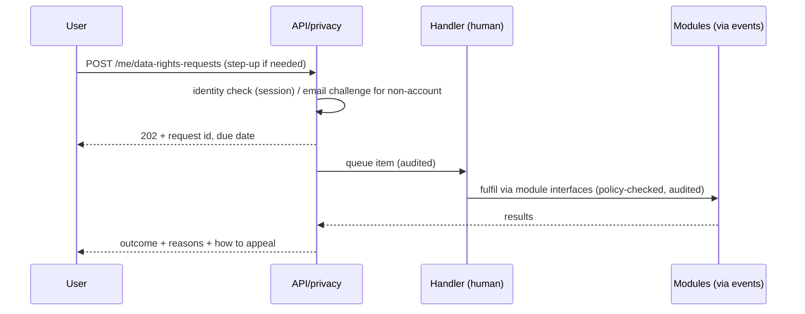
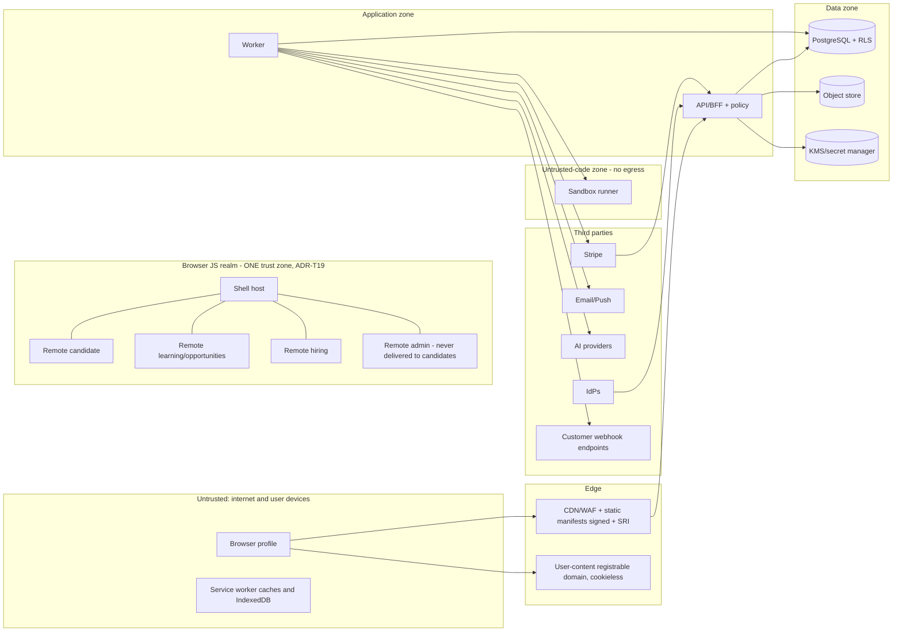

# Target blueprint 14: Security Privacy Compliance

> **Status.** Archive: proposal, not ratified. A greenfield redesign blueprint written in October 2026. Every area was Draft, Under Review or Revision Required (its own document status) and no test was run against it. Its content was mined into `docs/blueprint/`; `SSOT.md` remains the source of intent. Module federation described here was not adopted: the built system is a modular monolith (`ARCHITECTURE.md`).
>
> **What this file holds.** All files of the former `Yash_Final_Project_Document/14_SECURITY_PRIVACY_COMPLIANCE/` folder, in order.
>
> **Merged on 2026-11-25** from the files listed below; each one is a section under its original title. Nothing was removed; the originals are in git history at commit `08387ec`.

| Section | Former file |
|---|---|
| 14 Security, Privacy & Compliance - Index | `Yash_Final_Project_Document/14_SECURITY_PRIVACY_COMPLIANCE/INDEX.md` |
| Compliance Applicability Matrix (Candidate Regimes) | `Yash_Final_Project_Document/14_SECURITY_PRIVACY_COMPLIANCE/COMPLIANCE_APPLICABILITY_MATRIX.md` |
| Legacy Merge B-14b: Route Authorization Review and Findings CF-31..CF-45 (Prior Attempt) with Target Requirements | `Yash_Final_Project_Document/14_SECURITY_PRIVACY_COMPLIANCE/LEGACY_MERGE_ROUTE_AUTHORIZATION_FINDINGS.md` |
| Legacy Merge B-14a: Security Controls, Threat Lists, Credential Handling and Privacy Pointers (Prior Attempt) Reconciled to the Target Security Design | `Yash_Final_Project_Document/14_SECURITY_PRIVACY_COMPLIANCE/LEGACY_MERGE_SECURITY_CONTROLS.md` |
| Privacy & Data Lifecycle Design | `Yash_Final_Project_Document/14_SECURITY_PRIVACY_COMPLIANCE/PRIVACY_AND_DATA_LIFECYCLE_DESIGN.md` |
| Security Architecture | `Yash_Final_Project_Document/14_SECURITY_PRIVACY_COMPLIANCE/SECURITY_ARCHITECTURE.md` |
| Threat Model | `Yash_Final_Project_Document/14_SECURITY_PRIVACY_COMPLIANCE/THREAT_MODEL.md` |
| Security and Privacy Architecture, Revision 2 (SEC-02 REV2) | `Yash_Final_Project_Document/14_SECURITY_PRIVACY_COMPLIANCE/SECURITY_REV2.md` |

## 14 Security, Privacy & Compliance - Index

_Former file: `Yash_Final_Project_Document/14_SECURITY_PRIVACY_COMPLIANCE/INDEX.md`._

Supersedes nothing. Doc ID: IDX-14 · Owner: Security Architect · Version 1.0 · Status: Under Review · Relates: SEC-01..SEC-04

- [THREAT_MODEL.md](#threat-model) · [SECURITY_ARCHITECTURE.md](#security-architecture) · [PRIVACY_AND_DATA_LIFECYCLE_DESIGN.md](#privacy--data-lifecycle-design) · [COMPLIANCE_APPLICABILITY_MATRIX.md](#compliance-applicability-matrix-candidate-regimes)

## Compliance Applicability Matrix (Candidate Regimes)

_Former file: `Yash_Final_Project_Document/14_SECURITY_PRIVACY_COMPLIANCE/COMPLIANCE_APPLICABILITY_MATRIX.md`._

Doc ID: SEC-04 · Owner: Security Architect + Privacy Engineer (for counsel review) · Version 1.0 · Status: Under Review · Relates: OPEN-08, OPEN-09, OPEN-10, DOM-00 §4 family Q, INV-T09, INV-T15, INV-T19, INV-T20 · Companions: SEC-01..SEC-03, DB-03

**Important.** This matrix lists regimes that _might_ apply and the facts that would make them apply. **Every row is "applicability to be confirmed by counsel."** Nothing here is legal advice, a statement of what the law requires, or a claim that TalentSphere complies with, is certified under, or will be certified under any regime. "Design support" lists engineering capabilities that would help meet obligations _if_ a regime applies; it is not evidence of conformance. Descriptions of regimes are high-level orientation from general knowledge and must be verified against current official texts by counsel. SOC 2 and ISO/IEC 27001 are listed as **aspirations**, not commitments.

Tags: **[OPEN]** unresolved; **[TARGET]** design support intent.

### 1. How to use

1. Product/legal confirms the _trigger facts_ (markets, customer types, user ages, features) — these are the real inputs.
2. Counsel records a determination per regime (applies / does not apply / applies in part) in `24_RISKS_AND_DECISIONS` with date and scope.
3. For each "applies", engineering turns the design-support items into requirements with test evidence; gaps become backlog items.

### 2. Matrix

| ID    | Regime (candidate)                                                                                                                            | Why it is a candidate                                                                                                                                                                                    | Trigger conditions to confirm                                                                                                                                                                 | Design support in this blueprint [TARGET]                                                                                                                                                                                                   | Likely gaps / decisions needed                                                                                                                                                                                                                                                                                  | Status                                   |
| ----- | --------------------------------------------------------------------------------------------------------------------------------------------- | -------------------------------------------------------------------------------------------------------------------------------------------------------------------------------------------------------- | --------------------------------------------------------------------------------------------------------------------------------------------------------------------------------------------- | ------------------------------------------------------------------------------------------------------------------------------------------------------------------------------------------------------------------------------------------- | --------------------------------------------------------------------------------------------------------------------------------------------------------------------------------------------------------------------------------------------------------------------------------------------------------------- | ---------------------------------------- |
| CR-01 | GDPR (EU)                                                                                                                                     | Personal data of candidates/learners; employment-related processing                                                                                                                                      | Offering to or monitoring individuals in the EU/EEA; establishment in the EU                                                                                                                  | Purpose register (SEC-03 §2), consent records, export/erasure flows, access log, DPIA-trigger process, field encryption, retention jobs, processor register, human-in-loop for consequential decisions                                      | Lawful-basis determinations; DPO need; transfer mechanisms; representative; breach-notification process timing; record of processing format; retention list (OPEN-08)                                                                                                                                           | Applicability to be confirmed by counsel |
| CR-02 | UK GDPR / Data Protection Act                                                                                                                 | Same as above for UK users                                                                                                                                                                               | Offering to or monitoring individuals in the UK                                                                                                                                               | As CR-01                                                                                                                                                                                                                                    | UK-specific transfer and representative questions                                                                                                                                                                                                                                                               | Applicability to be confirmed by counsel |
| CR-03 | CCPA/CPRA and other US state privacy laws                                                                                                     | Personal information of California (and other state) residents; job applicants may be covered                                                                                                            | Meeting statutory business thresholds; consumers in covered states; whether applicant/employee data is in scope                                                                               | Notice-at-collection artefacts, access/delete/correct flows, opt-out of sale/sharing (design: no sale/no cross-context ad sharing), sensitive-data minimisation, purpose limitation                                                         | Threshold analysis; "sensitive PI" handling; contract terms with service providers; opt-out signal handling (e.g. browser signals)                                                                                                                                                                              | Applicability to be confirmed by counsel |
| CR-04 | EU AI Act (Regulation (EU) 2024/1689) — employment use as high-risk                                                                           | AI used for recruitment, selection, filtering applications, evaluating candidates is commonly listed among high-risk uses; TalentSphere's matching/shortlisting/integrity features are candidate systems | Placing on the EU market or putting into service AI systems used by employers in the EU; whether features are "AI systems" under the definition; provider vs deployer roles; transition dates | Human-in-loop (INV-T09), explainability and uncertainty (INV-T19), logging of factors, ranking-input allowlist, anomaly != guilt (INV-T20), evaluation process, documentation hooks (model cards), kill switches                            | Classification of each feature; risk-management system, data governance, technical documentation, record-keeping, transparency to deployers, human oversight design, accuracy/robustness, conformity assessment — **scope and timing for counsel**; AI literacy duties; GPAI provider terms for upstream models | Applicability to be confirmed by counsel |
| CR-05 | NYC Local Law 144 (automated employment decision tools)                                                                                       | NYC employers using tools that substantially assist or replace hiring decisions                                                                                                                          | Candidates/employees residing in NYC; whether matching/shortlisting counts as an automated employment decision tool; who is the "employer" vs vendor                                          | Explainable factors, no auto-reject, ability to disable features for an org, data to support external bias analysis, notice artefacts                                                                                                       | Independent bias audit and publication of results; candidate notice timing; data needed for impact ratios (requires demographic data we deliberately do not collect, OPEN-B54)                                                                                                                                  | Applicability to be confirmed by counsel |
| CR-06 | Other US AI/automated-decision employment rules (state/local; e.g. Illinois AI video interview, Colorado AI Act, EEOC guidance)               | Emerging state laws on automated hiring tools                                                                                                                                                            | Customers/candidates in those states; use of video/AI scoring (not planned at launch)                                                                                                         | Same as CR-05; no video analysis at launch                                                                                                                                                                                                  | Monitoring law changes; contract flow-downs to employer customers                                                                                                                                                                                                                                               | Applicability to be confirmed by counsel |
| CR-07 | Anti-discrimination/equal-opportunity laws for hiring (US EEO, UK Equality Act, EU directives)                                                | Hiring support tooling can create disparate-impact exposure for employer customers                                                                                                                       | Employer customers subject to such laws (almost certain); vendor liability theories vary                                                                                                      | Ranking-input allowlist excluding protected attributes, explanations, human decisions, appeal flows, audit trail                                                                                                                            | Fairness evaluation approach and data (OPEN-B54); customer contract allocation                                                                                                                                                                                                                                  | Applicability to be confirmed by counsel |
| CR-08 | ePrivacy / cookie-and-storage rules; CAN-SPAM, CASL, PECR-type email rules                                                                    | Cookies/local storage; marketing email; outreach messaging                                                                                                                                               | Marketing sent to EU/UK/CA/US recipients; any non-essential storage/tracking                                                                                                                  | Strictly-necessary-only storage, consent-gated analytics and marketing, one-click unsubscribe, suppression list, sender identification, recruiter-outreach consent scope                                                                    | Whether recruiter outreach counts as marketing in a jurisdiction; footer/address requirements                                                                                                                                                                                                                   | Applicability to be confirmed by counsel |
| CR-09 | COPPA / children's data rules; age-appropriate design codes; FERPA and education-records laws                                                 | Institution learners may be minors; institution data may be education records                                                                                                                            | Users under the relevant age; US institutions subject to FERPA; UK/EU education contexts (OPEN-09)                                                                                            | Minors stance (SEC-03 §8), consent scopes off by default, institution consent scope, small-count suppression                                                                                                                                | Age gate values, verifiable parental consent mechanics, institution agreements, school-official designation                                                                                                                                                                                                     | Applicability to be confirmed by counsel |
| CR-10 | PCI DSS (payment card data)                                                                                                                   | Online payments                                                                                                                                                                                          | Taking card payments (even via redirect); merchant level and SAQ type determined with the acquirer/payment provider                                                                           | Hosted Checkout/Portal so card data does not touch our systems; no card fields; CSP restricts form targets; webhook signing                                                                                                                 | Confirmation of SAQ type and annual attestation obligations; script-integrity requirements for payment pages (none embedded)                                                                                                                                                                                    | Applicability to be confirmed by counsel |
| CR-11 | Accessibility: WCAG 2.2 (technical standard), ADA (US), Section 508 (US public sector customers), European Accessibility Act (EU), EN 301 549 | Public-facing web product; B2B customers incl. education/public sector                                                                                                                                   | Customers/markets (EU consumer services, US public institutions, ADA exposure); dates of application                                                                                          | Accessibility is a release gate in the reference approach [REF]; PWA semantic markup, keyboard/screen-reader requirements, captions for course media, accessible assessments with accommodations (time extensions), accessibility statement | Conformance target (proposed WCAG 2.2 AA), audits, VPAT/ACR production, assessment accommodation policy                                                                                                                                                                                                         | Applicability to be confirmed by counsel |
| CR-12 | Consumer/commercial law for subscriptions and online contracts (auto-renewal rules, distance-selling, VAT/sales tax)                          | Paid plans                                                                                                                                                                                               | Markets of paying customers; B2C vs B2B                                                                                                                                                       | Clear plan terms, Stripe portal self-cancel, invoices, entitlement transparency                                                                                                                                                             | Tax registration/handling (OPEN-B41), renewal notices, refund policy                                                                                                                                                                                                                                            | Applicability to be confirmed by counsel |
| CR-13 | Employment-screening / background-check regimes (e.g. US FCRA-type rules)                                                                     | Verification of work history and references could resemble screening services in some analyses                                                                                                           | Whether TalentSphere or customers use outputs as "consumer reports" for employment decisions                                                                                                  | Candidate-initiated verification only, consent-based sharing, dispute flow, no adverse automated decisions                                                                                                                                  | Whether the verification feature is characterised as a consumer reporting service; permissible-purpose, adverse-action and accuracy duties                                                                                                                                                                      | Applicability to be confirmed by counsel |
| CR-14 | Data residency / localisation and cross-border transfer rules                                                                                 | Cross-border providers (AI, email, hosting)                                                                                                                                                              | Customers or markets with in-region requirements (OPEN-B32)                                                                                                                                   | Port-isolated providers, enumerated stateful stores, region attribute reserved                                                                                                                                                              | Region strategy, transfer mechanisms, sub-processor disclosures                                                                                                                                                                                                                                                 | Applicability to be confirmed by counsel |
| CR-15 | Platform liability/content rules (e.g. EU Digital Services Act, notice-and-action)                                                            | User-generated content and messaging                                                                                                                                                                     | Service classification and user numbers in the EU                                                                                                                                             | Reporting, moderation queue with appeals, transparency records                                                                                                                                                                              | Classification, statements of reasons, trusted flaggers, reporting duties                                                                                                                                                                                                                                       | Applicability to be confirmed by counsel |
| CR-16 | Breach-notification laws                                                                                                                      | Any personal-data incident                                                                                                                                                                               | Jurisdictions of affected individuals                                                                                                                                                         | Incident outline (SEC-02 §11), audit/access logs for scoping                                                                                                                                                                                | Timelines and thresholds per law — **not asserted here**                                                                                                                                                                                                                                                        | Applicability to be confirmed by counsel |
| CR-17 | SOC 2 (AICPA Trust Services Criteria) — **aspiration**                                                                                        | Enterprise customers often request an attestation report                                                                                                                                                 | Enterprise sales demand; scope (security, availability, confidentiality, privacy) chosen by management                                                                                        | Controls engineered with evidence in mind: access reviews, change management via CI, audit logs, incident process, vendor register, backup/restore drills                                                                                   | Policies, control owners, evidence collection, auditor selection, observation period; **no claim of any report existing**                                                                                                                                                                                       | Aspiration; not committed                |
| CR-18 | ISO/IEC 27001 (and 27701 privacy extension) — **aspiration**                                                                                  | Enterprise/regulated customers; structured ISMS                                                                                                                                                          | Customer or market demand                                                                                                                                                                     | Risk register (24_*), asset inventory (SEC-01 §2), classification (DB-03 §1), access control, supplier register                                                                                                                             | ISMS scope, statement of applicability, internal audit, certification body; **no claim of certification**                                                                                                                                                                                                       | Aspiration; not committed                |
| CR-19 | Industry/sector or procurement-specific frameworks (e.g. customer security questionnaires, education-sector vendor assessments)               | B2B2C institutions                                                                                                                                                                                       | Specific customer contracts                                                                                                                                                                   | Documentation in this blueprint can seed responses                                                                                                                                                                                          | Mapping effort per customer                                                                                                                                                                                                                                                                                     | To be confirmed per deal                 |

### 3. Cross-cutting design support (regime-independent)

| Capability                                       | Doc                        | Supports              |
| ------------------------------------------------ | -------------------------- | --------------------- |
| Purpose-bound consent, append-only records       | DB-01 §4, SEC-03 §3        | CR-01..03, 08, 09     |
| Export, erasure, restriction, human-review flows | SEC-03 §4, DB-03 §5-6      | CR-01..03, 04         |
| Human-in-the-loop and explainability             | SEC-03 §7, INV-T09/T19/T20 | CR-04..07, 13         |
| Audit, access log, privileged-access time-boxing | SEC-02 §8, INV-T18         | CR-01, 03, 17, 18     |
| Tenant isolation and encryption                  | DB-02, SEC-02 §4           | CR-01..03, 17, 18     |
| Minimisation, retention, lineage                 | DB-03                      | CR-01..03, 09         |
| Accessibility gate and accommodations            | 07_* (other team)          | CR-11                 |
| Vendor/processor register                        | SEC-03 §5, INT-01          | CR-01..03, 14, 17, 18 |

### 4. Decisions required from counsel (inputs to OPEN-08)

1. Target launch markets and customer types (determines CR-01..05, 08, 11, 12).
2. Controller/processor roles for TalentSphere versus employer and institution customers.
3. Lawful-basis determinations per purpose (SEC-03 §2) and consent designs that remain as opt-in.
4. Retention list for audit, billing, hiring records, consent proof, rights logs.
5. Whether matching/shortlisting/integrity features are regulated automated-decision or high-risk AI systems, and who bears provider/deployer duties.
6. Minimum age and education-record handling.
7. Characterisation of verification features (screening vs candidate-controlled credentials).
8. Breach-notification duties and internal timelines.
9. Accessibility conformance target and documentation.

### 5. Maintenance

Reviewed at each market launch, major feature (especially AI or video), new processor, or on counsel notice of a legal change. Determinations are recorded as ADRs; this matrix is updated in the same change.

## Legacy Merge B-14b: Route Authorization Review and Findings CF-31..CF-45 (Prior Attempt) with Target Requirements

_Former file: `Yash_Final_Project_Document/14_SECURITY_PRIVACY_COMPLIANCE/LEGACY_MERGE_ROUTE_AUTHORIZATION_FINDINGS.md`._

Doc ID: LGM-B-14B · Owner: Security Architect · Version 1.0 · Status: Draft for Review · Supersedes nothing · Relates: TRC-04 (`../28_TRACEABILITY_AND_COVERAGE/ROUTE_AUTHORIZATION_FINDING_CROSSWALK.md`), SEC-01, SEC-02, ADR-T07, INV-T01, INV-T02, OPEN-44, OPEN-48, OPEN-50 · Ledger: `../00_CONTROL_CENTRE/LEGACY_MERGE_LEDGER_B.md`

Preservation instruction (project owner, verbatim): "i dont want to loos information keep everything in use untile it get improved".

Merged from legacy: `31_LEGACY_ARCHIVE/docs/system-model/06-route-authorization.md` (13.8 KB; second coverage pass of the prior attempt) and the authorization-related rows of `03-conflict-register.md` (CF-10..CF-16, CF-20, CF-27, CF-30, CF-35).

### 0. Frame

- **Nothing here is a finding about this project.** The prior attempt's four read-only investigators reported (with `path:line` evidence from 2026-10-23) who could call each of about 170 routes. These are **lessons and negative-test seeds**: every row below says what the prior attempt got wrong or left undecided, so this blueprint's policy matrix (ADR-T07) and IDOR test suite can be checked against it. Status words in the verbatim block ("Reported", "Fixed", "Tested") describe the prior attempt only.
- TRC-04 already preserves CF-31..CF-45 row for row in a CSV with candidate target documents. This file adds (a) the **complete** route tables and fixed-defect table, (b) the target requirement for each finding, and (c) the cross-cutting patterns.
- Legend used by the legacy tables: Auth = anonymous (anon), signed in (any) or a role; Check = the role or ownership test; **P** = durable in PostgreSQL, **M** = memory only (lost on restart, response carried `x-talentsphere-durability: ephemeral`).

### 1. Cross-cutting patterns to design out

| Pattern seen in prior attempt                                                                                                                                                                                                       | Target requirement                                                                                                                                                                                                                   |
| ----------------------------------------------------------------------------------------------------------------------------------------------------------------------------------------------------------------------------------- | ------------------------------------------------------------------------------------------------------------------------------------------------------------------------------------------------------------------------------------ |
| "Any organization membership" authorized job management, applicant moves, interview questions/scorecards, talent pools (six routes), employer metrics, job templates and referrals; the member's role was never read (CF-14, CF-45) | Organization-role RBAC with an explicit permission matrix (ADR-T07, OPEN-44). Every org-scoped route names the required role; test per route that a member with a lower role gets 403.                                               |
| Route comments said "Admin / Recruiter" or "authorized recruiters" while the handler allowed any signed-in account (forecast generation, market signals, alumni group role)                                                         | Route registry lint (FF-01): the policy action must exist and the comment is generated from it, not hand-written.                                                                                                                    |
| A client-supplied flag trusted as fact (`isVerifiedEmployee`, `isVerifiedEnrollment`, `role: moderator`)                                                                                                                            | Never accept authority flags from the request body (INV-T01). Derive from server state (membership, enrollment). Contract schemas must not contain such fields; add a schema-lint that flags `is*Verified`-style request properties. |
| Anonymous reads of cross-organization aggregates with low cohort floors (feedback k, salary k 5 and company summary k 3, reputation, instructor reputation returning reviewer ids)                                                  | Public surface decided explicitly (OPEN-25 minimum cohort k); cohort counts **distinct people**, not rows (CF-02, CF-37); never expose reviewer identifiers in public lists.                                                         |
| Self-award routes (claim-activity with arbitrary reference type and amount)                                                                                                                                                         | Every XP/badge award is produced by a server-side event handler on a verified domain event, never by a client "claim" (BR-T for gamification; owner Product Director).                                                               |
| Privacy settings ignored by sibling routes (activity-score lookup ignoring `showActivity`; AI consent not checked on any AI route)                                                                                                  | Settings are enforced in one policy layer (consent scope INV-T15), not per route; test each read route against each privacy setting.                                                                                                 |
| Erasure execute with no grace-period check; maintenance mode that blocks nothing; resumes/connections/etc. offered in UI but memory-only                                                                                            | Behaviour must match what UI and policy promise; every setting/flag has a test that it changes behaviour.                                                                                                                            |
| Candidate-supplied identifiers not checked for ownership/existence (`resumeId` on referral create, moderation target, endorsement recipient)                                                                                        | Foreign ids in request bodies are validated against the caller's visible set (INV-T02); invalid -> `not-found`.                                                                                                                      |

### 2. Findings CF-31..CF-45: target requirement and decision owner

(Verbatim source rows are in section 4. "OPEN" ids reuse `24_RISKS_AND_DECISIONS/OPEN_DECISIONS.md`; new ids are local to this file.)

| ID    | Prior attempt reported                                                                                                                                                                                                                                     | Target requires                                                                                                                                                        | Decision needed / owner                                       |
| ----- | ---------------------------------------------------------------------------------------------------------------------------------------------------------------------------------------------------------------------------------------------------------- | ---------------------------------------------------------------------------------------------------------------------------------------------------------------------- | ------------------------------------------------------------- |
| CF-31 | Any account could award itself XP/badges via `claim-activity`                                                                                                                                                                                              | No client-claimed awards; awards from server events with idempotent natural key                                                                                        | Product: intended gamification model - OPEN-50 / **L-B14-10** |
| CF-32 | Challenge/course XP used a different cap rule than the per-reference idempotent cap (BR-25) and bypassed the gamification profile read by the leaderboard                                                                                                  | One XP ledger with one idempotency rule per reference; leaderboard reads the ledger                                                                                    | Product Director                                              |
| CF-33 | Erasure execute ignored the 30-day grace the UI promised                                                                                                                                                                                                   | Grace enforced server-side; separate legal-hold-aware emergency path                                                                                                   | OPEN-08 (period, emergency policy)                            |
| CF-34 | Any signed-in user could read any user's activity score, ignoring `showActivity`                                                                                                                                                                           | Privacy-setting enforced centrally; scores private by default                                                                                                          | Product/Privacy (**L-B14-11**: are scores ever public?)       |
| CF-35 | AI consent setting unchecked on all AI routes; tier hard-coded free; assistant-query skipped quota and firewall                                                                                                                                            | One AI gateway; consent + entitlement + quota on every call                                                                                                            | OPEN-24, OPEN-19                                              |
| CF-36 | Anonymous cross-org aggregate reads (feedback insights suppressed under 10; salary benchmark k 5; company summary k 3; reputation; org reviews returned `reviewerId`; instructor reputation)                                                               | Explicit public-surface list; k floors from one config; no reviewer ids public                                                                                         | OPEN-25                                                       |
| CF-37 | Salary cohorts fillable by one account; auto-verified unless outlier; self-reported; 5/day; company floor 3 = one person's pay at median of 3; BR-180 sets floor 3 so raising it overrides an approved rule (an attempt was reverted when its test failed) | Distinct-people cohort rule; reports from verified distinct accounts; floor chosen by product                                                                          | Owner decision on BR-180 (OPEN-43/OPEN-25)                    |
| CF-38 | `isVerifiedEnrollment` still accepted from request body; instructor reviews unlimited per user; a server-side check was written and reverted because the API exposed no way to test it                                                                     | Server-derived enrollment flag; one review per user per instructor/course; testable data source                                                                        | Product + QA                                                  |
| CF-39 | Anyone could query warm-intro paths to anyone over the accepted-connection graph; connection requests had no rate limit/block check                                                                                                                        | Path discovery limited by consent and block list; rate-limited connection requests                                                                                     | Privacy decision (**L-B14-12**)                               |
| CF-40 | Endorsements ignored the "connected peer" rule and mixed profile/user ids so a specialization bonus never fired                                                                                                                                            | Rule enforced; one id space (see database file)                                                                                                                        | Product (endorsement rules)                                   |
| CF-41 | Revoking a certificate did not revoke linked evidence (still authority-verified and verifying publicly); completion evidence persisted while certificate/enrollment/XP did not                                                                             | Revocation cascades through the evidence ladder (ADR-T14); certificate and evidence in one transaction                                                                 | Product decision on revocation                                |
| CF-42 | Maintenance mode changed diagnostics only and reset on restart                                                                                                                                                                                             | Maintenance mode persisted, blocks writes (503 + Retry-After) with allow-list for admin/health                                                                         | Platform/SRE                                                  |
| CF-43 | UI offered features whose state was memory-only (resumes, connections, warm intros, portfolio, AI conversations, activity, moderation reports/appeals, analytics, salaries, reputation, interviews, talent pools, alumni, referrals, job templates)        | All persisted (ADR-T05); no UI for non-persisted features                                                                                                              | none (resolved by ADR-T05)                                    |
| CF-44 | Alumni verification trusted the unverified account email; stealth check read an unconfirmed field (`isStealthMode`); referral create passed `resumeId` without ownership check                                                                             | Verification via institution-issued seat code or verified domain; stealth as a profile privacy field enforced in the policy layer; ownership checks on all foreign ids | Product + Security (verify each before change)                |
| CF-45 | Any membership authorized interview questions/scorecards, talent pools (6 routes), employer metrics, job templates, referrals                                                                                                                              | Organization role RBAC                                                                                                                                                 | OPEN-44                                                       |

Earlier-pass authorization conflicts from `03-conflict-register.md` kept visible here:

| ID    | Prior attempt reported                                                                                                                                                                   | Target requires                                                                                            | Decision owner                                          |
| ----- | ---------------------------------------------------------------------------------------------------------------------------------------------------------------------------------------- | ---------------------------------------------------------------------------------------------------------- | ------------------------------------------------------- |
| CF-12 | Any signed-in account could post a market signal that fed public forecasts (fixed: admin only)                                                                                           | Data inputs to public statistics only from authorized/verified sources                                     | Product ("may a verified external source supply data?") |
| CF-14 | Anyone with any membership could manage jobs and move applicants; docs said "authorized recruiters"                                                                                      | Org-role RBAC                                                                                              | OPEN-44                                                 |
| CF-15 | Job approval: SSOT describes admin approval and a `rejected_by_moderation` state; code let an org recruiter approve their own job, allowed draft->published, and had no moderation state | Decide whether approval is required; implement as a state machine (SM-JOB) with moderation state           | **L-B14-13** Product Director                           |
| CF-16 | An org owner without the `recruiter` role passed the route check but was refused by the domain layer                                                                                     | One role check, one place; organization creator receives an org-level owner role with explicit permissions | OPEN-44                                                 |
| CF-20 | `assertPlatformAdmin` accepted the string `admin`; hiring lists included `employer`; neither was in the Role union (dead branches)                                                       | Closed role enumeration; no stringly-typed role checks                                                     | none                                                    |
| CF-27 | Interview code evaluation simulated (pass/fail from the text of the code; fails closed only in staging/production); challenge submissions had a second placeholder                       | ADR-T13: sandbox runner or code assessments stay `unverified` and never mint verified evidence             | OPEN-27                                                 |
| CF-30 | Concurrent checkout sessions both payable; second subscription ignored but billed; disputes/voided invoices unhandled; webhook shares global rate limit                                  | See `13_API_EVENTS_AND_INTEGRATIONS/LEGACY_MERGE_API_CONTRACTS.md` L-B13-02                                | Finance/Legal/Backend                                   |

### 3. Fixed defects of the prior attempt (negative-test seeds)

Each of these must have a regression test in the new implementation (see `../16_QA_AND_TESTING/LEGACY_MERGE_TESTING_STRATEGY.md`): unpublished course visible to anyone; forecast generation open to any account; alumni join letting the caller choose `moderator`; endorsement to a non-existent recipient; client-supplied `isVerifiedEmployee`; market-signal posting open to any account. (Verbatim table in section 4.)

### 4. Verbatim prior-attempt record (route authorization and persistence, second coverage pass)

The text below is the legacy file. Words such as "fixed", "tested" and file/line references refer to the **prior attempt's** repository and are retained only as evidence; no code exists here. `?` characters are lost non-ASCII characters in the source export.

Evidence: four read-only investigators each read the handlers for a share of the routes in `apps/api/src/server.ts` (S) and compared them with `apps/api/src/durability.ts` (D). The first pass (`02-flows.md`) covered auth, jobs and applications, work history, billing and boot. Together the two passes cover most route groups; route groups not listed here were not read. Status of each claim: **Reported** (investigator cited a line) unless marked **Fixed** or **Tested**.

Legend: Auth = anonymous (anon), signed in (any), or a role. Check = the role or ownership test the handler makes. P = durable in PostgreSQL, M = memory only (lost on restart, response carries `x-talentsphere-durability: ephemeral`). Several routes labelled ephemeral also write durable rows; those are noted.

### Fixed in this pass (each has a test)

| Route                                        | Defect                                                                                                             | Fix                                                                                                                   |
| -------------------------------------------- | ------------------------------------------------------------------------------------------------------------------ | --------------------------------------------------------------------------------------------------------------------- |
| `GET /courses/:id`                           | Returned unpublished courses, including lesson text, to anyone.                                                    | Visible only to the course's instructor and platform admins; everyone else gets 404. Tested in `lms-courses.test.ts`. |
| `POST /skills/:skillId/forecast/generate`    | Route comment says "Admin / Recruiter" but any signed-in account could replace the cached forecast everyone reads. | Requires `recruiter`, `hiring_manager` or `platform_admin`; 403 otherwise. Tested in `skill-forecasting.test.ts`.     |
| `POST /alumni/groups/:id/join`               | A joiner could ask for `role: moderator` and receive it.                                                           | 403 unless the caller administers the institution. Tested in `alumni-networks.test.ts`.                               |
| `POST /skills/endorsements`                  | Accepted any recipient id, including one that is not a user.                                                       | 404 for an unknown recipient. Tested in `peer-credibility.test.ts`.                                                   |
| `POST /reputation/organizations/:id/reviews` | `isVerifiedEmployee` was taken from the request body.                                                              | Set only from the reviewer's membership of the organization. Tested in `employer-reputation.test.ts`.                 |
| `POST /skills/:skillId/market-signals`       | Any signed-in account could post market data (earlier pass, CF-12).                                                | Platform admin only.                                                                                                  |

### Open findings from this pass (not fixed: each needs a product or policy decision)

| ID    | Finding                                                                                                                                                                                                                                                                                                                                                        | Evidence                                             | Why not fixed                                                    |
| ----- | -------------------------------------------------------------------------------------------------------------------------------------------------------------------------------------------------------------------------------------------------------------------------------------------------------------------------------------------------------------- | ---------------------------------------------------- | ---------------------------------------------------------------- |
| CF-31 | `POST /gamification/claim-activity` lets any account award itself XP and badges: arbitrary `referenceType`, `referenceId` and amount 1 to 200, deduplicated per pair and capped at 200 per day. A fresh reference id each time still counts toward badges and the leaderboard.                                                                                 | S:9705; contracts 558-563; `gamification.ts:204-237` | The route's intended use is not documented.                      |
| CF-32 | Challenge and course XP follow a different rule from the documented per-reference idempotent cap (BR-25): repeat passes earn XP until a lifetime cap of 200, and neither path updates the gamification profile that `/summary` and the leaderboard read.                                                                                                       | S:4684, 5215; `assessment.ts:170-177`                | Needs the intended XP rules.                                     |
| CF-33 | `POST /settings/erasure/execute` never checks the 30-day grace period the UI and `SSOT.md:3706` promise; any signed-in account can anonymise immediately. The request, status and cancel routes are cosmetic once execute is called.                                                                                                                           | S:10071                                              | Issue #45 (deletion policy) is unresolved.                       |
| CF-34 | `GET /activity/users/:userId/score` lets any signed-in user read any user's score, band and streak, ignoring the `showActivity` setting that the analytics route respects.                                                                                                                                                                                     | S:9365                                               | Decide whether scores are public.                                |
| CF-35 | The AI data-consent setting ("Allow TalentSphere AI to use my profile data") is not checked on any AI route. The tier is hardcoded to free. `POST /ai/assistant/query` skips the quota and the prompt firewall.                                                                                                                                                | S:5947-5968, 4718                                    | AI provider and entitlement policy is reserved for the owner.    |
| CF-36 | Anonymous reads: `GET /feedback/aggregate-insights` (cross-organization feedback counts, suppressed under 10), `GET /salaries/benchmarks` (k 5), `GET /salaries/company/:name` (k 3, below the benchmark k), `GET /reputation/organizations/:id`, `GET /organizations/:id/reviews` (returns `reviewerId`), instructor reputation.                              | S:3086, 2525, 2543, 4353, 4504, 4159                 | Decide the public surface.                                       |
| CF-37 | Salary cohorts can be filled by one account: reports are auto-verified unless an outlier, self-reported counts, 5 reports a day. The company summary floor is 3 reports, which equals one person's pay at a median of 3 values; **BR-180 sets that floor at 3**, so raising it would override an approved rule (an attempt was reverted when its test failed). | S:2432; `salary-intelligence.ts:191`                 | Needs a distinct-people rule and an owner decision on BR-180.    |
| CF-38 | `isVerifiedEnrollment` on instructor reviews is still accepted from the request body, and instructor reviews are unlimited per user. (The employer flag is fixed, see above.) A server-side check was written and reverted because the API exposes no way to test it.                                                                                          | S:4305, 4297                                         | Needs a testable server-side source for the flag.                |
| CF-39 | Warm-intro paths: any signed-in user can query paths to any user across the accepted-connection graph; connection requests have no rate limit or block check.                                                                                                                                                                                                  | S:6577, 6231                                         | Needs a privacy decision.                                        |
| CF-40 | `POST /skills/endorsements` ignores the "connected peer" rule in `SSOT.md:1933` and mixes profile and user ids so the specialization bonus never fires. (The unknown-recipient case is fixed, see above.)                                                                                                                                                      | S:7098, 7133                                         | Needs the intended rules.                                        |
| CF-41 | Revoking a certificate does not revoke its linked evidence, which stays authority-verified and still verifies through `/verify/:hash`. Course-completion evidence is persisted while the certificate, enrollment and XP are not.                                                                                                                               | S:5371-5409, 5193                                    | Product decision on revocation.                                  |
| CF-42 | Maintenance mode only changes diagnostics output and resets on restart; it blocks no traffic.                                                                                                                                                                                                                                                                  | S:10930, 10893                                       | Decide intended behaviour.                                       |
| CF-43 | In-memory only, although the UI offers them: resumes, connections, warm intros, portfolio, AI conversations, activity, moderation reports and appeals, analytics, salaries, reputation, interviews, talent pools, alumni, referrals, job templates (issue #48).                                                                                                | D:21-105                                             | Durable storage for each is a scoped project.                    |
| CF-44 | Alumni and referral trust: alumni affiliation verification trusts the unverified account email; talent-pool stealth checks read a field (`isStealthMode`) not confirmed to be set; referral create passes `resumeId` through without an ownership check.                                                                                                       | S:8911, 8064, 6846                                   | Needs verification of each before changing.                      |
| CF-45 | "Any organization membership" authorizes interview questions and scorecards, talent pools (6 routes), employer metrics, job templates and referrals, in addition to the job and applicant routes in CF-14. The member's role is never read.                                                                                                                    | S:3280, 3339, 3359, 7892-8161, 4471, 2375, 6919      | Same decision as CF-14: define which organization roles may act. |

### Route tables

#### Jobs, applications, organizations, work history, billing, auth

See `02-flows.md` (F2 to F5) and `04-conditions.md`.

#### Messaging, notifications, AI, resumes, portfolio, connections, warm intros, saved searches (all signed in unless noted)

| Routes                                                                                                              | Check                                                                                                                                                          | P/M                                                         |
| ------------------------------------------------------------------------------------------------------------------- | -------------------------------------------------------------------------------------------------------------------------------------------------------------- | ----------------------------------------------------------- |
| `GET/POST /threads`, `/threads/:id`, `/threads/:id/messages`, `/threads/:id/read`                                   | participant check on every by-id route; starting a conversation needs an accepted connection or an application link (`mayStartConversation`)                   | P                                                           |
| `GET /notifications`, `/summary`, `POST /mark-read`, `GET/PATCH /preferences`                                       | own records only                                                                                                                                               | P (a default preference is created in memory on first read) |
| `POST /ai/assistant/query`                                                                                          | any signed-in; assessment prohibition only                                                                                                                     | M                                                           |
| `POST /ai/career-assistant/chat`                                                                                    | assessment prohibition, prompt firewall (2000 characters; injection patterns rejected), free quota 20 requests and 5000 tokens per day, conversation ownership | M                                                           |
| `POST/GET /ai/conversations`, `/:id`, `GET /ai/usage`                                                               | own                                                                                                                                                            | M                                                           |
| `POST/GET/PATCH /resumes`, `/:id`, `/:id/export`, `/:id/exports`, `DELETE /resumes/exports/:id`                     | owner (`userId`)                                                                                                                                               | M                                                           |
| `POST /connections/request`, `GET /connections`, `/status/:id`, `POST /:id/respond`, `/:id/withdraw`, `DELETE /:id` | respond: recipient only; withdraw: sender only; delete: either party                                                                                           | M                                                           |
| `/networking/warm-intros/*`                                                                                         | own lists; request rate limit and block list in the domain; detail visible to requester, introducer, approved target or admin                                  | M                                                           |
| `POST/GET /portfolio/projects`, `PATCH/DELETE /:id`                                                                 | owner; reads use `canViewPortfolioProject` (anon may read public projects; `recruiters_only` passes for any recruiter)                                         | M                                                           |
| `GET/POST/PATCH/DELETE /jobs/saved-searches*`                                                                       | owner                                                                                                                                                          | P                                                           |

#### Evidence, skills, courses, learning, challenges, gamification, certificates

| Routes                                                                                                                              | Check                                                                                                                                                                                                                                                   | P/M                       |
| ----------------------------------------------------------------------------------------------------------------------------------- | ------------------------------------------------------------------------------------------------------------------------------------------------------------------------------------------------------------------------------------------------------- | ------------------------- |
| `POST /evidence`, `GET /evidence/mine`, `/:id`, `/subject/:id`, `POST /:id/verify`, `/dispute`, `/revoke`, `GET /:id/verify-public` | create: own profile; verify needs the role for the target level (peer: staff or confirmed referee; institution: institution admin, instructor or admin; authority: admin or verification staff); public proof is anonymous and carries no personal data | P                         |
| `GET /skills`, `POST /skills`, `/skills/relationships`                                                                              | list anonymous; writes platform admin                                                                                                                                                                                                                   | P / M                     |
| `/skills/freshness*`, `/skills/:id/reverify`                                                                                        | own record; `refresh-all` platform admin                                                                                                                                                                                                                | M                         |
| `/skills/endorsements*`                                                                                                             | any signed-in (see CF-40)                                                                                                                                                                                                                               | M                         |
| `GET /skills/forecast/top-growth`, `/skills/:id/forecast`                                                                           | anonymous                                                                                                                                                                                                                                               | M                         |
| `POST /courses`, `/:id/modules`, `/modules/:id/lessons`, `/:id/publish`                                                             | instructor, course author or admin to create; course instructor or admin to change                                                                                                                                                                      | M                         |
| `POST /courses/:id/enroll`, `/lessons/:id/complete`, `GET /:id/progress`                                                            | enrollment required; no enrolling in your own course                                                                                                                                                                                                    | M (completion evidence P) |
| `GET /certificates/*`, `/verify/:hash`                                                                                              | anonymous                                                                                                                                                                                                                                               | M (evidence P)            |
| `POST /certificates/:n/revoke`                                                                                                      | admin or the course's instructor                                                                                                                                                                                                                        | M                         |
| `GET /challenges*`                                                                                                                  | anonymous (hidden tests removed)                                                                                                                                                                                                                        | M                         |
| `POST /challenges`                                                                                                                  | domain: admin, instructor or course author                                                                                                                                                                                                              | M                         |
| `POST /challenges/:id/start-session`, `/submit`                                                                                     | own profile and session                                                                                                                                                                                                                                 | M (evidence P)            |
| `GET /xp/ledger`, `/gamification/*`                                                                                                 | own; leaderboard shows all display names and XP                                                                                                                                                                                                         | M                         |
| `/learning/impact/*`                                                                                                                | outcomes: enrolled learner, once per course; metrics anonymous with cohort floor 30; compute: instructor or admin                                                                                                                                       | M                         |

#### Admin, moderation, settings, search, analytics, activity

| Routes                                                                                                       | Check                                                                                                 | P/M                                       |
| ------------------------------------------------------------------------------------------------------------ | ----------------------------------------------------------------------------------------------------- | ----------------------------------------- |
| `GET /health`, `/feature-flags`                                                                              | anonymous                                                                                             | stateless / P                             |
| `GET/PATCH /profile/me`, `GET /profile/:id`                                                                  | own; `canViewProfile` for others                                                                      | P                                         |
| `GET/PATCH /settings`, `POST /settings/export`, `/erasure/*`                                                 | own (see CF-33)                                                                                       | P (export and execute write durable rows) |
| `GET /admin/users`, `PATCH /users/:id/status`, `/roles`, feature flags, audit logs, diagnostics, maintenance | `assertPlatformAdmin` (also accepts the string `admin`); an admin cannot suspend or demote themselves | P for flags, audit and user changes       |
| `POST /moderation/scan`                                                                                      | anonymous, compute only                                                                               | M                                         |
| `POST /moderation/reports`, `GET /reports/my`, `POST /reports/:id/appeal`                                    | own; the target is not checked for existence                                                          | M                                         |
| `GET /moderation/reports`, `/:id`, `PATCH /:id/status`, `POST /:id/resolve`, `/appeals/:id/review`           | moderator or admin; a ban needs two different admins; a reporter cannot resolve their own report      | M (user and job changes P)                |
| `GET /search*`                                                                                               | anonymous; profiles gated by `canViewProfile`; published jobs only                                    | M                                         |
| `POST /analytics/events`                                                                                     | anonymous allowed; honours the user's telemetry setting; `GET` events and KPIs admin only             | M                                         |
| `POST/GET /activity/*`                                                                                       | own (see CF-34 for the score lookup)                                                                  | M                                         |

#### Interviews, reputation, recruiter, alumni, referrals, salaries, career, job templates

| Routes                                                                                             | Check                                                                                                                                                                                                                                 | P/M                                   |
| -------------------------------------------------------------------------------------------------- | ------------------------------------------------------------------------------------------------------------------------------------------------------------------------------------------------------------------------------------- | ------------------------------------- |
| `/job-templates*`                                                                                  | organization member (any role) and domain role for writes                                                                                                                                                                             | M (instantiate writes a job)          |
| `/interviews/*`                                                                                    | organization member for create and list; participants for read; panel only for end, score and review; the candidate view strips private notes and hidden tests; code execution is simulated and returns 503 in production and staging | M (scorecard may move an application) |
| `POST /reputation/signals`, `/recovery/.../complete`, `/recalculate-all`, `/instructors/recompute` | admin or moderator                                                                                                                                                                                                                    | M                                     |
| `GET /reputation/users/:id`                                                                        | self, admin, or a hiring role for a user who applied to their organization                                                                                                                                                            | M                                     |
| `/reputation/instructors`, `/organizations`                                                        | reads anonymous; writes any signed in (see CF-38)                                                                                                                                                                                     | M                                     |
| `/recruiter/talent-pools*`, `/discovery/behavioral*`, `/talent-segmentation*`                      | any membership of an organization for pools (CF-45); a global hiring role for discovery and segmentation, with a stealth check                                                                                                        | M                                     |
| `/alumni/*`                                                                                        | verified alumnus or institution administrator for directory, groups and mentorship                                                                                                                                                    | M                                     |
| `/referrals/*`                                                                                     | referrer only to respond; candidate, referrer, organization member or admin to read                                                                                                                                                   | M (respond may tag an application)    |
| `/salaries/*`                                                                                      | reports: any signed in, 5 per day; benchmarks and company summary anonymous                                                                                                                                                           | M                                     |
| `/career/*`                                                                                        | transitions own; benchmarks, probability and pathways anonymous with 20-person floor                                                                                                                                                  | M                                     |

### Not read

Per-route Zod schemas, `canViewProfile` beyond its first branches, the gamification badge tail, the bodies of several domain functions (`discoverWarmIntroPaths`, `computeEndorsementWeight`, `detectSalaryOutlier`), rate limiting, the error handler, storage SQL and tests for these groups.

### 5. Open items raised by this file

| ID       | Question                                                           | Owner                                 |
| -------- | ------------------------------------------------------------------ | ------------------------------------- |
| L-B14-10 | Intended gamification/XP model (claim vs event-driven; one ledger) | Product Director (OPEN-50)            |
| L-B14-11 | Are activity scores ever public; default visibility                | Product + Privacy                     |
| L-B14-12 | Warm-intro path discovery: who may query whose network             | Privacy Lead                          |
| L-B14-13 | Job approval and moderation states (CF-15)                         | Product Director                      |
| OPEN-44  | Authorization model and organization roles                         | Security Architect + Domain Architect |

## Legacy Merge B-14a: Security Controls, Threat Lists, Credential Handling and Privacy Pointers (Prior Attempt) Reconciled to the Target Security Design

_Former file: `Yash_Final_Project_Document/14_SECURITY_PRIVACY_COMPLIANCE/LEGACY_MERGE_SECURITY_CONTROLS.md`._

Doc ID: LGM-B-14A · Owner: Security Architect · Version 1.0 · Status: Draft for Review · Supersedes nothing · Relates: SEC-01, SEC-02, SEC-02-R2, SEC-03, SEC-04, ADR-T06, ADR-T07, ADR-T12, ADR-T13, ADR-T15, INV-T05, INV-T06, INV-T14, INV-T17, OPEN-08, OPEN-24, OPEN-27, OPEN-48 · Ledger: `../00_CONTROL_CENTRE/LEGACY_MERGE_LEDGER_B.md`

Preservation instruction (project owner, verbatim): "i dont want to loos information keep everything in use untile it get improved".

Merged from legacy: `31_LEGACY_ARCHIVE/docs/quality/SECURITY.md` v6.0 (17.7 KB) - all 14 sections including the threat-model lists (sections 5-7) and the baseline/incident/privacy sections (12-14); security-relevant parts of `docs/quality/OPERATIONS.md`.

### 0. Frame

- **No security control exists in this project.** Everything below tagged "prior attempt reported" describes an earlier attempt, not this project. "Target requires" is a requirement for this project. Legacy `SECURITY.md` itself said: "security objectives and checklists below are requirements, not certification. Implementation notes describe source behavior; referenced PostgreSQL/browser results remain historical unless the current audit records a fresh run."
- Legacy caveats kept as lessons: simulated assessment scoring (audit D-01), duplicate worker execution (D-02), erasure spanning several stores after deactivation with no recovery (D-03), a security-scan test that could pass when its external grep command was unavailable (D-07), and LMS certificate issuance omitting the final-assessment gate BR-048 (D-09: lesson completion alone produced authority-verified evidence). **Target requires** that each of these five classes has an explicit negative test (section 11 and the QA file).

### 1. Objective, pipeline and authorization chain (legacy sections 1-3)

- Objective: protect identity, private career data, evidence, assessments, tenant data, financial state, credentials, provider credentials and audit history.
- Request pipeline: `Browser -> HTTPS -> AuthN -> Session verification -> Authorization -> Purpose/privacy policy -> Domain validation -> DB constraints + RLS -> Audit`.
- Authorization chain: `Identity -> Role -> Permission -> Resource ownership -> Tenant -> Purpose -> Policy`. Never trust client role/tenant IDs.
- **Target mapping:** SEC-02 and ADR-T07 (central policy module, deny-by-default), INV-T01/T02/T03, consent scope INV-T15. The legacy chain adds "Purpose/privacy policy" before domain validation - confirm SEC-02 places a purpose check at the same point (action: Security Architect).

### 2. Database-level security (legacy section 4) - lessons on RLS and grants

- RLS is required on exposed tables and should be tested with allow/deny assertions. Table grants and RLS policies are distinct and both must be designed (legacy cited the managed-database vendor's Data API security guidance).
- Prior-attempt state: the API used its own sessions and authorized in code; its privileged connection bypassed RLS; policies were defence-in-depth for hypothetical direct JWT access, **not** a substitute for API authorization.
- Corrections found by real PostgreSQL two-account tests (migrations 00047-00048 of the prior attempt):
  - profile-id vs auth-user-id comparisons were wrong for messaging and notifications; direct participant insertion was removed; message authorship and notification update columns were constrained; a recursive thread-participant policy was replaced by a fixed-search-path `SECURITY DEFINER` membership helper;
  - an unqualified `user_id` in a notification-preference subquery bound to the inner `profiles` table and denied legitimate owners; fixed by a forward-only migration that qualifies `notification_preferences.user_id`;
  - tests ran under a transaction-local `authenticated` role and JWT subject and checked owner reads/writes, cross-account denials, absent-claim denials, membership insertion, sender impersonation and notification field restrictions.
- CI build check: synthetic server-secret values must be absent from the shipped web bundle. Not a substitute for scanning real deployment assets, repository history, or rotating compromised credentials. A client-secrets scan script was **not** extended with payment-provider key patterns (protected file; ask first).
- "Do not enable direct database access solely because these tests pass": verify production grants, all additional permissive policies, function ownership and the actual identity mapping first.
- **Target requires:** every policy migration ships with allow/deny tests (CODE_STYLE rule 7); policy subqueries qualify all columns; membership helpers are `SECURITY DEFINER` with fixed `search_path`; a CI check that built web assets contain none of the secret patterns for **all** configured providers (payment keys included); cross-tenant canary tests (FF-05).

### 3. Deployment safety boundaries (legacy, dated 2026-10-18)

- Automated interview code execution was a development/test **simulation**, not a sandbox; the API refused it with `SERVICE_UNAVAILABLE` in staging/production until a real isolated executor and abuse controls existed. A second simulated evaluator (challenge submissions) could return success without executing code (mitigated only because the evidence was stored unverified with `executed:false`).
- Work-history badge scoring counted _independently endorsed_ skills only, not skills entered by the candidate; changing this trust policy required owner review.
- Public privacy/security inboxes were configured through build-time variables (`VITE_PRIVACY_EMAIL`, `VITE_SECURITY_EMAIL`, plus `VITE_SUPPORT_EMAIL`) **only after ownership and monitoring were verified**; no unsupported response SLA was advertised. Legal pages remained **unapproved drafts** and did not pass a launch gate merely because addresses were configured.
- **Target requires:** ADR-T13 (no verified evidence from simulation; sandbox runner or `unverified`), OPEN-27 sandbox decision, SEC-03 launch gate for legal pages and monitored inboxes (OPEN-08, OPEN-34, OPEN-16). Conflict kept visible **L-B14-06**: the verified-skill scoring rule (independent endorsement only) must be confirmed as a target business rule (candidate BR-T) - owner Product Director.

### 4. Primary threats, sensitive-data tiers, file pipeline, API security (legacy sections 5-8 head)

**Primary threats (legacy list, 15 items):** broken object-level authorization; broken function-level authorization; account/session compromise; tenant isolation failure; SSRF; XSS/CSRF; unsafe file upload; webhook replay; rate-limit bypass; secret leakage; supply-chain compromise; prompt injection; AI data leakage; assessment cheating; billing replay/double effects.
**Target mapping:** text search of `THREAT_MODEL.md` (SEC-01) finds SSRF, replay, supply-chain, malware and canary coverage; verify the threats "rate-limit bypass", "secret leakage" and "billing replay/double effects" each have a named row (action: Security Architect; low risk).

**Sensitive data tiers (legacy):** `PUBLIC, INTERNAL, PRIVATE, SENSITIVE, RESTRICTED, NEVER-EXTERNAL`. "Assessment answer keys, provider secrets, access tokens and security internals are never sent to external AI." **Target mapping:** the target uses classes C0-C4 (DB-03: C1 Internal, C2 Personal, C3 sensitive, C4 Secret). **Conflict L-B14-04:** two classification vocabularies; the target's C0-C4 governs, and "NEVER-EXTERNAL" (data that may never leave to an AI/provider) is a property, not a tier - confirm `NEVER-EXTERNAL` is represented as a flag in the AI egress policy (ADR-T12 / SEC-02). Owner: Privacy Engineer.

**File security pipeline (legacy):** `UPLOAD -> validate size/type -> MIME/content inspection -> malware scan where needed -> isolated storage -> access policy -> signed delivery -> lifecycle`. **Target:** SEC-02/THREAT_MODEL cover upload; ensure the "content inspection after type validation" and "signed delivery" steps appear in the file-handling section.

**API security (legacy):** Zod validation at boundary; allow-listed filters/sorts; rate limiting; idempotency; CSRF strategy aligned to auth transport; secure headers; CORS allow-list; no stack traces to clients.

### 5. Session and credential controls reported (legacy "Session signing key" onward) - detailed facts

#### 5.1 Session token and signing key

- Token format `base64url(payload).base64url(HMAC-SHA256(payload))`; payload carried user id, email and roles; at each request the account's **current** roles and status were applied on top of the signed claims. With durable storage a token for an identity with no account row was refused ("This account no longer exists."); memory storage (tests only) still trusted signed claims, so the signing key was a full privilege boundary there.
- Key rules: `TOKEN_SECRET` at least 32 characters in any deployed environment; **no hardcoded fallback key** (a committed constant would let anyone read a valid signing key from the source tree and mint an admin token); if unset the domain layer generated a random per-process key (tokens unforgeable but not restart-proof). Generation command preserved: `node -e "console.log(require('crypto').randomBytes(48).toString('hex'))"`. Regression test: a token signed with the former hardcoded literal and other guessed secrets must be rejected. Out-of-band token mints (test harnesses, scripts) must set the same secret.
- Deployed refusals: no start without `TOKEN_SECRET`, with in-memory storage, or with the local default database URL; production also refused localhost CORS and simulated billing; both deployed environments sent a Content-Security-Policy and hid internal error messages.
- Rotation: rotating `TOKEN_SECRET` signed everyone out.
- **Conflict L-B14-02 (decided by ADR-T06 but kept visible):** legacy used stateless HMAC bearer tokens kept in browser storage (XSS-readable, no refresh flow); this blueprint uses httpOnly cookie sessions with CSRF token and rotating refresh tokens. **Target requires** key custody in a secret manager (OPEN-22), key rotation without mass sign-out (dual-key verification window), and a boot-time refusal when a key is shorter than the minimum or equals any published test key. Open consistency question carried from the legacy register (CF-21): whether the shared config validator runs at every process boot including the worker.

#### 5.2 Ending sessions

- Changing a password required the current password, was throttled per account like login, and set a `sessions_valid_after` cutoff; every older token was refused; the response carried a fresh token so the current device stayed signed in. Tokens recorded issue time in whole seconds so the cutoff was the start of the next second (a token minted earlier in the same second was refused too). Suspended accounts could change their password. Writes to the user record carried `base` so a concurrent login re-hash or moderation action computed from an old record could not restore the old password (test: concurrency suite).
- "Sign out of other devices" used the same cutoff without changing the password; allowed for suspended accounts.
- Sign-out ended the session **server-side** (ASVS V3.3.1): a random `sessionId` per token was recorded in `revoked_sessions` until it would have expired; expired rows pruned on each new sign-out; the web app cleared its local copy first and sent the request with `keepalive` so being offline never kept anyone signed in locally; tokens minted before session ids existed could not be singled out (sign-out reported `ended: false`; they expired within 24 hours).
- User-visible reason: when a session ends on its own the web app showed the API's reason once on the sign-in page (tab-scoped `sessionStorage`, rendered as text).
- **Target requires:** refresh-token families with reuse detection (`session-reuse-detected`, BR-T050), server-side session table with revoke-by-session and revoke-all, password change and role change revoke other sessions, logout is server-confirmed with a client-side local clear regardless, and the "why you were signed out" message rendered as text only. Test classes: sign-out survives restart; concurrent login does not undo a password change.

#### 5.3 Account state

Suspended or banned accounts were confined to viewing their reports, appealing, and exporting or erasing their data (a fixed `RESTRICTED_SESSION_ROUTES` set); every other route returned 403. Erased accounts had no credential and every token for them returned 401. Role changes applied on the next request. (Note the register's CF-19: documents mentioned "banned" while the user-status type had `active, pending_verification, suspended, deactivated`.) **Target requires** the same confinement as an explicit policy rule (data-rights access never blocked by a sanction) and a defined status set (SM-ACCOUNT) without undefined states.

#### 5.4 Passwords and credential endpoints

- PBKDF2-SHA512, 210,000 iterations, per-user salt, stored as `pbkdf2-sha512$<iterations>$<salt>$<hash>`; older hashes upgraded on next successful login; unknown-email logins ran a decoy hash so response time did not reveal existence.
- Login rate-limited per client IP + email and sign-up per client IP (`AUTH_RATE_LIMIT_MAX_REQUESTS`, default 10 per 15 minutes) on top of the global limiter.
- **Conflict L-B14-01:** prior algorithm PBKDF2-SHA512 vs target argon2id with PHC-string storage and lazy rehash (SEC-02 section 3). **Decision (already in SEC-02):** argon2id for all new hashes; legacy PBKDF2 hashes only verified-then-replaced during import of reference users (MIG-DATA-01, OPEN-17). Keep the decoy-hash anti-enumeration behaviour and uniform login error text.

#### 5.5 Verification credentials (the product's trust boundary)

"A verification tier is only as strong as the proof behind it, so the person being verified must never hold the proof."

- **Corporate email:** single-use 6-digit code emailed to the address; only its SHA-256 stored; expires after 15 minutes; 5 wrong attempts allowed; never returned to the requesting browser.
- **References:** the referee's one-time token delivered only to the referee; only its SHA-256 stored; submission requires it; it dies on use; the candidate never sees it. (A later fix added a 30-day expiry for the link - CF-10. The target design uses a 14-day expiry; see diagram DGM-01 section 6.)
- **Concurrency:** both are check-then-act; the single write function refused a write whose base record changed or had another write in flight and the database re-checked decisive columns, so concurrent guesses could not be folded into one attempt.
- **At rest in the job queue:** the email job carried the code/token until delivered; every terminal job transition stripped `token` and `code` from the payload.
- **When the role goes away:** removing a role (owner only) or erasing the account deleted its references and open email check and cancelled still-queued emails (credentials stripped); best effort - an email the worker had already picked up still went out.
- **Delivery:** development used a labelled log outbox (the log contained the code and link - treat as sensitive); deployed environments used an opt-in provider adapter; creation endpoints failed closed (503) without configured delivery; "queue idempotency does not establish exactly-once handler execution" (D-02).
- **Open conflict kept visible CF-11 (P1, undecided):** the email-ownership check intended to prove the person works at the company matched the domain only when the role had a company **with a website**; otherwise any non-webmail address passed, so a candidate could verify a mailbox they control. **Target requires** a decided rule: employer-domain verification requires a registered employer domain (or an alternative verification route) and never relies on candidate-entered domain data; decision owner Product Director + Security Architect (new item **L-B14-05**, relates to OPEN-48).
- **Target requires** (already INV-T05): hashed, single-use, expiring, request-bound credentials; add the legacy-tested behaviours as acceptance tests: code never returned to requester; 5-attempt lockout with new-code requirement; token consumed on use; queued payload scrubbed on terminal state; role removal cancels queued mail.

#### 5.6 Object-level authorization and messaging

- Every route that loads a record by id must check the caller's relationship to it (owner, organization member, participant, admin) - "signed in" is not enough. An adversarial review of 2026-10-10 found interview-assessment routes acting for any signed-in user (including moving another company's job application through a scorecard); fixed and covered by a core-authorization suite.
- Messaging rule (blueprint 9.6 of the legacy SSOT): a conversation may be started only between connected people, or between a candidate and a member of the hiring team of a job they applied to; before 2026-10-11 any signed-in user could message any profile. Only participants can read or post; erasing an account deletes the person's messages.
- **Target requires:** INV-T02; a generated IDOR matrix from the permission matrix (listed in the API-STD test table); messaging start-rule as a policy action `message.start` with the two allowed relationships; erasure deletes authored messages while preserving other participants' thread integrity (decision recorded in DB-03 deletion column; verify).

### 6. Webhooks and payment security (legacy section 9)

- Rule: verify provider signature + timestamp/replay window; record the provider event ID and make handling idempotent.
- **Own-format billing webhook (prior attempt, closed 2026-10-10):** every request had to carry `x-talentsphere-signature: t=<unix seconds>,v1=<hex HMAC-SHA256(BILLING_WEBHOOK_SECRET, "<t>.<raw body>")>` with `t` within 300 seconds of server clock and constant-time comparison over the exact bytes received; without a configured secret the endpoint refused everything (503); duplicate event ids were idempotent; tests covered unsigned, wrong secret, stale timestamp, tampered body, valid. Caveat: this scheme was TalentSphere's own, used only for simulated billing and tests; never both it and the real provider as sources of paid access.
- **Stripe mode (added 2026-10-23):** webhook verified the provider's signature over the exact received bytes (SDK, 5-minute tolerance); missing, forged, stale or altered requests got 401 and changed nothing. The provider is source of truth: a paid tier exists only after a signed subscription event at a price id in the server-side catalog with `active`/`trialing` status; `past_due`, `unpaid`, `paused`, `incomplete`, `canceled` fall back to free; the Checkout success redirect grants nothing and a direct "subscribe" route refused paid plans; the client names plan and cycle only (price ids server-side); events recorded and applied in one transaction keyed by `(provider, event id)`, duplicates no-ops, events older than the newest applied one skipped (providers do not guarantee order); account erasure deleted the provider customer first (a provider outage stopped erasure before anything else changed, so it could be retried) then local billing rows; personal data sent to the provider: account email and user id (metadata); card data never seen or stored; billing tables server-only (RLS on, `REVOKE ALL FROM PUBLIC`); provider failures returned a generic 503 with details in the server log without secrets. Not covered: dispute/refund events acknowledged but not acted on (later fixed for full current-period refunds, CF-07).
- **Target requires:** ADR-T15 and INV-T17 (unchanged), plus the legacy erasure-order rule (provider customer deletion first, retryable) as a saga step in the erasure design, and a production guard that refuses provider **test-mode** keys in production (and refuses live keys outside production).

### 7. AI and assessment security (legacy sections 10-11)

- Before any provider call: 1 authenticate; 2 resolve entitlement; 3 classify data; 4 inspect assessment context; 5 evaluate policy; 6 minimize context; 7 invoke provider; 8 validate output; 9 record provenance.
- Assessment: AI restrictions are inherited by **all** AI routes; protected answers are never returned to clients.
- Prior-attempt failure mode (to test against): a second "assistant query" route skipped the quota and prompt firewall (conflict CF-35); the data-consent setting was not checked on any AI route; the tier was hard-coded to free.
- **Target requires:** one gateway (ADR-T12), the nine-step order above as the gateway pipeline (check it matches SEC-02/BE-01 ordering - action: Security Architect), tests that every AI entry point rejects `AI_PROHIBITED` sessions, and a route-registry lint that forbids a model call outside the gateway.

### 8. Security testing baseline, incident response and privacy (legacy sections 12-14)

- Verification frameworks: **OWASP ASVS 5.0** and **OWASP API Security Top 10**. **Target:** SEC-02 already cites ASVS; add the API Top 10 as the second named framework in the test strategy (action: QA Architect).
- Incident sequence (legacy): `DETECT -> CONTAIN -> PRESERVE -> ASSESS -> ERADICATE -> RECOVER -> NOTIFY -> LEARN`. The operations file used a shorter lifecycle `detect -> contain -> assess -> recover -> communicate -> postmortem`. **Target:** SUP-INC defines the process; confirm it includes evidence preservation and eradication steps (they are in the longer legacy sequence only).
- Privacy: "Implement privacy controls against applicable legal requirements. For India, map the program to the **DPDP Act and Rules** and their staged commencement timeline; do not claim legal compliance without implementation evidence." The prior attempt's hosted-database project was in a Mumbai region.
- **Conflict L-B14-03 (gap found):** the target compliance matrix (SEC-04) and privacy design (SEC-03) contain no mention of India or the DPDP Act (checked by text search across the target blueprint). **Decision needed:** whether India (DPDP) is in launch jurisdiction scope; owner Legal/Privacy Lead; blocks OPEN-08 and OPEN-30 (residency) and OPEN-34 (DPAs). Until decided, SEC-04 must list DPDP as "applicability unconfirmed - counsel review", not omit it.

### 9. Open items raised by this file

| ID       | Question                                                                                                  | Owner / link                                   |
| -------- | --------------------------------------------------------------------------------------------------------- | ---------------------------------------------- |
| L-B14-01 | PBKDF2-SHA512 (legacy) vs argon2id (target) - confirm migration-only use of PBKDF2                        | Security Architect, OPEN-17                    |
| L-B14-02 | Bearer-in-browser-storage (legacy) vs cookie sessions (target) - decided by ADR-T06; record as superseded | ARB secretary                                  |
| L-B14-03 | DPDP / India jurisdiction absent from SEC-03/SEC-04                                                       | Legal/Privacy Lead, OPEN-08/30/34              |
| L-B14-04 | Two data-classification vocabularies; where does NEVER-EXTERNAL live                                      | Privacy Engineer                               |
| L-B14-05 | Employer-domain verification rule (legacy CF-11)                                                          | Product Director + Security Architect, OPEN-48 |
| L-B14-06 | Independent-endorsement-only scoring rule as target BR-T                                                  | Product Director, OPEN-43                      |
| L-B14-07 | Gateway step order vs SEC-02/BE-01 ordering; incident sequence vs SUP-INC                                 | Security Architect, SRE Lead                   |

<!-- ledger-D D-07 -->

### Merged from legacy: 31_LEGACY_ARCHIVE/docs/quality/SECURITY.md (gap closure D-07)

Frame: nothing is implemented in this project. The prior attempt reported or required the items below; earlier merges condensed them away. They are quoted verbatim from the archived source (`L<n>` = source line number) as reference evidence about the prior attempt only. Quoted code paths, commands, hashes, counts and URLs are not facts about this project. Source file stays unchanged in the archive. Closed under the standing instruction: "i dont want to loos information keep everything in use untile it get improved".

Named by the preservation audit: 4 external guidance URLs (lines 37, 330, 340), prior test file names `tests/pg/billing.test.ts`, `tests/unit/stripe-billing-domain.test.ts`, the `tests/security/api-security.test.ts` describe block (line 157), and `apps/worker/src/email/brevo.ts` (line 243).

```text
L37: RLS is required on exposed tables and should be tested with allow/deny assertions. Supabase's current guidance also distinguishes table grants from RLS policies, so both must be designed together. [Supabase Data API security](https://supabase.com/docs/guides/api/securing-your-api)
[...]
L155: - Generate a key with:
L156:   `node -e "console.log(require('crypto').randomBytes(48).toString('hex'))"`
L157: - Regression coverage: `tests/security/api-security.test.ts`, describe block
L158:   *"SEC: Session signing key is not a committed constant"*, asserts that a token signed
L159:   with the former hardcoded literal and with other guessed secrets is rejected.
[...]
L243: - **Delivery:** development uses the dev outbox; deployed environments support the opt-in Brevo adapter in `apps/worker/src/email/brevo.ts`. Live mailbox delivery and sender approval remain unverified. Without configured delivery, creation endpoints fail closed. Queue idempotency does not establish exactly-once handler execution; see audit D-02.
[...]
L306: Not covered: `scripts/check-client-secrets.mjs` was not extended with Stripe key patterns
L307: (protected file; ask first). Dispute/refund events are acknowledged but not acted on.
L308: Coverage: `tests/unit/stripe-billing-domain.test.ts`, `tests/integration/stripe-billing.test.ts`,
L309: `tests/pg/billing.test.ts`, `tests/unit/production-config.test.ts`.
L310:
[...]
L330: Use OWASP ASVS 5.0 and OWASP API Security Top 10 as the verification frameworks. [OWASP ASVS](https://asvs.owasp.org/) and [OWASP security projects](https://devguide.owasp.org/en/02-foundations/05-top-ten/)
[...]
L340: Implement privacy controls against applicable legal requirements. For India, map the program to the DPDP Act/Rules and their staged commencement timeline; do not claim legal compliance without implementation evidence. [MeitY rules, corrigendum and enforcement documents](https://www.meity.gov.in/documents/act-and-policies/digital-personal-data-protection-rules-2025-gDOxUjMtQWa)
```

<!-- ledger-D D-09a -->

### Merged from legacy: 31_LEGACY_ARCHIVE/docs/reports/ARCHITECTURE_DURABILITY_REPORT.md (gap closure D-09a)

Frame: nothing is implemented in this project. The prior attempt reported or required the items below; earlier merges condensed them away. They are quoted verbatim from the archived source (`L<n>` = source line number) as reference evidence about the prior attempt only. Quoted code paths, commands, hashes, counts and URLs are not facts about this project. Source file stays unchanged in the archive. Closed under the standing instruction: "i dont want to loos information keep everything in use untile it get improved".

Named by the preservation audit: CWE-328 / CWE-916 (SEC-01, line 142) and CWE-613 (SEC-02, line 189) with the full vulnerability text.

| Prior-attempt finding                                                                                                            | Severity | CWE                                                                                 | Prior-attempt remedy (target requirement)                                          |
| -------------------------------------------------------------------------------------------------------------------------------- | -------- | ----------------------------------------------------------------------------------- | ---------------------------------------------------------------------------------- |
| SEC-01 Insecure challenge hash: `sha256Hex(`${id}:${code}`)` with public work-history UUID and 10^6 code space, no server pepper | High     | CWE-328, CWE-916 (hash weakness; insufficient computational effort / no keyed hash) | Key the hash with a server secret: `crypto.createHmac('sha256', env.TOKEN_SECRET)` |
| SEC-02 Referee voucher tokens never expire (no `expiresAt`)                                                                      | Medium   | CWE-613 (insufficient session/credential expiration)                                | Add `expires_at TIMESTAMPTZ` with a 30-day TTL and check on lookup and submission  |

CWE titles in the CWE column are the standard MITRE names as understood by the merger; the source gives only the ids. Target: both remedies are requirements for this project.

````text
L141: #### Vulnerability SEC-01: Insecure Challenge Hash (Missing HMAC Key)
L142: - **Severity**: **High** (CWE-328 / CWE-916)
L143: - **Finding**: The challenge hash is computed as:
L144:   ```typescript
L145:   sha256Hex(`${id}:${code}`) // where id is the public workHistoryId UUID
L146:   ```
L147: - **Mechanism**: The work history ID `id` is a known public UUID exposed in API requests and profile graphs. The code space is only $10^6$ combinations ($000000$ to $999999$). There is **no secret server pepper or HMAC key** used in hashing. If an attacker gains read access to `public.work_history_email_challenges` (via SQL injection, database snapshot, or read replica compromise), they can precompute a 1,000,000-entry rainbow table for that specific UUID in less than 50 milliseconds using standard GPU SHA-256 acceleration, completely bypassing mailbox control.
L148: - **Remediation**: Hash with `crypto.createHmac('sha256', env.TOKEN_SECRET).update(`${id}:${code}`).digest('hex')`.
[...]
L188: #### Vulnerability SEC-02: Missing Token Expiration (Indefinite TTL)
L189: - **Severity**: **Medium** (CWE-613)
L190: - **Finding**: Referee voucher tokens have **no expiration timestamp**.
L191: - **Mechanism**: `EmploymentReference` stores `requestedAt` and `submittedAt`, but lacks an `expiresAt` column. Neither domain logic nor API checks token age. An invitation sent to an employee remains valid months or years later, even if the referee leaves the company, changes roles, or becomes adversarial.
L192: - **Remediation**: Add `expires_at TIMESTAMPTZ` (30 days TTL) to `employment_references` and validate `Date.now() < Date.parse(reference.expiresAt)` upon lookup and submission.
L193:
````

## Privacy & Data Lifecycle Design

_Former file: `Yash_Final_Project_Document/14_SECURITY_PRIVACY_COMPLIANCE/PRIVACY_AND_DATA_LIFECYCLE_DESIGN.md`._

Doc ID: SEC-03 · Owner: Privacy Engineer + Product Director · Version 1.0 · Status: Under Review · Relates: DOM-22, INV-T08, INV-T09, INV-T14, INV-T15, INV-T18, INV-T19, INV-T20, BR-T004, BR-T005, BR-T041, BR-T060, OPEN-08, OPEN-09, OPEN-10 · Companions: DB-03 `DATA_GOVERNANCE_AND_LIFECYCLE.md`, SEC-01, SEC-02, SEC-04, BE-01 §13, INT-01

Tags: **[TARGET]** design · **[OPEN]** open. **This document describes product and engineering design. It does not state legal requirements, lawful bases, deadlines or thresholds as fact; every "legal basis category" cell and every legal-sounding item is a candidate for counsel to confirm (see SEC-04).** No compliance claim is made.

### 1. Design principles

1. **Purpose-bound**: each data use maps to a named purpose (§2); a new purpose needs review.
2. **Private by default**: profiles `private`, evidence `private`, recruiter-facing sharing and matching are opt-in consent scopes (INV-T15).
3. **Minimise**: collect only fields a purpose needs; derived data is rebuildable and deleted with its source.
4. **Transparent**: users can see what is shared, who viewed it (`GET /me/access-log`), why they matched (INV-T19), and what each ladder rung means.
5. **Controllable**: consent revocable as easily as granted; export and erasure self-service (step-up auth).
6. **Humans decide** consequential outcomes about people (INV-T09, INV-T20).
7. **No sale or ad-tech**: no advertising networks, no selling or sharing of personal data for cross-context advertising (ADR-T01 non-goal); stated as a product commitment [TARGET], wording of public commitments reviewed by counsel.

### 2. Processing purposes register

"Basis category" = candidate category for counsel to confirm: **contract** (necessary to provide the service the user asked for), **consent** (opt-in scope in the product), **legit-int** (legitimate-interests style balancing), **legal** (legal obligation). The product implements opt-in for rows marked consent regardless of whether another basis could apply (privacy by default).

| PUR    | Purpose                                                                                                            | Data (DB-03)                             | Consent scope                                                                                              | Basis category (counsel)                                                                                                 | Recipients                                                  | Automated decision?                                         |
| ------ | ------------------------------------------------------------------------------------------------------------------ | ---------------------------------------- | ---------------------------------------------------------------------------------------------------------- | ------------------------------------------------------------------------------------------------------------------------ | ----------------------------------------------------------- | ----------------------------------------------------------- |
| PUR-01 | Account creation, authentication, security                                                                         | DATA-001..005                            | -                                                                                                          | contract; legit-int (security)                                                                                           | Email provider (transactional)                              | No                                                          |
| PUR-02 | Maintain profile and portfolio                                                                                     | DATA-007                                 | `profile.public_view` for public visibility                                                                | contract; consent (public)                                                                                               | Public if chosen                                            | No                                                          |
| PUR-03 | Store evidence and run verification workflow                                                                       | DATA-008..010, 014..015                  | -                                                                                                          | contract                                                                                                                 | Verifiers/authorities named by the user                     | No (human decisions)                                        |
| PUR-04 | Contact referees and employer mailboxes at user's request                                                          | DATA-011..013                            | -                                                                                                          | contract; legit-int (referee contact, minimised)                                                                         | Referee/employer mailbox                                    | No                                                          |
| PUR-05 | Share evidence with a recruiter via an application                                                                 | DATA-021                                 | `application.share_snapshot` (application target; implicit at submit)                                      | consent                                                                                                                  | Org members of that job                                     | No                                                          |
| PUR-06 | Recommendations and match explanations to the candidate                                                            | DATA-022..023                            | `matching.recommend`                                                                                       | consent                                                                                                                  | Candidate (explanations)                                    | **Decision support** only (§7)                              |
| PUR-07 | Recruiter-initiated outreach                                                                                       | DATA-024                                 | `outreach.recruiter_contact`                                                                               | consent                                                                                                                  | Recruiter                                                   | No                                                          |
| PUR-08 | Deliver courses and assessments                                                                                    | DATA-016, 018                            | -                                                                                                          | contract                                                                                                                 | Instructors                                                 | Grading of objective items is automated; outcome appealable |
| PUR-09 | Assessment integrity review                                                                                        | DATA-017                                 | -                                                                                                          | legit-int                                                                                                                | Human reviewers                                             | Signals advisory; human decides (INV-T20)                   |
| PUR-10 | AI assistance on user content                                                                                      | DATA-027                                 | `ai.assist.process`                                                                                        | consent                                                                                                                  | AI provider (redacted)                                      | Suggestions only, human-gated                               |
| PUR-11 | Billing and entitlements                                                                                           | DATA-026                                 | -                                                                                                          | contract; legal (records)                                                                                                | Stripe                                                      | Entitlements derived by rule from subscription state        |
| PUR-12 | Transactional notifications                                                                                        | DATA-025                                 | user preferences                                                                                           | contract                                                                                                                 | Email/push services                                         | No                                                          |
| PUR-13 | Marketing and lifecycle email                                                                                      | DATA-025                                 | `comms.marketing_email`                                                                                    | consent                                                                                                                  | Email provider                                              | No                                                          |
| PUR-14 | Product analytics                                                                                                  | DATA-033                                 | `analytics.product`                                                                                        | consent                                                                                                                  | None external at launch                                     | No                                                          |
| PUR-15 | Safety, moderation, abuse prevention                                                                               | DATA-031                                 | -                                                                                                          | legit-int                                                                                                                | Moderators                                                  | Reports triaged by humans; no automated sanctions           |
| PUR-16 | Fraud and verification-integrity analytics (e.g. reference rings)                                                  | DATA-009, 015                            | -                                                                                                          | legit-int [OPEN-B46]                                                                                                     | Human reviewers                                             | Flags to review only                                        |
| PUR-17 | Customer support with privileged access                                                                            | DATA-032                                 | -                                                                                                          | legit-int                                                                                                                | Support (time-boxed)                                        | No                                                          |
| PUR-18 | Institution cohort reporting                                                                                       | DATA-035                                 | `evidence.share_institution`                                                                               | consent; contract (institution)                                                                                          | Faculty (aggregates, small-count suppression)               | No                                                          |
| PUR-19 | Rights handling and legal obligations                                                                              | DATA-028..030                            | -                                                                                                          | legal                                                                                                                    | Handlers                                                    | No                                                          |
| PUR-20 | Aggregate/anonymised research                                                                                      | derived                                  | `data.research_aggregate`                                                                                  | consent [OPEN-B10]                                                                                                       | Internal                                                    | No                                                          |
| PUR-21 | Recruiter search presence (profile summary in recruiter search)                                                    | DATA-022                                 | `search.discoverable`                                                                                      | consent                                                                                                                  | Consented recruiters (search)                               | **Decision support** only (§7)                              |
| PUR-22 | Candidate-granted employer access: evidence summary in search, evidence artefacts and contact details per employer | DATA-007, 008, 022                       | `evidence.share_summary`, `evidence.share_artefact` (per employer), `profile.share_contact` (per employer) | consent                                                                                                                  | Named org (artefacts, contact); all verified orgs (summary) | No                                                          |
| PUR-23 | Alumni outcome sharing with the candidate's institution after graduation                                           | DATA-035                                 | `alumni.share_outcomes` (chosen fields)                                                                    | consent                                                                                                                  | Named institution                                           | No                                                          |
| PUR-24 | Operational telemetry: service reliability, error and version beacons, abuse and security signals (REVW-31)        | DATA-033 (operational subset only, §3.1) | -                                                                                                          | legit-int (service operation and security) **[counsel to confirm, OPEN-08]**; falls back to consent if counsel disagrees | Internal SRE                                                | No                                                          |

### 3. Consent design

| Aspect                    | Design                                                                                                                                                                                                                                                                                                                                                                                                                                                                                                         |
| ------------------------- | -------------------------------------------------------------------------------------------------------------------------------------------------------------------------------------------------------------------------------------------------------------------------------------------------------------------------------------------------------------------------------------------------------------------------------------------------------------------------------------------------------------- |
| Granularity               | One scope per purpose; the only list of scope ids is `00_CONTROL_CENTRE/CONSENT_SCOPE_CATALOGUE.md` (CSC, 14 scopes, FF-12); never bundled with terms acceptance; no pre-ticked boxes; no dark patterns (equal prominence for accept/decline)                                                                                                                                                                                                                                                                  |
| Record                    | Append-only `consent_record` keyed by an opaque `subject_ref` (not the account id; erasure deletes the identity mapping, not the rows): scope, target (data object), grantee (all verified orgs / one org / one institution), granted, optional `expires_at` and `field_set`, policy version, source, timestamp, coarse client info; `consent_current` view (excludes expired grants); account `consent_epoch` stamps derived data. Revocation is evaluated at read time with no consent cache (CSC section 6) |
| Withdrawal                | Same surface and effort as granting (`PUT /me/consents/{scope}`); effective on the next read                                                                                                                                                                                                                                                                                                                                                                                                                   |
| Re-consent                | On material change of a scope's description, policy version increments and the scope is treated as not granted until re-confirmed                                                                                                                                                                                                                                                                                                                                                                              |
| Application consent       | Applying shows exactly which evidence/fields will be visible to which org; creates the immutable snapshot (DB-01); candidate can revoke later                                                                                                                                                                                                                                                                                                                                                                  |
| Defaults for new accounts | All optional scopes off. Only strictly necessary processing occurs                                                                                                                                                                                                                                                                                                                                                                                                                                             |
| Children / unverified age | See §8                                                                                                                                                                                                                                                                                                                                                                                                                                                                                                         |

Effects of revocation:

| Scope                        | Immediate effect                                                                                                 | Asynchronous effect                                                                                                             | Cannot be undone                                                                          |
| ---------------------------- | ---------------------------------------------------------------------------------------------------------------- | ------------------------------------------------------------------------------------------------------------------------------- | ----------------------------------------------------------------------------------------- |
| `profile.public_view`        | Public profile 404s; caches purged                                                                               | Search docs removed                                                                                                             | Copies already viewed/scraped by others                                                   |
| `application.share_snapshot` | New live-item reads by that job's team denied (policy + RLS P5); snapshot kept with tombstones for revoked items | Recruiter dashboards drop live items; audit entry; org-side identifiable copy pseudonymised at consent end (CSC R-RET, OPEN-08) | What a recruiter already saw or exported manually; org's own hiring record per DB-03 §5.3 |
| `evidence.share_artefact`    | That org's artefact reads and new signed URLs denied (policy + RLS P5b)                                          | Recruiter dashboards drop it; issued URLs lapse <= 5 min; audit entry                                                           | What that org already saw or downloaded                                                   |
| `evidence.share_summary`     | Summary fields removed from recruiter results at next read                                                       | Search docs recomputed (consent_epoch bump); cleanup only, the query-time epoch filter already hides stale docs                 | Summaries already seen                                                                    |
| `profile.share_contact`      | Email/phone masked for that org at next read                                                                     | Audit entry                                                                                                                     | Details already seen or copied                                                            |
| `search.discoverable`        | Absent from recruiter results at next read (query-time epoch check)                                              | Search doc removal <= 15 min (BR-T063) is cleanup only: reads are already denied by the query-time epoch check                  | Prior shortlist exports by recruiters                                                     |
| `matching.recommend`         | No new recommendations or match explanations                                                                     | `match_explanation`, embeddings deleted (consent_epoch bump); cleanup only, reads are denied at read time                       | Prior shortlist exports by recruiters                                                     |
| `outreach.recruiter_contact` | New outreach blocked                                                                                             | Open threads remain but recruiter cannot continue                                                                               | Messages already received                                                                 |
| `ai.assist.process`          | AI endpoints return `consent-required`                                                                           | Pending jobs cancelled                                                                                                          | Data already processed by provider (retention per provider terms, OPEN-B31)               |
| `analytics.product`          | Client stops sending; server rejects                                                                             | Subject key discarded                                                                                                           | Aggregated rollups                                                                        |
| `comms.marketing_email`      | Sends suppressed                                                                                                 | Provider lists synced                                                                                                           | Emails already sent                                                                       |
| `evidence.share_institution` | Faculty/cohort reads denied                                                                                      | Cohort aggregates recomputed                                                                                                    | Reports already issued                                                                    |
| `alumni.share_outcomes`      | Institution loses the chosen fields at next read                                                                 | Audit entry                                                                                                                     | Fields already seen                                                                       |
| `data.research_aggregate`    | Subject excluded from the next aggregate run [OPEN-B10]                                                          | None                                                                                                                            | Aggregates already published                                                              |

#### 3.1 Operational telemetry versus product analytics (REVW-31)

Problem: client-side and remote-activation SLIs (OPS-SLO SLO-03, SLO-13 to SLO-16) rest on RUM, and RUM was treated as consent-gated, so field SLIs could rest on a small, self-selected subset. Decision: split the two classes by what is collected, not by tool.

| Class                          | Allowed content (allowlist, schema-validated server-side)                                                                                                                                                                                                                                                                                                               | Not allowed                                                                                                                                                                                       | Basis                                                                       | Retention                    |
| ------------------------------ | ----------------------------------------------------------------------------------------------------------------------------------------------------------------------------------------------------------------------------------------------------------------------------------------------------------------------------------------------------------------------- | ------------------------------------------------------------------------------------------------------------------------------------------------------------------------------------------------- | --------------------------------------------------------------------------- | ---------------------------- |
| **Operational** (PUR-24)       | Server metrics, logs and traces (no body, no free text, INV-T14); client error and performance beacons limited to: route template (never the concrete URL), error class, build and remote version, timing bucket, coarse device class, effective connection class, outcome of the remote-activation attempt; a random per-page-load id that is never stored client-side | User id, email, any persistent or cross-session client id, concrete URL or query string, referrer, full user agent string, free text, DOM or form content, IP beyond truncation for rate limiting | legit-int for service operation and security, **pending counsel (OPEN-08)** | 30 days raw, then aggregated |
| **Product analytics** (PUR-14) | Anything keyed to a person or a persistent identifier: funnels, feature use, retention cohorts, journey paths                                                                                                                                                                                                                                                           | Session replay (not offered)                                                                                                                                                                      | Consent `analytics.product`                                                 | Per DB-03                    |

Rules: (1) a beacon type is either on the operational allowlist or consent-gated; there is no third class, and a lint over the beacon schemas fails on an allowlisted field that can identify a person; (2) operational beacons cannot carry a user id even when the user has consented to analytics, so the two streams never join; (3) **synthetic-only alternative (if counsel decides operational beacons also need consent):** the client SLIs of record become scheduled real-browser probes from fixed regions on reference device profiles, and consented RUM is advisory (diagnosis only); (4) in either case the SLO report states **consented or beaconed coverage** (sessions with beacons / all sessions, the denominator counted server-side from anonymous request counters) and that field data is a self-selected subset, so population claims are not made from it.

### 4. User rights flows (product design; timing targets set with counsel)

Generic rights are mapped to product capabilities; naming of statutory rights per jurisdiction is a counsel matter. All authenticated flows require an active session and step-up for export/erasure.

| Right (generic)                   | Flow                                                                                                                          | API                                                             | Target                                                      | Notes                                                        |
| --------------------------------- | ----------------------------------------------------------------------------------------------------------------------------- | --------------------------------------------------------------- | ----------------------------------------------------------- | ------------------------------------------------------------ |
| Access / transparency             | Settings -> Privacy: data summary, "who viewed my evidence", consent history, automated-processing explanations               | `GET /me/access-log`, `/me/consents*`, match explanations       | Immediate (self-service)                                    | Support-assisted for people without accounts                 |
| Portability / export              | Request export; async build; signed link 24 h                                                                                 | `POST /me/data-exports`                                         | Minutes-hours; within overall request envelope              | Scope in DB-03 §6                                            |
| Rectification                     | Edit directly (profile, evidence); for verified items, edit lowers rung transparently; contested third-party data via request | `PATCH` routes; `POST /me/data-rights-requests` (rectification) | Self-service / handler SLA                                  | Authority-verified facts are corrected through the authority |
| Erasure                           | Request with step-up, cooling-off, orchestrated deletion                                                                      | `POST /me/erasure-requests`                                     | 30 days (BR-T060) except legally retained records (OPEN-08) | DB-03 §5                                                     |
| Restriction                       | Handler-assisted: processing paused for contested data (hidden from search/sharing, kept)                                     | `POST /me/data-rights-requests` (restriction)                   | Handler SLA                                                 | Implemented as visibility lock + search removal              |
| Objection                         | Opt-out of consent-based uses is self-service via scopes; objection to legit-int purposes handled by handler review           | consent endpoints / rights request                              | Handler SLA                                                 | e.g. PUR-16 analytics                                        |
| Human review of automated outcome | "Ask for human review" on a match, integrity flag, grading result or moderation action                                        | `POST /me/data-rights-requests` (human_review) or appeal routes | Handler SLA, human reviewer different from original         | Review outcome recorded; reasons given                       |
| Withdraw consent                  | Toggle scope                                                                                                                  | `PUT /me/consents/{scope}`                                      | Immediate                                                   | §3                                                           |
| Referee / non-account person      | Link in every referee email: decline, report misuse, request deletion                                                         | token routes + support intake                                   | Handler SLA                                                 | DB-03 §5.5                                                   |



Identity assurance: signed-in requests rely on the session plus step-up; requests from people without a session go through an email challenge to the address on file and are never fulfilled by email attachment of personal data. Requests made by organisations on behalf of employees/students (rare) are held until the individual confirms.

### 5. Third-party sharing and processors

| Recipient                                                                                                                                                                                                                       | Role (to confirm)                                              | Data                                       | Purpose             | Safeguards                                                               | Status                     |
| ------------------------------------------------------------------------------------------------------------------------------------------------------------------------------------------------------------------------------- | -------------------------------------------------------------- | ------------------------------------------ | ------------------- | ------------------------------------------------------------------------ | -------------------------- |
| Cloud hosting / PostgreSQL / object store / CDN                                                                                                                                                                                 | Processor                                                      | All classes (encrypted)                    | Hosting             | DPA, encryption, region choice, access controls                          | [OPEN-B19, B32]            |
| Stripe                                                                                                                                                                                                                          | Independent controller and/or processor for payments (counsel) | Name/email, plan, payment via hosted pages | Billing             | Hosted Checkout; no card data on our systems                             | Contract review            |
| Email provider (Brevo default)                                                                                                                                                                                                  | Processor                                                      | Recipient address, template variables      | Notifications       | DPA, token-link tracking disabled, suppression handling                  | [OPEN]                     |
| AI provider(s)                                                                                                                                                                                                                  | Processor                                                      | Redacted user content                      | Assistance          | Consent scope, redaction, no training, zero/limited retention (OPEN-B31) | Not enabled until contract |
| Browser push services (Apple/Google/Mozilla etc.)                                                                                                                                                                               | Infrastructure                                                 | Encrypted generic payload                  | Push                | Payload carries no sensitive text                                        | n/a                        |
| Observability vendor                                                                                                                                                                                                            | Processor                                                      | Redacted logs/traces                       | Operations          | PII redaction test; retention limits                                     | [OPEN]                     |
| Customer IdPs                                                                                                                                                                                                                   | Customer's system                                              | Authentication claims                      | SSO                 | Org-owned                                                                | n/a                        |
| Recruiters / employer orgs                                                                                                                                                                                                      | Recipients (they become controllers of what they receive)      | Only consented evidence/profile            | Hiring              | Consent snapshot, access log, org terms of use                           | Terms drafting (counsel)   |
| Institutions                                                                                                                                                                                                                    | Recipients                                                     | Consented cohort evidence/aggregates       | Education reporting | Consent scope, small-count suppression                                   | Contract (OPEN-B27)        |
| Referees / employer mailboxes                                                                                                                                                                                                   | Third parties contacted at user's request                      | Minimal request context                    | Verification        | Content limited to what is needed; abuse reporting                       | n/a                        |
| Customer webhook endpoints                                                                                                                                                                                                      | Customer systems                                               | Curated event DTOs                         | Integration         | Entitlement + consent gating (INT-01 §7)                                 | n/a                        |
| A maintained register (generated from this table and DB-03 §2) is reviewed on every new processor (DPIA-trigger check, §9). International transfer mechanisms depend on provider/region choices and are for counsel (OPEN-B32). |

### 6. Data lifecycle summary

Collect (minimal, notice at point of collection) -> Use (purpose-bound, consent-checked at use time) -> Share (consent snapshot, access log) -> Retain (per DB-03 §4 jobs) -> Delete/erase (DB-03 §5) -> Prove (audit, erasure ledger). The PWA read cache holds only owner data allowed by the platform matrix, is cleared at logout/revocation, and is never authoritative (INV-T13); no personal data in local storage beyond non-sensitive UI preferences.

#### 6.1 Erasure and append-only history (REVW-04)

| Aspect                  | Design                                                                                                                                                                                                                                                                                                                                          |
| ----------------------- | ----------------------------------------------------------------------------------------------------------------------------------------------------------------------------------------------------------------------------------------------------------------------------------------------------------------------------------------------- |
| Principle               | History that must stay tamper-evident (audit, consent, evidence events, stage transitions) is **never rewritten to erase a person**. It never contains a direct identifier in the first place: each person is an opaque, random `subject_ref`, and only `subject_identity_map` links the token to an account (DB-02 §4.1)                       |
| Erasure act             | The privacy orchestrator deletes the mapping (and the per-subject KMS-wrapped key, with key destruction scheduled) as its last step. Hash batches and signatures stay valid because no history row changes (DB-02 §4.2)                                                                                                                         |
| What the user is told   | The receipt lists that history rows (audit, consent proof, state changes) remain as records that can no longer be linked to them, with category and reason; the length of retention is [OPEN-08]                                                                                                                                                |
| Residual-risk statement | Remaining skeleton rows still carry timestamps, tenant ids and action names. Re-identification would need data held outside the primary store (backups before age-out, third parties); this is why the legal status of the skeletons, truncated IP prefixes and backups is an open counsel question (OPEN-08), not a settled claim of anonymity |
| Verification            | Post-erasure sweep (INV-T38) excludes `subject_ref` values and checks the mapping is gone; the audit verifier must still pass after erasure (TEST-PRV-009); a lint rejects identifier or free-text columns in append-only tables (TEST-PRV-010)                                                                                                 |

### 7. Automated-decision safeguards (INV-T09, T19, T20)

| Safeguard                                                 | Design                                                                                                                                                                                                                                                                                                |
| --------------------------------------------------------- | ----------------------------------------------------------------------------------------------------------------------------------------------------------------------------------------------------------------------------------------------------------------------------------------------------- |
| No autonomous consequential decision                      | No code path rejects, ranks-out, flags, bans or sanctions a person on a score alone. State transitions require a human actor id (DB-01 `stage_transition.actor_subject_ref NOT NULL`); closing a job does not reject applicants; integrity flags and fraud signals open review items only             |
| Explainability                                            | Every recommendation/shortlist item carries factors (skills matched, evidence rung, weight, contribution) and an uncertainty indicator; candidates see why they matched; recruiters see the same factors, labelled "suggestion"                                                                       |
| Ranking inputs                                            | Typed allowlist (skills, evidence rung/recency, job requirements, stated preferences); **payment, plan tier, advertising spend, protected attributes and inferred sensitive traits are not inputs**; a test fails the build if a non-allowlisted feature reaches the scorer (INV-T19)                 |
| Human accountability                                      | Decisions after a suggestion require a reason code; reviewers differ from original actor for appeals; decision history is appendable and auditable                                                                                                                                                    |
| Contestability                                            | Candidates can request human review (§4); integrity flags are appealable; outcomes include reasons                                                                                                                                                                                                    |
| Quality and fairness                                      | Pre-release evaluation of matching changes on held-out data including segment analysis where lawful and appropriately consented (OPEN-B54); documented model cards (inputs, limits, known failure modes); drift monitoring; re-evaluation on model/feature change; ability to disable a model by flag |
| Notice                                                    | Plain-language explanation of where automation assists, shown in product and privacy notice; employer customers are told which features constitute decision support (relevant to SEC-04 regimes)                                                                                                      |
| Automated technical controls (not decisions about people) | Malware-positive files stay quarantined; rate limits and spam heuristics throttle requests; these are reversible and do not judge a person's merit                                                                                                                                                    |

### 8. Minors [OPEN-09]

Not intentionally directed at children. Design stance until counsel decides: (1) minimum age gate at registration with a value set by counsel per target market [OPEN-B53]; (2) institution-provisioned accounts may include learners under 18: such accounts default to no public profile, no recruiter-facing sharing or outreach, no marketing, no analytics, and shortened retention; (3) parent/guardian consent mechanics are not designed; if required they are a new design item; (4) any feature touching minors is a DPIA trigger (§9); (5) FERPA-style education-record handling for institution data is a counsel question [REF: the reference schema contains a "severance on graduation" idea, not adopted here].

### 9. DPIA triggers (internal criteria)

A privacy review (and a DPIA document from a standard template) is started before build when a change involves any of: new or changed AI use on personal data; systematic scoring/profiling or change to ranking inputs; new data classes C3+ or special-category content collection; processing of minors' data; biometric, ID-document or proctoring features (OPEN-10); large-scale monitoring (e.g. expanding integrity signals); new processor, recipient class or region; combining data from new sources (imports, social); new retention extension or new purpose; employer-facing automation that could affect hiring decisions. Output: risks, mitigations, residual-risk sign-off by privacy lead; **counsel determines whether a statutory assessment is required**. DPIAs are filed in `24_RISKS_AND_DECISIONS` and linked from the ADR.

### 10. Engineering checklist per feature (PR template)

Purpose id (PUR-xx); data classes and DATA ids touched; consent scope checked at use time; retention rule; erasure behaviour per module; export inclusion; log/event content free of personal free text; access log entry for third-party reads; policy action; DPIA-trigger check; user-facing explanation text; tests for revocation effects.

### 11. Transparency artefacts

Privacy notice (layered, counsel-reviewed); in-product explanations of ladder rungs and match factors; consent screens with plain descriptions; "who viewed" log; referee notice in every request email; storage notice: only strictly necessary cookies and local storage (no advertising/tracking cookies), so no cookie-consent banner is expected, subject to counsel review of ePrivacy-type rules (OPEN-B55); analytics gated by consent.

### 12. Incident and breach handling

Personal-data incidents follow SEC-02 §11; the privacy lead and counsel decide on notifications; the audit log, access log and consent records support scoping (who/what was affected).

### 13. Open items

| ID       | Item                                                                        |
| -------- | --------------------------------------------------------------------------- |
| OPEN-B53 | Minimum age and handling of under-age users per market                      |
| OPEN-B54 | Lawful, consented approach to segment-level fairness evaluation             |
| OPEN-B55 | Whether any cookie/storage notice is required beyond strictly necessary use |
| OPEN-B10 | Offer of `data.research_aggregate` (see DB-01)                              |
| OPEN-B46 | Fraud-analytics scope and privacy review                                    |
| OPEN-B31 | AI provider terms                                                           |

## Security Architecture

_Former file: `Yash_Final_Project_Document/14_SECURITY_PRIVACY_COMPLIANCE/SECURITY_ARCHITECTURE.md`._

Doc ID: SEC-02 · Owner: Security Architect · Version 1.0 · Status: Under Review · Relates: ADR-T06, T07, T12, T19, T21 · INV-T01..T20 · FF-01..FF-10 · BR-T041, BR-T050 · Companions: SEC-01 `THREAT_MODEL.md`, SEC-03, SEC-04, BE-01, API-STD, INT-01, DB-02

> **Revision 2 folded in (2026-10-27)** from `SECURITY_ARCHITECTURE.md#record-security-rev2`: changed sections replaced in place or appended under "Revision 2 additions". Status unchanged; proposals still need ownership ratification.

Tags: **[TARGET]** design · **[OPEN]** open · **[REF]** reference. Numeric parameters are starting values with rationale and require review against current guidance and measured hardware before implementation. **OWASP ASVS, OWASP Top 10, NIST publications and similar are used here as guidance/checklists only; this document makes no claim of conformance, certification or compliance.**

### 1. Principles

1. **Server is the authority.** Authentication, authorisation, consent, entitlements, verification and AI restrictions are enforced server-side; client checks are hints (INV-T01, INV-T13).
2. **Assume breach of any single layer.** Policy in app + RLS in DB + column privileges + audit; remotes in a shared realm cannot hold secrets (ADR-T19).
3. **Minimise standing power.** No standing human access to personal data; time-boxed, reason-coded, audited grants (INV-T18, BR-T041); service identities are workload-scoped.
4. **Secure defaults, explicit exceptions.** Deny-by-default routes (FF-01); strict schemas; private-by-default visibility; opt-in consent.
5. **Evidence over assertion.** Security controls ship with tests, lints or monitors (fitness functions), not documentation alone.

### 2. Authentication (ADR-T06)

#### 2.1 Methods

| Method                             | Design                                                                                                                                                                                                                                                                                                                                                                                                                                                                                   |
| ---------------------------------- | ---------------------------------------------------------------------------------------------------------------------------------------------------------------------------------------------------------------------------------------------------------------------------------------------------------------------------------------------------------------------------------------------------------------------------------------------------------------------------------------- |
| **Passkeys (WebAuthn)** preferred  | Discoverable credentials; `userVerification: required` for login and step-up, `preferred` for registration; attestation `none` (no device allowlists, privacy); store credential id, public key, sign counter, transports, backup eligibility/state; sign-counter regression is a risk signal (not an automatic lockout since synced passkeys may report 0); at least two credentials or recovery codes encouraged before removing the last password (`409` on removing last credential) |
| **Password**                       | Argon2id (§2.2); NFKC-normalised; length 12-128; no composition rules and no periodic rotation (guidance direction of NIST SP 800-63B); reject known-breached/common passwords via local denylist plus optional k-anonymity range check (fail-open, OPEN-B8); show strength guidance; paste allowed                                                                                                                                                                                      |
| **Second factor (password users)** | TOTP optional; **required for org_owner, org_admin, support, admin, moderator** roles at launch [OPEN-B48]; passkey with user verification satisfies it; SMS is not offered (SIM-swap, cost; deferred per ADR-T20)                                                                                                                                                                                                                                                                       |
| **Account recovery**               | Email link (hash-only single-use token, 1 h expiry [TARGET]) for password users; passkey-only accounts recover via a second registered passkey or recovery codes; a recovery path that falls back to email alone triggers a 24 h delay and alerts on all channels [TARGET]; recovery revokes all sessions                                                                                                                                                                                |
| **SSO (orgs)**                     | OIDC (code+PKCE) / SAML per INT-01 §10; org-enforced SSO disables password login for that org's domain members                                                                                                                                                                                                                                                                                                                                                                           |
| **Service accounts**               | Client-credentials, short-lived scoped tokens; secrets Argon2id/HMAC-hashed at rest; shown once                                                                                                                                                                                                                                                                                                                                                                                          |
| **Referee / capability tokens**    | Not authentication of an account; single-use capability bound to one request (INV-T05)                                                                                                                                                                                                                                                                                                                                                                                                   |

#### 2.2 Password hashing — Argon2id parameters and rationale

| Item               | Value [TARGET]                                                                                                                                    | Rationale                                                                                                                           |
| ------------------ | ------------------------------------------------------------------------------------------------------------------------------------------------- | ----------------------------------------------------------------------------------------------------------------------------------- |
| Algorithm          | Argon2id (RFC 9106)                                                                                                                               | Memory-hard; resistant to GPU/ASIC cracking and side channels (hybrid)                                                              |
| Floor              | OWASP Password Storage Cheat Sheet minimum class of settings (for example 19 MiB memory, 2 iterations, parallelism 1, or an equivalent trade-off) | Published guidance sets a minimum; the project never goes below it                                                                  |
| Starting point     | memory 64 MiB, iterations 3, parallelism 1, salt 16 bytes random, output 32 bytes                                                                 | Comfortably above the floor while keeping per-hash memory moderate; parallelism 1 avoids multiplying memory under concurrent logins |
| Calibration        | Benchmark on production hardware so one verification takes roughly 250-500 ms of CPU under idle load, then fix parameters; re-evaluate yearly     | A latency target (not a magic number) balances attacker cost and login latency; exact values need hardware measurement (OPEN-B2)    |
| Capacity safeguard | Hash operations run in a bounded worker pool with a semaphore; queue overflow returns `429`; login rate limits (RL-AUTH) apply before hashing     | Memory-hard hashing is itself a DoS vector                                                                                          |
| Storage            | PHC string (`$argon2id$v=19$m=...,t=...,p=...$salt$hash`) so parameters travel with the hash                                                      | Enables **lazy rehash on login** when parameters rise or when migrating legacy PBKDF2 hashes (MIG-DATA-01)                          |
| Pepper             | Optional HMAC-SHA256 pre-hash with a KMS-held pepper [OPEN-B49]; if adopted, it is versioned in the PHC string comment field                      | Protects against DB-only leaks; adds rotation complexity, so decision deferred                                                      |
| Legacy             | PBKDF2-SHA512 hashes from the reference system verified once then replaced                                                                        | See MIG-DATA-01                                                                                                                     |

#### 2.3 Sessions and tokens

| Aspect         | Design                                                                                                                                                                                                                                                                                                                                                                                                                                                                                                                                                                                                                                                                                                                                                                                                                                                                                                                                         |
| -------------- | ---------------------------------------------------------------------------------------------------------------------------------------------------------------------------------------------------------------------------------------------------------------------------------------------------------------------------------------------------------------------------------------------------------------------------------------------------------------------------------------------------------------------------------------------------------------------------------------------------------------------------------------------------------------------------------------------------------------------------------------------------------------------------------------------------------------------------------------------------------------------------------------------------------------------------------------------- |
| Access token   | Signed JWS (EdDSA/Ed25519 preferred; `kid` header), 15 min (ADR-T06), claims: `sub`, `sid`, `amr`, `iat`, `exp`, `grants_version`, `recent_auth_at`; no PII, no roles list beyond version (grants are loaded/cached server-side)                                                                                                                                                                                                                                                                                                                                                                                                                                                                                                                                                                                                                                                                                                               |
| Delivery       | Cookie `__Host-ts_at` (`HttpOnly; Secure; SameSite=Lax; Path=/`; `__Host-` prefix forbids `Domain` and requires `Path=/`). The cookie's own lifetime is the refresh window, not the 15 min JWT `exp`: after `exp` the cookie still carries the signed JWT, which every route rejects as expired but which the refresh route reads for its `sid` (signature checked, `exp` ignored on that route only)                                                                                                                                                                                                                                                                                                                                                                                                                                                                                                                                          |
| Refresh        | Opaque 256-bit random value, SHA-256 hashed at rest; cookie `__Secure-ts_rt` with `Path=/api/v1/auth/refresh` (the `__Host-` prefix cannot be path-scoped, so `__Secure-` is used) `HttpOnly; Secure; SameSite=Strict` [TARGET]; **rotates on every use**; presenting an already-rotated token revokes the entire family (BR-T050) and raises an alert. **Bound to the session id (REVW-32):** the refresh row stores `session_id`; `POST /auth/refresh` succeeds only when that id equals the `sid` in the `__Host-ts_at` cookie sent with it. A `__Secure-` cookie, unlike a `__Host-` cookie, can be set or overwritten from a sibling subdomain ("cookie tossing"); the `__Host-` cookie cannot, so a tossed refresh value from another session fails the binding, is rejected without rotation, and raises a `refresh-binding-mismatch` alert. Duplicate `ts_rt` cookies in one request are treated as tossing: clear both, reject, alert |
| Lifetimes      | Refresh idle and absolute lifetimes, the "shared device" absolute cap and the refresh-reuse leeway are defined **only** in the BR constants table in `06_BUSINESS_PROCESSES/BUSINESS_RULES_REGISTRY.md` (BR-T056, BR-T050; REVW-18). This document cites that table and carries no number of its own, so the three earlier values (14/30 d, 30/90 d, "not fixed") cannot drift apart again. Rationale kept here: PWA users expect to stay signed in; the absolute cap bounds stolen-token value. [pending: the product agent creates the constants table; until it exists no value is authoritative]                                                                                                                                                                                                                                                                                                                                           |
| Revocation     | Session rows set `revoked_at`; revoked `sid` values are cached in a denylist for the access-token TTL (bounded exposure <= 15 min); password change/reset, MFA change, role downgrade, and erasure revoke sessions; user can revoke sessions/devices                                                                                                                                                                                                                                                                                                                                                                                                                                                                                                                                                                                                                                                                                           |
| Step-up        | `recent_auth_at` freshness window as set in the BR constants table (BR-T057; REVW-18; no number is repeated here) required for: password/passkey/MFA change, data export, erasure request, SSO config, API client creation, role changes, support-grant approval; unmet -> `403 step-up-required`                                                                                                                                                                                                                                                                                                                                                                                                                                                                                                                                                                                                                                              |
| CSRF           | Per-session CSRF token (HMAC of `sid` with server key) returned by login/`GET /me`, sent as `X-CSRF-Token`; plus `Origin`/`Sec-Fetch-Site` validation on unsafe methods                                                                                                                                                                                                                                                                                                                                                                                                                                                                                                                                                                                                                                                                                                                                                                        |
| Key management | Signing keys rotate every 90 days with a 24 h overlap (JWKS-style key set internal to API replicas); compromise runbook can revoke a `kid` immediately                                                                                                                                                                                                                                                                                                                                                                                                                                                                                                                                                                                                                                                                                                                                                                                         |
| Remotes        | Cannot read httpOnly cookies. The CSRF token is readable by shell JS by necessity; remotes obtain it only through the shell's fetch wrapper API (INV-T16). Residual: a compromised remote can still _act_ as the user (RR-1), so sensitive actions need step-up                                                                                                                                                                                                                                                                                                                                                                                                                                                                                                                                                                                                                                                                                |

### 3. Authorisation

| Layer                | Control                                                                                                                                                                                              |
| -------------------- | ---------------------------------------------------------------------------------------------------------------------------------------------------------------------------------------------------- |
| Route                | Every route declares a policy action; `packages/policy` evaluates `can(principal, action, resource)`; deny by default; resource loaded then authorised (INV-T01/T02); registry lint (FF-01)          |
| Function-level       | Admin/support/moderator actions require platform role grants **and** step-up/MFA. Client-side route or chunk visibility is not an authorization control; APIs enforce role and resource permissions. |
| Object-level         | Owner/org/institution/participant/consent relations in the policy; non-visible objects return 404                                                                                                    |
| Tenant               | `org_id`/`institution_id` on tenant rows, RLS FORCE, tenant context per transaction, worker tenant pinning (INV-T03, DB-02 §5-6)                                                                     |
| Consent              | `require_consent` obligations resolved before data leaves the module (INV-T15)                                                                                                                       |
| Privileged access    | Support grants (<= 4 h, reason code, scope, approver where broader), RLS P6, audit, subject-visible access log (INV-T18)                                                                             |
| Field level          | Masking obligations; protected columns not writable by app role (DB-02 §4)                                                                                                                           |
| Separation of duties | Requester != approver for grants; moderators cannot read billing; auditors read-only; platform admins cannot read message bodies without a grant                                                     |
| Reviews              | Quarterly org role reviews; monthly platform-privilege review; auto-expiry of dormant privileged grants after 60 days (USR-01 §6)                                                                    |
| Testing              | Matrix-generated allow/deny tests; IDOR suite; FF-05 canaries (application and DB level)                                                                                                             |

### 4. Cryptography and key management

| Purpose                                                                                                                                                                                                                                                                                                                                                      | Mechanism                                                                                                                                                                                                             | Key location                                                      | Rotation / notes                                                                                                        |
| ------------------------------------------------------------------------------------------------------------------------------------------------------------------------------------------------------------------------------------------------------------------------------------------------------------------------------------------------------------ | --------------------------------------------------------------------------------------------------------------------------------------------------------------------------------------------------------------------- | ----------------------------------------------------------------- | ----------------------------------------------------------------------------------------------------------------------- |
| Transport                                                                                                                                                                                                                                                                                                                                                    | TLS 1.2+ (1.3 preferred), modern cipher suites, HSTS (`max-age` >= 1 year, `includeSubDomains`), automatic certificate management; internal service-to-service mTLS for runner and (optionally) worker->API           | Cert manager                                                      | Auto-renew; certificate transparency monitoring                                                                         |
| Data at rest                                                                                                                                                                                                                                                                                                                                                 | Volume/storage encryption on DB, backups, object store (provider-managed keys with customer-managed key option [OPEN-B51])                                                                                            | Cloud KMS                                                         | Provider schedule                                                                                                       |
| Field-level (C3: referee/employer emails, push endpoints, idempotency bodies for C2+)                                                                                                                                                                                                                                                                        | AES-256-GCM envelope: per-purpose data-encryption key (DEK) wrapped by a KMS key-encryption key (KEK); ciphertext format `v1.keyId.nonce.ct.tag`; unique 96-bit nonces (random with per-key usage budget, or counter) | KEK in KMS (non-exportable); DEK cached in memory with TTL        | KEK annual (or on compromise); DEK rotated on schedule via re-wrap/re-encrypt job; algorithm agility via version prefix |
| Blind indexes (`*_hash`)                                                                                                                                                                                                                                                                                                                                     | HMAC-SHA256 over normalised value                                                                                                                                                                                     | Separate KMS-held index key (never the encryption key)            | Rotation requires reindex job; documented                                                                               |
| Token storage                                                                                                                                                                                                                                                                                                                                                | SHA-256 of 256-bit random tokens (high entropy so fast hash is adequate)                                                                                                                                              | n/a                                                               | n/a                                                                                                                     |
| Short codes (email challenge)                                                                                                                                                                                                                                                                                                                                | HMAC-SHA256(server key, code ‖ challengeId) + attempt limit                                                                                                                                                           | KMS-held HMAC key                                                 | Rotate with overlap                                                                                                     |
| Access-token signing                                                                                                                                                                                                                                                                                                                                         | EdDSA (Ed25519)                                                                                                                                                                                                       | KMS or sealed signing service; public keys distributed internally | 90 days + overlap                                                                                                       |
| CSRF / cursor signing                                                                                                                                                                                                                                                                                                                                        | HMAC-SHA256                                                                                                                                                                                                           | App secret (KMS-derived)                                          | 90 days + overlap                                                                                                       |
| Webhooks (outbound)                                                                                                                                                                                                                                                                                                                                          | HMAC-SHA256 per-endpoint secret                                                                                                                                                                                       | Encrypted (`secret_enc`)                                          | Customer-driven with dual secrets                                                                                       |
| Audit chain                                                                                                                                                                                                                                                                                                                                                  | SHA-256                                                                                                                                                                                                               | n/a                                                               | n/a                                                                                                                     |
| Randomness                                                                                                                                                                                                                                                                                                                                                   | OS CSPRNG only for secrets/tokens; UUIDv7 is an identifier, never a secret                                                                                                                                            | n/a                                                               | Lint bans `Math.random` in server code                                                                                  |
| Governance: key access by IAM role per service (workload identity), no human key export, dual control for KEK deletion/disable, key usage logged, break-glass procedure, documented compromise response (revoke -> rotate -> re-encrypt -> notify per IR plan). Backups of key material are managed by the KMS provider; the repository never contains keys. |

### 5. Secrets management

Secrets exist only in the secret manager and in process memory; injected via workload identity at startup (INV-T14); never in images, repo, client bundle, logs, events or error messages. CI uses short-lived OIDC-federated credentials, not static cloud keys; CI secrets are scoped per environment and masked; pre-commit and CI secret scanners block commits; rotation runbooks exist per secret class (DB, Stripe, email, AI keys, signing, webhook, VAPID); production secrets are not available to developer machines or non-production environments; **non-production environments use synthetic or irreversibly anonymised data only**.

### 6. Browser and API-edge security

#### 6.1 Content Security Policy (starting policy; reviewed per release)

```
Content-Security-Policy:
  default-src 'self';
  script-src 'self';                      /* remotes and shell are same-origin, content-hashed files; no inline, no eval */
  style-src 'self' 'nonce-<per-response>'; /* nonce for framework-injected styles; 'unsafe-inline' not used */
  img-src 'self' data: https://<ugc-domain>;
  media-src 'self' https://<ugc-domain>;
  font-src 'self';
  connect-src 'self';
  frame-src 'none'; object-src 'none';
  base-uri 'none'; form-action 'self' https://checkout.stripe.com;  /* [TARGET] verify current Stripe domains */
  frame-ancestors 'none';
  require-trusted-types-for 'script'; trusted-types default;   /* [OPEN-B45] */
  upgrade-insecure-requests;
  report-to csp-endpoint;
```

`<ugc-domain>` is a **separate registrable domain** (not a subdomain of the product apex; REVW-32, REV-RES). A sibling subdomain of the apex shares the apex's cookie scope and can toss cookies into the app; a different registrable domain cannot. The concrete domain name is an [OPEN] procurement item (OPEN-B57) and must not be on the Public Suffix List-sharing hosting of a third party.

Notes: federation (when activated; default is `MF_MODE=bundled`, REV-RES REVW-07) is configured so remote entries load from the same origin (path-routed, immutable hashed assets) rather than cross-origin hosts, so `script-src 'self'` suffices and no remote origin allowlist can be abused. Signed manifest + SRI protect the _integrity_ of what is loaded (ADR-T19). Stripe uses redirects to its hosted pages, so no third-party scripts are embedded. CSP runs in report-only first on each release channel. No third-party analytics/tag-manager scripts at launch.

#### 6.2 Other headers and policies

| Control                  | Setting                                                                                                                                                                                                                                                                                                                                                                 |
| ------------------------ | ----------------------------------------------------------------------------------------------------------------------------------------------------------------------------------------------------------------------------------------------------------------------------------------------------------------------------------------------------------------------- |
| HSTS                     | `max-age=31536000; includeSubDomains; preload` (preload only after review)                                                                                                                                                                                                                                                                                              |
| `X-Content-Type-Options` | `nosniff` everywhere                                                                                                                                                                                                                                                                                                                                                    |
| `Referrer-Policy`        | `strict-origin-when-cross-origin`; `no-referrer` on token routes                                                                                                                                                                                                                                                                                                        |
| `Permissions-Policy`     | Deny camera/mic/geolocation/payment/USB by default; enable only where a feature requires (e.g. camera for future proctoring behind flag)                                                                                                                                                                                                                                |
| COOP/CORP                | `Cross-Origin-Opener-Policy: same-origin`; `Cross-Origin-Resource-Policy: same-origin` (user-content origin: `cross-origin` only for images where needed)                                                                                                                                                                                                               |
| Cache-Control            | `no-store` on authenticated sensitive responses (API-STD §10)                                                                                                                                                                                                                                                                                                           |
| CORS                     | None for the product API (same origin); strict allowlist only for any documented integrator route                                                                                                                                                                                                                                                                       |
| Cookies                  | `__Host-`/`__Secure-` prefixes, `Secure`, `HttpOnly`, SameSite per §2.3; no JS-set auth cookies                                                                                                                                                                                                                                                                         |
| User content             | Served from a **separate registrable domain** (`<ugc-domain>`, cookieless; never a sibling subdomain of the app apex, REVW-32); `Content-Disposition: attachment` for non-images; sandboxed CSP. The app apex sets `HSTS includeSubDomains`; every apex subdomain is first-party-controlled, with subdomain-takeover monitoring (dangling DNS check in the SRE runbook) |
| Service worker           | Scope-limited; caches allowlisted GETs of owner data only; SW file served with hash-pinned integrity and `Cache-Control: no-cache`; update flow forces version check; logout/revocation posts a clear-cache message                                                                                                                                                     |
| Rendering                | React escaping; no HTML injection of user data; markdown via allowlist sanitiser; URL scheme allowlist; link `rel="noopener noreferrer"`                                                                                                                                                                                                                                |
| Anti-phishing UX         | Verification badges rendered from server-provided rung with explanatory wording; the ladder names never imply authority a claim does not have (INV-T04)                                                                                                                                                                                                                 |

### 7. Rate limiting, abuse and bot control

Rate classes and values: API-STD §9; implementation: BE-01 §16. Additional controls: progressive delays and temporary lock on repeated login failure (never permanent lockout by attackers: lock applies to an authentication path, with recovery); bot challenge on registration and after risk signals; email verification gating for outreach and publishing; per-recipient caps on any third-party-facing email (referee requests, invitations); abuse reporting (`POST /reports`) feeding moderation; velocity rules for new accounts (e.g. outreach quotas rise with account age/verification) [TARGET]; honeypot/canary profiles and tenants to detect scraping and cross-tenant reads.

### 8. Audit, logging and detection

| Topic               | Design                                                                                                                                                                                                                                                                                                                                                                                                                                                                                                                                                                                                                          |
| ------------------- | ------------------------------------------------------------------------------------------------------------------------------------------------------------------------------------------------------------------------------------------------------------------------------------------------------------------------------------------------------------------------------------------------------------------------------------------------------------------------------------------------------------------------------------------------------------------------------------------------------------------------------- |
| Audited actions     | Authentication events, session/credential changes, role/grant changes, support grants and reads, consent changes, evidence status transitions, verification decisions, application stage transitions, billing state changes, data export/erasure steps, admin job actions, flag changes, AI denials, policy denials of privileged actions                                                                                                                                                                                                                                                                                       |
| Record              | `audit_event`: actor, on-behalf-of grant, action, resource, outcome, reason, request/trace ids, truncated IP, changed **field names only** for C3+ data; people held as opaque `subject_ref` tokens, never account ids or emails (erasure deletes the mapping, history is not rewritten); per-row hash sealed into KMS-signed Merkle batch anchors written by a single off-path job and verified daily, anchors exported to a write-once archive (no inline chain lock; DB-02 §4.1-4.2); append-only privileges (DB-02 §4). Anchor signing keys are a KMS key class with rotation and separate administration from the database |
| Access to audit     | `auditor` and `admin` roles; subjects see their own "who accessed" log (`GET /me/access-log`)                                                                                                                                                                                                                                                                                                                                                                                                                                                                                                                                   |
| Logs                | Structured JSON (Pino), redaction paths for credentials, tokens, emails, bodies (INV-T14, CI test); correlation by W3C trace id; retention 30 d logs / 7 d traces [TARGET]                                                                                                                                                                                                                                                                                                                                                                                                                                                      |
| Detections (alerts) | Refresh-token reuse; login-failure spike per account/IP/ASN; password-reset volume; CSRF/Origin rejection spike; cross-tenant canary read (page, Sev-1); support grants outside business pattern; webhook signature failures; SSRF blocks; CSP violation spikes or manifest hash mismatches; role grants to privileged roles; dead-lettered erasure/billing jobs; scan backlog; DB privilege changes; unexpected egress                                                                                                                                                                                                         |
| Time sync           | Servers on NTP; audit uses DB time (`now()`) as authority                                                                                                                                                                                                                                                                                                                                                                                                                                                                                                                                                                       |

### 9. Vulnerability and supply-chain management

| Area            | Control                                                                                                                                                                                                                                                                                                                           |
| --------------- | --------------------------------------------------------------------------------------------------------------------------------------------------------------------------------------------------------------------------------------------------------------------------------------------------------------------------------- |
| Dependencies    | Lockfile with integrity hashes (CI refuses installs that change it), automated update PRs, `npm audit`/advisory scanning, license scan, install scripts disabled by default (allowlist), registry scoping for internal packages (anti dependency-confusion), review of new transitive dependencies for security-critical packages |
| Build integrity | Hermetic CI builds, pinned action/tool versions (by digest), build provenance/attestations and artifact signing (SLSA-style guidance), SBOM published per release, remotes signed with per-remote keys, manifests verified by the shell                                                                                           |
| Code            | SAST on PRs, secret scanning, lint rules for security (no `eval`, no unsanitised HTML, `Math.random` ban), dependency-cruiser for boundaries, code owners for `packages/policy`, crypto, migrations, auth                                                                                                                         |
| Runtime         | Image scanning, minimal base images, non-root, read-only filesystems, egress control, patching cadence                                                                                                                                                                                                                            |
| SLAs [TARGET]   | Remediate (or mitigate and track) within: Critical 72 h, High 14 days, Medium 60 days, Low backlog — based on common practice; adjust after exposure analysis (exploitability, reachability). Emergency path for actively exploited issues                                                                                        |
| Testing         | Authorisation suites each build; independent penetration test before external launch and after major architectural change; periodic supply-chain/rollback drills                                                                                                                                                                  |
| Disclosure      | `security.txt`, coordinated disclosure policy; bug bounty is an [OPEN-B52] decision                                                                                                                                                                                                                                               |

### 10. Secure development lifecycle

Threat-model update (SEC-01) for any change that adds a trust boundary, data class C3+, new provider, or new auth path; security review required for `packages/policy`, auth/session, crypto, RLS and migrations touching privileges; two-person review on security-critical code; protected branches with signed commits/tags; production deploys by pipeline only with audit trail; separation of environments and credentials; feature flags cannot disable security controls (BE-01 §17).

### 11. Incident response outline

| Phase               | Key actions                                                                                                                                                                                                                                                       |
| ------------------- | ----------------------------------------------------------------------------------------------------------------------------------------------------------------------------------------------------------------------------------------------------------------- |
| Prepare             | On-call rota; runbooks; contact tree incl. privacy lead and counsel; pre-authorised containment levers; log/audit access prepared; tabletop at least semi-annually [TARGET]                                                                                       |
| Detect              | Alerts (§8), user reports, provider notices, researcher disclosure                                                                                                                                                                                                |
| Triage              | Assign severity, incident commander, scribe; open private channel; preserve evidence (snapshots, logs, audit export)                                                                                                                                              |
| Contain             | Levers: revoke sessions (user/family/all), disable account/org, flip kill flags, roll back remote manifest, pause webhooks/emails/AI, rotate secrets/keys, tighten WAF, isolate worker/runner, restrict DB roles, enable read-only mode                           |
| Eradicate / Recover | Remove root cause, restore integrity from audit and backups (with erasure-ledger replay), verify with canaries, staged return to service                                                                                                                          |
| Notify              | Privacy lead and counsel assess whether regulators, customers or individuals must be notified and by when; **no deadline is asserted in this document**; internal target: complete the initial assessment within 24 h of confirming personal-data impact [TARGET] |
| Learn               | Blameless review within 5 working days, action items tracked in `24_*`, update threat model/tests                                                                                                                                                                 |

| Severity | Examples                                                                                                                                           | Response expectation [TARGET]                     |
| -------- | -------------------------------------------------------------------------------------------------------------------------------------------------- | ------------------------------------------------- |
| Sev-1    | **Cross-tenant data read** (ADR-T21), credential/key compromise, mass account takeover, verified-status integrity breach, active data exfiltration | Immediate page, all-hands, containment within 1 h |
| Sev-2    | Privilege escalation without confirmed exfil, large-scale scraping, runner escape attempt, payment fraud pattern                                   | Page, containment within 4 h                      |
| Sev-3    | Contained vulnerabilities, limited abuse, provider incident with workaround                                                                        | Same-day triage                                   |
| Sev-4    | Hardening gaps, low-risk findings                                                                                                                  | Backlog                                           |

### 12. Infrastructure baseline

Private networking for DB/worker/runner; no public DB endpoints; egress allowlisting with a dedicated egress proxy for user-influenced fetches; separate accounts/projects per environment; IAM least privilege and no long-lived human keys; admin access via SSO + MFA with just-in-time elevation; immutable, versioned infrastructure as code with policy checks; encrypted, access-restricted, tested backups; tamper-evident log storage; runner in a separate network segment with deny-all egress.

### 13. Guidance references and mapping (no conformance claimed)

| Guidance                                                                                                    | Used for                                                                                                                                            | Where addressed                                                                                                                  |
| ----------------------------------------------------------------------------------------------------------- | --------------------------------------------------------------------------------------------------------------------------------------------------- | -------------------------------------------------------------------------------------------------------------------------------- |
| OWASP ASVS (version to be pinned, OPEN-B50)                                                                 | Verification checklist for authentication, session, access control, validation, crypto, errors/logging, data protection, communications, files, API | §2-§9, SEC-01 §6, test plan                                                                                                      |
| OWASP Top 10 and API Security Top 10                                                                        | Threat prioritisation                                                                                                                               | SEC-01 AC-01..AC-34 (BOLA, auth, property-level authz, resource consumption, SSRF, misconfig, inventory, unsafe API consumption) |
| OWASP Cheat Sheets (Password Storage, Session Management, CSRF, SSRF, File Upload, Content Security Policy) | Parameter and pattern choices                                                                                                                       | §2, §6, INT-01 §7, BE-01 §12                                                                                                     |
| NIST SP 800-63B                                                                                             | Authenticator and session guidance direction                                                                                                        | §2                                                                                                                               |
| NIST SSDF (SP 800-218), SLSA                                                                                | Secure development and provenance vocabulary                                                                                                        | §9-§10                                                                                                                           |
| NIST CSF vocabulary                                                                                         | Organising incident response and governance                                                                                                         | §11                                                                                                                              |
| CIS Benchmarks                                                                                              | Infrastructure hardening baselines                                                                                                                  | §12                                                                                                                              |

### 14. Open items

| ID       | Item                                              |
| -------- | ------------------------------------------------- |
| OPEN-B49 | Password pepper adoption                          |
| OPEN-B50 | ASVS version and target level to use as checklist |
| OPEN-B51 | Customer-managed encryption keys for storage      |
| OPEN-B52 | Bug bounty / VDP model                            |
| OPEN-B48 | MFA requirement scope (see SEC-01)                |

## Revision 2 additions (folded 2026-10-27)

### 1. Session constants: one table, cited (REVW-18)

SEC-02 section 2.3 carries **no session number of its own**. Every value is a citation:

| Value needed                                                            | Source                                      | SEC-02 v1.0 text it retires                                         |
| ----------------------------------------------------------------------- | ------------------------------------------- | ------------------------------------------------------------------- |
| Access token lifetime                                                   | CONST-S01                                   | "15 min" stays, now cited                                           |
| Refresh idle and absolute lifetime, "remember me", privileged-role caps | CONST-S02, S03, S04, S05 (BR-T056, BR-T044) | "idle 30 days sliding, absolute 90 days"                            |
| Step-up freshness (`recent_auth_at`)                                    | CONST-S06 (BR-T057)                         | "within 10 min" (and ACTION_REGISTRY's 15 min, PWA-01's open items) |
| Refresh reuse leeway                                                    | CONST-S07 (BR-T050, INV-T33)                | PWA-01's "grace <= 10 s"                                            |
| Email code, reset token, referee token, export link                     | CONST-S08 to S11                            | any restated TTL                                                    |
| Idempotency retention                                                   | CONST-S12                                   | BE-01 section 8 "24 h / 7 d"                                        |
| Consent revocation effect                                               | CONST-S13                                   | "within 1 minute", "cache TTL"                                      |

Duplicate numbers are removed from SEC-02 and from any document that restates them; PWA-01 (frontend) and ACTION_REGISTRY must cite `CONST-Sxx` and close OPEN-FE-08 and OPEN-FE-10 (listed for governance). A lint that greps the doc set for the retired literals is added to the doc review gate.

### 2. Cookie scope, refresh binding and user-content domain (REVW-32)

| Control                                           | Design                                                                                                                                                                                                                                                                                                                                                                                                                                                                                                                           |
| ------------------------------------------------- | -------------------------------------------------------------------------------------------------------------------------------------------------------------------------------------------------------------------------------------------------------------------------------------------------------------------------------------------------------------------------------------------------------------------------------------------------------------------------------------------------------------------------------- |
| User content on a **separate registrable domain** | Served from `<ugc-domain>`, a registrable domain different from the app apex, cookieless; never a subdomain of the apex. CSP `img-src` and `media-src` name `https://<ugc-domain>`. Reason: any host under the apex shares its cookie scope and can set cookies into the app (cookie tossing); a different registrable domain cannot. SEC-02 section 6.1 (CSP) and PWA-01 section 12 now agree. The concrete domain is **OPEN-B57** and must not sit on a public-suffix hosting where other tenants share the registrable domain |
| `__Host-ts_at` kept for the refresh window        | The access cookie's `Max-Age` is the refresh window (CONST-S02/S03), not the 15 min of the JWT inside it. After the JWT `exp`, every route rejects it as expired, but the refresh route reads its `sid` (signature verified, `exp` ignored on that route only)                                                                                                                                                                                                                                                                   |
| Refresh bound to the session id                   | The refresh row stores `session_id`. `POST /auth/refresh` succeeds only when it equals the `sid` in the `__Host-ts_at` cookie sent with it. `__Host-` cookies cannot carry `Domain` and cannot be set from a sibling host; the path-scoped `__Secure-ts_rt` can (tossing). A tossed refresh value from another session therefore fails the binding, is rejected **without rotation** and raises `refresh-binding-mismatch`                                                                                                       |
| Duplicate cookie names                            | Two `ts_rt` (or any security cookie) in one request is treated as tossing: both are cleared in the response, the request is rejected, an alert is raised                                                                                                                                                                                                                                                                                                                                                                         |
| Apex hygiene                                      | Only first-party hosts exist under the apex; `HSTS includeSubDomains`; subdomain-takeover monitoring (dangling DNS check in the SRE runbook)                                                                                                                                                                                                                                                                                                                                                                                     |

**STRIDE and abuse rows (in `THREAT_MODEL.md`, already added in place):** C15 Cookie scope (apex and sibling subdomains); C16 Telemetry ingest; AC-33 cookie tossing and session fixation from a sibling host; AC-34 abuse of the unauthenticated telemetry endpoint; RR-8 compromised first-party sibling host. Tests: refresh with a mismatched `sid` fails and does not rotate; duplicate `ts_rt` rejected; a response never sets a cookie with `Domain=<apex>`.

### 3. Edge-first limits for authentication (REVW-41, security side)

Credential stuffing (AC-04) is stopped in layers: (1) the CDN/WAF applies per-IP and per-ASN limits and bot challenge to all auth routes before the origin sees them; (2) the application keeps **durable** per-account and per-IP+account counters in the logged `auth_throttle` table (DB-02-R2 section 1), so a failover or crash does not reset a throttle (the UNLOGGED table of BE-01 v1.0 did); (3) responses never reveal account existence; (4) the Redis adapter is introduced earlier than before: when `auth_throttle` writes pass 5% of primary write IOPS or limit-check p95 passes 5 ms, after any Sev-2 credential-stuffing incident, and before three API replicas run in production (BE-01-R2 section 5). Non-auth classes are limited at the edge and in process, with no database write.

### 4. Operational telemetry versus analytics (REVW-31)

Problem: client and remote-activation SLIs (OPS-SLO SLO-03, SLO-13 to SLO-16) rest on browser beacons that were all treated as consent-gated, so field SLIs risked resting on a small, self-selected subset, and nothing separated reliability telemetry from analytics.

| Class                          | Content                                                                                                                                                                                                                                                                                                                                                                                                                                 | Basis                                                                                 | Route                                                                                                                                              |
| ------------------------------ | --------------------------------------------------------------------------------------------------------------------------------------------------------------------------------------------------------------------------------------------------------------------------------------------------------------------------------------------------------------------------------------------------------------------------------------- | ------------------------------------------------------------------------------------- | -------------------------------------------------------------------------------------------------------------------------------------------------- |
| **Operational** (PUR-24)       | Server metrics, logs, traces; client beacons limited to route template (never the concrete URL), error class, build and remote version, timing bucket, coarse device class, connection class, remote-activation outcome, and a random per-page-load id that is never stored client-side. No user id, no persistent or cross-session id, no concrete URL or query, no referrer, no full user agent, no free text, no DOM or form content | Legitimate interest for service operation and security, **pending counsel (OPEN-08)** | `/otlp` same-origin proxy: fixed upstream, path allowlist, no redirects, body cap [TARGET 16 KB], schema-validated, rate-limited at the edge first |
| **Product analytics** (PUR-14) | Anything keyed to a person or persistent id: funnels, feature use, cohorts                                                                                                                                                                                                                                                                                                                                                              | Consent `analytics.product`                                                           | `POST /analytics/events` (API-21-02); the server rejects when consent is absent                                                                    |

Rules: a beacon type is on the operational allowlist or consent-gated, with no third class; a schema lint fails when an allowlisted field can identify a person; operational beacons cannot carry a user id even if the user consented to analytics, so the streams never join; field SLIs state their **coverage** (sessions with beacons ÷ all sessions, the denominator counted server-side from anonymous request counters) and that field data is self-selected, so no population claim is made from it. **Synthetic-only alternative** if counsel rules that operational beacons also need consent: the client SLIs of record become scheduled real-browser probes from fixed regions on reference device profiles, and consented RUM becomes diagnosis only. The text is in `PRIVACY_AND_DATA_LIFECYCLE_DESIGN.md` section 3.1 and PUR-24.

### 5. Consent without a cache (REVW-25, security side)

Authorization reads consent from the primary at read time (CONST-S13); no layer caches a consent decision. Roles and capabilities are cached per `grants_version` for at most the TTL in BE-01 section 5; consent is not part of that cache. Search and matching filter against the live privacy-owned view `pv_consent_current` in the same SQL statement as the query (DB-02-R2 section 4). Cleanup jobs that delete derived documents are not the control. Tests treat any time bound as a polling timeout only, never as an authorization tolerance.

### 6. Where the rest of the finding set lands

| Finding part                                                                                                                                | Document                                                    |
| ------------------------------------------------------------------------------------------------------------------------------------------- | ----------------------------------------------------------- |
| Module dependency graph, complete and generated from imports, including the privacy-consumer edges and `ai` to `assessment`                 | BE-01-R2 section 2                                          |
| SQL transition rules generated from the SM table plus a parity test (protects the column-privilege guard of INV-T04 and INV-T11 from drift) | DB-02-R2 section 5; wording for FF-11 in BE-01-R2 section 9 |
| Issuer class, issuer independence and `instructor` revocation                                                                               | DB-02-R2 section 6; INV-T46, INV-T47 in INV-REG-R2          |
| Idempotency retention class and the natural-key declaration                                                                                 | BE-01-R2 section 4                                          |

### 7. Amendments and open items for governance

| Item                    | Needed                                                                                                                    |
| ----------------------- | ------------------------------------------------------------------------------------------------------------------------- |
| OPEN-B57                | Concrete user-content registrable domain                                                                                  |
| OPEN-08 (counsel)       | Operational-telemetry basis; if refused, the synthetic-only alternative of section 4 applies                              |
| PWA-01, ACTION_REGISTRY | Cite CONST-S02/S03/S06/S07; close OPEN-FE-08, OPEN-FE-10; retire "15 min" and "grace <= 10 s"                             |
| ADR-T06 amendment       | Refresh bound to the `__Host-` session id; `__Host-ts_at` lifetime = refresh window; duplicate-cookie rejection           |
| FF additions            | Cookie-scope tests (mismatched `sid`, duplicate cookie, no `Domain=<apex>`), beacon-schema lint, retired-literal doc lint |
| SEC-01                  | AC-33, AC-34, C15, C16, RR-8 (present in the file already)                                                                |

## Revision 3 additions (patch 2026-10-27, audit gap closure)

Status of everything below: **PROPOSED** design for review; nothing is implemented or verified, and no test named here has been executed. Legal applicability of any item needs counsel verification (OPEN-08). New open decisions use the scoped prefix `OPEN-X##` (listed in R3-10) pending registration by governance in `../24_RISKS_AND_DECISIONS/OPEN_DECISIONS.md`. Other-team consumers: UX uses R3-1, R3-2 and R3-3 (`../07_UI_UX_AND_DESIGN_SYSTEM/`); the platform team owns the cache partition design (`../11_BACKEND_ARCHITECTURE/BACKEND_ARCHITECTURE.md`, `../12_DATA_AND_DATABASE/PHYSICAL_DESIGN.md`); this document only states the isolation requirement.

### R3-1. Identity and organisation lifecycle rules

| Topic                                          | PROPOSED rule                                                                                                                                                                                                                                                                                                                                                                                                                                                                                                                                                          | Test                                  |
| ---------------------------------------------- | ---------------------------------------------------------------------------------------------------------------------------------------------------------------------------------------------------------------------------------------------------------------------------------------------------------------------------------------------------------------------------------------------------------------------------------------------------------------------------------------------------------------------------------------------------------------------- | ------------------------------------- |
| Org switching (user with several memberships)  | Exactly one **active org context** per request, held server-side (`org_id` chosen by an explicit switch, never inferred from a URL or client header alone). What the user sees: org name and role in the shell; page data reloads under the new context; lists, caches, drafts, notifications and search results from the previous org are cleared client-side. Candidate-owned (personal) data is its own context, not an org. Each switch emits `audit.session.org_context_switched`                                                                                 | TEST-SEC-040                          |
| In-flight operations at switch                 | A mutating request is bound to the org context it was **issued under** (idempotency key + `org_id`); it completes or fails under that org, never under the new one. Unsent drafts are kept per org and never auto-submitted after a switch. Long jobs keep their original tenant pin (INV-T03). The UI shows a pending result against the org it belongs to                                                                                                                                                                                                            | TEST-SEC-040                          |
| Device trust ("trusted device" skips MFA)      | **Out of scope for v1.** Rationale: it adds a long-lived bypass credential and a device-binding store with no evidenced need; step-up (CONST-S06) and the "shared device" session cap already cover the risk. Revisit only with a recorded need and threat review (OPEN-X01). Users still see and revoke their session list                                                                                                                                                                                                                                            | N/A                                   |
| Org offboarding: export and handover           | Org owner (with step-up) requests an **org export** (members, job posts, pipeline records the org owns, audit extract) via PROC-02/PROC-09; delivered as a time-limited owner-only link (CONST-S11). **Handover** to another admin precedes closure; an org cannot close with zero owners. Candidate-owned content is **not** exported to the org beyond what the candidate consented to. Retention after close follows R3-6; legal hold overrides deletion. Events: `audit.org.export_requested/delivered`, `audit.org.ownership_transferred`, `audit.org.offboarded` | TEST-TEN-012                          |
| Collaborator removed mid-workflow              | Access ends for **new requests** on the next permission check (R3-2 bounds). Items assigned to the removed member (stage assignments, interview slots, pending approvals) move to a **needs-reassignment** state visible to org admins; nothing is silently dropped or auto-approved. Drafts and comments authored by the member remain, attributed to a tombstoned display name. A pending approval cannot be completed by the removed user                                                                                                                           | TEST-TEN-007 (existing), TEST-TEN-013 |
| Notification when a recipient's access changes | Org admins are notified when a member is removed or downgraded and items need reassignment. The affected member is told of the removal (in-app/email per preference). Where a candidate shared a document **to** a user whose access later ends, the candidate's share list shows that recipient as "no longer has access"; nothing is re-sent. Events: `audit.org.member_removed`, `audit.share.recipient_access_ended`                                                                                                                                               | TEST-TEN-013                          |

### R3-2. Permission cache staleness and revocation timing

Existing design (section 2.3, BE-01): grants cached per account by `grants_version` (TTL <= 15 s [TARGET]); revoked `sid` denylist for the access-token TTL (<= 15 min); consent never cached (CONST-S13). R3 extends this to **every** cache holding an authorization-relevant fact.

| Cache / fact                                 | PROPOSED maximum staleness                                                                                                 | Rationale                                                 | Fail mode                                                                                                          |
| -------------------------------------------- | -------------------------------------------------------------------------------------------------------------------------- | --------------------------------------------------------- | ------------------------------------------------------------------------------------------------------------------ |
| Role/grants per account (`grants_version`)   | <= 15 s (keeps BE-01 [TARGET])                                                                                             | Removal feels immediate; absorbs read load                | Version mismatch forces DB reload                                                                                  |
| Org membership and org role                  | <= 15 s, same cache entry as grants                                                                                        | Removing a collaborator is a security event               | Reload from primary on mismatch                                                                                    |
| Session revocation (`sid` denylist)          | Checked on every request; denylist propagation target <= 5 s; hard outer bound stays the 15 min token TTL                  | The 15 min figure is a ceiling, not the goal              | Denylist store unreachable: **fail closed** for step-up-gated and admin actions; fall back to DB lookup for others |
| Entitlement / plan                           | <= 60 s for read-only feature gating; **0 s (primary read)** for any action that spends money or quota or exports data     | Billing webhooks lag; server must not over-grant on spend | Primary read; deny if unavailable                                                                                  |
| Feature flags                                | <= 60 s                                                                                                                    | Flags are not an authorization source                     | Last known good                                                                                                    |
| Search/index ACL                             | Visibility re-checked at query time against live relations; index entries carry `org_id`, not decision results             | Avoid stale visibility in results                         | Drop the hit if the re-check fails                                                                                 |
| Support/privileged grants                    | **0 s** (primary read on each use); expiry enforced server-side                                                            | Time-boxed access must end on time (INV-T18)              | Deny                                                                                                               |
| Consent                                      | 0 s (CONST-S13, unchanged)                                                                                                 | Existing rule                                             | Deny                                                                                                               |
| Client caches (browser, PWA, service worker) | Never authoritative (INV-T13); authenticated API responses `Cache-Control: private, no-store` unless an ADR says otherwise | Offline/back-button replay must not expose revoked data   | Re-fetch on focus; 401/403 clears local caches                                                                     |

**Revocation propagation (design targets UX may quote, not guarantees):** role/org removal effective for new requests within 15 s; session revoke typically within 5 s, worst case 15 min; consent and privileged-grant revocation on the next read. Values to be confirmed by load tests (OPEN-X02). **Test for stale permission cache:** TEST-SEC-036 (R3-9).

### R3-3. Audit event names per critical action (reference list for UX and support)

Pattern follows existing `audit.<domain>.<verb>` names in OPS-PROC. All carry actor, resource, outcome, reason code, request/trace id (section 8). Names are PROPOSED unless already in OPS-PROC.

| Critical action                                           | Event name(s)                                                                                         |
| --------------------------------------------------------- | ----------------------------------------------------------------------------------------------------- |
| Sign-in, MFA/passkey change                               | `audit.auth.login_succeeded/failed`, `audit.auth.mfa_changed`, `audit.auth.passkey_changed`           |
| Session revoke, org switch, refresh reuse                 | `audit.session.revoked`, `audit.session.org_context_switched`, `audit.session.refresh_reuse_detected` |
| Step-up                                                   | `audit.auth.step_up_completed/failed`                                                                 |
| Role change, member add/remove                            | `audit.org.role_changed`, `audit.org.member_added/removed` (existing)                                 |
| Support grant                                             | `audit.grant.requested/approved/used/expired/revoked`                                                 |
| View-as / impersonation                                   | `audit.impersonation.started/ended/action_blocked`                                                    |
| Data export, erasure                                      | `audit.privacy.export_requested/delivered`, `audit.privacy.erasure_requested/completed`               |
| Consent                                                   | `audit.consent.granted/revoked`                                                                       |
| Evidence, verification                                    | `audit.evidence.status_changed`, `audit.verification.decided`                                         |
| Application stage                                         | `audit.application.stage_changed`                                                                     |
| Billing                                                   | `audit.billing.plan_changed`, `audit.billing.refund_issued`, `audit.billing.webhook_rejected`         |
| Admin job, flag change                                    | `audit.admin.job_run`, `audit.change.flag_changed` (existing)                                         |
| AI output accepted/rejected                               | `audit.ai.output_accepted/rejected`                                                                   |
| Regulator or law-enforcement request                      | `audit.legal.request_received/reviewed/answered/declined` (PROC-16)                                   |
| Org lifecycle                                             | `audit.org.created/offboarded/ownership_transferred/export_requested`                                 |
| Share to recipient ended                                  | `audit.share.recipient_access_ended`                                                                  |
| Application submit, draft sync (ACT-ATOM-02, 03) PROPOSED | `audit.application.submitted`, `audit.application.draft_synced`                                       |
| Evidence created (ACT-ATOM-04) PROPOSED                   | `audit.evidence.created`                                                                              |
| Bulk application move (ACT-ATOM-07) PROPOSED              | `audit.application.bulk_move_completed/bulk_move_cancelled`                                           |
| Assessment attempt submit (ACT-ATOM-08) PROPOSED          | `audit.assessment.attempt_submitted`                                                                  |
| Remote rollback (ACT-ATOM-09) PROPOSED                    | `audit.remote.rollback_executed`                                                                      |
| Billing checkout confirmed (ACT-ATOM-11) PROPOSED         | `audit.billing.subscription_confirmed`                                                                |
| Account preferences updated (ACT-ATOM-12) PROPOSED        | `audit.account.preferences_updated`                                                                   |

ACT-ATOM-01, 05, 06 and 10 reuse `audit.auth.login_succeeded/failed`, `audit.session.org_context_switched`, `audit.application.stage_changed` and `audit.org.role_changed` above.

### R3-4. Impersonation safeguards (one table)

Current design has **support grants** (time-boxed, scoped, subject-visible log). "View as user" and write-impersonation are **not specified as built**. PROPOSED safeguards if any view-as capability is added (OPEN-X05):

| Safeguard       | Rule                                                                                                                                                       |
| --------------- | ---------------------------------------------------------------------------------------------------------------------------------------------------------- |
| Default         | **View-as is read-only.** No write impersonation; a needed write is done by the user or as a separate audited admin action                                 |
| Authorisation   | Active support grant (PROC-04) + MFA/step-up; requester != approver; scope limited to the ticket's resource                                                |
| Time            | Grant <= 4 h (section 3); session ends at grant expiry; dormant grants expire at 60 days                                                                   |
| Visibility      | Persistent banner for the operator; subject sees it in `GET /me/access-log`                                                                                |
| Blocked actions | No credential/MFA/payment-method changes, messaging, consent changes, export, erasure, or approving own grants; no message bodies without a specific grant |
| Data            | Masked fields stay masked; sensitive classes in R3-6 stay denied                                                                                           |
| Audit           | `audit.impersonation.started/ended/action_blocked`; tokens carry an on-behalf-of (`act`) claim so downstream logs name the operator                        |
| Review          | Monthly sample review by Security Lead; anomalies alert (section 8)                                                                                        |

Test: TEST-SEC-041.

### R3-5. Tenant isolation matrix

Platform team defines the concrete cache/key partition; this table states the requirement and the test that must exist. No test is executed.

| Layer                    | Isolation requirement                                                                                       | Mechanism                      | Test         |
| ------------------------ | ----------------------------------------------------------------------------------------------------------- | ------------------------------ | ------------ |
| API                      | Resource loaded then authorised; non-visible = 404                                                          | `packages/policy`, INV-T01/T02 | TEST-TEN-001 |
| DB                       | RLS FORCE with per-transaction tenant context; no context = zero rows                                       | INV-T03, DB-02                 | TEST-TEN-002 |
| Cache (server)           | Keys include `org_id`/principal scope; no shared key for tenant data                                        | PROPOSED, platform team        | TEST-TEN-008 |
| HTTP/CDN cache           | Authenticated responses private, `Vary` correct                                                             | existing                       | TEST-TEN-006 |
| Search / recommendations | `org_id` filter applied inside the query, not post-filtered                                                 | existing                       | TEST-TEN-004 |
| Jobs / worker            | Payload pins tenant; worker cannot read outside it                                                          | existing                       | TEST-TEN-003 |
| Logs / traces            | Lines carry tenant id; tenant users cannot query logs; redaction (INV-T14)                                  | PROPOSED tenant-id field       | TEST-TEN-009 |
| Object storage           | Keys prefixed by tenant; signed URLs bound to object + principal, short expiry; UGC domain cookieless       | PROPOSED                       | TEST-TEN-010 |
| Analytics                | Tenant users see own-tenant aggregates; small-cell suppression; no cross-tenant joins in pseudonymous views | existing (ANL-MET section 5)   | TEST-TEN-005 |
| ID swap (any layer)      | A valid ID of another tenant in path/body/query/header returns 404, no side effect                          | PROPOSED generated suite       | TEST-TEN-011 |

### R3-6. Sensitive data class table

Retention values are not asserted; they are `[OPEN-08]` unless set in `PRIVACY_AND_DATA_LIFECYCLE_DESIGN.md`. Residency is unresolved (OPEN-30). Breach role = who leads response (see `../18_OPERATIONS_AND_SUPPORT/INCIDENT_MANAGEMENT.md` roles).

| Class (examples)                                                           | Purpose              | Access                                           | Encryption                                    | Retention                                                | Deletion                              | Export                | Residency | Breach role           |
| -------------------------------------------------------------------------- | -------------------- | ------------------------------------------------ | --------------------------------------------- | -------------------------------------------------------- | ------------------------------------- | --------------------- | --------- | --------------------- |
| Credentials and secrets (password/refresh hashes, API keys)                | Authentication       | Auth service only; never support                 | Hashed (Argon2id/SHA-256) or KMS-wrapped; TLS | Account lifetime; revoked rows short [OPEN-08]           | Erased with account                   | Never                 | [OPEN-30] | Security lead         |
| Government/financial identifiers (identity verification deferred, OPEN-10) | Verification/billing | Provider-held where possible; not stored raw     | Provider-held; field-level if stored          | Minimum, provider rules                                  | On request unless legal duty          | Provider receipt only | [OPEN-30] | Security lead + Legal |
| Candidate personal data (profile, resume, contact)                         | Core service         | Owner; consented recruiters; support by grant    | At rest by platform; TLS                      | Account lifetime + [OPEN-08]                             | PROC-09 erasure                       | Self-export           | [OPEN-30] | Privacy lead          |
| Evidence, work history, referee data                                       | Verification         | Owner; consented viewers; referee via token      | As above                                      | Per evidence lifecycle; history tombstoned (PRIVACY 6.1) | Erasure with tombstoned history       | Self-export           | [OPEN-30] | Privacy lead          |
| Messages and applications                                                  | Collaboration/hiring | Participants only; admin needs specific grant    | As above                                      | [OPEN-08]                                                | Erasure; legal hold overrides         | Participant export    | [OPEN-30] | Privacy lead          |
| Fairness self-identification (P3)                                          | Fairness audit only  | Audit job only; never recruiters                 | Separate store and key                        | Purpose-limited [OPEN-08]                                | On revoke                             | Self-export           | [OPEN-30] | Privacy lead          |
| Payment data                                                               | Billing              | Stripe holds card data; platform holds ids/state | Provider-held; TLS                            | Financial-record rules via counsel                       | Legal duty overrides                  | Invoices only         | [OPEN-30] | Finance + Security    |
| Audit events                                                               | Accountability       | Auditor/admin; subject sees own access log       | At rest; opaque `subject_ref`                 | Policy [OPEN-08]                                         | Mapping deleted on erasure; rows kept | Own access log        | [OPEN-30] | Security lead         |
| Operational telemetry (no person id)                                       | Reliability          | Engineers                                        | Redacted                                      | 30 d logs / 7 d traces [TARGET]                          | Expiry                                | None                  | [OPEN-30] | SRE lead              |
| Product analytics (P1/P2)                                                  | Product decisions    | Pseudonymous views                               | Warehouse encryption                          | Raw [OPEN-08]                                            | De-identify on erasure                | Attributable events   | [OPEN-30] | Privacy lead          |

### R3-7. AI governance (DOM-17 gateway and any model use)

Binding sources: INV-T06 to T09, INV-T19, ADR-T12, `../21_COST_AND_FINOPS/COST_MODEL.md` section 5. This section consolidates; it adds no capability.

| Topic                                   | Rule                                                                                                                                                                                                                                                                                                                                                                                             |
| --------------------------------------- | ------------------------------------------------------------------------------------------------------------------------------------------------------------------------------------------------------------------------------------------------------------------------------------------------------------------------------------------------------------------------------------------------ |
| Suitability                             | AI may assist drafting, summarising, explaining and suggesting. It is not a source of truth for evidence, verification, identity, eligibility or payments (INV-T08). Each AI feature records purpose, data used and a non-AI fallback before launch                                                                                                                                              |
| Prohibited actions                      | No autonomous consequential decision (hire/reject, exclusionary ranking, suspend, takedown, refund, role change, deletion) (INV-T09); no AI-generated evidence or verification status; no protected or inferred attributes; no provider training on user content; no C3+ or secret data sent to a provider outside consent scope                                                                 |
| Prompt-injection and grounding defences | User, resume, job-post, message and retrieved text is **data, never instructions**; system and data channels separated; output schema-validated; no model output executed as code or passed as a tool argument unvalidated; grounding only on consented, permission-filtered records fetched by the server for that principal; claims about a person must cite a source record or are suppressed |
| Human approval                          | Any AI output that changes state, or is shown to a third party about a person, needs explicit confirmation by an authorised user; audited (`audit.ai.output_accepted/rejected`)                                                                                                                                                                                                                  |
| Tool least privilege                    | Model-invoked tools are a per-feature allowlist, read-only by default, run with the **calling principal's** permissions (never a service superuser), tenant-pinned, with argument validation and per-call audit; no tool that sends messages, spends money or deletes data                                                                                                                       |
| Cost and rate limits                    | Budget and quota enforced at the gateway before the provider call (BR-T111, COST_MODEL section 5); per-principal rate limits; hard stop, no silent overage; circuit breaker on provider errors                                                                                                                                                                                                   |
| Non-AI fallback                         | Each AI feature degrades to a deterministic path (templates, rules, manual entry) when disabled, over budget, consent-denied or the provider is down; core flows never depend on a model                                                                                                                                                                                                         |
| Invariant                               | **AI is never the sole enforcer of a financial, security or legal invariant.** Enforcement is deterministic server code (policy, RLS, billing state machine, consent checks). A model may flag or recommend; it cannot grant, deny, charge, refund or decide compliance                                                                                                                          |
| Logging                                 | Prompts and outputs kept at the minimum needed, redacted (INV-T14); retention OPEN-X03                                                                                                                                                                                                                                                                                                           |

Tests: TEST-AI-001 to TEST-AI-006 (R3-9).

### R3-8. Regulator and law-enforcement requests

The procedure is **PROC-16** in `../18_OPERATIONS_AND_SUPPORT/OPERATIONS_AND_SUPPORT_PROCESSES.md`. Security requirement: no disclosure path exists outside PROC-16; engineers and support cannot export user data on a request letter; scope-limited extracts are produced only on a counsel-approved, logged instruction.

### R3-9. Threat to test pairs

**None of these tests has been written or executed.** Status is `Specified (not executed)`. Full rows: `../16_QA_AND_TESTING/TEST_CATALOG.md` (Revision 3 additions).

| Threat                                                     | TEST id                    | Key assertion                                                                                              |
| ---------------------------------------------------------- | -------------------------- | ---------------------------------------------------------------------------------------------------------- |
| Stale permission cache                                     | TEST-SEC-036               | After role removal commit, request past the staleness bound is denied; primary-read actions denied at once |
| Unsafe remote artifact (federated remote or uploaded file) | TEST-SEC-037, TEST-SEC-038 | Hash/signature mismatch refused; uploaded artifact served inert from UGC domain                            |
| Backup restore                                             | TEST-DEP-009               | Restore into an isolated environment passes integrity and tenant-isolation checks                          |
| Cross-tenant ID swap                                       | TEST-TEN-011               | Foreign ID returns 404, no side effect                                                                     |
| Duplicate webhook                                          | TEST-BIL-010               | Replayed event applied once                                                                                |
| Token leakage                                              | TEST-SEC-039               | Tokens absent from logs, URLs, error bodies, analytics                                                     |
| Prompt injection                                           | TEST-AI-001                | Injected instructions inside data are not obeyed                                                           |
| Network interruption                                       | TEST-REL-014               | Interrupted mutation retried safely: no duplicate, no lost write                                           |

### R3-10. Open decisions raised

| ID       | Decision                                                                              | Owner role                    |
| -------- | ------------------------------------------------------------------------------------- | ----------------------------- |
| OPEN-X01 | Device trust: confirm out of scope for v1                                             | Security Architect            |
| OPEN-X02 | Confirm permission-cache staleness and denylist propagation values against load tests | Security Architect + SRE Lead |
| OPEN-X03 | AI prompt/output log retention                                                        | Privacy Lead + AI owner       |
| OPEN-X04 | Counsel review owner for regulator/law-enforcement requests (PROC-16)                 | Executive sponsor (to name)   |
| OPEN-X05 | Whether any "view as user" capability is built at all (R3-4)                          | Product + Security            |

OPEN-X01..X05 mirror the entries in OPEN_DECISIONS.md section 6, which is the register of record.

---

<a id="record-security-rev2"></a>

### Preserved source record: SECURITY_REV2

> Consolidated on 2026-10-27. The following is the complete source record, retained for provenance, exceptions and rationale. Its dates, counts and statements about files describe the earlier revision, not the current filesystem. Approval conditions and authority remain unchanged: this move neither ratifies proposals nor overrides the owning document’s current precedence rules. Relative references now point to the consolidated records.

<!-- source-record-begin: Yash_Final_Project_Document/14_SECURITY_PRIVACY_COMPLIANCE/SECURITY_REV2.md -->

<a id="record-security-rev2--security-and-privacy-architecture-revision-2-sec-02-rev2"></a>

## Security and Privacy Architecture, Revision 2 (SEC-02 REV2)

Doc ID: SEC-02-R2 · Owner: Security Architect + Privacy Lead · Version 2.0 · Status: Proposed (Under Review) · Date: 2026-10-25 · Closes: REVW-18 (security side), REVW-31, REVW-32 · Security part of: REVW-25, REVW-41, REVW-45 · Relates: SEC-02 `SECURITY_ARCHITECTURE.md`, SEC-01 `THREAT_MODEL.md`, PRIV-01 `PRIVACY_AND_DATA_LIFECYCLE_DESIGN.md`, BE-01-R2, DB-02-R2, BR-REG-R2 section 3 (constants CONST-S01 to CONST-S15)

> **Folded into `SECURITY_ARCHITECTURE.md` on 2026-10-27.** Change record only; edit the original.

**Relationship (state of supersession only).** Before the additive-only rule, six existing files were edited in place in this fix pass; this file restates those edits as one revision so that readers have one place, and it corrects one pointer. In-place edits: `SECURITY_ARCHITECTURE.md` (session rows of section 2.3, CSP and header rows of section 6, the AC range in section 13), `THREAT_MODEL.md` (rows C15, C16, AC-33, AC-34, RR-8, coverage row, trust-boundary wording), `PRIVACY_AND_DATA_LIFECYCLE_DESIGN.md` (PUR-24, section 3.1, cleanup wording in the revocation table). **Pointer correction:** those edits point to "the BR constants table in `BUSINESS_RULES_REGISTRY.md`"; the table exists as **`BUSINESS_RULES_REGISTRY.md#record-business-rules-registry-rev2` section 3 (CONST-S01 to CONST-S15)** and is the target of every such pointer. Where SEC-02 v1.0 text and this file differ, this file wins once accepted; until then SEC-02 v1.0 plus the in-place edits stand. Governance should link this file from `14_SECURITY_PRIVACY_COMPLIANCE/INDEX.md`.

All content is **[TARGET]**. No compliance or certification is claimed.

<a id="record-security-rev2--1-session-constants-one-table-cited-revw-18"></a>

### 1. Session constants: one table, cited (REVW-18)

SEC-02 section 2.3 carries **no session number of its own**. Every value is a citation:

| Value needed                                                            | Source                                      | SEC-02 v1.0 text it retires                                         |
| ----------------------------------------------------------------------- | ------------------------------------------- | ------------------------------------------------------------------- |
| Access token lifetime                                                   | CONST-S01                                   | "15 min" stays, now cited                                           |
| Refresh idle and absolute lifetime, "remember me", privileged-role caps | CONST-S02, S03, S04, S05 (BR-T056, BR-T044) | "idle 30 days sliding, absolute 90 days"                            |
| Step-up freshness (`recent_auth_at`)                                    | CONST-S06 (BR-T057)                         | "within 10 min" (and ACTION_REGISTRY's 15 min, PWA-01's open items) |
| Refresh reuse leeway                                                    | CONST-S07 (BR-T050, INV-T33)                | PWA-01's "grace <= 10 s"                                            |
| Email code, reset token, referee token, export link                     | CONST-S08 to S11                            | any restated TTL                                                    |
| Idempotency retention                                                   | CONST-S12                                   | BE-01 section 8 "24 h / 7 d"                                        |
| Consent revocation effect                                               | CONST-S13                                   | "within 1 minute", "cache TTL"                                      |

Duplicate numbers are removed from SEC-02 and from any document that restates them; PWA-01 (frontend) and ACTION_REGISTRY must cite `CONST-Sxx` and close OPEN-FE-08 and OPEN-FE-10 (listed for governance). A lint that greps the doc set for the retired literals is added to the doc review gate.

<a id="record-security-rev2--2-cookie-scope-refresh-binding-and-user-content-domain-revw-32"></a>

### 2. Cookie scope, refresh binding and user-content domain (REVW-32)

| Control                                           | Design                                                                                                                                                                                                                                                                                                                                                                                                                                                                                                                           |
| ------------------------------------------------- | -------------------------------------------------------------------------------------------------------------------------------------------------------------------------------------------------------------------------------------------------------------------------------------------------------------------------------------------------------------------------------------------------------------------------------------------------------------------------------------------------------------------------------- |
| User content on a **separate registrable domain** | Served from `<ugc-domain>`, a registrable domain different from the app apex, cookieless; never a subdomain of the apex. CSP `img-src` and `media-src` name `https://<ugc-domain>`. Reason: any host under the apex shares its cookie scope and can set cookies into the app (cookie tossing); a different registrable domain cannot. SEC-02 section 6.1 (CSP) and PWA-01 section 12 now agree. The concrete domain is **OPEN-B57** and must not sit on a public-suffix hosting where other tenants share the registrable domain |
| `__Host-ts_at` kept for the refresh window        | The access cookie's `Max-Age` is the refresh window (CONST-S02/S03), not the 15 min of the JWT inside it. After the JWT `exp`, every route rejects it as expired, but the refresh route reads its `sid` (signature verified, `exp` ignored on that route only)                                                                                                                                                                                                                                                                   |
| Refresh bound to the session id                   | The refresh row stores `session_id`. `POST /auth/refresh` succeeds only when it equals the `sid` in the `__Host-ts_at` cookie sent with it. `__Host-` cookies cannot carry `Domain` and cannot be set from a sibling host; the path-scoped `__Secure-ts_rt` can (tossing). A tossed refresh value from another session therefore fails the binding, is rejected **without rotation** and raises `refresh-binding-mismatch`                                                                                                       |
| Duplicate cookie names                            | Two `ts_rt` (or any security cookie) in one request is treated as tossing: both are cleared in the response, the request is rejected, an alert is raised                                                                                                                                                                                                                                                                                                                                                                         |
| Apex hygiene                                      | Only first-party hosts exist under the apex; `HSTS includeSubDomains`; subdomain-takeover monitoring (dangling DNS check in the SRE runbook)                                                                                                                                                                                                                                                                                                                                                                                     |

**STRIDE and abuse rows (in `THREAT_MODEL.md`, already added in place):** C15 Cookie scope (apex and sibling subdomains); C16 Telemetry ingest; AC-33 cookie tossing and session fixation from a sibling host; AC-34 abuse of the unauthenticated telemetry endpoint; RR-8 compromised first-party sibling host. Tests: refresh with a mismatched `sid` fails and does not rotate; duplicate `ts_rt` rejected; a response never sets a cookie with `Domain=<apex>`.

<a id="record-security-rev2--3-edge-first-limits-for-authentication-revw-41-security-side"></a>

### 3. Edge-first limits for authentication (REVW-41, security side)

Credential stuffing (AC-04) is stopped in layers: (1) the CDN/WAF applies per-IP and per-ASN limits and bot challenge to all auth routes before the origin sees them; (2) the application keeps **durable** per-account and per-IP+account counters in the logged `auth_throttle` table (DB-02-R2 section 1), so a failover or crash does not reset a throttle (the UNLOGGED table of BE-01 v1.0 did); (3) responses never reveal account existence; (4) the Redis adapter is introduced earlier than before: when `auth_throttle` writes pass 5% of primary write IOPS or limit-check p95 passes 5 ms, after any Sev-2 credential-stuffing incident, and before three API replicas run in production (BE-01-R2 section 5). Non-auth classes are limited at the edge and in process, with no database write.

<a id="record-security-rev2--4-operational-telemetry-versus-analytics-revw-31"></a>

### 4. Operational telemetry versus analytics (REVW-31)

Problem: client and remote-activation SLIs (OPS-SLO SLO-03, SLO-13 to SLO-16) rest on browser beacons that were all treated as consent-gated, so field SLIs risked resting on a small, self-selected subset, and nothing separated reliability telemetry from analytics.

| Class                          | Content                                                                                                                                                                                                                                                                                                                                                                                                                                 | Basis                                                                                 | Route                                                                                                                                              |
| ------------------------------ | --------------------------------------------------------------------------------------------------------------------------------------------------------------------------------------------------------------------------------------------------------------------------------------------------------------------------------------------------------------------------------------------------------------------------------------- | ------------------------------------------------------------------------------------- | -------------------------------------------------------------------------------------------------------------------------------------------------- |
| **Operational** (PUR-24)       | Server metrics, logs, traces; client beacons limited to route template (never the concrete URL), error class, build and remote version, timing bucket, coarse device class, connection class, remote-activation outcome, and a random per-page-load id that is never stored client-side. No user id, no persistent or cross-session id, no concrete URL or query, no referrer, no full user agent, no free text, no DOM or form content | Legitimate interest for service operation and security, **pending counsel (OPEN-08)** | `/otlp` same-origin proxy: fixed upstream, path allowlist, no redirects, body cap [TARGET 16 KB], schema-validated, rate-limited at the edge first |
| **Product analytics** (PUR-14) | Anything keyed to a person or persistent id: funnels, feature use, cohorts                                                                                                                                                                                                                                                                                                                                                              | Consent `analytics.product`                                                           | `POST /analytics/events` (API-21-02); the server rejects when consent is absent                                                                    |

Rules: a beacon type is on the operational allowlist or consent-gated, with no third class; a schema lint fails when an allowlisted field can identify a person; operational beacons cannot carry a user id even if the user consented to analytics, so the streams never join; field SLIs state their **coverage** (sessions with beacons ÷ all sessions, the denominator counted server-side from anonymous request counters) and that field data is self-selected, so no population claim is made from it. **Synthetic-only alternative** if counsel rules that operational beacons also need consent: the client SLIs of record become scheduled real-browser probes from fixed regions on reference device profiles, and consented RUM becomes diagnosis only. The text is in `PRIVACY_AND_DATA_LIFECYCLE_DESIGN.md` section 3.1 and PUR-24.

<a id="record-security-rev2--5-consent-without-a-cache-revw-25-security-side"></a>

### 5. Consent without a cache (REVW-25, security side)

Authorization reads consent from the primary at read time (CONST-S13); no layer caches a consent decision. Roles and capabilities are cached per `grants_version` for at most the TTL in BE-01 section 5; consent is not part of that cache. Search and matching filter against the live privacy-owned view `pv_consent_current` in the same SQL statement as the query (DB-02-R2 section 4). Cleanup jobs that delete derived documents are not the control. Tests treat any time bound as a polling timeout only, never as an authorization tolerance.

<a id="record-security-rev2--6-where-the-rest-of-the-finding-set-lands"></a>

### 6. Where the rest of the finding set lands

| Finding part                                                                                                                                | Document                                                    |
| ------------------------------------------------------------------------------------------------------------------------------------------- | ----------------------------------------------------------- |
| Module dependency graph, complete and generated from imports, including the privacy-consumer edges and `ai` to `assessment`                 | BE-01-R2 section 2                                          |
| SQL transition rules generated from the SM table plus a parity test (protects the column-privilege guard of INV-T04 and INV-T11 from drift) | DB-02-R2 section 5; wording for FF-11 in BE-01-R2 section 9 |
| Issuer class, issuer independence and `instructor` revocation                                                                               | DB-02-R2 section 6; INV-T46, INV-T47 in INV-REG-R2          |
| Idempotency retention class and the natural-key declaration                                                                                 | BE-01-R2 section 4                                          |

<a id="record-security-rev2--7-amendments-and-open-items-for-governance"></a>

### 7. Amendments and open items for governance

| Item                    | Needed                                                                                                                    |
| ----------------------- | ------------------------------------------------------------------------------------------------------------------------- |
| OPEN-B57                | Concrete user-content registrable domain                                                                                  |
| OPEN-08 (counsel)       | Operational-telemetry basis; if refused, the synthetic-only alternative of section 4 applies                              |
| PWA-01, ACTION_REGISTRY | Cite CONST-S02/S03/S06/S07; close OPEN-FE-08, OPEN-FE-10; retire "15 min" and "grace <= 10 s"                             |
| ADR-T06 amendment       | Refresh bound to the `__Host-` session id; `__Host-ts_at` lifetime = refresh window; duplicate-cookie rejection           |
| FF additions            | Cookie-scope tests (mismatched `sid`, duplicate cookie, no `Domain=<apex>`), beacon-schema lint, retired-literal doc lint |
| SEC-01                  | AC-33, AC-34, C15, C16, RR-8 (present in the file already)                                                                |

<!-- source-record-end: Yash_Final_Project_Document/14_SECURITY_PRIVACY_COMPLIANCE/SECURITY_REV2.md -->

## Threat Model

_Former file: `Yash_Final_Project_Document/14_SECURITY_PRIVACY_COMPLIANCE/THREAT_MODEL.md`._

Doc ID: SEC-01 · Owner: Security Architect · Version 1.0 · Status: Under Review · Relates: ADR-T06, T07, T12, T13, T19, T21 · INV-T01..T20 · FF-01..FF-10 · Companions: SEC-02 `SECURITY_ARCHITECTURE.md`, SEC-03, SEC-04, BE-01, INT-01, DB-02/DB-03

Tags: **[TARGET]** design control · **[OPEN]** open · **[REF]** reference observation. Every mitigation below is a _design intent_; none is implemented or tested. Risk ratings are qualitative (Low / Medium / High) with the reasoning stated; they are not measurements. This document asserts no compliance or certification.

### 1. Method and scope

STRIDE per component and per trust boundary, plus abuse-case analysis from attacker goals specific to a **career-evidence platform** (where the asset is _trust in claims_, not only data confidentiality). In scope: browser (shell + federated remotes + service worker), API/BFF, policy/RLS, worker/outbox, PostgreSQL, object store and user-content origin, sandbox runner, AI gateway, email/push, Stripe, import/webhook dispatchers, admin/support console, CI/CD and remote registry. Out of scope: physical security, cloud-provider internals, end-user device compromise beyond shared-device scenarios.

Reference lessons designed out [REF]: localStorage bearer tokens (XSS-readable), plaintext referee tokens, simulated assessment pass, inline org authorisation, in-process state, unfenced job leases.

### 2. Assets

| ID  | Asset                                                               | Why it matters                                           | Class (DB-03) | Primary threats            |
| --- | ------------------------------------------------------------------- | -------------------------------------------------------- | ------------- | -------------------------- |
| A1  | Credentials & sessions                                              | Account takeover grants all of a user's data and actions | C4/C2         | AC-04, AC-05, AC-06, AC-25 |
| A2  | Candidate personal data (profile, evidence, applications, messages) | Privacy harm, discrimination risk, legal exposure        | C2/C3         | AC-01, AC-02, AC-12, AC-24 |
| A3  | **Evidence integrity / verification status**                        | Core product promise: "verified over claimed" (ADR-T14)  | C2            | AC-03, AC-09, AC-10, AC-11 |
| A4  | Referee and challenge tokens                                        | Possession = ability to attest as a third party          | C4            | AC-07, AC-08               |
| A5  | Consent and access scope                                            | Recruiters may see evidence only within live consent     | C2            | AC-02, AC-12               |
| A6  | Assessment integrity                                                | Credible skill signals; fairness                         | C3            | AC-18, AC-19               |
| A7  | Tenant isolation                                                    | Cross-tenant read = Sev-1 (ADR-T21)                      | all           | AC-01, AC-13               |
| A8  | Billing & entitlements                                              | Revenue, fraud                                           | C3            | AC-21, AC-22               |
| A9  | AI budget & prohibited-mode control                                 | Cost, assessment fairness                                | C1            | AC-15, AC-16               |
| A10 | Secrets & keys (KEKs, signing keys, API keys)                       | Total compromise                                         | C4            | AC-27, AC-28               |
| A11 | Audit log & privileged-access records                               | Accountability (INV-T18)                                 | C3            | AC-23                      |
| A12 | Availability of core loop                                           | Hiring deadlines, brand                                  | C1            | AC-26                      |
| A13 | Build/deploy chain and remote registry                              | Code execution in every user's browser                   | C1            | AC-17                      |
| A14 | User-content origin and rendered content                            | XSS/phishing vector                                      | C2            | AC-14, AC-20               |

### 3. Adversaries

| Adversary                                                   | Capability                                                    | Motive                                                        |
| ----------------------------------------------------------- | ------------------------------------------------------------- | ------------------------------------------------------------- |
| ADV-1 Anonymous internet attacker / bot operator            | Automation, stolen credential lists, residential proxies      | Takeover, spam, scraping                                      |
| ADV-2 Malicious candidate                                   | Valid account, can craft content/uploads, may collude         | Inflate verification status, cheat assessments                |
| ADV-3 Malicious or careless recruiter/org member            | Valid org role                                                | Harvest candidate data, bypass consent, cross-tenant snooping |
| ADV-4 Impostor / colluding referee                          | Controls an email address, can receive tokens                 | Forge attestations                                            |
| ADV-5 Malicious insider (support/admin/engineer)            | Privileged tooling                                            | Data browsing, tampering                                      |
| ADV-6 Supply-chain attacker                                 | Compromise a dependency, build step, or remote bundle         | Code execution in browsers/CI                                 |
| ADV-7 Network attacker on shared Wi-Fi / shared-device user | MITM attempts, physical access to a logged-in browser profile | Session/data theft                                            |
| ADV-8 Competitor                                            | Systematic scraping, data-extraction                          | Business intelligence                                         |

### 4. Trust boundaries



| TB                  | Boundary                                                         | Crossing controls                                                                                                                                                                                                                                                                                                        |
| ------------------- | ---------------------------------------------------------------- | ------------------------------------------------------------------------------------------------------------------------------------------------------------------------------------------------------------------------------------------------------------------------------------------------------------------------ |
| TB0->TB2            | Internet to edge                                                 | TLS 1.2+ (HSTS preload-eligible), WAF rules, rate limits, bot challenge on auth                                                                                                                                                                                                                                          |
| Within TB1          | Shell and remotes                                                | **Not a security boundary** (shared JS realm). Controls: integrity checks if federation is activated, CSP, no token access (httpOnly), no secrets in client code, server-side authorization for every protected read/action. Client assets may be downloadable and are not a confidentiality control (ADR-T19, INV-T16). |
| TB1->TB3            | Browser to API                                                   | Cookies + CSRF + Origin checks, Zod validation, policy per request, idempotency, rate classes                                                                                                                                                                                                                            |
| TB3->TB4            | App to data                                                      | Separate DB roles, RLS FORCE, column privileges, KMS-held keys, no direct client DB access                                                                                                                                                                                                                               |
| TB3->TB5            | Worker to runner                                                 | mTLS + signed requests, ephemeral sandboxes, no egress, signed results                                                                                                                                                                                                                                                   |
| TB3->TB6            | Egress to providers                                              | Adapters (ACL), SSRF-guarded egress proxy for user-influenced URLs, per-provider secrets, redaction                                                                                                                                                                                                                      |
| TB6->TB3            | Inbound webhooks/IdP                                             | Signature verification before parse, replay protection, dedupe                                                                                                                                                                                                                                                           |
| User-content domain | Separate **registrable domain** (not an apex subdomain; REVW-32) | Cookieless, `Content-Disposition: attachment`, CSP sandbox, `nosniff` so uploaded content cannot run in app origin                                                                                                                                                                                                       |

### 5. STRIDE per component

Mitigation shorthand: **SEC-02 §x** controls; **BE §x** = BE-01 section; **INT §x**; **DB §x** = DB-02 section.

| Component                                                                                                   | Spoofing                                                                                                                                                                                                                                                                                                                                                                                                                      | Tampering                                                                                                                                                                                                                                                                                                           | Repudiation                                                                                                    | Information disclosure                                                                                                                                                                                                                                                                              | Denial of service                                                                                                                                              | Elevation of privilege                                                                                                                           |
| ----------------------------------------------------------------------------------------------------------- | ----------------------------------------------------------------------------------------------------------------------------------------------------------------------------------------------------------------------------------------------------------------------------------------------------------------------------------------------------------------------------------------------------------------------------- | ------------------------------------------------------------------------------------------------------------------------------------------------------------------------------------------------------------------------------------------------------------------------------------------------------------------- | -------------------------------------------------------------------------------------------------------------- | --------------------------------------------------------------------------------------------------------------------------------------------------------------------------------------------------------------------------------------------------------------------------------------------------- | -------------------------------------------------------------------------------------------------------------------------------------------------------------- | ------------------------------------------------------------------------------------------------------------------------------------------------ |
| C1 Browser shell + remotes                                                                                  | Phishing clone; malicious remote impersonates UI -> signed manifest if federation is activated, CSP, `frame-ancestors 'none'`, anti-phishing UX for verified badges (server-rendered rung label)                                                                                                                                                                                                                              | Remote bundle tampering via CDN/registry compromise -> integrity checks and rollback if federation is activated (ADR-T18)                                                                                                                                                                                           | User denies action -> audit of consequential actions with trace id; step-up for high-risk                      | XSS reading DOM data; tokens not readable (httpOnly) -> CSP strict, Trusted Types [TARGET], output encoding, markdown sanitiser                                                                                                                                                                     | Module crash -> route error boundary and fallback                                                                                                              | Candidate attempts protected recruiter/admin operation -> server-side resource and role authorization; code delivery does not grant access       |
| C2 Service worker + IndexedDB                                                                               | SW hijack via XSS -> scope limited, CSP, versioned SW with integrity check                                                                                                                                                                                                                                                                                                                                                    | Cache poisoning -> cache only same-origin GETs allowed by matrix; isolate cache namespaces by account                                                                                                                                                                                                               | n/a                                                                                                            | **Shared-device residue** -> cache only owner data allowed by the matrix, clear on logout/session revoke, shared-device mode disables persistence, minimize data and use short TTLs; no app-layer encryption at launch because a same-origin key cannot protect against same-origin XSS (OFF-01 §7) | Cache bloat -> quotas/TTL                                                                                                                                      | Stale authz in cache -> offline data is never authoritative (INV-T13)                                                                            |
| C3 API/BFF                                                                                                  | Session forgery -> signed tokens, key rotation, refresh rotation + reuse detection (BR-T050)                                                                                                                                                                                                                                                                                                                                  | Mass assignment of `rung`, `state` -> strict Zod, column privileges (DB §4)                                                                                                                                                                                                                                         | Missing audit -> audit in same tx (INV-T10)                                                                    | Verbose errors/IDOR oracle -> problem+json hygiene, 404-over-403                                                                                                                                                                                                                                    | Expensive queries/search -> rate classes, timeouts, pagination caps                                                                                            | BOLA/BFLA -> policy per resource (INV-T01/T02), FF-01, IDOR suites                                                                               |
| C4 Policy + RLS                                                                                             | Principal confusion (service vs user) -> typed Principal, service tokens scoped                                                                                                                                                                                                                                                                                                                                               | Policy bypass by direct SQL path -> repository layer + RLS net (DB §6)                                                                                                                                                                                                                                              | Policy decisions untraceable -> deny reasons logged, privileged decisions audited                              | Over-broad `field_mask` omission -> mask tests per role                                                                                                                                                                                                                                             | Policy cost on hot paths -> `grants_version` cache                                                                                                             | Role-mapping errors on migration -> least-privilege defaults (MIG-DATA-01)                                                                       |
| C5 Worker/outbox/jobs                                                                                       | Fake events injected via DB -> only app roles write outbox; consumers check tenant                                                                                                                                                                                                                                                                                                                                            | Zombie worker double-effects -> fencing generation (BE §7.2)                                                                                                                                                                                                                                                        | Job replays without trace -> attempts table, audit for admin actions                                           | Payload leakage in job tables/logs -> ids only, redaction                                                                                                                                                                                                                                           | Poison event stalling queue -> per-job DLQ, no head-of-line blocking                                                                                           | Worker role over-privileged -> `ts_worker` grants + tenant pinning (DB §5-6)                                                                     |
| C6 PostgreSQL                                                                                               | Stolen credentials -> short-lived DB creds, network policy                                                                                                                                                                                                                                                                                                                                                                    | Direct DDL/DML tamper -> append-only guards, batch-anchored audit hashes (KMS-signed, daily verifier)                                                                                                                                                                                                               | Log tampering -> signed batch anchors in a write-once archive, WAL archive                                     | Backup theft -> encrypted backups, restricted access                                                                                                                                                                                                                                                | Lock storms from migrations -> lock_timeout, expand/contract (DB-04)                                                                                           | Superuser misuse -> breakglass 2-person, logged (INV-T18)                                                                                        |
| C7 Object store + user-content origin                                                                       | Presigned URL sharing -> short TTL, bound content-type/length                                                                                                                                                                                                                                                                                                                                                                 | Overwrite of clean objects -> quarantine/clean prefixes, write-once keys                                                                                                                                                                                                                                            | n/a                                                                                                            | Public bucket misconfig -> block-public-access policy test; signed URLs only                                                                                                                                                                                                                        | Storage exhaustion -> per-user quotas                                                                                                                          | Upload to app origin to run script -> separate origin, nosniff, attachment                                                                       |
| C8 Sandbox runner                                                                                           | Fake runner results -> signed results, run binding                                                                                                                                                                                                                                                                                                                                                                            | Candidate tampering with grader -> hidden tests separate, read-only FS                                                                                                                                                                                                                                              | Disputed grade -> immutable run record + image digest                                                          | Answer-key leakage -> keys never mounted in candidate namespace                                                                                                                                                                                                                                     | Fork bombs/CPU burn -> cgroups, timeouts, quotas                                                                                                               | Sandbox escape -> no egress, minimal syscalls, patch cadence, isolation tech reviewed (OPEN-B6)                                                  |
| C9 AI gateway                                                                                               | Prompt origin spoof -> only gateway calls providers                                                                                                                                                                                                                                                                                                                                                                           | Prompt injection altering output -> data-only blocks, schema-validated output, no tools (BE §13)                                                                                                                                                                                                                    | Disowned AI text -> `ai_suggestion` provenance, human disposition                                              | PII leakage to provider -> redaction, consent, minimisation                                                                                                                                                                                                                                         | Cost exhaustion -> budgets, hard stop (INV-T07)                                                                                                                | Bypass of prohibited mode -> enforced inside gateway (INV-T06)                                                                                   |
| C10 Email/Push                                                                                              | Spoofed sender -> SPF/DKIM/DMARC                                                                                                                                                                                                                                                                                                                                                                                              | Link tampering -> tokens bound to request; no tracking rewrite on token links (INT §5)                                                                                                                                                                                                                              | Disputed notice -> delivery records                                                                            | Token leakage via provider redirectors -> tracking disabled                                                                                                                                                                                                                                         | Email bombing of third parties -> per-recipient/domain limits (BR-T004 caps)                                                                                   | n/a                                                                                                                                              |
| C11 Stripe webhook                                                                                          | Forged events -> signature + timestamp                                                                                                                                                                                                                                                                                                                                                                                        | Replay -> event-id dedupe                                                                                                                                                                                                                                                                                           | Disputed charge -> inbox log                                                                                   | Secret leak -> secret manager, rotation                                                                                                                                                                                                                                                             | Webhook flood -> signature check first, concurrency cap                                                                                                        | Entitlement grant via redirect -> forbidden (INV-T17)                                                                                            |
| C12 Import + webhook dispatcher                                                                             | n/a                                                                                                                                                                                                                                                                                                                                                                                                                           | XXE/CSV injection -> hardened parsers, escaping                                                                                                                                                                                                                                                                     | Dispatch disputes -> delivery log                                                                              | **SSRF** to metadata/internal -> IP validation, pinning, no redirects, egress proxy (INT §7)                                                                                                                                                                                                        | Huge imports -> caps, concurrency 1 per tenant                                                                                                                 | Imported content as admin-trusted -> drafts only, human publish                                                                                  |
| C13 Admin/support console                                                                                   | Stolen admin session -> step-up, short sessions, network restriction                                                                                                                                                                                                                                                                                                                                                          | Unlogged edits -> audit with before/after field names                                                                                                                                                                                                                                                               | Insider denial -> hash-anchored audit                                                                          | Browsing personal data -> grants <= 4 h, reason-coded, field minimisation (BR-T041)                                                                                                                                                                                                                 | n/a                                                                                                                                                            | Self-approval -> two-person rule for broader scopes, approver != grantee                                                                         |
| C14 CI/CD + remote registry                                                                                 | Fake maintainer -> protected branches, signed commits/tags, OIDC federation to cloud                                                                                                                                                                                                                                                                                                                                          | Malicious dependency/build step -> lockfile pinning, provenance, SBOM, scoped CI tokens                                                                                                                                                                                                                             | Unattributed deploy -> signed release + audit                                                                  | Secrets in CI logs -> masking, secret scanning                                                                                                                                                                                                                                                      | CI abuse -> quotas                                                                                                                                             | Registry write by compromised remote team -> per-remote signing keys, compatibility gate (FF-08), shell verifies signature                       |
| C15 Cookie scope: apex and sibling subdomains (REVW-32)                                                     | A sibling subdomain (or an attacker-controlled host under the same registrable domain, e.g. a taken-over dangling DNS name) sets a `Domain=<apex>` cookie named like ours -> `__Host-` cookies cannot be set with `Domain`, so `__Host-ts_at` and the CSRF/session cookies are untossable; the `__Secure-ts_rt` refresh cookie can be tossed, so refresh is bound to the `sid` inside the `__Host-ts_at` cookie (SEC-02 §2.3) | Tossed cookie replaces ours with the attacker's session (login fixation) or shadows ours with a junk value -> binding check fails and does not rotate; duplicate cookie names rejected, cleared and alerted; user content lives on a separate registrable domain so no user-influenced host shares our cookie scope | Attacker acts as victim session -> binding, `refresh-binding-mismatch` and duplicate-cookie alerts are audited | Not applicable                                                                                                                                                                                                                                                                                      | Persistent logout loop by tossing a bad cookie -> server clears the bad cookie in the 4xx response; support runbook "clear site data"                          | Sibling host reads or sets session -> only first-party hosts exist under the apex (DNS inventory, takeover monitoring); HSTS `includeSubDomains` |
| C16 Telemetry ingest (`/otlp`, `POST /analytics/events`; unauthenticated or weakly authenticated by design) | Forged beacons impersonating other users or versions -> no identity is trusted from the body; user id comes only from the session, if any                                                                                                                                                                                                                                                                                     | Poisoned metrics (fake error spikes or fake "healthy" signals) -> telemetry never drives security or business decisions; SLO inputs are cross-checked against server-side metrics and synthetic probes                                                                                                              | n/a                                                                                                            | Beacon bodies carrying personal data or tokens -> allowlisted schema, size cap, server-side field drop, operational vs consent-gated classification (PRIVACY §3.1, REVW-31)                                                                                                                         | Flooding the same-origin proxy -> RL-PUBLIC class limits at the edge first, per-IP and per-session caps, payload cap, sampling, shed-load before the collector | Proxy abused as an open relay/SSRF -> fixed upstream (no client-supplied target), path allowlist, no redirects                                   |

### 6. Abuse cases

Rating key: Likelihood L / Impact I in {Low, Med, High}; **Residual** = judgement after the stated mitigations assuming they are implemented and tested. "Test" refers to the test classes in `16_*`.

| ID    | Abuse case                                                                                                                                | Vector                                                                                                                                                                    | Key mitigations (INV/FF/design)                                                                                                                                                                                                                                                                                                                                                                                                                                                   | Detection                                                                    | L / I -> Residual                                                                                                                        | Test                                                                                |
| ----- | ----------------------------------------------------------------------------------------------------------------------------------------- | ------------------------------------------------------------------------------------------------------------------------------------------------------------------------- | --------------------------------------------------------------------------------------------------------------------------------------------------------------------------------------------------------------------------------------------------------------------------------------------------------------------------------------------------------------------------------------------------------------------------------------------------------------------------------- | ---------------------------------------------------------------------------- | ---------------------------------------------------------------------------------------------------------------------------------------- | ----------------------------------------------------------------------------------- |
| AC-01 | **IDOR / BOLA**: read or edit another user's resource by id                                                                               | Change ids in URLs; enumerate time-ordered UUIDs                                                                                                                          | Per-resource policy (INV-T01/T02), 404-not-403, RLS net (INV-T03), FF-01 lint, generated IDOR matrix + FF-05 canary; ids not secret by design                                                                                                                                                                                                                                                                                                                                     | Policy-deny metrics by action; anomalous 404 patterns                        | High / High -> **Low-Med** (depends on test completeness)                                                                                | IDOR suite, FF-05                                                                   |
| AC-02 | Recruiter bypasses consent to read evidence/PII                                                                                           | Direct evidence id calls; search side-channels                                                                                                                            | `require_consent` obligations (INV-T15), P5 RLS, consent-epoch gated search docs, access log visible to candidate                                                                                                                                                                                                                                                                                                                                                                 | Access-log anomaly (reads without application/consent)                       | Med / High -> Low                                                                                                                        | consent tests                                                                       |
| AC-03 | **Mass assignment of verification**: client sets `rung`/`verified`                                                                        | Extra JSON fields                                                                                                                                                         | Strict request schemas; no `rung` in any request; column privileges + definer function (DB §4); INV-T04                                                                                                                                                                                                                                                                                                                                                                           | Schema-conformance tests; DB privilege tests                                 | Med / High -> Low                                                                                                                        | SM tests, schema test                                                               |
| AC-04 | **Credential stuffing**                                                                                                                   | Breach lists via proxies                                                                                                                                                  | RL-AUTH per IP+account, progressive delay, uniform errors, passkeys, optional breached-password check, anomaly alerts, MFA/step-up for risky actions                                                                                                                                                                                                                                                                                                                              | Failed-login rate by account/IP/ASN                                          | High / Med -> Med (stuffing cannot be eliminated; passkeys reduce)                                                                       | auth abuse tests                                                                    |
| AC-05 | Password-reset / email-verify takeover                                                                                                    | Token theft, host-header poisoning, mailbox compromise                                                                                                                    | Hash-only single-use tokens (INV-T05), canonical base URL from config (not Host header), expiry, session revocation on reset, notification of change                                                                                                                                                                                                                                                                                                                              | Reset-volume anomalies                                                       | Med / High -> Low-Med (mailbox compromise out of scope)                                                                                  | token tests                                                                         |
| AC-06 | Session theft / refresh replay                                                                                                            | XSS, device theft, network                                                                                                                                                | httpOnly cookies (`__Host-ts_at`, `__Secure-ts_rt`), short access TTL, rotating refresh with family revocation (BR-T050) and binding to the `__Host-` cookie's session id, device list, step-up                                                                                                                                                                                                                                                                                   | Refresh-reuse alerts                                                         | Med / High -> Low-Med                                                                                                                    | session tests                                                                       |
| AC-07 | **Referee-token theft or forwarding**                                                                                                     | Email interception, forwarded link, log/referrer leakage                                                                                                                  | 256-bit random, hash-only, single-use, 14-day expiry, bound to request, no-tracking links, `Referrer-Policy: no-referrer`, tokens never in query strings or logs, response visible only to authorised parties; attestation capped at `peer_attested`                                                                                                                                                                                                                              | Multiple IP/UA on one token; late responses                                  | Med / Med -> Med (a forwarded link cannot be technically distinguished from the referee; residual accepted, hence rung cap)              | token tests                                                                         |
| AC-08 | **Fake referee / collusion** (friend vouching, throwaway mailbox)                                                                         | Candidate supplies attacker-controlled address; reference rings                                                                                                           | Rung ladder: peer attestation never reaches authority level; employer-domain proof for work claims; referee domain vs employer domain signal shown (not hidden); per-referee and per-domain frequency caps; graph analysis of mutual-reference rings -> human review, **no auto-penalty** (INV-T20); disputes                                                                                                                                                                     | Ring/velocity analytics                                                      | High / Med -> Med                                                                                                                        | fraud scenario tests                                                                |
| AC-09 | **Evidence forgery** (fabricated documents, lookalike employer domains, edited PDFs)                                                      | Uploads, claimed employers                                                                                                                                                | Artifact-backed means "material exists", not "true" (UI wording); domain-control proof (not just mailbox lookalike: exact domain match + org-domain registry); authority verification for top rung; metadata/hash tracking; reviewer tooling; revocation path (BR-T005)                                                                                                                                                                                                           | Duplicate artifact hashes across accounts; lookalike-domain heuristics       | High / High -> Med (inherent to self-supplied evidence; ladder limits claims)                                                            | forgery drills                                                                      |
| AC-10 | **Gaming the ladder / skill inflation**                                                                                                   | Many trivial evidence items, keyword stuffing, copy-paste projects                                                                                                        | Competency confidence weights by rung and evidence diversity; caps per source; explainable basis; anomaly flags to human review (INV-T20)                                                                                                                                                                                                                                                                                                                                         | Evidence-per-hour velocity, near-duplicate text                              | High / Med -> Med                                                                                                                        | match explanation tests                                                             |
| AC-11 | Fake assessment passes (simulated or forged results)                                                                                      | API call claiming a pass; runner spoofing                                                                                                                                 | Server-only attestations; signed runner results bound to run id; `unverified` never mints evidence (ADR-T13, INV-T04); `assessment.passed` schema excludes unverified                                                                                                                                                                                                                                                                                                             | Verification-basis audit report                                              | Med / High -> Low                                                                                                                        | runner/state tests                                                                  |
| AC-12 | **Scraping candidates** via search/API                                                                                                    | Automation, many accounts, recruiter trials                                                                                                                               | Consent-gated candidate docs; RL-HEAVY per user/org; entitlements; no bulk export; result-set caps and pagination depth caps; per-org daily profile-view budgets; honeypots/canary profiles; contract terms; behavioural anomaly -> throttle + human review                                                                                                                                                                                                                       | Views/min, distinct profiles/hour per org                                    | High / High -> Med (determined paid scrapers can still extract slowly)                                                                   | scraping simulation                                                                 |
| AC-13 | Cross-tenant data access (Sev-1)                                                                                                          | Missing `org_id` filter, bad join                                                                                                                                         | Repository tenant context, RLS FORCE, worker tenant pinning, FF-05 canaries, code review checklist                                                                                                                                                                                                                                                                                                                                                                                | Canary alarms in prod (seeded tenant B rows)                                 | Med / High -> Low                                                                                                                        | FF-05                                                                               |
| AC-14 | **Stored XSS in user content** (profile, portfolio, messages, job text, markdown, filenames)                                              | Script/HTML/SVG/URL schemes                                                                                                                                               | Text-only by default; markdown through allowlist sanitiser; React escaping; no `dangerouslySetInnerHTML` on user data (lint); URL scheme allowlist (https/mailto); strict CSP (no inline script) + Trusted Types [TARGET]; uploads on separate origin; message bodies treated as plain text                                                                                                                                                                                       | CSP reports                                                                  | High / High -> Low-Med                                                                                                                   | XSS payload corpus tests                                                            |
| AC-15 | AI **prompt injection** (resume/evidence text instructs the model)                                                                        | Hidden instructions in user content shown to AI features or reviewers                                                                                                     | Data-block isolation, no side-effect tools, schema-validated output, link/markup stripping, human gate (INV-T09; gateway per ADR-T12); AI output never counts as evidence (INV-T08)                                                                                                                                                                                                                                                                                               | Output anomaly checks; eval suite                                            | High / Med -> Low-Med                                                                                                                    | injection eval set                                                                  |
| AC-16 | AI prohibited-mode bypass during assessment                                                                                               | Direct API call, other tab, service account                                                                                                                               | Check inside gateway by subject (INV-T06), attempt `ai_mode_snapshot`, audited denials                                                                                                                                                                                                                                                                                                                                                                                            | Denial logs; attempt integrity review                                        | Med / Med -> Low                                                                                                                         | gateway matrix                                                                      |
| AC-17 | **Supply chain & remote-module integrity** (malicious npm package, tampered remote bundle, CDN/registry compromise, dependency confusion) | Compromised dependency; stolen remote-signing key                                                                                                                         | Lockfile + pinned versions + provenance/SBOM; install scripts disabled by default; private registry scope for internal packages; signed remote manifests + SRI; FF-03/04/08 gates; per-remote signing keys; CSP `script-src` allowlist; staged rollout with canary and instant manifest rollback; reproducible builds [TARGET]. **Residual: a malicious script in the shared realm can act as the user (call APIs with the CSRF token it can read) even without reading cookies** | Manifest/hash mismatch alerts; CSP reports; unusual API sequences            | Med / High -> **Med-High** (inherent to same-realm federation, ADR-T19; mitigated by minimising what any session can do without step-up) | supply-chain drills                                                                 |
| AC-18 | Assessment cheating (collusion, solution sharing, AI use, proxy test-taker)                                                               | Out-of-band                                                                                                                                                               | Randomised question variants, time limits, runner similarity detection, AI-mode enforcement, integrity signals -> **human review only** (INV-T20), appeals                                                                                                                                                                                                                                                                                                                        | Similarity clusters                                                          | High / Med -> Med (proctoring is vendor-gated/deferred)                                                                                  | process review                                                                      |
| AC-19 | Integrity-signal false positives harm candidates                                                                                          | Over-trusting signals                                                                                                                                                     | Signals advisory; no automatic fail; appeal path; reviewer must record reason                                                                                                                                                                                                                                                                                                                                                                                                     | Appeal-overturn rate                                                         | Med / High -> Low                                                                                                                        | process tests                                                                       |
| AC-20 | **File upload attacks** (malware, polyglot, zip bomb, SVG script, path traversal, content-type confusion, huge files)                     | Evidence/avatar uploads, import files                                                                                                                                     | Quarantine, magic-byte sniffing, allowlist, size caps, AV scan fail-closed, re-encode images, reject JS-bearing PDFs, random object keys, separate origin, attachment disposition (BE §12)                                                                                                                                                                                                                                                                                        | Scan results, rejection rate                                                 | High / Med -> Low                                                                                                                        | upload corpus                                                                       |
| AC-21 | Payment/entitlement bypass                                                                                                                | Tamper redirect, forge webhook, replay                                                                                                                                    | Redirect grants nothing; signed webhook; event dedupe + ordering guard; entitlements server-derived (INV-T17)                                                                                                                                                                                                                                                                                                                                                                     | Reconcile drift                                                              | Med / Med -> Low                                                                                                                         | webhook tests                                                                       |
| AC-22 | Free-tier abuse of paid inference/quotas                                                                                                  | Many accounts, scripted calls                                                                                                                                             | Budget reserve-then-settle, free inference off by default (INV-T07), per-account + global caps, RL-HEAVY, email/phone-agnostic velocity checks                                                                                                                                                                                                                                                                                                                                    | Spend anomalies                                                              | High / Med -> Low-Med                                                                                                                    | cost-guard tests                                                                    |
| AC-23 | **Privileged insider abuse** (support/admin browses data)                                                                                 | Support console                                                                                                                                                           | Grants <= 4 h, reason code, approver for broader scope, scoped field views, hash-anchored audit, subject-visible access log, access reviews (BR-T041, INV-T18)                                                                                                                                                                                                                                                                                                                    | Grant volume/anomaly; audit review                                           | Med / High -> Med (cannot fully prevent a privileged insider; accountability and minimisation)                                           | audit tests                                                                         |
| AC-24 | **Shared-device offline data theft**                                                                                                      | PWA cache/IndexedDB on a kiosk or family PC                                                                                                                               | No tokens at rest; owner-data-only cache; account-isolated cache namespace; logout/revoke clears; explicit "this is a shared device" mode; idle timeout lock [TARGET]; cache TTLs and OS disk encryption. No app-layer encryption at launch (OFF-01 §7); same-origin XSS can access both the data and a same-origin key.                                                                                                                                                          | n/a (client side)                                                            | Med / Med -> Low-Med                                                                                                                     | device-sharing scenarios                                                            |
| AC-25 | CSRF / clickjacking / open redirect                                                                                                       | Cross-site forms, framing, SSO `returnTo`                                                                                                                                 | CSRF header + Origin/Sec-Fetch-Site checks, SameSite=Lax; `frame-ancestors 'none'`; `returnTo` allowlist of relative paths                                                                                                                                                                                                                                                                                                                                                        | CSRF rejection metrics                                                       | Med / Med -> Low                                                                                                                         | security tests                                                                      |
| AC-26 | **DoS / resource abuse** (expensive search, report spam, upload flooding, reference-email bombing, resend verification)                   | Automated clients                                                                                                                                                         | Rate classes, timeouts, quotas, pagination caps, per-recipient caps, queue fairness (BE §7.3), WAF, caching of public reads                                                                                                                                                                                                                                                                                                                                                       | Saturation metrics, queue age                                                | High / Med -> Low-Med                                                                                                                    | load/abuse tests                                                                    |
| AC-27 | Secret leakage (repo, logs, CI, client bundle)                                                                                            | Mistakes, compromised dev laptop                                                                                                                                          | Secret manager, no secrets in client (INV-T14), secret scanning in CI + pre-commit, log redaction tests, short-lived CI credentials                                                                                                                                                                                                                                                                                                                                               | Scanner findings                                                             | Med / High -> Low-Med                                                                                                                    | secret-scan                                                                         |
| AC-28 | Cryptographic key compromise or loss                                                                                                      | KMS misuse, insider                                                                                                                                                       | Envelope encryption, KEK in KMS, key separation by purpose, rotation, break-glass, backup of key policy not material                                                                                                                                                                                                                                                                                                                                                              | KMS audit                                                                    | Low / High -> Med                                                                                                                        | key drills                                                                          |
| AC-29 | **SSRF** via import URL, webhook endpoint, avatar/link fetch, SSO metadata URL                                                            | User-supplied URL                                                                                                                                                         | Central `safeFetch`: scheme/port allowlist, DNS resolve + IP validation + pinning, no redirects, egress proxy, size/time caps, metadata IP blocks, no credentials (INT §7)                                                                                                                                                                                                                                                                                                        | Blocked-attempt metrics                                                      | Med / High -> Low                                                                                                                        | SSRF corpus tests                                                                   |
| AC-30 | Account/handle enumeration                                                                                                                | Register/reset/login responses, timing                                                                                                                                    | Uniform responses/timing, rate limits, handle availability behind auth + throttle                                                                                                                                                                                                                                                                                                                                                                                                 | Enumeration patterns                                                         | High / Low -> Low                                                                                                                        | auth tests                                                                          |
| AC-31 | Email/header injection, CSV/formula injection, log injection                                                                              | Newlines in names; `=cmd()` in exports                                                                                                                                    | Header validation in adapters, template engines escape, CSV escaping, structured logs with escaping                                                                                                                                                                                                                                                                                                                                                                               | n/a                                                                          | Med / Med -> Low                                                                                                                         | injection tests                                                                     |
| AC-32 | Discriminatory or opaque automated ranking presented as truth                                                                             | Biased matching                                                                                                                                                           | Explainable factors, uncertainty, no pay-to-rank, no auto-reject, bias evaluation (INV-T09/T19, SEC-03/04)                                                                                                                                                                                                                                                                                                                                                                        | Fairness monitoring                                                          | Med / High -> Med (requires ongoing evaluation, not solved by design alone)                                                              | explanation + fairness tests                                                        |
| AC-33 | **Cookie tossing / session fixation from a sibling host** (REVW-32)                                                                       | Attacker controls any host under the apex registrable domain (takeover, user-generated subdomain, shared hosting) and sets `ts_rt` or shadow cookies with `Domain=<apex>` | `__Host-` access cookie (cannot be tossed); refresh bound to the `sid` of that cookie (SEC-02 §2.3); duplicate-name rejection; no user content under the apex (separate registrable domain); subdomain-takeover monitoring; HSTS `includeSubDomains`                                                                                                                                                                                                                              | `refresh-binding-mismatch`, duplicate `ts_rt` and sibling-host cookie alerts | Low / High -> Low                                                                                                                        | cookie-scope tests (refresh with mismatched `sid` fails; duplicate cookie rejected) |
| AC-34 | **Abuse of the unauthenticated telemetry endpoint** (REVW-32, REVW-31)                                                                    | Flood, poison or smuggle data through `/otlp` and `POST /analytics/events`                                                                                                | Edge rate limit first, size and schema caps, no client-chosen upstream, no identity trusted from the body, telemetry never authoritative, operational/analytics split                                                                                                                                                                                                                                                                                                             | Beacon rejection rate, volume per IP/ASN                                     | Med / Low -> Low                                                                                                                         | telemetry-abuse tests                                                               |

### 7. Invariant and fitness-function coverage

| Control                                                                                                 | Threats mitigated                                    |
| ------------------------------------------------------------------------------------------------------- | ---------------------------------------------------- |
| INV-T01 deny-by-default                                                                                 | AC-01, AC-03, AC-13                                  |
| INV-T02 resource-level authz                                                                            | AC-01, AC-02, AC-13                                  |
| INV-T03 tenant isolation                                                                                | AC-13, AC-12                                         |
| INV-T04 server-side verified status                                                                     | AC-03, AC-09, AC-11                                  |
| INV-T05 hash-only single-use tokens                                                                     | AC-05, AC-07, AC-08                                  |
| INV-T06 AI prohibited enforced in gateway                                                               | AC-16                                                |
| INV-T07 free tier cost guard                                                                            | AC-22                                                |
| INV-T08 AI never evidence                                                                               | AC-09, AC-15                                         |
| INV-T09 / T20 human decisions, anomaly != guilt                                                         | AC-08, AC-10, AC-18, AC-19, AC-32                    |
| INV-T10 idempotent + audited effects                                                                    | AC-21, AC-23, AC-26                                  |
| INV-T11 state machines                                                                                  | AC-03, AC-11                                         |
| INV-T12 outbox                                                                                          | AC-21 (consistent entitlements), integrity of events |
| INV-T13 offline caches non-authoritative                                                                | AC-24                                                |
| INV-T14 secrets/PII hygiene                                                                             | AC-27, AC-31                                         |
| INV-T15 consent                                                                                         | AC-02, AC-12                                         |
| INV-T16 remotes never read credentials                                                                  | AC-06, AC-17                                         |
| INV-T17 payment redirect grants nothing                                                                 | AC-21                                                |
| INV-T18 time-boxed privileged access                                                                    | AC-23                                                |
| INV-T19 explainable, not pay-to-rank                                                                    | AC-12, AC-32                                         |
| FF-01/FF-07 route lints                                                                                 | AC-01, AC-26                                         |
| FF-02/03/04/08 boundaries & compat                                                                      | AC-17                                                |
| FF-05 canary                                                                                            | AC-01, AC-13                                         |
| FF-09 PWA feature detection                                                                             | AC-24                                                |
| Refresh bound to `__Host-` session id; separate UGC registrable domain; telemetry edge limits (REVW-32) | AC-06, AC-33, AC-34                                  |
| FF-10 migrations                                                                                        | AC-13 (RLS lint), AC-03 (privileges lint)            |

### 8. Residual risk register

| ID   | Residual risk                                                                               | Rating   | Why it remains                                                                                                                               | Acceptance / watch                                                                                                        |
| ---- | ------------------------------------------------------------------------------------------- | -------- | -------------------------------------------------------------------------------------------------------------------------------------------- | ------------------------------------------------------------------------------------------------------------------------- |
| RR-1 | Same-realm federation: a compromised remote can act as the signed-in user                   | Med-High | Browser realm is shared (ADR-T19)                                                                                                            | Step-up on sensitive actions; per-remote signing; staged rollout; reconsider iframe/sandbox if third-party remotes appear |
| RR-2 | Forged or collusive soft evidence (peer level)                                              | Med      | Self-supplied evidence cannot be proven by software                                                                                          | Ladder wording, caps, authority rung, disputes                                                                            |
| RR-3 | Determined slow scraping by paying recruiters                                               | Med      | Legit access path is the attack surface                                                                                                      | Budgets, canaries, contracts, human review                                                                                |
| RR-4 | Insider misuse of privileged support access                                                 | Med      | Humans need access                                                                                                                           | Time-box, audit, subject-visible log, reviews                                                                             |
| RR-5 | Credential stuffing success against weak/reused passwords                                   | Med      | User behaviour                                                                                                                               | Passkeys, breached-password check, anomaly alerts                                                                         |
| RR-6 | Bias in matching/ranking outputs                                                            | Med      | Data and model effects                                                                                                                       | Explanation, uncertainty, evaluation (SEC-03), human final decisions                                                      |
| RR-7 | Sandbox escape (once runner enabled)                                                        | Low-Med  | Defence in depth, not proof                                                                                                                  | Isolation review, minimal surface, patching, no egress                                                                    |
| RR-8 | A first-party sibling host is compromised and tosses or reads apex-scoped cookies (REVW-32) | Low-Med  | Any host under the apex shares the cookie scope; `__Host-` cookies are protected, `__Secure-` refresh is protected only by the `sid` binding | Keep the apex-host inventory minimal and monitored; never place user-influenced hosts under the apex                      |

### 9. Security verification plan (summary)

Static: dependency/IaC/secret scanning, lint rules (FF-01/02/07), SQL/migration lint. Dynamic: authz matrix + IDOR + cross-tenant (FF-05) in CI; token single-use and rate-limit tests; upload corpus; SSRF corpus; XSS corpus; CSP report review. Manual/periodic: independent penetration test before external launch and after major changes; supply-chain drill (revoke remote, rollback manifest); restore + erasure-replay drill; incident exercise. Findings feed `24_RISKS_AND_DECISIONS`.

### 10. Open items

| ID       | Item                                                                                                             |
| -------- | ---------------------------------------------------------------------------------------------------------------- |
| OPEN-B45 | Trusted Types adoption feasibility across all remotes and third-party UI libraries                               |
| OPEN-B46 | Fraud-analytics scope (reference-ring detection) and its privacy review (profiling)                              |
| OPEN-B47 | WAF/bot-management provider                                                                                      |
| OPEN-B48 | Whether to require MFA for recruiter/admin roles at launch (proposed: yes for org_owner/org_admin/admin/support) |

## Change record: Security and Privacy Architecture, Revision 2 (SEC-02 REV2)

_Former file: `Yash_Final_Project_Document/14_SECURITY_PRIVACY_COMPLIANCE/SECURITY_REV2.md`._

Doc ID: SEC-02-R2 · Owner: Security Architect + Privacy Lead · Version 2.0 · Status: Proposed (Under Review) · Date: 2026-10-25 · Closes: REVW-18 (security side), REVW-31, REVW-32 · Security part of: REVW-25, REVW-41, REVW-45 · Relates: SEC-02 `SECURITY_ARCHITECTURE.md`, SEC-01 `THREAT_MODEL.md`, PRIV-01 `PRIVACY_AND_DATA_LIFECYCLE_DESIGN.md`, BE-01-R2, DB-02-R2, BR-REG-R2 section 3 (constants CONST-S01 to CONST-S15)

**Relationship (state of supersession only).** Before the additive-only rule, six existing files were edited in place in this fix pass; this file restates those edits as one revision so that readers have one place, and it corrects one pointer. In-place edits: `SECURITY_ARCHITECTURE.md` (session rows of section 2.3, CSP and header rows of section 6, the AC range in section 13), `THREAT_MODEL.md` (rows C15, C16, AC-33, AC-34, RR-8, coverage row, trust-boundary wording), `PRIVACY_AND_DATA_LIFECYCLE_DESIGN.md` (PUR-24, section 3.1, cleanup wording in the revocation table). **Pointer correction:** those edits point to "the BR constants table in `BUSINESS_RULES_REGISTRY.md`"; the table exists as **`BUSINESS_RULES_REGISTRY_REV2.md` section 3 (CONST-S01 to CONST-S15)** and is the target of every such pointer. Where SEC-02 v1.0 text and this file differ, this file wins once accepted; until then SEC-02 v1.0 plus the in-place edits stand. Governance should link this file from `14_SECURITY_PRIVACY_COMPLIANCE/INDEX.md`.

All content is **[TARGET]**. No compliance or certification is claimed.

### 1. Session constants: one table, cited (REVW-18)

SEC-02 section 2.3 carries **no session number of its own**. Every value is a citation:

| Value needed                                                            | Source                                      | SEC-02 v1.0 text it retires                                         |
| ----------------------------------------------------------------------- | ------------------------------------------- | ------------------------------------------------------------------- |
| Access token lifetime                                                   | CONST-S01                                   | "15 min" stays, now cited                                           |
| Refresh idle and absolute lifetime, "remember me", privileged-role caps | CONST-S02, S03, S04, S05 (BR-T056, BR-T044) | "idle 30 days sliding, absolute 90 days"                            |
| Step-up freshness (`recent_auth_at`)                                    | CONST-S06 (BR-T057)                         | "within 10 min" (and ACTION_REGISTRY's 15 min, PWA-01's open items) |
| Refresh reuse leeway                                                    | CONST-S07 (BR-T050, INV-T33)                | PWA-01's "grace <= 10 s"                                            |
| Email code, reset token, referee token, export link                     | CONST-S08 to S11                            | any restated TTL                                                    |
| Idempotency retention                                                   | CONST-S12                                   | BE-01 section 8 "24 h / 7 d"                                        |
| Consent revocation effect                                               | CONST-S13                                   | "within 1 minute", "cache TTL"                                      |

Duplicate numbers are removed from SEC-02 and from any document that restates them; PWA-01 (frontend) and ACTION_REGISTRY must cite `CONST-Sxx` and close OPEN-FE-08 and OPEN-FE-10 (listed for governance). A lint that greps the doc set for the retired literals is added to the doc review gate.

### 2. Cookie scope, refresh binding and user-content domain (REVW-32)

| Control                                           | Design                                                                                                                                                                                                                                                                                                                                                                                                                                                                                                                           |
| ------------------------------------------------- | -------------------------------------------------------------------------------------------------------------------------------------------------------------------------------------------------------------------------------------------------------------------------------------------------------------------------------------------------------------------------------------------------------------------------------------------------------------------------------------------------------------------------------- |
| User content on a **separate registrable domain** | Served from `<ugc-domain>`, a registrable domain different from the app apex, cookieless; never a subdomain of the apex. CSP `img-src` and `media-src` name `https://<ugc-domain>`. Reason: any host under the apex shares its cookie scope and can set cookies into the app (cookie tossing); a different registrable domain cannot. SEC-02 section 6.1 (CSP) and PWA-01 section 12 now agree. The concrete domain is **OPEN-B57** and must not sit on a public-suffix hosting where other tenants share the registrable domain |
| `__Host-ts_at` kept for the refresh window        | The access cookie's `Max-Age` is the refresh window (CONST-S02/S03), not the 15 min of the JWT inside it. After the JWT `exp`, every route rejects it as expired, but the refresh route reads its `sid` (signature verified, `exp` ignored on that route only)                                                                                                                                                                                                                                                                   |
| Refresh bound to the session id                   | The refresh row stores `session_id`. `POST /auth/refresh` succeeds only when it equals the `sid` in the `__Host-ts_at` cookie sent with it. `__Host-` cookies cannot carry `Domain` and cannot be set from a sibling host; the path-scoped `__Secure-ts_rt` can (tossing). A tossed refresh value from another session therefore fails the binding, is rejected **without rotation** and raises `refresh-binding-mismatch`                                                                                                       |
| Duplicate cookie names                            | Two `ts_rt` (or any security cookie) in one request is treated as tossing: both are cleared in the response, the request is rejected, an alert is raised                                                                                                                                                                                                                                                                                                                                                                         |
| Apex hygiene                                      | Only first-party hosts exist under the apex; `HSTS includeSubDomains`; subdomain-takeover monitoring (dangling DNS check in the SRE runbook)                                                                                                                                                                                                                                                                                                                                                                                     |

**STRIDE and abuse rows (in `THREAT_MODEL.md`, already added in place):** C15 Cookie scope (apex and sibling subdomains); C16 Telemetry ingest; AC-33 cookie tossing and session fixation from a sibling host; AC-34 abuse of the unauthenticated telemetry endpoint; RR-8 compromised first-party sibling host. Tests: refresh with a mismatched `sid` fails and does not rotate; duplicate `ts_rt` rejected; a response never sets a cookie with `Domain=<apex>`.

### 3. Edge-first limits for authentication (REVW-41, security side)

Credential stuffing (AC-04) is stopped in layers: (1) the CDN/WAF applies per-IP and per-ASN limits and bot challenge to all auth routes before the origin sees them; (2) the application keeps **durable** per-account and per-IP+account counters in the logged `auth_throttle` table (DB-02-R2 section 1), so a failover or crash does not reset a throttle (the UNLOGGED table of BE-01 v1.0 did); (3) responses never reveal account existence; (4) the Redis adapter is introduced earlier than before: when `auth_throttle` writes pass 5% of primary write IOPS or limit-check p95 passes 5 ms, after any Sev-2 credential-stuffing incident, and before three API replicas run in production (BE-01-R2 section 5). Non-auth classes are limited at the edge and in process, with no database write.

### 4. Operational telemetry versus analytics (REVW-31)

Problem: client and remote-activation SLIs (OPS-SLO SLO-03, SLO-13 to SLO-16) rest on browser beacons that were all treated as consent-gated, so field SLIs risked resting on a small, self-selected subset, and nothing separated reliability telemetry from analytics.

| Class                          | Content                                                                                                                                                                                                                                                                                                                                                                                                                                 | Basis                                                                                 | Route                                                                                                                                              |
| ------------------------------ | --------------------------------------------------------------------------------------------------------------------------------------------------------------------------------------------------------------------------------------------------------------------------------------------------------------------------------------------------------------------------------------------------------------------------------------- | ------------------------------------------------------------------------------------- | -------------------------------------------------------------------------------------------------------------------------------------------------- |
| **Operational** (PUR-24)       | Server metrics, logs, traces; client beacons limited to route template (never the concrete URL), error class, build and remote version, timing bucket, coarse device class, connection class, remote-activation outcome, and a random per-page-load id that is never stored client-side. No user id, no persistent or cross-session id, no concrete URL or query, no referrer, no full user agent, no free text, no DOM or form content | Legitimate interest for service operation and security, **pending counsel (OPEN-08)** | `/otlp` same-origin proxy: fixed upstream, path allowlist, no redirects, body cap [TARGET 16 KB], schema-validated, rate-limited at the edge first |
| **Product analytics** (PUR-14) | Anything keyed to a person or persistent id: funnels, feature use, cohorts                                                                                                                                                                                                                                                                                                                                                              | Consent `analytics.product`                                                           | `POST /analytics/events` (API-21-02); the server rejects when consent is absent                                                                    |

Rules: a beacon type is on the operational allowlist or consent-gated, with no third class; a schema lint fails when an allowlisted field can identify a person; operational beacons cannot carry a user id even if the user consented to analytics, so the streams never join; field SLIs state their **coverage** (sessions with beacons ÷ all sessions, the denominator counted server-side from anonymous request counters) and that field data is self-selected, so no population claim is made from it. **Synthetic-only alternative** if counsel rules that operational beacons also need consent: the client SLIs of record become scheduled real-browser probes from fixed regions on reference device profiles, and consented RUM becomes diagnosis only. The text is in `PRIVACY_AND_DATA_LIFECYCLE_DESIGN.md` section 3.1 and PUR-24.

### 5. Consent without a cache (REVW-25, security side)

Authorization reads consent from the primary at read time (CONST-S13); no layer caches a consent decision. Roles and capabilities are cached per `grants_version` for at most the TTL in BE-01 section 5; consent is not part of that cache. Search and matching filter against the live privacy-owned view `pv_consent_current` in the same SQL statement as the query (DB-02-R2 section 4). Cleanup jobs that delete derived documents are not the control. Tests treat any time bound as a polling timeout only, never as an authorization tolerance.

### 6. Where the rest of the finding set lands

| Finding part                                                                                                                                | Document                                                    |
| ------------------------------------------------------------------------------------------------------------------------------------------- | ----------------------------------------------------------- |
| Module dependency graph, complete and generated from imports, including the privacy-consumer edges and `ai` to `assessment`                 | BE-01-R2 section 2                                          |
| SQL transition rules generated from the SM table plus a parity test (protects the column-privilege guard of INV-T04 and INV-T11 from drift) | DB-02-R2 section 5; wording for FF-11 in BE-01-R2 section 9 |
| Issuer class, issuer independence and `instructor` revocation                                                                               | DB-02-R2 section 6; INV-T46, INV-T47 in INV-REG-R2          |
| Idempotency retention class and the natural-key declaration                                                                                 | BE-01-R2 section 4                                          |

### 7. Amendments and open items for governance

| Item                    | Needed                                                                                                                    |
| ----------------------- | ------------------------------------------------------------------------------------------------------------------------- |
| OPEN-B57                | Concrete user-content registrable domain                                                                                  |
| OPEN-08 (counsel)       | Operational-telemetry basis; if refused, the synthetic-only alternative of section 4 applies                              |
| PWA-01, ACTION_REGISTRY | Cite CONST-S02/S03/S06/S07; close OPEN-FE-08, OPEN-FE-10; retire "15 min" and "grace <= 10 s"                             |
| ADR-T06 amendment       | Refresh bound to the `__Host-` session id; `__Host-ts_at` lifetime = refresh window; duplicate-cookie rejection           |
| FF additions            | Cookie-scope tests (mismatched `sid`, duplicate cookie, no `Domain=<apex>`), beacon-schema lint, retired-literal doc lint |
| SEC-01                  | AC-33, AC-34, C15, C16, RR-8 (present in the file already)                                                                |
