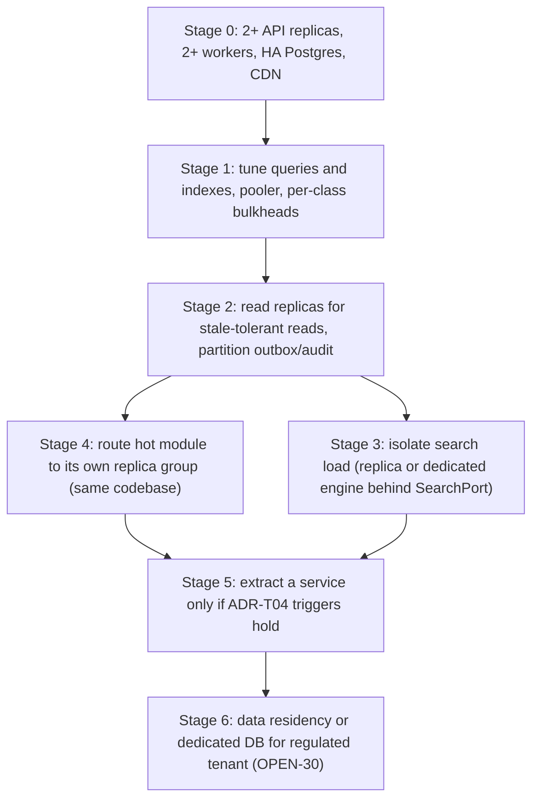
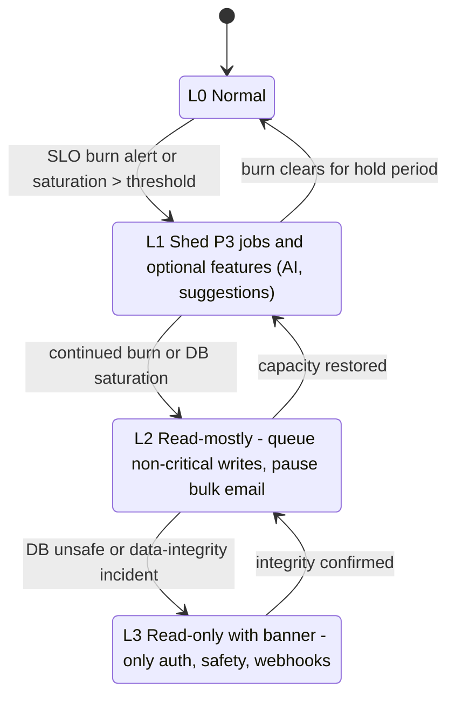
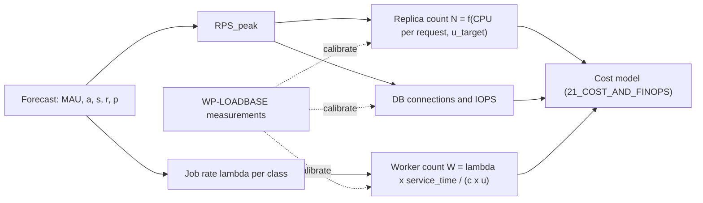

# Target blueprint 15: Reliability And Performance

> **Status.** Archive: proposal, not ratified. A greenfield redesign blueprint written in October 2026. Every area was Draft, Under Review or Revision Required (its own document status) and no test was run against it. Its content was mined into `docs/blueprint/`; `SSOT.md` remains the source of intent. Module federation described here was not adopted: the built system is a modular monolith (`ARCHITECTURE.md`).
>
> **What this file holds.** All files of the former `Yash_Final_Project_Document/15_RELIABILITY_AND_PERFORMANCE/` folder, in order.
>
> **Merged on 2026-11-25** from the files listed below; each one is a section under its original title. Nothing was removed; the originals are in git history at commit `08387ec`.

| Section | Former file |
|---|---|
| Capacity and Scaling | `Yash_Final_Project_Document/15_RELIABILITY_AND_PERFORMANCE/CAPACITY_AND_SCALING.md` |
| Failure Mode Analysis | `Yash_Final_Project_Document/15_RELIABILITY_AND_PERFORMANCE/FAILURE_MODE_ANALYSIS.md` |
| Legacy Merge B-15: Reliability Constants, Observed Failure Modes and Capacity Lessons (Prior Attempt) as FMEA and SLO Seeds | `Yash_Final_Project_Document/15_RELIABILITY_AND_PERFORMANCE/LEGACY_MERGE_RELIABILITY_AND_FAILURE_MODES.md` |
| SLO and Performance Targets | `Yash_Final_Project_Document/15_RELIABILITY_AND_PERFORMANCE/SLO_AND_PERFORMANCE_TARGETS.md` |
| SLO Revision 2: Synthetic-Only Client SLIs, Budget Alignment, Capacity Note | `Yash_Final_Project_Document/15_RELIABILITY_AND_PERFORMANCE/SLO_REV2.md` |

## Capacity and Scaling

_Former file: `Yash_Final_Project_Document/15_RELIABILITY_AND_PERFORMANCE/CAPACITY_AND_SCALING.md`._

Doc ID: OPS-CAP · Owner: SRE Lead (with Backend Architect) · Version 1.0 · Status: Draft for Review · Relates: ADR-T04, ADR-T05, ADR-T09, ADR-T11, ADR-T21, OPS-SLO §9, OPS-DEP, 21_COST_AND_FINOPS/COST_MODEL.md, RISK-11, RISK-12, OPEN-14, OPEN-15, OPEN-23, OPEN-30

This document contains **formulas, triggers and levers — not sizes**. No traffic, user or cost figure is asserted. Variables (ASM-C-*) are defined in OPS-SLO §9 and stay [OPEN] until a forecast and `WP-LOADBASE` exist.

### 1. Architectural scaling properties (what the design makes possible)

| Property                                                               | Design source | Consequence for scaling                                                                                                                                                                                                                                                 |
| ---------------------------------------------------------------------- | ------------- | ----------------------------------------------------------------------------------------------------------------------------------------------------------------------------------------------------------------------------------------------------------------------- |
| API replicas are stateless; Postgres is the only system of record      | ADR-T05       | Horizontal scale of API by adding replicas; no sticky sessions; no per-process authoritative state. **[REF]** the reference API must run as exactly one process per database because it holds an in-memory read model hydrated at boot — the target removes this limit. |
| Modular monolith + separate worker                                     | ADR-T04       | Two independently scalable deployables (API, worker); modules scale together until an extraction trigger fires                                                                                                                                                          |
| Outbox + at-least-once dispatch with consumer dedupe and fenced leases | ADR-T09       | Workers scale horizontally without duplicate effects                                                                                                                                                                                                                    |
| Search inside Postgres behind `SearchPort`                             | ADR-T11       | Search load competes with OLTP unless isolated; port allows swap                                                                                                                                                                                                        |
| Remote assets are immutable content-hashed files on a CDN              | OPS-DEP §3    | Frontend capacity is effectively CDN capacity; origin load is cache-miss only                                                                                                                                                                                           |
| Row-level multi-tenancy                                                | ADR-T21       | One large tenant can dominate; need per-tenant quotas and noisy-neighbour controls                                                                                                                                                                                      |

### 2. Component capacity model

| Component                         | Primary bottleneck                         | Sizing formula                                                                                                               | Scale-out lever                                                                                                                                                         | Scale trigger (alert, [TARGET] thresholds calibrated in OPEN-15)                  |
| --------------------------------- | ------------------------------------------ | ---------------------------------------------------------------------------------------------------------------------------- | ----------------------------------------------------------------------------------------------------------------------------------------------------------------------- | --------------------------------------------------------------------------------- |
| CDN / static                      | request rate, egress                       | `egress_GB = MAU × sessions × avg_cold_bytes × (1 − h)`; origin RPS ≈ `RPS_static × (1 − h)`                                 | Cache-hit-ratio improvement (immutable hashes, long TTL), tiered caching                                                                                                | Hit ratio below ASM-C-09 target                                                   |
| API replicas                      | CPU, event-loop lag, memory                | `N = ceil(RPS_peak × s̄_cpu / (cores × u_target)) + 1`                                                                        | Add replicas; split hot module routes to separate replica group (same codebase, different routing)                                                                      | Event-loop lag p99 or CPU > u_target for sustained window; SLO-01/04 latency burn |
| Connection pooler                 | connection count                           | `conns = N × pool_api + W × pool_worker + admin ≤ 0.8 × pooler_limit`                                                        | Pooler in transaction mode, per-class slices, lower pool per replica as N grows                                                                                         | Pool wait p95 above threshold                                                     |
| Postgres primary                  | write IOPS, WAL rate, lock contention, CPU | `write_TPS = RPS_peak × m_write × k`; `WAL_GB/day ≈ rows × avg_row_bytes × index_overhead × write_factor`                    | Vertical scale first; optimise queries/indexes; partition large append tables (outbox, audit, events) by time; archive cold partitions                                  | CPU or IOPS > threshold, replication lag, autovacuum falling behind               |
| Postgres read replicas            | read QPS                                   | route stale-tolerant classes only (lists, search, analytics reads); critical authz/consent/entitlement reads stay on primary | Add replicas                                                                                                                                                            | Primary read share and CPU                                                        |
| Search (FTS + trigram + pgvector) | index size, memory, vector recall/latency  | `index_RAM ≈ vectors × dim × bytes_per_float × overhead` (HNSW overhead factor [OPEN])                                       | Dedicated search replica; tune index params; **ADR-T11 trigger:** p95 > 400 ms at target corpus or proven relevance gap → evaluate dedicated engine behind `SearchPort` | Search p95 trend, recall regression                                               |
| Worker                            | queue depth, per-class service time        | `W = ceil(λ_class × s̄_class / (c × u))` per class; ensure P0 class has reserved capacity                                     | Add workers; per-class queues/concurrency; separate worker pools for heavy (scan, recompute, reports)                                                                   | Oldest-age gauges vs SLO-20..25                                                   |
| Object storage                    | volume, request rate                       | `GB_total(t) = Σ uploads × f × replication_factor`; lifecycle policies for derived files                                     | Tiering, lifecycle, CDN for derivatives                                                                                                                                 | Growth vs cost budget                                                             |
| Malware scanner                   | scan throughput                            | `scanners = ceil(uploads_per_s × mean_scan_s / u)`                                                                           | Horizontal scanners                                                                                                                                                     | SLO-22 burn                                                                       |
| Sandbox runner (when built)       | concurrent executions, startup time        | `slots = λ_submit × mean_exec_s / u`; plus cold-start                                                                        | Pool pre-warm; per-tenant concurrency caps                                                                                                                              | Queue wait                                                                        |
| AI gateway                        | provider rate limits, tokens               | `tokens/day = Σ_users calls × (in+out tokens)`; cost → FIN-COST                                                              | Per-user/org budgets (INV-T07), caching, smaller models for free paths                                                                                                  | Spend vs budget thresholds                                                        |
| Observability                     | telemetry volume, cardinality              | `bytes/day = spans × avg_span_bytes × sampling + logs + metrics series × samples`                                            | Tail sampling, log level control, cardinality limits                                                                                                                    | Ingest budget                                                                     |

### 3. Scaling paths and evolution

ADR-T04 extraction triggers (restated, not changed): a module needs independent scaling/SLA, distinct residency, or team contention. ADR-T09 broker trigger: outbox throughput exceeds the Postgres budget or services are extracted. Each stage is entered only on a measured trigger, never pre-emptively.

### 4. Noisy-neighbour and tenant fairness

| Control                          | Mechanism                                                      | Test         |
| -------------------------------- | -------------------------------------------------------------- | ------------ |
| Per-tenant request quota         | Token bucket per `org_id` at ingress, `429` with `Retry-After` | TEST-PER-007 |
| Per-tenant job concurrency       | Fair-share dequeue (round robin across tenants within class)   | TEST-PER-005 |
| Per-tenant AI and export budgets | Gateway and export endpoint budgets                            | TEST-ASM-006 |
| Heavy query guard                | Statement timeout, max page size, report jobs asynchronous     | TEST-PER-009 |

### 5. Load and capacity testing programme

| Test                     | Purpose                                                          | Method                                                                     | Output                                                     |
| ------------------------ | ---------------------------------------------------------------- | -------------------------------------------------------------------------- | ---------------------------------------------------------- |
| Baseline (`WP-LOADBASE`) | Establish per-class latency and per-request CPU/DB cost          | Scripted k6-style scenarios with the §9 mix; steady load at several levels | Calibration of s̄_cpu, k, u_target and every SLO-OPS number |
| Stress                   | Find the saturation knee and the failure direction               | Ramp to failure                                                            | Knee RPS; confirm shed and breakers engage (TEST-REL-004)  |
| Soak                     | Leaks, bloat, autovacuum, connection churn                       | Long steady run                                                            | Trend of memory, bloat, replica lag                        |
| Spike                    | Burst behaviour after notification campaign or job-posting surge | Step change                                                                | Recovery time, shed behaviour (TEST-PER-007)               |
| Remote-deploy herd       | Manifest refetch storm after deploy                              | Simulated cache invalidation                                               | Origin load, jittered refresh (TEST-REL-011)               |
| Search at target corpus  | ADR-T11 trigger test                                             | Corpus generator at forecast scale                                         | p95/p99 (TEST-PER-002)                                     |

Production-like data volumes use synthetic data; no production PII in load environments (QA-STRAT §6).

### 6. Headroom policy

| Resource       | Rule                                                              | Rationale                                                                                                                |
| -------------- | ----------------------------------------------------------------- | ------------------------------------------------------------------------------------------------------------------------ |
| CPU            | `u ≤ 0.6` steady, `≤ 0.8` peak                                    | Queueing delay rises steeply as utilisation approaches 1 (M/M/c behaviour); headroom absorbs bursts and one-replica loss |
| N+1            | Survive loss of one replica/worker/AZ-share without breaching SLO | SLO-01 budget cannot absorb routine node loss                                                                            |
| DB connections | ≤ 80% of limit                                                    | Avoid hard refusal during deploys (double replicas during rollout)                                                       |
| Disk           | Alert at projected exhaustion horizon [TARGET param]              | WAL + data growth must be forecast, not reacted to                                                                       |
| Rollout surge  | Capacity plan accounts for old+new replicas simultaneously        | Deploys otherwise cause the exhaustion they should avoid                                                                 |

### 7. Capacity review cadence and triggers for re-forecast

| Trigger                                  | Action                                                      |
| ---------------------------------------- | ----------------------------------------------------------- |
| New phase gate (Ph1→Ph2 etc.)            | Re-run forecast with measured a, s, r, p                    |
| Institution onboarding with large cohort | Cohort import/activation load test before go-live (PROC-02) |
| Any alert in §2 for > hold period        | Capacity ticket with owner                                  |
| Cost anomaly                             | FIN-COST review                                             |

### 8. Open items

| Item                                        | Ref              |
| ------------------------------------------- | ---------------- |
| Forecast inputs (MAU by persona, mix, peak) | OPEN-15          |
| HA/failover mechanism and replica support   | OPEN-14, RISK-12 |
| Residency / dedicated tenant DB             | OPEN-30          |
| Whether a second region is justified        | OPEN-23          |

## Failure Mode Analysis

_Former file: `Yash_Final_Project_Document/15_RELIABILITY_AND_PERFORMANCE/FAILURE_MODE_ANALYSIS.md`._

Doc ID: OPS-FMEA · Owner: SRE Lead · Version 1.0 · Status: Draft for Review · Relates: GOAL-08, ADR-T03, ADR-T04, ADR-T05, ADR-T09, ADR-T10, ADR-T12, ADR-T13, ADR-T15, ADR-T18, ADR-T19, INV-T10, INV-T12, INV-T13, INV-T17, FF-04, FF-08, OPS-SLO, OPS-OBS, QA-CAT, SUP-RUN

Scope: failures of the target system (shell, remotes, API modules, worker, Postgres, object storage, CDN, third parties). Every row names detection, containment, degraded behaviour, recovery and verification (TEST ids from `16_QA_AND_TESTING/TEST_CATALOG.md`; runbooks `RB-*` from `18_OPERATIONS_AND_SUPPORT/RUNBOOK_INDEX.md`). Likelihood/impact are deliberately omitted here — they live in `RISK_REGISTER.md`. **[REF]** facts are labelled and are not inherited.

### 1. Method

Failure modes were derived by walking each box in OPS-DEP's topology and each arrow (call or event) with the questions: stops, slows, lies (wrong data), duplicates, reorders, partially completes. Federation adds conditional failure modes with no analogue in bundled delivery (version skew, shared dependency conflicts, remote registry failure).

### 2. Resilience policy (referenced by every row)

Per-dependency starting values (timeouts, retry counts, breaker thresholds, lease lengths, rate-limit store) are specified in `11_BACKEND_ARCHITECTURE/BACKEND_ARCHITECTURE.md` (BE-01 §7, §timeouts) and the federation timers in `09_MODULE_FEDERATION` (MFA-01, FIM-01); this section states the cross-cutting policy and failure behaviour. Both are calibrated together under `WP-LOADBASE` (OPEN-15, BE-01 OPEN-B2).

| Control          | Policy [TARGET — parameters calibrated in WP-LOADBASE / OPEN-15]                                                                                                                                                                                                                              | Rationale                                                        |
| ---------------- | --------------------------------------------------------------------------------------------------------------------------------------------------------------------------------------------------------------------------------------------------------------------------------------------- | ---------------------------------------------------------------- |
| Deadlines        | Each request carries a deadline: `D = min(client budget, 2 × class p99)` (OPS-SLO §5). Each outbound call gets `min(remaining D − margin, 3 × observed p99 of that dependency)`. No call without a timeout (lint + TEST-REL-008).                                                             | Unbounded waits are the root of cascading failure.               |
| Retries          | Only idempotent operations or those with an `Idempotency-Key` (INV-T10, FF-07). Exponential backoff with full jitter; per-dependency **retry budget** (retries ≤ fraction of first attempts, fraction [OPEN-15]); never retry on 4xx except 408/429 with `Retry-After`.                       | Uncapped retries amplify outages (retry storms).                 |
| Circuit breakers | Per dependency (email, push, Stripe, AI provider, sandbox runner, object storage, IdP). Open on rolling error ratio or latency above threshold over a minimum sample; half-open probes with a small trial quota; state exported as metric.                                                    | Fail fast and protect threads/connections.                       |
| Bulkheads        | Separate concurrency pools/queues by class: auth, interactive read, interactive write, search, AI, webhook, upload, admin/support. Separate DB pool slices per pool class. Worker queues per priority class (P0 verification/transactional, P1 notifications, P2 recompute/reports, P3 bulk). | A slow search or AI call must not starve login.                  |
| Backpressure     | Admission control at API ingress per tenant and global; `429` with `Retry-After` for tenant quota, `503` with `Retry-After` for global shed. Bounded queues: enqueue rejected or deferred above depth thresholds by class. Clients obey `Retry-After` and use jittered backoff.               | Overload must degrade by shedding the least valuable work first. |
| Load-shed order  | (1) P3 jobs, (2) AI features, (3) recommendations/analytics reads, (4) search suggestions, (5) lists with heavy filters; **never shed**: auth, session refresh, safety/moderation actions, verification links, webhook ack, health.                                                           | Protects the core loop and trust functions.                      |
| Idempotency      | Mutations keyed by `Idempotency-Key`; stored with request fingerprint and response; reuse with different body → `422` (TEST-HIR-009).                                                                                                                                                         | Safe client and proxy retries.                                   |
| Data safety      | Outbox written in the same transaction as state (INV-T12); consumers dedupe by `event_id`; fenced job leases (ADR-T09).                                                                                                                                                                       | Prevents lost or duplicated side effects.                        |

Degradation ladder:

Each rung is controlled by named feature flags (kill switches) with runbook owners (RB-24, RB-03).

### 3. Failure modes — shell, federation and client

Registry, manifest, remote-version, and per-remote rollback behavior in this section applies only if federated runtime is activated under ADR-T23. Bundled mode still uses route-level lazy loading and error boundaries, but a module release rolls back with the shell.

| ID    | Failure                                                                           | Detection                                                                                                           | Containment                                                                                                                                                                                                                                                                 | Degraded behaviour                                                                                                                | Recovery                                                                                | Verification                             |
| ----- | --------------------------------------------------------------------------------- | ------------------------------------------------------------------------------------------------------------------- | --------------------------------------------------------------------------------------------------------------------------------------------------------------------------------------------------------------------------------------------------------------------------- | --------------------------------------------------------------------------------------------------------------------------------- | --------------------------------------------------------------------------------------- | ---------------------------------------- |
| FM-01 | Remote entry unreachable (CDN 404/timeout/DNS)                                    | RUM `remote.failed`, per-remote synthetic, alert on SLO-03 ratio                                                    | Bounded load timeout (MFA-01 uses 10 s as starting value) then `rollbackTo` entry, then client LKG; error boundary at remote slot (ADR-T18, VCD-01 section 4)                                                                                                               | Affected route shows "temporarily unavailable" panel with retry; shell nav and other remotes work; offline-capable reads continue | Fix origin/CDN; purge bad manifest; RB-07                                               | TEST-FED-001, TEST-FED-002, TEST-OBS-004 |
| FM-02 | Remote incompatible with shell Host Contract or deployed API range (version skew) | Manifest validation at activation; CI gate FF-08; RUM `remote.rejected`                                             | Shell rejects incompatible remote (VC-02) and falls back along `rollbackTo`/LKG; publish gate blocks promotion (FF-08)                                                                                                                                                      | Previous remote version served; no mixed-version mount                                                                            | Roll forward compatible build or roll back; RB-08                                       | TEST-FED-003, TEST-FED-004, TEST-API-002 |
| FM-03 | Shared dependency conflict (e.g. two React copies, singleton range violation)     | CI manifest validator (FF-04); runtime duplicate-singleton detector logs                                            | Singleton + semver range in federation config; promotion blocked on violation                                                                                                                                                                                               | If detected at runtime: remote not mounted, fallback as FM-01                                                                     | Rebuild with aligned range; RB-08                                                       | TEST-FED-005, TEST-FED-006               |
| FM-04 | Remote render crash / unhandled exception                                         | Error boundary telemetry, Sentry-class alert by remote/version                                                      | Boundary per remote slot; one remote cannot unmount shell (same JS realm — federation is **not** security isolation, ADR-T19)                                                                                                                                               | Panel with retry and "report problem"; session intact                                                                             | Roll back remote via higher-sequence entry or kill switch (independent artefact); RB-08 | TEST-FED-008, TEST-FED-014               |
| FM-05 | Manifest registry unavailable, stale or tampered                                  | Manifest fetch errors, signature verification failures, SRI mismatch                                                | Ed25519-signed registry entries + SRI + CSP (ADR-T19); registry `no-cache` + ETag via SW NetworkFirst; anti-rollback `sequence`; fall back to client LKG then the embedded boot registry baked into the shell build; `notAfter` grace of up to 14 days for LKG only (VC-03) | New deploys not visible; existing versions keep working; tamper → remote refused                                                  | Restore registry; rotate signing key if compromised (RB-26)                             | TEST-SEC-013, TEST-SEC-014, TEST-FED-009 |
| FM-06 | Stale service worker serves old shell with new remotes (or the reverse)           | RUM version beacon `shell_ver`/`remote_ver` mismatch counter                                                        | Versioned caches; SW update flow prompts reload at safe point; manifest carries `hostContract` so old shell refuses new incompatible remote; kill-switch flag unregisters SW (RB-09)                                                                                        | Banner "update available"; no data loss (drafts persisted)                                                                        | Force update via kill-switch; clear caches                                              | TEST-PWA-001, TEST-PWA-009               |
| FM-07 | Bad remote release (functional regression, passes CI)                             | Canary-channel guardrails (error ratio, INP, conversion proxy), flag-level metrics                                  | Progressive delivery via registry canary channel; automatic halt; auto-rollback publishes the `rollbackTo` target                                                                                                                                                           | Canary cohort sees issue only                                                                                                     | Roll back remote independently of API (OPS-REL §10); RB-08                              | TEST-DEP-001, TEST-DEP-002, TEST-FED-014 |
| FM-08 | Offline queued write conflicts with newer server state                            | Server `412` on `If-Match`; client conflict counter                                                                 | Server revalidates every queued write (INV-T13); conflict UI, no silent overwrite                                                                                                                                                                                           | Draft kept locally with "needs your decision"                                                                                     | User merges or discards                                                                 | TEST-PWA-005, TEST-PWA-006, TEST-DAT-008 |
| FM-09 | Browser storage evicted (iOS/WebKit pressure)                                     | Startup integrity check: expected stores missing counter                                                            | Server is system of record (ADR-T10); app boots from network; queued writes lost are bounded to drafts/edits/notes                                                                                                                                                          | Offline cache cold, drafts may be lost; show notice                                                                               | Re-sync from server                                                                     | TEST-PWA-012, TEST-MOB-003               |
| FM-10 | CDN regional outage or cache poisoning/wrong Vary on API                          | Synthetic from multiple vantage points; cache-hit anomaly; authenticated responses with public cache headers (lint) | Origin shield/second CDN or origin fallback [OPEN-36]; API responses `Cache-Control: private, no-store` by default                                                                                                                                                          | Higher latency; static assets from fallback origin                                                                                | Fail over DNS/CDN; purge                                                                | TEST-TEN-006, TEST-OBS-004               |
| FM-11 | Shared dependency outage for client assets (third-party font/script/analytics)    | RUM resource errors                                                                                                 | No third-party blocking scripts on critical path; self-host critical assets; async analytics                                                                                                                                                                                | Cosmetic degradation                                                                                                              | Disable the integration via flag                                                        | TEST-FED-013, TEST-PER-003               |

### 4. Failure modes — API and backend

| ID    | Failure                                                                                                | Detection                                                                                 | Containment                                                                                                                    | Degraded behaviour                                                            | Recovery                                               | Verification                             |
| ----- | ------------------------------------------------------------------------------------------------------ | ----------------------------------------------------------------------------------------- | ------------------------------------------------------------------------------------------------------------------------------ | ----------------------------------------------------------------------------- | ------------------------------------------------------ | ---------------------------------------- |
| FM-12 | API replica crash / OOM / hang                                                                         | Health `/ready` fail, restart count, p99 spike                                            | ≥ 2 replicas, stateless (ADR-T05), readiness removes from pool, memory limits; graceful shutdown drains                        | Capacity reduced by 1/N; requests retried by LB on idempotent methods         | Orchestrator restarts; RB-04                           | TEST-REL-002, TEST-REL-005               |
| FM-13 | Traffic spike / overload                                                                               | Saturation (CPU, event-loop lag), queue depth, 429/503 rates                              | Admission control + load-shed order (§2); autoscale if available                                                               | L1–L2 per ladder                                                              | Scale out, shed; RB-04, RB-24                          | TEST-PER-007, TEST-REL-004               |
| FM-14 | Slow dependency exhausts pools (cascade)                                                               | Pool wait time, in-flight gauge per class, dependency latency                             | Per-class bulkhead + per-dependency breaker + timeouts                                                                         | Affected class degrades; auth/read unaffected                                 | Open breaker, fix dependency                           | TEST-REL-009, TEST-REL-008               |
| FM-15 | Policy module misbehaves (deny-all or allow-all)                                                       | Authz denial-rate anomaly alert; canary tests in prod (synthetic IDOR probes); FF-01 lint | Deny-by-default (INV-T01); policy changes behind tests and canary; policy versioned                                            | deny-all → outage with correct failure direction; allow-all → Sev-1 candidate | Roll back policy version; RB-01 for suspected exposure | TEST-SEC-001, TEST-SEC-003, TEST-TEN-001 |
| FM-16 | Duplicate client requests / replay (retries, double-click, proxy retry)                                | Idempotency hit metric, duplicate-effect detector                                         | `Idempotency-Key` on unsafe mutations (FF-07); natural keys (BR-T001)                                                          | Second request returns first response                                         | none needed                                            | TEST-HIR-001, TEST-HIR-008, TEST-HIR-009 |
| FM-17 | Concurrent actions on one resource (two recruiters move one application; two tabs)                     | `412` rate; conflicting-transition errors                                                 | `If-Match`/ETag (ADR-T08); state-machine guards (INV-T11)                                                                      | Loser sees conflict with fresh state                                          | User retries                                           | TEST-HIR-003, TEST-DAT-008               |
| FM-18 | Bad deploy / config error (missing secret, wrong origin)                                               | Startup config validation fails fast; canary errors                                       | Fail boot rather than run misconfigured (**[REF]** reference has `productionConfigProblems`-style checks); progressive rollout | Old version continues serving                                                 | Roll back; RB-05                                       | TEST-DEP-007, TEST-DEP-001               |
| FM-19 | Session/auth failure; refresh storm; false token-family revocation (BR-T050)                           | Auth error ratio, refresh rate, forced-logout counter                                     | Rate limits on refresh; jittered refresh; revocation only on actual reuse; grace for rotation race (concurrent tabs)           | Users see re-login; no data exposure                                          | Fix cause; allow user re-login; RB-02                  | TEST-SEC-011, TEST-SEC-021               |
| FM-20 | Clock skew between nodes/clients (token expiry, signed URLs)                                           | NTP drift metric; token rejection pattern                                                 | Tolerance window ≤ [TARGET param]; server time authoritative; expiry uses server issued `iat`                                  | Occasional re-auth                                                            | Sync clocks                                            | TEST-REL-010                             |
| FM-21 | Rate-limiter backing store failure                                                                     | Limiter error metric                                                                      | **Policy:** auth/verification/referee endpoints fail **closed** (reject); general reads fail open with local in-process limits | Slightly stricter/laxer limits                                                | Restore store                                          | TEST-SEC-021                             |
| FM-22 | Partial multi-step operation (e.g. apply + attach evidence + notify; upload ok but evidence row fails) | Orphan/incomplete state detectors (reaper job), outbox lag                                | Single transaction for state + outbox; sagas with compensating steps for external effects; reaper removes orphan objects       | User sees consistent state; retry resumes                                     | Reaper/compensation; RB-13                             | TEST-API-011, TEST-EVD-009               |
| FM-23 | Telemetry stack outage (collector/backend)                                                             | Collector queue drops, absent-signal alert from independent heartbeat                     | Telemetry export is async and bounded; never blocks request path; local buffer then drop                                       | Blind spot, not user impact                                                   | Restore; reconstruct from logs                         | TEST-OBS-002                             |

### 5. Failure modes — data and storage

| ID    | Failure                                                          | Detection                                                                                  | Containment                                                                                                                                                            | Degraded behaviour                                                              | Recovery                                            | Verification                             |
| ----- | ---------------------------------------------------------------- | ------------------------------------------------------------------------------------------ | ---------------------------------------------------------------------------------------------------------------------------------------------------------------------- | ------------------------------------------------------------------------------- | --------------------------------------------------- | ---------------------------------------- |
| FM-24 | Postgres primary failure                                         | HA controller, connection errors, SLO-01 burn                                              | HA with automatic failover (SLO-30); pooler retries with backoff; writes fail fast with `503` during failover; reads served by replica only for stale-tolerant classes | Brief write unavailability; in-flight txns retried by client only if idempotent | Failover completes; verify replica lag zero; RB-03  | TEST-REL-001                             |
| FM-25 | Connection pool exhaustion                                       | Pool wait, active/idle gauges                                                              | Pooler (transaction mode) + per-class slices; statement/lock timeouts; shed                                                                                            | `503 Retry-After`; health endpoints unaffected                                  | Raise limits carefully, kill runaway queries; RB-03 | TEST-REL-002                             |
| FM-26 | Replication lag / stale reads on replicas                        | Lag gauge                                                                                  | Read-your-writes: route a user's reads to primary for a short window after their writes; critical reads (authz, entitlements, consent) always primary                  | Slightly stale lists                                                            | Reduce load, fix replica                            | TEST-DAT-007                             |
| FM-27 | Slow queries / lock contention / long-running migration          | Slow-query log, lock wait, plan regression                                                 | Statement timeout; online migration patterns only (expand/contract, concurrent index); migration lock timeout; plan-regression gate                                    | Higher latency on affected class                                                | Cancel query; roll back/forward-fix; RB-05          | TEST-DAT-003, TEST-PER-009               |
| FM-28 | Data corruption / bad backfill / bad migration                   | Reconciliation checks, constraint violations, user reports                                 | Append-only migrations with rollback/forward-fix note (FF-10); backfills resumable and idempotent; shadow-verify                                                       | Affected feature read-only via flag                                             | PITR to side instance, extract and repair; RB-30    | TEST-DAT-004, TEST-DAT-005, TEST-REC-001 |
| FM-29 | RLS misconfiguration / tenant filter missing (cross-tenant read) | FF-05 canary suite in CI and prod synthetic probes; anomaly in cross-tenant access metrics | Defence in depth: repository layer + RLS + policy (INV-T02/T03); app DB role cannot bypass RLS                                                                         | **Sev-1** (ADR-T21); affected endpoints disabled via kill switch                | RB-01 (containment first, then forensics)           | TEST-TEN-001, TEST-TEN-002, TEST-TEN-003 |
| FM-30 | Outbox backlog or poison event                                   | `outbox.oldest_age_s`, per-event attempt count, DLQ depth                                  | Per-event retry cap then DLQ; consumers dedupe by `event_id`; dispatcher continues past poison                                                                         | Delayed notifications/recompute                                                 | Fix consumer; replay DLQ safely; RB-12              | TEST-API-008, TEST-API-009, TEST-REL-004 |
| FM-31 | Object storage outage                                            | Upload/download error ratio                                                                | Direct-to-storage signed URLs; retries with backoff; metadata remains in DB; downloads of cached derivatives from CDN                                                  | Uploads pause with clear message; existing public assets via CDN                | Provider recovery; RB-18                            | TEST-REL-006                             |
| FM-32 | Malware-scan backlog or scanner failure                          | Scan queue age (SLO-22)                                                                    | Uploads remain `pending` and invisible (BR-T003); scanner capacity bulkhead; **fail closed** (never publish unscanned)                                                 | Evidence appears later; users informed                                          | Scale scanner; reprocess; RB-19                     | TEST-SEC-019                             |
| FM-33 | Search degradation or index stale (ADR-T11)                      | Search p95, index lag gauge                                                                | Fallback to simpler FTS-only path; bulkhead; index rebuildable from Postgres                                                                                           | Lower relevance, possible stale results labelled                                | Reindex (SLO-34); RB-20                             | TEST-SRC-001, TEST-PER-002, TEST-REL-009 |
| FM-34 | Backups silently failing or unrestorable                         | Backup freshness alert, restore-drill failure                                              | Backup success is an SLI with alert; scheduled restore drills in a separate environment                                                                                | None until needed — highest-consequence silent failure                          | Fix pipeline; RB-29                                 | TEST-REC-001, TEST-REC-002               |

### 6. Failure modes — worker and jobs

| ID    | Failure                                                                                                                    | Detection                                                             | Containment                                                                                    | Degraded behaviour                                      | Recovery             | Verification               |
| ----- | -------------------------------------------------------------------------------------------------------------------------- | --------------------------------------------------------------------- | ---------------------------------------------------------------------------------------------- | ------------------------------------------------------- | -------------------- | -------------------------- |
| FM-35 | Worker crash mid-job                                                                                                       | Lease expiry, job age                                                 | Fenced leases (claim generation, ADR-T09): stale holder cannot commit; side effects idempotent | Job re-run by another worker                            | Automatic; RB-11     | TEST-REL-005, TEST-API-010 |
| FM-36 | Duplicate execution from lease expiry race (**[REF]** the reference audit D-02 reproduced duplicates with unfenced leases) | Duplicate-effect detector; attempt count > 1 with overlapping windows | Fencing token checked at commit; idempotency keys on external calls                            | None if fencing works                                   | RB-11                | TEST-API-010, TEST-API-009 |
| FM-37 | Poison job / retry storm                                                                                                   | Attempt histogram, DLQ rate                                           | Max attempts, backoff, DLQ, per-class concurrency cap                                          | One job class stalls, others continue                   | Triage DLQ; RB-12    | TEST-REL-004               |
| FM-38 | Scheduler misses or double-fires periodic jobs (reminders, expiry)                                                         | Heartbeat of periodic job; duplicate detector                         | Leader election via DB advisory lock or unique (job, slot) key                                 | Late reminders (BR-T004 reminders max 2 stays enforced) | Backfill missed slot | TEST-EVD-006, TEST-REL-005 |

### 7. Failure modes — third parties and platform

| ID    | Failure                                                                               | Detection                                                        | Containment                                                                                                                                       | Degraded behaviour                                                                                                                                             | Recovery                                   | Verification                                           |
| ----- | ------------------------------------------------------------------------------------- | ---------------------------------------------------------------- | ------------------------------------------------------------------------------------------------------------------------------------------------- | -------------------------------------------------------------------------------------------------------------------------------------------------------------- | ------------------------------------------ | ------------------------------------------------------ |
| FM-39 | Email provider outage / deliverability drop (Brevo default, ADR-T20)                  | Provider error ratio, bounce/complaint rates, SLO-21             | Provider port; breaker; queued with backoff; secondary provider as option [OPEN-26]; suppress list maintained                                     | Codes/links delayed; in-app notification and resend UI remain; the requester may trigger a system resend but never receives the referee token itself (INV-T05) | RB-15                                      | TEST-REL-003, TEST-EVD-010                             |
| FM-40 | Push provider failure / expired subscriptions                                         | Delivery failures, 404/410 from push service                     | Prune dead subscriptions; email/in-app fallback; no dependency for core flows                                                                     | Fewer pushes                                                                                                                                                   | RB-16                                      | TEST-MSG-001                                           |
| FM-41 | Stripe outage, delayed or out-of-order webhooks                                       | Webhook lag (SLO-06), reconciliation drift job                   | Entitlements derived server-side from stored subscription state (ADR-T15, INV-T17); keep last-known entitlement during outage; reconciliation job | Checkout unavailable; existing entitlements unchanged                                                                                                          | Reconcile; RB-17                           | TEST-BIL-001, TEST-BIL-003, TEST-BIL-005, TEST-BIL-006 |
| FM-42 | AI provider outage / latency / cost runaway                                           | Gateway error ratio, token spend vs budget, p95                  | Breaker; budget hard stops (INV-T07); features degrade to non-AI paths; kill switch                                                               | AI suggestions unavailable; core loop unaffected                                                                                                               | RB-21                                      | TEST-ASM-005, TEST-ASM-006, TEST-ASM-009               |
| FM-43 | Sandbox runner down or escape attempt                                                 | Runner health; egress-deny alerts                                | Network-less isolated runner (ADR-T13); submissions stay `unverified`, never mint verified evidence                                               | Code challenges accept submissions but unverified                                                                                                              | RB-22; security incident process if escape | TEST-ASM-002, TEST-ASM-003                             |
| FM-44 | IdP (OIDC/SAML) outage for SSO org                                                    | SSO error ratio                                                  | Break-glass org-admin local login (policy-approved, audited); cached sessions persist until expiry                                                | SSO users cannot log in anew                                                                                                                                   | Provider recovery; RB-02                   | TEST-SEC-024                                           |
| FM-45 | DNS / TLS certificate expiry or misissue                                              | Expiry alert at lead-time windows [TARGET]; synthetic cert check | Automated renewal + monitoring; CAA records; separate alerts per domain                                                                           | Hard outage if expired                                                                                                                                         | RB-25                                      | TEST-DEP-008, TEST-OBS-004                             |
| FM-46 | Zone or region outage (hosting)                                                       | Platform health, multi-vantage synthetic                         | Multi-AZ where available; DR plan (SLO-33, OPEN-23)                                                                                               | Possible extended outage; status page                                                                                                                          | RB-31 DR failover                          | TEST-REC-004                                           |
| FM-47 | Shared infrastructure dependency outage (cache, pooler, DNS resolver, secret manager) | Dependency health dashboards                                     | No hard runtime dependency on a cache for correctness; secrets cached in process with TTL; pooler redundant                                       | Slower, not wrong                                                                                                                                              | RB-03/RB-05                                | TEST-REL-007                                           |
| FM-48 | Secret or signing-key compromise                                                      | Secret scanning, anomaly, vendor alert                           | Rotation runbook; short-lived credentials; manifest signing key rotation with dual-key window                                                     | Forced logouts / re-issued manifests                                                                                                                           | RB-26                                      | TEST-SEC-015, TEST-SEC-014                             |

### 8. Coverage cross-check

| Class from brief           | Covered by                        |
| -------------------------- | --------------------------------- |
| Remote unavailable         | FM-01                             |
| Version mismatch           | FM-02                             |
| Shared dependency conflict | FM-03                             |
| Stale service worker       | FM-06                             |
| Offline conflicts          | FM-08, FM-09                      |
| Duplicate requests         | FM-16                             |
| Concurrent actions         | FM-17                             |
| Partial operations         | FM-22                             |
| Rollback                   | FM-07, FM-18, FM-28 (OPS-REL §10) |
| Shared dependency outage   | FM-11, FM-47                      |
| IDOR / cross-tenant        | FM-15, FM-29                      |

### 9. Game days

Quarterly-style cadence is a **policy intent**, not a schedule; frequency is [OPEN-15]. Each game day selects ≥ 3 failure modes from this document, injects them in staging (and selected ones in production with approval), and records measured detection time, containment time and recovery time against the tables above. Findings update this document and RISK_REGISTER.

### 10. Ownership, retry, data-loss and chaos extension (PATCH 2026-10-27, PROPOSED)

Companion columns for FM-01..FM-48 (original tables unchanged). Owners are roles, not named people; retry limits are [TARGET] pending WP-LOADBASE/OPEN-15. Test ids `CH-nn` are PROPOSED chaos tests and `CT-nn` PROPOSED contract tests, not yet in `TEST_CATALOG.md`; existing `TEST-*` ids stay in the Verification column above. No chaos test has been run.

| FM  | Owner            | Retry limit                   | Data-loss exposure                            | Chaos / contract test                  |
| --- | ---------------- | ----------------------------- | --------------------------------------------- | -------------------------------------- |
| 01  | Frontend lead    | 2 (500, 1500 ms)              | none                                          | CH-01 block remote origin              |
| 02  | Frontend lead    | 0                             | none                                          | CT-01 MockHost per Host Contract minor |
| 03  | Frontend lead    | 0                             | none                                          | CT-02 duplicate-singleton check        |
| 04  | Frontend lead    | 0                             | unsaved form state in crashed slot            | CH-02 throw in remote                  |
| 05  | Platform/SecEng  | 3 fetch, then LKG             | none                                          | CH-03 tampered manifest                |
| 06  | Frontend lead    | 0                             | queued entries if wiped wrongly               | CH-04 stale SW vs new remote           |
| 07  | Release mgr      | 0                             | none                                          | CH-05 canary regression halt           |
| 08  | Backend lead     | 0 (user decides)              | local draft if discarded                      | CT-03 412 conflict flow                |
| 09  | Frontend lead    | 0                             | queued drafts/edits/notes                     | CH-06 clear storage                    |
| 10  | SRE              | 2 origin fallback             | none                                          | CH-07 CDN fail                         |
| 11  | Frontend lead    | 0                             | none                                          | CH-08 block third party                |
| 12  | SRE              | LB retry idempotent only, 1   | in-flight request                             | CH-09 kill replica                     |
| 13  | SRE              | client per Retry-After        | none                                          | CH-10 load spike                       |
| 14  | Backend lead     | per breaker                   | none                                          | CH-11 slow dependency                  |
| 15  | SecEng           | 0                             | none (wrong authz = incident)                 | CT-04 policy matrix                    |
| 16  | Backend lead     | per idempotency               | none                                          | CT-05 replay same key                  |
| 17  | Backend lead     | 0                             | losing writer's edit until refetch            | CT-06 concurrent If-Match              |
| 18  | Release mgr      | 0                             | none                                          | CH-12 bad config boot                  |
| 19  | SecEng           | 1                             | none                                          | CH-13 refresh storm                    |
| 20  | SRE              | 0                             | none                                          | CH-14 skew clock                       |
| 21  | SecEng           | 0 (fail closed)               | none                                          | CH-15 limiter store down               |
| 22  | Backend lead     | saga step 3                   | partial state until reaper                    | CH-16 fail mid-saga                    |
| 23  | SRE              | drop after buffer             | telemetry only                                | CH-17 collector down                   |
| 24  | DBA/SRE          | 3 pooler                      | writes in flight at failover (RPO per SLO-30) | CH-18 primary kill                     |
| 25  | DBA/SRE          | 0                             | none                                          | CH-19 pool exhaust                     |
| 26  | DBA/SRE          | 0                             | none (stale reads)                            | CH-20 lag injection                    |
| 27  | DBA              | 0                             | none                                          | CT-07 migration lock timeout           |
| 28  | DBA              | resumable                     | possible, bounded by backup RPO               | CH-21 restore drill                    |
| 29  | SecEng           | 0                             | disclosure (Sev-1)                            | CT-08 cross-tenant suite               |
| 30  | Backend lead     | 5 default, 12 email, then DLQ | none if DLQ kept                              | CH-22 poison event                     |
| 31  | SRE              | 2                             | in-progress upload                            | CH-23 storage fail                     |
| 32  | SecEng           | scanner 3                     | none (pending, invisible)                     | CH-24 scanner down                     |
| 33  | Search owner     | 1 fallback                    | none (rebuildable)                            | CH-25 stale index                      |
| 34  | DBA              | n/a                           | total if never restored                       | CH-26 restore drill                    |
| 35  | Backend lead     | per job class                 | none (fenced)                                 | CH-27 kill worker                      |
| 36  | Backend lead     | 0                             | duplicate side effect if unfenced             | CT-09 fencing token                    |
| 37  | Backend lead     | max attempts then DLQ         | none if DLQ kept                              | CH-22                                  |
| 38  | Backend lead     | 0                             | missed/double reminders                       | CH-28 scheduler double-fire            |
| 39  | Platform         | 12 over ~20.5 h               | undelivered mail                              | CH-29 provider 5xx                     |
| 40  | Platform         | 2                             | none (non-critical)                           | CH-30 410 subscriptions                |
| 41  | Billing owner    | webhook redelivery by Stripe  | entitlement drift                             | CH-31 delayed webhook; CT-10 signature |
| 42  | AI owner         | 1                             | none                                          | CH-32 provider down                    |
| 43  | Assessment owner | 0                             | submissions unverified                        | CH-33 runner down                      |
| 44  | SecEng           | 0                             | none                                          | CH-34 IdP outage                       |
| 45  | SRE              | n/a                           | none                                          | CH-35 cert expiry drill                |
| 46  | SRE              | n/a                           | up to RPO (OPEN-23)                           | CH-36 DR drill                         |
| 47  | SRE              | 2                             | none                                          | CH-37 cache/secret mgr down            |
| 48  | SecEng           | n/a                           | exposure window until rotation                | CH-38 key rotation drill               |

### 11. Residual shared-failure modes (PATCH 2026-10-27, PROPOSED)

Failures that the controls above do not isolate because components share a fate. They are accepted residual risks, not solved problems; owners must confirm acceptance in `RISK_REGISTER.md`.

| ID    | Shared element                       | Failure                                                           | Blast radius             | Mitigation / accepted position                                        |
| ----- | ------------------------------------ | ----------------------------------------------------------------- | ------------------------ | --------------------------------------------------------------------- |
| SF-01 | Single JS realm (federated mode)     | One remote's bug or compromise affects shell and other remotes    | All users on that page   | Boundaries, signing, CSP; untrusted code in iframe (ADR D-05)         |
| SF-02 | Single Postgres                      | Outage, bad migration or saturation stops API and worker together | Whole product            | HA, pool slices, restore drills; accepted until ADR D-01/D-03 trigger |
| SF-03 | Single API process image             | Memory leak or crash loop in one module affects all modules       | Whole API                | Replicas, limits, canary                                              |
| SF-04 | Outbox and job tables in the same DB | Backlog competes with request traffic for IO and locks            | Latency across API       | Separate pool slices, queue caps, shed P3                             |
| SF-05 | Shared CDN/origin                    | CDN fault hits shell, remotes and assets together                 | All web clients          | Origin fallback [OPEN-36]; SW-cached shell                            |
| SF-06 | Shared Service Worker                | A bad SW release poisons every cached route                       | All returning clients    | Staged rollout, kill-switch SW, versioned caches                      |
| SF-07 | Shared secrets/signing keys          | One key compromise affects sessions or manifests                  | Platform-wide            | Dual-key rotation (FM-48)                                             |
| SF-08 | Third-party concentration            | Single email, Stripe or IdP provider                              | Feature-level            | Provider ports; breaker; fallback paths                               |
| SF-09 | Shared pipeline and region           | CI or hosting-region failure blocks fixes and serving             | Release and availability | Manual break-glass deploy, DR plan (needs verification)               |
| SF-10 | Same people detect and recover       | Slow response when on-call is thin                                | Incident duration        | Runbooks, escalation; accepted                                        |

## Legacy Merge B-15: Reliability Constants, Observed Failure Modes and Capacity Lessons (Prior Attempt) as FMEA and SLO Seeds

_Former file: `Yash_Final_Project_Document/15_RELIABILITY_AND_PERFORMANCE/LEGACY_MERGE_RELIABILITY_AND_FAILURE_MODES.md`._

Doc ID: LGM-B-15 · Owner: SRE Lead · Version 1.0 · Status: Draft for Review · Supersedes nothing · Relates: OPS-FMEA, OPS-SLO, OPS-SLO-R2, OPS-CAP, OPS-OBS, ADR-T05, ADR-T09, OPEN-15, OPEN-23 · Ledger: `../00_CONTROL_CENTRE/LEGACY_MERGE_LEDGER_B.md`

Preservation instruction (project owner, verbatim): "i dont want to loos information keep everything in use untile it get improved".

Merged from legacy: reliability, performance and failure facts spread across `31_LEGACY_ARCHIVE/docs/quality/OPERATIONS.md`, `.../quality/TESTING.md`, `.../quality/SECURITY.md`, `.../system-model/02-flows.md` (F5, F6), `.../system-model/03-conflict-register.md` (CF-05, CF-06, CF-07, CF-23, CF-24, CF-30, CF-42, CF-43) and root `ARCHITECTURE.md` (sections 18-21).

### 0. Frame

- **No measured behaviour exists for this project.** The legacy documents themselves said: SLOs are set "per-service/per-capability after baseline measurement" and "avoid false precision before measurement". Therefore none of the numbers below is an SLO. They are **starting defaults the prior attempt chose** (constants in its code and docs), kept so the target's starting values (BE-01, API-STD) can be compared and so that nothing observed is lost.
- "Prior attempt reported" = claims about the earlier attempt; "Target requires" = requirement here.

### 1. Timing and limit constants reported (prior attempt) vs. target

| Constant                             | Prior attempt value                                                                                                             | Target position                                                     |
| ------------------------------------ | ------------------------------------------------------------------------------------------------------------------------------- | ------------------------------------------------------------------- |
| Session token lifetime               | 24 h (stateless HMAC)                                                                                                           | Short access token + rotating refresh (ADR-T06); values in SEC-02   |
| Email verification challenge         | 6-digit code, 15 min expiry, 5 wrong attempts                                                                                   | keep as starting default (BR-T)                                     |
| Reference link validity              | none initially; 30 days after fix (CF-10)                                                                                       | 14 days (diagram DGM-01 section 6); confirm in BR-T                 |
| Payment-provider signature tolerance | 300 s (5 min)                                                                                                                   | keep 5 min                                                          |
| Own-format billing webhook tolerance | 300 s                                                                                                                           | n/a (single provider)                                               |
| Global API limiter                   | 300 / min per verified account, else per address                                                                                | RL classes in API-STD section 9 (read 600/min, write 120/min, etc.) |
| Login limiter                        | 10 per 15 min per IP + email                                                                                                    | RL-AUTH 20/10 min per IP and 10/15 min per identifier               |
| Sign-up limiter                      | 20 per 15 min per IP (registration)                                                                                             | RL-AUTH                                                             |
| Job claim batch                      | up to 10 jobs                                                                                                                   | per-queue config (BE-01)                                            |
| Job lease                            | 60 s                                                                                                                            | fenced lease with heartbeat extension                               |
| Handler timeout                      | 30 s via `Promise.race` (not abortive)                                                                                          | per-handler budget with abort signal                                |
| Max attempts                         | 3 (then dead)                                                                                                                   | per-queue; DLQ with replay tooling                                  |
| Backoff                              | exponential with jitter and cap                                                                                                 | keep                                                                |
| Terminal job retention               | purge after 7 days                                                                                                              | DB-03 retention table                                               |
| Worker heartbeat                     | written between claim cycles once 10 s elapsed; stale if > 45 s                                                                 | independent timer; thresholds in OPS-SLO                            |
| Overdue queued job alert             | > 5 minutes                                                                                                                     | queue-age SLO                                                       |
| Terminal failure alert window        | any in past 1 hour                                                                                                              | error-budget alert                                                  |
| Client API timeout                   | 20 s default (browser helper)                                                                                                   | per-route timeouts in the API client; keep 20 s as ceiling          |
| Email provider HTTP timeout          | 20 s                                                                                                                            | keep, with retry classification                                     |
| Password hash cost                   | PBKDF2-SHA512, 210,000 iterations                                                                                               | argon2id parameters per SEC-02                                      |
| Cohort floors                        | benchmarks 20 distinct people; learning impact 30; salary benchmark 5; salary company 3; segmentation 10; feedback aggregate 10 | single k policy (OPEN-25)                                           |

### 2. Failure modes the prior attempt observed or reported (FMEA seeds)

| #   | Failure / defect                                                | Prior behaviour                                                                                                             | Evidence id     | Target requirement                                                                                                 |
| --- | --------------------------------------------------------------- | --------------------------------------------------------------------------------------------------------------------------- | --------------- | ------------------------------------------------------------------------------------------------------------------ |
| 1   | Event enqueue fails after a committed change                    | Error logged and swallowed; request succeeded; event lost (two email routes avoided it by returning 503)                    | CF-23           | Outbox in the same transaction (INV-T12); no post-commit enqueue                                                   |
| 2   | Job reclaim after lease expiry                                  | Did not check `attempts`; a crashing worker could exceed max attempts before dead                                           | CF-24           | Reclaim checks attempts; dead-letter after limit                                                                   |
| 3   | Handler timeout                                                 | Timeout did not abort the underlying promise; waiting consumed later jobs' leases; duplicates possible                      | D-02            | Abortable handlers; heartbeat extension; fenced completion                                                         |
| 4   | Completion not fenced by claim generation                       | A stale worker could complete after reclaim                                                                                 | D-02            | Claim generation (fencing token) on completion (ADR-T09)                                                           |
| 5   | Writer lease lost (single API writer)                           | 503 on every request until restart                                                                                          | ST-04           | Retired by ADR-T05                                                                                                 |
| 6   | Account erasure when provider customer already deleted          | Retry got "resource not found" and returned 503, erasure could not finish                                                   | CF-05           | Treat "already deleted" as success; idempotent saga steps                                                          |
| 7   | Erasure stops partway after deactivation                        | Caller could not retry later steps                                                                                          | D-03            | Resumable saga with per-step state and operator tooling                                                            |
| 8   | Checkout event for a customer already linked to another account | Unique violation; provider retried for days                                                                                 | CF-06           | Ignore such events with an audit record; 2xx the provider                                                          |
| 9   | Refund matched to subscription by time only                     | Wrong subscription cancelled                                                                                                | CF-07           | Resolve through invoice payment; fail safe when unresolved; provider outage on cancel -> throw so provider retries |
| 10  | Out-of-order provider events                                    | Handled by skipping events older than the newest applied; newer live subscription recorded makes older events "record only" | F5              | Keep; test event-order matrix                                                                                      |
| 11  | Two concurrent paid checkout sessions                           | Second subscription ignored but still billed                                                                                | CF-30           | Policy decision L-B13-02                                                                                           |
| 12  | Email provider key or from-address missing                      | Permanent failure, no retry; otherwise provider errors retried                                                              | F4              | Keep permanent vs transient classification                                                                         |
| 13  | Sign-out request fails (offline)                                | Client clears locally; server session lives until expiry                                                                    | security        | Refresh-family revocation; accept as residual risk, document                                                       |
| 14  | Normal user locked out by limiter                               | Old default 100 per 15 min per address blocked a user after ~20 page views                                                  | security lesson | Realistic-session rate-limit E2E test                                                                              |
| 15  | Memory-only state for features offered in UI                    | Lost on restart (applications drafts, alerts, resumes, connections, etc.)                                                   | CF-25, CF-43    | All durable; restart-survival tests                                                                                |
| 16  | Maintenance mode only changed diagnostics                       | No traffic blocked; reset on restart                                                                                        | CF-42           | Persisted flag; real write-blocking behaviour                                                                      |
| 17  | Stale build output used by API/worker                           | Misleading pass/fail                                                                                                        | architecture    | Build in pipeline; build id in health                                                                              |
| 18  | Standalone worker in memory mode                                | Idle (could not see API process Maps)                                                                                       | architecture    | n/a (no memory mode in prod)                                                                                       |
| 19  | Password re-hash failure on login                               | Only logged (login still succeeded)                                                                                         | F2              | Acceptable; alert on repeated failures                                                                             |
| 20  | Worker cancellation                                             | Cooperative at acknowledgement; does not undo effects                                                                       | architecture    | Compensating action design for cancel                                                                              |
| 21  | Dev delivery sink logs codes                                    | Sensitive data in logs                                                                                                      | OPERATIONS      | Test-only sink; never log codes in shared environments                                                             |
| 22  | Slow boot as data grows                                         | Hydration read every core row at start; acceptable only at pre-launch volume                                                | ADR-015         | Retired by ADR-T05                                                                                                 |

**Target requires:** map each row to an FMEA entry (FM-xx) or mark "retired by design"; rows 1, 3, 4, 6-9, 12, 14, 15 and 16 must have a named test in QA-CAT. Gap check owner: SRE Lead, tracked as **L-B15-01**.

### 3. Performance and capacity lessons

- Prior performance layer asserted only gross-regression guards (no SLO); DB query counts and queue age unmeasured. **Target:** SLO calibration from WP-LOADBASE (OPEN-15); add query-count budget per route class and queue-age SLI.
- Prior hosting target: free-tier ARM64 single VM; one API instance; no HA; backups unimplemented in the compose file; no deployed metrics/tracing/alert backend established; liveness insufficient (see operations file section 2.5).
- Core design lesson: a process-memory read model forced a single instance and boot time/memory proportional to data. **Target:** SQL-only reads; capacity analysis in OPS-CAP stands; add "boot time independent of data volume" as a design check.
- UX-level reliability facts: browser helper default 20 s timeout, error masking of server faults, route error boundary for render failures, session auto-clear/redirect on 401 only when a token existed (403 retains session), throttle timing surfaced to the user. **Target:** keep as client resilience requirements (see `../10_FRONTEND_ARCHITECTURE/LEGACY_MERGE_FRONTEND_AND_UI_QUALITY.md`).

### 4. Disaster recovery facts (prior attempt)

Restore verification existed only as unexecuted scripts (restore into a temporary database, verify migration ledger, drop it). Required but unproven: encrypted off-VM backups, retention, scheduler, missed-backup alert, separate-host restore drill, documented RPO/RTO, application-level verification after restore. Hosted-database PITR/backup posture unverified. Details and target requirements are in `../17_DEVOPS_AND_INFRASTRUCTURE/LEGACY_MERGE_DEVOPS_AND_DEPLOY.md` section 8.

### 5. Open items raised by this file

| ID       | Question                                                          | Owner                                 |
| -------- | ----------------------------------------------------------------- | ------------------------------------- |
| L-B15-01 | Map the 22 observed failure modes to FMEA rows or mark retired    | SRE Lead                              |
| L-B15-02 | Cohort k floors: one policy (20 / 30 / 10 / 5 / 3 in legacy)      | OPEN-25                               |
| L-B15-03 | Reference-link validity: 14 days (target) vs 30 days (legacy fix) | Product Director + Security Architect |

## SLO and Performance Targets

_Former file: `Yash_Final_Project_Document/15_RELIABILITY_AND_PERFORMANCE/SLO_AND_PERFORMANCE_TARGETS.md`._

Doc ID: OPS-SLO · Owner: SRE Lead (with Performance Engineer) · Version 1.0 · Status: Draft for Review · Relates: GOAL-08, GOAL-06, ADR-T03, ADR-T04, ADR-T05, ADR-T09, ADR-T11, ADR-T16, ADR-T18, INV-T13, BR-T060, OPEN-12, OPEN-14, OPEN-15, OPEN-23, 16_QA_AND_TESTING/TEST_CATALOG.md, 17_DEVOPS_AND_INFRASTRUCTURE/OBSERVABILITY_DESIGN.md

> **Revision 2 folded in (2026-10-27)** from `SLO_AND_PERFORMANCE_TARGETS.md#record-slo-rev2`: appended under "Revision 2 additions"; where it differs from text above, the appended text governs. Status unchanged; proposals still need owner/ARB ratification.

Tags: **[TARGET]** proposed, binding only after calibration; **[CONF]** confirmed by a canonical document; **[OPEN]** unresolved; **[REF]** reference-system fact (not inherited). Documentation status is not implementation status; nothing here claims the system exists.

### 1. Ground rules

1. **No number is a measurement.** Every value below is a starting hypothesis derived from a stated rationale and assumption. It becomes a commitment only after `WP-LOADBASE` (22_*) produces a baseline and the owner signs a calibration note (OPEN-15).
2. Each SLO has: SLI definition (good events / valid events), target, window, rationale, assumption, measurement method, and the alert that protects it (see OPS-OBS burn-rate rules).
3. Internal SLOs are **not** customer SLAs. Any contractual commitment is separate and needs legal/commercial review (OPEN-31).
4. Error budget policy: when a budget is exhausted, feature releases touching that surface pause and reliability work takes priority (owner: SRE Lead; exceptions need Incident Commander + Product Director approval).
5. Arithmetic used throughout: a 30-day window has 43,200 minutes. Budget = (1 − target) × 43,200 min. 99.9% gives 43.2 min; 99.5% gives 216 min; 99.95% gives 21.6 min.

### 2. Measurement stack (summary)

| Source                                                                        | What it gives                                       | Used for                                                                 |
| ----------------------------------------------------------------------------- | --------------------------------------------------- | ------------------------------------------------------------------------ |
| Ingress/LB + API server metrics (OpenTelemetry)                               | server-side success and latency per route class     | SLO-01…SLO-06 and the §5 latency classes (authoritative for server SLIs) |
| Synthetic probes from outside the network (scripted user journeys)            | black-box availability, cert/DNS, remote activation | SLO-02, SLO-03, catches failures where no request reaches the server     |
| Real User Monitoring (RUM; `web-vitals` style field data, sampled, consented) | LCP, INP, CLS by route, device class, remote        | SLO-13…SLO-16 (authoritative for field vitals)                           |
| Lab runs (Lighthouse CI on reference mobile profile, Playwright traces)       | regression guard per PR                             | release gates, never a substitute for field data                         |
| Worker/outbox instrumentation                                                 | enqueue-to-start age, attempts, DLQ depth           | SLO-20…SLO-25                                                            |
| Restore/failover drills                                                       | measured RPO/RTO                                    | SLO-30…SLO-33                                                            |

### 3. Reference mobile profile (used by every client-side target)

| Profile        | Definition                                                                                                                                                                                     | Purpose                                                         | Status                                    |
| -------------- | ---------------------------------------------------------------------------------------------------------------------------------------------------------------------------------------------- | --------------------------------------------------------------- | ----------------------------------------- |
| RMP-1 (lab)    | Lighthouse default mobile emulation: small-viewport phone, 4× CPU slowdown, simulated Slow-4G ≈ 1.6 Mbit/s down, ≈ 150 ms RTT. Pin the exact Lighthouse version in CI because defaults change. | Deterministic per-PR regression guard                           | [TARGET] — confirm constants when pinning |
| RMP-2 (device) | One low-tier Android phone and one oldest-supported iPhone on a throttled real network, via `WP-IOS-DEVICE-LAB`                                                                                | Catch what emulation misses (memory pressure, WebKit behaviour) | [OPEN-12] device list                     |
| RMP-3 (field)  | RUM p75 segmented by device class (low/mid/high by `deviceMemory`/cores where available) and connection type                                                                                   | Ground truth                                                    | [TARGET]                                  |

Transfer-time formula for budgets: `t_transfer = bytes × 8 / throughput`. At 1.6 Mbit/s, 100 KB (compressed) takes 0.5 s. Critical-path budget `B ≈ (T_target − T_ttfb − T_cpu) × throughput / 8`. With T_target = 2.5 s, T_ttfb ≈ 3 × RTT = 0.45 s (DNS+TCP+TLS+request, repeat visits less), T_cpu allocated 1.0 s, B ≈ (2.5 − 0.45 − 1.0) × 1.6e6 / 8 ≈ 210 KB. This is an **illustration of the method**; the per-route budget is set from RMP-1 measurements (OPEN-15).

### 4. Availability SLOs

| ID     | SLI (good / valid)                                                                                                                                | Target (30-day)           | Budget   | Rationale                                                                                                                         | Assumption                                 | Measurement                                                            | Alert protecting                 |
| ------ | ------------------------------------------------------------------------------------------------------------------------------------------------- | ------------------------- | -------- | --------------------------------------------------------------------------------------------------------------------------------- | ------------------------------------------ | ---------------------------------------------------------------------- | -------------------------------- |
| SLO-01 | Core API: non-5xx responses within deadline / valid requests (4xx from client errors excluded; 429 caused by our own load shedding counts as bad) | 99.9% [TARGET]            | 43.2 min | Stateless API replicas (ADR-T05) + HA Postgres can plausibly reach three nines in one region; higher needs multi-region (OPEN-23) | Single region, ≥2 API replicas, HA DB      | Ingress + server metrics; cross-check with synthetic                   | Multi-window burn rate on SLO-01 |
| SLO-02 | Shell boot: synthetic journey "load `/`, shell interactive, capabilities fetched" success / attempts                                              | 99.9% [TARGET]            | 43.2 min | Shell is the single point through which every remote loads; it must be at least as available as the API                           | Shell served from CDN with origin fallback | External synthetic every N min [TARGET param] from ≥3 vantage points   | Synthetic fail ≥ 2 consecutive   |
| SLO-03 | Remote activation: successful mount of each remote / activation attempts (per remote)                                                             | 99.5% per remote [TARGET] | 216 min  | A remote failure is contained by fallback (ADR-T03/T18) so tolerance is lower than the shell; user impact is partial              | Last-known-good fallback available         | RUM event `remote.activated` vs `remote.failed` + synthetic per remote | Per-remote error ratio alert     |
| SLO-04 | Auth: successful login/refresh/session-validate / valid attempts (excludes wrong credentials)                                                     | 99.9% [TARGET]            | 43.2 min | Auth outage blocks all authenticated use; refresh failures log users out                                                          | Cookie BFF routes (ADR-T06)                | Server metrics on `/auth/*`                                            | Burn rate                        |
| SLO-05 | Background pipeline health: share of 5-min windows where outbox oldest-event age ≤ SLO-20                                                         | 99% [TARGET]              | 432 min  | Asynchronous work tolerates longer disruption than interactive paths                                                              | Worker count ≥ 2                           | Outbox age gauge                                                       | Age threshold alert              |
| SLO-06 | Billing webhook ingestion: verified webhooks processed within 5 min / received                                                                    | 99.9% [TARGET]            | 43.2 min | Entitlements depend only on webhooks (INV-T17); late processing leaves paid users locked or lapsed users entitled                 | Stripe retries with backoff                | Webhook handler metrics + Stripe event delivery dashboard              | Lag alert                        |

Exclusions (declared up front, to prevent post-hoc redefinition): announced maintenance windows per PROC-11 (capped per month by policy [OPEN-15]), failures originating in the user's network, and abusive traffic blocked by rate limiting. Excluded minutes are still reported.

### 5. API latency targets by class

Server-side latency measured at ingress from request received to last byte sent. Network RTT on RMP-1 (≈ 150 ms) is **additional** and counted in the client-side journey targets (§6).

| Class                       | Examples                                         | p95                                                | p99      | Rationale                                                                                                                     | Assumption                                                        | Measurement                                               |
| --------------------------- | ------------------------------------------------ | -------------------------------------------------- | -------- | ----------------------------------------------------------------------------------------------------------------------------- | ----------------------------------------------------------------- | --------------------------------------------------------- |
| C1 point read               | `GET /me`, `GET /applications/:id`               | 200 ms [TARGET]                                    | 500 ms   | Keeps one round trip well under the ~1 s "flow of thought" threshold (Nielsen usability literature; secondary) even after RTT | Primary-key indexed, cached policy decision                       | k6 baseline + production histogram per route              |
| C2 list/read-heavy          | job list, application pipeline, notifications    | 350 ms                                             | 800 ms   | Paginated cursor queries with bounded page size                                                                               | Page size ≤ [TARGET param], covering indexes                      | same                                                      |
| C3 write                    | create application, update profile, stage change | 400 ms                                             | 1,000 ms | Includes outbox insert + audit in one transaction (INV-T12), idempotency lookup                                               | Single-statement-ish transactions; no external call inside txn    | same + trace span `db.tx`                                 |
| C4 auth                     | login, refresh, passkey assertion                | 300 ms (excl. password hash cost tuned separately) | 800 ms   | Hashing cost is deliberately non-trivial; tune cost so hash is a declared fraction of the budget                              | Argon2id/bcrypt-class cost parameter owned by Security            | server histogram; hash timed separately                   |
| C5 search                   | job search, candidate search                     | 400 ms                                             | 800 ms   | **[CONF]** 400 ms p95 is ADR-T11's revisit trigger; p99 ≈ 2× p95 as a working rule                                            | Target corpus per OPEN-15; pgvector + FTS                         | search-specific load test at target corpus (TEST-PER-002) |
| C6 compute-on-demand        | match explanation, readiness score               | 800 ms                                             | 2,000 ms | Heavier but user-initiated; must show progress UI past 1 s                                                                    | Precomputed features where possible                               | span-level histogram                                      |
| C7 upload init / signed URL | evidence upload start                            | 300 ms                                             | 700 ms   | Metadata only; bytes go direct to object storage                                                                              | Direct-to-storage upload                                          | server histogram                                          |
| C8 AI-assisted              | resume suggestions                               | time-to-first-token ≤ 2 s; completion async        | n/a      | Streaming or async job; never blocks other classes (bulkhead)                                                                 | Provider latency is outside our control; gateway enforces timeout | gateway spans, provider-tagged                            |
| C9 webhook ack              | Stripe, email provider events                    | 300 ms                                             | 800 ms   | Provider timeouts are short; do work asynchronously after signature check                                                     | Persist-then-ack                                                  | handler histogram                                         |

Per-request deadline propagation: the API sets `deadline = min(client budget, class p99 × 2)` and every outbound call gets a slice (see OPS-FMEA §2).

### 6. Client performance targets (reference mobile profile)

| ID     | Metric                     | Target                                                                                                   | Where measured                                         | Rationale                                                                                                                                                                                               | Assumption                                                                           | Method                                                    |
| ------ | -------------------------- | -------------------------------------------------------------------------------------------------------- | ------------------------------------------------------ | ------------------------------------------------------------------------------------------------------------------------------------------------------------------------------------------------------- | ------------------------------------------------------------------------------------ | --------------------------------------------------------- |
| SLO-13 | LCP                        | ≤ 2.5 s at p75 field; lab ≤ 2.5 s on RMP-1 for public + candidate home routes [TARGET]                   | RUM + Lighthouse CI                                    | **[CONF-external]** Google's published "good" Core Web Vitals threshold (web.dev); add to RES-01                                                                                                        | Critical path budget §3 holds                                                        | RUM p75 by route and device class                         |
| SLO-14 | INP                        | ≤ 200 ms at p75 field [TARGET]                                                                           | RUM (lab proxy: Total Blocking Time)                   | Published "good" threshold (web.dev)                                                                                                                                                                    | Long tasks < 50 ms rule enforced on interaction handlers                             | RUM INP attribution; Playwright long-task assertion in CI |
| SLO-15 | CLS                        | ≤ 0.1 at p75 [TARGET]                                                                                    | RUM + Lighthouse                                       | Published "good" threshold                                                                                                                                                                              | Reserved space for remote slots (skeletons) to avoid shift on remote mount           | RUM + lab                                                 |
| SLO-16 | "TTI" substitute           | Lab TBT ≤ 200 ms on RMP-1; field INP above [TARGET]                                                      | Lighthouse CI                                          | Time-to-Interactive was retired from Lighthouse scoring; TBT is the lab proxy. Verify against current Lighthouse docs at pin time.                                                                      | —                                                                                    | Lighthouse CI per PR                                      |
| SLO-17 | Remote activation overhead | federated route LCP ≤ bundled-mode baseline + Δ_F, with Δ_F ≤ 10% of LCP budget (250 ms) at p75 [TARGET] | A/B in `WP-FED-SPIKE`, then RUM `remote.activation_ms` | Δ_F is an _allocation policy_ (10% of the 2.5 s budget), justified because ADR-T03's counter-argument is "lazy routes give 80% at 20% cost" — if overhead exceeds the budget, MF_MODE=bundled (OPEN-03) | One extra manifest + remote-entry round trip (≈ 1–2 RTT) on first visit; warm via SW | Spike benchmark; RUM thereafter                           |
| SLO-18 | Warm re-visit shell        | interactive from SW cache with no network ≤ [TARGET: 1 s on RMP-1]                                       | Lighthouse (repeat view) + RUM                         | Installed-PWA value proposition (ADR-T02)                                                                                                                                                               | SW precache of shell + current remote entries                                        | Repeat-view lab run                                       |
| SLO-19 | Per-route JS budget        | critical-path JS+CSS ≤ B(route) from §3 formula [OPEN-15]                                                | CI bundle-size check                                   | Bytes dominate load time on RMP-1                                                                                                                                                                       | Compressed transfer size                                                             | CI size gate per remote and shell                         |

### 7. Background job, event and search throughput

| ID     | Class                                                | Target                                                                                                     | Rationale                                                                                                                            | Assumption                                    | Measurement                      |
| ------ | ---------------------------------------------------- | ---------------------------------------------------------------------------------------------------------- | ------------------------------------------------------------------------------------------------------------------------------------ | --------------------------------------------- | -------------------------------- |
| SLO-20 | Outbox dispatch: oldest undispatched event age       | p99 ≤ 5 s [TARGET]                                                                                         | Downstream effects (notifications, recompute) should feel prompt; Postgres polling/LISTEN is adequate at modest throughput (ADR-T09) | Dispatcher poll interval ≤ 1 s                | gauge `outbox.oldest_age_s`      |
| SLO-21 | Transactional email/verification jobs: enqueue→start | p95 ≤ 30 s                                                                                                 | Users wait on codes and referee links                                                                                                | Provider API p95 outside our control          | job metrics by class             |
| SLO-22 | Virus scan: upload→visible (BR-T003)                 | p95 ≤ 60 s                                                                                                 | Evidence must not remain pending long enough to frustrate; larger files scale with size                                              | Scanner sidecar capacity per ASM-C-07         | scan job age                     |
| SLO-23 | Dependent recompute after revocation (BR-T005)       | p95 ≤ 5 min                                                                                                | Revoked evidence must stop inflating matches quickly; async and audited                                                              | Batched recompute                             | job age + audit event time delta |
| SLO-24 | Erasure (BR-T060)                                    | completes ≤ 21 days internal target of the 30-day rule [TARGET]                                            | Internal buffer of ~30% before the stated 30-day limit; retention exceptions per OPEN-08                                             | Backups age out per policy                    | request state machine timestamps |
| SLO-25 | Dead-letter queue                                    | oldest DLQ item reviewed ≤ 1 business day [TARGET]                                                         | Poison jobs must not rot silently                                                                                                    | On-call or ops rota exists (OPEN-16, OPEN-39) | DLQ gauge + ticket link          |
| TP-01  | Sustained job throughput                             | `λ_max = W × c / s̄ × u`, W workers, c concurrency per worker, s̄ mean service time, u ≤ 0.6 utilisation cap | Queueing: latency grows non-linearly near saturation; 0.6 leaves burst headroom                                                      | s̄ measured per class                          | load test (TEST-PER-005)         |
| TP-02  | Remote load capacity                                 | manifest + remote-entry requests are CDN-cache served; origin sees only cache misses                       | Content-hashed immutable assets (OPS-DEP §3)                                                                                         | Cache hit ratio target in ASM-C-09            | CDN logs                         |

### 8. Recovery objectives (RPO / RTO)

| ID     | Scenario                                              | RPO                                                              | RTO                                                                                     | Rationale                                                                                                                  | Assumption                                                           | Measurement                                          |
| ------ | ----------------------------------------------------- | ---------------------------------------------------------------- | --------------------------------------------------------------------------------------- | -------------------------------------------------------------------------------------------------------------------------- | -------------------------------------------------------------------- | ---------------------------------------------------- |
| SLO-30 | Single DB node failure (HA)                           | ≈ 0 for committed transactions with synchronous replica [TARGET] | ≤ 5 min automatic [TARGET]                                                              | Core to SLO-01 budget (43.2 min)                                                                                           | HA mechanism chosen under OPEN-14 supports synchronous/quorum commit | Failover drill (TEST-REL-001)                        |
| SLO-31 | Logical corruption / bad migration, restore from PITR | ≤ 5 min [TARGET]                                                 | ≤ 1 h to a verified restored copy [TARGET]                                              | Point-in-time recovery needs continuous WAL archiving; interval ≤ 5 min bounds loss                                        | WAL archive to separate failure domain; restore tested               | PITR drill (TEST-REC-001); record measured vs target |
| SLO-32 | Object storage loss/corruption                        | RPO ≤ [OPEN-23] with versioning enabled                          | RTO ≤ [OPEN-23]                                                                         | Evidence files are irreplaceable user data                                                                                 | Versioning + replica or off-site copy                                | Restore drill (TEST-REC-003)                         |
| SLO-33 | Zone/region loss (DR)                                 | [OPEN-23]                                                        | [OPEN-23]                                                                               | Depends on single- vs multi-region decision and cost; DR events can exceed monthly SLO budget and must be declared as such | —                                                                    | DR exercise (TEST-REC-004)                           |
| SLO-34 | Search index loss                                     | n/a (derived data)                                               | `reindex_time = corpus_rows / indexing_rate` — must be ≤ [TARGET: 1 h] at target corpus | Index is rebuildable from Postgres (ADR-T11)                                                                               | Indexing throughput measured                                         | Rebuild drill                                        |
| SLO-35 | Config/secrets loss                                   | n/a                                                              | ≤ 30 min to restore from secret manager + IaC [TARGET]                                  | IaC makes environment reproducible                                                                                         | OPEN-21/22 decided                                                   | Rebuild-from-scratch drill                           |

Backups must be encrypted and stored off the primary host. **[REF]** The reference runbook states its backup scripts "are not yet executed" and has no established RPO/RTO — a known gap, so the target must prove drills before any real-user launch.

### 9. Demand and capacity model (condensed; sizing in OPS-CAP)

Variables and assumptions (all values [OPEN] until `WP-LOADBASE` and launch forecasts; no number is assumed here):

| ID       | Symbol | Meaning                                                                         | Source / owner                                          |
| -------- | ------ | ------------------------------------------------------------------------------- | ------------------------------------------------------- |
| ASM-C-01 | MAU    | monthly active users by persona (candidate, recruiter, instructor, institution) | Product/Finance forecast                                |
| ASM-C-02 | a      | DAU/MAU ratio                                                                   | RUM/analytics once live; proxy from comparable products |
| ASM-C-03 | s      | sessions per DAU per day                                                        | analytics                                               |
| ASM-C-04 | r      | API requests per session (by class mix m_c)                                     | trace sampling, load model                              |
| ASM-C-05 | p      | peak-to-average factor                                                          | observed hourly profile                                 |
| ASM-C-06 | b      | background jobs per DAU-day by class                                            | worker metrics                                          |
| ASM-C-07 | f      | mean evidence file size and uploads per active candidate                        | storage metrics                                         |
| ASM-C-08 | k      | DB rows written per request by class                                            | trace sampling                                          |
| ASM-C-09 | h      | CDN cache hit ratio for remote assets                                           | CDN logs                                                |

Peak request rate: `RPS_peak = MAU × a × s × r × p / 86,400` (seconds in a day). Required API replicas: `N = ceil(RPS_peak × s̄_cpu / (cores_per_replica × u_target)) + N_spare`, with `u_target ≤ 0.6` and `N_spare ≥ 1` (survive one replica loss; N+1). DB connections: `conns = N × pool_per_replica + workers × pool_per_worker + admin`; must be ≤ pooler limit × 0.8. Storage growth: `ΔGB/month = uploads_per_month × f / 1e9 × replication_factor`. See OPS-CAP for the scaling triggers.

### 10. Error-budget and review cadence

| Item               | Rule                                                                                           | Owner                      |
| ------------------ | ---------------------------------------------------------------------------------------------- | -------------------------- |
| Budget report      | Monthly SLO review: burn per SLO, top contributors, actions                                    | SRE Lead                   |
| Freeze trigger     | Budget exhausted → release freeze for the affected surface except reliability/security fixes   | Release Manager + SRE Lead |
| Recalibration      | After baseline (WP-LOADBASE), after launch, and after any ADR revisit trigger fires            | SRE + Product              |
| SLO change control | Changing a target requires a note in this document and the dashboard config in the same change | SRE Lead                   |

### 11. Contradictions and dependencies noted

- Targets here refer to ADR-T11's 400 ms p95 search trigger and to ADR-T03's `MF_MODE` fallback; both are consistent with those ADRs.
- SLO-30 assumes synchronous replication; if OPEN-14 selects a hosting option that cannot offer it, SLO-30 RPO changes and Risk RISK-12 applies.
- External thresholds (Core Web Vitals, Lighthouse constants) are not yet in RES-01; Research team should add them (OPEN-13).

## Revision 2 additions (folded 2026-10-27 from `SLO_AND_PERFORMANCE_TARGETS.md#record-slo-rev2`)

### 1. Telemetry classes (REVW-31)

OPS-SLO section 2 treats real user monitoring (RUM) as "sampled, consented", but `analytics.product` is consent-gated (PRIVACY PUR-14) and operational telemetry is not separated from analytics. The two classes below are defined here.

| Class                           | Content                                                                                                                                                                         | Basis                                                                                                                                                     | Consent gate                                                                                      | Used for                                                                                                 |
| ------------------------------- | ------------------------------------------------------------------------------------------------------------------------------------------------------------------------------- | --------------------------------------------------------------------------------------------------------------------------------------------------------- | ------------------------------------------------------------------------------------------------- | -------------------------------------------------------------------------------------------------------- |
| Operational telemetry           | Server request metrics, error rates, version and build identifiers, chunk and asset request outcomes at the edge, queue ages, aggregate session counts, synthetic probe results | Strictly necessary for security and availability; classification **to be confirmed with counsel (OPEN-08)** until then treated as the narrowest allowlist | None, but allowlisted fields only: no user id, no free text, no device fingerprint (TEST-OBS-008) | Server SLOs (SLO-01, 04, 05, 06, 20 to 25), synthetic client SLIs, sampling-coverage denominator         |
| Product analytics and field RUM | Web-vitals field samples by route and device class, funnels, UX events                                                                                                          | Consent (`analytics.product`)                                                                                                                             | Required; no event for a user who declines (TEST-OBS-007)                                         | Informational client metrics; never the sole basis of an SLO until the coverage rule in section 3 is met |

### 2. Synthetic-only SLIs for client SLOs

Until the coverage rule in section 3 holds, the SLI of record for each client SLO is synthetic: scripted journeys and lab runs from at least three vantage points outside the network, on the reference mobile profile RMP-1, at a fixed cadence [TARGET param]. RUM (consented) is reported next to it as an informational cross-check.

| SLO                        | SLI of record (synthetic)                                                                                                                                                     | Operational-telemetry cross-check                                                        | Consented RUM role                                           | Note                                                                                                     |
| -------------------------- | ----------------------------------------------------------------------------------------------------------------------------------------------------------------------------- | ---------------------------------------------------------------------------------------- | ------------------------------------------------------------ | -------------------------------------------------------------------------------------------------------- |
| SLO-02 shell boot          | Unchanged: external synthetic journey success                                                                                                                                 | Edge availability of shell assets                                                        | none                                                         | Already synthetic                                                                                        |
| SLO-03 remote activation   | Synthetic mount of every module route: success / attempts, per module. Default `bundled` mode: the module is a lazy chunk; a failed chunk fetch counts as a failed activation | Edge log ratio of chunk request success (2xx and 304 / all) per module, no user identity | `remote.activated` and `remote.failed` events, informational | In federated mode (conditional) the manifest and remote-entry requests are added to the same two sources |
| SLO-13 LCP                 | p75 of synthetic LCP on RMP-1 for the public and candidate-home routes                                                                                                        | none available                                                                           | Field LCP p75, informational                                 | The lab measurement is _not_ field data; the document must say "synthetic p75" wherever it reports this  |
| SLO-14 INP                 | Lab proxy of record: scripted interaction traces (long-task assertion, Total Blocking Time) on RMP-1                                                                          | none                                                                                     | Field INP p75, informational                                 | INP is interaction-driven and cannot be measured by a passive probe; the proxy is an approximation       |
| SLO-15 CLS                 | Synthetic CLS on RMP-1 per route, including the module-mount slot                                                                                                             | none                                                                                     | informational                                                |                                                                                                          |
| SLO-16 TBT                 | Lighthouse-class TBT on RMP-1 (unchanged)                                                                                                                                     | none                                                                                     | none                                                         | Already lab                                                                                              |
| SLO-17 federation overhead | Conditional on federated activation: A/B of the same routes built bundled and federated, delta of synthetic LCP                                                               | Edge request waterfall depth                                                             | informational                                                | Not evaluated at all in the default `bundled` mode                                                       |
| SLO-18 warm re-visit       | Synthetic repeat-view run with a warm service worker                                                                                                                          | none                                                                                     | informational                                                |                                                                                                          |

### 3. Sampling bias and the coverage rule

Consented RUM is a self-selected subset. Known directions of bias (unmeasured until the product has users): users who accept analytics are likely more engaged; privacy-conscious users, some browsers and some regions are under-represented; low-end devices and poor networks may be under- or over-represented; installed-PWA users may consent at a different rate from browser users. Field vitals from this subset can look better or worse than the whole population.

Rules:

1. **Coverage ratio** = consented RUM sessions / all sessions counted by the operational server-side session counter, reported monthly with the browser, device-class and country mix of both sets. The counter is operational telemetry (no identity).
2. A distribution gap between the two sets is reported as a bias finding, not corrected silently.
3. RUM may be promoted to an SLI of record for a client SLO only when the coverage ratio is at least a threshold set by the SRE Lead and Privacy Lead [OPEN, value to be set after launch data exists] and the mix comparison shows no gap above a tolerance [OPEN].
4. Release gates never depend on RUM alone.
5. The consent-rate assumption itself is an open item for Product and Privacy (OPEN-FE-30, OPEN-08).

### 4. Budget alignment (REVW-23)

**Status:** this section re-derives the contradiction from OPS-SLO's own formula using the frontend budgets B1 to B16 as currently written in `10_FRONTEND_ARCHITECTURE/FRONTEND_ARCHITECTURE.md` section 14. The frontend owner is re-deriving those budgets from the spike baseline; this section must be re-checked against that revision when it lands and the frontend revision wins on its own numbers. Constants below are the OPS-SLO method constants (RMP-1: 1.6 Mbit/s, 150 ms RTT, TTFB about 3 RTT = 0.45 s, CPU allocation 1.0 s, LCP target 2.5 s, 1 KB = 1000 bytes).

| Quantity                                                     | Derivation                                                   | Result                                                                    |
| ------------------------------------------------------------ | ------------------------------------------------------------ | ------------------------------------------------------------------------- |
| Transfer rate on RMP-1                                       | 1.6 Mbit/s                                                   | 200 KB per second                                                         |
| Critical-path JS budget for the first visit to an LCP route  | (2.5 - 0.45 - 1.0) s x 200 KB/s (OPS-SLO section 3)          | about 210 KB gzip, illustrative                                           |
| B5 shell + B10 one module, as currently written              | 150 KB + 120 KB = 270 KB, 1.35 s transfer; 0.45 + 1.35 + 1.0 | 2.80 s before any federation allowance, above the 2.5 s LCP target        |
| Largest module chunk that still fits on first visit, bundled | 210 KB - 150 KB shell                                        | about 60 KB gzip for the candidate-home and public routes                 |
| Extra cost of federation on first visit                      | SLO-17 allowance 250 ms x 200 KB/s                           | about 50 KB less budget: shell + route must be about 160 KB to hold 2.5 s |

Proposed alignment (for the OPS-SLO and frontend owners to adopt or reject):

1. **Two budgets, not one.** B10 (120 KB per module) governs _warm-shell_ navigation to a module. A separate **first-visit budget `B_first`** governs the LCP routes (public pages and candidate home): shell critical path plus that route's initial chunk must not exceed `B(route)` from the section 3 formula (about 210 KB illustrative). Either B5 shrinks or the home module chunk is held to about 60 KB.
2. **Default mode is bundled** (REVW-07). SLO-17 and B16 apply only after federated activation. When federated, the first-visit budget for LCP routes is reduced by the federation allowance (about 50 KB, or the LCP target is explicitly relaxed for federated routes and the relaxation is recorded as the price of activation, feeding `COST_ENVELOPE.md` and the OPEN-03 decision).
3. **B9 versus SLO-17 are different metrics.** B9 is an absolute cold load of a non-home remote at "4G p75"; SLO-17 is a delta of LCP versus a bundled baseline on RMP-1. They must use the same network profile. Proposed: RMP-1 for both; B9 then applies to non-LCP routes only, and SLO-17 to LCP routes only.
4. **LCP lab versus field.** For the candidate-home and public routes the SLI of record is synthetic p75 on RMP-1 (section 2). Field LCP p75 is informational until the coverage rule is met. For other module routes LCP is not an SLO; the module-load span (B8, B9) is.
5. **Not claimed:** these figures are method illustrations. The numbers become targets only after the baseline from `WP-LOADBASE` and `WP-FED-SPIKE`.

### 5. SLO-17 and the federation SLOs are conditional

SLO-03 per-remote wording, SLO-17 and TEST-PER-004 apply as written only when `MF_MODE=federated` is activated (ADR-T03a). In the default `bundled` mode SLO-03 means module-chunk activation (section 2) and SLO-17 is not evaluated. The corresponding tests are tagged `[COND-FED]` in `16_*/TEST_CATALOG.md#record-test-catalog-rev2`.

### 6. Capacity note: unlogged rate-limit tables (REVW-41)

`BACKEND_ARCHITECTURE` section on rate limiting uses a PostgreSQL `UNLOGGED` table (`rate_limit_bucket`) as the default `RateLimitStore`. Facts that matter for capacity and for SLO-04:

| Property                                                          | Consequence                                                                                                                              | Capacity and SLO treatment                                                      |
| ----------------------------------------------------------------- | ---------------------------------------------------------------------------------------------------------------------------------------- | ------------------------------------------------------------------------------- |
| An unlogged table is truncated after crash recovery               | After a primary crash or failover the buckets are empty, so login, verification-code and referee-token throttles reset to full allowance | Failover (SLO-30) opens a window in which credential-stuffing limits are weaker |
| An unlogged table is not written to the WAL and is not replicated | A promoted standby starts with an empty table                                                                                            | Same effect on every HA failover                                                |
| The Redis trigger in OPEN-B1 is reactive                          | The weakness is only noticed after abuse                                                                                                 | Move the trigger earlier for auth classes                                       |

Proposed treatment: (a) put a **first-layer limit at the edge** for the auth classes (login, code verification, referee tokens, password reset), independent of the database, so a failover cannot reset all throttling; (b) the earlier Redis (or equivalent durable-enough store) trigger applies to auth classes at once, not at the general throughput trigger; (c) failover drills (TEST-REL-001) are extended by `TEST-REL-013`; (d) capacity sizing counts the edge limiter and the bucket write rate in the `rate_limit_bucket` row of OPS-CAP section 2. Owner: Backend Architect with SRE Lead; this is a proposal until adopted in OPS-CAP and BE-01.

### 7. Metrics consistency (REVW-39, consistency only)

The product agent defines the goal thresholds in `01_*`. This revision only lists what the metrics side must follow: GOAL-03 "adverse-impact audit passes quarterly" and GOAL-06 "zero cross-tenant incidents / audit pass" are binary and currently have no threshold definition; MET-013 states "target 100% by design" for explanation coverage; BR-T077 keeps its fairness threshold [OPEN]. Until the thresholds exist, METRICS_CATALOG entries tied to these goals read as **targets**, not compliance claims. No threshold is invented here. When `01_*` is revised, `20_*/METRICS_CATALOG.md` MET-013 and the audit metrics must cite the new threshold ids.

### 8. Open items

| Item                                                                       | Owner                                        | Ref                 |
| -------------------------------------------------------------------------- | -------------------------------------------- | ------------------- |
| Counsel classification of operational telemetry                            | Privacy Lead, SRE Lead                       | OPEN-08, OPEN-FE-30 |
| Coverage threshold and mix tolerance for promoting RUM to an SLI of record | SRE Lead, Privacy Lead                       | section 3           |
| Re-check section 4 against the frontend budget re-derivation               | Performance Engineer, Frontend Platform Lead | REVW-23, OPEN-FE-32 |
| Adopt the edge first-layer auth limit and earlier Redis trigger            | Backend Architect                            | REVW-41, OPEN-B1    |
| Goal thresholds                                                            | Product Director                             | REVW-39             |

---

### Preserved source record: SLO_REV2

> Consolidated on 2026-10-27. The following is the complete source record, retained for provenance, exceptions and rationale. Its dates, counts and statements about files describe the earlier revision, not the current filesystem. Approval conditions and authority remain unchanged: this move neither ratifies proposals nor overrides the owning document’s current precedence rules. Relative references now point to the consolidated records.

<!-- source-record-begin: Yash_Final_Project_Document/15_RELIABILITY_AND_PERFORMANCE/SLO_REV2.md -->

## SLO Revision 2: Synthetic-Only Client SLIs, Budget Alignment, Capacity Note

Doc ID: OPS-SLO-R2 - Owner: SRE Lead with Performance Engineer - Version 1.0 - Status: Draft for Review - Date 2026-10-25 - Relates: OPS-SLO, OPS-CAP, OPS-OBS, FEA-01 section 14, ADR-T03, ADR-T10, REVW-07, REVW-23, REVW-31, REVW-39, REVW-41, OPEN-08, OPEN-15, OPEN-FE-30

> **Folded into `SLO_AND_PERFORMANCE_TARGETS.md` on 2026-10-27.** Change record only; edit the original.

**Relationship statement:** this file supersedes nothing. It is an additive revision record to `SLO_AND_PERFORMANCE_TARGETS.md` (OPS-SLO). Where a section below conflicts with OPS-SLO, the section below is the proposed correction and the OPS-SLO owner must adopt it or reject it in the next change-controlled edit (OPS-SLO section 10). Every number is a [TARGET] hypothesis calibrated only after `WP-LOADBASE` and `WP-FED-SPIKE`; nothing is measured.

### 1. Telemetry classes (REVW-31)

OPS-SLO section 2 treats real user monitoring (RUM) as "sampled, consented", but `analytics.product` is consent-gated (PRIVACY PUR-14) and operational telemetry is not separated from analytics. The two classes below are defined here.

| Class                           | Content                                                                                                                                                                         | Basis                                                                                                                                                     | Consent gate                                                                                      | Used for                                                                                                 |
| ------------------------------- | ------------------------------------------------------------------------------------------------------------------------------------------------------------------------------- | --------------------------------------------------------------------------------------------------------------------------------------------------------- | ------------------------------------------------------------------------------------------------- | -------------------------------------------------------------------------------------------------------- |
| Operational telemetry           | Server request metrics, error rates, version and build identifiers, chunk and asset request outcomes at the edge, queue ages, aggregate session counts, synthetic probe results | Strictly necessary for security and availability; classification **to be confirmed with counsel (OPEN-08)** until then treated as the narrowest allowlist | None, but allowlisted fields only: no user id, no free text, no device fingerprint (TEST-OBS-008) | Server SLOs (SLO-01, 04, 05, 06, 20 to 25), synthetic client SLIs, sampling-coverage denominator         |
| Product analytics and field RUM | Web-vitals field samples by route and device class, funnels, UX events                                                                                                          | Consent (`analytics.product`)                                                                                                                             | Required; no event for a user who declines (TEST-OBS-007)                                         | Informational client metrics; never the sole basis of an SLO until the coverage rule in section 3 is met |

### 2. Synthetic-only SLIs for client SLOs

Until the coverage rule in section 3 holds, the SLI of record for each client SLO is synthetic: scripted journeys and lab runs from at least three vantage points outside the network, on the reference mobile profile RMP-1, at a fixed cadence [TARGET param]. RUM (consented) is reported next to it as an informational cross-check.

| SLO                        | SLI of record (synthetic)                                                                                                                                                     | Operational-telemetry cross-check                                                        | Consented RUM role                                           | Note                                                                                                     |
| -------------------------- | ----------------------------------------------------------------------------------------------------------------------------------------------------------------------------- | ---------------------------------------------------------------------------------------- | ------------------------------------------------------------ | -------------------------------------------------------------------------------------------------------- |
| SLO-02 shell boot          | Unchanged: external synthetic journey success                                                                                                                                 | Edge availability of shell assets                                                        | none                                                         | Already synthetic                                                                                        |
| SLO-03 remote activation   | Synthetic mount of every module route: success / attempts, per module. Default `bundled` mode: the module is a lazy chunk; a failed chunk fetch counts as a failed activation | Edge log ratio of chunk request success (2xx and 304 / all) per module, no user identity | `remote.activated` and `remote.failed` events, informational | In federated mode (conditional) the manifest and remote-entry requests are added to the same two sources |
| SLO-13 LCP                 | p75 of synthetic LCP on RMP-1 for the public and candidate-home routes                                                                                                        | none available                                                                           | Field LCP p75, informational                                 | The lab measurement is _not_ field data; the document must say "synthetic p75" wherever it reports this  |
| SLO-14 INP                 | Lab proxy of record: scripted interaction traces (long-task assertion, Total Blocking Time) on RMP-1                                                                          | none                                                                                     | Field INP p75, informational                                 | INP is interaction-driven and cannot be measured by a passive probe; the proxy is an approximation       |
| SLO-15 CLS                 | Synthetic CLS on RMP-1 per route, including the module-mount slot                                                                                                             | none                                                                                     | informational                                                |                                                                                                          |
| SLO-16 TBT                 | Lighthouse-class TBT on RMP-1 (unchanged)                                                                                                                                     | none                                                                                     | none                                                         | Already lab                                                                                              |
| SLO-17 federation overhead | Conditional on federated activation: A/B of the same routes built bundled and federated, delta of synthetic LCP                                                               | Edge request waterfall depth                                                             | informational                                                | Not evaluated at all in the default `bundled` mode                                                       |
| SLO-18 warm re-visit       | Synthetic repeat-view run with a warm service worker                                                                                                                          | none                                                                                     | informational                                                |                                                                                                          |

### 3. Sampling bias and the coverage rule

Consented RUM is a self-selected subset. Known directions of bias (unmeasured until the product has users): users who accept analytics are likely more engaged; privacy-conscious users, some browsers and some regions are under-represented; low-end devices and poor networks may be under- or over-represented; installed-PWA users may consent at a different rate from browser users. Field vitals from this subset can look better or worse than the whole population.

Rules:

1. **Coverage ratio** = consented RUM sessions / all sessions counted by the operational server-side session counter, reported monthly with the browser, device-class and country mix of both sets. The counter is operational telemetry (no identity).
2. A distribution gap between the two sets is reported as a bias finding, not corrected silently.
3. RUM may be promoted to an SLI of record for a client SLO only when the coverage ratio is at least a threshold set by the SRE Lead and Privacy Lead [OPEN, value to be set after launch data exists] and the mix comparison shows no gap above a tolerance [OPEN].
4. Release gates never depend on RUM alone.
5. The consent-rate assumption itself is an open item for Product and Privacy (OPEN-FE-30, OPEN-08).

### 4. Budget alignment (REVW-23)

**Status:** this section re-derives the contradiction from OPS-SLO's own formula using the frontend budgets B1 to B16 as currently written in `10_FRONTEND_ARCHITECTURE/FRONTEND_ARCHITECTURE.md` section 14. The frontend owner is re-deriving those budgets from the spike baseline; this section must be re-checked against that revision when it lands and the frontend revision wins on its own numbers. Constants below are the OPS-SLO method constants (RMP-1: 1.6 Mbit/s, 150 ms RTT, TTFB about 3 RTT = 0.45 s, CPU allocation 1.0 s, LCP target 2.5 s, 1 KB = 1000 bytes).

| Quantity                                                     | Derivation                                                   | Result                                                                    |
| ------------------------------------------------------------ | ------------------------------------------------------------ | ------------------------------------------------------------------------- |
| Transfer rate on RMP-1                                       | 1.6 Mbit/s                                                   | 200 KB per second                                                         |
| Critical-path JS budget for the first visit to an LCP route  | (2.5 - 0.45 - 1.0) s x 200 KB/s (OPS-SLO section 3)          | about 210 KB gzip, illustrative                                           |
| B5 shell + B10 one module, as currently written              | 150 KB + 120 KB = 270 KB, 1.35 s transfer; 0.45 + 1.35 + 1.0 | 2.80 s before any federation allowance, above the 2.5 s LCP target        |
| Largest module chunk that still fits on first visit, bundled | 210 KB - 150 KB shell                                        | about 60 KB gzip for the candidate-home and public routes                 |
| Extra cost of federation on first visit                      | SLO-17 allowance 250 ms x 200 KB/s                           | about 50 KB less budget: shell + route must be about 160 KB to hold 2.5 s |

Proposed alignment (for the OPS-SLO and frontend owners to adopt or reject):

1. **Two budgets, not one.** B10 (120 KB per module) governs _warm-shell_ navigation to a module. A separate **first-visit budget `B_first`** governs the LCP routes (public pages and candidate home): shell critical path plus that route's initial chunk must not exceed `B(route)` from the section 3 formula (about 210 KB illustrative). Either B5 shrinks or the home module chunk is held to about 60 KB.
2. **Default mode is bundled** (REVW-07). SLO-17 and B16 apply only after federated activation. When federated, the first-visit budget for LCP routes is reduced by the federation allowance (about 50 KB, or the LCP target is explicitly relaxed for federated routes and the relaxation is recorded as the price of activation, feeding `COST_ENVELOPE.md` and the OPEN-03 decision).
3. **B9 versus SLO-17 are different metrics.** B9 is an absolute cold load of a non-home remote at "4G p75"; SLO-17 is a delta of LCP versus a bundled baseline on RMP-1. They must use the same network profile. Proposed: RMP-1 for both; B9 then applies to non-LCP routes only, and SLO-17 to LCP routes only.
4. **LCP lab versus field.** For the candidate-home and public routes the SLI of record is synthetic p75 on RMP-1 (section 2). Field LCP p75 is informational until the coverage rule is met. For other module routes LCP is not an SLO; the module-load span (B8, B9) is.
5. **Not claimed:** these figures are method illustrations. The numbers become targets only after the baseline from `WP-LOADBASE` and `WP-FED-SPIKE`.

### 5. SLO-17 and the federation SLOs are conditional

SLO-03 per-remote wording, SLO-17 and TEST-PER-004 apply as written only when `MF_MODE=federated` is activated (ADR-T03a). In the default `bundled` mode SLO-03 means module-chunk activation (section 2) and SLO-17 is not evaluated. The corresponding tests are tagged `[COND-FED]` in `16_*/TEST_CATALOG.md#record-test-catalog-rev2`.

### 6. Capacity note: unlogged rate-limit tables (REVW-41)

`BACKEND_ARCHITECTURE` section on rate limiting uses a PostgreSQL `UNLOGGED` table (`rate_limit_bucket`) as the default `RateLimitStore`. Facts that matter for capacity and for SLO-04:

| Property                                                          | Consequence                                                                                                                              | Capacity and SLO treatment                                                      |
| ----------------------------------------------------------------- | ---------------------------------------------------------------------------------------------------------------------------------------- | ------------------------------------------------------------------------------- |
| An unlogged table is truncated after crash recovery               | After a primary crash or failover the buckets are empty, so login, verification-code and referee-token throttles reset to full allowance | Failover (SLO-30) opens a window in which credential-stuffing limits are weaker |
| An unlogged table is not written to the WAL and is not replicated | A promoted standby starts with an empty table                                                                                            | Same effect on every HA failover                                                |
| The Redis trigger in OPEN-B1 is reactive                          | The weakness is only noticed after abuse                                                                                                 | Move the trigger earlier for auth classes                                       |

Proposed treatment: (a) put a **first-layer limit at the edge** for the auth classes (login, code verification, referee tokens, password reset), independent of the database, so a failover cannot reset all throttling; (b) the earlier Redis (or equivalent durable-enough store) trigger applies to auth classes at once, not at the general throughput trigger; (c) failover drills (TEST-REL-001) are extended by `TEST-REL-013`; (d) capacity sizing counts the edge limiter and the bucket write rate in the `rate_limit_bucket` row of OPS-CAP section 2. Owner: Backend Architect with SRE Lead; this is a proposal until adopted in OPS-CAP and BE-01.

### 7. Metrics consistency (REVW-39, consistency only)

The product agent defines the goal thresholds in `01_*`. This revision only lists what the metrics side must follow: GOAL-03 "adverse-impact audit passes quarterly" and GOAL-06 "zero cross-tenant incidents / audit pass" are binary and currently have no threshold definition; MET-013 states "target 100% by design" for explanation coverage; BR-T077 keeps its fairness threshold [OPEN]. Until the thresholds exist, METRICS_CATALOG entries tied to these goals read as **targets**, not compliance claims. No threshold is invented here. When `01_*` is revised, `20_*/METRICS_CATALOG.md` MET-013 and the audit metrics must cite the new threshold ids.

### 8. Open items

| Item                                                                       | Owner                                        | Ref                 |
| -------------------------------------------------------------------------- | -------------------------------------------- | ------------------- |
| Counsel classification of operational telemetry                            | Privacy Lead, SRE Lead                       | OPEN-08, OPEN-FE-30 |
| Coverage threshold and mix tolerance for promoting RUM to an SLI of record | SRE Lead, Privacy Lead                       | section 3           |
| Re-check section 4 against the frontend budget re-derivation               | Performance Engineer, Frontend Platform Lead | REVW-23, OPEN-FE-32 |
| Adopt the edge first-layer auth limit and earlier Redis trigger            | Backend Architect                            | REVW-41, OPEN-B1    |
| Goal thresholds                                                            | Product Director                             | REVW-39             |

<!-- source-record-end: Yash_Final_Project_Document/15_RELIABILITY_AND_PERFORMANCE/SLO_REV2.md -->

## Change record: SLO Revision 2: Synthetic-Only Client SLIs, Budget Alignment, Capacity Note

_Former file: `Yash_Final_Project_Document/15_RELIABILITY_AND_PERFORMANCE/SLO_REV2.md`._

Doc ID: OPS-SLO-R2 - Owner: SRE Lead with Performance Engineer - Version 1.0 - Status: Draft for Review - Date 2026-10-25 - Relates: OPS-SLO, OPS-CAP, OPS-OBS, FEA-01 section 14, ADR-T03, ADR-T10, REVW-07, REVW-23, REVW-31, REVW-39, REVW-41, OPEN-08, OPEN-15, OPEN-FE-30

**Relationship statement:** this file supersedes nothing. It is an additive revision record to `SLO_AND_PERFORMANCE_TARGETS.md` (OPS-SLO). Where a section below conflicts with OPS-SLO, the section below is the proposed correction and the OPS-SLO owner must adopt it or reject it in the next change-controlled edit (OPS-SLO section 10). Every number is a [TARGET] hypothesis calibrated only after `WP-LOADBASE` and `WP-FED-SPIKE`; nothing is measured.

### 1. Telemetry classes (REVW-31)

OPS-SLO section 2 treats real user monitoring (RUM) as "sampled, consented", but `analytics.product` is consent-gated (PRIVACY PUR-14) and operational telemetry is not separated from analytics. The two classes below are defined here.

| Class                           | Content                                                                                                                                                                         | Basis                                                                                                                                                     | Consent gate                                                                                      | Used for                                                                                                 |
| ------------------------------- | ------------------------------------------------------------------------------------------------------------------------------------------------------------------------------- | --------------------------------------------------------------------------------------------------------------------------------------------------------- | ------------------------------------------------------------------------------------------------- | -------------------------------------------------------------------------------------------------------- |
| Operational telemetry           | Server request metrics, error rates, version and build identifiers, chunk and asset request outcomes at the edge, queue ages, aggregate session counts, synthetic probe results | Strictly necessary for security and availability; classification **to be confirmed with counsel (OPEN-08)** until then treated as the narrowest allowlist | None, but allowlisted fields only: no user id, no free text, no device fingerprint (TEST-OBS-008) | Server SLOs (SLO-01, 04, 05, 06, 20 to 25), synthetic client SLIs, sampling-coverage denominator         |
| Product analytics and field RUM | Web-vitals field samples by route and device class, funnels, UX events                                                                                                          | Consent (`analytics.product`)                                                                                                                             | Required; no event for a user who declines (TEST-OBS-007)                                         | Informational client metrics; never the sole basis of an SLO until the coverage rule in section 3 is met |

### 2. Synthetic-only SLIs for client SLOs

Until the coverage rule in section 3 holds, the SLI of record for each client SLO is synthetic: scripted journeys and lab runs from at least three vantage points outside the network, on the reference mobile profile RMP-1, at a fixed cadence [TARGET param]. RUM (consented) is reported next to it as an informational cross-check.

| SLO                        | SLI of record (synthetic)                                                                                                                                                     | Operational-telemetry cross-check                                                        | Consented RUM role                                           | Note                                                                                                     |
| -------------------------- | ----------------------------------------------------------------------------------------------------------------------------------------------------------------------------- | ---------------------------------------------------------------------------------------- | ------------------------------------------------------------ | -------------------------------------------------------------------------------------------------------- |
| SLO-02 shell boot          | Unchanged: external synthetic journey success                                                                                                                                 | Edge availability of shell assets                                                        | none                                                         | Already synthetic                                                                                        |
| SLO-03 remote activation   | Synthetic mount of every module route: success / attempts, per module. Default `bundled` mode: the module is a lazy chunk; a failed chunk fetch counts as a failed activation | Edge log ratio of chunk request success (2xx and 304 / all) per module, no user identity | `remote.activated` and `remote.failed` events, informational | In federated mode (conditional) the manifest and remote-entry requests are added to the same two sources |
| SLO-13 LCP                 | p75 of synthetic LCP on RMP-1 for the public and candidate-home routes                                                                                                        | none available                                                                           | Field LCP p75, informational                                 | The lab measurement is _not_ field data; the document must say "synthetic p75" wherever it reports this  |
| SLO-14 INP                 | Lab proxy of record: scripted interaction traces (long-task assertion, Total Blocking Time) on RMP-1                                                                          | none                                                                                     | Field INP p75, informational                                 | INP is interaction-driven and cannot be measured by a passive probe; the proxy is an approximation       |
| SLO-15 CLS                 | Synthetic CLS on RMP-1 per route, including the module-mount slot                                                                                                             | none                                                                                     | informational                                                |                                                                                                          |
| SLO-16 TBT                 | Lighthouse-class TBT on RMP-1 (unchanged)                                                                                                                                     | none                                                                                     | none                                                         | Already lab                                                                                              |
| SLO-17 federation overhead | Conditional on federated activation: A/B of the same routes built bundled and federated, delta of synthetic LCP                                                               | Edge request waterfall depth                                                             | informational                                                | Not evaluated at all in the default `bundled` mode                                                       |
| SLO-18 warm re-visit       | Synthetic repeat-view run with a warm service worker                                                                                                                          | none                                                                                     | informational                                                |                                                                                                          |

### 3. Sampling bias and the coverage rule

Consented RUM is a self-selected subset. Known directions of bias (unmeasured until the product has users): users who accept analytics are likely more engaged; privacy-conscious users, some browsers and some regions are under-represented; low-end devices and poor networks may be under- or over-represented; installed-PWA users may consent at a different rate from browser users. Field vitals from this subset can look better or worse than the whole population.

Rules:

1. **Coverage ratio** = consented RUM sessions / all sessions counted by the operational server-side session counter, reported monthly with the browser, device-class and country mix of both sets. The counter is operational telemetry (no identity).
2. A distribution gap between the two sets is reported as a bias finding, not corrected silently.
3. RUM may be promoted to an SLI of record for a client SLO only when the coverage ratio is at least a threshold set by the SRE Lead and Privacy Lead [OPEN, value to be set after launch data exists] and the mix comparison shows no gap above a tolerance [OPEN].
4. Release gates never depend on RUM alone.
5. The consent-rate assumption itself is an open item for Product and Privacy (OPEN-FE-30, OPEN-08).

### 4. Budget alignment (REVW-23)

**Status:** this section re-derives the contradiction from OPS-SLO's own formula using the frontend budgets B1 to B16 as currently written in `10_FRONTEND_ARCHITECTURE/FRONTEND_ARCHITECTURE.md` section 14. The frontend owner is re-deriving those budgets from the spike baseline; this section must be re-checked against that revision when it lands and the frontend revision wins on its own numbers. Constants below are the OPS-SLO method constants (RMP-1: 1.6 Mbit/s, 150 ms RTT, TTFB about 3 RTT = 0.45 s, CPU allocation 1.0 s, LCP target 2.5 s, 1 KB = 1000 bytes).

| Quantity                                                     | Derivation                                                   | Result                                                                    |
| ------------------------------------------------------------ | ------------------------------------------------------------ | ------------------------------------------------------------------------- |
| Transfer rate on RMP-1                                       | 1.6 Mbit/s                                                   | 200 KB per second                                                         |
| Critical-path JS budget for the first visit to an LCP route  | (2.5 - 0.45 - 1.0) s x 200 KB/s (OPS-SLO section 3)          | about 210 KB gzip, illustrative                                           |
| B5 shell + B10 one module, as currently written              | 150 KB + 120 KB = 270 KB, 1.35 s transfer; 0.45 + 1.35 + 1.0 | 2.80 s before any federation allowance, above the 2.5 s LCP target        |
| Largest module chunk that still fits on first visit, bundled | 210 KB - 150 KB shell                                        | about 60 KB gzip for the candidate-home and public routes                 |
| Extra cost of federation on first visit                      | SLO-17 allowance 250 ms x 200 KB/s                           | about 50 KB less budget: shell + route must be about 160 KB to hold 2.5 s |

Proposed alignment (for the OPS-SLO and frontend owners to adopt or reject):

1. **Two budgets, not one.** B10 (120 KB per module) governs _warm-shell_ navigation to a module. A separate **first-visit budget `B_first`** governs the LCP routes (public pages and candidate home): shell critical path plus that route's initial chunk must not exceed `B(route)` from the section 3 formula (about 210 KB illustrative). Either B5 shrinks or the home module chunk is held to about 60 KB.
2. **Default mode is bundled** (REVW-07). SLO-17 and B16 apply only after federated activation. When federated, the first-visit budget for LCP routes is reduced by the federation allowance (about 50 KB, or the LCP target is explicitly relaxed for federated routes and the relaxation is recorded as the price of activation, feeding `COST_ENVELOPE.md` and the OPEN-03 decision).
3. **B9 versus SLO-17 are different metrics.** B9 is an absolute cold load of a non-home remote at "4G p75"; SLO-17 is a delta of LCP versus a bundled baseline on RMP-1. They must use the same network profile. Proposed: RMP-1 for both; B9 then applies to non-LCP routes only, and SLO-17 to LCP routes only.
4. **LCP lab versus field.** For the candidate-home and public routes the SLI of record is synthetic p75 on RMP-1 (section 2). Field LCP p75 is informational until the coverage rule is met. For other module routes LCP is not an SLO; the module-load span (B8, B9) is.
5. **Not claimed:** these figures are method illustrations. The numbers become targets only after the baseline from `WP-LOADBASE` and `WP-FED-SPIKE`.

### 5. SLO-17 and the federation SLOs are conditional

SLO-03 per-remote wording, SLO-17 and TEST-PER-004 apply as written only when `MF_MODE=federated` is activated (ADR-T03a). In the default `bundled` mode SLO-03 means module-chunk activation (section 2) and SLO-17 is not evaluated. The corresponding tests are tagged `[COND-FED]` in `16_*/TEST_CATALOG_REV2.md`.

### 6. Capacity note: unlogged rate-limit tables (REVW-41)

`BACKEND_ARCHITECTURE` section on rate limiting uses a PostgreSQL `UNLOGGED` table (`rate_limit_bucket`) as the default `RateLimitStore`. Facts that matter for capacity and for SLO-04:

| Property                                                          | Consequence                                                                                                                              | Capacity and SLO treatment                                                      |
| ----------------------------------------------------------------- | ---------------------------------------------------------------------------------------------------------------------------------------- | ------------------------------------------------------------------------------- |
| An unlogged table is truncated after crash recovery               | After a primary crash or failover the buckets are empty, so login, verification-code and referee-token throttles reset to full allowance | Failover (SLO-30) opens a window in which credential-stuffing limits are weaker |
| An unlogged table is not written to the WAL and is not replicated | A promoted standby starts with an empty table                                                                                            | Same effect on every HA failover                                                |
| The Redis trigger in OPEN-B1 is reactive                          | The weakness is only noticed after abuse                                                                                                 | Move the trigger earlier for auth classes                                       |

Proposed treatment: (a) put a **first-layer limit at the edge** for the auth classes (login, code verification, referee tokens, password reset), independent of the database, so a failover cannot reset all throttling; (b) the earlier Redis (or equivalent durable-enough store) trigger applies to auth classes at once, not at the general throughput trigger; (c) failover drills (TEST-REL-001) are extended by `TEST-REL-013`; (d) capacity sizing counts the edge limiter and the bucket write rate in the `rate_limit_bucket` row of OPS-CAP section 2. Owner: Backend Architect with SRE Lead; this is a proposal until adopted in OPS-CAP and BE-01.

### 7. Metrics consistency (REVW-39, consistency only)

The product agent defines the goal thresholds in `01_*`. This revision only lists what the metrics side must follow: GOAL-03 "adverse-impact audit passes quarterly" and GOAL-06 "zero cross-tenant incidents / audit pass" are binary and currently have no threshold definition; MET-013 states "target 100% by design" for explanation coverage; BR-T077 keeps its fairness threshold [OPEN]. Until the thresholds exist, METRICS_CATALOG entries tied to these goals read as **targets**, not compliance claims. No threshold is invented here. When `01_*` is revised, `20_*/METRICS_CATALOG.md` MET-013 and the audit metrics must cite the new threshold ids.

### 8. Open items

| Item                                                                       | Owner                                        | Ref                 |
| -------------------------------------------------------------------------- | -------------------------------------------- | ------------------- |
| Counsel classification of operational telemetry                            | Privacy Lead, SRE Lead                       | OPEN-08, OPEN-FE-30 |
| Coverage threshold and mix tolerance for promoting RUM to an SLI of record | SRE Lead, Privacy Lead                       | section 3           |
| Re-check section 4 against the frontend budget re-derivation               | Performance Engineer, Frontend Platform Lead | REVW-23, OPEN-FE-32 |
| Adopt the edge first-layer auth limit and earlier Redis trigger            | Backend Architect                            | REVW-41, OPEN-B1    |
| Goal thresholds                                                            | Product Director                             | REVW-39             |
