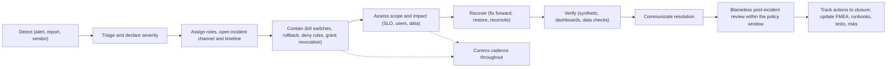
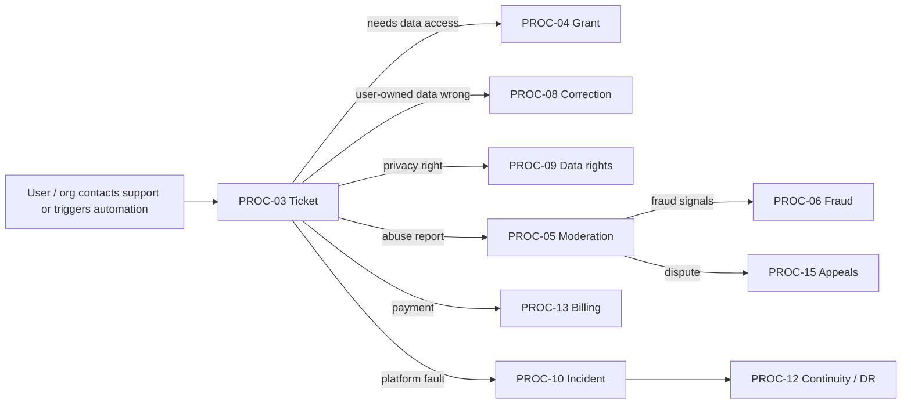
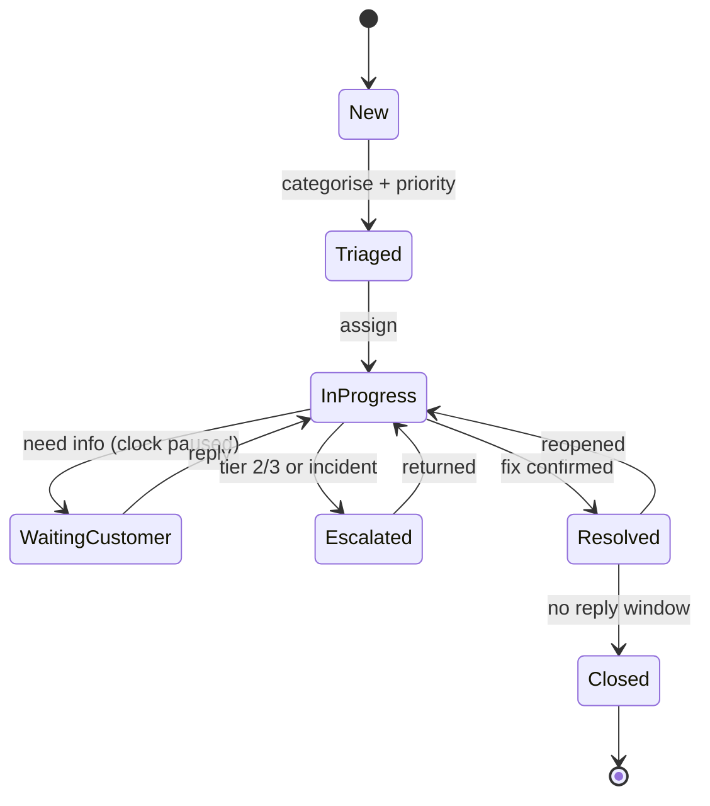

# Target blueprint 18: Operations And Support

> **Status.** Archive: proposal, not ratified. A greenfield redesign blueprint written in October 2026. Every area was Draft, Under Review or Revision Required (its own document status) and no test was run against it. Its content was mined into `docs/blueprint/`; `SSOT.md` remains the source of intent. Module federation described here was not adopted: the built system is a modular monolith (`ARCHITECTURE.md`).
>
> **What this file holds.** All files of the former `Yash_Final_Project_Document/18_OPERATIONS_AND_SUPPORT/` folder, in order.
>
> **Merged on 2026-11-25** from the files listed below; each one is a section under its original title. Nothing was removed; the originals are in git history at commit `08387ec`.

| Section | Former file |
|---|---|
| Incident Management | `Yash_Final_Project_Document/18_OPERATIONS_AND_SUPPORT/INCIDENT_MANAGEMENT.md` |
| Legacy Merge B-18: Operations Runbook Material, Operational Gates and Common Failures (Prior Attempt) | `Yash_Final_Project_Document/18_OPERATIONS_AND_SUPPORT/LEGACY_MERGE_OPERATIONS_RUNBOOK_MATERIAL.md` |
| Operations and Support Processes | `Yash_Final_Project_Document/18_OPERATIONS_AND_SUPPORT/OPERATIONS_AND_SUPPORT_PROCESSES.md` |
| Runbook Index | `Yash_Final_Project_Document/18_OPERATIONS_AND_SUPPORT/RUNBOOK_INDEX.md` |

## Incident Management

_Former file: `Yash_Final_Project_Document/18_OPERATIONS_AND_SUPPORT/INCIDENT_MANAGEMENT.md`._

Doc ID: SUP-INC · Owner: Incident Commander rota lead (SRE Lead) · Version 1.0 · Status: Draft for Review · Relates: PROC-10, PROC-12, RB-01…RB-37, OPS-OBS, OPS-SLO, ADR-T21, INV-T03, INV-T18, BR-T041, OPEN-08, OPEN-16, OPEN-39

No response-time number or rota size is asserted: time-bound targets are placeholders [OPEN-16] to be set once on-call capacity is known. Legal duties (regulatory notification, contractual notice) are decided by Legal/Privacy counsel [OPEN-08]; this document defines when counsel is engaged, not what the law requires.

### 1. Severity matrix

| Sev       | Definition (any one criterion)                                                                                                                                                                                                                                                                                       | Examples                                                                                                  | Response expectation                                                                                                             | Comms                                                              | Leadership                                   |
| --------- | -------------------------------------------------------------------------------------------------------------------------------------------------------------------------------------------------------------------------------------------------------------------------------------------------------------------- | --------------------------------------------------------------------------------------------------------- | -------------------------------------------------------------------------------------------------------------------------------- | ------------------------------------------------------------------ | -------------------------------------------- |
| **Sev-1** | **Any cross-tenant data exposure or suspected exposure (ADR-T21)**; confirmed breach of personal data; loss/corruption of durable user data; core service fully unavailable (SLO-01 and SLO-02 failing broadly); security compromise (key, runner escape, admin takeover); integrity of verified evidence undermined | Tenant A sees tenant B applications; verified status forgeable; DB corruption; production credential leak | Page immediately, all hours, IC and Security engaged at once; status page update; executive notification; target times [OPEN-16] | Public status + direct notice to affected parties as Legal advises | Exec sponsor informed; Legal/Privacy engaged |
| **Sev-2** | Major degradation of a core function or one persona; one remote down; SLO fast-burn (ALT-01/02); billing/entitlement errors affecting many; AI/policy breach contained; backup failure                                                                                                                               | Login errors for subset; recruiter pipeline unusable; webhooks delayed                                    | Page within on-call policy; IC assigned                                                                                          | Status page; support macros                                        | Product + Support leads informed             |
| **Sev-3** | Partial degradation with workaround; single-feature issue; slow-burn alert; vendor degradation not affecting core                                                                                                                                                                                                    | Email delays; search relevance degraded; moderation backlog                                               | Business-hours handling or ticket; owner assigned                                                                                | In-app notice if needed                                            | Owner team                                   |
| **Sev-4** | Minor defect, cosmetic, no user harm                                                                                                                                                                                                                                                                                 | Typos, minor UI glitch                                                                                    | Backlog                                                                                                                          | None                                                               | None                                         |

Severity rules: when unsure, declare the **higher** severity and downgrade later. Any incident that involves personal data of more than one tenant, or where a policy/RLS control failed open, is Sev-1 until scope is proven otherwise. Severity can only be lowered by the IC with a note. Security-classified incidents may be restricted-visibility (need-to-know) with a separate channel.

### 2. Roles

| Role                                                                                                             | Responsibility                                                                          | Notes                        |
| ---------------------------------------------------------------------------------------------------------------- | --------------------------------------------------------------------------------------- | ---------------------------- |
| Incident Commander (IC)                                                                                          | Owns the incident, assigns roles, decides severity, containment, comms approval, closes | Not hands-on debugging       |
| Operations lead                                                                                                  | Directs technical investigation and mitigation                                          | Pulls in module owners       |
| Security lead                                                                                                    | Leads on exposure/compromise; evidence preservation; forensics                          | Mandatory for Sev-1 exposure |
| Communications lead                                                                                              | Drafts and publishes updates (status page, customers, internal)                         | Uses templates (§7)          |
| Scribe                                                                                                           | Maintains timeline, decisions, actions                                                  | Time-stamped log             |
| Privacy/Legal liaison                                                                                            | Notification assessment, regulator/customer obligations                                 | OPEN-08                      |
| Support liaison                                                                                                  | Handles inbound tickets with consistent messaging                                       | PROC-03                      |
| Subject-matter experts                                                                                           | Module owners, DBA, vendor contacts                                                     |                              |
| Handover: roles rotate in long incidents with a written handover; no one works unbounded hours [policy OPEN-16]. |

### 3. Lifecycle



Principle: **contain before diagnose** when users or data are at risk. Containment levers are pre-built flags and runbook steps (OPS-REL §9.1; RB-24). Evidence preservation (logs, traces, audit export, snapshots) precedes any restart or cleanup when a security incident is possible.

### 4. Cross-tenant exposure procedure (Sev-1; RB-01)

| Step | Action                                                                                                                                                                                                                                                                      | Owner                 |
| ---- | --------------------------------------------------------------------------------------------------------------------------------------------------------------------------------------------------------------------------------------------------------------------------- | --------------------- |
| 1    | Declare Sev-1; page Security Lead, IC, API owner, Privacy liaison                                                                                                                                                                                                           | On-call               |
| 2    | Freeze deployments; preserve evidence (snapshot logs, trace samples, audit entries, config, deployed versions)                                                                                                                                                              | Ops lead              |
| 3    | Contain: disable the exposing endpoint/module/feature via kill switch or policy deny override; if unclear, move to the L3 read-only rung (OPS-FMEA §2) for affected modules; revoke active privileged grants; invalidate caches/CDN objects that may hold cross-tenant data | IC + Security         |
| 4    | Determine scope: which endpoints, which tenants, which records, window start/end from audit and access logs and from deploy history; identify whether data was actually accessed by an unauthorised principal vs merely reachable                                           | Security              |
| 5    | Root cause: which control failed (policy, repository filter, RLS, cache key, search index, export) and why FF-01/FF-05 canaries missed it                                                                                                                                   | Engineering           |
| 6    | Fix and add regression tests to TEN/SEC suites before re-enabling; run TEST-TEN-001 and mutation-sanity check                                                                                                                                                               | QA + Security         |
| 7    | Notification decisions with Legal/Privacy: affected tenants/users, regulators and contractual notice (rules [OPEN-08], not assumed here); prepare factual notice                                                                                                            | Privacy/Legal + Comms |
| 8    | Customer support script; dedicated contact for affected orgs                                                                                                                                                                                                                | Support               |
| 9    | Post-incident review shared with affected customers as appropriate; update RISK_REGISTER (RISK-01), fitness functions, and the policy test matrix                                                                                                                           | SRE + Security        |

### 5. Error budgets and incident impact

Each incident records SLO minutes burned. Budget exhaustion triggers the freeze policy in OPS-SLO §10. Incidents that are DR events or declared maintenance overruns are reported separately with exclusion rationale.

### 6. Communications

| Audience                                                                                                                                                           | Channel                                           | When                           | Content rules                                                                                                                        |
| ------------------------------------------------------------------------------------------------------------------------------------------------------------------ | ------------------------------------------------- | ------------------------------ | ------------------------------------------------------------------------------------------------------------------------------------ |
| Internal                                                                                                                                                           | Incident channel, update cadence set by IC        | Throughout                     | Facts, impact, next update time                                                                                                      |
| Users                                                                                                                                                              | Status page (independently hosted), in-app banner | Sev-1/2 and user-visible Sev-3 | Plain language; what is affected, workaround, next update; no speculation about cause; never confirm security impact before verified |
| Org admins / enterprise                                                                                                                                            | Email to registered contacts, account manager     | Sev-1/2 affecting them         | Specific impact to their tenant; contract notice rules                                                                               |
| Affected individuals                                                                                                                                               | Direct notice                                     | When Legal/Privacy decide      | Factual, actionable                                                                                                                  |
| Regulators / authorities                                                                                                                                           | Via Legal only                                    | As advised                     | Never ad hoc                                                                                                                         |
| Social/press                                                                                                                                                       | Via Comms lead only                               | Sev-1 public                   | Approved statement                                                                                                                   |
| Principles: honesty, no blame, no minimisation, consistent messaging across channels, accessibility of notices, update on schedule even when there is nothing new. |

### 7. Communication templates (structure)

| Template                              | Fields                                                                             |
| ------------------------------------- | ---------------------------------------------------------------------------------- |
| Initial notice                        | Time, what users may notice, which areas, status (investigating), next update time |
| Update                                | What changed, current mitigation, workaround, next update                          |
| Resolution                            | Time resolved, summary, customer action needed (if any), link to follow-up         |
| Exposure notice (Legal-approved only) | What happened, what data, when, what we did, what you can do, contact              |
| Maintenance notice                    | Window, expected impact, rollback commitment                                       |

### 8. Post-incident review

| Item             | Rule                                                                                                         |
| ---------------- | ------------------------------------------------------------------------------------------------------------ |
| Format           | Blameless; contributing factors not "root person"; timeline; detection and response analysis; what worked    |
| Timing           | Within a policy window after resolution [OPEN-16]; Sev-1 review involves leadership                          |
| Output           | Action items with owner and due date; classified (prevent / detect / mitigate / process); tracked to closure |
| Inputs updated   | OPS-FMEA rows, runbooks, alerts/SLOs, tests (TEST-* added), RISK_REGISTER, ADR revisit triggers if relevant  |
| Repeat incidents | Escalate to engineering roadmap prioritisation (reliability budget)                                          |
| Sharing          | Internal for all; external summary for Sev-1/2 customer-impacting as appropriate                             |

### 9. Preparedness

| Activity              | Purpose                                                                                               |
| --------------------- | ----------------------------------------------------------------------------------------------------- |
| On-call model         | Paging tool, schedule, escalation policy, follow-the-sun or single-region coverage [OPEN-39, OPEN-16] |
| Game days             | Exercise FM rows and runbooks (OPS-FMEA §9, TEST-REL-012)                                             |
| Tabletop for exposure | Annual-style exercise of §4 including legal liaison                                                   |
| Access readiness      | Break-glass accounts tested; grant tooling works (PROC-04)                                            |
| Contact sheet         | Vendors (hosting, Stripe, email, AI, CDN), legal, executives; verified regularly                      |
| Runbook currency      | RB reviews; unproven runbooks flagged (SUP-RUN §3)                                                    |
| Tooling independence  | Status page and incident comms not hosted on the primary stack                                        |

### 10. Vendor incidents

Treat vendor outages as incidents with the same lifecycle; severity by user impact, not vendor label. Track vendor SLAs and credits (COM-OPS §8). Record in vendor risk register (VR-*).

### 11. Measures

MTTD, MTTA, MTTR by severity; incidents per month by cause; SLO minutes burned; percent of incidents detected by alert vs user report; action-item closure rate; repeat-incident rate (MET-035, MET-036).

### Patch 2026-10-27: related procedure

A regulator or law-enforcement request is handled under PROC-16 (`OPERATIONS_AND_SUPPORT_PROCESSES.md`), not as an incident, unless a disclosure was made in error: that is a personal-data incident (Sev-1 if more than one tenant or any doubt, per section 1), led by the Security lead with the Privacy/Legal liaison. Counsel review owner: OPEN-X04. A stale permission after removal beyond the proposed bound is Sev-2 minimum, Sev-1 if it exposed another tenant data (`../14_SECURITY_PRIVACY_COMPLIANCE/SECURITY_ARCHITECTURE.md` R3-2).

## Legacy Merge B-18: Operations Runbook Material, Operational Gates and Common Failures (Prior Attempt)

_Former file: `Yash_Final_Project_Document/18_OPERATIONS_AND_SUPPORT/LEGACY_MERGE_OPERATIONS_RUNBOOK_MATERIAL.md`._

Doc ID: LGM-B-18 · Owner: SRE Lead (with Head of Operations) · Version 1.0 · Status: Draft for Review · Supersedes nothing · Relates: SUP-RUN, SUP-INC, SUP-PROC, OPS-OBS, OPS-DEP, FM-01..FM-48, RB-01..RB-37, OPEN-08, OPEN-16, OPEN-26, OPEN-39 · Ledger: `../00_CONTROL_CENTRE/LEGACY_MERGE_LEDGER_B.md`

Preservation instruction (project owner, verbatim): "i dont want to loos information keep everything in use untile it get improved".

Merged from legacy: `31_LEGACY_ARCHIVE/docs/quality/OPERATIONS.md` v6.0 (15.1 KB; sections 1-8 target operating model, section 9 "operating the current build, source checked 2026-10-23").

### 0. Frame

- **Nothing is operated here.** Section 9 of the legacy file described what the _prior attempt's_ code required; every statement is "prior attempt reported". "Target requires" is a requirement for this project, to be incorporated into runbooks (RB-nn) and processes (PROC-nn).
- Legacy limits repeated for honesty: configured does not mean delivered; liveness does not mean working; a script run once creates no alerts.

### 1. Legacy "target operating model" sections 1-8 (preserved, mapped)

| Legacy section            | Text (preserved)                                                                                                                                                                                                      | Target document / status                                                                                             |
| ------------------------- | --------------------------------------------------------------------------------------------------------------------------------------------------------------------------------------------------------------------- | -------------------------------------------------------------------------------------------------------------------- |
| 1 Environments            | `local -> CI -> preview -> staging -> production`; each with separate secrets/config                                                                                                                                  | OPS-REL environment table (matches)                                                                                  |
| 2 Observability           | Critical trace `request -> user -> tenant -> feature -> API -> DB/queue -> provider -> result`; structured logs, metrics, traces, audit events and business dashboards                                                | OPS-OBS (matches; verify the `feature` dimension and `tenant` dimension are present in span attributes - action SRE) |
| 3 SLOs                    | Set per service/capability **after baseline measurement**                                                                                                                                                             | OPS-SLO / OPEN-15 (matches)                                                                                          |
| 4 Alerts                  | Alert on: elevated error rate; latency/SLO breach; queue age/backlog; database saturation; auth failures; tenant isolation signal; payment/webhook failures; AI policy/cost anomalies; assessment integrity anomalies | OPS-OBS section 6 ALT-*; verify each of the nine classes has an ALT id (gap check L-B18-01)                          |
| 5 Backups/DR              | Prove restore; PITR where supported; storage recovery; queue recovery; configuration restoration; rollback                                                                                                            | OPS-DEP section 7 (REC-001..005)                                                                                     |
| 6 Incident lifecycle      | `detect -> contain -> assess -> recover -> communicate -> postmortem`                                                                                                                                                 | SUP-INC (longer legacy sequence in security file adds preserve/eradicate/notify/learn)                               |
| 7 Runbooks (minimum list) | DB incident; auth; RLS/tenant isolation; storage; queue; provider outage; payments; AI provider/policy; assessment integrity; privacy request; rollback; DR                                                           | RUNBOOK_INDEX RB-01..RB-37 (verify each of the twelve topics has an RB id - L-B18-01)                                |
| 8 Release                 | No release without security gate, critical E2E, accessibility evidence, migration proof, rollback path, observability, business acceptance                                                                            | OPS-REL RG gates                                                                                                     |

### 2. Prior-attempt operational facts that should become runbook content

#### 2.1 Persistence and restart behaviour

- Rows changed directly in SQL were visible to the API only after a restart (hybrid read model) - retired by ADR-T05; **runbook note:** under the target, direct SQL edits are forbidden outside an audited break-glass procedure (INV-T18).
- Erasure request creation, status history and cancellation used a durable table with an account-row lock to serialize concurrent requests; the immediate-erasure operation was separate; **no scheduled deletion executor existed**; the 30-day-grace versus immediate-delete policy "needs explicit owner/legal approval before a public release. Do not claim due-date deletion is automatic." **Target requires** RB for privacy requests (SUP-PROC) to state that the executor is a scheduled worker job with per-step state and alerting on stuck steps (L-B12-01 in the database file).
- Account metadata (settings, export-request history) lived in durable tables; erasure cleared those tables and "a defined set of in-process private maps, but other modules, shared records and backups still require the owner-approved full erasure/retention inventory." **Target:** DATA-xxx inventory (DB-03) is that inventory; the erasure saga covers each DATA row; backups age out and restores replay the erasure ledger (DB-03 section 5.6).

#### 2.2 Data export

`POST settings/export` returned a JSON snapshot **inline**; evidence and applications were selected by the candidate _profile_ id; no fabricated user/profile fallback was emitted; **CSV was refused with 503** until genuinely implemented; **no dead `downloadUrl`** was returned. It was a partial snapshot: data in non-durable modules was not a complete statutory export; "the JSON metadata deliberately makes **no statutory compliance claim** while the archive contains only a subset of personal data." Full export coverage, retention and downloadable archive policy remained release gates.
**Target requires:** export as an asynchronous job producing an expiring signed download (API-STD async pattern), covering every personal-data table in DATA-xxx; the export manifest lists what is included and excluded; never return a link that does not work; no compliance claim in metadata until counsel signs off (OPEN-08).

#### 2.3 Transactional email (opt-in provider) - operational gate

- Provider configuration (prior attempt): provider selection variable (`EMAIL_PROVIDER=brevo`), provider API key (server/worker secret), `EMAIL_FROM` (a sender authenticated at the provider), optional from-name and reply-to, an HTTPS application URL (`APP_URL`) - set in **both** API and worker environments. An unrecognised provider value was a startup error, never a silent fallback. With no configuration, deployed creation endpoints failed closed with 503.
- **Configured does not mean delivered:** the API reported durable enqueue; the worker recorded only that the provider _accepted_ the message (message id logged); delivery, bounce and block events were **not** consumed (no webhook route or table); the provider had no idempotency key so a retry after a timeout could send a duplicate; a provider response could still be rejected, delayed or bounced.
- Operational gate before enabling public verification: authenticate the sender domain (SPF, DKIM, DMARC records at the DNS host); install the provider variables in API and worker secrets; send both the code email and the referee-link email to real staging mailboxes; record delivery, bounce and failure evidence; never put sample one-time tokens or provider credentials in tracker evidence; "pending delivery is not successful delivery"; without approved provider configuration, deployed verification creation refuses requests (do not relabel that as delivered).
- **Target requires:** ADR-T20 (email port, Brevo default) plus: delivery/bounce/complaint webhook consumption writing to a `message_delivery` record; suppression list; per-provider idempotency by message id stored before send (outbox) so retry after timeout cannot duplicate; separate transactional vs marketing sending domains (OPEN-26); DNS authentication check in the staging gate; no secrets in evidence. Decision L-B18-02: double-opt-in and secondary provider (OPEN-26).

#### 2.4 Logging and alerting rules

- Structured JSON logs with redaction of credentials and tokens. Refused requests (4xx) logged at `info` as "API request rejected" with status and code; server faults (5xx) logged at `error` as "API request failed" with the stack. **"Alert on error-level logs: they now mean something is broken."** Every response carried `x-request-id` and error bodies carried the same id as `request_id`.
- Development outbox logs contain delivery text (codes and links) and must be treated as sensitive.
- **Target requires:** keep the 4xx/5xx level convention so error-level alerts are meaningful; ensure logs never include verification codes or tokens even in development (use a clearly marked fake-delivery sink with a test-only flag).

#### 2.5 Health and worker liveness

- `/health` is liveness; `/api/v1/health` adds environment; **both exempt from the rate limiter** "so a load balancer's polling can never throttle the API into looking dead". An admin diagnostics route (platform admin only) returned storage mode, a live database round-trip, queue status and active job count, and how many routes were durable; worker liveness used a database heartbeat table. Worker wrote the heartbeat between claim cycles once ten seconds had elapsed (long batches delayed it); the API called the queue degraded if the last heartbeat was older than 45 s, missing or unavailable. "An API health liveness response alone does not establish worker processing." Also monitor overdue queued and failed/dead jobs; "health is not a delivery receipt".
- **Target requires:** separate liveness and readiness endpoints (readiness checks DB with a short timeout and, optionally, queue age); worker heartbeat decoupled from the claim loop (independent timer) so long batches cannot fake staleness; alert thresholds stated in OPS-SLO (heartbeat, queue age, dead jobs); health endpoints exempt from rate limiting.

#### 2.6 Payments configuration and troubleshooting (prior attempt)

- Stripe mode required: secret key, webhook secret and at least one distinct configured price id; six optional catalog keys covering candidate pro, recruiter starter and recruiter enterprise, monthly or yearly; HTTPS application URL for return links in deployed environments; production refused test-mode keys; the server chose prices and checked role eligibility; provider price amounts/currency are external configuration and "must be reconciled with the domain catalog before release".
- Callback registered at `/api/v1/billing/stripe-webhook` for: checkout completion; subscription created/updated/deleted; invoice paid/payment_failed; charge refunded. The generic `/billing/webhook` used a different signature. Portal setup external. A checkout redirect alone is not subscription confirmation - inspect persisted subscription/events and provider logs. Watch: superseded subscriptions, webhook throttling, failed post-commit event enqueue. Disputes and voided invoices unsupported.
- **Target requires:** RB-nn for payments with these checks; a reconciliation job comparing provider price/amount/currency to the catalog; alert on webhook failure rate and on subscriptions in conflict state.

#### 2.7 Common failures table (prior attempt) -> diagnostic checks to turn into runbook entries

| Symptom                                     | Prior check                                                                                     | Target runbook note                                                                            |
| ------------------------------------------- | ----------------------------------------------------------------------------------------------- | ---------------------------------------------------------------------------------------------- |
| Missing workspace export or stale behaviour | API/worker imported prebuilt output; rebuild required after source changes                      | Eliminate by building in the deploy pipeline; add "stale artifact" check (build id in /health) |
| Database boot failure                       | connection string, schema/ledger, storage mode; no automatic memory fallback                    | RB database incident; never silently degrade to a non-durable mode                             |
| Second API refuses boot                     | existing session writer lease                                                                   | n/a (retired)                                                                                  |
| Sessions expire after every restart         | unstable or missing signing secret                                                              | RB auth: secret custody and rotation                                                           |
| Queue degraded despite API liveness         | heartbeat age, long claim batch, database reachability, retry/dead records                      | RB queue                                                                                       |
| Email route returns 503                     | deployed provider configuration and enqueue; sender/delivery need separate evidence             | RB provider outage                                                                             |
| Checkout unavailable                        | billing mode, server catalog ids, secrets, account role; never supply a client-controlled price | RB payments                                                                                    |
| Changes made directly in SQL do not appear  | restart to re-hydrate                                                                           | n/a (retired); forbid direct edits                                                             |

### 3. Open items raised by this file

| ID       | Question                                                                                 | Owner                      |
| -------- | ---------------------------------------------------------------------------------------- | -------------------------- |
| L-B18-01 | Gap check: each of nine alert classes and twelve minimum runbook topics has an ALT/RB id | SRE Lead                   |
| L-B18-02 | Email double opt-in, secondary provider, separate transactional/marketing domains        | Messaging owner (OPEN-26)  |
| L-B18-03 | Independent worker heartbeat timer and readiness endpoint design                         | Backend Architecture       |
| L-B18-04 | Export as async signed-download job and its inclusion manifest                           | Privacy Engineer + Backend |

<!-- ledger-D D-06 -->

### Merged from legacy: 31_LEGACY_ARCHIVE/docs/quality/OPERATIONS.md (gap closure D-06)

Frame: nothing is implemented in this project. The prior attempt reported or required the items below; earlier merges condensed them away. They are quoted verbatim from the archived source (`L<n>` = source line number) as reference evidence about the prior attempt only. Quoted code paths, commands, hashes, counts and URLs are not facts about this project. Source file stays unchanged in the archive. Closed under the standing instruction: "i dont want to loos information keep everything in use untile it get improved".

Named by the preservation audit: sentence 'Legacy plaintext keys, if any, must be remediated explicitly' (line 182), identifier `normalizeEvent` (line 269), and the Stripe configuration/troubleshooting and common-failure tables (lines 258-end) whose rows were reworded.

```text
L176: ### Account metadata and secret handling
L177:
L178: User settings and export-request history now use existing `user_settings` and
L179: `data_export_requests` PostgreSQL tables. The BYO AI key uses AES-256-GCM with
L180: a separate `BYO_AI_KEY_ENCRYPTION_KEY` (64 hex chars); no key means storing a
L181: BYO secret is refused, not downgraded to plaintext. Rotate only with a tested
L182: re-encryption plan. Legacy plaintext keys, if any, must be remediated explicitly.
L183: Account erasure clears those tables and a defined set of in-process private
L184: maps, but other modules, shared records and backups still require the owner-
L185: approved full erasure/retention inventory.
L186:
[...]
L258: ### Stripe configuration and troubleshooting
L259:
L260: `BILLING_MODE=stripe` requires `STRIPE_SECRET_KEY`, `STRIPE_WEBHOOK_SECRET` and
L261: at least one distinct configured `STRIPE_PRICE_*` ID. The six optional catalog
L262: keys cover candidate pro, recruiter starter and recruiter enterprise, monthly
L263: or yearly. Deployed return links require HTTPS `APP_URL`; production refuses
L264: Stripe test-mode keys. The server chooses prices and checks plan role eligibility.
L265: Provider price amounts/currency are external configuration and must be reconciled
L266: with the domain catalog before release.
L267:
L268: Register the callback path `/api/v1/billing/stripe-webhook` for the events handled
L269: by `normalizeEvent`: checkout completion, subscription created/updated/deleted,
L270: invoice paid/payment_failed and charge refunded. The generic `/billing/webhook`
L271: uses a different signature. Portal setup is external. A checkout redirect alone
L272: is not subscription confirmation; inspect persisted subscription/events and
L273: provider logs. Watch superseded subscriptions, webhook throttling and failed
L274: post-commit event enqueue. Disputes and voided invoices remain unsupported.
L275:
L276: ### Common local failures
L277:
L278: | Symptom | Check |
L279: | --- | --- |
L280: | Missing workspace export or stale behavior | API/worker import existing `dist`; operator rebuild required after source changes |
L281: | Database boot failure | `DATABASE_URL`, schema/ledger and storage mode; no automatic memory fallback |
L282: | Second API refuses boot | Existing session advisory writer lease; do not launch another writer |
L283: | Sessions expire after every restart | Stable private `TOKEN_SECRET`; do not use published test keys |
L284: | Queue degraded despite API liveness | Heartbeat age, long claim batch, database reachability, retry/dead records |
L285: | Email route returns 503 | Deployed provider configuration and durable enqueue; sender/delivery require separate evidence |
L286: | Checkout unavailable | Billing mode, server catalog IDs, secrets and account role; never supply a client-controlled price |
L287: | Changes made directly in SQL do not appear | Restart/re-hydrate the API for core read-model records |
L288:
L289: The environment schema uses `z.coerce.boolean()` for AI flags. String values are
L290: not a strict true/false parser; do not assume textual `false` disables a flag.
L291: This is a configuration discrepancy to address in an explicitly scoped code fix.
L292: The flags do not establish a connected paid model provider.
```

## Operations and Support Processes

_Former file: `Yash_Final_Project_Document/18_OPERATIONS_AND_SUPPORT/OPERATIONS_AND_SUPPORT_PROCESSES.md`._

Doc ID: SUP-PROC · Owner: Head of Operations (with Security Architect and Support Lead) · Version 1.0 · Status: Draft for Review · Relates: DOM-19, DOM-20, DOM-22, ROLE-SUP, ROLE-ADM, ROLE-MOD, ROLE-AUD, ROLE-ORGADM, ROLE-INSTADM, USR-01 §3–§6, BR-T041, BR-T060, INV-T09, INV-T15, INV-T18, INV-T20, SUP-RUN, SUP-INC, COM-OPS, OPEN-08, OPEN-16, OPEN-32, OPEN-39

Targets such as response times and staffing are **[OPEN-16]**; this document defines structure, permissions, controls and measures, not service levels or headcount. Documentation status is not implementation status; back-office tooling is specified, not built (see `WP-ADMIN-TOOLING`, `WP-SUPPORT-TOOLING` in ROADMAP).

### 1. Process catalogue

| ID      | Process                                                                | Owner                                         | Primary domain         |
| ------- | ---------------------------------------------------------------------- | --------------------------------------------- | ---------------------- |
| PROC-01 | User account administration                                            | Support Lead                                  | DOM-01, DOM-20         |
| PROC-02 | Organization and institution administration                            | Customer Success Lead                         | DOM-02, DOM-18         |
| PROC-03 | Support ticket handling, SLA and escalation                            | Support Lead                                  | DOM-20                 |
| PROC-04 | Privileged access grant (time-boxed)                                   | Security Lead                                 | DOM-20                 |
| PROC-05 | Content moderation                                                     | Trust & Safety Lead                           | DOM-19                 |
| PROC-06 | Fraud and abuse handling                                               | Trust & Safety Lead                           | DOM-19, DOM-16         |
| PROC-07 | Access review                                                          | Security Lead                                 | DOM-02, DOM-20         |
| PROC-08 | Data correction                                                        | Data Steward                                  | DOM-20                 |
| PROC-09 | Data-rights handling (access, export, rectification, erasure, consent) | Privacy Lead                                  | DOM-22                 |
| PROC-10 | Incident response and communications                                   | Incident Commander rota                       | all                    |
| PROC-11 | Maintenance windows                                                    | Release Manager                               | DOM-24                 |
| PROC-12 | Business continuity and disaster recovery                              | SRE Lead                                      | DOM-24                 |
| PROC-13 | Billing disputes, refunds and chargebacks                              | Finance Ops Lead                              | DOM-16                 |
| PROC-14 | Change and release management                                          | Release Manager                               | DOM-24                 |
| PROC-15 | Appeals (integrity flags, moderation, verification disputes)           | Trust & Safety Lead                           | DOM-07, DOM-19, DOM-06 |
| PROC-16 | Regulator and law-enforcement requests (PROPOSED)                      | Privacy Lead (counsel review owner: OPEN-X04) | DOM-22, DOM-20         |

Common controls for all processes: actor identity and role are authenticated; consequential actions require reason codes; every action emits an audit event (OPS-OBS §4.2); personal data in tickets follows INV-T14 (redacted attachments, no secrets); decisions affecting a person are made by a human (INV-T09, INV-T20); ticket data is subject to retention and erasure (PROC-09).



### 2. Processes

#### PROC-01 User account administration

| Field        | Detail                                                                                                                                                                                                                                                                                                                                                                                                                                                                                                                                                                                |
| ------------ | ------------------------------------------------------------------------------------------------------------------------------------------------------------------------------------------------------------------------------------------------------------------------------------------------------------------------------------------------------------------------------------------------------------------------------------------------------------------------------------------------------------------------------------------------------------------------------------- |
| Owner        | Support Lead                                                                                                                                                                                                                                                                                                                                                                                                                                                                                                                                                                          |
| Actors       | ROLE-SUP (execute), ROLE-ADM (approve sensitive), end user, ROLE-AUD (review)                                                                                                                                                                                                                                                                                                                                                                                                                                                                                                         |
| Triggers     | User request (lockout, email change, passkey loss, deactivation), abuse outcome (suspend), security event (compromise)                                                                                                                                                                                                                                                                                                                                                                                                                                                                |
| Workflow     | 1) Authenticate the requester through a challenge that does not reveal account data (verified email/passkey/recovery) 2) Classify action: unlock, credential reset, email change, deactivate/reactivate, suspend, merge duplicates 3) Low-risk self-service actions do not need an operator 4) Operator actions need a ticket and, if personal data is viewed, an active grant (PROC-04) 5) Execute through admin tooling (never direct SQL) with reason code 6) Notify the account holder via verified channel 7) Sessions revoked when credentials change (BR-T050) 8) Close ticket |
| Permissions  | SUP: unlock, trigger credential reset, view account metadata (not content) without grant; deactivate/suspend requires ADM or Trust & Safety decision; merges require ADM + user confirmation                                                                                                                                                                                                                                                                                                                                                                                          |
| Exceptions   | Cannot verify identity → no change, escalate to PROC-03 level 2 with out-of-band verification rules; suspected takeover → RB-27 and PROC-10; legal hold → no deletion                                                                                                                                                                                                                                                                                                                                                                                                                 |
| Metrics      | Time to resolve lockout, % self-service, account-takeover recovery time, wrongful-suspension reversal rate                                                                                                                                                                                                                                                                                                                                                                                                                                                                            |
| Audit events | `audit.account.unlock`, `.credential_reset_triggered`, `.email_changed`, `.suspended`, `.reactivated`, `.merged`, each with actor, reason, ticket id                                                                                                                                                                                                                                                                                                                                                                                                                                  |
| Recovery     | Every action reversible except merges (merge requires snapshot and rollback procedure through PROC-08)                                                                                                                                                                                                                                                                                                                                                                                                                                                                                |

#### PROC-02 Organization and institution administration

| Field        | Detail                                                                                                                                                                                                                                                                                                                                                                                                                                                                                                                                                                                                                                                                    |
| ------------ | ------------------------------------------------------------------------------------------------------------------------------------------------------------------------------------------------------------------------------------------------------------------------------------------------------------------------------------------------------------------------------------------------------------------------------------------------------------------------------------------------------------------------------------------------------------------------------------------------------------------------------------------------------------------------- |
| Owner        | Customer Success Lead                                                                                                                                                                                                                                                                                                                                                                                                                                                                                                                                                                                                                                                     |
| Actors       | ROLE-ORGADM, ROLE-INSTADM, ROLE-SUP, Customer Success, ROLE-ADM                                                                                                                                                                                                                                                                                                                                                                                                                                                                                                                                                                                                           |
| Triggers     | New customer onboarding, seat change, member add/remove, SSO setup, cohort import, offboarding/contract end                                                                                                                                                                                                                                                                                                                                                                                                                                                                                                                                                               |
| Workflow     | 1) Contract/entitlement confirmed by Commercial Ops (COM-OPS) 2) Tenant created with `org_id` and RLS defaults; first org_owner invited through verified email 3) Org owner configures roles (`org_owner`, `org_admin`, `recruiter`, `hiring_manager`, `viewer`; institution roles `inst_admin`, `faculty`, `proctor`) 4) SSO configured and tested with break-glass admin 5) Cohort imports are staged, validated, previewed, then committed with learner consent flows intact (learner owns identity, ADR-T21 / business model guardrail) 6) Offboarding: export offered, seats ended, learner accounts detached not deleted 7) Quarterly role review prompts (PROC-07) |
| Permissions  | Org admins manage members within their tenant only; Support has metadata access, content access via PROC-04; cross-tenant operations are not permitted for any role except ROLE-ADM via audited grant                                                                                                                                                                                                                                                                                                                                                                                                                                                                     |
| Exceptions   | Seat overage, domain ownership dispute, merged organizations, cohort data errors (stage rollback), SSO lockout (break-glass)                                                                                                                                                                                                                                                                                                                                                                                                                                                                                                                                              |
| Metrics      | Time to first successful tenant setup, SSO setup success rate, seat utilisation, import error rate, access-review completion                                                                                                                                                                                                                                                                                                                                                                                                                                                                                                                                              |
| Audit events | `audit.org.created`, `.member_added/removed`, `.role_changed`, `.sso_configured`, `.cohort_imported`, `.offboarded`                                                                                                                                                                                                                                                                                                                                                                                                                                                                                                                                                       |
| Recovery     | Cohort import is transactional per batch with undo window; role changes revertible; tenant deactivation is soft with retention window                                                                                                                                                                                                                                                                                                                                                                                                                                                                                                                                     |

#### PROC-03 Support ticket handling, SLA and escalation

| Field         | Detail                                                                                                                                                                                                                                                                                                                                                                                                                                                                                                                                              |
| ------------- | --------------------------------------------------------------------------------------------------------------------------------------------------------------------------------------------------------------------------------------------------------------------------------------------------------------------------------------------------------------------------------------------------------------------------------------------------------------------------------------------------------------------------------------------------- |
| Owner         | Support Lead                                                                                                                                                                                                                                                                                                                                                                                                                                                                                                                                        |
| Actors        | End users, org admins, ROLE-SUP tiers 1–2, engineers (tier 3), Incident Commander                                                                                                                                                                                                                                                                                                                                                                                                                                                                   |
| Triggers      | In-app "Get help" (carries support code from trace id), email, status-page contact, internal escalation                                                                                                                                                                                                                                                                                                                                                                                                                                             |
| Workflow      | 1) Intake: categorise (account, billing, verification, assessment, hiring, bug, privacy, abuse, other), priority from impact × urgency 2) Auto-routes privacy requests to PROC-09, abuse to PROC-05, payment to PROC-13, suspected exposure to PROC-10 3) Tier 1 resolves with macros/knowledge base; no personal-data view without need 4) Tier 2 may request grant (PROC-04) 5) Tier 3 engineering via defect with reproduction and trace id 6) Customer updated at each state; resolution confirmed 7) CSAT optional; feed top issues to product |
| SLA structure | Priority P1 (service-wide/security/data exposure) → immediate, handled via PROC-10; P2 (core loop blocked for an account) ; P3 (degraded); P4 (question). First-response and resolution targets per priority and per plan tier: [OPEN-16]. Clocks pause only in "waiting for customer" state                                                                                                                                                                                                                                                        |
| Escalation    | Breach-risk at a fraction of the SLA triggers lead notification; repeated contact or VIP org flags raise priority; P1/security always escalate to Incident Commander; never escalate by sharing credentials                                                                                                                                                                                                                                                                                                                                         |
| Permissions   | Tier 1: metadata + ticket; Tier 2: scoped by grant; Tier 3: no production data access except via incident procedures                                                                                                                                                                                                                                                                                                                                                                                                                                |
| Exceptions    | Abusive users (apply policy), legal/regulator requests (route to Legal, OPEN-08), minors (OPEN-09), accessibility help requests (priority treatment)                                                                                                                                                                                                                                                                                                                                                                                                |
| Metrics       | First-response time, time to resolution, SLA attainment, reopen rate, tickets per 1k MAU, top contact reasons, CSAT                                                                                                                                                                                                                                                                                                                                                                                                                                 |
| Audit events  | `audit.ticket.created/escalated/closed`, `.data_viewed` (with grant id)                                                                                                                                                                                                                                                                                                                                                                                                                                                                             |
| Recovery      | Backlog surge: triage banner, macros, temporary priority freeze rules, staff reallocation (OPEN-16); ticket system outage: fallback mailbox and status page                                                                                                                                                                                                                                                                                                                                                                                         |



#### PROC-04 Privileged access grant

| Field        | Detail                                                                                                                                                                                                                                                                                                                                                                                                                                                                                                                                                                                                 |
| ------------ | ------------------------------------------------------------------------------------------------------------------------------------------------------------------------------------------------------------------------------------------------------------------------------------------------------------------------------------------------------------------------------------------------------------------------------------------------------------------------------------------------------------------------------------------------------------------------------------------------------ |
| Owner        | Security Lead                                                                                                                                                                                                                                                                                                                                                                                                                                                                                                                                                                                          |
| Actors       | Requestor (ROLE-SUP/ROLE-ADM/engineer), approver (different person), subject user/org (notified where allowed), ROLE-AUD                                                                                                                                                                                                                                                                                                                                                                                                                                                                               |
| Triggers     | Ticket needs personal data; incident diagnosis; data correction; legal request                                                                                                                                                                                                                                                                                                                                                                                                                                                                                                                         |
| Workflow     | 1) Requestor submits grant with scope (user/tenant/resource), purpose, ticket id, reason code, duration ≤ 4 h (BR-T041) 2) Approver (not the requestor) reviews; automatic approval allowed only for pre-approved low-risk scopes defined by policy 3) Grant issued as a scoped token bound to requestor; access performed through audited read paths (no raw SQL) 4) Subject notification policy: notify user when allowed (not when legally restricted or security-sensitive) 5) Grant auto-expires; early revoke possible 6) Weekly sampling review of grants by Security; anomalies alert (ALT-19) |
| Permissions  | No role can self-approve; admins cannot approve their own grants; break-glass emergency path for SEV-1 allows immediate access with after-the-fact review within one business day                                                                                                                                                                                                                                                                                                                                                                                                                      |
| Exceptions   | Grant extension needs new approval; cross-tenant scopes need Security Lead approval; production DB console access is a separate engineering break-glass with session recording                                                                                                                                                                                                                                                                                                                                                                                                                         |
| Metrics      | Grants per week by scope, mean duration, % with approver, expired-without-use, break-glass count, review completion                                                                                                                                                                                                                                                                                                                                                                                                                                                                                    |
| Audit events | `audit.grant.requested/approved/denied/issued/used/expired/revoked`, `audit.data.read` with grant id                                                                                                                                                                                                                                                                                                                                                                                                                                                                                                   |
| Recovery     | Revoke all active grants (kill switch) in an incident; grant system outage → manual approval log reconciled later                                                                                                                                                                                                                                                                                                                                                                                                                                                                                      |

#### PROC-05 Content moderation

| Field        | Detail                                                                                                                                                                                                                                                                                                                                                                                                                                                                                                                                                                            |
| ------------ | --------------------------------------------------------------------------------------------------------------------------------------------------------------------------------------------------------------------------------------------------------------------------------------------------------------------------------------------------------------------------------------------------------------------------------------------------------------------------------------------------------------------------------------------------------------------------------- |
| Owner        | Trust & Safety Lead                                                                                                                                                                                                                                                                                                                                                                                                                                                                                                                                                               |
| Actors       | ROLE-MOD, reporters, content owners, ROLE-ADM (escalation), automated detectors (advisory only)                                                                                                                                                                                                                                                                                                                                                                                                                                                                                   |
| Triggers     | User report, automated signal (spam heuristics, policy classifier), proactive sampling of job postings, course content, profiles, messages (flagged only)                                                                                                                                                                                                                                                                                                                                                                                                                         |
| Workflow     | 1) Report/signal creates a case in the moderation queue (DOM-19) with content snapshot 2) Prioritise by harm class (safety/illegal > fraud/scam > harassment > quality) 3) Moderator reviews with the minimum necessary context; flagged messaging only visible if reported 4) Decision from the action ladder: no action, warn, limit visibility, take down, suspend (suspend needs PROC-06/ADM) 5) Notify the content owner with reason and appeal link (PROC-15) 6) Record outcome; repeat-offender tracking 7) Automated detectors never take final adverse actions (INV-T09) |
| Permissions  | MOD: read flagged content, act on content; no access to unrelated personal data; CRUD on moderation queue per USR-01                                                                                                                                                                                                                                                                                                                                                                                                                                                              |
| Exceptions   | Illegal content (escalate to Legal; preserve evidence), minors (OPEN-09), coordinated campaigns (PROC-06), moderator conflict-of-interest recusal, reporter abuse                                                                                                                                                                                                                                                                                                                                                                                                                 |
| Metrics      | Queue age, time to action, reversal-on-appeal rate, false-positive rate of detectors, repeat offences, reports per 1k users                                                                                                                                                                                                                                                                                                                                                                                                                                                       |
| Audit events | `audit.moderation.case_opened/decision/takedown/restore`, `.appeal_opened`                                                                                                                                                                                                                                                                                                                                                                                                                                                                                                        |
| Recovery     | Wrongful takedown restore path; queue surge handled by RB-32                                                                                                                                                                                                                                                                                                                                                                                                                                                                                                                      |

#### PROC-06 Fraud and abuse handling

| Field        | Detail                                                                                                                                                                                                                                                                                                                                                                                                                                                                                                  |
| ------------ | ------------------------------------------------------------------------------------------------------------------------------------------------------------------------------------------------------------------------------------------------------------------------------------------------------------------------------------------------------------------------------------------------------------------------------------------------------------------------------------------------------- |
| Owner        | Trust & Safety Lead                                                                                                                                                                                                                                                                                                                                                                                                                                                                                     |
| Actors       | T&S analysts, ROLE-MOD, ROLE-ADM, Finance Ops, Security, Legal                                                                                                                                                                                                                                                                                                                                                                                                                                          |
| Triggers     | Fake employer/job scams, fake credentials/evidence gaming, bot signups, payment fraud, referee collusion, referral abuse, scraping                                                                                                                                                                                                                                                                                                                                                                      |
| Workflow     | 1) Detection from signals (velocity, duplicate artefacts, disposable domains, mismatched referee patterns, chargebacks) as **advisory** 2) Analyst investigates with grant if personal data needed 3) Decision by human: restrict (rate limits, hold), remove content, suspend account, revoke evidence (triggers BR-T005 recompute), block payment 4) Reporter/victim notified as appropriate 5) Patterns fed into rules after review (rules reviewed for fairness, ANL-MET §7) 6) Appeals via PROC-15 |
| Permissions  | Analysts: read signals and flagged records; ROLE-ADM executes suspensions; no automated ranking-out or banning (INV-T09, INV-T20)                                                                                                                                                                                                                                                                                                                                                                       |
| Exceptions   | Law-enforcement requests via Legal only; false-positive protection for shared networks; sensitive-class (minors) escalation                                                                                                                                                                                                                                                                                                                                                                             |
| Metrics      | Confirmed-fraud rate, time to contain, false-positive rate, chargeback rate, evidence revocations due to fraud                                                                                                                                                                                                                                                                                                                                                                                          |
| Audit events | `audit.fraud.signal_reviewed`, `.account_restricted`, `.evidence_revoked`, `.payment_blocked`                                                                                                                                                                                                                                                                                                                                                                                                           |
| Recovery     | Reinstatement workflow; evidence re-verification path                                                                                                                                                                                                                                                                                                                                                                                                                                                   |

#### PROC-07 Access review

| Field        | Detail                                                                                                                                                                                                                                                                                                                           |
| ------------ | -------------------------------------------------------------------------------------------------------------------------------------------------------------------------------------------------------------------------------------------------------------------------------------------------------------------------------- |
| Owner        | Security Lead                                                                                                                                                                                                                                                                                                                    |
| Actors       | Org owners (tenant roles), platform Security (platform privileged roles), ROLE-AUD                                                                                                                                                                                                                                               |
| Triggers     | Quarterly org prompt, monthly platform review (USR-01 §6), role-change events, departures                                                                                                                                                                                                                                        |
| Workflow     | 1) System generates review list: members, roles, last activity, privileged grants 2) Reviewer confirms/changes/removes 3) Non-response reminders; unresolved items escalate 4) Dormant privileged grants auto-expire after 60 days (USR-01 §6) 5) Evidence of review stored 6) Findings (excess access) become remediation tasks |
| Permissions  | Org owners: own tenant; Security: platform roles; Auditor read-only                                                                                                                                                                                                                                                              |
| Exceptions   | Org owner unavailable → Customer Success contact verified; contractor accounts have shorter terms                                                                                                                                                                                                                                |
| Metrics      | Completion rate, time to remediate, number of dormant privileged accounts, revoked-access count                                                                                                                                                                                                                                  |
| Audit events | `audit.access_review.opened/completed`, `.role_removed`                                                                                                                                                                                                                                                                          |
| Recovery     | Accidental removal reversible via role history                                                                                                                                                                                                                                                                                   |

#### PROC-08 Data correction

| Field        | Detail                                                                                                                                                                                                                                                                                                                                                                                                                                                                                                                                                                         |
| ------------ | ------------------------------------------------------------------------------------------------------------------------------------------------------------------------------------------------------------------------------------------------------------------------------------------------------------------------------------------------------------------------------------------------------------------------------------------------------------------------------------------------------------------------------------------------------------------------------ |
| Owner        | Data Steward                                                                                                                                                                                                                                                                                                                                                                                                                                                                                                                                                                   |
| Actors       | ROLE-SUP (request), Data Steward (execute), ROLE-ADM (approve high impact), data subject                                                                                                                                                                                                                                                                                                                                                                                                                                                                                       |
| Triggers     | Data defect (system fault), user-reported error that cannot be self-edited, migration reconciliation discrepancy, rectification request (PROC-09)                                                                                                                                                                                                                                                                                                                                                                                                                              |
| Workflow     | 1) Ticket with proposed change, impact, and evidence 2) Decide whether the user can self-correct (preferred; no operator edits to a person's claims) 3) For system faults: write a reviewed, idempotent correction script/tool action, dry-run in staging, run in production via pipeline or audited admin action 4) Corrections never alter verification status/evidence rung by operator edit (INV-T04) — they must trigger the proper verification transition or revoke 5) Before/after summary recorded; subject notified when personal data changed 6) Post-check queries |
| Permissions  | No ad-hoc SQL; execution via approved tooling with grant (PROC-04); two-person rule for bulk changes                                                                                                                                                                                                                                                                                                                                                                                                                                                                           |
| Exceptions   | Corrections affecting billing/legal records route to Finance/Legal; mass corrections treated as change (PROC-14)                                                                                                                                                                                                                                                                                                                                                                                                                                                               |
| Metrics      | Corrections per month by cause (feeds defect reduction), time to correct, errors introduced                                                                                                                                                                                                                                                                                                                                                                                                                                                                                    |
| Audit events | `audit.data.correction_requested/approved/applied` with diff summary                                                                                                                                                                                                                                                                                                                                                                                                                                                                                                           |
| Recovery     | Pre-change snapshot; compensating script; PITR as last resort (RB-30)                                                                                                                                                                                                                                                                                                                                                                                                                                                                                                          |

#### PROC-09 Data-rights handling

| Field        | Detail                                                                                                                                                                                                                                                                                                                                                                                                                                                                                                                                                                                                                                                                                                                                                                                                                                                                                                                                                                                                                  |
| ------------ | ----------------------------------------------------------------------------------------------------------------------------------------------------------------------------------------------------------------------------------------------------------------------------------------------------------------------------------------------------------------------------------------------------------------------------------------------------------------------------------------------------------------------------------------------------------------------------------------------------------------------------------------------------------------------------------------------------------------------------------------------------------------------------------------------------------------------------------------------------------------------------------------------------------------------------------------------------------------------------------------------------------------------- |
| Owner        | Privacy Lead                                                                                                                                                                                                                                                                                                                                                                                                                                                                                                                                                                                                                                                                                                                                                                                                                                                                                                                                                                                                            |
| Actors       | Data subject, org employee (via org admin for employer-held data), ROLE-SUP assist, Privacy Lead, Legal (OPEN-08), engineering automation                                                                                                                                                                                                                                                                                                                                                                                                                                                                                                                                                                                                                                                                                                                                                                                                                                                                               |
| Triggers     | Access/export, rectification, erasure, restriction, consent change/withdrawal, objection to automated processing (human-review right)                                                                                                                                                                                                                                                                                                                                                                                                                                                                                                                                                                                                                                                                                                                                                                                                                                                                                   |
| Workflow     | 1) Intake in account (authenticated) or via verified channel 2) Identity verification proportionate to risk 3) Create request with state machine (received → verified → in progress → completed/partially completed/refused) 4) Export: orchestrated job across modules produces a machine-readable package, delivered through authenticated download 5) Erasure: deletion/pseudonymisation across Postgres, object storage, search index, caches, analytics, email suppression retained as necessary; retained records (audit, billing, legal) listed in retention list [OPEN-08]; append-only audit/consent history is not rewritten (opaque `subject_ref`; the identity mapping is deleted, DB-02 §4.1); completion within 30 days (BR-T060; internal target SLO-24) 6) Backups age out by policy; restore re-applies tombstones 7) Confirmation to subject with what was retained and why 8) Org-held data (applications held by recruiters) handled by rule: candidate-owned vs employer-record boundary [OPEN-08] |
| Permissions  | Support cannot access beyond request scope; Privacy Lead approves refusals/partials; no deletion if legal hold                                                                                                                                                                                                                                                                                                                                                                                                                                                                                                                                                                                                                                                                                                                                                                                                                                                                                                          |
| Exceptions   | Unverifiable requester, excessive/repeat requests (policy), minors (OPEN-09), conflict with legal retention, institution-owned records                                                                                                                                                                                                                                                                                                                                                                                                                                                                                                                                                                                                                                                                                                                                                                                                                                                                                  |
| Metrics      | Time to completion, % within internal target, requests by type, partial/refusal rate, export size/time                                                                                                                                                                                                                                                                                                                                                                                                                                                                                                                                                                                                                                                                                                                                                                                                                                                                                                                  |
| Audit events | `audit.privacy.request_received/verified/completed`, `.erasure_step_completed`, `.refused`                                                                                                                                                                                                                                                                                                                                                                                                                                                                                                                                                                                                                                                                                                                                                                                                                                                                                                                              |
| Recovery     | Failed steps retried idempotently; pause with backlog alert (RB-28); evidence package regenerated if corrupted                                                                                                                                                                                                                                                                                                                                                                                                                                                                                                                                                                                                                                                                                                                                                                                                                                                                                                          |

#### PROC-10 Incident response and communications

| Field        | Detail                                                                                                                                                                             |
| ------------ | ---------------------------------------------------------------------------------------------------------------------------------------------------------------------------------- |
| Owner        | Incident Commander rota (SRE-led)                                                                                                                                                  |
| Actors       | Incident Commander (IC), Ops lead, Comms lead, Scribe, Security Lead, Support Lead, Legal (as needed)                                                                              |
| Triggers     | Page from alert (OPS-OBS §6), support escalation, security report, vendor notice                                                                                                   |
| Workflow     | Defined in SUP-INC: detect → declare severity → assign roles → contain → assess → recover → communicate → postmortem; cross-tenant exposure = Sev-1                                |
| Permissions  | IC may authorise break-glass access (PROC-04) and invoke kill switches; major customer comms approved by Comms lead + IC; breach notification decisions by Legal/Privacy (OPEN-08) |
| Exceptions   | Vendor outage (RB per vendor), security incident with legal hold, unclear severity (declare higher, downgrade later)                                                               |
| Metrics      | MTTD, MTTA, MTTR (by severity), SLO budget burned by incident, postmortem completion, action-item closure                                                                          |
| Audit events | `audit.incident.declared/severity_changed/resolved`, `.breakglass_used`                                                                                                            |
| Recovery     | Handover protocol for long incidents; DR via PROC-12                                                                                                                               |

#### PROC-11 Maintenance windows

| Field        | Detail                                                                                                                                                                                                                                                                                                                                                                                                                                                                        |
| ------------ | ----------------------------------------------------------------------------------------------------------------------------------------------------------------------------------------------------------------------------------------------------------------------------------------------------------------------------------------------------------------------------------------------------------------------------------------------------------------------------- |
| Owner        | Release Manager                                                                                                                                                                                                                                                                                                                                                                                                                                                               |
| Actors       | Release Manager, SRE, Support Lead (comms), Customer Success (enterprise notice)                                                                                                                                                                                                                                                                                                                                                                                              |
| Triggers     | Planned change that may cause user-visible impact (contract migrations, database major upgrade, hosting change, certificate/key rotation)                                                                                                                                                                                                                                                                                                                                     |
| Workflow     | 1) Prefer zero-downtime patterns (expand/contract) so windows are rare 2) Proposal with impact, duration estimate, rollback, runbook, owner 3) Choose a window by lowest-impact analysis (use aggregated usage telemetry) 4) Notify users/orgs in advance via banner, email and status page (lead time per policy [OPEN-16]) 5) Execute through PROC-14 with go/no-go checkpoints 6) Verify with synthetic + dashboards 7) Close with notice and measure vs SLO exclusion cap |
| Permissions  | Release Manager schedules; IC authority transfers if the window turns into an incident                                                                                                                                                                                                                                                                                                                                                                                        |
| Exceptions   | Emergency maintenance (security patch) with short notice; window overrun → rollback decision at pre-set checkpoint                                                                                                                                                                                                                                                                                                                                                            |
| Metrics      | Windows per quarter, overrun rate, SLO minutes consumed, complaint count                                                                                                                                                                                                                                                                                                                                                                                                      |
| Audit events | `audit.change.window_scheduled/started/completed`                                                                                                                                                                                                                                                                                                                                                                                                                             |
| Recovery     | Rollback criteria and time-box agreed beforehand                                                                                                                                                                                                                                                                                                                                                                                                                              |

#### PROC-12 Business continuity and disaster recovery

| Field        | Detail                                                                                                                                                                                                                                                                                                                                                                                                                                                                                                                     |
| ------------ | -------------------------------------------------------------------------------------------------------------------------------------------------------------------------------------------------------------------------------------------------------------------------------------------------------------------------------------------------------------------------------------------------------------------------------------------------------------------------------------------------------------------------- |
| Owner        | SRE Lead                                                                                                                                                                                                                                                                                                                                                                                                                                                                                                                   |
| Actors       | SRE, Incident Commander, Security, Legal/Comms, Finance (vendor continuity), Customer Success                                                                                                                                                                                                                                                                                                                                                                                                                              |
| Triggers     | DR declaration (T2–T5 in OPS-DEP §7), vendor failure, key-person loss, facility/account compromise                                                                                                                                                                                                                                                                                                                                                                                                                         |
| Workflow     | 1) Maintain BCP: critical services ranking (auth, evidence access, consent, billing webhooks), dependencies and alternates 2) Annual/regular DR exercises (cadence [OPEN-15]) with measured RPO/RTO 3) Declare DR (IC decision), execute RB-31, communicate through out-of-band channels (status page hosted separately, email list, alternate chat) 4) Operate in degraded mode per OPS-FMEA ladder 5) Restore, reconcile (billing RB-34, queues), validate with synthetic and data checks 6) Return to normal and review |
| Permissions  | DR actions use break-glass accounts stored in a separate secure location; two-person control                                                                                                                                                                                                                                                                                                                                                                                                                               |
| Exceptions   | Provider account compromise (T5) → rebuild in clean account using off-account backups; key-person dependency mitigated by runbooks and cross-training                                                                                                                                                                                                                                                                                                                                                                      |
| Metrics      | Exercise pass rate, measured RTO/RPO vs target, age of last successful restore, runbook freshness                                                                                                                                                                                                                                                                                                                                                                                                                          |
| Audit events | `audit.dr.declared/exercise_completed/failover_executed`                                                                                                                                                                                                                                                                                                                                                                                                                                                                   |
| Recovery     | Failback plan documented per scenario                                                                                                                                                                                                                                                                                                                                                                                                                                                                                      |

#### PROC-13 Billing disputes, refunds and chargebacks

| Field        | Detail                                                                                                                                                                                                                                                                                                                                                                                                                                                            |
| ------------ | ----------------------------------------------------------------------------------------------------------------------------------------------------------------------------------------------------------------------------------------------------------------------------------------------------------------------------------------------------------------------------------------------------------------------------------------------------------------- |
| Owner        | Finance Ops Lead                                                                                                                                                                                                                                                                                                                                                                                                                                                  |
| Actors       | Customer, ROLE-SUP, Finance Ops, ROLE-ORGADM (billing contact), Stripe                                                                                                                                                                                                                                                                                                                                                                                            |
| Triggers     | Refund request, double charge, failed payment, chargeback, course purchase dispute, invoice question                                                                                                                                                                                                                                                                                                                                                              |
| Workflow     | 1) Ticket categorised billing; identity verified 2) Check entitlements derived from Stripe state (never a UI claim) 3) Decide per refund policy (COM-OPS §5) 4) Execute refund/credit in the billing system (not by editing entitlements) 5) Entitlement changes arrive through verified webhook (INV-T17) 6) For chargebacks: gather evidence package (access logs scoped, delivery proof) within provider deadline 7) Reconcile (COM-OPS §7) 8) Update customer |
| Permissions  | Finance Ops executes refunds up to a limit [OPEN-33]; above limit needs approval; Support cannot issue refunds directly                                                                                                                                                                                                                                                                                                                                           |
| Exceptions   | Course instructor revenue share impacts (OPEN-06), tax adjustments (OPEN-18), fraud-related chargebacks (PROC-06)                                                                                                                                                                                                                                                                                                                                                 |
| Metrics      | Refund rate, chargeback rate and win rate, time to resolve, reconciliation breaks                                                                                                                                                                                                                                                                                                                                                                                 |
| Audit events | `audit.billing.refund_issued`, `.chargeback_responded`, `.entitlement_reconciled`                                                                                                                                                                                                                                                                                                                                                                                 |
| Recovery     | Reverse errant credit via counter-entry; reconciliation job corrects drift (TEST-BIL-006)                                                                                                                                                                                                                                                                                                                                                                         |

#### PROC-14 Change and release management

| Field        | Detail                                                                                                                                                                                                         |
| ------------ | -------------------------------------------------------------------------------------------------------------------------------------------------------------------------------------------------------------- |
| Owner        | Release Manager                                                                                                                                                                                                |
| Actors       | Engineers, Release Eng, SRE, QA, Security (for R1), Product                                                                                                                                                    |
| Triggers     | Any production change: release, config, flag, infrastructure, schema                                                                                                                                           |
| Workflow     | Per OPS-REL: classify change (standard/normal/emergency/high-risk), pass gates RG-01…RG-14, canary, progressive rollout, post-release verification, record in release log; emergency changes get retrospective |
| Permissions  | Pipelines deploy; humans approve; direct production edits forbidden outside break-glass                                                                                                                        |
| Exceptions   | Hotfix path (OPS-REL §11), freeze periods (error-budget freeze, SLO policy)                                                                                                                                    |
| Metrics      | Change failure rate, lead time, deployment frequency, rollback rate (MET-039, MET-040), gate waivers                                                                                                           |
| Audit events | `audit.change.deployed/rolled_back`, `.flag_changed`, `.gate_waived`                                                                                                                                           |
| Recovery     | Rollback per OPS-REL §10                                                                                                                                                                                       |

#### PROC-15 Appeals

| Field        | Detail                                                                                                                                                                                                                                                                                                                                                         |
| ------------ | -------------------------------------------------------------------------------------------------------------------------------------------------------------------------------------------------------------------------------------------------------------------------------------------------------------------------------------------------------------- |
| Owner        | Trust & Safety Lead                                                                                                                                                                                                                                                                                                                                            |
| Actors       | Affected person/org, independent reviewer (not the original decider), Privacy Lead, ROLE-ADM                                                                                                                                                                                                                                                                   |
| Triggers     | Integrity flag outcome, moderation action, evidence revocation, verification dispute, account suspension, objection to automated processing                                                                                                                                                                                                                    |
| Workflow     | 1) Appeal submitted in-product or ticket, with reason and optional new evidence 2) Acknowledge and freeze irreversible follow-on effects where safe 3) Independent human review 4) Decision with reason; reverse/uphold/modify 5) If reversed: restore state, recompute dependent data (BR-T005), correct records 6) Record for fairness analysis (ANL-MET §7) |
| Permissions  | Reviewer cannot be the original decider; ADM final escalation                                                                                                                                                                                                                                                                                                  |
| Exceptions   | Legal-hold items; safety-critical content stays down during review                                                                                                                                                                                                                                                                                             |
| Metrics      | Time to decision, reversal rate, repeat-appeal rate, disparate outcome checks                                                                                                                                                                                                                                                                                  |
| Audit events | `audit.appeal.opened/decided`, `.state_restored`                                                                                                                                                                                                                                                                                                               |
| Recovery     | Restoration workflow tested (TEST-MSG-002)                                                                                                                                                                                                                                                                                                                     |

#### PROC-16 Regulator and law-enforcement requests (PROPOSED, patch 2026-10-27)

Procedure skeleton only. It states who does what, not what the law requires: legal basis, jurisdiction, deadlines, notice-to-user duties and what may be disclosed all need counsel verification. **Counsel review owner is an open decision (OPEN-X04).** No contact, authority or deadline is asserted. Added to the catalogue as row PROC-16 (owner: Privacy Lead with Legal liaison, domain DOM-22/DOM-20).

| Field        | Detail                                                                                                                                                                                                                                                                                                                                                                                                                                                                                                                                                                                                                                                                                                                                                                                                                                                                                                                                                                                                                                                                                                                                                                               |
| ------------ | ------------------------------------------------------------------------------------------------------------------------------------------------------------------------------------------------------------------------------------------------------------------------------------------------------------------------------------------------------------------------------------------------------------------------------------------------------------------------------------------------------------------------------------------------------------------------------------------------------------------------------------------------------------------------------------------------------------------------------------------------------------------------------------------------------------------------------------------------------------------------------------------------------------------------------------------------------------------------------------------------------------------------------------------------------------------------------------------------------------------------------------------------------------------------------------ |
| Owner        | Privacy Lead (accountable), Legal liaison (counsel review owner: OPEN-X04)                                                                                                                                                                                                                                                                                                                                                                                                                                                                                                                                                                                                                                                                                                                                                                                                                                                                                                                                                                                                                                                                                                           |
| Actors       | Privacy Lead, Legal liaison/counsel, Security Lead, Data Steward (extract), Incident Commander if linked to an incident, executive sponsor (escalation)                                                                                                                                                                                                                                                                                                                                                                                                                                                                                                                                                                                                                                                                                                                                                                                                                                                                                                                                                                                                                              |
| Triggers     | Written request from a regulator, court, police or other authority, or a preservation request, received through any channel                                                                                                                                                                                                                                                                                                                                                                                                                                                                                                                                                                                                                                                                                                                                                                                                                                                                                                                                                                                                                                                          |
| Workflow     | 1) **Single intake**: any recipient (support, engineer, executive) forwards the request unanswered and undisclosed to the Privacy Lead; nobody replies or exports data on their own 2) Log and acknowledge receipt only; `audit.legal.request_received` 3) Verify authenticity out of band via a channel found independently, never from contact details in the request 4) Counsel reviews validity, jurisdiction, scope, whether the user may be told, and whether a legal hold applies 5) Decide: comply in full, comply in part (narrow scope), challenge, or decline; written decision with reason (`audit.legal.request_reviewed`) 6) If complying: the Data Steward produces the minimum scoped extract under a time-boxed grant (PROC-04), reviewed by a second person; no bulk or direct database access for the requester 7) Deliver through the counsel-approved secure channel; record what was sent (`audit.legal.request_answered`) 8) Notify the affected user if counsel confirms it is allowed and appropriate; otherwise record the reason for non-notice 9) Close, retain the file per counsel, include in the transparency summary if one is published [OPEN-X04] |
| Permissions  | Requests handled by named roles only; separation of duties: requester of the extract != approver; platform admins cannot self-approve                                                                                                                                                                                                                                                                                                                                                                                                                                                                                                                                                                                                                                                                                                                                                                                                                                                                                                                                                                                                                                                |
| Exceptions   | Emergency requests: counsel-defined fast path, still logged and after-the-fact reviewed; request conflicts with another jurisdiction: escalate to counsel; request touches another tenant's data: out of scope unless counsel directs; suspected abuse of the process: Sev-2 and Security Lead                                                                                                                                                                                                                                                                                                                                                                                                                                                                                                                                                                                                                                                                                                                                                                                                                                                                                       |
| Metrics      | Count by type, outcome mix (full/partial/declined), time to counsel decision, extracts with second-review done                                                                                                                                                                                                                                                                                                                                                                                                                                                                                                                                                                                                                                                                                                                                                                                                                                                                                                                                                                                                                                                                       |
| Audit events | `audit.legal.request_received/reviewed/answered/declined`                                                                                                                                                                                                                                                                                                                                                                                                                                                                                                                                                                                                                                                                                                                                                                                                                                                                                                                                                                                                                                                                                                                            |
| Recovery     | Wrong disclosure: treat as a personal-data incident under PROC-10/INCIDENT_MANAGEMENT (Privacy/Legal liaison role)                                                                                                                                                                                                                                                                                                                                                                                                                                                                                                                                                                                                                                                                                                                                                                                                                                                                                                                                                                                                                                                                   |
| Related      | PROC-09, PROC-10, PROC-04, `../14_SECURITY_PRIVACY_COMPLIANCE/SECURITY_ARCHITECTURE.md` R3-8, OPEN-08                                                                                                                                                                                                                                                                                                                                                                                                                                                                                                                                                                                                                                                                                                                                                                                                                                                                                                                                                                                                                                                                                |

### 3. Cross-process RACI (summary)

| Activity                                                                                                                                                                                                     | Support     | Security | Privacy | T&S | Finance | SRE | Release | Legal |
| ------------------------------------------------------------------------------------------------------------------------------------------------------------------------------------------------------------ | ----------- | -------- | ------- | --- | ------- | --- | ------- | ----- |
| Account unlock                                                                                                                                                                                               | R           | I        | —       | C   | —       | —   | —       | —     |
| Privileged grant                                                                                                                                                                                             | R (request) | A        | C       | —   | —       | —   | —       | C     |
| Erasure                                                                                                                                                                                                      | C           | C        | A       | —   | C       | C   | —       | C     |
| Takedown                                                                                                                                                                                                     | I           | I        | —       | A/R | —       | —   | —       | C     |
| Refund                                                                                                                                                                                                       | C           | —        | —       | —   | A/R     | —   | —       | I     |
| Sev-1 incident                                                                                                                                                                                               | C           | R        | C       | I   | I       | A/R | C       | C     |
| Maintenance                                                                                                                                                                                                  | I           | C        | —       | —   | —       | R   | A       | —     |
| (R responsible, A accountable, C consulted, I informed.) Staffing for each role is [OPEN-16] and may be combined in a small team provided separation of duties in PROC-04, PROC-13 and PROC-15 is preserved. |

## Runbook Index

_Former file: `Yash_Final_Project_Document/18_OPERATIONS_AND_SUPPORT/RUNBOOK_INDEX.md`._

Doc ID: SUP-RUN · Owner: SRE Lead · Version 1.0 · Status: Draft for Review · Relates: OPS-FMEA, OPS-OBS §6, SUP-INC, SUP-PROC, FM-01…FM-48, ALT-*, ADR-T21

This index lists runbooks **to be written** (they are specified here by trigger and first steps; none exists yet). Each runbook, when written, follows the template in §3 and lives next to the dashboards/alerts in the repository. "First steps" are the first actions in the first minutes, not the full procedure. Default severity is a starting point; the Incident Commander may raise it (SUP-INC). Kill-switch names are logical flags in the flag registry (OPS-REL §9).

### 1. Index

| ID    | Runbook                                                              | Trigger (alert / failure mode)                         | First steps                                                                                                                                                                                                                                                                                                                                                                       | Default sev              | Owner                      |
| ----- | -------------------------------------------------------------------- | ------------------------------------------------------ | --------------------------------------------------------------------------------------------------------------------------------------------------------------------------------------------------------------------------------------------------------------------------------------------------------------------------------------------------------------------------------- | ------------------------ | -------------------------- |
| RB-01 | Suspected cross-tenant or unauthorised data exposure                 | ALT-10, ALT-11, user/support report, FM-15, FM-29      | 1) Declare **Sev-1** and page Security + IC 2) Preserve evidence (do not restart services before capturing logs/traces/audit export) 3) Contain: disable affected endpoints/modules via kill switch or policy deny rule; revoke grants/sessions in scope 4) Establish scope using audit and access logs 5) Start legal/privacy assessment (OPEN-08) 6) Communications per SUP-INC | Sev-1                    | Security Lead              |
| RB-02 | Authentication, session or SSO failure                               | SLO-04 burn, FM-19, FM-44                              | 1) Check auth error classes (credential vs system) 2) Check IdP status, key/secret expiry, clock skew 3) If refresh storm: enable rate limit/jitter flag 4) SSO outage: enable break-glass org-admin login for affected orgs 5) Verify no mass false token-family revocation                                                                                                      | Sev-2                    | Identity owner             |
| RB-03 | Database failover, pool exhaustion, replication lag or disk pressure | ALT-15, FM-24…26                                       | 1) Check HA controller and primary health 2) Check pool wait, long transactions, locks 3) Shed load (ladder L1/L2, RB-24) 4) Failover only if primary unhealthy and standby in sync 5) After: verify replica lag, run consistency probes, check outbox                                                                                                                            | Sev-1/2                  | DBA/SRE                    |
| RB-04 | API elevated errors, replica crash or overload                       | ALT-01/02, FM-12, FM-13                                | 1) Compare error rate by route class and release 2) If correlated with deploy: pause/rollback (RB-05) 3) Check saturation (CPU, event loop lag, pool) 4) Scale out or shed (RB-24) 5) Inspect top error signatures via trace ids                                                                                                                                                  | Sev-2                    | API owner                  |
| RB-05 | Bad deployment, configuration or migration (rollback / forward-fix)  | Canary halt, FM-18, FM-27, FM-28                       | 1) Stop rollout; freeze further deploys 2) Identify change set from release record 3) Roll back per OPS-REL §10 order or forward-fix; never contract-migrate under pressure 4) If migration in flight: follow the migration's note, check locks 5) Verify with synthetic + dashboards                                                                                             | Sev-2                    | Release Eng                |
| RB-06 | Slow-query or lock storm                                             | Latency burn on C2/C3, FM-27                           | 1) Identify blocking and slow queries 2) Cancel offending sessions (not primary processes) 3) Check recent deploy/migration/index change 4) Add temporary guard (statement timeout, feature flag) 5) Open follow-up for plan regression test                                                                                                                                      | Sev-2                    | DBA                        |
| RB-07 | Remote unavailable, or CDN / manifest registry outage                | SYN-02, ALT on SLO-03, FM-01, FM-05, FM-10             | 1) Confirm scope: one remote vs all 2) Check CDN status and origin bucket object presence 3) If registry down: verify embedded last-known-good works (shell) 4) Publish a corrected or previous-version registry entry (higher `sequence`) or fail over to the fallback origin/CDN; clients meanwhile use `rollbackTo`/LKG 5) Communicate degraded modules                        | Sev-2                    | Frontend Platform          |
| RB-08 | Bad remote release, version skew or shared-dependency conflict       | ALT-20, FM-02, FM-03, FM-04, FM-07                     | 1) Identify remote+version via RUM dimension 2) Publish the previous version as a new higher-`sequence` entry (or `status:"disabled"` kill switch) - no rebuild 3) Check compat matrix (FF-08/FF-04 output) 4) Block promotion of the offending build 5) Post-fix: add case to federation tests                                                                                   | Sev-2                    | Remote owner               |
| RB-09 | Stale or defective service worker (kill switch)                      | FM-06, version-skew beacons, user reports of "old app" | 1) Confirm via RUM SW version mix 2) Enable SW kill-switch flag so clients unregister on next load 3) Publish corrected SW 4) Monitor mix; disable flag after convergence 5) Verify drafts not lost                                                                                                                                                                               | Sev-2                    | Frontend Platform          |
| RB-10 | Worker backlog or queue starvation                                   | ALT-12, SLO-21                                         | 1) Identify which class backlog (P0..P3) 2) Protect P0: pause P3/P2 classes (flag) 3) Scale workers; check DB contention 4) Check for poison job/loop (RB-12) 5) Resume classes gradually                                                                                                                                                                                         | Sev-2                    | Backend                    |
| RB-11 | Stuck or duplicate job execution                                     | FM-35, FM-36, duplicate-effect detector                | 1) Identify job class and idempotency key 2) Check lease expirations and fencing metrics 3) Pause class if duplicates cause user impact 4) Reconcile effects (emails sent, entitlements, audit) 5) Fix fencing bug; add regression test                                                                                                                                           | Sev-2                    | Backend                    |
| RB-12 | Outbox lag, poison event or DLQ growth                               | ALT-12, ALT-13, FM-30, FM-37                           | 1) Check oldest age and attempts 2) Quarantine the poison event to DLQ 3) Fix consumer or schema 4) Replay with dedupe 5) Verify downstream state (notifications, recompute)                                                                                                                                                                                                      | Sev-2/3                  | Backend                    |
| RB-13 | Partial operation / orphan reconciliation                            | FM-22, reaper alerts, support tickets                  | 1) Identify affected entity type and window 2) Run reaper/reconciliation in dry-run 3) Apply compensation; notify affected users if visible 4) Add missing transaction boundary or compensation step                                                                                                                                                                              | Sev-3                    | Feature owner              |
| RB-14 | Audit log write failure or gap                                       | Audit write error metric, TEST-OBS-003 failure         | 1) Treat as high severity: actions must not proceed unaudited 2) Fail closed for consequential actions via flag 3) Restore store; reconcile from operational logs/outbox 4) Notify Security                                                                                                                                                                                       | Sev-2                    | Security Eng               |
| RB-15 | Email provider outage or deliverability drop                         | SLO-21, FM-39, bounce/complaint spike                  | 1) Check provider status and our breaker state 2) Verify queue is retained (no loss) 3) Switch to secondary provider if configured (OPEN-26) 4) Pause bulk/marketing sends, keep transactional 5) Check domain reputation/DKIM/SPF                                                                                                                                                | Sev-2/3                  | Messaging owner            |
| RB-16 | Push provider failure or subscription expiry wave                    | FM-40                                                  | 1) Check provider errors (410/404 vs 5xx) 2) Prune dead subscriptions 3) Rely on in-app/email fallback 4) Disable push flag if abusive retry                                                                                                                                                                                                                                      | Sev-3                    | Messaging owner            |
| RB-17 | Stripe or webhook failure                                            | ALT-17, SLO-06, FM-41                                  | 1) Check Stripe status and webhook delivery dashboard 2) Verify signature secret not rotated unexpectedly 3) Keep entitlements as last known; do not manually grant 4) Replay missed events from provider after recovery (idempotent) 5) Run reconciliation (RB-34)                                                                                                               | Sev-2                    | Billing owner              |
| RB-18 | Object storage outage                                                | FM-31                                                  | 1) Confirm provider status 2) Enable upload degraded mode message 3) Verify DB metadata consistency; no orphan rows 4) After recovery run reaper (RB-13)                                                                                                                                                                                                                          | Sev-2                    | Platform                   |
| RB-19 | Malware scan backlog or scanner failure                              | ALT-22, FM-32                                          | 1) Check queue age and scanner health 2) Scale scanners; never bypass scanning 3) Communicate "pending" status in UI 4) Re-scan items processed during degraded state                                                                                                                                                                                                             | Sev-3                    | Platform                   |
| RB-20 | Search degradation or reindex                                        | FM-33, latency burn on C5                              | 1) Check index lag and query plans 2) Enable FTS-only fallback flag 3) Reindex in background if corrupted (SLO-34) 4) Evaluate ADR-T11 trigger if sustained                                                                                                                                                                                                                       | Sev-3                    | Search owner               |
| RB-21 | AI provider outage, cost anomaly or policy breach                    | ALT-18, FM-42                                          | 1) Outage: breaker open, non-AI paths active 2) Cost: lower budget thresholds, enable hard stop flag, find offending caller 3) Policy breach (e.g. AI used in AI_PROHIBITED session): disable gateway, preserve logs, notify Security and Assessment owner 4) Review budgets (FIN-COST)                                                                                           | Sev-2/3                  | AI owner                   |
| RB-22 | Sandbox runner failure or suspected escape                           | FM-43                                                  | 1) Failure: queue submissions as `unverified`, no verified evidence 2) Suspected escape: isolate runner network/account, revoke its credentials, declare Sev-1 security incident 3) Preserve runner images and logs                                                                                                                                                               | Sev-2 (Sev-1 on escape)  | Assessment owner           |
| RB-23 | Assessment integrity anomaly surge                                   | ALT-23, anomaly-rate spike                             | 1) Check for systemic cause (client bug, outage-induced timing) before blaming users 2) Keep flags in human review; no automatic sanctions 3) Staff review queue, extend appeal handling (PROC-15) 4) Inform affected cohort/institution when systemic                                                                                                                            | Sev-3                    | Assessment owner           |
| RB-24 | Degradation ladder and load shedding activation                      | SLO burn with saturation, FM-13                        | 1) Move to the next ladder rung with the matching flags (L1 shed P3/AI; L2 pause non-critical writes; L3 read-only banner) 2) Announce on status page 3) Record start/stop times for SLO exclusion analysis 4) Return stepwise                                                                                                                                                    | Sev-2                    | IC/SRE                     |
| RB-25 | DNS or TLS certificate expiry / misissue                             | ALT-16, SYN-08, FM-45                                  | 1) Identify affected hostnames 2) Renew/issue manually if automation failed 3) Check CAA/DNS records and CDN cert binding 4) Verify via multi-vantage synthetic                                                                                                                                                                                                                   | Sev-2 (Sev-1 if expired) | Platform                   |
| RB-26 | Secret or signing-key compromise and rotation                        | Secret-scan hit, vendor alert, FM-48                   | 1) Declare security incident 2) Rotate affected secret (dual-key where designed: manifest signing, session keys) 3) Invalidate sessions if session keys affected (communicate) 4) Review access logs for misuse 5) Post-incident: fix leak path                                                                                                                                   | Sev-1/2                  | Security Lead              |
| RB-27 | Account takeover wave or credential stuffing                         | ALT-11, auth failure spikes, user reports              | 1) Tighten rate limits and enable step-up challenge flag 2) Force password reset/passkey enrolment for affected accounts 3) Revoke sessions 4) Block abusive networks (within fairness constraints) 5) Notify affected users                                                                                                                                                      | Sev-2                    | Security/Identity          |
| RB-28 | Data-rights failure or suspected personal-data breach                | ALT-25, PROC-09 failures, security finding             | 1) Privacy Lead engaged immediately 2) Scope data and individuals affected 3) Contain (RB-01 if exposure) 4) Legal assessment of notification duties (OPEN-08; no assumptions here) 5) Resume stalled erasure/export jobs idempotently                                                                                                                                            | Sev-2 (Sev-1 if breach)  | Privacy Lead               |
| RB-29 | Backup/WAL failure and restore drill                                 | ALT-14, FM-34                                          | 1) Treat failed backup as incident: restore ability is at risk 2) Fix pipeline; take manual backup 3) Run restore verification on isolated host 4) Record RPO/RTO measured                                                                                                                                                                                                        | Sev-2                    | SRE                        |
| RB-30 | Data corruption: PITR and repair                                     | FM-28, reconciliation failures                         | 1) Stop the writer (flag/read-only mode) 2) Determine corruption window 3) Restore PITR to side instance 4) Extract/repair affected rows via audited script (PROC-08) 5) Replay/reconcile outbox and billing 6) Resume writes                                                                                                                                                     | Sev-1/2                  | DBA                        |
| RB-31 | Disaster recovery failover                                           | PROC-12 declaration, FM-46                             | 1) IC declares DR 2) Execute the scenario checklist (zone/region) 3) Validate data and integrations (billing, email, push) 4) Communicate out-of-band 5) Failback plan                                                                                                                                                                                                            | Sev-1                    | SRE Lead                   |
| RB-32 | Moderation backlog or abuse campaign                                 | ALT-24                                                 | 1) Triage by harm class 2) Enable stricter rate limits on posting/reporting if campaign 3) Surge staffing (OPEN-16) 4) Public messaging if needed                                                                                                                                                                                                                                 | Sev-3                    | T&S Lead                   |
| RB-33 | Telemetry pipeline outage                                            | ALT-21, FM-23                                          | 1) Confirm app health via independent heartbeat/synthetic 2) Restore collector/backends 3) Increase manual checks until restored 4) Backfill from logs where possible                                                                                                                                                                                                             | Sev-3                    | SRE                        |
| RB-34 | Billing or entitlement drift reconciliation                          | TEST-BIL-006 job output, support reports               | 1) Run reconciliation report (provider vs local) 2) Repair via audited corrective action, not manual entitlements 3) Notify affected customers if charged incorrectly (PROC-13)                                                                                                                                                                                                   | Sev-3                    | Billing owner              |
| RB-35 | Institution cohort import or onboarding failure                      | PROC-02 failures                                       | 1) Stop import; stage state is retained 2) Roll back batch if partially committed 3) Validate consent and identity matching rules 4) Re-run with corrected data                                                                                                                                                                                                                   | Sev-3                    | Customer Success + Backend |
| RB-36 | Status page and customer communications                              | Any Sev-1/2, maintenance                               | 1) Update status page (hosted on independent infrastructure) 2) Use templates from SUP-INC §7 3) Notify enterprise contacts per contract 4) Post resolution and follow-up date                                                                                                                                                                                                    | n/a                      | Comms lead                 |
| RB-37 | Referee / verification flow degradation                              | Spike in referee link failures or token errors         | 1) Check email delivery (RB-15) and token service errors 2) Do not weaken token rules (INV-T05) 3) Resend via system; extend request expiry only via audited admin action consistent with BR-T004 4) Notify affected requesters                                                                                                                                                   | Sev-3                    | Verification owner         |

### 2. Coverage mapping

| Failure mode group (OPS-FMEA)            | Runbooks                                               |
| ---------------------------------------- | ------------------------------------------------------ |
| Federation and client (FM-01…FM-11)      | RB-07, RB-08, RB-09                                    |
| API and backend (FM-12…FM-23)            | RB-01, RB-02, RB-04, RB-05, RB-13, RB-24, RB-33        |
| Data (FM-24…FM-34)                       | RB-03, RB-06, RB-12, RB-18, RB-19, RB-20, RB-29, RB-30 |
| Worker (FM-35…FM-38)                     | RB-10, RB-11, RB-12                                    |
| Third parties and platform (FM-39…FM-48) | RB-15, RB-16, RB-17, RB-21, RB-22, RB-25, RB-26, RB-31 |
| Security/privacy/abuse                   | RB-01, RB-14, RB-23, RB-26, RB-27, RB-28, RB-32        |

### 3. Runbook template

`ID · Title · Owner · Last reviewed · Preconditions/access (grant needed per PROC-04) · Trigger/alert links · Impact statement · Severity guidance · First five minutes · Diagnosis (queries, dashboards) · Containment levers (flags with exact names) · Escalation (who/when) · Verification of recovery (SLO/synthetic) · Communication templates · Post-incident actions · Known pitfalls · Test (game-day scenario/TEST ids)`.

Review rules: each runbook is exercised at least once via game day or incident before being marked "proven"; unproven runbooks are labelled in this index. Runbook changes follow PROC-14. No runbook instructs bypass of INV-T01…T20 (for example, no manual verified-status edits, no disabling malware scanning, no weakening of tokens).
