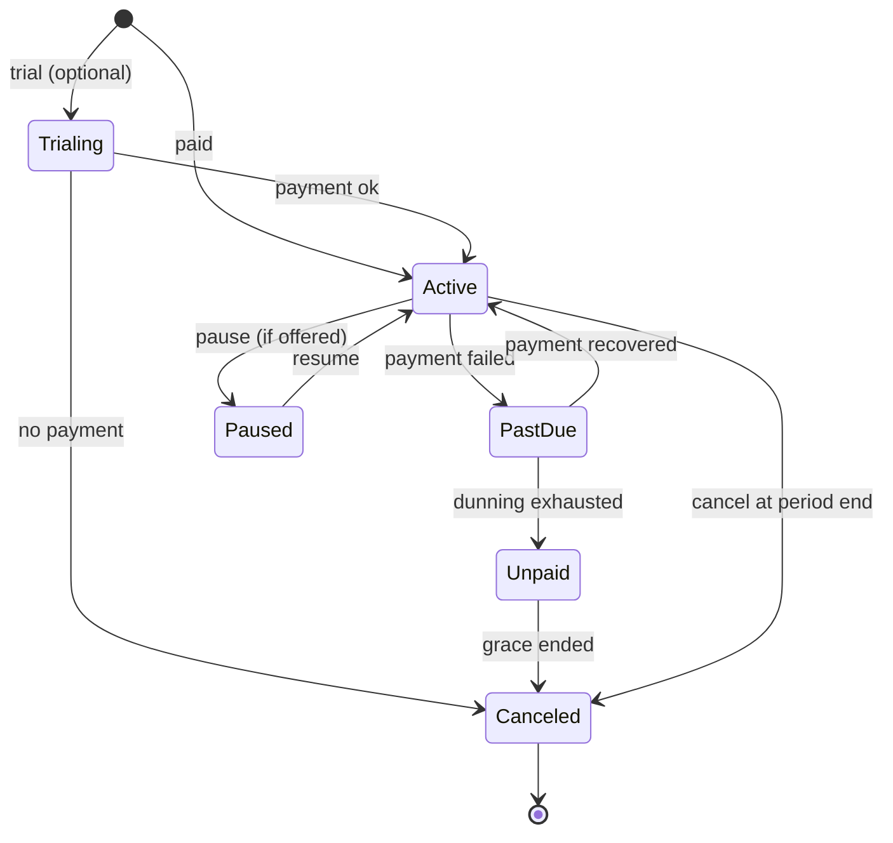

# Target blueprint 19: Business And Commercial Operations

> **Status.** Archive: proposal, not ratified. A greenfield redesign blueprint written in October 2026. Every area was Draft, Under Review or Revision Required (its own document status) and no test was run against it. Its content was mined into `docs/blueprint/`; `SSOT.md` remains the source of intent. Module federation described here was not adopted: the built system is a modular monolith (`ARCHITECTURE.md`).
>
> **What this file holds.** All files of the former `Yash_Final_Project_Document/19_BUSINESS_AND_COMMERCIAL_OPERATIONS/` folder, in order.
>
> **Merged on 2026-11-25** from the files listed below; each one is a section under its original title. Nothing was removed; the originals are in git history at commit `08387ec`.

| Section | Former file |
|---|---|
| Commercial Operations | `Yash_Final_Project_Document/19_BUSINESS_AND_COMMERCIAL_OPERATIONS/COMMERCIAL_OPERATIONS.md` |
| Legacy Pricing, Plans and Entitlements (prior attempt) merged | `Yash_Final_Project_Document/19_BUSINESS_AND_COMMERCIAL_OPERATIONS/LEGACY_PRICING_PRIOR_ATTEMPT.md` |
| Third-Party Marketplace Money Flow: ADR Proposal Outline | `Yash_Final_Project_Document/19_BUSINESS_AND_COMMERCIAL_OPERATIONS/MARKETPLACE_MONEY_FLOW_ADR_PROPOSAL.md` |

## Commercial Operations

_Former file: `Yash_Final_Project_Document/19_BUSINESS_AND_COMMERCIAL_OPERATIONS/COMMERCIAL_OPERATIONS.md`._

Doc ID: COM-OPS · Owner: Head of Commercial Operations (with Finance Ops Lead and Product Director) · Version 1.0 · Status: Draft for Review · Relates: STR-01 §4–§7, DOM-16, DOM-18, DOM-15, ADR-T15, ADR-T20, ADR-T22, INV-T07, INV-T17, INV-T19, BR-T060, PROC-02, PROC-13, FIN-COST, ANL-MET, OPEN-05, OPEN-06, OPEN-18, OPEN-19, OPEN-26, OPEN-33, OPEN-34

**Course commerce scope (REVW-30, binding decision):** Phase 2 sells **first-party (platform-sold) courses only**: the platform is the seller of record, content is authored under contract or licence, and no payout, connected-account or seller-KYC flow exists in the product. A **third-party paid marketplace is deferred to Phase 3** and is gated by an ADR on seller of record, payouts, tax/VAT and refunds (outline in section 13A). Rows below that mention instructors, revenue share or payouts describe the Phase 3 design intent and are **not active in Phase 2**.

All prices, rates, thresholds, durations and revenue-share percentages are **[OPEN]**; none is proposed here. This document defines structures, rules and processes. Tax, consumer-protection and marketing-law questions require qualified advice (OPEN-08, OPEN-18); nothing here is legal advice.

### 1. Commercial guardrails (binding from the product constitution)

| Guardrail                                                            | Source           | Operational consequence                                                                                    |
| -------------------------------------------------------------------- | ---------------- | ---------------------------------------------------------------------------------------------------------- |
| Never rank by payment                                                | ADR-T22, INV-T19 | Entitlements may gate _quotas and tools_, never ranking inputs; sales may not sell "boosted" placement     |
| Core candidate loop is always free: evidence, applying, messaging    | STR-01 §5        | Candidate paywalls limited to premium tools, extra variants, AI quota                                      |
| Redirect success grants nothing                                      | INV-T17          | Support and Sales cannot "manually unlock" bypassing billing state; corrections go through billing actions |
| Free users never cause paid AI inference unless budget policy allows | INV-T07          | AI add-ons are quota products with caps                                                                    |
| Learner owns career identity after graduation                        | STR-01 §5        | Institution contracts cannot claim ownership of learner data; offboarding detaches                         |
| Consent-bound verification services                                  | STR-01 §5        | Bulk verification products require per-person consent flows                                                |
| No autonomous adverse decisions                                      | INV-T09          | No "auto-reject" packaged as a premium feature                                                             |

### 2. Pricing and packaging structure [OPEN-19, OPEN-05]

Entitlement dimensions are fixed by design; **values per tier are placeholders**.

| Segment                                         | Tier (names illustrative) | Price                                                                                                             | Entitlement dimensions                                                                                   | Always included         |
| ----------------------------------------------- | ------------------------- | ----------------------------------------------------------------------------------------------------------------- | -------------------------------------------------------------------------------------------------------- | ----------------------- |
| Candidate                                       | Free                      | none                                                                                                              | evidence, apply, message (consented threads), basic resume variants, basic career insights               | Core loop               |
| Candidate                                       | Plus                      | [OPEN] per period                                                                                                 | extra resume variants, advanced analytics, AI quota [value OPEN], priority exports                       | Core loop               |
| Employer                                        | Team                      | [OPEN] per seat per period                                                                                        | seats, active job slots [N OPEN], verified-search quota [N OPEN], outreach quota [N OPEN], ATS pipelines | Equal ranking treatment |
| Employer                                        | Business                  | [OPEN]                                                                                                            | higher quotas, SSO, audit export, API access (DOM-23, later)                                             | Equal ranking treatment |
| Employer                                        | Enterprise                | [OPEN] custom contract                                                                                            | negotiated quotas, SLA addendum (OPEN-31), DPA, dedicated support                                        | Equal ranking treatment |
| Institution                                     | Cohort                    | [OPEN] per seat/cohort                                                                                            | seats, cohort analytics (k-anonymous), course/assessment authoring                                       | Learner ownership       |
| Institution                                     | Campus                    | [OPEN]                                                                                                            | multi-department, SSO, advanced analytics, API                                                           | Learner ownership       |
| Course commerce (Ph2: first-party courses only) | One-off / path            | [OPEN] set by the platform (Ph2). Instructor-set pricing applies only after the Ph3 marketplace ADR (section 13A) | access to course/path                                                                                    | Refund policy           |
| Verification services (later)                   | Usage-based               | [OPEN]                                                                                                            | bulk employment verification with consent                                                                | Consent-bound           |

Packaging rules: each tier maps to a **plan catalogue entry** with immutable version; changes create a new version with grandfathering rules (OPEN-19); entitlements are computed server-side from subscription state (ADR-T15); quotas reset on defined period boundaries; overage policy (hard stop vs paid add-on) per quota [OPEN-19]; trials and promotional codes: allowed with expiry and abuse limits; **Candidate-facing discounts must not create ranking differences**.

Margin policy: gross margin target is [OPEN-05]; AI quotas are sized from the cost model so each paid tier clears the target (FIN-COST §4).

### 3. Billing operations

| Topic                 | Design                                                                                                                                             |
| --------------------- | -------------------------------------------------------------------------------------------------------------------------------------------------- |
| Processor             | Stripe only (ADR-T15): Checkout for purchase, Customer Portal for self-service, Billing for subscriptions/invoices, webhooks authoritative         |
| Source of truth       | Local subscription/entitlement state derived from verified webhooks; reconciled against Stripe (§7)                                                |
| Objects               | Customer (principal or org), Product/Price (plan catalogue), Subscription, Invoice, Payment method, Credit note, Refund, Dispute                   |
| B2B invoicing         | Org billing contact; invoice terms, purchase-order reference, tax IDs captured; payment by card or invoice terms per Enterprise contract [OPEN-19] |
| Currency              | Supported currencies and display rules [OPEN-18]                                                                                                   |
| Plan changes          | Upgrade immediate with proration rules; downgrade at period end [policy OPEN-19]; seat changes via org admin (PROC-02)                             |
| Idempotency           | All billing writes idempotent (INV-T10); webhook handlers dedupe by event id (TEST-BIL-002)                                                        |
| Records               | Invoices, credit notes and payment records retained per retention list [OPEN-08]; erasure retains required financial records (BR-T060)             |
| PCI scope             | Card data handled only by Stripe-hosted surfaces; platform never sees PAN (reduced scope, ADR-T15)                                                 |
| Customer self-service | View invoices, update payment method, cancel, download receipts via Customer Portal (reduces support load)                                         |



Entitlement mapping: Active/Trialing → plan entitlements; PastDue → full entitlements during grace (length [OPEN-19]) with in-app notice; Unpaid/Canceled → free-tier entitlements; no user data is deleted by billing state (TEST-BIL-004).

### 4. Dunning

| Stage                                                                                                                                                                                                                                      | Trigger                      | Action                                                                           | Customer message                         |
| ------------------------------------------------------------------------------------------------------------------------------------------------------------------------------------------------------------------------------------------ | ---------------------------- | -------------------------------------------------------------------------------- | ---------------------------------------- |
| D0                                                                                                                                                                                                                                         | First failed payment         | Provider smart retries per schedule [OPEN-19]; in-app banner for billing contact | Friendly notice with update-payment link |
| D1                                                                                                                                                                                                                                         | Retry failures continue      | Email billing contact (org: all billing contacts); candidate: email + in-app     | Specific next-retry date and consequence |
| D2                                                                                                                                                                                                                                         | Grace period end approaching | Warning; sales-assist/customer success outreach for B2B above a threshold [OPEN] | Clear date features will downgrade       |
| D3                                                                                                                                                                                                                                         | Dunning exhausted            | Downgrade to free-tier entitlements; keep data; seats suspended not deleted      | What changed, how to restore             |
| D4                                                                                                                                                                                                                                         | Long unpaid                  | Account remains; contract follow-up for Enterprise                               | —                                        |
| Rules: communications are transactional (not marketing) and respect suppression lists; never threaten data deletion contrary to retention policy; keep tone accessible; measure recovery rate (MET-031 area: churn by involuntary reason). |

### 5. Refunds, credits and disputes

| Case                                                                                                                                                                                                                          | Policy structure (values [OPEN-33])                                                                                                                                                                                     | Owner                      | Evidence                    |
| ----------------------------------------------------------------------------------------------------------------------------------------------------------------------------------------------------------------------------- | ----------------------------------------------------------------------------------------------------------------------------------------------------------------------------------------------------------------------- | -------------------------- | --------------------------- |
| Subscription refund within a defined window                                                                                                                                                                                   | Pro-rata or full per rule; Support cannot issue directly                                                                                                                                                                | Finance Ops                | PROC-13                     |
| Course purchase refund                                                                                                                                                                                                        | Rule based on progress/consumption and time since purchase; instructor revenue-share adjustment (OPEN-06) applies only after the Ph3 marketplace ADR; in Ph2 the platform is the seller and no payout adjustment exists | Finance Ops + Content Ops  | Enrolment progress data     |
| Duplicate/accidental charge                                                                                                                                                                                                   | Immediate refund                                                                                                                                                                                                        | Finance Ops                | Provider record             |
| Service failure credit                                                                                                                                                                                                        | Credit note per SLA addendum (Enterprise)                                                                                                                                                                               | Customer Success + Finance | Incident record             |
| Chargeback                                                                                                                                                                                                                    | Respond within provider deadline with evidence package                                                                                                                                                                  | Finance Ops                | Scoped access/delivery logs |
| Abuse/fraud                                                                                                                                                                                                                   | Refuse or reverse per fraud decision (PROC-06)                                                                                                                                                                          | T&S + Finance              | Case file                   |
| Refund execution changes billing state; entitlements follow via webhook (INV-T17). All refunds audited (`audit.billing.refund_issued`). Consumer-rights obligations vary by region and are determined with counsel (OPEN-08). |

### 6. Tax [OPEN-18]

| Question                                                                      | Options                                                                                                                | Decision owner    |
| ----------------------------------------------------------------------------- | ---------------------------------------------------------------------------------------------------------------------- | ----------------- |
| Who is the seller of record and which jurisdictions are in scope at launch    | Direct seller with a tax-calculation service; merchant-of-record provider; restrict sales to limited regions initially | Finance + Legal   |
| Calculation                                                                   | Provider tax engine (e.g. Stripe Tax-class) vs separate tax service vs manual for B2B                                  | Finance           |
| Collection and remittance, VAT/GST registration thresholds, invoicing formats | Determined with tax advisor                                                                                            | Finance           |
| B2B tax IDs and reverse charge                                                | Capture and validate tax IDs at checkout and in org settings                                                           | Finance           |
| Education/course specifics                                                    | Varies by region; advisor input                                                                                        | Finance + Legal   |
| Display                                                                       | Tax-inclusive vs exclusive pricing by region                                                                           | Product + Finance |
| No tax rates or thresholds are stated in this documentation.                  |

### 7. Reconciliation

| Reconciliation                                                                                                                                 | Frequency                     | Compares                                         | Output             | Action                                                         |
| ---------------------------------------------------------------------------------------------------------------------------------------------- | ----------------------------- | ------------------------------------------------ | ------------------ | -------------------------------------------------------------- |
| Entitlement vs subscription                                                                                                                    | Continuous job + daily report | Local entitlements vs Stripe subscription status | Drift list         | Auto-repair through audited billing action; unresolved → RB-34 |
| Payments vs invoices vs ledger                                                                                                                 | Daily/monthly                 | Stripe balance transactions vs finance ledger    | Breaks list        | Finance investigates                                           |
| Payouts (instructor revenue share): **Ph3 only, not active in Ph2**                                                                            | Per payout cycle              | Course sales vs payable amounts                  | Payout statements  | Approval before payout [OPEN-06]                               |
| Refunds/chargebacks                                                                                                                            | Weekly                        | Provider events vs support tickets               | Exceptions         | PROC-13                                                        |
| Tax                                                                                                                                            | Per filing cycle              | Tax collected vs reported                        | Tax report         | Finance/advisor                                                |
| Webhook completeness                                                                                                                           | Daily                         | Provider event log vs processed events           | Missing event list | Replay (idempotent)                                            |
| Targets: reconciliation breaks resolved within a set period [OPEN-16]; unexplained breaks are escalated to Finance lead. Outputs feed MET-032. |

### 8. Vendor management and vendor risk register

Process: vendor intake (security + privacy review, DPA/sub-processor listing, data-flow diagram, exit plan) → approval → inventory → annual review → offboarding (data return/deletion proof). Every vendor sits behind a **port** (ADR-T20, ADR-T12, ADR-T15) so replacement is feasible. Vendor SLAs and contracts are recorded; credit claims tracked. Sub-processor list is maintained and published as legally required (OPEN-34).

| ID                                                                                                      | Vendor / category                                      | Data shared                                                      | Criticality                        | Key risks                                                                       | Mitigation / port                                                                                                                                | Exit plan                                                                                 | Owner             |
| ------------------------------------------------------------------------------------------------------- | ------------------------------------------------------ | ---------------------------------------------------------------- | ---------------------------------- | ------------------------------------------------------------------------------- | ------------------------------------------------------------------------------------------------------------------------------------------------ | ----------------------------------------------------------------------------------------- | ----------------- |
| VR-01                                                                                                   | Stripe (payments)                                      | Customer identifiers, payment metadata (no card data held by us) | High (revenue)                     | Outage; webhook delays; account hold; dispute handling; processor concentration | Webhook-authoritative design; reconciliation; last-known-entitlement; contingency account preparation [OPEN]                                     | Alternate processor integration is out of launch scope (ADR-T15); data export from Stripe | Finance Ops       |
| VR-02                                                                                                   | Email provider (Brevo default)                         | Recipient email, message content                                 | High (verification, referee flows) | Deliverability, outage, account suspension, compliance of marketing sends       | Provider port; transactional vs marketing separation [OPEN-26]; breaker; secondary provider option                                               | Swap provider via port; DKIM/SPF re-setup runbook                                         | Messaging owner   |
| VR-03                                                                                                   | Push services (browser vendors' Web Push)              | Subscription endpoints                                           | Medium                             | iOS constraints; endpoint expiry                                                | Fallback to email/in-app; pruning                                                                                                                | n/a                                                                                       | Messaging owner   |
| VR-04                                                                                                   | AI model provider(s)                                   | Prompts/outputs (minimise personal data)                         | Medium–High                        | Cost overrun, data retention at vendor, model change, outage, policy violations | AI gateway only path (ADR-T12); budgets; data minimisation; no-training/no-retention terms where available [OPEN-24]; multi-provider abstraction | Switch via gateway                                                                        | AI owner          |
| VR-05                                                                                                   | Hosting / cloud / managed Postgres                     | All data                                                         | Critical                           | Region outage, account compromise, HA gaps, lock-in                             | Hosting decision matrix (OPS-DEP §6); IaC; off-account backups                                                                                   | Rebuild in alternate provider from IaC + backups (T5)                                     | SRE Lead          |
| VR-06                                                                                                   | CDN / edge                                             | Public assets, request metadata                                  | High                               | Outage, cache poisoning, config error                                           | Embedded fallback manifest; second origin; signed manifests                                                                                      | Change CDN via DNS/IaC                                                                    | Platform          |
| VR-07                                                                                                   | Observability vendor (if SaaS)                         | Telemetry (redacted)                                             | Medium                             | Data leakage, cost, outage                                                      | Redaction at collector; OTel portability (ADR-T16)                                                                                               | Re-point exporters                                                                        | SRE               |
| VR-08                                                                                                   | Identity providers for customer SSO                    | Auth assertions                                                  | Medium                             | IdP outage; misconfiguration                                                    | Break-glass; SAML/OIDC validation tests                                                                                                          | n/a (customer's)                                                                          | Identity owner    |
| VR-09                                                                                                   | Malware scanning engine                                | Uploaded files                                                   | High (BR-T003)                     | Detection gaps; outage                                                          | Scanner behind port; fail closed                                                                                                                 | Swap engine                                                                               | Platform          |
| VR-10                                                                                                   | Proctoring / identity-verification vendor (if adopted) | Biometric/ID data (sensitive)                                    | High                               | Privacy, bias, retention, accuracy                                              | Vendor-gated, consent, human review, DPIA-style review (OPEN-10, OPEN-28)                                                                        | Disable feature                                                                           | Product + Privacy |
| VR-11                                                                                                   | Support tooling (helpdesk)                             | Ticket contents (PII)                                            | Medium                             | Data exposure; retention                                                        | Redaction, access control, retention config (OPEN-38)                                                                                            | Export tickets                                                                            | Support Lead      |
| VR-12                                                                                                   | Status page provider                                   | Incident text                                                    | Medium                             | Co-failure with primary                                                         | Independent hosting                                                                                                                              | Static fallback page                                                                      | SRE               |
| VR-13                                                                                                   | Feature-flag / config provider (if bought)             | Flag state, user keys                                            | Medium                             | Outage → default values                                                         | Safe defaults, local cache (OPEN-35)                                                                                                             | Re-implement via Postgres flags                                                           | Release Eng       |
| VR-14                                                                                                   | Source control / CI / package registries               | Source, secrets in CI                                            | Critical                           | Supply chain compromise                                                         | Signed artefacts, SBOM, scoped tokens (OPS-REL §6)                                                                                               | Mirror repos                                                                              | Release Eng       |
| Vendor risks are linked into the RISK_REGISTER (RISK-13…RISK-20). Concentration risk assessed annually. |

### 9. Procurement and seat licensing for institutions

| Step                                                                                                                                                                                                                        | Description                                                                                                                                                                          | Owner              |
| --------------------------------------------------------------------------------------------------------------------------------------------------------------------------------------------------------------------------- | ------------------------------------------------------------------------------------------------------------------------------------------------------------------------------------ | ------------------ |
| 1 Lead & qualification                                                                                                                                                                                                      | Intake form, use case (cohort outcomes), data-sharing expectations, SSO/LMS needs                                                                                                    | Sales-assist       |
| 2 Security & privacy review                                                                                                                                                                                                 | Questionnaire, DPA, sub-processor list, accessibility conformance statement (OPEN-37), data residency (OPEN-30), minors policy (OPEN-09)                                             | Security + Privacy |
| 3 Proposal                                                                                                                                                                                                                  | Package from plan catalogue: seat definition (active learner vs enrolled), cohort size, term, support level                                                                          | Commercial Ops     |
| 4 Contract                                                                                                                                                                                                                  | MSA/order form; DPA; learner-ownership clause; termination/offboarding; SLA addendum if any (OPEN-31)                                                                                | Legal              |
| 5 Provisioning                                                                                                                                                                                                              | PROC-02: tenant, roles, SSO, cohort import with consent flows                                                                                                                        | Customer Success   |
| 6 Seat management                                                                                                                                                                                                           | Seat states: invited → active → graduated (detached, keeps account) → released; seat counting rule and true-up cadence [OPEN-19]; org admin sees usage; overage handling by contract | Customer Success   |
| 7 Invoicing                                                                                                                                                                                                                 | PO references, invoice terms, tax IDs, renewal calendar                                                                                                                              | Finance Ops        |
| 8 Renewal / offboarding                                                                                                                                                                                                     | Usage and outcomes report; renewal; offboarding with learner data detachment, export offered, retention per OPEN-08                                                                  | Customer Success   |
| Procurement artefacts requested by institutions (security whitepaper, VPAT-like accessibility report, uptime history) are produced from this documentation set and real evidence — never from claims that are not yet true. |

### 10. Marketing consent and lifecycle messaging

| Topic                | Rule                                                                                                                                                                                                                 |
| -------------------- | -------------------------------------------------------------------------------------------------------------------------------------------------------------------------------------------------------------------- |
| Consent model        | Purpose-bound, versioned, revocable (INV-T15): separate purposes for transactional (no consent needed but limited to service), product updates, marketing/promotions, research/surveys, partner offers (default off) |
| Capture              | Unbundled checkboxes (no pre-ticked), record timestamp, wording version, source; double opt-in option [OPEN-26]                                                                                                      |
| Preference centre    | In `mf-account` (MOD-ACC); one-click unsubscribe in every non-transactional email; suppression honoured across providers                                                                                             |
| Lifecycle programmes | Onboarding nudges for activation (evidence in first 7 days), re-engagement, employer onboarding, renewal reminders — all **respect consent** and avoid dark patterns (ANL-MET §7)                                    |
| Frequency limits     | Per-user caps and quiet hours; no streak-shaming, no fake urgency, no manipulative guilt copy                                                                                                                        |
| Data use             | No use of sensitive attributes for targeting; no use of private job-search activity for marketing                                                                                                                    |
| Referral programme   | Rewards never affect ranking; abuse controls (PROC-06)                                                                                                                                                               |
| Deliverability       | Authenticated sender domains, bounce/complaint handling, list hygiene (RB-15)                                                                                                                                        |
| Regulatory           | Region-specific rules on marketing consent (counsel; OPEN-08)                                                                                                                                                        |
| Metrics              | Opt-in rate by purpose, unsubscribe rate, complaint rate, activation lift with holdout (ANL-MET)                                                                                                                     |

### 11. Sales-assist (light, not a CRM build)

Scope: inbound lead capture for employers and institutions, qualification, demo scheduling, trial provisioning (time-limited tenants with synthetic or consented data), quote generation from the plan catalogue, hand-off to Customer Success. Tooling: buy a lightweight CRM/helpdesk integration instead of building (FIN-COST §7). Guardrails: no promises of ranking advantages; no commitments outside contract templates; discount authority matrix [OPEN-19]; lead data follows consent and retention rules.

### 12. Customer success

| Activity          | Practice                                                                                                                                           | Measure                                                     |
| ----------------- | -------------------------------------------------------------------------------------------------------------------------------------------------- | ----------------------------------------------------------- |
| Onboarding        | Guided setup checklist for orgs (roles, SSO, first job, import)                                                                                    | Time to first successful hire workflow step (MET-010 input) |
| Health indicators | Seat utilisation, jobs posted, evidence views under consent, time-to-shortlist, support tickets — aggregated, no individual candidate surveillance | Org health band (low/med/high) with defined inputs [OPEN]   |
| Business reviews  | Periodic outcome review for institutions (cohort activation, skill coverage with k-anonymity)                                                      | MET-021                                                     |
| Escalations       | Named contact for Enterprise; incident liaison                                                                                                     | Response per contract                                       |
| Feedback loop     | Structured feedback feeding product backlog and OPEN_DECISIONS                                                                                     | Themes per quarter                                          |
| Expansion/renewal | Based on value delivered; no dark patterns                                                                                                         | Net revenue retention (MET-031 group)                       |

### 13. Content operations for courses

| Stage                                                                                                                                            | Process                                                                                                                                                                                  | Controls                                                                             |
| ------------------------------------------------------------------------------------------------------------------------------------------------ | ---------------------------------------------------------------------------------------------------------------------------------------------------------------------------------------- | ------------------------------------------------------------------------------------ |
| Instructor onboarding (Ph2: authors engaged under contract or licence by the platform; payout setup and seller KYC arrive only with the Ph3 ADR) | Application, identity and credential check proportionate to risk, payout setup (OPEN-06, Ph3), terms                                                                                     | Verification that the instructor owns the content; conflict-of-interest declarations |
| Authoring                                                                                                                                        | Course studio drafts; media upload through scanning (BR-T003)                                                                                                                            | Draft-only until review                                                              |
| Review & publish                                                                                                                                 | Checklist: accuracy, accessibility (captions, transcripts, contrast), skill tagging against taxonomy (DOM-04), assessment design (AI policy flags, integrity mode), licensing/IP, safety | Reviewer ≠ author; reject with reasons; version history                              |
| Skill mapping                                                                                                                                    | Course completion produces evidence at a defined rung per rule (course evidence verified by instructor/authority per ADR-T14)                                                            | Evidence rules validated before publish                                              |
| Catalogue quality                                                                                                                                | Ratings (verified-enrolment only), outcome signals (completion→evidence rate), staleness review cadence                                                                                  | Takedown on quality/safety (PROC-05)                                                 |
| Pricing & promotions                                                                                                                             | Ph2: platform sets price [OPEN-19]. Ph3: instructor sets price within platform rules [OPEN-06, OPEN-19]                                                                                  | Refund policy visible pre-purchase                                                   |
| Payouts (Ph3 only)                                                                                                                               | Statement per cycle, reconciliation (§7), tax forms where applicable (OPEN-18)                                                                                                           | Dual approval                                                                        |
| Takedowns & disputes                                                                                                                             | Copyright/safety reports → PROC-05; learner refunds → PROC-13                                                                                                                            | Audit trail                                                                          |
| Institution content                                                                                                                              | Institution-owned courses scoped to tenant (INV-T03)                                                                                                                                     | Institution reviewers                                                                |
| Build vs buy: authoring tools stay minimal; video hosting/transcoding bought (FIN-COST §7).                                                      |

Evidence rule that applies in both phases (REVW-12): a course's `authority_verified` evidence carries `issuer_class` (instructor-issued attestations are never platform-verified, require instructor different from learner, and are revocable). Revenue share must never create an incentive to inflate completions: Ph3 payout statements exclude completions flagged by the independence checks.

### 13A. Third-party marketplace money flow: ADR proposal outline (Ph3, REVW-30) [TARGET]

**Status:** outline only. No money-flow decision is made here. The governance agent assigns the ADR number (working title ADR-MKT; carries the next free `ADR-Tnn`). Phase 2 does not depend on it because Ph2 sells first-party courses only.

| Section of the ADR                        | Content to be decided (all values [OPEN])                                                                                                                                                                                                                                                                                                         |
| ----------------------------------------- | ------------------------------------------------------------------------------------------------------------------------------------------------------------------------------------------------------------------------------------------------------------------------------------------------------------------------------------------------- |
| Context                                   | Paid third-party courses need a money flow no current ADR designs (ADR-T15 covers Stripe Checkout, Portal and webhook for platform-sold products only). Related: STR-01 section 5, OPEN-06, OPEN-18, SM-ENROLMENT t8/t9, WP-BILLING-STRIPE                                                                                                        |
| Decision drivers                          | Legal and tax exposure, instructor trust, fraud (self-purchase, wash enrolment), operational load on Finance Ops, cost envelope row E18 in FIN-COST section 11                                                                                                                                                                                    |
| Question 1: seller of record              | Platform as seller (resale or licence model) versus instructor as seller with the platform as marketplace facilitator versus a merchant-of-record provider. Consequence for invoices, consumer-rights liability, refunds                                                                                                                          |
| Question 2: payouts                       | Connected accounts via the payment provider versus manual payouts from accounts payable. Payout cycle, hold period, minimum, currency, refund-adjusted and chargeback-adjusted payouts, negative balances, reversal path. Capabilities of the chosen provider must be verified from provider documentation with a date; they are not assumed here |
| Question 3: seller identity               | Instructor KYC and sanctions screening proportionate to risk; account recovery; who may receive money; relation to the independence checks of REVW-12 (instructor different from learner, issuer independence)                                                                                                                                    |
| Question 4: tax                           | VAT or sales-tax collection and remittance responsibility by jurisdiction, tax forms collection and storage, B2B tax IDs, reporting. Needs a tax advisor (OPEN-18); no rates or thresholds stated                                                                                                                                                 |
| Question 5: refunds and disputes          | Refund policy visible before purchase, who funds a refund, effect on payout and on awarded evidence (a refunded enrolment must not leave a revocable attestation unreviewed), dispute evidence package                                                                                                                                            |
| Question 6: content rights and moderation | Licence terms, takedown path (PROC-05), pre-publication review (section 13), liability                                                                                                                                                                                                                                                            |
| Question 7: data protection               | Controller and processor roles between platform, instructor and provider; what learner data an instructor sees (aggregate only unless consented)                                                                                                                                                                                                  |
| Options to compare                        | A: stay first-party only (status quo, no ADR needed). B: provider-hosted connected accounts. C: merchant-of-record provider. D: manual payouts. Each option carries cost row E18 and an operations-load estimate from Finance Lead                                                                                                                |
| Evidence required before acceptance       | Counsel opinion (OPEN-08, OPEN-18); dated provider quotes in FIN-COST section 11; a fraud and abuse threat model entry (14_*/THREAT_MODEL); Ph2 first-party operating data on refunds, disputes and reconciliation breaks (MET-032)                                                                                                               |
| Consequences to size                      | New SM-ENROLMENT and SM-SUBSCRIPTION transitions or a payout state machine; new BRs; new webhook handlers; reconciliation rows (section 7); additional billing/payout tests beyond the current TEST-BIL-001…008 catalog (future IDs unassigned); support runbooks (RB-34 successors)                                                              |
| Gate                                      | Ph3 marketplace work package starts only after the ADR is accepted by the Architecture Review Board                                                                                                                                                                                                                                               |

Until the ADR is accepted, any feature, screen, API or test that assumes instructor payouts, seller-of-record logic for third parties or instructor-set pricing is out of scope and must not appear in Phase 1 or Phase 2 launch registries.

### 14. Open items

| Item                                                                      | Ref              |
| ------------------------------------------------------------------------- | ---------------- |
| Pricing, quotas, grace periods, grandfathering                            | OPEN-19, OPEN-05 |
| Tax model and jurisdictions                                               | OPEN-18          |
| Refund/dispute limits and policy                                          | OPEN-33          |
| Instructor revenue share (Ph3, behind the marketplace ADR in section 13A) | OPEN-06, REVW-30 |
| Sub-processors and DPAs                                                   | OPEN-34          |
| Email separation/providers                                                | OPEN-26          |
| Contractual SLA                                                           | OPEN-31          |

### 15. Reference implementation snapshot (2026-10-24) [REF]

This dated snapshot comes from `docs/PRICING.md` and describes a tested/code-referenced state of the existing application, not target pricing or a market recommendation. The source itself says prices await founder sign-off and lack market research or cost support. Target values in §§2–14 remain `[OPEN]` until approved; do not import this table as target policy.

| As-coded plan        | Audience           | Monthly / annual USD |              AI quota per day | Active jobs |
| -------------------- | ------------------ | -------------------: | ----------------------------: | ----------: |
| Free                 | Candidates         |              $0 / $0 |     5 requests / 5,000 tokens |         n/a |
| Candidate Pro        | Professionals      |     $19.99 / $199.90 |  50 requests / 100,000 tokens |         n/a |
| Recruiter Starter    | Small hiring teams |           $99 / $990 |   25 requests / 50,000 tokens |           5 |
| Recruiter Enterprise | High-volume hiring |        $299 / $2,990 | 200 requests / 500,000 tokens |       1,000 |

The source reports these enforcement and limitations: AI quota follows the acting user's stored subscription; Starter job caps are enforced per organization on create/status-change; failed/unpaid/canceled subscriptions map to free access; free recruiters can post without a cap; advertised advanced analytics, resume variations, showcase visibility, workspace seats and Deep Talent Graph were not gated or implemented. AI usage metering is in process memory and resets on restart; publish serialization is process-local; downgrade does not unpublish existing jobs. Live payment/checkout/webhook delivery was not exercised, and the webhook route was not registered pending a public HTTPS API URL. Source-named integration tests are recorded there but were not re-run for this blueprint.

The six Stripe `price_*` and three `prod_*` identifiers listed in the source are test-mode configuration evidence only; they are intentionally not reproduced here because they are account-specific and are not part of the target product contract. The source says no live products were created. Plan changes in that implementation use new immutable Stripe prices, update environment mappings, archive old prices, and add domain/API-level enforcement tests.

OPEN-19 covers pricing/quotas/grace, while organization-versus-acting-user billing ownership remains an explicit unresolved design question. The snapshot does not resolve either decision or override the proposed first-party-only Phase 2 scope.

### Merged from legacy: `31_LEGACY_ARCHIVE/docs/PRICING.md` (full data in `LEGACY_PRICING_PRIOR_ATTEMPT.md`)

The complete prior plan table (four plans, monthly/yearly prices, AI quotas, active-job limits), the six `STRIPE_PRICE_*` variable names with their prior test-mode identifiers, the enforcement list, the safe plan-change procedure and the prior review notes are preserved in `LEGACY_PRICING_PRIOR_ATTEMPT.md` (COM-LEG-01). The paragraph above that omits the Stripe identifiers is not contradicted: COM-LEG-01 keeps them as reference data only, with a warning that they belong to a prior account. Open items: OPEN-19, OPEN-LGA-17, OPEN-LGA-18.

### 16. Tax scope and entitlement enforcement (patch 2026-10-27, PROPOSED)

| Statement                                 | Detail                                                                                                                                                                                                                                                                                                                                                                                                                                                                                                                                         |
| ----------------------------------------- | ---------------------------------------------------------------------------------------------------------------------------------------------------------------------------------------------------------------------------------------------------------------------------------------------------------------------------------------------------------------------------------------------------------------------------------------------------------------------------------------------------------------------------------------------- |
| Tax rules are out of scope and unverified | This documentation states no tax rate, threshold, registration rule, invoice format or remittance duty, and none should be inferred from it. Seller of record, jurisdictions, calculation and invoicing are open (OPEN-18, section 6) and need a qualified tax advisor and counsel verification before any price is shown or charged                                                                                                                                                                                                           |
| Entitlement is enforced server-side       | Plan, quota and feature access are decided by the API and billing state machine from durable billing state, never by hiding or showing UI. A client that is modified, cached offline or replaying an old response gains nothing. Actions that spend money or quota or export data read entitlement from the primary (0 s staleness; see `../14_SECURITY_PRIVACY_COMPLIANCE/SECURITY_ARCHITECTURE.md` R3-2); read-only gating may use a short cache. Webhook handling is idempotent (TEST-BIL-010). The UI mirrors entitlement for clarity only |
| AI is not an enforcer                     | Pricing, refund, entitlement and tax outcomes are deterministic code; AI may draft explanations only (SECURITY_ARCHITECTURE.md R3-7)                                                                                                                                                                                                                                                                                                                                                                                                           |

## Legacy Pricing, Plans and Entitlements (prior attempt) merged

_Former file: `Yash_Final_Project_Document/19_BUSINESS_AND_COMMERCIAL_OPERATIONS/LEGACY_PRICING_PRIOR_ATTEMPT.md`._

Doc ID: COM-LEG-01 · Owner: Head of Commercial Operations (with Finance Ops Lead and Product Director) · Version 1.0 · Status: Draft for Review · Relates: `COMMERCIAL_OPERATIONS.md` (COM-OPS section 2 pricing and packaging), `MARKETPLACE_MONEY_FLOW_ADR_PROPOSAL.md`, OPEN-05, OPEN-18, OPEN-19, OPEN-33, `../06_BUSINESS_PROCESSES/LEGACY_BR_CATALOGUE_BR001_BR248.md`, `../24_RISKS_AND_DECISIONS/OPEN_DECISIONS_LEGACY_MERGE.md`, `../00_CONTROL_CENTRE/LEGACY_MERGE_LEDGER_A.md`

Supersedes nothing; linked from `../00_CONTROL_CENTRE/LEGACY_MERGE_LEDGER_A.md` and `MASTER_INDEX`. Created under the standing instruction: "i dont want to loos information keep everything in use untile it get improved".

### Merged from legacy: `31_LEGACY_ARCHIVE/docs/PRICING.md`

### 0. Frame and conflict with the target

| Item                  | Statement                                                                                                                                                                                                                                                                                                                                                                                                      |
| --------------------- | -------------------------------------------------------------------------------------------------------------------------------------------------------------------------------------------------------------------------------------------------------------------------------------------------------------------------------------------------------------------------------------------------------------- |
| Implementation status | **Nothing is implemented.** The prior attempt reported plan definitions in code, a Stripe test-mode catalogue and some enforcement tests. None of that exists in this project.                                                                                                                                                                                                                                 |
| Status of the numbers | The prior attempt itself said: prices are **recommendations awaiting founder sign-off** (its decision "OD-34, price TBD"); **no market research or cost model backs them**. They are inputs to OPEN-19, not decisions.                                                                                                                                                                                         |
| Conflict with target  | `COMMERCIAL_OPERATIONS.md` section 2 deliberately proposes **no prices** (all [OPEN]) and uses different tier names (Free, Plus; Team, Business, Enterprise; Cohort, Campus). Both are kept. The legacy tier names, numbers and quotas below are a candidate starting point only. Decision: OPEN-19 (pricing, packaging, quotas), OPEN-05 (margin), OPEN-LGA-17 (reconcile tier names and the legacy numbers). |
| Currency              | The prior attempt was USD-only. Currency and tax are open (OPEN-18).                                                                                                                                                                                                                                                                                                                                           |

### 1. Prior plan table (all numbers preserved)

Prices in US dollars; the prior attempt stored USD minor units (cents).

| Plan                 | Audience           | Monthly | Yearly  | AI chat per day               | Active jobs |
| -------------------- | ------------------ | ------- | ------- | ----------------------------- | ----------- |
| Free                 | Candidates         | $0      | $0      | 5 requests / 5,000 tokens     | n/a         |
| Candidate Pro        | Professionals      | $19.99  | $199.90 | 50 requests / 100,000 tokens  | n/a         |
| Recruiter Starter    | Small hiring teams | $99     | $990    | 25 requests / 50,000 tokens   | 5           |
| Recruiter Enterprise | High-volume hiring | $299    | $2,990  | 200 requests / 500,000 tokens | 1,000       |

- Yearly price = **10 months'** price (two months free).
- No trials, add-ons or usage billing existed.
- Monetisation integrity invariant (prior "section 64", function `validateMonetizationIntegrity`): **no plan buys credibility, hiring rank, assessment bypass or private evidence.** Target equivalents: ADR-T22 and INV-T19 (never rank by payment), INV-T07, INV-T17 (redirect success grants nothing).
- Marketing copy and per-plan limits were meant to live in one place together, with a unit test failing if AI copy and AI limits drifted (target requirement: plan catalogue entry has an immutable version, `COMMERCIAL_OPERATIONS.md` section 2).

#### Mapping to target tiers (candidate, for OPEN-19)

| Legacy plan          | Nearest target tier                                               | Differences to decide                                                                        |
| -------------------- | ----------------------------------------------------------------- | -------------------------------------------------------------------------------------------- |
| Free                 | Candidate Free                                                    | Legacy AI quota 5 requests/day; target AI quota open                                         |
| Candidate Pro        | Candidate Plus                                                    | Legacy $19.99/$199.90; target open                                                           |
| Recruiter Starter    | Employer Team                                                     | Legacy flat team price with 5 active jobs; target is per seat per period with job slots open |
| Recruiter Enterprise | Employer Business/Enterprise                                      | Legacy 1,000 active jobs, $299; target Enterprise is custom contract                         |
| (none)               | Institution Cohort/Campus, course commerce, verification services | The prior plan table had no institution, course or verification line                         |

### 2. Where plans lived in the prior attempt (requirement: one source)

| Concern                                                          | Prior location (reference only)                                                                | Target requirement                                                                             |
| ---------------------------------------------------------------- | ---------------------------------------------------------------------------------------------- | ---------------------------------------------------------------------------------------------- |
| Plans, prices (USD minor units), marketing copy, per-plan limits | A single billing module in the shared domain package (`PLATFORM_PLANS`, `getPlanEntitlements`) | One plan catalogue; versioned (COM-OPS section 2)                                              |
| Effective access from stored subscription (active/trialing only) | `effectiveEntitlements` in a Stripe-billing module                                             | Entitlements derived server-side from subscription state only (ADR-T15; legacy BR-056)         |
| AI quota derived from entitlements (no second table)             | `AI_QUOTA_LIMITS`, `aiQuotaForEntitlements`                                                    | Same: AI quota is an entitlement dimension, not a separate store                               |
| Posting limit                                                    | `assertCanPublishAnotherJob`                                                                   | Enforced by a domain function called by the route, with an API-level test that bypasses the UI |
| Stripe price mapping                                             | six `STRIPE_PRICE_*` environment variables                                                     | See section 4                                                                                  |
| Public catalogue and per-user state                              | `GET /api/v1/billing/plans`; `GET /api/v1/billing/subscription`                                | Candidate API paths; the target API catalogue is authoritative                                 |

### 3. Enforcement rules the prior attempt reported (as target requirements)

| Rule                                                                                                                             | Prior status                                                                                                 | Target requirement                                                                                                                                                                      |
| -------------------------------------------------------------------------------------------------------------------------------- | ------------------------------------------------------------------------------------------------------------ | --------------------------------------------------------------------------------------------------------------------------------------------------------------------------------------- |
| AI chat quota follows the stored subscription; HTTP 402 when exceeded                                                            | Reported enforced by an integration test                                                                     | Requirement; response code to be aligned with the target API error model (RFC 9457)                                                                                                     |
| Recruiter Starter: maximum 5 published jobs per organisation, checked on create and on status change                             | Reported enforced by direct API tests                                                                        | Requirement; check on both transitions                                                                                                                                                  |
| Paid access only from verified Stripe state; failed/unpaid/canceled collapses to free                                            | Reported enforced                                                                                            | Requirement (INV-T17)                                                                                                                                                                   |
| Duplicate, stale and forged Stripe webhooks handled                                                                              | Reported covered by integration tests                                                                        | Requirement: signed, idempotent, ordered-tolerant webhooks (legacy BR-032, BR-115)                                                                                                      |
| `hasAdvancedAnalytics`, "unlimited resume variations", "priority showcase visibility", multi-seat workspace, "Deep Talent Graph" | **Listed in plan copy but not gated or not implemented** in the prior attempt                                | **Do not sell until each is implemented and gated.** Note "priority showcase visibility" conflicts with the never-rank-by-payment rule if it affects discovery rank; review before use. |
| Free recruiters (no subscription) posting jobs                                                                                   | Unlimited in the prior attempt; policy undecided; the posting limit deliberately ignored non-recruiter tiers | Open: OPEN-LGA-18 (free-employer posting policy)                                                                                                                                        |

### 4. Stripe catalogue created in the prior attempt (test mode only; reference data)

Created 2026-10-24 in the prior account's **test mode** (`livemode:false`); each price carried a `lookup_key` and `plan_tier` metadata. These are test-mode identifiers (not secrets) from the earlier account and **must not be assumed to exist for this project**; they are preserved so the mapping (variable name to plan and cycle) is not lost.

| Environment variable                        | Plan and cycle               | Prior test-mode price id         |
| ------------------------------------------- | ---------------------------- | -------------------------------- |
| `STRIPE_PRICE_CANDIDATE_PRO_MONTHLY`        | Candidate Pro monthly        | `price_1UU4BXQrKkHLd2iB9CO3UBKk` |
| `STRIPE_PRICE_CANDIDATE_PRO_YEARLY`         | Candidate Pro yearly         | `price_1UU4BYQrKkHLd2iBxM57fYMV` |
| `STRIPE_PRICE_RECRUITER_STARTER_MONTHLY`    | Recruiter Starter monthly    | `price_1UU4BZQrKkHLd2iBd8RfXUF3` |
| `STRIPE_PRICE_RECRUITER_STARTER_YEARLY`     | Recruiter Starter yearly     | `price_1UU4BaQrKkHLd2iBdg6j10x9` |
| `STRIPE_PRICE_RECRUITER_ENTERPRISE_MONTHLY` | Recruiter Enterprise monthly | `price_1UU4BbQrKkHLd2iBQc7WxwhI` |
| `STRIPE_PRICE_RECRUITER_ENTERPRISE_YEARLY`  | Recruiter Enterprise yearly  | `price_1UU4BcQrKkHLd2iB53hLfihE` |

Prior test-mode products: `prod_VV4KkfaSHb0Frj` (Candidate Pro), `prod_VV4K2x3G9kR1Lk` (Recruiter Starter), `prod_VV4Kd7dtezjlpr` (Recruiter Enterprise).

Prior limits stated: nothing live was created; no payment, checkout or webhook delivery was exercised against Stripe. The webhook endpoint (`/api/v1/billing/stripe-webhook`) was not registered until a public HTTPS API URL existed; the signing secret belongs in the deployment environment, **never in chat or git**. Free-plan (Free) has no price variable. Target: payments provider choice and tax/merchant-of-record model are OPEN-18; do not reuse these identifiers without checking the account they belong to.

### 5. Changing a plan safely (prior procedure; carried over as target process)

1. Edit the plan catalogue (limits and marketing copy together; a unit test fails if AI copy and AI limits drift).
2. Create a **new** payment-provider price (prices are immutable), update the environment variable, archive the old price.
3. Enforce any new limit through a domain function called by the route, with an API-level test that bypasses the UI.

Target alignment: matches COM-OPS plan catalogue versioning and grandfathering (OPEN-19). Governance link: a commercial/entitlement change was change class C7 in the prior governance model and required founder approval (see `../24_RISKS_AND_DECISIONS/OPEN_DECISIONS_LEGACY_MERGE.md`, legacy governance).

### 6. Prior open decisions and review notes (carried over; each is an open item here)

| Item                                  | Statement                                                                                                                                                                                                                                                                                                                       | Id                                                                                                                                                                        |
| ------------------------------------- | ------------------------------------------------------------------------------------------------------------------------------------------------------------------------------------------------------------------------------------------------------------------------------------------------------------------------------- | ------------------------------------------------------------------------------------------------------------------------------------------------------------------------- |
| Price approval                        | Founder approval of the prices above; USD only                                                                                                                                                                                                                                                                                  | OPEN-19, OPEN-18                                                                                                                                                          |
| Free-recruiter posting                | Which policy for unsubscribed employers; which advertised features to build or drop                                                                                                                                                                                                                                             | OPEN-LGA-18                                                                                                                                                               |
| Plans page UI (prior)                 | A plans page shown only when the server reported checkout enabled, listing features from the plans API, with a monthly/yearly toggle; the browser sent only plan and cycle; it showed the user's current plan and today's AI usage (read-only) with a limit-reached prompt; no comparison table; not exercised in a running app | Requirement candidate for the billing screens (`../07_UI_UX_AND_DESIGN_SYSTEM/SCREEN_REGISTRY.md`): **the client sends plan and cycle only; price comes from the server** |
| Payment provider gaps                 | Webhook registration, upgrade/downgrade proration, trials                                                                                                                                                                                                                                                                       | OPEN-19, OPEN-33                                                                                                                                                          |
| Verification                          | No live billing verified                                                                                                                                                                                                                                                                                                        | n/a                                                                                                                                                                       |
| AI quota lowering (review 2026-10-24) | Prior values were reduced to match the entitlement table: free 20 to 5, Candidate Pro 500 to 50, Enterprise 5,000 to 200 requests/day (tokens 1M to 500k). The prior note said to confirm before any paying customer exists                                                                                                     | OPEN-24, OPEN-19                                                                                                                                                          |
| Acting user vs organisation           | Prior entitlements followed the **acting user's** subscription, not the organisation's: a free-plan member of a paying organisation was not capped, and downgrades did not unpublish existing jobs. Organisation-level billing owner was an open product decision                                                               | OPEN-LGA-18                                                                                                                                                               |
| Durability of quota meter             | The prior AI usage meter lived in process memory (reset on restart, not shared across instances) so quotas were not durable                                                                                                                                                                                                     | Target requirement: quota counters are durable and shared (database or cache with persistence); see ADR-T15 and the AI gateway budget design                              |
| Concurrency                           | Publishes were serialised per organisation in a single process; a second instance would need a database-level guard                                                                                                                                                                                                             | Target requirement: job-slot limit enforced with a database-level guard (for example locked counter or constraint), not process-local locks                               |

### 7. Legacy rules that touch pricing (cross-reference; text in the BR catalogue)

BR-007 (billing actions for recruiters only; conflicts with a candidate plan), BR-032 and BR-115 (subscription and course purchases webhook-owned and idempotent), BR-055 (changes at period boundary or prorated), BR-056 (entitlements from active subscription only), BR-099 (coupon floor), BR-100 (refund 30 days; conflict with target BR-T097, OPEN-33), BR-101 (instructor earnings = 70% of net revenue after platform commission, configurable; target Phase 2 sells first-party courses only, so payouts are deferred), BR-129/BR-130 (outreach credits and weekly caps; conflict with BR-T081), BR-195 (paid expert calls, transparent fee), BR-205 (API access requires enterprise tier).

<!-- ledger-D D-03 -->

### Merged from legacy: 31_LEGACY_ARCHIVE/docs/PRICING.md (gap closure D-03)

Frame: nothing is implemented in this project. The prior attempt reported or required the items below; earlier merges condensed them away. They are quoted verbatim from the archived source (`L<n>` = source line number) as reference evidence about the prior attempt only. Quoted code paths, commands, hashes, counts and URLs are not facts about this project. Source file stays unchanged in the archive. Closed under the standing instruction: "i dont want to loos information keep everything in use untile it get improved".

Named by the preservation audit: prior-code pointers `PaidPlans.tsx`, `plan-limits-domain`, `activeJobPostingLimit`, `packages/domain/src/stripe-billing.ts`, `tests/integration/plan-enforcement.test.ts` (lines 12-14, 32-41, 64-91 including the 'Enforced by' column).

```text
L8: ## Where plans live (one source)
L9:
L10: | Concern | Location |
L11: |---|---|
L12: | Plans, prices (USD minor units), marketing copy, per-plan limits | `packages/domain/src/billing.ts` (`PLATFORM_PLANS`, `getPlanEntitlements`) |
L13: | Effective access from stored subscription (active/trialing only) | `effectiveEntitlements` in `packages/domain/src/stripe-billing.ts` |
L14: | AI quota (derived from entitlements, no second table) | `AI_QUOTA_LIMITS`, `aiQuotaForEntitlements` in `ai-gateway.ts` |
[...]
L32: ## Enforcement status (verified by tests)
L33:
L34: | Rule | Status |
L35: |---|---|
L36: | AI chat quota follows the stored subscription (402 when exceeded) | **Enforced** (`tests/integration/plan-enforcement.test.ts`) |
L37: | Recruiter Starter: max 5 published jobs per organisation, on create and on status change | **Enforced** (same test, direct API calls) |
L38: | Paid access only from verified Stripe state; failed/unpaid/canceled = free | **Enforced** (`effectiveEntitlements`, `stripe-billing` tests) |
L39: | Duplicate / stale / forged Stripe webhooks | **Covered** by `tests/integration/stripe-billing.test.ts` |
L40: | `hasAdvancedAnalytics`, "unlimited resume variations", "priority showcase visibility", multi-seat workspace, Deep Talent Graph | **Listed in plan copy, not gated or not implemented.** Do not sell until each is implemented and gated. |
L41: | Free recruiters (no subscription) posting jobs | **Unlimited today.** Policy undecided; `activeJobPostingLimit` deliberately ignores non-recruiter tiers. |
L42:
[...]
L64: ## Changing a plan safely
L65:
L66: 1. Edit `PLATFORM_PLANS` / `getPlanEntitlements` (limits and copy together; the
L67:    unit test `plan-limits-domain` fails if AI copy and limits drift).
L68: 2. Create a **new** Stripe price (prices are immutable), update the env var,
L69:    archive the old price.
L70: 3. Enforce any new limit through a domain function called by the route, with an
L71:    API-level test that bypasses the UI.
L72:
L73: ## Open decisions and not done
L74:
L75: - Founder approval of the prices above; currency is USD only.
L76: - Free-recruiter posting policy; which advertised features to build or drop.
L77: - Frontend: `PaidPlans.tsx` (shown only when the server reports Stripe checkout
L78:   enabled) now lists each plan's features from `/billing/plans` and has a
L79:   monthly/yearly toggle; the browser sends the plan and cycle only. It also shows the signed-in user's current plan and today's AI usage (read from
L80:   `/billing/subscription` and `/ai/usage`, display only) with a limit-reached
L81:   prompt. It has no comparison table yet, and was not exercised in
L82:   a running app (needs Stripe test config).
L83: - Stripe: webhook registration, upgrade/downgrade proration, trials.
L84: - Not verified: any live billing.
L85:
L86: ## Review notes (2026-10-24)
L87:
L88: - AI quota values were aligned to the entitlement table: free 20 to 5, Candidate Pro 500 to 50, Enterprise 5,000 to 200 requests/day (tokens 1M to 500k). This lowers limits that were previously generous; confirm before any paying customer exists.
L89: - Entitlements follow the **acting user's** subscription, not the organisation's. A free-plan member of a paying organisation is not capped, and downgrades do not unpublish existing jobs. Deciding an organisation-level billing owner is an open product decision.
L90: - The AI usage meter is in process memory (ephemeral): it resets on restart and is not shared between API instances, so quotas are not durable.
L91: - Publishes are serialised per organisation in the API process; a second API instance would need a database-level guard.
```

<!-- ledger-D D-22 -->

### Merged from legacy: 31_LEGACY_ARCHIVE/docs/reports/STRIPE_SUPABASE_AUDIT_2026-10-23.md (gap closure D-22)

Frame: nothing is implemented in this project. The prior attempt reported or required the items below; earlier merges condensed them away. They are quoted verbatim from the archived source (`L<n>` = source line number) as reference evidence about the prior attempt only. Quoted code paths, commands, hashes, counts and URLs are not facts about this project. Source file stays unchanged in the archive. Closed under the standing instruction: "i dont want to loos information keep everything in use untile it get improved".

Named by the preservation audit: access-limit lines 9-10 ('gh' not installed, GitHub connector not authorised, no TODO/FIXME markers found, no credentials used) and the `FIXME` token.

```text
L7: ## Access limits
L8:
L9: - GitHub issues and PRs: not reachable. `gh` is not installed and the GitHub connector is not authorized. Only commit history, `docs/reports/` and in-code markers were reviewed. No `TODO`/`FIXME` markers were found in `apps`, `packages` or `supabase`.
L10: - Stripe and Supabase projects: not inspected. No credentials were used. Stripe code ran only against fake gateways.
L11: - Not run: `pnpm test:pg` (needs `TEST_DATABASE_URL`), Playwright e2e, Reticle (no UI change).
```

<!-- ledger-D D-18 -->

### Merged from legacy: 31_LEGACY_ARCHIVE/docs/reports/PAYMENT_AUDIT_2026-10-23.md (gap closure D-18)

Frame: nothing is implemented in this project. The prior attempt reported or required the items below; earlier merges condensed them away. They are quoted verbatim from the archived source (`L<n>` = source line number) as reference evidence about the prior attempt only. Quoted code paths, commands, hashes, counts and URLs are not facts about this project. Source file stays unchanged in the archive. Closed under the standing instruction: "i dont want to loos information keep everything in use untile it get improved".

Named by the preservation audit: root-cause cells of P-1..P-6, baseline/after test numbers (4 failed / 5 passed; 42 / 42), the TS2345 text, `billingEventsByIdempotency`, `invoicesById`, `invoicesByUserId`, `${t}.${rawBody}`, evidence limit for P-3..P-5 (line 51).

```text
L7: ## Scope and what exists
L8:
L9: TalentSphere has **no Stripe or other payment-processor integration** (`CLAUDE.md`, `docs/reports/FEATURE_STATUS_2026-10-21.md`, issue #50). Billing is an in-memory scaffold in `apps/api/src/server.ts` (`/api/v1/billing/*`) over pure rules in `packages/domain/src/billing.ts`, plus an HMAC-signed generic webhook. Supabase Auth is not used (self-issued HMAC session tokens). Tables from `00014_billing_subscriptions_schema.sql` exist, but the API does not read or write them.
L10:
L11: Adding a processor is a product decision (O-02 / X-03) and needs new dependencies in the protected `package.json`, so it was **not** attempted. This audit fixed the defects in the billing code that exists.
L12:
L13: ## Access limits
L14:
L15: - GitHub issues, PRs and discussions: not reachable (the session token is invalid; the issues API needs write-level attachment, which was not requested). Issue #50 is known only from `FEATURE_STATUS_2026-10-21.md`. No other GitHub issue was reviewed.
L16: - Stripe and Supabase projects: not inspected. No Stripe account or Supabase project is wired into the repo.
L17: - Not run: `pnpm test:pg` (needs `TEST_DATABASE_URL`), Playwright e2e, and the Reticle browser verification. The changes have no UI surface.
L18:
L19: ## Issue register
L20:
L21: | ID  | Pri | Defect (verified)                                                                                                                                                                                         | Root cause                                                                                                          | Fix                                                                                                                                                                                    | Status                           |
L22: | --- | --- | --------------------------------------------------------------------------------------------------------------------------------------------------------------------------------------------------------- | ------------------------------------------------------------------------------------------------------------------- | -------------------------------------------------------------------------------------------------------------------------------------------------------------------------------------- | -------------------------------- |
L23: | P-1 | P1  | `packages/domain` failed `tsc` (`TS2345: '"PAYMENT_REQUIRED"' is not assignable to DomainErrorCode`), breaking `pnpm build`/`typecheck`                                                                    | `createSubscription` threw a code missing from the `DomainErrorCode` union                                          | Added `PAYMENT_REQUIRED` to the union; mapped to HTTP 402 in the API error handler                                                                                                     | Fixed and verified               |
L24: | P-2 | P1  | `BILLING_MODE=simulated` was broken: `/billing/subscribe` for a paid tier returned 422, so 4 integration tests failed (subscribe, invoices, cancel, worker jobs)                                           | Route allowed simulated paid plans, but the domain constructor refused every paid tier unconditionally              | `createSubscription` takes `allowSimulatedPayment` (default `false`); the route passes it only when `BILLING_MODE === 'simulated'`. Production config still refuses simulated mode    | Fixed and verified               |
L25: | P-3 | P2  | A subscription scheduled to cancel at period end never ended: paid state and entitlements persisted forever                                                                                               | Nothing applied elapsed time to `cancelAtPeriodEnd`                                                                 | New domain `settleSubscription`; the route settles on `GET /subscription` and `POST /cancel` and drops entitlements to free                                                            | Fixed; unit-verified (see below) |
L26: | P-4 | P2  | Repeating a period-end cancel overwrote `canceledAt`                                                                                                                                                      | `cancelSubscription` had no idempotency for an already-scheduled cancel                                             | Repeat is a no-op returning the same object; immediate cancel still allowed                                                                                                            | Fixed and verified               |
L27: | P-5 | P2  | Reusing an idempotency key with a different plan or cycle returned the first request's result as a 200 "duplicate"                                                                                        | Duplicate detection matched the key only                                                                            | Compare the requested catalog amount with the stored invoice; mismatch returns 409 `CONFLICT`                                                                                          | Fixed and verified               |
L28: | P-6 | P2  | Account erasure left billing data behind: `invoicesById` and `billingEventsByIdempotency` (carrying `userId`) were not purged                                                                             | Erasure deleted `invoicesByUserId` only                                                                             | Erasure now removes the user's invoices from `invoicesById` and their billing events                                                                                                   | Fixed; not covered by a test     |
L29:
L30: ## Reviewed and left unchanged (no defect, or needs a decision)
L31:
L32: - Webhook signature: HMAC-SHA256 over `${t}.${rawBody}` using the raw bytes, 5-minute tolerance, timing-safe compare, and refusal when no secret is configured. Sound for the generic scheme. It is **not** Stripe's `Stripe-Signature` format.
L33: - Webhook idempotency is in-memory (`billingEventsByIdempotency`), so replays after a restart are reprocessed, and the handler records the event but changes no entitlements. This is acceptable only while billing is disabled. A real integration needs durable `billing_events` writes keyed by the provider event id.
L34: - `billing_events.idempotency_key` and `invoices.idempotency_key` are globally `UNIQUE` in SQL, while the in-memory check is per-user. Persisting as-is would let two users collide on one key. Scope the key per user when persisting.
L35: - Webhook `userId` is not checked for existence. This would violate the `billing_events` foreign key once persisted.
L36: - Plan `targetRole` is not enforced on subscribe, so any role can pick any plan in simulated mode. Left alone: the role-to-plan rule is not defined in the registries, and inventing it would be a new requirement.
L37: - Entitlements are not consumed outside the billing routes (F-61: "no gating").
L38:
L39: ## Verification (run in a scratch copy, because `AGENTS.md` forbids installs and builds that write protected files in the repo)
L40:
L41: | Check                                                                                  | Result                             |
L42: | -------------------------------------------------------------------------------------- | ---------------------------------- |
L43: | Baseline `tests/integration/billing.test.ts`                                           | 4 failed / 5 passed                |
L44: | Baseline `pnpm --filter ./packages/* build`                                            | `packages/domain` failed (`TS2345`) |
L45: | After fixes: packages build                                                            | all pass                           |
L46: | After fixes: `tsc -b` and `tsc -p tests`                                               | pass                               |
L47: | After fixes: billing integration, billing domain, production-config                    | 42 / 42 pass                       |
L48: | After fixes: `vitest run` (full)                                                       | 115 files, 1182 tests pass         |
L49: | Prettier on all changed files                                                          | pass                               |
L50:
L51: Evidence of "fails before, passes after": P-1 and P-2 were observed failing at baseline. P-3, P-4 and P-5 tests were written after the fix and were **not** run against the unfixed code. P-3 is verified at the domain level only; there is no HTTP-level test because the session token would expire under the clock jump needed.
L52:
L53: ## Changed files
L54:
L55: - `packages/domain/src/core.ts`, `packages/domain/src/billing.ts`
L56: - `apps/api/src/server.ts`
L57: - `tests/unit/billing-domain.test.ts`, `tests/integration/billing.test.ts`
L58:
L59: No protected build file was modified.
```

## Third-Party Marketplace Money Flow: ADR Proposal Outline

_Former file: `Yash_Final_Project_Document/19_BUSINESS_AND_COMMERCIAL_OPERATIONS/MARKETPLACE_MONEY_FLOW_ADR_PROPOSAL.md`._

Doc ID: COM-MKT - Owner: Finance Lead with Chief Product Officer - Version 1.0 - Status: Proposal outline, not decided - Date 2026-10-25 - Relates: COM-OPS, FIN-COST, FIN-ENV, ADR-T15, STR-01 section 5, OPEN-06, OPEN-08, OPEN-18, SM-ENROLMENT t8 and t9, WP-BILLING-STRIPE, REVW-12, REVW-30

**Relationship statement:** this file supersedes nothing. It is the additive record of the REVW-30 decision in `27_INDEPENDENT_REVIEWS/REVIEW_RESOLUTION_DECISIONS.md`. `COMMERCIAL_OPERATIONS.md` section 13A holds the same outline from an earlier in-place edit, together with in-place Phase 2 scope notes in its sections 2, 5, 7 and 13. If the owner reverts those edits, this file stands alone.

**No decision is made here.** The governance agent assigns the ADR number (working title ADR-MKT; it takes the next free `ADR-Tnn`). All values are [OPEN]. Nothing here is legal or tax advice (OPEN-08, OPEN-18).

### 1. Binding scope decision (from REV-RES)

1. **Phase 2 sells first-party (platform-sold) courses only.** The platform is the seller of record; authors are engaged under contract or licence; the product contains no payout, connected-account, seller-KYC or instructor-pricing flow.
2. **A third-party paid marketplace is deferred to Phase 3** and starts only after this ADR is accepted by the Architecture Review Board.
3. Until acceptance, no feature, screen, API, event, state transition or test that assumes instructor payouts, third-party seller-of-record logic or instructor-set pricing may appear in a Phase 1 or Phase 2 launch registry. `TEST-BIL-009` (in `16_*/TEST_CATALOG.md#record-test-catalog-rev2`) checks this.
4. Revenue share (OPEN-06) is a Phase 3 question. In Phase 2 any fee paid to an author is an ordinary contract payment outside the product.

### 2. Proposed ADR outline

| ADR section                               | What must be decided (all values [OPEN])                                                                                                                                                                                                                                                                                                         |
| ----------------------------------------- | ------------------------------------------------------------------------------------------------------------------------------------------------------------------------------------------------------------------------------------------------------------------------------------------------------------------------------------------------ |
| Title                                     | ADR-MKT: Money flow for third-party paid courses                                                                                                                                                                                                                                                                                                 |
| Status                                    | Proposed                                                                                                                                                                                                                                                                                                                                         |
| Context                                   | Paid third-party courses need a money flow that no accepted ADR designs. ADR-T15 covers a single payment processor with hosted checkout, customer portal and signed webhook for platform-sold products only. Open questions already recorded in OPEN-06 (revenue share) and OPEN-18 (tax)                                                        |
| Decision drivers                          | Legal and tax exposure; instructor trust; fraud (self-purchase, wash enrolment); load on Finance Ops; cost envelope row E18 in `21_*/COST_ENVELOPE.md`; the integrity of the evidence ladder (REVW-12)                                                                                                                                           |
| Question 1: seller of record              | Platform as seller (resale or licence model), versus instructor as seller with the platform as marketplace facilitator, versus a merchant-of-record provider. Consequences for invoices, consumer-rights liability, refund responsibility                                                                                                        |
| Question 2: payouts                       | Connected accounts at the payment provider, versus manual payouts from accounts payable. Payout cycle, hold period, minimum amount, currency, treatment of refunds and chargebacks (negative balances, clawback), reversal path. Provider capabilities must be verified from the provider's documentation with a date; they are not assumed here |
| Question 3: seller identity               | KYC and sanctions screening proportionate to risk; recovery of a seller account; who may receive money; link to the independence rules of REVW-12 (instructor different from learner, issuer independence, revocability)                                                                                                                         |
| Question 4: tax                           | Who collects and remits VAT or sales tax, by jurisdiction; collection and storage of tax forms; B2B tax identifiers; reporting. Requires a tax advisor. No rates or thresholds are stated in this documentation                                                                                                                                  |
| Question 5: refunds and disputes          | Refund policy visible before purchase; who funds a refund; effect on payout and on awarded evidence (a refunded enrolment must not leave a revocable attestation unreviewed); dispute evidence package                                                                                                                                           |
| Question 6: content rights and moderation | Licence terms, takedown path (PROC-05), pre-publication review, liability                                                                                                                                                                                                                                                                        |
| Question 7: data protection               | Controller and processor roles between platform, instructor and payment provider; what learner data an instructor can see (aggregate only unless the learner consents)                                                                                                                                                                           |
| Question 8: anti-gaming                   | Revenue share must not reward inflated completions: payout statements exclude completions flagged by the independence checks (instructor equals learner, shared account, device or payment-instrument signal)                                                                                                                                    |
| Options to compare                        | A: stay first-party only (status quo; no ADR needed). B: provider-hosted connected accounts. C: merchant-of-record provider. D: manual payouts. Each option carries a cost row (E18) and an operations-load estimate from Finance Lead                                                                                                           |
| Evidence required before acceptance       | Counsel opinion (OPEN-08, OPEN-18); dated provider quotes in `COST_ENVELOPE.md`; a fraud and abuse entry in the threat model; Phase 2 operating data on refunds, disputes and reconciliation breaks (MET-032)                                                                                                                                    |
| Consequences to size                      | New or extended state machines (SM-ENROLMENT, SM-SUBSCRIPTION, a payout machine); new business rules; webhook handlers; reconciliation rows (`COMMERCIAL_OPERATIONS.md` section 7); tests from TEST-BIL-010 onward; support runbooks; data-model changes                                                                                         |
| Revisit trigger                           | Business demand for third-party instructors that first-party content cannot meet, together with an accepted answer to every question above                                                                                                                                                                                                       |
| Gate                                      | The Phase 3 marketplace work package may start only after acceptance                                                                                                                                                                                                                                                                             |

### 3. Items for the governance agent

| Item           | Action                                                                                                                                  |
| -------------- | --------------------------------------------------------------------------------------------------------------------------------------- |
| ADR number     | Assign the next free `ADR-Tnn` to ADR-MKT; register it as Proposed in `ADR_REGISTER.md`                                                 |
| OPEN-06        | Re-tag as Phase 3, blocking only the marketplace work package                                                                           |
| OPEN-18        | Keep open; Phase 2 first-party sales still need a seller-of-record and tax answer for the platform itself                               |
| Roadmap        | Confirm `WP-BILLING-STRIPE` Phase 2 scope is first-party checkout only; add a Phase 3 marketplace work package that depends on this ADR |
| Capability map | `FEAT-08-09` stays deferred; any third-party commerce feature is Phase 3                                                                |
