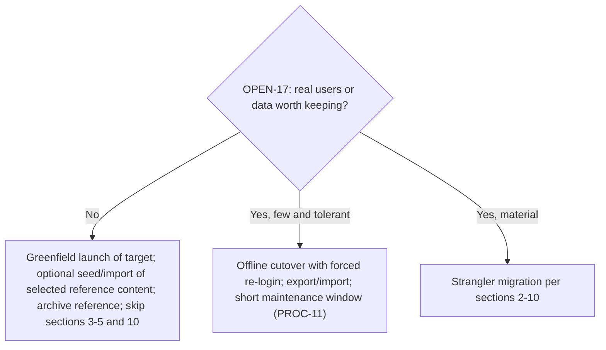
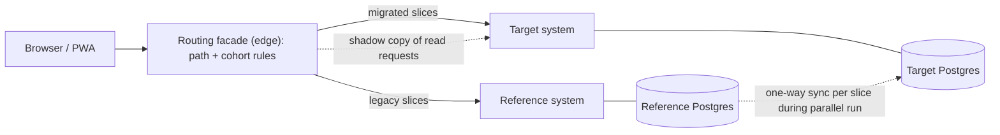

# Target blueprint 23: Migration And Evolution

> **Status.** Archive: proposal, not ratified. A greenfield redesign blueprint written in October 2026. Every area was Draft, Under Review or Revision Required (its own document status) and no test was run against it. Its content was mined into `docs/blueprint/`; `SSOT.md` remains the source of intent. Module federation described here was not adopted: the built system is a modular monolith (`ARCHITECTURE.md`).
>
> **What this file holds.** All files of the former `Yash_Final_Project_Document/23_MIGRATION_AND_EVOLUTION/` folder, in order.
>
> **Merged on 2026-11-25** from the files listed below; each one is a section under its original title. Nothing was removed; the originals are in git history at commit `08387ec`.

| Section | Former file |
|---|---|
| Legacy Merge B-23a: Conflict Register CF-01..CF-45 (Prior Attempt) with Target Disposition and Consolidated Conflict Index | `Yash_Final_Project_Document/23_MIGRATION_AND_EVOLUTION/LEGACY_MERGE_CONFLICT_REGISTER.md` |
| Legacy Merge B-23b: Prior-Attempt Inventory, Feature-Status Claims, Domain Module Map and Removed Sample Data | `Yash_Final_Project_Document/23_MIGRATION_AND_EVOLUTION/LEGACY_MERGE_INVENTORY_AND_COVERAGE.md` |
| Migration and Evolution Plan (reference system to target) | `Yash_Final_Project_Document/23_MIGRATION_AND_EVOLUTION/MIGRATION_AND_EVOLUTION_PLAN.md` |
| Reference-to-Target Data Migration Note | `Yash_Final_Project_Document/23_MIGRATION_AND_EVOLUTION/REFERENCE_TO_TARGET_DATA_MIGRATION.md` |

## Legacy Merge B-23a: Conflict Register CF-01..CF-45 (Prior Attempt) with Target Disposition and Consolidated Conflict Index

_Former file: `Yash_Final_Project_Document/23_MIGRATION_AND_EVOLUTION/LEGACY_MERGE_CONFLICT_REGISTER.md`._

Doc ID: LGM-B-23A · Owner: Architecture Review Board secretary (with Migration Lead) · Version 1.0 · Status: Draft for Review · Supersedes nothing · Relates: MIG-01, MIG-DATA-01, DEC-OPEN, DEC-ADR, TRC-04, OPEN-17, OPEN-43, OPEN-44, OPEN-48, OPEN-50, OPEN-52 · Ledger: `../00_CONTROL_CENTRE/LEGACY_MERGE_LEDGER_B.md`

Preservation instruction (project owner, verbatim): "i dont want to loos information keep everything in use untile it get improved".

Merged from legacy: `31_LEGACY_ARCHIVE/docs/system-model/03-conflict-register.md` (12.8 KB; 7 resolved and 21 open conflicts in the register, plus decision records and the 2026-10-23 reconciliation), `.../system-model/00-index.md`, and the finding rows of `06-route-authorization.md` (CF-31..CF-45, merged in `../14_SECURITY_PRIVACY_COMPLIANCE/LEGACY_MERGE_ROUTE_AUTHORIZATION_FINDINGS.md`).

### 0. Frame

- **These conflicts are about an earlier attempt.** They compare that attempt's code, documents and tests; they are not conflicts in this project. They matter here because (a) each is a _defect class_ the new build must avoid, (b) each states a _decision that was left to an owner_ which this project must now take, and (c) the register's method is worth keeping.
- Legacy vocabulary (kept): status **Verified** (fixed and the check passed), **Confirmed** (re-read and holds), **Reported** (investigator read it; not independently re-read), **Open - decision needed** (owner required; the agent rules said escalate, not guess), **Blocked** (external access or approval missing). Severity: **P0** security or financial integrity, **P1** broken core behaviour, **P2** integrity or reliability gap, **P3** documentation or minor.
- Method kept as a pattern (system-model index): change a diagram in the same commit as the code it describes; re-check a `path:line` before relying on it (lines drift); add every new contradiction to the register instead of silently fixing a document. **Target requires** the same discipline in this repository once code exists: contradictions go to a register (`24_RISKS_AND_DECISIONS`), not into silent edits.
- Prior system-model index (preserved): six files - inventory and coverage; flows F1 to F7; conflict register (7 resolved and 21 open); condition matrix (62 rules); route authorization (second coverage pass, about 170 more routes, 6 fixes, 15 further findings CF-31 to CF-45); audit (completeness audit, traceability sample, commands, limitations). Recommended reading order for a new engineer: flows (F1, then the flow you work on), then conditions, then the conflict register "for what to distrust". In this blueprint the equivalents are: flows -> `../25_DIAGRAM_LIBRARY/LEGACY_MERGE_DIAGRAMS.md`; conditions -> `../16_QA_AND_TESTING/LEGACY_MERGE_CONDITION_MATRIX.md`; conflicts -> this file; route authorization -> `../14_SECURITY_PRIVACY_COMPLIANCE/LEGACY_MERGE_ROUTE_AUTHORIZATION_FINDINGS.md`; audit -> `../16_QA_AND_TESTING/LEGACY_MERGE_TESTING_STRATEGY.md`; inventory -> `LEGACY_MERGE_INVENTORY_AND_COVERAGE.md`.
- "Council" method of the prior attempt (five independent read-only investigators plus a lead re-check plus an adversarial pass; no investigator could approve a change; decisions marked "needs owner" were **not** approved) is recorded verbatim below. It is a lesson in evidence quality: agent consensus is not an approval (see testing file section 6).

### 1. Target disposition for each prior-attempt conflict (CF-01..CF-30)

"Target handling" states the rule the new build follows; "Decision" cites an existing OPEN id or a local id raised in Ledger B files.

| ID           | Prior conflict (short)                                                                                                                                      | Prior status                                                 | Target handling                                                                                                                                       | Decision / owner                               |
| ------------ | ----------------------------------------------------------------------------------------------------------------------------------------------------------- | ------------------------------------------------------------ | ----------------------------------------------------------------------------------------------------------------------------------------------------- | ---------------------------------------------- |
| CF-01        | API served invented people and demand (60 transitions, market signals, baseline signals in forecast routes)                                                 | Verified fixed (P1)                                          | **Hard rule: no fabricated records presented as real.** Seed only reference data (skill taxonomy, feature-flag defaults); tests create their own data | none (rule adopted; add to PR checklist)       |
| CF-02        | Benchmark "at least 20 people" rule counted rows, so one person's 20 moves published their own salary change                                                | Verified fixed (P1)                                          | Cohort rules count **distinct people**                                                                                                                | OPEN-25 (k policy)                             |
| CF-03        | Constant retention rate 88.5 and a data source that was never collected                                                                                     | Verified fixed (P2)                                          | No statistic without a collected source; metric catalog cites source per metric                                                                       | Analytics Lead                                 |
| CF-04        | Sample course, sample challenge and 35 invented learner outcomes (80% hire rate) loaded at boot                                                             | Verified fixed (P1)                                          | Same as CF-01                                                                                                                                         | none                                           |
| CF-05        | Erasure could not finish after the payment provider had already deleted the customer (retry got `resource_missing`, returned 503)                           | Verified fixed (P2)                                          | Idempotent erasure steps: "already deleted" = success                                                                                                 | saga design (DB-03)                            |
| CF-06        | Checkout for a customer already linked to another account hit a unique constraint; provider retried for days                                                | Verified fixed (P3)                                          | Ignore with audit record; acknowledge provider                                                                                                        | INT-01                                         |
| CF-07        | Refund matched to subscription by time only (found by automated review)                                                                                     | Verified fixed (P1)                                          | Resolve via invoice payments; fail safe when unresolved                                                                                               | OPEN-33 for policy                             |
| CF-10        | Referee token never expired though text implied it did                                                                                                      | Fixed (P2): 30 days                                          | 14-day expiry in target diagram; owner may change                                                                                                     | L-B15-03                                       |
| CF-11        | Email-ownership check matched domain only when role had a company with a website                                                                            | Confirmed, open (P1)                                         | Decide rule; never rely on candidate-entered domain                                                                                                   | L-B14-05 (OPEN-48)                             |
| CF-12        | Any signed-in account could post a market signal                                                                                                            | Fixed (P2): admin only                                       | Public statistics fed only by authorized sources                                                                                                      | Product                                        |
| CF-13        | Hosted managed-database: migrations referenced the provider's `auth.users` while the app kept users in `public.users`; policies keyed on provider functions | Confirmed, blocked (P1)                                      | Application-owned identity; never FK to provider schema                                                                                               | OPEN-14; hosted gate (database file section 6) |
| CF-14        | Any organization membership authorized job management and applicant moves                                                                                   | Reported, open (P2)                                          | Organization-role RBAC                                                                                                                                | OPEN-44                                        |
| CF-15        | Job approval described by SSOT, but code let the recruiter self-approve, allowed draft->published, and had no moderation state                              | Reported, open (P2)                                          | Decide whether approval is required; model in SM-JOB                                                                                                  | L-B14-13                                       |
| CF-16        | Org owner without `recruiter` role passed the route check, refused by the domain layer                                                                      | Reported (P3)                                                | One role check in one place                                                                                                                           | OPEN-44                                        |
| CF-17        | Architecture document claimed no DB client, no payments, no session revocation; code had all three                                                          | Reported (P3) -> resolved as documentation change 2026-10-23 | Docs updated in the same change as code (rule above)                                                                                                  | none                                           |
| CF-18        | Architecture doc said registration assigns from the 10-role union; code accepted two roles                                                                  | Reported (P3) -> doc fixed                                   | Self-registration role set stated once                                                                                                                | OPEN-44                                        |
| CF-19        | Docs mentioned a "banned" status; user-status type had `active`, `pending_verification`, `suspended`, `deactivated`                                         | Reported (P3) -> clarified                                   | Account status set defined once (SM-ACCOUNT); sanction states explicit                                                                                | Domain Architect                               |
| CF-20        | Admin check also accepted string `admin`; hiring list included `employer`; neither in the role union                                                        | Confirmed (P3)                                               | Closed role enum; no string literals outside it                                                                                                       | none                                           |
| CF-21        | Domain layer silently fell back to a random per-process key when the secret was short; config layer rejected short secrets                                  | Reported (P3), corrected by adversarial review               | Fail closed on weak/missing secret in every deployed environment, single validator used by API and worker                                             | Security Architect                             |
| CF-22        | Reference statuses `declined` and `flagged` existed but nothing set them; referee could not decline                                                         | Reported (P3)                                                | Decide whether a referee can decline or flag                                                                                                          | **L-B23-01** (Product Director)                |
| CF-23        | Background-job enqueue errors logged and swallowed                                                                                                          | Reported (P2)                                                | Transactional outbox                                                                                                                                  | INV-T12                                        |
| CF-24        | Job reclaim after lease expiry did not check `attempts`                                                                                                     | Reported (P3)                                                | Reclaim checks attempts                                                                                                                               | ADR-T09                                        |
| CF-25        | UI offered application drafts and job alerts while memory-only                                                                                              | Reported (P2)                                                | Durable                                                                                                                                               | ADR-T05                                        |
| CF-26        | Settings offered email/digest toggles with no sending; privacy page claimed k >= 10, Laplace noise, purge within 30 days without implementation             | Reported (P2)                                                | Claims register                                                                                                                                       | L-B10-02                                       |
| CF-27        | Interview code evaluation simulated (result depends on text of the code); second placeholder for challenge submissions                                      | Confirmed, open (P1)                                         | Sandbox runner or `unverified`                                                                                                                        | OPEN-27 (ADR-T13)                              |
| CF-28        | Several routes had no navigation link; public challenge list while assessments guarded                                                                      | Reported (P3)                                                | Route registry                                                                                                                                        | L-B10-04                                       |
| CF-29        | Layout read `.roles` from stored user whose type declared `role` (compiled via index signature)                                                             | Reported, speculative (P3)                                   | Typed session object                                                                                                                                  | none                                           |
| CF-30        | Concurrent checkouts could both be paid; disputes and voided invoices unhandled; webhook shared the global rate limit                                       | Confirmed, open (P2)                                         | Specify supersession and dispute policy; own webhook rate class                                                                                       | L-B13-02                                       |
| CF-31..CF-45 | Route authorization findings                                                                                                                                | Open                                                         | See the 14b file section 2 (target requirement per finding)                                                                                           | OPEN-44, OPEN-48, OPEN-50                      |

#### 1.1 Decision records of the prior attempt (kept as history)

- CF-01..CF-04: options were keep as demo, label as sample, or remove; **decision: remove** - "A figure about people shown without a source misstates the product; ... nothing is called implemented without evidence. Honest empty states replace it." Approval recorded: requested by the owner in that attempt's goal ("only dummy, mock, sample, fake things ... remove all").
- CF-02: count rows vs count people; **count people** (k-anonymity protects individuals). Within the agent authority (defect fix).
- CF-07: time window vs resolve the payment to its subscription; **resolve through invoice payments and fail safe when unresolved**; owner chose "refund revokes access".
- CF-10, CF-11, CF-12, CF-14, CF-15, CF-27, CF-30: **no decision made** in the prior attempt; each changes security architecture, schema or product behaviour. **This project must decide them** (see disposition column).

### 2. Consolidated index of conflicts and decisions raised by Ledger B merge files

All ids are local to the files listed; owners are suggestions for the ARB secretary to confirm. "Existing OPEN" ids are not renumbered.

| Local id     | Subject (legacy vs target)                                                                                                                                                                     | File                   | Existing OPEN / owner       |
| ------------ | ---------------------------------------------------------------------------------------------------------------------------------------------------------------------------------------------- | ---------------------- | --------------------------- |
| L-B11-01     | Realtime scope (client state library already decided FD-F2)                                                                                                                                    | 11 rules and ADRs      | OPEN-49                     |
| L-B11-02     | ARCH-013..020 IDs vs INV-T01..T20                                                                                                                                                              | 11 rules and ADRs      | OPEN-47                     |
| L-B11-03     | Three ADR numbering namespaces; retire legacy ones                                                                                                                                             | 11 rules and ADRs      | ARB secretary               |
| L-B11-04     | Legacy INVARIANT-002/003/004/005/009/011 have no INV-T counterpart                                                                                                                             | 11 topology lessons    | ARB                         |
| OPEN-52      | ADR-015 hybrid read model vs ADR-T05 SQL-only                                                                                                                                                  | 11 rules and ADRs, 12  | existing                    |
| L-B12-01..03 | Erasure grace policy; schema gap check; DB-04 runner behaviours                                                                                                                                | 12                     | OPEN-08 / Data Architect    |
| L-B13-01..03 | 400 vs 422 and 409 vs 422; supersession/dispute policy; registry count provenance                                                                                                              | 13                     | OPEN-46 / OPEN-33           |
| L-B14-01..07 | PBKDF2 vs argon2id; bearer vs cookie; DPDP/India absent from compliance matrix; classification vocabularies; employer-domain rule; independent-endorsement scoring rule; AI gateway step order | 14 security controls   | OPEN-08, OPEN-48, OPEN-43   |
| L-B14-10..13 | Gamification model; activity score visibility; warm-intro path privacy; job approval states                                                                                                    | 14 route authorization | OPEN-44, OPEN-50            |
| L-B15-01..03 | Failure-mode mapping; cohort k; reference-link validity                                                                                                                                        | 15                     | OPEN-25                     |
| L-B16-01..08 | Test retries; compiler unused-code gate; responsive/hostile gates; no-write verification; TEST-id gap checks; rule adoption; scoring weights; min-ratings vs k                                 | 16                     | OPEN-43, OPEN-25            |
| L-B17-01..04 | First-admin bootstrap; Oracle VM option; preflight sub-gates; strict boolean parsing                                                                                                           | 17                     | OPEN-14                     |
| L-B18-01..04 | Alert/runbook gap check; email opt-in/secondary provider; heartbeat/readiness; export job                                                                                                      | 18                     | OPEN-26                     |
| L-B10-01..04 | URL-state/loading-state gap; claims register; route registry; orphan pages                                                                                                                     | 10                     | Product Director            |
| L-B08-01     | Six-flag offline declaration vs tiers                                                                                                                                                          | 08                     | Frontend Architect          |
| L-B09-01     | Lint for deep imports in bundled mode                                                                                                                                                          | 09                     | Frontend Platform Lead      |
| L-B25-01..03 | AI thresholds; transition comparison; Mermaid validation                                                                                                                                       | 25                     | AI owner / Domain Architect |
| L-B23-01     | Can a referee decline or flag? (CF-22)                                                                                                                                                         | 23 (this file)         | Product Director            |
| L-B23-02     | Which prior feature-status claims (section 1 of the inventory file) become requirements vs are dropped                                                                                         | 23 inventory           | OPEN-41, OPEN-42            |
| L-B23-04     | Map the 49 prior domain modules to target domains                                                                                                                                              | 23 inventory           | Domain Architect            |
| L-B23-03     | Reference-data import scope: does any prior database hold real users (relates OPEN-17)?                                                                                                        | 23 inventory           | OPEN-17                     |

### 3. Verbatim prior-attempt conflict register and decision records

The text below is the legacy file after its title (status vocabulary, council method, resolved table, open table, decision records, 2026-10-23 reconciliation). Evidence column cites the earlier attempt's files and issue numbers (for example issue #46 = migrations, #48 persistence, #49 sandbox, #50 billing, #45 deletion policy). `?` marks a lost non-ASCII character in the source export. Statuses are as of that attempt.

Status values used: **Verified** (fixed here and the check passed), **Confirmed** (the lead re-read the code and the contradiction holds), **Reported** (an investigator read it; not independently re-read), **Open - decision needed** (needs an owner; `AGENTS.md` says to escalate, not guess), **Blocked** (external access or approval missing).

Severity: P0 security or financial integrity, P1 broken core behaviour, P2 integrity or reliability gap, P3 documentation or minor.

How the "council" was run: five read-only investigators (auth, jobs, work history, data and worker, web app) worked independently and each reported contradictions with citations. They did not see each other's output. The lead then re-read the code for the items marked Confirmed. A separate adversarial pass (`05-audit.md`, Audit H) challenged the claims. No investigator had authority to approve a change; decisions marked "needs owner" are not approved.

### Resolved in this work

| ID    | Conflict                                                                                                                                                                                                                          | Evidence                                                 | Sev | Status                                                                   | Fix and check                                                                                                                                  |
| ----- | --------------------------------------------------------------------------------------------------------------------------------------------------------------------------------------------------------------------------------- | -------------------------------------------------------- | --- | ------------------------------------------------------------------------ | ---------------------------------------------------------------------------------------------------------------------------------------------- |
| CF-01 | The API served invented people and demand: 60 career transitions, market signals for four skills, baseline signals made up in three forecast routes. Benchmarks and forecasts presented statistics about people who do not exist. | `fb38674b` removed `server.ts` seed blocks               | P1  | Verified                                                                 | Removed; forecast routes return no ranking or 404 until data is recorded. Tests record their own data. `pnpm test` and the two e2e specs pass. |
| CF-02 | The benchmark "at least 20 people" rule counted rows, so one person posting 20 moves published their own salary change.                                                                                                           | `packages/domain/src/career-trajectory.ts`               | P1  | Verified                                                                 | Counts distinct people. New unit tests (3).                                                                                                    |
| CF-03 | The benchmark carried a constant retention rate of 88.5 and cited a data source (`verified_ats_outcomes`) that is never collected.                                                                                                | same file                                                | P2  | Verified                                                                 | Field and claim removed.                                                                                                                       |
| CF-04 | A sample course (stub lessons, nil-UUID instructor), a sample challenge and 35 invented learner outcomes (80% hire rate) were loaded at boot and shown as real.                                                                   | `server.ts` LMS, challenges and learning-impact sections | P1  | Verified (unit and integration); full e2e re-run result in `05-audit.md` | Removed; `tests/helpers/content.ts` creates content through the API.                                                                           |
| CF-05 | Account erasure could not finish after Stripe had deleted the customer (retry got `resource_missing` and returned 503).                                                                                                           | `stripe-gateway.ts`                                      | P2  | Verified                                                                 | Treated as done; 2 unit tests.                                                                                                                 |
| CF-06 | A Stripe checkout for a customer already linked to another account hit a unique constraint and Stripe retried for days.                                                                                                           | `billing-stripe.ts`                                      | P3  | Verified                                                                 | Event ignored; integration test.                                                                                                               |
| CF-07 | Refund handling matched a refunded charge to the customer's subscription by time only.                                                                                                                                            | CodeRabbit review of `9a7bc350`                          | P1  | Verified                                                                 | Resolved through Stripe invoice payments; integration tests.                                                                                   |

### Open conflicts

| ID    | Conflict (claim A versus claim B)                                                                                                                                                                                                                                                                                                                                 | Evidence                                                                                                                           | Sev | Status                                                                                                                                                                                               | Needed                                                                                         |
| ----- | ----------------------------------------------------------------------------------------------------------------------------------------------------------------------------------------------------------------------------------------------------------------------------------------------------------------------------------------------------------------- | ---------------------------------------------------------------------------------------------------------------------------------- | --- | ---------------------------------------------------------------------------------------------------------------------------------------------------------------------------------------------------- | ---------------------------------------------------------------------------------------------- |
| CF-10 | The referee token never expired: only a hash was stored and compared, yet the error text said "Invalid or expired reference token" and `SECURITY.md` says the link dies on use.                                                                                                                                                                                   | `server.ts` referee view and submit routes                                                                                         | P2  | **Verified (fixed)**: the link stops working 30 days after the request (uses the stored `requestedAt`; no schema change). View returns 404, submit returns 403. Integration test with a moved clock. | Owner may change the 30-day limit.                                                             |
| CF-11 | Email-ownership check is meant to prove the person works at the company, but the domain match runs only when the role has a company with a website. Otherwise any non-webmail address passes. A candidate can verify a mailbox they control.                                                                                                                      | `server.ts:12274-12281`; `ARCHITECTURE.md:332`                                                                                     | P1  | Confirmed, open - decision needed                                                                                                                                                                    | Decide whether verification requires a company with a website. This changes product behaviour. |
| CF-12 | Any signed-in account (including a candidate) could post a market signal, and signals feed the public forecasts.                                                                                                                                                                                                                                                  | `server.ts` market-signals route                                                                                                   | P2  | **Verified (fixed)**: the route now requires a platform admin; 403 for anyone else. Integration and e2e tests cover the refusal.                                                                     | Decide later whether a verified external source may also supply data.                          |
| CF-13 | Hosted Supabase: migrations 00016, 00018, 00022 and 00023 reference `auth.users(id)`, but the app keeps users in `public.users` (decision D4). On hosted Supabase those inserts would fail, and `auth.uid()` policies do not recognise the app's own tokens. The migration runner refuses hosted Supabase for this reason.                                        | `supabase/migrations/00016`, `00018`, `00022`, `00023`; `docs/engineering/DATABASE.md`; `scripts/lib/pg.mjs` | P1  | Confirmed, Blocked                                                                                                                                                                                   | Owner choice of a hosted-specific path (issue #46); rehearse on a disposable project.          |
| CF-14 | Anyone with any membership in an organization can manage jobs and move applicants; comments and the SSOT say "authorized recruiters". The organization role is not checked.                                                                                                                                                                                       | `server.ts:922` (`canManageJobs`), `:2763`; `applications.ts:76,97`                                                                | P2  | Reported, open - decision needed                                                                                                                                                                     | Define which organization roles may act.                                                       |
| CF-15 | Job approval: `SSOT.md:1051-1053` describes admin approval and a `rejected_by_moderation` state. Code lets an organization recruiter move `pending_approval` to `approved` themselves, allows `draft` to `published` directly, and has no moderation state.                                                                                                       | `packages/domain/src/jobs.ts:28,111`                                                                                               | P2  | Reported, open - decision needed                                                                                                                                                                     | Product decision on whether approval is required.                                              |
| CF-16 | An organization owner without the `recruiter` role passes the route check but is refused by the domain layer when creating a job or changing its status.                                                                                                                                                                                                          | `server.ts:1743`; `jobs.ts:61,111`                                                                                                 | P3  | Reported                                                                                                                                                                                             | Decide how the `recruiter` role is granted to organization creators.                           |
| CF-17 | `ARCHITECTURE.md` says there is no database client, no Stripe and no session revocation (lines 217, 104, 220, 464). The code has all three, and the same document says revocation exists at line 606.                                                                                                                                                             | `ARCHITECTURE.md`; `apps/api/src/storage/index.ts`; `stripe-gateway.ts`; migrations 00045, 00046                                   | P3  | Reported                                                                                                                                                                                             | Documentation update.                                                                          |
| CF-18 | `ARCHITECTURE.md:393` says registration assigns a role from the 10-role union. Code accepts only `candidate` or `recruiter`.                                                                                                                                                                                                                                      | `packages/contracts/src/index.ts:108`                                                                                              | P3  | Reported                                                                                                                                                                                             | Documentation update.                                                                          |
| CF-19 | Docs and comments mention a "banned" status; the user status type has `active`, `pending_verification`, `suspended`, `deactivated` and no `banned`. Any non-active status is treated as restricted.                                                                                                                                                               | `packages/domain/src/core.ts:26`; `server.ts:824`                                                                                  | P3  | Reported                                                                                                                                                                                             | Documentation update.                                                                          |
| CF-20 | `assertPlatformAdmin` also accepts the string `admin`, and a hiring list includes `employer`; neither is in the `Role` union, so no account can hold them. Harmless dead branches.                                                                                                                                                                                | `admin.ts:45`; `server.ts:3951` and `server.ts:8300` (the line drifted from the investigator's 8307)                               | P3  | Confirmed (adversarial review)                                                                                                                                                                       | Remove or document.                                                                            |
| CF-21 | The domain layer (`auth.ts:120-123`) silently falls back to a random per-process key when `TOKEN_SECRET` is shorter than 32 characters, so every session would die on restart. The config layer rejects such a value (`env.ts:44` requires at least 32 characters when set, and deployed environments require it). `SECURITY.md:150` is therefore probably right. | `auth.ts:120-123`; `packages/config/src/env.ts:44`                                                                                 | P3  | Reported (corrected by the adversarial review)                                                                                                                                                       | Confirm that `validateServerEnv` runs at every boot, including the worker.                     |
| CF-22 | `ReferenceStatus` has `declined` and `flagged`, but no code sets them; a referee cannot decline. The domain token check is dead code (the real check is in the API).                                                                                                                                                                                              | `work-history-graph.ts:19,555`                                                                                                     | P3  | Reported                                                                                                                                                                                             | Decide whether declining is a feature.                                                         |
| CF-23 | Background job enqueue errors are logged and swallowed, so the request succeeds and the event is lost. (The two email routes avoid this by returning 503 when the queue fails.)                                                                                                                                                                                   | `server.ts:569-591`                                                                                                                | P2  | Reported                                                                                                                                                                                             | Decide per event kind.                                                                         |
| CF-24 | Job reclaim after a lease expires does not check `attempts`, so a job whose worker keeps crashing can exceed `maxAttempts` before it is marked dead.                                                                                                                                                                                                              | `packages/domain/src/background-jobs.ts:443-458`                                                                                   | P3  | Reported                                                                                                                                                                                             | Add an attempts check.                                                                         |
| CF-25 | The UI offers application drafts and job alerts while those routes are in-memory and lost on restart (issue #48). Learning, Network and Resumes pages say so; the drafts page does not.                                                                                                                                                                           | `durability.ts`; web pages                                                                                                         | P2  | Reported                                                                                                                                                                                             | Make durable or label.                                                                         |
| CF-26 | Settings offers email and summary-frequency toggles; no digest sending or notification email was found. The Privacy page claims k >= 10 with Laplace noise and "purge within 30 days"; the investigator found no implementation (erasure scheduler unresolved, issue #45).                                                                                        | `SettingsPage.tsx:300-316`; `PrivacyPage.tsx:329,419`                                                                              | P2  | Reported                                                                                                                                                                                             | Verify or remove the claims.                                                                   |
| CF-27 | Interview code evaluation is simulated: the result depends on the text of the code. It fails closed in staging and production only (`server.ts:3609-3616`). A second placeholder exists for challenge submissions (`assessment.ts:132`); it is mitigated because the evidence is stored unverified with `executed:false`.                                         | `technical-interview.ts:530-536`; `assessment.ts:132`                                                                              | P1  | Confirmed (adversarial review), open - decision needed                                                                                                                                               | Issue #49: sandbox or disable.                                                                 |
| CF-28 | Routes `/portfolio`, `/resumes`, `/network`, `/learning`, `/career`, `/assessments` have no navigation link; `GET /challenges` is public while `/assessments` is guarded.                                                                                                                                                                                         | `Layout.tsx`; `App.tsx`                                                                                                            | P3  | Reported                                                                                                                                                                                             | Product decision.                                                                              |
| CF-29 | `Layout.tsx:91` reads `.roles` from the stored user, whose type declares `role` but also has an index signature, so it compiles. The login response does return `roles`. Whether navigation is wrong before the session loads was not tested.                                                                                                                     | `Layout.tsx:91`; `session.ts:14-21`                                                                                                | P3  | Reported, speculative (corrected by the adversarial review)                                                                                                                                          | Align the type if it is confusing.                                                             |
| CF-30 | Concurrent Checkout sessions can both be paid; the second subscription is ignored but still billed. Disputes and voided invoices are not handled. The Stripe webhook shares the global rate limit.                                                                                                                                                                | `docs/reports/AUDITS_2026-10.md` O-1 to O-5                                                                      | P2  | Confirmed, open - decision needed                                                                                                                                                                    | Pricing and entitlement policy (issue #50).                                                    |

### Decision records

| Conflict                                        | Options considered                                        | Decision                                                                                                                                                                                      | Approval                                                                                             |
| ----------------------------------------------- | --------------------------------------------------------- | --------------------------------------------------------------------------------------------------------------------------------------------------------------------------------------------- | ---------------------------------------------------------------------------------------------------- |
| CF-01 to CF-04                                  | Keep the data as a demo; label it as sample; remove it    | Remove. A figure about people shown without a source misstates the product; the `FEATURE_STATUS` rule is that nothing is called implemented without evidence. Honest empty states replace it. | Requested by the owner in the current goal ("only dummy, mock, sample, fake things ... remove all"). |
| CF-02                                           | Count rows; count people                                  | Count people. k-anonymity protects individuals, so the unit must be a person.                                                                                                                 | Within `AGENTS.md` authority (defect fix).                                                           |
| CF-07                                           | Time window only; resolve the payment to its subscription | Resolve through invoice payments and fail safe when unresolved.                                                                                                                               | Owner chose "refund revokes access"; CodeRabbit finding fixed.                                       |
| CF-10, CF-11, CF-12, CF-14, CF-15, CF-27, CF-30 | Several                                                   | **No decision made.** Each changes security architecture, schema or product behaviour and needs an owner.                                                                                     | Not approved.                                                                                        |

### Documentation reconciliation at source 431c425a (2026-10-23)

CF-17 and CF-18 are resolved as documentation changes: architecture now describes
PostgreSQL, Stripe, revocation and candidate/recruiter-only self-registration.
CF-19 is clarified: current account access uses active/restricted/erased handling,
not an invented `banned` enum. CF-13 is partially advanced in source: the manual
hosted adapter and migration 00054 exist, but complete applied state and isolation
remain unverified. CF-10's source TTL is 30 days; older ?no expiry? audit rows are
historical. No product/security decision or code fix was made by this pass.

Additional source discrepancy: AI flags use `z.coerce.boolean()` in `env.ts`, so
textual `false` is not a strict false parser. Documented in operations; code is
unchanged. The maintenance dry-run writes a log and explicit flags may avoid the
no-argument confirmation branch; the current guide now states these limits.

### 4. Open items raised by this file

| ID       | Question                                                                      | Owner                  |
| -------- | ----------------------------------------------------------------------------- | ---------------------- |
| L-B23-01 | Can a referee decline or flag a request (CF-22)?                              | Product Director       |
| L-B23-03 | Does any earlier database contain real users that must be migrated (OPEN-17)? | Program Director + CPO |

## Legacy Merge B-23b: Prior-Attempt Inventory, Feature-Status Claims, Domain Module Map and Removed Sample Data

_Former file: `Yash_Final_Project_Document/23_MIGRATION_AND_EVOLUTION/LEGACY_MERGE_INVENTORY_AND_COVERAGE.md`._

Doc ID: LGM-B-23B · Owner: Migration Lead (with Documentation Architect) · Version 1.0 · Status: Draft for Review · Supersedes nothing · Relates: MIG-01, MIG-DATA-01, API-REF-01, TRC-COV, OPEN-17, OPEN-41, OPEN-42, OPEN-43 · Ledger: `../00_CONTROL_CENTRE/LEGACY_MERGE_LEDGER_B.md`

Preservation instruction (project owner, verbatim): "i dont want to loos information keep everything in use untile it get improved".

Merged from legacy: `31_LEGACY_ARCHIVE/docs/system-model/01-inventory-and-coverage.md` (67 KB; a current section dated 2026-10-23 plus an "earlier system-model inventory (historical)" section) and `.../system-model/05-audit.md` limitations (the audit commands are in the testing file).

### 0. Frame - what this file is and is not

- **Nothing is implemented in this project.** The inventory below describes an earlier attempt (source snapshot `431c425a33f4bd97da73dd966ed28b9acfe1398c`, 2026-10-23, 893 tracked paths, 197 Markdown documents). Its "Implemented / Partially implemented" labels apply to _that attempt's_ source and are **not** statuses of this blueprint. For this project the only statuses are _specified_, _designed_, _not built_.
- The inventory is migration-relevant for three reasons: (1) it lists _behaviours_ the earlier attempt built, which the product owner may want to carry over (feature requirements); (2) it lists _data stores and tables_ that may hold real data (decision OPEN-17: does any earlier database contain real users?); (3) it records _fabricated sample data that was removed_, a hazard to avoid.
- The legacy evidence vocabulary (kept): **Implemented** (bounded behaviour exists in inspected source; not a claim of full acceptance), **Partially implemented**, **Not implemented**, **Planned/future**, **Unverified**. Coverage terms: **Discovered**, **Inspected** (read and cited as `path:line`), **Verified** (inspected and exercised by a test or command). The prior inventory explicitly did **not** claim 100% inspection ("discovered, not inspected" for most of the ~278 routes).

#### 0.1 Scope and evidence vocabulary of the prior inventory (verbatim)

Source snapshot: `431c425a33f4bd97da73dd966ed28b9acfe1398c`, 2026-10-23.
Initial working tree: clean. During this work, another actor committed the first documentation edits as `335e9827`; this auditor did not commit or stage them. Comparisons use the original source snapshot, not only the current working-tree diff. This documentation-only audit preserves `SSOT.md`
byte-for-byte and changes no application code, tests, SQL or protected build file.

### Scope and evidence vocabulary

All 893 tracked paths were inventoried, including 197 Markdown documents and one
text route artifact. Every documentation file was structurally reviewed for
purpose, status framing, duplication and references; the file-by-file decisions
are below. Source discovery covered all application/shared modules, scripts,
SQL, test files and tooling definitions. Detailed manual traces focused on boot,
sessions, core commits, billing, worker delivery, erasure, AI, assessment, browser
routing/errors and maintenance. This is **not** a line-by-line semantic acceptance
review of every source file or all 173 feature contracts. Untraced behavior and
live environments remain unverified rather than being declared implemented.

| Status                | Meaning in this reference                                                                      |
| --------------------- | ---------------------------------------------------------------------------------------------- |
| Implemented           | The named bounded behavior exists in inspected source; not a claim of full feature acceptance  |
| Partially implemented | Some behavior exists but significant required paths, persistence or policy are incomplete      |
| Not implemented       | No corresponding implementation found in the inventoried runtime surface; search scope matters |
| Planned/future        | Explicit requirement or roadmap, not runtime behavior                                          |
| Unverified            | Evidence is insufficient, or runtime/production behavior was not exercised                     |

Current inventories: all HTTP routes and schemas,
all migrations and storage owners,
browser routes.
There are 146 TypeScript/TSX source files under application/package `src` directories,
49 domain files including the barrel, and 54 SQL migrations. Counts describe this
snapshot, not a release metric. The 278 unique API routes come from 281 literal
registrations; three Stripe paths have conditional enabled/disabled implementations.

### 1. Prior-attempt feature-status claims (dated; for requirement carry-over decisions)

How to use: for each row decide _adopt as requirement / redesign / drop_ in the feature specifications (05_) and record the choice under **L-B23-02**. Do not treat the right-hand text as a status of this project. The table is verbatim from the legacy file's "Feature status and important implementation limits" section (table only), with legacy links removed.

| Area                                                                                         | Current implementation status                          | Source-backed behavior and gap                                                                                                                                              |
| -------------------------------------------------------------------------------------------- | ------------------------------------------------------ | --------------------------------------------------------------------------------------------------------------------------------------------------------------------------- |
| Identity/auth (F-01)                                                                         | Partially implemented                                  | Password/HMAC sessions, revocation, current account roles, two public registration roles; OAuth/reset-email/account verification absent                                     |
| Profile/evidence/work history                                                                | Partially implemented                                  | Durable records, guarded verification, public proofs, hashed email/reference credentials; employer identity and complete append-only lineage remain gaps                    |
| Jobs/applications/organizations                                                              | Partially implemented                                  | Durable creation/listing/applications/transitions; organization membership role and job approval rules differ from intent                                                   |
| Messaging/notifications                                                                      | Implemented bounded APIs; whole feature unverified     | Durable participant-authorized threads/messages and in-app notifications; no realtime/push/digest delivery                                                                  |
| Settings/export/erasure                                                                      | Partially implemented                                  | SQL settings, encrypted BYO keys, request history and multi-stage immediate erasure; no scheduled deletion and incomplete failure recovery                                  |
| Billing (F-16)                                                                               | Partially implemented                                  | Stripe adapter, Checkout/Portal, signed events, SQL state and current-period full-refund handling exist; superseded subscriptions, disputes and live acceptance remain gaps |
| Entitlement enforcement                                                                      | Partially implemented                                  | Billing writes entitlements; AI tier remains free and broader feature gates are not established                                                                             |
| Worker/email                                                                                 | Partially implemented                                  | Durable claim loop and two Resend handlers; batch lease duplication, non-aborting timeout and post-commit dispatch gaps                                                     |
| Learning/certificates                                                                        | Partially implemented                                  | Authoring, enrollment, lesson progress and certificates in memory; durable completion evidence can outlive source records; assessment/revocation linkage incomplete         |
| Challenges/interviews                                                                        | Partially implemented                                  | Session/submission APIs; code evaluators simulate results. Interview execution fails closed when deployed; challenge evidence stays unverified                              |
| AI assistant                                                                                 | Partially implemented                                  | Local heuristic chat with quota/firewall; separate scaffold skips those checks; no remote execution                                                                         |
| Saved searches/bookmarks                                                                     | Implemented bounded SQL CRUD; whole feature unverified | Owner-scoped durable stores; alerts and scheduling are separate, incomplete behavior                                                                                        |
| Resumes/portfolio/network                                                                    | Partially implemented                                  | UI and domain/API paths exist, process-local state; resume exports are Markdown rather than a full document-rendering service                                               |
| Search/command palette                                                                       | Partially implemented                                  | In-memory matching/autocomplete/history; no runtime SQL FTS index or universal paging                                                                                       |
| Reputation/gamification/analytics                                                            | Partially implemented                                  | Scoring/ledger/event helpers and endpoints exist; ephemeral data and trust/consent/XP discrepancies remain                                                                  |
| Salary/career/learning intelligence                                                          | Partially implemented                                  | Cohort suppression, statistics and advisory projections; incomplete data provenance and distinct-person controls vary by module                                             |
| Recruiter intelligence/alumni/referrals                                                      | Partially implemented                                  | Domain scoring, segmentation/pools, affiliation/mentorship and referral workflows; memory state and authorization policy gaps                                               |
| Admin/moderation                                                                             | Partially implemented                                  | SQL flags/audit and account changes; reports/appeals ephemeral; maintenance flag does not block requests                                                                    |
| Browser shell/PWA                                                                            | Partially implemented                                  | Mounted pages, session recovery, error boundaries, manifest/capability reporting; offline sync not implemented                                                              |
| OAuth, Supabase Auth/Storage/Realtime/Queues, remote AI, media pipeline, heavy queue         | Not implemented in current runtime                     | Explicit targets; environment placeholders and SQL tables are not adapters                                                                                                  |
| Broad social/institutional/marketplace/OS expansion                                          | Planned/future                                         | Canonical portfolio retained; absence from mounted routes does not certify every helper absent                                                                              |
| Live billing/email, hosted DB final state, deployment/restore, load/accessibility acceptance | Unverified                                             | No external services or running browser used in this pass                                                                                                                   |

Provenance of the figures around that table: 173 canonical feature ids (F-01..F-173) and 248 business rules (BR-nn) were requirements in the prior registries (their target-side crosswalks are `../28_TRACEABILITY_AND_COVERAGE/` and OPEN-41/OPEN-43); the 173-row historical feature matrix and all detailed sub-feature acceptance were "unverified" in the prior attempt and "no new production-ready feature count is asserted".

### 2. Domain-module map (49 modules) and candidate target domains

The prior attempt's pure-logic modules (one file each under its domain package) are the best single list of _business behaviours already modelled_. Candidate mapping to this blueprint's domains is **suggested and unapproved**; ambiguous modules are marked "?" for the Domain Architect.

| Prior module                                                                    | Candidate target domain                                                  |
| ------------------------------------------------------------------------------- | ------------------------------------------------------------------------ |
| activity-contributions                                                          | DOM-21 Analytics / DOM-15 engagement ?                                   |
| admin                                                                           | DOM-20                                                                   |
| ai-gateway                                                                      | DOM-17                                                                   |
| alumni-networks                                                                 | DOM-18 Institutions / DOM-14 ?                                           |
| analytics                                                                       | DOM-21                                                                   |
| application-drafts                                                              | DOM-10                                                                   |
| application-feedback                                                            | DOM-10                                                                   |
| applications                                                                    | DOM-10                                                                   |
| assessment, challenges                                                          | DOM-07                                                                   |
| auth                                                                            | DOM-01                                                                   |
| background-jobs                                                                 | DOM-24                                                                   |
| behavioral-talent-discovery, talent-pool-intelligence, talent-segmentation      | DOM-11 matching/search ? (recruiter intelligence; privacy review needed) |
| billing, stripe-billing                                                         | DOM-16                                                                   |
| career-trajectory, salary-intelligence, skill-forecasting, learning-impact      | DOM-12 Career Intelligence                                               |
| core                                                                            | shared kernel (leaf module)                                              |
| employer-reputation, instructor-reputation, reputation-engine, peer-credibility | DOM-06 Verification & Trust / DOM-19 ? (needs owner mapping)             |
| evidence                                                                        | DOM-05                                                                   |
| gamification                                                                    | DOM-08 Learning / DOM-15 ?                                               |
| input-security                                                                  | platform security utilities (SEC-02)                                     |
| job-templates, jobs, saved-searches                                             | DOM-09                                                                   |
| lms                                                                             | DOM-08                                                                   |
| messaging                                                                       | DOM-13                                                                   |
| moderation                                                                      | DOM-19                                                                   |
| networking, referral-requests, warm-introductions                               | DOM-14 Networking                                                        |
| notifications                                                                   | DOM-15                                                                   |
| portfolio, profile, resumes                                                     | DOM-03                                                                   |
| search                                                                          | DOM-11                                                                   |
| settings                                                                        | DOM-22 Privacy, Consent & Data Rights / DOM-01                           |
| skill-decay, skills                                                             | DOM-04 Skills Graph (decay: DOM-05/12 ?)                                 |
| technical-interview                                                             | DOM-10 Applications & Hiring (interview) / DOM-07 ?                      |
| work-history-graph                                                              | DOM-06                                                                   |

The verbatim module table (entry symbols and the prior attempt's test candidates) follows. Test file names are prior-attempt names and exist nowhere in this repository; they are useful as a checklist of _which behaviours were unit-tested_.

This table covers every domain source module. Symbols locate implementation;
unit/integration tests are evidence candidates, not freshly executed passes.
Pure helpers can be implemented while the encompassing feature remains partial.
Storage and authorization are determined by API/store wiring, not these filenames.

| Module                         | Existing behavior / entry symbols                                                                                                                                                             | Test candidates                                                                 |
| ------------------------------ | --------------------------------------------------------------------------------------------------------------------------------------------------------------------------------------------- | ------------------------------------------------------------------------------- |
| activity-contributions.ts      | `determineEngagementBand`, `recordActivityEvent`, `calculateContributionScores`                                                                                                               | activity-contributions.test.ts, activity-contributions-domain.test.ts           |
| admin.ts                       | `assertPlatformAdmin`, `computeSystemHealth`, `validateUserStatusTransition`, `updateFeatureFlagState`, `createAdminAuditLog`                                                                 | admin.test.ts, admin-domain.test.ts                                             |
| ai-gateway.ts                  | `estimateTokens`, `sanitizePromptInput`, `assertWithinAIQuota`, `createAIConversationEntity`, `generateCareerAssistantResponse`                                                               | ai-gateway.test.ts, ai-gateway-domain.test.ts                                   |
| alumni-networks.ts             | `validateGraduationYear`, `createAlumniAffiliation`, `verifyAffiliationBySeatCode`, `filterAlumniDirectory`, `createAlumniGroup`; additional helpers in source                                | alumni-networks.test.ts, alumni-networks-domain.test.ts                         |
| analytics.ts                   | `sanitizeAnalyticsMetadata`, `recordAnalyticsEvent`, `computeKPIs`                                                                                                                            | analytics.test.ts, analytics-domain.test.ts                                     |
| application-drafts.ts          | `saveApplicationDraft`, `restoreApplicationDraftVersion`, `markDraftSubmitted`                                                                                                                | application-drafts.test.ts, application-drafts-domain.test.ts                   |
| application-feedback.ts        | `createApplicationFeedback`, `requestApplicationFeedback`, `markFeedbackViewed`, `computeFeedbackAggregateInsights`, `createFeedbackTemplate`                                                 | application-feedback.test.ts, application-feedback-domain.test.ts               |
| applications.ts                | `submitJobApplication`, `transitionApplicationState`                                                                                                                                          | jobs-applications.test.ts, jobs-applications-domain.test.ts                     |
| assessment.ts                  | `assertAIAssistanceAllowed`, `startAssessmentSession`, `evaluateChallengeSubmission`, `calculateCappedXp`                                                                                     | challenges-assessment.test.ts, challenges-assessment-domain.test.ts             |
| auth.ts                        | `configuredPasswordIterations`, `hashPassword`, `verifyPassword`, `passwordNeedsRehash`, `createSessionToken`; additional helpers in source                                                   | auth-profile.test.ts                                                            |
| background-jobs.ts             | `computeBackoffMs`, `decideFailure`, `withoutSecrets`, `truncateError`, `createPgJobStore`                                                                                                    | background-jobs.test.ts                                                         |
| behavioral-talent-discovery.ts | `validateBehavioralWeights`, `computeActivityScore`, `computePeerCredibilityScore`, `computeLearningVelocityScore`, `computeEmergingExpertiseScore`; additional helpers in source             | behavioral-talent-discovery.test.ts, behavioral-talent-discovery-domain.test.ts |
| billing.ts                     | `getPlanEntitlements`, `validateMonetizationIntegrity`, `createSubscription`, `cancelSubscription`, `settleSubscription`; additional helpers in source                                        | billing.test.ts, stripe-billing.test.ts                                         |
| career-trajectory.ts           | `recordCareerTransition`, `calculateWilsonConfidenceInterval`, `calculateCareerTransitionProbability`, `generateProgressionPathways`, `projectSalaryTrajectory`; additional helpers in source | career-trajectory.test.ts, career-trajectory-domain.test.ts                     |
| challenges.ts                  | `createChallenge`, `filterChallengeForCandidate`                                                                                                                                              | challenges-assessment.test.ts, challenges-assessment-domain.test.ts             |
| core.ts                        | `canTransitionApplication`, `isAIAssistanceAllowed`                                                                                                                                           | core-notifications.test.ts                                                      |
| employer-reputation.ts         | `ratingToScore`, `determineEmployerReputationBand`, `trimOutlierEmployerReviews`, `calculateEmployerReputation`, `createEmployerReview`                                                       | employer-reputation.test.ts, employer-reputation-domain.test.ts                 |
| evidence.ts                    | `createEvidence`, `verifyEvidence`, `disputeEvidence`, `revokeEvidence`, `generatePublicProof`                                                                                                | evidence-skills.test.ts, evidence-skills-domain.test.ts                         |
| gamification.ts                | `calculateLevel`, `updateStreak`, `processXpAward`, `evaluateEligibleBadges`, `computeLeaderboard`                                                                                            | gamification.test.ts, gamification-domain.test.ts                               |
| index.ts                       | Public re-export barrel                                                                                                                                                                       | Inspect shared/integration coverage; no same-name suite association             |
| input-security.ts              | `assertNoSqlInjection`, `assertSafeSqlIdentifier`, `escapeHtml`, `assertNoXssPayload`, `isPrivateIpv4`; additional helpers in source                                                          | Inspect shared/integration coverage; no same-name suite association             |
| instructor-reputation.ts       | `trimOutlierReviews`, `calculateCourseQualityScore`, `calculateTeachingEffectivenessScore`, `calculateCurrencyScore`, `calculateResponsivenessScore`; additional helpers in source            | instructor-reputation.test.ts, instructor-reputation-domain.test.ts             |
| job-templates.ts               | `createJobTemplate`, `updateJobTemplate`, `archiveJobTemplate`, `instantiateJobFromTemplate`                                                                                                  | job-templates.test.ts, job-templates-domain.test.ts                             |
| jobs.ts                        | `canTransitionJob`, `createJobPosting`, `transitionJobStatus`                                                                                                                                 | jobs-applications.test.ts, background-jobs.test.ts                              |
| learning-impact.ts             | `recordLearningOutcome`, `computeLearningImpactMetrics`, `aggregateLearningImpactDashboard`                                                                                                   | learning-impact.test.ts, learning-impact-domain.test.ts                         |
| lms.ts                         | `validateCoursePublishReadiness`, `enrollUserInCourse`, `verifySequentialModuleProgress`, `verifyLessonPrerequisites`, `calculateCourseProgress`; additional helpers in source                | lms-courses.test.ts, lms-domain.test.ts                                         |
| messaging.ts                   | `createThreadEntities`, `assertThreadParticipant`, `createMessageEntity`, `calculateUnreadCount`                                                                                              | messaging-rules.test.ts, messaging.test.ts                                      |
| moderation.ts                  | `scanContentForAbuse`, `createModerationReport`, `assertModeratorAuthority`, `transitionReportStatus`, `resolveModerationReport`; additional helpers in source                                | moderation.test.ts, moderation-domain.test.ts                                   |
| networking.ts                  | `requestConnection`, `acceptConnection`, `rejectConnection`, `withdrawConnection`, `areConnected`; additional helpers in source                                                               | networking.test.ts, networking-domain.test.ts                                   |
| notifications.ts               | `createDefaultNotificationPreferences`, `shouldDeliverNotification`, `createNotificationEntity`, `markNotificationsAsRead`, `candidateApplicationUpdate`                                      | core-notifications.test.ts, notifications.test.ts                               |
| peer-credibility.ts            | `calculateNetworkDistanceFactor`, `normalizeEndorserCredibility`, `calculateTrackRecordMultiplier`, `computeEndorsementWeight`, `createSkillEndorsement`; additional helpers in source        | peer-credibility.test.ts, peer-credibility-domain.test.ts                       |
| portfolio.ts                   | `createPortfolioProject`, `updatePortfolioProject`, `canViewPortfolioProject`                                                                                                                 | portfolio.test.ts, portfolio-domain.test.ts                                     |
| profile.ts                     | `createProfileEntity`, `updateProfileEntity`, `canViewProfile`                                                                                                                                | auth-profile.test.ts                                                            |
| referral-requests.ts           | `createReferralRequest`, `respondToReferralRequest`                                                                                                                                           | referral-requests.test.ts, referral-requests-domain.test.ts                     |
| reputation-engine.ts           | `determineReputationBand`, `createReputationSignal`, `calculateReputationScore`, `startReputationRecoveryPlan`, `completeRecoveryTask`                                                        | reputation-engine.test.ts, reputation-engine-domain.test.ts                     |
| resumes.ts                     | `createResumeEntity`, `updateResumeEntity`, `renderResumeToMarkdown`, `createResumeExport`, `softDeleteResumeExport`                                                                          | resumes.test.ts, resumes-domain.test.ts                                         |
| salary-intelligence.ts         | `calculateVerificationWeight`, `detectSalaryOutlier`, `createSalaryReport`, `withdrawSalaryReport`, `computeSalaryAggregates`; additional helpers in source                                   | salary-intelligence.test.ts, salary-intelligence-domain.test.ts                 |
| saved-searches.ts              | `createSavedSearch`, `updateSavedSearch`, `matchJobAgainstCriteria`, `evaluateJobAlertsForPublishedJob`, `createSavedJob`; additional helpers in source                                       | saved-searches.test.ts, saved-searches-domain.test.ts                           |
| search.ts                      | `levenshteinDistance`, `scoreSearchMatch`, `generateAutocompleteSuggestions`, `rankSearchResults`, `getAvailableCommands`; additional helpers in source                                       | saved-searches.test.ts, search.test.ts                                          |
| settings.ts                    | `createDefaultUserSettings`, `updateUserSettings`, `requestAccountErasure`, `cancelAccountErasure`, `executeLogicalAnonymization`; additional helpers in source                               | settings.test.ts, settings-contract.test.ts                                     |
| skill-decay.ts                 | `getCategoryHalfLifeDays`, `calculateFreshnessScore`, `createSkillFreshnessRecord`, `reverifySkill`                                                                                           | skill-decay.test.ts, skill-decay-domain.test.ts                                 |
| skill-forecasting.ts           | `recordSkillMarketSignal`, `computeSkillForecast`, `rankTopEmergingSkills`                                                                                                                    | skill-forecasting.test.ts, skill-forecasting-domain.test.ts                     |
| skills.ts                      | `wouldCreatePrerequisiteCycle`, `createSkillRelationship`, `traverseSkillGraph`                                                                                                               | evidence-skills.test.ts, evidence-skills-domain.test.ts                         |
| stripe-billing.ts              | `buildPriceCatalog`, `mapStripeStatus`, `entitledTier`, `reconcileStripeSubscription`, `invoiceFromStripe`                                                                                    | stripe-billing.test.ts, stripe-billing-domain.test.ts                           |
| talent-pool-intelligence.ts    | `validateCandidatePoolEligibility`, `createTalentPool`, `addCandidateToPool`, `updatePoolMemberStatus`, `computePoolSkillComposition`; additional helpers in source                           | talent-pool-intelligence.test.ts, talent-pool-intelligence-domain.test.ts       |
| talent-segmentation.ts         | `classifyCandidateSpecialization`, `classifySeniorityTier`, `classifyEngagementSegment`, `classifyReadinessBand`, `classifyCandidate`; additional helpers in source                           | talent-segmentation.test.ts, talent-segmentation-domain.test.ts                 |
| technical-interview.ts         | `createInterviewQuestion`, `scheduleInterviewAssessment`, `joinInterviewAssessment`, `updateRecordingConsent`, `endInterviewAssessment`; additional helpers in source                         | technical-interview.test.ts, technical-interview-domain.test.ts                 |
| warm-introductions.ts          | `discoverWarmIntroPaths`, `createWarmIntroRequest`, `respondToIntroRequest`                                                                                                                   | warm-introductions.test.ts, warm-introductions-domain.test.ts                   |
| work-history-graph.ts          | `validateWorkHistoryDates`, `calculateTenureMonths`, `extractDomain`, `verifyCorporateEmailDomain`, `calculateVerificationScoreAndBadge`; additional helpers in source                        | work-history-graph.test.ts, work-history-graph-domain.test.ts                   |

### 3. Algorithms and decision logic reported (prior attempt) - business formulae to evaluate

### Algorithms and decision logic

- `core.ts` and `applications.ts` define legal application edges; the API adds
  actor/resource checks and a database uniqueness/concurrency boundary.
- `skills.ts` rejects prerequisite cycles and traverses relationships; these
  graph relationships are distinct from the durable skill taxonomy.
- `skill-decay.ts` calculates `100 * 0.5^(days / categoryHalfLife)` and records
  re-verification. `reputation-engine.ts` separately decays weighted signals;
  do not merge their policies merely because both use half-lives.
- `peer-credibility.ts` combines distance, credibility, track record and context,
  clamping endorsement weight to 0.05?2.0. Route identity/connection gaps are
  tracked as CF-40; a correct formula does not make its inputs trustworthy.
- `career-trajectory.ts` calculates transition probabilities with Wilson intervals
  and cohort checks, and projects advisory salary pathways. Fabricated seed
  outcomes were removed in earlier work; real provenance still needs validation.
- `salary-intelligence.ts` has benchmark threshold 5 and company-summary threshold
  3; `learning-impact.ts` uses 30, and segmentation defaults to 10. These are
  separate source policies, not proof of the conflicting SSOT-wide k=10 claim,
  differential privacy, or distinct people in every cohort.
- `lms.ts` enforces lesson/module prerequisites and computes progress. Certificate
  issuance/revocation and durable evidence are not one atomic lifecycle.
- `stripe-billing.ts` normalizes provider status into subscription/entitlement
  state; `billing-stripe.ts` adds identity mapping, replay handling and refund
  association. Neither browser redirects nor client prices are authoritative.

**Target requires:** each formula/threshold above is a candidate business rule to adopt, redesign or retire (OPEN-43). Specific cautions already identified: skill decay half-life formula `100 * 0.5^(days / categoryHalfLife)` and the reputation signal decay are separate policies, "do not merge their policies merely because both use half-lives"; peer endorsement weight clamp 0.05..2.0; cohort floors (salary benchmark 5, salary company 3, learning-impact 30, segmentation default 10, career benchmark 20 distinct people) are separate source policies and do not prove the SSOT-wide k = 10 or differential-privacy claims - reconcile under OPEN-25. Wilson confidence intervals for transition probabilities require provenance of real outcomes.

### 4. Documentation structure and consolidation decisions of the prior attempt

### Documentation structure and consolidation decisions

`README` is setup/navigation; root architecture is implementation topology;
API/database/operations/testing/security own their technical topics; system-model
files retain flow/rule/finding evidence. Requirements and registries retain stable
IDs; dated reports and agent artifacts retain provenance. Personal notes and
managed tooling instructions are not disposable application documentation.

Markdown count: **197 before, 193 after** (tracked files present, including hidden
agent history, generated graph reports, deployment docs and personal vault).
No new documentation file was introduced. Four files were removed after preserving
useful content:

| Former file                           | Retained home / reason                                                  |
| ------------------------------------- | ----------------------------------------------------------------------- |
| Root `ORIGINAL_REQUEST.md`            | Original Windows maintenance requirements in maintenance archive        |
| Root `TEST_READY.md`                  | Full dated test record and defect note in maintenance archive           |
| Root `PROJECT.md`                     | Byte-identical existing .agents plan; linked from maintenance archive   |
| `HOSTED_SUPABASE_DEPENDENCY_AUDIT.md` | Hosted migration gate, including static audit command and prerequisites |

137 substantive API-reference lines and 51 database-reference lines previously
matched SSOT verbatim. Their target registers now link to SSOT; unique contract,
provider-boundary, data-lifecycle and migration requirements were preserved.
Dated results remain labelled historical. Different-purpose documents are retained
rather than merged solely to reduce a count. No SSOT content was removed or edited.

Classification of its 197 tracked Markdown files (counts computed for this merge from the file-by-file table; the per-file rows are preserved in the archive and not copied here because they are provenance of tool and agent artefacts):

| Classification (prior attempt)                                                    | Rows    |
| --------------------------------------------------------------------------------- | ------- |
| Historical agent briefing / plan / evidence (the `.agents` collaboration archive) | 116     |
| Historical evidence or proposed plan (dated reports)                              | 18      |
| Tooling / agent instruction                                                       | 16      |
| Living navigation / technical / policy reference                                  | 16      |
| Requirements / design / portfolio intent                                          | 10      |
| Source model or dated evidence (system-model files)                               | 7       |
| Protected deployment reference (deploy and operator docs)                         | 3       |
| Personal vault / template                                                         | 2       |
| Generated graph snapshot                                                          | 2       |
| Consolidated and retired (original request, plan, test record, dependency audit)  | 4       |
| Compatibility pointer; canonical intent; manual hosted adapter note               | 3       |
| **Total**                                                                         | **197** |

The substantive part of that classification (rows for documents outside `.agents/`) is included verbatim because it records how the prior attempt classified each important document and which ones were consolidated or retired:

| File                                                                                                                                                                                    | Classification / disposition                                                                |
| --------------------------------------------------------------------------------------------------------------------------------------------------------------------------------------- | ------------------------------------------------------------------------------------------- |
| `ORIGINAL_REQUEST.md`                                                                                                                                                                   | Consolidated: original requirements retained in maintenance archive                         |
| `PROJECT.md`                                                                                                                                                                            | Consolidated: byte-identical plan retained in `.agents/teamwork/orchestrator_1/PROJECT.md`  |
| `TEST_READY.md`                                                                                                                                                                         | Consolidated: historical test evidence retained in maintenance archive                      |
| `docs/engineering/HOSTED_SUPABASE_DEPENDENCY_AUDIT.md`                                                                                                                                  | Consolidated: hosted migration gate owns dependency audit                                   |
| .claude/commands/reticle.md                                                                                                                                                             | Tooling/agent instruction; retained for distinct consumer, not feature status               |
| .claude/skills/autofix/SKILL.md                                                                                                                                                         | Tooling/agent instruction; retained for distinct consumer, not feature status               |
| .claude/skills/autofix/github.md                                                                                                                                                        | Tooling/agent instruction; retained for distinct consumer, not feature status               |
| .claude/skills/code-review/SKILL.md                                                                                                                                                     | Tooling/agent instruction; retained for distinct consumer, not feature status               |
| .claude/skills/code-review/references/auth-recovery.md                                                                                                                                  | Tooling/agent instruction; retained for distinct consumer, not feature status               |
| .claude/skills/code-review/references/cli-workflows.md                                                                                                                                  | Tooling/agent instruction; retained for distinct consumer, not feature status               |
| .github/copilot-instructions.md                                                                                                                                                         | Tooling/agent instruction; retained for distinct consumer, not feature status               |
| AGENTS.md                                                                                                                                                                               | Tooling/agent instruction; retained for distinct consumer, not feature status               |
| ARCHITECTURE.md                                                                                                                                                                         | Living navigation/technical/policy reference; retains distinct topic ownership              |
| BRAIN/BRAIN.md                                                                                                                                                                          | Requirements/design/portfolio intent; retained, not implementation proof                    |
| BRAIN/MEMORY.md                                                                                                                                                                         | Historical evidence or proposed plan; runtime assertions unverified by this pass            |
| CLAUDE.md                                                                                                                                                                               | Tooling/agent instruction; retained for distinct consumer, not feature status               |
| GEMINI.md                                                                                                                                                                               | Tooling/agent instruction; retained for distinct consumer, not feature status               |
| README.md                                                                                                                                                                               | Living navigation/technical/policy reference; retains distinct topic ownership              |
| REPOSITORY_AUDIT_AND_GITHUB_ISSUE_REPORT.md (retired root pointer; the report lives at `docs/reports/REPOSITORY_STATE_2026-10.md`)                                      | Compatibility pointer to retained report; no duplicated report body                         |
| RETICLE.md                                                                                                                                                                              | Tooling/agent instruction; retained for distinct consumer, not feature status               |
| SSOT.md                                                                                                                                                                                 | Canonical intended requirements; preserved byte-for-byte                                    |
| TalentSphere/Welcome.md                                                                                                                                                                 | Personal vault/template; preserved, outside technical authority                             |
| TalentSphere/create a link.md                                                                                                                                                           | Personal vault/template; preserved, outside technical authority                             |
| deploy/oracle/NEW_SUPABASE_PROJECT.md                                                                                                                                                   | Protected deployment reference; read-only, live behavior unverified                         |
| deploy/oracle/README.md                                                                                                                                                                 | Protected deployment reference; read-only, live behavior unverified                         |
| deploy/oracle/RECOVERY.md                                                                                                                                                               | Protected deployment reference; read-only, live behavior unverified                         |
| docs/INDEX.md                                                                                                                                                                           | Living navigation/technical/policy reference; retains distinct topic ownership              |
| docs/engineering/API_CONTRACTS.md                                                                                                                                                       | Living navigation/technical/policy reference; retains distinct topic ownership              |
| docs/engineering/CODE_STYLE.md                                                                                                                                                          | Living navigation/technical/policy reference; retains distinct topic ownership              |
| docs/engineering/DATABASE.md                                                                                                                                                            | Living navigation/technical/policy reference; retains distinct topic ownership              |
| docs/engineering/HOSTED_SUPABASE_MIGRATION_GATE.md                                                                                                                                      | Living navigation/technical/policy reference; retains distinct topic ownership              |
| docs/engineering/PROJECT_MAINTENANCE.md                                                                                                                                                 | Living navigation/technical/policy reference; retains distinct topic ownership              |
| docs/engineering/TARGET_ARCHITECTURE.md                                                                                                                                                 | Requirements/design/portfolio intent; retained, not implementation proof                    |
| docs/engineering/TRD.md                                                                                                                                                                 | Requirements/design/portfolio intent; retained, not implementation proof                    |
| docs/engineering/adr/ADR-015-core-loop-persistence.md                                                                                                                                   | Living navigation/technical/policy reference; retains distinct topic ownership              |
| docs/engineering/adr/ADR-016-browser-measured-ui-quality-gates.md                                                                                                                       | Living navigation/technical/policy reference; retains distinct topic ownership              |
| docs/experience/APP_FLOW.md                                                                                                                                                             | Living navigation/technical/policy reference; retains distinct topic ownership              |
| docs/experience/JOURNEY_REGISTRY.md                                                                                                                                                     | Requirements/design/portfolio intent; retained, not implementation proof                    |
| docs/experience/UI_UX_DESIGN_SYSTEM.md                                                                                                                                                  | Requirements/design/portfolio intent; retained, not implementation proof                    |
| docs/governance/GAP_ANALYSIS.md                                                                                                                                                         | Living navigation/technical/policy reference; retains distinct topic ownership              |
| docs/governance/GOVERNANCE.md                                                                                                                                                           | Living navigation/technical/policy reference; retains distinct topic ownership              |
| docs/governance/IMPLEMENTATION_PLAN.md (retired 2026-10-26; see `docs/final-project-documentation/08-ROADMAP-AND-DECISIONS.md` Appendix A/B; original in git history)                   | Requirements/design/portfolio intent; retained, not implementation proof                    |
| docs/governance/SOURCE_RECONCILIATION.md (retired 2026-10-26; see `docs/final-project-documentation/08-ROADMAP-AND-DECISIONS.md` Appendix A/B; original in git history)                 | Historical evidence or proposed plan; runtime assertions unverified by this pass            |
| docs/product/PRD.md                                                                                                                                                                     | Requirements/design/portfolio intent; retained, not implementation proof                    |
| docs/quality/OPERATIONS.md                                                                                                                                                              | Living navigation/technical/policy reference; retains distinct topic ownership              |
| docs/quality/SECURITY.md                                                                                                                                                                | Living navigation/technical/policy reference; retains distinct topic ownership              |
| docs/quality/TESTING.md                                                                                                                                                                 | Living navigation/technical/policy reference; retains distinct topic ownership              |
| docs/registries/BUSINESS_RULE_REGISTRY.md                                                                                                                                               | Requirements/design/portfolio intent; retained, not implementation proof                    |
| docs/registries/FEATURE_REGISTRY.md                                                                                                                                                     | Requirements/design/portfolio intent; retained, not implementation proof                    |
| docs/registries/WORKFLOWS_AND_BUSINESS_RULES.md (retired 2026-10-26; see `docs/final-project-documentation/08-ROADMAP-AND-DECISIONS.md` Appendix A/B; original in git history)          | Requirements/design/portfolio intent; retained, not implementation proof                    |
| docs/reports/ARCHITECTURE_DURABILITY_REPORT.md                                                                                                                                          | Historical evidence or proposed plan; runtime assertions unverified by this pass            |
| docs/reports/AUDIT_MASTER_REPORT.md                                                                                                                                                     | Historical evidence or proposed plan; runtime assertions unverified by this pass            |
| docs/reports/E2E_AUDIT_2026-10-21.md                                                                                                                                                    | Historical evidence or proposed plan; runtime assertions unverified by this pass            |
| docs/reports/FEATURE_PLAN_2026-10-21.md                                                                                                                                                 | Historical evidence or proposed plan; runtime assertions unverified by this pass            |
| docs/reports/FEATURE_STATUS_2026-10-21.md                                                                                                                                               | Historical evidence or proposed plan; runtime assertions unverified by this pass            |
| docs/reports/FEATURE_TRACEABILITY_MATRIX.md                                                                                                                                             | Historical evidence or proposed plan; runtime assertions unverified by this pass            |
| docs/reports/FINAL_VALIDATION_REPORT.md                                                                                                                                                 | Historical evidence or proposed plan; runtime assertions unverified by this pass            |
| docs/reports/GIT_RECONCILIATION_REPORT.md                                                                                                                                               | Historical evidence or proposed plan; runtime assertions unverified by this pass            |
| docs/reports/IMPROVEMENT_PROGRAM_2026-10-10.md                                                                                                                                          | Historical evidence or proposed plan; runtime assertions unverified by this pass            |
| docs/reports/MAINTENANCE_AUDIT_2026-10-21.md                                                                                                                                            | Historical evidence or proposed plan; runtime assertions unverified by this pass            |
| docs/reports/PAYMENT_AUDIT_2026-10-23.md                                                                                                                                                | Historical evidence or proposed plan; runtime assertions unverified by this pass            |
| docs/reports/PRODUCTION_AUDIT_2026-10-03.md                                                                                                                                             | Historical evidence or proposed plan; runtime assertions unverified by this pass            |
| docs/reports/RELEASE_SCOPE_AND_BACKLOG.md                                                                                                                                               | Historical evidence or proposed plan; runtime assertions unverified by this pass            |
| docs/reports/REPOSITORY_AUDIT_AND_GITHUB_ISSUE_REPORT.md                                                                                                                                | Historical evidence or proposed plan; runtime assertions unverified by this pass            |
| docs/reports/STRIPE_SUPABASE_AUDIT_2026-10-23.md                                                                                                                                        | Historical evidence or proposed plan; runtime assertions unverified by this pass            |
| docs/superpowers/plans/2026-10-21-project-maintenance.md (retired 2026-10-26; see `docs/final-project-documentation/08-ROADMAP-AND-DECISIONS.md` Appendix A/B; original in git history) | Historical evidence or proposed plan; runtime assertions unverified by this pass            |
| docs/system-model/00-index.md                                                                                                                                                           | Source model or dated evidence; coverage/verification limits explicit                       |
| docs/system-model/01-inventory-and-coverage.md                                                                                                                                          | Source model or dated evidence; coverage/verification limits explicit                       |
| docs/system-model/02-flows.md                                                                                                                                                           | Source model or dated evidence; coverage/verification limits explicit                       |
| docs/system-model/03-conflict-register.md                                                                                                                                               | Source model or dated evidence; coverage/verification limits explicit                       |
| docs/system-model/04-conditions.md                                                                                                                                                      | Source model or dated evidence; coverage/verification limits explicit                       |
| docs/system-model/05-audit.md                                                                                                                                                           | Source model or dated evidence; coverage/verification limits explicit                       |
| docs/system-model/06-route-authorization.md                                                                                                                                             | Source model or dated evidence; coverage/verification limits explicit                       |
| graphify-out/2026-10-23/GRAPH_REPORT.md                                                                                                                                                 | Generated graph snapshot; retained, not implementation acceptance                           |
| graphify-out/GRAPH_REPORT.md                                                                                                                                                            | Generated graph snapshot; retained, not implementation acceptance                           |
| supabase/hosted/README.md                                                                                                                                                               | Manual adapter sequence and historical partial deployment; current applied state unverified |

**Retained-home findings relevant to this project:** the hosted dependency audit became the hosted gate (merged in the database file); the maintenance utility's request and test evidence were moved to a reports archive (outside this subset); a personal Obsidian vault folder and the generated knowledge-graph reports are not documentation cleanup candidates; four documents (implementation plan, source reconciliation, workflows-and-business-rules, a maintenance plan) were retired on 2026-10-26 with a pointer to the prior attempt's consolidated documentation set (its roadmap-and-decisions appendices; that set is now under `30_PRIOR_IMPLEMENTATION_REFERENCE`, another merge agent's scope).

### 5. Repository size, API surface and removed sample data (earlier inventory, historical)

Coverage statement of the earlier inventory (kept because it defines how little was actually inspected):

### Coverage statement (read this first)

This model does **not** claim that 100% of the repository was inspected. The terms below are used strictly.

| Term       | Meaning here                                                                   |
| ---------- | ------------------------------------------------------------------------------ |
| Discovered | The file or route exists in the git tree or in a source listing.               |
| Inspected  | A person or agent read the relevant lines and cited them as `path:line`.       |
| Verified   | Inspected, and a test or command run during this work exercised the behaviour. |

Only the areas listed in `02-flows.md` were inspected for flow modelling. `apps/api/src/server.ts` is one 13,000-line file with 278 unique routes; each route was discovered, but only the routes named in the flow documents were inspected. Everything else is "discovered, not inspected".

Not accessible from this work: the GitHub issue and PR threads beyond what the public API returned, the live Stripe and Supabase projects' contents beyond a read-only look at Supabase migrations and advisors, and any production deployment. Documentation was read selectively (see the conflict register for what was compared).

Repository size and API surface at that time:

### Repository size (git-tracked files: 880)

| Top-level directory | Tracked files | Note                                                                 |
| ------------------- | ------------- | -------------------------------------------------------------------- |
| `tests`             | 201           | unit 64, integration 51, security 5, e2e 59, pg 12 (plus helpers)    |
| `.agents`           | 135           | agent skill and collaboration artifacts, not application code        |
| `graphify-out`      | 127           | generated knowledge-graph output                                     |
| `apps`              | 126           | api, web, worker                                                     |
| `packages`          | 71            | config, contracts, domain, observability, testing, ui                |
| `supabase`          | 54            | 53 migrations (`00001`-`00053`) and seed folder                      |
| `docs`              | 42            | product, engineering, quality and report documents (plus this model) |
| other               | the rest      | `.playwright-cli`, `.audit`, `scripts`, `deploy`, `.github`, ...     |

Application source (non-test `.ts`/`.tsx` under `apps` and `packages`): 147 files.

### API surface

- 281 route registrations in `apps/api/src/server.ts` and `apps/api/src/billing-stripe.ts`; 278 unique method-and-path pairs. By method: 132 GET, 123 POST, 13 PATCH, 11 DELETE, 2 PUT.
- `apps/api/src/durability.ts` lists 80 routes whose state is durable in PostgreSQL or stateless. The remaining routes keep state in process memory and answer with `x-talentsphere-durability: ephemeral`.
- Web app: 29 page components in `apps/web/src/pages`.

**Sample, mock and fabricated data removed from the running application (the hazard to design out):**

### Sample, mock and fabricated data removed from the running application

| Item                                                                                      | Where                                      | Action               |
| ----------------------------------------------------------------------------------------- | ------------------------------------------ | -------------------- |
| 60 invented career transitions (28 + 22 + 10 people)                                      | `server.ts` career section                 | Removed (`fb38674b`) |
| Invented market signals for four skills, and invented baseline signals in three routes    | `server.ts` forecast section               | Removed (`fb38674b`) |
| Constant retention rate (88.5) and a data source that was never collected                 | `packages/domain/src/career-trajectory.ts` | Removed (`fb38674b`) |
| Sample course (3 stub lessons, nil-UUID instructor)                                       | `server.ts` LMS section                    | Removed              |
| Sample coding challenge                                                                   | `server.ts` challenges section             | Removed              |
| 35 invented learner outcomes (80% hire rate) shown as the sample course's measured impact | `server.ts` learning-impact section        | Removed              |

Reference data kept on purpose: the canonical skills taxonomy (`seedSkills`, BR-141) and the feature-flag defaults in `scripts/seed.mjs`.

Still simulated, awaiting an owner decision (issue #49): the interview code evaluator in `packages/domain/src/technical-interview.ts` decides pass or fail from the text of the code (it fails closed in staging and production), and a second placeholder in `packages/domain/src/assessment.ts:132` handles challenge submissions (mitigated: the evidence is stored unverified with `executed:false`).

**Target requires:** (1) only two kinds of seed data ever ship: reference data (canonical skills taxonomy with source, feature-flag defaults) and clearly synthetic data in test fixtures created through the public API or factories; (2) a CI check that no seed block in production code paths inserts people, organizations, outcomes or statistics; (3) empty-state UI for every statistic that lacks data ("insufficient data", never a made-up figure).

### 6. Validation and remaining work of the prior documentation pass (historical)

### Validation and remaining work

Validation results are recorded after the final checks below. Application tests,
PostgreSQL, Stripe/Resend, remote deployment and browser/Reticle are not implied
by documentation validation. Reticle is skipped because no app-visible behavior
changed. The build-file restriction prevents installs, emitting builds/typechecks
and generated cache/output writes in this task.

Remaining implementation work: resolve the referenced trust/authorization,
assessment/credential, worker, erasure and billing findings under the owning
policy decisions. Detailed acceptance of the full 173-feature portfolio,
all external integration states and historical report assertions remains
unverified. Protected deployment documentation may retain historical instructions;
use the current hosted gate and actual operator evidence before any deployment.

Limits from the prior audit (testing file section 6 holds the audit method): not every route, page and migration was read; per-route validation schemas and storage SQL for many groups were unread; GitHub issue threads were read through the public API only; the Supabase project was inspected read-only and held one keepalive migration and no application tables; "no production or staging behaviour was observed".

### 7. Open items raised by this file

| ID       | Question                                                                                                                                                                               | Owner                               |
| -------- | -------------------------------------------------------------------------------------------------------------------------------------------------------------------------------------- | ----------------------------------- |
| L-B23-02 | For each prior feature-status row: adopt / redesign / drop as a requirement                                                                                                            | Product Director (OPEN-41, OPEN-42) |
| L-B23-03 | Does any earlier database or hosted project hold real users or data (the prior hosted project was reported to contain one keepalive migration and empty tables as of one observation)? | Program Director + CPO (OPEN-17)    |
| L-B23-04 | Map the 49 prior modules to target domains (table in section 2 is a suggestion only)                                                                                                   | Domain Architect                    |

<!-- ledger-D D-23 -->

### Merged from legacy: 31_LEGACY_ARCHIVE/docs/system-model/01-inventory-and-coverage.md (gap closure D-23)

Frame: nothing is implemented in this project. The prior attempt reported or required the items below; earlier merges condensed them away. They are quoted verbatim from the archived source (`L<n>` = source line number) as reference evidence about the prior attempt only. Quoted code paths, commands, hashes, counts and URLs are not facts about this project. Source file stays unchanged in the archive. Closed under the standing instruction: "i dont want to loos information keep everything in use untile it get improved".

Named by the preservation audit: the ~124 per-file classification rows for `.agents/**` and tooling (lines 181-388) that survived only as a count.

```text
L181: ## File-by-file documentation classification
L182:
L183: The following lists every original tracked Markdown file, including hidden
L184: artifacts. Classification describes document purpose and evidence status, not
L185: certification of every claim it contains. Historical artifacts are retained for
L186: provenance; their assertions require source/runtime re-check before reuse.
L187:
L188: | File | Classification / disposition |
L189: | --- | --- |
L190: | `ORIGINAL_REQUEST.md` | Consolidated: original requirements retained in maintenance archive |
L191: | `PROJECT.md` | Consolidated: byte-identical plan retained in `.agents/teamwork/orchestrator_1/PROJECT.md` |
L192: | `TEST_READY.md` | Consolidated: historical test evidence retained in maintenance archive |
L193: | `docs/engineering/HOSTED_SUPABASE_DEPENDENCY_AUDIT.md` | Consolidated: hosted migration gate owns dependency audit |
L194: | [.agents/skills/autofix/SKILL.md](../../.agents/skills/autofix/SKILL.md) | Tooling/agent instruction; retained for distinct consumer, not feature status |
L195: | [.agents/skills/autofix/github.md](../../.agents/skills/autofix/github.md) | Tooling/agent instruction; retained for distinct consumer, not feature status |
L196: | [.agents/skills/code-review/SKILL.md](../../.agents/skills/code-review/SKILL.md) | Tooling/agent instruction; retained for distinct consumer, not feature status |
L197: | [.agents/skills/code-review/references/auth-recovery.md](../../.agents/skills/code-review/references/auth-recovery.md) | Tooling/agent instruction; retained for distinct consumer, not feature status |
L198: | [.agents/skills/code-review/references/cli-workflows.md](../../.agents/skills/code-review/references/cli-workflows.md) | Tooling/agent instruction; retained for distinct consumer, not feature status |
L199: | [.agents/teamwork/ORIGINAL_REQUEST.md](../../.agents/teamwork/ORIGINAL_REQUEST.md) | Historical agent briefing/plan/evidence; retained for provenance |
L200: | [.agents/teamwork/auditor_1/BRIEFING.md](../../.agents/teamwork/auditor_1/BRIEFING.md) | Historical agent briefing/plan/evidence; retained for provenance |
L201: | [.agents/teamwork/auditor_1/DISPATCH.md](../../.agents/teamwork/auditor_1/DISPATCH.md) | Historical agent briefing/plan/evidence; retained for provenance |
L202: | [.agents/teamwork/auditor_1/context.md](../../.agents/teamwork/auditor_1/context.md) | Historical agent briefing/plan/evidence; retained for provenance |
L203: | [.agents/teamwork/auditor_1/handoff.md](../../.agents/teamwork/auditor_1/handoff.md) | Historical agent briefing/plan/evidence; retained for provenance |
L204: | [.agents/teamwork/auditor_1/progress.md](../../.agents/teamwork/auditor_1/progress.md) | Historical agent briefing/plan/evidence; retained for provenance |
L205: | [.agents/teamwork/auditor_iter2/DISPATCH.md](../../.agents/teamwork/auditor_iter2/DISPATCH.md) | Historical agent briefing/plan/evidence; retained for provenance |
L206: | [.agents/teamwork/auditor_iter2/context.md](../../.agents/teamwork/auditor_iter2/context.md) | Historical agent briefing/plan/evidence; retained for provenance |
L207: | [.agents/teamwork/challenger_1/BRIEFING.md](../../.agents/teamwork/challenger_1/BRIEFING.md) | Historical agent briefing/plan/evidence; retained for provenance |
L208: | [.agents/teamwork/challenger_1/DISPATCH.md](../../.agents/teamwork/challenger_1/DISPATCH.md) | Historical agent briefing/plan/evidence; retained for provenance |
L209: | [.agents/teamwork/challenger_1/context.md](../../.agents/teamwork/challenger_1/context.md) | Historical agent briefing/plan/evidence; retained for provenance |
L210: | [.agents/teamwork/challenger_1/handoff.md](../../.agents/teamwork/challenger_1/handoff.md) | Historical agent briefing/plan/evidence; retained for provenance |
L211: | [.agents/teamwork/challenger_1/progress.md](../../.agents/teamwork/challenger_1/progress.md) | Historical agent briefing/plan/evidence; retained for provenance |
L212: | [.agents/teamwork/challenger_2/BRIEFING.md](../../.agents/teamwork/challenger_2/BRIEFING.md) | Historical agent briefing/plan/evidence; retained for provenance |
L213: | [.agents/teamwork/challenger_2/DISPATCH.md](../../.agents/teamwork/challenger_2/DISPATCH.md) | Historical agent briefing/plan/evidence; retained for provenance |
L214: | [.agents/teamwork/challenger_2/context.md](../../.agents/teamwork/challenger_2/context.md) | Historical agent briefing/plan/evidence; retained for provenance |
L215: | [.agents/teamwork/challenger_2/handoff.md](../../.agents/teamwork/challenger_2/handoff.md) | Historical agent briefing/plan/evidence; retained for provenance |
L216: | [.agents/teamwork/challenger_2/progress.md](../../.agents/teamwork/challenger_2/progress.md) | Historical agent briefing/plan/evidence; retained for provenance |
L217: | [.agents/teamwork/challenger_iter2_1/DISPATCH.md](../../.agents/teamwork/challenger_iter2_1/DISPATCH.md) | Historical agent briefing/plan/evidence; retained for provenance |
L218: | [.agents/teamwork/challenger_iter2_1/context.md](../../.agents/teamwork/challenger_iter2_1/context.md) | Historical agent briefing/plan/evidence; retained for provenance |
L219: | [.agents/teamwork/challenger_iter2_2/DISPATCH.md](../../.agents/teamwork/challenger_iter2_2/DISPATCH.md) | Historical agent briefing/plan/evidence; retained for provenance |
L220: | [.agents/teamwork/challenger_iter2_2/context.md](../../.agents/teamwork/challenger_iter2_2/context.md) | Historical agent briefing/plan/evidence; retained for provenance |
L221: | [.agents/teamwork/explorer_arch_sec_1/BRIEFING.md](../../.agents/teamwork/explorer_arch_sec_1/BRIEFING.md) | Historical agent briefing/plan/evidence; retained for provenance |
L222: | [.agents/teamwork/explorer_arch_sec_1/DISPATCH.md](../../.agents/teamwork/explorer_arch_sec_1/DISPATCH.md) | Historical agent briefing/plan/evidence; retained for provenance |
L223: | [.agents/teamwork/explorer_arch_sec_1/architecture_security_report.md](../../.agents/teamwork/explorer_arch_sec_1/architecture_security_report.md) | Historical agent briefing/plan/evidence; retained for provenance |
L224: | [.agents/teamwork/explorer_arch_sec_1/handoff.md](../../.agents/teamwork/explorer_arch_sec_1/handoff.md) | Historical agent briefing/plan/evidence; retained for provenance |
L225: | [.agents/teamwork/explorer_arch_sec_1/progress.md](../../.agents/teamwork/explorer_arch_sec_1/progress.md) | Historical agent briefing/plan/evidence; retained for provenance |
L226: | [.agents/teamwork/explorer_features_1/BRIEFING.md](../../.agents/teamwork/explorer_features_1/BRIEFING.md) | Historical agent briefing/plan/evidence; retained for provenance |
L227: | [.agents/teamwork/explorer_features_1/DISPATCH.md](../../.agents/teamwork/explorer_features_1/DISPATCH.md) | Historical agent briefing/plan/evidence; retained for provenance |
L228: | [.agents/teamwork/explorer_features_1/features_audit_report.md](../../.agents/teamwork/explorer_features_1/features_audit_report.md) | Historical agent briefing/plan/evidence; retained for provenance |
L229: | [.agents/teamwork/explorer_features_1/handoff.md](../../.agents/teamwork/explorer_features_1/handoff.md) | Historical agent briefing/plan/evidence; retained for provenance |
L230: | [.agents/teamwork/explorer_features_1/progress.md](../../.agents/teamwork/explorer_features_1/progress.md) | Historical agent briefing/plan/evidence; retained for provenance |
L231: | [.agents/teamwork/explorer_git_issues_1/BRIEFING.md](../../.agents/teamwork/explorer_git_issues_1/BRIEFING.md) | Historical agent briefing/plan/evidence; retained for provenance |
L232: | [.agents/teamwork/explorer_git_issues_1/DISPATCH.md](../../.agents/teamwork/explorer_git_issues_1/DISPATCH.md) | Historical agent briefing/plan/evidence; retained for provenance |
L233: | [.agents/teamwork/explorer_git_issues_1/git_reconciliation_report.md](../../.agents/teamwork/explorer_git_issues_1/git_reconciliation_report.md) | Historical agent briefing/plan/evidence; retained for provenance |
L234: | [.agents/teamwork/explorer_git_issues_1/handoff.md](../../.agents/teamwork/explorer_git_issues_1/handoff.md) | Historical agent briefing/plan/evidence; retained for provenance |
L235: | [.agents/teamwork/explorer_git_issues_1/progress.md](../../.agents/teamwork/explorer_git_issues_1/progress.md) | Historical agent briefing/plan/evidence; retained for provenance |
L236: | [.agents/teamwork/explorer_survey_1/BRIEFING.md](../../.agents/teamwork/explorer_survey_1/BRIEFING.md) | Historical agent briefing/plan/evidence; retained for provenance |
L237: | [.agents/teamwork/explorer_survey_1/DISPATCH.md](../../.agents/teamwork/explorer_survey_1/DISPATCH.md) | Historical agent briefing/plan/evidence; retained for provenance |
L238: | [.agents/teamwork/explorer_survey_1/context.md](../../.agents/teamwork/explorer_survey_1/context.md) | Historical agent briefing/plan/evidence; retained for provenance |
L239: | [.agents/teamwork/explorer_survey_1/handoff.md](../../.agents/teamwork/explorer_survey_1/handoff.md) | Historical agent briefing/plan/evidence; retained for provenance |
L240: | [.agents/teamwork/explorer_survey_1/progress.md](../../.agents/teamwork/explorer_survey_1/progress.md) | Historical agent briefing/plan/evidence; retained for provenance |
L241: | [.agents/teamwork/explorer_survey_2/BRIEFING.md](../../.agents/teamwork/explorer_survey_2/BRIEFING.md) | Historical agent briefing/plan/evidence; retained for provenance |
L242: | [.agents/teamwork/explorer_survey_2/DISPATCH.md](../../.agents/teamwork/explorer_survey_2/DISPATCH.md) | Historical agent briefing/plan/evidence; retained for provenance |
L243: | [.agents/teamwork/explorer_survey_2/context.md](../../.agents/teamwork/explorer_survey_2/context.md) | Historical agent briefing/plan/evidence; retained for provenance |
L244: | [.agents/teamwork/explorer_survey_2/handoff.md](../../.agents/teamwork/explorer_survey_2/handoff.md) | Historical agent briefing/plan/evidence; retained for provenance |
L245: | [.agents/teamwork/explorer_survey_2/progress.md](../../.agents/teamwork/explorer_survey_2/progress.md) | Historical agent briefing/plan/evidence; retained for provenance |
L246: | [.agents/teamwork/explorer_survey_3/BRIEFING.md](../../.agents/teamwork/explorer_survey_3/BRIEFING.md) | Historical agent briefing/plan/evidence; retained for provenance |
L247: | [.agents/teamwork/explorer_survey_3/DISPATCH.md](../../.agents/teamwork/explorer_survey_3/DISPATCH.md) | Historical agent briefing/plan/evidence; retained for provenance |
L248: | [.agents/teamwork/explorer_survey_3/context.md](../../.agents/teamwork/explorer_survey_3/context.md) | Historical agent briefing/plan/evidence; retained for provenance |
L249: | [.agents/teamwork/explorer_survey_3/handoff.md](../../.agents/teamwork/explorer_survey_3/handoff.md) | Historical agent briefing/plan/evidence; retained for provenance |
L250: | [.agents/teamwork/explorer_survey_3/progress.md](../../.agents/teamwork/explorer_survey_3/progress.md) | Historical agent briefing/plan/evidence; retained for provenance |
L251: | [.agents/teamwork/orchestrator_1/BRIEFING.md](../../.agents/teamwork/orchestrator_1/BRIEFING.md) | Historical agent briefing/plan/evidence; retained for provenance |
L252: | [.agents/teamwork/orchestrator_1/DISPATCH.md](../../.agents/teamwork/orchestrator_1/DISPATCH.md) | Historical agent briefing/plan/evidence; retained for provenance |
L253: | [.agents/teamwork/orchestrator_1/GATE_STATUS.md](../../.agents/teamwork/orchestrator_1/GATE_STATUS.md) | Historical agent briefing/plan/evidence; retained for provenance |
L254: | [.agents/teamwork/orchestrator_1/PROJECT.md](../../.agents/teamwork/orchestrator_1/PROJECT.md) | Historical agent briefing/plan/evidence; retained for provenance |
L255: | [.agents/teamwork/orchestrator_1/TEST_INFRA.md](../../.agents/teamwork/orchestrator_1/TEST_INFRA.md) | Historical agent briefing/plan/evidence; retained for provenance |
L256: | [.agents/teamwork/orchestrator_1/context.md](../../.agents/teamwork/orchestrator_1/context.md) | Historical agent briefing/plan/evidence; retained for provenance |
L257: | [.agents/teamwork/orchestrator_1/progress.md](../../.agents/teamwork/orchestrator_1/progress.md) | Historical agent briefing/plan/evidence; retained for provenance |
L258: | [.agents/teamwork/reviewer_1/BRIEFING.md](../../.agents/teamwork/reviewer_1/BRIEFING.md) | Historical agent briefing/plan/evidence; retained for provenance |
L259: | [.agents/teamwork/reviewer_1/DISPATCH.md](../../.agents/teamwork/reviewer_1/DISPATCH.md) | Historical agent briefing/plan/evidence; retained for provenance |
L260: | [.agents/teamwork/reviewer_1/context.md](../../.agents/teamwork/reviewer_1/context.md) | Historical agent briefing/plan/evidence; retained for provenance |
L261: | [.agents/teamwork/reviewer_1/handoff.md](../../.agents/teamwork/reviewer_1/handoff.md) | Historical agent briefing/plan/evidence; retained for provenance |
L262: | [.agents/teamwork/reviewer_1/progress.md](../../.agents/teamwork/reviewer_1/progress.md) | Historical agent briefing/plan/evidence; retained for provenance |
L263: | [.agents/teamwork/reviewer_2/BRIEFING.md](../../.agents/teamwork/reviewer_2/BRIEFING.md) | Historical agent briefing/plan/evidence; retained for provenance |
L264: | [.agents/teamwork/reviewer_2/DISPATCH.md](../../.agents/teamwork/reviewer_2/DISPATCH.md) | Historical agent briefing/plan/evidence; retained for provenance |
L265: | [.agents/teamwork/reviewer_2/context.md](../../.agents/teamwork/reviewer_2/context.md) | Historical agent briefing/plan/evidence; retained for provenance |
L266: | [.agents/teamwork/reviewer_2/handoff.md](../../.agents/teamwork/reviewer_2/handoff.md) | Historical agent briefing/plan/evidence; retained for provenance |
L267: | [.agents/teamwork/reviewer_2/progress.md](../../.agents/teamwork/reviewer_2/progress.md) | Historical agent briefing/plan/evidence; retained for provenance |
L268: | [.agents/teamwork/reviewer_audit_1/BRIEFING.md](../../.agents/teamwork/reviewer_audit_1/BRIEFING.md) | Historical agent briefing/plan/evidence; retained for provenance |
L269: | [.agents/teamwork/reviewer_audit_1/DISPATCH.md](../../.agents/teamwork/reviewer_audit_1/DISPATCH.md) | Historical agent briefing/plan/evidence; retained for provenance |
L270: | [.agents/teamwork/reviewer_audit_1/handoff.md](../../.agents/teamwork/reviewer_audit_1/handoff.md) | Historical agent briefing/plan/evidence; retained for provenance |
L271: | [.agents/teamwork/reviewer_audit_1/progress.md](../../.agents/teamwork/reviewer_audit_1/progress.md) | Historical agent briefing/plan/evidence; retained for provenance |
L272: | [.agents/teamwork/reviewer_iter2_1/DISPATCH.md](../../.agents/teamwork/reviewer_iter2_1/DISPATCH.md) | Historical agent briefing/plan/evidence; retained for provenance |
L273: | [.agents/teamwork/reviewer_iter2_1/context.md](../../.agents/teamwork/reviewer_iter2_1/context.md) | Historical agent briefing/plan/evidence; retained for provenance |
L274: | [.agents/teamwork/reviewer_iter2_2/DISPATCH.md](../../.agents/teamwork/reviewer_iter2_2/DISPATCH.md) | Historical agent briefing/plan/evidence; retained for provenance |
L275: | [.agents/teamwork/reviewer_iter2_2/context.md](../../.agents/teamwork/reviewer_iter2_2/context.md) | Historical agent briefing/plan/evidence; retained for provenance |
L276: | [.agents/teamwork/sentinel/BRIEFING.md](../../.agents/teamwork/sentinel/BRIEFING.md) | Historical agent briefing/plan/evidence; retained for provenance |
L277: | [.agents/teamwork/sentinel/handoff.md](../../.agents/teamwork/sentinel/handoff.md) | Historical agent briefing/plan/evidence; retained for provenance |
L278: | [.agents/teamwork/teamwork_preview_orchestrator_1/BRIEFING.md](../../.agents/teamwork/teamwork_preview_orchestrator_1/BRIEFING.md) | Historical agent briefing/plan/evidence; retained for provenance |
L279: | [.agents/teamwork/teamwork_preview_orchestrator_1/DISPATCH.md](../../.agents/teamwork/teamwork_preview_orchestrator_1/DISPATCH.md) | Historical agent briefing/plan/evidence; retained for provenance |
L280: | [.agents/teamwork/teamwork_preview_orchestrator_1/GATE_STATUS.md](../../.agents/teamwork/teamwork_preview_orchestrator_1/GATE_STATUS.md) | Historical agent briefing/plan/evidence; retained for provenance |
L281: | [.agents/teamwork/teamwork_preview_orchestrator_1/PROJECT.md](../../.agents/teamwork/teamwork_preview_orchestrator_1/PROJECT.md) | Historical agent briefing/plan/evidence; retained for provenance |
L282: | [.agents/teamwork/teamwork_preview_orchestrator_1/README.md](../../.agents/teamwork/teamwork_preview_orchestrator_1/README.md) | Historical agent briefing/plan/evidence; retained for provenance |
L283: | [.agents/teamwork/teamwork_preview_orchestrator_1/handoff.md](../../.agents/teamwork/teamwork_preview_orchestrator_1/handoff.md) | Historical agent briefing/plan/evidence; retained for provenance |
L284: | [.agents/teamwork/teamwork_preview_orchestrator_1/plan.md](../../.agents/teamwork/teamwork_preview_orchestrator_1/plan.md) | Historical agent briefing/plan/evidence; retained for provenance |
L285: | [.agents/teamwork/teamwork_preview_orchestrator_1/progress.md](../../.agents/teamwork/teamwork_preview_orchestrator_1/progress.md) | Historical agent briefing/plan/evidence; retained for provenance |
L286: | [.agents/teamwork/teamwork_preview_victory_auditor_1/BRIEFING.md](../../.agents/teamwork/teamwork_preview_victory_auditor_1/BRIEFING.md) | Historical agent briefing/plan/evidence; retained for provenance |
L287: | [.agents/teamwork/teamwork_preview_victory_auditor_1/DISPATCH.md](../../.agents/teamwork/teamwork_preview_victory_auditor_1/DISPATCH.md) | Historical agent briefing/plan/evidence; retained for provenance |
L288: | [.agents/teamwork/teamwork_preview_victory_auditor_1/README.md](../../.agents/teamwork/teamwork_preview_victory_auditor_1/README.md) | Historical agent briefing/plan/evidence; retained for provenance |
L289: | [.agents/teamwork/teamwork_preview_victory_auditor_1/handoff.md](../../.agents/teamwork/teamwork_preview_victory_auditor_1/handoff.md) | Historical agent briefing/plan/evidence; retained for provenance |
L290: | [.agents/teamwork/teamwork_preview_victory_auditor_1/progress.md](../../.agents/teamwork/teamwork_preview_victory_auditor_1/progress.md) | Historical agent briefing/plan/evidence; retained for provenance |
L291: | [.agents/teamwork/test_writer_e2e_1/BRIEFING.md](../../.agents/teamwork/test_writer_e2e_1/BRIEFING.md) | Historical agent briefing/plan/evidence; retained for provenance |
L292: | [.agents/teamwork/test_writer_e2e_1/DISPATCH.md](../../.agents/teamwork/test_writer_e2e_1/DISPATCH.md) | Historical agent briefing/plan/evidence; retained for provenance |
L293: | [.agents/teamwork/test_writer_e2e_1/context.md](../../.agents/teamwork/test_writer_e2e_1/context.md) | Historical agent briefing/plan/evidence; retained for provenance |
L294: | [.agents/teamwork/test_writer_e2e_1/handoff.md](../../.agents/teamwork/test_writer_e2e_1/handoff.md) | Historical agent briefing/plan/evidence; retained for provenance |
L295: | [.agents/teamwork/test_writer_e2e_1/progress.md](../../.agents/teamwork/test_writer_e2e_1/progress.md) | Historical agent briefing/plan/evidence; retained for provenance |
L296: | [.agents/teamwork/worker_baseline_diag_1/BRIEFING.md](../../.agents/teamwork/worker_baseline_diag_1/BRIEFING.md) | Historical agent briefing/plan/evidence; retained for provenance |
L297: | [.agents/teamwork/worker_baseline_diag_1/DISPATCH.md](../../.agents/teamwork/worker_baseline_diag_1/DISPATCH.md) | Historical agent briefing/plan/evidence; retained for provenance |
L298: | [.agents/teamwork/worker_baseline_diag_1/baseline_report.md](../../.agents/teamwork/worker_baseline_diag_1/baseline_report.md) | Historical agent briefing/plan/evidence; retained for provenance |
L299: | [.agents/teamwork/worker_baseline_diag_1/handoff.md](../../.agents/teamwork/worker_baseline_diag_1/handoff.md) | Historical agent briefing/plan/evidence; retained for provenance |
L300: | [.agents/teamwork/worker_baseline_diag_1/progress.md](../../.agents/teamwork/worker_baseline_diag_1/progress.md) | Historical agent briefing/plan/evidence; retained for provenance |
L301: | [.agents/teamwork/worker_impl_1/BRIEFING.md](../../.agents/teamwork/worker_impl_1/BRIEFING.md) | Historical agent briefing/plan/evidence; retained for provenance |
L302: | [.agents/teamwork/worker_impl_1/DISPATCH.md](../../.agents/teamwork/worker_impl_1/DISPATCH.md) | Historical agent briefing/plan/evidence; retained for provenance |
L303: | [.agents/teamwork/worker_impl_1/context.md](../../.agents/teamwork/worker_impl_1/context.md) | Historical agent briefing/plan/evidence; retained for provenance |
L304: | [.agents/teamwork/worker_impl_1/handoff.md](../../.agents/teamwork/worker_impl_1/handoff.md) | Historical agent briefing/plan/evidence; retained for provenance |
L305: | [.agents/teamwork/worker_impl_1/progress.md](../../.agents/teamwork/worker_impl_1/progress.md) | Historical agent briefing/plan/evidence; retained for provenance |
L306: | [.agents/teamwork/worker_impl_2/BRIEFING.md](../../.agents/teamwork/worker_impl_2/BRIEFING.md) | Historical agent briefing/plan/evidence; retained for provenance |
L307: | [.agents/teamwork/worker_impl_2/DISPATCH.md](../../.agents/teamwork/worker_impl_2/DISPATCH.md) | Historical agent briefing/plan/evidence; retained for provenance |
L308: | [.agents/teamwork/worker_impl_2/context.md](../../.agents/teamwork/worker_impl_2/context.md) | Historical agent briefing/plan/evidence; retained for provenance |
L309: | [.agents/teamwork/worker_impl_2/handoff.md](../../.agents/teamwork/worker_impl_2/handoff.md) | Historical agent briefing/plan/evidence; retained for provenance |
L310: | [.agents/teamwork/worker_impl_2/progress.md](../../.agents/teamwork/worker_impl_2/progress.md) | Historical agent briefing/plan/evidence; retained for provenance |
L311: | [.agents/teamwork/worker_synthesis_1/BRIEFING.md](../../.agents/teamwork/worker_synthesis_1/BRIEFING.md) | Historical agent briefing/plan/evidence; retained for provenance |
L312: | [.agents/teamwork/worker_synthesis_1/DISPATCH.md](../../.agents/teamwork/worker_synthesis_1/DISPATCH.md) | Historical agent briefing/plan/evidence; retained for provenance |
L313: | [.agents/teamwork/worker_synthesis_1/handoff.md](../../.agents/teamwork/worker_synthesis_1/handoff.md) | Historical agent briefing/plan/evidence; retained for provenance |
L314: | [.agents/teamwork/worker_synthesis_1/progress.md](../../.agents/teamwork/worker_synthesis_1/progress.md) | Historical agent briefing/plan/evidence; retained for provenance |
L315: | [.claude/commands/reticle.md](../../.claude/commands/reticle.md) | Tooling/agent instruction; retained for distinct consumer, not feature status |
L316: | [.claude/skills/autofix/SKILL.md](../../.claude/skills/autofix/SKILL.md) | Tooling/agent instruction; retained for distinct consumer, not feature status |
L317: | [.claude/skills/autofix/github.md](../../.claude/skills/autofix/github.md) | Tooling/agent instruction; retained for distinct consumer, not feature status |
L318: | [.claude/skills/code-review/SKILL.md](../../.claude/skills/code-review/SKILL.md) | Tooling/agent instruction; retained for distinct consumer, not feature status |
L319: | [.claude/skills/code-review/references/auth-recovery.md](../../.claude/skills/code-review/references/auth-recovery.md) | Tooling/agent instruction; retained for distinct consumer, not feature status |
L320: | [.claude/skills/code-review/references/cli-workflows.md](../../.claude/skills/code-review/references/cli-workflows.md) | Tooling/agent instruction; retained for distinct consumer, not feature status |
L321: | [.github/copilot-instructions.md](../../.github/copilot-instructions.md) | Tooling/agent instruction; retained for distinct consumer, not feature status |
L322: | [AGENTS.md](../../AGENTS.md) | Tooling/agent instruction; retained for distinct consumer, not feature status |
L323: | [ARCHITECTURE.md](../../ARCHITECTURE.md) | Living navigation/technical/policy reference; retains distinct topic ownership |
L324: | BRAIN/BRAIN.md (`../../BRAIN/BRAIN.md`, not present in this tree) | Requirements/design/portfolio intent; retained, not implementation proof |
L325: | BRAIN/MEMORY.md (`../../BRAIN/MEMORY.md`, not present in this tree) | Historical evidence or proposed plan; runtime assertions unverified by this pass |
L326: | [CLAUDE.md](../../CLAUDE.md) | Tooling/agent instruction; retained for distinct consumer, not feature status |
L327: | [GEMINI.md](../../GEMINI.md) | Tooling/agent instruction; retained for distinct consumer, not feature status |
L328: | [README.md](../../README.md) | Living navigation/technical/policy reference; retains distinct topic ownership |
L329: | REPOSITORY_AUDIT_AND_GITHUB_ISSUE_REPORT.md (retired root pointer; the report lives at `docs/reports/REPOSITORY_AUDIT_AND_GITHUB_ISSUE_REPORT.md`) | Compatibility pointer to retained report; no duplicated report body |
L330: | [RETICLE.md](../../RETICLE.md) | Tooling/agent instruction; retained for distinct consumer, not feature status |
L331: | [SSOT.md](../../SSOT.md) | Canonical intended requirements; preserved byte-for-byte |
L332: | [TalentSphere/Welcome.md](../../TalentSphere/Welcome.md) | Personal vault/template; preserved, outside technical authority |
L333: | [TalentSphere/create a link.md](../../TalentSphere/create a link.md) | Personal vault/template; preserved, outside technical authority |
L334: | deploy/oracle/NEW_SUPABASE_PROJECT.md (prior-attempt path `deploy/NEW_SUPABASE_PROJECT.md`, absent on this branch; see git branch `main`) | Protected deployment reference; read-only, live behavior unverified |
L335: | deploy/oracle/README.md (prior-attempt path `deploy/README.md`, absent on this branch; see git branch `main`) | Protected deployment reference; read-only, live behavior unverified |
L336: | deploy/oracle/RECOVERY.md (prior-attempt path `deploy/RECOVERY.md`, absent on this branch; see git branch `main`) | Protected deployment reference; read-only, live behavior unverified |
L337: | docs/INDEX.md (`../INDEX.md`, not present in this tree) | Living navigation/technical/policy reference; retains distinct topic ownership |
L338: | docs/engineering/API_CONTRACTS.md (`../engineering/API_CONTRACTS.md`, not present in this tree) | Living navigation/technical/policy reference; retains distinct topic ownership |
L339: | docs/engineering/CODE_STYLE.md (`../engineering/CODE_STYLE.md`, not present in this tree) | Living navigation/technical/policy reference; retains distinct topic ownership |
L340: | docs/engineering/DATABASE.md (`../engineering/DATABASE.md`, not present in this tree) | Living navigation/technical/policy reference; retains distinct topic ownership |
L341: | docs/engineering/HOSTED_SUPABASE_MIGRATION_GATE.md (`../engineering/HOSTED_SUPABASE_MIGRATION_GATE.md`, not present in this tree) | Living navigation/technical/policy reference; retains distinct topic ownership |
L342: | docs/engineering/PROJECT_MAINTENANCE.md (`../engineering/PROJECT_MAINTENANCE.md`, not present in this tree) | Living navigation/technical/policy reference; retains distinct topic ownership |
L343: | docs/engineering/TARGET_ARCHITECTURE.md (`../engineering/TARGET_ARCHITECTURE.md`, not present in this tree) | Requirements/design/portfolio intent; retained, not implementation proof |
L344: | docs/engineering/TRD.md (`../engineering/TRD.md`, not present in this tree) | Requirements/design/portfolio intent; retained, not implementation proof |
L345: | docs/engineering/adr/ADR-015-core-loop-persistence.md (`../engineering/adr/ADR-015-core-loop-persistence.md`, not present in this tree) | Living navigation/technical/policy reference; retains distinct topic ownership |
L346: | docs/engineering/adr/ADR-016-browser-measured-ui-quality-gates.md (`../engineering/adr/ADR-016-browser-measured-ui-quality-gates.md`, not present in this tree) | Living navigation/technical/policy reference; retains distinct topic ownership |
L347: | docs/experience/APP_FLOW.md (`../experience/APP_FLOW.md`, not present in this tree) | Living navigation/technical/policy reference; retains distinct topic ownership |
L348: | docs/experience/JOURNEY_REGISTRY.md (`../experience/JOURNEY_REGISTRY.md`, not present in this tree) | Requirements/design/portfolio intent; retained, not implementation proof |
L349: | docs/experience/UI_UX_DESIGN_SYSTEM.md (`../experience/UI_UX_DESIGN_SYSTEM.md`, not present in this tree) | Requirements/design/portfolio intent; retained, not implementation proof |
L350: | docs/governance/GAP_ANALYSIS.md (`../governance/GAP_ANALYSIS.md`, not present in this tree) | Living navigation/technical/policy reference; retains distinct topic ownership |
L351: | docs/governance/GOVERNANCE.md (`../governance/GOVERNANCE.md`, not present in this tree) | Living navigation/technical/policy reference; retains distinct topic ownership |
L352: | docs/governance/IMPLEMENTATION_PLAN.md (retired 2026-10-26; see `docs/final-project-documentation/08-ROADMAP-AND-DECISIONS.md` Appendix A/B; original in git history) | Requirements/design/portfolio intent; retained, not implementation proof |
L353: | docs/governance/SOURCE_RECONCILIATION.md (retired 2026-10-26; see `docs/final-project-documentation/08-ROADMAP-AND-DECISIONS.md` Appendix A/B; original in git history) | Historical evidence or proposed plan; runtime assertions unverified by this pass |
L354: | docs/product/PRD.md (`../product/PRD.md`, not present in this tree) | Requirements/design/portfolio intent; retained, not implementation proof |
L355: | docs/quality/OPERATIONS.md (`../quality/OPERATIONS.md`, not present in this tree) | Living navigation/technical/policy reference; retains distinct topic ownership |
L356: | docs/quality/SECURITY.md (`../quality/SECURITY.md`, not present in this tree) | Living navigation/technical/policy reference; retains distinct topic ownership |
L357: | docs/quality/TESTING.md (`../quality/TESTING.md`, not present in this tree) | Living navigation/technical/policy reference; retains distinct topic ownership |
L358: | docs/registries/BUSINESS_RULE_REGISTRY.md (`../registries/BUSINESS_RULE_REGISTRY.md`, not present in this tree) | Requirements/design/portfolio intent; retained, not implementation proof |
L359: | docs/registries/FEATURE_REGISTRY.md (`../registries/FEATURE_REGISTRY.md`, not present in this tree) | Requirements/design/portfolio intent; retained, not implementation proof |
L360: | docs/registries/WORKFLOWS_AND_BUSINESS_RULES.md (retired 2026-10-26; see `docs/final-project-documentation/08-ROADMAP-AND-DECISIONS.md` Appendix A/B; original in git history) | Requirements/design/portfolio intent; retained, not implementation proof |
L361: | docs/reports/ARCHITECTURE_DURABILITY_REPORT.md (`../reports/ARCHITECTURE_DURABILITY_REPORT.md`, not present in this tree) | Historical evidence or proposed plan; runtime assertions unverified by this pass |
L362: | docs/reports/AUDIT_MASTER_REPORT.md (`../reports/AUDIT_MASTER_REPORT.md`, not present in this tree) | Historical evidence or proposed plan; runtime assertions unverified by this pass |
L363: | docs/reports/E2E_AUDIT_2026-10-21.md (`../reports/E2E_AUDIT_2026-10-21.md`, not present in this tree) | Historical evidence or proposed plan; runtime assertions unverified by this pass |
L364: | docs/reports/FEATURE_PLAN_2026-10-21.md (`../reports/FEATURE_PLAN_2026-10-21.md`, not present in this tree) | Historical evidence or proposed plan; runtime assertions unverified by this pass |
L365: | docs/reports/FEATURE_STATUS_2026-10-21.md (`../reports/FEATURE_STATUS_2026-10-21.md`, not present in this tree) | Historical evidence or proposed plan; runtime assertions unverified by this pass |
L366: | docs/reports/FEATURE_TRACEABILITY_MATRIX.md (`../reports/FEATURE_TRACEABILITY_MATRIX.md`, not present in this tree) | Historical evidence or proposed plan; runtime assertions unverified by this pass |
L367: | docs/reports/FINAL_VALIDATION_REPORT.md (`../reports/FINAL_VALIDATION_REPORT.md`, not present in this tree) | Historical evidence or proposed plan; runtime assertions unverified by this pass |
L368: | docs/reports/GIT_RECONCILIATION_REPORT.md (`../reports/GIT_RECONCILIATION_REPORT.md`, not present in this tree) | Historical evidence or proposed plan; runtime assertions unverified by this pass |
L369: | docs/reports/IMPROVEMENT_PROGRAM_2026-10-10.md (`../reports/IMPROVEMENT_PROGRAM_2026-10-10.md`, not present in this tree) | Historical evidence or proposed plan; runtime assertions unverified by this pass |
L370: | docs/reports/MAINTENANCE_AUDIT_2026-10-21.md (`../reports/MAINTENANCE_AUDIT_2026-10-21.md`, not present in this tree) | Historical evidence or proposed plan; runtime assertions unverified by this pass |
L371: | docs/reports/PAYMENT_AUDIT_2026-10-23.md (`../reports/PAYMENT_AUDIT_2026-10-23.md`, not present in this tree) | Historical evidence or proposed plan; runtime assertions unverified by this pass |
L372: | docs/reports/PRODUCTION_AUDIT_2026-10-03.md (`../reports/PRODUCTION_AUDIT_2026-10-03.md`, not present in this tree) | Historical evidence or proposed plan; runtime assertions unverified by this pass |
L373: | docs/reports/RELEASE_SCOPE_AND_BACKLOG.md (`../reports/RELEASE_SCOPE_AND_BACKLOG.md`, not present in this tree) | Historical evidence or proposed plan; runtime assertions unverified by this pass |
L374: | docs/reports/REPOSITORY_AUDIT_AND_GITHUB_ISSUE_REPORT.md (`../reports/REPOSITORY_AUDIT_AND_GITHUB_ISSUE_REPORT.md`, not present in this tree) | Historical evidence or proposed plan; runtime assertions unverified by this pass |
L375: | docs/reports/STRIPE_SUPABASE_AUDIT_2026-10-23.md (`../reports/STRIPE_SUPABASE_AUDIT_2026-10-23.md`, not present in this tree) | Historical evidence or proposed plan; runtime assertions unverified by this pass |
L376: | docs/superpowers/plans/2026-10-21-project-maintenance.md (retired 2026-10-26; see `docs/final-project-documentation/08-ROADMAP-AND-DECISIONS.md` Appendix A/B; original in git history) | Historical evidence or proposed plan; runtime assertions unverified by this pass |
L377: | docs/system-model/00-index.md (`00-index.md`, not present in this tree) | Source model or dated evidence; coverage/verification limits explicit |
L378: | docs/system-model/01-inventory-and-coverage.md (`01-inventory-and-coverage.md`, not present in this tree) | Source model or dated evidence; coverage/verification limits explicit |
L379: | docs/system-model/02-flows.md (`02-flows.md`, not present in this tree) | Source model or dated evidence; coverage/verification limits explicit |
L380: | docs/system-model/03-conflict-register.md (`03-conflict-register.md`, not present in this tree) | Source model or dated evidence; coverage/verification limits explicit |
L381: | docs/system-model/04-conditions.md (`04-conditions.md`, not present in this tree) | Source model or dated evidence; coverage/verification limits explicit |
L382: | docs/system-model/05-audit.md (`05-audit.md`, not present in this tree) | Source model or dated evidence; coverage/verification limits explicit |
L383: | docs/system-model/06-route-authorization.md (`06-route-authorization.md`, not present in this tree) | Source model or dated evidence; coverage/verification limits explicit |
L384: | [graphify-out/2026-10-23/GRAPH_REPORT.md](../../graphify-out/2026-10-23/GRAPH_REPORT.md) | Generated graph snapshot; retained, not implementation acceptance |
L385: | [graphify-out/GRAPH_REPORT.md](../../graphify-out/GRAPH_REPORT.md) | Generated graph snapshot; retained, not implementation acceptance |
L386: | supabase/hosted/README.md (prior-attempt path `supabase/hosted/README.md`, absent on this branch; see git branch `main`) | Manual adapter sequence and historical partial deployment; current applied state unverified |
L387:
L388:
```

## Migration and Evolution Plan (reference system to target)

_Former file: `Yash_Final_Project_Document/23_MIGRATION_AND_EVOLUTION/MIGRATION_AND_EVOLUTION_PLAN.md`._

Doc ID: MIG-01 · Owner: Migration Lead (with Data Architect and Identity owner) · Version 1.0 · Status: **Plan only — nothing is executed or scheduled** · Relates: ADR-T05, ADR-T06, ADR-T10, ADR-T13, ADR-T18, INV-T04, INV-T10, INV-T12, FF-10, DOM-00 §6, OPS-REL §8, OPS-REL §10, RDM-01 §5.6, RSK-REG (RISK-27, RISK-43), OPEN-17, OPEN-08; sibling detail document: [REFERENCE_TO_TARGET_DATA_MIGRATION.md](#reference-to-target-data-migration-note) (written by the data-migration team; this document links to it and does not duplicate it)

### 1. Status, assumptions and what this plan is not

| Item                       | Statement                                                                                                                                                                                                                                                                                                                                                                                                                                                                                                                                                                                                                                                                                                                                                                |
| -------------------------- | ------------------------------------------------------------------------------------------------------------------------------------------------------------------------------------------------------------------------------------------------------------------------------------------------------------------------------------------------------------------------------------------------------------------------------------------------------------------------------------------------------------------------------------------------------------------------------------------------------------------------------------------------------------------------------------------------------------------------------------------------------------------------ |
| Label                      | **Plan only.** It describes how a migration _would_ be conducted. No migration is approved, scheduled, or started.                                                                                                                                                                                                                                                                                                                                                                                                                                                                                                                                                                                                                                                       |
| Reference system **[REF]** | A PWA-first React/Fastify/Postgres modular monolith: self-issued HMAC session tokens kept by the browser, an API that keeps an in-process read model hydrated from Postgres at boot and therefore documents "one API process per database", a core career loop persisted with other modules in memory and labelled ephemeral, an assessment path that can return a simulated pass, 55 SQL migrations, worker leases that can execute a job twice, Compose/Coolify deployment descriptors, billing and email integrations optional and disabled by default (source: reference `ARCHITECTURE.md`, `docs/quality/OPERATIONS.md`, `docs/quality/TESTING.md`, repository `CLAUDE.md`, read 2026-10-25). Treated as facts about the reference, **not** as target requirements. |
| Key unknown **[OPEN-17]**  | Whether the reference system holds real user data or serves real users. Its own runbook says backup/restore were not yet executed and that real users require documented RPO/RTO first, which suggests staging/pre-production only. If there are no real users, this plan collapses to "seed target from selected reference data (optional) and retire the reference".                                                                                                                                                                                                                                                                                                                                                                                                   |
| Not in this plan           | Target design (see other folders), detailed table/column mapping and scripts (REFERENCE_TO_TARGET_DATA_MIGRATION.md), dates, staffing.                                                                                                                                                                                                                                                                                                                                                                                                                                                                                                                                                                                                                                   |

Decision tree:



### 2. Strangler approach

Principles: (1) the target is built beside the reference, never inside it; (2) traffic moves slice by slice behind a routing facade; (3) **a single writer per domain at any time** — no dual writes (INV-T12; dual-write drift is the main migration failure); (4) every slice has a parallel-run phase with comparison, a reversible cutover, and a retirement step; (5) data moves with its domain, with reconciliation (TEST-DAT-006); (6) user trust is preserved: evidence status is never upgraded by migration (INV-T04).



Stages per slice:

| Stage                 | Description                                                                                                                        | Exit criterion                                                         |
| --------------------- | ---------------------------------------------------------------------------------------------------------------------------------- | ---------------------------------------------------------------------- |
| S0 Inventory          | List routes, tables, events, jobs, data volume, owners for the slice; classify data (persisted vs ephemeral)                       | Inventory approved                                                     |
| S1 Target ready       | Target slice implemented and passing its TEST ids in staging                                                                       | Gates RG-01…RG-09 for the slice                                        |
| S2 Import & reconcile | Historical data imported into target (batch, idempotent), reconciliation report clean                                              | Zero unexplained differences                                           |
| S3 Shadow reads       | Facade mirrors read requests to target; responses compared (not shown to users)                                                    | Difference rate below threshold [OPEN-15 param] for observation period |
| S4 Cohort cutover     | Internal users → small cohort → all, per slice, for reads then writes; reference becomes read-only for that slice at write cutover | Guardrails hold; support load normal                                   |
| S5 Stabilise          | Keep reference slice read-only and reversible                                                                                      | Observation period                                                     |
| S6 Retire             | Remove routing rule; archive reference slice data; schedule deletion per retention (OPEN-08)                                       | Sign-off                                                               |

### 3. Routing facade and parallel run

| Topic                                   | Design                                                                                                                                                                                                                                  |
| --------------------------------------- | --------------------------------------------------------------------------------------------------------------------------------------------------------------------------------------------------------------------------------------- |
| Facade                                  | Edge routing (CDN/LB rules or a thin proxy) that selects reference vs target by route prefix and cohort. Route table is versioned in IaC; changes follow PROC-14                                                                        |
| Cohort selection                        | Stable hash of principal id (not by customer tier) plus internal-staff allowlist and org-level opt-ins for enterprise pilots                                                                                                            |
| Shell migration                         | The target shell (MOD-SHELL) takes over `/` early with remotes added per slice; legacy pages are reachable via link-outs or embedded redirect until their slice moves. Mixed experience is acceptable but navigation must stay coherent |
| Shadow reads                            | Facade duplicates idempotent GETs to the target with identical identity context via a translated principal; compare normalised JSON; mismatch metrics by route; never mirror unsafe methods                                             |
| Shadow writes                           | **Not used.** Instead, replay tests on copied data in staging (TEST-DAT-006)                                                                                                                                                            |
| Parallel run for batch/worker behaviour | Run target workers in observe-only mode (dry-run effects) comparing intended emails/notifications with reference to find divergence; real sending stays on the reference until cutover of that domain                                   |
| Write cutover                           | Per domain: drain in-flight writes → final delta sync → reference set read-only (feature flag/DB role) → switch facade → verify → open writes in target                                                                                 |
| Observability                           | Dashboard of route share, mismatch rate, error rates by system (OPS-OBS DASH-12 extension); trace propagation across facade                                                                                                             |
| Idempotency                             | Retried writes at cutover use `Idempotency-Key` to avoid double effects                                                                                                                                                                 |
| Failure                                 | Facade failure falls back to reference-only routing (safe default)                                                                                                                                                                      |

### 4. Session cutover: self-issued token to cookie session

**[REF]** The reference authenticates with a self-issued signed token kept by the browser (readable by scripts). **[TARGET]** (ADR-T06) uses httpOnly cookies via same-origin BFF routes, short-lived access with rotating refresh and reuse detection (BR-T050); remotes never read credentials (INV-T16).

| Step     | Action                                                                                                                                                                                                                                                                                                                      | Notes                                                                 |
| -------- | --------------------------------------------------------------------------------------------------------------------------------------------------------------------------------------------------------------------------------------------------------------------------------------------------------------------------- | --------------------------------------------------------------------- |
| 1        | Target identity module accepts a **one-time token-exchange**: the reference token is presented once to a server endpoint which validates it with the reference's verification key (shared via secret manager, read-only), maps the reference account to a target account, issues a cookie session, and records the exchange | Exchange endpoint rate-limited; accepted only from the migrated shell |
| 2        | During the transition window both token types may be present; **the target never stores or forwards the legacy token**; the legacy token is cleared client-side after exchange                                                                                                                                              | Prevents long-term coexistence of weak storage                        |
| 3        | Credential continuity: password hashes imported only if the hash algorithm meets target policy; otherwise users reset or enrol passkeys at first sign-in (email challenge). Never export plaintext secrets                                                                                                                  | Decision per hash scheme in the data migration doc                    |
| 4        | Sunset: stop accepting legacy tokens at a decided point; legacy tokens expire naturally; rotate the reference signing key at sunset so remaining tokens die                                                                                                                                                                 | Communicated (§10)                                                    |
| 5        | Fallback: if exchange fails, user signs in through the normal target flow (email challenge/passkey)                                                                                                                                                                                                                         | No data loss                                                          |
| 6        | Revocation: compromised-token response rotates the reference key to invalidate all exchanges; target sessions unaffected                                                                                                                                                                                                    | RB-26                                                                 |
| Rollback | Re-enable legacy login route; target sessions remain valid but the reference continues serving its slices; users may be asked to sign in again                                                                                                                                                                              | Tested in staging                                                     |
| Tests    | TEST-SEC-010/011/017, TEST-PWA-003, plus migration-specific: exchange replay rejected, expired token rejected, cross-account mapping verified                                                                                                                                                                               |                                                                       |

### 5. Read-model migration: in-process Map to SQL reads

**[REF]** The reference serves core-loop reads from an in-process Map hydrated from Postgres at boot (single writer, stale on other replicas). **[TARGET]** (ADR-T05) all reads/writes via SQL, RLS as defence in depth, N stateless replicas.

This transformation happens inside the target by design (the target never has a Map read model). If the reference must be _improved in place_ during a long transition (e.g. to run two replicas), the minimal path is:

| Step                                                                                                                                                                                                                                                                 | Action                                                                                                               | Verification                                 |
| -------------------------------------------------------------------------------------------------------------------------------------------------------------------------------------------------------------------------------------------------------------------- | -------------------------------------------------------------------------------------------------------------------- | -------------------------------------------- |
| 1                                                                                                                                                                                                                                                                    | Identify queries served from the Map; write SQL equivalents with the same ordering and filters                       | Query inventory                              |
| 2                                                                                                                                                                                                                                                                    | Add a read-through flag per query: Map vs SQL; shadow-compare results in non-production, then in production sampling | Mismatch counters; TEST-DAT-007 style parity |
| 3                                                                                                                                                                                                                                                                    | Switch query by query; keep Map as fallback until parity proven for all queries of a module                          | Rollback = flip flag                         |
| 4                                                                                                                                                                                                                                                                    | Remove boot-time hydration; verify two replicas return identical reads under concurrent writes                       | Multi-replica test                           |
| 5                                                                                                                                                                                                                                                                    | Only now enable more than one API replica                                                                            | Capacity plan (OPS-CAP)                      |
| Because the strategic plan retires the reference slice by slice, this in-place improvement is **optional** and only justified if the reference must scale before its slices migrate (decision recorded under OPEN-17). Where target slices are ready first, skip it. |

### 6. Sequencing of slices (suggested order; subject to dependency and OPEN-17)

| Order | Slice                                | Reference state                      | Target WP                                | Cutover method                                                                    | Rollback                                                                                    |
| ----- | ------------------------------------ | ------------------------------------ | ---------------------------------------- | --------------------------------------------------------------------------------- | ------------------------------------------------------------------------------------------- |
| 1     | Edge, shell, static assets           | Single web build                     | WP-MIGRATE-EDGE, WP-SHELL-HOST           | Shell serves `/`; legacy routes proxied                                           | Routing rule revert                                                                         |
| 2     | Identity & sessions                  | Token auth, accounts persisted       | WP-MIGRATE-SESSION, WP-IDENTITY-SESSIONS | Token exchange (§4)                                                               | Re-enable legacy login                                                                      |
| 3     | Profile & portfolio                  | Persisted core loop                  | WP-PROFILE                               | Import + read cutover then write cutover                                          | Reference read-write restored from last sync; target writes replayed or discarded per rules |
| 4     | Evidence & work-history verification | Persisted; verification states exist | WP-EVIDENCE-CORE, WP-VERIF-REFEREE       | Import with conservative status mapping (§7)                                      | Same                                                                                        |
| 5     | Jobs & applications                  | Persisted core loop                  | WP-OPP-JOBS, WP-APPLY-CORE               | Freeze window per tenant or cohort; delta sync                                    | Same                                                                                        |
| 6     | Notifications/email                  | Dev outbox / optional Brevo          | WP-NOTIFY-EMAIL                          | Observe-only parallel run then switch                                             | Switch back                                                                                 |
| 7     | Billing                              | Stripe optional; durable state       | WP-BILLING-STRIPE                        | Stripe objects stay; remap customers; webhook endpoint moved after reconciliation | Webhook endpoint switch back; reconciliation (RB-34)                                        |
| 8     | Learning, assessment                 | Ephemeral/simulated                  | WP-LEARNING-CORE, WP-ASSESS-ENGINE       | Re-author or re-import content; **no assessment results migrated as passes**      | n/a (rebuild)                                                                               |
| 9     | Messaging, networking, others        | Mostly ephemeral                     | WP-MESSAGING etc.                        | Start fresh; export/inform                                                        | n/a                                                                                         |
| 10    | Retire reference                     | —                                    | —                                        | Archive and decommission                                                          | Archive restore only                                                                        |

### 7. User data continuity and reconciliation

Detailed mappings live in [REFERENCE_TO_TARGET_DATA_MIGRATION.md](#reference-to-target-data-migration-note). Rules binding this plan:

| Rule                  | Statement                                                                                                                                                                                                                           |
| --------------------- | ----------------------------------------------------------------------------------------------------------------------------------------------------------------------------------------------------------------------------------- |
| Honest status mapping | Any reference "verified" flag maps to the **highest rung justified by recorded provenance**; where provenance is missing, map to `claimed`. No migration step may raise a rung without a verification transition (INV-T04, ADR-T14) |
| Assessments           | Reference results produced by simulated scoring are imported as `unverified` history or excluded; they never mint verified evidence (ADR-T13)                                                                                       |
| Ephemeral data        | Data held only in memory in the reference is **lost on restart by design**; the plan states this to users and does not attempt reconstruction                                                                                       |
| Identity mapping      | Stable mapping table reference-id → target-id kept for the migration duration and audit; IDs in external links redirect                                                                                                             |
| Consent               | Import consent records where they exist; otherwise treat as no consent for recruiter access (INV-T15) and ask users to re-grant                                                                                                     |
| Retention/erasure     | Erasure requests received during migration apply to both systems; tombstones propagate (BR-T060)                                                                                                                                    |
| Reconciliation        | Per slice: row counts, checksums on key fields, referential integrity, business-rule checks (e.g. one active application per candidate/job, BR-T001), sampled manual checks; report signed off by Data Steward (TEST-DAT-006)       |
| Files                 | Object copies verified by hash; malware scan on import (BR-T003)                                                                                                                                                                    |
| Idempotent imports    | Import jobs resumable and re-runnable (TEST-DAT-004)                                                                                                                                                                                |
| Privacy               | Migration tooling operates in a restricted environment; no data copies to developer machines; access via PROC-04 grants                                                                                                             |
| Audit                 | Migration actions audited; before/after summary retained                                                                                                                                                                            |

### 8. Rollback plan

| Level                                                                                                                                      | Trigger                            | Action                                                                                                                                                                                                                                                                                          |
| ------------------------------------------------------------------------------------------------------------------------------------------ | ---------------------------------- | ----------------------------------------------------------------------------------------------------------------------------------------------------------------------------------------------------------------------------------------------------------------------------------------------- |
| Slice routing rollback                                                                                                                     | Guardrail breach in cohort stage   | Revert facade rule; reference remains authoritative if writes not cut over                                                                                                                                                                                                                      |
| Post write-cutover rollback                                                                                                                | Critical defect after writes moved | Freeze target writes for slice → export delta since cutover → apply to reference via reviewed script or accept forward-fix → revert routing. Documented per slice before cutover, with a "point of no return" clearly defined (e.g. after contract migration or after reference slice archived) |
| Session rollback                                                                                                                           | Exchange defect                    | Disable exchange, keep legacy login (§4)                                                                                                                                                                                                                                                        |
| Data rollback                                                                                                                              | Import defects                     | Re-run import from clean snapshot; target slice tables truncated under controlled script (target only)                                                                                                                                                                                          |
| Full abort                                                                                                                                 | Strategic decision                 | Reference continues; target remains for staging use; communicate                                                                                                                                                                                                                                |
| Rollback rehearsals in staging are mandatory before each write cutover; the rehearsal result is part of the release record (OPS-REL §9.3). |

### 9. Deprecations and disposition (from DOM-00 §6)

| Item                                                                                                                                                                                                     | Action                                  | Notes                                                 |
| -------------------------------------------------------------------------------------------------------------------------------------------------------------------------------------------------------- | --------------------------------------- | ----------------------------------------------------- |
| Legacy chat/stub services                                                                                                                                                                                | Remove                                  | No migration                                          |
| Sponsored content, business-development graph                                                                                                                                                            | Remove                                  | Out of scope (STR-01 §6)                              |
| Challenges + skill certification + contests                                                                                                                                                              | Merge into assessment engine            | Content re-authored; results not imported as verified |
| Notifications/digest/nudges                                                                                                                                                                              | Merge into DOM-15                       | Preferences imported where mappable                   |
| Saved searches + job alerts                                                                                                                                                                              | Merge                                   | Import saved searches                                 |
| Groups/events/articles                                                                                                                                                                                   | Defer (Ph3/Ph4)                         | Archive data                                          |
| Video interview recording + AI feedback                                                                                                                                                                  | Defer                                   |                                                       |
| Identity verification, proctoring                                                                                                                                                                        | Vendor-gated (OPEN-10, OPEN-28)         |                                                       |
| Token in browser storage                                                                                                                                                                                 | Retire after sunset (§4)                |                                                       |
| In-memory read model                                                                                                                                                                                     | Not carried into target                 | §5                                                    |
| Reference single-process constraint                                                                                                                                                                      | Removed                                 |                                                       |
| Reference deployment descriptors (VM/Compose/Coolify)                                                                                                                                                    | Options for staging; retire per OPEN-14 |                                                       |
| Deprecation policy for the target's own APIs: announce, support old and new for a window defined by OPEN-15 parameters, add `Deprecation`/`Sunset` headers, track consumer usage before removal (FF-06). |

### 10. Customer communications

| Audience                                                                                                      | Message                                                                        | Timing (relative, no dates)     | Channel                           |
| ------------------------------------------------------------------------------------------------------------- | ------------------------------------------------------------------------------ | ------------------------------- | --------------------------------- |
| All users                                                                                                     | What is changing, what stays, what may be lost (ephemeral data), how to export | Before first user-visible slice | Email, in-app banner, help centre |
| Users facing re-login                                                                                         | Why and how (email challenge/passkey), what to expect                          | Before session cutover          | In-app + email                    |
| Org admins / enterprise                                                                                       | Per-tenant schedule, freeze windows, rollback commitments, contacts            | Well before tenant cutover      | Account manager + email           |
| Support team                                                                                                  | Scripts, known issues, escalation                                              | Before each stage               | Internal                          |
| Status page                                                                                                   | Maintenance and progress notices                                               | Each stage                      | Status page                       |
| Post-migration                                                                                                | Confirmation, data summary, how to report issues                               | After each slice                | Email                             |
| Messaging follows SUP-INC §6–§7 principles: honest, specific, accessible. Maintenance windows follow PROC-11. |

### 11. Risks and open items

| Item                                        | Ref                                      |
| ------------------------------------------- | ---------------------------------------- |
| Existence of real data/users                | OPEN-17 (blocking for scoping this plan) |
| Migration data errors / mapping             | RISK-27                                  |
| User disruption                             | RISK-43                                  |
| Password hash compatibility                 | Data migration doc; OPEN-17              |
| Retention and legal basis for imported data | OPEN-08                                  |
| Parameters for shadow-compare thresholds    | OPEN-15                                  |

## Reference-to-Target Data Migration Note

_Former file: `Yash_Final_Project_Document/23_MIGRATION_AND_EVOLUTION/REFERENCE_TO_TARGET_DATA_MIGRATION.md`._

Doc ID: MIG-DATA-01 · Owner: Data Architecture · Version 1.0 · Status: Under Review · Relates: DB-01..DB-04, ADR-T05, ADR-T14, INV-T04, INV-T05, INV-T15, BE-01 · Scope: **data continuity only**; code/UI migration is covered elsewhere in `23_*`

Tags: **[REF]** facts read from the reference repository (`supabase/migrations` 00001-00055 partially read, `packages/domain/src/auth.ts`, root `CLAUDE.md`; located with `graphify query` then targeted reads; `ARCHITECTURE.md` and `docs/engineering/DATABASE.md` were not read in full) · **[TARGET]** plan · **[OPEN]** unknown. This note changes nothing in the reference system; no migration or query was run against any database. Column-level facts come from migrations 00002, 00041 and 00042 (read) and `auth.ts` (password format); other table names come from a `CREATE TABLE` name scan of 00001, 00003, 00050-00052 only. All remaining migrations were **not** read column by column, so every mapping below is a hypothesis to be verified in the inventory step (§4 step 0).

### 1. Is there data to migrate? [OPEN-B33]

[REF] the reference repository's root `CLAUDE.md` describes the **core career loop as persisted** and some other API modules as **in memory / `ephemeral`**. That label is not proof that every associated table is empty or unused: current source documentation also describes PostgreSQL-backed threads and messages, and persisted thread/message routes. The domain label therefore cannot determine migration scope. Inventory row counts, storage ownership, route handlers, and production usage for each table before decommission. **Whether any production users exist, and how many rows, is not known from the repository (OPEN-B33).** If there are no real users, the plan may collapse to seeding taxonomy/plans in the target and discarding the reference database, subject to the inventory gate.

### 2. Principles

1. **Conservative trust.** Anything imported lands at the lowest defensible evidence rung; the target must never inherit a "verified" it cannot justify (INV-T04, ADR-T14).
2. **Consent is not inferred broadly.** Legacy rows have no consent model; synthesized consent is narrow, labelled, and re-confirmed (INV-T15).
3. **Secrets are not carried forward in weaker form.** Tokens that were stored in plaintext are invalidated and reissued (INV-T05).
4. **Reversible until acceptance.** The reference database is left untouched and read-only; cutover is a switch, not an in-place conversion.
5. **Preserve identifiers** (UUIDs) where valid so external links, emails already sent, and Stripe metadata keep working; record provenance of every migrated row.

### 3. Mapping (reference -> target)

| Reference table [REF]                                                                                                                                     | Target entity (DB-01)                                                                      | Transformation / decision                                                                                                                                                                                                                                                                                                                                                                                                                                                                                                                                                                                                                                                                                                                                   | Risk                                                                                                               |
| --------------------------------------------------------------------------------------------------------------------------------------------------------- | ------------------------------------------------------------------------------------------ | ----------------------------------------------------------------------------------------------------------------------------------------------------------------------------------------------------------------------------------------------------------------------------------------------------------------------------------------------------------------------------------------------------------------------------------------------------------------------------------------------------------------------------------------------------------------------------------------------------------------------------------------------------------------------------------------------------------------------------------------------------------- | ------------------------------------------------------------------------------------------------------------------ |
| `public.users` (+ Supabase `auth.users` FK, repointed by migration 00054)                                                                                 | `account`                                                                                  | Preserve id and email (case-fold; detect `citext` collisions and resolve manually); `status=active`; `terms_version='legacy'` and force acceptance of current terms at next login. Accounts without `public.users` row are dropped with a report                                                                                                                                                                                                                                                                                                                                                                                                                                                                                                            | Duplicate emails differing by case; orphan auth rows                                                               |
| Password hash `pbkdf2-sha512$<iter>$<salt>$<hash>` or legacy `<salt>:<hash>` [REF auth.ts]                                                                | `account.password_hash`                                                                    | Carry as-is with an explicit scheme prefix; **verify-then-rehash to Argon2id on next successful login**; accounts that never log in within the support window [TARGET 180 days] get a forced reset; legacy scheme verification code is removed after the window                                                                                                                                                                                                                                                                                                                                                                                                                                                                                             | Weak legacy parameters remain until login; keep window short                                                       |
| Self-issued HMAC session tokens, session revocation tables (00045/00046)                                                                                  | -                                                                                          | **Not migrated.** All sessions invalid at cutover; users sign in again (one-time notice)                                                                                                                                                                                                                                                                                                                                                                                                                                                                                                                                                                                                                                                                    | Support load                                                                                                       |
| `public.profiles`                                                                                                                                         | `profile`                                                                                  | Preserve id/handle (ensure `^[a-z0-9-]{3,40}$`, resolve conflicts); visibility: map existing public to `public`, others `private`; fill missing handle deterministically                                                                                                                                                                                                                                                                                                                                                                                                                                                                                                                                                                                    | Public exposure continuity vs. consent: see consent row                                                            |
| Visibility/consent flags (none as such)                                                                                                                   | `consent_record`                                                                           | Insert synthesized records `source='import'`, `policy_version='legacy-0'` for `profile.public_view` only where the profile was public. **Recruiter-facing scopes (`search.discoverable`, `evidence.share_summary`, `evidence.share_artefact`, `matching.recommend`, `outreach.recruiter_contact`) are NOT synthesized**; users are prompted at first login                                                                                                                                                                                                                                                                                                                                                                                                  | Candidates temporarily absent from recruiter search until they opt in (intended)                                   |
| `public.evidence` (+ `metadata` JSONB added in 00002)                                                                                                     | `evidence_item` (+ `evidence_artifact`, `evidence_event`)                                  | Map kind/title/summary/dates; **all items start `rung='claimed'`**; `source='self'` unless metadata proves course/assessment origin; write `evidence_event(event='created', actor_kind='system', details={migrated_from})`. Any legacy "verified" flag is **ignored**, never copied                                                                                                                                                                                                                                                                                                                                                                                                                                                                         | Users see badges disappear: communicate and offer re-verification                                                  |
| Evidence derived from code-challenge/assessment "passes" [REF: simulated pass lesson, ADR-T13]                                                            | `evidence_item`                                                                            | Import as `claimed`, `source='assessment'`, with `provenance={legacy:'unverified'}` and a visible "legacy, unverified" note; no attestation                                                                                                                                                                                                                                                                                                                                                                                                                                                                                                                                                                                                                 | Largest source of false-verified; must not be re-promoted without a runner/human proof                             |
| `evidence_skills`, `skills`, `skill_relationships`                                                                                                        | `evidence_skill`, `skill`, `skill_relation`                                                | Preserve slugs/ids; relation types map 1:1 (`prerequisite_of`, `subskill_of`, `supersedes`, `correlates_with`); run duplicate/alias detection                                                                                                                                                                                                                                                                                                                                                                                                                                                                                                                                                                                                               | Taxonomy duplicates                                                                                                |
| `public.verified_work_histories`                                                                                                                          | `work_claim` + linked `evidence_item(kind=work_experience)`                                | Employer fields mapped; `corporate_email` -> `corporate_email_enc` + `_hash`. Do not create an `artifact_backed` attestation from `email_verified_at` alone: require a surviving authoritative verification event and evidence that the delivery/verification path is trustworthy. The repository's operations docs say live mailbox delivery is unverified and a development outbox exists, so timestamp-only provenance is insufficient. Without the evidence chain, retain the historical timestamp as metadata and import the claim at the lowest defensible rung. `verification_status='verified'` without a recorded basis -> **no attestation**. `verification_score`, `badge_tier` (gamified) dropped from the live model, preserved in the archive | Loss of badges; clear user messaging; false-verification risk                                                      |
| `public.employment_references`                                                                                                                            | `reference_request` / `reference_response`                                                 | `referee_email`/`referee_name` field-encrypted; **plaintext `token` discarded**. `status=submitted` -> response row + `peer_attested` attestation (`provenance={migrated}`; only if `confirm_*`/ratings exist); `requested` older than 14 d -> `expired`; `requested` within 14 d -> `queued`, **new token generated (hash-only), email re-sent** (then `sent`) with notice, clock reset to remaining time; `declined/flagged` mapped to `submitted` with `outcome` `decline` / `dispute`                                                                                                                                                                                                                                                                   | Referees may receive a second email; attestation integrity of old tokens unverifiable -> capped at `peer_attested` |
| `public.organizations`, `public.org_memberships`                                                                                                          | `organization`, `membership`                                                               | Preserve ids; role mapping table old->new (`owner`->`org_owner`, `admin`->`org_admin`, recruiting roles->`recruiter`/`hiring_manager`, anything unknown -> `viewer`). **Least privilege on ambiguity**; org owners must confirm roles within 30 days (access review)                                                                                                                                                                                                                                                                                                                                                                                                                                                                                        | Privilege escalation if mapping is generous                                                                        |
| `public.jobs`, `job_skills`                                                                                                                               | `job`, `job_skill_requirement`                                                             | State map to SM-JOB (reference `expired` -> `closed` + `close_reason='expired'`); missing pipeline -> default pipeline per org                                                                                                                                                                                                                                                                                                                                                                                                                                                                                                                                                                                                                              | Free-text fields may exceed new CHECK limits: truncate with report                                                 |
| `public.job_applications`, `application_drafts` (00019), `application_evidence`                                                                           | `application`, `application_draft`, `application_evidence`, `application_consent_snapshot` | State map to SM-APPLICATION (reference `offer` -> `offer_extended`; reference drafts -> `application_draft`); duplicates violating BR-T001 -> keep newest active, mark older `withdrawn` (system, audited). Snapshot rows synthesized with `policy_version='legacy-application'`: the candidate's act of attaching that evidence to that application is the only consent recorded; recruiter access limited to the evidence attached                                                                                                                                                                                                                                                                                                                        | Overexposure if snapshot is generous                                                                               |
| `public.background_jobs` (00042)                                                                                                                          | -                                                                                          | Not migrated. Drain before freeze; any pending business effect is re-enqueued by an explicit script that creates target jobs with idempotency keys                                                                                                                                                                                                                                                                                                                                                                                                                                                                                                                                                                                                          | Lost reminders                                                                                                     |
| `public.audit_logs`, `admin_audit_logs` (00050)                                                                                                           | `audit_event`                                                                              | Import as historical events with `actor_kind` mapped, actor and subject ids converted to `subject_ref` through `subject_identity_map` (DB-02 §4.1), `row_hash` computed per row and sealed by a **genesis `audit_anchor`** recording the legacy dump checksum (DB-02 §4.2); or retain as a read-only archive schema if the shape does not map cleanly                                                                                                                                                                                                                                                                                                                                                                                                       | Chain discontinuity is explicit, not hidden                                                                        |
| `public.feature_flags` (00051)                                                                                                                            | `feature_flag`                                                                             | Recreate deliberately; do not copy flags blindly (target flags differ)                                                                                                                                                                                                                                                                                                                                                                                                                                                                                                                                                                                                                                                                                      | Behaviour drift                                                                                                    |
| `stripe_customers`, subscription/billing tables (00052/00053)                                                                                             | `billing_customer`, `subscription`, `entitlement`                                          | Preserve Stripe ids; **entitlements are recomputed** by `billing.reconcile` from live Stripe state, not copied (INV-T17)                                                                                                                                                                                                                                                                                                                                                                                                                                                                                                                                                                                                                                    | Plan mismatch until reconcile                                                                                      |
| Notification tables (00007, 00044, 00048)                                                                                                                 | `notification`, `notification_preference`                                                  | Preferences migrated; notifications older than 90 days dropped                                                                                                                                                                                                                                                                                                                                                                                                                                                                                                                                                                                                                                                                                              | Minor                                                                                                              |
| Tables from modules labeled `ephemeral` in legacy architecture docs (00004-00040: challenges, LMS, messaging, gamification, networking, reputation, etc.) | TBD per table                                                                              | Do not assume empty/unused based on the module label. First reconcile each table with migrations, storage adapters, route handlers, and runtime usage; verify row counts in the actual source database only after OPEN-17 confirms access and authorization. If persisted or used, create a reviewed per-domain disposition and migration plan; if empty and unused, record evidence before excluding it.                                                                                                                                                                                                                                                                                                                                                   | Data loss, incomplete provenance, or unnecessary migration                                                         |
| Reference-only concepts (XP ledger, reputation engines, talent segmentation, etc.)                                                                        | -                                                                                          | Removed/merged per DOMAIN_ARCHITECTURE §6; not migrated                                                                                                                                                                                                                                                                                                                                                                                                                                                                                                                                                                                                                                                                                                     | n/a                                                                                                                |

### 4. Procedure [TARGET]

| Step                                                                                                                                                                                                                                      | Action                                                                                                                                                                                                                                                                                                    | Evidence                            |
| ----------------------------------------------------------------------------------------------------------------------------------------------------------------------------------------------------------------------------------------- | --------------------------------------------------------------------------------------------------------------------------------------------------------------------------------------------------------------------------------------------------------------------------------------------------------- | ----------------------------------- |
| 0 Inventory                                                                                                                                                                                                                               | Row counts for all reference tables (about 113 `CREATE TABLE` statements across 55 files), column profile (nulls, max lengths, enum values actually used), duplicate-key analysis, orphan analysis, list of distinct status/role values to complete §3 maps                                               | Inventory report; resolves OPEN-B33 |
| 1 Rehearse                                                                                                                                                                                                                                | Restore reference snapshot into an isolated environment; run the full pipeline end-to-end >= 2 times; measure duration; fix mappings                                                                                                                                                                      | Rehearsal reports                   |
| 2 Freeze                                                                                                                                                                                                                                  | Announce window; reference app put into read-only mode; drain `background_jobs`; final snapshot (this is the rollback point)                                                                                                                                                                              | Snapshot id/checksum                |
| 3 Extract                                                                                                                                                                                                                                 | Load into restricted `legacy_ref` schema in the target database (role `ts_migrator`, no app access)                                                                                                                                                                                                       | Counts match source                 |
| 4 Transform                                                                                                                                                                                                                               | Idempotent SQL/jobs write target entities, preserving ids, in dependency order (accounts -> profiles -> skills -> evidence -> work/verification -> orgs -> jobs -> applications -> billing -> audit); each row stamped in `migration_provenance(legacy_table, legacy_id, target_table, target_id, batch)` | Provenance table                    |
| 5 Validate                                                                                                                                                                                                                                | Reconciliation suite below; manual review of exceptions                                                                                                                                                                                                                                                   | Signed validation report            |
| 6 Cutover                                                                                                                                                                                                                                 | Enable target app, rebuild derived data (`competency`, search docs, embeddings) from source via events/rebuild jobs; force re-login; send user and referee communications                                                                                                                                 | Smoke tests, FF-05 canary           |
| 7 Observe                                                                                                                                                                                                                                 | Heightened monitoring; reference DB stays read-only; fixes via `repair` migrations                                                                                                                                                                                                                        | Incident log                        |
| 8 Decommission                                                                                                                                                                                                                            | After the agreed observation period [OPEN-B36], archive legacy dump (encrypted, access-restricted) and drop `legacy_ref`; note erasure obligations for archived copies (DB-03 §5.6: archive follows backup rules, erasure ledger replay applies to any restore)                                           | Decommission record                 |
| **Rollback:** before step 6 completes, rollback = keep reference app and DB (untouched, read-only lifted). After acceptance, rollback to the reference stack is not supported (target writes would be lost); corrections are forward-fix. |

### 5. Reconciliation checks

| Check                       | Pass condition                                                                                                                                                      |
| --------------------------- | ------------------------------------------------------------------------------------------------------------------------------------------------------------------- |
| Row counts per mapped table | target = source - documented exclusions (each exclusion listed with ids)                                                                                            |
| Referential integrity       | No orphans in target; all FKs validate                                                                                                                              |
| Uniqueness                  | `account.email` unique (citext), `profile.handle` unique, BR-T001 index holds                                                                                       |
| Evidence rung audit         | Count of items with `rung <> 'claimed'` equals count of migrated attestations; **zero** items higher than their strongest attestation justifies; zero `source='ai'` |
| Secrets                     | `reference_request.token_hash` non-null only for newly issued tokens; no legacy plaintext token anywhere in target or logs                                          |
| Password hashes             | Every account has either a legacy-scheme hash flagged for rehash or none; none logged                                                                               |
| Consent                     | No recruiter-facing consent (`search.discoverable`, `evidence.share_summary`, `evidence.share_artefact`, `matching.recommend`) exists with `source='import'`        |
| Roles                       | No membership with a role stronger than the mapped legacy role; owners present for every org                                                                        |
| Money                       | Subscriptions match Stripe (list vs. API) after reconcile job                                                                                                       |
| Derived data                | Rebuild produces competencies/search docs only from migrated evidence; no stale legacy aggregates                                                                   |
| Sampling                    | N random accounts per cohort compared field-by-field by a human                                                                                                     |

### 6. User and partner impact

- All users must sign in again; legacy-password users are told nothing unusual (rehash is silent) but forced to accept current terms.
- Candidates see previously "verified" items as `claimed` unless a recorded basis existed; a one-time explainer links to re-verification (ladder).
- Candidates are asked to (re)choose recruiter-facing consent scopes before appearing in search or sharing evidence with applications beyond what they already attached.
- Referees with in-flight requests get a clearly labelled new link; old links stop working.
- Org owners confirm member roles.

### 7. Open items

| ID       | Item                                                                                   |
| -------- | -------------------------------------------------------------------------------------- |
| OPEN-B33 | Existence and volume of production data in the reference system                        |
| OPEN-B36 | Observation period before decommissioning the reference database/archive               |
| OPEN-B37 | Whether legacy audit logs are imported or archived read-only                           |
| OPEN-B38 | Final legacy->target role and state maps after the step-0 inventory of distinct values |
