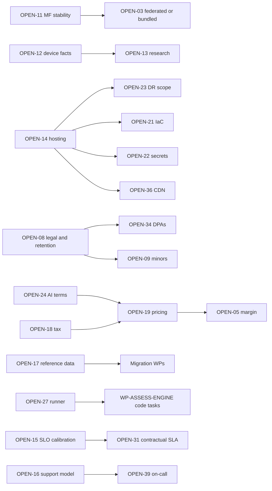
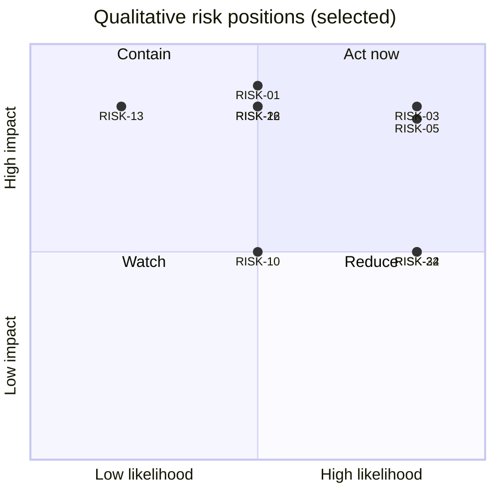

# Target blueprint 24: Risks And Decisions

> **Status.** Archive: proposal, not ratified. A greenfield redesign blueprint written in October 2026. Every area was Draft, Under Review or Revision Required (its own document status) and no test was run against it. Its content was mined into `docs/blueprint/`; `SSOT.md` remains the source of intent. Module federation described here was not adopted: the built system is a modular monolith (`ARCHITECTURE.md`).
>
> **What this file holds.** All files of the former `Yash_Final_Project_Document/24_RISKS_AND_DECISIONS/` folder, in order.
>
> **Merged on 2026-11-25** from the files listed below; each one is a section under its original title. Nothing was removed; the originals are in git history at commit `08387ec`.

| Section | Former file |
|---|---|
| Architecture Decision Register (target design) | `Yash_Final_Project_Document/24_RISKS_AND_DECISIONS/ADR_REGISTER.md` |
| Open Decisions Register | `Yash_Final_Project_Document/24_RISKS_AND_DECISIONS/OPEN_DECISIONS.md` |
| Open Decisions, Conflicts, Governance and Lessons Merged from the Legacy Documentation (Group A) | `Yash_Final_Project_Document/24_RISKS_AND_DECISIONS/OPEN_DECISIONS_LEGACY_MERGE.md` |
| Risks and Lessons from the Prior Attempt (reports group) | `Yash_Final_Project_Document/24_RISKS_AND_DECISIONS/RISK_AND_LESSONS_FROM_PRIOR_ATTEMPT.md` |
| Risk Register | `Yash_Final_Project_Document/24_RISKS_AND_DECISIONS/RISK_REGISTER.md` |
| Governance Registrations (proposed) — ADRs, OPEN items, index additions | `Yash_Final_Project_Document/24_RISKS_AND_DECISIONS/GOVERNANCE_REGISTRATIONS_REV2.md` |
| Risk Register, Revision 2 additions (RSK-REG REV2) | `Yash_Final_Project_Document/24_RISKS_AND_DECISIONS/RISK_REGISTER_REV2.md` |

## Architecture Decision Register (target design)

_Former file: `Yash_Final_Project_Document/24_RISKS_AND_DECISIONS/ADR_REGISTER.md`._

Doc ID: DEC-ADR · Owner: Architecture Review Board · Version 1.0 · Status: Under Review

> **Revision 2 folded in (2026-10-27)** from `ADR_REGISTER.md#record-governance-registrations-rev2`: appended under "Revision 2 additions"; where it differs from text above, the appended text governs. Status unchanged; proposals still need owner/ARB ratification.
> All decisions are **[TARGET]**. "Challenge" records the strongest counter-argument raised by the review council. Existing-project decisions (ADR-001…016 in `ARCHITECTURE.md`) are **[REF]** and are not inherited automatically.

| ID      | Decision                                                                                                                                                                                                                                                                                                                                                                                                                       | Rationale                                                                                                                                                                                                                                  | Challenge / alternative rejected                                                                                                                                                                | Revisit trigger                                                                                                                           |
| ------- | ------------------------------------------------------------------------------------------------------------------------------------------------------------------------------------------------------------------------------------------------------------------------------------------------------------------------------------------------------------------------------------------------------------------------------ | ------------------------------------------------------------------------------------------------------------------------------------------------------------------------------------------------------------------------------------------ | ----------------------------------------------------------------------------------------------------------------------------------------------------------------------------------------------- | ----------------------------------------------------------------------------------------------------------------------------------------- |
| ADR-T01 | Product = **verified career-evidence platform** (Learn→Prove→Showcase→Match→Apply→Hire→Grow). Non-goals: generic social network, ad network, payroll, crypto credentials.                                                                                                                                                                                                                                                      | Evidence is the differentiator; every capability must strengthen the loop.                                                                                                                                                                 | Broad "career OS" rejected: dilutes focus, raises cost.                                                                                                                                         | Two quarters of retention data contradict loop usage.                                                                                     |
| ADR-T02 | **PWA-first**; no store packaging at launch. Evaluate TWA/Capacitor wrapper only when a verified store-distribution or iOS push-reach need exists.                                                                                                                                                                                                                                                                             | Single codebase; installability; iOS web push works only for Home-Screen installs (secondary sources, see research).                                                                                                                       | Native apps rejected: ~3× cost, no confirmed requirement.                                                                                                                                       | >15% iOS users blocked by push/install friction.                                                                                          |
| ADR-T03 | **Proposed amendment ADR-T23:** use typed domain-module contracts with `MF_MODE=bundled` as the initial delivery baseline; keep Module Federation as an optional runtime for independently owned modules. Do not treat client-code visibility as a security boundary.                                                                                                                                                          | No evidence establishes three independent frontend teams or a need for separate release cadence. Bundled route chunks avoid remote-registry, signing, compatibility and partial-deployment machinery while preserving a migration path.    | Federation may be justified by named independent teams and measured deployment benefit. A typed contract keeps the option open; server-side authorization remains authoritative in either mode. | ARB may activate federation only after OPEN-03 evidence and WP-FED-SPIKE passes compatibility, rollback, integrity and performance gates. |
| ADR-T04 | **Modular monolith backend** (Fastify/Node, TypeScript) with enforced module boundaries + separate worker process. Extract a service only on a documented trigger.                                                                                                                                                                                                                                                             | Team size, transactional consistency, ops cost.                                                                                                                                                                                            | Microservices rejected: no independent-scale evidence.                                                                                                                                          | Module needs independent scaling/SLA, distinct residency, or team contention.                                                             |
| ADR-T05 | **PostgreSQL is the single system of record**; all reads/writes via SQL (no in-process Map read model); RLS as defence-in-depth; **transactional outbox** for events.                                                                                                                                                                                                                                                          | Removes single-writer limit and stale reads; enables horizontal API replicas.                                                                                                                                                              | Keep boot-time hydration rejected.                                                                                                                                                              | n/a                                                                                                                                       |
| ADR-T06 | **Sessions:** httpOnly, Secure, SameSite=Lax cookie via same-origin `/api/v1/auth/*` routes (single cookie contract: `__Host-ts_at` Path=/, `__Secure-ts_rt` Path=/api/v1/auth/refresh, `X-CSRF-Token`; canonical in SEC-02 §2.3); 15-min access + rotating refresh with reuse detection; passkeys (WebAuthn) + password; optional OIDC/SAML SSO for organizations; **remotes never read tokens**.                             | Removes XSS-readable localStorage token; remotes need no credential access.                                                                                                                                                                | Keep localStorage bearer rejected.                                                                                                                                                              | n/a                                                                                                                                       |
| ADR-T07 | **Authorization = central policy module** (`packages/policy`): org-role RBAC + resource-level ABAC, deny by default, server-side; UI hints derived from `GET /me/capabilities`.                                                                                                                                                                                                                                                | Reference design had inline/inconsistent org-role checks.                                                                                                                                                                                  | Per-handler ad-hoc checks rejected.                                                                                                                                                             | n/a                                                                                                                                       |
| ADR-T08 | **API:** REST `/api/v1`, OpenAPI 3.1 generated from Zod contracts, RFC 9457 problem+json errors, cursor pagination, `Idempotency-Key` on unsafe mutations, ETag/`If-Match` for concurrent edits.                                                                                                                                                                                                                               | Testable contracts; safe retries.                                                                                                                                                                                                          | GraphQL rejected: authz/caching complexity, no multi-client need.                                                                                                                               | Third-party API demand.                                                                                                                   |
| ADR-T09 | **Events:** outbox → worker dispatcher; at-least-once; consumer dedupe by `event_id`; AsyncAPI documents events; **fenced leases** (claim generation) for jobs.                                                                                                                                                                                                                                                                | Fixes duplicate-execution risk of unfenced leases.                                                                                                                                                                                         | Broker (Kafka/NATS) deferred.                                                                                                                                                                   | Outbox throughput exceeds Postgres budget or services extracted.                                                                          |
| ADR-T10 | **Offline tiers:** read-cache of owner data; queued writes only for application drafts, profile edits, message compose, notes; everything consequential is online-only. Server revalidates every queued write.                                                                                                                                                                                                                 | Honest scope; iOS lacks reliable background sync.                                                                                                                                                                                          | Full offline-first rejected: conflict surface, no requirement.                                                                                                                                  | Research shows low-connectivity core use.                                                                                                 |
| ADR-T11 | **Search:** Postgres FTS + `pg_trgm` + `pgvector` behind a `SearchPort`.                                                                                                                                                                                                                                                                                                                                                       | Cost, ops simplicity.                                                                                                                                                                                                                      | OpenSearch now rejected.                                                                                                                                                                        | p95 search >400 ms at target corpus or proven relevance gap.                                                                              |
| ADR-T12 | **AI gateway** is the only path to models; human-gated (no autonomous consequential action); per-user/org budgets; blocked server-side in `AI_PROHIBITED` assessment sessions; AI memory never counts as evidence.                                                                                                                                                                                                             | Safety, cost, assessment integrity.                                                                                                                                                                                                        | Direct provider calls rejected.                                                                                                                                                                 | n/a                                                                                                                                       |
| ADR-T13 | **Assessment honesty:** code-execution assessments run only in an isolated, network-less sandbox runner. Until it exists, submissions are `unverified` and never mint verified evidence.                                                                                                                                                                                                                                       | Reference design could return a simulated pass.                                                                                                                                                                                            | Simulated scoring rejected.                                                                                                                                                                     | Runner shipped.                                                                                                                           |
| ADR-T14 | **Evidence ladder:** `claimed → artifact-backed → peer-attested → authority-verified`; each rung carries provenance; verified status only via server-side verification transition.                                                                                                                                                                                                                                             | _Verified over claimed._                                                                                                                                                                                                                   | Single boolean flag rejected.                                                                                                                                                                   | n/a                                                                                                                                       |
| ADR-T15 | **Billing:** Stripe-only; entitlements derived server-side from subscription state; redirect success grants nothing; signed webhook authoritative.                                                                                                                                                                                                                                                                             | Single processor, reduced PCI scope.                                                                                                                                                                                                       | Multi-processor rejected for launch.                                                                                                                                                            | New-market payment need.                                                                                                                  |
| ADR-T16 | **Observability:** OpenTelemetry with W3C trace-context propagated shell → remote → API → worker; Pino with redaction.                                                                                                                                                                                                                                                                                                         | End-to-end correlation across federation boundary.                                                                                                                                                                                         | Vendor-specific agents rejected.                                                                                                                                                                | n/a                                                                                                                                       |
| ADR-T17 | **[PROPOSED QUALIFICATION — ADR-T23 pending]** Keep the pnpm monorepo, affected-only CI and semver'd contract packages; per-remote build/deploy pipelines apply only after federation activation, while bundled modules ship with the shell.                                                                                                                                                                                   | Atomic contract change; independent deploy artifacts only where independently deployed.                                                                                                                                                    | Multi-repo rejected: contract drift.                                                                                                                                                            | >5 teams; federated mode requires ADR-T23 gates.                                                                                          |
| ADR-T18 | **Compatibility:** shell exposes a versioned _Host Contract_ (semver). In federated mode, each remote manifest declares `hostContract` range, `apiRange`, `dataSchema`; shell rejects incompatible remotes and falls back to pinned last-known-good.                                                                                                                                                                           | Independent deploys must not rely on assumptions.                                                                                                                                                                                          | Lockstep releases rejected.                                                                                                                                                                     | n/a                                                                                                                                       |
| ADR-T19 | **Federation ≠ security isolation.** Remotes share a JS realm; when federated, signed manifests + SRI supplement CSP; no secrets client-side; server enforces all authz. Iframe/sandbox only for untrusted third-party content.                                                                                                                                                                                                | Honest threat model.                                                                                                                                                                                                                       | Treating remotes as trust boundaries rejected.                                                                                                                                                  | Third-party remotes.                                                                                                                      |
| ADR-T20 | **Email via provider port** (Brevo default); push via Web Push (VAPID) for installed PWAs; SMS deferred.                                                                                                                                                                                                                                                                                                                       | Vendor independence.                                                                                                                                                                                                                       | n/a                                                                                                                                                                                             | n/a                                                                                                                                       |
| ADR-T21 | **Multi-tenancy:** row-level `org_id` scoping with RLS; organizations and institutions are tenants; cross-tenant read = Sev-1.                                                                                                                                                                                                                                                                                                 | Isolation at acceptable cost.                                                                                                                                                                                                              | Schema-per-tenant rejected.                                                                                                                                                                     | Regulated customer needing dedicated DB.                                                                                                  |
| ADR-T22 | **Matching is explainable, uncertainty-aware, never pay-to-rank**; candidates see why they matched; no autonomous reject.                                                                                                                                                                                                                                                                                                      | Candidate dignity; fairness.                                                                                                                                                                                                               | Opaque ranking rejected.                                                                                                                                                                        | n/a                                                                                                                                       |
| ADR-T23 | **[PROPOSED — pending ARB ratification] Bundled delivery is the initial baseline; federation requires an explicit activation decision.** Keep the shared module contract. Require at least three named independent frontend teams, an independently deployable ownership need, and a passing WP-FED-SPIKE before activation. Asset confidentiality is not a security property; server authorization protects data and actions. | Current project evidence does not establish the staffing or deployment need that justifies federation's registry, signing, compatibility, rollback and operations cost. Bundled dynamic route chunks are the simpler initial architecture. | Defer or reject federation if the measurable release/ownership benefit does not exceed its added operational burden. No module is a security boundary.                                          | OPEN-03 closure by ARB, named teams, measured benefit, and spike results; revisit before any federated production release.                |

Supersession policy: a superseding ADR names the replaced ID and updates affected docs in the same change.

## Revision 2 additions (folded 2026-10-27 from `ADR_REGISTER.md#record-governance-registrations-rev2`)

### 1. ADR amendments / new ADRs

| ID                        | Proposal                                                                                                                                                      | Source                                               |
| ------------------------- | ------------------------------------------------------------------------------------------------------------------------------------------------------------- | ---------------------------------------------------- |
| ADR-T03a                  | Default `MF_MODE=bundled`; federated runtime is an activation option once OPEN-03 (≥3 named teams) and the spike close; 8 remotes after MOD-ADM/MOD-INS split | REVIEW_RESOLUTION_DECISIONS; FEDERATION_REVIEW_FIXES |
| ADR-T05a / T06a / T09a    | Write-budget and batch anchoring; cookie contract (`__Host-ts_at`, `__Secure-ts_rt`, `X-CSRF-Token`); in-process consumers and fenced job engine details      | BACKEND/SECURITY REV2                                |
| ADR-T10a                  | Ph1 offline = read cache + local unsent drafts; assessment answers online-only; lesson progress queued; outbox on trigger                                     | OFFLINE_AND_SYNC_DESIGN_REV2                         |
| ADR-T14a                  | `authority_verified` carries mandatory `issuer_class`; instructor ≠ learner                                                                                   | BR/DT/INV REV2                                       |
| ADR-T23                   | Bundled lazy modules as baseline; federation conditional (referenced by research log R1)                                                                      | FEDERATION_REVIEW_FIXES                              |
| ADR-T24                   | Edge prerender of public job/profile pages + sitemap                                                                                                          | FRONTEND_ARCHITECTURE_REV2                           |
| ADR-T25 (number proposed) | Third-party course marketplace money flow (Ph3)                                                                                                               | MARKETPLACE_MONEY_FLOW_ADR_PROPOSAL                  |
| FD-14                     | How the edge learns `admin.console`                                                                                                                           | FEDERATION_REVIEW_FIXES                              |

### 2. Fitness-function wording (CANONICAL_INVARIANTS not edited)

FF-07: "accepts `Idempotency-Key` or declares a natural key". FF-02: complete module graph generated from imports. FF-11 (enum-vs-SM lint) and FF-12 (consent-catalogue generation) are already defined in `CANONICAL_INVARIANTS.md`.

### 3. OPEN-item consolidation rule

A single global register is **not built yet**. Proposed rule: keep global `OPEN-nn`; map `OPEN-FE-*`, `OPEN-UX-*`, `OPEN-B*`, `OPEN-CS-*` to a new global id with owner, phase, blocking flag; close answered items. Dispositions reported by agents: OPEN-B20 closed (re-apply as linked application); OPEN-FE-08 and OPEN-FE-10 closed by the CONST-S table; OPEN-FE-17/18 and OPEN-UX-14 to renumber; OPEN-06 re-tag Ph3. New: OPEN-42 (phase reconciliation), OPEN-B57/58/59, operational-telemetry classification, RUM coverage threshold, edge limiter, minimum-age value (counsel), retention basis (OPEN-08).

### 4. Route prefixes / ID registry additions (ID_REGISTRY not edited)

Add MOD-INS (`/institution/*`); shell prefixes `/r/*`, `/invite/*`, `/p/*`, `/login/callback`, `/offline`, `/help`; screen aliases SCR-INS-01..06 for SCR-ADM-17..22.

### 5. New files to link from the master index

See [MASTER_INDEX_V9_ADDENDUM_2](00_CONTROL_CENTRE.md#record-master-index-v9-addendum-2).

## Decision analysis (PATCH 2026-10-27, PROPOSED; closes audit gap on option analysis)

Expands ADR-T04, T05, T02/T03, T19 and rendering ADR-T24 with drivers, options, cost, operations demand and residual risk. Cost is relative (L/M/H), not a quote. Nothing here is measured; assumptions need ARB ratification and, where noted, external verification. Microservices are analysed and not adopted for now, on stated re-evaluation conditions.

### D-01 Modular monolith vs services (ADR-T04)

| Item                  | Analysis                                                                                                                                                                                                          |
| --------------------- | ----------------------------------------------------------------------------------------------------------------------------------------------------------------------------------------------------------------- |
| Drivers               | Small team; strong transactional needs (evidence, applications, billing); outbox correctness; low ops budget; trust-critical consistency.                                                                         |
| Options               | A. Modular monolith + worker (chosen). B. Monolith plus a few extracted services (sandbox, AI gateway, search). C. Full microservices.                                                                            |
| Tradeoffs             | A: simplest transactions and testing, one failure domain. B: isolates risky or differently scaled parts, adds network contracts and tracing. C: independent scale and teams, distributed transactions, high cost. |
| Cost                  | A low, B medium, C high.                                                                                                                                                                                          |
| Ops demand            | A one deployable plus worker; B 2-4 services with own SLOs; C needs a platform team.                                                                                                                              |
| Residual risk (A)     | Shared fate (FMEA SF-02, SF-03); boundary erosion; one module's load affects all. Controlled by FF-02 import graph and pool slices.                                                                               |
| Re-evaluation trigger | A module needs independent scaling/SLA, distinct residency or isolation (sandbox, AI), release contention between teams, or p95 targets unmet after tuning. First candidate step is B.                            |

### D-02 Rendering strategy (ADR-T24, frontend)

| Item                  | Analysis                                                                                                                                                                                         |
| --------------------- | ------------------------------------------------------------------------------------------------------------------------------------------------------------------------------------------------ |
| Drivers               | Authenticated app behind login; public job/profile pages need SEO and fast first paint; PWA offline shell; small team.                                                                           |
| Options               | A. SPA only. B. SPA plus edge prerender for public pages (proposed). C. Full SSR framework.                                                                                                      |
| Tradeoffs             | A: simplest, weak SEO. B: SEO for public pages, app stays SPA, adds prerender pipeline and invalidation. C: best first paint, needs server runtime, harder offline/PWA fit, framework migration. |
| Cost                  | A low, B medium, C high.                                                                                                                                                                         |
| Ops demand            | B needs prerender job, sitemap and invalidation on publish/withdraw.                                                                                                                             |
| Residual risk         | Stale prerendered pages exposing withdrawn data; SEO benefit unverified.                                                                                                                         |
| Re-evaluation trigger | Measured organic-acquisition or LCP shortfall on public pages; need for personalised SSR.                                                                                                        |

### D-03 Database choice (ADR-T05, T11)

| Item                  | Analysis                                                                                                                                                                                                                    |
| --------------------- | --------------------------------------------------------------------------------------------------------------------------------------------------------------------------------------------------------------------------- |
| Drivers               | Relational integrity, RLS, transactional outbox, FTS and vector in one place, low ops.                                                                                                                                      |
| Options               | A. PostgreSQL only (chosen; FTS + pg_trgm + pgvector). B. Postgres plus dedicated search (OpenSearch). C. Polyglot or document store.                                                                                       |
| Tradeoffs             | A: one backup, one consistency model, limits at search scale and write throughput. B: better relevance and scale, dual-write and index lag. C: flexibility but loses constraints and joins central to evidence and tenancy. |
| Cost                  | A low, B medium-high, C high.                                                                                                                                                                                               |
| Ops demand            | A: HA, backups with restore drills, partitioning, pooler. B adds cluster ops.                                                                                                                                               |
| Residual risk         | Single system of record (SF-02); search relevance ceiling; managed-provider limits unverified.                                                                                                                              |
| Re-evaluation trigger | p95 search > 400 ms at target corpus; sustained primary write saturation after tuning; residency need for a dedicated DB (ADR-T21).                                                                                         |

### D-04 PWA wrapper vs native (ADR-T02)

| Item                  | Analysis                                                                                                                                                                                 |
| --------------------- | ---------------------------------------------------------------------------------------------------------------------------------------------------------------------------------------- |
| Drivers               | One codebase, installability, push reach, store-distribution need (unconfirmed), iOS PWA limits.                                                                                         |
| Options               | A. PWA only (chosen). B. PWA plus TWA (Android) or Capacitor wrapper. C. Native apps.                                                                                                    |
| Tradeoffs             | A: cheapest; iOS push needs Home-Screen install; limited storage guarantees. B: store presence and native push, review overhead, bridge code. C: best device access, separate codebases. |
| Cost                  | A low, B medium, C high.                                                                                                                                                                 |
| Ops demand            | B adds store accounts, signing, release cadence; C needs a mobile team.                                                                                                                  |
| Residual risk         | iOS web push and storage eviction behaviour are secondary-source claims, not device-verified (needs real-device testing).                                                                |
| Re-evaluation trigger | >15% iOS users blocked on push/install, confirmed store-distribution requirement, or a needed capability the web lacks. First step is B.                                                 |

### D-05 Iframe / worker isolation vs same-runtime remote (ADR-T19, T23)

| Item                  | Analysis                                                                                                                                                                     |
| --------------------- | ---------------------------------------------------------------------------------------------------------------------------------------------------------------------------- |
| Drivers               | Trust level of code; independent team ownership; performance; shared auth and UI context.                                                                                    |
| Options               | A. Bundled modules (baseline, no runtime isolation). B. Federated remotes in the same JS realm. C. Sandboxed cross-origin iframe per remote. D. Web Worker for non-UI logic. |
| Tradeoffs             | A/B: fast, shared state, no security boundary. C: strong isolation, postMessage contracts, layout/a11y/auth friction, extra load. D: isolates compute only, no DOM.          |
| Cost                  | A low, B medium, C high, D medium.                                                                                                                                           |
| Ops demand            | B needs registry, signing, release train (FED-RT-01..10 in `09_MODULE_FEDERATION/VERSION_COMPATIBILITY_DESIGN.md`); C needs per-origin hosting and messaging contracts.      |
| Residual risk         | B shares fate and trust with the shell (FED-RT-10, SF-01).                                                                                                                   |
| Re-evaluation trigger | Any third-party or untrusted code, a compromised-remote incident, or a compliance demand for isolation moves that code to C; federation activation follows ADR-T23 criteria. |

---

<a id="record-governance-registrations-rev2"></a>

### Preserved source record: GOVERNANCE_REGISTRATIONS_REV2

> Consolidated on 2026-10-27. The following is the complete source record, retained for provenance, exceptions and rationale. Its dates, counts and statements about files describe the earlier revision, not the current filesystem. Approval conditions and authority remain unchanged: this move neither ratifies proposals nor overrides the owning document’s current precedence rules. Relative references now point to the consolidated records.

<!-- source-record-begin: Yash_Final_Project_Document/24_RISKS_AND_DECISIONS/GOVERNANCE_REGISTRATIONS_REV2.md -->

<a id="record-governance-registrations-rev2--governance-registrations-proposed--adrs-open-items-index-additions"></a>

## Governance Registrations (proposed) — ADRs, OPEN items, index additions

Doc ID: DEC-GOV2 · Version 1.0 · 2026-10-25 · Additive; supplements [ADR_REGISTER](#architecture-decision-register-target-design) and [OPEN_DECISIONS](#open-decisions-register) without changing them. Every entry is **Proposed**; nothing here is approved by an ARB or owner.

> **Folded into `ADR_REGISTER.md` on 2026-10-27.** Change record only; edit the original.

<a id="record-governance-registrations-rev2--1-adr-amendments--new-adrs"></a>

### 1. ADR amendments / new ADRs

| ID                        | Proposal                                                                                                                                                      | Source                                               |
| ------------------------- | ------------------------------------------------------------------------------------------------------------------------------------------------------------- | ---------------------------------------------------- |
| ADR-T03a                  | Default `MF_MODE=bundled`; federated runtime is an activation option once OPEN-03 (≥3 named teams) and the spike close; 8 remotes after MOD-ADM/MOD-INS split | REVIEW_RESOLUTION_DECISIONS; FEDERATION_REVIEW_FIXES |
| ADR-T05a / T06a / T09a    | Write-budget and batch anchoring; cookie contract (`__Host-ts_at`, `__Secure-ts_rt`, `X-CSRF-Token`); in-process consumers and fenced job engine details      | BACKEND/SECURITY REV2                                |
| ADR-T10a                  | Ph1 offline = read cache + local unsent drafts; assessment answers online-only; lesson progress queued; outbox on trigger                                     | OFFLINE_AND_SYNC_DESIGN_REV2                         |
| ADR-T14a                  | `authority_verified` carries mandatory `issuer_class`; instructor ≠ learner                                                                                   | BR/DT/INV REV2                                       |
| ADR-T23                   | Bundled lazy modules as baseline; federation conditional (referenced by research log R1)                                                                      | FEDERATION_REVIEW_FIXES                              |
| ADR-T24                   | Edge prerender of public job/profile pages + sitemap                                                                                                          | FRONTEND_ARCHITECTURE_REV2                           |
| ADR-T25 (number proposed) | Third-party course marketplace money flow (Ph3)                                                                                                               | MARKETPLACE_MONEY_FLOW_ADR_PROPOSAL                  |
| FD-14                     | How the edge learns `admin.console`                                                                                                                           | FEDERATION_REVIEW_FIXES                              |

<a id="record-governance-registrations-rev2--2-fitness-function-wording-canonical_invariants-not-edited"></a>

### 2. Fitness-function wording (CANONICAL_INVARIANTS not edited)

FF-07: "accepts `Idempotency-Key` or declares a natural key". FF-02: complete module graph generated from imports. FF-11 (enum-vs-SM lint) and FF-12 (consent-catalogue generation) are already defined in `CANONICAL_INVARIANTS.md`.

<a id="record-governance-registrations-rev2--3-open-item-consolidation-rule"></a>

### 3. OPEN-item consolidation rule

A single global register is **not built yet**. Proposed rule: keep global `OPEN-nn`; map `OPEN-FE-*`, `OPEN-UX-*`, `OPEN-B*`, `OPEN-CS-*` to a new global id with owner, phase, blocking flag; close answered items. Dispositions reported by agents: OPEN-B20 closed (re-apply as linked application); OPEN-FE-08 and OPEN-FE-10 closed by the CONST-S table; OPEN-FE-17/18 and OPEN-UX-14 to renumber; OPEN-06 re-tag Ph3. New: OPEN-42 (phase reconciliation), OPEN-B57/58/59, operational-telemetry classification, RUM coverage threshold, edge limiter, minimum-age value (counsel), retention basis (OPEN-08).

<a id="record-governance-registrations-rev2--4-route-prefixes--id-registry-additions-id_registry-not-edited"></a>

### 4. Route prefixes / ID registry additions (ID_REGISTRY not edited)

Add MOD-INS (`/institution/*`); shell prefixes `/r/*`, `/invite/*`, `/p/*`, `/login/callback`, `/offline`, `/help`; screen aliases SCR-INS-01..06 for SCR-ADM-17..22.

<a id="record-governance-registrations-rev2--5-new-files-to-link-from-the-master-index"></a>

### 5. New files to link from the master index

See [MASTER_INDEX_V9_ADDENDUM_2](00_CONTROL_CENTRE.md#record-master-index-v9-addendum-2).

<!-- source-record-end: Yash_Final_Project_Document/24_RISKS_AND_DECISIONS/GOVERNANCE_REGISTRATIONS_REV2.md -->

## Open Decisions Register

_Former file: `Yash_Final_Project_Document/24_RISKS_AND_DECISIONS/OPEN_DECISIONS.md`._

Doc ID: DEC-OPEN · Owner: Architecture Review Board secretary · Version 1.0 · Status: Draft for Review · Relates: ADR_REGISTER, RSK-REG, RDM-01, CC-ID (ID registry)

### 1. Purpose and rules

- Consolidates every `OPEN-NN` assumption referenced by canonical documents (OPEN-03, 05, 06, 07, 08, 09, 10, 11, 12, 13) and adds items raised by Operations/Quality/Delivery plus SSOT, source-to-target, metric, API, architecture, security/AI, operations, and source-register reconciliations (OPEN-14 … OPEN-51).
- **Needed-by phase** uses Ph0–Ph4 from RDM-01. **Blocking?** = Yes means the named phase cannot exit (or production cannot launch) until decided; No means a documented default exists and work may proceed.
- A decision is closed by an ADR (new `ADR-T**` or superseding entry) or by a recorded owner decision; this register is then updated with the outcome. The ADR register is not edited by this document.
- IDs OPEN-01, OPEN-02 and OPEN-04 are **reserved**: no canonical document or Ops/Quality/Delivery document references them; the Documentation Architect should assign or retire them. Other teams use their own namespaces for local items (for example `OPEN-B*` in BE-01/DB-03, `OPEN-FE-*` in MFA-01), which do not collide. **Known collision:** `27_INDEPENDENT_REVIEWS/SCENARIO_SIMULATIONS.md` uses `OPEN-14` for a "draft field allowlist" item; in this register OPEN-14 is the hosting decision. The owner of that file should renumber its item (suggest `OPEN-40` or a local `OPEN-S*` prefix); this document does not edit other teams' files.

### 2. Canonical items

| ID      | Question                                                                                                                                                                                                                                                             | Options                                                                                                                                                 | Owner                                              | Needed by                                                                | Blocking?                                                          | Notes / consequence if undecided                                                                                                                                                                                                                                                                                                                           |
| ------- | -------------------------------------------------------------------------------------------------------------------------------------------------------------------------------------------------------------------------------------------------------------------- | ------------------------------------------------------------------------------------------------------------------------------------------------------- | -------------------------------------------------- | ------------------------------------------------------------------------ | ------------------------------------------------------------------ | ---------------------------------------------------------------------------------------------------------------------------------------------------------------------------------------------------------------------------------------------------------------------------------------------------------------------------------------------------------- |
| OPEN-03 | Does evidence justify activating Module Federation? **Proposed baseline is `MF_MODE=bundled` under ADR-T23; this proposal is not ARB-ratified.**                                                                                                                     | Keep bundled; activate federation for selected/all modules only if the staffing, independent-release need, and WP-FED-SPIKE criteria in ADR-T23 are met | Frontend Platform Lead + Architecture Review Board | Ph0 only if federation is sought; otherwise before any federated release | **No** for the bundled shell; **Yes** before federation activation | The typed module contract works in bundled mode. Federation adds registry, signature, compatibility, rollback and operating work. OPEN-11 plugin compatibility and OPEN-FE-03 SRI remain gates.                                                                                                                                                            |
| OPEN-05 | Gross-margin target and COGS definition                                                                                                                                                                                                                              | Target range and definition set by Finance; sensitivity from FIN-COST §4                                                                                | Finance Lead / CPO                                 | Ph1 (before pricing)                                                     | No (blocks pricing finalisation)                                   | GOAL-07 measure undefined until set                                                                                                                                                                                                                                                                                                                        |
| OPEN-06 | Instructor revenue share and payout terms                                                                                                                                                                                                                            | Percentage model, tiered, flat fee; payout cadence and thresholds; tax forms                                                                            | CPO + Finance + Content Ops                        | Ph2 (before paid courses)                                                | Yes for course commerce                                            | Refund adjustments depend on it (COM-OPS §5)                                                                                                                                                                                                                                                                                                               |
| OPEN-07 | Validate personas and journeys with real research (current personas are hypothetical)                                                                                                                                                                                | Interviews, usability tests, surveys; recruit candidates, recruiters, referees, faculty                                                                 | Product Director / UX Research                     | Ph1 (before MVP lock)                                                    | No                                                                 | Risk of building for assumed users; referee flow validation (P4) is priority                                                                                                                                                                                                                                                                               |
| OPEN-08 | Retention list, legal basis, compliance scan and notification duties (privacy, employment-decision rules, breach notification, consumer law)                                                                                                                         | Engage counsel; jurisdiction scoping; retention schedule per data class; legal-basis register                                                           | Legal / Privacy Lead                               | Ph1 (before production launch)                                           | **Yes** for launch                                                 | Erasure (BR-T060), logs, backups, analytics, billing retention all depend on it. Also open after the REVW-04 design (opaque `subject_ref`, mapping deleted on erasure): legal status and retention of unlinkable history skeletons, truncated IP prefix in audit, map retention under legal hold, backup age-out vs destroyed per-subject keys (DB-02 §16) |
| OPEN-09 | Minors in education contexts: supported or excluded; protections                                                                                                                                                                                                     | Exclude under-age users; age-gating with parental consent; restricted feature set                                                                       | Privacy Lead + Institutions PM                     | Ph3 (before institution onboarding)                                      | Yes for institutions with under-age learners                       | TEST-PRV-005 pending                                                                                                                                                                                                                                                                                                                                       |
| OPEN-10 | Identity verification (ID checks): adopt or not                                                                                                                                                                                                                      | None; vendor-gated optional; institution-provided attestation                                                                                           | Product + Privacy                                  | Ph4                                                                      | No                                                                 | Sensitive data; VR-10                                                                                                                                                                                                                                                                                                                                      |
| OPEN-11 | Module Federation plugin version and manifest-runtime stability under Vite (sources conflict)                                                                                                                                                                        | Pin tested version; use alternative bundler plugin; bundled mode                                                                                        | Frontend Platform Lead                             | Ph0 (WP-FED-SPIKE)                                                       | Yes (feeds OPEN-03)                                                | RISK-09                                                                                                                                                                                                                                                                                                                                                    |
| OPEN-12 | Verified iOS/Android PWA facts and supported device matrix (push, install, storage eviction, background sync)                                                                                                                                                        | Own device lab, cloud device service, hybrid; define oldest supported iOS                                                                               | QA + Frontend Platform                             | Ph0 (WP-IOS-DEVICE-LAB)                                                  | No (but limits claims)                                             | FF-09 matrix; RMP-2 definition                                                                                                                                                                                                                                                                                                                             |
| OPEN-13 | Pending research: WebAuthn/passkey support matrix, Web Push (VAPID) on Safari desktop, pgvector scale limits, regulatory scan; plus items added by Ops: Core Web Vitals/Lighthouse constants, SRE-workbook burn-rate parameters, hosting plan capabilities (HA/PITR) | Add to RES-01 with primary sources; legal advisor for regulatory                                                                                        | Document Specialist + owners                       | Ph0–Ph1                                                                  | No                                                                 | Several SLO/alert parameters carry "verify" notes                                                                                                                                                                                                                                                                                                          |

### 3. Operations, quality, delivery, commercial items

| ID      | Question                                                                                                                                                                                           | Options                                                                                                                                      | Owner                               | Needed by                             | Blocking?                                              | Notes / consequence if undecided                                                                                                                                                                                                                                                             |
| ------- | -------------------------------------------------------------------------------------------------------------------------------------------------------------------------------------------------- | -------------------------------------------------------------------------------------------------------------------------------------------- | ----------------------------------- | ------------------------------------- | ------------------------------------------------------ | -------------------------------------------------------------------------------------------------------------------------------------------------------------------------------------------------------------------------------------------------------------------------------------------- |
| OPEN-14 | Hosting platform and HA mechanism for production (compute, Postgres HA/PITR, CDN, object storage)                                                                                                  | See OPS-DEP §6: single VM/Compose, Coolify, managed Postgres + separate compute, developer PaaS, managed K8s, hyperscaler managed containers | Platform Architect + SRE Lead + ARB | Ph0 (staging), Ph1 (production)       | **Yes** for production go-live                         | RISK-12; reference deployment assets are options only                                                                                                                                                                                                                                        |
| OPEN-15 | Calibration of SLO targets and operational parameters (retry budgets, timeouts, burn-rate parameters, canary stats, bake times, game-day cadence, drill cadence, flag lifetime, flake-fix targets) | Set from WP-LOADBASE baseline; revisit after launch                                                                                          | SRE Lead + Product                  | Ph0 (method), Ph1 (values)            | **Yes** for committing SLOs                            | OPS-SLO values are hypotheses until then                                                                                                                                                                                                                                                     |
| OPEN-16 | Support SLAs, coverage hours (24×7 vs business hours), staffing model, post-incident review window                                                                                                 | Tiered SLA per plan; follow-the-sun vs single timezone; outsourcing                                                                          | Head of Operations                  | Ph1                                   | Yes for launch                                         | PROC-03, SUP-INC placeholders                                                                                                                                                                                                                                                                |
| OPEN-17 | Does the reference system hold real users or data that must be migrated?                                                                                                                           | None (greenfield launch); few (offline cutover); material (strangler)                                                                        | Program Director + CPO              | Ph0                                   | **Yes** (scopes migration WPs)                         | MIG-01 §1 decision tree. Repository docs label some modules ephemeral, but other source docs describe persisted thread/message storage and routes; labels alone do not prove data is absent. Verify actual database access, authorization, per-table rows, and usage before selecting scope. |
| OPEN-18 | Tax model and jurisdictions for selling subscriptions and courses                                                                                                                                  | Tax calculation service; merchant-of-record; limited-region launch                                                                           | Finance Lead + Legal                | Ph2 (before billing launch)           | Yes for billing                                        | COM-OPS §6                                                                                                                                                                                                                                                                                   |
| OPEN-19 | Pricing, packaging, quotas, trial/grace/dunning parameters, grandfathering, discount authority                                                                                                     | Tier structure per COM-OPS §2 with numeric values from market research and cost model                                                        | CPO + Finance + Commercial Ops      | Ph2                                   | Yes for billing                                        | AI quotas depend on it                                                                                                                                                                                                                                                                       |
| OPEN-20 | Observability backend, retention and telemetry residency                                                                                                                                           | Self-hosted OSS stack, managed vendor, hybrid                                                                                                | SRE Lead                            | Ph0                                   | No (OTel keeps portability)                            | OPS-OBS §9                                                                                                                                                                                                                                                                                   |
| OPEN-21 | Infrastructure-as-Code tool                                                                                                                                                                        | OpenTofu/Terraform-class, Pulumi-class, provider-native                                                                                      | Platform Eng                        | Ph0                                   | No                                                     | WP-IAC-ENVS                                                                                                                                                                                                                                                                                  |
| OPEN-22 | Secret manager and key custody (signing keys, session keys)                                                                                                                                        | Cloud-native manager, Vault-class, sealed secrets                                                                                            | Security + Platform                 | Ph0                                   | No                                                     | OPS-REL §5                                                                                                                                                                                                                                                                                   |
| OPEN-23 | DR scope and targets: zone-only vs region loss, second region, RPO/RTO for object storage and region events                                                                                        | Single region multi-zone + backups; warm standby region; multi-region                                                                        | SRE Lead + CTO                      | Ph1 (decision), Ph3 (exercise)        | No for Ph1; **Yes** for external availability promises | SLO-32, SLO-33                                                                                                                                                                                                                                                                               |
| OPEN-24 | AI providers, model tiers, budget caps, free-tier allowance, vendor data-retention/training terms                                                                                                  | Single provider via gateway, multi-provider, self-hosted small models for classification                                                     | AI owner + Finance + Privacy        | Ph2                                   | Yes for AI features                                    | RISK-06, RISK-15                                                                                                                                                                                                                                                                             |
| OPEN-25 | Analytics store and minimum cohort size k for aggregate reporting                                                                                                                                  | Postgres analytics schema, separate warehouse, SaaS with server-side forwarding                                                              | Analytics Lead + Privacy            | Ph1 (events) / Ph3 (cohort analytics) | Yes for institution analytics                          | ANL-MET §5–§6                                                                                                                                                                                                                                                                                |
| OPEN-26 | Email stack: transactional vs marketing separation, secondary provider, double opt-in, sending domains                                                                                             | Brevo for both; Brevo transactional + other marketing; two providers                                                                         | Messaging owner + Marketing         | Ph1                                   | No                                                     | VR-02, RB-15                                                                                                                                                                                                                                                                                 |
| OPEN-27 | Sandbox runner: build vs buy (WP-ASSESS-RUNNER)                                                                                                                                                    | Hardened containers/microVMs built in-house; managed code-execution service; omit code assessments                                           | Assessment owner + Security         | Ph0 (decision)                        | Yes for verified code assessments (Ph2)                | Until decided, code submissions remain `unverified` (ADR-T13)                                                                                                                                                                                                                                |
| OPEN-28 | Proctoring vendor and policy (if any)                                                                                                                                                              | None, vendor-gated optional, institution-supplied                                                                                            | Product + Privacy + Accessibility   | Ph4                                   | No                                                     | VR-10; bias/accessibility review                                                                                                                                                                                                                                                             |
| OPEN-29 | Reconcile provisional FEAT/FR/AC numbering with the Requirements documents                                                                                                                         | Remap AC ids; keep TEST ids stable                                                                                                           | QA Architect + Requirements lead    | Ph0                                   | No                                                     | QA-CAT links provisional; coverage lint depends on it                                                                                                                                                                                                                                        |
| OPEN-30 | Data residency / sovereignty needs and dedicated-database option                                                                                                                                   | Single region; regional deployments; dedicated DB for regulated tenant (ADR-T21 trigger)                                                     | CTO + Legal                         | Ph1 (assessment), Ph3 (if needed)     | No                                                     | RISK-49                                                                                                                                                                                                                                                                                      |
| OPEN-31 | Contractual SLA for B2B and its relation to internal SLOs                                                                                                                                          | None (best effort), published uptime commitment, per-contract addenda with credits                                                           | Commercial Ops + Legal + SRE        | Ph3 (enterprise)                      | Yes for enterprise contracts promising uptime          | OPS-SLO §1                                                                                                                                                                                                                                                                                   |
| OPEN-32 | Moderation and trust-and-safety capacity: in-house, vendor tooling, outsourced                                                                                                                     | See PROC-05, RB-32                                                                                                                           | T&S Lead                            | Ph2 (moderation), Ph4 (community)     | Yes for community features                             | RISK-42                                                                                                                                                                                                                                                                                      |
| OPEN-33 | Refund, dispute and chargeback policy limits (windows, approval thresholds)                                                                                                                        | Policy per product (subscription vs course); approval limit matrix                                                                           | Finance Ops + Legal                 | Ph2                                   | Yes for billing launch                                 | PROC-13                                                                                                                                                                                                                                                                                      |
| OPEN-34 | Sub-processor list, DPAs and vendor privacy reviews                                                                                                                                                | Standard DPA set; customer-specific addenda                                                                                                  | Privacy Lead + Legal                | Ph1                                   | Yes for launch                                         | COM-OPS §8                                                                                                                                                                                                                                                                                   |
| OPEN-35 | Feature-flag platform: build (Postgres) vs buy                                                                                                                                                     | Postgres-backed with audit; SaaS flag service                                                                                                | Release Eng + Platform              | Ph1                                   | No (minimal build default)                             | WP-FEATURE-FLAGS                                                                                                                                                                                                                                                                             |
| OPEN-36 | CDN provider and custody of manifest-signing keys                                                                                                                                                  | Provider choice; KMS/HSM-class key custody; rotation process                                                                                 | Platform + Security                 | Ph0–Ph1                               | No                                                     | OPS-DEP §3, RISK-17                                                                                                                                                                                                                                                                          |
| OPEN-37 | External accessibility audit scope and public conformance statement                                                                                                                                | Independent audit before launch; post-launch audit; statement format                                                                         | Design System Lead + Legal          | Ph1 (core flows), Ph3 (full)          | No                                                     | GOAL-06; institution procurement                                                                                                                                                                                                                                                             |
| OPEN-38 | Helpdesk / support tooling                                                                                                                                                                         | Buy helpdesk; use ticketing add-on; lightweight in-app form + email                                                                          | Support Lead                        | Ph1                                   | No                                                     | VR-11; WP-SUPPORT-TOOLING                                                                                                                                                                                                                                                                    |
| OPEN-39 | On-call model, paging tool and rota                                                                                                                                                                | Primary/secondary rota; follow-the-sun; vendor-managed on-call                                                                               | SRE Lead + Head of Operations       | Ph1                                   | **Yes** for production go-live                         | RISK-34; SUP-INC §9                                                                                                                                                                                                                                                                          |

### 4. Dependencies between open decisions



### 5. Production go-live blockers (derived)

OPEN-08, OPEN-14, OPEN-15 (committed SLOs), OPEN-16, OPEN-34, OPEN-39 must be resolved before Ph1 production go-live, together with the restore drill (RG-14). OPEN-17 must be resolved in Ph0 to scope migration. Items marked Yes for Ph2 (OPEN-06, 18, 19, 24, 27, 33) block the corresponding feature releases, not the core loop.

### Added by orchestrator after integration

| ID              | Question                                                                                                                                                      | Options                                                                                                                                                                                                                                                                                                                                     | Owner                                                                                           | Needed by                                                                                  | Blocking?                                                                        |
| --------------- | ------------------------------------------------------------------------------------------------------------------------------------------------------------- | ------------------------------------------------------------------------------------------------------------------------------------------------------------------------------------------------------------------------------------------------------------------------------------------------------------------------------------------- | ----------------------------------------------------------------------------------------------- | ------------------------------------------------------------------------------------------ | -------------------------------------------------------------------------------- |
| OPEN-40         | Which form fields may be persisted in offline/unsent drafts (browser storage is not a secure enclave)?                                                        | Allowlist non-sensitive fields only / encrypt with session-derived key / no sensitive drafts                                                                                                                                                                                                                                                | Security Architect + Frontend Architect                                                         | Ph1                                                                                        | No                                                                               |
| OPEN-41         | How are the canonical 173 `F-*` features in root `SSOT.md` §7 traced to this blueprint's 253 `FEAT-*` rows, including source registry metadata?               | Review and approve the candidate identity crosswalk and separately disposition source category/priority/phase/dependency metadata in `28_TRACEABILITY_AND_COVERAGE/`; amend mappings or record different owner-approved outcomes without silently translating phases                                                                        | Product Director + Documentation Architect                                                      | Before portfolio coverage or roadmap readiness is claimed                                  | **Yes** for claiming complete portfolio traceability or implementation readiness | Candidate identity mapping and source metadata are preserved in separate crosswalks; owner approval and phase reconciliation remain pending. Counts, priorities, and phase vocabularies remain non-interchangeable.                                                                                                                                                                                                                                                                                                                                                                                                                                                                                                                                                                                                                                                                                                                                                                                                                                                                                                                                                                                                                                                                                                                                                                                                                                                                                                                                                                                                                                                                                                                                                                                       |
| OPEN-42         | How should proposed capability-map phases reconcile to roadmap work packages and the canonical GA loop?                                                       | Reconcile feature phase tags against WP acceptance scope; split foundation policy from provider-backed execution where needed; record an owner-approved mapping without equating the SSOT and local phase scales                                                                                                                            | Product Director + Program Director + QA Architect                                              | Ph0, before claiming phase exit or implementation readiness                                | **Yes** before Phase 1/2 readiness or exit is claimed                            | Current differences include FEAT-07-02/04/05/06, FEAT-10-05/06, FEAT-19-01/02 and FEAT-23-01; see the supplemental audit in `27_INDEPENDENT_REVIEWS/FINAL_REVIEW_REPORT.md`. No phase choice is inferred here.                                                                                                                                                                                                                                                                                                                                                                                                                                                                                                                                                                                                                                                                                                                                                                                                                                                                                                                                                                                                                                                                                                                                                                                                                                                                                                                                                                                                                                                                                                                                                                                            |
| OPEN-43         | Which legacy business rules remain product requirements, and how should source differences and conflicts with the proposed BR-T target rules be resolved?     | Review the source-aware `../06_BUSINESS_PROCESSES/LEGACY_RULE_CROSSWALK.md`; explicitly adopt, redesign, or retire each unmatched behavior and resolve conflicts before declaring rule parity                                                                                                                                               | Product Director + Business Analyst Lead + Privacy Lead where data/consent is involved          | Before business-rule parity or legacy rule retirement is claimed                           | **Yes** for complete rule parity or cleanup of either rule source                | The crosswalk compares the protected SSOT and legacy registry: 256 IDs align after padding normalization, but four texts differ. It has 9 exact, 67 partial, 8 conflict, 1 superseded, and 171 no-match rows; no disposition is inferred.                                                                                                                                                                                                                                                                                                                                                                                                                                                                                                                                                                                                                                                                                                                                                                                                                                                                                                                                                                                                                                                                                                                                                                                                                                                                                                                                                                                                                                                                                                                                                                 |
| OPEN-44         | Which authorization model governs the target, and how are legacy SSOT roles reconciled with observed role types and the target scoped-grant design?           | Decide whether to retain and map the SSOT two-tier model, adopt the scoped-grant model with explicit role/permission mapping, or revise both; specify server-side enforcement and the capabilities contract                                                                                                                                 | Product Director + Security Architect + Domain Architect                                        | Before authorization contract or implementation readiness is claimed                       | **Yes** for authorization design readiness                                       | SSOT §5 (§5.4–§5.8, v6.2 numbering) describes three Tier-1 roles and 24 contextual roles; observed `packages/domain/src/core.ts` exposes a 10-value union; target USR-01 uses scoped grants. `packages/policy` and `/api/v1/me/capabilities` were not found in the inspected workspace. These are different evidence layers, not proof that any model is approved or complete.                                                                                                                                                                                                                                                                                                                                                                                                                                                                                                                                                                                                                                                                                                                                                                                                                                                                                                                                                                                                                                                                                                                                                                                                                                                                                                                                                                                                                            |
| OPEN-45         | How do the canonical SSOT J/WF/WIT/state identities map to the target UJ/BP/SM documents?                                                                     | Review candidate journey and workflow/integrity crosswalks; complete the state-machine mapping with explicit gaps/merges; retain source identity and owner decisions                                                                                                                                                                        | Product Director + Domain Architect + Documentation Architect                                   | Before claiming complete journey, process, or lifecycle parity                             | **Yes** for complete behavioral traceability                                     | SSOT defines J-01…J-28, WF-01…WF-66, WIT-001…WIT-025, and a 40-entity state index; candidate J-to-UJ and 91-row WF/WIT-to-BP maps are drafted. State-machine reconciliation remains outstanding; title similarity does not establish coverage.                                                                                                                                                                                                                                                                                                                                                                                                                                                                                                                                                                                                                                                                                                                                                                                                                                                                                                                                                                                                                                                                                                                                                                                                                                                                                                                                                                                                                                                                                                                                                            |
| OPEN-46         | Which API success/list envelope, pagination default, and compatibility/deprecation contract is canonical?                                                     | Resolve the root SSOT `{success,data,meta}` and cursor-default-20 contract against the target `{items,page}` and default 25; decide the deprecation window and map CON/SCI identities. RFC 9457 error bodies may coexist with either success shape                                                                                          | Backend Architect + API Owner + Security Architect                                              | Before API contract freeze or implementation readiness                                     | **Yes** for API contract readiness                                               | SSOT lines 3177–3208 specify a ≥6-month deprecation lifecycle; target API standards propose 90 days. Candidate maps now cover all 16 CON identities (8 aligned candidates, 6 partial candidates, 2 conflicts) and all 54 SCI identities (33 partial candidates, 21 no-specific-match). Owner disposition remains outstanding.                                                                                                                                                                                                                                                                                                                                                                                                                                                                                                                                                                                                                                                                                                                                                                                                                                                                                                                                                                                                                                                                                                                                                                                                                                                                                                                                                                                                                                                                             |
| OPEN-47         | Which domain boundaries and frontend release model preserve the SSOT architecture intent while justifying the target decomposition?                           | Reconcile SSOT's modular-monolith/domain ownership with the target bounded-context merges and optional runtime federation; record rationale, compatibility/operating consequences, and revisit criteria                                                                                                                                     | Product Director + Enterprise Architect + Frontend Architect                                    | Before domain/API ownership and frontend deployment boundaries are frozen                  | **Yes** for architecture readiness                                               | SSOT §12 (including §12.10–§12.11, v6.2 numbering) defines modular domain boundaries and explicit cross-domain interfaces; target groups several domains into fewer contexts and retains an optional federation model. The delta is a proposal, not an approved supersession.                                                                                                                                                                                                                                                                                                                                                                                                                                                                                                                                                                                                                                                                                                                                                                                                                                                                                                                                                                                                                                                                                                                                                                                                                                                                                                                                                                                                                                                                                                                             |
| OPEN-48         | Which security, privacy, AI-safety, and assessment controls are the approved target where source and blueprint contracts differ?                              | Reconcile remediation SLAs, residency/AI egress, FERPA graduation handling, full-name/address redaction, provenance and evidence-quality gates, provider authorization order, assessment AI modes, and RLS exceptions; record each disposition and owner                                                                                    | Security Architect + Privacy Lead + AI Owner + Assessment Owner                                 | Before security/AI contract freeze or affected feature release                             | **Yes** for affected security-sensitive releases                                 | Root SSOT §§15–17 (v6.2 numbering: security and privacy §15 incl. §15.9–§15.10, AI §16, assessment integrity §17) and target security/privacy/backend/assessment documents contain material differences or incomplete mappings. No source rule is superseded by this entry; counsel-dependent matters remain under OPEN-08/30/34.                                                                                                                                                                                                                                                                                                                                                                                                                                                                                                                                                                                                                                                                                                                                                                                                                                                                                                                                                                                                                                                                                                                                                                                                                                                                                                                                                                                                                                                                         |
| OPEN-49         | Which reliability and operations targets govern launch and how are source controls mapped to target runbooks?                                                 | Reconcile integration-removal drills, dual queues, realtime limits, incident response thresholds, performance budgets, canary/rollback windows, database/object recovery and regional DR; map source control IDs to target procedures and evidence                                                                                          | SRE Lead + Platform Architect + Security Architect + Product Director                           | Before committing production SLOs, external availability promises, or production go-live   | **Yes** for committed operations and recovery claims                             | Root SSOT §§13, 20 and 22 (v6.2 numbering: integrations, queues and realtime §13, performance and reliability §20, deployment and DR §22) and target operations/reliability docs differ in queue, realtime, performance, rollout, and recovery detail. Existing OPEN-15/23 remain calibration/DR decisions; this entry preserves source requirements pending disposition.                                                                                                                                                                                                                                                                                                                                                                                                                                                                                                                                                                                                                                                                                                                                                                                                                                                                                                                                                                                                                                                                                                                                                                                                                                                                                                                                                                                                                                 |
| OPEN-50         | How are remaining source registers, UX patterns, phase gates, and governance decisions reconciled without losing stable IDs or contradictory source evidence? | Create row-level source-to-target dispositions for service contracts and control/register families; reconcile phases and exit gates, C1-C7 governance authority, M-01 through M-100 interaction patterns, decision/correction IDs and inconsistent locked counts; mark unavailable citations unverified                                     | Product Director + Architecture Review Board secretary + Documentation Architect + QA Architect | Before claiming complete blueprint traceability, phase exit, or register cleanup           | **Yes** for those completeness claims                                            | The root SSOT preserves 54 SCI IDs, Ph0-Ph10, governance C1-C7, GAP/OD/D/DOR families and 100 UX patterns. SCI-01 through 54 and CF-31 through CF-45 have candidate row-level maps; the 278-route observed inventory now has a path crosswalk (9 name-preserving method/path overlaps, 4 named-path method mismatches, 6 additional parameter-agnostic shape candidates, 259 no shape match), but semantic route/API mapping and owner disposition remain open. JSON audit evidence has an index, F-level, business-rule, and journey links; the 51 nested migration records now have row-level file-identity pointers (all hashes match; applied state is unknown), while the 1,172 historical test assertion records now have row-level pointers (not current execution or semantic coverage proof), probe evidence now has row-level pointers but remains unverified; external issue evidence has row-level pointers but current status and owner mapping remain unchecked; semantic migration disposition is unresolved; 274 historical route records now have exact method/path pointers into the observed API inventory, with semantic mapping and source-line provenance unresolved; the 684-row inventory now has path/hash pointers but content-level inspection and destination mapping remain incomplete; the 46 historical documentation scan records map to manifest DOC IDs, but semantic acceptance and missing-deliverable disposition remain open. The 100-row UX, 69-row phase/gate/governance, and 38-row observed implementation control crosswalks provide candidate row-level maps; none is approved. Decision/correction appendices, remaining register maps, source appendix count conflicts, and nested JSON dispositions remain unresolved; no deletion or approval is implied. |
| OPEN-51         | What is the primary product outcome metric, and how does Verifiable Career Progress relate to Evidence-Backed Hiring Conversations?                           | Select one as the primary north star, or define an owner-approved hierarchy with leading and lagging measures and anti-gaming constraints                                                                                                                                                                                                   | Product Director + Analytics Lead                                                               | Before metric baselining, roadmap success claims, or external outcome claims               | **Yes** for product success measurement                                          | `docs/product/PRD.md` §9 names Verifiable Career Progress as primary; target `METRICS_CATALOG.md` §2 names EBHC. Both are candidate measures, and no owner-approved replacement or hierarchy is recorded.                                                                                                                                                                                                                                                                                                                                                                                                                                                                                                                                                                                                                                                                                                                                                                                                                                                                                                                                                                                                                                                                                                                                                                                                                                                                                                                                                                                                                                                                                                                                                                                                 |
| OPEN-52         | How will the branch persistence decision in source ADR-015 be reconciled with target ADR-T05 before implementation and production scale-out?                  | Compare (a) an owner-approved, time-bounded single-writer bridge with explicit per-domain exit gates, (b) completing SQL-backed reads before production, and any evidence-based alternative; define identity/schema adaptation, transaction and concurrency acceptance, hosted migration rehearsal, and the gate before a second API writer | Architecture Review Board + Database Architect + API Owner + Platform/SRE                       | Before persistence architecture approval, populated hosted migration, or second API writer | **Yes** for production persistence and horizontal scale readiness                | Source ADR-015 says branch-accepted pending owner ratification, with PostgreSQL writes and boot-hydrated Map reads. Target ADR-T05 specifies SQL-only reads/writes. Current ARCHITECTURE.md describes the hybrid trade-off; later audit records hosted-schema and operational proof blockers. Neither design supersedes the other without owner decision and evidence. See TRC-18.                                                                                                                                                                                                                                                                                                                                                                                                                                                                                                                                                                                                                                                                                                                                                                                                                                                                                                                                                                                                                                                                                                                                                                                                                                                                                                                                                                                                                        |
| OPEN-01, 02, 04 | Reserved, unused: retire or assign.                                                                                                                           | —                                                                                                                                                                                                                                                                                                                                           | Documentation Architect                                                                         | Ph0                                                                                        | No                                                                               |

### 6. Consolidated register of namespaced open items (added 2026-10-27; the single register)

This section is the one place that lists every open-item namespace and where its rows live, plus the items raised by the 2026-10-27 patch round. Evidence label for every row: OPEN (nothing is decided or implemented). Numbering check done 2026-10-27 by grep over the whole folder: the global `OPEN-NN` series is 01..52 (01, 02, 04 reserved) and was not renumbered; no namespaced id collides with it. Namespaces are separate by prefix, so there is no renumbering in this round.

#### 6.1 Namespaces and where the rows are defined

| Namespace     |                 Distinct ids found | Rows live in                                                                                                                   | Note                                  |
| ------------- | ---------------------------------: | ------------------------------------------------------------------------------------------------------------------------------ | ------------------------------------- |
| `OPEN-NN`     |                                 52 | this file, sections 2, 3 and the orchestrator table                                                                            | Global series                         |
| `OPEN-LGA-nn` |                                 21 | `OPEN_DECISIONS_LEGACY_MERGE.md`                                                                                               | Legacy-merge items                    |
| `OPEN-UX-nn`  |         33 (04..36; 01..03 unused) | `07_UI_UX_AND_DESIGN_SYSTEM/PROGRESSIVE_UX_AND_FEEDBACK.md`, `SCREEN_SPECIFICATIONS_KEY.md`, `06_*/SSOT_WORKFLOW_CROSSWALK.md` | OPEN-UX-34..36 are new, listed in 6.2 |
| `OPEN-FE-nn`  |                                 32 | `09_MODULE_FEDERATION`, `10_FRONTEND_ARCHITECTURE`                                                                             | Frontend/federation                   |
| `OPEN-B*`     |                                 59 | `11_BACKEND_ARCHITECTURE`, `12_DATA_AND_DATABASE`                                                                              | Backend/data                          |
| `OPEN-CS-nn`  |                                  5 | `00_CONTROL_CENTRE/CONSENT_SCOPE_CATALOGUE.md`                                                                                 | Consent scopes                        |
| `OPEN-X0n`    | 6 (X01..X05 in 14; X06 added here) | `14_SECURITY_PRIVACY_COMPLIANCE/SECURITY_ARCHITECTURE.md` section R3-10, 6.2 below                                             | Trust/ops round                       |
| `OPEN-P0n`    |                3 (new, added here) | 6.2 below                                                                                                                      | Platform items from the patch round   |

#### 6.2 Items raised by the patch round

| ID         | Question                                                                                                                                  | Owner                                  | Needed by                            | Blocking?                     | Source                                     |
| ---------- | ----------------------------------------------------------------------------------------------------------------------------------------- | -------------------------------------- | ------------------------------------ | ----------------------------- | ------------------------------------------ |
| OPEN-UX-34 | Count limits in code points or grapheme clusters for emoji sequences                                                                      | UX + Frontend                          | Ph1                                  | No                            | 07 `SCREEN_SPECIFICATIONS_KEY.md`          |
| OPEN-UX-35 | Is NFC normalisation applied to names shown on credentials (exact source spelling may matter)                                             | UX + Privacy                           | Ph1                                  | No                            | 07 `SCREEN_SPECIFICATIONS_KEY.md`          |
| OPEN-UX-36 | Register the listed ACT gaps in the Action Registry before the trace rows move from candidate to approved                                 | UX + Documentation Architect           | Before trace approval                | No                            | 06 `SSOT_WORKFLOW_CROSSWALK.md`            |
| OPEN-X01   | Device trust ("trusted device" skips MFA): confirm out of scope for v1                                                                    | Security Architect                     | Ph1                                  | No                            | 14 R3-10                                   |
| OPEN-X02   | Permission-cache staleness and denylist propagation values (15 s / 5 s / 15 min are design targets) confirmed against load tests          | Security Architect + SRE Lead          | Before SLO commitment                | Yes for revocation claims     | 14 R3-10                                   |
| OPEN-X03   | AI prompt/output log retention                                                                                                            | Privacy Lead + AI owner                | Before AI launch                     | Yes for AI launch             | 14 R3-10                                   |
| OPEN-X04   | Counsel review owner for regulator/law-enforcement requests (PROC-16); executive sponsor to name                                          | Executive sponsor                      | Before PROC-16 is operational        | Yes for PROC-16               | 14, 18                                     |
| OPEN-X05   | Whether any "view as user" capability is built (R3-4)                                                                                     | Product + Security                     | Ph2                                  | No                            | 14 R3-10                                   |
| OPEN-X06   | One canonical list of `audit.*` event names (48 distinct dotted names found across 07, 14, 16, 18, 19; none is in EVENT_CATALOG/AsyncAPI) | Backend Architect + Security Architect | Before API/event contract freeze     | Yes for event contract freeze | grep, this round                           |
| OPEN-P01   | Lost-response outcome lookup `GET /api/v1/idempotency/{key}` (DC-05) is PROPOSED and absent from OpenAPI: add or drop                     | API Owner                              | Before API contract freeze (OPEN-46) | Yes for DC-05                 | 12 `PHYSICAL_DESIGN.md`                    |
| OPEN-P02   | Chaos tests `CH-nn` and contract tests `CT-nn` (FAILURE_MODE_ANALYSIS section 10) are not in TEST_CATALOG                                 | QA Architect                           | Ph1                                  | No                            | 15 `FAILURE_MODE_ANALYSIS.md`              |
| OPEN-P03   | Ratify remote-load timeout 10000 ms (cold) with 2 retries (500 ms, 1500 ms); PROPOSED, applies only if federation is activated (ADR-T23)  | Frontend Architect + ARB               | With ADR-T23                         | No (bundled baseline)         | 09 `HOST_CONTRACT_AND_REMOTE_CONTRACTS.md` |
| OPEN-P04   | Add TEST-UXH-001..004 and TEST-ACT-001..012 to TEST_CATALOG (defined in 07 only)                                                          | QA Architect                           | Ph1                                  | No                            | 07                                         |

Reserved and unused global ids OPEN-01, 02, 04 remain to be retired or assigned (Documentation Architect, Ph0).

Already closed or changed by other owners and not re-opened here: ADR decision records D-01..D-05 live in `ADR_REGISTER.md` (PROPOSED; not touched by this round).

#### 6.3 Feature-spec contract gaps (OPEN-F)

Source: "Contract links" sections of `05_FEATURE_SPECIFICATIONS/SPEC_G1..G5`. Proposed by those specs; none was registered before this table. No OPEN-F id existed before this table, so none was renumbered or duplicated. Owner is the spec's stated owner, else `Product (unassigned)`.

| ID       | Gap                                                                                               | Source SPEC file                                    | Status | Owner                   |
| -------- | ------------------------------------------------------------------------------------------------- | --------------------------------------------------- | ------ | ----------------------- |
| OPEN-F01 | registration, confirm, passkey, refresh and revoke have no atomic contract                        | SPEC_G1_IDENTITY_AND_PROFILE.md                     | OPEN   | Identity PM             |
| OPEN-F02 | profile save, visibility and consent grant/withdraw have no atomic contract or TEST               | SPEC_G1_IDENTITY_AND_PROFILE.md                     | OPEN   | Profile PM + Privacy PM |
| OPEN-F03 | revocation impact, dispute and archive have no atomic contract                                    | SPEC_G2_EVIDENCE_AND_TRUST.md                       | OPEN   | Evidence PM             |
| OPEN-F04 | send request, referee submit and decline have no atomic contract or TEST                          | SPEC_G2_EVIDENCE_AND_TRUST.md                       | OPEN   | Verification PM         |
| OPEN-F05 | start, run code, pause and accommodation have no atomic contract                                  | SPEC_G3_ASSESSMENT_AND_LEARNING.md                  | OPEN   | Assessment PM           |
| OPEN-F06 | enrol, complete and add-to-evidence have no atomic contract, audit event or TEST                  | SPEC_G3_ASSESSMENT_AND_LEARNING.md                  | OPEN   | Learning PM             |
| OPEN-F07 | publish, pause and close have no atomic contract, audit event or TEST                             | SPEC_G4_HIRING_LOOP.md                              | OPEN   | Opportunities PM        |
| OPEN-F08 | read-only search; decide whether an atomic contract is needed or a UXH-only exemption is recorded | SPEC_G4_HIRING_LOOP.md                              | OPEN   | Matching PM             |
| OPEN-F09 | interview schedule and candidate confirm/reschedule have no atomic contract or audit event        | SPEC_G4_HIRING_LOOP.md                              | OPEN   | Applications PM         |
| OPEN-F10 | send message and outreach have no atomic contract, audit event or TEST                            | SPEC_G5_ENGAGEMENT_COMMERCE_PRIVACY_INSTITUTIONS.md | OPEN   | Messaging PM            |
| OPEN-F11 | export, delete and cancel-deletion have no atomic contract or TEST                                | SPEC_G5_ENGAGEMENT_COMMERCE_PRIVACY_INSTITUTIONS.md | OPEN   | Privacy PM              |
| OPEN-F12 | cohort create, invite, issue and revoke credential have no atomic contract, audit event or TEST   | SPEC_G5_ENGAGEMENT_COMMERCE_PRIVACY_INSTITUTIONS.md | OPEN   | Institutions PM         |
| OPEN-F13 | cancel plan and change seats (ACT-BIL-04, -05) have no atomic contract                            | SPEC_G5_ENGAGEMENT_COMMERCE_PRIVACY_INSTITUTIONS.md | OPEN   | Monetisation PM         |

<a id="record-assumptions"></a>

### Preserved source record: ASSUMPTIONS

> Consolidated on 2026-10-27 (batch 2). The following is the complete source record, retained for provenance, exceptions and rationale. Its dates, counts and statements about files describe the earlier revision, not the current filesystem. This move neither ratifies proposals nor overrides the owning document’s current precedence rules. Relative references now point to the consolidated records.

<!-- source-record-begin: Yash_Final_Project_Document/00_CONTROL_CENTRE/ASSUMPTIONS.md -->

## Assumptions

All unverified unless stated. Detail and owners in `24_RISKS_AND_DECISIONS/OPEN_DECISIONS.md` (written by the Ops team; IDs here are canonical).

| ID      | Assumption / open question                                                                                                                                | Status |
| ------- | --------------------------------------------------------------------------------------------------------------------------------------------------------- | ------ |
| OPEN-03 | At least 3 independent frontend teams will exist; otherwise federation runs in bundled mode (ADR-T03).                                                    | OPEN   |
| OPEN-05 | Gross-margin and AI-cost targets will be set by finance.                                                                                                  | OPEN   |
| OPEN-06 | Instructor revenue share model.                                                                                                                           | OPEN   |
| OPEN-07 | Personas will be validated by real user research.                                                                                                         | OPEN   |
| OPEN-08 | Applicable legal regimes and retention periods confirmed by counsel.                                                                                      | OPEN   |
| OPEN-09 | Whether minors (under 18) are in scope for institutions.                                                                                                  | OPEN   |
| OPEN-10 | Identity verification (government ID) offered at all, and via which vendor.                                                                               | OPEN   |
| OPEN-11 | `@module-federation/vite` is production-stable for our needs (spike required).                                                                            | OPEN   |
| OPEN-12 | iOS/Android PWA behaviours (push, storage, install) verified on a real device lab.                                                                        | OPEN   |
| OPEN-13 | Remaining research items listed in RESEARCH_LOG.                                                                                                          | OPEN   |
| OPEN-43 | Which root SSOT and legacy-registry business rules are adopted, revised, or retired, and how are conflicts resolved?                                      | OPEN   |
| OPEN-44 | Authorization model and permission enforcement contract reconcile the canonical SSOT roles, observed implementation role union, and target scoped grants. | OPEN   |
| OPEN-45 | Journey, workflow-integrity and state-machine identities map completely from the root SSOT to the target UJ/BP/SM contracts.                              | OPEN   |
| OPEN-46 | A single reviewed API envelope, pagination default, deprecation lifecycle, and source-contract identity mapping is selected.                              | OPEN   |
| OPEN-47 | Target domain merges and optional frontend federation are justified against the root SSOT's domain-oriented modular-monolith boundaries.                  | OPEN   |
| OPEN-48 | Security, privacy, AI-safety, assessment, and source-control differences have explicit owner-approved target dispositions.                                | OPEN   |
| OPEN-49 | Reliability/operations source controls map to calibrated target SLOs, runbooks, and recovery evidence.                                                    | OPEN   |
| OPEN-50 | Source service, UX, phase, governance, and tail-register identities are reconciled with preserved IDs and contradictions.                                 | OPEN   |
| OPEN-51 | Primary product outcome metric and its relationship to supporting marketplace/hiring measures are approved.                                               | OPEN   |
| A-01    | PostgreSQL 16+ with `pgvector` and `pg_trgm` available on the chosen host.                                                                                | OPEN   |
| A-02    | Single primary region at launch; multi-region later.                                                                                                      | TARGET |
| A-03    | English-only UI at launch, i18n-ready.                                                                                                                    | TARGET |

<!-- source-record-end: Yash_Final_Project_Document/00_CONTROL_CENTRE/ASSUMPTIONS.md -->

## Open Decisions, Conflicts, Governance and Lessons Merged from the Legacy Documentation (Group A)

_Former file: `Yash_Final_Project_Document/24_RISKS_AND_DECISIONS/OPEN_DECISIONS_LEGACY_MERGE.md`._

Doc ID: DEC-LGA · Owner: Architecture Review Board secretary (with Documentation Architect) · Version 1.0 · Status: Draft for Review · Relates: `OPEN_DECISIONS.md` (DEC-OPEN, OPEN-01..OPEN-52), `ADR_REGISTER.md`, `RISK_REGISTER.md`, `ADR_REGISTER.md#record-governance-registrations-rev2`, `../06_BUSINESS_PROCESSES/LEGACY_BR_CATALOGUE_BR001_BR248.md`, `../04_PRODUCT_CAPABILITIES/LEGACY_FEATURE_REGISTRY_F01_F173.md`, `../00_CONTROL_CENTRE/LEGACY_MERGE_LEDGER_A.md`

Supersedes nothing; linked from `../00_CONTROL_CENTRE/LEGACY_MERGE_LEDGER_A.md` and `MASTER_INDEX`. `OPEN_DECISIONS.md` and the ADR register are **not edited** by this file. Created under the standing instruction: "i dont want to loos information keep everything in use untile it get improved".

### Merged from legacy: `31_LEGACY_ARCHIVE/docs/governance/GAP_ANALYSIS.md`, `.../governance/GOVERNANCE.md`, `.../INDEX.md` (authority and conventions), `docs/history/PROJECT_HISTORY.md` section 11 (known risks) and the open items raised by the other Group A merges

### 0. Frame and ID rules

- **Nothing is implemented.** All "prior attempt reported" statements are history.
- New items use the namespace `OPEN-LGA-nn` (Legacy Group A). Existing ids (OPEN-03 to OPEN-52) are reused wherever the topic is already registered; none is renumbered.
- "Blocking?" follows the convention of `OPEN_DECISIONS.md`: Yes means the named phase cannot exit until decided.

### 1. New open decisions (OPEN-LGA)

| ID          | Question                                                                                                                                                                                                                                                                                                                             | Options                                                                                                       | Owner                                 | Needed by                            | Blocking?                                | Source / notes                                                                                                                                                                                     |
| ----------- | ------------------------------------------------------------------------------------------------------------------------------------------------------------------------------------------------------------------------------------------------------------------------------------------------------------------------------------ | ------------------------------------------------------------------------------------------------------------- | ------------------------------------- | ------------------------------------ | ---------------------------------------- | -------------------------------------------------------------------------------------------------------------------------------------------------------------------------------------------------- |
| OPEN-LGA-01 | One privacy threshold policy for small-cell aggregates (k): the prior corpus used k >= 3, 5, 10, plus minimum sample sizes of 20 and 30 for different outputs                                                                                                                                                                        | Single default k with a per-use override table; keep legacy values per use; derive from legal review          | Privacy Lead + Analytics Lead         | Ph1 (events), Ph3 (cohort analytics) | Yes for institution and salary analytics | Legacy conflict C-8; rules BR-135, 158, 160, 178, 180, 189, 196, 207, 220; related OPEN-25, OPEN-43                                                                                                |
| OPEN-LGA-02 | Which tensions inside the legacy rule corpus are real conflicts vs duplicates (duplicate XP key BR-025/060; profile gate BR-037/061; duplicate application BR-015/039; completion vs final exam BR-023/048/109; emerging-skill promotion BR-148/206; decay BR-166/226; four cap windows BR-130/211/233/239; billing audience BR-007) | Consolidate to one rule each; keep both with scope notes; retire                                              | Business Analyst Lead                 | Ph1 (before rule parity claims)      | No                                       | `LEGACY_BR_CATALOGUE_BR001_BR248.md` editorial analysis; related OPEN-43                                                                                                                           |
| OPEN-LGA-03 | Should institution views of individual learner outcomes require learner consent? (legacy BR-190 says yes; target BR-T061/BR-T100 do not say so expressly)                                                                                                                                                                            | Consent-gate individual views; aggregate-only above threshold; contractual basis                              | Privacy Lead + Institutions PM        | Ph3                                  | Yes for institution onboarding           | Crosswalk conflict row; related OPEN-09, OPEN-43                                                                                                                                                   |
| OPEN-LGA-04 | Are fixed AI confidence thresholds (legacy BR-065 disclaimer below 0.7; BR-066 suppress below 0.5) acceptable, or must thresholds be capability-specific and evaluated (SSOT wording)                                                                                                                                                | Capability-specific evaluation gates with human/non-AI fallback; fixed global thresholds; both                | AI owner + Security Architect         | Ph2                                  | Yes for AI features                      | Crosswalk text differences for BR-065/066; related OPEN-24, OPEN-48                                                                                                                                |
| OPEN-LGA-05 | Re-derive feature phases from dependencies: the legacy registry has 24 phase-order inversions and one dependency cycle (F-45 <-> F-115)                                                                                                                                                                                              | Topological re-phasing against target Ph0..Ph4; keep legacy phases as metadata only                           | Program Director + Domain Architect   | Ph0 (roadmap lock)                   | No                                       | `LEGACY_FEATURE_REGISTRY_F01_F173.md` section 3; related OPEN-41, OPEN-42                                                                                                                          |
| OPEN-LGA-06 | Consolidate duplicate or stale legacy rule IDs and decide the fate of BR-035 (marked SUPERSEDED) and out-of-range `BR-` mentions                                                                                                                                                                                                     | Retire with record; keep IDs as aliases in the crosswalk                                                      | Business Analyst Lead                 | Ph1                                  | No                                       | Legacy registry authority text; conflict C-9; related OPEN-43                                                                                                                                      |
| OPEN-LGA-07 | Adopt, defer or retire the six legacy journeys with no target match (J-08 mentor, J-11 extension, J-21 contestant, J-23 author/newsletter, J-25 peer reviewer, J-28 skills analyst) and the 19-persona set                                                                                                                           | Add UJ journeys; defer to named roadmap phases; retire with owner sign-off                                    | Product Director + UX Research        | Ph1 (MVP lock)                       | No                                       | `LEGACY_JOURNEY_REGISTRY_J01_J28.md`; related OPEN-45, OPEN-07                                                                                                                                     |
| OPEN-LGA-08 | Reconcile roles and personas: prior 14 PRD roles, 3 JWT roles + 24 contextual roles (SSOT), 10 built roles, 19 personas; target ROLE-* set and P1..P5                                                                                                                                                                                | Map each prior role to a target role or record "no target role"; confirm 24-role model is target or not       | Product Director + Security Architect | Ph0                                  | Yes for permission matrix freeze         | Legacy conflict C-21; related OPEN-44                                                                                                                                                              |
| OPEN-LGA-09 | Does STR-01 need the prior explicit Goal and Gap stages in the loop, the "close the feedback loop" goal, the extra non-goals (guaranteed outcomes, non-career marketplace, hardware/OS) and the GA path including Learning/Assessment/Career Graph                                                                                   | Add to STR-01; record as deliberate omissions                                                                 | CPO                                   | Ph0                                  | No                                       | `LEGACY_PRD_PRODUCT_REQUIREMENTS.md`                                                                                                                                                               |
| OPEN-LGA-10 | Add missing metrics (goal creation, skill coverage, offers, outcome-feedback delivery, enterprise expansion) or record why not                                                                                                                                                                                                       | Add MET-* entries; reject                                                                                     | Analytics Lead                        | Ph1                                  | No                                       | `METRICS_CATALOG.md` merge note; related OPEN-51                                                                                                                                                   |
| OPEN-LGA-11 | Career Graph status (third graph or view) and AI-evidence wording (legacy: AI-generated evidence allowed but labelled; target: AI output never becomes evidence)                                                                                                                                                                     | Keep target stricter rule; document Career Graph as derived view                                              | Domain Architect + Product Director   | Ph1                                  | No                                       | `LEGACY_BRAIN_CONCEPTUAL_MODEL.md`                                                                                                                                                                 |
| OPEN-LGA-12 | Extend SPEC-00 contract with Analytics, Observability and Future-extension lines                                                                                                                                                                                                                                                     | Add three lines; reject                                                                                       | Product Director                      | Ph0                                  | No                                       | `LEGACY_FEATURE_CONTRACT_AND_ACCEPTANCE.md`                                                                                                                                                        |
| OPEN-LGA-13 | Add permissions, analytics, observability and acceptance-evidence lines to each UJ                                                                                                                                                                                                                                                   | Add; reject                                                                                                   | UX Lead                               | Ph1                                  | No                                       | `LEGACY_JOURNEY_REGISTRY_J01_J28.md` section 4                                                                                                                                                     |
| OPEN-LGA-14 | Canonical route vocabulary (legacy aliases `/register`, `/courses`, `/challenges`, `/recruiter/*`, `/hm/dashboard`, `/institution/*`) and local-return-path rule for login redirects; request ID in 5xx errors                                                                                                                       | Pick one vocabulary; keep aliases as redirects                                                                | Frontend Architect                    | Ph0                                  | No                                       | `LEGACY_APP_FLOW_MERGE.md`                                                                                                                                                                         |
| OPEN-LGA-15 | Confirm the prior 66-workflow register (and 66 declared workflow state machines) is covered by target BP/SM documents                                                                                                                                                                                                                | Map each to BP-_/SM-_; mark gaps                                                                              | Documentation Architect               | Ph1                                  | No                                       | Prior INDEX statement; the retired workflow register's content is summarised in `../30_PRIOR_IMPLEMENTATION_REFERENCE/08-ROADMAP-AND-DECISIONS.md` Appendix A/B (outside Group A); related OPEN-45 |
| OPEN-LGA-16 | Design-token and state reconciliation (motion durations 120/200/320 vs 80/150/240/400; missing states; z-index scale; "Aura" origin; second-reuse promotion rule)                                                                                                                                                                    | Adopt target values; adopt legacy; hybrid                                                                     | Design System Lead                    | Ph0                                  | No                                       | `LEGACY_UI_UX_DESIGN_SYSTEM_MERGE.md`                                                                                                                                                              |
| OPEN-LGA-17 | Reconcile legacy plan names, prices and quotas with target tier structure                                                                                                                                                                                                                                                            | Use legacy numbers as the draft price book; ignore; run market research first                                 | CPO + Finance                         | Ph2                                  | Yes for billing                          | `LEGACY_PRICING_PRIOR_ATTEMPT.md`; related OPEN-19, OPEN-05                                                                                                                                        |
| OPEN-LGA-18 | Free-employer posting policy and organisation-level billing owner (legacy: entitlements followed the acting user; free recruiters unlimited)                                                                                                                                                                                         | Org-level entitlement owner; per-user; paid-only posting                                                      | CPO + Finance                         | Ph2                                  | Yes for billing                          | `LEGACY_PRICING_PRIOR_ATTEMPT.md`                                                                                                                                                                  |
| OPEN-LGA-19 | Place legacy Stages A..F and BL-001..BL-018 into the roadmap; BL-018 (Dockerfile pruning, P3) and D-01..D-03 (reproduced defects) are identified in the roadmap file                                                                                                                                                                 | Map to WPs; discard those superseded by target ADRs                                                           | Program Director                      | Ph0                                  | No                                       | `LEGACY_PRIOR_ATTEMPT_ROADMAP_AND_LESSONS.md`                                                                                                                                                      |
| OPEN-LGA-20 | Confirm the target stack where the prior documents differed: prior SSOT/TRD intended Supabase Auth, TanStack Query, Edge Functions, Stripe and RLS; the prior built system used HMAC session tokens and plain React state                                                                                                            | Confirm ADR-T06 (cookie sessions) and ADR-T05 as the target; record Supabase/TanStack as rejected or optional | Enterprise Architect                  | Ph0                                  | Yes for architecture lock                | Legacy conflict C-5; related OPEN-47, OPEN-52                                                                                                                                                      |
| OPEN-LGA-21 | Map the three conflicting legacy ADR numbering lists (C-13) and the unratified legacy ADR-015 (C-14) to ADR-T##                                                                                                                                                                                                                      | Single mapping table; no legacy ADR ID reused                                                                 | Architecture Review Board             | Ph0                                  | No                                       | Legacy conflicts C-13, C-14; related OPEN-52                                                                                                                                                       |

### 2. Legacy documentation-conflict register C-1..C-21 (preserved; all dated 2026-10-21 unless stated)

Prior statements, restated so that none is lost. "Target disposition" says what happens to each in this project. C-19 does not exist in the source numbering (the list jumps from C-18 to C-20).

| #    | Prior conflict (summary)                                                                                                                                                    | Evidence the prior attempt gave                                                                                           | Target disposition                                                                                                                               |
| ---- | --------------------------------------------------------------------------------------------------------------------------------------------------------------------------- | ------------------------------------------------------------------------------------------------------------------------- | ------------------------------------------------------------------------------------------------------------------------------------------------ |
| C-1  | Prior root SSOT status line said GREENFIELD / 0% verified while the repository had code                                                                                     | Resolved as a text change by the prior attempt                                                                            | Not applicable. This project is greenfield; the status lines in the blueprint say so.                                                            |
| C-2  | Feature maturity counts differed across reports (see roadmap file section 2)                                                                                                | Audit counts: 6 implemented-unverified, 87 partial, 1 broken, 75 not implemented, 4 deprecated; none certified end to end | Not applicable as counts; lesson: one tracker, executable evidence only.                                                                         |
| C-3  | Test counts and scope (1,172 assertions / 115 files; lint failed on 7 files; PostgreSQL and browser suites not run)                                                         | Same                                                                                                                      | Lesson only.                                                                                                                                     |
| C-4  | SQL migration count disagreed (41, 46, 51...)                                                                                                                               | Same                                                                                                                      | Lesson: generate counts, do not hand-write them.                                                                                                 |
| C-5  | Intended stack vs built stack                                                                                                                                               | SSOT/TRD vs architecture-as-built                                                                                         | OPEN-LGA-20                                                                                                                                      |
| C-6  | Registry status ownership                                                                                                                                                   | Registry delegated status to the audit                                                                                    | Resolved by design in this project: registries carry identity, status lives elsewhere (see `LEGACY_FEATURE_CONTRACT_AND_ACCEPTANCE.md`).         |
| C-7  | Stray personal note vault folder in the repository                                                                                                                          | Obsidian vault with template notes                                                                                        | Hygiene item for the prior repo; no target action. Do not add personal vaults to the project tree.                                               |
| C-8  | Salary and small-cell privacy threshold disagree (k >= 10 default in privacy sections; BR-178 and BR-158 k >= 5; SSOT also k >= 3 and k >= 5 elsewhere)                     | Registry vs SSOT                                                                                                          | OPEN-LGA-01                                                                                                                                      |
| C-9  | Rule reference formatting and semantic mismatch (same number, different meaning in feature prose, for example SSOT F-01 BR-001/BR-002 vs registry BR-01/BR-02)              | Registry vs SSOT prose                                                                                                    | OPEN-43, OPEN-LGA-06; do not create BR-249+ or renumber to fix formatting.                                                                       |
| C-10 | Stale duplicate copies of SSOT sections in other documents (workflows, database, UI appendices) were replaced with pointers                                                 | Diffs showed no unique text                                                                                               | Resolved there. Lesson: no duplication (governance section 3 below).                                                                             |
| C-11 | A protected build ignore-file referenced a deleted index                                                                                                                    | Harmless                                                                                                                  | Prior-repo item; not applicable.                                                                                                                 |
| C-12 | Agent-verification (Reticle) instructions duplicated across files, with a managed block that tools rewrite                                                                  | Local edits would be overwritten                                                                                          | Not applicable to the blueprint; lesson: managed blocks should live in one file with pointers.                                                   |
| C-13 | Three ADR numbering lists disagreed                                                                                                                                         | Target-architecture list vs architecture-as-built list vs SSOT (ADR-001..013)                                             | OPEN-LGA-21                                                                                                                                      |
| C-14 | ADR-015 (persistence of the core loop) was "accepted for this branch, pending owner ratification"; it changed schema and dropped a token column                             | ADR-015 escalation section                                                                                                | OPEN-52, OPEN-LGA-21                                                                                                                             |
| C-15 | Feature maturity overstatement for F-94 and F-26 (email provider existed but delivery unverified; portfolio state process-local)                                            | Current matrix                                                                                                            | Lesson: "adapter exists" is not "delivery works".                                                                                                |
| C-16 | Migration inventory counts are dated snapshots, not execution proof                                                                                                         | Evidence ledger                                                                                                           | Lesson.                                                                                                                                          |
| C-17 | Table count vs target model: 50 canonical tables planned, about 185 operational tables planned, about 220 total; measured 111 distinct tables and 130 RLS-enable statements | Measured by the prior attempt                                                                                             | Target data model is `12_DATA_AND_DATABASE`; record that the prior plan sized the schema at about 220 tables and the prior built system had 111. |
| C-18 | About 30 routes in the target docs were not mounted in the web app                                                                                                          | Measured                                                                                                                  | Lesson; see route aliases in `LEGACY_APP_FLOW_MERGE.md`.                                                                                         |
| C-20 | Who owns the 173-feature register: root SSOT section 7 or `FEATURE_REGISTRY.md` (175 of 180 unique lines identical, rest headings)                                          | Measured                                                                                                                  | OPEN-41 (identity and metadata)                                                                                                                  |
| C-21 | Role count: SSOT 3 JWT + 24 contextual roles vs 10 built                                                                                                                    | Measured                                                                                                                  | OPEN-44, OPEN-LGA-08                                                                                                                             |

Source-reconciliation note (2026-10-23, prior): C-2 and C-3 stayed dated evidence; C-4 reached 54 migrations; the "no provider SDKs" wording in C-5 was historical (a payments provider and an email adapter existed) while Supabase Auth, TanStack Query and Edge Functions remained target differences; a hosted manual adapter and migration 00054 existed with full live isolation unverified; salary policy, rule-ID semantics and ADR authority stayed owner decisions.

### 3. Resolved design gaps (legacy; with target counterpart)

| Legacy gap                                    | Legacy resolution                                               | Target counterpart                              |
| --------------------------------------------- | --------------------------------------------------------------- | ----------------------------------------------- |
| Direct table API vs domain API ambiguity      | Browser uses the application API for domain mutations           | ADR-T08 (REST /api/v1), ADR-T05                 |
| AI platform late in roadmap                   | Gateway/policy foundation moved to Phase 0                      | ADR-T12 (AI gateway only path)                  |
| Oversized shared kernel                       | Narrowed to true cross-cutting primitives                       | ADR-T04 module boundaries                       |
| 173 features treated as implementation target | Portfolio separated from GA scope                               | `LEGACY_FEATURE_REGISTRY_F01_F173.md` section 0 |
| Consumer AI subscription assumption           | Separated from API authorisation                                | ADR-T12 budgets                                 |
| Free AI cost ambiguity                        | Hard cost policy                                                | INV-T07                                         |
| Assessment AI escape routes                   | Session-aware gateway enforcement                               | ADR-T12/T13 `AI_PROHIBITED`                     |
| Candidate-level hiring prediction risk        | Reframed as governed/descriptive intelligence                   | INV-T09; F-154/F-168 flagged                    |
| Hard-coded retention                          | Policy-driven                                                   | `14_*` retention schedule (OPEN-08)             |
| Low cohort threshold                          | Conservative configurable suppression                           | OPEN-25, OPEN-LGA-01                            |
| Hash commitment called ZK                     | Terminology corrected; stable Verifiable Credentials 2.0 target | Never call a hash commitment zero-knowledge     |
| LinkedIn runtime dependency                   | Adapter-only                                                    | STR-01 out-of-scope list; MIG-01..MIG-08        |
| Realtime as correctness                       | Advisory only                                                   | Realtime is a hint; state from the database     |
| Queue exactly-once confusion                  | Idempotent side effects                                         | ADR-T09 at-least-once + dedupe                  |
| Production-ready documentation claims         | Separate specification vs runtime readiness                     | Every document here is [TARGET]                 |

### 4. Remaining decision-gated gaps (legacy) mapped to existing OPEN ids

| Legacy gap                                                                           | Nearest existing id                              | Note                                                                                 |
| ------------------------------------------------------------------------------------ | ------------------------------------------------ | ------------------------------------------------------------------------------------ |
| Legal review for interview recording (dual consent, <= 90-day retention, BR-169/170) | OPEN-08                                          | Counsel needed before recording features                                             |
| Final licensed market-data providers (salary/market analytics)                       | OPEN-24 (providers) and OPEN-LGA-01 (thresholds) | No dedicated id; add if salary intelligence is in scope                              |
| Media provider selection                                                             | none found                                       | Candidate new decision when institutional media (legacy F-42/F-44/F-51) enters scope |
| Institution legal/controller-processor model                                         | OPEN-09, OPEN-30                                 |                                                                                      |
| Pricing validation                                                                   | OPEN-19, OPEN-LGA-17                             |                                                                                      |
| Optional proctoring decision                                                         | OPEN-28                                          |                                                                                      |
| AI provider support matrix                                                           | OPEN-24                                          |                                                                                      |
| Regional compliance mappings                                                         | OPEN-08, OPEN-30                                 |                                                                                      |

### 5. Verification gaps (legacy) and the gap-closure rule

Gaps documentation cannot close: executable implementation; deployment; security penetration evidence; accessibility conformance evidence; performance under target load; backup/restore drill; incident-response drill; AI evaluation results; assessment anti-cheat validation. In this project all nine are open by definition.

**Gap closure rule (carried over):** for each remaining gap record, in order: owner; evidence required; decision; implementation impact; test; acceptance; closure date. Target: use as the template for rows in `OPEN_DECISIONS.md` and for release-gate evidence (`16_QA_AND_TESTING`).

### 6. Governance model of the prior attempt (carried over)

| Topic               | Prior rule                                                                                                                                                                                                                                                                                                                              | Target status                                                                                                            |
| ------------------- | --------------------------------------------------------------------------------------------------------------------------------------------------------------------------------------------------------------------------------------------------------------------------------------------------------------------------------------- | ------------------------------------------------------------------------------------------------------------------------ |
| Authority           | The root SSOT is canonical project intent; supporting documents specialise (PRD product; TRD technical; ARCHITECTURE as built; TARGET_ARCHITECTURE intended; UI/UX visual; SECURITY; TESTING; FEATURE_REGISTRY; APP_FLOW; workflows corpus; IMPLEMENTATION_PLAN; AGENTS; CODE_STYLE; DATABASE/API current references; BRAIN conceptual) | Target authority is the numbered folders plus `MASTER_INDEX`; the root SSOT is protected and reconciled via `28_*`       |
| No duplication      | A definition belongs in one canonical place; others reference it                                                                                                                                                                                                                                                                        | Adopt (also visible in this merge: BR text lives only in the BR catalogue)                                               |
| Change classes      | C1 text/copy; C2 code/behaviour; C3 schema/security-policy; C4 dependency; C5 secret/config; C6 architecture; C7 commercial/entitlement. C3 and above need expanded review; C6 and C7 need founder approval                                                                                                                             | OPEN-50 already covers reconciling C1-C7 with target governance; adopt as change-class vocabulary for ADR/OPEN decisions |
| Traceability chain  | Business outcome, user need, journey, feature, requirement, data/API/event, implementation, test, release gate                                                                                                                                                                                                                          | Matches `28_TRACEABILITY_AND_COVERAGE`; keep                                                                             |
| Status vocabulary   | PLANNED, IN DEVELOPMENT, IMPLEMENTED, VERIFIED, RELEASED; side states BLOCKED, DEPRECATED, REJECTED                                                                                                                                                                                                                                     | See `LEGACY_FEATURE_CONTRACT_AND_ACCEPTANCE.md`                                                                          |
| Documentation sync  | A change that alters canonical behaviour updates the relevant artifact in the same change set                                                                                                                                                                                                                                           | Adopt                                                                                                                    |
| Historical material | Prior editions are provenance only; they cannot override current canonical decisions                                                                                                                                                                                                                                                    | Adopt: this is the status of everything in `31_LEGACY_ARCHIVE`                                                           |

### 7. Legacy documentation authority order and conventions (from the prior INDEX; carried over)

When two documents disagreed the prior attempt applied this order: (1) what exists today: the code, then the architecture-as-built document, then the source-scoped inventory; dated reports never override newer source; (2) what is intended: the root SSOT, then PRD, TRD, registries, target architecture; (3) history: dated reports and the memory file are evidence of what happened, not of current state. Unresolved conflicts were listed, "not resolved by assumption".

Conventions: each definition lives in one canonical document; dated report filenames carry their date and undated files are living; a personal note vault is not project documentation. Prior documentation audit of 2026-10-23: a file-by-file classification of every tracked Markdown document; four redundant files consolidated (197 to 193 Markdown files); API and database target registers linked to the SSOT with their files describing implementation; build/deployment files, personal notes and tooling instructions preserved.

Target use: the order (1) code, (2) intent, (3) history becomes, for this greenfield project, (1) approved ADR/OPEN decisions, (2) the numbered blueprint folders, (3) `30_PRIOR_IMPLEMENTATION_REFERENCE` and `31_LEGACY_ARCHIVE` as history only.

### 8. Lessons from the prior attempt's known risks (BRAIN/MEMORY section 11) as risk candidates

Rated by the prior attempt as architectural risks or deficiencies; here they are **design requirements to avoid repeating**. Candidate additions to `RISK_REGISTER.md` (not edited here).

| Candidate id        | Prior finding                                                                                                                                                       | Target requirement                                                                                   | Existing target anchor           |
| ------------------- | ------------------------------------------------------------------------------------------------------------------------------------------------------------------- | ---------------------------------------------------------------------------------------------------- | -------------------------------- |
| LGA-RSK-01 (SEC-01) | Corporate-email challenge hashed as plain SHA-256 of a public id and code, no keyed HMAC; a database reader could precompute a 1,000,000-entry table in under 50 ms | Keyed HMAC (server secret) for any short-code or OTP verifier; rate limit and expiry                 | SECURITY_ARCHITECTURE; ADR-T06   |
| LGA-RSK-02 (SEC-02) | Referee voucher tokens had 128-bit entropy but no expiry column                                                                                                     | Referee tokens must have an `expires_at` (prior remediation: 30-day TTL), single use, hashed at rest | BR-T004 (referee request expiry) |
| LGA-RSK-03 (SEC-04) | The API connected as a database owner so row-level security was bypassed; tenant isolation depended on application guards alone                                     | API connects with a non-owner role; RLS exercised in tests as defence in depth                       | ADR-T05, RISK-01                 |
| LGA-RSK-04 (OPS-01) | Boot-time hydration of every row of 20 tables into memory; single-writer lock blocked horizontal scale                                                              | No in-process read model; direct SQL reads                                                           | ADR-T05; OPEN-52                 |
| LGA-RSK-05 (OPS-02) | Edge proxy served the static page with status 200 for `/health`, masking API crashes                                                                                | Health endpoints routed to the API through the edge; synthetic checks hit the API                    | OPS-DEP / OPS-OBS                |
| LGA-RSK-06          | Simulated results presented as passed (challenge text received passed/100 while evidence stayed unverified)                                                         | No simulated pass anywhere; unverified status                                                        | ADR-T13                          |
| LGA-RSK-07          | Duplicate handler executions from sequential worker batch leases                                                                                                    | Per-job claims, fenced leases, idempotent handlers                                                   | ADR-T09                          |
| LGA-RSK-08          | Cross-store erasure could fail after account deactivation                                                                                                           | Durable erasure saga with retries and visible state                                                  | BR-T060, OPEN-08                 |
| LGA-RSK-09          | AI usage meter in process memory (not durable, not shared)                                                                                                          | Durable shared quota counters                                                                        | ADR-T12, COM-OPS                 |
| LGA-RSK-10          | Status figures hand-written in memory files drifted from reality                                                                                                    | Counts generated by tooling; one status tracker                                                      | `28_*`, release gates            |

### 9. Source-group conflicts and open items elsewhere

Every merged file in this group registers its own local decisions with OPEN-LGA ids from section 1. If an owner closes one, record the outcome in `OPEN_DECISIONS.md` and strike it here, as the register convention requires.

<!-- ledger-D D-02 -->

### Merged from legacy: 31_LEGACY_ARCHIVE/docs/INDEX.md (gap closure D-02)

Frame: nothing is implemented in this project. The prior attempt reported or required the items below; earlier merges condensed them away. They are quoted verbatim from the archived source (`L<n>` = source line number) as reference evidence about the prior attempt only. Quoted code paths, commands, hashes, counts and URLs are not facts about this project. Source file stays unchanged in the archive. Closed under the standing instruction: "i dont want to loos information keep everything in use untile it get improved".

Named by the preservation audit: the navigation tables ('Start here' and sections 1-8, lines 9-102), the 12 relative link targets, line 3 ('single entry point') and line 106 (same-day reports can describe different source revisions).

```text
L1: # TalentSphere — Documentation Index
L2:
L3: This is the single entry point to the project's documentation. Links are resolved relative to this file; `../` here reaches the repository root. The index lists files that exist; it does not repeat their content.
[...]
L5: ## Start here
L6:
L7: | Need | Read |
L8: |---|---|
L9: | Consolidated, evidence-checked overview (requirements, architecture, dev guide, features, DB/API, security, testing/ops, roadmap) | `final-project-documentation/00-INDEX.md` (`../../30_PRIOR_IMPLEMENTATION_REFERENCE/00-INDEX.md`, not present in this tree) |
L10: | Set up and run the project | [`../README.md`](../../README.md) |
L11: | What is built, and the rules to follow before changing code | [`../ARCHITECTURE.md`](../../ARCHITECTURE.md) |
L12: | Plans, prices, entitlements and what is actually enforced | `PRICING.md` (`PRICING.md`, not present in this tree) |
L13: | Second-pass re-audit (2026-10-23) and live Stripe/Supabase release gates | `../REPOSITORY_AUDIT_AND_GITHUB_ISSUE_REPORT.md` (retired root pointer; the report lives at `docs/reports/REPOSITORY_AUDIT_AND_GITHUB_ISSUE_REPORT.md`) |
L14: | Current source coverage, status and documentation disposition | `system-model/01-inventory-and-coverage.md` (`system-model/01-inventory-and-coverage.md`, not present in this tree) |
L15: | Complete historical 173-feature matrix | `reports/FEATURE_STATUS_2026-10-21.md` (`reports/FEATURE_STATUS_2026-10-21.md`, not present in this tree) (dated snapshot, not current acceptance) |
L16: | Historical evidence ledger: 173 features, 248 rules, 28 journeys, routes and dated tests | `reports/AUDIT_EVIDENCE_2026-10-21.json` (prior-attempt path `reports/AUDIT_EVIDENCE_2026-10-21.json`, absent on this branch; see git branch `main`) |
L17: | Proposed releases, sprint goals and explicit decision gates | `reports/FEATURE_PLAN_2026-10-21.md` (`reports/FEATURE_PLAN_2026-10-21.md`, not present in this tree) |
L18: | Canonical intent | [`../SSOT.md`](../../SSOT.md) |
L19: | Coding-agent workflow | [`../AGENTS.md`](../../AGENTS.md), [`../CLAUDE.md`](../../CLAUDE.md) |
L20: | Browser verification with Reticle | [`../RETICLE.md`](../../RETICLE.md) |
L21: | Project memory and execution history | `../BRAIN/MEMORY.md` (`../BRAIN/MEMORY.md`, not present in this tree) |
L22:
L23: ## Authority order
L24:
L25: When two documents disagree:
L26:
L27: 1. **What exists today:** the code, then the root `ARCHITECTURE.md`, then the source-scoped `system-model/01-inventory-and-coverage.md`. Dated reports do not override newer source.
L28: 2. **What is intended:** `SSOT.md`, then the specialised files below (`PRD`, `TRD`, registries, `TARGET_ARCHITECTURE`).
L29: 3. **History:** dated reports and `BRAIN/MEMORY.md` are evidence of what happened, not current state.
L30:
L31: Unresolved conflicts are listed in `governance/GAP_ANALYSIS.md` (`governance/GAP_ANALYSIS.md`, not present in this tree). They are not resolved by assumption.
L32:
L33: ## 1. Requirements
L34:
L35: | Document | Purpose |
L36: |---|---|
L37: | [`../SSOT.md`](../../SSOT.md) | Canonical project and system definition. Owns intent. |
L38: | `product/PRD.md` (`product/PRD.md`, not present in this tree) | Product requirements, personas, capability matrix. |
L39: | `engineering/TRD.md` (`engineering/TRD.md`, not present in this tree) | Technical requirements: runtime constraints, latency, security posture. |
L40: | `registries/FEATURE_REGISTRY.md` (`registries/FEATURE_REGISTRY.md`, not present in this tree) | 173 feature IDs (F-01 to F-173). An inventory, not a status tracker. |
L41: | `registries/BUSINESS_RULE_REGISTRY.md` (`registries/BUSINESS_RULE_REGISTRY.md`, not present in this tree) | Business rules BR-001 to BR-248. |
L42: | `registries/WORKFLOWS_AND_BUSINESS_RULES.md` (retired 2026-10-26; see `docs/final-project-documentation/08-ROADMAP-AND-DECISIONS.md` Appendix A/B; original in git history) | 66 declared workflow state machines, invariants and transition triggers. |
L43: | `experience/JOURNEY_REGISTRY.md` (`experience/JOURNEY_REGISTRY.md`, not present in this tree) | User journeys J-01 to J-28. |
L44:
L45: ## 2. Architecture
L46:
L47: | Document | Purpose |
L48: |---|---|
L49: | [`../ARCHITECTURE.md`](../../ARCHITECTURE.md) | **Architecture as built.** Boundaries, invariants, decision register, and what does not exist. Governs what exists. |
L50: | `engineering/TARGET_ARCHITECTURE.md` (`engineering/TARGET_ARCHITECTURE.md`, not present in this tree) | **Target architecture.** Intended modular monolith, bounded contexts, flows. Not a description of the running code. |
L51: | `engineering/adr/ADR-015-core-loop-persistence.md` (`engineering/adr/ADR-015-core-loop-persistence.md`, not present in this tree) | ADR: persist the core career loop; the API's in-memory maps are a read model. |
L52: | `engineering/adr/ADR-016-browser-measured-ui-quality-gates.md` (`engineering/adr/ADR-016-browser-measured-ui-quality-gates.md`, not present in this tree) | ADR: measure UI quality in a real browser and test it adversarially. |
L53: | `system-model/00-index.md` (`system-model/00-index.md`, not present in this tree) | **System model.** Source inventory, flowcharts, conflict register, rule matrix and dated verification evidence. Coverage limits are explicit. |
L54:
L55: ## 3. Implementation details
L56:
L57: | Document | Purpose |
L58: |---|---|
L59: | `engineering/DATABASE.md` (`engineering/DATABASE.md`, not present in this tree) | Actual SQL stores, relationships, all 55 migrations, lifecycle and hosted/local boundaries. |
L60: | `engineering/API_CONTRACTS.md` (`engineering/API_CONTRACTS.md`, not present in this tree) | All 278 unique method/path pairs, request-schema locators, response/error semantics and billing retries. |
L61: | `engineering/CODE_STYLE.md` (`engineering/CODE_STYLE.md`, not present in this tree) | TypeScript conventions, formatting, linting. |
L62: | `experience/UI_UX_DESIGN_SYSTEM.md` (`experience/UI_UX_DESIGN_SYSTEM.md`, not present in this tree) | Design tokens, components, accessibility (WCAG 2.2 AA). |
L63: | `experience/APP_FLOW.md` (`experience/APP_FLOW.md`, not present in this tree) | Routes, navigation guards, state transitions. |
L64:
L65: ## 4. Quality, security and testing
L66:
L67: | Document | Purpose |
L68: |---|---|
L69: | `quality/TESTING.md` (`quality/TESTING.md`, not present in this tree) | Test strategy: Vitest unit and integration, Postgres suite, Playwright. |
L70: | `quality/SECURITY.md` (`quality/SECURITY.md`, not present in this tree) | Security architecture, RLS, session handling, AI safety, privacy. |
L71: | `quality/OPERATIONS.md` (`quality/OPERATIONS.md`, not present in this tree) | Runbooks, health checks, degradation, backups, observability. |
L72:
L73: ## 5. Setup and deployment
L74:
L75: | Document | Purpose |
L76: |---|---|
L77: | [`../README.md`](../../README.md) | Local setup, commands, test suites, CI. |
L78: | `../deploy/oracle/README.md` (prior-attempt path `deploy/README.md`, absent on this branch; see git branch `main`) | Oracle Always Free staging. Not evidence of a production release. |
L79: | `../deploy/oracle/RECOVERY.md` (prior-attempt path `deploy/RECOVERY.md`, absent on this branch; see git branch `main`) | PostgreSQL backup and restore checks. |
L80:
L81: | `engineering/HOSTED_SUPABASE_MIGRATION_GATE.md` (`engineering/HOSTED_SUPABASE_MIGRATION_GATE.md`, not present in this tree) | Hosted adapter, dependency audit and release prerequisites; no live application claim. |
L82: | `engineering/PROJECT_MAINTENANCE.md` (`engineering/PROJECT_MAINTENANCE.md`, not present in this tree) | Current Windows maintenance implementation and safety limits; historical material is archived. |
L83:
L84: ## 6. Agent and tooling instructions
L85:
L86: | Document | Purpose |
L87: |---|---|
L88: | [`../AGENTS.md`](../../AGENTS.md) | Coding-agent rules and workflow. |
L89: | [`../CLAUDE.md`](../../CLAUDE.md) | Project instructions loaded into Claude Code, including the Reticle verification block. |
L90: | [`../RETICLE.md`](../../RETICLE.md) | Full Reticle verification rules. |
L91: | [`../.claude/commands/reticle.md`](../../.claude/commands/reticle.md) | `/reticle` skill: detect, connect, drive one flow, report. |
L92: | `../BRAIN/BRAIN.md` (`../BRAIN/BRAIN.md`, not present in this tree) | Conceptual model. |
L93: | `../BRAIN/MEMORY.md` (`../BRAIN/MEMORY.md`, not present in this tree) | Living execution memory and audit log. Historical. |
L94:
L95: ## 7. Governance and planning
L96:
L97: | Document | Purpose |
L98: |---|---|
L99: | `governance/GOVERNANCE.md` (`governance/GOVERNANCE.md`, not present in this tree) | Authority, change classes, no-duplication rule, status vocabulary. |
L100: | `governance/IMPLEMENTATION_PLAN.md` (retired 2026-10-26; see `docs/final-project-documentation/08-ROADMAP-AND-DECISIONS.md` Appendix A/B; original in git history) | Phased execution order. |
L101: | `governance/GAP_ANALYSIS.md` (`governance/GAP_ANALYSIS.md`, not present in this tree) | Design gaps, verification gaps, and the open documentation-conflicts register. |
L102: | `governance/SOURCE_RECONCILIATION.md` (retired 2026-10-26; see `docs/final-project-documentation/08-ROADMAP-AND-DECISIONS.md` Appendix A/B; original in git history) | **Historical** (2026-09-24). Its "greenfield" status is superseded. |
L103:
L104: ## 8. Reports (dated snapshots)
L105:
L106: Each report is a point-in-time record. Even reports dated the same day can describe different source revisions; current code and the implementation inventory govern factual conflicts.
```

<!-- ledger-D D-05 -->

### Merged from legacy: 31_LEGACY_ARCHIVE/docs/governance/GAP_ANALYSIS.md (gap closure D-05)

Frame: nothing is implemented in this project. The prior attempt reported or required the items below; earlier merges condensed them away. They are quoted verbatim from the archived source (`L<n>` = source line number) as reference evidence about the prior attempt only. Quoted code paths, commands, hashes, counts and URLs are not facts about this project. Source file stays unchanged in the archive. Closed under the standing instruction: "i dont want to loos information keep everything in use untile it get improved".

Named by the preservation audit: the open documentation-conflicts register C-1..C-21 with its full evidence and 'Owner decision needed' columns (lines 64-91), including C-1 SSOT line refs, C-3, C-10 enumeration of removed duplicate sections and C-12 marker names `reticle:begin`/`reticle:end`.

```text
L64: ## Documentation conflicts (open, 2026-10-21)
L65:
L66: Found during the documentation consolidation. Each needs an owner decision; none was resolved by assumption.
L67:
L68: | # | Conflict | Sources | Evidence | Owner decision needed |
L69: |---|---|---|---|---|
L70: | C-1 | `SSOT.md` status said GREENFIELD / 0% verified | `SSOT.md` lines 5, 4192, 5675; `FEATURE_REGISTRY.md` line 5 | Resolved 2026-10-21 as a C1 text change (`GOVERNANCE.md` §3): status lines now cite the code-checked cross-check. No intent changed. SSOT body still describes the target system | Founder: confirm the C1 change, or revert it |
L71: | C-2 | Feature maturity counts | Current audit and evidence ledger at source `a771a87b` | 6 implemented-unverified, 87 partial, 1 broken/regressed, 75 provisionally not implemented, 4 deprecated/not recommended. No feature newly certified end-to-end verified. Earlier 16/78/75, 47 and 51 counts are superseded | Complete semantic acceptance and journey verification; do not use inventory coverage as release approval |
L72: | C-3 | Test counts and scope | Current audit at source `a771a87b` | Executed: 1,172 Vitest assertions in 115 files, 5 migration-helper tests, ten non-emitting TypeScript project checks. Lint failed on seven files. Existing built workspace dependencies were reused. PostgreSQL and browser suites were not run | Fresh build, database and browser verification remain required; protected-file restrictions apply |
L73: | C-4 | SQL migration count | Former index (41), README (46), `supabase/migrations/` | 51 `.sql` files on 2026-10-21 | None; README and index now use 51 |
L74: | C-5 | Intended stack vs built stack | `SSOT.md`, `docs/engineering/TRD.md`, `docs/engineering/DATABASE.md` (Supabase Auth, TanStack Query, Edge Functions, Stripe, RLS) | Root `ARCHITECTURE.md` §20 and §24: HMAC sessions, plain React state, no provider SDKs | Whether the SSOT stack is still the target, or the built stack replaces it |
L75: | C-6 | Registry status ownership | FEATURE_REGISTRY Authority section | Registry explicitly delegates implementation status to the current audit; it is an identity inventory | Resolved by existing separation; keep one status tracker |
L76: | C-7 | Stray Obsidian vault | `TalentSphere/` (`Welcome.md` is the Obsidian template; `create a link.md` is empty) | Personal vault config under `TalentSphere/.obsidian/` | Delete the folder or keep it as the user's own notes |
L77: | C-8 | Salary and small-cell privacy threshold | `SSOT.md` HDN-026 and the privacy sections say k ≥10 by default; `BUSINESS_RULE_REGISTRY.md` BR-178 says k ≥5 for salary cells and BR-158 says k ≥5 for aggregated career data; SSOT also uses k ≥3 (line ~1890) and k ≥5 (line ~597, ~1300) | Registry and SSOT disagree for salary data; SSOT is internally inconsistent | Owner and legal set one salary threshold and the default |
L78: | C-9 | Rule reference formatting and semantic mismatch | Canonical registry BR-001..BR-248; SSOT feature prose | Leading zeroes differ, but matching numbers do not prove matching meaning: SSOT F-01 calls BR-001 auth-required and BR-002 role-separation, while registry BR-01 governs job-posting roles and BR-02 application roles. SSOT explicitly declares out-of-range IDs stale and non-authoritative | Reconcile each feature reference by canonical rule meaning. Do not create BR-249+ from historical prose or renumber code/tests as a formatting fix |
L79: | C-10 | Stale duplicate copies (resolved) | Removed on 2026-10-21. Also removed from `WORKFLOWS_AND_BUSINESS_RULES.md`: a second copy of its journeys, workflows and state machines (no unique lines), a second copy of the business-rule corpus, and the journey register (identical to `JOURNEY_REGISTRY.md`). The business-rule text was identical to `BUSINESS_RULE_REGISTRY.md` for all 248 rules, and its eight MIG rules were moved there. Earlier duplicates, verbatim-older copies of SSOT: `WORKFLOWS_AND_BUSINESS_RULES.md` §11–§26 and Appendices A–D (said 31 journeys and 246 rules), `DATABASE.md` §15–§22 and §31–§32 (said k ≥5 for salary cells), `UI_UX_DESIGN_SYSTEM.md` Appendix D | Diffs showed replacements only, no unique text. The one unique sentence in DATABASE moved to §4 | None. J count is 28 in `JOURNEY_REGISTRY.md` and SSOT |
L80: | C-11 | Protected file references a deleted index | `.prettierignore` still lists `FINAL_DOCUMENT_INDEX.md`. It is a protected build file under `AGENTS.md` ("Build files are read-only"), so it was not edited | Harmless; the entry matches nothing | Authorise a one-line removal |
L81: | C-12 | Reticle instructions duplicated | `CLAUDE.md` and `AGENTS.md` carry the same managed Reticle block; `.claude/commands/reticle.md` repeats the "nothing connected" steps, and its step 1 contains a duplicated paragraph with a nested, misnumbered list | The managed block sits between `reticle:begin`/`reticle:end` markers and is rewritten by `reticle init`, so a local edit would be overwritten. Command file not edited: owner unclear | Choose whether Reticle moves the full text to `RETICLE.md` and leaves a pointer, or the duplication stays |
L82: | C-13 | ADR numbering | Three lists disagree. `TARGET_ARCHITECTURE.md` §11 (21.3) says ADR-001 is "Supabase Auth sole session authority" and ADR-003 is "50 canonical tables"; root `ARCHITECTURE.md` §26 says ADR-001 is "modular monolith" and ADR-004 is HMAC tokens. `SSOT.md` uses ADR-001 to 013; root `ARCHITECTURE.md` §21.3 says "Locked at 13" and §26 uses ADR-001 to 011; ADR-015 supersedes "ADR-003 in ARCHITECTURE §26" | ADR-015 file header | Owner: adopt one ADR register |
L83: | C-14 | ADR-015 not ratified | `docs/engineering/adr/ADR-015-core-loop-persistence.md` is "Accepted for this branch, pending owner ratification". Migration `00043` changes schema and drops `employment_references.token` | ADR-015 Escalation section; the root `ARCHITECTURE.md` header says it was revised on branch `improvement/core-loop-durability` | Owner ratifies ADR-015 and approves `00043` before any populated database is migrated |
L84: | C-15 | Feature maturity overstatement | Current feature matrix | F-94 and F-26 are now partial. Resend exists, but live delivery is unverified; portfolio state remains process-local. Earlier implemented labels are historical | No decision needed for this factual correction; acceptance remains open |
L85: | C-16 | Migration inventory | `supabase/migrations/` and audit evidence ledger | 51 migration files, with recorded hashes. Historical counts are dated snapshots; inventory is not migration execution proof | Verify populated migration and recovery before release |
L86: | C-17 | Table count vs target model | `DATABASE.md` §3.1 lists 50 canonical tables; §3.2 says about 185 operational tables; the total is about 220 | Measured 2026-10-21: 111 distinct `CREATE TABLE` names across the migrations, and 130 `ENABLE ROW LEVEL SECURITY` statements (per-table coverage not checked here) | Owner: confirm §3 is the target and §3.2 is a plan, or record the migrated schema as the model. Banner added to §3 |
L87: | C-18 | Routes in target docs but not built | `APP_FLOW.md` §1 lists about 30 routes that `apps/web/src/App.tsx` does not define (for example `/register`, `/courses`, `/recruiter/*`, `/feed`). `App.tsx` defines 30 `<Route>` entries, including layout, index and catch-all | Measured 2026-10-21 | Owner: keep these as planned routes, or drop them. Banner added to `APP_FLOW.md`; the root architecture doc's "9 leaf routes" is now counted directly from source |
L88: | C-20 | Who owns the 173-feature register | `SSOT.md` §7 says it is the active feature identity and priority index. `docs/product/PRD.md` §11 says the canonical register lives in `FEATURE_REGISTRY.md`. The two inventories are identical except for heading numbers (checked 2026-10-21: 175 of 180 unique lines match, and the 5 others are headings). `FEATURE_STATUS_2026-10-21.md` uses the registry as its source | Measured on the two files | Owner: pick one register. Until then the registry's §9 detail was moved to SSOT, so SSOT is the only detail source |
L89: | C-21 | Role count | `SSOT.md` §5.4 (v6.2 numbering) describes two tiers: three JWT roles (`ROLE_USER`, `ROLE_RECRUITER`, `ROLE_ADMIN`) and 24 contextual roles. The built `Role` union in `packages/domain/src/core.ts` has 10 values (candidate, recruiter, hiring_manager, course_author, instructor, institution_admin, platform_admin, moderator, verification_staff, service_account). `ARCHITECTURE.md` §12 says 10 | Measured 2026-10-21 | Owner: confirm whether the 24-role model is target. Measured role union is 10 |
L90:
L91:
```

## Risks and Lessons from the Prior Attempt (reports group)

_Former file: `Yash_Final_Project_Document/24_RISKS_AND_DECISIONS/RISK_AND_LESSONS_FROM_PRIOR_ATTEMPT.md`._

Doc ID: RSK-LESSONS-C · Owner: Risk and Architecture Review Board secretary (proposed) · Version 1.0 · Status: Proposed (Under Review) · Date: 2026-10-26 · Merge track: C (source group `31_LEGACY_ARCHIVE/docs/reports/**`)

**Relationship (no original file was edited).** This file **supersedes nothing**. It **extends** `RISK_REGISTER.md` and `RISK_REGISTER.md#record-risk-register-rev2` with lessons that are evidenced by an earlier attempt, and it feeds `OPEN_DECISIONS.md`. It is linked from `00_CONTROL_CENTRE/LEGACY_MERGE_LEDGER_C.md` and must be linked from `00_CONTROL_CENTRE/MASTER_INDEX.md` by the documentation owner. Owner instruction behind this merge: _"i dont want to loos information keep everything in use untile it get improved"_.

**Greenfield frame.** Nothing in this repository is implemented; there is no application code. Every sentence below has the form "the prior attempt reported X; the target must prevent X". The prior attempt's reports are dated evidence about an earlier code base (a pnpm monorepo: Fastify API, React web app, PostgreSQL worker). They are **not** a description of the target and **not** a status of any target feature. Original reports are retained unchanged at `31_LEGACY_ARCHIVE/docs/reports/` and are cited here by report file and finding ID, so every row can be traced back.

### 0. How to use this file

| Question                                          | Answer                                                                                                                                                                                                                             |
| ------------------------------------------------- | ---------------------------------------------------------------------------------------------------------------------------------------------------------------------------------------------------------------------------------- |
| Where is the full source text?                    | `31_LEGACY_ARCHIVE/docs/reports/<report>.md`; machine evidence in `AUDIT_EVIDENCE_2026-10-21.json` (indexed in `28_TRACEABILITY_AND_COVERAGE/LEGACY_REPORTS_EVIDENCE_INDEX.md`).                                                   |
| Which findings were "fixed" in the prior attempt? | Several, with regression tests. A "fixed" status there proves only that the old code base changed; it gives the target a **test idea**, never a completed control. Section 11 lists the controls worth re-implementing as designs. |
| Which target controls already cover a lesson?     | The right-hand column names the closest existing target control (`INV-T**` in `CANONICAL_INVARIANTS.md`, `FF-**` fitness functions). Mapping is by subject; a reviewer must confirm that the target control is strong enough.      |
| What if two reports disagree?                     | Section 12 lists known conflicts. Use the later report that fetched primary evidence, and treat both as unverified.                                                                                                                |

Severity vocabulary kept from the reports: P0 breaks the product promise or allows abuse; P1 serious defect; P2 quality or operability; P3 minor.

### 1. Honesty failures: the product claimed what it did not do

| ID     | Prior attempt reported (source IDs)                                                                                                                                                                                                                                                                                                                                                                                                                                                                                                                                 | Root cause                                                                                                                  | Target must prevent                                                                                                                                                                                                                                | Closest target control                                                                                            |
| ------ | ------------------------------------------------------------------------------------------------------------------------------------------------------------------------------------------------------------------------------------------------------------------------------------------------------------------------------------------------------------------------------------------------------------------------------------------------------------------------------------------------------------------------------------------------------------------- | --------------------------------------------------------------------------------------------------------------------------- | -------------------------------------------------------------------------------------------------------------------------------------------------------------------------------------------------------------------------------------------------- | ----------------------------------------------------------------------------------------------------------------- |
| LES-01 | Login "succeeded" on any failure: the web client created a `demo_token_<timestamp>`, stored an arbitrary identity and redirected to the dashboard (PRODUCTION_AUDIT P0-01, S-01, Broken Journey 1, QW-01).                                                                                                                                                                                                                                                                                                                                                          | A demo fallback was left inside the production authentication path.                                                         | No client-side session without a server-issued, verified session. No demo identity, demo token or demo data in any shipped build. API failure must show an error and a retry.                                                                      | INV-T01, INV-T14                                                                                                  |
| LES-02 | Checkout showed "Subscription Confirmed!" when the backend call failed (`.catch(() => null)` then an unconditional local order); evidence "verification" was `isEmailVerified: Boolean(email)` with a `sha256:` digest made by `Math.random()`; Apply set local state to "Application Transmitted" with no request; the assessment sandbox printed precomputed PASS logs after a timer (P0-02, P0-07, Broken Journeys 2-4).                                                                                                                                         | Success states were derived from local state or input presence, and API errors were swallowed (TD-05).                      | A success state requires HTTP success, a valid response body and a server-confirmed state change (QW-02). Verification status is set only by server transitions.                                                                                   | INV-T04, INV-T17                                                                                                  |
| LES-03 | The dashboard hard-coded `12` verified items, `88%` readiness, `3` applications, `6` opportunities and a fabricated person ("Sarah Chen"); three listed jobs did not exist on the server, so Apply always failed (P0 section 7.2, improvement finding 5).                                                                                                                                                                                                                                                                                                           | Demo data was used as product data; no empty-state design existed ("what does a brand-new user see?").                      | Every number on screen comes from a query. The zero-state journey (no evidence, no applications, new user, after logout) is designed and tested before the filled state.                                                                           | UX specs in `07_UI_UX_AND_DESIGN_SYSTEM`; AC in section 3 of `LEGACY_REQUIREMENTS_AND_ACCEPTANCE_FROM_REPORTS.md` |
| LES-04 | The UI asserted "SOC2 Type II Ready", "GDPR & CCPA Compliant", "DKIM Verified", fabricated provenance hashes, a 555 phone number and a support address at a domain the company did not own (`privacy@talentsphere.dev`) (improvement finding 20, issue "privacy/legal" in the 10-22 mapping).                                                                                                                                                                                                                                                                       | Marketing copy ran ahead of executable and operational evidence.                                                            | No compliance badge, certification or contact address without evidence and an owned, monitored mailbox. Legal pages stay marked "draft" until counsel approves. Data-export copy must state its coverage honestly.                                 | `14_SECURITY_PRIVACY_COMPLIANCE/COMPLIANCE_APPLICABILITY_MATRIX.md`                                               |
| LES-05 | Project memory listed 51 features "IMPLEMENTED and VERIFIED"; the 2026-10-21 audit found 16 reachable and tested. Five features (F-128, F-130, F-132, F-133, F-145) were listed verified with no code or tests. Memory claimed 51 route modules (one file existed), TanStack Query (absent), an installable offline PWA (manifest only, no service worker) and a digest job (a preference only) (FEATURE_STATUS "Where the documents disagree"). README and FINAL_VALIDATION_REPORT quoted different counts (TD-09).                                                | Status was written from intent, not from evidence, and was never re-checked.                                                | Every status row carries an evidence pointer and a date or commit. The rubric "documented is not implemented; implemented is not verified; verified is not production-ready" is applied to every row. Documentation is never an acceptance record. | `00_CONTROL_CENTRE/DOCUMENT_STATUS.md`; this repository's own rule "ASSUME NOTHING IS IMPLEMENTED"                |
| LES-06 | Two audits one day apart disagreed. The 10-22 traceability matrix marked 26 features "Full"; the 10-21 audit rated 18 of those "Partially implemented", 3 "Not implemented" (F-58, F-65, F-173) and only 5 "Implemented, unverified". The matrix called F-94 an "HMAC challenge" while its companion report found plain SHA-256 (SEC-01), and rated F-15 "Full" while the erasure path was not recoverable (D-03). 24 matrix "Partial" rows were "Not implemented" in the 10-21 audit (register in `LEGACY_REQUIREMENTS_AND_ACCEPTANCE_FROM_REPORTS.md` section 9). | Different checkouts and a looser evidence rule: adjacency (a table, a route, a similar page) was counted as implementation. | One evidence ledger per feature with separate dimensions (UI, backend, integration, persistence, testing, security, resilience, operations, product acceptance, release readiness) and no single "Full" without all of them evidenced.             | `28_TRACEABILITY_AND_COVERAGE/AC_TEST_TRACEABILITY_MATRIX.md`                                                     |
| LES-07 | A "passing" challenge: any non-empty text received `passed` and score `100` with `executed=false` and evidence `unverified`; existing tests asserted the simulated 100 (D-01, X-05).                                                                                                                                                                                                                                                                                                                                                                                | A simulated evaluator was wired to a user-visible score and to tests that locked the fake behavior in.                      | No scored result without real isolated execution. Until then the contract is "submission recorded, not scored". Tests must never assert simulated success.                                                                                         | INV-T04, INV-T08                                                                                                  |
| LES-08 | The worker "delivered" notifications by logging; three handlers only logged "Delivering queued notification", "Propagating evidence to Career Graph", "Aggregating daily platform metrics"; the API queued a `notification.push` job that was recorded as succeeded although no push channel existed (P0-06, finding 34 / TS-006).                                                                                                                                                                                                                                  | Placeholder handlers reported success.                                                                                      | A job kind either performs its effect or fails visibly. A recorded "event only" handler must say so. No job type exists without a channel behind it.                                                                                               | INV-T10, INV-T12                                                                                                  |
| LES-09 | Simulated interview code execution gave results that did not depend on the code; the deployed API now refuses it with 503 (issue "interview sandbox", D-01, improvement section H).                                                                                                                                                                                                                                                                                                                                                                                 | Feature stubs were exposed as capabilities.                                                                                 | Preview-only and simulated features are labelled, gated or absent in deployed environments. "A response header alone is insufficient user communication" (FEATURE_PLAN scope options).                                                             | INV-T06; WP-ASSESS-RUNNER in `ROADMAP.md`                                                                         |

### 2. Trust and verification can be forged

| ID     | Prior attempt reported                                                                                                                                                                                                                                                               | Root cause                                                                                     | Target must prevent                                                                                                                                                   | Closest target control                           |
| ------ | ------------------------------------------------------------------------------------------------------------------------------------------------------------------------------------------------------------------------------------------------------------------------------------ | ---------------------------------------------------------------------------------------------- | --------------------------------------------------------------------------------------------------------------------------------------------------------------------- | ------------------------------------------------ |
| LES-10 | A reference could be submitted without the referee's token; the reference id was returned to the candidate, who could vouch for themselves anonymously (finding 2, P0).                                                                                                              | Verification endpoint trusted a bare id.                                                       | Reference submission needs a single-use token delivered only to the referee; anti-self checks by user id and by email; token never returned to the person verified.   | INV-T05                                          |
| LES-11 | "Corporate email verified" was granted for any typed address, with no proof of mailbox control (finding 3, P0).                                                                                                                                                                      | Presence of a string counted as proof.                                                         | Verification needs a code sent to the address: hashed, expiring (15 min), bounded attempts (5), consumed once.                                                        | INV-T05                                          |
| LES-12 | The email-code hash was plain `sha256(workHistoryId:code)` with a public UUID salt and no server secret; a 6-digit code space is brute-forced in milliseconds after a read leak (SEC-01, High).                                                                                      | Hash chosen without a server-held key.                                                         | HMAC (or equivalent keyed) hashing for low-entropy codes; no unkeyed hash of a guessable value anywhere.                                                              | INV-T05, INV-T14                                 |
| LES-13 | Referee voucher tokens (128-bit, hashed, single-use) had no expiry; links stayed valid indefinitely (SEC-02, Medium; BL-002 asks 30 days, `410 GONE`).                                                                                                                               | No `expires_at` column or check.                                                               | Every verification token has a TTL and an explicit expired response.                                                                                                  | INV-T05                                          |
| LES-14 | 40 concurrent wrong email codes were recorded as one attempt, then the correct code was accepted, so the 6-digit code was brute-forcible in batches (finding 8, P0, found by adversarial review).                                                                                    | Read-modify-write on the attempt counter without a database guard.                             | Attempt counters are updated with a conditional write (`WHERE attempts = $n`) or an atomic increment. A concurrency test (more than N parallel guesses) is mandatory. | INV-T10, INV-T11                                 |
| LES-15 | One-time reference tokens and email codes stayed in `background_jobs.payload` after delivery (finding 19).                                                                                                                                                                           | Job payloads kept secrets after terminal states.                                               | Secrets live in a payload only while queued and are stripped on every terminal transition.                                                                            | INV-T14                                          |
| LES-16 | Listing two or more candidate-typed skills added 5 points to a work-history verification score (`calculateVerificationScoreAndBadge`), so a "verification" score rose without verification (improvement H7, O-03).                                                                   | Self-reported data fed a trust score.                                                          | Self-reported skills earn 0 trust points; trust scores use only third-party-controlled proof (mailbox, referee, assessor).                                            | INV-T04                                          |
| LES-17 | Verified course credentials ignored the canonical rule BR-048 (final assessment of at least 70 percent): lesson count alone minted an authority-verified certificate; completion state was written before evidence persistence, so a failed write could not be retried (D-09, X-11). | Completion logic skipped a business rule and mixed state change with an unretried side effect. | A credential is issued only after the assessment gate, exactly once, and recoverably (outbox).                                                                        | INV-T04, INV-T10, INV-T12                        |
| LES-18 | Certificate revocation and linked evidence revocation were independent; either hash could verify "valid" while the other was revoked (D-10, static finding). A test was also mislabelled BR-154 (the dispute-appeal SLA).                                                            | Two proof representations without a declared authoritative relationship.                       | One authoritative revocation relationship, append-only history (BR-149), tested from both public proof URLs before and after a restart.                               | INV-T04, INV-T11                                 |
| LES-19 | The SSOT target "employment verification under seven days and zero resume fraud" is an absolute claim that no release can prove (FEATURE_STATUS section D).                                                                                                                          | Marketing-grade acceptance wording.                                                            | Define bounded anti-fraud controls and measurable review outcomes; do not promise zero fraud.                                                                         | `16_QA_AND_TESTING/ACCEPTANCE_CRITERIA_GUIDE.md` |

### 3. Authorization, tenancy and identity

| ID     | Prior attempt reported                                                                                                                                                                                                                                                                                                                                 | Root cause                                                | Target must prevent                                                                                                                                                                                                                                 | Closest target control |
| ------ | ------------------------------------------------------------------------------------------------------------------------------------------------------------------------------------------------------------------------------------------------------------------------------------------------------------------------------------------------------ | --------------------------------------------------------- | --------------------------------------------------------------------------------------------------------------------------------------------------------------------------------------------------------------------------------------------------- | ---------------------- |
| LES-20 | `PATCH /jobs/:id/status` used the job's own organization as the actor's, so any recruiter could close any company's jobs (finding 4, P0).                                                                                                                                                                                                              | Actor scope taken from the target record.                 | Authorization compares the caller's organization membership to the record's owner.                                                                                                                                                                  | INV-T02, INV-T03       |
| LES-21 | Interview routes acted for any signed-in user: a rival organization could link another company's application to its own assessment, score it and move that company's pipeline; anyone could join as interviewer; candidates received hidden test cases; any organization's private question could be run (finding 9, P0).                              | "Authenticated" treated as sufficient.                    | Participant and hiring-team scoping on every route that loads a record by id; redaction of hidden fields; linkage checks.                                                                                                                           | INV-T02, FF-01, FF-05  |
| LES-22 | Draft (unpublished) jobs readable by anyone; organization member endpoint accepted any role string including `owner`, unknown users and duplicates; admin role update accepted arbitrary strings (findings 10, 11).                                                                                                                                    | Missing allow-lists.                                      | Closed enumerations for roles and states; draft visibility by owner organization only.                                                                                                                                                              | INV-T11, FF-11         |
| LES-23 | Suspended or banned accounts kept full access until the token expired; role changes were ignored until re-login (finding 12, P1).                                                                                                                                                                                                                      | Claims in the token were trusted.                         | Resolve roles and account status per request from the system of record; restricted accounts may only appeal and exercise data rights. (TS-005 external audit made the same point; a token for a missing account was also trusted until finding 35.) | INV-T01                |
| LES-24 | An interview scorecard set application status directly and could resurrect a rejected application (finding 17).                                                                                                                                                                                                                                        | A second writer bypassed the ATS state machine.           | One transition function per state machine; scorecards never write application status.                                                                                                                                                               | INV-T11                |
| LES-25 | Reputation scores were readable by any authenticated caller without consent (BR-167); stealth candidates leaked into recruiter talent lists; recalculation was open to non-admins (issue "reputation visibility", PR #57/#58, R2-2). The explicit candidate consent setting was never built, so only the "active applicant" path existed.              | Privacy and consent rules not modelled in the data model. | Consent scope is purpose-bound and versioned; recruiter access requires an active application or a live consent scope.                                                                                                                              | INV-T15                |
| LES-26 | PostgreSQL row-level security was configured on every table but never evaluated: the API connected as the table owner and bypassed RLS, so tenant isolation rested only on application code (SEC-04). The correlated-subquery RLS bug (PR #42) and Supabase client-role grants (S-3: `stripe_customers` revoked from `PUBLIC` only) were further gaps. | The runtime role and the policy design never met.         | The API connects with a restricted role subject to RLS, or the threat model states the boundary explicitly; grants are revoked from the exact grantees; two-account runtime RLS tests run against a real database.                                  | INV-T03, FF-05         |
| LES-27 | Identity fragmentation: `profiles.id` differs from `profiles.user_id`; `job_applications.candidate_id` pointed at `profiles(id)` but `verified_work_histories.candidate_id` and `employment_references.candidate_id` pointed at `users(id)`; handlers translated between them by hand (ARCHITECTURE_DURABILITY §4.4).                                  | Two identifiers for one person.                           | One person identifier across tables; foreign keys follow it.                                                                                                                                                                                        | `12_DATA_AND_DATABASE` |
| LES-28 | Unauthenticated `/internal/worker-jobs` (payloads held codes and reference links) was served in every environment (finding 15).                                                                                                                                                                                                                        | Debug route not environment-gated.                        | Internal routes are absent outside development and test.                                                                                                                                                                                            | INV-T14                |
| LES-29 | The admin console UI was not role-gated for a non-admin (D20: shell shown, no data); maintenance mode only changed the health panel and left candidate APIs, jobs and login live (M-1).                                                                                                                                                                | Toggle with no enforcement path.                          | Every admin toggle has an enforced effect and a test that proves it (503 plus message, with named exemptions).                                                                                                                                      | INV-T18                |

### 4. Persistence, durability and concurrency

| ID     | Prior attempt reported                                                                                                                                                                                                                                                                                                                                                                                                                                       | Root cause                                                                   | Target must prevent                                                                                                                                                 | Closest target control                                               |
| ------ | ------------------------------------------------------------------------------------------------------------------------------------------------------------------------------------------------------------------------------------------------------------------------------------------------------------------------------------------------------------------------------------------------------------------------------------------------------------ | ---------------------------------------------------------------------------- | ------------------------------------------------------------------------------------------------------------------------------------------------------------------- | -------------------------------------------------------------------- |
| LES-30 | In `STORAGE=pg` (the default) the API wrote no entity rows: a registered user could not sign in after a restart (finding 1, P0). 41 migrations existed as "a parallel architectural artifact" while the runtime used `Map` objects (P0-04, section 11.3).                                                                                                                                                                                                    | Schema and runtime were built separately.                                    | The first vertical slice must prove register, restart, sign in against a real database before any breadth is added.                                                 | `17_DEVOPS_AND_INFRASTRUCTURE`, `16_QA_AND_TESTING/TEST_STRATEGY.md` |
| LES-31 | About 80 percent of routes (217 of 274 at one snapshot; 201 to 220 at others; ~150 in-process `Map`s) lost all state on restart: courses, challenges, interviews, reputation, drafts, billing records, moderation (SEC-03 Critical, TS-001, Issue "durability"). Only a header (`x-talentsphere-durability: ephemeral`) disclosed it.                                                                                                                        | Memory-first modules with a persistence plan deferred.                       | No feature module ships without durable storage; if something must be ephemeral it is labelled in the UI and the contract, not only a header.                       | INV-T12                                                              |
| LES-32 | The core loop used a hydrated read model: 20 parallel `SELECT *` on boot, a single-writer advisory lock `pg_try_advisory_lock(718201, 1)`, in-flight write set, optimistic `base` checks and database guards (ADR-015). Consequences recorded: O(N) boot and memory (OPS-01, High), horizontal scaling forbidden (N=1), junction-table delete-and-reinsert write amplification, stale reads after out-of-band database edits (ARCHITECTURE_DURABILITY §2.4). | A stop-gap persistence design chosen to preserve existing in-memory logic.   | Read directly from the database; no process-local authoritative cache; scale-out must not be blocked by design.                                                     | `12_DATA_AND_DATABASE`, `11_BACKEND_ARCHITECTURE`                    |
| LES-33 | A concurrent hire and withdrawal both returned 200 (finding 18); user-record writes computed from a stale read could restore an old password (finding 27); a login re-hash or moderation write could overwrite a concurrent change.                                                                                                                                                                                                                          | Whole-record rewrites without version checks.                                | Optimistic concurrency (version or `base`) with a database re-check on every mutable aggregate; exactly one concurrent winner is acknowledged.                      | INV-T10, INV-T11                                                     |
| LES-34 | Impossible dates (2023-02-30), 300-character emails and 1e20 salaries caused 500s in PostgreSQL; duplicate ids produced misleading 409 (finding 21).                                                                                                                                                                                                                                                                                                         | Validation lived only in the database layer.                                 | Contract validation at the boundary; database data-exception SQLSTATE class 22 maps to 422.                                                                         | `13_API_EVENTS_AND_INTEGRATIONS`                                     |
| LES-35 | Account erasure committed deactivation before all cleanup stages succeeded; a later failure left partial cleanup with no ordinary retry because the closed account could no longer sign in (D-03, X-07). Erasure also first left work history, references and evidence in place (finding 16), and reference emails stayed in the queue after erasure (finding 28).                                                                                           | Cleanup was a sequence of independent writes after the visible state change. | Erasure is one transaction for owned data, or a persisted resumable workflow with operator recovery; the account stays closed while cleanup completes exactly once. | INV-T10, INV-T12, INV-T18                                            |
| LES-36 | Stripe customer deleted but the local purge failed: the retry's `customers.del` returned `resource_missing` and was reported as 503 (S-1); with Stripe mode off, erasure purged the local mapping while the external customer might remain (R2-05).                                                                                                                                                                                                          | Provider errors treated as failure; mode-dependent behavior.                 | Treat "already gone" as success; fail closed or queue operator reconciliation when the provider is unreachable or disabled.                                         | INV-T10                                                              |
| LES-37 | `billing.subscription.synced` was dispatched after the event committed; if dispatch threw, Stripe retried, saw a replay and the job was never sent (O-3).                                                                                                                                                                                                                                                                                                    | Dual write.                                                                  | Outbox write inside the same transaction as the state change.                                                                                                       | INV-T12                                                              |
| LES-38 | A background worker claimed a batch whose lease expired before the sequential handlers ran; with two workers, six jobs executed nine times; completion lacked claim-owner fencing (D-02, X-06). Source pattern still present on 2026-10-23 (R2-07).                                                                                                                                                                                                          | Lease, handler timeout and batch size not coherent.                          | Claim only executable capacity; fence acknowledgements by claim token; cancellation wins; mail idempotency key retained.                                            | INV-T10                                                              |
| LES-39 | Stripe timestamps are Unix seconds; the freshness guard used less-than and allowed same-second events, so two status changes with equal timestamps could overwrite each other (R2-09, potential only).                                                                                                                                                                                                                                                       | Coarse event ordering.                                                       | Deterministic equal-timestamp ordering and recovery tests; do not use provider time alone as sequence.                                                              | INV-T17                                                              |
| LES-40 | `pnpm test:pg` could fail after every test passed: pg-pool `end()` resolved before sockets closed and teardown `DROP DATABASE ... WITH (FORCE)` terminated one mid-close (finding 29, not reproduced on demand).                                                                                                                                                                                                                                             | Test teardown race.                                                          | Test harness waits for connection close before dropping a database.                                                                                                 | `16_QA_AND_TESTING/TEST_STRATEGY.md`                                 |

### 5. Authentication, sessions and passwords

| ID     | Prior attempt reported                                                                                                                                                                                                                                                                                                                                                                                                                           | Root cause                                                                               | Target must prevent                                                                                                                                                                             | Closest target control                                    |
| ------ | ------------------------------------------------------------------------------------------------------------------------------------------------------------------------------------------------------------------------------------------------------------------------------------------------------------------------------------------------------------------------------------------------------------------------------------------------ | ---------------------------------------------------------------------------------------- | ----------------------------------------------------------------------------------------------------------------------------------------------------------------------------------------------- | --------------------------------------------------------- |
| LES-41 | PBKDF2 at 10,000 iterations without a versioned format; unknown-email logins answered faster (enumeration); `AUTH_RATE_LIMIT_MAX_REQUESTS` configured but never applied (finding 13, TS-003). Fixed there as 210,000 iterations, format `pbkdf2-sha512$<iterations>$<salt>$<hash>`, transparent re-hash on sign-in, a timing decoy hash and a deployed floor of 210,000 (PR #58). Argon2id was not adopted because it needs a native dependency. | Weak defaults and unapplied limits.                                                      | Modern password hashing with a versioned format, re-hash on login, timing equalization, enforced per-account and per-address limits.                                                            | `14_SECURITY_PRIVACY_COMPLIANCE/SECURITY_ARCHITECTURE.md` |
| LES-42 | The global rate limit was 100 requests per 15 minutes per address; a dashboard view made about 5 calls, so a normal user was locked out after about 20 page views; behind a load balancer every user shared one bucket; health checks counted. The browser test suite raised the limit to 100,000 and never saw it; it was found only by driving the real app (finding 24, P1).                                                                  | Limits sized without a usage model; tests that disable the control they should exercise. | Limits derived from measured calls per page, keyed per account (per address when anonymous), proxy-aware, health exempt, human-readable 429. At least one test must run with production limits. | FF-07 (related), `15_RELIABILITY_AND_PERFORMANCE`         |
| LES-43 | No way to change a password and no way to end a session before its 24-hour expiry; sign-out only deleted the browser copy so a copied token worked for 24 hours (findings 27, 30; OWASP ASVS V3.3.1). Fixed there by a random session id per token, a `revoked_sessions` table, `sessions_valid_after` for password change and "sign out other devices".                                                                                         | Stateless tokens with no server-side revocation.                                         | Server-side session identity and revocation from day one; password change ends other sessions.                                                                                                  | INV-T01                                                   |
| LES-44 | When a session ended on its own (other device, password change, expiry, closed account) the app dropped the person on sign-in with no reason; several simultaneous requests all answered 401 and an unreadable one overwrote the specific reason with generic wording (finding 31).                                                                                                                                                              | Error handling raced.                                                                    | A specific reason is never overwritten by a generic one; the reason is shown once.                                                                                                              | FF-09 related, UX specs                                   |
| LES-45 | The session token was stored in `localStorage`, readable by any XSS (TS-007, E2E info item, improvement H8). Moving to an httpOnly cookie was escalated as an owner decision because it requires CSRF defence, credentialed CORS and a change to the bearer contract.                                                                                                                                                                            | Early client simplicity.                                                                 | Decide cookie versus bearer in the architecture, not incidentally; stored XSS (LES-48) raises the stakes.                                                                                       | `14_SECURITY_PRIVACY_COMPLIANCE/THREAT_MODEL.md`          |
| LES-46 | Passwords `password` and `12345678` were accepted at sign-up and on password change; only a length minimum existed (B03b, B03c, E15c, Medium, left open as a product decision).                                                                                                                                                                                                                                                                  | No breached or common-password check.                                                    | NIST SP 800-63B style rules: longer minimum and a blocklist, decided up front.                                                                                                                  | `14_SECURITY_PRIVACY_COMPLIANCE`                          |
| LES-47 | Production started with no `TOKEN_SECRET` (a random per-process key logged everyone out on restart), in-memory storage, a localhost DSN or open CORS; `NODE_ENV=staging` skipped every safeguard that tested for `production` only (findings 14, 37, TS-004). Key rotation unsupported (one key).                                                                                                                                                | Environment checks keyed to one name.                                                    | One predicate for "deployed" (production and staging); startup refuses unsafe configuration; plan key rotation.                                                                                 | INV-T14                                                   |
| LES-48 | Stored XSS: `javascript:`, `data:` and `file:` URLs were accepted in portfolio links, organization website, resume website, media and meeting URLs and rendered as `<a href>` (E20, High).                                                                                                                                                                                                                                                       | URL fields typed as plain strings.                                                       | Scheme allow-list (`http`/`https`) at the contract and again at render time; stored values stay inert.                                                                                          | INV-T14, `13_API_EVENTS_AND_INTEGRATIONS`                 |
| LES-49 | A 5xx body was shown verbatim to users (internal detail leak, G01); an HTML page served with 200 surfaced "Cannot read properties of null" (G03); field errors read "The submitted payload failed schema validation." with no field named (E19b, E23b, E24b, N06); profile and work-history save errors showed a "Try again" that reloaded the page and discarded edits (E10, G08, A16, a regression created by the audit's own earlier fix).    | Generic error plumbing.                                                                  | Generic wording for 5xx; field-level messages from `details`; retry that preserves input; not-found is final.                                                                                   | UX specs                                                  |
| LES-50 | The skip link was inconclusive as first Tab stop on signed-in pages (H04); "Work mode" select 38 px on mobile (H03); Connect button stayed visible when pending (N02b); stale second tab shows a state-machine message (F13); notes over 3000 characters silently cut (F10b); no CSP header on the API (C26).                                                                                                                                    | Polish gaps found late.                                                                  | Include these as acceptance checks in the first UI release.                                                                                                                                     | `08_PWA_AND_MOBILE`, `07_UI_UX_AND_DESIGN_SYSTEM`         |

### 6. Payments, billing and commercial policy

| ID     | Prior attempt reported                                                                                                                                                                                                                                                                                                                                                                                                                                                                                                                                                                                                                                                                                                                                                              | Root cause                                                  | Target must prevent                                                                                                                                                                                       | Closest target control                 |
| ------ | ----------------------------------------------------------------------------------------------------------------------------------------------------------------------------------------------------------------------------------------------------------------------------------------------------------------------------------------------------------------------------------------------------------------------------------------------------------------------------------------------------------------------------------------------------------------------------------------------------------------------------------------------------------------------------------------------------------------------------------------------------------------------------------- | ----------------------------------------------------------- | --------------------------------------------------------------------------------------------------------------------------------------------------------------------------------------------------------- | -------------------------------------- |
| LES-51 | Checkout collected card number, expiry and CVC in ordinary inputs and sent them nowhere; the backend activated paid plans on request without payment (P0-02, P0-03, finding 6). No payment processor existed.                                                                                                                                                                                                                                                                                                                                                                                                                                                                                                                                                                       | Billing built as a scaffold.                                | Never collect card data; hosted or tokenized checkout only; the browser can never set paid state.                                                                                                         | INV-T17                                |
| LES-52 | The billing webhook accepted unsigned requests (P0-05, finding 7). Fixed there as `x-talentsphere-signature: t=<unix>,v1=<hmac>`, raw-body HMAC-SHA256, 5-minute tolerance, timing-safe compare, 503 when no secret; later replaced by Stripe's own scheme (`stripe.webhooks.constructEvent`).                                                                                                                                                                                                                                                                                                                                                                                                                                                                                      | No signature design.                                        | Provider-signed webhooks with raw-body verification and replay tolerance; durable event ledger keyed by provider event id.                                                                                | INV-T17                                |
| LES-53 | Payment audit defects: a missing error code broke `tsc` (`PAYMENT_REQUIRED`, P-1); simulated mode returned 422 for paid plans (P-2); a plan scheduled to cancel at period end never ended (P-3); a repeated period-end cancel overwrote `canceledAt` (P-4); reusing an idempotency key with another plan returned the first result as a 200 duplicate (P-5); erasure left invoices and billing events (P-6). Left unfixed: in-memory webhook idempotency (replays after restart reprocessed), globally unique `idempotency_key` columns versus per-user in-memory checks (cross-user collision), no check that webhook `userId` exists (foreign-key violation once persisted), plan `targetRole` not enforced, entitlements not consumed outside billing routes (F-61 "no gating"). | Billing semantics designed after the code.                  | Time-based state settles on read; idempotency keys are scoped per user and compared with the request; durable `billing_events` keyed by provider event id; entitlements are enforced where features live. | INV-T10, INV-T17                       |
| LES-54 | Stripe integration audit: concurrent Checkout sessions could both be paid and the second was ignored but still billed (O-1, P2); `charge.refunded`, `charge.dispute.created`, `invoice.voided` were unhandled (O-2); rate limit shared with the webhook (O-5); fastify 5.12.2-5.12.5 advisory GHSA-389g-gv7q-r4x8 fixed in 5.12.6 (O-4). Owner decision on 2026-10-23: a full refund of the charge that paid for the current period ends paid access (partial refund or older charge changes nothing); dispute and void remained open.                                                                                                                                                                                                                                              | Policy decisions missing before code.                       | Decide refund, dispute and double-payment policy before enabling live mode; dependency advisories tracked as release gates.                                                                               | INV-T17                                |
| LES-55 | The checkout page comment and copy still said no processor existed and the plan list was free-only after Stripe code merged (R2-04); the connected Stripe test account had 1 price (USD 2.99 per month), 2 active test subscriptions and 0 webhook endpoints (R2-03).                                                                                                                                                                                                                                                                                                                                                                                                                                                                                                               | Backend and UI diverged; provider configuration never done. | The UI describes what the system does; provider configuration (prices, webhook endpoint, portal) is a tracked deployment step with evidence.                                                              | `17_DEVOPS_AND_INFRASTRUCTURE`         |
| LES-56 | Plan priority confusion: the registry's value score 0-10 was converted into delivery urgency (scores 9-10 became P0); the fix separated value from urgency (FEATURE_PLAN K, DoR).                                                                                                                                                                                                                                                                                                                                                                                                                                                                                                                                                                                                   | One field used for two meanings.                            | Keep value score and release urgency as separate columns; P0 only for evidenced release blockers.                                                                                                         | `22_IMPLEMENTATION_ROADMAP/ROADMAP.md` |

### 7. AI governance

| ID     | Prior attempt reported                                                                                                                                                                                                                                                                            | Root cause                               | Target must prevent                                                                                                                                                            | Closest target control    |
| ------ | ------------------------------------------------------------------------------------------------------------------------------------------------------------------------------------------------------------------------------------------------------------------------------------------------- | ---------------------------------------- | ------------------------------------------------------------------------------------------------------------------------------------------------------------------------------ | ------------------------- |
| LES-57 | The `AI_PROHIBITED` assessment restriction relied on an in-memory session map; an API restart during an exam unblocked the assistant (SEC-05, High).                                                                                                                                              | Policy state held in process memory.     | Active assessment sessions are durable and consulted by the AI gateway on every call.                                                                                          | INV-T06                   |
| LES-58 | The AI route hard-coded `userTier = 'free'` (20 requests and 5,000 tokens per day), so paying users were throttled; usage meters reset on restart (SEC-06, Medium; BL-010). Tier limits recorded: free 5,000 tokens and 20 requests per day, pro 100,000 and 500, enterprise 1,000,000 and 5,000. | Entitlement not wired to quota.          | Tier resolved from persisted entitlements; durable usage meters.                                                                                                               | INV-T07                   |
| LES-59 | "AI" was a local heuristic (`executionMode: 'local_heuristic'`); no remote LLM call existed; BYO keys were AES-256-GCM encrypted but never used; one older endpoint returned a string echoing the prompt (ARCHITECTURE_DURABILITY §5.3, PRODUCTION_AUDIT section G).                              | Provider decision not made.              | Label heuristics honestly; decide provider and cost policy before building a coach; consumer AI subscriptions do not confer API rights (FINAL_VALIDATION founder corrections). | INV-T06, INV-T07, INV-T08 |
| LES-60 | Predictive hiring and interview prediction (F-154, F-168) are banned for GA by SSOT section E; proctoring (F-45) and premium candidate tier (F-61) are vendor or founder gated (OD-35, OD-34). API presence did not admit them to GA.                                                             | Capabilities prototyped ahead of policy. | Gated capabilities stay behind explicit decisions even if code exists.                                                                                                         | INV-T09, INV-T19, INV-T20 |

### 8. Privacy, legal and compliance

| ID     | Prior attempt reported                                                                                                                                                                                                                                                                                                                           | Root cause                          | Target must prevent                                                                                 | Closest target control                                                |
| ------ | ------------------------------------------------------------------------------------------------------------------------------------------------------------------------------------------------------------------------------------------------------------------------------------------------------------------------------------------------ | ----------------------------------- | --------------------------------------------------------------------------------------------------- | --------------------------------------------------------------------- |
| LES-61 | Erasure semantics were undecided: the UI erased immediately while SSOT described a 30-day grace period; request and cancel were first in memory, then durable, but no scheduler executed due erasures (issue "erasure", BL-006, X-07, improvement H6). Recruiter-account erasure (owned organizations, posted jobs) was not handled.             | Policy not ratified before code.    | Ratify immediate versus grace period, retention and backup treatment, then implement the scheduler. | `14_SECURITY_PRIVACY_COMPLIANCE/PRIVACY_AND_DATA_LIFECYCLE_DESIGN.md` |
| LES-62 | Data export was a partial snapshot and said so; fabricated download URLs were replaced by inline JSON (PR #43, FE-02). Statutory completeness was never established while long-tail modules were ephemeral.                                                                                                                                      | Export built before data lifecycle. | Export covers every store that holds personal data, or states its coverage.                         | Same                                                                  |
| LES-63 | The Terms and Privacy Policy were unreviewed boilerplate; contact mailboxes needed `VITE_PRIVACY_EMAIL` and `VITE_SECURITY_EMAIL` validation (PR #43) and active mailboxes; counsel approval record `docs/governance/LEGAL_APPROVAL.md` proposed (BL-004).                                                                                       | No legal workflow.                  | Legal approval is a release gate with a recorded decision.                                          | LRG-04 in `22_IMPLEMENTATION_ROADMAP/LEGACY_RELEASE_GATES.md`         |
| LES-64 | Minimum cohort sizes are inconsistently recorded: founder correction k>=10 default, k>=20 career benchmarks (BR-160), k>=30 learning-impact correlations (BR-189), PR #57 "immutable floors", but the traceability matrix describes k>=5 for salary and learning-impact cohorts and the UI text for career trajectory says "at least 20 people". | No single threshold registry.       | One source for k-anonymity thresholds referenced by every analytics feature.                        | `06_BUSINESS_PROCESSES`                                               |

### 9. Delivery process, verification and quality

| ID     | Prior attempt reported                                                                                                                                                                                                                                                                                                                                                                                                                                                                                | Root cause                                             | Target must prevent                                                                                                               | Closest target control                                        |
| ------ | ----------------------------------------------------------------------------------------------------------------------------------------------------------------------------------------------------------------------------------------------------------------------------------------------------------------------------------------------------------------------------------------------------------------------------------------------------------------------------------------------------- | ------------------------------------------------------ | --------------------------------------------------------------------------------------------------------------------------------- | ------------------------------------------------------------- |
| LES-65 | `main` CI was red at `pnpm typecheck` (`TS2307: Cannot find module '@talentsphere/ui'` and `@talentsphere/observability`) so tests, build and E2E never ran; an unmerged branch commit moved pnpm to npm without updating `ci.yml` (P0-08). On 2026-10-23 the exact-SHA run failed 1 of 236 Playwright cases (`account-security.spec.ts:127`, `ERR_ABORTED` waiting for navigation) while 235 passed (R2-01).                                                                                         | No always-green trunk rule; transient navigation wait. | Trunk is green or fixed first; waits assert final URL, not load events; never relax the assertion that proves session revocation. | `17_DEVOPS_AND_INFRASTRUCTURE/DEVOPS_AND_RELEASE_STRATEGY.md` |
| LES-66 | Test-process defects: `pnpm test:security` failed with Vitest 3 because of `--dir tests/security` (BL-007); `.prettierignore` lacked `graphify-out/` and `.agents/` so lint failed on tool caches (BL-008); formatting was red in seven pre-existing files (D-08); the security test that scans for secrets swallowed a failed shell `grep` and passed on empty output, so on a host without `grep` it proved nothing (D-07).                                                                         | Gates that cannot fail.                                | A gate that errors must fail; scanners are portable and read-only; every gate has a seeded failing case.                          | FF-10 and test strategy                                       |
| LES-67 | The test suites were never type-checked: 106 errors; 32 suites set `SESSION_SECRET`/`JWT_SECRET` that the API ignores, so they believed they set a signing secret; `buildApp` rejected environment strings (finding 36).                                                                                                                                                                                                                                                                              | Vitest and Playwright strip types.                     | Type-check tests in the same command as the code. Unknown settings are type errors.                                               | `16_QA_AND_TESTING/TEST_STRATEGY.md`                          |
| LES-68 | Memory-mode test suites gave green results while the Postgres behavior was untested or different; "API tests with `app.inject()` can prove domain behavior while failing to prove real browser to real backend to real database to real worker to real provider" (PRODUCTION_AUDIT 11.4). 40 concurrent guesses only failed in the PG suite.                                                                                                                                                          | Wrong test double.                                     | Concurrency, restart and tenant tests run against a real database; at least one test per release crosses browser to database.     | FF-05 and test strategy                                       |
| LES-69 | Stale generated output: 55 test files failed with `stripeConfigProblems is not a function` because tests import the built `packages/config/dist` (S-4); passing tests reused existing compiled output so they did not certify a fresh build.                                                                                                                                                                                                                                                          | Tests import built artifacts.                          | Tests run from source or from a verified fresh build; record build provenance.                                                    | Test strategy                                                 |
| LES-70 | The audit environment prevented emitting builds, installs, PG tests and E2E (protected build-file rule, missing `TEST_DATABASE_URL`, no GitHub CLI); verification fell back to non-emitting `tsc --noEmit` and native-config Vitest. Result: "not run" for many gates, and findings (D-03, D-09, D-10) were static only.                                                                                                                                                                              | Verification environment not provisioned.              | Provision a clean, permitted verification environment as a prerequisite (X-00); record "not run" honestly, never as pass.         | WP-QA-TRACE in `ROADMAP.md`                                   |
| LES-71 | Concurrent actors changed the same checkout during audits: 27 staged entries were committed by another actor mid-audit; protected audit configs and six temporary E2E specs were deleted in a staged change; a hash comparison of 55 protected files could not prove the tree unchanged (FEATURE_STATUS B; MAINTENANCE_AUDIT).                                                                                                                                                                        | Shared working tree.                                   | Pin evidence to a commit; one actor per tree; record concurrent-change caveats.                                                   | `00_CONTROL_CENTRE/EXECUTION_LEDGER.md`                       |
| LES-72 | Reticle (in-app verification) found what tests missed: the rate-limit lockout (finding 24), a real CLS of 0.82 (finding 26), the session-reason overwrite (finding 31). It also produced `unknown` verdicts when the badge digit was `aria-hidden`, and a version skew warning (SDK 3.2.0 against server 3.7.0). Lesson recorded: `unknown` and `no-fault` are not passes, and a verdict over an unrelated flow proves nothing.                                                                       | n/a (positive lesson)                                  | Keep driving the real app for user-visible changes; assert on accessible names, not on `aria-hidden` visuals.                     | `16_QA_AND_TESTING/TEST_STRATEGY.md`                          |
| LES-73 | Three architectures were in circulation: a Next.js App Router plus Supabase Auth/RLS plus Vercel blueprint, a Java 21 Spring Boot microservices plan with a Redux frontend, and the built Fastify modular monolith with its own auth. "Which architecture is canonical is an owner decision" (improvement A, H1). SSOT assumed Supabase Auth and Edge Functions; the build used HMAC sessions and `public.users`; four migrations (00016, 00018, 00022, 00023) held foreign keys to `auth.users(id)`. | No architecture of record.                             | One recorded architecture decision before code; every document describes it.                                                      | `24_RISKS_AND_DECISIONS/ADR_REGISTER.md`                      |
| LES-74 | `apps/api/src/server.ts` grew to about 12-13 thousand lines (390 KB); the audits judged it a change-risk signal, not a reason to rewrite (TD-01, improvement roadmap 10, FEATURE_STATUS E).                                                                                                                                                                                                                                                                                                           | Single-file API.                                       | Per-context route modules with injected stores from the start.                                                                    | FF-02                                                         |
| LES-75 | Registry drift: SSOT called BR-001 "auth-required" while the registry's BR-01 is recruiter/admin job-posting authority; the same normalized ID had different meanings (FEATURE_STATUS section D).                                                                                                                                                                                                                                                                                                     | Two ID schemes.                                        | One ID registry; semantic claims reconciled before coverage is claimed.                                                           | `00_CONTROL_CENTRE/ID_REGISTRY.md`                            |

### 10. Operations, deployment and tooling

| ID     | Prior attempt reported                                                                                                                                                                                                                                                                                                                                                                                                                                                                                                                                                                              | Root cause                                                   | Target must prevent                                                                                                 | Closest target control                                    |
| ------ | --------------------------------------------------------------------------------------------------------------------------------------------------------------------------------------------------------------------------------------------------------------------------------------------------------------------------------------------------------------------------------------------------------------------------------------------------------------------------------------------------------------------------------------------------------------------------------------------------- | ------------------------------------------------------------ | ------------------------------------------------------------------------------------------------------------------- | --------------------------------------------------------- |
| LES-76 | Caddy routed only `/api/*` to the API; `https://SITE/health` returned the static `index.html` with 200, masking an API outage (OPS-02, BL-005). The Oracle image copied `/app` without `pnpm prune --prod`, giving images over 1 GB (BL-018 target below 250 MB).                                                                                                                                                                                                                                                                                                                                   | Proxy and build defaults unchecked.                          | Health endpoint reaches the service; runtime image contains only compiled output and production dependencies.       | `17_DEVOPS_AND_INFRASTRUCTURE/DEPLOYMENT_ARCHITECTURE.md` |
| LES-77 | The hosted Supabase project `talentsphere-production` (`qidckctwrkxyiwworchd`, `ap-south-1`, PostgreSQL 17) held 0 application tables, 1 keepalive migration, 0 Edge Functions and no advisor notices; 52 local migrations were not deployed and use `auth.uid()`/`auth.users` constructs incompatible with the app's self-issued sessions. `HOSTED_SUPABASE_MIGRATION_GATE.md` forbade running the migration command on the hosted target (S: update, issue "hosted migration").                                                                                                                   | Schema written for one identity model, runtime used another. | Choose the identity model, then write migrations for it; rehearse on a disposable target with grants and RLS tests. | `12_DATA_AND_DATABASE`                                    |
| LES-78 | Deployment evidence was absent: no HTTPS, worker liveness alert, backup restore, rollback, load or cold-boot proof; Oracle compose, backup and restore scripts existed but "not operationally verified" (issue "deployment", R2-10).                                                                                                                                                                                                                                                                                                                                                                | Infrastructure code treated as proof.                        | Operations drills are release gates with recorded results.                                                          | LRG-09 in `LEGACY_RELEASE_GATES.md`                       |
| LES-79 | Maintenance tooling: the Bash `project-maintenance.sh` and its fixture tests (74 assertions) were reported delivered, yet were absent from the next checkout; a Windows `clean-reinstall.ps1` defect (`return ,$rawProjects` wrapped an empty array so a scan of an empty repository resolved candidates against `$PWD`) was found by a 38-case test suite and escalated. Cleanup safety rules recorded: never delete by name alone (`dist`, `build`, `cache`), protect env files, lockfiles, vaults, backups, tracked files; confirm with an exact token (`APPLY`); lock file against concurrency. | Tool deliverables not tracked.                               | Developer tooling is a deliverable with a manifest; destructive tools default to dry-run and have fixture tests.    | `29_DEVELOPER_IMPLEMENTATION_GUIDE`                       |

### 11. Patterns the prior attempt used that are worth re-implementing as designs

These are **design ideas with a test**, not evidence of anything implemented in this repository.

| Pattern                                                                                                                                                                                                                                  | Evidence of effect in the prior attempt                                                                                                                                                                      | Note                                                                                                                                      |
| ---------------------------------------------------------------------------------------------------------------------------------------------------------------------------------------------------------------------------------------- | ------------------------------------------------------------------------------------------------------------------------------------------------------------------------------------------------------------ | ----------------------------------------------------------------------------------------------------------------------------------------- |
| Optimistic concurrency token on every write plus an in-flight set plus a database conditional re-check                                                                                                                                   | Disabling the guards made 40 wrong-code guesses all evaluated and made hire and withdraw both succeed; removing only the in-process guard still passed because the database guard held alone (IMPROVEMENT G) | Maps to `INV-T10`, `INV-T11`                                                                                                              |
| Write ordering by dependency (topological `WRITE_ORDER`) inside one transaction; read model updated only after commit                                                                                                                    | ARCHITECTURE_DURABILITY §2.1                                                                                                                                                                                 | Applies if any cache exists at all                                                                                                        |
| Deployed-environment fail-closed configuration (`isDeployed()` for production and staging; refuse unsafe secret, store, DSN, CORS, PBKDF2 floor)                                                                                         | `production-config` tests, mutation-checked                                                                                                                                                                  | `INV-T14`                                                                                                                                 |
| Mutation checks: remove the fix, show the test fails                                                                                                                                                                                     | Listed in IMPROVEMENT G (e.g. disabling the commit fails all core persistence tests)                                                                                                                         | Add to review checklist; note one first attempt did not compile and passed against the old build, so the mutant must be proven to compile |
| Per-request account resolution with session id, revocation table, cut-off timestamp                                                                                                                                                      | findings 12, 27, 30                                                                                                                                                                                          | `INV-T01`                                                                                                                                 |
| Secrets stripped from queue payloads on terminal states; plaintext token only briefly in memory; generic 404 for invalid reference tokens to avoid id harvesting                                                                         | findings 19, ARCHITECTURE_DURABILITY §3.2                                                                                                                                                                    | `INV-T05`                                                                                                                                 |
| Notifications written in the same transaction as their cause; no candidate names or private rejection reasons in text                                                                                                                    | finding 25                                                                                                                                                                                                   | `INV-T12`                                                                                                                                 |
| Messaging rule: connected people, or a recruiter and a candidate after an application; one conversation per pair enforced by a lock plus unique constraint                                                                               | finding 32 (start rule mutation-checked; the retried-send lock was not discriminated by any test)                                                                                                            | Document the untested part                                                                                                                |
| Responsive acceptance matrix: 23 pages at 7 viewports (320x568 to 2560x1440): no sideways scroll, nothing cut off, one-row 64 px header, targets at least 32 px (44 px on touch), text at least 12 px, bottom-sheet dialogs under 640 px | finding 33                                                                                                                                                                                                   | Reuse as a test matrix                                                                                                                    |
| Release preflight that fails closed on migration ledger drift (strict sequential numbering, checksums, missing, duplicate, gapped ledger rejection)                                                                                      | PR #52; 5 helper tests                                                                                                                                                                                       | `FF-10`                                                                                                                                   |
| Client-bundle secret sentinel scan in CI                                                                                                                                                                                                 | PR #42                                                                                                                                                                                                       | `INV-T14`                                                                                                                                 |
| Deployed durability disclosure header and honest preview labelling                                                                                                                                                                       | `durability.ts`                                                                                                                                                                                              | Prefer absence over labelling                                                                                                             |

### 12. Known conflicts between the reports (do not propagate either side)

| Topic                                                 | Report A                                                                                                                                                                                                                                                                                                  | Report B                                                                                                                                                                                                                    | Handling                                                                                    |
| ----------------------------------------------------- | --------------------------------------------------------------------------------------------------------------------------------------------------------------------------------------------------------------------------------------------------------------------------------------------------------- | --------------------------------------------------------------------------------------------------------------------------------------------------------------------------------------------------------------------------- | ------------------------------------------------------------------------------------------- |
| Meaning of GitHub issues #44-#50                      | FEATURE_STATUS (10-21) and REPOSITORY_AUDIT (10-23) fetched the issue bodies: #44 transactional email, #45 privacy/legal/erasure, #46 ADR-015 and hosted migration, #47 deployment/restore/single writer, #48 durable beta modules, #49 interview/trust/token storage, #50 commercial policy and payment. | GIT_RECONCILIATION (10-22) titles them #44 email, #45 reputation visibility, #46 interview sandbox, #47 privacy and legal, #48 erasure, #49 durability, #50 payments (inferred from commit messages and the numbering gap). | Prefer A (primary evidence). Both mappings are kept in `LEGACY_RELEASE_GATES.md` section 6. |
| Route durability                                      | 54 durable, 3 stateless, 217 ephemeral of 274 (10-22)                                                                                                                                                                                                                                                     | 70 registry entries, 3 stateless, 201 ephemeral header of 274 (10-21); 51/3/220 (10-14)                                                                                                                                     | Different commits; none certify individual workflows.                                       |
| Migration count                                       | 41 (10-03), 43 (10-10 start), 46 (10-14), 49 (10-22 HEAD `83dc7d24`), 51 (10-21 `a771a87b`), 52 (10-23, with Stripe 00052), 00053 added later (privilege revoke)                                                                                                                                          |                                                                                                                                                                                                                             | Reports describe different checkouts and branches; always cite the commit.                  |
| Test counts                                           | 976 (baseline), 1072, 1143, 1159, 1172, 1182, 1231 Vitest                                                                                                                                                                                                                                                 | PG 23 then 50; Playwright 183, 205, 221, 236                                                                                                                                                                                | See timeline in the evidence index.                                                         |
| Was Stripe present?                                   | PAYMENT_AUDIT (10-23, earlier) says no Stripe                                                                                                                                                                                                                                                             | STRIPE_SUPABASE and REPOSITORY_AUDIT say PR #71 added it                                                                                                                                                                    | The payment audit carries a banner "Superseded in part".                                    |
| Git topology                                          | GIT_RECONCILIATION reports zero unmerged branches and 302 commits to `83dc7d24`; branch `repository_audit_roadmap`                                                                                                                                                                                        | FEATURE_STATUS: HEAD `a771a87b`, a different line; REPOSITORY_AUDIT: upstream `0f40b6c`                                                                                                                                     | Treat as separate snapshots.                                                                |
| `FEATURE_TRACEABILITY_MATRIX` versus `FEATURE_STATUS` | 26 Full, 91 Partial, 6 Stub, 50 Missing                                                                                                                                                                                                                                                                   | 6 impl-unverified, 87 partial, 1 broken, 75 not implemented, 4 excluded                                                                                                                                                     | See LES-06.                                                                                 |

### 13. Items not resolved by the reports (carry as open for the target)

The prior attempt left these as owner decisions; the target must decide each one explicitly (compare with `OPEN_DECISIONS.md` before adding duplicates): architecture of record; ratification of core-persistence design and its migration; free-only versus paid launch, prices, entitlements, refund and dispute behavior, double-payment handling; email provider, sender domain and cost; legal review and monitored contacts; account-deletion semantics and recruiter-account erasure; scoring rule for self-reported skills; cookie versus bearer session; whether to keep or delete a queue engine that was unit-tested but never instantiated; whether preview screens (assessments, learning, career) ship or are removed; passwords policy; maintenance-mode exemptions; sandbox technology for code execution (container, gVisor, Firecracker) with seccomp, no network egress, 128 MB memory cap and 5-second CPU timeout as the proposed envelope (BL-017); signed credential portability (W3C VCDM 2.0 targeted, 2.1 monitored).

### 14. Additional lessons from the improvement program (product loop, observability, experience)

| ID     | Prior attempt reported                                                                                                                                                                                                                                                                                                                                                                                                                                                                                                                                                                                                                                                                                         | Root cause                                                         | Target must prevent                                                                                                                                         | Closest target control                                 |
| ------ | -------------------------------------------------------------------------------------------------------------------------------------------------------------------------------------------------------------------------------------------------------------------------------------------------------------------------------------------------------------------------------------------------------------------------------------------------------------------------------------------------------------------------------------------------------------------------------------------------------------------------------------------------------------------------------------------------------------- | ------------------------------------------------------------------ | ----------------------------------------------------------------------------------------------------------------------------------------------------------- | ------------------------------------------------------ |
| LES-80 | Cumulative Layout Shift up to 0.82 on the profile page and 0.16-0.39 elsewhere at phone width ("poor" is above 0.25): the PWA pill rendered "Not installable" then "Installable", the account label changed from email to name, the footer sat in view during loading then jumped (finding 26). Fixed there to at most 0.008 per page.                                                                                                                                                                                                                                                                                                                                                                         | Late-resolving UI state.                                           | A layout-stability budget (CLS at most 0.1 at 390 px and 1280 px) tested per page.                                                                          | `15_RELIABILITY_AND_PERFORMANCE`                       |
| LES-81 | Every 4xx was logged at error level with a stack, which would make error-level alerting noise (finding 22).                                                                                                                                                                                                                                                                                                                                                                                                                                                                                                                                                                                                    | Log levels not designed.                                           | 4xx at info, 5xx at error; alerting on error-level only.                                                                                                    | `17_DEVOPS_AND_INFRASTRUCTURE/OBSERVABILITY_DESIGN.md` |
| LES-82 | Nothing in the core loop sent a notification: a candidate was never told an application moved or a referee responded, and a hiring team never heard of a new applicant; the `notifications` table would have rejected 10 of the domain's 16 notification types (finding 25).                                                                                                                                                                                                                                                                                                                                                                                                                                   | Enumerations drifted between domain code and the database `CHECK`. | One state and type vocabulary enforced in code, database and API (enum-versus-source lint); events that matter to the loop are specified before the schema. | FF-11                                                  |
| LES-83 | A mistaken work-history role could not be removed except by deleting the whole account; the fix added "Remove role" (owner only) with a dialog naming what goes with it (received references by referee, pending requests whose links stop working, the confirmed email) and cancelling the role's queued emails (finding 28).                                                                                                                                                                                                                                                                                                                                                                                 | No correction path for user mistakes.                              | Every user-entered consequential record has an edit or remove path whose consequences are shown first.                                                      | UX specs                                               |
| LES-84 | Messaging existed only as an API, kept state in memory, and let any signed-in user message any profile, against the blueprint's rule (connected people, or a recruiter and candidate after an application); reading a conversation changed state outside the persistence path and a message notification could outlive its conversation (finding 32).                                                                                                                                                                                                                                                                                                                                                          | API-first build with no screen and no rule.                        | Ship each capability as a vertical slice (rule, storage, API, UI, notification) and test the rule.                                                          | WP-MESSAGING                                           |
| LES-85 | Signed-in pages and the header wrapped at tablet and laptop widths (102-148 px tall; three rows on phones), three different content widths, four stats broke 3+1 at 768 px, 13-21 px tap targets, dialogs as centred cards on phones, an 11 px badge digit (finding 33).                                                                                                                                                                                                                                                                                                                                                                                                                                       | No responsive acceptance matrix.                                   | See the viewport matrix in section 11.                                                                                                                      | `07_UI_UX_AND_DESIGN_SYSTEM`, `08_PWA_AND_MOBILE`      |
| LES-86 | Write paths updated a record's `byId` map but left per-organization and per-subject lists stale (finding 23).                                                                                                                                                                                                                                                                                                                                                                                                                                                                                                                                                                                                  | Hand-maintained secondary indexes.                                 | Derive lists from the store of record; do not maintain parallel indexes.                                                                                    | INV-T12                                                |
| LES-87 | Cleanup audit: about 320 lines were unreachable; 56 unlisted dependency uses (`fastify` in tests); nine contract schemas referenced nowhere (four described bodies the API did not accept); a queue engine unit-tested but never instantiated; duplication 2.72 percent (839 of 30,882 lines) concentrated in two legal pages and SVG wrappers (improvement section J). Nothing was deleted on a text search alone; "no frontend caller" was not treated as evidence of disuse for an API.                                                                                                                                                                                                                     | Speculative breadth.                                               | Each artifact needs a consumer; deletion needs a closed import graph, no test or doc mention and a compiler pass.                                           | `00_CONTROL_CENTRE/CLEANUP_CANDIDATES.md`              |
| LES-88 | Controls that held up under the 227-check adversarial browser/API audit (E2E_AUDIT): admin routes 401/403; edited-role, `alg:none`, garbage and non-Bearer tokens rejected; registration could not grant admin; mass assignment could not change roles; candidate B could not read A's applications or threads; login honored `?return=` only for in-app paths; XSS payloads in names, titles, search and messages rendered as text; double-click produced one request on sign-in, apply, add project, add role, send message, suspend; admin governance refused self-suspend and self-demotion, required a reason, took effect next request and audited it; sign-out-other-devices ended only other sessions. | n/a                                                                | Keep these as regression checks (they are acceptance criteria in the requirements file, section 4).                                                         | `16_QA_AND_TESTING/TEST_CATALOG.md`                    |

### 15. Source-ID crosswalk (every finding in the source group maps to a lesson)

| Source IDs                                                                 | Lesson                                                                                                                                                |
| -------------------------------------------------------------------------- | ----------------------------------------------------------------------------------------------------------------------------------------------------- |
| PRODUCTION_AUDIT P0-01, S-01, QW-01                                        | LES-01                                                                                                                                                |
| P0-02, P0-07, Broken Journeys 1-4, QW-02, TD-05                            | LES-02                                                                                                                                                |
| P0-03, S-02, finding 6, TS-002                                             | LES-51                                                                                                                                                |
| P0-04, TD-02, section 11                                                   | LES-30, LES-31                                                                                                                                        |
| P0-05, S-03, finding 7, RM-07                                              | LES-52                                                                                                                                                |
| P0-06, finding 34, TS-006, TD-07                                           | LES-08                                                                                                                                                |
| P0-08                                                                      | LES-65                                                                                                                                                |
| S-04 (localStorage token), TS-007                                          | LES-45                                                                                                                                                |
| S-05 (RLS not the runtime boundary), SEC-04                                | LES-26                                                                                                                                                |
| S-06, finding 20                                                           | LES-04                                                                                                                                                |
| TD-01                                                                      | LES-74                                                                                                                                                |
| TD-03, 7.2, 7.3, finding 5                                                 | LES-03                                                                                                                                                |
| TD-06                                                                      | LES-51                                                                                                                                                |
| TD-08, TD-09, section "documents disagree"                                 | LES-05                                                                                                                                                |
| TD-10, section 11.4                                                        | LES-68                                                                                                                                                |
| Findings 1, 16, 23                                                         | LES-30, LES-35, LES-86                                                                                                                                |
| Findings 2, 3, 19                                                          | LES-10, LES-11, LES-15                                                                                                                                |
| Findings 4, 9, 10, 11, 12, 17                                              | LES-20 to LES-24                                                                                                                                      |
| Findings 8, 18, 21, 27                                                     | LES-14, LES-33, LES-34                                                                                                                                |
| Findings 13, 24, 30, 31, 35, 37, 14                                        | LES-41, LES-42, LES-43, LES-44, LES-23, LES-47                                                                                                        |
| Findings 15, 22, 25, 26, 28, 29, 32, 33, 36                                | LES-28, LES-81, LES-82, LES-80, LES-83, LES-40, LES-84, LES-85, LES-67                                                                                |
| TS-001, TS-003, TS-004, TS-005                                             | LES-31, LES-41, LES-47, LES-23                                                                                                                        |
| SEC-01, SEC-02, SEC-03, SEC-05, SEC-06                                     | LES-12, LES-13, LES-31, LES-57, LES-58                                                                                                                |
| OPS-01, OPS-02                                                             | LES-32, LES-76                                                                                                                                        |
| E2E E20, N04b, E19b/E23b/E24b/N06, G01, G03, E10/G08/A16, D20, D90         | LES-48, LES-49, LES-29                                                                                                                                |
| E2E open B03b/B03c/E15c, M-1, C26, H03, F13, N02b, F10b, localStorage, H04 | LES-46, LES-29, LES-50, LES-45                                                                                                                        |
| PAYMENT_AUDIT P-1 to P-6                                                   | LES-53                                                                                                                                                |
| STRIPE_SUPABASE S-1 to S-4, O-1 to O-5                                     | LES-36, LES-26, LES-69, LES-54, LES-37                                                                                                                |
| FEATURE_STATUS D-01 to D-10, O-01 to O-03                                  | LES-07, LES-38, LES-35, LES-66 (D-07, D-08), LES-31 (D-05), LES-70 (D-06), LES-17, LES-18, LES-73 (O-01), LES-56, LES-60 (O-02, O-03)                 |
| REPOSITORY_AUDIT R2-01 to R2-10                                            | LES-65 (R2-01), LES-77 (R2-02), LES-55 (R2-03, R2-04), LES-36 (R2-05), LES-54 (R2-06), LES-38 (R2-07), LES-05 (R2-08), LES-39 (R2-09), LES-78 (R2-10) |
| RELEASE_SCOPE BL-001 to BL-018                                             | LES-12, LES-13, LES-63, LES-76, LES-61, LES-66, LES-57, LES-58 (details in the requirements file)                                                     |
| GIT_RECONCILIATION issues and PR spine                                     | Sections 12 and `LEGACY_RELEASE_GATES.md`                                                                                                             |
| ARCHITECTURE_DURABILITY sections 2 to 6                                    | LES-26 to LES-39, LES-57 to LES-59, LES-76                                                                                                            |
| MAINTENANCE_AUDIT, clean-reinstall report                                  | LES-79                                                                                                                                                |
| FINAL_VALIDATION founder corrections                                       | LES-59, LES-64 and the requirements file section 5                                                                                                    |

### 16. Risk table recorded by the improvement program (2026-10-14, section H)

Qualitative likelihood and impact as written there, before any target-specific reassessment. Mitigation column describes what the earlier attempt had in place, not what the target has.

| Risk                                                                                                                                 | Likelihood | Impact | Mitigation then                                                                                                                          | Target note    |
| ------------------------------------------------------------------------------------------------------------------------------------ | ---------- | ------ | ---------------------------------------------------------------------------------------------------------------------------------------- | -------------- |
| About 220 routes (learning, gamification, interviews, saved searches, connections, billing records and others) lose state on restart | Certain    | High   | Labelled `ephemeral`; core loop durable                                                                                                  | LES-31         |
| A second API replica is started against the same database (single-writer design)                                                     | Medium     | High   | Documented in operations notes and the ADR; database guards stop lost updates on guarded records, not stale reads                        | LES-32         |
| Verification loop unusable outside development (no email provider)                                                                   | Certain    | High   | Worker fails such jobs permanently and visibly                                                                                           | LRG-02         |
| Interview code execution is simulated                                                                                                | Certain    | Medium | API only, no screen exposed interviews                                                                                                   | LES-09, LRG-10 |
| Session tokens in `localStorage` readable by injected script                                                                         | Medium     | Medium | 24-hour expiry; server-side sign-out; sign out of other devices; password change ends other sessions; suspension and erasure per request | LES-45, LRG-11 |
| A case-insensitive email uniqueness index fails on a database with case-duplicate emails (migration 00043)                           | Low        | Medium | Noted in the ADR; no populated database existed                                                                                          | LRG-05         |
| A very large single server file slows change and review                                                                              | Certain    | Medium | Roadmap P2                                                                                                                               | LES-74         |

Improvement-program roadmap (E), for sequencing evidence: **P0 before any real user:** transactional email provider; ratify the persistence design and migration; decide the architecture of record and archive the others as historical; legal review and a support/privacy contact on an owned domain. **P1 before a public beta:** persist the next modules (saved searches and drafts, connections, erasure requests with the 30-day flow); recruiter-account erasure semantics; interview code execution simulated (integrate a sandbox or remove from any user-visible surface); session hardening (httpOnly cookies); one documented deployment target with backups, a tested restore and alerting on error-level logs. **P2:** split the server file into per-context route modules with injected stores; move core reads to SQL before a second replica or large volume; review the scoring rule. **P3:** replace the local-heuristic AI with a provider behind the existing gateway, keeping the cost invariant.

<!-- ledger-D D-10 -->

### Merged from legacy: 31_LEGACY_ARCHIVE/docs/reports/AUDIT_MASTER_REPORT.md (gap closure D-10)

Frame: nothing is implemented in this project. The prior attempt reported or required the items below; earlier merges condensed them away. They are quoted verbatim from the archived source (`L<n>` = source line number) as reference evidence about the prior attempt only. Quoted code paths, commands, hashes, counts and URLs are not facts about this project. Source file stays unchanged in the archive. Closed under the standing instruction: "i dont want to loos information keep everything in use untile it get improved".

Named by the preservation audit: statement 'BL-001 through BL-032' (line 208), 15 command/line-reference tokens (`pnpm exec tsc -b`, `playwright test tests/e2e/core-loop.spec.ts`, `apps/api/src/server.ts:6097`, `deploy/oracle/Caddyfile:7`) and URL https://SITE_DOMAIN/health.

BL-032 note: the prior attempt's master report says its backlog stable IDs run `BL-001` through `BL-032`, but `RELEASE_SCOPE_AND_BACKLOG.md` defines only `BL-001`..`BL-018` and `docs/history/PROJECT_HISTORY.md` line 243 says `BL-001`..`BL-018`; no `BL-019`..`BL-032` text exists anywhere in the archive. Treat `BL-032` as a source inconsistency (a reported upper bound with no definition), not as a lost requirement.

```text
L5: **Date:** 2026-10-22
L6: **Author:** Teamwork Master Synthesis Engineering Group
L7: **Repository:** `https://github.com/yhsomani/talentsphere-complete.git`
L8: **Git HEAD:** `83dc7d247efbd3b3c3312bef74ac49978d33e924`
L9: **Active Branch:** `repository_audit_roadmap`
L10: **Workspace Root:** `C:\Users\yashs\.gemini\antigravity\worktrees\talentsphere-complete\repository_audit_roadmap`
L11: **Authoritative Baselines:** `SSOT.md` v6.0, `FEATURE_REGISTRY.md` v6.0, `ADR-015`, `PRD.md`, `TRD.md`
L12:
[...]
L41: | **Typecheck (Composite)** | `pnpm exec tsc -b` | ✅ PASS | 0 errors | 3.0s | All 6 workspace packages and 3 apps typecheck cleanly via project references |
L42: | **Typecheck (Tests)** | `pnpm exec tsc -p tests` | ✅ PASS | 0 errors | 15.0s | Strict typechecking across all 110+ test files in `tests/` |
[...]
L48: | **PostgreSQL Suite** | `pnpm test:pg` (`vitest.pg.config.ts`) | ℹ️ GATED | 8 test files | 73.3s | Fails closed with `TEST_DATABASE_URL is required`, proving real-DB tests do not falsely pass on mocks |
L49: | **Playwright E2E Core Loop**| `playwright test tests/e2e/core-loop.spec.ts` | ✅ PASS | 1 file, 7 passed | 52.8s | Verified 7/7 user journeys (Recruiter, Candidate, Referee voucher verification) |
L50: | **Playwright E2E FE Fixes** | `playwright test tests/e2e/frontend-fixes.spec.ts` | ✅ PASS | 1 file, 6 passed | 17.6s | Verified 6/6 fixes (FE-04, FE-05, FE-06, FE-07 contrast, FE-11, double-click guard) |
[...]
L98: - **Concurrency Control**: Updates enforce optimistic base checks in memory and column-level predicates in SQL (e.g. `WHERE jobs.status = $14`), rejecting concurrent race conditions with `409 CONFLICT`.
[...]
L104: | **SEC-01** | Cryptography | `apps/api/src/server.ts:12440` | **Corporate Email Challenge Hash lacks HMAC**: Computed as plain `sha256Hex(`${id}:${code}`)` where `id` is the public workHistory UUID. Because the code is only 6 digits ($10^6$ combinations), an attacker with read access to the challenge table can precompute rainbow tables in $<50$ms. | **High** | Replace with HMAC-SHA256 keyed by server `TOKEN_SECRET`. |
L105: | **SEC-02** | Cryptography | `packages/domain/src/work-history-graph.ts:510` | **Referee Voucher Tokens have Indefinite TTL**: Tokens use 128-bit secure entropy and SHA-256 storage, but have no expiration timestamp. Emailed links remain valid indefinitely until consumed. | **Medium** | Add `expires_at TIMESTAMPTZ` (30 days TTL) to `employment_references` and validate on submission. |
[...]
L108: | **SEC-05** | AI Governance | `apps/api/src/server.ts:4770` | **`AI_PROHIBITED` In-Memory Session Map Reset**: Active proctored assessment sessions live in memory; an API restart during an exam unblocks the AI assistant. | **High** | Persist active assessment sessions to PostgreSQL (`00004_challenges_assessment_schema.sql`). |
L109: | **SEC-06** | AI Governance | `apps/api/src/server.ts:6097` | **Hardcoded 'free' Tier in AI Gateway**: API route hardcodes `userTier = 'free'`, permanently capping paying subscribers to 20 requests/day; usage meters reset on restart. | **Medium** | Read tier from `subscriptionsByUserId`; persist usage meters in PostgreSQL. |
L110: | **OPS-01** | Scalability | `apps/api/src/storage/core-store.ts:803` | **$O(N)$ Boot Hydration & Memory Overhead**: Boot executes 20 parallel `SELECT *` queries to hydrate all entities into memory. At scale (100k users), heap usage and boot time will cause timeouts. | **High** | Transition core reads directly to SQL queries; retire in-process Maps to enable multi-replica scaling. |
L111: | **OPS-02** | Deployment | `deploy/oracle/Caddyfile:7` | **Caddy Reverse Proxy Misses Root `/health`**: Caddy only routes `/api/*` to Fastify. Requests to `https://SITE_DOMAIN/health` are intercepted by Caddy's static file handler, returning `index.html` 200 OK and masking API failure. | **Low** | Update Caddyfile to route `/health` and `/api/*` to `api:4000`. |
[...]
L205: 2. **`docs/reports/FEATURE_TRACEABILITY_MATRIX.md`**: Complete, code-level register of all 173 canonical features mapped to domain models, API routes, migrations, and UI components.
L206: 3. **`docs/reports/ARCHITECTURE_DURABILITY_REPORT.md`**: Deep technical audit of ADR-015 single-writer PostgreSQL persistence, ephemeral route risks, cryptographic proof of control, auth/session security, AI governance, and staging deployment.
L207: 4. **`docs/reports/GIT_RECONCILIATION_REPORT.md`**: Exhaustive git lineage analysis, PR #40–#58 reconciliation, and Issues #44–#50 status matrix.
L208: 5. **`docs/reports/RELEASE_SCOPE_AND_BACKLOG.md`**: Operational release scope, deduplicated backlog with stable IDs (BL-001 through BL-032), Given/When/Then acceptance criteria, urgency P0-P3, verifying tests, and Sprint Roadmap Stages A through F.
L209: 6. **`BRAIN/MEMORY.md`**: Updated persistent project memory (v4.0) reflecting git commit `83dc7d24`, 49 migrations, 1,143 passing tests, and current release readiness.
L210:
```

<!-- ledger-D D-16 -->

### Merged from legacy: 31_LEGACY_ARCHIVE/docs/reports/IMPROVEMENT_PROGRAM_2026-10-10.md (gap closure D-16)

Frame: nothing is implemented in this project. The prior attempt reported or required the items below; earlier merges condensed them away. They are quoted verbatim from the archived source (`L<n>` = source line number) as reference evidence about the prior attempt only. Quoted code paths, commands, hashes, counts and URLs are not facts about this project. Source file stays unchanged in the archive. Closed under the standing instruction: "i dont want to loos information keep everything in use untile it get improved".

Named by the preservation audit: about 20 code/name tokens (`confirmDangerous`, `formatMoney`, `emptySnapshot`, `routeKey`, `evidence.propagate`, `DROP DATABASE ... WITH (FORCE)`, `starting-implementation-of-data-heavy-project.md`) and the per-flow Reticle verdict narratives (lines 184-200).

```text
L27: **Three architectures in circulation.** Documents in the claude.ai project describe stacks that are not this repository: `TALENTSPHERE_MASTER_BLUEPRINT.md` locks Next.js App Router + Supabase Auth/RLS + Vercel; `starting-implementation-of-data-heavy-project.md` describes Java 21/Spring Boot microservices with a Redux frontend; `SSOT.md` assumes Supabase Auth and Edge Functions. This repository is a Fastify modular monolith with its own auth. `ARCHITECTURE.md` (root) is the record of what exists. **Which architecture is canonical is an owner decision** (see H).
[...]
L40: | 6  | P0  | Checkout **collected card numbers** it never sent anywhere and **activated paid plans without payment**.                                                                                                           | **Fixed** — no card fields; paid plans refused unless `BILLING_MODE=simulated` (refused in production) | `tests/integration/billing*.test.ts`, e2e `web-ui` pricing       |
[...]
L63: | 29 | P3  | `pnpm test:pg` could fail after every test passed: `pg-pool`'s `end()` resolves before its sockets finish closing, and the teardown's `DROP DATABASE … WITH (FORCE)` could terminate one mid-close, raising an unhandled error from the test's pool. Seen twice in a row, then not again. | **Fixed** — teardown waits for the database's connections to close before dropping it (`tests/pg/test-db.ts`) | Diagnosed from the `pg-pool` source and the error (FATAL 57P01 on a client already ending). Not reproduced on demand, with or without the fix, so the fix is not proven by a before/after; 7 later runs were clean, 3 of them under load |
[...]
L68: | 34 | P2  | _(external audit TS-006)_ The worker reported work it did not do: its entry point built an in-process queue nothing could reach, with three handlers that logged "Delivering queued notification", "Propagating evidence to Career Graph" and "Aggregating daily platform metrics"; the durable handler for `evidence.propagate` logged the same propagation; and the API queued a `notification.push` job for every notification, recorded as succeeded although no push channel exists. | **Fixed** — the API queues no push job (notifications are in-app only); the unreachable queue instance and its handlers are gone from the worker; every kind except the two emails is recorded by one handler that says exactly that ("event recorded"), with the reason in the code: checked per kind, the API commits each effect before dispatching (notifications in their event's transaction; evidence status is read by id wherever it is shown; exports are compiled in the request). The two emails still fail permanently outside development | `notifications` integration "queues no push delivery" (mutation-checked: re-adding the dispatch fails it), the dispatch-kind drift guard in `background-jobs` |
[...]
L107: | Webhook signing scheme is TalentSphere's own (Stripe-style `t=…,v1=…`) until a provider is chosen                               | Yes                                 | `SECURITY.md` §9                                        | Replace with the provider's scheme when chosen   |
[...]
L184: **Reticle (in-app verification, follow-up session).** The `reticle_*` tools were not loaded in the agent's tool list, so the session drove the daemon through Reticle's documented HTTP MCP transport — the same tools, verdicts from `reticle_act_and_wait`/`reticle_assert` only. Against the Postgres-backed dev server:
L185:
L186: - **Sign-up → job → apply → applications: every step `verified: "yes"`.** Registration (one `POST /auth/register`, 201) lands on a dashboard headed with the new user's name, no demo person, and holds after a reload; the jobs page renders the real posting from `GET /api/v1/jobs`; the job page shows the apply form; applying sends exactly one `POST …/apply` (201) and confirms; the application is listed as Submitted and holds after a reload. The recruiter sees the candidate's note (checked through the API). Zero network or console errors in any step.
L187: - **Saved flow `candidate-navigation`** (from an earlier session) failed with _drift_: it clicked a landing-page "Launch Dashboard" link that the web rewrite removed on purpose. Re-recorded against the current navigation for a signed-in candidate, with consequence assertions on every step; replay passes.
L188: - **Finding 24** surfaced while replaying: after a few minutes of driving, the dashboard showed "We could not confirm your session" — the API was answering 429 to everything. Fixed, then re-verified in the running app: 20 navigations at a human pace, every step `yes`, and an assertion that no request was throttled `yes`. Driving ~10× faster than a person still trips the new limit, which is the limiter working.
L189: - **Not verified / limits:** not every Reticle verdict in the session was "yes" (its end-of-session summary for the last tab: 84 of 96 claims held). The ones that were not fall into four groups: the saved flow's drift above; real throttling (finding 24); throttling I caused by driving ~10× faster than a person after the fix; and checks where my expectation was wrong — a miscounted note length, a logo click on the dashboard (for signed-in users the logo leads to the dashboard by design), and navigation checks whose target link also existed on the previous page. None of the last group is an app defect. Correction (2026-10-11): I described Reticle's layout-shift figures (0.24–0.46) as per-navigation shifts; they are a running total for the session. Measured directly, real page-load CLS was a genuine problem (finding 26, now fixed), while client-side navigation driven by real clicks adds exactly 0 — the running total keeps growing only under Reticle's own driving (reported to Reticle). Response-body capture was left off on purpose (login/register bodies carry session tokens).
L190: - **Notifications (2026-10-11):** signed in as the candidate after the recruiter moved her application — the header's accessible count "Notifications, 1 unread" `yes`; opening notifications shows "Platform Engineer: in review" and the plain-words message `yes`; *Mark all as read* sends one request, clears the count, and holds after a reload `yes`. One `unknown` on the way: the badge digit is `aria-hidden` (its count is in the link's accessible name), so Reticle would not call it on screen; the browser test asserts its visual visibility instead.
L191: - **Password change (2026-10-11):** on a fresh account — sign in `yes`, profile shows the password form `yes`, changing it sends one request and shows the confirmation `yes`, and after a reload this device is still signed in (`reticle_assert` wait: pass). The session from before the change gets 401 from the API. One `no` on the way was my condition: I first required the one-off confirmation to survive a reload.
L192: - **Remove a role (2026-10-11):** Asha with two roles, one carrying a received reference (Morgan) and a pending one (Priya). Both cards and the *Remove role* control render `yes`; the dialog names the role and lists "1 reference you received (Morgan Manager)" and "1 reference request still waiting. The link we sent will stop working." `yes`; confirming sends exactly one `DELETE` (200), shows the confirmation, removes that card, closes the dialog and keeps the other role `yes`; leaving the page and coming back re-fetches from the server with the role still gone `yes`; Priya's emailed link now shows "This link is invalid or has already been used" with the API answering 404 (`reticle_assert` wait: pass). The database holds no row for the role or its references. Reticle blocks clicks on controls labelled "Remove" until the call says it means it (`confirmDangerous`) — a guard, not a defect.
L193: - **Sign-out and other devices (2026-10-11):** signed in as Asha, *Sign Out* sends exactly one `POST /auth/sign-out` (200) and lands on sign-in `yes`; the browser no longer holds a token (Reticle storage read), and the database records her ended session for its remaining 24 hours. Reticle redacts tokens, so it cannot show that the browser's own token is refused; the browser test does (`account-security`). With a second session for Asha made through the API, *Sign out of other devices* on her profile sends one request (200), shows the confirmation and re-reads the session with the new token `yes`; that second session then gets 401 "This session was ended from another device"; after a reload this device is still signed in (`reticle_assert` wait: pass).
L194: - **Why a session ended (2026-10-11):** with Asha signed in, her sessions were ended from a session made through the API, then she clicked a navigation link. The first run landed on sign-in with "This session was ended from another device. Sign in again." — but a second showed "Your session ended. Sign in again.": several requests had failed together and an unreadable one overwrote the reason (finding 31). Reproduced in a unit test, fixed, then `yes` on the fixed code. Two later runs failed on my own harness, not the app: a leftover `?return=` sent sign-in to a different page than my check expected, and I had reached the login throttle for that account (10 per 15 minutes), so the session was never ended. An earlier check of mine also required the 401 to appear in the network log, but it happened on the page before the full reload to sign-in, outside what Reticle can see there.
L195: - **Messaging (2026-10-11):** on the dev data, Rita opens her Platform Engineer applicants and chooses *Message* on Asha's card: the dialog names Asha and the job `yes`; sending makes one `POST /threads` and opens the conversation with the message shown `yes`. Signed in as Asha, Messages lists the conversation as unread — asserted on the link's accessible name, ", 1 unread message", because the visible "1 new" badge is `aria-hidden` (Reticle first answered `unknown`, as with the bell earlier); opening it shows the conversation and the header bell drops from 2 unread to 1 `yes`; her reply makes one `POST` (201) and appears with no error `yes`. Both messages are rows in the database.
L196: - **Every screen size (2026-10-14):** a fresh candidate signs in at 390 × 844 — on the dashboard the menu button and bell show and the desktop navigation and account menu are hidden `yes`; the menu opens with Messages and *Sign out* visible `yes`; choosing Messages lands there and closes the menu `yes`. At 768 × 1024 the menu holds the navigation and *Profile and settings* opens the profile and closes it `yes`. At 1280 × 800 the full navigation is in one row with no menu button `yes`; signing in `yes`; the account menu is named "Account: Riya Responsive" and holds *Profile and settings* `yes`, which opens the profile and closes the menu `yes`; *Sign out* there makes one `POST /auth/sign-out` (200) and lands on sign-in `yes`. Two `no` verdicts were my predicates — Reticle's `element` predicate is satisfied by a hidden element unless it is given `state: "visible"`, and I guessed 204 for sign-out, which answers 200 — rerun as above. One `unknown`: Escape closing the account menu (Reticle cannot prove an absence alone); the `navigation` browser test asserts it, with focus returning to the button. Reticle reported a layout shift of 0.12 on the phone sign-in; a clean browser measured 0 over the three seconds after sign-in at the same size, so it was not reproduced. The page runs Reticle SDK 3.2.0 against a 3.7.0 server (it warns of version skew); upgrading is a dev-dependency change left to the owner.
L197: - The Playwright suite (including `core-loop.spec.ts`, three people driving the whole loop through the UI) remains the CI-level UI verification.
L198: - No load, soak, backup/restore or deployment testing — there is no deployment target.
L199: - Email delivery and payments are not integrated, so they are not verified (in-app notifications are; email notifications are not).
L200:
[...]
L229: **Method.** `knip` 5 over every workspace (tests and scripts as entries) for unused files, exports and dependencies; `jscpd` 4 for duplication (≥ 70 tokens); a route inventory of `server.ts` against what the web app calls; a link check of every in-app link against the router; `tsc` over the test suites; `git log -S` for when a symbol lost its last use. Nothing was deleted on a text search alone: each removal also needed a closed import graph (static ESM imports only, no `import()` or namespace access in the web app; private workspace packages with known consumers), no mention in tests, scripts or docs, and the compiler accepting the removal.
[...]
L242: **Removed** (evidence in the commit messages): five heading components, `CardFooter` and six icons orphaned by the web rewrite (`ae99e31c`); App's duplicate default export; nine contract schemas referenced nowhere (four describing request bodies the API does not accept, one a session shape the API never returns, four duplicating hand-written query parsing); an unused module-level logger built on import; the worker's unreachable queue instance and the `notification.push` dispatch (finding 34); 32 tests' ignored `SESSION_SECRET`/`JWT_SECRET` settings (finding 36).
[...]
L247: - `apps/web/src/reticle-dev.ts` and `@reticlehq/react` — knip calls them unused; Reticle's Vite plugin imports the file itself.
[...]
L250: - Five exports used only inside their own module (`formatMoney`, `routeKey`, `STATELESS_ROUTES`, `emptySnapshot`, two script helpers) and about 290 exported types nobody imports (parameter and result types of exported functions, `z.infer` types of contract schemas) — harmless surface, no behaviour.
```

## Risk Register

_Former file: `Yash_Final_Project_Document/24_RISKS_AND_DECISIONS/RISK_REGISTER.md`._

Doc ID: RSK-REG · Owner: Risk & Architecture Review Board secretary (with SRE Lead, Security Lead, Product Director) · Version 1.0 · Status: Draft for Review · Relates: ADR_REGISTER (ADR-T01…T22), CANONICAL_INVARIANTS, OPS-FMEA, VR-01…VR-14 (COM-OPS §8), DEC-OPEN, STR-01 §9

> **Revision 2 folded in (2026-10-27)** from `RISK_REGISTER.md#record-risk-register-rev2`: appended under "Revision 2 additions"; where it differs from text above, the appended text governs. Status unchanged; proposals still need owner/ARB ratification.

### 1. Method

- **Likelihood (L)** and **Impact (I)** are qualitative: **L**ow / **M**edium / **H**igh, assessed _before_ mitigation, from design reasoning and the reference system's documented gaps; they are not statistical estimates. Re-rate with evidence as phases complete.
- **Priority** = the L×I combination: HH = P1; HM, MH and MM = P2; everything involving a Low (LH, LM, ML, LL) = P3. Review P1 monthly, P2 each phase gate, P3 at design reviews.
- Each risk has an **owner role**, **mitigation** (preventive and detective), a **trigger** (observable that the risk is materialising → invoke contingency), and links to ADR/INV/FM/OPEN.
- Residual risk is re-assessed when mitigation WPs ship; "closed" requires evidence (test, drill result).
- **[REF]** marks risks seeded by documented reference-system gaps (not facts about the target).
- Risk register ≠ OPEN decisions; unresolved decisions that create risk are cross-referenced.

### 2. Register

| ID      | Risk                                                                                                                                                                                                                     | Category                   | L   | I   | P   | Owner                             | Mitigation                                                                                                                                                                                                                                                                                                                                                     | Trigger                                                                                          | Links                                                              |
| ------- | ------------------------------------------------------------------------------------------------------------------------------------------------------------------------------------------------------------------------ | -------------------------- | --- | --- | --- | --------------------------------- | -------------------------------------------------------------------------------------------------------------------------------------------------------------------------------------------------------------------------------------------------------------------------------------------------------------------------------------------------------------- | ------------------------------------------------------------------------------------------------ | ------------------------------------------------------------------ |
| RISK-01 | Cross-tenant data exposure (policy, repository, RLS, cache, search or export defect)                                                                                                                                     | Security / tenancy         | M   | H   | P2  | Security Lead                     | Defence in depth (policy + repository + RLS); FF-05 canary in CI and prod synthetic; IDOR suite; deny-by-default; kill switches; Sev-1 runbook                                                                                                                                                                                                                 | ALT-10 fires; canary fails; customer report                                                      | ADR-T07, ADR-T21, INV-T01…T03, FF-01, FF-05, FM-29, RB-01          |
| RISK-02 | Authorization gaps / IDOR in individual handlers (authenticated ≠ authorized) **[REF]** reference noted inline, inconsistent org-role checks                                                                             | Security                   | M   | H   | P2  | Backend Lead                      | Central policy; route-registry lint (FF-01); generated matrix tests; code review checklist                                                                                                                                                                                                                                                                     | New route without policy action; authz test failures                                             | ADR-T07, INV-T01, INV-T02, FM-15                                   |
| RISK-03 | Evidence gaming (fake employers/referees, collusion, fabricated artefacts) erodes trust in verified evidence                                                                                                             | Product / trust            | H   | H   | P1  | Trust PM                          | Evidence ladder with provenance; anomaly signals to human review; referee collusion patterns; revocation + recompute; rate limits                                                                                                                                                                                                                              | Rising revocation rate (MET-007); fraud reports                                                  | ADR-T14, INV-T04, INV-T20, PROC-06                                 |
| RISK-04 | Referee non-response stalls verification funnel                                                                                                                                                                          | Product                    | H   | M   | P2  | Verification PM                   | Tokenised no-account UX (P4 < 3 min); reminder policy (BR-T004); alternative evidence routes; measure response                                                                                                                                                                                                                                                 | MET-006 below expectation; verification drop-off                                                 | STR-01 §9, BR-T004, MET-005/006                                    |
| RISK-05 | Marketplace cold-start (two-sided supply/demand)                                                                                                                                                                         | Business                   | H   | H   | P1  | CPO                               | Seed with institutions; employer value without density (explained shortlist); phased scope                                                                                                                                                                                                                                                                     | Low EBHC (MET-001); employer churn                                                               | STR-01 §9, GOAL-02                                                 |
| RISK-06 | AI cost overrun (free tier leakage, runaway usage, price changes)                                                                                                                                                        | Financial                  | M   | H   | P2  | AI owner                          | Gateway budgets, free-tier no-paid-inference rule, kill switch, anomaly alerts, model routing                                                                                                                                                                                                                                                                  | ALT-18; MET-029 trend                                                                            | ADR-T12, INV-T07, FIN-COST §5, RB-21                               |
| RISK-07 | Regulatory exposure for automated employment decisions and data processing                                                                                                                                               | Legal / compliance         | M   | H   | P2  | Legal / Privacy Lead              | Human-in-the-loop by design; explainability; adverse-impact audit; counsel engagement; no legal claims in docs                                                                                                                                                                                                                                                 | New regulation; complaint; audit finding                                                         | INV-T09, INV-T19, OPEN-08, WP-FAIRNESS-AUDIT                       |
| RISK-08 | Over-scoped feature surface dilutes quality and inflates cost                                                                                                                                                            | Delivery                   | H   | M   | P2  | Program Director                  | ADR-T01 scope discipline; phase gates; "what not to build" list (FIN-COST §8); WP exit criteria                                                                                                                                                                                                                                                                | Phase slippage; unfinished R1 areas                                                              | ADR-T01, RDM-01 §4                                                 |
| RISK-09 | Module Federation 2.0 + Vite compatibility or release churn causes instability                                                                                                                                           | Technical                  | M   | H   | P2  | Frontend Platform Lead            | Keep bundled baseline; run WP-FED-SPIKE before activation; pin versions only after the exact Vite/React/router/PWA matrix passes; compat gates                                                                                                                                                                                                                 | Spike fails; breaking plugin upgrade                                                             | ADR-T23, OPEN-03, OPEN-11, RES-01 R1                               |
| RISK-10 | Federation overhead (extra round trips, duplicated deps) breaks LCP/INP budgets                                                                                                                                          | Performance                | M   | M   | P2  | Performance Eng                   | Δ_F budget (SLO-17); SW precache; bundle budgets; measure in spike                                                                                                                                                                                                                                                                                             | Δ_F above budget                                                                                 | SLO-17, TEST-PER-004                                               |
| RISK-11 | Postgres as single system of record, queue, search and vector store creates contention and a shared failure domain                                                                                                       | Technical / scale          | M   | H   | P2  | DBA / Architect                   | Bulkheads and pool slices; partition outbox/audit; read replicas; search isolation path; triggers in ADR-T09/T11                                                                                                                                                                                                                                               | Outbox lag; search p95 > 400 ms; lock waits                                                      | ADR-T05, ADR-T09, ADR-T11, OPS-CAP                                 |
| RISK-12 | Chosen hosting cannot deliver HA Postgres, sync replication, PITR, off-site backups or multi-replica API (reference deployment lacks executed backups) **[REF]**                                                         | Infrastructure             | M   | H   | P2  | SRE Lead                          | Must-have criteria in OPS-DEP §6; restore drill as go-live blocker; decision OPEN-14 early                                                                                                                                                                                                                                                                     | Option fails must-have list                                                                      | SLO-30, SLO-31, OPEN-14, FM-24, FM-34                              |
| RISK-13 | Stripe dependency: outage, account hold, webhook issues, concentration                                                                                                                                                   | Vendor / financial         | L   | H   | P3  | Finance Ops Lead                  | Webhook-authoritative design; reconciliation; last-known entitlements; contingency planning                                                                                                                                                                                                                                                                    | Webhook lag; account notice                                                                      | VR-01, ADR-T15, INV-T17, RB-17                                     |
| RISK-14 | Email provider outage or deliverability decline blocks verification and referee flows                                                                                                                                    | Vendor / operational       | M   | M   | P2  | Messaging owner                   | Provider port; breaker; transactional/marketing separation; secondary provider option; monitoring                                                                                                                                                                                                                                                              | Bounce/complaint spike; SLO-21 burn                                                              | VR-02, ADR-T20, FM-39, OPEN-26                                     |
| RISK-15 | AI provider dependency: outage, data retention/training terms, model deprecation, policy changes                                                                                                                         | Vendor                     | M   | M   | P2  | AI owner                          | Gateway abstraction; multi-provider readiness; data minimisation; contract terms; non-AI fallback                                                                                                                                                                                                                                                              | Provider notice; error ratio                                                                     | VR-04, ADR-T12, FM-42, OPEN-24                                     |
| RISK-16 | Hosting vendor lock-in or cloud account compromise (total outage, rebuild difficulty)                                                                                                                                    | Infrastructure / security  | L   | H   | P3  | SRE Lead                          | IaC; off-account backups; MFA/least privilege; rebuild drill; T5 scenario                                                                                                                                                                                                                                                                                      | Account anomaly; vendor incident                                                                 | VR-05, SLO-35, OPS-DEP §7                                          |
| RISK-17 | If federation is activated, CDN or manifest registry compromise delivers malicious remote code (modules share a JS realm)                                                                                                | Security                   | L   | H   | P3  | Security Lead                     | Conditional on activation: signed manifests, SRI, CSP, key custody, embedded fallback; no secrets client-side; monitoring of manifest changes                                                                                                                                                                                                                  | Signature failure spike; unexpected registry change                                              | ADR-T19, TEST-SEC-013/014, RB-26                                   |
| RISK-18 | Proctoring / ID-verification vendor: privacy, bias, accuracy, retention of biometric/ID data                                                                                                                             | Privacy / vendor           | M   | H   | P2  | Privacy Lead                      | Vendor-gated; DPIA-style review; human review; opt-in alternatives; defer until justified                                                                                                                                                                                                                                                                      | Customer demand drives adoption without review                                                   | VR-10, OPEN-10, OPEN-28, INV-T20                                   |
| RISK-19 | Software supply-chain compromise (malicious package, CI token theft)                                                                                                                                                     | Security                   | M   | H   | P2  | Release Eng Lead                  | Lockfile pinning, SBOM, scanning, provenance, scoped tokens, ephemeral builders, signed artefacts                                                                                                                                                                                                                                                              | Advisory; unexpected dependency change                                                           | VR-14, OPS-REL §6, RG-04                                           |
| RISK-20 | Telemetry or logs leak personal data or secrets                                                                                                                                                                          | Privacy / security         | M   | M   | P2  | SRE + Security                    | Redaction at source and collector; allowlists; canary-string tests; short retention                                                                                                                                                                                                                                                                            | TEST-SEC-016 failure; scan hit                                                                   | INV-T14, VR-07, OPS-OBS §4                                         |
| RISK-21 | Stale service worker / version skew breaks sessions or mixes incompatible shell and remotes                                                                                                                              | Technical                  | M   | M   | P2  | Frontend Platform Lead            | Versioned caches, update flow, host-contract checks, kill switch, version beacons                                                                                                                                                                                                                                                                              | ALT-20; user reports of "old app"                                                                | ADR-T18, FM-02, FM-06, TEST-PWA-001, RB-09                         |
| RISK-22 | iOS PWA limitations (push only when installed, storage eviction, no reliable background sync) undermine engagement and offline                                                                                           | Platform                   | H   | M   | P2  | Frontend Platform Lead            | Device lab; server as record; install-gated push UX; honest scope; email fallback                                                                                                                                                                                                                                                                              | MET-049 low; eviction incidents                                                                  | ADR-T02, ADR-T10, OPEN-12, RES-01 R2                               |
| RISK-23 | Offline queue conflicts cause lost or confusing edits                                                                                                                                                                    | UX / data                  | M   | M   | P2  | Frontend Platform Lead            | Limited offline tiers; ETag conflict UI; server revalidation; test                                                                                                                                                                                                                                                                                             | MET-045 high                                                                                     | ADR-T10, INV-T13, TEST-PWA-005                                     |
| RISK-24 | Duplicate job execution / duplicate side effects (unfenced leases) **[REF]** reference audit reproduced duplicates                                                                                                       | Technical                  | M   | M   | P2  | Backend Lead                      | Fenced leases; idempotency keys; dedupe consumers; duplicate-effect detector                                                                                                                                                                                                                                                                                   | Detector alerts                                                                                  | ADR-T09, FM-36, TEST-API-010, RB-11                                |
| RISK-25 | Outbox/job throughput outgrows Postgres budget                                                                                                                                                                           | Scale                      | L   | M   | P3  | DBA                               | Partitioning, per-class queues; broker trigger in ADR-T09                                                                                                                                                                                                                                                                                                      | Outbox lag trend                                                                                 | ADR-T09, FM-30, OPS-CAP                                            |
| RISK-26 | Backups exist but are unrestorable or untested; silent backup failure                                                                                                                                                    | Operational                | M   | H   | P2  | SRE Lead                          | Backup SLIs; scheduled restore drills; go-live blocker (RG-14); separate failure domain                                                                                                                                                                                                                                                                        | ALT-14; drill failure                                                                            | FM-34, SLO-31, RB-29                                               |
| RISK-27 | Reference-to-target data migration errors (status upgrades, duplicates, loss)                                                                                                                                            | Migration                  | M   | H   | P2  | Migration Lead                    | Conservative status mapping; reconciliation; rehearsals; rollback per slice                                                                                                                                                                                                                                                                                    | Reconciliation breaks                                                                            | MIG-01 §7, TEST-DAT-006, INV-T04, OPEN-17                          |
| RISK-28 | Sandbox runner unavailable or exploited (escape, egress)                                                                                                                                                                 | Security                   | M   | H   | P2  | Assessment owner + Security       | Decision spike; network-less isolation; fail to `unverified`; monitoring; dedicated account                                                                                                                                                                                                                                                                    | RB-22 triggers                                                                                   | ADR-T13, OPEN-27, WP-ASSESS-RUNNER                                 |
| RISK-29 | Integrity detection false positives harm candidates (anomaly treated as guilt)                                                                                                                                           | Ethics / product           | M   | H   | P2  | Trust PM                          | Human review; appeals; reversal-rate monitoring; transparent criteria                                                                                                                                                                                                                                                                                          | MET-020 reversal rate high                                                                       | INV-T20, PROC-15                                                   |
| RISK-30 | Bias / adverse impact in matching or search ranking                                                                                                                                                                      | Ethics / legal             | M   | H   | P2  | Matching PM + Responsible-AI Lead | Explainable features only; ranking-input allowlist; adverse-impact audit; fairness review for experiments                                                                                                                                                                                                                                                      | MET-014 breach                                                                                   | INV-T19, ADR-T22, WP-FAIRNESS-AUDIT                                |
| RISK-31 | Incomplete erasure or consent drift (data persists in indices, caches, backups, analytics)                                                                                                                               | Privacy                    | M   | H   | P2  | Privacy Lead                      | Erasure orchestration across stores; tombstones on restore; consent enforcement tests; audits                                                                                                                                                                                                                                                                  | TEST-PRV-003 failure; complaint                                                                  | INV-T15, BR-T060, PROC-09                                          |
| RISK-32 | **No enforceable minimum-age control on any path**: self-registration has no age rule, institution rosters have none in the specified CSV, and minors may hold accounts or appear in cohorts without adequate protection | Privacy / legal            | M   | H   | P2  | Privacy Lead                      | Minimum-age attestation at registration (BR-T120, value from counsel); roster age flag blocks onboarding (BR-T106); decision OPEN-09 before institution onboarding; restricted features for flagged rows; age never a matching input                                                                                                                           | A minor is found on a self-registered account; a roster row flagged under-age reaches onboarding | OPEN-09, OPEN-counsel (BR-T120), BR-T106, WP-INSTITUTIONS, REVW-29 |
| RISK-33 | Accessibility non-conformance (WCAG 2.2 AA) in federated, dynamic UI                                                                                                                                                     | Compliance / UX            | M   | M   | P2  | Design System Lead                | Design-system baselines; axe gates; AT testing; focus handling across remote swap; external audit                                                                                                                                                                                                                                                              | MET-041 defects                                                                                  | GOAL-06, TEST-A11-*, OPEN-37                                       |
| RISK-34 | Small-team operational burden (24×7 expectations, key-person dependency)                                                                                                                                                 | Organisational             | H   | M   | P2  | Head of Operations                | Runbooks; automation; managed services; clear coverage policy; cross-training                                                                                                                                                                                                                                                                                  | Alert fatigue; unresolved pages                                                                  | OPEN-16, OPEN-39, SUP-INC §9                                       |
| RISK-35 | SLO targets are hypotheses; wrong targets lead to over- or under-investment                                                                                                                                              | Reliability                | H   | M   | P2  | SRE Lead                          | WP-LOADBASE calibration; review cadence; error-budget policy                                                                                                                                                                                                                                                                                                   | Persistent breach/never breach                                                                   | OPS-SLO §1, OPEN-15                                                |
| RISK-36 | Incident response untested; roles unclear in a Sev-1                                                                                                                                                                     | Operational                | M   | H   | P2  | Incident Commander lead           | Game days; tabletop exposure drill; templates; contact sheet                                                                                                                                                                                                                                                                                                   | Poor drill results                                                                               | SUP-INC, PROC-10                                                   |
| RISK-37 | Privileged access misuse or over-broad standing access                                                                                                                                                                   | Security / insider         | M   | H   | P2  | Security Lead                     | Time-boxed grants (≤ 4 h), reason codes, two-person rule, audit sampling, alerts                                                                                                                                                                                                                                                                               | ALT-19                                                                                           | INV-T18, BR-T041, PROC-04                                          |
| RISK-38 | Session or credential theft; refresh-token replay; credential stuffing                                                                                                                                                   | Security                   | M   | H   | P2  | Identity owner                    | httpOnly cookies, rotation with reuse detection, rate limits, passkeys, anomaly detection                                                                                                                                                                                                                                                                      | Auth anomaly; RB-27                                                                              | ADR-T06, BR-T050, RB-27                                            |
| RISK-39 | Prompt injection / AI misuse (data exfiltration, policy bypass, AI in prohibited assessments)                                                                                                                            | Security / AI              | M   | M   | P2  | AI owner                          | Gateway-only access; tool and data scoping; INV-T06 enforcement; output never evidence; red-team tests                                                                                                                                                                                                                                                         | Policy-block anomaly                                                                             | ADR-T12, INV-T06, INV-T08, TEST-ASM-008                            |
| RISK-40 | Billing / entitlement drift, refund or chargeback exposure                                                                                                                                                               | Financial                  | M   | M   | P2  | Finance Ops Lead                  | Reconciliation; idempotent webhooks; refund policy; fraud controls                                                                                                                                                                                                                                                                                             | Drift count; chargeback rate                                                                     | INV-T17, COM-OPS §7, RB-34                                         |
| RISK-41 | Tax or consumer-law misconfiguration in selling to multiple jurisdictions                                                                                                                                                | Legal / financial          | M   | M   | P2  | Finance Lead                      | Decide scope (OPEN-18); tax tooling; counsel; limit launch regions                                                                                                                                                                                                                                                                                             | Tax notice; audit                                                                                | OPEN-18, COM-OPS §6                                                |
| RISK-42 | Moderation capacity insufficient for abuse, scams or coordinated campaigns                                                                                                                                               | Trust & safety             | M   | M   | P2  | T&S Lead                          | Rate limits; prioritisation; tooling; community scope deferral; vendor option                                                                                                                                                                                                                                                                                  | Queue age (ALT-24)                                                                               | DOM-19, OPEN-32, RB-32                                             |
| RISK-43 | User disruption during migration from the reference (forced re-login, data loss from ephemeral modules)                                                                                                                  | Migration / UX             | M   | M   | P2  | Migration Lead                    | Strangler staging; clear comms; token exchange; rollback; confirm need via OPEN-17                                                                                                                                                                                                                                                                             | Support spike; abandonment                                                                       | MIG-01, OPEN-17                                                    |
| RISK-44 | Documentation-implementation drift; features claimed "done" from documents rather than evidence                                                                                                                          | Governance                 | M   | M   | P2  | Program Director                  | "Verified" means passing CI evidence (QA-AC §8); traceability lint; honest status labelling                                                                                                                                                                                                                                                                    | Audit finds unbacked claims                                                                      | README principle, WP-QA-TRACE                                      |
| RISK-45 | Shared dependency version drift across remotes and shell                                                                                                                                                                 | Technical                  | M   | M   | P2  | Frontend Platform Lead            | Singleton + range file; manifest validator (FF-04); renovation policy                                                                                                                                                                                                                                                                                          | Validator failures                                                                               | FF-04, TEST-FED-005                                                |
| RISK-46 | Search relevance below expectations, delaying need for dedicated engine                                                                                                                                                  | Product / technical        | M   | M   | P2  | Search PM                         | Relevance regression set; MET-053; ADR-T11 triggers; `SearchPort` swap                                                                                                                                                                                                                                                                                         | MET-053 low; p95 breach                                                                          | ADR-T11, TEST-SRC-001                                              |
| RISK-47 | Infrastructure and observability costs exceed plan                                                                                                                                                                       | Financial                  | M   | M   | P2  | FinOps / SRE                      | Budgets, anomaly alerts, sampling, right-sizing                                                                                                                                                                                                                                                                                                                | Forecast variance                                                                                | FIN-COST §6                                                        |
| RISK-48 | Course content quality issues and IP infringement by instructors                                                                                                                                                         | Content / legal            | M   | M   | P2  | Content Ops Lead                  | Review checklist; takedown process; instructor terms; reporting                                                                                                                                                                                                                                                                                                | Complaints                                                                                       | COM-OPS §13, PROC-05                                               |
| RISK-49 | Data residency / sovereignty requirements force architecture change late                                                                                                                                                 | Legal / architecture       | L   | H   | P3  | Architect                         | Early decision OPEN-30; keep RLS design with dedicated-DB option                                                                                                                                                                                                                                                                                               | Customer requirement                                                                             | ADR-T21, OPEN-30                                                   |
| RISK-50 | Vendor concentration or sunset (several services from one provider)                                                                                                                                                      | Vendor                     | L   | M   | P3  | Head of Operations                | Ports, exit plans, annual review                                                                                                                                                                                                                                                                                                                               | Vendor notice                                                                                    | VR-*, COM-OPS §8                                                   |
| RISK-51 | **Pilot exposes open job posting and messaging before the moderation queue exists** (moderation is Phase 2 while jobs, applications and application messages are live in Phase 1)                                        | Safety / operations        | M   | H   | P2  | Trust & Safety Lead               | Pilot-only exposure with an approved cohort (RDM-01 section 5.2); mandatory organization verification (BR-T035); admin takedown and revoke with reason code and second person in WP-ADMIN-TOOLING (BR-T043, BR-T045); reports from WP-MESSAGING-BASIC land in an admin queue; stop conditions in the pilot gate                                                | First scam or abusive posting reported; report backlog older than the response target            | RDM-01-R2 gaps G1, G2; WP-MODERATION; BR-T035; PCAP-01-R2          |
| RISK-52 | **Instructor-issued authority is abused** (self-sign-off, alternate-account enrolment, collusion between instructor and learners) to mint the top rung                                                                   | Trust integrity            | M   | H   | P2  | Trust PM                          | `issuer_class` on every authority record shown in the UI (BR-T118); instructor ≠ learner and shared-signal checks with human hold (BR-T119, DT-14); instructor class carries the lowest matching weight and never counts as platform-verified (INV-T47); revocable; abuse detection FEAT-06-09; revenue-share rules reviewed before Phase 2 commerce (OPEN-06) | Sign-offs concentrated on one learner cluster; a held sign-off rate above the review threshold   | REVW-12, ADR-T14a, INV-T46, INV-T47, OPEN-06                       |
| RISK-53 | **Employer-domain proof is spoofed**: a candidate controls a self-owned or look-alike domain and obtains a "mailbox verified" badge for an employer they did not work for                                                | Trust integrity            | M   | M   | P2  | Trust PM                          | Only domains bound to a verified organization reach `artifact_backed` (BR-T017, INV-T48); unbound proofs show a lower badge and leave the rung at `claimed`; look-alike domain review inside organization verification; free-mail rejection                                                                                                                    | Reports of fake employer badges; many claims at one unbound domain                               | REVW-22, DT-06 REV2, SM-VERIFICATION                               |
| RISK-54 | **Frontend and backend contracts drift** (state vocabularies, consent scopes, session cookie and CSRF contract, API names) because several teams write the same facts                                                    | Delivery / architecture    | H   | M   | P2  | Architecture Review Board         | One source per vocabulary as data (SM-00 tables, consent catalogue, constants table CONST-S01…S15) with generated DB CHECKs and enums; FF-06 and FF-11 lints; CI mapping of UI actions to operation ids; the REV2 files themselves are acceptance-gated overlays                                                                                               | Lint reports an unmapped or differing enum; a contract test fails between shell and API          | REVW-03, 05, 09, 18; SM-00-R2 section 4                            |
| RISK-55 | **Write-path serialisation and per-use-case write cost are unbudgeted**: audit, outbox, idempotency and rate-limit writes on every mutation can serialise replicas or exceed the write SLO                               | Architecture / performance | M   | H   | P2  | Backend Architecture Team         | Batch-anchored audit hash (INV-T36 revised, no inline chain lock); publish a write budget (rows and locks) per P0 use case before WP-DB-BASE exits; in-process consumers for notify; test in WP-LOADBASE                                                                                                                                                       | p95 write latency above the SLO in load baseline; lock wait on the audit path                    | REVW-06, REVW-41, ADR-T05, WP-LOADBASE                             |
| RISK-56 | **Revision overlays diverge from the files they revise**: an additive fix pass leaves two texts (original and REV2) in force at once, and readers may follow the superseded one                                          | Documentation governance   | H   | M   | P2  | Documentation Architect           | Each REV2 file states exactly what it supersedes and stays "Proposed" until accepted; governance merges accepted overlays into the originals in one change per file and marks the REV2 file as merged; MASTER_INDEX lists both and their status; headline counts regenerated by script                                                                         | A reviewer or test cites a superseded row; two documents give different values for one constant  | REVW-33, REVW-36, this register's file set                         |

Counts (computed by script): 50 risks — P1: 2, P2: 41, P3: 7.

### 3. Heat map (priority distribution)



### 4. Review process

| Activity       | Rule                                                                                                               |
| -------------- | ------------------------------------------------------------------------------------------------------------------ |
| Intake         | Anyone may propose; owner and category assigned within the next review                                             |
| Review cadence | P1 monthly; phase-gate review for all; after each Sev-1/2 incident update related risks                            |
| Closure        | Needs evidence (drill, test, decision) recorded in the entry                                                       |
| Escalation     | A risk whose trigger fires moves to the incident or issue process (SUP-INC) and is re-rated                        |
| Link to ADRs   | An ADR "revisit trigger" that fires adds or re-rates the relevant risk; the ADR register itself is not edited here |

## Revision 2 additions (folded 2026-10-27 from `RISK_REGISTER.md#record-risk-register-rev2`)

### 1. Replacement row

| ID      | Risk                                                                                                                                                                                                                     | Category        | L   | I   | P   | Owner        | Mitigation                                                                                                                                                                                                                           | Trigger                                                                                          | Links                                                              |
| ------- | ------------------------------------------------------------------------------------------------------------------------------------------------------------------------------------------------------------------------ | --------------- | --- | --- | --- | ------------ | ------------------------------------------------------------------------------------------------------------------------------------------------------------------------------------------------------------------------------------ | ------------------------------------------------------------------------------------------------ | ------------------------------------------------------------------ |
| RISK-32 | **No enforceable minimum-age control on any path**: self-registration has no age rule, institution rosters have none in the specified CSV, and minors may hold accounts or appear in cohorts without adequate protection | Privacy / legal | M   | H   | P2  | Privacy Lead | Minimum-age attestation at registration (BR-T120, value from counsel); roster age flag blocks onboarding (BR-T106); decision OPEN-09 before institution onboarding; restricted features for flagged rows; age never a matching input | A minor is found on a self-registered account; a roster row flagged under-age reaches onboarding | OPEN-09, OPEN-counsel (BR-T120), BR-T106, WP-INSTITUTIONS, REVW-29 |

(Was: scope "minors in institution cohorts", L = L, I = H, priority P3, owner Privacy Lead.)

### 2. New risks

| ID      | Risk                                                                                                                                                                                       | Category                   | L   | I   | P   | Owner                     | Mitigation                                                                                                                                                                                                                                                                                                                                                     | Trigger                                                                                         | Links                                                     |
| ------- | ------------------------------------------------------------------------------------------------------------------------------------------------------------------------------------------ | -------------------------- | --- | --- | --- | ------------------------- | -------------------------------------------------------------------------------------------------------------------------------------------------------------------------------------------------------------------------------------------------------------------------------------------------------------------------------------------------------------- | ----------------------------------------------------------------------------------------------- | --------------------------------------------------------- |
| RISK-51 | **Pilot exposes open job posting and messaging before the moderation queue exists** (moderation is Phase 2 while jobs, applications and application messages are live in Phase 1)          | Safety / operations        | M   | H   | P2  | Trust & Safety Lead       | Pilot-only exposure with an approved cohort (RDM-01 section 5.2); mandatory organization verification (BR-T035); admin takedown and revoke with reason code and second person in WP-ADMIN-TOOLING (BR-T043, BR-T045); reports from WP-MESSAGING-BASIC land in an admin queue; stop conditions in the pilot gate                                                | First scam or abusive posting reported; report backlog older than the response target           | RDM-01-R2 gaps G1, G2; WP-MODERATION; BR-T035; PCAP-01-R2 |
| RISK-52 | **Instructor-issued authority is abused** (self-sign-off, alternate-account enrolment, collusion between instructor and learners) to mint the top rung                                     | Trust integrity            | M   | H   | P2  | Trust PM                  | `issuer_class` on every authority record shown in the UI (BR-T118); instructor ≠ learner and shared-signal checks with human hold (BR-T119, DT-14); instructor class carries the lowest matching weight and never counts as platform-verified (INV-T47); revocable; abuse detection FEAT-06-09; revenue-share rules reviewed before Phase 2 commerce (OPEN-06) | Sign-offs concentrated on one learner cluster; a held sign-off rate above the review threshold  | REVW-12, ADR-T14a, INV-T46, INV-T47, OPEN-06              |
| RISK-53 | **Employer-domain proof is spoofed**: a candidate controls a self-owned or look-alike domain and obtains a "mailbox verified" badge for an employer they did not work for                  | Trust integrity            | M   | M   | P2  | Trust PM                  | Only domains bound to a verified organization reach `artifact_backed` (BR-T017, INV-T48); unbound proofs show a lower badge and leave the rung at `claimed`; look-alike domain review inside organization verification; free-mail rejection                                                                                                                    | Reports of fake employer badges; many claims at one unbound domain                              | REVW-22, DT-06 REV2, SM-VERIFICATION                      |
| RISK-54 | **Frontend and backend contracts drift** (state vocabularies, consent scopes, session cookie and CSRF contract, API names) because several teams write the same facts                      | Delivery / architecture    | H   | M   | P2  | Architecture Review Board | One source per vocabulary as data (SM-00 tables, consent catalogue, constants table CONST-S01…S15) with generated DB CHECKs and enums; FF-06 and FF-11 lints; CI mapping of UI actions to operation ids; the REV2 files themselves are acceptance-gated overlays                                                                                               | Lint reports an unmapped or differing enum; a contract test fails between shell and API         | REVW-03, 05, 09, 18; SM-00-R2 section 4                   |
| RISK-55 | **Write-path serialisation and per-use-case write cost are unbudgeted**: audit, outbox, idempotency and rate-limit writes on every mutation can serialise replicas or exceed the write SLO | Architecture / performance | M   | H   | P2  | Backend Architecture Team | Batch-anchored audit hash (INV-T36 revised, no inline chain lock); publish a write budget (rows and locks) per P0 use case before WP-DB-BASE exits; in-process consumers for notify; test in WP-LOADBASE                                                                                                                                                       | p95 write latency above the SLO in load baseline; lock wait on the audit path                   | REVW-06, REVW-41, ADR-T05, WP-LOADBASE                    |
| RISK-56 | **Revision overlays diverge from the files they revise**: an additive fix pass leaves two texts (original and REV2) in force at once, and readers may follow the superseded one            | Documentation governance   | H   | M   | P2  | Documentation Architect   | Each REV2 file states exactly what it supersedes and stays "Proposed" until accepted; governance merges accepted overlays into the originals in one change per file and marks the REV2 file as merged; MASTER_INDEX lists both and their status; headline counts regenerated by script                                                                         | A reviewer or test cites a superseded row; two documents give different values for one constant | REVW-33, REVW-36, this register's file set                |

### 3. Heat-map effect (to be regenerated by script after acceptance)

RISK-32 moves from P3 to P2. RISK-51 to RISK-56 are all P2 (none is HH). Totals after acceptance: 56 risks (50 original plus 6); P1 count unchanged; P2 count + 7 (six new plus RISK-32); P3 count − 1.

### 4. Review cadence

Unchanged (P1 monthly; all at phase gates). RISK-51 is reviewed at the Phase 1 pilot gate; RISK-56 at every governance merge.

---

<a id="record-risk-register-rev2"></a>

### Preserved source record: RISK_REGISTER_REV2

> Consolidated on 2026-10-27. The following is the complete source record, retained for provenance, exceptions and rationale. Its dates, counts and statements about files describe the earlier revision, not the current filesystem. Approval conditions and authority remain unchanged: this move neither ratifies proposals nor overrides the owning document’s current precedence rules. Relative references now point to the consolidated records.

<!-- source-record-begin: Yash_Final_Project_Document/24_RISKS_AND_DECISIONS/RISK_REGISTER_REV2.md -->

<a id="record-risk-register-rev2--risk-register-revision-2-additions-rsk-reg-rev2"></a>

## Risk Register, Revision 2 additions (RSK-REG REV2)

Doc ID: RSK-REG-R2 · Owner: Risk & Architecture Review Board secretary · Version 2.0 · Status: Proposed (Under Review) · Date: 2026-10-25 · Closes: REVW-29 (risk widening), the missing-risk list of review question 20 · Relates: RSK-REG (RISK-01…RISK-50), BR-REG-R2, SM-00-R2, RDM-01-R2, PCAP-01-R2

> **Folded into `RISK_REGISTER.md` on 2026-10-27.** Change record only; edit the original.

**Relationship (no original file was edited).** This file **extends** `RISK_REGISTER.md` with RISK-51 to RISK-56 and **supersedes, once accepted**, the single row RISK-32 (its replacement text is in section 1). Method, scales, review process and the heat map of the original stand; the heat map counts must be regenerated by script after acceptance (priority rule: HH = P1; HM, MH, MM = P2; any Low = P3). Governance should link this file from `00_CONTROL_CENTRE/MASTER_INDEX.md` and record RISK-51…56 in `ID_REGISTRY.md`. L and I are qualitative, assessed before mitigation, from design reasoning; they are not statistical estimates.

<a id="record-risk-register-rev2--1-replacement-row"></a>

### 1. Replacement row

| ID      | Risk                                                                                                                                                                                                                     | Category        | L   | I   | P   | Owner        | Mitigation                                                                                                                                                                                                                           | Trigger                                                                                          | Links                                                              |
| ------- | ------------------------------------------------------------------------------------------------------------------------------------------------------------------------------------------------------------------------ | --------------- | --- | --- | --- | ------------ | ------------------------------------------------------------------------------------------------------------------------------------------------------------------------------------------------------------------------------------ | ------------------------------------------------------------------------------------------------ | ------------------------------------------------------------------ |
| RISK-32 | **No enforceable minimum-age control on any path**: self-registration has no age rule, institution rosters have none in the specified CSV, and minors may hold accounts or appear in cohorts without adequate protection | Privacy / legal | M   | H   | P2  | Privacy Lead | Minimum-age attestation at registration (BR-T120, value from counsel); roster age flag blocks onboarding (BR-T106); decision OPEN-09 before institution onboarding; restricted features for flagged rows; age never a matching input | A minor is found on a self-registered account; a roster row flagged under-age reaches onboarding | OPEN-09, OPEN-counsel (BR-T120), BR-T106, WP-INSTITUTIONS, REVW-29 |

(Was: scope "minors in institution cohorts", L = L, I = H, priority P3, owner Privacy Lead.)

<a id="record-risk-register-rev2--2-new-risks"></a>

### 2. New risks

| ID      | Risk                                                                                                                                                                                       | Category                   | L   | I   | P   | Owner                     | Mitigation                                                                                                                                                                                                                                                                                                                                                     | Trigger                                                                                         | Links                                                     |
| ------- | ------------------------------------------------------------------------------------------------------------------------------------------------------------------------------------------ | -------------------------- | --- | --- | --- | ------------------------- | -------------------------------------------------------------------------------------------------------------------------------------------------------------------------------------------------------------------------------------------------------------------------------------------------------------------------------------------------------------- | ----------------------------------------------------------------------------------------------- | --------------------------------------------------------- |
| RISK-51 | **Pilot exposes open job posting and messaging before the moderation queue exists** (moderation is Phase 2 while jobs, applications and application messages are live in Phase 1)          | Safety / operations        | M   | H   | P2  | Trust & Safety Lead       | Pilot-only exposure with an approved cohort (RDM-01 section 5.2); mandatory organization verification (BR-T035); admin takedown and revoke with reason code and second person in WP-ADMIN-TOOLING (BR-T043, BR-T045); reports from WP-MESSAGING-BASIC land in an admin queue; stop conditions in the pilot gate                                                | First scam or abusive posting reported; report backlog older than the response target           | RDM-01-R2 gaps G1, G2; WP-MODERATION; BR-T035; PCAP-01-R2 |
| RISK-52 | **Instructor-issued authority is abused** (self-sign-off, alternate-account enrolment, collusion between instructor and learners) to mint the top rung                                     | Trust integrity            | M   | H   | P2  | Trust PM                  | `issuer_class` on every authority record shown in the UI (BR-T118); instructor ≠ learner and shared-signal checks with human hold (BR-T119, DT-14); instructor class carries the lowest matching weight and never counts as platform-verified (INV-T47); revocable; abuse detection FEAT-06-09; revenue-share rules reviewed before Phase 2 commerce (OPEN-06) | Sign-offs concentrated on one learner cluster; a held sign-off rate above the review threshold  | REVW-12, ADR-T14a, INV-T46, INV-T47, OPEN-06              |
| RISK-53 | **Employer-domain proof is spoofed**: a candidate controls a self-owned or look-alike domain and obtains a "mailbox verified" badge for an employer they did not work for                  | Trust integrity            | M   | M   | P2  | Trust PM                  | Only domains bound to a verified organization reach `artifact_backed` (BR-T017, INV-T48); unbound proofs show a lower badge and leave the rung at `claimed`; look-alike domain review inside organization verification; free-mail rejection                                                                                                                    | Reports of fake employer badges; many claims at one unbound domain                              | REVW-22, DT-06 REV2, SM-VERIFICATION                      |
| RISK-54 | **Frontend and backend contracts drift** (state vocabularies, consent scopes, session cookie and CSRF contract, API names) because several teams write the same facts                      | Delivery / architecture    | H   | M   | P2  | Architecture Review Board | One source per vocabulary as data (SM-00 tables, consent catalogue, constants table CONST-S01…S15) with generated DB CHECKs and enums; FF-06 and FF-11 lints; CI mapping of UI actions to operation ids; the REV2 files themselves are acceptance-gated overlays                                                                                               | Lint reports an unmapped or differing enum; a contract test fails between shell and API         | REVW-03, 05, 09, 18; SM-00-R2 section 4                   |
| RISK-55 | **Write-path serialisation and per-use-case write cost are unbudgeted**: audit, outbox, idempotency and rate-limit writes on every mutation can serialise replicas or exceed the write SLO | Architecture / performance | M   | H   | P2  | Backend Architecture Team | Batch-anchored audit hash (INV-T36 revised, no inline chain lock); publish a write budget (rows and locks) per P0 use case before WP-DB-BASE exits; in-process consumers for notify; test in WP-LOADBASE                                                                                                                                                       | p95 write latency above the SLO in load baseline; lock wait on the audit path                   | REVW-06, REVW-41, ADR-T05, WP-LOADBASE                    |
| RISK-56 | **Revision overlays diverge from the files they revise**: an additive fix pass leaves two texts (original and REV2) in force at once, and readers may follow the superseded one            | Documentation governance   | H   | M   | P2  | Documentation Architect   | Each REV2 file states exactly what it supersedes and stays "Proposed" until accepted; governance merges accepted overlays into the originals in one change per file and marks the REV2 file as merged; MASTER_INDEX lists both and their status; headline counts regenerated by script                                                                         | A reviewer or test cites a superseded row; two documents give different values for one constant | REVW-33, REVW-36, this register's file set                |

<a id="record-risk-register-rev2--3-heat-map-effect-to-be-regenerated-by-script-after-acceptance"></a>

### 3. Heat-map effect (to be regenerated by script after acceptance)

RISK-32 moves from P3 to P2. RISK-51 to RISK-56 are all P2 (none is HH). Totals after acceptance: 56 risks (50 original plus 6); P1 count unchanged; P2 count + 7 (six new plus RISK-32); P3 count − 1.

<a id="record-risk-register-rev2--4-review-cadence"></a>

### 4. Review cadence

Unchanged (P1 monthly; all at phase gates). RISK-51 is reviewed at the Phase 1 pilot gate; RISK-56 at every governance merge.

<!-- source-record-end: Yash_Final_Project_Document/24_RISKS_AND_DECISIONS/RISK_REGISTER_REV2.md -->

## Change record: Governance Registrations (proposed) — ADRs, OPEN items, index additions

_Former file: `Yash_Final_Project_Document/24_RISKS_AND_DECISIONS/GOVERNANCE_REGISTRATIONS_REV2.md`._

Doc ID: DEC-GOV2 · Version 1.0 · 2026-10-25 · Additive; supplements [ADR_REGISTER](#architecture-decision-register-target-design) and [OPEN_DECISIONS](#open-decisions-register) without changing them. Every entry is **Proposed**; nothing here is approved by an ARB or owner.

### 1. ADR amendments / new ADRs

| ID                        | Proposal                                                                                                                                                      | Source                                               |
| ------------------------- | ------------------------------------------------------------------------------------------------------------------------------------------------------------- | ---------------------------------------------------- |
| ADR-T03a                  | Default `MF_MODE=bundled`; federated runtime is an activation option once OPEN-03 (≥3 named teams) and the spike close; 8 remotes after MOD-ADM/MOD-INS split | REVIEW_RESOLUTION_DECISIONS; FEDERATION_REVIEW_FIXES |
| ADR-T05a / T06a / T09a    | Write-budget and batch anchoring; cookie contract (`__Host-ts_at`, `__Secure-ts_rt`, `X-CSRF-Token`); in-process consumers and fenced job engine details      | BACKEND/SECURITY REV2                                |
| ADR-T10a                  | Ph1 offline = read cache + local unsent drafts; assessment answers online-only; lesson progress queued; outbox on trigger                                     | OFFLINE_AND_SYNC_DESIGN_REV2                         |
| ADR-T14a                  | `authority_verified` carries mandatory `issuer_class`; instructor ≠ learner                                                                                   | BR/DT/INV REV2                                       |
| ADR-T23                   | Bundled lazy modules as baseline; federation conditional (referenced by research log R1)                                                                      | FEDERATION_REVIEW_FIXES                              |
| ADR-T24                   | Edge prerender of public job/profile pages + sitemap                                                                                                          | FRONTEND_ARCHITECTURE_REV2                           |
| ADR-T25 (number proposed) | Third-party course marketplace money flow (Ph3)                                                                                                               | MARKETPLACE_MONEY_FLOW_ADR_PROPOSAL                  |
| FD-14                     | How the edge learns `admin.console`                                                                                                                           | FEDERATION_REVIEW_FIXES                              |

### 2. Fitness-function wording (CANONICAL_INVARIANTS not edited)

FF-07: "accepts `Idempotency-Key` or declares a natural key". FF-02: complete module graph generated from imports. FF-11 (enum-vs-SM lint) and FF-12 (consent-catalogue generation) are already defined in `CANONICAL_INVARIANTS.md`.

### 3. OPEN-item consolidation rule

A single global register is **not built yet**. Proposed rule: keep global `OPEN-nn`; map `OPEN-FE-*`, `OPEN-UX-*`, `OPEN-B*`, `OPEN-CS-*` to a new global id with owner, phase, blocking flag; close answered items. Dispositions reported by agents: OPEN-B20 closed (re-apply as linked application); OPEN-FE-08 and OPEN-FE-10 closed by the CONST-S table; OPEN-FE-17/18 and OPEN-UX-14 to renumber; OPEN-06 re-tag Ph3. New: OPEN-42 (phase reconciliation), OPEN-B57/58/59, operational-telemetry classification, RUM coverage threshold, edge limiter, minimum-age value (counsel), retention basis (OPEN-08).

### 4. Route prefixes / ID registry additions (ID_REGISTRY not edited)

Add MOD-INS (`/institution/*`); shell prefixes `/r/*`, `/invite/*`, `/p/*`, `/login/callback`, `/offline`, `/help`; screen aliases SCR-INS-01..06 for SCR-ADM-17..22.

### 5. New files to link from the master index

See [MASTER_INDEX_V9_ADDENDUM_2](00_CONTROL_CENTRE.md#change-record-master-index--v9-addendum-2-review-fix-revisions).

## Change record: Risk Register, Revision 2 additions (RSK-REG REV2)

_Former file: `Yash_Final_Project_Document/24_RISKS_AND_DECISIONS/RISK_REGISTER_REV2.md`._

Doc ID: RSK-REG-R2 · Owner: Risk & Architecture Review Board secretary · Version 2.0 · Status: Proposed (Under Review) · Date: 2026-10-25 · Closes: REVW-29 (risk widening), the missing-risk list of review question 20 · Relates: RSK-REG (RISK-01…RISK-50), BR-REG-R2, SM-00-R2, RDM-01-R2, PCAP-01-R2

**Relationship (no original file was edited).** This file **extends** `RISK_REGISTER.md` with RISK-51 to RISK-56 and **supersedes, once accepted**, the single row RISK-32 (its replacement text is in section 1). Method, scales, review process and the heat map of the original stand; the heat map counts must be regenerated by script after acceptance (priority rule: HH = P1; HM, MH, MM = P2; any Low = P3). Governance should link this file from `00_CONTROL_CENTRE/MASTER_INDEX.md` and record RISK-51…56 in `ID_REGISTRY.md`. L and I are qualitative, assessed before mitigation, from design reasoning; they are not statistical estimates.

### 1. Replacement row

| ID      | Risk                                                                                                                                                                                                                     | Category        | L   | I   | P   | Owner        | Mitigation                                                                                                                                                                                                                           | Trigger                                                                                          | Links                                                              |
| ------- | ------------------------------------------------------------------------------------------------------------------------------------------------------------------------------------------------------------------------ | --------------- | --- | --- | --- | ------------ | ------------------------------------------------------------------------------------------------------------------------------------------------------------------------------------------------------------------------------------ | ------------------------------------------------------------------------------------------------ | ------------------------------------------------------------------ |
| RISK-32 | **No enforceable minimum-age control on any path**: self-registration has no age rule, institution rosters have none in the specified CSV, and minors may hold accounts or appear in cohorts without adequate protection | Privacy / legal | M   | H   | P2  | Privacy Lead | Minimum-age attestation at registration (BR-T120, value from counsel); roster age flag blocks onboarding (BR-T106); decision OPEN-09 before institution onboarding; restricted features for flagged rows; age never a matching input | A minor is found on a self-registered account; a roster row flagged under-age reaches onboarding | OPEN-09, OPEN-counsel (BR-T120), BR-T106, WP-INSTITUTIONS, REVW-29 |

(Was: scope "minors in institution cohorts", L = L, I = H, priority P3, owner Privacy Lead.)

### 2. New risks

| ID      | Risk                                                                                                                                                                                       | Category                   | L   | I   | P   | Owner                     | Mitigation                                                                                                                                                                                                                                                                                                                                                     | Trigger                                                                                         | Links                                                     |
| ------- | ------------------------------------------------------------------------------------------------------------------------------------------------------------------------------------------ | -------------------------- | --- | --- | --- | ------------------------- | -------------------------------------------------------------------------------------------------------------------------------------------------------------------------------------------------------------------------------------------------------------------------------------------------------------------------------------------------------------- | ----------------------------------------------------------------------------------------------- | --------------------------------------------------------- |
| RISK-51 | **Pilot exposes open job posting and messaging before the moderation queue exists** (moderation is Phase 2 while jobs, applications and application messages are live in Phase 1)          | Safety / operations        | M   | H   | P2  | Trust & Safety Lead       | Pilot-only exposure with an approved cohort (RDM-01 section 5.2); mandatory organization verification (BR-T035); admin takedown and revoke with reason code and second person in WP-ADMIN-TOOLING (BR-T043, BR-T045); reports from WP-MESSAGING-BASIC land in an admin queue; stop conditions in the pilot gate                                                | First scam or abusive posting reported; report backlog older than the response target           | RDM-01-R2 gaps G1, G2; WP-MODERATION; BR-T035; PCAP-01-R2 |
| RISK-52 | **Instructor-issued authority is abused** (self-sign-off, alternate-account enrolment, collusion between instructor and learners) to mint the top rung                                     | Trust integrity            | M   | H   | P2  | Trust PM                  | `issuer_class` on every authority record shown in the UI (BR-T118); instructor ≠ learner and shared-signal checks with human hold (BR-T119, DT-14); instructor class carries the lowest matching weight and never counts as platform-verified (INV-T47); revocable; abuse detection FEAT-06-09; revenue-share rules reviewed before Phase 2 commerce (OPEN-06) | Sign-offs concentrated on one learner cluster; a held sign-off rate above the review threshold  | REVW-12, ADR-T14a, INV-T46, INV-T47, OPEN-06              |
| RISK-53 | **Employer-domain proof is spoofed**: a candidate controls a self-owned or look-alike domain and obtains a "mailbox verified" badge for an employer they did not work for                  | Trust integrity            | M   | M   | P2  | Trust PM                  | Only domains bound to a verified organization reach `artifact_backed` (BR-T017, INV-T48); unbound proofs show a lower badge and leave the rung at `claimed`; look-alike domain review inside organization verification; free-mail rejection                                                                                                                    | Reports of fake employer badges; many claims at one unbound domain                              | REVW-22, DT-06 REV2, SM-VERIFICATION                      |
| RISK-54 | **Frontend and backend contracts drift** (state vocabularies, consent scopes, session cookie and CSRF contract, API names) because several teams write the same facts                      | Delivery / architecture    | H   | M   | P2  | Architecture Review Board | One source per vocabulary as data (SM-00 tables, consent catalogue, constants table CONST-S01…S15) with generated DB CHECKs and enums; FF-06 and FF-11 lints; CI mapping of UI actions to operation ids; the REV2 files themselves are acceptance-gated overlays                                                                                               | Lint reports an unmapped or differing enum; a contract test fails between shell and API         | REVW-03, 05, 09, 18; SM-00-R2 section 4                   |
| RISK-55 | **Write-path serialisation and per-use-case write cost are unbudgeted**: audit, outbox, idempotency and rate-limit writes on every mutation can serialise replicas or exceed the write SLO | Architecture / performance | M   | H   | P2  | Backend Architecture Team | Batch-anchored audit hash (INV-T36 revised, no inline chain lock); publish a write budget (rows and locks) per P0 use case before WP-DB-BASE exits; in-process consumers for notify; test in WP-LOADBASE                                                                                                                                                       | p95 write latency above the SLO in load baseline; lock wait on the audit path                   | REVW-06, REVW-41, ADR-T05, WP-LOADBASE                    |
| RISK-56 | **Revision overlays diverge from the files they revise**: an additive fix pass leaves two texts (original and REV2) in force at once, and readers may follow the superseded one            | Documentation governance   | H   | M   | P2  | Documentation Architect   | Each REV2 file states exactly what it supersedes and stays "Proposed" until accepted; governance merges accepted overlays into the originals in one change per file and marks the REV2 file as merged; MASTER_INDEX lists both and their status; headline counts regenerated by script                                                                         | A reviewer or test cites a superseded row; two documents give different values for one constant | REVW-33, REVW-36, this register's file set                |

### 3. Heat-map effect (to be regenerated by script after acceptance)

RISK-32 moves from P3 to P2. RISK-51 to RISK-56 are all P2 (none is HH). Totals after acceptance: 56 risks (50 original plus 6); P1 count unchanged; P2 count + 7 (six new plus RISK-32); P3 count − 1.

### 4. Review cadence

Unchanged (P1 monthly; all at phase gates). RISK-51 is reviewed at the Phase 1 pilot gate; RISK-56 at every governance merge.
