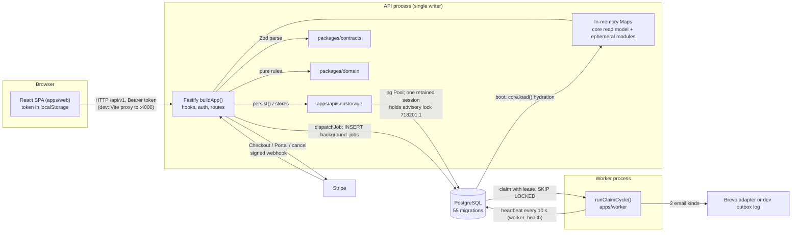
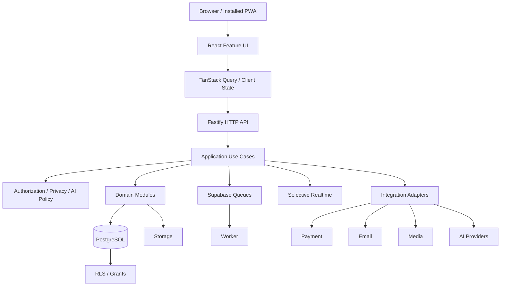
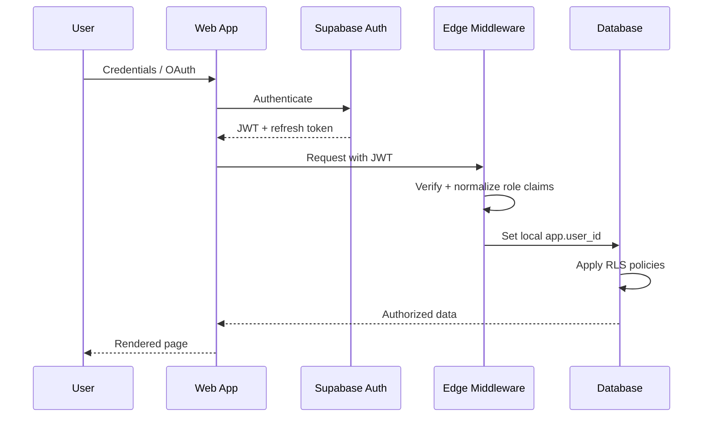
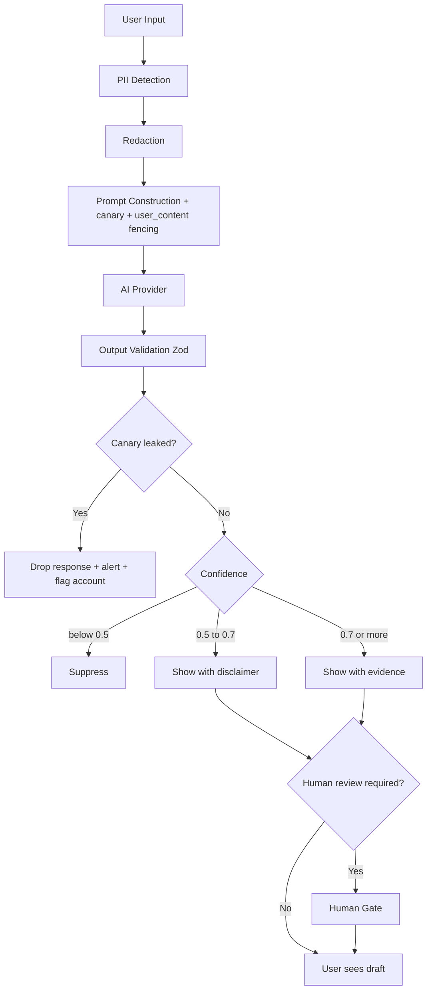
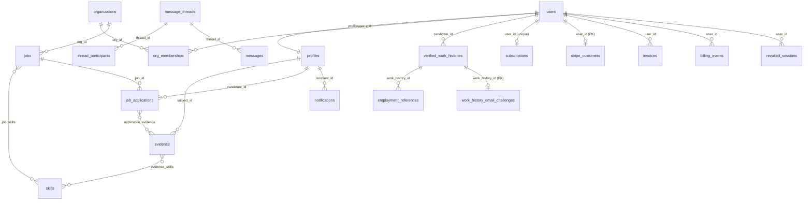

# Target blueprint 30: Prior Implementation Reference (part 1 of 2)

> **Status.** Archive: proposal, not ratified. A greenfield redesign blueprint written in October 2026. Every area was Draft, Under Review or Revision Required (its own document status) and no test was run against it. Its content was mined into `docs/blueprint/`; `SSOT.md` remains the source of intent. Module federation described here was not adopted: the built system is a modular monolith (`ARCHITECTURE.md`).
>
> **What this file holds.** All files of the former `Yash_Final_Project_Document/30_PRIOR_IMPLEMENTATION_REFERENCE/` folder, in order.
>
> **Merged on 2026-11-25** from the files listed below; each one is a section under its original title. Nothing was removed; the originals are in git history at commit `08387ec`.

Parts: [part 1](30_PRIOR_IMPLEMENTATION_REFERENCE.md) · [part 2](30_PRIOR_IMPLEMENTATION_REFERENCE_PART2.md)

| Section | Former file |
|---|---|
| TalentSphere — Canonical Documentation Index | `Yash_Final_Project_Document/30_PRIOR_IMPLEMENTATION_REFERENCE/00-INDEX.md` |
| 01 - Product Requirements | `Yash_Final_Project_Document/30_PRIOR_IMPLEMENTATION_REFERENCE/01-PRODUCT-REQUIREMENTS.md` |
| 02 - Architecture and Technical Truth | `Yash_Final_Project_Document/30_PRIOR_IMPLEMENTATION_REFERENCE/02-ARCHITECTURE.md` |
| 03 - Development Guide | `Yash_Final_Project_Document/30_PRIOR_IMPLEMENTATION_REFERENCE/03-DEVELOPMENT-GUIDE.md` |
| 04 - Features and Workflows | `Yash_Final_Project_Document/30_PRIOR_IMPLEMENTATION_REFERENCE/04-FEATURES-AND-WORKFLOWS.md` |
| 05 - Database and API | `Yash_Final_Project_Document/30_PRIOR_IMPLEMENTATION_REFERENCE/05-DATABASE-AND-API.md` |
| 06 - Security and Integrations | `Yash_Final_Project_Document/30_PRIOR_IMPLEMENTATION_REFERENCE/06-SECURITY-AND-INTEGRATIONS.md` |
| 07 - Testing and Operations | `Yash_Final_Project_Document/30_PRIOR_IMPLEMENTATION_REFERENCE/07-TESTING-AND-OPERATIONS.md` |
| 08 - Roadmap, Debt, Decisions and Open Conflicts | `Yash_Final_Project_Document/30_PRIOR_IMPLEMENTATION_REFERENCE/08-ROADMAP-AND-DECISIONS.md` |

## TalentSphere — Canonical Documentation Index

_Former file: `Yash_Final_Project_Document/30_PRIOR_IMPLEMENTATION_REFERENCE/00-INDEX.md`._

> **Reference only — prior attempt.** This file analyses an EARLIER implementation attempt. For this project nothing is assumed implemented: labels such as `Implemented-verified` describe what the prior attempt's code reportedly did, not the state of this project. Target design lives in `Yash_Final_Project_Document/` folders 00-29; founder intent is the root `SSOT.md`.

This folder is the consolidated, evidence-checked documentation set. It was built on branch `docs/consolidation-2026-10-26` from `SSOT.md`, `ARCHITECTURE.md`, `docs/`, `BRAIN/`, deploy notes, the source code, and the earlier target-design blueprint in `Yash_Final_Project_Document/`.

### Authority rules

1. **Code, migrations and tests decide what is implemented.** Where a document and the code disagree, these files say so and cite the code.
2. **`SSOT.md` is the intent source** (protected, unchanged). It describes what the product should be, not what is built.
3. **`Yash_Final_Project_Document/` is a proposed target design.** Its content appears here only as sections labelled _Proposed_; it has open review findings (see its `27_INDEPENDENT_REVIEWS/`).
4. Every statement in the canonical files carries a status: Implemented-verified, Implemented-unverified, Partial, Planned, Proposed-only, Deprecated or Unknown. No test, build or deployment is claimed unless a file says it was run.
5. One topic has one canonical home (table below). Other documents link instead of repeating.

### Reading order

| #   | File                                                         | Read it to                                                |
| --- | ------------------------------------------------------------ | --------------------------------------------------------- |
| 01  | [Product requirements](#01---product-requirements)           | understand the product, roles, scope, rules, requirements |
| 02  | [Architecture](#02---architecture-and-technical-truth)                           | understand the stack, components, flows, invariants       |
| 03  | [Development guide](#03---development-guide)                 | set up, build, run, extend; repo rules                    |
| 04  | [Features and workflows](#04---features-and-workflows)       | see every feature, its status, journeys, permissions      |
| 05  | [Database and API](#05---database-and-api)                   | schema, migrations, all 278 routes                        |
| 06  | [Security and integrations](#06---security-and-integrations) | auth, authorization, privacy, Stripe, email, AI, gaps     |
| 07  | [Testing and operations](#07---testing-and-operations)       | tests, CI, deploy, recovery, release checks               |
| 08  | [Roadmap and decisions](#08---roadmap-debt-decisions-and-open-conflicts)         | open work, ADRs, 32 recorded documentation conflicts      |

### Files that must stay where they are

- `docs/PRICING.md`: `tests/unit/pricing-consistency.test.ts` reads it at runtime.
- `docs/registries/FEATURE_REGISTRY.md`: read by `.agents/teamwork/explorer_features_1/extract_audit_data.cjs`.
- `SSOT.md`, `AGENTS.md`, `CLAUDE.md`, `GEMINI.md`, `RETICLE.md`, `README.md`, `.github/**`, `deploy/**`: tool, agent and release files.
- Linked from root files (`AGENTS.md`, `RETICLE.md`, `ARCHITECTURE.md`, `SSOT.md`) and therefore kept: `docs/INDEX.md`, `docs/engineering/{API_CONTRACTS,CODE_STYLE,DATABASE,HOSTED_SUPABASE_MIGRATION_GATE}.md`, `docs/engineering/adr/ADR-015-*.md`, `docs/engineering/adr/ADR-016-*.md`, `docs/experience/APP_FLOW.md`, `docs/quality/{OPERATIONS,SECURITY,TESTING}.md`, `docs/reports/FEATURE_STATUS_2026-10-21.md`, `docs/system-model/{01,02,03,06}-*.md`. They are also source evidence for the canonical files here; do not delete them without first repointing every link.
- `Yash_Final_Project_Document/`: proposed target design with open review findings; kept as a whole.

### Maintenance rules

Search before creating a document. Update the canonical file instead of adding a new one. Do not create `FINAL`, `V2`, `NEW` or per-task Markdown files. Link, do not copy. Update the status label when behaviour changes. Keep scratch and agent logs out of the permanent tree.

## 01 - Product Requirements

_Former file: `Yash_Final_Project_Document/30_PRIOR_IMPLEMENTATION_REFERENCE/01-PRODUCT-REQUIREMENTS.md`._

> **Reference only — prior attempt.** This file analyses an EARLIER implementation attempt. For this project nothing is assumed implemented: labels such as `Implemented-verified` describe what the prior attempt's code reportedly did, not the state of this project. Target design lives in `Yash_Final_Project_Document/` folders 00-29; founder intent is the root `SSOT.md`.

Canonical home for: vision, users and roles, scope and non-goals, product principles, business-rule summary, functional and non-functional requirements, constraints.
Not here: architecture ([02](#02---architecture-and-technical-truth)), setup and conventions ([03](#03---development-guide)), per-feature behaviour and workflows ([04](#04---features-and-workflows)), schema and API ([05](#05---database-and-api)), security and integrations ([06](#06---security-and-integrations)), tests and operations ([07](#07---testing-and-operations)), outstanding work, ADRs and conflicts ([08](#08---roadmap-debt-decisions-and-open-conflicts)).

As-of 2026-10-26, branch `docs/consolidation-2026-10-26`, 55 SQL migrations in `supabase/migrations` (00001-00055). Plans and prices: docs/PRICING.md (`31_LEGACY_ARCHIVE/docs/PRICING.md`, removed 2026-10-27; recover with `git show 85706db0:Yash_Final_Project_Document/31_LEGACY_ARCHIVE/docs/PRICING.md`) is the only home for the plan table (a unit test reads it at runtime); this file links to it and does not copy it.

### 0. How to read this file

#### 0.1 Status labels (single definition for the whole set)

Other files in this set reference this table. Where 02/04/05 say "read in source, not executed" the equivalent label here is Implemented-unverified; Implemented-verified always requires a recorded pass (never source reading alone). 03/06/07/08 use their own work-status words (Verified-by-config, Confirmed, OPEN/FIXED-SRC); they map to these labels only when they cite a recorded test or runtime result.

| Label                  | Meaning                                                                                                                                                                                           |
| ---------------------- | ------------------------------------------------------------------------------------------------------------------------------------------------------------------------------------------------- |
| Implemented-verified   | Source plus automated tests plus a recorded PostgreSQL and/or browser pass. Always a dated, scoped claim; nothing was re-run when this file was written. No whole feature is certified (see 0.3). |
| Implemented-unverified | Source and unit/integration tests exist; no PG, browser, live-provider or deployment evidence.                                                                                                    |
| Partial                | A subset of the contract exists (API without UI, UI without durability, or missing sub-requirements).                                                                                             |
| Planned-approved       | Stated in `SSOT.md` (founder-authored canonical intent) or a ratified founder amendment; not built.                                                                                               |
| Proposed-only          | Appears only in the target blueprint `Yash_Final_Project_Document/` or in an audit plan not ratified by the owner (X-xx work, Stages A-F, OPEN-xx). Never treat as requirement or as built.       |
| Deprecated             | Registry says deprecated or not recommended.                                                                                                                                                      |
| Unknown                | Sources conflict or no evidence was found.                                                                                                                                                        |

#### 0.2 Authority order

1. What exists: code, migrations, tests (`apps/`, `packages/`, `supabase/migrations`, `tests/`), then root `ARCHITECTURE.md`. Dated reports never override newer source.
2. What is intended: `SSOT.md` v6.0, then PRD, TRD, registries.
3. Proposals: `Yash_Final_Project_Document/` (target blueprint, revision-required) and audit plans. History: dated reports, `docs/history/PROJECT_HISTORY.md`.

Rule carried from SSOT: documented is not implemented, implemented is not verified, verified is not production-ready. A feature is "implemented" only on current executable evidence.

#### 0.3 Evidence base (all dated, none re-run here)

| Snapshot                                       | Result                                                                                                                                                                                                                                                                                           | Source                                                                        |
| ---------------------------------------------- | ------------------------------------------------------------------------------------------------------------------------------------------------------------------------------------------------------------------------------------------------------------------------------------------------ | ----------------------------------------------------------------------------- |
| 2026-10-21 audit (source `a771a87b`)           | 1,172 Vitest tests / 115 files pass (memory mode); 10 TS projects typecheck; lint red on 7 files; no PG, browser, live-email, deploy, restore run. Provisional feature maturity: 6 implemented-unverified, 87 partial, 1 broken, 75 not implemented, 4 deprecated; zero whole features certified | `docs/reports/FEATURE_STATUS_2026-10-21.md`                                   |
| 2026-10-22 audit (`83dc7d24`)                  | 1,143 tests / 112 files; claims 26 Full / 91 Partial / 6 Stub / 50 Missing                                                                                                                                                                                                                       | `AUDIT_MASTER_REPORT.md`, `FEATURE_TRACEABILITY_MATRIX.md`, `docs/history/PROJECT_HISTORY.md` |
| 2026-10-23 CI (main `0f40b6c9`, from re-audit) | 1,231 Vitest / 117 files; 50 PG tests / 11 files; Playwright 235 of 236 pass (1 flaky navigation case); local migrations 00001-00052 apply                                                                                                                                                       | `docs/reports/REPOSITORY_STATE_2026-10.md`                    |

Current tree: 13 PG test files under `tests/pg` (the 10-23 CI figure of 11 files is older). The count sets are incompatible by method (the 10-22 "Full" label counted DB+API+UI+tests; the 10-21 label demanded semantic acceptance). Both are kept; neither is a release certificate. Conflict K-01 in [08](#08---roadmap-debt-decisions-and-open-conflicts).

### 1. Product definition and vision

| Item                  | Statement                                                                                                                                                                                 | Source                                        | Status                                                                           |
| --------------------- | ----------------------------------------------------------------------------------------------------------------------------------------------------------------------------------------- | --------------------------------------------- | -------------------------------------------------------------------------------- |
| Product               | PWA-first Career Operating System on a Talent Graph plus Evidence Graph. "OS" describes breadth of career workflow, not kernel or device functionality                                    | SSOT 1, 4.1; PRD 1                            | Planned-approved (concept); Partial (built)                                      |
| Vision                | Make career growth transparent, verifiable, accessible: Learn - Prove - Showcase - Match - Apply - Hire - Grow as one loop                                                                | SSOT 2.1                                      | Planned-approved                                                                 |
| Durable asset         | The evidence-backed career graph (capability, proof, learning, experience, opportunities, outcomes), under user control, explainable, private                                             | SSOT 1                                        | Planned-approved                                                                 |
| Mental model          | A career evidence system, not a job board, learning site, social network or AI wrapper. Claim is not evidence; evidence is not verification; reputation is context; AI does not own truth | BRAIN.md 1-6                                  | Planned-approved                                                                 |
| Product class         | Combines learning, networking, employer insight, assessment and institutional career systems; independent of external platforms (LinkedIn is optional import/syndication only)            | SSOT 2.2                                      | Planned-approved                                                                 |
| Core loop (SSOT/PRD)  | Goal - Gap - Learn - Practice - Prove - Verify - Discover - Match - Apply - Interview - Outcome - New Evidence - Next action                                                              | SSOT 1, B; PRD 1                              | Planned-approved; built subset only (see 6.1)                                    |
| Built core loop       | Candidate sign-up - profile - work history - proof of control (corporate-email code, referee link) - apply; recruiter org - post job - review pipeline - messaging/notifications          | `ARCHITECTURE.md`, ADR-015, RELEASE_SCOPE doc | Implemented-verified (scoped, dated CI 2026-10-23); live email/deploy unverified |
| Target-blueprint loop | Same seven-stage loop; verified career-evidence platform; matching explainable, never pay-to-rank                                                                                         | Blueprint MASTER 1, ADR-T01/T22               | Proposed-only                                                                    |

#### 1.1 Problem and value proposition

Career information is fragmented across profiles, learning, job boards, assessments, portfolios and employer workflows; users restate the same experience as unsupported claims (PRD 2). Hiring runs on claims that are costly to check (blueprint STR-01). Promise: "a coherent evidence-backed career loop where every meaningful action can improve future career decisions", not "more features" (PRD 5).

#### 1.2 Goals

| Source                                | Goals                                                                                                                                                                                                                                                                                                                                                                                                                                             |
| ------------------------------------- | ------------------------------------------------------------------------------------------------------------------------------------------------------------------------------------------------------------------------------------------------------------------------------------------------------------------------------------------------------------------------------------------------------------------------------------------------- |
| PRD 6                                 | (1) trusted career identity; (2) activity becomes attributable evidence; (3) learning connects to opportunities; (4) explainable matching; (5) application outcomes close the loop; (6) privacy and human control preserved                                                                                                                                                                                                                       |
| Blueprint GOAL-01..08 (Proposed-only) | GOAL-01 graded auditable evidence; 02 faster trustworthy screening; 03 explainable and fair matching; 04 learning converts to evidence/outcomes; 05 institutions graduate learners into the loop; 06 secure, private, accessible; 07 sustainable business; 08 graceful degradation. REV2 replaces measure cells: targets are design targets, "passes" legal/audit wording retired, values OPEN until a pilot baseline (PRODUCT_VISION_GOALS_REV2) |

#### 1.3 Flywheels (SSOT 2.3)

Career (learn - prove - showcase - match - apply - hire - grow); Evidence (more valid evidence - stronger matching - better outcomes); B2B2C (institution-managed learning - verified signals - independent identity - outcomes); Content/community (publish - engagement - reputation - discovery). Status: Planned-approved; B2B2C, content and community flywheels have no built code (F-40..F-47 partial/absent, F-53..F-57 absent).

#### 1.4 Success metrics

| Metric class    | Definition                                                                                                                                                                                        | Status                                                                                                           |
| --------------- | ------------------------------------------------------------------------------------------------------------------------------------------------------------------------------------------------- | ---------------------------------------------------------------------------------------------------------------- |
| Primary outcome | "Verifiable Career Progress" (PRD 9; SSOT 2.4 "career progress with verifiable evidence")                                                                                                         | Planned-approved. Conflict: blueprint names "Evidence-Backed Hiring Conversations" (OPEN-51). No baseline exists |
| Supporting      | Activation, goal creation, skill coverage, evidence created/verified, learning completion, assessment improvement, qualified applications, interviews, offers, hires, outcome feedback, retention | Planned-approved; instrumentation partial (F-19 analytics API, no UI)                                            |
| Business        | Paid conversion, recurring revenue, gross margin, infrastructure and AI cost per capability, enterprise expansion, support burden                                                                 | Planned-approved; no data (no revenue/cost metrics supplied to any audit)                                        |
| Ratio targets   | OD-01 workspace metric "active learners"; FC-07 candidate:employer ratio target                                                                                                                   | Unknown - FC values not defined in the files read (K-22 in file 08)                                              |

#### 1.5 Segments and monetisation intent

| Segment               | Payer                                                                           | Intent                                                               | Source                                                            | Status                                                                                                                                                                             |
| --------------------- | ------------------------------------------------------------------------------- | -------------------------------------------------------------------- | ----------------------------------------------------------------- | ---------------------------------------------------------------------------------------------------------------------------------------------------------------------------------- |
| Candidates / learners | Free core; optional paid tools                                                  | Core evidence, applying and messaging stay free                      | blueprint STR-01 5; SSOT principle 9 "monetization follows value" | Core free: Implemented (no paywall on core). Candidate Pro plan exists in code (see PRICING) but SSOT F-61 / OD-34 "Premium Candidate" is decision-gated, price TBD: conflict K-12 |
| Employers             | Subscription per org/seat, job slots                                            | BR-07 billing actions for recruiters; BR-130 outreach caps by tier   | SSOT BR-07, BR-130                                                | Partial: Stripe Checkout/Portal/webhook exist, default `BILLING_MODE=disabled`, live billing unverified                                                                            |
| Institutions          | Seat licence                                                                    | Volume-tier per seat (OD-15), license pools (BR-072..082)            | SSOT OD-15                                                        | Planned-approved; not built (F-41 absent)                                                                                                                                          |
| Instructors           | Revenue share 70/30 default (OD-28, BR-101)                                     | Course commerce                                                      | SSOT                                                              | Planned-approved; not built (F-73 absent)                                                                                                                                          |
| Rule                  | No plan may buy credibility, hiring rank, assessment bypass or private evidence | `validateMonetizationIntegrity` (SSOT 64); BR-187 / BR-126 labelling | Implemented-verified (unit test per PRICING.md)                   |

### 2. Users, roles and permissions

#### 2.1 Actor groups (SSOT 5; PRD 3)

Candidate/learner, career switcher, professional, recruiter, hiring manager, employer admin, instructor/course author, institution admin/faculty/proctor, mentor/expert, moderator, verification staff, support, finance, platform admin, service account. Blueprint adds referee (no account, single-use token), auditor, viewer, org owner.

#### 2.2 Role models in circulation (conflict K-05)

| Model                                  | Content                                                                                                                                                                                                                                                                                                                                                                                                                                                                                                                                                                                                                                            | Status                                   |
| -------------------------------------- | -------------------------------------------------------------------------------------------------------------------------------------------------------------------------------------------------------------------------------------------------------------------------------------------------------------------------------------------------------------------------------------------------------------------------------------------------------------------------------------------------------------------------------------------------------------------------------------------------------------------------------------------------- | ---------------------------------------- |
| SSOT two-tier (SSOT 6.1)               | Tier 1 JWT roles `ROLE_USER`, `ROLE_RECRUITER`, `ROLE_ADMIN` (Supabase Auth). Tier 2: 24 workspace-scoped contextual roles: Candidate, Recruiter, Hiring Manager, Interviewer, Org Admin, Agency Recruiter, Finance Admin, Support Agent, Moderator, Platform Admin, Service Account, Instructor, Mentor, Course Author, Institution Admin, Department Admin, Faculty/Proctor, Managed Learner, Billing/Procurement Manager, Student, Peer Reviewer, Contest Participant, Content Author, Company Reviewer. Resolution highest-wins: `ROLE_ADMIN` audited override - workspace grants - `ROLE_RECRUITER` (needs `org_id` membership) - `ROLE_USER` | Planned-approved; not built as specified |
| Built (`packages/domain/src/core.ts`)  | `Role` union of 10: candidate, recruiter, hiring_manager, course_author, instructor, institution_admin, platform_admin, moderator, verification_staff, service_account. Self-registration accepts only candidate or recruiter. Every request re-reads account roles/status; signed role snapshots do not override. Several organization actions accept any membership regardless of org role (policy gap CF-14)                                                                                                                                                                                                                                    | Implemented-unverified; Partial vs SSOT  |
| Blueprint scoped grants (USR-01, REV2) | Grant = (principal, role, scope in platform/org/institution/self), deny by default, matrix derived from DT-01; consent-gated evidence reads; time-boxed audited staff access; referee = token not role; `GET /me/capabilities`                                                                                                                                                                                                                                                                                                                                                                                                                     | Proposed-only (OPEN-44)                  |

#### 2.3 Authorization rules (SSOT 5, 7.2; BR-01..09)

- Chain: identity - role - permission - resource ownership - tenant/workspace - purpose/context - policy decision. Never trust client-supplied role, tenant or ownership ids.
- Boundary principles: no cross-user mutation without consent or legal basis; recruiter access is application-scoped; moderation escalations quorum-based; faculty scoped to assigned batches; managed learners cannot self-enrol outside the license pool or apply pre-graduation; peer review double-blind; anonymous company reviews hide identity from employer/public but never from Platform Admin/legal; instructors cannot review or rate their own courses.
- Master permission matrix (SSOT 7.1): 12 capabilities x 10 roles (publish own course, approve for marketplace, grade, peer-review, create posts, moderate UGC, company review, salary report, contests, coupons, instructor earnings, refunds). Planned-approved; only the recruiter/candidate job-and-application subset is built.
- Built enforcement: per-handler resource authorization (INVARIANT-001/014 in `ARCHITECTURE.md`); route-by-route review in `docs/system-model/06-route-authorization.md`; no global auth middleware.

#### 2.4 Personas and lifecycles

| Persona set        | Content                                                                                                                                                                                                                                                                                                                                                                                                                                                                                                                                                                                      | Status                                   |
| ------------------ | -------------------------------------------------------------------------------------------------------------------------------------------------------------------------------------------------------------------------------------------------------------------------------------------------------------------------------------------------------------------------------------------------------------------------------------------------------------------------------------------------------------------------------------------------------------------------------------------- | ---------------------------------------- |
| SSOT P-A..P-T (19) | Aisha early-career candidate (J-01,02); Rohan mid-career switcher (J-01,06); Priya startup recruiter (J-03); Dev platform admin (WF-08); Elena and Sara hiring managers (J-03,27); Farid agency recruiter (J-10); Grace course creator (J-07,18); Hugo mentor (J-08); Ivy institutional partner (J-09); Dr. Rao department head (J-14,15); Meera faculty/proctor (J-15); Tomas corporate L&D (J-16); Sam self-paced learner (J-19); Nina content creator (J-23); Omar job researcher (J-22); Quinn competitive programmer (J-21); Ravi career switcher (J-26); Tara skills analyst (J-16,28) | Planned-approved; not research-validated |
| Blueprint P1-P5    | Asha career-switcher, Marcus recruiter, Dr. Lin faculty, Priya referee, Sam support operator - hypothetical, no user research (OPEN-07)                                                                                                                                                                                                                                                                                                                                                                                                                                                      | Proposed-only                            |

Lifecycles (SSOT 6.4): account REGISTERED - UNVERIFIED - VERIFIED - ACTIVE <-> SUSPENDED - DEACTIVATED - DELETED or TERMINATED (built `UserStatus`: active, suspended, pending_verification, deactivated; no `banned`, CF-19); managed learner provisioned - invited - claimed - active_managed - graduation_pending - independent or revoked - archived; instructor applicant - under_review - approved - active <-> suspended - retired; course draft - submitted - under_review - approved - published - updating - archived/unpublished; contest draft - scheduled - registration_open - active - ended - results_published - archived. All Planned-approved except the account subset. 53 state machines are indexed in SSOT 18 (home: [04](#04---features-and-workflows)).

### 3. Scope, non-goals and gates

#### 3.1 Scope guardrails

| Rule                                                                                                                                                                                                                    | Source                                         |
| ----------------------------------------------------------------------------------------------------------------------------------------------------------------------------------------------------------------------- | ---------------------------------------------- |
| Browser/PWA career platform; not a general OS                                                                                                                                                                           | SSOT 4.1                                       |
| GA proves the trusted career loop first; the 173-feature portfolio is a capability inventory, not the GA target. Marketplace, OS-like capabilities, broad social parity, proctoring and advanced enterprise stay staged | SSOT B; PRD 8; FEATURE_REGISTRY portfolio rule |
| External platforms are adapters or import sources only; TalentSphere stores its own canonical state                                                                                                                     | SSOT 4.3; MIG-01..08                           |
| Complexity discipline: modular monolith first; search, cache, service extraction only on measured need                                                                                                                  | SSOT A; TRD 4                                  |

#### 3.2 Non-goals

Sales-prospecting suite; self-serve ad network; general-purpose or non-career marketplace; social-media clone; generic HR/payroll; autonomous hiring engine; guaranteed jobs or salary outcomes; opaque pay-to-rank hiring; ungoverned autonomous AI; unnecessary realtime/live-streaming; hardware/OS platform; mandatory dependence on LinkedIn, Udemy, Coursera, Glassdoor or HackerRank (SSOT 4.2, 3.3; PRD 7). Blueprint adds: generic workflow engine, CRM, crypto credentials, native apps at launch (DOM coverage table).

#### 3.3 Exclusions and decision gates

| Item                                                                                                                                                                                                   | Disposition                                                                                                                                   | Decision ref                    | Built reality                                            |
| ------------------------------------------------------------------------------------------------------------------------------------------------------------------------------------------------------ | --------------------------------------------------------------------------------------------------------------------------------------------- | ------------------------------- | -------------------------------------------------------- |
| Crypto/token products, blockchain credentials                                                                                                                                                          | Excluded                                                                                                                                      | SSOT 3.3                        | none                                                     |
| Autonomous consequential AI; AI hire/reject/disqualify; emotion analysis; predictive performance scoring; resume fabrication; AI grading peer reviews; AI deciding refunds; AI auto-publishing courses | Prohibited, zero tolerance                                                                                                                    | SSOT 32.1-32.2                  | AI is a local heuristic, no remote model                 |
| Candidate-level predictive/automated hiring decisions (F-154 Interview Prediction, F-168 Hiring Prediction)                                                                                            | Excluded from GA unless separate governance, validation, fairness, human-control and legal review admits it; descriptive benchmarking allowed | SSOT E                          | Not implemented                                          |
| Proctoring (F-45)                                                                                                                                                                                      | Vendor-gated                                                                                                                                  | OD-35                           | Interview fields only; no vendor                         |
| Premium Candidate tier (F-61)                                                                                                                                                                          | Decision-gated, price TBD                                                                                                                     | OD-34                           | Candidate Pro plan coded in `billing.ts` (conflict K-12) |
| Sponsored content (F-62)                                                                                                                                                                               | Not recommended / deprecated                                                                                                                  | OD-32                           | none                                                     |
| Business-development graph (F-63)                                                                                                                                                                      | Not recommended / deprecated                                                                                                                  | OD-31 (SCOPE-003)               | none                                                     |
| Legacy chat service (F-38), unified backend stub (F-39)                                                                                                                                                | Deprecated                                                                                                                                    | registry                        | none                                                     |
| Native apps as prerequisite; unrestricted hardware integration                                                                                                                                         | Excluded                                                                                                                                      | SSOT 3.3                        | PWA only                                                 |
| Live video                                                                                                                                                                                             | Defer, vendor evaluation                                                                                                                      | OD-33                           | Interview rooms API only (F-33 partial)                  |
| White-label, enterprise API pricing                                                                                                                                                                    | Co-branded first (OD-20); API enterprise-only (OD-53)                                                                                         | OD-20, OD-53                    | none                                                     |
| Government ID verification (F-81), federation                                                                                                                                                          | Optional / vendor-gated; federation not adopted                                                                                               | OD (blueprint OPEN-10, ADR-T23) | Partial/Proposed-only                                    |

### 4. Product principles and invariants

#### 4.1 Principles (SSOT 3.1; PRD 10)

1 Verified over claimed. 2 Candidate dignity first. 3 Human-controlled AI. 4 Progressive disclosure. 5 One semantic model. 6 Defense in depth. 7 Observable by default. 8 Accessibility by default. 9 Monetization follows value. 10 Simplicity before scale. 11 Evidence over popularity. 12 No deterministic career promises.
PRD product rules: evidence beats self-claims; matching explainable; AI governed; assessment AI restrictions server-enforced; free users create no unplanned paid AI cost; privacy purpose-bound; popularity is not credibility; anomalies need review, not automatic guilt.
BRAIN heuristics: hard constraints before soft matching; always explain recommendations; scenarios not prophecy; clear module + explicit contract + boring infrastructure + strong tests. Common mistakes to avoid: building AI before domain data is trustworthy, turning every feature into a platform, a single score where dimensions are needed, realtime as truth, queues as exactly-once business effects, hard-coded policy values, confusing existence with correctness.

#### 4.2 Product invariants (SSOT 3.2) and built status

| #   | Invariant                                                             | Built status (code/test evidence; dated)                                                                                                                                                     |
| --- | --------------------------------------------------------------------- | -------------------------------------------------------------------------------------------------------------------------------------------------------------------------------------------- |
| 1   | RLS is a DB boundary; app authorization above it                      | Partial: policies exist in migrations; the API connects with a privilege that can bypass RLS (SEC-04), so isolation is app-layer                                                             |
| 2   | No direct client DB writes for domain mutations; server-authoritative | Implemented-unverified (browser uses API only; no Supabase client in web)                                                                                                                    |
| 3   | No autonomous consequential AI action                                 | Implemented (no remote AI; heuristic only)                                                                                                                                                   |
| 4   | Assessment AI restrictions server-side (`AI_PROHIBITED`)              | Partial: enforced on two assistant routes; active sessions are in-memory so an API restart clears them (SEC-05); the separate assistant-query scaffold skips quota (INVARIANT-007 exception) |
| 5   | Free users cause no paid AI inference without explicit policy         | Implemented-unverified (no paid inference exists; chat quota enforced; meter is in-memory)                                                                                                   |
| 6   | Secrets server-side                                                   | Implemented-verified (scoped): CI sentinel build + bundle scan; env refusal checks. Windows secret-scan test has a false-green weakness (D-07)                                               |
| 7   | Cross-tenant exposure is a critical incident                          | Process rule; tenant isolation tests partial; org-role gaps (CF-14)                                                                                                                          |
| 8   | AI memory is not profile truth or evidence                            | Implemented-unverified                                                                                                                                                                       |
| 9   | Evidence/credential lifecycle auditable                               | Partial: certificate revocation and evidence revocation are independent (D-10)                                                                                                               |
| 10  | Offline cache never authoritative                                     | Vacuously true: no service worker / offline layer exists                                                                                                                                     |
| 11  | Matching/recommendation explainable and uncertainty-aware             | Partial: in-process matching; recommendation engine F-145 not implemented                                                                                                                    |
| 12  | Reputation contextual; popularity not credibility                     | Partial (F-144 API, ephemeral)                                                                                                                                                               |
| 13  | Anomaly is not guilt                                                  | Planned-approved                                                                                                                                                                             |
| 14  | Consequential side effects idempotent and auditable                   | Partial: worker leases not fenced (D-02); dedicated stores outside `persist()`                                                                                                               |
| 15  | One authoritative definition per concept                              | Not met: see conflict register                                                                                                                                                               |

Register counts in SSOT 42.1 (P-* 11, U-* 12, INV-* 16, SCOPE-* 8) do not match the text, which lists 12 principles and 15 invariants; the P-_, SCOPE-_, FC-_, TD-_, MVD-* IDs are referenced but not defined in `SSOT.md` (K-22). Built-system invariants (INVARIANT-001..015, e.g. single-writer `persist()`, hashed credentials) live in [02](#02---architecture-and-technical-truth). Blueprint INV-T01..T20 and fitness functions FF-01..FF-12 are Proposed-only (OPEN-48).

### 5. Business rules summary

Full text: docs/registries/BUSINESS_RULE_REGISTRY.md (`31_LEGACY_ARCHIVE/docs/registries/BUSINESS_RULE_REGISTRY.md`, removed 2026-10-27; recover with `git show 85706db0:Yash_Final_Project_Document/31_LEGACY_ARCHIVE/docs/registries/BUSINESS_RULE_REGISTRY.md`) (canonical identity and text for BR-01..BR-248 plus MIG-01..MIG-08; recommended to keep as the single rule home and link, not copy). Rule IDs use two digits for BR-01..BR-35 and three digits after (K-09). Change policy: identify journeys/features, data/API impact, security/privacy impact, tests, SSOT update, rationale.

Implementation status: the rule text is inventoried and a subset carries code or test annotations, but no semantic acceptance review was done for the 248 rules (audit task X-00). A matching BR comment or ID is not proof. Known divergences are listed below; everything else is Unknown.

#### 5.1 Rule families

| Family (SSOT 19.x)                         | IDs                                                 | Theme                                                                                                                                                                                                                                                                                                    | Notable parameters                                                                                            |
| ------------------------------------------ | --------------------------------------------------- | -------------------------------------------------------------------------------------------------------------------------------------------------------------------------------------------------------------------------------------------------------------------------------------------------------- | ------------------------------------------------------------------------------------------------------------- |
| Access control                             | BR-01..09                                           | Recruiter/admin job authoring; only `ROLE_USER` applies; own-data access; admin-only flags/audit/moderation; billing for recruiters; route RBAC = registry; domain authz behind commands                                                                                                                 | Built: candidate/recruiter split enforced; BR-08/09 partly inline (R-2)                                       |
| Jobs                                       | BR-10..14, 036, 057                                 | Server-validated publish readiness; lifecycle draft - pending_approval - approved - scheduled - published - paused - closed - archived; own-company only; hidden jobs reversible; digest scheduler audited                                                                                               | Auto-close default 60 days (D-2). Built `JobStatus` omits `scheduled` (F-05 audit)                            |
| Applications                               | BR-15..20, 037..041, 045, 058, 061                  | One active application per user per job (partial unique + 90-day cooldown); append-only lifecycle and history; drafts autosave 30 s; recruiter notes never candidate-visible; strict state machine; profile >=70% gate; rejection email delay 24 h default; auto-archive after 90 days submitted         | BR-15 Implemented-verified (partial unique index, PG tests); draft autosave API exists, no UI (F-36)          |
| Learning and challenges                    | BR-21..25, 046..052, 053                            | Idempotent lesson completion; prerequisites; completion yields certificate and XP; language allowlist; XP idempotent with daily cap 200; sequential modules; final assessment >=70%; isolated sandbox 30 s CPU / 512 MB / 1 GB; public+hidden tests; async plagiarism; badges only on verified milestone | BR-048 not enforced in code (D-09); sandbox not built (D-01)                                                  |
| Data governance                            | BR-26..35, 063, 067, 068                            | Append-only exports; whitelist analytics metadata; extension data local; schedulers dry-run; subscription state webhook-owned; AI drafts never auto-commit; export within 30 days; all admin actions audited; account termination needs dual admin approval                                              | BR-32 Implemented (Stripe reconcile); BR-29 rollback not evidenced                                            |
| Verification and trust                     | BR-043..044, 062..066, 149..156, 164..168           | Virus scan before text extraction; encrypted extracted text; verified signals on profiles; AI confidence <0.5 suppressed, <0.7 disclaimer; append-only credentials; public verification URL without PII; appeals SLA <=7 days; reputation derived, skill-specific, 24-month decay, private by default    | Credential append-only: inconsistent (D-10); BR-167 visibility gate Implemented (PR #58), consent UI deferred |
| Operational automation                     | BR-069..071                                         | Interviewer inactivity 7/14 business days; candidate non-response 5/8 days; requisition abandonment 21/30 days                                                                                                                                                                                           | Not implemented (no scheduler)                                                                                |
| Institutional                              | BR-072..082, 241..248                               | Seat-bound access; 7-day revoke grace; atomic seat consumption; FERPA severance on graduation; dry-run bulk import; tenant scoping by `organization_id`; alumni rules                                                                                                                                    | Not implemented (F-40 partial, F-41 absent)                                                                   |
| Media                                      | BR-083..090                                         | External media validated; embedding restrictions respected; provider allowlists server-side                                                                                                                                                                                                              | Not implemented (F-42 absent)                                                                                 |
| Learning marketplace                       | BR-091..115                                         | >=5 lessons and >=30 min to submit; free preview <=20%; rating needs >=20% progress; refund window 30 days; instructor 70% of net; peer review >=2; quiz attempts bounded                                                                                                                                | Not implemented (F-66..F-74 mostly absent/partial)                                                            |
| Social and content                         | BR-116..128                                         | One reaction/repost per user; chronological feed always offered; sponsored labelled; minors 16+ private-by-default                                                                                                                                                                                       | Not implemented                                                                                               |
| Outreach, recommendations, privacy         | BR-129..134, 184..188                               | Outreach credits and weekly caps 20/50; endorsements need a connection; recommendations disclose factors, never use protected attributes, replaceable engine                                                                                                                                             | Not implemented (F-59 absent, F-145 absent)                                                                   |
| Insights and aggregates                    | BR-135..138, 157..163, 177..183, 189..193, 207, 220 | Salary aggregate k>=5 (BR-135/178), k>=10 (BR-220, BR-207 cells), career data k>=5 and >=20 samples, outcome correlation >=30 learners, correlation is not causation, withdraw salary any time, minor units + ISO-4217                                                                                   | Salary/threshold conflict K-08                                                                                |
| Contests and certification                 | BR-139..140                                         | Server-authoritative end time; single-attempt pass                                                                                                                                                                                                                                                       | Not implemented                                                                                               |
| Skills graph                               | BR-141..148, 206                                    | Admin-curated taxonomy; directional prerequisite relations, acyclic; every tag references a canonical skill; traversal depth 5; emerging skill needs 5 signals (BR-148) vs platform-wide adoption (BR-206)                                                                                               | Partial (F-84, ephemeral)                                                                                     |
| Interviews                                 | BR-169..176                                         | Recording dual consent, encrypted, <=90 days; AI feedback advisory, protected attributes excluded; scores append-only; structured rubrics                                                                                                                                                                | Interview execution simulated, refused in staging/production (CF-27)                                          |
| Feature-specific                           | BR-194..205, 208                                    | Mentorship 30-day inactivity close; resume parsing never auto-applies; custom assessments need admin approval; WCAG 2.2 AA is a release gate (BR-204); API access enterprise tier; AI features inherit safety rules                                                                                      | partial                                                                                                       |
| Warm intros / feedback / decay / referrals | BR-209..240                                         | Introducer consent, max depth 4, 10 requests/week; rejection reason required, feedback within 7 days, candidate request window 30 days; freshness nightly, self-attestation 0.5x, <20 demotes; 3 referral requests/30 days, attribution 12 months                                                        | Partial APIs only (F-121, 122, 123, 142 ephemeral)                                                            |
| Migration                                  | MIG-01..08                                          | Imported data is project-owned; one-way user-initiated; never auto-publish; imported skills self-reported; no connection-graph import; tokens server-side and purged; external IDs never primary keys; provider surfaces flag-gated                                                                      | Not implemented (F-64 absent)                                                                                 |

#### 5.2 Registry hygiene issues (kept as conflicts, not fixed here)

BR-35 superseded; duplicate-meaning pairs (BR-15/039 duplicate application, BR-25/060 XP, BR-037/061 profile 70%, BR-11 lifecycle list vs BR-041 state machine); SSOT feature prose attaches different meaning to the same normalized ID (F-01 "BR-001 auth required" vs registry BR-01 job posting); out-of-range BR IDs treated as stale; Appendix B says BR 246 / J 31 while 42.1 says BR 248 + 8 MIG / J 28. Blueprint holds 108 BR-T rules; 256 source IDs align after padding, 4 text conflicts, 171 no-match (OPEN-43). No BR-249+ may be created from historical prose.

### 6. Functional requirements

#### 6.1 Release and GA scope (four definitions in circulation, K-02)

| Definition                     | Scope                                                                                                                                                                                                                                                                                                             | Source                                                          | Status                                                                           |
| ------------------------------ | ----------------------------------------------------------------------------------------------------------------------------------------------------------------------------------------------------------------------------------------------------------------------------------------------------------------- | --------------------------------------------------------------- | -------------------------------------------------------------------------------- |
| Full PRD GA                    | Identity - profile + goals - skills + evidence - learning - assessment/practice - portfolio/proof - jobs - applications - recruiter review - communication - outcome - career graph; plus platform foundations (SSOT B: Goal-Gap-Learn-Practice-Prove-Verify-Discover-Match-Apply-Interview-Outcome-New evidence) | PRD 8; SSOT B                                                   | Planned-approved; learning, assessment, outcome, career progression only partial |
| Restricted trusted-career beta | Identity, profile/evidence, mailbox/referee proof, jobs/apply, recruiter review, outcome, messaging, account controls; subset of F-01/02/03/04/05/06/10/12/14/15/17/20/21/24/25/32/35/52/56/60/84/94/96/162                                                                                                       | FEATURE_PLAN_2026-10-21 G (recommended, owner decision pending) | Proposed-only                                                                    |
| "Core Career Loop GA"          | Candidate sign-up - profile/skills - corporate-email proof - referee voucher - apply - ATS pipeline - messaging; in scope F-01,02,03,04,05,06,10,12,14,15,21,25,29,32,56,58,60,65,80,84,94,96,102,117,162,173; LMS, arena, video rooms, paid subscriptions, admin UI out of scope; free launch tier               | RELEASE_SCOPE_AND_BACKLOG 2.2; AUDIT_MASTER 6.1                 | Proposed-only (authored by an agent group, not owner-ratified)                   |
| Blueprint Phase 1 / Phase 2    | Ph1 pre-GA pilot (Prove - Showcase - Apply, basic messaging); Ph2 complete-loop GA candidate                                                                                                                                                                                                                      | Blueprint ROADMAP, REV2                                         | Proposed-only                                                                    |

None of these is owner-approved. "Broad portfolio launch" of all 173 features is explicitly not recommended (FEATURE_PLAN G).

#### 6.2 Requirement clusters with acceptance criteria and built status

Acceptance criteria are SSOT-stated targets (Planned-approved). "Built" is the strongest dated evidence found; per-feature behaviour is in [04](#04---features-and-workflows).

| Cluster                                         | Features                                                     | Requirement                                                                                                                                          | SSOT acceptance criteria                                                                                                                                                                                                                                                                      | Built status                                                                                                                                                                                                                                                                                                                                                                                                                                                           |
| ----------------------------------------------- | ------------------------------------------------------------ | ---------------------------------------------------------------------------------------------------------------------------------------------------- | --------------------------------------------------------------------------------------------------------------------------------------------------------------------------------------------------------------------------------------------------------------------------------------------- | ---------------------------------------------------------------------------------------------------------------------------------------------------------------------------------------------------------------------------------------------------------------------------------------------------------------------------------------------------------------------------------------------------------------------------------------------------------------------- |
| Identity, session, account                      | F-01, 12, 15, 21, 60, 65, 80                                 | Register/verify/login/logout/reset/OAuth with normalized roles; complete professional record with privacy; settings, export, erasure; error recovery | F-01: login p95 <300 ms; 100% duplicate-email and weak-password rejection; zero secrets in bundle; rate limits at edge; age gate <16. F-12: save p95 <250 ms; public view never exposes PII; completeness reproducible; 409 on concurrent edit                                                | Partial. Built: email/password, PBKDF2-SHA512 210k, HMAC session with revocation, profile CRUD, settings, export metadata, erasure request/cancel. Missing: account-email verification, forgot/reset password, OAuth, refresh cookie, age gate (F-01); uploads and per-section visibility (F-12). Password policy is length >= 8 only ("password" accepted, E2E B03b). Erasure executes immediately; 30-day grace scheduler absent (D-03, K-07). F-65 absent per audit |
| Skills, evidence, credentials                   | F-84, 96, 52, 94, 162, 58, 110, 123                          | Governed skill graph; append-only credentials with public verification; proof of control for work history; references; freshness                     | F-84: search p95 <100 ms, traversal <200 ms depth <=3, 100% tags canonical, zero prerequisite cycles. F-96: issuance <500 ms, public verify <200 ms, zero PII, 100% append-only (DB grants), appeal <=7 d. F-94: employment verification <7 d; zero resume fraud (not a verifiable guarantee) | Partial. Corporate-email challenge (hashed, expiring, attempt-bounded), referee link (hash, single-use, 30-day expiry in API checks), SHA-256 evidence, `/verify/:hash`. Corporate-email code hash is plain SHA-256 (SEC-01 open). Domain match only when role has company website (CF-11). F-58 absent per 10-21 audit but listed Full in 10-22 audit (K-01)                                                                                                          |
| Jobs and hiring                                 | F-04, 05, 06, 25, 32, 35, 56, 102, 117, 24                   | Job marketplace, post-job studio, ATS pipeline, saved searches/alerts, org pages, hiring-manager portal, moderation                                  | F-04: search p95 <300 ms/100k jobs, apply <500 ms, zero duplicate active applications, 100% salary transparency, stable cursor pagination. F-06: Kanban sync <200 ms, zero cross-tenant access, audit 100%                                                                                    | Partial; core slice Implemented-verified (scoped): create/publish/apply/withdraw/transition with DB partial unique index; recruiter pipeline; saved searches/bookmarks SQL stores. Job approval workflow / moderation state not built (CF-15); scorecard/interview/hiring-manager journey not established                                                                                                                                                              |
| Learning                                        | F-07, 66-74, 106                                             | LMS, creator studio, quizzes, assignments, paths                                                                                                     | F-07: lesson completion <150 ms; reproducible certificate hash; progress survives refresh/crash; video start <3 s                                                                                                                                                                             | Partial: lesson player UI + API exist; state is process-local; certificate issuance omits the BR-048 final-assessment gate (D-09); F-69..F-73 absent                                                                                                                                                                                                                                                                                                                   |
| Assessment and practice                         | F-08, 77, 78, 88, 91, 115                                    | Challenges with sandboxed execution; skill exams; interview platform                                                                                 | F-08: submission-to-result <3 s; 100% sandbox containment; deterministic scoring; no XP until pass confirmed. Exams: server timer +/-100 ms, answer keys never in client                                                                                                                      | F-08 Broken/regressed: unexecuted text returns `passed`/100 with evidence kept unverified (D-01). Interview execution simulated, fails closed in deployment. F-115 absent                                                                                                                                                                                                                                                                                              |
| Matching, recommendations, intelligence         | F-85, 86, 91, 92, 144, 145, 147, 151, 152                    | Explainable matching; readiness; salary; reputation; forecasts                                                                                       | Recommendation p95 <500 ms, explanations always present; readiness <500 ms, factors disclosed; salary aggregate <400 ms, k-anonymity always; reputation nightly, zero individual leakage                                                                                                      | Partial: ephemeral APIs, mostly no UI; F-145 not implemented; CF-01..03 removed invented seed data                                                                                                                                                                                                                                                                                                                                                                     |
| Communication                                   | F-10, 14, 29, 33                                             | Messaging, notifications, digests, interview rooms                                                                                                   | Delivery <5 s (intros/referrals)                                                                                                                                                                                                                                                              | F-10, F-14 Implemented-unverified/scoped-verified with durable threads; F-29 digest preference only, no sender job; F-33 API only                                                                                                                                                                                                                                                                                                                                      |
| Billing and entitlements                        | F-16, 61                                                     | Subscriptions; entitlements derive from active subscription only (BR-56)                                                                             | Webhook idempotency 100%; entitlement enforcement server-side; zero double-billing                                                                                                                                                                                                            | Partial: Stripe Checkout/Portal/signed webhook, durable records (00052, 00053), refund handling for full current-period refund; default disabled; live billing unverified; open O-1/O-2/O-5 (file 08)                                                                                                                                                                                                                                                                  |
| Admin and trust                                 | F-17, 24, 35, 83                                             | Admin console, moderation, flags, audit                                                                                                              | All admin actions audited (BR-67)                                                                                                                                                                                                                                                             | Partial: admin UI (user search/status, audit, health, flags); maintenance mode changes diagnostics only (M-1); moderation API without UI                                                                                                                                                                                                                                                                                                                               |
| Institutions, community, marketplace, extension | F-18, 40-51, 53-57, 59, 64, 73, 76, 79, 107-143 (absent set) | See ledger below                                                                                                                                     | per SSOT sections 13-15                                                                                                                                                                                                                                                                       | Not implemented unless listed Partial in 6.3                                                                                                                                                                                                                                                                                                                                                                                                                           |

#### 6.3 Feature status ledger (2026-10-21 audit of record; 173 IDs; K-01)

| Status                                                   | Count | Feature IDs                                                                                                                                                                                                                                                                                                                                                                      |
| -------------------------------------------------------- | ----- | -------------------------------------------------------------------------------------------------------------------------------------------------------------------------------------------------------------------------------------------------------------------------------------------------------------------------------------------------------------------------------- |
| Implemented-unverified                                   | 6     | 2, 3, 10, 14, 20, 25                                                                                                                                                                                                                                                                                                                                                             |
| Broken / regressed                                       | 1     | 8                                                                                                                                                                                                                                                                                                                                                                                |
| Partial                                                  | 87    | 1, 4, 5, 6, 7, 9, 11, 12, 13, 15, 16, 17, 19, 21, 22, 23, 24, 26, 29, 31, 32, 33, 34, 35, 36, 37, 40, 45, 52, 55, 56, 60, 61, 66, 67, 68, 74, 75, 77, 80, 81, 82, 83, 84, 85, 86, 87, 88, 89, 90, 91, 92, 93, 94, 95, 96, 97, 98, 99, 101, 102, 103, 106, 110, 114, 117, 118, 121, 122, 123, 125, 142, 144, 146, 147, 148, 149, 150, 151, 152, 153, 158, 159, 160, 162, 169, 172 |
| Not implemented (search-limited: no matching code found) | 75    | 18, 27, 28, 30, 41-44, 46-51, 53, 54, 57, 58, 59, 64, 65, 69-73, 76, 78, 79, 100, 104, 105, 107-109, 111-113, 115, 116, 119, 120, 124, 126-141, 143, 145, 154-157, 161, 163-168, 170, 171, 173                                                                                                                                                                                   |
| Deprecated / not recommended                             | 4     | 38, 39, 62, 63                                                                                                                                                                                                                                                                                                                                                                   |

Later source changed some rows without re-audit: F-16 now has Stripe integration; F-94 mail delivery moved from dev outbox to a Brevo adapter (live delivery unverified); F-32 saved searches/bookmarks SQL-backed; F-35 flags and F-17 admin audit SQL-backed (00050, 00051); F-52 certificate revocation RLS (00055). Per-feature expected/actual/next action: `docs/reports/FEATURE_STATUS_2026-10-21.md` matrix (dated historical, retain).

Registry structure: 173 IDs = F-01..F-120 baseline, F-121..F-143 integration family, F-144..F-173 gap-analysis family; priority P 0-10 (10:10, 9:14, 8:22, 7:29, 6:31, 5:23, 4:19, 3:16, 2:4, 1:1, 0:4) and Phase 0-10 in `docs/registries/FEATURE_REGISTRY.md` (identity inventory only; SSOT 7 holds the same register, K-17). P (value score) is distinct from delivery urgency P0-P3 used in plans.

#### 6.4 Foundational systems (SSOT 8)

| System                            | Primary feature | Role                                                       | Built                                                           |
| --------------------------------- | --------------- | ---------------------------------------------------------- | --------------------------------------------------------------- |
| S-01 Skills Graph                 | F-84            | Admin-curated taxonomy, semantic edges                     | Partial, ephemeral                                              |
| S-02 Verification and Credentials | F-96            | Append-only credentials, SHA-256, `/verify/:hash`          | Partial; evidence vs certificate revocation inconsistent (D-10) |
| S-03 Reputation Engine            | F-144           | Multi-context reputation                                   | Partial, ephemeral                                              |
| S-04 Recommendation Core          | F-145           | Hybrid recommender + explanations                          | Not implemented                                                 |
| S-05 Career Graph                 | F-85            | Verified transitions/outcomes                              | Partial, ephemeral                                              |
| S-06 Technical Interview Platform | F-88            | Structured recordable interviews                           | Partial; execution simulated                                    |
| S-07 Salary Intelligence          | F-86            | Transparent comp, k>=5                                     | Partial                                                         |
| S-08 Learning Impact              | F-114           | Correlational outcome evidence k>=5 (SSOT) / >=30 (BR-189) | Partial                                                         |
| S-09 Activity Tracking            | F-146           | Behavioural signals                                        | Partial                                                         |
| S-10 Unified Search               | F-147           | One RLS-safe discovery surface                             | Partial; no FTS runtime                                         |
| S-11 Warm Intro and Referral      | F-121 + F-142   | Introductions and referrals                                | Partial, ephemeral                                              |
| S-12 Application Feedback Loop    | F-122           | Feedback on every application (#1 differentiator)          | Partial                                                         |
| S-13 Skill Freshness              | F-123           | Decay stale evidence                                       | Partial                                                         |
| S-14 Project Marketplace Infra    | F-124           | Projects, freelance, escrow                                | Not implemented                                                 |

Dependency rule: declare blocking dependencies, shared primitives, policy prerequisites, external and data prerequisites; no circular dependencies unless mediated by events/contracts. Registry edges include non-runtime dependencies (e.g. F-94 lists F-58) that need interpretation, not blind topological sorting.

#### 6.5 Journeys (SSOT 16 / JOURNEY_REGISTRY: J-01..J-28)

Target journeys, not a passing-test inventory; no complete journey is certified end-to-end. Terminal outcomes: J-01 portfolio with verified signals; J-02 offer accepted; J-03 offer extended; J-04 first hire; J-05 referred hire; J-06 gaps addressed; J-07 revenue; J-08 impact measured; J-09 placement reported; J-10 client invoice; J-11 profile diff applied (extension); J-12 independent candidate; J-13 course assigned to batch; J-14 seats provisioned; J-15 at-risk students intervened; J-16 certification + HRIS sync; J-17 native account from LinkedIn on-ramp; J-18 monthly settlement; J-19 path enrolled; J-20 program certificate; J-21 certification badge; J-22 apply started; J-23 audience established; J-24 published review; J-25 grade finalized; J-26 role transition confirmed; J-27 post-hire outcome recorded; J-28 learning program impact reported. Journey contract: entry conditions, actors, permissions, main/alternate paths, failure/recovery, terminal state, analytics, observability, acceptance evidence. Built: J-02 candidate/recruiter subset (apply, track, pipeline, notifications) is the only journey with PG + browser coverage; J-26 and J-01 UI exist, ephemeral. Workflows WF-01..WF-66, WIT-001..025 and 53 state machines: [04](#04---features-and-workflows). Blueprint holds 20 UJ journeys (Proposed-only).

Product acceptance rule (PRD 12): an increment is accepted only when user outcome, journey, security/privacy, accessibility, operational readiness and measurable acceptance criteria are satisfied.

### 7. Non-functional requirements

SSOT register NFR-* is stated as 21 items but individual NFR texts are not listed in `SSOT.md`; the requirements below are the NFR content actually stated (SSOT 15, 19-22, 30-37; TRD 4-9; PROD-001..024).

| Area          | Requirement                                                                                                                                                                                                                                                                                                                                                                                                                                     | Threshold / acceptance                                                                                                                                                                                                                                                                                                                                           | Built status                                                                                                                                                                                                                                                         |
| ------------- | ----------------------------------------------------------------------------------------------------------------------------------------------------------------------------------------------------------------------------------------------------------------------------------------------------------------------------------------------------------------------------------------------------------------------------------------------- | ---------------------------------------------------------------------------------------------------------------------------------------------------------------------------------------------------------------------------------------------------------------------------------------------------------------------------------------------------------------- | -------------------------------------------------------------------------------------------------------------------------------------------------------------------------------------------------------------------------------------------------------------------- |
| Security      | Defense in depth; server-side authorization on every protected mutation; tenant-isolation tests; no critical unresolved findings at release; secrets server-side; rate limiting; audit                                                                                                                                                                                                                                                          | Vulnerability SLAs: SEV-1 <24 h mitigation + 72 h patch; SEV-2 <72 h or 7 d with blocking control; SEV-3 <14 d; SEV-4 next release (blueprint proposes 14/60 d, OPEN-48). External pen test with zero critical/high before MVP exit                                                                                                                              | Partial: PBKDF2 210k, HMAC sessions + revocation, Helmet/CORS, rate limit (300/min/account noted in SECURITY.md), hashed credentials, log redaction; token in localStorage (XSS-readable); no CSP on API; no pen test. Details [06](#06---security-and-integrations) |
| Privacy       | Purpose-bound versioned consent; GDPR Art. 15/17/20/22/33/35 matrix; erasure 30-day with grace; DSR 30 d; FERPA severance by logical anonymization; data residency US-East, EU partition Ph3; CCPA; EEOC monitoring; DPDP mapped to actual legal timeline before compliance is claimed                                                                                                                                                          | Retention, thresholds are policy configuration, not constants (SSOT G)                                                                                                                                                                                                                                                                                           | Partial: immediate erasure + request/cancel store; no scheduler; cross-store failure risk (D-03); legal review absent. No compliance claim is valid yet                                                                                                              |
| AI safety     | Single AI gateway; human gate; redaction table; prompt-injection defences; confidence gates 0.5/0.7/0.85; provenance on every suggestion                                                                                                                                                                                                                                                                                                        | Mandatory redaction cannot be disabled                                                                                                                                                                                                                                                                                                                           | Partial: local heuristic only; gateway interfaces partial; no remote LLM                                                                                                                                                                                             |
| Accessibility | WCAG 2.2 AA is a release gate; axe 0 critical/serious; contrast >=4.5:1 text, 3:1 large/UI; keyboard, focus, reflow, reduced motion, 24 px target (SSOT 36.2 forward targets 2.4.11, 2.4.13, 2.5.7, 2.5.8, 3.2.6, 3.3.7, 3.3.8)                                                                                                                                                                                                                 | MVP exit: axe 0 critical on all MVP routes; per-route matrix, manual SR testing, VPAT                                                                                                                                                                                                                                                                            | Partial: Playwright accessibility + responsive (320-2560 px) specs pass in dated runs; no manual SR/contrast audit; conformance unverified                                                                                                                           |
| Performance   | Core Web Vitals: LCP <2.5 s mobile/<2.0 s desktop, INP <200 ms, CLS <0.1, TTFB <800 ms, FCP <1.8/1.5 s. Route budgets e.g. marketing LCP <=1.8 s/JS <=120 KB, search <=2.0 s/200 KB, dashboard/ATS <=2.5 s/250 KB, LMS <=3.0 s/300 KB, admin <=3.5 s/350 KB. List endpoints p95 <200 ms, search p95 <300 ms, dashboard aggregates p95 <400 ms; no N+1; no route bundle >200 KB gz. TRD: measure real p75/p95/p99 and set budgets after baseline | Blueprint proposes different values (350/400 ms; 220-400 KB), OPEN-49                                                                                                                                                                                                                                                                                            | Unverified: Playwright performance spec exists; no load test; boot hydration O(N)                                                                                                                                                                                    |
| Reliability   | Bounded idempotent retries; timeouts, circuit behaviour and reconciliation per integration; graceful degradation; service SLOs                                                                                                                                                                                                                                                                                                                  | Backup RPO <=15 min / RTO <=2 h (DB), rollback <15 s automated, quarterly restore drill; blueprint proposes RPO 5 min / RTO 1 h                                                                                                                                                                                                                                  | Partial: single-writer lock, worker heartbeat, backup/restore scripts exist; no drill run, no deployed topology proven; worker leases can double-execute (D-02)                                                                                                      |
| Observability | Structured logs, correlation ids, metrics, traces, audit events, health, SLOs, alerts, dashboards, runbooks; unknown telemetry is not healthy                                                                                                                                                                                                                                                                                                   | P0 ack 10 min, P1 30 min, P2 4 h, P3 1 business day                                                                                                                                                                                                                                                                                                              | Partial: Pino + request ids + admin audit + health; no metrics/trace/alert backend                                                                                                                                                                                   |
| Scalability   | Evolution path: modular monolith - worker scaling - cache - search extraction - replicas - selective service extraction; name the trigger rather than over-build                                                                                                                                                                                                                                                                                | Design for 10 to 1M+ users with triggers                                                                                                                                                                                                                                                                                                                         | Built is single-writer, one API per DB (ADR-015); horizontal scale blocked until reads move to SQL                                                                                                                                                                   |
| Data          | UTC timestamps; integer minor units + ISO 4217 (BR-179); opaque external ids; optimistic concurrency for high-value records; append-only audit/events; migrations authoritative                                                                                                                                                                                                                                                                 | Idempotency-key contract, cursor pagination, allow-listed filters, error contract (DOR-001..018)                                                                                                                                                                                                                                                                 | Partial: no generated OpenAPI, no universal pagination/idempotency layer; core records have `base` concurrency guard                                                                                                                                                 |
| Testing       | Layers unit - component - integration - API/contract - E2E - security - accessibility - performance - data integrity - regression - failure/recovery; feature complete only when behaviour, permissions, data integrity, security, accessibility, observability, analytics, recovery, tests and AC all pass                                                                                                                                     | CI: lint, types, unit, build, migration checks, authz/RLS, contract, security scans, critical E2E, a11y smoke, perf                                                                                                                                                                                                                                              | Partial; see [07](#07---testing-and-operations)                                                                                                                                                                                                                      |
| PWA / offline | Real PWA, progressive enhancement; per-feature offline contract (READ_OFFLINE, WRITE_OFFLINE, QUEUE, SYNC, CONFLICT, SERVER_REQUIRED); cache never source of truth                                                                                                                                                                                                                                                                              | n/a                                                                                                                                                                                                                                                                                                                                                              | Manifest + capability detection only; no service worker, no offline sync (X-04 only if scope requires)                                                                                                                                                               |
| Release       | Environments local/CI/staging/prod; pipeline lint - types - unit - build - preview - E2E - migration round trip - RLS fuzzing - staging sign-off; canary 5/25/50/100%; 24 go-live gates PROD-001..024                                                                                                                                                                                                                                           | MVP exit: 7 criteria (candidate loop; recruiter loop; RLS suite 100% allow+deny; axe 0 critical; CWV on mobile 4G; 5 consecutive green staging deploys; pen test 0 critical/high). Institutional exit: 5 criteria (>=500-row import with dry run; atomic license seats; certificate with public verification URL; exact revoke/reassign; cross-tenant isolation) | Not met: no staging deployment evidence, no pen test; production gate open                                                                                                                                                                                           |
| Documentation | One canonical definition; change updates dependencies, tests, analytics, migrations, ops, docs in the same change; status vocabulary PLANNED / IN DEVELOPMENT / IMPLEMENTED / VERIFIED / RELEASED, side states BLOCKED / DEPRECATED / REJECTED                                                                                                                                                                                                  | GOVERNANCE 5-6                                                                                                                                                                                                                                                                                                                                                   | This consolidated set                                                                                                                                                                                                                                                |

### 8. Constraints

| Class                                 | Constraint                                                                                                                                                                                                                                                                                              | Source                                                |
| ------------------------------------- | ------------------------------------------------------------------------------------------------------------------------------------------------------------------------------------------------------------------------------------------------------------------------------------------------------- | ----------------------------------------------------- |
| Stack as built                        | React 19 + TypeScript + Vite; Fastify 5 modular monolith; Zod contracts; PostgreSQL via `pg`; HMAC sessions; Node 24 in CI; pnpm 11.7 pinned. Intended-but-not-built: Supabase Auth, Queues, Edge Functions, Storage, Realtime, TanStack Query, OpenAPI generation (K-03)                               | CLAUDE.md, `ARCHITECTURE.md`, TRD 2                   |
| Single writer                         | Exactly one API instance per database until core reads move off the in-process read model                                                                                                                                                                                                               | ADR-015                                               |
| Build files read-only for AI agents   | `package.json`, lockfiles, `tsconfig*`, `vite*`/`vitest*`/`playwright.config.*`, `.github/`, `deploy/`, Dockerfiles, Prettier and git ignore files, generated output; only an explicit user authorization overrides; Windows: use `pnpm.cmd`                                                            | AGENTS.md                                             |
| Business rules in domain only         | Routes call `packages/domain`; no restating                                                                                                                                                                                                                                                             | CLAUDE.md, INVARIANT-002                              |
| Do-not-weaken list                    | auth, RLS, rate limits, honesty tests (`persistence-honesty`, `database-migrations`)                                                                                                                                                                                                                    | CLAUDE.md                                             |
| New infrastructure needs an ADR       | DB driver, broker, provider SDK, auth provider enter only via recorded human decision                                                                                                                                                                                                                   | INVARIANT-011                                         |
| Escalate                              | Schema-breaking design, security architecture, AI provider/entitlement, pricing/entitlement, major API versioning, consequential decision logic                                                                                                                                                         | AGENTS.md                                             |
| Change classes                        | C1 text, C2 code, C3 schema/security policy, C4 dependency, C5 secret/config, C6 architecture, C7 commercial; C3+ expanded review, C6/C7 founder approval; locked registers change only via ratified C3                                                                                                 | GOVERNANCE 3; SSOT 42.2-42.3                          |
| Hosted Supabase                       | Do not run `pnpm db:migrate` on the hosted target; migrations 00016/00018/00022/00023 reference `auth.users` and the app's users live in `public.users` (00054 repoints FKs; hosted adapter is a separate gated path). Hosted project held no application tables when inspected                         | HOSTED_SUPABASE_MIGRATION_GATE, re-audit 2026-10-23   |
| Deployment                            | `STORAGE=memory` refused in deployed environments; `TOKEN_SECRET` required in production and staging; paid activation refused unless `BILLING_MODE=stripe` (default `disabled`; `simulated` refused in production); Oracle Always Free staging is not evidence of production                            | env.ts, ARCHITECTURE                                  |
| Email                                 | Opt-in Brevo behind a provider-independent worker service (`EMAIL_PROVIDER` none or brevo); development uses the labelled dev outbox; live delivery unverified                                                                                                                                          | env.ts, worker `email/` (K-04: audit docs say Resend) |
| Legal and regulatory                  | GDPR, CCPA/CPRA, EEOC, FERPA, India DPDP (map to actual stage), WCAG 2.2 AA, W3C VCDM 2.0 as credential target (2.1 draft monitored). Compliance claims need legal review; counsel sign-off not obtained                                                                                                | SSOT 31, G, research basis; BL-004                    |
| AI                                    | No consumer-subscription API rights assumed; provider authorization distinct from entitlement; free users never trigger paid inference without explicit active cost policy; execution order local - free quota - user-authorized provider - TalentSphere cloud only if policy permits - non-AI fallback | SSOT C, 16.3-16.4                                     |
| Process                               | Verify user-visible changes in the running app with Reticle before reporting done; do not commit or push unless asked; keep changes small; ask before big refactors                                                                                                                                     | CLAUDE.md                                             |
| Dev tooling requirement (non-product) | Windows `clean-reinstall.bat` + `.ps1` utility: discovery, safe cleanup with path canonicalization, lockfile-frozen reinstall, `--dry-run`, logging (requirements R1-R4, acceptance checks recorded in MAINTENANCE_AUDIT; 38 test cases passed historically)                                            | MAINTENANCE_AUDIT, [03](#03---development-guide)      |

### 9. Pricing and entitlement requirements

Plans, prices, limits and enforcement status: docs/PRICING.md (`31_LEGACY_ARCHIVE/docs/PRICING.md`, removed 2026-10-27; recover with `git show 85706db0:Yash_Final_Project_Document/31_LEGACY_ARCHIVE/docs/PRICING.md`) (single source; code is `PLATFORM_PLANS` in `packages/domain/src/billing.ts`). Requirements that are not in that file:

- BR-55: subscription changes at period boundary or prorated. BR-56: entitlements derive from active subscription only. BR-32: subscription state is webhook-owned. Redirect success grants nothing.
- Owner decision (2026-10-23): a full refund of the charge that paid for the current period ends paid access; partial or older-charge refunds change nothing. Disputes and voided invoices are not handled (open).
- Prices are recommendations awaiting founder sign-off; USD only; no trials, add-ons, usage billing. Several advertised plan features are not gated or not implemented (see PRICING enforcement table) and must not be sold until built.
- Open pricing decisions: free-recruiter posting policy; organization-level vs user-level entitlement owner; Candidate Pro vs OD-34/F-61 gate; tax/jurisdiction (blueprint OPEN-18); refund/dispute limits (OPEN-33). Home for all: [08](#08---roadmap-debt-decisions-and-open-conflicts).

### Appendix A. Canonical feature register (identity inventory; status in 6.3)

Copied from `docs/registries/FEATURE_REGISTRY.md` (identical to SSOT 7). Columns: ID, feature, category, value score P (0-10), SSOT phase, key dependencies. P is value, not delivery urgency. Owner of the register is unresolved: K-17.

| ID    | Feature                                      | Category        | P   | Phase   | Dependencies            |
| ----- | -------------------------------------------- | --------------- | --- | ------- | ----------------------- |
| F-01  | Authentication & Session                     | Identity        | 10  | Ph0     | –                       |
| F-02  | Landing Page                                 | Shell           | 3   | Ph0     | –                       |
| F-03  | Dashboard (Role-Adaptive)                    | Shell           | 10  | Ph0     | F-01                    |
| F-04  | Job Marketplace                              | Marketplace     | 9   | Ph2     | F-01, F-12              |
| F-05  | Post Job Studio                              | Marketplace     | 8   | Ph2     | F-04                    |
| F-06  | ATS / Candidate Pipeline                     | Recruiting      | 9   | Ph2–3   | F-04, F-05              |
| F-07  | Learning Management System                   | Learning        | 9   | Ph1     | F-01, F-12              |
| F-08  | Challenges Arena                             | Assessment      | 9   | Ph1     | F-01, F-12              |
| F-09  | Professional Networking                      | Social          | 8   | Ph2     | F-12                    |
| F-10  | Direct Messaging                             | Communication   | 10  | Ph0     | F-01                    |
| F-11  | AI Career Assistant (Basic)                  | AI              | 8   | Ph1/Ph4 | F-12                    |
| F-12  | Profile Management                           | Identity        | 10  | Ph0     | F-01                    |
| F-13  | Resume Builder                               | Identity        | 7   | Ph1     | F-12                    |
| F-14  | Notification Center                          | Communication   | 10  | Ph0     | F-01                    |
| F-15  | Settings                                     | Shell           | 10  | Ph0     | F-01                    |
| F-16  | Billing & Subscriptions                      | Monetization    | 7   | Ph5     | F-01                    |
| F-17  | Admin Console                                | Governance      | 10  | Ph0     | F-01                    |
| F-18  | Chrome Extension Companion                   | Edge            | 5   | Ph2     | F-01                    |
| F-19  | Product Analytics                            | Telemetry       | 7   | Ph1     | F-01                    |
| F-20  | Command Search (⌘K)                          | Shell           | 7   | Ph2     | F-01                    |
| F-21  | Error Recovery & Resilience                  | Shell           | 10  | Ph0     | F-01                    |
| F-22  | Gamification & XP Ledger                     | Engagement      | 8   | Ph1     | F-07, F-08              |
| F-23  | Leaderboard & Badges                         | Engagement      | 7   | Ph2     | F-22                    |
| F-24  | Trust, Safety & Moderation                   | Safety          | 8   | Ph2     | F-01                    |
| F-25  | Job Detail View                              | Marketplace     | 7   | Ph2     | F-04                    |
| F-26  | Portfolio Showcase                           | Identity        | 8   | Ph1     | F-12                    |
| F-27  | Local Resume Match Preview                   | Edge            | 6   | Ph2     | F-18                    |
| F-28  | External Job Page Scanner                    | Edge            | 6   | Ph2     | F-18                    |
| F-29  | Scheduled Notification Digest                | Communication   | 7   | Ph2     | F-14                    |
| F-30  | Networking Stale-Request Nudges              | Engagement      | 6   | Ph2     | F-09                    |
| F-31  | KPI Aggregation & Rollups                    | Analytics       | 6   | Ph2     | F-19                    |
| F-32  | Saved Searches & Job Alerts                  | Candidate       | 7   | Ph2     | F-04                    |
| F-33  | Video Interview Rooms                        | Communication   | 8   | Ph3     | F-10                    |
| F-34  | Multi-Entity Backend Search                  | Platform        | 7   | Ph2     | F-04, F-07              |
| F-35  | Feature Flag Console                         | Administration  | 6   | Ph2     | F-17                    |
| F-36  | Application Draft Autosave                   | Candidate       | 7   | Ph1     | F-04                    |
| F-37  | Job Templates                                | Recruiting      | 6   | Ph2     | F-05                    |
| F-38  | Legacy Chat Service (DEPRECATED)             | Communication   | 0   | –       | –                       |
| F-39  | Unified Backend Stub (DEPRECATED)            | Platform        | 0   | –       | –                       |
| F-40  | Institutional Managed Learning               | Institutions    | 8   | Ph3     | F-01, F-07              |
| F-41  | Procurement & Seat Licensing                 | Institutions    | 6   | Ph6     | F-40, F-16              |
| F-42  | Provider-Agnostic Media Engine               | Platform        | 8   | Ph2     | F-07                    |
| F-43  | B2B2C Graduation Flywheel                    | Institutions    | 6   | Ph3     | F-40                    |
| F-44  | AI Media Enrichment                          | Learning        | 6   | Ph4     | F-42, F-11              |
| F-45  | Proctoring (Third-Party, vendor-gated OD-35) | Learning        | 4   | Ph10    | F-40, F-115             |
| F-46  | Institutional Analytics                      | Institutions    | 6   | Ph3     | F-40                    |
| F-47  | Faculty Dashboard                            | Institutions    | 6   | Ph3     | F-40                    |
| F-48  | OS Shell & Workbench                         | OS              | 4   | Ph2+    | F-01, F-03              |
| F-49  | Automation & Agents                          | OS              | 4   | Ph3+    | F-48                    |
| F-50  | Institutional Course Marketplace             | Institutions    | 6   | Ph3     | F-40, F-42              |
| F-51  | Media Health Monitoring                      | Platform        | 6   | Ph4     | F-42                    |
| F-52  | Certificate Verification                     | Verification    | 8   | Ph3     | F-07                    |
| F-53  | Professional Social Graph & Feed             | Networking      | 5   | Ph8     | F-12                    |
| F-54  | Content Publishing                           | Networking      | 5   | Ph8     | F-12                    |
| F-55  | Groups & Communities                         | Community       | 5   | Ph8     | F-53                    |
| F-56  | Organization & Institution Pages             | Recruiting      | 5   | Ph8     | F-12, F-40              |
| F-57  | Events & Webinars                            | Community       | 5   | Ph8     | F-53                    |
| F-58  | Written Recommendations                      | Networking      | 6   | Ph8     | F-53                    |
| F-59  | Outreach Credits (TalentMail)                | Recruiting      | 5   | Ph8     | F-10                    |
| F-60  | Profile Views & Privacy Controls             | Networking      | 6   | Ph8     | F-12                    |
| F-61  | Premium Candidate Tier (OD-34 gated)         | Business        | 4   | Ph10+   | F-60                    |
| F-62  | Sponsored Content (NOT RECOMMENDED)          | Business        | 0   | Ph10+   | –                       |
| F-63  | Business-Development Graph (NOT RECOMMENDED) | Intelligence    | 0   | Ph10+   | –                       |
| F-64  | LinkedIn Migration Engine                    | Integration     | 5   | Ph1/2   | F-12                    |
| F-65  | LinkedIn Decoupling & Independence           | Foundation      | 8   | Ph1/2   | F-64                    |
| F-66  | Course Creation Studio                       | Learning        | 8   | Ph7     | F-07, F-42              |
| F-67  | Categories, Discovery & Comparison           | Learning        | 6   | Ph7     | F-07, F-145             |
| F-68  | Quizzes, Practice Tests & Final Exams        | Learning        | 8   | Ph7     | F-07                    |
| F-69  | Assignments & Peer Review                    | Learning        | 8   | Ph7     | F-07                    |
| F-70  | Learning Paths, Programs & Specializations   | Learning        | 8   | Ph7     | F-07, F-66              |
| F-71  | Course Q&A, Discussions, Notes               | Learning        | 6   | Ph7     | F-07                    |
| F-72  | Course Reviews & Ratings                     | Learning        | 6   | Ph7     | F-07                    |
| F-73  | Course Commerce                              | Learning        | 6   | Ph7     | F-07, F-16              |
| F-74  | Instructor Platform                          | Learning        | 6   | Ph7     | F-07, F-66              |
| F-75  | Employer Insights                            | Intelligence    | 7   | Ph9     | F-12, F-56              |
| F-76  | Coding Contests & Live Leaderboards          | Assessment      | 5   | Ph9     | F-08                    |
| F-77  | Skill Certification Exams                    | Assessment      | 8   | Ph3     | F-08                    |
| F-78  | Practice Sets & Interview Prep               | Learning        | 5   | Ph9     | F-08                    |
| F-79  | Articles & Newsletters                       | Networking      | 5   | Ph8     | F-54                    |
| F-80  | Profile Enhancements                         | Profile         | 6   | Ph1/Ph8 | F-12                    |
| F-81  | Identity Verification                        | Verification    | 3   | Ph9     | F-12                    |
| F-82  | Student Learning Analytics                   | Analytics       | 6   | Ph7     | F-07                    |
| F-83  | Admin Platform Expansion                     | Administration  | 3   | Ph8     | F-17                    |
| F-84  | Skills Graph & Taxonomy                      | Platform        | 10  | Ph1–2   | F-12, F-07, F-08        |
| F-85  | Career Graph & Progression                   | Intelligence    | 9   | Ph3     | F-12, F-04, F-06, F-84  |
| F-86  | Salary Intelligence                          | Intelligence    | 9   | Ph3     | F-04, F-06, F-56        |
| F-87  | Interview Experience Repository              | Candidate       | 7   | Ph4     | F-04, F-56, F-88        |
| F-88  | Technical Interview Platform                 | Hiring          | 9   | Ph3     | F-08, F-33, F-06        |
| F-89  | Contribution Verification System             | Verification    | 5   | Ph8     | F-26, F-12              |
| F-90  | Peer Mentorship & Advisor Network            | Community       | 5   | Ph4     | F-12, F-10, F-55        |
| F-91  | Career Readiness Assessment                  | Career          | 9   | Ph2     | F-84, F-08, F-12        |
| F-92  | Advanced Recruiter Search                    | Recruiting      | 9   | Ph3     | F-12, F-34, F-08, F-96  |
| F-93  | Interview Video Recording & AI Feedback      | Hiring          | 7   | Ph4     | F-33, F-06, F-88        |
| F-94  | Verified Work History & References           | Verification    | 7   | Ph3     | F-12, F-58              |
| F-95  | Career Transition Planning                   | Career          | 7   | Ph4     | F-84, F-91, F-07        |
| F-96  | Skill Evidence & Digital Credentials         | Verification    | 10  | Ph2     | F-12, F-26              |
| F-97  | Real-Time Job Market Analytics               | Intelligence    | 5   | Ph4     | F-04, F-06              |
| F-98  | Employer Equity & Compensation Intelligence  | Intelligence    | 7   | Ph3     | F-56, F-86              |
| F-99  | AI Career Coach (Enhanced)                   | AI              | 7   | Ph4     | F-12, F-84, F-91, F-07  |
| F-100 | Peer Project Collaboration                   | Learning        | 4   | Ph5     | F-07, F-69, F-10        |
| F-101 | Badge Marketplace & Recognition              | Gamification    | 4   | Ph8     | F-23, F-26              |
| F-102 | Hiring Manager Portal                        | Recruiting      | 8   | Ph3     | F-06, F-88              |
| F-103 | Candidate Comparison & Rubric                | Recruiting      | 6   | Ph3     | F-06, F-92              |
| F-104 | Pre-Hire Assessment Customization            | Hiring          | 7   | Ph3     | F-06, F-08, F-88        |
| F-105 | Post-Hire Analytics & ROI Tracking           | Analytics       | 4   | Ph4     | F-102, F-93             |
| F-106 | Skill Prerequisite Engine                    | Learning        | 7   | Ph5     | F-07, F-70, F-84        |
| F-107 | Live Q&A with Instructors                    | Learning        | 6   | Ph5     | F-07, F-71, F-10        |
| F-108 | Expert Network Matching                      | Networking      | 4   | Ph7     | F-09, F-12, F-10        |
| F-109 | Salary Negotiation Guidance                  | Career          | 5   | Ph8     | F-86, F-98              |
| F-110 | Verified Skill Endorsements                  | Verification    | 7   | Ph8     | F-96, F-12, F-58        |
| F-111 | Industry-Specific Learning Hubs              | Learning        | 4   | Ph8     | F-07, F-55              |
| F-112 | Resume Parsing & Optimization                | Candidate       | 6   | Ph8     | F-13, F-12              |
| F-113 | Recruiter Outreach Analytics                 | Recruiting      | 6   | Ph8     | F-59, F-06              |
| F-114 | Learning Impact Tracking                     | Analytics       | 9   | Ph4     | F-07, F-04, F-06        |
| F-115 | Certification Exam Platform                  | Assessment      | 9   | Ph3     | F-77, F-45              |
| F-116 | Accessibility & Inclusive Learning           | Platform        | 7   | Ph8     | F-07, F-44              |
| F-117 | Mobile-First Job Application                 | Candidate       | 5   | Ph8     | F-04, F-33              |
| F-118 | Emerging Skills Detection                    | Intelligence    | 4   | Ph8     | F-84                    |
| F-119 | Diversity & Inclusion Analytics              | Hiring          | 4   | Ph8     | F-06                    |
| F-120 | API & Integration Platform                   | Platform        | 2   | Ph10    | F-01, F-34              |
| F-121 | Warm Introduction Paths                      | Networking      | 8   | Ph4     | F-09, F-12, F-56, F-125 |
| F-122 | Application Feedback Loop                    | Jobs            | 9   | Ph3     | F-06, F-04              |
| F-123 | Skill Decay Tracking (Freshness Engine)      | Verification    | 9   | Ph3     | F-84, F-96              |
| F-124 | Project Marketplace                          | Learning        | 5   | Ph5     | F-07, F-26, F-100       |
| F-125 | Alumni Networks                              | Networking      | 7   | Ph4     | F-12, F-09, F-40        |
| F-126 | Interview Prep Marketplace                   | Careers         | 5   | Ph4     | F-87, F-90, F-88        |
| F-127 | Company Culture Assessment                   | Companies       | 4   | Ph5     | F-56, F-75              |
| F-128 | Offer Comparison Tool                        | Careers         | 7   | Ph4     | F-86, F-98, F-109       |
| F-129 | Leadership Development                       | Learning        | 3   | Ph5     | F-07, F-84              |
| F-130 | Freelance Marketplace                        | Jobs            | 3   | Ph7     | F-04, F-100, F-124      |
| F-131 | Apprenticeship Matching                      | Jobs            | 3   | Ph6     | F-04, F-40              |
| F-132 | Scholarship Discovery                        | Learning        | 3   | Ph6     | F-40, F-07              |
| F-133 | Volunteer Matching                           | Community       | 2   | Ph7     | F-26, F-100             |
| F-134 | Code Review Practice                         | Skills          | 4   | Ph5     | F-08, F-26              |
| F-135 | System Design Practice                       | Skills          | 4   | Ph5     | F-88, F-08              |
| F-136 | Micro-Learning                               | Learning        | 2   | Ph4     | F-07, F-42              |
| F-137 | Spaced Repetition                            | Learning        | 2   | Ph6     | F-07, F-68              |
| F-138 | Study Accountability Partners                | Learning        | 3   | Ph6     | F-07, F-55              |
| F-139 | Local Communities & Meetups                  | Networking      | 3   | Ph7     | F-09, F-55, F-57        |
| F-140 | Affinity Groups                              | Community       | 3   | Ph7     | F-55, F-09              |
| F-141 | Onboarding Preparation                       | Careers         | 1   | Ph8     | F-06, F-33              |
| F-142 | Referral Request System                      | Jobs            | 8   | Ph4     | F-09, F-04              |
| F-143 | OSS Contribution Discovery                   | Portfolio       | 4   | Ph8     | F-89, F-26              |
| F-144 | Reputation Engine (multi-context)            | Platform        | 9   | Ph2     | F-96, F-58, F-72        |
| F-145 | Recommendation Engine Core                   | Platform        | 8   | Ph2–3   | F-84, F-144             |
| F-146 | Activity & Contribution Tracking             | Platform        | 7   | Ph3     | F-123, F-84, F-144      |
| F-147 | Unified Search & Discovery                   | Platform        | 8   | Ph2     | F-84, F-145             |
| F-148 | Instructor Reputation System                 | Reputation      | 8   | Ph7     | F-72, F-144             |
| F-149 | Employer Reputation & Brand System           | Reputation      | 7   | Ph8     | F-75, F-56, F-144       |
| F-150 | Peer Credibility Networks                    | Reputation      | 7   | Ph8     | F-110, F-144            |
| F-151 | Skill Supply/Demand Forecasting              | Intelligence    | 7   | Ph4     | F-84, F-86, F-97        |
| F-152 | Career Trajectory Analysis                   | Intelligence    | 7   | Ph4     | F-85, F-86, F-93        |
| F-153 | Learning Impact Dashboard (Enhanced)         | Intelligence    | 7   | Ph4     | F-114, F-85, F-86       |
| F-154 | Interview Prediction & Benchmarking          | Intelligence    | 6   | Ph4     | F-88, F-102, F-105      |
| F-155 | Adaptive Learning System                     | Personalization | 6   | Ph5     | F-07, F-84, F-145       |
| F-156 | Professional Development Plan System         | Career          | 6   | Ph4–5   | F-91, F-95, F-145       |
| F-157 | Skills Co-Learning Path Optimizer            | Learning        | 4   | Ph5     | F-84, F-114, F-07       |
| F-158 | Talent Pool Intelligence & Analytics         | Recruiting      | 6   | Ph3     | F-92, F-84, F-144       |
| F-159 | Behavioral Talent Discovery                  | Discovery       | 6   | Ph4     | F-123, F-84, F-144      |
| F-160 | Talent Segmentation & Classification         | Analytics       | 5   | Ph4     | F-84, F-85, F-144       |
| F-161 | Internal Mobility & Succession Platform      | Enterprise      | 3   | Ph6–7   | F-84, F-91, F-132       |
| F-162 | Verified Work History Network & Graph        | Verification    | 5   | Ph4     | F-94, F-84              |
| F-163 | Credential Wallet & Portability              | Credential      | 3   | Ph5     | F-96                    |
| F-164 | Skills Evidence Narrative & Storytelling     | Credential      | 4   | Ph5     | F-96, F-26              |
| F-165 | Diversity, Equity & Inclusion Data System    | Analytics       | 3   | Ph8     | F-119                   |
| F-166 | Interview Performance Benchmarking           | Analytics       | 5   | Ph4     | F-88, F-102             |
| F-167 | Candidate Comparison & Rubric (Enhanced)     | Hiring          | 5   | Ph3     | F-88, F-103             |
| F-168 | Hiring Prediction & Success Modeling         | Analytics       | 3   | Ph5     | F-88, F-105             |
| F-169 | Community Contribution Scoring & Recognition | Community       | 5   | Ph7     | F-55, F-144             |
| F-170 | Expert Network (Enhanced)                    | Community       | 4   | Ph7     | F-144, F-90             |
| F-171 | Employer Brand Management System             | Company         | 3   | Ph8     | F-56, F-75, F-149       |
| F-172 | Advanced Compensation Intelligence           | Analytics       | 4   | Ph8     | F-86, F-98, F-109       |
| F-173 | Company-to-Skills Mapping                    | Intelligence    | 3   | Ph4     | F-84, F-04              |

### Appendix B. Governance rules (from GOVERNANCE.md, IMPLEMENTATION_PLAN.md)

| Rule                 | Content                                                                                                                                                                                                                                                                                                                                                                                                                                                                                                                                                                                                 |
| -------------------- | ------------------------------------------------------------------------------------------------------------------------------------------------------------------------------------------------------------------------------------------------------------------------------------------------------------------------------------------------------------------------------------------------------------------------------------------------------------------------------------------------------------------------------------------------------------------------------------------------------- |
| Document ownership   | SSOT = intent; PRD = product/business; TRD = technical requirements; root ARCHITECTURE = architecture as built (enforceable current state); TARGET_ARCHITECTURE = intended architecture; UI/UX = visual/interaction; SECURITY = security/privacy/AI/assessment; TESTING = verification; FEATURE_REGISTRY = features; APP_FLOW = application journeys; WORKFLOWS_AND_BUSINESS_RULES = behavioural corpus (now a pointer); IMPLEMENTATION_PLAN = execution order; AGENTS = coding-agent operation; CODE_STYLE = conventions; DATABASE/API = current storage and HTTP references; BRAIN = conceptual model |
| No duplication       | A definition lives in one canonical place; others reference it                                                                                                                                                                                                                                                                                                                                                                                                                                                                                                                                          |
| Traceability chain   | Business outcome - user need - journey - feature - requirement - data/API/event - implementation - test - release gate (cross-cutting for permission, privacy, security, observability, analytics)                                                                                                                                                                                                                                                                                                                                                                                                      |
| Documentation sync   | Any change that alters canonical behaviour updates the relevant artifact in the same change set                                                                                                                                                                                                                                                                                                                                                                                                                                                                                                         |
| Historical material  | Prior editions are evidence/provenance only and cannot override current decisions                                                                                                                                                                                                                                                                                                                                                                                                                                                                                                                       |
| Status vocabulary    | PLANNED, IN DEVELOPMENT, IMPLEMENTED, VERIFIED, RELEASED; side states BLOCKED, DEPRECATED, REJECTED                                                                                                                                                                                                                                                                                                                                                                                                                                                                                                     |
| Exit gates per phase | User outcome, architecture integrity, security, accessibility, tests, observability, documentation, rollback/recovery                                                                                                                                                                                                                                                                                                                                                                                                                                                                                   |
| Sequencing rule      | Do not start downstream implementation merely because a feature has high priority; blocking dependencies must be ready or intentionally mocked with a documented exit path                                                                                                                                                                                                                                                                                                                                                                                                                              |

### Appendix C. Journeys, graph model, TRD technical requirements

J-02 Apply - Track - Hire: browse jobs - filter - view detail - apply - completeness gate - autosave draft - submit - recruiter notified - recruiter screens - shortlist - schedule interview - interview - scorecard - hiring-manager review - offer - accept - hire recorded. Built: browse/apply/withdraw/pipeline/notifications; scorecard, interview and offer terminals not established.

J-26 Career Switcher: target role - F-91 readiness - skills gap? - F-95 transition plan - F-84 suggests learning - F-07 courses - F-08 challenges + F-69 assignments - F-96 skill evidence - F-85 career-graph comparison - ready? (no: back to plan) - apply via F-04 - F-88 interview platform - hired and outcome tracked. Built: UI pages exist, data ephemeral.

BRAIN graph model: Talent Graph = skills, competencies, capabilities, prerequisites, relationships. Evidence Graph = evidence, provenance, verification, credentials, recency, conflicts, outcomes. Career Graph = goals, transitions, experiences, learning, applications, interviews, outcomes. Matching: hard constraints first, then capability, evidence, experience, preferences, recency, uncertainty. Privacy: same data, different visibility by purpose; never one public/private boolean.

TRD technical requirements not in section 7: AI path Feature - identity - entitlement - data classification - policy - assessment context - provider selection - execution - output validation - provenance, with no paid free-user cloud inference outside policy; an active assessment session carries policy context and the gateway checks it on every AI invocation; each feature declares offline behaviour (READ_OFFLINE, WRITE_OFFLINE, QUEUE, SYNC, CONFLICT, SERVER_REQUIRED) and no secure assessment or server-authoritative decision relies on offline authority; CI must run lint/format, typecheck, unit/component, build, migration checks, authorization/RLS tests, API contract tests, security scans, critical E2E, accessibility smoke and performance checks for release-critical paths; frontend rules: feature-oriented modules, shared UI only after demonstrated reuse, no domain mutation from presentation components, URL state for shareable filters; backend rules: thin routes, use-case services, domain invariants in the domain layer, repository ports, no duplicated logic in controllers; API: consistent error contract, idempotency on retriable side effects, cursor pagination, allow-listed filters/sorts, rate limiting, request/trace ids.

### Appendix D. Documentation conflicts and resolved gaps retained from GAP_ANALYSIS.md

| Ref                                            | Content                                                                                                                                                                                                                                                                                                                                                                                                                                                                                                                                                                                                                                                                                                                            | State                                                  |
| ---------------------------------------------- | ---------------------------------------------------------------------------------------------------------------------------------------------------------------------------------------------------------------------------------------------------------------------------------------------------------------------------------------------------------------------------------------------------------------------------------------------------------------------------------------------------------------------------------------------------------------------------------------------------------------------------------------------------------------------------------------------------------------------------------- | ------------------------------------------------------ |
| C-3                                            | Test counts and scope (1,172 Vitest/115 files, 5 migration-helper tests, 10 typechecks, lint failed on 7 files; PG and browser not run)                                                                                                                                                                                                                                                                                                                                                                                                                                                                                                                                                                                            | Dated; K-01                                            |
| C-4                                            | Migration count (41/46/51 variously); README and index moved to 51; actual now 55                                                                                                                                                                                                                                                                                                                                                                                                                                                                                                                                                                                                                                                  | Superseded                                             |
| C-6                                            | Registry status ownership: registry is an identity inventory; status lives in the audit                                                                                                                                                                                                                                                                                                                                                                                                                                                                                                                                                                                                                                            | Resolved by separation                                 |
| C-7                                            | Stray Obsidian vault `TalentSphere/` (template note, empty note, `.obsidian` config)                                                                                                                                                                                                                                                                                                                                                                                                                                                                                                                                                                                                                                               | Owner: delete or keep; Prettier ignores it             |
| C-10                                           | Stale duplicate copies of SSOT sections (WORKFLOWS_AND_BUSINESS_RULES 11-26, DATABASE 15-22 and 31-32, UI_UX Appendix D) replaced with pointers 2026-10-21; the registry's 8 MIG rules moved into BUSINESS_RULE_REGISTRY; J count is 28                                                                                                                                                                                                                                                                                                                                                                                                                                                                                            | Resolved                                               |
| C-11                                           | `.prettierignore` listed deleted `FINAL_DOCUMENT_INDEX.md` (protected file, harmless; still listed)                                                                                                                                                                                                                                                                                                                                                                                                                                                                                                                                                                                                                                | Owner authorisation to remove                          |
| C-12                                           | Reticle instructions duplicated in `CLAUDE.md`, `AGENTS.md`, `.claude/commands/reticle.md` (managed block rewritten by `reticle init`)                                                                                                                                                                                                                                                                                                                                                                                                                                                                                                                                                                                             | Owner choice                                           |
| C-14                                           | ADR-015 not ratified; migration 00043 drops `employment_references.token`                                                                                                                                                                                                                                                                                                                                                                                                                                                                                                                                                                                                                                                          | K-11                                                   |
| C-16                                           | Migration inventory counts are dated snapshots; presence is not execution proof                                                                                                                                                                                                                                                                                                                                                                                                                                                                                                                                                                                                                                                    | Verify populated migration and recovery before release |
| Resolved gaps (15)                             | Direct table API vs domain API: browser uses application API; AI platform late: gateway/policy foundation in Phase 0; oversized shared kernel narrowed; 173 features separated from GA scope; consumer AI subscription separated from API authorization; free-AI cost hard policy; assessment AI escape routes closed by session-aware gateway; candidate-level hiring prediction reframed as governed/descriptive; retention policy-driven; conservative configurable cohort suppression; hash commitment no longer called ZK (VC 2.0 target); LinkedIn adapter-only; realtime advisory; queue exactly-once confusion replaced by idempotent side effects; production-ready documentation claims separated from runtime readiness | Resolved in specification                              |
| Remaining decision-gated                       | Legal review of interview recording; licensed market-data providers; media provider selection; institution controller/processor model; pricing validation; optional proctoring; AI provider support matrix; regional compliance mappings                                                                                                                                                                                                                                                                                                                                                                                                                                                                                           | Open                                                   |
| Verification gaps (documentation cannot close) | Executable implementation, deployment, penetration evidence, accessibility conformance, performance under load, backup/restore drill, incident-response drill, AI evaluation, assessment anti-cheat validation                                                                                                                                                                                                                                                                                                                                                                                                                                                                                                                     | Open                                                   |
| Gap closure rule                               | Owner - evidence required - decision - implementation impact - test - acceptance - closure date                                                                                                                                                                                                                                                                                                                                                                                                                                                                                                                                                                                                                                    | Process                                                |

## 02 - Architecture and Technical Truth

_Former file: `Yash_Final_Project_Document/30_PRIOR_IMPLEMENTATION_REFERENCE/02-ARCHITECTURE.md`._

> **Reference only — prior attempt.** This file analyses an EARLIER implementation attempt. For this project nothing is assumed implemented: labels such as `Implemented-verified` describe what the prior attempt's code reportedly did, not the state of this project. Target design lives in `Yash_Final_Project_Document/` folders 00-29; founder intent is the root `SSOT.md`.

Audience: a new developer or AI agent who must understand how TalentSphere is built, what is real, and what is only intended.
Companions: [01-PRODUCT-REQUIREMENTS.md](#01---product-requirements) (what the product must do), [03-DEVELOPMENT-GUIDE.md](#03---development-guide) (setup, commands, environment variables), [04-FEATURES-AND-WORKFLOWS.md](#04---features-and-workflows) (feature status and journeys), [05-DATABASE-AND-API.md](#05---database-and-api) (schema, routes, error envelope), [06-SECURITY-AND-INTEGRATIONS.md](#06---security-and-integrations) (auth hardening, Stripe, Brevo, privacy), [07-TESTING-AND-OPERATIONS.md](#07---testing-and-operations) (tests, CI, deploy, recovery), [08-ROADMAP-AND-DECISIONS.md](#08---roadmap-debt-decisions-and-open-conflicts) (decision register, roadmap).

### 0. Basis and labels

Written 2026-10-26 on branch `docs/consolidation-2026-10-26`. Code was read at the working-tree HEAD (`40ee2de3`). Nothing of the application was run while writing (no server, database, migration or test). Two read-only scripts were run: a route parser kept outside the repository and `scripts/check-new-hosted-migrations.mjs`. "Verified" below means "confirmed by reading current source or migrations", not "observed running". The older `ARCHITECTURE.md` was cross-checked against commit `431c425a` (2026-10-23); about 20 commits changed `apps/`, `packages/`, `supabase/` and `scripts/` after that, and some of its claims are now stale (section 14).

Truth rule: code and migrations decide what exists. Documents explain intent and history. Where a document and the code disagree, this file records the code and lists the conflict in section 14.

| Label                  | Meaning                                                                                                      |
| ---------------------- | ------------------------------------------------------------------------------------------------------------ |
| Implemented-verified   | Present in current source/migrations and confirmed by reading them. Not executed.                            |
| Implemented-unverified | Present or claimed in source or a repo document, but this pass did not confirm the behavior end to end.      |
| Partial                | Some of the behavior exists; named gaps remain.                                                              |
| Planned                | Stated as future scope in a repo document; no code.                                                          |
| Proposed-only          | Target design in `Yash_Final_Project_Document` (folders 10-13, 25); nothing built; has open review findings. |
| Deprecated             | Superseded but still in the tree.                                                                            |
| Unknown                | Could not be established from the repository.                                                                |

### 1. Summary

- One pnpm monorepo, one React SPA, one Fastify API process, one Node worker, one PostgreSQL database. Implemented-verified.
- The API is a single large closure (`apps/api/src/server.ts`, 13,416 lines, 278 unique method/path routes, 145 in-process `Map` objects). The core career loop is persisted to PostgreSQL; most other modules keep state in process memory and say so in a response header. Implemented-verified.
- The API keeps an in-memory read model hydrated from PostgreSQL at boot. That makes it a **single writer**: a PostgreSQL session advisory lock refuses a second API process. Implemented-verified.
- Sessions are self-issued HMAC tokens kept in browser `localStorage`. Supabase Auth, Realtime, Storage and Queues are not used. Implemented-verified.
- Background work is a PostgreSQL job table claimed by a separate worker. Only two job kinds do real work (transactional email); the rest only record that an event happened. Implemented-verified.
- Payments (Stripe) and email (Brevo) are real adapters, off by default, and never exercised live in this repository's evidence. Partial / Unknown for live behavior.

### 2. Stack

| Layer              | Technology                                                                                                                | Where                                                 | Label                                                                   |
| ------------------ | ------------------------------------------------------------------------------------------------------------------------- | ----------------------------------------------------- | ----------------------------------------------------------------------- |
| Language / tooling | TypeScript 5.9 (strict), Node ESM, pnpm workspaces (`apps/*`, `packages/*`)                                               | root, `pnpm-workspace.yaml`                           | Implemented-verified                                                    |
| Web                | React 19, Vite, `react-router-dom` (BrowserRouter), plain hooks + `SessionContext`; hand-written `fetch` helper           | `apps/web`                                            | Implemented-verified. No TanStack Query, no Redux.                      |
| API                | Fastify 5, `@fastify/helmet`, `@fastify/cors`, `@fastify/rate-limit`, Zod 3                                               | `apps/api`                                            | Implemented-verified                                                    |
| Contracts          | Zod request schemas (about 140 exported schemas), `ErrorEnvelope` type                                                    | `packages/contracts/src/index.ts`                     | Implemented-verified. No generated OpenAPI.                             |
| Domain             | Pure business functions and state machines; PBKDF2 and HMAC session primitives; job-store with an injected query function | `packages/domain/src`                                 | Implemented-verified                                                    |
| Config             | Zod server-environment schema, deployed-environment refusal checks                                                        | `packages/config/src/env.ts`                          | Implemented-verified                                                    |
| Database           | PostgreSQL via `pg` (Pool). 55 SQL migrations; custom runner                                                              | `supabase/migrations`, `scripts/migrate.mjs`          | Implemented-verified                                                    |
| Worker             | Node loop claiming `background_jobs` (`FOR UPDATE SKIP LOCKED`)                                                           | `apps/worker`                                         | Implemented-verified                                                    |
| Auth               | PBKDF2-SHA512 password hashes (default 210,000 iterations), HMAC-SHA256 session tokens (24 h), server-side revocation     | `packages/domain/src/auth.ts`, `server.ts`            | Implemented-verified                                                    |
| Payments           | Stripe Checkout, Customer Portal, signed webhook; `BILLING_MODE` = `disabled` (default) / `simulated` / `stripe`          | `apps/api/src/billing-stripe.ts`, `stripe-gateway.ts` | Partial (no live acceptance evidence)                                   |
| Email              | Provider-independent service with one adapter (Brevo, native `fetch`); labelled dev outbox when no provider               | `apps/worker/src/email/`                              | Partial (live delivery Unknown)                                         |
| Logging            | Pino (Fastify's logger in the API, `createLogger` in the worker) with redaction                                           | `server.ts`, `packages/observability`                 | Implemented-verified                                                    |
| Hosting assets     | Docker/Compose/Caddy for Oracle and Coolify; hosted Supabase manual adapter                                               | `deploy/`, `supabase/hosted/`                         | Implemented-unverified (assets exist; deployment not observed). See 07. |
| Dev verification   | Reticle plugin in the Vite config; Vitest, Playwright                                                                     | `apps/web/vite.config.ts`, `tests/`                   | See 03 and 07.                                                          |

Not implemented, though some environment variables and tables exist as placeholders: OAuth/SSO, password-reset email, Supabase Auth/Storage/Realtime/Queues, external LLM calls, media pipeline, Web Push, search extraction (PostgreSQL full-text search is not used at runtime), offline sync, a service worker. Planned/Proposed-only.

### 3. Topology



Facts behind the diagram:

- Browser and API are same-origin by convention: Vite proxies `/api` to `127.0.0.1:4000` in dev and preview; the deploy proxies (Caddy) are covered in 07. CORS is also enabled (`CORS_ALLOWED_ORIGINS`, credentials allowed). Implemented-verified.
- The worker cannot read the API's Maps. In `STORAGE=memory` it idles on purpose. Implemented-verified.
- Exactly one API process may run per database. Scaling out is blocked until reads move to SQL (section 12, R1). Implemented-verified.

### 4. Components and where code lives

| Component           | Location                                                                                                  | Responsibility                                                                                                                                                                 |
| ------------------- | --------------------------------------------------------------------------------------------------------- | ------------------------------------------------------------------------------------------------------------------------------------------------------------------------------ |
| API entry           | `apps/api/src/index.ts`                                                                                   | Load `.env` (never overrides real env), `validateServerEnv`, `productionConfigProblems` (refuses to start when unsafe), `buildApp`, listen                                     |
| API app             | `apps/api/src/server.ts`                                                                                  | `buildApp(env?, overrides?)`: hooks, global error handler, session resolution, all routes except Stripe, `persist()`, boot hydration. Routes are commented blocks per feature. |
| Storage facade      | `apps/api/src/storage/index.ts`                                                                           | `createStorage`: `pg` or `memory` (no silent fallback); writer lease; health; worker heartbeat read                                                                            |
| Core store          | `apps/api/src/storage/core-store.ts`                                                                      | `PgCoreStore`/`MemoryCoreStore`: typed `CoreOp` writes in one transaction; boot `load()`                                                                                       |
| Dedicated stores    | `apps/api/src/storage/{account,erasure,saved-search,saved-job,admin-audit,feature-flag,billing}-store.ts` | Each owns its own SQL and transactions; memory twin for tests                                                                                                                  |
| Durability registry | `apps/api/src/durability.ts`                                                                              | `DURABLE_ROUTES` (78), `STATELESS_ROUTES` (3); everything else is labelled ephemeral                                                                                           |
| Billing             | `apps/api/src/billing-stripe.ts`, `stripe-gateway.ts`                                                     | Checkout/portal/webhook routes via injected deps; the only Stripe SDK boundary                                                                                                 |
| Worker              | `apps/worker/src/index.ts`, `claim.ts`, `email/*`, `queue.ts`                                             | Claim loop and handlers, email service, heartbeat. `queue.ts` (`JobQueueEngine`) is a unit-tested in-memory engine **not used at runtime** (Deprecated).                       |
| Web                 | `apps/web/src/{main.tsx,App.tsx,pages,components,lib,hooks,pwa.ts}`                                       | 29 route pages, `Layout`, `RouteErrorBoundary`, `lib/api.ts` (`apiFetch`/`apiJson`), `lib/session.ts` (token owner)                                                            |
| Contracts           | `packages/contracts/src/index.ts`                                                                         | Request schemas, `PaginationQuerySchema`, `ErrorEnvelopeSchema`                                                                                                                |
| Domain              | `packages/domain/src/*.ts` (about 50 modules, `core.ts` is the import-free leaf)                          | State machines, scoring, policy, `DomainError`, auth primitives, `createPgJobStore`, `DISPATCH_EVENT_KINDS`                                                                    |
| Config              | `packages/config/src/env.ts`                                                                              | `ServerEnvSchema`, `isDeployed`, `productionConfigProblems`, `stripeConfigProblems`, `emailDeliveryConfigured`                                                                 |
| Observability       | `packages/observability/src`                                                                              | `createLogger` (pino + redaction); `AuditSink`/`InMemoryAuditSink` (not used by the API; the API's audit trail is SQL, see 05)                                                 |
| UI tokens           | `packages/ui/src/tokens.ts`                                                                               | Design tokens; components live in the web app                                                                                                                                  |
| Test helpers        | `packages/testing/src`                                                                                    | Mock factories                                                                                                                                                                 |
| SQL / ops           | `supabase/migrations`, `supabase/hosted`, `supabase/seed`, `scripts/`, `deploy/`                          | Schema history, hosted adapter, feature-flag seed, migrate/seed/preflight scripts, container assets. `supabase/functions` and `supabase/tests` are empty.                      |

Domain modules in `packages/domain/src` group as: identity/profile (`auth`, `profile`, `core`), evidence/skills (`evidence`, `skills`, `skill-decay`, `peer-credibility`, `skill-forecasting`), hiring (`jobs`, `applications`, `application-drafts`, `application-feedback`, `job-templates`, `saved-searches`, `salary-intelligence`, `work-history-graph`), learning/assessment (`lms`, `challenges`, `assessment`, `technical-interview`, `learning-impact`), communication (`messaging`, `notifications`, `networking`, `warm-introductions`, `referral-requests`, `alumni-networks`), reputation and intelligence (`reputation-engine`, `instructor-reputation`, `employer-reputation`, `career-trajectory`, `talent-pool-intelligence`, `behavioral-talent-discovery`, `talent-segmentation`, `activity-contributions`, `gamification`), platform (`admin`, `moderation`, `settings`, `search`, `analytics`, `ai-gateway`, `input-security`, `resumes`, `portfolio`), money (`billing`, `stripe-billing`), infrastructure (`background-jobs`). A per-module symbol and test map is in `docs/system-model/01-inventory-and-coverage.md`.

### 5. Dependency direction rules

```
Browser -> API (HTTP only)
API routes -> contracts (parse) -> domain (rules) -> storage (SQL)   [storage may import domain types]
Worker -> domain (job store, DISPATCH_EVENT_KINDS) -> its own email adapter -> provider
domain/core.ts -> (imports nothing)
```

| Rule                                                                                                                                      | Enforcement found                                                                                        | Status                                                                    |
| ----------------------------------------------------------------------------------------------------------------------------------------- | -------------------------------------------------------------------------------------------------------- | ------------------------------------------------------------------------- |
| Only `apps/api/src/storage` and `apps/worker` hold a database client (`pg`)                                                               | No lint. A source search for `from 'pg'` finds only those files.                                         | Implemented-verified by search; no automated gate                         |
| `packages/domain` does no I/O and imports no framework/provider; the only SQL seam is the injected `query` function of `createPgJobStore` | Convention + review                                                                                      | Implemented-verified by reading                                           |
| No domain module imports its own barrel (`./index.js`); `core.ts` imports nothing                                                         | No cycle test exists in `tests/unit`. A source search finds no `from './index` in `packages/domain/src`. | Implemented-verified by search; no automated gate                         |
| `packages/contracts` does not import domain                                                                                               | Convention                                                                                               | Implemented-unverified                                                    |
| `apps/web` never holds credentials or a database client; UI guards are advisory                                                           | `RequireAuth` checks only that a token string exists                                                     | Implemented-verified                                                      |
| Business rules live only in `packages/domain`; routes call them                                                                           | Convention; violations exist (section 12, R4)                                                            | Partial                                                                   |
| API runtime imports the **built** workspace packages (`dist/`); unit tests import **source**                                              | Build order: packages before apps                                                                        | Implemented-verified. A stale `dist` can make tests and runtime disagree. |
| Protected build files (`package.json`, lockfiles, `tsconfig*`, `vite*`, `.github/`, `deploy/`, Dockerfiles) are read-only for AI agents   | `AGENTS.md`                                                                                              | Process rule, see 03                                                      |

### 6. Request lifecycle (API)

Order of cross-cutting behavior in `buildApp` (registration order matters in Fastify):

1. `validateServerEnv` then `stripeConfigProblems` (refuse a half-configured Stripe mode in every environment). Config errors throw before any connection opens.
2. Storage: `createStorage` (`pg` unless `NODE_ENV=test` or `STORAGE=memory`). In `pg` mode: boot health query, then acquire the writer lease (`pg_try_advisory_lock(718201, 1)` on a retained connection). Failure aborts startup.
3. `onClose` closes storage. `onRequest`: if the writer lease is lost, every request gets 503 `SERVICE_UNAVAILABLE` (fail closed).
4. `onSend`: sets `x-request-id`; sets `x-talentsphere-durability: ephemeral` when the core store is memory or the route is not in `DURABLE_ROUTES`/`STATELESS_ROUTES`.
5. Plugins: Helmet (CSP only when deployed), CORS from `CORS_ALLOWED_ORIGINS` with credentials, rate limit (default 300 requests per 60 s, key `user:<id>` for a valid token else `ip:<address>`; health exempt). `TRUST_PROXY` controls address interpretation.
6. Not-found handler and global error handler (section 9). Request ids: an inbound `x-request-id` header is reused as-is; otherwise `req_<uuid>`.
7. Per route: credential routes add their own rate limits (login 10 per 15 min keyed by address + email, `AUTH_RATE_LIMIT_MAX_REQUESTS`; register twice that per address). Then in the handler: `extractUser` (Bearer token, then `resolveSession`), Zod `.parse` of body/query, authorization checks (inline, per handler), domain function, `persist(...)` or a dedicated store call, `dispatchJob(...)`, reply.

`resolveSession` (every authenticated request): reject a revoked `sessionId`; in `pg` mode reject a validly signed token whose account row is missing; reject an erased account; reject tokens issued before `sessionsValidAfter` (password change or "sign out other devices"); for suspended/deactivated/pending accounts allow only the 12 routes in `RESTRICTED_SESSION_ROUTES` (own profile, password, sign-out, own moderation reports and appeals, data export and erasure); then **replace the token's email and roles with the account's current values**. Implemented-verified.

Write path for core entities (ADR-015):

```mermaid
sequenceDiagram
  participant H as Route handler
  participant P as persist(ops)
  participant S as PgCoreStore.commit
  participant DB as PostgreSQL
  participant R as Read model (Maps)
  H->>P: ops (each update carries base = the Map value it derived from)
  P->>P: refuse if same record is being written (writesInFlight) or base is stale -> 409
  P->>S: commit(ops)
  S->>DB: BEGIN; writes in FK order (WRITE_ORDER); guarded UPDATE ... WHERE; COMMIT
  S-->>P: ok (or rollback; 23505 -> 409, 23503/23514/class 22 -> 422)
  P->>R: applyToReadModel(op) for each op (only after COMMIT)
  H->>DB: dispatchJob -> INSERT background_jobs (separate statement, after commit, errors logged and swallowed)
  H-->>H: reply
```

### 7. Key flows (as built)

| Flow                    | Behavior                                                                                                                                                                                                                                                                                 | Label                                        |
| ----------------------- | ---------------------------------------------------------------------------------------------------------------------------------------------------------------------------------------------------------------------------------------------------------------------------------------- | -------------------------------------------- |
| Register / login        | Register accepts only `candidate` or `recruiter`. Login verifies against a decoy hash for unknown emails (constant-ish timing) and re-hashes old/weak hashes. 24 h token with random `sessionId`.                                                                                        | Implemented-verified                         |
| Sign-out                | `POST /auth/sign-out` writes `revoked_sessions` (token expiry kept); `sign-out-others` and password change advance `users.sessions_valid_after`.                                                                                                                                         | Implemented-verified                         |
| Evidence                | Create validates skill ids, then one transaction for evidence + skill links; verify/dispute/revoke are guarded transitions; verification level needs matching authority. Public proof endpoint carries no personal data.                                                                 | Implemented-verified                         |
| Job application         | Domain `submitJobApplication`; evidence ownership checked; a partial unique index (one active application per job and candidate) arbitrates duplicates; transitions only along `ALLOWED_APPLICATION_TRANSITIONS`.                                                                        | Implemented-verified                         |
| Work-email verification | Stores a SHA-256 hash of a single-use code with expiry and attempt counter; queues `work_history.email_verification_requested`; the worker emails it.                                                                                                                                    | Implemented-verified (live delivery Unknown) |
| Reference request       | Stores token hash only; link expires 30 days after request (`REFERENCE_LINK_TTL_MS` in `server.ts`); queues `reference.requested`.                                                                                                                                                       | Implemented-verified                         |
| Billing                 | Server-side price catalog; Checkout URL returned; only signed Stripe events change entitlements (event id recorded with the state change in one transaction); redirect success grants nothing. Entitlements now drive AI quota and job-publishing limits.                                | Implemented-verified (live Stripe Unknown)   |
| Publish a job           | Per-organization in-process promise chain serializes "count published jobs, check plan, persist". Correct only because there is one API process.                                                                                                                                         | Implemented-verified                         |
| Account erasure         | Request/status/cancel routes exist; `POST /settings/erasure/execute` runs immediately (billing/customer cleanup, one core anonymization transaction, queued-email cancellation, Map cleanup) and is resumable after an interrupted run. It does **not** enforce the 30-day grace period. | Partial                                      |
| AI chat                 | Assessment-session prohibition, prompt sanitization, quota from the user's plan entitlements, heuristic (non-LLM) answer, state in memory. `POST /ai/assistant/query` is an echo scaffold with the assessment check only.                                                                | Partial                                      |
| Code assessment         | Challenge submit and interview code run no code. Challenge responses say `executed:false, verified:false`; interview code execution returns 503 in staging/production.                                                                                                                   | Partial                                      |

### 8. Async and worker behavior

| Aspect        | Behavior (current code)                                                                                                                                                                                                                                                                        |
| ------------- | ---------------------------------------------------------------------------------------------------------------------------------------------------------------------------------------------------------------------------------------------------------------------------------------------- |
| Enqueue       | `dispatchJob` inserts `background_jobs(kind, payload)` after the core commit. It never throws: a failed enqueue is logged and the request still succeeds, so the event is lost. Idempotency keys are not passed by `dispatchJob`. Every 100th dispatch purges terminal rows older than 7 days. |
| Kinds         | `DISPATCH_EVENT_KINDS` in `packages/domain/src/background-jobs.ts` (45 kinds). Every kind except two has a handler that only logs "event recorded".                                                                                                                                            |
| Real handlers | `work_history.email_verification_requested` and `reference.requested` render a logical template and send through the email service; provider `none` in development writes a labelled DEV OUTBOX log line instead of sending (sensitive: it contains the message text).                         |
| Claim         | `UPDATE ... SET status='running', attempts=attempts+1, lock_expires_at=now()+lease WHERE id IN (SELECT ... WHERE (queued and due) OR (running and lease expired) ORDER BY run_after LIMIT n FOR UPDATE SKIP LOCKED)`.                                                                          |
| Batch size    | `max(1, min(10, floor(leaseMs/handlerTimeoutMs) - 1))` = 1 with defaults (lease 60 s, handler timeout 30 s), so a handler always finishes inside its lease.                                                                                                                                    |
| Lapse guard   | A claimed job whose lease could expire before its handler could finish is not started; it is redelivered after the lease lapses.                                                                                                                                                               |
| Timeout       | `Promise.race` with a 30 s timer. The timer rejects but does **not abort** the handler, so a slow handler can still complete its side effect after being marked failed.                                                                                                                        |
| Fencing       | `complete` and `fail` update only `WHERE status='running' AND attempts = <claimed attempts>`; a stale worker whose job was re-claimed cannot change it (counted as "superseded").                                                                                                              |
| Retry         | Default 3 attempts; backoff `1 s x 2^(attempts-1)` capped at 30 s with plus or minus 20% jitter (`computeBackoffMs`, `decideFailure`). `PermanentJobError` fails at once; unregistered kind dead-letters; exhausted retries become `dead`. Terminal transitions strip secret payload keys.     |
| Cancel        | `cancel`/`cancelQueued` mark rows `canceled` (used when erasing work history or accounts); a running handler is not interrupted.                                                                                                                                                               |
| Liveness      | Worker upserts `worker_health(id=1)` every 10 s between cycles; the API treats the heartbeat as dead when older than 45 s. A long batch can delay it.                                                                                                                                          |
| Guarantees    | At-least-once at best; exactly-once is not provided. Reclaim after lease expiry does not check an attempts cap (a handler that crashes the worker without failing can loop; open finding CF-24). No scheduler, digest, or recompute jobs exist.                                                |
| Memory mode   | The standalone worker idles (it cannot see the API's Maps).                                                                                                                                                                                                                                    |

### 9. Error handling

- All failures leave the API as one envelope: `{"error":{"code","message","request_id","details?"}}`. Zod errors are 400 `VALIDATION_FAILED` with `details[{path,message}]`; `DomainError` codes map to status in the handler (full table in 05); plugin errors with a status keep it (429 becomes `RATE_LIMIT_EXCEEDED`); anything else is 500 `INTERNAL_SERVER_ERROR` with the message hidden when `NODE_ENV` is `staging` or `production`. Unknown `DomainError` codes default to 400. Implemented-verified.
- Rejected 4xx requests log at info with the code; only 5xx log at error, so error-level logs mean real faults.
- The web `apiFetch` gives 401 one meaning: clear the token, remember the server's reason, hard-redirect to `/login?return=...`; 403 keeps the session; `apiJson` adds a 20 s timeout, masks 5xx bodies except 503, and turns 429 into a retry-after message. `RouteErrorBoundary` handles render errors.
- Provider adapters translate failures without exposing secrets; there is no general client retry framework, circuit breaker, or distributed transaction.

### 10. Observability as built

| Capability                 | Current state                                                                                                                                                                                                                         | Label                |
| -------------------------- | ------------------------------------------------------------------------------------------------------------------------------------------------------------------------------------------------------------------------------------- | -------------------- |
| Structured logs            | Pino JSON; API redacts `authorization`, `password`, `token`, `accessToken`; worker logger also redacts `apiKey`, `secret`, `refreshToken`                                                                                             | Implemented-verified |
| Request id                 | `x-request-id` echoed on every response and in every error envelope; inbound value is trusted as given (no length or character check found)                                                                                           | Implemented-verified |
| Health                     | `/health` and `/api/v1/health` are liveness only (rate-limit exempt). `GET /admin/health-diagnostics` (platform admin) runs a live `SELECT 1`, reads the worker heartbeat, reports writer lease state and the durable/ephemeral split | Implemented-verified |
| Audit                      | SQL `admin_audit_logs` (append + filtered list) for admin actions; `audit_logs` (00001) exists but no runtime code writes it; `packages/observability` `AuditSink` is in-memory and unused by the API                                 | Implemented-verified |
| Metrics, tracing, alerting | None found in source                                                                                                                                                                                                                  | Not implemented      |
| Maintenance mode           | A boolean that changes diagnostics output only, resets on restart, blocks no traffic                                                                                                                                                  | Partial              |

Operational runbooks, backup and restore are in 07.

### 11. Startup, configuration and health

- `index.ts`: env validation, `productionConfigProblems` (deployed = `staging` or `production`): requires `TOKEN_SECRET` (>=32 chars, not a published test secret), forbids `STORAGE=memory`, PBKDF2 below 210,000 iterations, the local default database URL, test-mode Stripe keys and `simulated` billing in production, localhost CORS in production; hosted-Supabase URL must match `SUPABASE_PROJECT_REF` with `sslmode=verify-full`.
- `buildApp` itself stays a composable factory for tests; the refusals above live in the process entry point, except Stripe consistency which runs in `buildApp`.
- The domain package reads `TOKEN_SECRET` from `process.env` at import time (random per-process key if absent or short). A `buildApp(customEnv)` call does not change the signing key.
- The worker reads its environment separately (`apps/worker/src/email/config.ts`) and, in staging/production, refuses unusable email configuration.
- Environment variable names and meanings: see 03 section 4.

### 12. Architectural invariants (re-checked against current code)

The invariant IDs come from `ARCHITECTURE.md` section 25. The right-hand column is this pass's reading of current code.

| ID  | Invariant                                                                                       | Status at HEAD                                                                                                                                                                |
| --- | ----------------------------------------------------------------------------------------------- | ----------------------------------------------------------------------------------------------------------------------------------------------------------------------------- |
| 001 | Authorization is enforced server-side on every protected route                                  | Partial. Checks are per handler; some are role-less (see R4).                                                                                                                 |
| 002 | Each business rule has one definition in `@talentsphere/domain`                                 | Partial. `server.ts` holds rules such as `canManageJobs`, `REFERENCE_LINK_TTL_MS`, `RESTRICTED_SESSION_ROUTES`.                                                               |
| 003 | Domain has no frameworks/I/O; `core.ts` imports nothing; no self-barrel imports                 | Implemented-verified by search; no automated gate                                                                                                                             |
| 004 | All failures use `DomainError`/`ZodError` through the global handler with `request_id`          | Implemented-verified (the lease-lost and 404 paths also emit the envelope)                                                                                                    |
| 005 | Only API storage and worker hold a DB client                                                    | Implemented-verified by search                                                                                                                                                |
| 006 | Session tokens signed with `TOKEN_SECRET` or a random per-process key, never a committed secret | Implemented-verified; tests use a published test secret that deployed config refuses                                                                                          |
| 007 | Free-tier AI always passes `assertWithinAIQuota`                                                | Partial. Chat does; `/ai/assistant/query` does not.                                                                                                                           |
| 008 | AI is rejected server-side during `AI_PROHIBITED` assessment sessions                           | Implemented-verified for both AI routes                                                                                                                                       |
| 009 | Migration files contiguous from `00001`; honesty tests are part of the contract                 | Implemented-verified (55 files, runner checks contiguity; `tests/unit/persistence-honesty.test.ts`)                                                                           |
| 010 | Applications move only along `ALLOWED_APPLICATION_TRANSITIONS`; terminal states immutable       | Implemented-verified in `core.ts`/route use                                                                                                                                   |
| 011 | New infrastructure enters through a recorded human decision                                     | Process rule                                                                                                                                                                  |
| 012 | The durable claim loop is the only runtime scheduler                                            | Implemented-verified; `JobQueueEngine` is referenced only by its test                                                                                                         |
| 013 | A core-loop entity changes only through `persist()` with `base`                                 | Implemented-unverified (not every write path was traced)                                                                                                                      |
| 014 | Every by-id route authorizes against the record                                                 | Partial (open findings CF-14, CF-45 in `docs/system-model`)                                                                                                                   |
| 015 | Verification credentials are stored only as hashes                                              | Implemented-verified for email code and referee token (`code_hash`, `token_hash`); queued email payloads carry them until the job reaches a terminal state, then are scrubbed |

### 13. Key ADRs (summary; the decision register is in 08)

| ID          | Decision                                                                                   | Status                                                                                                            |
| ----------- | ------------------------------------------------------------------------------------------ | ----------------------------------------------------------------------------------------------------------------- |
| ADR-001     | Fastify modular monolith                                                                   | Implemented-verified                                                                                              |
| ADR-002     | Pure domain functions                                                                      | Implemented-verified                                                                                              |
| ADR-003     | In-memory persistence                                                                      | Superseded for the core loop by ADR-015; long tail still in memory                                                |
| ADR-004     | Self-issued HMAC sessions (no external IdP)                                                | Implemented-verified                                                                                              |
| ADR-005/006 | Shared Zod contracts; one error envelope                                                   | Implemented-verified                                                                                              |
| ADR-007     | Local heuristic AI, no external inference                                                  | Implemented-verified                                                                                              |
| ADR-008     | Early in-memory queue engine                                                               | Deprecated; durable claim loop runs                                                                               |
| ADR-009     | SQL-as-text migration guard                                                                | Superseded; runner executes SQL with checksums                                                                    |
| ADR-015     | Persist the core loop; Maps as read model; single writer; `persist()` + `base` concurrency | Accepted on this branch, **pending owner ratification** (`docs/engineering/DECISIONS.md`) |
| ADR-016     | Browser-measured UI quality gates (Playwright accessibility, responsive, hostile-user)     | Proposed; specs exist                                                                                             |
| D4          | Application owns identity in `public.users`, not Supabase `auth.users`                     | Implemented-verified (migration 00054)                                                                            |

Namespace warning: `SSOT.md` ADR-001..013, `docs/engineering/TARGET_ARCHITECTURE.md` section 21.3 (ADR-001 = "Supabase Auth sole session authority"), root `ARCHITECTURE.md` ADR-001..016, and the target design's ADR-T01..T24 are four different registers. Always say which one you mean.

### 14. Known architecture risks

| ID  | Risk                                                                                                                                                                                                                                                                                                                                                                                                  | Evidence                                                                               | Label                                                              |
| --- | ----------------------------------------------------------------------------------------------------------------------------------------------------------------------------------------------------------------------------------------------------------------------------------------------------------------------------------------------------------------------------------------------------- | -------------------------------------------------------------------------------------- | ------------------------------------------------------------------ |
| R1  | Single writer: boot hydration of every core row, memory growth, stale reads after out-of-band SQL, no horizontal scale; session advisory lock is incompatible with transaction-mode pooling                                                                                                                                                                                                           | `storage/index.ts`, ADR-015                                                            | Implemented-verified                                               |
| R2  | 197 of 278 routes are labelled ephemeral (all modules outside the durable set) and lose state on restart; some persist only part of their effects (course completion evidence is durable, its course, enrollment and certificate are not)                                                                                                                                                             | `durability.ts` (78 durable + 3 stateless)                                             | Implemented-verified                                               |
| R3  | No transactional outbox: dispatch follows commit; an enqueue failure loses the event (CF-23). Stripe, dedicated stores and the core transaction are separate transactions.                                                                                                                                                                                                                            | `dispatchJob`, `persist`                                                               | Implemented-verified                                               |
| R4  | Authorization is inline and inconsistent: any organization membership (not its role) can manage jobs, interview questions, talent pools, templates and referrals; other open findings CF-14..CF-45                                                                                                                                                                                                    | `canManageJobs`; `docs/system-model/03` and `06`                                       | Implemented-verified for `canManageJobs`; others Reported          |
| R5  | Bearer token in `localStorage` (XSS-readable); no refresh flow; 24 h lifetime                                                                                                                                                                                                                                                                                                                         | `apps/web/src/lib/session.ts`                                                          | Implemented-verified                                               |
| R6  | Worker handlers are not abortable; side effects can repeat; reclaim has no attempts cap                                                                                                                                                                                                                                                                                                               | `claim.ts`, `background-jobs.ts`                                                       | Implemented-verified                                               |
| R7  | `server.ts` is one 13.4k-line closure with 145 Maps; every change risks unrelated routes; no per-module tests of the wiring beyond integration tests                                                                                                                                                                                                                                                  | file size                                                                              | Implemented-verified                                               |
| R8  | Assessment honesty: challenge and interview code is never executed; completing all lessons of a course mints evidence with `verificationLevel = 'authority_verified'` and status `verified` without any final assessment (`POST /lessons/:id/complete` handler, `evidence.verificationLevel = 'authority_verified'` at `server.ts` line 5285; confirmed by reading, and by the independent validator) | `server.ts` ~4675 (challenge submit), ~3645 (interview code), 5285 (course completion) | Implemented-verified (course completion); Partial (code execution) |
| R9  | Erasure executes immediately, ignores the 30-day grace period, is multi-stage non-atomic (now resumable)                                                                                                                                                                                                                                                                                              | `server.ts` ~10201                                                                     | Implemented-verified                                               |
| R10 | Billing: concurrent Checkout sessions can both be paid; disputes and voided invoices unsupported; webhook shares the global rate limit                                                                                                                                                                                                                                                                | `docs/system-model/03` CF-30                                                           | Reported                                                           |
| R11 | No metrics, tracing or alert backend; liveness endpoints do not prove database reachability                                                                                                                                                                                                                                                                                                           | section 10                                                                             | Implemented-verified                                               |
| R12 | Hosted Supabase state is Unknown: `supabase/hosted/README.md` says 00001-00055 applied 2026-10-23 with empty tables; `docs/engineering/DATABASE.md` says 00001-00054; another dated system-model audit says otherwise                                                                                                                                                                                 | docs conflict                                                                          | Unknown                                                            |
| R13 | Maintenance mode is cosmetic                                                                                                                                                                                                                                                                                                                                                                          | `POST /admin/maintenance`                                                              | Implemented-verified                                               |
| R14 | Two audit tables (`audit_logs` unused, `admin_audit_logs` used) and an unused in-memory audit sink                                                                                                                                                                                                                                                                                                    | section 10                                                                             | Implemented-verified                                               |
| R16 | The CI guard `scripts/check-new-hosted-migrations.mjs` exits 1 on the current tree because it flags migration 00054 (see 05 A11 #9); a pull request touching `supabase/migrations/**` would fail that workflow step                                                                                                                                                                                   | script run read-only                                                                   | Implemented-verified                                               |
| R15 | Dev-only Reticle plugin is unconditional in `vite.config.ts`; whether it ships in a production build was not checked                                                                                                                                                                                                                                                                                  | `vite.config.ts`                                                                       | Unknown                                                            |

### 15. Documentation versus code discrepancies found

| #   | Document claim                                                                                                                                                  | Current code                                                                                                                                                                                    | Action taken here                                                                                                      |
| --- | --------------------------------------------------------------------------------------------------------------------------------------------------------------- | ----------------------------------------------------------------------------------------------------------------------------------------------------------------------------------------------- | ---------------------------------------------------------------------------------------------------------------------- |
| 1   | `ARCHITECTURE.md` section 18: worker claims up to 10 jobs; batch waiting can consume later leases; completion is not fenced by claim generation                 | Batch size is 1 with defaults; jobs that cannot finish in their lease are skipped; `complete`/`fail` are fenced on `attempts` (commits `4d2963e5`, `292ceec3`, `52705d34`, 2026-10-24)          | Recorded the code (section 8). Remaining gaps: non-abortable timeout, reclaim without cap.                             |
| 2   | `ARCHITECTURE.md` R-4 and `01-inventory`: AI tier hardcoded free, entitlements not enforced                                                                     | Chat and usage derive tier and quota from plan entitlements (`aiTierForPlan`, `aiQuotaForEntitlements`); job publishing enforces plan limits (`assertCanPublishAnotherJob`) (commit `53a9eaf3`) | Recorded the code. `/ai/assistant/query` still skips quota.                                                            |
| 3   | `ARCHITECTURE.md` section 4 lists `apps/worker/src/mail-provider.ts`; `01-inventory` says "Resend handlers"; `02-flows.md` F1 says "Resend" and "53 migrations" | No `mail-provider.ts`; email is `apps/worker/src/email/` with Brevo only (commit `2aea1085`); 55 migrations                                                                                     | Recorded the code.                                                                                                     |
| 4   | `DATABASE.md`: failure after account deactivation can prevent retrying later erasure steps                                                                      | Erasure execute is resumable and idempotent (commit `9755add4`)                                                                                                                                 | Recorded the code; grace period still not enforced.                                                                    |
| 5   | `API_CONTRACTS.md` line anchors (`S:743` etc.)                                                                                                                  | Anchors drifted 7 to 142 lines (`/health` is now line 750)                                                                                                                                      | Counts still match (281 literal registrations, 278 unique, 78 durable, 3 stateless). Use route text, not line numbers. |
| 6   | `ARCHITECTURE.md` section 20: challenge submit can return simulated passed/100                                                                                  | Response now carries `executed:false, verified:false` and a note (commit `77cb8bd6`); still no code execution                                                                                   | Marked Partial.                                                                                                        |
| 7   | `DATABASE.md` and `hosted/README.md` disagree on hosted applied range (00054 vs 00055)                                                                          | Not resolvable from source                                                                                                                                                                      | Marked Unknown (R12).                                                                                                  |
| 8   | `docs/engineering/TARGET_ARCHITECTURE.md` baseline table lists Supabase Auth, TanStack Query, Supabase Queues, Supabase Storage, OpenAPI, cursor pagination as standards        | None are built; TRD itself says it is a target baseline                                                                                                                                         | Treated as Proposed-only.                                                                                              |
| 9   | `ARCHITECTURE.md` section 25 INVARIANT-002/013/014 phrased as holding                                                                                           | Only partly true (section 12)                                                                                                                                                                   | Re-labelled.                                                                                                           |

### 16. Target design (proposed, not built)

Source: `docs/archive/target-blueprint/11_BACKEND_ARCHITECTURE.md` (BE-01) and `BACKEND_ARCHITECTURE.md#record-backend-architecture-rev2` (BE-01-R2), `10_FRONTEND_ARCHITECTURE/*`, `12_DATA_AND_DATABASE/*`, `13_API_EVENTS_AND_INTEGRATIONS/*`, `25_DIAGRAM_LIBRARY/SYSTEM_DIAGRAMS.md`, `24_RISKS_AND_DECISIONS/ADR_REGISTER.md`. It is a greenfield redesign that treats this repository as a "reference project", not an evolution plan. The design set carries open independent-review findings (`27_INDEPENDENT_REVIEWS`, `REVIEW_FIX_STATUS.md`: many "Addressed in REV2" items were not independently re-read). Treat everything below as Proposed-only.

| Area                      | Current (built)                                                        | Proposed target                                                                                                                                                                                     | Detail                              |
| ------------------------- | ---------------------------------------------------------------------- | --------------------------------------------------------------------------------------------------------------------------------------------------------------------------------------------------- | ----------------------------------- |
| Read path                 | In-memory Maps hydrated at boot; single writer                         | Every read and write is SQL; N stateless API replicas; no ephemeral modules (ADR-T05)                                                                                                               | BE-01 sections 1-3                  |
| Event delivery            | Post-commit `dispatchJob`, loss logged                                 | Transactional outbox in the use-case transaction, dispatcher with `SKIP LOCKED`, consumer inbox dedupe, inline vs job consumers, coalesced projection jobs; `LISTEN/NOTIFY` not on the request path | BE-01 section 6; BE-01-R2 section 1 |
| Job leases                | `attempts` fence                                                       | `lease_generation` fencing token, heartbeats, reaper, per-kind retry policy (email 12 attempts, 60 s base, 6 h cap), single retry layer                                                             | BE-01 section 7; BE-01-R2 section 3 |
| Sessions                  | HMAC bearer token in `localStorage`                                    | `HttpOnly` cookies (`__Host-` access, `__Secure-` refresh), CSRF header, rotating refresh with reuse detection, passkeys, SSO                                                                       | ADR-T06; API-STD section 4          |
| Authorization             | Inline checks                                                          | Central `packages/policy` (`can()`), route registry requires a policy action                                                                                                                        | BE-01 section 5                     |
| Idempotency / concurrency | Only where a handler implements it; `base` object compare + SQL guards | `Idempotency-Key` middleware (or declared natural key), ETag/`If-Match`, two-class key store                                                                                                        | BE-01-R2 section 4                  |
| Module boundaries         | One `server.ts` closure                                                | `apps/api/src/modules/<name>` with `index.ts` as the only public surface, generated and cycle-checked import graph (25 modules)                                                                     | BE-01 section 3; BE-01-R2 section 2 |
| Rate limiting             | Global in-process buckets + login/register buckets                     | CDN/WAF first, in-process buckets, durable counters only for auth routes (`auth_throttle`), Redis only on a measured trigger                                                                        | BE-01-R2 section 5                  |
| API contract              | Hand-registered routes, Zod request schemas, no OpenAPI                | OpenAPI 3.1 and AsyncAPI generated from Zod, RFC 9457 problem+json, cursor pagination                                                                                                               | API-STD; `13_*/contracts`           |
| Frontend                  | React SPA, plain `fetch`, no TanStack Query, no service worker         | Module-federated or (proposed ADR-T23) bundled modules, TanStack Query, generated API client, service worker read cache, OpenTelemetry web                                                          | FRONTEND_ARCHITECTURE and REV2      |
| Assessment                | Simulated/unexecuted                                                   | Network-less sandbox runner (`apps/runner`); unverified until it exists (ADR-T13)                                                                                                                   | BE-01 section 14                    |
| Search, files, AI         | In-process matching; no file storage; heuristic AI                     | `SearchPort` (PostgreSQL FTS + trigram + pgvector), object store + scan pipeline, AI gateway with budgets and consent                                                                               | BE-01 sections 10-13                |
| Migrations                | Contiguous numbered, checksum-guarded, forward-only                    | Expand/backfill/contract with metadata headers and lock timeouts                                                                                                                                    | `12_*/MIGRATION_POLICY.md`          |

Data-migration implication: the target schema uses different entity names (`account`, `evidence_item`, `background_job`, ...), so adopting it is a migration project (`23_MIGRATION_AND_EVOLUTION/REFERENCE_TO_TARGET_DATA_MIGRATION.md`), not an incremental change. Roadmap sequencing and ratification are in 08.

### 17. Sources read for this document

Code and config (read): `apps/api/src/{server.ts (lifecycle, auth, errors, persist, boot, routes by pattern; handlers sampled),index.ts,durability.ts,billing-stripe.ts (head and webhook),storage/index.ts,storage/core-store.ts (types, commit, error mapping)}`, `apps/worker/src/{index.ts,claim.ts,email/config.ts}`, `packages/config/src/env.ts`, `packages/observability/src/*`, `packages/domain/src/{index.ts,auth.ts,core.ts,background-jobs.ts}`, `apps/web/src/{App.tsx,lib/api.ts,vite.config.ts}`. Documents: `ARCHITECTURE.md`, `docs/engineering/{DATABASE,API_CONTRACTS,TRD,TARGET_ARCHITECTURE}.md` and ADR-015/016, `docs/system-model/{00,01 (partial),02 (partial),03,06}`, and the target-design files named in section 16 (read in part). Not read in full: `server.ts` handler bodies (13k lines), `stripe-gateway.ts`, `billing-store.ts`, most domain modules, `docs/system-model/04,05`, `13_*/contracts/*.yaml`, `12_*/CONCEPTUAL_AND_LOGICAL_MODEL.md`, `10_*/FRONTEND_ARCHITECTURE.md` sections 6-19.

### Appendix A. Responsibility owners, extension points, escalation, testing architecture

Carried from root `ARCHITECTURE.md` sections 5, 10, 11, 22, 27 and 28, corrected against current code. Nothing here is new policy.

#### A.1 Reuse these owners; do not create parallel ones

| Concern                                 | Existing owner                                                                                            |
| --------------------------------------- | --------------------------------------------------------------------------------------------------------- |
| Password hashing and verification       | `hashPassword`, `verifyPassword`, `passwordNeedsRehash` (`packages/domain/src/auth.ts`)                   |
| Session tokens                          | `createSessionToken`, `verifySessionToken` (same file)                                                    |
| API identity                            | `extractUser`, `maybeExtractUser`, `resolveSession` (`server.ts`)                                         |
| Application state changes               | `ALLOWED_APPLICATION_TRANSITIONS` / `canTransitionApplication` (`core.ts`)                                |
| Evidence rules                          | `packages/domain/src/evidence.ts`                                                                         |
| Billing plans and Stripe reconciliation | `PLATFORM_PLANS` (`billing.ts`), `reconcileStripeSubscription` (`stripe-billing.ts`), `billing-stripe.ts` |
| Request shapes                          | `packages/contracts/src/index.ts`                                                                         |
| Errors                                  | the global handler in `buildApp` (`DomainError` / `ZodError`)                                             |
| Core writes                             | `persist` plus `PgCoreStore`; dedicated stores own their own transactions                                 |
| Runtime job processing                  | `runClaimCycle` (not `JobQueueEngine`)                                                                    |
| Browser session state                   | `SessionProvider` and `lib/session.ts`; common request and error behavior in `apiFetch` / `apiJson`       |
| Shared web components                   | `apps/web/src/components/ui` primitives                                                                   |

#### A.2 Where each kind of change goes

| Change                                                   | Home                                                                                                                                                       |
| -------------------------------------------------------- | ---------------------------------------------------------------------------------------------------------------------------------------------------------- |
| Domain rule or state machine                             | The owning `packages/domain/src/<context>.ts` plus unit tests                                                                                              |
| API route                                                | Existing feature block in `server.ts`, or the injected billing module                                                                                      |
| Payload shape                                            | A Zod schema in contracts, parsed in the route                                                                                                             |
| Persistent record                                        | The owning storage interface and implementation, plus an additive numbered migration (needs owner approval when it changes a populated schema)             |
| Async effect                                             | Add the kind to `DISPATCH_EVENT_KINDS` and a handler in `apps/worker/src/index.ts`; never acknowledge undelivered work                                     |
| Notification                                             | Domain notification type and preferences; core notification op inside the same `persist()` transaction                                                     |
| Browser page or component                                | `apps/web/src/pages`, `App.tsx`, existing navigation and `components/ui`                                                                                   |
| Environment variable                                     | `packages/config/src/env.ts` and `.env.example` (subject to the protected-file rule, see 03)                                                               |
| Email provider                                           | A new adapter that passes `tests/unit/email/provider-contract.ts`, registered in `buildProvider` and `SUPPORTED_EMAIL_PROVIDERS`; call sites do not change |
| Database technology, broker, provider SDK, auth provider | Only through a recorded human decision (invariant 011)                                                                                                     |

#### A.3 Escalation (from `AGENTS.md`, summarized)

Escalate to the owner before: schema-breaking design, security architecture changes, AI provider or entitlement changes, pricing, major API versioning, or any consequential decision. Identify affected owners and propose a bounded change. Ordinary fixes inside established boundaries need no extra approval. Protected build files (`package.json`, lockfiles, `tsconfig*`, `vite*`, `vitest*`, `playwright.config.*`, `.github/`, `deploy/`, Dockerfiles, Prettier and git ignore files) stay read-only for agents unless the user explicitly authorizes the change.

#### A.4 Testing architecture (what the layers prove)

| Layer                                              | Proves                                             | Caveat                                                                                                                                                   |
| -------------------------------------------------- | -------------------------------------------------- | -------------------------------------------------------------------------------------------------------------------------------------------------------- |
| Unit (`tests/unit`)                                | Domain rules, config, helpers; imports **source**  | A stale `dist` of workspace packages makes the API disagree with tests; shared test signing keys keep copies compatible but do not prove matching source |
| Integration (`tests/integration`)                  | Routes in memory mode                              | Memory mode cannot prove durability                                                                                                                      |
| Security (`tests/security`)                        | Authorization, injection defenses, config refusals |                                                                                                                                                          |
| PostgreSQL (`tests/pg`, needs `TEST_DATABASE_URL`) | Durability, concurrency, RLS two-user isolation    | SQL-text tests (`database-migrations.test.ts`) do not execute SQL                                                                                        |
| Playwright (`tests/e2e`)                           | Built web + API in a browser                       | Uses built artifacts, not source                                                                                                                         |
| Reticle                                            | A driven real flow with a verdict                  | Required for user-visible changes; not run for this documentation                                                                                        |

Command details and CI are in 07.

#### A.5 Agent quick reference and evidence vocabulary

Read `AGENTS.md`, `SSOT.md` (intent, not status), then the relevant requirement, contract, security and testing rules; locate the existing owner before changing code; trace callers, validation, side effects and tests; preserve the architecture and the build-file restriction; report contradictions instead of silently changing policy; do not copy demo fallbacks, add parallel systems, or call documentation "implemented".

Evidence vocabulary used across the repository: source presence is "implemented"; incomplete contract coverage is "partial"; explicit future scope is "planned"; absence from inspected sources is "not implemented"; missing proof is "unverified". Runtime or production claims need separately recorded execution evidence. This file's labels (section 0) refine that vocabulary.

### Appendix B. Target architecture reference (Proposed-only)

Carried from `docs/engineering/TARGET_ARCHITECTURE.md` v6.0 (sections 2-5, 12, 20, 21). That file states it describes intent, not the running code, and overlaps `SSOT.md` Part VI. Its ADR numbering conflicts with the implemented register (section 13). Everything below is Proposed-only; where it conflicts with sections 1-12 of this file, the earlier sections describe what exists.

#### B.1 Target runtime architecture



Differences from what is built: no TanStack Query, no Supabase Queues or Realtime, no storage or media adapters, no central policy layer, no remote AI providers.

#### B.2 Target logical layers

| Layer          | Contents                                                  | Technology                  |
| -------------- | --------------------------------------------------------- | --------------------------- |
| Presentation   | Web app, extension, PWA, admin                            | React + TypeScript + Vite   |
| Application    | HTTP application APIs, route handlers, use cases          | TypeScript strict           |
| Domain         | Aggregates, entities, value objects, domain events, rules | Pure TypeScript             |
| Infrastructure | Repositories and adapters                                 | Supabase, Stripe, providers |
| Data           | PostgreSQL with RLS, storage buckets, realtime channels   | Supabase                    |
| External       | AI, payment, media, email, identity verification          | Integration layer           |

#### B.3 Target bounded contexts (7 plus shared kernel)

| Context       | Contents                                                                                  | Aggregates                                       |
| ------------- | ----------------------------------------------------------------------------------------- | ------------------------------------------------ |
| `identity`    | Auth, profiles, orgs, tenancy, managed learners, instructor approval                      | User, Profile, Organization, Membership          |
| `marketplace` | Jobs, requisitions, applications, offers, interviews, employer insights                   | Job, Application, Offer, CompanyReview           |
| `learning`    | Courses, lessons, media, enrolments, progress, quizzes, paths, certificates, XP, contests | Course, Enrolment, Assessment, XPLedger, Contest |
| `community`   | Connections, posts, groups, events, messaging, notifications                              | Thread, Post, Community                          |
| `billing`     | Subscriptions, entitlements, orders, refunds, licence pools, payouts                      | Subscription, Order, LicencePool, Payout         |
| `governance`  | Admin, moderation, trust, audit, flags, verification                                      | Report, ModerationAction, FeatureFlag            |
| `analytics`   | Event tracking, KPIs, experimentation                                                     | AnalyticsEvent, KPISnapshot                      |
| Shared kernel | Event backbone, media engine, integrations, AI service, UI kit, types                     | DomainEvent, MediaSource, ProviderAdapter        |

Boundary rules: domain pure TypeScript; application layer orchestrates and HTTP APIs are thin; infrastructure implements domain ports; cross-feature imports through `index.ts` barrels only; cross-context calls via events or application-service interfaces; zero circular dependencies; routes are thin composition. The current code follows only the first and last of these loosely (section 5).

#### B.4 Intra-package barrel rule (enforced by convention today)

`packages/domain/src/index.ts` is a barrel that declares nothing. A module inside a package must never import its own package barrel (the barrel re-exports the importer, forming a cycle such as `auth.ts -> index.ts -> auth.ts`); it imports the module that declares the symbol. `core.ts` is the import-free leaf holding shared primitives (`Role`, `User`, `Profile`, `Evidence` types, `ApplicationState`, `ALLOWED_APPLICATION_TRANSITIONS`, `canTransitionApplication`, assessment policy, `DomainError`). Feature modules import from `core.ts` or from the specific sibling that owns a symbol. Outside the package, import `@talentsphere/domain`. `tsc` does not detect cycles; no automated check exists (section 5).

#### B.5 Target authentication flow



This is the older Supabase-Auth design and conflicts with the built self-issued session model (decision D4) and with the newer target design in section 16 (cookie sessions through the Fastify API). The TARGET_ARCHITECTURE "V6 corrections" already say browser mutations use the Fastify application API and that RLS is the database boundary, not the whole authorization model.

#### B.6 Target AI safety flow



Not built: the current assistant is a local heuristic with a prompt firewall (`sanitizePromptInput`) and no provider, canary, confidence or human gate.

#### B.7 Target ADR text (TARGET_ARCHITECTURE section 21.3, "locked at 13")

| ID      | Decision                                                                |
| ------- | ----------------------------------------------------------------------- |
| ADR-001 | Supabase Auth sole session authority (contradicted by the built system) |
| ADR-002 | Modular monolith (React/Vite + Supabase + managed hosting)              |
| ADR-003 | 50 canonical tables + RLS deny-by-default (the schema has 112 tables)   |
| ADR-004 | Supabase Realtime messaging authority                                   |
| ADR-005 | Stripe webhook idempotency + demo stubs                                 |
| ADR-006 | Chrome extension local-first                                            |
| ADR-007 | Provider-agnostic media                                                 |
| ADR-008 | Institutional tenancy                                                   |
| ADR-009 | Dual-queue boundary (Postgres queue built; heavy queue not selected)    |
| ADR-010 | RLS policy template generator                                           |
| ADR-011 | Media model is the authority for lesson content                         |
| ADR-012 | DDD + feature-based + atomic design                                     |
| ADR-013 | Cross-domain via events or application-service interfaces only          |

Scale evolution path (TRD section 4): modular monolith, worker scaling, cache, search extraction, replicas, selective service extraction. Extraction needs measured load or latency evidence, domain ownership, a failure-isolation need, operational readiness and a migration plan. Realtime must not be the only path for payment state, authorization, assessment scoring, credential issuance or audit persistence.

## 03 - Development Guide

_Former file: `Yash_Final_Project_Document/30_PRIOR_IMPLEMENTATION_REFERENCE/03-DEVELOPMENT-GUIDE.md`._

> **Reference only — prior attempt.** This file analyses an EARLIER implementation attempt. For this project nothing is assumed implemented: labels such as `Implemented-verified` describe what the prior attempt's code reportedly did, not the state of this project. Target design lives in `Yash_Final_Project_Document/` folders 00-29; founder intent is the root `SSOT.md`.

Audience: a new developer or AI agent who must set up, build, test and change TalentSphere from scratch.
Companion: `07-TESTING-AND-OPERATIONS.md` (tests, CI, deploy, recovery). Architecture, data model, API and security live in docs 01, 02, 04, 05, 06 and 08; this guide links to them by number and does not repeat them.

Written 2026-10-26 on branch `docs/consolidation-2026-10-26`. **Execution disclosure:** the author ran no install, build, test, migration or container. The only repository script executed was the read-only `node scripts/check-new-hosted-migrations.mjs` (exit code 1, see section 7); an independent validator got the same result. Every other command was checked against `package.json`, `scripts/`, CI and config files by reading them. Other documents in this set make their own execution statements (doc 06 records a two-process token probe); each covers only itself.

### 0. Evidence labels

| Label                  | Meaning                                                                                                                                     |
| ---------------------- | ------------------------------------------------------------------------------------------------------------------------------------------- |
| **Verified-by-config** | The command, file or value exists in `package.json`, `scripts/*`, `.github/workflows/*`, `deploy/*` or a tool config. It was read, not run. |
| **Unverified**         | Documented by a repo document, or inferred; no config or source read confirms it, or it was never run.                                      |
| **Proposed**           | Target design from `Yash_Final_Project_Document` folders 15-18, 23, 29. Nothing described as Proposed is built.                             |

Rule when sources disagree: `package.json` scripts, CI and config win; then source code; then `ARCHITECTURE.md`; then dated reports (history only). A feature is not "implemented" because a document says so; check `docs/reports/FEATURE_STATUS_2026-10-21.md` (a dated snapshot) and the code.

#### 0.1 ID glossary (pointers, not definitions)

| Prefix                                                                                                      | Meaning                                                                                                         | Where defined                                                                                                     |
| ----------------------------------------------------------------------------------------------------------- | --------------------------------------------------------------------------------------------------------------- | ----------------------------------------------------------------------------------------------------------------- |
| `F-nn`                                                                                                      | Feature (F-01 to F-173)                                                                                         | `docs/registries/FEATURE_REGISTRY.md`; status snapshot `docs/reports/FEATURE_STATUS_2026-10-21.md`; doc 01 and 04 |
| `BR-nnn`                                                                                                    | Business rule (BR-001 to BR-248)                                                                                | `docs/registries/BUSINESS_RULE_REGISTRY.md`                                                                       |
| `J-nn`                                                                                                      | User journey (J-01 to J-28)                                                                                     | `docs/experience/JOURNEY_REGISTRY.md`                                                                             |
| `CF-nn`                                                                                                     | Documentation/code conflict                                                                                     | `docs/system-model/03-conflicts-conditions-audit.md`                                                                       |
| `ADR-nnn`                                                                                                   | Decision record built into this repo (ADR-015, ADR-016)                                                         | `docs/engineering/DECISIONS.md` and `ARCHITECTURE.md` decision register                                                   |
| `D-nn`, `G-nn`, `BL-nnn`, `X-nn`, `OD-nn`, `K-nn`                                                           | Audit defect, gap, backlog, cross-cutting and open-decision identifiers used by the dated reports and by doc 08 | `docs/reports/*` and `docs/governance/GOVERNANCE.md`; doc 08 for their current status                           |
| `ADR-Tnn`, `INV-Tnn`, `FF-nn`, `RB-nn`, `SLO-nn`, `ALT-nn`, `TEST-*`, `SM-*`, `RG-nn`, `PROC-nn`, `OPEN-nn` | **Target design only** (Proposed, nothing built)                                                                | `Yash_Final_Project_Document/`                                                                                    |

### 1. Prerequisites

| Requirement                      | Version / value                                                                                                                                                                   | Source                               | Label              |
| -------------------------------- | --------------------------------------------------------------------------------------------------------------------------------------------------------------------------------- | ------------------------------------ | ------------------ |
| Node.js                          | 24 (CI `node-version: 24`, Docker `node:24-bookworm-slim`). Root `package.json` has no `engines` field and there is no `.nvmrc`. A 2026-10-21 report records local Node v24.19.0. | `ci.yml`, `deploy/oracle/Dockerfile` | Verified-by-config |
| pnpm                             | 11.7.0, pinned by `packageManager` in root `package.json`; CI uses `pnpm/action-setup` version 11.7.0.                                                                            | `package.json`, `ci.yml`             | Verified-by-config |
| PostgreSQL                       | 16 (CI service `postgres:16`; Compose `postgres:16-bookworm`). Needed for `db:migrate`, `test:pg` and any `STORAGE=pg` run.                                                       | `ci.yml`, `deploy/*/compose.yaml`    | Verified-by-config |
| Playwright Chromium              | Installed with `pnpm exec playwright install --with-deps chromium` (CI). Only Chromium is configured.                                                                             | `ci.yml`, `playwright.config.ts`     | Verified-by-config |
| Docker Engine + Compose plugin   | Only for the deploy descriptors in `deploy/`.                                                                                                                                     | `deploy/oracle/README.md`            | Verified-by-config |
| Git                              | Any recent version.                                                                                                                                                               | -                                    | Unverified         |
| PowerShell / Git Bash on Windows | See section 8.                                                                                                                                                                    | `CLAUDE.md`, `README.md`             | Verified-by-config |

Workspace shape (`pnpm-workspace.yaml`): `apps/*` and `packages/*`. `allowBuilds: esbuild` and `onlyBuiltDependencies: [esbuild]` are set.

| Workspace                | Package                       | Role                                                                   |
| ------------------------ | ----------------------------- | ---------------------------------------------------------------------- |
| `apps/api`               | `@talentsphere/api`           | Fastify 5 API (`src/server.ts` holds `buildApp` and nearly all routes) |
| `apps/web`               | `@talentsphere/web`           | React 19 + Vite 5173 app                                               |
| `apps/worker`            | `@talentsphere/worker`        | Postgres job-claim worker plus email adapter                           |
| `packages/config`        | `@talentsphere/config`        | Zod server env schema and deployment refusals                          |
| `packages/contracts`     | `@talentsphere/contracts`     | Zod request schemas, error envelope                                    |
| `packages/domain`        | `@talentsphere/domain`        | Pure business rules, auth primitives, job store                        |
| `packages/observability` | `@talentsphere/observability` | Pino logger with redaction, audit interface                            |
| `packages/testing`       | `@talentsphere/testing`       | Shared test factories                                                  |
| `packages/ui`            | `@talentsphere/ui`            | Design tokens (`src/tokens.ts`)                                        |

Details of what each module does: doc 02.

### 2. Hard rules before you touch anything

These come from `AGENTS.md` and `CLAUDE.md` (Verified-by-config; they are instructions, not tool-enforced).

1. **Build files are read-only for AI agents.** Do not create, edit, delete, rename, regenerate or stage: any `package.json`, `pnpm-lock.yaml`, `pnpm-workspace.yaml`, `.npmrc`, any `tsconfig*.json`, `vite*.config.*`, `vitest*.config.*`, `playwright.config.*`, `.github/workflows/**`, `deploy/**`, Dockerfiles, Compose files, `.dockerignore`, `.prettierrc*`, `.prettierignore`, `.gitignore`, `.gitattributes`, release/build scripts (`scripts/generate-icons.js`, `scripts/start-e2e-api.mjs`, `scripts/release-preflight.mjs`), and generated output (`dist/`, `build/`, `coverage/`, `node_modules/`, `*.tsbuildinfo`, source maps).
2. **Indirect writes count.** Dependency installs, formatters, code generators, Reticle init, and emitting builds or typechecks are all forbidden for agents without explicit user authorization. A generic "build/test/install" request is not that authorization. If a task needs a protected-file change, state the blocker and the proposed path; do not make the change.
3. **Do not commit or push unless asked.** Record `git status` before work, compare afterwards, and never revert or stage someone else's edits.
4. **Keep changes small.** Ask before any large refactor.
5. **Business rules live only in `packages/domain`.** Routes call them and never restate them.
6. **Do not weaken** auth, RLS, rate limits, or the honesty and migration tests (`tests/unit/persistence-honesty.test.ts`, `tests/unit/database-migrations.test.ts`).
7. **UI changes need a Reticle verdict** (section 9.4).
8. Escalate (do not decide alone): schema-breaking design, security architecture, AI provider/entitlement, pricing/entitlement behaviour, major API versioning, consequential decision logic.
9. `SSOT.md` (intent) and `docs/PRICING.md` are not edited as part of development documentation work.

### 3. Setup, step by step

Operator setup. An AI agent must not run steps 1 and 4 (install, build) without explicit authorization (rule 2).

0. **Install the toolchain (new machine).** Install Node 24 from nodejs.org or a version manager. For pnpm, the repo pins `packageManager: pnpm@11.7.0`; `corepack enable` (bundled with Node, used by `deploy/oracle/Dockerfile`) should select that version automatically, or install pnpm 11.7.0 explicitly (Unverified on this machine). Check with `node --version` and `pnpm --version` (`pnpm.cmd --version` in PowerShell).
   0b. **Get a local PostgreSQL 16 (Proposed convenience; any Postgres 16 works).** Example with Docker: `docker run --name talentsphere-pg -e POSTGRES_PASSWORD=<choose-a-local-password> -p 5432:5432 -d postgres:16`. Then `DATABASE_URL=postgresql://postgres:<that-password>@localhost:5432/talentsphere` (the migration runner creates the `talentsphere` database if it is missing). URL-encode special characters in the password. For `pnpm test:pg` use the same server with a role that can create databases (the `postgres` user can).
1. **Install dependencies.** `pnpm install --frozen-lockfile` (Verified-by-config: CI and Dockerfile use the same command). On Windows PowerShell use `pnpm.cmd` if `pnpm.ps1` is blocked (section 8).
2. **Create `.env`.** Copy `.env.example` to `.env` at the repo root (`.env` is gitignored). Set at least `DATABASE_URL` and a private, stable `TOKEN_SECRET` (>= 32 characters). Generate one with `node -e "console.log(require('crypto').randomBytes(32).toString('base64url'))"` (command given in `.env.example`). API and worker load `.env` from the current directory or `../../.env` via `process.loadEnvFile`; variables already in the process environment are never overridden by the file. Never commit real values and never reuse the secrets published in `test-secrets.mjs`: the API refuses them in staging and production.
3. **Create the database and apply migrations (local PostgreSQL only).** `pnpm db:migrate`. It may create the database. Do **not** run it against hosted Supabase; it refuses `*.supabase.co` and `*.pooler.supabase.com`. See section 7.
4. **Build.** `pnpm build`. Required before `pnpm dev` because the API and worker `dev` scripts run `node dist/index.js`.
5. **Start.** `pnpm dev` (section 5).
6. **Open** `http://localhost:5173`. Vite proxies `/api` to `http://127.0.0.1:4000`. `GET /health` is liveness only.
7. **First-run smoke check.** `http://127.0.0.1:4000/health` returns `{"status":"ok",...}`; the landing page loads at 5173; sign up a candidate account in the UI and reach the dashboard; the API log shows no error-level lines; with `STORAGE=pg`, stop and restart the API and confirm you can still sign in (durability check; sessions survive restart only if `TOKEN_SECRET` is set). Expected, not a fault: many modules label responses `x-talentsphere-durability: ephemeral`.

Disposable run without a database: `STORAGE=memory` (data is lost at restart; the separate worker idles and does not process the API's in-memory queue; deployed startup refuses it).

### 4. Environment variables

Names and purposes only; no values. Source of truth: `packages/config/src/env.ts` (`ServerEnvSchema`), `.env.example`, `apps/worker/src/index.ts`, `apps/worker/src/email/config.ts`, `apps/web/src/**` (`import.meta.env`), `deploy/**`.

"Where read": **API** = `apps/api/src/index.ts` via `validateServerEnv()` then `productionConfigProblems()`; **Worker** = `apps/worker/src/index.ts` and `email/config.ts` read `process.env` directly; **Web** = Vite build time; **Script** = `scripts/*`.

#### 4.1 Core

| Variable                                          | Purpose                                                                                                                                                 | Required?                                     | Where read                                      |
| ------------------------------------------------- | ------------------------------------------------------------------------------------------------------------------------------------------------------- | --------------------------------------------- | ----------------------------------------------- |
| `NODE_ENV`                                        | `development` (default), `test`, `staging`, `production`. `staging` and `production` are "deployed": extra refusals apply.                              | Optional locally; set by deploy files         | API, Worker                                     |
| `DATABASE_URL`                                    | PostgreSQL connection string. Default is a local dev DSN that deployed startup refuses.                                                                 | Required for `STORAGE=pg`, migrations, worker | API, Worker, Script                             |
| `STORAGE`                                         | `pg` (default outside tests) or `memory`. `memory` is refused in staging/production.                                                                    | Optional                                      | API, Worker                                     |
| `TOKEN_SECRET`                                    | Signs session tokens (>= 32 chars). Unset locally: random per process, sessions die on restart. Required when deployed. Rotating it signs everyone out. | Required when deployed                        | API (domain `auth.ts` also reads `process.env`) |
| `PASSWORD_PBKDF2_ITERATIONS`                      | Password hash work factor. Deployed minimum 210000. Tests set 10000.                                                                                    | Optional                                      | API                                             |
| `PORT`, `HOST`                                    | API listen address. Defaults 4000, `0.0.0.0`.                                                                                                           | Optional                                      | API                                             |
| `APP_URL`                                         | Public web origin; used in links. HTTPS required in deployed environments for email and Stripe. Default `http://localhost:5173`.                        | Required (HTTPS) when email or Stripe is on   | API, Worker                                     |
| `API_URL`, `APP_NAME`, `APP_VERSION`              | Declared in schema; `APP_VERSION` is returned by `/health`. `API_URL` and `APP_NAME`: no consumer found in `apps/*/src`.                                | Optional                                      | API                                             |
| `LOG_LEVEL`                                       | Pino level (`fatal` ... `trace`), default `info`.                                                                                                       | Optional                                      | API, Worker (`packages/observability`)          |
| `LOG_FORMAT`                                      | `json` or `pretty`. Declared in schema; no consumer found.                                                                                              | Optional                                      | schema only                                     |
| `CORS_ALLOWED_ORIGINS`                            | Comma-separated web origins. Production refuses `localhost`. Default `http://localhost:5173`.                                                           | Required when deployed                        | API                                             |
| `TRUST_PROXY`                                     | `1` (one trusted hop), `true`, or proxy IP/CIDR list. Required behind a proxy or all clients share one rate-limit bucket. Oracle uses `1`, Coolify `2`. | Required behind a proxy                       | API                                             |
| `RATE_LIMIT_MAX_REQUESTS`, `RATE_LIMIT_WINDOW_MS` | Global limiter, default 300 per 60000 ms, per account (per address if anonymous). Health routes are exempt.                                             | Optional                                      | API                                             |
| `AUTH_RATE_LIMIT_MAX_REQUESTS`                    | Login attempts per IP+email and sign-ups per IP per 15 minutes. Default 10.                                                                             | Optional                                      | API                                             |

#### 4.2 Hosted Supabase

| Variable                                                                                                                                                                                                                 | Purpose                                                                                                                                                                   | Required?                 | Where read  |
| ------------------------------------------------------------------------------------------------------------------------------------------------------------------------------------------------------------------------ | ------------------------------------------------------------------------------------------------------------------------------------------------------------------------- | ------------------------- | ----------- |
| `SUPABASE_PROJECT_REF`                                                                                                                                                                                                   | 20-character project id. When set in a deployed environment the API requires `DATABASE_URL` to match it and to carry `sslmode=verify-full`.                               | Optional (hosted DB only) | API         |
| `DIRECT_URL`, `SUPABASE_URL`, `SUPABASE_ANON_KEY`, `SUPABASE_SERVICE_ROLE_KEY`, `SUPABASE_JWKS_URL`, `SUPABASE_BUCKET_AVATARS`, `SUPABASE_BUCKET_RESUMES`, `SUPABASE_BUCKET_COURSE_CONTENT`, `SUPABASE_BUCKET_PORTFOLIO` | Declared in the schema with dev placeholders. Supabase Auth and Storage are not used; no consumer found in `apps/*/src`. Never put a service-role key in a Vite variable. | Optional                  | schema only |

#### 4.3 Billing

| Variable                                                                                                                                                                                                                                              | Purpose                                                                                                    | Required?                       | Where read |
| ----------------------------------------------------------------------------------------------------------------------------------------------------------------------------------------------------------------------------------------------------- | ---------------------------------------------------------------------------------------------------------- | ------------------------------- | ---------- |
| `BILLING_MODE`                                                                                                                                                                                                                                        | `disabled` (default), `simulated` (activates paid plans without payment; refused in production), `stripe`. | Optional                        | API        |
| `BILLING_WEBHOOK_SECRET`                                                                                                                                                                                                                              | HMAC key (>= 16 chars) for the generic `/api/v1/billing/webhook`. Unset: webhook answers 503.              | Optional                        | API        |
| `STRIPE_SECRET_KEY`, `STRIPE_WEBHOOK_SECRET`                                                                                                                                                                                                          | Needed with `BILLING_MODE=stripe`. Production refuses test-mode keys.                                      | Required for stripe mode        | API        |
| `STRIPE_PRICE_CANDIDATE_PRO_MONTHLY`, `STRIPE_PRICE_CANDIDATE_PRO_YEARLY`, `STRIPE_PRICE_RECRUITER_STARTER_MONTHLY`, `STRIPE_PRICE_RECRUITER_STARTER_YEARLY`, `STRIPE_PRICE_RECRUITER_ENTERPRISE_MONTHLY`, `STRIPE_PRICE_RECRUITER_ENTERPRISE_YEARLY` | One Stripe price id per plan and cycle; ids must be distinct; at least one required in stripe mode.        | Required (>= 1) for stripe mode | API        |

Billing details and prices: doc 04/08 and `docs/PRICING.md`.

#### 4.4 Email

| Variable                            | Purpose                                                        | Required?           | Where read  |
| ----------------------------------- | -------------------------------------------------------------- | ------------------- | ----------- |
| `EMAIL_PROVIDER`                    | `none` (default) or `brevo`. Anything else is a startup error. | Optional            | API, Worker |
| `BREVO_API_KEY`                     | Brevo secret (>= 12 chars).                                    | Required if `brevo` | API, Worker |
| `EMAIL_FROM`                        | Sender authenticated in Brevo.                                 | Required if `brevo` | API, Worker |
| `EMAIL_FROM_NAME`, `EMAIL_REPLY_TO` | Display name (default `TalentSphere`), reply address.          | Optional            | API, Worker |

#### 4.5 AI and secrets at rest

| Variable                                                                                          | Purpose                                                                                                                                                                                           | Required? | Where read                            |
| ------------------------------------------------------------------------------------------------- | ------------------------------------------------------------------------------------------------------------------------------------------------------------------------------------------------- | --------- | ------------------------------------- |
| `BYO_AI_KEY_ENCRYPTION_KEY`                                                                       | 64 hex characters (AES-256-GCM key) for stored user-supplied AI keys. Without it, storing such a key is refused. Separate from `TOKEN_SECRET`.                                                    | Optional  | API (`account-store.ts`, `server.ts`) |
| `AI_ENABLED`, `AI_FREE_USER_PAID_INFERENCE`, `AI_CLOUD_FALLBACK_ENABLED`, `AI_REQUEST_TIMEOUT_MS` | Declared in schema; no consumer found in `apps/*/src`. `z.coerce.boolean()` treats the text `false` as true, so do not rely on them to disable anything. No external model provider is connected. | Optional  | schema only                           |

#### 4.6 Web build (public by design)

| Variable                                    | Purpose                                                                                                                                       | Required? | Where read              |
| ------------------------------------------- | --------------------------------------------------------------------------------------------------------------------------------------------- | --------- | ----------------------- |
| `VITE_SUPPORT_EMAIL`                        | Support address shown in UI; unset hides the line.                                                                                            | Optional  | Web (`import.meta.env`) |
| `VITE_PRIVACY_EMAIL`, `VITE_SECURITY_EMAIL` | Contact addresses. Set only after ownership and monitoring are proven; unset keeps the privacy page reporting that public release is blocked. | Optional  | Web                     |

Everything with a `VITE_` prefix is embedded in the browser bundle. Server secrets must never get one (CI guards this, see doc 07).

#### 4.7 Test, CI, deploy and tooling variables

| Variable                                         | Purpose                                                                                                                                                                                                                                     | Where                              |
| ------------------------------------------------ | ------------------------------------------------------------------------------------------------------------------------------------------------------------------------------------------------------------------------------------------- | ---------------------------------- |
| `TEST_DATABASE_URL`                              | Postgres URL for `pnpm test:pg`. The role must be able to create and drop databases: the pg suites make a per-file test database and drop it afterwards (`tests/pg/test-db.ts`). CI uses the `postgres` superuser on the service container. | `tests/pg`, CI                     |
| `CI`                                             | Enables `forbidOnly` in Playwright and disables server reuse.                                                                                                                                                                               | Playwright                         |
| `API_AUTH_TOKEN`                                 | Only a CI sentinel name for the bundle secret scan; the application does not read it.                                                                                                                                                       | `scripts/check-client-secrets.mjs` |
| `SITE_DOMAIN`, `ACME_EMAIL`, `POSTGRES_PASSWORD` | Oracle/Coolify Compose interpolation. `POSTGRES_PASSWORD` must be URL-safe because it is inlined into `DATABASE_URL`.                                                                                                                       | `deploy/*`                         |
| `RESEND_API_KEY`                                 | Present in Oracle Compose and `deploy/oracle/.env.example`, but **no code reads it**; the shipped adapter is Brevo only (see section 10 and doc 07 known gaps).                                                                             | `deploy/oracle`                    |
| `BACKUP_DIR`                                     | Output directory for `deploy/oracle/backup.sh`.                                                                                                                                                                                             | Script                             |

Test-only signing secrets live in `test-secrets.mjs` (`TEST_TOKEN_SECRET`, `TEST_WEBHOOK_SECRET`). They are public, hashed in `packages/config/src/env.ts`, and refused in deployed environments.

### 5. Local development

All commands Verified-by-config unless noted.

| Goal                                    | Command                                                                                                                                                      | Notes                                                                                                                                            |
| --------------------------------------- | ------------------------------------------------------------------------------------------------------------------------------------------------------------ | ------------------------------------------------------------------------------------------------------------------------------------------------ |
| Run web + API + worker                  | `pnpm dev`                                                                                                                                                   | Root script: `pnpm --parallel --filter "./apps/*" dev`. API and worker run `node dist/index.js` (no compile, no watch). Web runs `vite` on 5173. |
| Run one app                             | `pnpm --filter @talentsphere/web dev` (or `@talentsphere/api`, `@talentsphere/worker`)                                                                       |                                                                                                                                                  |
| After editing API/worker/package source | `pnpm build`, then restart the process                                                                                                                       | Stale `dist` is the most common "my change does nothing" cause.                                                                                  |
| Web only edits                          | Vite hot reload                                                                                                                                              |                                                                                                                                                  |
| Seed feature flags                      | `pnpm db:seed`                                                                                                                                               | Runs `scripts/seed.mjs`: applies `supabase/seed/01_initial_seed.sql`; creates that file if missing (a write; run only with authorization).       |
| Create first platform admin             | No API route does this. In SQL: `UPDATE public.users SET roles = array_append(roles, 'platform_admin') WHERE lower(email) = lower($1);` then restart the API | From `docs/quality/OPERATIONS.md`. The API read model is hydrated at boot, so SQL edits need a restart.                                          |

Facts that shape dev work:

- Run **one API process per database.** An advisory lock (`pg_try_advisory_lock(718201, 1)`) makes a second API refuse to boot. Do not scale the API.
- Ports: API 4000, Vite dev 5173, E2E web preview 4173 (see `playwright.config.ts`).
- Responses from modules that keep state in process memory carry `x-talentsphere-durability: ephemeral`. Do not promise persistence for those.
- Billing stays `disabled` unless you are deliberately working on the Stripe adapter.
- `.claude/launch.json` defines a preview server named `dev` as `pnpm run dev` on port 3000. The web app listens on 5173, so that port value looks wrong (Unverified; it is a protected-adjacent tooling file, do not edit).

### 6. Build

| Task                                   | Command                                                                                                                                                    | Writes build output?                                                                                                                          |
| -------------------------------------- | ---------------------------------------------------------------------------------------------------------------------------------------------------------- | --------------------------------------------------------------------------------------------------------------------------------------------- |
| Build everything                       | `pnpm build`                                                                                                                                               | Yes. Runs `pnpm --recursive --filter "./packages/*" build`, then `./apps/*`. Package/API/worker `build` is `tsc`; web is `tsc && vite build`. |
| Typecheck (project references + tests) | `pnpm typecheck` = `tsc -b && tsc -p tests`                                                                                                                | **Yes** (`tsc -b` emits `dist` and `tsbuildinfo`). Treated as an emitting command under `AGENTS.md`.                                          |
| Read-only typecheck of one project     | `node node_modules/typescript/bin/tsc -p apps/api/tsconfig.json --noEmit --incremental false --composite false --declaration false --declarationMap false` | No. From `docs/quality/TESTING.md`; needs existing declaration output from dependencies. Unverified in this guide.                            |
| Lint (Prettier check)                  | `pnpm lint`                                                                                                                                                | No                                                                                                                                            |
| Format (write)                         | `pnpm format`                                                                                                                                              | Writes source. Not for agents repo-wide.                                                                                                      |
| Clean a package                        | `pnpm --filter <name> clean`                                                                                                                               | Deletes its `dist`                                                                                                                            |
| Validate                               | `pnpm validate` = `pnpm typecheck && pnpm test:unit`                                                                                                       | Emits (via typecheck)                                                                                                                         |

TypeScript settings (root `tsconfig.json`): target ES2022, module NodeNext, `strict`, `noUnusedLocals`, `noUnusedParameters`, `composite`, project references to all nine workspaces. `tests/tsconfig.json` extends it with `noEmit` and relaxes unused checks. Prettier (`.prettierrc`): semicolons, single quotes, 2 spaces, trailing commas `es5`, width 100.

Production images build with `pnpm install --frozen-lockfile && pnpm build` inside `deploy/oracle/Dockerfile` (targets `api`, `worker`, `web`).

### 7. Database migrations

- Location: `supabase/migrations/`, 55 files `00001` to `00055`, applied in filename order. The runner requires a contiguous sequence from `00001` and rejects empty files.
- Runner: `pnpm db:migrate` = `node scripts/migrate.mjs`. One transaction per file; records `filename` and sha256 `checksum` in `schema_migrations`; re-running prints "Already up to date" and changes nothing; if an already-applied file's content changed, it refuses to run (`scripts/lib/migration-integrity.mjs`). It creates the database if absent and installs a local Supabase-compatibility shim (`auth.users`, `auth.uid()`, `auth.jwt()`), organization alias views and a users mirror. Source: `scripts/migrate.mjs`, `scripts/lib/pg.mjs`.
- **Applied SQL is immutable.** Never edit an applied migration; add a new one. Next number is `00056`.
- **Hosted Supabase is a separate, manual path.** The runner refuses hosted endpoints. Use `supabase/hosted/README.md` and `docs/engineering/DATABASE.md`: `00001`, `01_org_aliases.sql`, `00002`-`00053`, `00054` (repoints foreign keys to `public.users`), `02_data_api_lockdown.sql`, then record each file with its sha256 in `schema_migrations`. The live state of that project is Unverified (the hosted README claims 00001-00055 applied on 2026-10-23; another dated doc, `docs/system-model/03-conflicts-conditions-audit.md`, says the same project held one keepalive migration and no application tables; the conflict is unresolved).
- **New migrations must not reference `auth.users`, `auth.uid()`, `auth.jwt()` or `CREATE/ALTER/DROP ... auth.`** after `00051` (`scripts/check-new-hosted-migrations.mjs`, run in the `hosted-supabase-audit.yml` workflow). **That guard is already red on the current tree:** the script checks every file numbered above 51 and flags `00054_repoint_auth_users_foreign_keys.sql`, so the workflow fails for any PR that touches `supabase/migrations/**` whatever your SQL contains (read-only run, exit code 1). Check which file it names before blaming your migration, and raise the guard fix with the owner (the script is a protected build-release file). Application identity lives in `public.users`; tokens are Fastify-issued, not Supabase JWTs.
- New tenant or private tables need RLS and grants in the same migration, plus a test (`tests/pg/private-data-rls.test.ts` is the pattern).
- `00043` builds a case-insensitive unique index on `users.email`; on a populated database run `node scripts/release-preflight.mjs --mode=pre-00043` first (read-only) and fix duplicates by an approved backfill, not by deleting rows.
- Read-only inventory of a configured database, safe on hosted Supabase: `node scripts/hosted-supabase-preflight.mjs`. Static dependency audit (no DB): `node scripts/audit-hosted-supabase-migrations.mjs` (exit code 1 is expected while historical SQL references `auth.*`).
- `supabase/functions/` and `supabase/tests/` are empty directories.
- Do not run migrations automatically on service restart (`deploy/oracle/README.md`). Data model reference: doc 05.

Proposed (not built; `Yash_Final_Project_Document/17_*` OPS-REL section 8): expand then migrate then contract; N and N-1 API compatible with the schema; `lock_timeout`/`statement_timeout`; a dedicated migration job; no ad-hoc production SQL.

### 8. Windows and PowerShell notes

- The repo is developed on Windows. PowerShell can block `pnpm.ps1` under the default execution policy. Run `pnpm.cmd ...` (or `cmd /c pnpm ...`). No machine-wide execution-policy change is needed or recommended (`README.md`, `CLAUDE.md`).
- Shell syntax differs: PowerShell 5.1 has no `&&`; use `a; if ($?) { b }`. Git Bash uses POSIX syntax. Use `$env:NAME = 'value'` in PowerShell, `NAME=value cmd` in bash.
- `deploy/oracle/backup.sh` and `verify-restore.sh` are Bash scripts for the Linux host, not for PowerShell.
- `clean-reinstall.bat` forwards to `clean-reinstall.ps1` (prefers `pwsh.exe`, falls back to `powershell.exe`, and explicitly uses process-scoped ExecutionPolicy Bypass). Parameters include `-DryRun`, `-CleanOnly`, `-InstallOnly`, `-Build`, `-DeepClean`, `-Root`, `-Exclude`, `-MaxDepth`, `-ContinueOnError`, `-Yes`, `-VerboseOutput`. Even `-DryRun` writes a log file. It deletes and reinstalls dependency and output directories, so agents may not run it without authorization (`docs/engineering/PROJECT_MAINTENANCE.md`). The confirmation prompt applies to an invocation with no arguments; explicit operation flags can run without another prompt, so do not assume `-Yes` is always required. Log redaction covers selected secret patterns only, not arbitrary installer output. Extension points in the script: `Get-DiscoveredProjects`, `Test-SafePathContainment`, `Resolve-ProjectCleanTargets`, `Invoke-SafeClean`, `Resolve-Executable`, `Invoke-ToolCommand`, `Invoke-ReinstallAndBuild`. The PowerShell test files `tests/run-tests.ps1` (parameters `-Tier`, `-TestId`, `-FailFast`, `-VerboseOutput`) and `tests/test-tier*.ps1` test this tool; they create and delete files, are not part of `pnpm test`, and agents may not run them without authorization.
- OneDrive: this checkout sits under `OneDrive\Desktop`. Syncing `node_modules`, `dist` and `test-results` is slow and can lock files (Unverified inference; consider moving the repo out of OneDrive if file-lock errors appear).

### 9. Repo conventions

#### 9.1 Code style (`docs/engineering/CODE_STYLE.md`)

- TypeScript `strict`; explicit public types; avoid `any`; discriminated unions for domain states; validate external input.
- Naming: `camelCase` values and functions, `PascalCase` components and types, `UPPER_SNAKE_CASE` only for true constants, stable ID prefixes (`F-` feature, `J-` journey, `BR-` business rule). Consistent `kebab-case` filenames.
- Structure: routes thin; domain holds rules; repositories hide persistence; adapters hide providers. No abstraction before real reuse.
- React: functional components, hooks for behaviour, no business rules in JSX, accessible semantics, explicit loading/error/empty states.
- Errors: typed/canonical codes, never throw strings, preserve request ids.
- Async: timeouts on external calls, bounded retries, idempotency for retried side effects.
- Never: commit secrets, log tokens/passwords, trust client role flags, expose raw DB errors.
- Use design tokens from `packages/ui/src/tokens.ts`; no hard-coded colours or spacing in feature code.
- Unused locals/parameters fail the build (`noUnusedLocals`, `noUnusedParameters`); prefix intentionally unused parameters with `_`.
- A behaviour-changing PR updates tests, analytics, docs, migration, feature status and any ADR (`CODE_STYLE.md` section 10).

#### 9.2 Status vocabulary

Never treat "documented", "implemented", "verified" and "production-ready" as equivalent. Every statement in docs and PRs names its evidence (a command run, or `path:line`). Dated reports describe their own revision, not the current checkout.

#### 9.3 Agent workflow (`AGENTS.md`)

UNDERSTAND, SEARCH, PLAN, MODIFY, TEST, VERIFY, REVIEW, DOCUMENT, REPORT. Read first: `SSOT.md`, relevant PRD/TRD, `ARCHITECTURE.md`, the feature contract, security/testing rules. Every task ends with a report: files changed, behaviour changed, tests executed, security considerations, migrations, known limitations, documentation updates, final status. Before answering a codebase question in this repo, `CLAUDE.md` requires `graphify query "<question>"` (graph in `graphify-out/`) before raw grep; after code changes run `graphify update .`.

#### 9.4 Reticle verification rule (`CLAUDE.md`, `AGENTS.md`, `RETICLE.md`)

- A change a user can see or do (component, form, route, request, state that reaches the screen) must be driven in the running app and produce a Reticle verdict **before** it is reported done. Use `reticle_act_and_wait` or `reticle_assert`; only these produce a verdict. Name the expected consequence (`until`) before acting.
- `verified: "unknown"` and `"no-fault"` are not passes. Never weaken or delete a check to get green.
- Skip Reticle, saying so in one line, for: documentation, comments, tests, build config, CI, dependency bumps with no user-visible effect, and backend/CLI work with no UI surface.
- One dev server at a time; do not kill processes you did not start; restart a stale server after the build config changed. Never guess the dev command; it comes from `package.json` (`pnpm dev`).
- The web Vite config loads `@reticlehq/vite-plugin`. Whether it is stripped from production bundles was not checked (Unverified).

#### 9.5 Git and review

- No commit or push unless the user asks. Prefer new commits to amends. Never skip hooks.
- A large diff to a committed `graphify-out/graph.json` is expected; do not flag it as churn.
- Do not call a feature implemented from documentation alone.

### 10. Troubleshooting

| Symptom                                                                              | Likely cause and check                                                                                                                                                                                                                                                                                                                                                                                                |
| ------------------------------------------------------------------------------------ | --------------------------------------------------------------------------------------------------------------------------------------------------------------------------------------------------------------------------------------------------------------------------------------------------------------------------------------------------------------------------------------------------------------------- |
| `pnpm` blocked in PowerShell ("running scripts is disabled")                         | Use `pnpm.cmd`. Do not change the execution policy.                                                                                                                                                                                                                                                                                                                                                                   |
| API/worker exit immediately or "Missing workspace export"                            | `dist` missing or stale. Operator runs `pnpm build`, then restart.                                                                                                                                                                                                                                                                                                                                                    |
| "Refusing to start with an unsafe production configuration"                          | Output lists each failed rule (`productionConfigProblems`): missing/published `TOKEN_SECRET`, `STORAGE=memory`, localhost `DATABASE_URL` or CORS, low PBKDF2 iterations, bad `SUPABASE_PROJECT_REF`/`sslmode`, half-configured email or Stripe. Fix the variable named.                                                                                                                                               |
| Second API process refuses to boot                                                   | Advisory-lock single-writer. Stop the first process. Never run two writers.                                                                                                                                                                                                                                                                                                                                           |
| Sessions expire at every restart                                                     | `TOKEN_SECRET` unset or changing. Set a stable private secret.                                                                                                                                                                                                                                                                                                                                                        |
| Rows changed in SQL are not visible                                                  | Core read model is loaded at boot. Restart the API.                                                                                                                                                                                                                                                                                                                                                                   |
| `Invalid server environment configuration: ...` at boot                              | A variable failed Zod validation (for example `TOKEN_SECRET` shorter than 32, `BYO_AI_KEY_ENCRYPTION_KEY` not 64 hex, Stripe key not matching `sk_/rk_` pattern, `EMAIL_FROM` not an email). Empty-string values also fail; leave unset instead (Coolify compose comment).                                                                                                                                            |
| Email routes return 503                                                              | `EMAIL_PROVIDER` not `brevo` or key/sender/HTTPS `APP_URL` missing. Fail-closed by design.                                                                                                                                                                                                                                                                                                                            |
| Checkout unavailable                                                                 | `BILLING_MODE`, `STRIPE_*` ids, or user role. The client never supplies a price.                                                                                                                                                                                                                                                                                                                                      |
| Worker idle, no jobs processed                                                       | `STORAGE=memory`, or `DATABASE_URL` missing. Check `worker_health.last_seen_at` heartbeat.                                                                                                                                                                                                                                                                                                                            |
| `db:migrate` fails with "Refusing provider-hosted endpoint"                          | Intentional. Use the hosted track (section 7).                                                                                                                                                                                                                                                                                                                                                                        |
| `db:migrate` fails on checksum/history                                               | An applied file was edited or the sequence has a gap. Restore the file; add a new migration instead.                                                                                                                                                                                                                                                                                                                  |
| Migration 00043 fails                                                                | Case-insensitive duplicate emails exist. Run the `pre-00043` preflight; de-duplicate under an approved plan.                                                                                                                                                                                                                                                                                                          |
| Oracle API exits at boot with `Invalid server environment configuration: EMAIL_FROM` | Known defect (derived by reading, not run): `deploy/oracle/.env.example` has `EMAIL_FROM=` empty, the Oracle compose files pass `EMAIL_FROM: ${EMAIL_FROM:-}`, and `EMAIL_FROM` is `z.string().email().optional()`, which rejects an empty string. Set `EMAIL_FROM` to a valid address in your private `deploy/oracle/.env`. Do not edit the example or compose files (protected); report it. See doc 07 section 5.5. |
| Oracle/Coolify email never enabled                                                   | The Oracle files pass `RESEND_API_KEY`, which nothing reads, and do not pass `BREVO_API_KEY`. The Coolify worker passes no email variables. Needs a deploy-file change (protected; ask first).                                                                                                                                                                                                                        |
| Playwright cannot start servers                                                      | The E2E API starts from built output (`apps/api/dist/server.js` via `scripts/start-e2e-api.mjs`); build first. Port 4000 or 4173 already used.                                                                                                                                                                                                                                                                        |
| `vitest` passes but behaviour is wrong                                               | Tests run in `STORAGE=memory` with a fast PBKDF2 setting; durability needs `pnpm test:pg`.                                                                                                                                                                                                                                                                                                                            |
| `pnpm test` hits missing built packages                                              | Tests import some workspace packages from built `dist`; build first or follow doc 07.                                                                                                                                                                                                                                                                                                                                 |

### 11. How to add a feature (follow the architecture)

Work from the safe order in `AGENTS.md`: identity/authz, core domain, persistence, API, UI, tests, observability, release. Keep each step small and check it before the next. Details of the boundaries are in doc 02; this is the checklist.

1. **Confirm it is in scope.** Find the F-id, BR-ids and journey in `docs/registries` and `SSOT.md`. Check the current status in `docs/reports/FEATURE_STATUS_2026-10-21.md` and `docs/system-model/01-inventory-and-coverage.md`. Escalate (section 2 rule 8) if it changes schema contracts, security, AI/pricing or entitlements.
2. **Domain rule** in `packages/domain/src/<feature>.ts`: pure functions and state machines, no Fastify, Zod or SDK imports. Export from `packages/domain/src/index.ts`. Add `tests/unit/<feature>-domain.test.ts` (table-driven for state machines).
3. **Contract** in `packages/contracts/src/index.ts`: Zod request schema and shared helpers (for example `httpUrl()` for URLs). Contracts never import domain.
4. **Persistence.** Core loop records go through `persist(...)` and `PgCoreStore` (`apps/api/src/storage/core-store.ts`, transaction first, read model updated after COMMIT). A new self-contained store gets its own file in `apps/api/src/storage/` and a pg test. If you keep state in an in-memory `Map`, the module is ephemeral: leave its routes out of `DURABLE_ROUTES` in `apps/api/src/durability.ts`, and every response from them is labelled `x-talentsphere-durability: ephemeral` automatically (admin diagnostics report the split). Add a route to `DURABLE_ROUTES` only when its writes go through `persist()` or a dedicated SQL store. `tests/security/core-authz.test.ts` checks every listed route exists. Never ship an ephemeral module as persisted.
5. **Migration** (if schema changes): add `supabase/migrations/00056_<name>.sql` (contiguous), no `auth.*` references, RLS and grants included (section 7). Never edit an applied file. Run `node scripts/audit-hosted-supabase-migrations.mjs` (static, exit 1 is expected) and `node scripts/check-new-hosted-migrations.mjs` (read-only) yourself. Warning: the second already exits 1 because of 00054, so CI's hosted-supabase-audit workflow is red for every migration PR until the guard is fixed (section 7); confirm the file it names is not yours.
6. **API route** in `apps/api/src/server.ts`: add a commented block under `/api/v1` for the feature. Parse the body with the contract, identify the caller with the existing `extractUser`/`resolveSession`, authorize against the resource (do not trust client role flags), call the domain function, persist, return through the global error handler. Do not add a parallel auth helper, error envelope, queue or audit store.
7. **Background work.** API effects commit first, then `dispatchJob`. Add a kind to `DISPATCH_EVENT_KINDS` in `packages/domain/src/background-jobs.ts` only if the worker must act; the default handler just records the event. A job that needs real work (delivery, recomputation) gets its own handler in `apps/worker/src/index.ts` that fails when it cannot do the work. Remember there is no transactional outbox and jobs may run twice; make handlers idempotent.
8. **Web.** Page in `apps/web/src/pages/<Feature>Page.tsx`, route in `apps/web/src/App.tsx`, requests through `apiJson` (`apps/web/src/lib/api.ts`), shared primitives from `apps/web/src/components/ui`, tokens from `packages/ui/src/tokens.ts`. Provide loading, empty and error states; load errors use `LoadError`, action errors use a plain notice (not a reload that discards edits).
9. **Tests, by layer** (commands in doc 07): unit for the domain; integration with `app.inject` in `tests/integration/<feature>.test.ts`; security cases in `tests/security/` for authz, IDOR, injection; `tests/pg/` for anything persisted; a Playwright spec in `tests/e2e/` for the user journey (create needed content through the API, as `tests/e2e/content.ts` does). Fix, do not retry, flaky tests (Playwright `retries: 0`).
10. **Verify in the running app** with Reticle (section 9.4), then run the relevant test layers and `pnpm lint`.
11. **Document.** Update the owning document (API in `docs/engineering/API_CONTRACTS.md`, data in `docs/engineering/DATABASE.md`, status in the feature status record) and record material decisions as an ADR in `docs/engineering/DECISIONS.md`.
12. **Refresh the graph:** `graphify update .`.

Never: bypass the API/domain boundary, weaken RLS or assessment policy, silently add paid AI cost for free users, delete a feature without impact analysis, or invent undocumented requirements.

### 12. Proposed developer-experience targets (not built)

From `docs/archive/target-blueprint/29_DEVELOPER_IMPLEMENTATION_GUIDE.md` (status Draft, "nothing described here is built") and the QA/DevOps folders. Treat as direction only:

- Fitness functions in CI (route registry lint, module-boundary lint via dependency-cruiser, idempotency lint, migration lint, tenant canary test) before feature work.
- Every mutation carries an idempotency key, policy action, audit event and outbox event in one transaction; every endpoint ships with an OpenAPI entry.
- Cookie-based BFF sessions instead of `localStorage` tokens; AI only through a gateway.
- Feature Definition of Done: acceptance criteria automated, contract diff clean, tenant and policy tests, a11y checks, telemetry, runbook updated, feature flag default off until release gate.
- Strangler migration from this system to the target (`23_MIGRATION_AND_EVOLUTION`): plan only, no data migration approved or started.

### 13. Known gaps in this guide

- No command in this guide was executed; labels reflect configuration reading only.
- `pnpm.cmd` and the Windows notes are taken from repo docs, not tested here.
- Node minor version, `engines`, and a lockfile-vs-package consistency check were not verified.
- The Vite production bundle's treatment of `@reticlehq/vite-plugin`, and the exact consumers of schema-only variables (AI, Supabase URL/keys), were not exhaustively traced.
- `.claude/launch.json` port, the Oracle/Coolify email variable mismatch and the hosted-Supabase state conflict are reported, not resolved.
- The ID glossary (section 0.1) gives locations, not definitions; the exact scope of the `D-`, `G-`, `K-`, `X-`, `OD-` series was not traced here, only that docs 04 and 08 and the dated reports use them.
- The local PostgreSQL `docker run` line, the corepack route and the first-run smoke check are conveniences derived from config; they were not run.
- The EMAIL_FROM boot defect and the red hosted-supabase-audit guard are derived from reading (the guard was also run read-only); neither has been fixed because the files are protected.

## 04 - Features and Workflows

_Former file: `Yash_Final_Project_Document/30_PRIOR_IMPLEMENTATION_REFERENCE/04-FEATURES-AND-WORKFLOWS.md`._

> **Reference only — prior attempt.** This file analyses an EARLIER implementation attempt. For this project nothing is assumed implemented: labels such as `Implemented-verified` describe what the prior attempt's code reportedly did, not the state of this project. Target design lives in `Yash_Final_Project_Document/` folders 00-29; founder intent is the root `SSOT.md`.

Canonical home for: the feature inventory (with honest status), roles and permissions as enforced, user journeys as built, state machines, feature dependencies, and edge cases and known gaps. Security and integration detail is in [06-SECURITY-AND-INTEGRATIONS.md](#06---security-and-integrations). Pricing and plan limits are owned by `docs/PRICING.md` (`31_LEGACY_ARCHIVE/docs/PRICING.md`, removed 2026-10-27; recover with `git show 85706db0:Yash_Final_Project_Document/31_LEGACY_ARCHIVE/docs/PRICING.md`) (not copied here).

Evidence basis: repository HEAD `40ee2de3` on branch `docs/consolidation-2026-10-26`, read 2026-10-26. Nothing feature-level was executed (no tests, no PostgreSQL, no browser, no Stripe or Brevo calls); the only run was the small TOKEN_SECRET command in doc 06 section 2.1. Status labels follow the single definition in [01-PRODUCT-REQUIREMENTS.md](#01---product-requirements) section 0.1, where **Implemented-verified** needs source plus automated tests plus a recorded PostgreSQL/browser pass. This pass recorded no such run, so no row here claims it. Rows whose handler and domain code were read in this pass carry **Implemented-unverified (code-read)**.

### 1. Truth rule and status legend

Code decides what is implemented. Documentation (SSOT, PRD, registries, the Yash target blueprint) states intent. A feature is never called working because a document says so.

| Label                              | Meaning                                                                                                                                                                     |
| ---------------------------------- | --------------------------------------------------------------------------------------------------------------------------------------------------------------------------- |
| Implemented-unverified (code-read) | Source exists and the route plus domain/store code was read in this pass and behaves as described; not executed. Never upgraded to Implemented-unverified (code-read) here. |
| Implemented-unverified             | Source or UI exists per a dated report or grep, but its logic was not read in this pass.                                                                                    |
| Partial                            | Some of the feature exists; the missing part is named.                                                                                                                      |
| Planned-approved                   | Described in SSOT/registries, no code found.                                                                                                                                |
| Proposed-only                      | Exists only in the Yash target blueprint (`Yash_Final_Project_Document/`), including its open review findings. Not a commitment.                                            |
| Deprecated                         | Marked deprecated or not recommended in the registry.                                                                                                                       |
| Unknown                            | Could not be established.                                                                                                                                                   |

Persistence key: **P** = durable in PostgreSQL when `STORAGE=pg`; **M** = process memory only, lost on restart (the API adds the response header `x-talentsphere-durability: ephemeral`; source `apps/api/src/durability.ts`, `DURABLE_ROUTES`). The API registers 278 unique routes (281 literal registrations across `server.ts` and `billing-stripe.ts`). `DURABLE_ROUTES` lists 78 of them (P) and `STATELESS_ROUTES` 3 (health, plans); the remaining 197 (71%) are M. Counts agree with the architecture and database docs in this folder.

"UI" means a page or component in `apps/web/src` calls the route (checked by searching the web source for API paths). "API-only" means no web code calls it.

### 2. Feature inventory

Feature IDs (`F-nn`) come from the 173-row registry in `docs/registries/FEATURE_REGISTRY.md`. The dated audit `docs/reports/FEATURE_STATUS_2026-10-21.md` holds the per-row historical assessment; its row counts for the 173 features are: 87 partial, 6 implemented-unverified, 1 broken (since fixed, see section 7), 75 not implemented, 4 deprecated or not recommended. Rows below were re-checked against code in this pass unless marked otherwise. The audit is a **historical claim, unverified** wherever this document does not restate a row.

#### 2.1 Identity, account, profile

| Feature (F-ID)                                                                                                                          | Status                                                              | P/M                                                           | UI                                                                             | Code location                                                     | Notes                                                                                                       |
| --------------------------------------------------------------------------------------------------------------------------------------- | ------------------------------------------------------------------- | ------------------------------------------------------------- | ------------------------------------------------------------------------------ | ----------------------------------------------------------------- | ----------------------------------------------------------------------------------------------------------- |
| Register (candidate or recruiter only), login, session restore, change password, sign out (this session), sign out other devices (F-01) | Implemented-unverified (code-read)                                  | P                                                             | LoginPage, SignUpPage, SessionContext, ChangePasswordForm, SignOutOtherDevices | `server.ts` auth block; `packages/domain/src/auth.ts`             | Details in doc 06.                                                                                          |
| Account verification email, forgot/reset password, OAuth/SSO, refresh tokens, age gate, MFA, passkeys (F-01 remainder)                  | Planned-approved (passkeys, refresh/cookie sessions: Proposed-only) | -                                                             | none                                                                           | none                                                              | No route or page exists.                                                                                    |
| Restricted accounts (suspended/deactivated) confined to appeal and data-rights routes                                                   | Implemented-unverified (code-read)                                  | P                                                             | none                                                                           | `resolveSession`, `RESTRICTED_SESSION_ROUTES`                     | Login still succeeds for them by design.                                                                    |
| Profile read/update, privacy levels `public`, `connections_only`, `recruiters_only`, `private` (F-12, F-60)                             | Partial                                                             | P                                                             | ProfilePage                                                                    | `profile.ts`, `server.ts` profile routes                          | No uploads/avatars, no education/certification editing, no per-section visibility.                          |
| Settings (notification prefs, profile visibility, BYO AI key storage), JSON data export, erasure request/status/cancel/execute (F-15)   | Partial                                                             | P (settings, erasure requests); export is compiled on request | SettingsPage, ProfilePage                                                      | `settings.ts`, `account-store.ts`, `erasure-store.ts`             | Export returns JSON inline, no download URL, no CSV. Erasure execute has no grace-period check (section 7). |
| Admin console: user list, suspend/reactivate, audit log view, health diagnostics, maintenance toggle (F-17)                             | Partial                                                             | P (users, audit); maintenance flag is memory                  | AdminPage                                                                      | `server.ts` `/admin/*`, `admin.ts`                                | Role changes and feature flags have routes but no UI.                                                       |
| Feature flags (F-35)                                                                                                                    | Partial                                                             | P                                                             | none                                                                           | `feature-flag-store.ts`, `/admin/feature-flags`, `/feature-flags` | Flags are stored and listed; **nothing in API or web consumes a flag value to gate behaviour**.             |

#### 2.2 Evidence, skills, work history (the core trust loop)

| Feature (F-ID)                                                                                                                                             | Status                             | P/M                       | UI                                                                   | Code location                                                                          | Notes                                                                                                                     |
| ---------------------------------------------------------------------------------------------------------------------------------------------------------- | ---------------------------------- | ------------------------- | -------------------------------------------------------------------- | -------------------------------------------------------------------------------------- | ------------------------------------------------------------------------------------------------------------------------- |
| Evidence create, read, list mine/by subject, verify, dispute, revoke, public proof (F-96)                                                                  | Implemented-unverified (code-read) | P                         | CredentialsSection (read own + public proof link)                    | `evidence.ts`, `server.ts` `/evidence/*`                                               | **No UI creates evidence**; only API. Created evidence starts `unverified/pending`.                                       |
| Verification ladder `unverified < peer_reviewed < institution_verified < authority_verified`                                                               | Implemented-unverified (code-read) | P                         | none                                                                 | `verifyEvidence`                                                                       | Rules in section 5.3.                                                                                                     |
| Skills taxonomy list/create; 4 seeded skills in code; relationships and graph (F-84, F-106)                                                                | Partial                            | skills P; relationships M | SkillsSection                                                        | `skills.ts`, `/skills*`                                                                | Creating skills is platform-admin only.                                                                                   |
| Skill freshness/decay records and re-verify (F-123)                                                                                                        | Partial                            | M                         | SkillsSection, CareerPage                                            | `skill-decay.ts`, `/skills/freshness*`                                                 |                                                                                                                           |
| Verified work history: add role, corporate-email challenge, reference request, referee response, score and badge, delete role (F-94)                       | Implemented-unverified (code-read) | P                         | EvidencePage, ReferencePage                                          | `work-history-graph.ts`, `server.ts` `/candidates/work-history*`, `/references/:refId` | Email delivery depends on the worker; see section 6 and doc 06.                                                           |
| Work-history graph and recruiter-facing summary (F-162)                                                                                                    | Implemented-unverified (code-read) | P                         | EvidencePage (score), HiringJobPage (summary in pipeline)            | `buildWorkHistoryGraph`, `GET /candidates/:id/work-history-graph`                      | Referees redacted unless viewer is owner/admin.                                                                           |
| Skill endorsements (F-110, F-150), forecasts and market signals (F-118, F-151), career transitions/benchmarks/pathways/readiness (F-85, F-91, F-95, F-152) | Partial                            | M                         | CareerPage and CareerPaths call benchmarks, pathways, readiness only | `skill-forecasting.ts`, `career-trajectory.ts`, `peer-credibility.ts`                  | Seed/demo data was removed (conflict register CF-01); empty states are real. Benchmarks need a 20-distinct-person cohort. |

#### 2.3 Jobs, applications, hiring

| Feature (F-ID)                                                                             | Status                             | P/M   | UI                                             | Code location                                                                             | Notes                                                                                        |
| ------------------------------------------------------------------------------------------ | ---------------------------------- | ----- | ---------------------------------------------- | ----------------------------------------------------------------------------------------- | -------------------------------------------------------------------------------------------- |
| Organizations and members (F-56)                                                           | Partial                            | P     | HiringPage (create org, list mine)             | `server.ts` `/organizations*`                                                             | Add-member route exists, **no UI**. Roles `owner`/`admin`/other.                             |
| Job create, list, detail, status transitions (F-04, F-05, F-25)                            | Implemented-unverified (code-read) | P     | JobsPage, JobDetailPage, HiringPage            | `jobs.ts`, `server.ts` `/jobs*`                                                           | Public list shows `published` only. Posting limit enforced per plan (see `docs/PRICING.md`). |
| Apply, my applications, application detail, job applicant list, state transitions (F-06)   | Implemented-unverified (code-read) | P     | JobDetailPage, ApplicationsPage, HiringJobPage | `applications.ts`, `core.ts`                                                              | State machine in section 5.1. Notifications written in the same transaction.                 |
| Application feedback loop and feedback templates (F-122)                                   | Partial                            | M     | none                                           | `application-feedback.ts`                                                                 | API-only.                                                                                    |
| Application drafts with versions (F-36)                                                    | Partial                            | M     | none                                           | `application-drafts.ts`                                                                   | API-only; draft is marked submitted on apply.                                                |
| Job templates (F-37)                                                                       | Partial                            | M     | none                                           | `job-templates.ts`                                                                        | API-only.                                                                                    |
| Saved searches (P), saved jobs (P), job alerts (M) (F-32)                                  | Partial                            | mixed | none                                           | `saved-search-store.ts`, `saved-job-store.ts`                                             | API-only; alerts are generated in memory on publish.                                         |
| Salary reports/benchmarks (F-86, F-172)                                                    | Partial                            | M     | none                                           | `salary-intelligence.ts`                                                                  | Cohort floors 3 (company) and 5 (benchmark); gaps in section 7.                              |
| Interviews: questions, scheduling, consent, code run, scorecards, AI feedback (F-88, F-93) | Partial                            | M     | none                                           | `technical-interview.ts`, `server.ts` `/interviews/*`                                     | Code execution is a **text-based simulation**; the route returns 503 in staging/production.  |
| Recruiter tools: talent pools, behavioral discovery, segmentation (F-92, F-158-160)        | Partial                            | M     | none                                           | `talent-pool-intelligence.ts`, `behavioral-talent-discovery.ts`, `talent-segmentation.ts` | API-only.                                                                                    |
| Warm intros and referral requests (F-121, F-142)                                           | Partial                            | M     | none                                           | `warm-introductions.ts`, `referral-requests.ts`                                           | API-only.                                                                                    |
| Hiring manager portal, candidate comparison (F-102, F-103)                                 | Partial                            | -     | HiringJobPage is the only pipeline UI          | -                                                                                         | The `hiring_manager` role has no dedicated route or page.                                    |

#### 2.4 Learning and assessment

| Feature (F-ID)                                                                                                          | Status           | P/M                          | UI                                               | Code location                                                 | Notes                                                                                                                                      |
| ----------------------------------------------------------------------------------------------------------------------- | ---------------- | ---------------------------- | ------------------------------------------------ | ------------------------------------------------------------- | ------------------------------------------------------------------------------------------------------------------------------------------ |
| Courses, modules, lessons, publish, enroll, progress, complete lessons (F-07, F-66, F-74)                               | Partial          | M (completion evidence is P) | LearningPage (list, enroll), CoursePage (player) | `lms.ts`, `server.ts` `/courses*`, `/modules/*`, `/lessons/*` | **No UI to author or publish courses.** Needs an `instructor`/`course_author`/`platform_admin` role, which only an admin or SQL can grant. |
| Certificates: mint on completion, public verify, revoke (F-52)                                                          | Partial          | M                            | VerifyPage, CredentialsSection, CoursePage       | `lms.ts`, `/certificates/*`, `/verify/:hash`                  | Revocation does not touch linked evidence (section 7).                                                                                     |
| Quizzes, final exams, assignments, learning paths, reviews, commerce (F-68, F-69, F-70, F-72, F-73)                     | Planned-approved | -                            | none                                             | none                                                          | The lesson type `quiz` exists as content metadata only.                                                                                    |
| Challenges arena: list, start session, submit (F-08)                                                                    | Partial          | M (evidence P)               | AssessmentsPage                                  | `challenges.ts`, `assessment.ts`                              | Submissions are **stored, not executed, not scored** (section 7).                                                                          |
| Gamification: XP ledger, badges, leaderboard (F-22, F-23)                                                               | Partial          | M                            | none                                             | `gamification.ts`, `/xp/ledger`, `/gamification/*`            | API-only; abusable claim route (section 7).                                                                                                |
| Learning impact (F-114, F-153)                                                                                          | Partial          | M                            | none                                             | `learning-impact.ts`                                          | Cohort floor 30.                                                                                                                           |
| Contribution/activity scores (F-146, F-169), reputation engine and instructor/employer reputation (F-144, F-148, F-149) | Partial          | M                            | none                                             | `activity-contributions.ts`, `reputation-engine.ts`           | API-only.                                                                                                                                  |

#### 2.5 Networking and communication

| Feature (F-ID)                                               | Status                             | P/M | UI                                            | Code location                           | Notes                                                                                                                                                     |
| ------------------------------------------------------------ | ---------------------------------- | --- | --------------------------------------------- | --------------------------------------- | --------------------------------------------------------------------------------------------------------------------------------------------------------- |
| Connections: request, accept/reject, withdraw, remove (F-09) | Partial                            | M   | NetworkPage                                   | `networking.ts`                         |                                                                                                                                                           |
| Direct messaging threads (F-10)                              | Implemented-unverified (code-read) | P   | MessagesPage, ConversationPage, HiringJobPage | `messaging.ts`, `server.ts` `/threads*` | Start rule: accepted connection, or candidate and a member of a team the candidate applied to. Participants only. No real-time channel (fetch on demand). |
| In-app notifications and preferences (F-14)                  | Implemented-unverified (code-read) | P   | NotificationsPage, Layout badge               | `notifications.ts`                      | In-app only; no email/push channel. Digest frequency is stored but nothing sends a digest (F-29).                                                         |
| Portfolio projects and showcase (F-26)                       | Partial                            | M   | PortfolioPage                                 | `portfolio.ts`                          | Lost on restart.                                                                                                                                          |
| Resume builder and export (F-13)                             | Partial                            | M   | ResumesPage (create and list only)            | `resumes.ts`                            | No section editor in the UI.                                                                                                                              |
| Alumni networks and mentorship (F-125, F-40, F-90, F-55)     | Partial                            | M   | none                                          | `alumni-networks.ts`                    | API-only.                                                                                                                                                 |

#### 2.6 Platform shell, billing, AI, safety

| Feature (F-ID)                                                                     | Status                             | P/M         | UI                                                       | Code location                                                               | Notes                                                                       |
| ---------------------------------------------------------------------------------- | ---------------------------------- | ----------- | -------------------------------------------------------- | --------------------------------------------------------------------------- | --------------------------------------------------------------------------- |
| Landing, dashboard (role-adaptive), jobs browse, 404, legal pages (F-02, F-03)     | Implemented-unverified             | -           | LandingPage, DashboardPage, PrivacyPage, TermsPage       | `apps/web/src/pages`                                                        | Legal pages are unapproved drafts.                                          |
| Command palette and unified search (F-20, F-34, F-147)                             | Partial                            | M (history) | CommandPalette (navigation); NetworkPage calls `/search` | `search.ts`, `/search*`                                                     | In-process matching, no PostgreSQL full-text search.                        |
| Billing and subscriptions, Stripe Checkout, portal, webhook, invoices (F-16, F-61) | Partial                            | P           | CheckoutPage with PaidPlans                              | `billing.ts`, `stripe-billing.ts`, `billing-stripe.ts`, `stripe-gateway.ts` | Default `BILLING_MODE=disabled`. Live payments never exercised. See doc 06. |
| AI career assistant chat, conversations, usage meter (F-11, F-99)                  | Partial                            | M           | usage meter in PaidPlans only; **no chat UI**            | `ai-gateway.ts`, `/ai/*`                                                    | Local heuristic responder, no model call.                                   |
| AI assistant query (`POST /ai/assistant/query`)                                    | Partial                            | M           | none                                                     | `server.ts`                                                                 | Echoes the prompt; **skips quota** (section 7).                             |
| Moderation reports, appeals, content scan (F-24)                                   | Partial                            | M           | none                                                     | `moderation.ts`                                                             | API-only.                                                                   |
| Product analytics events and KPIs (F-19, F-31)                                     | Partial                            | M           | none                                                     | `analytics.ts`                                                              | Honours the user's telemetry setting; KPIs admin-only.                      |
| PWA: manifest, capability detection (F-21 partly)                                  | Partial                            | -           | Layout, `pwa.ts`                                         | `apps/web/public/manifest.webmanifest`                                      | No service worker is installed by the app; no offline mutation queue.       |
| Background jobs and worker (infrastructure)                                        | Implemented-unverified (code-read) | P           | none                                                     | `background-jobs.ts`, `apps/worker`                                         | Only two job kinds do real work (email); all others are event records.      |

#### 2.7 Not built (summary)

Planned with no code (audit rows marked not implemented): Chrome extension (F-18, F-27, F-28), OS shell/workbench (F-48), automation agents (F-49), media engine (F-42, F-44, F-51), institutional analytics, faculty dashboard, seat licensing (F-41, F-46, F-47), social feed, articles, events, communities beyond alumni groups (F-53, F-54, F-57, F-79), LinkedIn migration (F-64, F-65), course commerce and marketplaces (F-50, F-73, F-124, F-126, F-130), outreach credits (F-59), written recommendations (F-58), stale-request nudges (F-30), notification digest sending (F-29, partial: preference only), recommendation engine (F-145), most F-100 to F-173 long-tail rows. Deprecated or not recommended: F-38, F-39, F-62, F-63. The Yash blueprint specifies many of these as Proposed-only; see section 9.

### 3. Roles and permissions as actually enforced

#### 3.1 How roles are obtained

| Role                                                                                                                       | How an account gets it                                                                                                                                                                                                                                     |
| -------------------------------------------------------------------------------------------------------------------------- | ---------------------------------------------------------------------------------------------------------------------------------------------------------------------------------------------------------------------------------------------------------- |
| `candidate`, `recruiter`                                                                                                   | Self-registration (`RegisterInputSchema`: only these two, default `candidate`).                                                                                                                                                                            |
| `platform_admin`                                                                                                           | **Not via the API.** The first admin is created with SQL (`UPDATE public.users SET roles = array_append(roles,'platform_admin') ...`, documented in `docs/quality/OPERATIONS.md`). Afterwards any admin can set roles with `PATCH /admin/users/:id/roles`. |
| `hiring_manager`, `course_author`, `instructor`, `institution_admin`, `moderator`, `verification_staff`, `service_account` | Only by an admin via the roles route (or SQL). There is no application flow that grants them.                                                                                                                                                              |
| organization membership roles `owner` (creator), `admin`, other                                                            | `POST /organizations` makes the creator `owner`; `POST /organizations/:id/members` (owner/admin or platform admin) adds members. Ownership cannot be granted through that endpoint.                                                                        |

Current account roles and status are re-read on every request; the signed token's role snapshot does not decide authorization when the account exists.

#### 3.2 Capability matrix (enforced behaviour)

| Capability                                                                           | Anonymous                         | Candidate (owner)                         | Recruiter / org member                                                                        | Moderator                                                      | Verification staff | Instructor / author                                                          | Platform admin                          |
| ------------------------------------------------------------------------------------ | --------------------------------- | ----------------------------------------- | --------------------------------------------------------------------------------------------- | -------------------------------------------------------------- | ------------------ | ---------------------------------------------------------------------------- | --------------------------------------- |
| Browse published jobs, public profiles, public proofs, certificates, challenges list | Yes (profiles subject to privacy) | Yes                                       | Yes                                                                                           | Yes                                                            | Yes                | Yes                                                                          | Yes                                     |
| Create/read/edit own profile, evidence, work history, settings                       | -                                 | Yes (own)                                 | Yes (own)                                                                                     | Own                                                            | Own                | Own                                                                          | Own                                     |
| Apply to a job                                                                       | No                                | Yes                                       | No (BR-02 refuses an account whose roles include `recruiter` but not `candidate`)             | Allowed (only the recruiter-without-candidate case is blocked) | Allowed            | Allowed                                                                      | Allowed                                 |
| Create a job / change job status                                                     | No                                | No                                        | Needs role `recruiter` (or admin) **and** any membership of the org (member role is not read) | No                                                             | No                 | No                                                                           | Yes (any org)                           |
| See a job's applicants, move applications, schedule interviews                       | No                                | Own application only                      | Any member of the job's org                                                                   | No                                                             | No                 | No                                                                           | Yes                                     |
| Withdraw an application                                                              | No                                | Yes (own)                                 | No                                                                                            | No                                                             | No                 | No                                                                           | Yes                                     |
| Verify evidence: peer level                                                          | No                                | No (needs confirmed referee relationship) | No                                                                                            | No                                                             | Yes                | No                                                                           | Yes                                     |
| Verify evidence: institution level                                                   | No                                | No                                        | No                                                                                            | No                                                             | No                 | `instructor`, `institution_admin`                                            | Yes                                     |
| Verify evidence: authority level                                                     | No                                | No                                        | No                                                                                            | No                                                             | Yes                | No                                                                           | Yes                                     |
| Dispute evidence                                                                     | No                                | No                                        | No                                                                                            | Yes                                                            | Yes                | Verifier of the record                                                       | Yes; also confirmed referee             |
| Revoke evidence                                                                      | No                                | Owner                                     | No                                                                                            | No                                                             | Yes                | Original issuer (not a peer)                                                 | Yes                                     |
| Create/publish a course; add modules and lessons                                     | No                                | No                                        | No                                                                                            | No                                                             | No                 | Course instructor (profile match), or `instructor`/`course_author` to create | Yes                                     |
| Revoke a certificate                                                                 | No                                | No                                        | No                                                                                            | No                                                             | No                 | Course instructor                                                            | Yes                                     |
| Create a challenge                                                                   | No                                | No                                        | No                                                                                            | No                                                             | No                 | `instructor` or `course_author`                                              | Yes                                     |
| Moderation queue, resolve, appeal review                                             | No                                | File reports/appeals only                 | No                                                                                            | Yes (cannot resolve own report; cannot ban an admin)           | No                 | No                                                                           | Yes; user ban needs two distinct admins |
| Admin routes (`/admin/*`), analytics events list/KPIs                                | No                                | No                                        | No                                                                                            | No                                                             | No                 | No                                                                           | Yes                                     |
| Billing checkout                                                                     | No                                | Candidate plans only                      | Recruiter plans for `recruiter`/`hiring_manager`                                              | n/a                                                            | n/a                | n/a                                                                          | n/a                                     |

Organization-role granularity, `hiring_manager`, and `service_account` have no distinct enforced behaviour beyond the lines above (known policy gap, section 7).

### 4. User journeys as built

Journey IDs J-01 to J-28 in `docs/experience/JOURNEY_REGISTRY.md` are **target** journeys; none was certified end to end by the audit. The table states what a user can actually do today.

| Journey                                   | Steps that exist in code and UI                                                                                                                                                                                                                                                                             | Steps that do not                                                                                                              | Status                             |
| ----------------------------------------- | ----------------------------------------------------------------------------------------------------------------------------------------------------------------------------------------------------------------------------------------------------------------------------------------------------------- | ------------------------------------------------------------------------------------------------------------------------------ | ---------------------------------- |
| Candidate: join, prove, apply (J-02 core) | Sign up (`/signup`) -> add work history and verify work email by code (`/evidence`) -> request references -> referee responds from emailed link (`/reference/:id`) -> browse `/jobs` -> apply with attached evidence (`/jobs/:id`) -> track on `/applications` -> receive status notifications and messages | Creating self-declared evidence in the UI; autosave draft; interview scheduling UI; offer acceptance flow; outcome feedback UI | Partial                            |
| Recruiter: org, job, pipeline             | Sign up as recruiter -> create organization (`/hiring`) -> create/publish job (plan limit applies) -> view applicants with evidence and work-history summary (`/hiring/jobs/:id`) -> transition states -> message candidate                                                                                 | Adding team members in the UI; templates; scorecards/interviews UI; hiring-manager sign-off; candidate search                  | Partial                            |
| Referee (no account)                      | Open emailed link, view role details with the one-time token, submit confirmation and ratings; token dies on use and after 30 days                                                                                                                                                                          | Declining a request (the `declined` status is never set)                                                                       | Implemented-unverified (code-read) |
| Learner (J-19-like)                       | Browse `/learning`, enroll, complete lessons in order, receive certificate and authority-verified evidence, verify at `/verify/:hash`                                                                                                                                                                       | Course authoring UI, quizzes, final assessment gate, durable course data                                                       | Partial                            |
| Challenge taker                           | List challenges, start a session, submit code                                                                                                                                                                                                                                                               | Execution, scoring, XP (all zero by design)                                                                                    | Partial                            |
| Admin                                     | Sign in, view users, suspend/reactivate, read audit log and health, toggle maintenance                                                                                                                                                                                                                      | Role editing and flag management UI; maintenance does not block traffic                                                        | Partial                            |
| Account lifecycle                         | Change password, sign out others, export JSON, erase account                                                                                                                                                                                                                                                | Grace-period enforcement, scheduled erasure, CSV export                                                                        | Partial                            |
| Billing                                   | View plans; with `BILLING_MODE=stripe` start Checkout, open portal, webhook syncs plan                                                                                                                                                                                                                      | Verified live payment; invoice UI beyond the plan card                                                                         | Partial, unverified live           |

### 5. State machines and workflows (from `packages/domain` and API orchestration)

#### 5.1 Application (`core.ts`, `applications.ts`)

States: `draft, submitted, in_review, shortlisted, interviewing, offered, hired, rejected, withdrawn, expired`. Source of truth: `ALLOWED_APPLICATION_TRANSITIONS` (INVARIANT-010).

| From                                | Allowed to                        |
| ----------------------------------- | --------------------------------- |
| draft                               | submitted, withdrawn              |
| submitted                           | in_review, withdrawn, rejected    |
| in_review                           | shortlisted, rejected, withdrawn  |
| shortlisted                         | interviewing, rejected, withdrawn |
| interviewing                        | offered, rejected, withdrawn      |
| offered                             | hired, rejected, withdrawn        |
| hired, rejected, withdrawn, expired | none (terminal)                   |

Guards: only `withdrawn` by the candidate owner (or admin); every other move by a member of the job's organization (or admin). Apply creates `submitted` directly: **`draft` and `expired` are never produced by any route.** One active application per (job, candidate) is enforced by domain check and a partial unique index. Only `published` jobs accept applications. Evidence attached must belong to the applicant's profile.

#### 5.2 Job (`jobs.ts`)

`draft -> pending_approval | published | archived`; `pending_approval -> approved | draft | archived`; `approved -> published | draft | archived`; `published -> paused | closed | archived`; `paused -> published | closed | archived`; `closed -> archived`; `archived` terminal. Actor must be `recruiter` of that org or admin. Nothing enforces approval: a recruiter can approve their own job or publish straight from `draft`. Publishing is checked against the plan's active-job limit; the status route serialises per organization, the create route does not (section 7).

#### 5.3 Evidence (`evidence.ts`)

Status `pending | verified | disputed | revoked | expired`; level `unverified | peer_reviewed | institution_verified | authority_verified`.

- Created as `unverified/pending` (a claim is not evidence is not verification).
- `verify`: refused if revoked or expired; a `disputed` record can be changed only by platform admin/verification staff; level may only rise (equal level only by staff); the subject cannot verify their own evidence; level 1 needs staff or a confirmed referee; level 2 needs `institution_admin`, `instructor` or admin; level 3 needs admin or verification staff.
- `dispute`: staff, moderator, the original verifier, or a confirmed referee.
- `revoke`: owner, staff, or the original verifier unless that verification was by a peer. Append-only metadata records reason and actor.
- `expired` exists as a type but **no code transitions into it**.
- Public proof (`/evidence/:id/verify-public`, `/verify/:hash`) exposes title, type, level, status, dates and a SHA-256 proof hash, no personal data.

#### 5.4 Work-history verification (`work-history-graph.ts`, API)

Score: +40 verified corporate email; references that confirm dates and title: +30 manager, else +20 peer, else +15; +15 for two or more; +10 if average of three ratings >= 4.0; +5 for two or more skills the references independently endorse; cap 100. Tier: `gold >= 80`, `silver >= 50`, `bronze >= 25`, else none. Status `verified` at score >= 25, `pending_verification` if an email or reference exists, else `unverified`. Self-typed skills never add points.

Email challenge: 6-digit code (`crypto.randomInt`), only SHA-256 stored, 15-minute expiry, 5 attempts, code delivered by the worker, never returned to the requester. Reference: one-time token, SHA-256 stored, emailed to the referee, 30-day expiry, single use; the candidate cannot submit their own reference; the submitter must present the token (sign-in alone is not accepted). Reference statuses `declined` and `flagged` exist in the type but nothing sets them.

#### 5.5 Learning (`lms.ts` and API)

Course `draft -> published -> archived` (publish needs readiness validation; only published courses enroll). Enrollment `enrolled | completed | dropped | expired`; a duplicate active enrollment and enrolling in your own course are refused. Lesson completion is idempotent, sequential by module, and respects `prerequisiteLessonId`. When every lesson is complete the API (a) creates evidence `course_completion`, sets it `verified/authority_verified` directly, (b) mints a certificate (`verified | revoked | expired`), (c) awards capped XP, (d) enqueues `lms.course.completed`. No final assessment is required (section 7).

#### 5.6 Billing (`billing.ts`, `stripe-billing.ts`, `billing-stripe.ts`)

Subscription status `active | past_due | canceled | incomplete | trialing`. Entitlements follow `entitledTier`: only `active` or `trialing` grant a paid tier; everything else is free. A paid plan appears only after a signed Stripe subscription event whose price id is in the server catalog; checkout redirect grants nothing. Cancel: scheduled (period end) or immediate; a full refund of the current period's charge cancels. Elapsed cancellations are settled on read. Detail in doc 06 section 8.

#### 5.7 Account and erasure

User status `active | suspended | pending_verification | deactivated`; non-active = restricted session. Admin cannot suspend/deactivate or strip the admin role from themselves. Erasure request statuses `pending | grace_period | processing | completed | cancelled`. Execute: writes a durable `processing` marker, deletes the Stripe customer and local billing rows, then one core transaction (user to `deactivated` with destroyed credential and anonymized email, profile anonymized, notifications/messages/evidence/work history deleted, open applications withdrawn with cover letters blanked), then clears in-memory stores. Resumable if interrupted after the core commit. Reviews, chat held by others and some memory modules are not redacted (comment in code).

#### 5.8 Background job (`background-jobs.ts`, `apps/worker/src/claim.ts`)

`queued -> running -> succeeded | failed | dead | canceled`. Claim uses `FOR UPDATE SKIP LOCKED` with a 60 s lease and 30 s handler timeout; batch size is capped so jobs fit inside one lease (default 1); a job whose remaining lease is too short is not started; success/failure acknowledgements are fenced by the attempt counter. Max 3 attempts, exponential backoff with jitter. Unknown kinds dead-letter. `PermanentJobError` skips retries. Handlers: `work_history.email_verification_requested` and `reference.requested` send email; the other 43 of the 45 kinds in `DISPATCH_EVENT_KINDS` only log "event recorded". `JobQueueEngine` (`apps/worker/src/queue.ts`) is unit-tested but not used at runtime.

#### 5.9 Other machines (domain types, lighter enforcement)

Moderation report `pending | under_review | resolved | dismissed`, actions `none | warning | content_removed | user_suspended | user_banned | dismissed`, appeal `pending | under_review | upheld | denied`. Connection `pending | accepted | rejected | withdrawn`. Referral `pending | approved | forwarded | declined | expired`, outcome `referred | interviewing | hired | rejected`. Alumni verification `unverified | pending | verified | rejected`. Mentorship `requested | active | completed | declined`. Salary report `submitted | verified | flagged_outlier | withdrawn`. Assessment session `in_progress | submitted | timed_out | abandoned | invalidated` (only `in_progress -> submitted` is produced by the API). None of the machines in this subsection is durable (all M).

### 6. Feature dependencies

| Feature                                                       | Depends on                                                                                                                                                                                                                             |
| ------------------------------------------------------------- | -------------------------------------------------------------------------------------------------------------------------------------------------------------------------------------------------------------------------------------- |
| Every authenticated feature                                   | Auth (HMAC sessions), account read model hydrated from PostgreSQL at boot, single API writer holding the advisory lock                                                                                                                 |
| Work-email verification, reference requests                   | `background_jobs` row, worker process running, `EMAIL_PROVIDER=brevo` with `EMAIL_FROM` and `BREVO_API_KEY` (deployed) or the dev outbox log (development); API refuses with 503 in deployed environments when email is not configured |
| Apply to a job                                                | Candidate profile, published job, optional evidence ownership check                                                                                                                                                                    |
| Plan-limited publishing and AI quota                          | Stored subscription (`storage.billing`), which in turn depends on Stripe webhook delivery when `BILLING_MODE=stripe`                                                                                                                   |
| Course certificates and authority-verified course evidence    | LMS data (memory) plus evidence store (PostgreSQL); a restart loses the course, enrollment and certificate while keeping the evidence                                                                                                  |
| Reputation, salary, career, forecasts, recruiter intelligence | Data recorded by users through API-only routes; no seed data, so outputs are empty until recorded                                                                                                                                      |
| Messaging start rule                                          | Connections (memory) or applications (PostgreSQL); after a restart a connection-based thread start is refused until reconnected, existing threads persist                                                                              |
| Admin health "queue operational"                              | Worker heartbeat row `worker_health` fresher than 45 s                                                                                                                                                                                 |
| Erasure                                                       | Stripe gateway reachable (when a Stripe customer exists), PostgreSQL                                                                                                                                                                   |

### 7. Edge cases and known gaps (verified against code in this pass)

Verdicts (these map to the 01 labels: Confirmed = code-read, Open/Fixed = state of the code; nothing here is a run result): **Confirmed** = true in current code; **Fixed** = was reported, code no longer matches; **Open** = true and unresolved. "Claim source" is where the claim was made.

| #    | Item                                                                                                                                                                                                                   | Verdict                                                                                                                                                                                                                                                                                                                                  | Evidence                                                                                     | Claim source                                                                                                                   |
| ---- | ---------------------------------------------------------------------------------------------------------------------------------------------------------------------------------------------------------------------- | ---------------------------------------------------------------------------------------------------------------------------------------------------------------------------------------------------------------------------------------------------------------------------------------------------------------------------------------- | -------------------------------------------------------------------------------------------- | ------------------------------------------------------------------------------------------------------------------------------ |
| G-01 | "Simulated `passed`/100 for any challenge submission"                                                                                                                                                                  | **Fixed 2026-10-24** (commit `3e9bedbf`). `evaluateChallengeSubmission` now returns `status:'submitted'`, `score:0`, `xpEarned:0`, evidence `unverified/pending` with `metadata.executed:false`; the route adds `executed:false, verified:false`. The integration test now asserts zero XP.                                              | `assessment.ts`, `server.ts` submit route, `tests/integration/challenges-assessment.test.ts` | ARCHITECTURE.md section 20, SECURITY.md header, FEATURE_STATUS D-01/F-08, conflict register CF-27 (second sentence) are stale. |
| G-02 | Interview code execution is simulated                                                                                                                                                                                  | **Confirmed**, mitigated: the route returns 503 outside development/test. Result depends on code text.                                                                                                                                                                                                                                   | `server.ts` `/interviews/assessments/:id/code`, `technical-interview.ts`                     | CF-27                                                                                                                          |
| G-03 | Course completion mints authority-verified evidence without the BR-048 final assessment                                                                                                                                | **Confirmed Open.** `evidence.status='verified'` and `authority_verified` are assigned directly on last-lesson completion. Because only the course's own instructor is blocked from enrolling, a second account can enroll in a trivial published course and mint authority-level evidence. Not a tested exploit, a reading of the code. | `server.ts` `POST /lessons/:id/complete`                                                     | SECURITY.md header, audit D-09                                                                                                 |
| G-04 | Certificate revocation does not revoke linked evidence                                                                                                                                                                 | **Confirmed Open.** The revoke route only updates the certificate maps.                                                                                                                                                                                                                                                                  | `server.ts` `POST /certificates/:n/revoke`                                                   | audit D-10, CF-41                                                                                                              |
| G-05 | `POST /ai/assistant/query` skips the quota                                                                                                                                                                             | **Confirmed Open.** It checks only the assessment prohibition and echoes the prompt.                                                                                                                                                                                                                                                     | `server.ts`                                                                                  | ARCHITECTURE.md section 20, CF-35                                                                                              |
| G-06 | "AI tier is hardcoded free" (R-4)                                                                                                                                                                                      | **Fixed 2026-10-24** (commit `53a9eaf3`). Chat uses `aiTierForPlan(entitlements)` and `aiQuotaForEntitlements`; limits come from the plan table (`docs/PRICING.md`).                                                                                                                                                                     | `server.ts` chat route, `ai-gateway.ts`                                                      | ARCHITECTURE.md R-4, CF-35, F-11 note                                                                                          |
| G-07 | AI data-consent setting not enforced on AI routes                                                                                                                                                                      | **Confirmed Open** (no consent check in any AI route).                                                                                                                                                                                                                                                                                   | grep of `server.ts`                                                                          | CF-35                                                                                                                          |
| G-08 | `POST /settings/erasure/execute` ignores the 30-day grace period; the Profile page calls it directly                                                                                                                   | **Confirmed Open.**                                                                                                                                                                                                                                                                                                                      | `server.ts`, `ProfilePage.tsx`                                                               | CF-33                                                                                                                          |
| G-09 | Maintenance mode changes diagnostics only, resets on restart                                                                                                                                                           | **Confirmed Open.**                                                                                                                                                                                                                                                                                                                      | `systemInMaintenance` used only in diagnostics                                               | CF-42                                                                                                                          |
| G-10 | Any org membership manages jobs/applicants; org role is never read; `hiring_manager` cannot create jobs                                                                                                                | **Confirmed Open** (`canManageJobs`, `createJobPosting` requires `recruiter` or admin). An org owner without the `recruiter` role is refused by the domain layer.                                                                                                                                                                        | `server.ts`, `jobs.ts`                                                                       | CF-14, CF-16                                                                                                                   |
| G-11 | No approval gate on jobs; no moderation state                                                                                                                                                                          | **Confirmed Open**                                                                                                                                                                                                                                                                                                                       | `jobs.ts`                                                                                    | CF-15                                                                                                                          |
| G-12 | Plan limit race on `POST /jobs` with `published`                                                                                                                                                                       | **Open (new reading).** Only the status route uses `withOrgPublishLock`; create does not.                                                                                                                                                                                                                                                | `server.ts`                                                                                  | not previously recorded                                                                                                        |
| G-13 | Corporate-email domain match runs only if the role's organization has a website; otherwise any non-webmail, non-disposable address passes                                                                              | **Confirmed Open**                                                                                                                                                                                                                                                                                                                       | `assertCorporateEmailEligible`                                                               | CF-11                                                                                                                          |
| G-14 | `POST /gamification/claim-activity` lets any user award XP/badges for self-chosen references (cap 200/day)                                                                                                             | **Confirmed Open**                                                                                                                                                                                                                                                                                                                       | `server.ts`                                                                                  | CF-31                                                                                                                          |
| G-15 | `GET /activity/users/:userId/score` readable by any signed-in user                                                                                                                                                     | **Confirmed Open**                                                                                                                                                                                                                                                                                                                       | `server.ts`                                                                                  | CF-34                                                                                                                          |
| G-16 | Instructor review `isVerifiedEnrollment` taken from request body                                                                                                                                                       | **Fixed.** Derived server-side from enrollments.                                                                                                                                                                                                                                                                                         | `server.ts` instructor review route                                                          | CF-38 (stale)                                                                                                                  |
| G-17 | Referral `resumeId` not ownership-checked                                                                                                                                                                              | **Fixed.** `assertOwnedResume` is called.                                                                                                                                                                                                                                                                                                | `server.ts`                                                                                  | CF-44 (partly stale)                                                                                                           |
| G-18 | Worker batch can burn later jobs' leases; completion not fenced                                                                                                                                                        | **Fixed.** Safe batch size, lease-fit check, attempt fence.                                                                                                                                                                                                                                                                              | `claim.ts`                                                                                   | ARCHITECTURE.md section 18, audit D-02                                                                                         |
| G-19 | Generic `/billing/webhook` ("dispute/refund not acted on")                                                                                                                                                             | **Partly stale.** The Stripe path acts on a full refund of the current period's charge (cancels). The generic HMAC webhook only records an event. Disputes and voided invoices are still not handled.                                                                                                                                    | `billing-stripe.ts`                                                                          | SECURITY.md section 9                                                                                                          |
| G-20 | Feature flags gate nothing                                                                                                                                                                                             | **Confirmed Open**                                                                                                                                                                                                                                                                                                                       | no consumer in API or web                                                                    | new                                                                                                                            |
| G-21 | `Evidence.status = 'expired'`, `Application draft/expired`, reference `declined/flagged`, assessment `timed_out/abandoned/invalidated` are unreachable states                                                          | **Confirmed**                                                                                                                                                                                                                                                                                                                            | domain types vs routes                                                                       | partly CF-22                                                                                                                   |
| G-22 | No UI to create evidence, author courses, add org members, change roles, or manage flags                                                                                                                               | **Confirmed**                                                                                                                                                                                                                                                                                                                            | web API-path search                                                                          | new                                                                                                                            |
| G-23 | Long-tail modules are memory only: resumes, portfolio, connections, courses, certificates, XP, reputation, salaries, interviews, talent pools, alumni, referrals, job templates, drafts, alerts, analytics, moderation | **Confirmed** (`DURABLE_ROUTES`)                                                                                                                                                                                                                                                                                                         | `durability.ts`                                                                              | CF-43                                                                                                                          |
| G-24 | Jobs enqueue failure is logged and swallowed for all event kinds except the two email routes                                                                                                                           | **Confirmed Open**                                                                                                                                                                                                                                                                                                                       | `dispatchJob`                                                                                | CF-23                                                                                                                          |
| G-25 | Document claims "no downloadable export / CSV unavailable"                                                                                                                                                             | **Confirmed** (JSON inline only)                                                                                                                                                                                                                                                                                                         | settings export                                                                              | -                                                                                                                              |
| G-26 | Salary cohorts can be filled by one account; floor is 3                                                                                                                                                                | **Open, not re-read in depth** (historical claim, unverified)                                                                                                                                                                                                                                                                            | `salary-intelligence.ts`                                                                     | CF-37                                                                                                                          |

Further edge cases recorded from code: login by a restricted account succeeds but is confined; the first admin needs SQL; new accounts get no skills or goals (onboarding, goal and gap analysis steps in the north-star loop are Planned); posting limits and AI quota depend on a stored subscription so a failed webhook leaves a paying customer on free; job alerts and course progress vanish on restart while evidence from the same flow persists.

### 8. Claims in other documents found false or stale against code

| Document and claim                                                                                        | Reality                                                                                      |
| --------------------------------------------------------------------------------------------------------- | -------------------------------------------------------------------------------------------- |
| ARCHITECTURE.md section 20 and SECURITY.md header: challenge submission "can return simulated passed/100" | Fixed 2026-10-24 (G-01).                                                                     |
| ARCHITECTURE.md R-4, conflict register CF-35: AI tier "hardcoded free"                                    | Fixed 2026-10-24 (G-06). Assistant-query quota skip and consent gap remain.                  |
| ARCHITECTURE.md section 18: later jobs' leases consumed; completion not fenced                            | Fixed (G-18). Timeouts still do not abort the underlying promise.                            |
| Audit F-16 / SECURITY.md: "no real payment provider integration"                                          | Stripe integration exists since 2026-10-23, default disabled, live use unverified.           |
| Conflict register CF-38, part of CF-44                                                                    | Fixed (G-16, G-17).                                                                          |
| FEATURE_STATUS retained 'Implemented 16' count                                                            | Historical; the dated matrix counts 6 implemented-unverified. Treat both as unverified.      |
| `docs/system-model/06-route-authorization.md`: free AI quota "20 requests and 5000 tokens per day"        | Free plan is 5 requests / 5,000 tokens per day (`billing.ts`, `docs/PRICING.md`); use those. |

### 9. Target design (Proposed-only) pointers

The blueprint in `Yash_Final_Project_Document/` is a greenfield target, not a description of this code. Its feature specs (folder 05, 14 long-form specs, 359 acceptance criteria, 65 micro-features), business processes and state machines (folder 06, `SM-*` including account, session, evidence, verification, reference, attempt, enrolment, job, application, interview, subscription, DSR, moderation, notification, background job with fenced lease) and UI/UX system (folder 07) are all **Proposed-only**. Its own review fix status (`27_INDEPENDENT_REVIEWS/REVIEW_FIX_STATUS.md`) lists open findings (no consolidated OPEN register, stale headline counts, cost evidence missing, 168 of 253 features without an acceptance criterion) and states that REV2 fixes were not independently re-read. Use it for design intent only. Where it differs from this document (for example cookie sessions with refresh rotation, passkeys, `Idempotency-Key`/ETag on mutations, outbox in the same transaction, `issuer_class` for instructors), this document describes the code and the blueprint describes a future.

### 10. Frontend (React PWA)

Sources: `apps/web/src/App.tsx`, `components/Layout.tsx`, `lib/*`, `packages/ui/src/tokens.ts`, `docs/experience/APP_FLOW.md` and `UI_UX_DESIGN_SYSTEM.md`. Labels as in section 1; the web app was not run in this pass.

#### 10.1 Route map (built, from `App.tsx`)

`App.tsx` mounts `SessionProvider` > `BrowserRouter` > one `Layout` route. There are 30 `<Route>` elements: the layout, the index, 27 named paths and a catch-all. `RequireAuth` only checks that a token exists in `localStorage` and redirects to `/login?return=<path>`; the API remains the authority.

| Access                  | Paths (page component)                                                                                                                                                                                                                                                                                        |
| ----------------------- | ------------------------------------------------------------------------------------------------------------------------------------------------------------------------------------------------------------------------------------------------------------------------------------------------------------- |
| Public                  | `/` (LandingPage), `/login`, `/signup`, `/checkout` (CheckoutPage with PaidPlans), `/privacy`, `/terms`, `/jobs` (JobsPage), `/jobs/:id` (JobDetailPage), `/reference/:id` (ReferencePage, referee uses emailed token, no account), `/verify/:hash` (VerifyPage)                                              |
| Guarded (token present) | `/dashboard`, `/applications`, `/evidence` (labelled "Work history" in the nav), `/profile`, `/settings`, `/portfolio`, `/resumes`, `/network`, `/learning`, `/learning/:id` (CoursePage), `/career`, `/notifications`, `/messages`, `/messages/:id`, `/hiring`, `/hiring/jobs/:id`, `/assessments`, `/admin` |
| Catch-all               | `*` (NotFoundPage)                                                                                                                                                                                                                                                                                            |

29 page files exist in `apps/web/src/pages`. Listed as target routes in `APP_FLOW.md` but not built: `/register`, `/courses`, `/challenges`, `/career/*`, `/recruiter/*`, `/hm/dashboard`, `/paths`, `/teach/*`, `/cart`, `/orders`, `/feed`, `/posts/:id`, `/articles/:id`, `/communities`, `/events`, `/institution/*`. Backend endpoints with similar names do not imply those pages.

#### 10.2 Navigation model (built)

`Layout.tsx` chooses navigation from the session's roles: signed-out visitors get Jobs and Pricing; accounts holding `recruiter`, `hiring_manager` or `platform_admin` get Dashboard, Hiring, Jobs, Messages; everyone else gets Dashboard, Jobs, Applications, Work history, Messages; `platform_admin` additionally sees Admin. Notifications show as a header badge (unread count refreshed on route change and focus). `/portfolio`, `/resumes`, `/network`, `/learning`, `/career`, `/assessments` are routed but have no nav link (CF-28). A 64 px one-row header is used at every width; below 1024 px a menu button opens an overlay panel. The layout announces route changes through a polite live region, provides a skip link, restores focus to `<main>` after navigation, shows an offline indicator and wraps pages in `RouteErrorBoundary` keyed by path.

#### 10.3 Client behaviour that matters

| Concern  | Built behaviour                                                                                                                                                                                                                                 |
| -------- | ----------------------------------------------------------------------------------------------------------------------------------------------------------------------------------------------------------------------------------------------- |
| Session  | `SessionProvider` loads `/auth/session` on start; token and user stored under `talentsphere_token` / `talentsphere_user` (`lib/session.ts`). The session-end reason is shown once on the sign-in page.                                          |
| Requests | `apiFetch`/`apiJson` (`lib/api.ts`): attaches the bearer token; on 401 with a token clears the session and redirects; 403 keeps the session; default 20 s timeout; the login helper treats 401 as bad credentials.                              |
| State    | React hooks and context; no TanStack Query or Redux.                                                                                                                                                                                            |
| PWA      | Manifest (standalone, theme `#1e5b45`, 192/512 icons) and capability detection in `pwa.ts`; offline readiness is reported only if a service worker already controls the page. No service worker is shipped, no offline mutation queue, no push. |
| Errors   | Error boundary per route; `LoadError`, `Notice`, `EmptyState` primitives; server 5xx messages are masked. The target error-screen catalogue (401/403/404/409/429/5xx/maintenance with request id) is only partly realised.                      |

#### 10.4 Design system essentials

| Item             | Target (`UI_UX_DESIGN_SYSTEM.md`, status: design target)                                                                                                                                                                             | Built                                                                                                                                                                                                                                                                                                                                                                                                 |
| ---------------- | ------------------------------------------------------------------------------------------------------------------------------------------------------------------------------------------------------------------------------------ | ----------------------------------------------------------------------------------------------------------------------------------------------------------------------------------------------------------------------------------------------------------------------------------------------------------------------------------------------------------------------------------------------------- |
| Tokens location  | one generated token source; no hard-coded colours or spacing in feature code                                                                                                                                                         | `packages/ui/src/tokens.ts` (colors, spacing, typography, textColors, motion, breakpoints). Components live in `apps/web/src/components` and `components/ui` (Badge, Button, Card, EmptyState, Field, Icons, Input, LoadError, Modal, Notice, PageHeader, StatusPill, VerificationSeal); CSS in `apps/web/src/styles` (`global.css`, `layout.css`, `landing.css`). `packages/ui` exports tokens only. |
| Palette          | semantic roles                                                                                                                                                                                                                       | "Spruce" green primary (`primary.700 #1e5b45`), green-grey neutrals, paper background `#f4f5f1`; semantic tones split into display tones (icons/badges only) and AA text-safe tones (`successText`, `warningText`, `errorText`, `infoText`)                                                                                                                                                           |
| Spacing          | 4 px grid                                                                                                                                                                                                                            | 4/8/16/24/32/48/64 px scale                                                                                                                                                                                                                                                                                                                                                                           |
| Type             | scale xs-4xl                                                                                                                                                                                                                         | IBM Plex Sans/Mono, Newsreader serif; xs 0.75rem to 4xl 2.25rem plus two fluid display sizes                                                                                                                                                                                                                                                                                                          |
| Radii            | 6/10/16/50%                                                                                                                                                                                                                          | not defined in `tokens.ts`                                                                                                                                                                                                                                                                                                                                                                            |
| Motion           | 120/200/320 ms                                                                                                                                                                                                                       | 0/150/250/400 ms with two easings; `prefers-reduced-motion` handled in `global.css`                                                                                                                                                                                                                                                                                                                   |
| Breakpoints      | mobile-first                                                                                                                                                                                                                         | sm 640, md 768, lg 1024, xl 1280, 2xl 1536                                                                                                                                                                                                                                                                                                                                                            |
| Dark mode        | first-class                                                                                                                                                                                                                          | not built (no `prefers-color-scheme` rule found)                                                                                                                                                                                                                                                                                                                                                      |
| Component rule   | atoms > molecules > organisms > templates > pages; promote after second reuse                                                                                                                                                        | flat `components/ui` primitives; no formal layering                                                                                                                                                                                                                                                                                                                                                   |
| Canonical states | IDLE, HOVER, FOCUS, PRESSED, LOADING, SUCCESS, ERROR, EMPTY, DISABLED, VALIDATION, PARTIAL, OFFLINE, SYNCING, PERMISSION_DENIED, RESTRICTED; lifecycle PENDING, PROCESSING, VERIFIED, REJECTED, EXPIRED, REVOKED, DISPUTED, ARCHIVED | Partial: loading, empty, error, disabled, validation exist per page; OFFLINE is a banner; SYNCING, PARTIAL and RESTRICTED have no shared component (`StatusPill` and `VerificationSeal` cover evidence and verification states)                                                                                                                                                                       |
| Responsive       | mobile bottom nav and sheets, tablet two-pane, desktop sidebar                                                                                                                                                                       | One header navigation at all widths; no bottom nav, sheets or sidebar                                                                                                                                                                                                                                                                                                                                 |
| Design intent    | trustworthy, calm, dense for professionals, progressive disclosure, honest loading, actionable empty states                                                                                                                          | Stated target; the 100-pattern micro-interaction register is in `SSOT.md` Appendix D                                                                                                                                                                                                                                                                                                                  |

#### 10.5 Accessibility targets

Target: WCAG 2.2 AA. Required by the design doc: keyboard navigation, visible focus, logical focus management, semantic HTML, labels and descriptions, screen-reader status messages, accessible dialogs and tables, reduced motion, sufficient touch targets, zoom and reflow. Built evidence: skip link, route-announcer live regions, focus recovery to `<main>`, AA-checked text tokens, reduced-motion CSS, a `Modal` primitive. Not established: measured conformance (browser accessibility runs, manual screen-reader checks). `tests/e2e/accessibility.spec.ts` exists; nothing was run. Treat AA as a target, not a result.

#### 10.6 Target journey flows (APP_FLOW, not acceptance claims)

Candidate core: landing > sign up/in > onboarding > career goal > skill profile > gap analysis > learning > practice > evidence > career profile > job discovery > match explanation > application > interview > outcome > feedback > next action. Built portion: sign up > work history and proof > jobs > apply > applications. Onboarding, goals, gap analysis, practice-to-evidence, match explanation, interview and outcome feedback are Planned-approved with no UI. Recruiter: organization setup > job > publish readiness > candidate discovery > evidence-aware review > shortlist > communication > interview > scorecard > decision > outcome. Built: organization, job, pipeline, messaging; discovery, interview, scorecard and outcome have no UI. The institution flow (tenant, programs, seats, cohorts, graduation) is not built. Cross-cutting rules in `APP_FLOW.md` (preserve work on refresh and back, recovery steps, error screens, assessment flow with `AI_PROHIBITED`, evidence flow) are targets; the server-side parts (assessment AI prohibition, evidence ladder) are built (sections 5.3 and 7).

### 11. Traceability chain

The governance rule (`docs/governance/GOVERNANCE.md` section 4) is: business outcome > user need > journey (J-nn) > feature (F-nn) > requirement (BR-nn / SSOT) > data/API/event > implementation > test > release gate. This document supplies the middle and right-hand links as built: features and journeys (sections 2 and 4), the code-location column (implementation), test names where known (`tests/unit`, `tests/integration`, `tests/security`, `tests/pg`, `tests/e2e`; for example `tests/integration/challenges-assessment.test.ts` for G-01), and the open gaps in section 7 as the release gates not yet met. The per-feature test association and evidence ledger stay in `docs/reports/FEATURE_STATUS_2026-10-21.md` and `AUDIT_EVIDENCE_2026-10-21.json` (historical, unverified); no new mapping was produced in this pass.

## 05 - Database and API

_Former file: `Yash_Final_Project_Document/30_PRIOR_IMPLEMENTATION_REFERENCE/05-DATABASE-AND-API.md`._

> **Reference only — prior attempt.** This file analyses an EARLIER implementation attempt. For this project nothing is assumed implemented: labels such as `Implemented-verified` describe what the prior attempt's code reportedly did, not the state of this project. Target design lives in `Yash_Final_Project_Document/` folders 00-29; founder intent is the root `SSOT.md`.

Audience: a new developer or AI agent who must understand the data model, the migration process, and every HTTP route, and who must know what actually persists.
Companions: [02-ARCHITECTURE.md](#02---architecture-and-technical-truth) (topology, request lifecycle, worker, risks), [03-DEVELOPMENT-GUIDE.md](#03---development-guide) (how to run migrations and the API locally, environment variables), [04-FEATURES-AND-WORKFLOWS.md](#04---features-and-workflows) (what each feature does), [06-SECURITY-AND-INTEGRATIONS.md](#06---security-and-integrations) (auth hardening, Stripe, Brevo, privacy, authorization findings), [07-TESTING-AND-OPERATIONS.md](#07---testing-and-operations) (database tests, CI, backup and restore), [08-ROADMAP-AND-DECISIONS.md](#08---roadmap-debt-decisions-and-open-conflicts) (decision register and roadmap).

### 0. Basis and labels

Written 2026-10-26 on branch `docs/consolidation-2026-10-26`; code and migrations read at working-tree HEAD (`40ee2de3`). Nothing that touches a database or the application was run: no database was queried, no migration was applied, no test was executed. Two read-only helper scripts were run (a route parser kept outside the repository, and `scripts/check-new-hosted-migrations.mjs`, which only reads migration files). "Implemented-verified" means confirmed by reading current source or SQL. The label vocabulary is the same as in 02: Implemented-verified, Implemented-unverified, Partial, Planned, Proposed-only (target design in `Yash_Final_Project_Document` folders 10-13, 25; it has open review findings), Deprecated, Unknown.

Truth rule: migrations and code decide what exists. The route list in section B8 was derived by parsing `apps/api/src/server.ts` and `apps/api/src/billing-stripe.ts` and cross-checked against the 278-row index in `docs/engineering/API_CONTRACTS.md` (same 278 method/path pairs; two schema-label differences explained in section B9).

## Part A - Database

### A1. Database architecture

| Topic                            | Fact                                                                                                                                                                                                                                                                                                                                                                                                                                                                                                                                                                                                                                                                                                                                                                 | Label                                                                                                                |
| -------------------------------- | -------------------------------------------------------------------------------------------------------------------------------------------------------------------------------------------------------------------------------------------------------------------------------------------------------------------------------------------------------------------------------------------------------------------------------------------------------------------------------------------------------------------------------------------------------------------------------------------------------------------------------------------------------------------------------------------------------------------------------------------------------------------- | -------------------------------------------------------------------------------------------------------------------- |
| Engine                           | PostgreSQL, accessed directly with `pg` (one `Pool`: 5 s connect timeout, 30 s idle timeout). No ORM. No Supabase client library; no use of the Supabase Data API (PostgREST).                                                                                                                                                                                                                                                                                                                                                                                                                                                                                                                                                                                       | Implemented-verified                                                                                                 |
| Identity                         | Application-owned: accounts live in `public.users` (decision D4). `auth.users` exists only as a foreign-key target on the local shim; migration 00054 repoints historical foreign keys to `public.users`.                                                                                                                                                                                                                                                                                                                                                                                                                                                                                                                                                            | Implemented-verified                                                                                                 |
| Modes                            | `STORAGE=pg` (default outside tests; boot fails if the database is unreachable) or `STORAGE=memory` (tests; explicit; refused by deployed-config checks). There is no automatic fallback from pg to memory.                                                                                                                                                                                                                                                                                                                                                                                                                                                                                                                                                          | Implemented-verified                                                                                                 |
| Access pattern                   | The API reads from an in-memory read model hydrated at boot (`PgCoreStore.load()`), and writes through `persist()` (one transaction). Dedicated stores read and write SQL directly. See 02 sections 3 and 6.                                                                                                                                                                                                                                                                                                                                                                                                                                                                                                                                                         | Implemented-verified                                                                                                 |
| Single writer                    | A retained connection holds `pg_try_advisory_lock(718201, 1)`. A second API process is refused at boot; a lost lock makes every request return 503. Transaction-mode connection pooling cannot be assumed compatible with this session-scoped lock.                                                                                                                                                                                                                                                                                                                                                                                                                                                                                                                  | Implemented-verified                                                                                                 |
| Schema size                      | 55 migrations; 112 distinct tables created (`feature_flags` is created by both 00001 and 00051 with `IF NOT EXISTS`); 6 enum types (all from 00001); about 198 index statements; 165 `REFERENCES` clauses; 238 `CHECK` clauses; one `SECURITY DEFINER` function (`is_message_thread_participant`); one migration-defined view (`public_certificate_verifications`, 00021). Three membership alias views (`organization_members`, `organization_memberships`, `memberships`) over `org_memberships` are created by the runner or the hosted adapter, not by a migration, because applied policy SQL uses those names.                                                                                                                                                 | Implemented-verified (counted from SQL text)                                                                         |
| Tables the runtime actually uses | 34 of the 112: `users`, `profiles`, `skills`, `organizations`, `org_memberships`, `jobs`, `job_skills`, `job_applications`, `application_evidence`, `evidence`, `evidence_skills`, `verified_work_histories`, `employment_references`, `work_history_email_challenges`, `notifications`, `notification_preferences`, `revoked_sessions`, `message_threads`, `thread_participants`, `messages`, `user_settings`, `data_export_requests`, `data_erasure_requests`, `saved_searches`, `saved_jobs`, `admin_audit_logs`, `feature_flags`, `subscriptions`, `invoices`, `entitlements`, `billing_events`, `stripe_customers`, `background_jobs`, `worker_health`. The other 78 exist in SQL but no storage-layer code reads or writes them (`server.ts` contains no SQL). | Implemented-verified (search of `apps/api/src/storage`, `packages/domain/src/background-jobs.ts`, `apps/worker/src`) |
| Ledger                           | `schema_migrations(filename PK, checksum, applied_at)`, created by the runner.                                                                                                                                                                                                                                                                                                                                                                                                                                                                                                                                                                                                                                                                                       | Implemented-verified                                                                                                 |

The API's database role matters: RLS does not constrain an owner or `BYPASSRLS` role. Which role the deployed API uses is Unknown from the repository. RLS is therefore a second layer, never the authorization mechanism (section A6).

### A2. Tables grouped by domain

"Runtime" means what the code does today: Persistent = PostgreSQL is authoritative; Unused = table exists, no storage code touches it (the matching API routes keep state in process memory).

| Domain                                            | Tables                                                                                                                                                                                                                                                                                                                                                                                                                                                                               | Runtime                                                         |
| ------------------------------------------------- | ------------------------------------------------------------------------------------------------------------------------------------------------------------------------------------------------------------------------------------------------------------------------------------------------------------------------------------------------------------------------------------------------------------------------------------------------------------------------------------ | --------------------------------------------------------------- |
| Identity, organization, platform (10)             | `users`, `profiles`, `organizations`, `org_memberships`, `revoked_sessions`, `feature_flags`, `admin_audit_logs`, `worker_health`, `audit_logs`, `platform_config`                                                                                                                                                                                                                                                                                                                   | Persistent except `audit_logs` and `platform_config` (Unused)   |
| Skills and evidence (8)                           | `skills`, `evidence`, `evidence_skills`, `skill_relationships`, `skill_freshness`, `skill_freshness_history`, `skill_endorsements`, `endorsement_weights`                                                                                                                                                                                                                                                                                                                            | `skills`, `evidence`, `evidence_skills` Persistent; rest Unused |
| Verified work history (3)                         | `verified_work_histories`, `employment_references`, `work_history_email_challenges`                                                                                                                                                                                                                                                                                                                                                                                                  | Persistent                                                      |
| Hiring and applications (15)                      | `jobs`, `job_skills`, `job_applications`, `application_evidence`, `saved_searches`, `saved_jobs` (Persistent); `application_drafts`, `application_draft_versions`, `job_alerts`, `job_templates`, `feedback_templates`, `application_feedback`, `salary_reports`, `salary_aggregates`, `search_history` (Unused)                                                                                                                                                                     | Mixed                                                           |
| Interviews (4)                                    | `interview_questions`, `interview_assessments`, `interview_scorecards`, `interview_ai_feedbacks`                                                                                                                                                                                                                                                                                                                                                                                     | Unused                                                          |
| Learning, challenges, certificates (14)           | `challenges`, `assessment_sessions`, `challenge_submissions`, `xp_transactions`, `courses`, `course_modules`, `lessons`, `course_enrollments`, `lesson_progress`, `course_certificates`, `course_skills`, `certificate_revocations`, `learning_outcomes`, `learning_impact_metrics`                                                                                                                                                                                                  | Unused                                                          |
| Messaging and notifications (5)                   | `message_threads`, `thread_participants`, `messages`, `notifications`, `notification_preferences`                                                                                                                                                                                                                                                                                                                                                                                    | Persistent                                                      |
| AI gateway (3)                                    | `ai_conversations`, `ai_messages`, `ai_usage_meters`                                                                                                                                                                                                                                                                                                                                                                                                                                 | Unused                                                          |
| Resumes and portfolio (6)                         | `resumes`, `resume_exports`, `portfolio_projects`, `portfolio_project_skills`, `portfolio_project_media`, `portfolio_project_evidence`                                                                                                                                                                                                                                                                                                                                               | Unused                                                          |
| Network, referrals, alumni (9)                    | `connections`, `warm_introduction_preferences`, `warm_introduction_requests`, `referral_requests`, `referral_outcomes`, `alumni_affiliations`, `alumni_groups`, `alumni_group_members`, `alumni_mentorship`                                                                                                                                                                                                                                                                          | Unused                                                          |
| Gamification (3)                                  | `user_gamification_profiles`, `gamification_badges`, `user_badges`                                                                                                                                                                                                                                                                                                                                                                                                                   | Unused                                                          |
| Account privacy (3)                               | `user_settings`, `data_erasure_requests`, `data_export_requests`                                                                                                                                                                                                                                                                                                                                                                                                                     | Persistent                                                      |
| Billing (5)                                       | `subscriptions`, `invoices`, `entitlements`, `billing_events`, `stripe_customers`                                                                                                                                                                                                                                                                                                                                                                                                    | Persistent                                                      |
| Moderation and analytics (4)                      | `moderation_reports`, `moderation_appeals`, `analytics_events`, `analytics_daily_kpis`                                                                                                                                                                                                                                                                                                                                                                                               | Unused                                                          |
| Reputation, forecasting, talent intelligence (19) | `reputation_scores`, `reputation_signals`, `reputation_history`, `reputation_recovery_plans`, `activity_events`, `contribution_scores`, `instructor_reputation_breakdown`, `instructor_endorsements`, `employer_reputation_breakdown`, `employer_reviews`, `skill_market_signals`, `skill_forecasts`, `career_transitions`, `progression_benchmarks`, `career_milestone_evaluations`, `talent_pools`, `talent_pool_members`, `behavioral_talent_profiles`, `candidate_segmentations` | Unused                                                          |
| Queue (1)                                         | `background_jobs`                                                                                                                                                                                                                                                                                                                                                                                                                                                                    | Persistent                                                      |

Sum: 112. A per-migration table list is in `docs/engineering/DATABASE.md` (its "Migration inventory" matches the SQL: same 112 names).

Seed: `supabase/seed/01_initial_seed.sql` inserts five feature flags (`FEATURE_LMS`, `FEATURE_CODE_ARENA`, `FEATURE_MESSAGING`, `FEATURE_NOTIFICATIONS`, `FEATURE_AI_MATCHING`); migration 00051 inserts the same five with `ON CONFLICT DO NOTHING`. At API boot, a durable core store inserts the canonical seed skill taxonomy if its rows are missing (jobs and evidence reference skills by foreign key).

### A3. Key relationships and identifier rules



**User ids and profile ids are different identifiers.** Applications, evidence, messaging participants and notifications reference `profiles.id`. Work histories, references, billing, settings, sessions and erasure reference `users.id`. (Migration 00043 re-pointed `verified_work_histories` and `employment_references` from `profiles(id)` to `users(id)`.) Check the actual foreign key and handler lookup before joining. Implemented-verified.

Other conventions: UUID primary keys (`gen_random_uuid()`); `TIMESTAMPTZ`; money as integer minor units (`salary_min_minor`, `amount_cents`) with currency; roles stored as `TEXT[]` on `users` (the `user_role` enum is defined but unused by `users`; the domain `Role` union has 10 values, the enum 7).

### A4. Persistence stores (what writes what)

| Store (file under `apps/api/src/storage/`)                    | Tables                                                                                                                                                                                                                                                                                                                                                                         | Transaction and read behavior                                                                                                                                         | Label                |
| ------------------------------------------------------------- | ------------------------------------------------------------------------------------------------------------------------------------------------------------------------------------------------------------------------------------------------------------------------------------------------------------------------------------------------------------------------------ | --------------------------------------------------------------------------------------------------------------------------------------------------------------------- | -------------------- |
| `core-store.ts` (`PgCoreStore`)                               | `users`, `profiles`, `skills`, `organizations`, `org_memberships`, `jobs`, `job_skills`, `job_applications`, `application_evidence`, `evidence`, `evidence_skills`, `verified_work_histories`, `employment_references`, `work_history_email_challenges`, `notifications`, `notification_preferences`, `revoked_sessions`, `message_threads`, `thread_participants`, `messages` | `commit(ops)`: sort ops by FK-safe `WRITE_ORDER`, `BEGIN`, guarded upserts/updates, `COMMIT`; deletes run last. Reads: boot-time `load()` into Maps.                  | Implemented-verified |
| `account-store.ts`                                            | `user_settings`, `data_export_requests`                                                                                                                                                                                                                                                                                                                                        | SQL read/write. Bring-your-own AI keys encrypted with AES-256-GCM using `BYO_AI_KEY_ENCRYPTION_KEY` (separate from the session secret); rotation needs re-encryption. | Implemented-verified |
| `erasure-store.ts`                                            | `data_erasure_requests`                                                                                                                                                                                                                                                                                                                                                        | Row-locks the user (`SELECT ... FOR UPDATE`) to serialize requests; request/status/cancel/complete                                                                    | Implemented-verified |
| `saved-search-store.ts`, `saved-job-store.ts`                 | `saved_searches`, `saved_jobs`                                                                                                                                                                                                                                                                                                                                                 | Owner-scoped CRUD; user-row lock on search create; `ON CONFLICT (user_id, job_id) DO NOTHING` bookmarks                                                               | Implemented-verified |
| `admin-audit-store.ts`                                        | `admin_audit_logs`                                                                                                                                                                                                                                                                                                                                                             | Append and filtered list                                                                                                                                              | Implemented-verified |
| `feature-flag-store.ts`                                       | `feature_flags`                                                                                                                                                                                                                                                                                                                                                                | List/get/upsert                                                                                                                                                       | Implemented-verified |
| `billing-store.ts`                                            | `subscriptions`, `invoices`, `entitlements`, `billing_events`, `stripe_customers`                                                                                                                                                                                                                                                                                              | `applyEvent` records the provider event and its state change in one transaction; duplicates detected by the unique `(provider, provider_event_id)` index              | Implemented-verified |
| `packages/domain/src/background-jobs.ts` (`createPgJobStore`) | `background_jobs`                                                                                                                                                                                                                                                                                                                                                              | Enqueue, claim (`SKIP LOCKED`, lease), fenced complete/fail, cancel, 7-day terminal purge                                                                             | Implemented-verified |
| `apps/worker/src/index.ts`                                    | `worker_health`                                                                                                                                                                                                                                                                                                                                                                | Upsert of the single row `id = 1` every 10 s                                                                                                                          | Implemented-verified |

The core transaction does not include the dedicated stores, Stripe calls or queued jobs. There is no transactional outbox (02 R3).

### A5. Constraints and integrity rules

| Rule                                                                                                         | Mechanism                                                                                                                                                                                               | Migration    |
| ------------------------------------------------------------------------------------------------------------ | ------------------------------------------------------------------------------------------------------------------------------------------------------------------------------------------------------- | ------------ |
| Email unique, case-insensitive                                                                               | `UNIQUE (lower(email))` index `uq_users_email_lower` (plus column `UNIQUE`)                                                                                                                             | 00001, 00043 |
| One profile per user; one membership per org and user                                                        | `profiles.user_id UNIQUE`; `UNIQUE (org_id, user_id)`                                                                                                                                                   | 00001        |
| One **active** application per job and candidate (BR-15); re-apply after withdraw/reject/expire allowed      | Partial unique index `uq_job_applications_one_active ... WHERE status NOT IN ('rejected','withdrawn','expired')` replaced the original `UNIQUE (job_id, candidate_id)`                                  | 00043        |
| Job status, work mode, job type values; salary range all-or-nothing, minor units                             | `CHECK` constraints `chk_jobs_status`, `chk_jobs_work_mode`, `chk_jobs_job_type`, `chk_jobs_salary_range`                                                                                               | 00043        |
| Evidence dispute state                                                                                       | `CHECK (conflict_state IN ('none','disputed','overridden'))`                                                                                                                                            | 00043        |
| Work history and references client retry safety                                                              | Unique `(candidate_id, client_request_id)` partial indexes                                                                                                                                              | 00043        |
| Verification credentials stored as hashes only                                                               | `employment_references.token_hash CHAR(64)` (plaintext column dropped after backfill); `work_history_email_challenges.code_hash CHAR(64)`, attempt counter with `CHECK (attempts >= 0)`, expiry         | 00043        |
| Work history validity                                                                                        | `chk_work_history_dates`, `chk_work_history_score` (0-100), badge/status/type `CHECK`s                                                                                                                  | 00041        |
| Notification type vocabulary                                                                                 | `notifications_type_check` (18 values), kept in step with the domain by `tests/unit/database-migrations.test.ts`                                                                                        | 00044        |
| Session cut-off and sign-out                                                                                 | `users.sessions_valid_after`; `revoked_sessions(session_id PK, user_id FK CASCADE, expires_at)`                                                                                                         | 00045, 00046 |
| One subscription per user; Stripe ids unique; invoice idempotency scoped per user; provider event ids unique | `uq_subscriptions_user`, `uq_subscriptions_stripe`, `uq_invoices_user_idempotency`, `uq_invoices_stripe`, `uq_billing_events_provider_event`, `stripe_customers(user_id PK, stripe_customer_id UNIQUE)` | 00052        |
| Plan tier / subscription status / invoice status values; non-negative amount                                 | `CHECK`s on `subscriptions`, `invoices`                                                                                                                                                                 | 00014        |
| Job queue lifecycle                                                                                          | `chk_background_jobs_status IN ('queued','running','succeeded','failed','dead','canceled')`; `UNIQUE (kind, idempotency_key)` (NULL keys distinct)                                                      | 00042        |
| Message de-duplication                                                                                       | `UNIQUE (thread_id, client_message_id)`; `UNIQUE (thread_id, user_id)` participants                                                                                                                     | 00006        |
| Singleton worker row                                                                                         | `worker_health.id SMALLINT CHECK (id = 1)`                                                                                                                                                              | 00049        |

Other `UNIQUE` pairs exist on LMS, connections, portfolio, gamification and drafts tables (00004-00020); they protect tables the runtime does not yet use.

### A6. Row-level security and grants

- Every one of the 112 tables has `ENABLE ROW LEVEL SECURITY` somewhere in the migration history (final state after 00055). 181 `CREATE POLICY` and 12 `DROP POLICY` statements exist in non-comment SQL (00047 and 00048 drop and recreate some, so about 169 remain in effect); 24 tables have RLS but no policy, which denies non-privileged roles by design (examples: `background_jobs`, `revoked_sessions`, `worker_health`, `admin_audit_logs`, `stripe_customers`, `work_history_email_challenges`, `organizations`, `org_memberships`). Counts are from non-comment SQL text (118 `ENABLE ROW LEVEL SECURITY` statements cover the 112 tables, some repeated by hardening migrations). Implemented-verified.
- Policies are written for direct Supabase JWT access (`auth.uid()`, 202 uses in non-comment SQL) and are not what protects API calls: the API authorizes in code with its own session tokens. Local databases get a compatibility shim (`auth.uid()` reading `request.jwt.claim.sub`). Hosted Supabase `auth.uid()` does not recognize the API's tokens. Implemented-verified.
- 00047/00048 repaired profile-owned policies (messages, notifications, preferences) that had compared profile ids with a user id; the thread participant helper is `SECURITY DEFINER` with `search_path = ''`, takes a thread id (never a user id), and self-joining a thread by a client is blocked by revoking `INSERT`. Implemented-verified.
- 00053 revokes client-role writes on billing tables and all access to `stripe_customers`; 00055 enables RLS on `certificate_revocations` and revokes client access (00021 had created it without RLS). Implemented-verified.
- Hosted Supabase: `supabase/hosted/02_data_api_lockdown.sql` revokes all privileges from `anon` and `authenticated` on current and future tables, sequences and functions; RLS stays on as a second layer. Applied state is Unknown (section A11).
- Isolation tests exist only for private data (`tests/pg/private-data-rls.test.ts`, run with a real database); SQL-text and memory tests do not prove isolation. Details in 07.

### A7. Migration process and numbering

| Aspect           | Rule (from `scripts/migrate.mjs`, `scripts/lib/*.mjs`)                                                                                                                                                                                                                                                                                                                                                                                             | Label                                                                    |
| ---------------- | -------------------------------------------------------------------------------------------------------------------------------------------------------------------------------------------------------------------------------------------------------------------------------------------------------------------------------------------------------------------------------------------------------------------------------------------------- | ------------------------------------------------------------------------ |
| Command          | `pnpm db:migrate` (see 03 section 7). Creates the target database if absent, installs the local Supabase-compatibility shim and organization alias views, then applies pending files.                                                                                                                                                                                                                                                              | Implemented-verified                                                     |
| Numbering        | Files `NNNNN_name.sql` in `supabase/migrations`, contiguous from `00001`, no gaps, no empty files; currently `00001`-`00055`; next is `00056`.                                                                                                                                                                                                                                                                                                     | Implemented-verified                                                     |
| Atomicity        | One transaction per file plus its ledger row; on failure that file is rolled back, earlier files stay applied, the runner exits non-zero naming the file.                                                                                                                                                                                                                                                                                          | Implemented-verified                                                     |
| Immutability     | SHA-256 checksum recorded per file. Before applying anything the runner checks that every ledger entry maps to a local file, has no duplicates, matches its checksum, and that applied files are a contiguous prefix; any drift aborts the run. Applied SQL is never edited; fixes are new migrations.                                                                                                                                             | Implemented-verified                                                     |
| Idempotent style | Migrations use `IF NOT EXISTS`, `DO $$ ... EXCEPTION WHEN duplicate_object` and `DROP ... IF EXISTS` so a re-run is safe in practice.                                                                                                                                                                                                                                                                                                              | Implemented-verified                                                     |
| Hosted Supabase  | The runner refuses hosted endpoints (it would modify provider-managed auth objects). `supabase/hosted/README.md` documents a manual ordered path (00001, alias views, 00002-00053, 00054, data API lockdown, then ledger rows). `scripts/check-new-hosted-migrations.mjs` (step in `hosted-supabase-audit.yml`) flags migrations numbered above 00051 that mention `auth.users`, `auth.uid()`, `auth.jwt()` or create/alter/drop `auth.*` objects. | Implemented-verified; the script currently exits 1 on this tree (A11 #9) |
| Seed             | `pnpm db:seed` (`scripts/seed.mjs`) refuses to run before migrations and executes `supabase/seed/*.sql`.                                                                                                                                                                                                                                                                                                                                           | Implemented-verified                                                     |
| Required content | New private/tenant tables need RLS and grants in the same migration plus a test; ordering and rollback or forward-fix plan per migration.                                                                                                                                                                                                                                                                                                          | Process rule; see 03                                                     |

Migration history by range:

| Range       | Theme                                                                                                                                                                                                                                                                                                                                                                                                                                                                                                     |
| ----------- | --------------------------------------------------------------------------------------------------------------------------------------------------------------------------------------------------------------------------------------------------------------------------------------------------------------------------------------------------------------------------------------------------------------------------------------------------------------------------------------------------------- |
| 00001       | Extensions, enums, `users`, `profiles`, `evidence`, `organizations`, `org_memberships`, `jobs`, `job_applications`, `audit_logs`, `feature_flags`, indexes, RLS and policies                                                                                                                                                                                                                                                                                                                              |
| 00002-00041 | One schema file per feature area (skills, applications, challenges, LMS, messaging, notifications, AI, resumes, networking, portfolio, gamification, settings, billing, admin, search, moderation, saved searches, drafts, analytics, certificates, templates, salaries, feedback, skill decay, interviews, reputation, introductions, referrals, activity, instructor/peer/alumni/employer reputation, forecasting, career, learning impact, talent pools/discovery/segmentation, verified work history) |
| 00042       | `background_jobs` (service-role only)                                                                                                                                                                                                                                                                                                                                                                                                                                                                     |
| 00043       | Core persistence alignment (columns, partial unique index, FK repoint, hashed tokens, email challenges, lower-case email index)                                                                                                                                                                                                                                                                                                                                                                           |
| 00044-00046 | Durable notifications; password-change session cut-off; per-session sign-out                                                                                                                                                                                                                                                                                                                                                                                                                              |
| 00047-00048 | Private-data RLS hardening and an outer-row correlation fix                                                                                                                                                                                                                                                                                                                                                                                                                                               |
| 00049-00051 | Worker heartbeat, admin audit log, feature flags                                                                                                                                                                                                                                                                                                                                                                                                                                                          |
| 00052-00053 | Billing persistence and Stripe linkage; client-role grants hardening                                                                                                                                                                                                                                                                                                                                                                                                                                      |
| 00054       | Repoint `auth.users` foreign keys to `public.users`                                                                                                                                                                                                                                                                                                                                                                                                                                                       |
| 00055       | RLS on `certificate_revocations`                                                                                                                                                                                                                                                                                                                                                                                                                                                                          |

#### Per-migration inventory

Generated from the `CREATE TABLE` statements and read headers of the 55 files (112 distinct table names; `feature_flags` is created twice). Presence in SQL does not establish applied state or runtime use (section A2). Column-level detail, bounds, foreign keys and indexes are in the SQL files themselves, which are the only definition.

| Migration                                       | Created tables and other effects                                                                                                                                                                                                                                                           |
| ----------------------------------------------- | ------------------------------------------------------------------------------------------------------------------------------------------------------------------------------------------------------------------------------------------------------------------------------------------ |
| `00001_core_schema.sql`                         | `users`, `profiles`, `evidence`, `organizations`, `org_memberships`, `jobs`, `job_applications`, `audit_logs`, `feature_flags`                                                                                                                                                             |
| `00002_evidence_skills_schema.sql`              | `skills`, `skill_relationships`, `evidence_skills`                                                                                                                                                                                                                                         |
| `00003_jobs_applications_schema.sql`            | `job_skills`, `application_evidence`                                                                                                                                                                                                                                                       |
| `00004_challenges_assessment_schema.sql`        | `challenges`, `assessment_sessions`, `challenge_submissions`, `xp_transactions`                                                                                                                                                                                                            |
| `00005_lms_courses_schema.sql`                  | `courses`, `course_modules`, `lessons`, `course_enrollments`, `lesson_progress`, `course_certificates`, `course_skills`                                                                                                                                                                    |
| `00006_messaging_schema.sql`                    | `message_threads`, `thread_participants`, `messages`                                                                                                                                                                                                                                       |
| `00007_notifications_schema.sql`                | `notifications`, `notification_preferences`                                                                                                                                                                                                                                                |
| `00008_ai_gateway_schema.sql`                   | `ai_conversations`, `ai_messages`, `ai_usage_meters`                                                                                                                                                                                                                                       |
| `00009_resumes_schema.sql`                      | `resumes`, `resume_exports`                                                                                                                                                                                                                                                                |
| `00010_networking_connections_schema.sql`       | `connections`                                                                                                                                                                                                                                                                              |
| `00011_portfolio_showcase_schema.sql`           | `portfolio_projects`, `portfolio_project_skills`, `portfolio_project_media`, `portfolio_project_evidence`                                                                                                                                                                                  |
| `00012_gamification_xp_ledger_schema.sql`       | `user_gamification_profiles`, `gamification_badges`, `user_badges`                                                                                                                                                                                                                         |
| `00013_account_settings_privacy_schema.sql`     | `user_settings`, `data_erasure_requests`, `data_export_requests`                                                                                                                                                                                                                           |
| `00014_billing_subscriptions_schema.sql`        | `subscriptions`, `invoices`, `entitlements`, `billing_events`                                                                                                                                                                                                                              |
| `00015_admin_governance_schema.sql`             | `platform_config`                                                                                                                                                                                                                                                                          |
| `00016_search_discovery_schema.sql`             | `search_history`                                                                                                                                                                                                                                                                           |
| `00017_moderation_trust_safety_schema.sql`      | `moderation_reports`, `moderation_appeals`                                                                                                                                                                                                                                                 |
| `00018_saved_searches_job_alerts_schema.sql`    | `saved_searches`, `job_alerts`, `saved_jobs`                                                                                                                                                                                                                                               |
| `00019_application_drafts_schema.sql`           | `application_drafts`, `application_draft_versions`                                                                                                                                                                                                                                         |
| `00020_product_analytics_schema.sql`            | `analytics_events`, `analytics_daily_kpis`                                                                                                                                                                                                                                                 |
| `00021_certificate_verification_schema.sql`     | `certificate_revocations`                                                                                                                                                                                                                                                                  |
| `00022_job_templates_schema.sql`                | `job_templates`                                                                                                                                                                                                                                                                            |
| `00023_salary_intelligence_schema.sql`          | `salary_reports`, `salary_aggregates`                                                                                                                                                                                                                                                      |
| `00024_application_feedback_schema.sql`         | `feedback_templates`, `application_feedback`                                                                                                                                                                                                                                               |
| `00025_skill_decay_schema.sql`                  | `skill_freshness`, `skill_freshness_history`                                                                                                                                                                                                                                               |
| `00026_technical_interview_platform_schema.sql` | `interview_questions`, `interview_assessments`, `interview_scorecards`, `interview_ai_feedbacks`                                                                                                                                                                                           |
| `00027_reputation_engine_schema.sql`            | `reputation_scores`, `reputation_signals`, `reputation_history`, `reputation_recovery_plans`                                                                                                                                                                                               |
| `00028_warm_introductions_schema.sql`           | `warm_introduction_preferences`, `warm_introduction_requests`                                                                                                                                                                                                                              |
| `00029_referral_requests_schema.sql`            | `referral_requests`, `referral_outcomes`                                                                                                                                                                                                                                                   |
| `00030_activity_contributions_schema.sql`       | `activity_events`, `contribution_scores`                                                                                                                                                                                                                                                   |
| `00031_instructor_reputation_schema.sql`        | `instructor_reputation_breakdown`, `instructor_endorsements`                                                                                                                                                                                                                               |
| `00032_peer_credibility_schema.sql`             | `skill_endorsements`, `endorsement_weights`                                                                                                                                                                                                                                                |
| `00033_alumni_networks_schema.sql`              | `alumni_affiliations`, `alumni_groups`, `alumni_group_members`, `alumni_mentorship`                                                                                                                                                                                                        |
| `00034_employer_reputation_schema.sql`          | `employer_reputation_breakdown`, `employer_reviews`                                                                                                                                                                                                                                        |
| `00035_skill_forecasting_schema.sql`            | `skill_market_signals`, `skill_forecasts`                                                                                                                                                                                                                                                  |
| `00036_career_trajectory_schema.sql`            | `career_transitions`, `progression_benchmarks`, `career_milestone_evaluations`                                                                                                                                                                                                             |
| `00037_learning_impact_schema.sql`              | `learning_outcomes`, `learning_impact_metrics`                                                                                                                                                                                                                                             |
| `00038_talent_pool_intelligence_schema.sql`     | `talent_pools`, `talent_pool_members`                                                                                                                                                                                                                                                      |
| `00039_behavioral_talent_discovery_schema.sql`  | `behavioral_talent_profiles`                                                                                                                                                                                                                                                               |
| `00040_talent_segmentation_schema.sql`          | `candidate_segmentations`                                                                                                                                                                                                                                                                  |
| `00041_verified_work_history_schema.sql`        | `verified_work_histories`, `employment_references`                                                                                                                                                                                                                                         |
| `00042_background_jobs_schema.sql`              | `background_jobs`                                                                                                                                                                                                                                                                          |
| `00043_core_persistence_alignment.sql`          | `work_history_email_challenges`; also: evidence `conflict_state`; job work-mode/type/salary columns and CHECKs; application columns and partial unique index `uq_job_applications_one_active`; FK repoint of work-history tables to `users`; `token_hash`; `uq_users_email_lower`          |
| `00044_notifications_persistence.sql`           | alterations only: `notifications_type_check` (18 types), index `idx_notifications_recipient_created`                                                                                                                                                                                       |
| `00045_session_revocation.sql`                  | alteration only: `users.sessions_valid_after`                                                                                                                                                                                                                                              |
| `00046_session_sign_out.sql`                    | `revoked_sessions`                                                                                                                                                                                                                                                                         |
| `00047_private_data_rls_hardening.sql`          | policies and grants only: `is_message_thread_participant()`, messaging/notification/preference policies, revokes                                                                                                                                                                           |
| `00048_notification_preferences_rls_scope.sql`  | policies only: notification preference policies re-scoped to the outer row                                                                                                                                                                                                                 |
| `00049_worker_liveness.sql`                     | `worker_health`                                                                                                                                                                                                                                                                            |
| `00050_admin_audit_logs.sql`                    | `admin_audit_logs`                                                                                                                                                                                                                                                                         |
| `00051_feature_flags.sql`                       | `feature_flags` (second `IF NOT EXISTS` creation, so a no-op after 00001) plus the five seed flags                                                                                                                                                                                         |
| `00052_billing_persistence_and_stripe.sql`      | `stripe_customers`; also Stripe columns on `subscriptions` and `invoices`, provider-event columns on `billing_events`, and the unique indexes `uq_subscriptions_user`, `uq_subscriptions_stripe`, `uq_invoices_user_idempotency`, `uq_invoices_stripe`, `uq_billing_events_provider_event` |
| `00053_billing_role_grants_hardening.sql`       | grants only: revokes client-role writes on billing tables and all access to `stripe_customers`                                                                                                                                                                                             |
| `00054_repoint_auth_users_foreign_keys.sql`     | DO block: repoints every `auth.users` foreign key in `public` to `public.users`                                                                                                                                                                                                            |
| `00055_certificate_revocations_rls.sql`         | RLS only: enables RLS on `certificate_revocations`, revokes client access                                                                                                                                                                                                                  |

### A8. Persistence honesty

- `apps/api/src/durability.ts` lists 78 durable routes and 3 stateless ones. Every other route response carries `x-talentsphere-durability: ephemeral`, and so does every response when the core store is memory. Implemented-verified.
- `GET /admin/health-diagnostics` reports the durable/ephemeral split, a live database round-trip, worker heartbeat age (45 s threshold) and writer-lease state; liveness endpoints do not. Implemented-verified.
- Tests that guard the contract: `tests/unit/persistence-honesty.test.ts` (runner really executes SQL, ledger exists, health is measured), `tests/unit/database-migrations.test.ts` (SQL-text assertions; does not execute SQL), `tests/security/core-authz.test.ts` (every listed durable route exists), `tests/pg/*.test.ts` (need `TEST_DATABASE_URL`). Not run here.
- Moving a module to durable storage means: route its writes through `persist()` or a dedicated store, add its tables to a store, then list its routes in `DURABLE_ROUTES`.

### A9. Concurrency and failure rules

| Rule                                  | Behavior                                                                                                                                                                                                                                                                                                                                                                    |
| ------------------------------------- | --------------------------------------------------------------------------------------------------------------------------------------------------------------------------------------------------------------------------------------------------------------------------------------------------------------------------------------------------------------------------- |
| Optimistic concurrency in core writes | An update op carries `base`, the Map value it was derived from. `persist()` returns 409 `CONFLICT` (`reason: concurrent_modification`) if another write to the same record is in flight or the record is no longer `base`. The SQL `UPDATE ... WHERE` re-checks decisive columns (status, attempts, code hash, credential) and a rowCount other than 1 raises the same 409. |
| Integrity errors                      | `23505` unique violation becomes 409 `CONFLICT`; `23503` foreign-key and `23514` check violations and any class-22 data exception become 422 `VALIDATION_FAILED`.                                                                                                                                                                                                           |
| Failed commit                         | The read model is not changed; the API never serves state it could not save.                                                                                                                                                                                                                                                                                                |
| Out-of-band SQL                       | Direct SQL changes to hydrated tables are not seen until the API restarts.                                                                                                                                                                                                                                                                                                  |
| Per-organization publish              | In-process promise chain serializes "count published jobs, check plan, persist" (valid only because there is one writer).                                                                                                                                                                                                                                                   |
| Messages                              | Retry-safe by `clientMessageId` (database unique key per thread; an in-process map also caches it).                                                                                                                                                                                                                                                                         |
| Job queue                             | Claim uses `FOR UPDATE SKIP LOCKED`; complete/fail are fenced on `attempts`. See 02 section 8.                                                                                                                                                                                                                                                                              |
| Erasure                               | Row lock on the user serializes requests; the execution path is resumable but not one atomic transaction, and does not enforce the 30-day grace period.                                                                                                                                                                                                                     |
| Not provided                          | No cursor pagination layer, no global idempotency middleware, no distributed transaction, no exactly-once job delivery.                                                                                                                                                                                                                                                     |

### A10. Data lifecycle

| Data                              | Handling                                                                                                                                                                                                               | Label                      |
| --------------------------------- | ---------------------------------------------------------------------------------------------------------------------------------------------------------------------------------------------------------------------- | -------------------------- |
| Passwords                         | `pbkdf2-sha512$<iterations>$<salt>$<hash>` (default 210,000 iterations); legacy `<salt>:<hash>` accepted and re-hashed on login; erased accounts get the sentinel credential `!erased`.                                | Implemented-verified       |
| Work-email code and referee token | SHA-256 hash stored; the queued email job carries the plaintext until it reaches a terminal state, then `token` and `code` payload keys are stripped; development outbox logs contain delivery text and are sensitive. | Implemented-verified       |
| Revoked sessions                  | Row kept until the token's expiry; expired rows deleted when a new one is recorded; only live rows load at boot.                                                                                                       | Implemented-verified       |
| Background jobs                   | Terminal rows purged after 7 days (checked every 100th dispatch).                                                                                                                                                      | Implemented-verified       |
| Export                            | `POST /settings/export` compiles the data available to the API; it is not proof of an exhaustive archive of ephemeral modules.                                                                                         | Partial                    |
| Erasure                           | Anonymizes the account and profile, removes billing mapping and cancels queued emails; retained multi-party records need a retention/redaction policy that does not exist.                                             | Partial                    |
| Evidence lineage                  | Evidence rows are mutated in place; there is no append-only version/event history.                                                                                                                                     | Implemented-verified (gap) |

### A11. Database discrepancies found

| #   | Document claim                                                                                                                                        | Code / SQL                                                                                                                                                                                                           | Note                                                                                                                                                                                                                                                                                                                                    |
| --- | ----------------------------------------------------------------------------------------------------------------------------------------------------- | -------------------------------------------------------------------------------------------------------------------------------------------------------------------------------------------------------------------- | --------------------------------------------------------------------------------------------------------------------------------------------------------------------------------------------------------------------------------------------------------------------------------------------------------------------------------------- |
| 1   | `DATABASE.md`: hosted state "00001-00054"; `supabase/hosted/README.md`: "00001-00055"; `docs/system-model/03-conflicts-conditions-audit.md` (cited by 03): different again | Cannot be resolved from source                                                                                                                                                                                       | Unknown                                                                                                                                                                                                                                                                                                                                 |
| 2   | `DATABASE.md`: failure after account deactivation can prevent retrying erasure                                                                        | `settings/erasure/execute` is resumable and idempotent (commit `9755add4`)                                                                                                                                           | Code wins                                                                                                                                                                                                                                                                                                                               |
| 3   | `docs/system-model/02-flows.md` F1: "53 migrations"                                                                                                   | 55                                                                                                                                                                                                                   | Stale doc                                                                                                                                                                                                                                                                                                                               |
| 4   | `DATABASE.md` migration inventory labels 00055 "inspect SQL"                                                                                          | 00055 enables RLS on `certificate_revocations` and revokes client access                                                                                                                                             | Accurate here                                                                                                                                                                                                                                                                                                                           |
| 5   | `audit_logs` (00001) described as the audit table                                                                                                     | No runtime code writes it; `admin_audit_logs` (00050) is the used trail                                                                                                                                              | Unused table                                                                                                                                                                                                                                                                                                                            |
| 6   | `user_role` enum                                                                                                                                      | Not used by `users.roles` (`TEXT[]`); 7 values vs 10 domain roles                                                                                                                                                    | Unused enum                                                                                                                                                                                                                                                                                                                             |
| 7   | Policies written with `auth.uid()` look like isolation                                                                                                | They do not apply to API sessions (section A6)                                                                                                                                                                       | Not isolation evidence                                                                                                                                                                                                                                                                                                                  |
| 8   | TRD/SSOT: UTC timestamps, integer minor units, explicit lifecycle                                                                                     | Mostly followed in SQL; `invoices.amount_cents` is `INTEGER`                                                                                                                                                         | Fine                                                                                                                                                                                                                                                                                                                                    |
| 9   | 03 and `hosted-supabase-audit.yml`: the guard `check-new-hosted-migrations.mjs` protects new migrations from platform-Auth references                 | Running it on HEAD exits 1: it flags `00054_repoint_auth_users_foreign_keys.sql`, whose comments and `'auth.users'::regclass` lookup match the forbidden patterns (the guard only skips files numbered 51 and below) | Guard and migration disagree. The workflow runs on pull requests that touch `supabase/migrations/**` and on manual dispatch, and the guard step has no error tolerance, so such a run would fail on this tree (workflow results were not inspected). Fix belongs in the script's exemption list; the applied migration must not change. |

### A12. Target design (proposed)

Source: `docs/archive/target-blueprint/12_DATA_AND_DATABASE.md` (`CONCEPTUAL_AND_LOGICAL_MODEL.md` DB-01 about 126 entities, `PHYSICAL_DESIGN.md` DB-02 and `PHYSICAL_DESIGN.md#record-physical-design-rev2`, `DATA_GOVERNANCE_AND_LIFECYCLE.md`, `MIGRATION_POLICY.md` DB-04), `23_MIGRATION_AND_EVOLUTION/REFERENCE_TO_TARGET_DATA_MIGRATION.md`. All Proposed-only; nothing below exists in the repository.

| Area                          | Proposed                                                                                                                                                                                                                                                                                                                       | Why it differs from today                                                                                                                                                                 |
| ----------------------------- | ------------------------------------------------------------------------------------------------------------------------------------------------------------------------------------------------------------------------------------------------------------------------------------------------------------------------------ | ----------------------------------------------------------------------------------------------------------------------------------------------------------------------------------------- |
| Entities                      | Greenfield names (`account`, `profile`, `evidence_item`, `evidence_attestation`, `application`, `outbox_event`, `consumer_inbox`, `audit_event`, `consent_record`, `background_job`, ...) with UUIDv7, `version` column, `citext`, `text`+`CHECK` instead of PG enums, `*_enc`/`*_hash` field encryption                       | Not an incremental change; needs the reference-to-target data migration note (everything imported at the lowest evidence rung, sessions invalidated, entitlements recomputed from Stripe) |
| Events                        | Transactional outbox written in the use-case transaction; consumer inbox dedupe; coalesced projection jobs                                                                                                                                                                                                                     | Replaces post-commit `dispatchJob`                                                                                                                                                        |
| Reads                         | SQL reads everywhere, stateless replicas, optional read replica for analytics                                                                                                                                                                                                                                                  | Removes the single-writer read model                                                                                                                                                      |
| Authorization in the database | RLS as defence in depth with `SET LOCAL app.account_id / org_ids / platform_roles`, roles `ts_app` and `ts_migrator`, `FORCE ROW LEVEL SECURITY`, consent-gated policies, column privileges so protected evidence columns change only through generated `SECURITY DEFINER` transition functions (`sm_edge` table, parity test) | Today policies target Supabase JWTs and are not used by the API                                                                                                                           |
| Audit and erasure             | Append-only history that never holds identifiers (opaque `subject_ref`, identity map deleted on erasure), batched Merkle anchoring instead of a lock                                                                                                                                                                           | Today: one SQL admin audit table; erasure anonymizes in place                                                                                                                             |
| Abuse controls                | `auth_throttle` (logged table), two partitioned idempotency tables (short 24 h/7 d, queued 14 d)                                                                                                                                                                                                                               | Today: in-process buckets, no idempotency table                                                                                                                                           |
| Migrations                    | Expand/backfill/contract with metadata headers, `lock_timeout` 2 s, `CREATE INDEX CONCURRENTLY`, backfill jobs, forward-fix preferred                                                                                                                                                                                          | Today: contiguous checksum-guarded files, no lock timeouts, no header lint                                                                                                                |
| Partitioning / budgets        | Partition outbox, audit, idempotency; write-budget table per P0 use case                                                                                                                                                                                                                                                       | Not measured; "design-derived, not measurements"                                                                                                                                          |

Open review findings apply (`27_INDEPENDENT_REVIEWS/REVIEW_FIX_STATUS.md`): the REV2 files are proposals; several fixes were reported by their authors and not independently re-read.

## Part B - API

### B1. Transport and conventions

| Topic                    | Fact                                                                                                                                                                                                                                                                                                                                                                               | Label                          |
| ------------------------ | ---------------------------------------------------------------------------------------------------------------------------------------------------------------------------------------------------------------------------------------------------------------------------------------------------------------------------------------------------------------------------------- | ------------------------------ |
| Base                     | `/api/v1/*` JSON over HTTP, plus unversioned `GET /health`. 278 unique method/path pairs: 132 GET, 120 POST, 13 PATCH, 11 DELETE, 2 PUT. No generated OpenAPI document.                                                                                                                                                                                                            | Implemented-verified           |
| Authentication           | `Authorization: Bearer <HMAC session token>`. Tokens are not Supabase JWTs. Public routes and provider callbacks have their own access rules.                                                                                                                                                                                                                                      | Implemented-verified           |
| Request id               | Inbound `x-request-id` reused if present, else `req_<uuid>`; echoed on every response and in every error body.                                                                                                                                                                                                                                                                     | Implemented-verified           |
| Success body             | Handler-specific objects. There is no universal `{data, meta}` envelope. Creates return 201.                                                                                                                                                                                                                                                                                       | Implemented-verified           |
| Pagination               | `PaginationQuerySchema` (page/limit, limit <= 100) exists in contracts but no route in `server.ts` references it. Lists are bounded by their handlers or unbounded. No cursor pagination.                                                                                                                                                                                          | Implemented-verified           |
| Idempotency              | No global `Idempotency-Key` header. Natural keys where handlers implement them: `idempotencyKey` on checkout and simulated subscribe (provider key scoped by account, plan, cycle, client key; invoice key unique per user), `clientRequestId` on work-history create/reference request/export, `clientMessageId` on messages, Stripe event ids, generic webhook `idempotencyKey`. | Partial                        |
| Unknown request fields   | Zod objects are not `.strict()`: unknown keys are silently dropped, not rejected.                                                                                                                                                                                                                                                                                                  | Implemented-verified           |
| Body size                | Fastify default (1 MiB); no `bodyLimit` configured.                                                                                                                                                                                                                                                                                                                                | Implemented-verified (absence) |
| CORS                     | `CORS_ALLOWED_ORIGINS` allow-list, credentials enabled. Helmet always; CSP only when deployed.                                                                                                                                                                                                                                                                                     | Implemented-verified           |
| Rate limits              | Global 300 requests per 60 s (`RATE_LIMIT_MAX_REQUESTS`, `RATE_LIMIT_WINDOW_MS`), key per verified account else per address; login 10 per 15 min per address and email; register 20 per 15 min per address (`AUTH_RATE_LIMIT_MAX_REQUESTS` x 2); health exempt; the Stripe webhooks share the global limit; `TRUST_PROXY` controls the address.                                    | Implemented-verified           |
| Response headers         | `x-request-id`; `x-talentsphere-durability: ephemeral` on non-durable routes; 429 carries `Retry-After`.                                                                                                                                                                                                                                                                           | Implemented-verified           |
| Versioning / deprecation | None implemented beyond the `/v1` prefix.                                                                                                                                                                                                                                                                                                                                          | Planned                        |

### B2. Access tiers

| Tier                     | Meaning                                                                                                                                                                                                                                                                                                 | How decided                                                                                                                                                                                                             |
| ------------------------ | ------------------------------------------------------------------------------------------------------------------------------------------------------------------------------------------------------------------------------------------------------------------------------------------------------- | ----------------------------------------------------------------------------------------------------------------------------------------------------------------------------------------------------------------------- |
| None                     | Public, no token                                                                                                                                                                                                                                                                                        | Handler never reads a token                                                                                                                                                                                             |
| Optional session         | Token optional; what the caller sees then depends on who they are (for example `canViewProfile`). A present-but-invalid token is treated as anonymous by `maybeExtractUser` but returns 401 in helpers that call `extractUser` when an `Authorization` header exists (for example `workHistoryReader`). | `maybeExtractUser` or a helper                                                                                                                                                                                          |
| Session                  | Any valid, non-restricted account                                                                                                                                                                                                                                                                       | `extractUser`                                                                                                                                                                                                           |
| Session + role/ownership | Session plus per-handler checks (role, org membership, record owner, participant, platform admin)                                                                                                                                                                                                       | Inline in each handler; the "Auth" column in B8 shows only the first level detected from the handler text. Role and ownership rules per group are in `docs/system-model/06-route-authorization.md` and summarized in 06 |
| Capability token         | Referee link token (`x-reference-token` header for view, body `token` for submit)                                                                                                                                                                                                                       | SHA-256 compare, 30-day expiry                                                                                                                                                                                          |
| Provider signature       | Stripe `stripe-signature` on the raw body; generic `x-talentsphere-signature` HMAC with 300 s tolerance                                                                                                                                                                                                 | Verified before parsing                                                                                                                                                                                                 |

Roles (domain `Role` union, 10): `candidate`, `recruiter`, `hiring_manager`, `course_author`, `instructor`, `institution_admin`, `platform_admin`, `moderator`, `verification_staff`, `service_account`. Self-registration accepts only `candidate` or `recruiter`; platform admins change roles through `PATCH /admin/users/:id/roles`. Account status values: `active`, `suspended`, `pending_verification`, `deactivated` (no `banned`); any non-active account may call only the 12 routes in `RESTRICTED_SESSION_ROUTES` (own profile, password change, sign-out, own moderation reports and appeals, data export, erasure). Organization actions mostly check membership, not membership role.

### B3. Error envelope

```json
{
  "error": {
    "code": "VALIDATION_FAILED",
    "message": "The submitted payload failed schema validation.",
    "request_id": "req_...",
    "details": [{ "path": "email", "message": "Invalid email" }]
  }
}
```

| Source                                                                                                                                              | Status                                                 | `code`                                                                            |
| --------------------------------------------------------------------------------------------------------------------------------------------------- | ------------------------------------------------------ | --------------------------------------------------------------------------------- |
| Zod parse failure                                                                                                                                   | 400                                                    | `VALIDATION_FAILED` with `details[{path,message}]`                                |
| `DomainError('UNAUTHENTICATED')`                                                                                                                    | 401                                                    | `UNAUTHENTICATED`                                                                 |
| `UNAUTHORIZED`, `FORBIDDEN`, `ASSESSMENT_AI_PROHIBITED`, `TENANT_ISOLATION_VIOLATION`                                                               | 403                                                    | same code                                                                         |
| `NOT_FOUND`                                                                                                                                         | 404 (also unknown route: `Route METHOD URL not found`) | `NOT_FOUND`                                                                       |
| `CONFLICT` (also unique violation, lost optimistic check)                                                                                           | 409                                                    | `CONFLICT`                                                                        |
| `VALIDATION_FAILED` (domain), `INVALID_STATE_TRANSITION`, `POLICY_VIOLATION`                                                                        | 422                                                    | same code                                                                         |
| `FREE_USER_AI_QUOTA_EXCEEDED`, `PAYMENT_REQUIRED`                                                                                                   | 402                                                    | same code                                                                         |
| Rate limit                                                                                                                                          | 429                                                    | `RATE_LIMIT_EXCEEDED`                                                             |
| `SERVICE_UNAVAILABLE` (Stripe off, webhook unconfigured, writer lease lost, interview code execution)                                               | 503                                                    | `SERVICE_UNAVAILABLE`                                                             |
| Other plugin-raised HTTP error                                                                                                                      | its status                                             | `REQUEST_FAILED` (message hidden when deployed)                                   |
| Anything else (including `DomainError('INTERNAL_ERROR')`, which is absent from the status map and falls through to 400 if thrown as a domain error) | 500                                                    | `INTERNAL_SERVER_ERROR` (message hidden when `NODE_ENV` is staging or production) |

4xx log at info with the code; 5xx at error. Details: 02 section 9.

### B4. Validation

- Request schemas are Zod objects in `packages/contracts/src/index.ts` (about 140). Handlers call `.parse` directly, so validation failures surface as 400 through the global handler. Schemas encode bounds (string maxima, id lists de-duplicated, money in minor units up to 1e12, calendar-valid dates 1900-2100, email length 254).
- Domain functions re-validate business rules and throw `DomainError` (422 for policy/transition errors, 403/404 for access).
- The database is the last line: `CHECK`s, foreign keys and unique indexes; Postgres errors are translated (A9).
- Input hardening helpers live in `packages/domain/src/input-security.ts` (SQL-injection and XSS pattern asserts, HTML escaping, private-IP check) and the AI prompt firewall in `ai-gateway.ts` (2,000-character prompt limit; injection patterns rejected).
- Response shapes are not validated by a schema layer, except `CourseProgressResponseSchema` for `GET /courses/:id/progress`.

### B5. Integrity and concurrency in the API

- Core writes: `persist()` with `base` (A9); duplicate active application resolved by the partial unique index and surfaced as 409.
- Application transitions: only along `ALLOWED_APPLICATION_TRANSITIONS`, with party authorization.
- Plan limits: job publishing (`assertCanPublishAnotherJob`) and AI quota (`aiQuotaForEntitlements`) read the stored subscription's effective entitlements, never client input; the publish check runs inside the per-organization lock.
- Checkout: the client names plan and cycle only; price comes from the server catalog (`STRIPE_PRICE_*` ids); a live paid subscription blocks a second checkout (409).
- Webhooks: signature first, then event recording and state change in one transaction keyed by the provider event id; replays return `replayed`; events older than the stored state are recorded only.
- Reference and email-verification credentials are single-use or expiring hashes (A5).

### B6. Persistent versus ephemeral modules

| Persistent in PostgreSQL (78 routes + 3 stateless)                                                                        | Ephemeral (197 routes; state in process memory; some also write durable rows)                                                    |
| ------------------------------------------------------------------------------------------------------------------------- | -------------------------------------------------------------------------------------------------------------------------------- |
| Identity and sessions (register, login, password, sign-out, profile)                                                      | Skill relationships, freshness, endorsements, forecasts                                                                          |
| Evidence and skills taxonomy (`GET/POST /skills`)                                                                         | Job templates, application drafts, job alerts, salaries, feedback                                                                |
| Organizations, jobs, applications                                                                                         | Courses, lessons, enrollments, certificates, challenges, XP, learning impact (completion evidence is persisted, the rest is not) |
| Verified work history and references                                                                                      | Interviews                                                                                                                       |
| Messaging and notifications                                                                                               | AI conversations and usage                                                                                                       |
| Saved searches and saved jobs                                                                                             | Resumes, portfolio, connections, warm introductions, referrals, alumni                                                           |
| Settings, export history, erasure request history (execute, export compile are labelled ephemeral but write durable rows) | Reputation, career, talent pools/discovery/segmentation, activity, gamification                                                  |
| Admin audit log, feature flags                                                                                            | Search history, moderation reports and appeals, analytics, admin user listing and maintenance flag                               |
| Billing (subscription, invoices, entitlements, Stripe mapping and events; `GET /billing/plans` is stateless)              |                                                                                                                                  |
| `background_jobs`, `worker_health` (no route writes them directly)                                                        |                                                                                                                                  |

The ephemeral list is state that disappears on API restart; the user interface says so on some pages (learning, network, resumes) but not on all (drafts, alerts).

### B7. Operational endpoints

- `GET /health`, `GET /api/v1/health`: liveness only (static JSON with version), exempt from rate limiting.
- `GET /api/v1/admin/health-diagnostics`, `POST /api/v1/admin/maintenance`: platform admin; maintenance changes diagnostics only.
- `GET /api/v1/internal/worker-jobs`: unauthenticated list of queued jobs including payloads (user ids, one-time codes); registered but returns 404 unless `NODE_ENV` is `development` or `test`.

### B8. Route inventory (278 method/path pairs)

Legend: **Dur** = `P` durable (listed in `DURABLE_ROUTES`), `E` ephemeral (labelled), `S` stateless. **Auth** is the first-level access tier detected in the handler (B2); ownership and role checks are inline and not listed here. **Request schema** names the Zod schema parsed in the handler; `handler` means inline or no body/query validation. Paths are literal; `:name` is a path parameter. The generic `POST /api/v1/billing/webhook` and the Stripe `POST /api/v1/billing/stripe-webhook` are the two provider callbacks. `/billing/checkout`, `/billing/portal` and `/billing/stripe-webhook` exist in every mode: with `BILLING_MODE=stripe` they are registered by `billing-stripe.ts`; otherwise `server.ts` registers stubs that return 503 `SERVICE_UNAVAILABLE` (checkout and portal check the session first).

##### Platform and health (4)

| Method and path                    | Auth                                             | Dur | Request schema |
| ---------------------------------- | ------------------------------------------------ | --- | -------------- |
| `GET /health`                      | None                                             | S   | handler        |
| `GET /api/v1/health`               | None                                             | S   | handler        |
| `GET /api/v1/feature-flags`        | None                                             | P   | handler        |
| `GET /api/v1/internal/worker-jobs` | None; 404 unless NODE_ENV is development or test | E   | handler        |

##### Identity and profile (9)

| Method and path                     | Auth             | Dur | Request schema              |
| ----------------------------------- | ---------------- | --- | --------------------------- |
| `POST /api/v1/auth/register`        | None             | P   | `RegisterInputSchema`       |
| `POST /api/v1/auth/login`           | None             | P   | `LoginInputSchema`          |
| `POST /api/v1/auth/password`        | Session          | P   | `ChangePasswordInputSchema` |
| `POST /api/v1/auth/sign-out`        | Session          | P   | handler                     |
| `POST /api/v1/auth/sign-out-others` | Session          | P   | handler                     |
| `GET /api/v1/auth/session`          | Session          | P   | handler                     |
| `GET /api/v1/profile/me`            | Session          | P   | handler                     |
| `PATCH /api/v1/profile/me`          | Session          | P   | `UpdateProfileInputSchema`  |
| `GET /api/v1/profile/:id`           | Optional session | P   | handler                     |

##### Evidence and skills (24)

| Method and path                                           | Auth                     | Dur | Request schema                       |
| --------------------------------------------------------- | ------------------------ | --- | ------------------------------------ |
| `POST /api/v1/evidence`                                   | Session                  | P   | `CreateEvidenceInputSchema`          |
| `GET /api/v1/evidence/:id`                                | Optional session         | P   | handler                              |
| `GET /api/v1/evidence/mine`                               | Session                  | P   | handler                              |
| `GET /api/v1/evidence/subject/:subjectId`                 | Optional session         | P   | handler                              |
| `POST /api/v1/evidence/:id/verify`                        | Session                  | P   | `VerifyEvidenceInputSchema`          |
| `POST /api/v1/evidence/:id/dispute`                       | Session                  | P   | `DisputeEvidenceInputSchema`         |
| `POST /api/v1/evidence/:id/revoke`                        | Session                  | P   | `RevokeEvidenceInputSchema`          |
| `GET /api/v1/evidence/:id/verify-public`                  | None                     | P   | handler                              |
| `GET /api/v1/skills`                                      | None                     | P   | handler                              |
| `POST /api/v1/skills`                                     | Session                  | P   | `CreateSkillInputSchema`             |
| `POST /api/v1/skills/relationships`                       | Session                  | E   | `CreateSkillRelationshipInputSchema` |
| `GET /api/v1/skills/:id/graph`                            | None                     | E   | handler                              |
| `POST /api/v1/skills/freshness`                           | Session                  | E   | `RegisterSkillFreshnessInputSchema`  |
| `GET /api/v1/skills/freshness/my`                         | Session                  | E   | handler                              |
| `POST /api/v1/skills/:skillId/reverify`                   | Session                  | E   | `ReverifySkillInputSchema`           |
| `POST /api/v1/skills/freshness/refresh-all`               | Session                  | E   | handler                              |
| `POST /api/v1/skills/endorsements`                        | Session                  | E   | `CreateSkillEndorsementInputSchema`  |
| `GET /api/v1/skills/endorsements/recipients/:recipientId` | None                     | E   | handler                              |
| `DELETE /api/v1/skills/endorsements/:id`                  | Session                  | E   | handler                              |
| `GET /api/v1/skills/endorsements/my/given`                | Session                  | E   | handler                              |
| `GET /api/v1/skills/forecast/top-growth`                  | None                     | E   | `TopEmergingSkillsQuerySchema`       |
| `POST /api/v1/skills/:skillId/market-signals`             | Session + platform admin | E   | `RecordSkillMarketSignalInputSchema` |
| `GET /api/v1/skills/:skillId/forecast`                    | None                     | E   | `QuerySkillForecastInputSchema`      |
| `POST /api/v1/skills/:skillId/forecast/generate`          | Session                  | E   | `GenerateSkillForecastInputSchema`   |

##### Organizations, jobs, applications, salaries (48)

| Method and path                                        | Auth             | Dur | Request schema                              |
| ------------------------------------------------------ | ---------------- | --- | ------------------------------------------- |
| `POST /api/v1/organizations`                           | Session          | P   | `CreateOrganizationInputSchema`             |
| `GET /api/v1/organizations/mine`                       | Session          | P   | handler                                     |
| `GET /api/v1/organizations/:id/jobs`                   | Session          | P   | handler                                     |
| `GET /api/v1/organizations/:id`                        | None             | P   | handler                                     |
| `POST /api/v1/organizations/:id/members`               | Session          | P   | `AddOrganizationMemberInputSchema`          |
| `POST /api/v1/jobs`                                    | Session          | P   | `CreateJobInputSchema`                      |
| `GET /api/v1/jobs`                                     | None             | P   | handler                                     |
| `GET /api/v1/jobs/:id`                                 | Optional session | P   | handler                                     |
| `PATCH /api/v1/jobs/:id/status`                        | Session          | P   | `UpdateJobStatusInputSchema`                |
| `POST /api/v1/job-templates`                           | Session          | E   | `CreateJobTemplateInputSchema`              |
| `GET /api/v1/job-templates`                            | Session          | E   | handler                                     |
| `GET /api/v1/job-templates/:id`                        | Session          | E   | handler                                     |
| `PATCH /api/v1/job-templates/:id`                      | Session          | E   | `UpdateJobTemplateInputSchema`              |
| `DELETE /api/v1/job-templates/:id`                     | Session          | E   | handler                                     |
| `POST /api/v1/job-templates/:id/instantiate`           | Session          | E   | `InstantiateJobFromTemplateInputSchema`     |
| `POST /api/v1/jobs/:id/save-as-template`               | Session          | E   | `SaveJobAsTemplateInputSchema`              |
| `POST /api/v1/salaries/reports`                        | Session          | E   | `SubmitSalaryReportInputSchema`             |
| `GET /api/v1/salaries/reports/my`                      | Session          | E   | handler                                     |
| `DELETE /api/v1/salaries/reports/:id`                  | Session          | E   | handler                                     |
| `GET /api/v1/salaries/benchmarks`                      | None             | E   | `SalaryBenchmarkQuerySchema`                |
| `GET /api/v1/salaries/company/:companyName`            | None             | E   | handler                                     |
| `POST /api/v1/jobs/:id/apply`                          | Session          | P   | `SubmitApplicationInputSchema`              |
| `GET /api/v1/applications/my`                          | Session          | P   | handler                                     |
| `GET /api/v1/applications/:id`                         | Session          | P   | handler                                     |
| `GET /api/v1/jobs/:id/applications`                    | Session          | P   | handler                                     |
| `POST /api/v1/applications/:id/transition`             | Session          | P   | `TransitionApplicationInputSchema`          |
| `POST /api/v1/applications/:id/feedback`               | Session          | E   | `CreateApplicationFeedbackInputSchema`      |
| `GET /api/v1/applications/:id/feedback`                | Session          | E   | handler                                     |
| `POST /api/v1/applications/:id/feedback/request`       | Session          | E   | handler                                     |
| `POST /api/v1/organizations/:orgId/feedback-templates` | Session          | E   | `CreateFeedbackTemplateInputSchema`         |
| `GET /api/v1/organizations/:orgId/feedback-templates`  | Session          | E   | handler                                     |
| `GET /api/v1/feedback/aggregate-insights`              | None             | E   | handler                                     |
| `POST /api/v1/jobs/saved-searches`                     | Session          | P   | `CreateSavedSearchInputSchema`              |
| `GET /api/v1/jobs/saved-searches`                      | Session          | P   | handler                                     |
| `GET /api/v1/jobs/saved-searches/:id`                  | Session          | P   | handler                                     |
| `PATCH /api/v1/jobs/saved-searches/:id`                | Session          | P   | `UpdateSavedSearchInputSchema`              |
| `DELETE /api/v1/jobs/saved-searches/:id`               | Session          | P   | handler                                     |
| `POST /api/v1/jobs/saved-searches/:id/run`             | Session          | P   | handler                                     |
| `GET /api/v1/jobs/alerts`                              | Session          | E   | handler                                     |
| `PATCH /api/v1/jobs/alerts/:id/read`                   | Session          | E   | handler                                     |
| `POST /api/v1/jobs/:id/save`                           | Session          | P   | handler                                     |
| `DELETE /api/v1/jobs/:id/save`                         | Session          | P   | handler                                     |
| `GET /api/v1/jobs/saved`                               | Session          | P   | handler                                     |
| `PUT /api/v1/jobs/:jobId/draft`                        | Session          | E   | `SaveApplicationDraftInputSchema`           |
| `GET /api/v1/jobs/:jobId/draft`                        | Session          | E   | handler                                     |
| `DELETE /api/v1/jobs/:jobId/draft`                     | Session          | E   | handler                                     |
| `POST /api/v1/jobs/:jobId/draft/restore`               | Session          | E   | `RestoreApplicationDraftVersionInputSchema` |
| `GET /api/v1/applications/drafts`                      | Session          | E   | handler                                     |

##### Verified work history and references (9)

| Method and path                                                 | Auth                                          | Dur | Request schema                          |
| --------------------------------------------------------------- | --------------------------------------------- | --- | --------------------------------------- |
| `GET /api/v1/candidates/:candidateProfileId/skills/freshness`   | Session                                       | E   | handler                                 |
| `POST /api/v1/candidates/work-history`                          | Session                                       | P   | `CreateWorkHistoryInputSchema`          |
| `POST /api/v1/candidates/work-history/:id/verify-email`         | Session                                       | P   | `VerifyWorkHistoryEmailInputSchema`     |
| `POST /api/v1/candidates/work-history/:id/references/request`   | Session                                       | P   | `RequestEmploymentReferenceInputSchema` |
| `GET /api/v1/references/:refId`                                 | Capability token (`x-reference-token`)        | P   | handler                                 |
| `POST /api/v1/candidates/work-history/references/:refId/submit` | Capability token (body `token`)               | P   | `SubmitEmploymentReferenceInputSchema`  |
| `GET /api/v1/candidates/:candidateId/work-history`              | Optional session (profile visibility decides) | P   | handler                                 |
| `GET /api/v1/candidates/:candidateId/work-history-graph`        | Optional session (profile visibility decides) | P   | `QueryWorkHistoryGraphSchema`           |
| `DELETE /api/v1/candidates/work-history/:id`                    | Session                                       | P   | handler                                 |

##### Learning, challenges, certificates, interviews (37)

| Method and path                                                | Auth             | Dur | Request schema                                                 |
| -------------------------------------------------------------- | ---------------- | --- | -------------------------------------------------------------- |
| `POST /api/v1/interviews/questions`                            | Session          | E   | `CreateInterviewQuestionInputSchema`                           |
| `GET /api/v1/interviews/questions`                             | Session          | E   | handler                                                        |
| `POST /api/v1/interviews/assessments`                          | Session          | E   | `ScheduleInterviewAssessmentInputSchema`                       |
| `GET /api/v1/interviews/assessments/:id`                       | Session          | E   | handler                                                        |
| `POST /api/v1/interviews/assessments/:id/join`                 | Session          | E   | handler                                                        |
| `POST /api/v1/interviews/assessments/:id/consent`              | Session          | E   | `SetRecordingConsentInputSchema`                               |
| `POST /api/v1/interviews/assessments/:id/end`                  | Session          | E   | handler                                                        |
| `POST /api/v1/interviews/assessments/:id/code`                 | Session          | E   | `ExecuteInterviewCodeInputSchema`                              |
| `POST /api/v1/interviews/assessments/:id/scorecard`            | Session          | E   | `SubmitInterviewScorecardInputSchema`                          |
| `POST /api/v1/interviews/assessments/:id/scorecard/compensate` | Session          | E   | `CompensateInterviewScorecardInputSchema`                      |
| `GET /api/v1/interviews/assessments/:id/scorecards`            | Session          | E   | handler                                                        |
| `POST /api/v1/interviews/assessments/:id/ai-feedback`          | Session          | E   | handler                                                        |
| `POST /api/v1/interviews/assessments/:id/review`               | Session          | E   | handler                                                        |
| `GET /api/v1/challenges`                                       | None             | E   | handler                                                        |
| `GET /api/v1/challenges/:id`                                   | None             | E   | handler                                                        |
| `POST /api/v1/challenges`                                      | Session          | E   | `CreateChallengeInputSchema`                                   |
| `POST /api/v1/challenges/:id/start-session`                    | Session          | E   | handler                                                        |
| `POST /api/v1/challenges/:id/submit`                           | Session          | E   | `SubmitChallengeSolutionInputSchema`                           |
| `GET /api/v1/xp/ledger`                                        | Session          | E   | handler                                                        |
| `GET /api/v1/courses`                                          | None             | E   | handler                                                        |
| `POST /api/v1/courses`                                         | Session          | E   | `CreateCourseInputSchema`                                      |
| `GET /api/v1/courses/:id`                                      | Optional session | E   | handler                                                        |
| `POST /api/v1/courses/:id/modules`                             | Session          | E   | `CreateCourseModuleInputSchema`                                |
| `POST /api/v1/modules/:id/lessons`                             | Session          | E   | `CreateLessonInputSchema`                                      |
| `POST /api/v1/courses/:id/publish`                             | Session          | E   | handler                                                        |
| `POST /api/v1/courses/:id/enroll`                              | Session          | E   | handler                                                        |
| `GET /api/v1/courses/:id/progress`                             | Session          | E   | handler (response checked with `CourseProgressResponseSchema`) |
| `POST /api/v1/lessons/:id/complete`                            | Session          | E   | handler                                                        |
| `GET /api/v1/certificates/:certificateNumber`                  | None             | E   | handler                                                        |
| `GET /api/v1/verify/:hash`                                     | None             | E   | handler                                                        |
| `GET /api/v1/certificates/verify/:hash`                        | None             | E   | handler                                                        |
| `GET /api/v1/certificates/my`                                  | Session          | E   | handler                                                        |
| `POST /api/v1/certificates/:certificateNumber/revoke`          | Session          | E   | `RevokeCertificateInputSchema`                                 |
| `POST /api/v1/learning/impact/outcomes`                        | Session          | E   | `RecordLearningOutcomeInputSchema`                             |
| `GET /api/v1/learning/impact/courses/:courseId`                | None             | E   | `QueryLearningImpactInputSchema`                               |
| `POST /api/v1/learning/impact/courses/:courseId/compute`       | Session          | E   | `ComputeLearningImpactInputSchema`                             |
| `GET /api/v1/learning/impact/dashboard`                        | None             | E   | `LearningImpactDashboardQuerySchema`                           |

##### Messaging and notifications (10)

| Method and path                           | Auth    | Dur | Request schema                             |
| ----------------------------------------- | ------- | --- | ------------------------------------------ |
| `GET /api/v1/threads`                     | Session | P   | handler                                    |
| `POST /api/v1/threads`                    | Session | P   | `CreateThreadInputSchema`                  |
| `GET /api/v1/threads/:id`                 | Session | P   | handler                                    |
| `POST /api/v1/threads/:id/messages`       | Session | P   | `SendMessageInputSchema`                   |
| `POST /api/v1/threads/:id/read`           | Session | P   | handler                                    |
| `GET /api/v1/notifications`               | Session | P   | handler                                    |
| `GET /api/v1/notifications/summary`       | Session | P   | handler                                    |
| `POST /api/v1/notifications/mark-read`    | Session | P   | `MarkNotificationsReadInputSchema`         |
| `GET /api/v1/notifications/preferences`   | Session | P   | handler                                    |
| `PATCH /api/v1/notifications/preferences` | Session | P   | `UpdateNotificationPreferencesInputSchema` |

##### AI (6)

| Method and path                         | Auth    | Dur | Request schema                    |
| --------------------------------------- | ------- | --- | --------------------------------- |
| `POST /api/v1/ai/assistant/query`       | Session | E   | `AIAssistantQueryInputSchema`     |
| `POST /api/v1/ai/conversations`         | Session | E   | `CreateAIConversationInputSchema` |
| `GET /api/v1/ai/conversations`          | Session | E   | handler                           |
| `GET /api/v1/ai/conversations/:id`      | Session | E   | handler                           |
| `POST /api/v1/ai/career-assistant/chat` | Session | E   | `AIChatInputSchema`               |
| `GET /api/v1/ai/usage`                  | Session | E   | handler                           |

##### Resumes and portfolio (13)

| Method and path                                | Auth             | Dur | Request schema                      |
| ---------------------------------------------- | ---------------- | --- | ----------------------------------- |
| `POST /api/v1/resumes`                         | Session          | E   | `CreateResumeInputSchema`           |
| `GET /api/v1/resumes`                          | Session          | E   | handler                             |
| `GET /api/v1/resumes/:id`                      | Session          | E   | handler                             |
| `PATCH /api/v1/resumes/:id`                    | Session          | E   | `UpdateResumeInputSchema`           |
| `POST /api/v1/resumes/:id/export`              | Session          | E   | `ExportResumeInputSchema`           |
| `GET /api/v1/resumes/:id/exports`              | Session          | E   | handler                             |
| `DELETE /api/v1/resumes/exports/:exportId`     | Session          | E   | handler                             |
| `POST /api/v1/portfolio/projects`              | Session          | E   | `CreatePortfolioProjectInputSchema` |
| `GET /api/v1/portfolio/projects`               | Session          | E   | handler                             |
| `GET /api/v1/portfolio/projects/:id`           | Optional session | E   | handler                             |
| `PATCH /api/v1/portfolio/projects/:id`         | Session          | E   | `UpdatePortfolioProjectInputSchema` |
| `DELETE /api/v1/portfolio/projects/:id`        | Session          | E   | handler                             |
| `GET /api/v1/portfolio/showcase/:targetUserId` | Optional session | E   | handler                             |

##### Network, referrals, alumni (31)

| Method and path                                            | Auth    | Dur | Request schema                          |
| ---------------------------------------------------------- | ------- | --- | --------------------------------------- |
| `POST /api/v1/connections/request`                         | Session | E   | `RequestConnectionInputSchema`          |
| `GET /api/v1/connections`                                  | Session | E   | handler                                 |
| `GET /api/v1/connections/status/:targetUserId`             | Session | E   | handler                                 |
| `POST /api/v1/connections/:id/respond`                     | Session | E   | `RespondConnectionInputSchema`          |
| `POST /api/v1/connections/:id/withdraw`                    | Session | E   | handler                                 |
| `DELETE /api/v1/connections/:id`                           | Session | E   | handler                                 |
| `POST /api/v1/networking/warm-intros/preferences`          | Session | E   | `UpdateWarmIntroPreferencesInputSchema` |
| `GET /api/v1/networking/warm-intros/preferences`           | Session | E   | handler                                 |
| `GET /api/v1/networking/warm-intros/paths`                 | Session | E   | handler                                 |
| `POST /api/v1/networking/warm-intros/requests`             | Session | E   | `CreateWarmIntroRequestInputSchema`     |
| `GET /api/v1/networking/warm-intros/requests/incoming`     | Session | E   | handler                                 |
| `GET /api/v1/networking/warm-intros/requests/outgoing`     | Session | E   | handler                                 |
| `GET /api/v1/networking/warm-intros/requests/:id`          | Session | E   | handler                                 |
| `POST /api/v1/networking/warm-intros/requests/:id/respond` | Session | E   | `RespondWarmIntroRequestInputSchema`    |
| `POST /api/v1/referrals/requests`                          | Session | E   | `CreateReferralRequestInputSchema`      |
| `GET /api/v1/referrals/requests/incoming`                  | Session | E   | handler                                 |
| `GET /api/v1/referrals/requests/outgoing`                  | Session | E   | handler                                 |
| `GET /api/v1/referrals/requests/:id`                       | Session | E   | handler                                 |
| `POST /api/v1/referrals/requests/:id/respond`              | Session | E   | `RespondReferralRequestInputSchema`     |
| `GET /api/v1/referrals/outcomes`                           | Session | E   | handler                                 |
| `POST /api/v1/alumni/affiliations`                         | Session | E   | `CreateAlumniAffiliationInputSchema`    |
| `POST /api/v1/alumni/affiliations/:id/verify`              | Session | E   | `VerifyAlumniAffiliationInputSchema`    |
| `GET /api/v1/alumni/affiliations/my`                       | Session | E   | handler                                 |
| `GET /api/v1/alumni/institutions/:institutionId/directory` | Session | E   | `QueryAlumniDirectoryInputSchema`       |
| `POST /api/v1/alumni/institutions/:institutionId/groups`   | Session | E   | `CreateAlumniGroupInputSchema`          |
| `GET /api/v1/alumni/institutions/:institutionId/groups`    | Session | E   | handler                                 |
| `POST /api/v1/alumni/groups/:id/join`                      | Session | E   | `JoinAlumniGroupInputSchema`            |
| `GET /api/v1/alumni/groups/:id/members`                    | Session | E   | handler                                 |
| `POST /api/v1/alumni/mentorship/request`                   | Session | E   | `RequestAlumniMentorshipInputSchema`    |
| `POST /api/v1/alumni/mentorship/:id/respond`               | Session | E   | `RespondAlumniMentorshipInputSchema`    |
| `GET /api/v1/alumni/mentorship/my`                         | Session | E   | handler                                 |

##### Reputation, career, recruiter intelligence, activity, gamification (44)

| Method and path                                                     | Auth                     | Dur | Request schema                              |
| ------------------------------------------------------------------- | ------------------------ | --- | ------------------------------------------- |
| `POST /api/v1/reputation/signals`                                   | Session                  | E   | `AddReputationSignalInputSchema`            |
| `GET /api/v1/reputation/users/:userId`                              | Session                  | E   | handler                                     |
| `GET /api/v1/reputation/my/signals`                                 | Session                  | E   | handler                                     |
| `POST /api/v1/reputation/recovery`                                  | Session                  | E   | `StartRecoveryPlanInputSchema`              |
| `POST /api/v1/reputation/recovery/:planId/tasks/:taskId/complete`   | Session                  | E   | handler                                     |
| `POST /api/v1/reputation/recalculate-all`                           | Session                  | E   | handler                                     |
| `GET /api/v1/reputation/instructors/:instructorId`                  | None                     | E   | handler                                     |
| `POST /api/v1/reputation/instructors/:instructorId/metrics`         | Session                  | E   | `SubmitInstructorMetricsInputSchema`        |
| `POST /api/v1/reputation/instructors/:instructorId/endorse`         | Session                  | E   | `CreateInstructorEndorsementInputSchema`    |
| `POST /api/v1/reputation/instructors/:instructorId/reviews`         | Session                  | E   | `SubmitInstructorReviewInputSchema`         |
| `POST /api/v1/reputation/instructors/recompute`                     | Session + platform admin | E   | handler                                     |
| `GET /api/v1/reputation/organizations/:organizationId`              | None                     | E   | handler                                     |
| `POST /api/v1/reputation/organizations/:organizationId/reviews`     | Session                  | E   | `SubmitEmployerReviewInputSchema`           |
| `POST /api/v1/reputation/organizations/:organizationId/metrics`     | Session                  | E   | `SubmitEmployerMetricsInputSchema`          |
| `GET /api/v1/reputation/organizations/:organizationId/reviews`      | None                     | E   | handler                                     |
| `POST /api/v1/career/transitions`                                   | Session                  | E   | `RecordCareerTransitionInputSchema`         |
| `GET /api/v1/career/transitions/my`                                 | Session                  | E   | handler                                     |
| `GET /api/v1/career/benchmarks`                                     | None                     | E   | `QueryCareerBenchmarksQuerySchema`          |
| `POST /api/v1/career/transition-probability`                        | None                     | E   | `CalculateTransitionProbabilityInputSchema` |
| `GET /api/v1/career/pathways`                                       | None                     | E   | `CareerProgressionPathwaysQuerySchema`      |
| `POST /api/v1/career/milestones/readiness`                          | Session                  | E   | `EvaluateMilestoneReadinessInputSchema`     |
| `POST /api/v1/recruiter/talent-pools`                               | Session                  | E   | `CreateTalentPoolInputSchema`               |
| `GET /api/v1/recruiter/talent-pools`                                | Session                  | E   | handler                                     |
| `GET /api/v1/recruiter/talent-pools/:poolId`                        | Session                  | E   | handler                                     |
| `POST /api/v1/recruiter/talent-pools/:poolId/members`               | Session                  | E   | `AddPoolMemberInputSchema`                  |
| `PATCH /api/v1/recruiter/talent-pools/:poolId/members/:memberId`    | Session                  | E   | `UpdatePoolMemberStatusInputSchema`         |
| `GET /api/v1/recruiter/talent-pools/:poolId/intelligence`           | Session                  | E   | `QueryPoolIntelligenceInputSchema`          |
| `POST /api/v1/recruiter/discovery/behavioral/compute`               | Session                  | E   | `ComputeBehavioralProfileInputSchema`       |
| `GET /api/v1/recruiter/discovery/behavioral`                        | Session                  | E   | `DiscoverBehavioralTalentQuerySchema`       |
| `GET /api/v1/recruiter/discovery/behavioral/:candidateId`           | Session                  | E   | handler                                     |
| `POST /api/v1/recruiter/talent-segmentation/classify`               | Session                  | E   | `ClassifyCandidateInputSchema`              |
| `GET /api/v1/recruiter/talent-segmentation/segments`                | Session                  | E   | `QuerySegmentDistributionInputSchema`       |
| `GET /api/v1/recruiter/talent-segmentation/candidates`              | Session                  | E   | `FilterSegmentedTalentQuerySchema`          |
| `GET /api/v1/recruiter/talent-segmentation/candidates/:candidateId` | Session                  | E   | handler                                     |
| `POST /api/v1/activity/events`                                      | Session                  | E   | `RecordActivityEventInputSchema`            |
| `GET /api/v1/activity/events`                                       | Session                  | E   | handler                                     |
| `GET /api/v1/activity/scores/me`                                    | Session                  | E   | handler                                     |
| `GET /api/v1/activity/users/:userId/score`                          | Session                  | E   | handler                                     |
| `POST /api/v1/activity/recalculate`                                 | Session                  | E   | handler                                     |
| `GET /api/v1/gamification/summary`                                  | Session                  | E   | handler                                     |
| `GET /api/v1/gamification/transactions`                             | Session                  | E   | handler                                     |
| `GET /api/v1/gamification/badges`                                   | Session                  | E   | handler                                     |
| `GET /api/v1/gamification/leaderboard`                              | Session                  | E   | `GetLeaderboardQuerySchema`                 |
| `POST /api/v1/gamification/claim-activity`                          | Session                  | E   | `ClaimGamificationActivityInputSchema`      |

##### Account settings, export, erasure (8)

| Method and path                         | Auth    | Dur | Request schema                  |
| --------------------------------------- | ------- | --- | ------------------------------- |
| `GET /api/v1/settings`                  | Session | P   | handler                         |
| `PATCH /api/v1/settings`                | Session | P   | `UpdateUserSettingsInputSchema` |
| `POST /api/v1/settings/export`          | Session | E   | `RequestDataExportInputSchema`  |
| `GET /api/v1/settings/export/latest`    | Session | P   | handler                         |
| `POST /api/v1/settings/erasure/request` | Session | P   | `RequestErasureInputSchema`     |
| `GET /api/v1/settings/erasure/status`   | Session | P   | handler                         |
| `POST /api/v1/settings/erasure/cancel`  | Session | P   | `CancelErasureInputSchema`      |
| `POST /api/v1/settings/erasure/execute` | Session | E   | handler                         |

##### Billing (9)

| Method and path                       | Auth                                                      | Dur | Request schema                                            |
| ------------------------------------- | --------------------------------------------------------- | --- | --------------------------------------------------------- |
| `POST /api/v1/billing/checkout`       | Session (Stripe mode); 503 otherwise                      | P   | `CreateCheckoutSessionInputSchema` (in billing-stripe.ts) |
| `POST /api/v1/billing/portal`         | Session (Stripe mode); 503 otherwise                      | P   | handler                                                   |
| `POST /api/v1/billing/stripe-webhook` | Stripe signature on raw body; 503 outside Stripe mode     | P   | handler                                                   |
| `GET /api/v1/billing/plans`           | None                                                      | S   | handler                                                   |
| `GET /api/v1/billing/subscription`    | Session                                                   | P   | handler                                                   |
| `POST /api/v1/billing/subscribe`      | Session                                                   | P   | `SubscribePlanInputSchema`                                |
| `POST /api/v1/billing/cancel`         | Session                                                   | P   | `CancelSubscriptionInputSchema`                           |
| `GET /api/v1/billing/invoices`        | Session                                                   | P   | handler                                                   |
| `POST /api/v1/billing/webhook`        | HMAC `x-talentsphere-signature` (refuses if secret unset) | P   | `ProcessPaymentWebhookInputSchema`                        |

##### Admin (8)

| Method and path                        | Auth                     | Dur | Request schema                       |
| -------------------------------------- | ------------------------ | --- | ------------------------------------ |
| `GET /api/v1/admin/users`              | Session + platform admin | E   | handler                              |
| `PATCH /api/v1/admin/users/:id/status` | Session + platform admin | E   | `AdminUpdateUserStatusInputSchema`   |
| `PATCH /api/v1/admin/users/:id/roles`  | Session + platform admin | E   | `AdminUpdateUserRolesInputSchema`    |
| `GET /api/v1/admin/feature-flags`      | Session + platform admin | P   | handler                              |
| `PUT /api/v1/admin/feature-flags/:key` | Session + platform admin | P   | `AdminToggleFeatureFlagInputSchema`  |
| `GET /api/v1/admin/audit-logs`         | Session + platform admin | P   | `AdminQueryAuditLogsSchema`          |
| `GET /api/v1/admin/health-diagnostics` | Session + platform admin | E   | handler                              |
| `POST /api/v1/admin/maintenance`       | Session + platform admin | E   | `AdminSetMaintenanceModeInputSchema` |

##### Search, moderation, analytics (18)

| Method and path                               | Auth                     | Dur | Request schema                                                            |
| --------------------------------------------- | ------------------------ | --- | ------------------------------------------------------------------------- |
| `GET /api/v1/search`                          | Optional session         | E   | `SearchQueryInputSchema`                                                  |
| `GET /api/v1/search/autocomplete`             | Optional session         | E   | `AutocompleteQueryInputSchema`                                            |
| `GET /api/v1/search/commands`                 | Optional session         | E   | handler                                                                   |
| `GET /api/v1/search/history`                  | Session                  | E   | handler                                                                   |
| `DELETE /api/v1/search/history`               | Session                  | E   | `ClearSearchHistoryInputSchema`                                           |
| `POST /api/v1/moderation/scan`                | None                     | E   | `ScanContentInputSchema`                                                  |
| `POST /api/v1/moderation/reports`             | Session                  | E   | `CreateModerationReportInputSchema`                                       |
| `GET /api/v1/moderation/reports/my`           | Session                  | E   | handler                                                                   |
| `GET /api/v1/moderation/reports`              | Session                  | E   | handler                                                                   |
| `GET /api/v1/moderation/reports/:id`          | Session                  | E   | handler                                                                   |
| `PATCH /api/v1/moderation/reports/:id/status` | Session                  | E   | `UpdateModerationReportStatusInputSchema`                                 |
| `POST /api/v1/moderation/reports/:id/resolve` | Session                  | E   | `ResolveModerationReportInputSchema`                                      |
| `POST /api/v1/moderation/reports/:id/appeal`  | Session                  | E   | `CreateModerationAppealInputSchema`                                       |
| `GET /api/v1/moderation/appeals`              | Session                  | E   | handler                                                                   |
| `POST /api/v1/moderation/appeals/:id/review`  | Session                  | E   | `ReviewModerationAppealInputSchema`                                       |
| `POST /api/v1/analytics/events`               | Optional session         | E   | `RecordAnalyticsEventBatchInputSchema`, `RecordAnalyticsEventInputSchema` |
| `GET /api/v1/analytics/events`                | Session + platform admin | E   | handler                                                                   |
| `GET /api/v1/analytics/kpis`                  | Session + platform admin | E   | handler                                                                   |

#### B8a. Representative requests and effects

Paths are under `/api/v1`. Exact optional fields and limits live in the named schemas in `packages/contracts/src/index.ts`; this table is not a second schema definition. Carried from `docs/engineering/API_CONTRACTS.md` and re-checked against the route list above.

| Request                             | Input and success body                                                                                                        | Rules and side effects                                                                                                                  |
| ----------------------------------- | ----------------------------------------------------------------------------------------------------------------------------- | --------------------------------------------------------------------------------------------------------------------------------------- |
| `POST /auth/register`               | `RegisterInputSchema`: email, password (8-256), fullName, role `candidate` or `recruiter`; returns token, user, profile (201) | Persists account and profile in one transaction; elevated roles cannot be self-registered; duplicate email is 409                       |
| `POST /auth/login`                  | `LoginInputSchema`; token, user, profile                                                                                      | Password check with decoy hash for unknown email; legacy or weak hash upgraded; limited to 10 attempts per 15 min per address and email |
| `GET /auth/session`                 | Bearer token; user, profile, memberships                                                                                      | Uses current account roles, status, revocation and issuance cut-off                                                                     |
| `POST /auth/password`               | `ChangePasswordInputSchema`                                                                                                   | Verifies current password; advances the session cut-off so older tokens die                                                             |
| `POST /evidence`                    | `CreateEvidenceInputSchema`; evidence                                                                                         | Uses the caller's profile; validates all skill ids, then one transaction for evidence and skill links                                   |
| `POST /evidence/:id/verify`         | `VerifyEvidenceInputSchema`; evidence                                                                                         | Verification level requires the matching authority; guarded state update                                                                |
| `POST /jobs/:id/apply`              | `SubmitApplicationInputSchema`: optional `coverLetter`, `attachedEvidenceIds`; application (201)                              | Evidence ownership, published job, one active application per job and candidate (database partial unique index, 409 on duplicate)       |
| `POST /applications/:id/transition` | `TransitionApplicationInputSchema`                                                                                            | Party authorization and `ALLOWED_APPLICATION_TRANSITIONS`; persisted before the response                                                |
| `POST /billing/checkout`            | `{ "planTier": "candidate_pro", "billingCycle": "monthly", "idempotencyKey": "purchase-1" }`; 201 `{ "url": "..." }`          | Server chooses the Stripe price; role eligibility and existing live subscription checked; 503 outside Stripe mode                       |
| `POST /billing/portal`              | Session; 200 `{ "url": "..." }`                                                                                               | Requires a linked Stripe customer (404 otherwise)                                                                                       |
| `POST /billing/stripe-webhook`      | Raw JSON plus `stripe-signature`; `{status: processed                                                                         | replayed                                                                                                                                | ignored}` | SDK signature verification on the raw body; atomic event record and state change |
| `POST /ai/career-assistant/chat`    | `AIChatInputSchema` (`prompt`, optional `conversationId`); `conversationId`, message, provenance                              | Assessment prohibition, prompt firewall, quota from plan entitlements, heuristic answer; state in memory                                |
| `POST /ai/assistant/query`          | `AIAssistantQueryInputSchema`; `answer`, `disclaimer`                                                                         | Echo-style scaffold; assessment check only, no quota or firewall                                                                        |
| `POST /settings/erasure/execute`    | Session (an interrupted run may resume with the same still-valid token)                                                       | Immediate multi-stage erasure; does not enforce the 30-day grace period                                                                 |

Example: a signed-in client applies with `POST /api/v1/jobs/<jobId>/apply`, header `Content-Type: application/json`, body `{"coverLetter":"I would like to apply."}`. The job id is in the path. A second active application to the same job is a 409 `CONFLICT`, not a second success. Test: `tests/integration/jobs-applications.test.ts`.

### B9. API discrepancies found

| #   | Document claim                                                                                                                       | Code                                                                                                                                       | Note                                                                                                                   |
| --- | ------------------------------------------------------------------------------------------------------------------------------------ | ------------------------------------------------------------------------------------------------------------------------------------------ | ---------------------------------------------------------------------------------------------------------------------- |
| 1   | `API_CONTRACTS.md` line anchors (`S:743` ...)                                                                                        | `/health` is at line 750; the last route is about 142 lines later than its anchor                                                          | Counts still match: 281 literal registrations (278 unique), 78 durable, 3 stateless. Use route text, not line numbers. |
| 2   | `API_CONTRACTS.md`: `POST /billing/checkout` schema `CreateCheckoutSessionInputSchema`; `GET /courses/:id/progress` schema `handler` | Checkout schema is parsed in `billing-stripe.ts`; progress uses `CourseProgressResponseSchema` (a response check added after the snapshot) | Reflected in B8                                                                                                        |
| 3   | `API_CONTRACTS.md`: "`PaginationQuerySchema` is not universally used"                                                                | It is used by no route in `server.ts`                                                                                                      | Recorded in B1                                                                                                         |
| 4   | `docs/engineering/TARGET_ARCHITECTURE.md` and target docs: cursor pagination, OpenAPI 3.1, `Idempotency-Key`, problem+json                           | None implemented                                                                                                                           | Proposed-only (B10)                                                                                                    |
| 5   | `docs/system-model/06-route-authorization.md` describes erasure `execute` as lacking resumability                                    | Resumable now; grace period still not enforced                                                                                             | See A11                                                                                                                |
| 6   | `ARCHITECTURE.md`/`01-inventory`: AI chat tier is hardcoded free                                                                     | Tier and quota come from the stored subscription; `/ai/assistant/query` still skips quota                                                  | See 02 section 15                                                                                                      |
| 7   | `docs/system-model/06`: gamification, salary, activity and other findings (CF-31..CF-45)                                             | Not re-verified in this pass                                                                                                               | Reported; see 06                                                                                                       |
| 8   | Target observed-route crosswalk (`13_*/OBSERVED_ROUTE_TARGET_CROSSWALK.csv`) transcribes the 278 pairs from `API_CONTRACTS.md`       | Matches code                                                                                                                               | Consistent                                                                                                             |

### B10. Target design (proposed)

Source: `docs/archive/target-blueprint/` (`API_DESIGN_STANDARDS.md` API-STD, `API_CATALOG.md` 230 endpoints in 24 domains, `API_CATALOG.md#record-api-catalog-addendum`, `EVENT_CATALOG.md` 74 events, `INTEGRATION_ARCHITECTURE.md`, `contracts/openapi*.yaml`, `contracts/asyncapi.yaml`, observed-route crosswalk), plus `11_BACKEND_ARCHITECTURE`. Proposed-only; open review findings apply.

| Area            | Current                                     | Proposed                                                                                                                                         |
| --------------- | ------------------------------------------- | ------------------------------------------------------------------------------------------------------------------------------------------------ |
| Contract source | Hand-written routes, Zod request schemas    | Zod in `packages/contracts` generates OpenAPI 3.1, JSON Schema and client types; `oasdiff` gate in CI                                            |
| Errors          | `{error:{code,message,request_id,details}}` | RFC 9457 `application/problem+json` with stable `type` URIs and `traceId`                                                                        |
| Auth            | Bearer token in `localStorage`              | `__Host-` HttpOnly cookie, CSRF header, rotating refresh, step-up, service tokens                                                                |
| Lists           | Unpaginated or handler-specific             | Cursor pagination with `{items,page}` envelope (SSOT specifies a different `{success,data,meta}` envelope: unresolved, OPEN-46)                  |
| Retries         | Natural keys in a few handlers              | `Idempotency-Key` on unsafe routes or a declared natural key; `ETag`/`If-Match` for edits                                                        |
| Authorization   | Inline                                      | `packages/policy` action per route                                                                                                               |
| Events          | Internal `background_jobs` kinds (45)       | Outbox with 74 catalogued events and AsyncAPI contract                                                                                           |
| Route set       | 278 observed routes                         | 230 catalogued endpoints; the crosswalk finds 9 name-preserving overlaps, 4 same-path method mismatches and 259 routes with no target path shape |
| Webhook paths   | `/api/v1/billing/stripe-webhook`            | `/webhooks/stripe`                                                                                                                               |
| Rate limits     | Per-process buckets                         | CDN/WAF first, classed buckets, durable counters only for auth                                                                                   |

SSOT interface and service contract crosswalks (`SSOT_INTERFACE_CONTRACT_CROSSWALK.*`, `SSOT_SERVICE_CONTRACT_CROSSWALK.*`) are candidate mappings pending owner review (OPEN-46/50).

### B11. Sources read for this document

Read in full or in the relevant parts: `scripts/migrate.mjs`, `scripts/lib/{pg,migration-integrity}.mjs`, `scripts/seed.mjs` (head), all migrations by structure (counts, tables, RLS, policies) and in full 00001, 00014, 00041-00055, `supabase/hosted/README.md` and `02_data_api_lockdown.sql`, `supabase/seed/01_initial_seed.sql`, `apps/api/src/{server.ts (lifecycle, auth, errors, sampled handlers, route registrations by parser), durability.ts, billing-stripe.ts (head, webhook), storage/index.ts, storage/core-store.ts (types, commit, error mapping)}`, `apps/worker/src/index.ts`, `packages/domain/src/{background-jobs,auth,core}.ts`, `packages/config/src/env.ts`, `packages/contracts/src/index.ts` (structure, billing and error schemas), `docs/engineering/{DATABASE,API_CONTRACTS}.md`, ADR-015, `docs/system-model/{03,06}`, and target-design files `11_*/BACKEND_ARCHITECTURE(.md,_REV2.md)`, `12_*/{PHYSICAL_DESIGN_REV2,MIGRATION_POLICY}.md`, `12_*/{CONCEPTUAL_AND_LOGICAL_MODEL,PHYSICAL_DESIGN}.md` (heads and selected sections), `13_*/{API_DESIGN_STANDARDS,API_CATALOG (head),EVENT_CATALOG (head),INTEGRATION_ARCHITECTURE (head),OBSERVED_*}`, `23_*/REFERENCE_TO_TARGET_DATA_MIGRATION.md`, `24_*/ADR_REGISTER.md`, `27_*/REVIEW_FIX_STATUS.md`.
Not read in full: the 42 feature-schema migrations 00002-00040 beyond structure counts, `server.ts` handler bodies, `billing-store.ts`/`account-store.ts`/`erasure-store.ts` beyond SQL-verb scans, `stripe-gateway.ts`, `contracts/openapi*.yaml` and `asyncapi.yaml` (about 27,000 lines), `DATA_GOVERNANCE_AND_LIFECYCLE.md`, `API_CATALOG.md#record-api-catalog-addendum`, `ACTION_TO_OPERATION_MAP.md`, `27_*/FINAL_REVIEW_REPORT.md` and `SECOND_REVIEW_REPORT.md`.

## 06 - Security and Integrations

_Former file: `Yash_Final_Project_Document/30_PRIOR_IMPLEMENTATION_REFERENCE/06-SECURITY-AND-INTEGRATIONS.md`._

> **Reference only — prior attempt.** This file analyses an EARLIER implementation attempt. For this project nothing is assumed implemented: labels such as `Implemented-verified` describe what the prior attempt's code reportedly did, not the state of this project. Target design lives in `Yash_Final_Project_Document/` folders 00-29; founder intent is the root `SSOT.md`.

Canonical home for: authentication and sessions, authorization, tenancy and RLS, secrets rules, rate limiting/CORS/headers, input security, data protection and privacy, Stripe billing architecture, email, the AI scaffold, other integrations, and the threat and gap register. Feature behaviour, roles and state machines are in [04-FEATURES-AND-WORKFLOWS.md](#04---features-and-workflows). Plan prices and limits are in `docs/PRICING.md` (`31_LEGACY_ARCHIVE/docs/PRICING.md`, removed 2026-10-27; recover with `git show 85706db0:Yash_Final_Project_Document/31_LEGACY_ARCHIVE/docs/PRICING.md`) and are not repeated.

Evidence basis: repository HEAD `40ee2de3`, read 2026-10-26. Labels map to the single status definition in [01-PRODUCT-REQUIREMENTS.md](#01---product-requirements) section 0.1: **Confirmed** = source read in this pass (Implemented-unverified, code-read; never Implemented-verified, which needs tests plus a recorded PG/browser pass); **Reproduced** = the command in section 2.1 was run in this pass; **Doc claim** = historical claim, unverified; **Not verified** = nothing was run. No deployed system, live Stripe or Brevo account, PostgreSQL instance or browser was exercised. This is not a security certification.

### 1. Architecture of trust (as built)

```
Browser (React SPA, token in localStorage)
  -> HTTPS (Caddy in deploy/oracle; TLS terminated there)
  -> Fastify API: request-id, writer-lease check, Helmet, CORS, rate limit
  -> per-handler: extractUser -> resolveSession -> role/ownership checks -> Zod parse -> domain rules
  -> persist() transaction (core) or dedicated store; background_jobs row for async effects
  -> PostgreSQL (API connects with its own DB role; RLS is not part of the request path)
Worker (separate process): claims background_jobs, sends email through the provider adapter
```

There is no global authentication middleware. Every protected handler calls `extractUser(req)` itself; "authenticated" is never enough for a record-by-id route (INVARIANT-014 in `ARCHITECTURE.md`), but compliance is per handler, so new routes must repeat the pattern.

### 2. Authentication and session

| Aspect                            | As built                                                                                                                                                                                                                                                                                     | Evidence                                |
| --------------------------------- | -------------------------------------------------------------------------------------------------------------------------------------------------------------------------------------------------------------------------------------------------------------------------------------------- | --------------------------------------- |
| Identity provider                 | None external. Supabase Auth is not used. Accounts live in `public.users`.                                                                                                                                                                                                                   | Confirmed                               |
| Sign-up                           | Email + password, role `candidate` or `recruiter` only. Password 8 to 256 chars; no complexity, breach or common-password check. Email unique (case-insensitive). Rate limited per IP.                                                                                                       | `RegisterInputSchema`                   |
| Password hash                     | PBKDF2-HMAC-SHA512, 210,000 iterations, 16-byte random salt, stored as `pbkdf2-sha512$<iter>$<salt>$<hash>`; legacy `salt:hash` (10,000 iterations) is verified and re-hashed on next login. Constant-time compare. Deployed environments refuse `PASSWORD_PBKDF2_ITERATIONS` below 210,000. | `packages/domain/src/auth.ts`, `env.ts` |
| Login                             | Unknown email runs a decoy hash so timing does not reveal account existence. Same error text for wrong email or password. Restricted (suspended/deactivated) accounts can sign in but are confined.                                                                                          | `server.ts` login                       |
| Token                             | Custom (not JWT): `base64url(JSON{userId,email,roles,issuedAt,expiresAt,sessionId}) . base64url(HMAC-SHA256)`. Default lifetime 24 h. No refresh token.                                                                                                                                      | `createSessionToken`                    |
| Signing key                       | `TOKEN_SECRET` (min 32 chars) if set at module load; otherwise a random per-process key (no hardcoded fallback). Deployed environments refuse to start without it or with the published test secret (hash-matched).                                                                          | `auth.ts`, `productionConfigProblems`   |
| Per-request check                 | `resolveSession`: revoked `sessionId`; account must exist (durable mode); erased accounts denied; token issued before `users.sessions_valid_after` denied; restricted accounts limited to 12 routes; **current** roles from the account replace the token's roles.                           | Confirmed                               |
| Sign-out                          | `POST /auth/sign-out` stores `sessionId` in `revoked_sessions` until token expiry (migration 00046). Tokens minted before session ids existed cannot be singled out.                                                                                                                         | Confirmed                               |
| Password change / sign-out-others | Set `sessions_valid_after` to the start of the next second and return a fresh token. Password change also needs the current password and is rate limited per account.                                                                                                                        | Confirmed                               |
| Client storage                    | `talentsphere_token` and `talentsphere_user` in `localStorage` (readable by any script on the origin); one reason string in `sessionStorage`. Cleared on 401. No cookies, hence no CSRF surface.                                                                                             | `apps/web/src/lib/session.ts`           |
| Memory mode                       | With `STORAGE=memory` (tests/dev; refused when deployed) a validly signed token for an unknown account keeps its signed claims.                                                                                                                                                              | `resolveSession`                        |
| Not present                       | Account email verification, password reset email, MFA, passkeys, OAuth/SSO, refresh rotation, device list, login history/alerts.                                                                                                                                                             | grep, audit F-01                        |

#### 2.1 Candidate defect: `.env` file does not supply `TOKEN_SECRET` to the session code (Reproduced)

`packages/domain/src/auth.ts` reads `process.env.TOKEN_SECRET` once, when the module is first loaded. `apps/api/src/index.ts` statically imports the server (which imports the domain package) and only afterwards calls `process.loadEnvFile('.env')` inside the module body. Reproduction (bash, from `packages/domain`, built `dist` present; no script file needed). The first command signs and verifies with the secret as a real environment variable (control, prints `true`); the second signs in a process whose secret comes only from a `.env` file loaded after the domain import, as `apps/api/src/index.ts` does, then verifies with the real variable (prints `false`):

```bash
S=0123456789abcdef0123456789abcdef0123456789
T=$(TOKEN_SECRET=$S node --input-type=module -e "import {createSessionToken as c} from './dist/auth.js'; console.log(c('u','e@x.y',['candidate']))")
TOKEN_SECRET=$S node --input-type=module -e "import {verifySessionToken as v} from './dist/auth.js'; console.log(v('$T')!==null)"
echo "TOKEN_SECRET=$S" > .env.probe
T=$(node --input-type=module -e "import {createSessionToken as c} from './dist/auth.js'; process.loadEnvFile('.env.probe'); console.log(c('u','e@x.y',['candidate']))"); rm .env.probe
TOKEN_SECRET=$S node --input-type=module -e "import {verifySessionToken as v} from './dist/auth.js'; console.log(v('$T')!==null)"
```

The secret above is a throwaway test string, not a real credential. Result when last run (2026-10-26, Windows Git Bash, Node 24): `true` then `false`. `validateServerEnv()` runs after the load and therefore reports the secret as present, so `productionConfigProblems` does not catch it. Effect: if a deployment supplies `TOKEN_SECRET` only through an `.env` file, every restart invalidates all sessions and replicas reject each other's tokens, silently. Deployments that inject real environment variables (Compose `environment`/`env_file`, a platform secret store) are not affected. The compiled `apps/api/dist/index.js` has the same order (import of `./server.js` first, `loadEnvFile` after); the full API entry was not started. The worker has the same load pattern but does not sign tokens.

### 3. Authorization model

Layers, in code order: (1) account state (`resolveSession`); (2) role check (`session.roles.includes(...)`, or domain `assert*` functions such as `assertPlatformAdmin`, `verifyEvidence`, `createJobPosting`); (3) resource relationship (owner of profile, member of the job's organization, participant in the thread, connected users, confirmed referee, course instructor); (4) privacy check for reads (`canViewProfile`, `canViewPortfolioProject`); (5) Zod validation of the body. Business rules live in `packages/domain` (INVARIANT-002), but several authorization decisions are written inline in `server.ts`.

The role matrix and per-feature behaviour are in 04 section 3. Route-by-route detail exists in `docs/system-model/06-route-authorization.md` (a second-pass review; some of its "open" rows are now fixed, see 04 section 8).

#### Known authorization gaps (Confirmed unless noted)

| ID   | Gap                                                                                                                                                                                                           | Impact                                                                        | Status                                                                   |
| ---- | ------------------------------------------------------------------------------------------------------------------------------------------------------------------------------------------------------------- | ----------------------------------------------------------------------------- | ------------------------------------------------------------------------ |
| A-1  | Organization membership role is never read: any member (including a low-privilege one) can list a job's applicants, move applications, publish jobs, schedule interviews, use talent pools and job templates. | A single invited member has full hiring-team power.                           | Open; needs an owner decision on which org roles may act (CF-14, CF-45). |
| A-2  | `hiring_manager`, `service_account`, `institution_admin`, `verification_staff` have thin or no distinct enforcement; `hiring_manager` cannot create jobs.                                                     | Role names promise more than the code enforces.                               | Open                                                                     |
| A-3  | `POST /gamification/claim-activity` lets any signed-in user award XP and badges for self-chosen references.                                                                                                   | Gamification and leaderboard integrity.                                       | Open (CF-31)                                                             |
| A-4  | `GET /activity/users/:userId/score` ignores the target's `showActivity` setting.                                                                                                                              | Privacy leak of activity scores.                                              | Open (CF-34)                                                             |
| A-5  | Anonymous reads of aggregate feedback, salary benchmarks and company summaries, organization reputation and its reviews (reviewer ids).                                                                       | Small-cohort inference; reviewer exposure.                                    | Open (CF-36)                                                             |
| A-6  | Warm-intro path queries across the whole accepted-connection graph; connection requests have no per-user rate limit or block list.                                                                            | Graph enumeration, harassment.                                                | Open (CF-39)                                                             |
| A-7  | Moderation report/appeal targets are not validated for existence; moderation outcomes (suspensions) are recorded only in process memory.                                                                      | Lost evidence for a sanction after restart.                                   | Open                                                                     |
| A-8  | `GET /internal/worker-jobs` is unauthenticated in `development` and `test` and exposes job payloads including one-time codes and tokens.                                                                      | Only reachable if a dev server is exposed on a network.                       | Low; returns 404 in staging/production.                                  |
| A-9  | Maintenance mode blocks nothing.                                                                                                                                                                              | Operational control is cosmetic.                                              | Open (CF-42)                                                             |
| A-10 | First `platform_admin` requires direct SQL; there is no audited bootstrap.                                                                                                                                    | Operational, not a vulnerability; documented in `docs/quality/OPERATIONS.md`. | Accepted                                                                 |

Fixed in earlier passes and re-confirmed in code: unpublished course visibility, forecast generation role, alumni moderator self-grant, endorsement recipient check, employer-review verified flag, instructor-review verified flag, referral resume ownership, market-signal admin-only, interview routes scoped to the hiring team and assessed candidate, messaging start rule.

### 4. Tenancy and row-level security

| Topic                   | As built                                                                                                                                                                                                                                                                                                                                                                            |
| ----------------------- | ----------------------------------------------------------------------------------------------------------------------------------------------------------------------------------------------------------------------------------------------------------------------------------------------------------------------------------------------------------------------------------- |
| Tenant model            | Organization = tenant for hiring data. Isolation is enforced in handlers (`canManageJobs`, membership checks). The status-update route derives the actor's organization from memberships, never from the job (BR-12). There is no tenant id column filter at the database for API traffic.                                                                                          |
| RLS in migrations       | Across the 55 migrations: 118 `ENABLE ROW LEVEL SECURITY` statements and 181 `CREATE POLICY` statements, written for Supabase `auth.uid()` (200 usages).                                                                                                                                                                                                                            |
| RLS in the request path | **Not used.** The API connects with its own database role (`DATABASE_URL`) and never sets JWT claims (`set_config`, `SET ROLE` absent from `apps/api/src/storage`). Policies would apply only to direct PostgREST/Supabase clients, which the product does not use. RLS is defence in depth for a future direct-access mode.                                                        |
| Tests                   | `tests/pg/private-data-rls.test.ts` and `tests/security/private-data-rls.test.ts` exercise two-account allow/deny under transaction-local roles (Doc claim; not run here).                                                                                                                                                                                                          |
| Hardening migrations    | 00047/00048 (messaging, notifications, preferences), 00053 (revoke client-role grants on billing tables), 00055 (certificate revocations). Billing tables are server-only.                                                                                                                                                                                                          |
| Hosted Supabase         | Blocked by design: migrations 00016, 00018, 00022, 00023 referenced `auth.users`; 00054 repoints foreign keys, a gated manual adapter exists, but the migration runner refuses hosted Supabase and applied state is unverified (CF-13).                                                                                                                                             |
| Single writer           | The API takes a session advisory lock (`pg_try_advisory_lock(718201,1)`) and hydrates core tables into in-process Maps at boot. Reads come from the Maps (ADR-015). If the lock's database session is lost, every request returns 503. Consequence: a second API instance cannot start against the same database, and SQL changes made outside the API are invisible until restart. |

### 5. Secrets handling rules

Rules (from `AGENTS.md`, `CLAUDE.md` and the code): never commit secrets; never print them; documentation lists variable **names** only; browser code receives no server variables.

| Class                 | Names                                                                                                                                                                                                         | Where read                                       | Notes                                                                                                        |
| --------------------- | ------------------------------------------------------------------------------------------------------------------------------------------------------------------------------------------------------------- | ------------------------------------------------ | ------------------------------------------------------------------------------------------------------------ |
| Session/signing       | `TOKEN_SECRET`                                                                                                                                                                                                | domain `auth.ts` (module load), config           | See 2.1.                                                                                                     |
| Database              | `DATABASE_URL`, `DIRECT_URL`, `STORAGE`, `SUPABASE_PROJECT_REF`                                                                                                                                               | storage, config, scripts                         | Deployed refuses the local default DSN; with a project ref the URL must match and use `sslmode=verify-full`. |
| Stripe                | `BILLING_MODE`, `STRIPE_SECRET_KEY`, `STRIPE_WEBHOOK_SECRET`, six `STRIPE_PRICE_*` ids                                                                                                                        | `stripe-gateway.ts`, `server.ts`                 | Secret key must match `sk_/rk_` + `test                                                                      | live`; production refuses a test key with `BILLING_MODE=stripe`. |
| Generic webhook       | `BILLING_WEBHOOK_SECRET`                                                                                                                                                                                      | `server.ts`                                      | Used only by `/billing/webhook`; unset = endpoint refuses.                                                   |
| Email                 | `EMAIL_PROVIDER`, `BREVO_API_KEY`, `EMAIL_FROM`, `EMAIL_FROM_NAME`, `EMAIL_REPLY_TO`                                                                                                                          | worker `email/config.ts` (single reader), config |                                                                                                              |
| BYO AI key encryption | `BYO_AI_KEY_ENCRYPTION_KEY` (64 hex)                                                                                                                                                                          | `account-store.ts`                               | AES-256-GCM per value; required to save a BYO key in `pg` mode. Rotation not implemented.                    |
| Web build             | `VITE_PRIVACY_EMAIL`, `VITE_SECURITY_EMAIL`                                                                                                                                                                   | build time                                       | Public by nature.                                                                                            |
| Defined but unused    | `SUPABASE_URL`, `SUPABASE_ANON_KEY`, `SUPABASE_SERVICE_ROLE_KEY`, `SUPABASE_JWKS_URL`, `SUPABASE_BUCKET_*`, `AI_ENABLED`, `AI_FREE_USER_PAID_INFERENCE`, `AI_CLOUD_FALLBACK_ENABLED`, `AI_REQUEST_TIMEOUT_MS` | schema only                                      | No code reads them. The `AI_*` flags use `z.coerce.boolean()`, so the string `false` parses as true.         |

Controls that exist: deployed startup refusals (`productionConfigProblems`: missing or published test `TOKEN_SECRET`, `STORAGE=memory`, weak PBKDF2 setting, default DSN, localhost CORS and simulated billing in production, Stripe misconfiguration, non-HTTPS `APP_URL` with email/Stripe); CI scan that fails if sentinel values of five server variables appear in the web bundle (`scripts/check-client-secrets.mjs`, not extended with Stripe/Brevo patterns); `.env` and `.env.local` are git-ignored (only `.env.example` files are tracked); logger redaction of `authorization`, `password`, `token`, `accessToken` (API) plus `apiKey`, `secret`, `refreshToken` in the shared logger; Stripe/Brevo error text is not echoed to clients. Weak points: `test-secrets.mjs` publishes test secrets in the repository (blocked only by hash match in deployed mode); the dev outbox logs email bodies including one-time codes at warn level; queued jobs hold the code/token in plaintext until a terminal transition strips the keys `token` and `code`; CI has no dependency audit, SAST or history secret scan (workflows: `ci.yml`, `hosted-supabase-audit.yml`, `oracle-staging.yml`).

### 6. Rate limiting, CORS, headers, transport

| Control             | Setting                                                                                                                                                            | Notes                                                                                                                                           |
| ------------------- | ------------------------------------------------------------------------------------------------------------------------------------------------------------------ | ----------------------------------------------------------------------------------------------------------------------------------------------- |
| Global limiter      | `RATE_LIMIT_MAX_REQUESTS` default 300 per `RATE_LIMIT_WINDOW_MS` default 60 s; key `user:<id>` for a valid token, else `ip:<addr>`. Forged tokens fall back to IP. | Behind a proxy set `TRUST_PROXY` or all anonymous clients share one bucket. In-process counters: reset on restart, not shared across instances. |
| Login               | `AUTH_RATE_LIMIT_MAX_REQUESTS` default 10 per 15 min, key IP + target email, applied in `preHandler`                                                               |                                                                                                                                                 |
| Register            | 2x the auth limit per IP per 15 min                                                                                                                                |                                                                                                                                                 |
| Password change     | auth limit per account per 15 min                                                                                                                                  |                                                                                                                                                 |
| Health              | exempt                                                                                                                                                             |                                                                                                                                                 |
| Stripe webhook      | subject to the global limit (no exemption)                                                                                                                         | CF-30.                                                                                                                                          |
| Per-feature limits  | work-email code: 5 attempts, 15 min; salary reports 5 per day; free AI chat quota by plan; XP 200 per day                                                          |                                                                                                                                                 |
| CORS                | `CORS_ALLOWED_ORIGINS` comma list (default `http://localhost:5173`), `credentials: true`                                                                           | Production refuses a localhost origin. Credentials are unnecessary (bearer header) but allowed.                                                 |
| Helmet              | Defaults on every API response (HSTS, nosniff, frame options, etc.); `contentSecurityPolicy` enabled only when `NODE_ENV` is staging or production                 | The API returns JSON, so CSP there protects little.                                                                                             |
| Static site headers | `deploy/oracle/Caddyfile` sets `X-Content-Type-Options`, `Referrer-Policy`, `X-Frame-Options DENY` only. **No CSP and no HSTS for the SPA.**                       | With tokens in `localStorage`, an XSS would expose sessions. React escapes output by default; no CSP backstop exists.                           |
| Request ids         | A client-supplied `x-request-id` is accepted as the request id and echoed.                                                                                         | Length/charset not validated; low risk log forgery.                                                                                             |
| Body size           | Fastify default (1 MiB); no explicit override found.                                                                                                               | Not tuned per route.                                                                                                                            |
| Error envelope      | `{error:{code,message,request_id,details?}}`; deployed 500s are masked; plugin 4xx pass through.                                                                   |                                                                                                                                                 |
| Idempotency         | Client keys on checkout, work-history create and reference request; no general `Idempotency-Key` layer.                                                            |                                                                                                                                                 |

### 7. Input security

| Control                                                                                                                                                     | Status                                                                                                                                                                                                                   |
| ----------------------------------------------------------------------------------------------------------------------------------------------------------- | ------------------------------------------------------------------------------------------------------------------------------------------------------------------------------------------------------------------------ |
| Zod schemas at the boundary (`packages/contracts`), including enums for roles                                                                               | Implemented. Schemas are on request bodies and many queries.                                                                                                                                                             |
| Parameterized SQL in stores (`pg` with placeholders)                                                                                                        | Implemented by pattern; not exhaustively audited here. Stores are small and explicit.                                                                                                                                    |
| `packages/domain/src/input-security.ts` (SQL-injection patterns, XSS payload check, `escapeHtml`, SSRF-safe `validateOutboundUrl` with private-range block) | **Implemented but not wired into any API, worker or web code path**; only `tests/security/injection-defenses.test.ts` imports it. Treat as unused. The pattern list would also reject legitimate text (for example `#`). |
| Prompt firewall for AI chat                                                                                                                                 | Implemented in `sanitizePromptInput`: 2000-char cap, injection-phrase rejection, HTML escape. Not applied to `POST /ai/assistant/query`.                                                                                 |
| Content scan                                                                                                                                                | `scanContentForAbuse` (compute-only, anonymous route).                                                                                                                                                                   |
| File uploads                                                                                                                                                | None exist (no multipart handler, no storage bucket use). Avatars, resume files and attachments are not supported.                                                                                                       |
| Outbound requests                                                                                                                                           | Only Stripe SDK and Brevo REST with fixed hosts; no user-supplied URLs fetched.                                                                                                                                          |
| Email content                                                                                                                                               | Candidate free text is flattened and capped at 80 characters before plain-text rendering (header/phrase injection defence).                                                                                              |
| Output                                                                                                                                                      | React default escaping; no `dangerouslySetInnerHTML` audit performed in this pass (Not verified).                                                                                                                        |
| CSRF                                                                                                                                                        | Not applicable to bearer-header auth; becomes mandatory if cookies are adopted (the target design adds them).                                                                                                            |

### 8. Data protection and privacy as implemented

| Area                     | As built                                                                                                                                                                                                                                                                                                                                                                                                                                                                                  |
| ------------------------ | ----------------------------------------------------------------------------------------------------------------------------------------------------------------------------------------------------------------------------------------------------------------------------------------------------------------------------------------------------------------------------------------------------------------------------------------------------------------------------------------- |
| At rest                  | PostgreSQL; managed encryption depends on hosting (not established). BYO AI keys encrypted with AES-256-GCM in `pg` mode; settings responses mask the key.                                                                                                                                                                                                                                                                                                                                |
| Verification credentials | Email code and referee token are stored only as SHA-256 hashes (`sha256("<historyId>:<code>")` for codes; plain SHA-256 for tokens) and never returned to the person verified. A 6-digit code hashed without a secret can be brute-forced offline by anyone who reads the table; mitigated by 15-minute expiry and deletion on success. Referee token travels in the URL **fragment** (`#token=`), is sent to the API in the `x-reference-token` header, and expires in 30 days.          |
| Queue payloads           | Plaintext code/token until a terminal job transition; terminal records purged after 7 days (opportunistic, every 100 dispatches).                                                                                                                                                                                                                                                                                                                                                         |
| Notifications            | Written without candidate names or message text so they outlive erasure safely.                                                                                                                                                                                                                                                                                                                                                                                                           |
| Profile visibility       | Four levels enforced on profile, evidence and work-history reads; an organization the candidate applied to sees their work history regardless.                                                                                                                                                                                                                                                                                                                                            |
| Aggregates               | k-anonymity style floors: salary benchmark 5 and company summary 3 reports, career benchmarks 20 distinct people, learning impact 30, feedback insights 10. These are suppression thresholds, not differential privacy. The Privacy page's claims of Laplace noise and 30-day purge are not backed by code found (CF-26; unverified).                                                                                                                                                     |
| Export                   | `POST /settings/export` compiles a JSON snapshot of durable and in-memory records (excludes credential hashes and reference token hashes) and returns it inline; a record row is kept. No CSV. Not a complete statutory export (the response says so).                                                                                                                                                                                                                                    |
| Erasure                  | See 04 section 5.7. No grace-period enforcement on `execute`. Anonymises account and profile; deletes work history, evidence, notifications, messages; withdraws open applications; deletes the Stripe customer; clears many in-memory stores. Retained by design/gap: reviews and other parties' chat history; durable stores for modules that are memory-only do not exist, so those are cleared only while the process lives; backups are untouched; no certification of full erasure. |
| Consent                  | Telemetry setting honoured by analytics events. The AI data-consent setting is stored but enforced nowhere. Recording consent exists inside the interview flow.                                                                                                                                                                                                                                                                                                                           |
| Retention                | No scheduled retention jobs, only the job-queue purge above. Maintenance and retention policies are not implemented.                                                                                                                                                                                                                                                                                                                                                                      |
| Logging                  | pino JSON logs with request ids; 4xx logged at info; no PII scrubbing beyond the redaction list; `auth.*` and other business events are pushed to an **in-memory array that nothing reads** (44 call sites in `server.ts`, no consumer), so only admin-initiated actions are durably audited (`admin_audit_logs`).                                                                                                                                                                        |
| Legal                    | Privacy and Terms pages are unapproved drafts. No compliance regime is claimed. The Yash blueprint maps candidate regimes for counsel and states applicability is undetermined.                                                                                                                                                                                                                                                                                                           |

### 9. Stripe billing architecture

| Aspect                   | As built                                                                                                                                                                                                                                                                                                                                                                                                  |
| ------------------------ | --------------------------------------------------------------------------------------------------------------------------------------------------------------------------------------------------------------------------------------------------------------------------------------------------------------------------------------------------------------------------------------------------------- |
| Modes                    | `BILLING_MODE=disabled` (default: paid plans refused with 503 `SERVICE_UNAVAILABLE`), `simulated` (activates paid plans without payment, development/test only, refused in production config), `stripe`. The three Stripe routes always exist and refuse when Stripe is off.                                                                                                                              |
| Source of truth          | Stripe. A paid tier exists only after a signed subscription event for a price id in the server catalog with status `active` or `trialing`. The Checkout success page grants nothing. `POST /billing/subscribe` refuses paid plans in stripe mode and refuses downgrading to free while a paid Stripe subscription is live.                                                                                |
| Catalog                  | `buildPriceCatalog` from six `STRIPE_PRICE_*` env ids; the client names plan and cycle only; ids must be distinct. Plan/limit data: `docs/PRICING.md`.                                                                                                                                                                                                                                                    |
| Checkout                 | `POST /billing/checkout`: plan must match the account type (candidate vs recruiter/hiring_manager); refuses if a live paid subscription exists; creates or reuses a Stripe customer (idempotency key `customer:<userId>`); creates a Checkout session with an idempotency key including plan, cycle and a client key.                                                                                     |
| Portal                   | `POST /billing/portal` returns a Stripe-hosted portal URL for the account's customer.                                                                                                                                                                                                                                                                                                                     |
| Webhook                  | `POST /billing/stripe-webhook` in an isolated scope that keeps the raw body; `stripe.webhooks.constructEvent` with the signing secret (5-minute tolerance); missing/invalid = 401. Handled: `checkout.session.completed` (links customer only), `customer.subscription.created/updated/deleted`, `invoice.paid`, `invoice.payment_failed`, `charge.refunded`. Everything else is acknowledged as ignored. |
| Idempotency and ordering | Each event and its state change commit in one transaction keyed by `(provider, event id)`; duplicates are no-ops; a snapshot older than the newest applied one is stale; a late event for a superseded subscription is ignored; a customer already linked to another account is ignored (avoids endless Stripe retries).                                                                                  |
| Refunds                  | A full refund of the charge that paid the current period of the subscription that grants access cancels it (resolved through the payment intent to the subscription); partial refunds and other charges do not. Disputes and voided invoices are not handled.                                                                                                                                             |
| Entitlements             | `effectiveEntitlements` from the stored subscription; elapsed scheduled cancellations settled on read; free tier when absent or not active/trialing. Enforced today: AI chat quota, recruiter active-job limit. Advertised but not gated: see `docs/PRICING.md`.                                                                                                                                          |
| Generic webhook          | `POST /billing/webhook`: `x-talentsphere-signature: t=<unix>,v1=<hex HMAC-SHA256(secret, "t.rawBody")>`, 300 s tolerance, constant-time compare, durable replay detection by idempotency key. It only **records** an event; it changes no subscription. Refuses everything without `BILLING_WEBHOOK_SECRET`.                                                                                              |
| Erasure interplay        | Deletes the Stripe customer first; a missing customer counts as done; a Stripe outage stops erasure before anything else changes.                                                                                                                                                                                                                                                                         |
| Data sent to Stripe      | Account email and user id (metadata); card data never touches this API.                                                                                                                                                                                                                                                                                                                                   |
| Storage                  | `subscriptions`, `invoices`, `entitlements`, `stripe_customers`, `billing_events` (migrations 00014, 00052, 00053); server-only.                                                                                                                                                                                                                                                                          |
| Status                   | Test-mode products/prices were created 2026-10-24 per `docs/PRICING.md`; **no checkout, payment or webhook delivery was exercised**; the endpoint is unregistered until a public HTTPS URL exists. Concurrent Checkout sessions can both be paid and the second is ignored but billed (CF-30).                                                                                                            |

### 10. Email provider (Brevo) and worker

| Aspect           | As built                                                                                                                                                                                                                                                                                                                                                                                                                                                                                                                          |
| ---------------- | --------------------------------------------------------------------------------------------------------------------------------------------------------------------------------------------------------------------------------------------------------------------------------------------------------------------------------------------------------------------------------------------------------------------------------------------------------------------------------------------------------------------------------- |
| Use              | Two transactional kinds only: `work_history.email_verification` (code) and `reference.request` (link). In-app notifications are not emailed; digests are not sent.                                                                                                                                                                                                                                                                                                                                                                |
| Layering         | Worker handlers name a template + variables; `email/templates.ts` validates required variables and renders plain text; `email/service.ts` validates config, address and idempotency key, and picks the provider; `email/brevo.ts` is the only Brevo code (native `fetch` to the Brevo transactional endpoint, `api-key` header, 20 s timeout, error text dropped to avoid echoing bodies). `email/config.ts` is the single env reader. Adding a provider: new adapter + `buildProvider` case + `SUPPORTED_EMAIL_PROVIDERS` entry. |
| Modes            | `EMAIL_PROVIDER=none` (default): development writes a labelled dev-outbox log line (body included); any other environment sends nothing, and deployed API routes refuse to start verification or reference flows with 503 so users are not told a code was sent. `brevo`: needs `BREVO_API_KEY`, a provider-verified `EMAIL_FROM`, and an HTTPS `APP_URL` when deployed. Unknown provider names stop the worker.                                                                                                                  |
| Failure handling | Provider failures map to retryable/non-retryable `EmailError`; permanent errors dead-letter without retry; transient ones retry up to 3 attempts. Brevo has no idempotency header; the job id is attached as `X-TS-Idempotency-Key` for tracing only, so an uncertain timeout can duplicate an email.                                                                                                                                                                                                                             |
| Gaps             | Provider acceptance is not mailbox delivery; no bounce/complaint webhook; SPF/DKIM/DMARC and sender verification are outside the repo; live delivery never exercised.                                                                                                                                                                                                                                                                                                                                                             |

### 11. AI scaffold

| Aspect          | As built                                                                                                                                                                                                                              |
| --------------- | ------------------------------------------------------------------------------------------------------------------------------------------------------------------------------------------------------------------------------------- |
| Engine          | `generateCareerAssistantResponse`: keyword-selected canned guidance (`executionMode: local_heuristic`, model label `talentsphere-career-v1`). The type allows `cloud_provider` but no provider code, SDK or key use exists.           |
| Routes          | `/ai/career-assistant/chat` (conversation ownership, prompt firewall, plan-derived daily quota, usage meter, event dispatch), `/ai/conversations*`, `/ai/usage`, `/ai/assistant/query` (echo; quota skipped). All state is in memory. |
| Assessment rule | `assertAIAssistanceAllowed` rejects both AI routes with `ASSESSMENT_AI_PROHIBITED` (403) while the caller has an `in_progress` session with policy `AI_PROHIBITED`. Interview AI feedback is a separate advisory generator.           |
| Quota           | Derived from entitlements (free 5 requests/day, 5,000 tokens; see `docs/PRICING.md`); exceeding returns 402. The usage meter is per process per day.                                                                                  |
| BYO key         | A user can store a key in settings; it is encrypted at rest and never used.                                                                                                                                                           |
| Not enforced    | AI data-consent setting; `AI_*` environment flags; any rule for sending data to an external model (none is sent).                                                                                                                     |
| Rule to keep    | Any real provider integration needs an explicit owner decision (INVARIANT-011) and must pass the assessment prohibition, quota, consent and context-minimization steps listed in `docs/quality/SECURITY.md` section 10.               |

### 12. Other integrations and status

| Integration                                                                            | Status                                 | Notes                                                                                                                        |
| -------------------------------------------------------------------------------------- | -------------------------------------- | ---------------------------------------------------------------------------------------------------------------------------- |
| PostgreSQL via `pg`                                                                    | Implemented                            | Default storage; `STORAGE=memory` for tests. Custom migration runner `pnpm db:migrate`; `supabase db push` must not be used. |
| Stripe                                                                                 | Implemented, unverified live           | Section 9.                                                                                                                   |
| Brevo email                                                                            | Implemented, unverified live           | Section 10.                                                                                                                  |
| Supabase (Auth, Storage, Realtime, Queues), hosted DB                                  | Not used / blocked                     | Only SQL history and a gated adapter; env keys unused.                                                                       |
| Reverse proxy / hosting                                                                | Assets exist, deployment unverified    | `deploy/oracle` (Caddy, Compose, backup, restore verification scripts), `deploy/coolify`. Doc 08 owns operations.            |
| External LLM, OAuth/SSO, LinkedIn, Mux/video, push/SMS, object storage, analytics SaaS | Not implemented                        | Planned or Proposed-only.                                                                                                    |
| Webhooks out to customers, public API keys                                             | Not implemented                        |                                                                                                                              |
| Reticle (verification tooling)                                                         | Dev tooling, not a runtime integration | Required by `CLAUDE.md` for user-visible changes.                                                                            |

### 13. Threat and gap register

Severity is a judgement for a small beta with one API writer. "Status" is the state in code as read in this pass.

| ID   | Threat / gap                                                                                                        | Sev                                             | Status                                                  | Mitigation present                                               | Needed                                                                                                                                                                                  |
| ---- | ------------------------------------------------------------------------------------------------------------------- | ----------------------------------------------- | ------------------------------------------------------- | ---------------------------------------------------------------- | --------------------------------------------------------------------------------------------------------------------------------------------------------------------------------------- |
| T-01 | `.env`-only `TOKEN_SECRET` ignored by session code (2.1)                                                            | High if deployed that way                       | Reproduced (command in 2.1; full API entry not started) | Compose env injection avoids it                                  | Load env before importing the domain package, or read the secret lazily; add a startup self-check that the signing key is the configured one. Protected build/source change: ask owner. |
| T-02 | XSS can steal bearer tokens from `localStorage`; no CSP or HSTS on the SPA                                          | High                                            | Confirmed                                               | React escaping                                                   | CSP and HSTS in the static host; consider cookie sessions (target design)                                                                                                               |
| T-03 | Course completion mints authority-verified evidence without an assessment (04 G-03)                                 | High for trust claims                           | Confirmed Open                                          | Instructor cannot enroll in own course                           | Final-assessment gate or lower evidence level; separate issuer identity                                                                                                                 |
| T-04 | Certificate revocation leaves linked evidence verified and publicly verifiable                                      | Medium                                          | Confirmed Open                                          | none                                                             | Cascade revocation (owner decision)                                                                                                                                                     |
| T-05 | Any org member acts as hiring team (A-1)                                                                            | Medium                                          | Confirmed Open                                          | Membership required                                              | Role matrix for org roles                                                                                                                                                               |
| T-06 | Erasure `execute` skips the grace period; UI calls it directly                                                      | Medium                                          | Confirmed Open                                          | Resumable, durable marker                                        | Enforce grace or change the promise                                                                                                                                                     |
| T-07 | Non-admin security events are not durably audited (in-memory write-only array); moderation sanctions live in memory | Medium                                          | Confirmed                                               | Admin actions audited durably                                    | Persist audit via the existing store or `packages/observability` sink                                                                                                                   |
| T-08 | Long-tail modules lose data on restart; response header says so                                                     | Medium                                          | Confirmed                                               | `x-talentsphere-durability` header                               | Persist per module (scoped projects)                                                                                                                                                    |
| T-09 | `POST /ai/assistant/query` bypasses quota; consent unenforced                                                       | Low now (no model), High if a provider is added | Confirmed Open                                          | Assessment prohibition applies                                   | Quota and consent before any provider                                                                                                                                                   |
| T-10 | Email code stored as unsalted SHA-256; queued payload plaintext; dev outbox logs the code                           | Low                                             | Confirmed                                               | Expiry, single use, attempt cap, payload strip on terminal state | Use HMAC with a server key                                                                                                                                                              |
| T-11 | In-process rate limiter (reset on restart, per instance)                                                            | Low (single writer)                             | Confirmed                                               | Auth limits                                                      | Shared store if more than one instance is ever allowed                                                                                                                                  |
| T-12 | Stripe webhook shares the global limiter; concurrent Checkout double charge; disputes unhandled                     | Medium (money)                                  | Confirmed / doc claim                                   | Idempotent event ledger                                          | Exempt webhook from limiter; decide entitlement policy (CF-30)                                                                                                                          |
| T-13 | Unwired `input-security` module may give a false sense of coverage                                                  | Low                                             | Confirmed                                               | Zod + parameterized SQL                                          | Remove or wire; do not cite as a control                                                                                                                                                |
| T-14 | Corporate-email proof can pass without an org website (04 G-13)                                                     | Medium for badge trust                          | Confirmed Open                                          | Code to the mailbox, webmail/disposable block                    | Require a company domain                                                                                                                                                                |
| T-15 | `AI_*` flags parse the string `false` as true; Supabase keys unused                                                 | Low                                             | Confirmed                                               | flags unused                                                     | Fix parser when first used                                                                                                                                                              |
| T-16 | Job create vs publish plan-limit race (04 G-12)                                                                     | Low                                             | Open                                                    | Status route is locked                                           | Lock create path                                                                                                                                                                        |
| T-17 | Single-writer read model: a second API instance or an out-of-band SQL edit yields stale reads                       | Medium (ops)                                    | Confirmed by design                                     | Advisory lock, fail-closed 503                                   | Move reads to SQL before scaling                                                                                                                                                        |
| T-18 | No dependency audit, SAST or secret-history scanning in CI                                                          | Medium (supply chain)                           | Confirmed                                               | Bundle sentinel scan                                             | Add audit and secret scan (workflow files are protected: ask)                                                                                                                           |
| T-19 | Worker timeout does not abort the handler promise                                                                   | Low                                             | Doc claim, consistent with `claim.ts`                   | Lease-fit check, fenced acknowledgements                         | Abort signal in handlers                                                                                                                                                                |
| T-20 | Brevo has no idempotency: duplicate emails possible after uncertain timeout                                         | Low                                             | Confirmed                                               | Job id header for tracing                                        | Accept or add provider-side dedupe                                                                                                                                                      |
| T-21 | Privacy page makes unbacked claims (noise, 30-day purge)                                                            | Medium (legal)                                  | Doc claim, unverified                                   | Pages marked draft                                               | Verify or remove                                                                                                                                                                        |
| T-22 | PBKDF2 rather than a memory-hard hash; no breached-password check; no MFA                                           | Medium                                          | Confirmed                                               | 210k iterations                                                  | Target design adopts Argon2id, passkeys, TOTP                                                                                                                                           |

### 14. Target security design (proposed)

Not implemented. The greenfield blueprint in `docs/archive/target-blueprint/14_SECURITY_PRIVACY_COMPLIANCE.md` (read for pointers only, status Under Review, all `[TARGET]`) proposes a different system: passkeys and Argon2id passwords, optional TOTP required for privileged roles, 15-minute signed access tokens in `__Host-` cookies with rotating opaque refresh tokens and a CSRF token, key rotation, a strict CSP with a separate user-content domain, durable edge-first authentication throttles, consent read from the primary (no consent cache), operational telemetry separated from consented analytics, and a compliance applicability matrix that explicitly defers every legal conclusion to counsel. Start at [`INDEX.md`](14_SECURITY_PRIVACY_COMPLIANCE.md#14-security-privacy--compliance---index), then `SECURITY_ARCHITECTURE.md`, `SECURITY_ARCHITECTURE.md#record-security-rev2` (supersedes parts), `THREAT_MODEL.md`, `PRIVACY_AND_DATA_LIFECYCLE_DESIGN.md`, `COMPLIANCE_APPLICABILITY_MATRIX.md`. Its independent reviews (`27_INDEPENDENT_REVIEWS/REVIEW_FIX_STATUS.md`) record open items, including no consolidated OPEN register, an undecided telemetry legal basis (OPEN-08), an undecided user-content domain (OPEN-B57), and REV2 fixes that were not independently re-read. Adopting any of it is a security-architecture decision that `AGENTS.md` reserves for the owner.

### 15. Security claims in other documents that do not match code

| Document and claim                                                                                         | Reality                                                                                                                                 |
| ---------------------------------------------------------------------------------------------------------- | --------------------------------------------------------------------------------------------------------------------------------------- |
| `docs/quality/SECURITY.md` section 9: refund/dispute events "acknowledged but not acted on"                | Full refunds of the current period's charge cancel the subscription; disputes remain unhandled.                                         |
| `ARCHITECTURE.md` section 20 and SECURITY.md header: challenge evaluator can return simulated `passed`/100 | Fixed 2026-10-24; returns `submitted`/0 (04 G-01).                                                                                      |
| `ARCHITECTURE.md` section 24 R-4 and CF-35: AI tier hardcoded free                                         | Quota follows the stored subscription (04 G-06).                                                                                        |
| `ARCHITECTURE.md` section 18: batch waiting burns later leases; completion not fenced                      | Fixed (04 G-18).                                                                                                                        |
| System model 06: free AI quota 20 requests/day                                                             | 5 per day per `billing.ts`.                                                                                                             |
| SECURITY.md section 8: "At rest in the job queue: every terminal transition strips token and code"         | Code defines `SECRET_PAYLOAD_KEYS = ['token','code']`; consistent, but queued and running jobs and the dev outbox log still carry them. |
| `ARCHITECTURE.md` INVARIANT-006: tokens signed with `TOKEN_SECRET` or a random key                         | True, except that an `.env` file does not reach the signer (2.1).                                                                       |

### 16. Policy content carried from `docs/quality/SECURITY.md` (requirements and targets, not built behaviour)

These items are the parts of `SECURITY.md` (sections 2, 4 boundaries, 5, 6, 7, 10, 12, 13, 14) that sections 1 to 15 above do not restate. They are requirements. Where the code already meets one, the section above says so; the rest are Planned-approved or open.

#### 16.1 Intended request path and authorization chain

Browser > HTTPS > authentication > session verification > authorization > purpose/privacy policy > domain validation > database constraints and RLS > audit. Authorization is meant to follow identity > role > permission > resource ownership > tenant > purpose > policy, and never trusts client-supplied role or tenant ids. Built: session verification, role and ownership checks, domain validation, database constraints. Not built as designed: purpose/privacy policy as a distinct layer, RLS in the request path (section 4), and durable audit of non-admin events (section 8).

#### 16.2 Threat model (primary threats named by the project)

Broken object-level authorization; broken function-level authorization; account or session compromise; tenant isolation failure; SSRF; XSS and CSRF; unsafe file upload; webhook replay; rate-limit bypass; secret leakage; supply-chain compromise; prompt injection; AI data leakage; assessment cheating; billing replay or double effects. Mapping to this document: object and function level authorization (sections 3, A-1 to A-9), session compromise (2, T-01, T-02), tenant isolation (4), SSRF (no user-supplied outbound URL exists; the unwired helper is T-13), XSS (T-02), CSRF (not applicable to bearer headers), upload (no upload feature, 16.4), webhook replay (9), rate limits (6, T-11), secrets (5), supply chain (T-18), prompt injection (11), AI leakage (no model call exists), assessment cheating (04 G-01, G-02), billing replay (9). A fuller STRIDE-style model exists only in the Proposed-only blueprint (section 14).

#### 16.3 Sensitive-data classes

Intended classes: PUBLIC, INTERNAL, PRIVATE, SENSITIVE, RESTRICTED, NEVER-EXTERNAL. Assessment answer keys, provider secrets, access tokens and security internals are never to be sent to an external AI. Built: hidden test cases are stripped from candidate views of challenges and interviews; no external AI call exists. No data-class labelling exists in code or schema.

#### 16.4 File security pipeline (target; no upload feature exists)

Intended: upload > validate size and type > MIME and content inspection > malware scan where needed > isolated storage > access policy > signed delivery > lifecycle. The Supabase storage bucket names in the environment schema are unused. Any future upload feature must implement this whole chain before shipping.

#### 16.5 API security checklist (SECURITY.md section 8)

Zod validation at the boundary (built, section 7); allow-listed filters and sorts (partly; `PaginationQuerySchema` exists but no route uses it); rate limiting (built, section 6); idempotency (only on checkout, work history, reference request); CSRF strategy aligned to auth transport (n/a for bearer headers); secure headers (API built, SPA not); CORS allow-list (built); no stack traces to clients (built in deployed environments).

#### 16.6 AI security sequence (SECURITY.md section 10)

Before any provider call: authenticate; resolve entitlement; classify data; inspect assessment context; evaluate policy; minimize context; invoke provider; validate output; record provenance. Built for chat: authenticate, entitlement and quota, assessment context, prompt firewall, local response with provenance fields. Not built: data classification, consent check, minimization, output validation (no provider exists). Assessment rule: AI restrictions are inherited by every AI route (`ASSESSMENT_AI_PROHIBITED`); protected answers are never returned to clients.

#### 16.7 Deployment safety boundaries recorded 2026-10-18

Interview code execution is a development/test simulation, not a sandbox; the API returns `SERVICE_UNAVAILABLE` in staging and production until a real isolated executor and abuse controls exist. Work-history badge scoring counts only independently endorsed skills, not skills the candidate typed; changing that trust policy needs owner review. Public privacy and security inbox addresses are set only through build-time `VITE_PRIVACY_EMAIL` / `VITE_SECURITY_EMAIL` after ownership and monitoring are verified; no response SLA is advertised; the legal pages remain unapproved drafts and pass no launch gate merely because addresses exist. Do not enable direct database access to clients just because the RLS tests pass: verify production grants, every additional permissive policy, function ownership and the real identity mapping first.

#### 16.8 Testing baseline

Verification frameworks named by the project: OWASP ASVS 5.0 and the OWASP API Security Top 10. Existing security tests (names only, not run here): `tests/security/api-security.test.ts` (signing key, signed webhook), `core-authz.test.ts` (account state, object-level checks), `session-sign-out.test.ts`, `injection-defenses.test.ts` (the unwired module), `private-data-rls.test.ts`, plus `tests/pg/*` for concurrency, billing and RLS. No ASVS conformance statement exists.

#### 16.9 Incident response outline

Detect > contain > preserve > assess > eradicate > recover > notify > learn. Only the outline exists in the repository; there is no runbook for key rotation, token revocation of all sessions (the practical lever today is changing `TOKEN_SECRET`, which invalidates every token), or Stripe/Brevo credential rotation. Operational procedures are owned by the testing and operations document.

#### 16.10 Privacy programme statement

Privacy controls are to be implemented against applicable legal requirements. For India the project intends to map the programme to the DPDP Act and Rules and their staged commencement; no legal compliance is claimed without implementation evidence, and none exists here. The blueprint's compliance matrix marks every regime as applicability to be confirmed by counsel.

## 07 - Testing and Operations

_Former file: `Yash_Final_Project_Document/30_PRIOR_IMPLEMENTATION_REFERENCE/07-TESTING-AND-OPERATIONS.md`._

> **Reference only — prior attempt.** This file analyses an EARLIER implementation attempt. For this project nothing is assumed implemented: labels such as `Implemented-verified` describe what the prior attempt's code reportedly did, not the state of this project. Target design lives in `Yash_Final_Project_Document/` folders 00-29; founder intent is the root `SSOT.md`.

Audience: developers, release owners and on-call operators.
Companion: `03-DEVELOPMENT-GUIDE.md` (setup, env vars, conventions). Architecture, data, API and security: docs 01, 02, 04, 05, 06, 08.

Written 2026-10-26 on branch `docs/consolidation-2026-10-26`. **Execution disclosure:** no test, build, migration, backup, restore, container or deployment was run by the author of this document. The only repository script executed was the read-only `node scripts/check-new-hosted-migrations.mjs` (exit code 1, see section 3); an independent validator ran the same script with the same result. Every other command below was checked against `package.json`, `scripts/*`, `.github/workflows/*`, `deploy/*` and tool configs by reading them. Other documents in this set make their own execution statements (for example doc 06 records a two-process token probe); each document's statement covers only itself.

### 0. Evidence labels and ground rules

| Label                  | Meaning                                                                              |
| ---------------------- | ------------------------------------------------------------------------------------ |
| **Verified-by-config** | Exists in `package.json`, `scripts/*`, CI, `deploy/*` or tool config. Read, not run. |
| **Unverified**         | Stated by a repo document or inferred; never run or confirmed by config.             |
| **Proposed**           | Target design from `Yash_Final_Project_Document` folders 15-18, 23. Not built.       |

- Dated test counts below are evidence about their own revision. They are not a statement about the current checkout.
- A passing assertion is not acceptance. Known false-green risks are in section 11.
- Agents: `AGENTS.md` forbids installs, emitting builds/typechecks and cache writes without explicit authorization. Commands marked **writes** below need that authorization. Read-only alternatives are given where they exist.
- Release status of the project as of the sources: **not production-ready** (`README.md`; `deploy/oracle/README.md`: "NOT evidence of a production release").

### 1. Test strategy

Principle (`docs/quality/TESTING.md`): tests prove intended behaviour, not accidental current behaviour. A flaky test is a defect: Playwright runs with `retries: 0` and `forbidOnly` in CI; do not add retries and do not quarantine critical tests without an owner, reason and deadline.

Risk-based minimum coverage (Proposed in `16_QA_AND_TESTING/TEST_STRATEGY.md` section 8; adopt as guidance):

| Class                                     | Examples                                  | Minimum layers                                                   |
| ----------------------------------------- | ----------------------------------------- | ---------------------------------------------------------------- |
| R1 invariant / security / money / privacy | authz, tenancy, billing, consent, erasure | unit + integration + security + e2e journey + a negative control |
| R2 core loop                              | profile, evidence, apply, pipeline        | unit + integration + contract + e2e + a11y                       |
| R3 supporting                             | notifications, messaging, analytics       | unit + integration + smoke e2e                                   |
| R4 presentational                         | static pages, copy                        | component/a11y/visual check                                      |

The test layers listed in `docs/quality/TESTING.md` section 2 as a vision (component, failure/recovery, regression, AI, assessment-security) that have no dedicated suite must not be reported as covered. Only the layers in section 2 below have executable suites.

### 2. Layers and exact commands

All commands Verified-by-config (root `package.json` scripts unless stated). Run from the repo root. Windows PowerShell: use `pnpm.cmd` if `pnpm.ps1` is blocked.

| Layer                               | Command                                                                   | Runner / config                                                                                                                                                                                                                                        | Files on disk (2026-10-26 count)                               | Needs                                                              | Writes protected files?                                                                              |
| ----------------------------------- | ------------------------------------------------------------------------- | ------------------------------------------------------------------------------------------------------------------------------------------------------------------------------------------------------------------------------------------------------ | -------------------------------------------------------------- | ------------------------------------------------------------------ | ---------------------------------------------------------------------------------------------------- |
| Everything in Vitest default        | `pnpm test` = `vitest run`                                                | `vitest.config.ts`: includes `tests/unit`, `tests/integration`, `tests/security`, `tests/accessibility`, `tests/performance`; env `STORAGE=memory`, pinned `TOKEN_SECRET`, `PASSWORD_PBKDF2_ITERATIONS=10000`                                          | -                                                              | Built workspace packages (see 2.1)                                 | Vitest may write its cache                                                                           |
| Unit                                | `pnpm test:unit` = `vitest run tests/unit`                                | same                                                                                                                                                                                                                                                   | 68 `*.test.ts` (domain rules, state machines, config, honesty) | -                                                                  | cache                                                                                                |
| Integration / API contract          | `pnpm test:integration` = `vitest run tests/integration`                  | `app.inject` against `buildApp` in memory mode                                                                                                                                                                                                         | 54                                                             | -                                                                  | cache                                                                                                |
| Security                            | `pnpm test:security` = `vitest run --dir tests/security`                  | authz, injection, session, RLS-shaped tests                                                                                                                                                                                                            | 5                                                              | -                                                                  | cache                                                                                                |
| Durability / real PostgreSQL        | `pnpm test:pg` = `vitest run --config vitest.pg.config.ts`                | `vitest.pg.config.ts`: `tests/pg/**`, 60 s test and 120 s hook timeouts, no file parallelism                                                                                                                                                           | 13 tests + `test-db.ts`                                        | `TEST_DATABASE_URL` with a role that can create and drop databases | cache                                                                                                |
| Migration-history helper            | `node --test scripts/tests/migration-integrity.test.mjs`                  | Node test runner                                                                                                                                                                                                                                       | 1                                                              | -                                                                  | no                                                                                                   |
| E2E (Chromium)                      | `pnpm test:e2e` (alias `pnpm test:playwright`) = `playwright test`        | `playwright.config.ts`: `tests/e2e`, 1 worker, `fullyParallel: false`, `retries: 0`, timeout 30 s, base URL `http://127.0.0.1:4173`                                                                                                                    | 58 `*.spec.ts` (+ `content.ts`, `fixtures.ts` helpers)         | Built `apps/api/dist` and `apps/web/dist`; Chromium                | `test-results/` (the `trace: 'on-first-retry'` setting never records a trace because `retries` is 0) |
| Accessibility                       | `pnpm test:a11y` = `playwright test tests/e2e/accessibility.spec.ts`      | real Chromium                                                                                                                                                                                                                                          | 1 spec                                                         | as E2E                                                             | as E2E                                                                                               |
| Performance baseline                | `pnpm test:performance` = `playwright test tests/e2e/performance.spec.ts` | writes percentiles to `test-results/performance/*.json`                                                                                                                                                                                                | 1 spec                                                         | as E2E                                                             | `test-results/`                                                                                      |
| Lint                                | `pnpm lint` = `prettier --check "**/*.{ts,tsx,js,json,md}"`               | `.prettierrc`, `.prettierignore`                                                                                                                                                                                                                       | -                                                              | -                                                                  | no                                                                                                   |
| Typecheck                           | `pnpm typecheck` = `tsc -b && tsc -p tests`                               | project references; `tests/tsconfig.json` is `noEmit`                                                                                                                                                                                                  | -                                                              | -                                                                  | **writes** (`dist`, `tsbuildinfo`)                                                                   |
| Static hosted-migration audit       | `node scripts/audit-hosted-supabase-migrations.mjs`                       | static SQL scan, no DB                                                                                                                                                                                                                                 | -                                                              | -                                                                  | no (stdout JSON)                                                                                     |
| Static new-migration check          | `node scripts/check-new-hosted-migrations.mjs`                            | fails if a migration after 00051 references `auth.*`. **It exits 1 on the current tree** ("Unreviewed platform Auth reference in new migration: 00054_repoint_auth_users_foreign_keys.sql"; 00054 legitimately mentions `auth.users` to repoint keys). | -                                                              | -                                                                  | no                                                                                                   |
| Bundle secret scan                  | `node scripts/check-client-secrets.mjs`                                   | scans `apps/web/dist` for sentinel server secrets                                                                                                                                                                                                      | built web                                                      | **sentinel env vars** set                                          | no                                                                                                   |
| Schema / migration-ledger preflight | `node scripts/release-preflight.mjs --mode=schema`                        | read-only transaction                                                                                                                                                                                                                                  | -                                                              | `DATABASE_URL`                                                     | no                                                                                                   |

Notes:

- `vitest.config.ts` also lists `tests/accessibility/**` and `tests/performance/**`; both directories exist but are empty. Accessibility and performance coverage is the Playwright specs.
- `pnpm validate` = `pnpm typecheck && pnpm test:unit` (writes, via typecheck).
- The default Playwright servers: API via `node scripts/start-e2e-api.mjs` (imports `apps/api/dist/server.js`, memory-mode config, `BILLING_MODE=simulated`, very high rate limits), web via `pnpm --filter @talentsphere/web preview --port 4173`. They reuse already-running servers locally and never in CI.

#### 2.1 Read-only alternatives for agents (from `docs/quality/TESTING.md`; Unverified here)

```text
node node_modules/vitest/vitest.mjs run --configLoader native --no-cache
node node_modules/typescript/bin/tsc -p apps/api/tsconfig.json --noEmit --incremental false --composite false --declaration false --declarationMap false
```

These still import already-built workspace output and cannot certify a fresh build. Installing Chromium, rebuilding output or starting Vite can write protected paths; for a documentation-only change run static checks only.

#### 2.2 What each layer proves and does not

- **Unit/integration/security run on `STORAGE=memory`.** They prove rule logic and HTTP behaviour, not durability, restart behaviour, database constraints, RLS, or the worker. `test:pg` carries those (restart round trip, race arbitration for BR-15, erasure concurrency, job claim fencing, private-data RLS, billing, messaging, notifications, saved searches and jobs, admin audit, feature flags, work-history removal).
- **E2E** boots the memory-mode API; it does not exercise the Postgres path, Firefox/WebKit, real email, real Stripe, real uploads, rate limits (raised), or screen readers.
- **Accessibility** covers semantics, landmarks, names, keyboard reachability, focus, 320 px reflow, 200 % zoom and reduced motion. Not covered: automated contrast (`axe-core` is not a dependency) and any assistive technology. Do not make an accessibility conformance claim from this.
- **Performance** asserts only gross-regression guards (route render 5 s, API response 2 s, interaction 3 s); it records a baseline but sets no SLO. DB query counts and queue age are not measured.
- **Honesty tests** `tests/unit/persistence-honesty.test.ts` and `tests/unit/database-migrations.test.ts`, plus `tests/unit/production-config.test.ts`, guard against fake persistence, migration drift and unsafe deployed config. Never weaken them.

#### 2.3 Dated evidence (history, not current)

| Date       | Source                                                          | Result recorded                                                                                                                                                                                                                                                                        |
| ---------- | --------------------------------------------------------------- | -------------------------------------------------------------------------------------------------------------------------------------------------------------------------------------------------------------------------------------------------------------------------------------- |
| 2026-10-21 | `docs/reports/FEATURE_STATUS_2026-10-21.md` (source `a771a87b`) | Vitest 1,172 passing in 115 files; migration helper 5 passing; ten TS projects pass with emission disabled; Prettier failed on seven files. Two probes reproduced defects: arbitrary challenge text scored `passed`/100, and six leased jobs executed nine times with two workers.     |
| 2026-10-21 | `docs/reports/AUDITS_2026-10.md`                          | Playwright-CLI audit, 227 checks: 191 pass, 36 fail (16 real defects, 20 test or tool errors); after fixes, 13/13 regression checks and full suite green (113 files, 1159 tests). Ran in memory mode only; Postgres path, other browsers, rate limits, real email/payments not tested. |
| 2026-10-23 | `docs/system-model/03-conflicts-conditions-audit.md`                                 | `pnpm test` 120 files, 1266 tests pass; `pnpm lint` passes; tsc `--noEmit` on API and tests clean; `pnpm build` ok; `pnpm test:e2e` 256 passed in 5.0 minutes. **Not run:** `pnpm test:pg`, anything against live Stripe or hosted Supabase, any deployment.                           |

Nothing above establishes PostgreSQL behaviour, deployment readiness, or a fresh pass on this checkout.

#### 2.4 Proposed additional layers (not built)

From `16_QA_AND_TESTING/TEST_STRATEGY.md` (Draft; tool names are options): contract tests (OpenAPI diff, consumer-driven, AsyncAPI), tenant-canary and permission-matrix suites, DAST on staging, Lighthouse CI budgets, k6-style load/soak, resilience/chaos (Toxiproxy-class), offline/service-worker tests, real-device lab for iOS/Android, deployment smoke and canary analysis, migration lock-time tests on a sized copy, scheduled recovery drills, mutation-sanity checks for security suites, and CI-computed traceability (GOAL to FEAT to FR to AC to TEST). Critical journeys J1-J14 are defined there; the built E2E suite maps to the candidate, recruiter and institution loops in `docs/quality/TESTING.md` section 5, not to J1-J14. Release gates RG-01 to RG-14 in that document are Proposed.

### 3. CI gates

Authoritative file: `.github/workflows/ci.yml` (workflow `CI`; triggers: push to `main`, every pull request, manual; one job `verify` on `ubuntu-latest`, 30 min timeout, `concurrency` cancels superseded runs). Postgres 16 service container (password `postgres`, `pg_isready` health check). Steps in order, all blocking:

| #   | Step                                                 | Command                                                                                                                                                                                                                    |
| --- | ---------------------------------------------------- | -------------------------------------------------------------------------------------------------------------------------------------------------------------------------------------------------------------------------- |
| 1   | Setup                                                | pnpm 11.7.0, Node 24 with pnpm cache                                                                                                                                                                                       |
| 2   | Install                                              | `pnpm install --frozen-lockfile`                                                                                                                                                                                           |
| 3   | Browser                                              | `pnpm exec playwright install --with-deps chromium`                                                                                                                                                                        |
| 4   | Lint                                                 | `pnpm lint`                                                                                                                                                                                                                |
| 5   | Typecheck                                            | `pnpm typecheck`                                                                                                                                                                                                           |
| 6   | Unit, integration, security                          | `pnpm test`                                                                                                                                                                                                                |
| 7   | Migration history guard                              | `node --test scripts/tests/migration-integrity.test.mjs`                                                                                                                                                                   |
| 8   | Hosted-Supabase incompatibility must remain detected | `node scripts/audit-hosted-supabase-migrations.mjs` must exit 1, report `checkedMigrations >= 51`, and still count `auth_uid_claim` or `platform_auth_fk` hits                                                             |
| 9   | Migrations on a clean DB                             | `node scripts/migrate.mjs` twice; second output must contain "Already up to date" (`DATABASE_URL=.../talentsphere_ci`)                                                                                                     |
| 10  | Schema and ledger after upgrade                      | `node scripts/release-preflight.mjs --mode=schema`                                                                                                                                                                         |
| 11  | Persistence tests on real PostgreSQL                 | `pnpm test:pg` (`TEST_DATABASE_URL=.../postgres`)                                                                                                                                                                          |
| 12  | Build and scan browser bundle                        | `pnpm build` then `node scripts/check-client-secrets.mjs`, with synthetic sentinel values for `TOKEN_SECRET`, `DATABASE_URL`, `SUPABASE_SERVICE_ROLE_KEY`, `API_AUTH_TOKEN`, `BILLING_WEBHOOK_SECRET` (never real secrets) |
| 13  | E2E, accessibility, performance                      | `pnpm test:e2e`                                                                                                                                                                                                            |
| 14  | Artifacts                                            | On failure upload `test-results/` and `playwright-report/` (7 days); always upload `test-results/performance/` (30 days)                                                                                                   |

Other workflows:

| Workflow                    | Trigger                                                                   | Gate                                                                                                                                                                                                                                                                                                                                                                                                                                                                                                                             |
| --------------------------- | ------------------------------------------------------------------------- | -------------------------------------------------------------------------------------------------------------------------------------------------------------------------------------------------------------------------------------------------------------------------------------------------------------------------------------------------------------------------------------------------------------------------------------------------------------------------------------------------------------------------------- |
| `hosted-supabase-audit.yml` | PR touching `supabase/migrations/**`, the audit script, or itself; manual | Runs the static audit, uploads its JSON, runs `scripts/check-new-hosted-migrations.mjs` (blocks new `auth.*` dependencies in migrations 00052+). **Known red guard:** the script scans every file numbered above 51, not only the PR's files, and 00054 matches, so this workflow fails for every PR that touches `supabase/migrations/**` until the script or 00054's handling is changed (script is protected; ask first). Do not read a red result here as caused by your new migration without checking which file it names. |
| `oracle-staging.yml`        | PR touching `deploy/oracle/**`, `.dockerignore`, itself; manual           | `docker compose config --quiet` with synthetic env; fails if the `db` or `api` service publishes any host port                                                                                                                                                                                                                                                                                                                                                                                                                   |

Notes: `docs/quality/TESTING.md` section 10 lists a shorter, older CI sequence (no migration, pg, bundle-scan or ordering after `build`). `ci.yml` is the truth. No deploy job, no image build, no dependency or container vulnerability scan, no SBOM, no coverage threshold and no secret-scan of git history exist in CI (Verified-by-config by absence in `ci.yml`).

### 4. Environments

| Environment       | What exists                                                                                                                                      | Config source                     | Data                                             |
| ----------------- | ------------------------------------------------------------------------------------------------------------------------------------------------ | --------------------------------- | ------------------------------------------------ |
| Local dev         | `pnpm dev`, `.env` copied from `.env.example`, local PostgreSQL or `STORAGE=memory`                                                              | `.env`, process env               | Synthetic                                        |
| CI                | GitHub Actions job above, Postgres 16 service                                                                                                    | workflow env                      | Synthetic                                        |
| Staging (Oracle)  | `deploy/oracle/compose.yaml` (own Postgres container) or `compose.supabase.yaml` (external managed Postgres). `NODE_ENV=staging`.                | `deploy/oracle/.env` (gitignored) | "Non-public staging account", restricted testers |
| Staging (Coolify) | `deploy/coolify/compose.yaml`, TLS by Coolify's Traefik                                                                                          | Coolify env                       | as above                                         |
| Production        | **None.** Public launch is blocked pending issues #44 to #50 (email, privacy, migrations, operations, persistence, interview integrity, billing) | -                                 | -                                                |
| Preview per PR    | None                                                                                                                                             | -                                 | -                                                |

Neither staging variant has been run on a VM in the sources: `deploy/oracle/README.md` states "This config has not been executed on an Oracle VM"; `RECOVERY.md` states the backup scripts "are not yet executed". Treat everything in sections 5-9 as Unverified in practice.

`NODE_ENV` values: `development`, `test`, `staging`, `production`. `staging` and `production` get the deployed hardening (required `TOKEN_SECRET`, `STORAGE` must be `pg`, no default DB DSN, CSP header, internal error messages hidden). Production additionally refuses `BILLING_MODE=simulated`, Stripe test keys and localhost CORS (`packages/config/src/env.ts`). Environment variables: doc 03 section 4.

### 5. Deployment

#### 5.1 Topology (Verified-by-config)

Images are built from `deploy/oracle/Dockerfile` (context = repo root, Node 24 bookworm-slim, `pnpm install --frozen-lockfile && pnpm build`, runs as user `node`). Targets: `api` (`node apps/api/dist/index.js`), `worker` (`node apps/worker/dist/index.js`), `web` (Caddy 2 serving `apps/web/dist` plus `deploy/oracle/Caddyfile`). The image carries source and build tooling (not slimmed).

| Service                                                                 | Oracle `compose.yaml`                                                                                                                                                               | Coolify `compose.yaml`                                                             | Oracle `compose.supabase.yaml`              |
| ----------------------------------------------------------------------- | ----------------------------------------------------------------------------------------------------------------------------------------------------------------------------------- | ---------------------------------------------------------------------------------- | ------------------------------------------- |
| `db` (postgres:16-bookworm, volume `db_data`, `pg_isready` healthcheck) | yes, `internal` network only                                                                                                                                                        | yes                                                                                | none (managed Postgres via `DATABASE_URL`)  |
| `api`                                                                   | `TRUST_PROXY=1`, no healthcheck, no published port                                                                                                                                  | `TRUST_PROXY=2`, node-fetch healthcheck on `/health`                               | `TRUST_PROXY=1`, `SUPABASE_PROJECT_REF` set |
| `worker`                                                                | no healthcheck                                                                                                                                                                      | no healthcheck                                                                     | no healthcheck                              |
| `web` (Caddy)                                                           | publishes 80, 443, 443/udp; automatic HTTPS using `SITE_DOMAIN` and `ACME_EMAIL`; `/api/*` proxied to `api:4000`; SPA fallback; `nosniff`, referrer policy, `X-Frame-Options: DENY` | no host ports, `auto_https off`, listens on `:80` behind Traefik; wget healthcheck | as Oracle                                   |

All set `STORAGE=pg`, `BILLING_MODE=disabled`, `APP_URL=https://$SITE_DOMAIN`, `CORS_ALLOWED_ORIGINS=https://$SITE_DOMAIN`. The `internal` network has no gateway; `egress` lets api and worker reach providers.

#### 5.2 Oracle Always Free procedure (from `deploy/oracle/README.md`; Unverified in practice)

Host preparation:

1. ARM64 Ubuntu instance with Docker Engine and the Compose plugin from official packages.
2. Oracle VCN rules and host firewall: allow only 22/tcp from a trusted management IP, 80/tcp and 443/tcp for testers (443/udp only for HTTP/3). Keep 4000 and 5432 private. SSH keys only.
3. Point the `SITE_DOMAIN` A/AAAA record at the instance and confirm it resolves before TLS issuance.
4. Copy `deploy/oracle/.env.example` to `deploy/oracle/.env`; set `SITE_DOMAIN`, `ACME_EMAIL`, a URL-safe `POSTGRES_PASSWORD`, a distinct strong `TOKEN_SECRET`; `chmod 600`.
5. Review configuration and migrations. Do not auto-migrate on restart.

Initial deployment, from the repo root:

```sh
docker compose --env-file deploy/oracle/.env -f deploy/oracle/compose.yaml build
docker compose --env-file deploy/oracle/.env -f deploy/oracle/compose.yaml up -d db
docker compose --env-file deploy/oracle/.env -f deploy/oracle/compose.yaml run --rm --no-deps api node scripts/migrate.mjs
docker compose --env-file deploy/oracle/.env -f deploy/oracle/compose.yaml up -d
docker compose --env-file deploy/oracle/.env -f deploy/oracle/compose.yaml ps
```

Container start is not readiness. After start verify: HTTPS and certificate, sign-up/login, worker heartbeat, migration ledger, a browser journey, tenant isolation, resource use, outbound mail if enabled (section 6).

Managed-database variant (`compose.supabase.yaml`): `DATABASE_URL` is server-only; the API refuses a URL that does not match `SUPABASE_PROJECT_REF` or lacks `sslmode=verify-full`. **`pnpm db:migrate` is blocked on hosted Supabase**; the hosted adapter (doc 03 section 7, `supabase/hosted/README.md`) and full RLS verification are release gates. `deploy/oracle/NEW_SUPABASE_PROJECT.md` states the compose file "is not a functioning application deployment by itself". That file names the hosted project `talentsphere-production` (region `ap-south-1`, Mumbai) while this document says no production environment exists: the name is a project label, not evidence of a production release. Connection notes from it: the direct endpoint may be IPv6-only; if the Oracle network cannot reach it, use the Supabase session pooler, whose database username is `postgres.<project ref>`; the API validates the project ref and requires TLS certificate and hostname verification (`sslmode=verify-full`). No previous Supabase project is configured or supported by this profile.

#### 5.3 Coolify (from `deploy/coolify/compose.yaml` header; Unverified in practice)

Create a Docker Compose build-pack application with compose path `deploy/coolify/compose.yaml`; set `POSTGRES_PASSWORD`, `TOKEN_SECRET`, `SITE_DOMAIN` as Coolify variables; assign the domain to the `web` service on port 80. Trusted-proxy chain is Traefik to Caddy to API, hence `TRUST_PROXY=2`. The Coolify `web` mounts its own Caddyfile over the one baked into the image. Email variables are not passed to its worker (section 10).

#### 5.4 Hard constraints

- **Exactly one API instance per database** (advisory lock; in-memory read model). Never `--scale api`, never run two replicas.
- No access-control gateway in front of staging; restrict testers at the network layer.
- Deploy order that matters: build, DB up, migrate, then API and worker. Migrations are a manual, reviewed step.
- Rollback: **no documented rollback procedure.** Practical path (Unverified): redeploy the previous image tag, and if a migration ran, forward-fix with a new migration (applied SQL is immutable). A schema rollback needs a restored backup.

#### 5.5 Known deployment-file defects (report, do not edit; protected files)

1. `deploy/oracle/.env.example` and both Oracle compose files use `RESEND_API_KEY`; the code supports `EMAIL_PROVIDER` `none` or `brevo` only and never reads `RESEND_API_KEY`. The compose files do not pass `BREVO_API_KEY`, so Brevo cannot be enabled through them.
2. `deploy/coolify/compose.yaml` passes no email variables to the worker; the API's email section is a comment.
3. `deploy/oracle/compose.yaml` has no `api`, `worker` or `web` healthchecks; Coolify has api and web only.
4. `.claude/launch.json` lists port 3000 for the preview server; the web dev server uses 5173.
5. **Oracle default configuration likely does not boot the API.** `deploy/oracle/.env.example` ships `EMAIL_FROM=` empty, and `deploy/oracle/compose.yaml` (api and worker) and `compose.supabase.yaml` pass `EMAIL_FROM: ${EMAIL_FROM:-}`, so the container receives an empty string. `ServerEnvSchema.EMAIL_FROM` is `z.string().email().optional()` (`packages/config/src/env.ts`), and an empty string fails validation, so `validateServerEnv()` throws at API start ("Invalid server environment configuration"). The worker trims empty values to undefined and is not affected. Workaround without editing a protected file: in your private, gitignored `deploy/oracle/.env` set `EMAIL_FROM` to a syntactically valid address you control (removing the line does not help, because the compose default `:-` also yields an empty string). The permanent fix is a change to the protected compose files (pass the variable only when set). Not run in a container; derived from reading the schema and compose files (Unverified).
6. **`/health` is not reachable through the Caddy front end.** Both Caddyfiles proxy only `/api/*` to the API; any other path (including `/health`) falls through to the SPA `index.html` and returns 200 with HTML. External checks must use `/api/v1/health`. The Coolify `api` healthcheck works because it calls `127.0.0.1:4000/health` inside the container.
7. The `hosted-supabase-audit.yml` guard is red for every migration PR (section 3).

#### 5.6 Proposed delivery model (not built; `17_DEVOPS_AND_INFRASTRUCTURE`)

Build once, sign, promote the same artifact; SBOM and image signing; IaC for environments; dedicated migration job with its own DB role, run once under an advisory lock; expand then migrate then contract migrations with N/N-1 compatibility; staged rollout (staging soak, internal, canary cohort by stable principal hash, majority, full) with automatic halt on error ratio, latency, auth failures and a business proxy; feature flags and kill switches; rollback sequencing across API, worker and schema; immutable release record; hotfix path. None exists today.

### 6. Health checks

Verified-by-config (`apps/api/src/server.ts`, `packages/domain`, `apps/api/src/storage/index.ts`, `scripts/release-preflight.mjs`):

| Check                                                   | What it proves                                                                                                                                                                                                                                          | Not proof of                                                                                                            |
| ------------------------------------------------------- | ------------------------------------------------------------------------------------------------------------------------------------------------------------------------------------------------------------------------------------------------------- | ----------------------------------------------------------------------------------------------------------------------- |
| `GET /health`                                           | API process liveness. Body `status`, `timestamp`, `version`. Exempt from rate limiting. Reachable only directly on port 4000 (container-internal checks); through the Oracle/Coolify Caddy it returns the SPA page, so use `/api/v1/health` externally. | Database, worker, email, billing                                                                                        |
| `GET /api/v1/health`                                    | Same plus `environment`. Exempt from rate limiting.                                                                                                                                                                                                     | same                                                                                                                    |
| `GET /api/v1/admin/health-diagnostics` (platform admin) | Storage mode, live database round trip, queue status and active job count, durable-versus-ephemeral route split, worker liveness from the database heartbeat                                                                                            | Delivery receipts                                                                                                       |
| Worker heartbeat                                        | Worker writes `public.worker_health.last_seen_at` between claim cycles when 10 s elapsed. Admin diagnostics mark the queue degraded when the heartbeat is missing or older than 45 s.                                                                   | Throughput (long batches delay the write)                                                                               |
| `node scripts/release-preflight.mjs --mode=schema`      | Applied-migration ledger matches repo files (no changed applied SQL), 00043/00049 present, required indexes and foreign keys target `public.users`, RLS enabled on six sensitive tables                                                                 | Cross-tenant isolation, grants, policies                                                                                |
| `node scripts/release-preflight.mjs --mode=operational` | All of schema, plus worker heartbeat <= 45 s, no queued jobs overdue > 5 min, no `dead`/`failed` job in the last hour. Exit code 1 on failure, JSON on stdout, read-only transaction.                                                                   | An alerting system: the script alerts on nothing by itself; schedule it from an external monitor and wire the exit code |
| Compose `db` healthcheck                                | `pg_isready`                                                                                                                                                                                                                                            | Schema                                                                                                                  |
| Coolify `api` / `web` healthchecks                      | `/health` fetch / `wget /`                                                                                                                                                                                                                              | Dependencies                                                                                                            |
| `node scripts/hosted-supabase-preflight.mjs`            | Read-only inventory (tables, RLS flags, policies, ledger existence) of the configured database                                                                                                                                                          | Authorization correctness                                                                                               |

Post-deploy smoke checklist (`docs/quality/TESTING.md` section 11, Verified as intent only): authentication, authorization, a critical API call, database connectivity, queue health, storage, observability, one critical journey. No automated post-deploy smoke job exists.

### 7. Observability as built

Verified-by-config unless noted.

- **Logs:** Pino JSON (`packages/observability/src/logger.ts`), level from `LOG_LEVEL`, redaction of `req.headers.authorization`, `password`, `token`, `apiKey`, `secret`, `accessToken`, `refreshToken`. Refused requests (4xx) log at `info` as `API request rejected`; server faults (5xx) log at `error` as `API request failed` with stack. **Alert on error-level logs.** No log shipping or retention is configured; logs go to container stdout (`docker compose logs`).
- **Correlation:** every response carries `x-request-id` (honours an inbound id); error bodies repeat it as `request_id`.
- **Audit:** admin actions are written to the SQL table `admin_audit_logs` (`admin-audit-store.ts`). The `AuditSink` interface in `packages/observability` is an in-memory implementation only and is not durable. No general-purpose audit trail beyond admin actions was verified.
- **Metrics, tracing, dashboards, uptime probes, error tracker, status page:** none in the code or deploy files (no OpenTelemetry, Prometheus or Sentry dependency was found). The performance Playwright spec records percentiles only in CI.
- **Domain signals available to scrape from SQL:** `public.background_jobs` (queued, retry, dead), `public.worker_health`, `schema_migrations`.
- **Security headers:** `@fastify/helmet` registered in the API; Caddy adds `nosniff`, referrer policy, `X-Frame-Options`. A 2026-10-21 audit found no `content-security-policy` on JSON API responses; deployed environments are documented to enable CSP (Unverified for the web host).

Proposed (`17_*/OBSERVABILITY_DESIGN.md`, `15_*/SLO_AND_PERFORMANCE_TARGETS.md`; Draft): OpenTelemetry traces across client, API, DB and worker; golden-signal dashboards as code; SLOs (for example core API 99.9 % over 30 days) with multi-window burn-rate alerts (fast 14.4x/1 h and 5 min page, medium 6x/6 h page, slow 3x/24 h ticket); invariant alerts (cross-tenant canary, outbox age, backup age, certificate expiry, webhook failures, AI spend); synthetic probes and RUM; alerts must link a runbook, dashboard and owner. SLO ratification is deferred until baseline measurement (`docs/quality/OPERATIONS.md` section 3).

### 8. Backup and restore

Built (Verified-by-config; **never executed** per `deploy/oracle/RECOVERY.md`):

- **Backup:** `bash deploy/oracle/backup.sh` on the host. Requires `deploy/oracle/.env`. Runs `pg_dump -Fc` for database `talentsphere` as user `talentsphere` through `docker compose exec` into `private-backups/talentsphere-<UTC timestamp>.dump` (or `$BACKUP_DIR`), umask 077, writes to a `.partial` file and renames on success, refuses an empty file. The output directory must stay private, untracked and not web-served.
- **Restore check:** `bash deploy/oracle/verify-restore.sh /path/to/backup.dump` creates a throwaway database `ts_restore_<epoch>_<pid>`, runs `pg_restore --exit-on-error --no-owner --no-acl`, counts rows in `public.schema_migrations`, and drops the database. It does not replace the live database and is explicitly "not a full disaster recovery rehearsal".
- Applies to `deploy/oracle/compose.yaml` only (it execs into the `db` service). It does not cover the Coolify compose (different project name, same service) or the managed Supabase database; use the provider's backups there (Unverified, not documented in the repo).

Missing before real users (stated by `RECOVERY.md` and `deploy/oracle/README.md`): encrypted off-VM destination, retention, scheduler, missed-backup alert, separate-host restore drill, documented RPO/RTO, verification of application data and workflows after restore, point-in-time recovery, volume (`db_data`, `caddy_data`) backup, secret/config backup, worker/job-queue recovery procedure.

Restore-to-live procedure for `deploy/oracle/compose.yaml` (derived from `backup.sh`, `verify-restore.sh` and the compose file; **Unverified, never executed**). `C` below means `docker compose --env-file deploy/oracle/.env -f deploy/oracle/compose.yaml`; run from the repo root on the host; the dump is custom format from `pg_dump -Fc`.

1. **Rehearse first.** `bash deploy/oracle/verify-restore.sh <dump>` into a throwaway database. Do not restore to live if this fails.
2. **Stop writers.** `C stop api worker web` (single-writer rule; nothing may write during the restore). Keep `db` running.
3. **Safety copy.** `bash deploy/oracle/backup.sh` (dump the current state, even if damaged) and keep it.
4. **Replace the database.** `C exec -T db dropdb -U talentsphere talentsphere`, then `C exec -T db createdb -U talentsphere talentsphere`, then `C exec -T db pg_restore --exit-on-error --no-owner --no-acl -U talentsphere -d talentsphere < <dump>`. The `--no-owner --no-acl` flags and role names are copied from `verify-restore.sh`; grants and roles set outside the dump are not restored.
5. **Check the schema.** Run `node scripts/release-preflight.mjs --mode=schema` with `DATABASE_URL` pointing at the restored database (from a host or container that can reach `db`; `db` publishes no port, so use `C run --rm --no-deps api node scripts/release-preflight.mjs --mode=schema`).
6. **Start services.** `C up -d api`, then `worker`, then `web`. Exactly one API. Confirm `/api/v1/health` over HTTPS, a sign-in, and `--mode=operational` once the worker heartbeat is fresh.
7. **Reconcile.** Data written after the dump time is lost (RPO equals the age of the dump; no RPO or RTO is defined). Re-apply any account erasure requested after the dump time: a restore can bring erased data back and no tombstone mechanism is documented as built (check `public.data_erasure_requests` in the safety copy). Reconcile Stripe-derived billing state against the provider if billing was on. Restart the API after any manual SQL, because the core read model hydrates at boot.
8. Treat dumps as personal data: encrypt, restrict, never commit or upload. For the Coolify variant the same steps apply with that compose file; for managed Supabase use the provider's backup and restore tooling (not documented in the repo).

Proposed targets (`15_*/SLO_AND_PERFORMANCE_TARGETS.md` section 8, `17_*/DEPLOYMENT_ARCHITECTURE.md` section 7; placeholders, not commitments): single-node failure RPO about 0 and RTO under 5 minutes with a synchronous replica; logical corruption via point-in-time recovery with RPO under 5 minutes and RTO under 1 hour; encrypted backups with a separate key; drills before first launch, after any backup-system change and on a schedule; off-site restore on a separate host; erasure tombstone replay after restore; DR tiers T1 to T5. Object storage, region loss and DR values are explicitly open decisions.

### 9. Runbooks and recovery

#### 9.1 Built / documented operations

| Situation                                   | Procedure (source)                                                                                                                                                                                                                                                                                                              |
| ------------------------------------------- | ------------------------------------------------------------------------------------------------------------------------------------------------------------------------------------------------------------------------------------------------------------------------------------------------------------------------------- |
| API will not start in staging or production | Read the printed list from `productionConfigProblems()`; fix each named variable (doc 03 section 10)                                                                                                                                                                                                                            |
| Second API refuses to boot                  | Intended single-writer lock. Stop the other process. Losing the lock session makes API traffic return 503 until restart                                                                                                                                                                                                         |
| Stale read model after SQL edit             | Restart the API                                                                                                                                                                                                                                                                                                                 |
| First platform admin                        | SQL `UPDATE public.users SET roles = array_append(roles, 'platform_admin') ...` then restart (`docs/quality/OPERATIONS.md` section 9)                                                                                                                                                                                           |
| Worker stalled or queue degraded            | Check heartbeat age, long claim batch, DB reachability, `background_jobs` retry/dead rows. Note: leased batches can be reclaimed and a job can execute twice (audit D-02); handlers must be idempotent                                                                                                                          |
| Email 503                                   | Provider not fully configured. Fail-closed by design; configure Brevo (sender authenticated, HTTPS `APP_URL`, key) and test real mailboxes. A provider "accepted" is not "delivered"; no bounce/delivery webhook is consumed                                                                                                    |
| Checkout unavailable                        | Check `BILLING_MODE`, `STRIPE_*`, user role; "redirect success" is not subscription confirmation, inspect persisted subscription and events and Stripe logs                                                                                                                                                                     |
| Stripe webhook failures                     | Endpoint `POST /api/v1/billing/stripe-webhook`; verify signing secret not rotated; events handled: checkout completion, subscription created/updated/deleted, invoice paid/payment_failed, charge refunded. Disputes and voided invoices are unsupported. The generic `/api/v1/billing/webhook` uses a different HMAC signature |
| Bad migration                               | Do not edit applied SQL. Forward-fix with a new migration. Hosted: follow the hosted adapter; never run `db:migrate` against hosted Supabase                                                                                                                                                                                    |
| Secret exposure                             | Rotate. `TOKEN_SECRET` rotation signs out all users; `BYO_AI_KEY_ENCRYPTION_KEY` rotation needs a planned re-encryption (no tool exists). There is no incident procedure document (see Proposed)                                                                                                                                |
| Privacy request                             | Settings export (`POST /api/v1/settings/export`, partial JSON snapshot; CSV returns 503) and erasure request (no scheduled executor exists; 30-day grace versus immediate deletion needs owner and legal approval). Do not claim automatic due-date deletion                                                                    |
| Background-job retention                    | Terminal jobs older than 7 days are purged opportunistically; one-time codes and reference tokens are stripped from finished job payloads                                                                                                                                                                                       |

#### 9.2 Proposed incident process (not built; `18_OPERATIONS_AND_SUPPORT`, Draft)

Lifecycle: detect, triage and declare severity, assign roles, contain, assess, recover, verify, communicate, blameless review, track actions. Severity: Sev-1 includes any cross-tenant exposure or suspected exposure (page immediately, preserve evidence before restarts), Sev-2 major degradation, Sev-3 partial with workaround, Sev-4 minor; "when unsure, declare higher". Roles: incident commander, operations lead, security lead, communications lead, scribe, privacy/legal liaison, support liaison. Response-time numbers and rota size are placeholders until on-call capacity is known.

Runbook index `RB-01` to `RB-37` is specified (trigger and first steps) but **none is written**. Those most relevant to the built system:

| ID                         | Topic                                                                       | First steps (summary)                                                                                                            |
| -------------------------- | --------------------------------------------------------------------------- | -------------------------------------------------------------------------------------------------------------------------------- |
| RB-01                      | Suspected cross-tenant exposure                                             | Declare Sev-1, page security, preserve logs/audit before restart, contain via kill switch or deny rule, revoke sessions in scope |
| RB-03                      | DB failover, pool exhaustion, disk pressure                                 | Check primary health, pool waits, locks; shed load; failover only if standby in sync                                             |
| RB-04                      | API elevated errors                                                         | Compare error rate by route and release; roll back if tied to a deploy; check saturation                                         |
| RB-05                      | Bad deploy, config or migration                                             | Stop rollout, freeze deploys, identify change set, roll back or forward-fix; never contract-migrate under pressure               |
| RB-10 to RB-12             | Worker backlog, stuck/duplicate jobs, outbox/poison event                   | Identify class, pause lower priority, check lease and fencing, quarantine poison event, replay with dedupe                       |
| RB-15, RB-17               | Email provider outage, Stripe/webhook failure                               | Check provider status and queue retention; keep entitlements as last known; replay events idempotently                           |
| RB-26                      | Secret or signing-key compromise                                            | Declare incident, rotate, invalidate sessions if session keys affected, review access logs                                       |
| RB-28, RB-29, RB-30, RB-31 | Data-rights failure, backup/restore failure, corruption (PITR), DR failover | Privacy lead engaged; treat failed backup as an incident; stop writer; restore to side instance; reconcile                       |
| RB-34                      | Billing drift                                                               | Provider-versus-local reconciliation, repair by audited action, not manual entitlements                                          |

Operations processes PROC-01 to PROC-15 (privileged access, maintenance windows, business continuity/DR, change and release management, billing disputes) are also design-only.

### 10. Release checklist

Use for any staging deployment or release candidate. "Required by" shows the source; items without a built mechanism are marked manual.

Before merge (all enforced by `ci.yml`, section 3):

- [ ] `pnpm lint`, `pnpm typecheck` green.
- [ ] `pnpm test` green (unit, integration, security).
- [ ] Migration history guard, clean-database migration (twice, second is a no-op), and `release-preflight --mode=schema` green.
- [ ] `pnpm test:pg` green against real PostgreSQL.
- [ ] `pnpm build` and the browser-bundle secret scan green.
- [ ] `pnpm test:e2e` green with `retries: 0` (includes accessibility and performance specs).
- [ ] If migrations changed: hosted-supabase audit workflow green; no new `auth.*` references after 00051.
- [ ] If `deploy/oracle/**` changed: Oracle staging config workflow green (no published db/api ports).

Before deploy (manual; sources `docs/quality/OPERATIONS.md` sections 8-9, `deploy/oracle/README.md`):

- [ ] UI-visible changes have a Reticle verdict (`verified: "yes"`), not `unknown`/`no-fault`.
- [ ] Completion report written: files changed, behaviour, tests executed, security, migrations, known limitations, docs updated (`AGENTS.md`).
- [ ] Docs updated for the behaviour change; ADR for material decisions; feature-status record not overstated.
- [ ] Deployed config satisfies `productionConfigProblems()`: private `TOKEN_SECRET` (not the published test one), `STORAGE=pg`, non-default `DATABASE_URL`, `CORS_ALLOWED_ORIGINS`, `TRUST_PROXY`, `BILLING_MODE` appropriate (never `simulated` in production), email and Stripe fully configured or off.
- [ ] Target database: `release-preflight --mode=pre-00043` (populated DB, once) then `--mode=schema`; no unexpected checksum drift.
- [ ] Backup taken immediately before any migration; restore verified with `verify-restore.sh` (currently never executed).
- [ ] Exactly one API instance; worker present.
- [ ] Rollback or forward-fix path stated for this release (no standard procedure exists).

After deploy:

- [ ] `GET /api/v1/health` ok over HTTPS (not `/health`: through Caddy that path returns the SPA page, section 5.5 item 6); TLS certificate valid.
- [ ] Sign-up, login, one core journey (profile, evidence, apply) by hand or Reticle.
- [ ] `release-preflight --mode=operational` passes (worker heartbeat fresh, no overdue or dead jobs).
- [ ] Admin health diagnostics show DB reachable and queue healthy.
- [ ] Error-level log lines reviewed.
- [ ] If email enabled: real-mailbox delivery test recorded. If Stripe enabled: test-mode checkout, webhook receipt and reconciliation recorded (production refuses test keys).

Public-launch blockers (not checklist items: they are open work, from `deploy/oracle/README.md`, `NEW_SUPABASE_PROJECT.md`, `docs/quality/OPERATIONS.md`): #44 email delivery proven, #45 privacy and legal deletion timeframes, #46 migrations on hosted Supabase and populated-upgrade proof, #47 operations (encrypted off-site backups, restore drill, RPO/RTO, monitoring and alerting), #48 persistence of long-tail modules, #49 interview and assessment integrity (challenge code is not executed; see docs 04 and 08), #50 billing (live acceptance). Also required: two-user/two-organization isolation tests against SQL and the API, hardened runtime images with pinned digests and scans, resource limits, service healthchecks.

Proposed release gates RG-01 to RG-14 (`16_*/TEST_STRATEGY.md` section 9) and fitness functions FF-01 to FF-10 are the target model, not current practice.

### 11. Known gaps and risks

Testing

- No automated check that documentation matches code.
- Challenge code is not executed: submissions are recorded as `submitted` with `executed: false` and are unscored (commits 3e9bedbf and 77cb8bd6 replaced the earlier fake `passed`/100; see docs 04 and 08). Tests that asserted simulated scoring were a 2026-10-21 finding; recheck any assessment test against the intended requirement. The 2026-10-21 `grep` false-green in `tests/security/injection-defenses.test.ts` was fixed (commit 52705d34; the file now contains no grep call).
- `pnpm test:pg` is not in the three dated local-run records in section 2.3; doc 01 cites a 2026-10-23 CI run with 50 PG tests in 11 files, which is the only recorded execution path (the tree now has 13 pg test files). Not reproduced here.
- Accessibility: no contrast automation, no screen-reader testing. Performance: no SLO, no DB or queue metrics. No Firefox or WebKit, no real-device tests, no load or soak tests, no DAST, no dependency/container/secret-history scanning in CI.
- Worker duplicate execution under two workers was reproduced on 2026-10-21 (six jobs executed nine times); batch leases and multi-store erasure have unresolved recovery risks.
- Hostile-input E2E exists (`hostile-user.spec.ts`, `ui-sweep.spec.ts`) but multi-organization IDOR on hiring and pagination at scale were listed as untested in the 2026-10-21 audit.
- `docs/quality/TESTING.md` section 10 (older CI list) disagrees with `ci.yml`; this document follows `ci.yml`.

Operations

- Staging has never run on a VM; backups have never run; no encrypted off-site copy, schedule, retention, RPO/RTO or alerting.
- No metrics, tracing, uptime monitor, error tracker, log retention or status page. Audit trail is limited to admin actions.
- No rollback procedure, no deploy pipeline, no image scanning or signing, images contain build tooling and source.
- Single API writer: no horizontal scaling, no high availability; an API restart is required to see SQL edits.
- Health endpoints prove liveness only. Worker health depends on a database heartbeat that long batches can delay.
- Email: acceptance by Brevo is not delivery; no bounce handling; a timeout retry can send a duplicate. Oracle/Coolify files cannot enable Brevo as written (section 5.5).
- Hosted Supabase: adapter exists but live applied state is contradictory across documents; RLS isolation (two-user test) and a restore drill are unproven; platform-auth dependencies in historical migrations remain by design.
- Maintenance mode toggle changes only the health panel and blocks no requests (2026-10-21 finding, open at that date).
- Weak passwords (`password`, `12345678`) were accepted on 2026-10-21; session token lives in `localStorage` (documented risk).
- The target SLOs, alerts, runbooks RB-01 to RB-37, incident process, DR tiers, canary delivery and migration-to-target plan (`Yash_Final_Project_Document` folders 15-18, 23) are Draft design only.

Documentation

- Section 2.3 counts come from dated reports and were not reproduced. File counts in section 2 were taken by listing `tests/` on 2026-10-26 (68 unit, 54 integration, 5 security, 13 pg, 58 e2e specs).
- Sources read only in part: `docs/reports/*` (grepped and sampled, not read in full), `Yash_Final_Project_Document` folders 15, 16, 17, 18, 23, 29 (headings plus selected sections).

### 12. Requirements preserved from `docs/quality/` (intent; most not built)

Carried here so the originals can be retired later. Each is a stated requirement in `docs/quality/TESTING.md` or `OPERATIONS.md`, not evidence of coverage. Check section 2 for what actually runs.

Coverage ownership per layer (`TESTING.md` section 3): unit = domain rules, pure transformations, scoring, matching explanations, state transitions; component = UI states, forms, validation, accessibility behaviour (no dedicated component suite exists); integration = database, RLS, queues, provider adapters, transactional workflows; API = authorization, schema validation, pagination, errors, idempotency, rate limits; E2E = critical journeys; security = authorization fuzzing, RLS deny tests, tenant isolation, SSRF, upload, webhook replay, secrets; accessibility = keyboard, focus, semantics, screen reader, zoom, contrast, reduced motion; performance = route startup, interaction latency, API p95/p99, DB queries, queue age.

Critical E2E journeys (`TESTING.md` section 5):

- Candidate: sign-up, goal, skills, learning, assessment, evidence, job, apply.
- Recruiter: organization, job, search, review, message, interview, decision.
- Institution: tenant, learner, learning, assessment, credential, verification.

Assessment-security tests to have (section 6): session binding, timing, submission idempotency, answer protection, `AI_PROHIBITED` enforcement, closure of AI escape routes, suspicious-event capture, retry behaviour, replay resistance.

AI tests to have (section 7): prompt injection, data-boundary enforcement, provider fallback, free-user cost gate, provenance, malformed model output, policy denial, context minimisation, groundedness evaluation where applicable. No external model provider is connected today.

Data-integrity tests to have (section 8): unique and foreign-key constraints, state-transition validity, audit records, evidence-revocation impact, tenant isolation, migration verification (partly covered by `tests/pg` and the migration-history guard).

Flaky tests: owner, reason and removal deadline are mandatory before any quarantine of a critical test.

Operating model (`OPERATIONS.md` sections 1-8, target):

- Environments `local, CI, preview, staging, production`, each with separate secrets and configuration (no preview environment exists).
- Critical trace: request, user, tenant, feature, API, DB or queue, provider, result; structured logs, metrics, traces, audit events, business dashboards (only logs and request ids exist).
- Alert on: error rate, latency or SLO breach, queue age and backlog, database saturation, auth failures, tenant-isolation signals, payment and webhook failures, AI policy and cost anomalies, assessment-integrity anomalies (none are wired).
- Backups and DR must prove restore, point-in-time recovery where supported, storage recovery, queue recovery, configuration restoration and rollback.
- Incident lifecycle: detect, contain, assess, recover, communicate, post-mortem.
- Runbooks required at minimum for: database incident, auth, RLS or tenant isolation, storage, queue, provider outage, payments, AI provider or policy, assessment integrity, privacy request, rollback, disaster recovery (none written; see section 9.2).
- No release without: security gate, critical E2E, accessibility evidence, migration proof, rollback path, observability, business acceptance.
- Post-deploy smoke tests cover authentication, authorization, a critical API, database connectivity, queue health, storage, observability and a critical user journey.

## 08 - Roadmap, Debt, Decisions and Open Conflicts

_Former file: `Yash_Final_Project_Document/30_PRIOR_IMPLEMENTATION_REFERENCE/08-ROADMAP-AND-DECISIONS.md`._

> **Reference only — prior attempt.** This file analyses an EARLIER implementation attempt. For this project nothing is assumed implemented: labels such as `Implemented-verified` describe what the prior attempt's code reportedly did, not the state of this project. Target design lives in `Yash_Final_Project_Document/` folders 00-29; founder intent is the root `SSOT.md`.

Canonical home for: outstanding work, technical debt, the decision (ADR/OD) register, open questions and source conflicts, built-versus-target comparison, migration considerations.
Requirements and status labels: [01](#01---product-requirements) (label legend in 01 section 0.1). Architecture as built: [02](#02---architecture-and-technical-truth). Tests and operations: [07](#07---testing-and-operations).

As-of 2026-10-26. Item statuses marked "code-checked 2026-10-26" were confirmed by reading source in this consolidation; all others are copied from the dated report named and may be stale. Nothing here was executed. No owner ratification is implied by any plan below; plans and the target blueprint are Proposed-only unless stated.

### 1. Where the project stands

| Fact                                                                                                                                                                                                                                                                                                                                                                                                                                                  | Evidence                                                     |
| ----------------------------------------------------------------------------------------------------------------------------------------------------------------------------------------------------------------------------------------------------------------------------------------------------------------------------------------------------------------------------------------------------------------------------------------------------- | ------------------------------------------------------------ |
| Fastify modular monolith + React PWA + Postgres worker; core career loop (accounts, profiles, orgs, jobs, applications, evidence, work history, references, notifications, messaging, revoked sessions) persisted through `persist()` with an in-process read model; 197 of 278 unique routes (71%; 78 durable + 3 stateless, counted from `durability.ts` and the route registrations) in-memory and labelled `x-talentsphere-durability: ephemeral` | ADR-015; `apps/api/src/durability.ts`                        |
| One API writer per database (advisory lock); horizontal scale blocked                                                                                                                                                                                                                                                                                                                                                                                 | ADR-015                                                      |
| Verdict of every audit: not production-ready; ready for a closed developer-run demonstration of the core loop. A restricted owner-approved beta is recommended by the 2026-10-21 plan but not approved                                                                                                                                                                                                                                                | IMPROVEMENT_PROGRAM I; FEATURE_STATUS A; re-audit 2026-10-23 |
| Production gate open: no live email proof, no live billing proof, no legal sign-off, no restore/rollback drill, no deployed single-writer topology evidence, no pen test                                                                                                                                                                                                                                                                              | audits; `docs/engineering/DATABASE.md` |
| GitHub issues #44-#50 all open at last audit (#44 email, #45 privacy/erasure, #46 ADR-015/hosted migration, #47 deployment/restore, #48 durable beta modules, #49 trust/interview/token storage, #50 commercial policy/payment)                                                                                                                                                                                                                       | re-audit D                                                   |

### 2. Outstanding work

#### 2.1 Release-gating findings (registers merged; one row per distinct item)

Status codes: OPEN, FIXED-SRC (fix visible in source, live proof pending), DECISION (owner call needed), BLOCKED (external access/approval), STALE (source doc no longer true).

| ID(s)                | Finding                                                                                                                                         | Status 2026-10-26                                                                                                                                                                                                                                                                                                                                                                                           | Evidence                                                                                   |
| -------------------- | ----------------------------------------------------------------------------------------------------------------------------------------------- | ----------------------------------------------------------------------------------------------------------------------------------------------------------------------------------------------------------------------------------------------------------------------------------------------------------------------------------------------------------------------------------------------------------- | ------------------------------------------------------------------------------------------ |
| D-01 / SEC-challenge | Unexecuted challenge text got `passed`/100                                                                                                      | FIXED-SRC (code-checked): `evaluateChallengeSubmission` returns `submitted`, score 0, `executed:false`, no XP (commit 77cb8bd6). Real sandbox still absent (BL-017, OPEN-27)                                                                                                                                                                                                                                | `packages/domain/src/assessment.ts`                                                        |
| D-02 / R2-07         | Worker batch lease expires before sequential jobs run; stale acks                                                                               | FIXED-SRC (code-checked): fenced acks (`fence: record.attempts`), claim only what fits in a lease (commits 292ceec3, 4d2963e5, 52705d34). Real two-worker PG kill drill and heartbeat aging under slow batch unproven                                                                                                                                                                                       | `apps/worker/src/claim.ts`                                                                 |
| D-03                 | Erasure commits deactivation before all cleanup                                                                                                 | FIXED-SRC per commit 9755add4 "resumable and idempotent" (not re-read in detail). Policy still open: immediate vs 30-day grace, due-date scheduler, backups, Stripe customer when billing disabled (R2-05)                                                                                                                                                                                                  | K-07; BL-006                                                                               |
| D-04 / #44           | No live email proof (sender/DNS, inbox, monitoring)                                                                                             | BLOCKED: provider is now Brevo (Resend removed 2026-10-24); BL-003 still names Resend (STALE text)                                                                                                                                                                                                                                                                                                          | K-04                                                                                       |
| D-05 / #48           | Visible state ephemeral (drafts, network, alerts, LMS, portfolio)                                                                               | OPEN                                                                                                                                                                                                                                                                                                                                                                                                        | 01 section 6.2                                                                             |
| D-06 / #46 / #47     | No exact-SHA CI/PG/browser acceptance, populated migration, hosted RLS, restore/rollback/load evidence                                          | BLOCKED                                                                                                                                                                                                                                                                                                                                                                                                     | audits                                                                                     |
| D-07                 | Windows secret-scan test passed on shell failure                                                                                                | FIXED-SRC per commit 52705d34 "fail-closed secret scan" (not re-read)                                                                                                                                                                                                                                                                                                                                       |                                                                                            |
| D-08                 | Prettier gate red on 7 files (incl. `graphify-out/`)                                                                                            | PARTLY: `.prettierignore` now excludes `graphify-out/`, `.agents/teamwork/`, `docs/`, `BRAIN/` (code-checked); other files not re-measured                                                                                                                                                                                                                                                                  |                                                                                            |
| D-09                 | LMS certificate/evidence minted by lesson completion without the BR-048 final-assessment threshold; completion mutated before durable write     | OPEN (code-checked: completion block mints `authority_verified` evidence with no assessment read)                                                                                                                                                                                                                                                                                                           | lesson-completion route in `apps/api/src/server.ts` (block that sets `authority_verified`) |
| D-10                 | Certificate revocation and evidence revocation independent                                                                                      | OPEN (not re-read); migration 00055 adds RLS for revocations only                                                                                                                                                                                                                                                                                                                                           | FEATURE_STATUS F                                                                           |
| O-01 / K-11          | ADR-015 and migration 00043 not ratified                                                                                                        | DECISION                                                                                                                                                                                                                                                                                                                                                                                                    | ADR-015                                                                                    |
| O-02 / #50           | Beta vs GA scope; free-only vs paid                                                                                                             | DECISION; code supports `BILLING_MODE=stripe`, default disabled                                                                                                                                                                                                                                                                                                                                             | K-02, K-12                                                                                 |
| O-03 / #49           | Trust, sessions (cookie vs localStorage), real executor, badge scoring                                                                          | DECISION                                                                                                                                                                                                                                                                                                                                                                                                    | K-19                                                                                       |
| SEC-01 / BL-001      | Corporate-email code hashed with plain SHA-256 over public id (`sha256Hex(\`${id}:${code}\`)`)                                                  | OPEN (code-checked: corporate-email challenge creation in `server.ts` stores `codeHash` from `sha256Hex` over `id:code`)                                                                                                                                                                                                                                                                                    | rainbow table over 10^6 codes if DB read leaks                                             |
| SEC-02 / BL-002      | Referee token indefinite                                                                                                                        | FIXED-SRC (code-checked): `REFERENCE_LINK_TTL_MS` 30 days from `requestedAt`; view returns 404, submit 403; no `expires_at` column and BL-002's 410 contract was not adopted                                                                                                                                                                                                                                | CF-10                                                                                      |
| SEC-03               | 197 of 278 unique routes (71%) ephemeral (older reports: 217-220 of 274)                                                                        | OPEN (see D-05)                                                                                                                                                                                                                                                                                                                                                                                             |                                                                                            |
| SEC-04               | API connection bypasses RLS                                                                                                                     | OPEN by design; tenant isolation is app-layer                                                                                                                                                                                                                                                                                                                                                               |                                                                                            |
| SEC-05 / BL-009      | `AI_PROHIBITED` assessment sessions in memory                                                                                                   | OPEN (code-checked `assessmentSessionsById` Map)                                                                                                                                                                                                                                                                                                                                                            |                                                                                            |
| SEC-06 / BL-010      | AI tier hardcoded free                                                                                                                          | PARTLY (code-checked): tier now derives from entitlements via `aiTierForPlan`; usage meter still in memory                                                                                                                                                                                                                                                                                                  | PRICING review notes                                                                       |
| OPS-01               | Boot hydration O(N); single-writer ceiling                                                                                                      | OPEN                                                                                                                                                                                                                                                                                                                                                                                                        | ADR-015 exit path                                                                          |
| OPS-02 / BL-005      | Oracle Caddyfile proxies only `/api/*`, so `/health` returns the static page                                                                    | OPEN (code-checked `deploy/oracle/Caddyfile`); Coolify variant adds healthchecks (commit 8313b294)                                                                                                                                                                                                                                                                                                          | protected build file                                                                       |
| BL-007               | `test:security` uses `--dir`                                                                                                                    | OPEN (code-checked `package.json` line 17); protected build file                                                                                                                                                                                                                                                                                                                                            |                                                                                            |
| BL-008               | `.prettierignore` entries                                                                                                                       | DONE (code-checked)                                                                                                                                                                                                                                                                                                                                                                                         |                                                                                            |
| R2-01                | CI failure `account-security.spec.ts:127` (aborted navigation)                                                                                  | Fix proposed in review branch; CI confirmation unknown                                                                                                                                                                                                                                                                                                                                                      |                                                                                            |
| R2-02 / CF-13        | Hosted Supabase: custom HMAC identity vs `auth.users`; hosted project had 0 app tables (2026-10-23)                                             | BLOCKED; `supabase/hosted/README.md` records 00001-00055, alias views and the Data API lockdown applied 2026-10-23 to the named project with all tables empty and a ledger row per file; caveat: 00001-00038 were applied in grouped batches so their checksums record repo files, not proof of byte-identical SQL; hosted two-user RLS test and restore drill unproven; current live state not re-observed | HOSTED_SUPABASE_MIGRATION_GATE                                                             |
| R2-03                | Stripe test account: 0 webhook endpoints; webhook endpoint not registered until public HTTPS URL                                                | OPEN (manual configuration)                                                                                                                                                                                                                                                                                                                                                                                 | PRICING; STRIPE audit                                                                      |
| R2-04                | `CheckoutPage.tsx` comment/copy said free-only                                                                                                  | Partly addressed by 2026-10-24 web work (plan table, meter); live paid CTA only when server reports Stripe checkout enabled                                                                                                                                                                                                                                                                                 | PRICING                                                                                    |
| R2-06 / O-2          | `charge.dispute.created`, `invoice.voided` unhandled                                                                                            | OPEN (refund handling decided 2026-10-23)                                                                                                                                                                                                                                                                                                                                                                   | STRIPE audit                                                                               |
| R2-09                | Same-second Stripe event ordering                                                                                                               | OPEN (potential only)                                                                                                                                                                                                                                                                                                                                                                                       |                                                                                            |
| O-1 (Stripe)         | Two concurrent Checkout sessions can both be paid; the second is ignored but billed                                                             | DECISION                                                                                                                                                                                                                                                                                                                                                                                                    |                                                                                            |
| O-3, O-5             | `billing.subscription.synced` dispatched after commit (lost on dispatch failure); webhook shares global rate limit (300/min/IP)                 | OPEN                                                                                                                                                                                                                                                                                                                                                                                                        |                                                                                            |
| O-4                  | `fastify` 5.12.2-5.12.5 low advisory GHSA-389g-gv7q-r4x8 (fixed 5.12.6)                                                                         | OPEN: needs protected `package.json` edit                                                                                                                                                                                                                                                                                                                                                                   |                                                                                            |
| M-1 (E2E)            | Maintenance mode only changes diagnostics                                                                                                       | OPEN (decide exemptions, 503 otherwise)                                                                                                                                                                                                                                                                                                                                                                     |                                                                                            |
| B03b/B03c/E15c       | Weak passwords (`password`, `12345678`) accepted; length >= 8 only                                                                              | DECISION (sign-up rule change; SSOT asks zxcvbn >= 3)                                                                                                                                                                                                                                                                                                                                                       |                                                                                            |
| C26, H03, F13, N02b  | No CSP on API/prod web host; 38 px select on mobile; state-machine wording; Connect button stays after pending                                  | OPEN, low                                                                                                                                                                                                                                                                                                                                                                                                   | E2E_AUDIT                                                                                  |
| CF-11                | Email proof domain match only when role has company website                                                                                     | DECISION                                                                                                                                                                                                                                                                                                                                                                                                    |                                                                                            |
| CF-12                | Market signals now admin-only                                                                                                                   | FIXED                                                                                                                                                                                                                                                                                                                                                                                                       | system-model 03                                                                            |
| CF-14/16             | Org membership role not checked on job/applicant management; org owner lacks `recruiter` role                                                   | DECISION                                                                                                                                                                                                                                                                                                                                                                                                    |                                                                                            |
| CF-15                | SSOT job approval / `rejected_by_moderation` vs recruiter self-approval, draft-to-published direct                                              | DECISION                                                                                                                                                                                                                                                                                                                                                                                                    |                                                                                            |
| CF-22/23/24          | `declined`/`flagged` reference states never set; enqueue errors swallowed; reclaim ignores attempts                                             | OPEN                                                                                                                                                                                                                                                                                                                                                                                                        |                                                                                            |
| CF-25/26             | UI offers drafts/alerts while ephemeral; Settings digest toggles and Privacy claims (k>=10 Laplace noise, purge in 30 days) lack implementation | OPEN: verify or remove claims                                                                                                                                                                                                                                                                                                                                                                               |                                                                                            |
| CF-27                | Interview code evaluation simulated; fails closed in staging/production                                                                         | OPEN (BL-017 sandbox)                                                                                                                                                                                                                                                                                                                                                                                       |                                                                                            |
| CF-28                | Six routes without navigation link (`/portfolio`, `/resumes`, `/network`, `/learning`, `/career`, `/assessments`)                               | DECISION                                                                                                                                                                                                                                                                                                                                                                                                    |                                                                                            |
| #47 / BL-004         | Terms and Privacy pages need counsel review; monitored contact mailboxes                                                                        | BLOCKED                                                                                                                                                                                                                                                                                                                                                                                                     |                                                                                            |

Full defect narratives: `docs/reports/FEATURE_STATUS_2026-10-21.md` F, `docs/system-model/03-conflicts-conditions-audit.md` (CF-xx), `PAYMENT_AUDIT_2026-10-23.md`, `STRIPE_SUPABASE_AUDIT_2026-10-23.md`, `REPOSITORY_AUDIT_AND_GITHUB_ISSUE_REPORT.md`, `ARCHITECTURE_DURABILITY_REPORT.md`, `E2E_AUDIT_2026-10-21.md` (all dated; retain as history).

#### 2.2 Feature backlog

| Bucket                      | Content                                                                                                                                                                                                                                                                                                                        | Status                              |
| --------------------------- | ------------------------------------------------------------------------------------------------------------------------------------------------------------------------------------------------------------------------------------------------------------------------------------------------------------------------------ | ----------------------------------- |
| UI missing for built APIs   | Moderation queue (F-24), gamification XP/leaderboard/badges (F-22/23), analytics KPIs (F-19/31), AI assistant chat (F-11), application drafts (F-36), job templates (F-37), referrals/warm intros (F-121/142), endorsements (F-110/150), skills graph/career tabs (F-84/85/95), interview room (F-33/88), search wiring (F-34) | Partial                             |
| Persistence for long tail   | LMS, assessments, drafts, alerts, portfolio, network, admin config, AI usage meter, then reputation/salary/talent pools; one vertical slice at a time, never a blanket rewrite                                                                                                                                                 | Proposed-only (X-01, Stage C)       |
| Missing digest/nudge jobs   | F-29 digest sender, F-30 nudges, F-31 rollups                                                                                                                                                                                                                                                                                  | Not implemented                     |
| Not implemented (75)        | 01 section 6.3                                                                                                                                                                                                                                                                                                                 | Planned-approved (SSOT phases 4-10) |
| Gated / excluded            | Proctoring, premium candidate, predictive hiring, sponsored content, BD graph                                                                                                                                                                                                                                                  | See 01 section 3.3                  |
| New ideas recorded in plans | Member directory for network search; email-verified recruiter outreach                                                                                                                                                                                                                                                         | Proposed-only                       |

#### 2.3 Planned-work vocabularies (K-06)

| Plan                                | Phases                                                                                                                                                                                                                                                                                                                                                                                                                                                                                                                                                                                                          | Source                                                                                                              | Status |
| ----------------------------------- | --------------------------------------------------------------------------------------------------------------------------------------------------------------------------------------------------------------------------------------------------------------------------------------------------------------------------------------------------------------------------------------------------------------------------------------------------------------------------------------------------------------------------------------------------------------------------------------------------------------- | ------------------------------------------------------------------------------------------------------------------- | ------ |
| SSOT 23                             | Ph0 Foundation; Ph1 Candidate core + Skills Graph + Migration Center v1; Ph2 Marketplace + media + social v1 + skill evidence + career readiness; Ph3 Recruiter suite + institutional + career intelligence; Ph4 AI copilot + learning impact + career transition; Ph5 Trust and scale + peer learning; Ph6 Enterprise expansion; Ph7 Learning marketplace + expert network; Ph8 Social parity + verification depth; Ph9 Insights and assessment; Ph10 Decision-gated                                                                                                                                           | Planned-approved (capability-driven, dates absent); Appendix A D-15 "FC-19 Phase 6 governs"                         |
| IMPLEMENTATION_PLAN (founder order) | 0 Platform trust foundation; 1 Career identity; 2 Evidence and learning; 3 Opportunity loop; 4 Hiring depth; 5 Intelligence; 6 Trust and ecosystem; 7 Institutional/enterprise; 8 Advanced AI; 9 Expansion; 10 Scale. Exit gates per phase: user outcome, architecture integrity, security, accessibility, tests, observability, documentation, rollback/recovery. First epics: monorepo, CI, DB/migrations, auth, authz/RLS, audit, API contract, PWA shell, design system, observability, profile, ontology, evidence, learning, assessment, jobs, applications, recruiter workflow, career graph, AI gateway | Planned-approved; titles differ from SSOT 23 for the same numbers                                                   |
| RELEASE_SCOPE (2026-10-22)          | Stage A hardening (BL-001,002,003,004,005,007,008); B core-loop GA launch free tier (BL-006,009,010); C durability (BL-011,012,013,015, portfolio, admin); D monetization (BL-016); E sandboxed code execution (BL-017); F ecosystem/reputation (BL-014, career UI, alumni/intros)                                                                                                                                                                                                                                                                                                                              | Proposed-only                                                                                                       |
| FEATURE_PLAN (2026-10-21)           | Epics X-00 baseline/scope, X-01 one durable journey at a time, X-02 real verification delivery, X-03 commercial decision, X-04 optional offline, X-05 honest assessment, X-06 worker claims, X-07 recoverable erasure, X-08 ADR-015 + populated migration, X-09 operations/release acceptance, X-10 verification reliability, X-11 course completion trust. Sprints S0 baseline; S1 trust integrity; S2 verification + privacy; S3 restricted beta loop; S4.n full-loop increments; S5 operational release; S6.n expansion. Sizes S/M/L only; no dates                                                          | Proposed-only; supersedes blanket persistence rewrite, missing-email-adapter assumption, registry-derived P0 labels |
| Blueprint (target)                  | Ph0 foundations and spikes (federation spike optional, sandbox runner decision, device lab, monorepo/CI, policy core, DB base, contracts, observability, load baseline); Ph1 career-loop foundation = pre-GA pilot; Ph2 complete-loop GA candidate; Ph3 institutions and intelligence; Ph4 community and optional. 60 work packages (3 conditional migration), no dates; gates Ph0-Ph1, Ph1-pilot, Ph1-Ph2, Ph2-GA (full SSOT loop), Ph2-Ph3, Ph3-Ph4                                                                                                                                                           | Proposed-only (revision required)                                                                                   |

SSOT MVP exit (7 criteria) and institutional exit (5 criteria): 01 section 7 (Release row). Go-live gates PROD-001..024: SSOT 37.6 (not met).

#### 2.4 Backlog items BL-001..BL-018 (RELEASE_SCOPE doc) with current status

| ID     | Urgency | Item                                                                    | Status 2026-10-26                                           |
| ------ | ------- | ----------------------------------------------------------------------- | ----------------------------------------------------------- |
| BL-001 | P0      | HMAC-key corporate email code hash                                      | OPEN                                                        |
| BL-002 | P0      | Referee token expiry                                                    | FIXED-SRC (30 days, 404/403 not 410, no column)             |
| BL-003 | P0      | Staging mail DNS and credentials (written for Resend)                   | BLOCKED; provider now Brevo                                 |
| BL-004 | P0      | Legal review of Terms/Privacy                                           | BLOCKED                                                     |
| BL-005 | P0      | Caddy `/health` proxy                                                   | OPEN (Oracle); Coolify healthchecks added                   |
| BL-006 | P1      | Scheduled 30-day erasure executor                                       | OPEN (policy K-07)                                          |
| BL-007 | P1      | `test:security` script fix                                              | OPEN (protected file)                                       |
| BL-008 | P1      | `.prettierignore` for caches                                            | DONE                                                        |
| BL-009 | P1      | Persist assessment sessions                                             | OPEN                                                        |
| BL-010 | P1      | AI tier from entitlements + durable meter                               | PARTLY                                                      |
| BL-011 | P2      | Challenges durable                                                      | OPEN                                                        |
| BL-012 | P2      | Assessments page wired                                                  | PARTLY (UI says not executed)                               |
| BL-013 | P2      | LMS durable                                                             | OPEN                                                        |
| BL-014 | P2      | Reputation visibility consent setting (BR-167 gate exists, UI deferred) | OPEN                                                        |
| BL-015 | P2      | Draft autosave durable                                                  | OPEN                                                        |
| BL-016 | P3      | Stripe checkout/lifecycle                                               | FIXED-SRC (PR #71, migrations 00052/00053); live unverified |
| BL-017 | P3      | Containerized code sandbox                                              | OPEN (OPEN-27 build-vs-buy)                                 |
| BL-018 | P3      | Dockerfile pruning below 250 MB                                         | Unknown                                                     |

### 3. Technical debt

| Debt                                                                                                                                                                                                                                                                                       | Impact                                             | Direction (not decided)                                                                                      |
| ------------------------------------------------------------------------------------------------------------------------------------------------------------------------------------------------------------------------------------------------------------------------------------------ | -------------------------------------------------- | ------------------------------------------------------------------------------------------------------------ |
| `apps/api/src/server.ts` 13,416 lines, 145 `new Map`, 278 unique routes (code-checked)                                                                                                                                                                                                     | Review cost, hidden coupling, inline authorization | Split per context sharing injected stores; no rewrite justified by size alone (FEATURE_STATUS E; roadmap P2) |
| Ephemeral long tail (197 of 278 routes, 71%)                                                                                                                                                                                                                                               | State lost on restart                              | Per-slice persistence via `persist()` (ADR-015 pattern)                                                      |
| In-process read model + O(N) boot hydration + single writer                                                                                                                                                                                                                                | Scale ceiling, stale reads after out-of-band SQL   | Move reads to SQL per module, delete Maps; required before a second replica                                  |
| API DB role bypasses RLS                                                                                                                                                                                                                                                                   | Policies untested by the app path                  | Restricted role or documented boundary (SEC-04)                                                              |
| Inline / inconsistent authorization; org role not checked                                                                                                                                                                                                                                  | IDOR/privilege risk                                | Central policy (blueprint ADR-T07) or per-handler audit (`docs/system-model/06-route-authorization.md`)      |
| `JobQueueEngine` unused but unit-tested                                                                                                                                                                                                                                                    | Dead code, two scheduler concepts                  | Keep reserved or delete with test (IMPROVEMENT H9; INVARIANT-012)                                            |
| Workers: leases not generation-fenced end to end; enqueue failures swallowed; reclaim ignores attempts                                                                                                                                                                                     | Duplicate effects                                  | Finish fencing, bounded concurrency, PG two-worker drill                                                     |
| Session token in localStorage, 24 h, no refresh flow                                                                                                                                                                                                                                       | XSS-readable bearer                                | Cookie + CSRF design needs owner approval (K-19)                                                             |
| No generated OpenAPI; pagination, idempotency-key, ETag layers absent                                                                                                                                                                                                                      | Contract drift                                     | Tracked as DOR-001/008/009                                                                                   |
| Two audit trails (SQL admin audit vs observability audit interface)                                                                                                                                                                                                                        | Coverage/retention unknown                         | R-6                                                                                                          |
| AI: tier/consent differ between assistant paths; usage meter ephemeral                                                                                                                                                                                                                     | Quota bypass, reset                                | R-4, SEC-06                                                                                                  |
| PWA claims without service worker; maintenance mode inert                                                                                                                                                                                                                                  | Misleading UX/ops                                  | X-04, M-1                                                                                                    |
| Docs: multiple ADR lists, stale counts in SSOT end-state/BRAIN/INDEX, duplicate Reticle block in `CLAUDE.md`/`AGENTS.md`/`.claude/commands/reticle.md`, stray `TalentSphere/` Obsidian vault (ignored by Prettier), `.agents/teamwork/` agent artifacts, root `ARCHITECTURE.md` formatting | Drift                                              | This consolidated set; owner picks which sources to retire                                                   |
| Audit-script/test hygiene: tests import built `dist` (stale builds mislead); memory-mode tests dominate; 32 historical tests configured settings the API ignored (fixed)                                                                                                                   | False green/red                                    | Fresh build gate before claims; PG + browser required                                                        |
| `pnpm.ps1` blocked on Windows PowerShell                                                                                                                                                                                                                                                   | Dev friction                                       | Use `pnpm.cmd`                                                                                               |
| Cleanup audit leftovers: ~290 unused exported types, 108 unused test-setup variables, 2.72% duplication (legal pages inline styles, `Icons.tsx`)                                                                                                                                           | Noise                                              | Rewrite with legal review; no behaviour impact                                                               |
| Registry integrity: 50 canonical vs 111 created tables; routes in APP_FLOW not built; BR duplicates                                                                                                                                                                                        | Misleading target docs                             | Banners exist; owner chooses target vs built (K-13, K-14)                                                    |

### 4. Decisions

#### 4.1 Founder amendments (SSOT v6, ratified intent; Planned-approved)

| ID  | Decision                                                                                                                                                                                                      | Rationale                                                           |
| --- | ------------------------------------------------------------------------------------------------------------------------------------------------------------------------------------------------------------- | ------------------------------------------------------------------- |
| A1  | Initial architecture: React + TS + Vite PWA, Node + Fastify + TS modular monolith, PostgreSQL/Supabase                                                                                                        | Simplicity before scale                                             |
| A2  | Browser domain mutations go through the application API; RLS protects DB access but is not the only business-logic boundary                                                                                   | Server-authoritative rules                                          |
| A3  | Async: Supabase Queues + dedicated workers (durable/heavy); Edge Functions for webhooks, short HTTP, bounded AI orchestration                                                                                 | Built differs (Postgres `background_jobs`, no Edge Functions; K-03) |
| A4  | Search: PostgreSQL FTS/trigram until measured evidence justifies extraction                                                                                                                                   | Cost; not integrated in runtime                                     |
| A5  | Realtime advisory only; persistence authoritative                                                                                                                                                             | Correctness                                                         |
| A6  | Caching: browser/app caching and TanStack Query first; distributed cache only on measured need                                                                                                                | Built has no TanStack Query                                         |
| A7  | Shared kernel deliberately small                                                                                                                                                                              | Avoid indiscriminate shared kernel                                  |
| B   | GA proves the trusted career loop; 173 features preserved for traceability, not a GA target                                                                                                                   | Focus                                                               |
| C   | AI Gateway foundational; one "My AI" configuration; provider authorization distinct from subscription; free users no paid inference; local AI optional; AI output never silently becomes evidence             | Cost, trust                                                         |
| D   | Assessment AI policy propagates to every AI entry point; hiding UI is not enforcement                                                                                                                         | Integrity                                                           |
| E   | Candidate-level predictive hiring excluded from GA absent governance, validation, fairness, human-control and legal review                                                                                    | Risk                                                                |
| F   | Evidence lineage append-only in meaning; credentials have lifecycle; portable standards optional and not misrepresented                                                                                       | Trust                                                               |
| G   | Retention, cohort thresholds, compensation rules are policy configuration; DPDP mapping needed before compliance claims                                                                                       | Legal                                                               |
| H   | Specification-complete is not production-ready; readiness needs executable evidence across security, integrity, tests, accessibility, performance, reliability, backup/restore, operations, privacy, rollback | Honesty                                                             |

#### 4.2 ADR registers (three namespaces plus proposals; K-10)

SSOT intended register (SSOT 21.3; 13 locked):

| ID      | Decision                                                                               | Built status                                                                              |
| ------- | -------------------------------------------------------------------------------------- | ----------------------------------------------------------------------------------------- |
| ADR-001 | Supabase Auth as initial identity authority behind an identity abstraction             | Not built; superseded in practice by built ADR-004                                        |
| ADR-002 | React/Vite PWA + Fastify TS modular monolith + PostgreSQL/Supabase + managed infra     | Built except Supabase platform services                                                   |
| ADR-003 | Baseline relational tables + operational extensions, RLS/grants, deny-by-default tests | Partial (111 created tables, 130 RLS statements per 2026-10-21 measure; API bypasses RLS) |
| ADR-004 | Realtime optional; DB state authoritative                                              | No realtime built                                                                         |
| ADR-005 | Stripe webhook idempotency + demo stubs                                                | Stripe built; simulated mode refused in production                                        |
| ADR-006 | Chrome extension local-first                                                           | Not built (F-18 absent)                                                                   |
| ADR-007 | Provider-agnostic media                                                                | Not built                                                                                 |
| ADR-008 | Institutional tenancy                                                                  | Not built                                                                                 |
| ADR-009 | Durable queue + dedicated worker; Edge Functions for short work                        | Partial: Postgres job table + worker; no Edge Functions; no dual queue                    |
| ADR-010 | RLS policy template generator                                                          | Not found                                                                                 |
| ADR-011 | Media model authoritative for lesson content                                           | Not built                                                                                 |
| ADR-012 | DDD domain boundaries + feature-oriented frontend + design primitives                  | Partial                                                                                   |
| ADR-013 | Cross-domain via events or application-service interfaces only                         | Partial; coupling inside `server.ts`                                                      |

Built register (root `ARCHITECTURE.md` 26; status per that file):

| ID      | Decision                                                                                                                                                                                                                                                                                | Rationale / trade-off                                                                                                                     | Status                        |
| ------- | --------------------------------------------------------------------------------------------------------------------------------------------------------------------------------------------------------------------------------------------------------------------------------------- | ----------------------------------------------------------------------------------------------------------------------------------------- | ----------------------------- |
| ADR-001 | Fastify modular monolith                                                                                                                                                                                                                                                                | Shared domain boundaries; split only on measured need                                                                                     | Accepted (in force)           |
| ADR-002 | Pure domain business functions                                                                                                                                                                                                                                                          | Testability, framework independence                                                                                                       | In force                      |
| ADR-003 | In-memory persistence                                                                                                                                                                                                                                                                   | Superseded for core by ADR-015                                                                                                            | Superseded                    |
| ADR-004 | Self-issued HMAC sessions                                                                                                                                                                                                                                                               | No external IdP; needs stable secret, explicit revocation; provider adoption is a security decision                                       | In force                      |
| ADR-005 | Shared Zod contracts                                                                                                                                                                                                                                                                    | One request-shape owner                                                                                                                   | In force                      |
| ADR-006 | Central error envelope                                                                                                                                                                                                                                                                  | Consistent clients/logs                                                                                                                   | In force                      |
| ADR-007 | Local heuristic AI                                                                                                                                                                                                                                                                      | No external inference cost; remote provider needs explicit approval                                                                       | In force                      |
| ADR-008 | Early memory queue engine                                                                                                                                                                                                                                                               | Superseded at runtime by durable claim loop; engine retained unused                                                                       | Superseded                    |
| ADR-009 | Early SQL-as-text migration guard                                                                                                                                                                                                                                                       | Runner now executes SQL; checksum/honesty tests remain                                                                                    | Superseded                    |
| ADR-010 | pnpm, packages before apps                                                                                                                                                                                                                                                              | Built workspace deps required                                                                                                             | In force                      |
| ADR-011 | Reticle for visible changes                                                                                                                                                                                                                                                             | Real flow verdict required                                                                                                                | In force                      |
| ADR-015 | Persist core loop; Maps as boot-hydrated read model; single writer; `persist()` in one transaction; `base` concurrency guard (409); migration 00043 aligns schema, hashes reference tokens, partial unique index for BR-15, case-insensitive unique email; exit path: move reads to SQL | Accepted for branch; pending owner ratification; schema/constraint-changing; check duplicate emails before applying 00043 to populated DB | Pending (K-11)                |
| ADR-016 | Browser-measured UI quality gates (accessibility, responsive, hostile-user, UI sweep) in Chromium                                                                                                                                                                                       | Reuses fixtures/CI; ~4.6 min full run on one worker; revisit visual regression                                                            | Proposed (test strategy only) |
| ADR-014 | unassigned                                                                                                                                                                                                                                                                              |                                                                                                                                           |                               |

Target blueprint register (all Proposed-only; ARB has not ratified): T01 verified career-evidence platform with scope discipline; T02 PWA-first, no store packaging; T03/T23 bundled lazy modules default, federation only with three independent teams + independent-release need + passing spike (T23 pending ratification); T04 modular monolith + worker; T05 PostgreSQL only system of record, SQL reads, RLS, transactional outbox; T06 cookie sessions (`__Host-` access, rotating refresh with reuse detection, passkeys, CSRF header), remotes never read tokens; T07 central policy module with `can()`; T08 REST/OpenAPI 3.1, RFC 9457 errors, cursor pagination, `Idempotency-Key`, ETag; T09 outbox + fenced leases; T10 offline tiers (queue only drafts/profile/compose/notes), T10a Ph1 read cache + local drafts; T11 Postgres FTS + trigram + pgvector behind `SearchPort`; T12 AI gateway only path, budgets, blocked in `AI_PROHIBITED`; T13 code assessments only in isolated network-less runner, otherwise `unverified`; T14 evidence ladder claimed - artifact-backed - peer-attested - authority-verified, T14a `issuer_class`; T15 Stripe-only, webhook authoritative; T16 OpenTelemetry; T17 pnpm monorepo, affected-only CI; T18 versioned host contract; T19 federation is fault containment not security isolation; T20 email via provider port (Brevo default), Web Push for installed PWAs; T21 row-level `org_id` tenancy + RLS; T22 explainable never pay-to-rank matching; T24 prerender public job/profile pages (proposal). Each carries a challenge and revisit trigger in `docs/archive/target-blueprint/24_RISKS_AND_DECISIONS.md`.

Numbering: `TARGET_ARCHITECTURE.md` 21.3 text (ADR-001 "Supabase Auth sole session authority", ADR-003 "50 canonical tables"), SSOT ADR-001..013, `ARCHITECTURE.md` ADR-001..011, ADR-015/016 and blueprint ADR-T* collide; ADR-015 header says it supersedes "ADR-003 in ARCHITECTURE section 26". Owner must adopt one register (K-10).

#### 4.3 Open Decision register (SSOT 41.1; OD-01..OD-53; locked count says 58, K-22)

| ID    | Decision                        | Recommended                                             | Blocks    |
| ----- | ------------------------------- | ------------------------------------------------------- | --------- |
| OD-01 | Workspace primary metric        | Active learners                                         | Ph1       |
| OD-02 | Curriculum depth                | Module - Lesson                                         | Ph1       |
| OD-03 | Video hosting                   | Mux                                                     | Ph2       |
| OD-04 | AI primary engine               | Hybrid (MVD-01)                                         | Ph4       |
| OD-05 | Moderation automation           | AI-triage spam; humans for bans                         | Ph5       |
| OD-06 | Leaderboard reset               | Weekly + all-time                                       | Ph2       |
| OD-07 | AI quota and paths              | Hybrid (FC-03)                                          | Ph4       |
| OD-08 | Job alert retroactivity         | New-only                                                | Ph2       |
| OD-09 | Interview scheduling            | Manual at MVP; integration Ph6                          | Ph3       |
| OD-10 | Email provider                  | Resend primary, SendGrid failover (built: Brevo; K-04)  | Ph1       |
| OD-11 | Analytics stack                 | PostHog self-managed                                    | Ph2       |
| OD-12 | Storage buckets                 | Per-entity with RLS                                     | Ph1       |
| OD-13 | Backup cadence                  | Daily + 15-min PITR                                     | Ph1       |
| OD-14 | Video transcoding               | Mux                                                     | Ph2       |
| OD-15 | Institutional pricing           | Volume-tier per seat                                    | Ph3       |
| OD-16 | Institutional SSO               | Phase 6                                                 | Ph6       |
| OD-17 | Media provider allowlist        | Upload+YouTube MVP; Vimeo Ph2                           | Ph2       |
| OD-18 | Certificate validity            | Perpetual, configurable                                 | Ph3       |
| OD-19 | Institutional retention         | 7 years (Legal)                                         | Ph3       |
| OD-20 | White-label                     | Co-branded first                                        | Ph10      |
| OD-21 | Import row limit                | 5k per batch                                            | Ph3       |
| OD-22 | Media analytics attribution     | Hybrid with labels                                      | Ph4       |
| OD-23 | Faculty certificate issuance    | Configurable                                            | Ph3       |
| OD-24 | Archive max size                | 50 MB                                                   | Ph1       |
| OD-25 | Migration rollback window       | 30 days                                                 | Ph1       |
| OD-26 | Contact-hash TTL                | 30 days (Legal)                                         | Ph1       |
| OD-27 | Instructor verification         | Optional badge                                          | Ph7       |
| OD-28 | Course revenue share            | 70/30 default                                           | Ph7       |
| OD-29 | Refund policy                   | 30 days; pro-rated after 20%                            | Ph7       |
| OD-30 | Quiz attempts                   | 3 graded, unlimited practice                            | Ph7       |
| OD-31 | BD graph                        | Exclude (SCOPE-003)                                     | Ph10      |
| OD-32 | Sponsored content               | Excluded from core                                      | Ph10      |
| OD-33 | Live video                      | Defer                                                   | Ph10      |
| OD-34 | Premium Candidate tier          | Profile views + outreach + insights; price TBD          | Ph10      |
| OD-35 | Proctoring                      | Vendor at Ph10                                          | Ph10      |
| OD-36 | Profile-view privacy default    | Semi-anonymous                                          | Ph8       |
| OD-37 | Peer-review minimum             | 2                                                       | Ph7       |
| OD-38 | Salary aggregation minimum      | Configurable; k>=10 default for sensitive cells (Legal) | Ph9       |
| OD-39 | Certification retake            | 7-day cooldown                                          | Ph9       |
| OD-40 | Numeric targets for new metrics | After 90 days of data                                   | Analytics |
| OD-41 | `module_progress` retirement    | After Ph7 verification                                  | Cleanup   |
| OD-42 | Course publish review SLA       | 72 h                                                    | Ph7       |
| OD-43 | Coupon max discount             | 75%                                                     | Ph7       |
| OD-44 | Contest infrastructure          | Reuse sandbox, separate pool                            | Ph9       |
| OD-45 | Anonymous reviews               | Yes with credibility badge (Legal)                      | Ph9       |
| OD-46 | Skills graph build vs license   | Build; licensed signals are adapters                    | Ph1       |
| OD-47 | Salary data source              | User submissions + licensed market data                 | Ph3       |
| OD-48 | Interview recording default     | Off, opt-in per interview                               | Ph3       |
| OD-49 | AI feedback in interviews       | Communication signals only                              | Ph4       |
| OD-50 | Expert network                  | Hybrid free + paid calls                                | Ph7       |
| OD-51 | Learning impact claims          | Correlational unless causal method validated            | Ph4       |
| OD-52 | DE&I analytics minimum          | k>=10 with suppression                                  | Ph8       |
| OD-53 | API pricing tier                | Enterprise-only                                         | Ph10      |

Structural decisions D-01..D-05: 7 consolidated bounded contexts; confirm realtime/polling boundary; dual queue = Postgres + dedicated worker (ADR-009); full Atomic Design; FERPA severance by logical anonymization. Pre-implementation blockers DOR-001..026: API error contract, versioning/deprecation, migration order/ownership, seed/fixtures, environment ladder, secret provisioning, rate-limit numbers, pagination/filter/sort, idempotency-key contract, time/timezone, money/currency, upload limits, feature-flag lifecycle, migration rollback, local onboarding, DoR/DoD gate, retention/erasure SLAs, concurrency/conflict rule, consumer OAuth delegated billing, institutional controller/processor split, media ToS review, transcode/CDN selection, institutional pricing validation, FERPA review, skills-graph build vs license, interview recording dual-consent legal review. Gap register GAP-001..038 and GAP-T1..T8: most "RESOLVED" with FC/TD references; DEFERRED: GAP-009 calendar, GAP-019 gamification intensity, GAP-021 production checkout; UNVERIFIED: GAP-022 provider abstraction (no live model), GAP-029 RLS runtime enforcement, GAP-030 WCAG conformance. Appendix A D-1..D-39 adjudications (e.g. XP 200/day single cap, job expiry 60 d default, duplicate application partial UNIQUE + 90-day cooldown, WCAG 2.2 AA canonical, Phase 6 governs FC-19, indigo sole accent) stay in `SSOT.md`.

#### 4.4 Pending owner decisions (consolidated)

| #   | Decision                                                                                                                                                   | Needed because                                                        | Source                |
| --- | ---------------------------------------------------------------------------------------------------------------------------------------------------------- | --------------------------------------------------------------------- | --------------------- |
| 1   | Architecture of record: Fastify monolith (built) vs SSOT Supabase stack vs Next.js/Supabase and Spring Boot documents in circulation                       | Three architectures; target-vs-built stack                            | IMPROVEMENT A,H1; C-5 |
| 2   | Ratify ADR-015 and migration 00043                                                                                                                         | Schema change before any populated DB                                 | O-01                  |
| 3   | Beta scope vs full GA; free-only vs paid                                                                                                                   | X-03, #50                                                             | O-02                  |
| 4   | Email provider/sender/domain approval and live acceptance                                                                                                  | #44                                                                   | D-04                  |
| 5   | Legal review of Terms/Privacy, monitored contacts, retention, erasure semantics (immediate vs 30-day grace), backups                                       | #45, #47                                                              |                       |
| 6   | Session storage (httpOnly cookie + CSRF + credentialed CORS vs bearer)                                                                                     | TS-007                                                                | K-19                  |
| 7   | Trust policy: scoring rule that lets typed skills add 5 points to a verification score; real executor; badge legacy values                                 | #49                                                                   | IMPROVEMENT H7        |
| 8   | `JobQueueEngine`: keep reserved or delete                                                                                                                  | Dead code                                                             | IMPROVEMENT H9        |
| 9   | Authorization model (3+24 roles vs 10 vs scoped grants) and org-role checks                                                                                | CF-14, OPEN-44                                                        | K-05                  |
| 10  | Job approval workflow; email-proof domain rule; password policy; maintenance-mode exemptions; whether a verified external source may supply market signals | CF-15, CF-11, B03, M-1                                                |                       |
| 11  | Refund/dispute/concurrent-checkout policy; organization-level entitlement owner; free-recruiter posting limit; Candidate Pro vs OD-34                      | #50, PRICING                                                          | K-12                  |
| 12  | Salary and small-cell threshold (k 3/5/10)                                                                                                                 | C-8                                                                   | K-08                  |
| 13  | Feature register owner (SSOT 7 vs FEATURE_REGISTRY); table/route target vs built; ADR register                                                             | C-13, C-17, C-18, C-20                                                |                       |
| 14  | Hosted Supabase target, identity adaptation, populated rehearsal                                                                                           | #46                                                                   | R2-02                 |
| 15  | Hosting/HA platform (Oracle staging vs Coolify vs managed) and RPO/RTO                                                                                     | Blueprint OPEN-14/23; deploy assets for Oracle and Coolify both exist |                       |

### 5. Open questions and source conflicts (register of record)

Conflicts are preserved, not resolved. "Governs" states only which source the repository's own authority order points to.

| ID   | Conflict                                                                                                                                                                                                                                                                                                                                                                                                                                                                                                       | Sources                                                                                | Governs (per authority order) / state                                                                                                                                                |
| ---- | -------------------------------------------------------------------------------------------------------------------------------------------------------------------------------------------------------------------------------------------------------------------------------------------------------------------------------------------------------------------------------------------------------------------------------------------------------------------------------------------------------------- | -------------------------------------------------------------------------------------- | ------------------------------------------------------------------------------------------------------------------------------------------------------------------------------------ |
| K-01 | Feature maturity and test counts: 6/87/1/75/4 (2026-10-21); 26 Full/91/6/50 (2026-10-22); 16/78/75/4 (earlier, still printed in SSOT end-state line); BRAIN "51 verified". Test totals 1,072; 1,143; 1,172; 1,182; 1,231. Migration counts 41/46/49/51/52/54/55. Test totals vary by method                                                                                                                                                                                                                    | FEATURE_STATUS, AUDIT_MASTER, TRACEABILITY_MATRIX, MEMORY, FINAL_VALIDATION, SSOT 5675 | 10-21 audit is "status of record" per INDEX; actual migration files = 55 (code-checked); SSOT header says counts are not maintained there, yet its last line prints 16/78/75 (stale) |
| K-02 | Four GA/beta scope definitions (01 section 6.1)                                                                                                                                                                                                                                                                                                                                                                                                                                                                | PRD 8, FEATURE_PLAN G, RELEASE_SCOPE 2, blueprint                                      | Unresolved; owner decision pending                                                                                                                                                   |
| K-03 | Intended stack (Supabase Auth/Queues/Edge Functions/Storage/Realtime, TanStack Query, OpenAPI) vs built (HMAC sessions, Postgres `background_jobs`, React state + fetch, no OpenAPI)                                                                                                                                                                                                                                                                                                                           | SSOT, TRD 2, DATABASE vs `ARCHITECTURE.md`                                             | Built governs for what exists; whether SSOT stack remains target is open (C-5). "No provider SDKs" wording is historical (Stripe SDK and Brevo adapter exist)                        |
| K-04 | Email provider: SSOT OD-10 Resend; audit docs, BL-003, MEMORY, PR #51 say Resend; source has `EMAIL_PROVIDER` none/brevo and Resend removed 2026-10-24; blueprint ADR-T20 Brevo                                                                                                                                                                                                                                                                                                                                | env.ts, commit 2aea1085                                                                | Code governs: Brevo, opt-in, live delivery unverified                                                                                                                                |
| K-05 | Role model: 3+24 (SSOT) vs 10 (built) vs 15/17 scoped (blueprint); registration allows two roles                                                                                                                                                                                                                                                                                                                                                                                                               | SSOT 6.1, core.ts, USR-01                                                              | Built governs; mapping unapproved (OPEN-44, C-21)                                                                                                                                    |
| K-06 | Five phase vocabularies (SSOT Ph0-10; IMPLEMENTATION_PLAN 0-10 with different titles; Stage A-F; X-xx/S0-S6; blueprint Ph0-4)                                                                                                                                                                                                                                                                                                                                                                                  | section 2.3                                                                            | Unreconciled; blueprint states phase numbers must not be equated (OPEN-42)                                                                                                           |
| K-07 | Erasure: SSOT/GDPR matrix 30-day grace + anonymization; built executes core anonymization immediately with request/cancel store, no due-date scheduler; UI erases immediately; Privacy page claims                                                                                                                                                                                                                                                                                                             | SSOT 31, settings, IMPROVEMENT H6                                                      | Built behaviour; policy decision open (#45, BL-006)                                                                                                                                  |
| K-08 | Small-cell thresholds: salary k>=5 (BR-135, BR-178, S-07), k>=10 (HDN-026, F-86 AC, BR-220, OD-38), k>=3 (F-87 interviews, company salary BR-180), career data k>=5 plus >=20 samples (BR-158/160), k>=20 (pattern detection), k>=30 (learning impact, BR-189), minors/other                                                                                                                                                                                                                                   | SSOT, registry, FINAL_VALIDATION                                                       | SSOT internally inconsistent; owner and legal set one salary threshold                                                                                                               |
| K-09 | BR formatting (two vs three digits), semantic mismatch of same ID between SSOT feature prose and registry, duplicate-meaning rules, BR 246 vs 248, MIG numbering                                                                                                                                                                                                                                                                                                                                               | registry, SSOT, C-9                                                                    | Registry text governs identity; reconcile feature references by meaning; no BR-249+                                                                                                  |
| K-10 | ADR registers collide (section 4.2)                                                                                                                                                                                                                                                                                                                                                                                                                                                                            |                                                                                        | Owner: adopt one                                                                                                                                                                     |
| K-11 | ADR-015 "accepted for this branch, pending ratification" yet running in main; migration 00043 drops `employment_references.token`; case-folded unique email may fail on populated DB                                                                                                                                                                                                                                                                                                                           | ADR-015                                                                                | Pending                                                                                                                                                                              |
| K-12 | Monetisation: SSOT OD-34 Premium Candidate price TBD / F-61 gated; BR-07 billing for recruiters; PRICING.md codes Candidate Pro $19.99 plus recruiter tiers; free AI quota 20/day (MEMORY, SEC-06) vs 5 req/5k tokens (PRICING after 2026-10-24 alignment); outreach caps BR-130 (Pro/Team/Enterprise) vs 4 coded plans; refund policy OD-29 (30 days pro-rated) vs coded rule (full refund of current-period charge ends access)                                                                              | SSOT, PRICING, STRIPE audit                                                            | Code + PRICING.md govern what exists; prices are unapproved recommendations                                                                                                          |
| K-13 | 50 canonical tables + ~185 operational (SSOT 24) vs 111 measured `CREATE TABLE` names and 130 RLS statements                                                                                                                                                                                                                                                                                                                                                                                                   | DATABASE, GAP C-17                                                                     | Banner exists; owner chooses                                                                                                                                                         |
| K-14 | About 30 routes in APP_FLOW not built; `App.tsx` defines its own set; six built routes unlinked                                                                                                                                                                                                                                                                                                                                                                                                                | C-18, CF-28                                                                            | Source governs                                                                                                                                                                       |
| K-15 | Metrics/inventory numbers drift (route counts 269/274/277/278 (current code: 278 unique, 281 registrations), pages 19/20/29, migrations)                                                                                                                                                                                                                                                                                                                                                                       | multiple                                                                               | Re-measure in 02/05/07; do not copy                                                                                                                                                  |
| K-16 | Primary north-star: Verifiable Career Progress (PRD) vs Evidence-Backed Hiring Conversations (blueprint METRICS_CATALOG)                                                                                                                                                                                                                                                                                                                                                                                       | OPEN-51                                                                                | PRD governs; unresolved                                                                                                                                                              |
| K-17 | Owner of the 173-feature register: SSOT 7 vs FEATURE_REGISTRY (identical except headings)                                                                                                                                                                                                                                                                                                                                                                                                                      | C-20                                                                                   | SSOT is detail source; pick one                                                                                                                                                      |
| K-18 | Persistence: single-writer hydrated read model (ADR-015) vs SQL-only reads with outbox (ADR-T05); blueprint OPEN-52                                                                                                                                                                                                                                                                                                                                                                                            |                                                                                        | Built governs; bridge needs approval, hosted-schema adaptation, second-writer exit gate                                                                                              |
| K-19 | Session storage: localStorage bearer, 24 h, no refresh (built, ADR-004) vs cookie BFF + rotating refresh + passkeys (ADR-T06) vs SSOT httpOnly cookie, 1 h access/30-day refresh, JWT `jti` denylist                                                                                                                                                                                                                                                                                                           | SSOT F-01, TS-007                                                                      | Built governs; change is architecture decision                                                                                                                                       |
| K-20 | Referee link TTL: 30 days (built, SEC-02) vs 14 days with max 2 reminders (BR-T004) vs "no expiry" (stale audit text)                                                                                                                                                                                                                                                                                                                                                                                          |                                                                                        | Built governs                                                                                                                                                                        |
| K-21 | API contract: SSOT `{success,data,meta}` envelope, cursor default 20, >= 6-month deprecation vs blueprint `{items,page}`, default 25, 90 days; built error envelope with `request_id`, no pagination layer                                                                                                                                                                                                                                                                                                     | OPEN-46                                                                                | Built governs                                                                                                                                                                        |
| K-22 | SSOT locked-register inconsistencies: OD table ends OD-53 but count says 58; EVT 72 (20 proposed) vs 72 (32 locked + 40 proposed); J 28 vs 31; BR 248 vs 246; state machines 53 vs 40; ADR 13; P-* 11/U-* 12/INV-* 16/SCOPE-* 8 counts vs listed 12 principles and 15 invariants; IDs P-_, SCOPE-_, FC-01..23, TD-01..26, MVD-01, VER-_, R-_, EVT-_, NFR-_, FEC-_, EC-_, UXC-* are referenced but their tables were not found in `SSOT.md`; internal citation tokens in the research basis are not recoverable | SSOT 42.1, App. B                                                                      | Unresolved; treat referenced values (FC/TD) as Unknown                                                                                                                               |
| K-23 | F-01 contract (Supabase Auth, zxcvbn >= 3, age gate DOB >= 16, email verification, reset, OAuth, MFA readiness, p95 < 300 ms) vs built subset (min length 8, no verification/reset/OAuth/age gate)                                                                                                                                                                                                                                                                                                             | SSOT F-01, E2E_AUDIT                                                                   | Built is a subset; scope of missing sub-requirements needs approval (X-00)                                                                                                           |
| K-24 | Job approval: SSOT admin approval + `rejected_by_moderation`; built recruiter self-approval and draft-to-published; `scheduled` status absent from `JobStatus` despite BR-11                                                                                                                                                                                                                                                                                                                                   | CF-15, FEATURE_STATUS F-05                                                             | Built; decision                                                                                                                                                                      |
| K-25 | Org roles: SSOT recruiter needs `org_id` membership and workspace grants; built accepts any membership for job/applicant management                                                                                                                                                                                                                                                                                                                                                                            | CF-14                                                                                  | Decision                                                                                                                                                                             |
| K-26 | Assessment AI modes: SSOT four (`AI_PROHIBITED`, `AI_RESTRICTED`, `AI_ALLOWED`, `POST_ASSESSMENT_ONLY`) vs blueprint two or three                                                                                                                                                                                                                                                                                                                                                                              | OPEN-48                                                                                | Built enforces prohibited mode only                                                                                                                                                  |
| K-27 | Residency: SSOT primary US-East, EU partition Ph3; hosted Supabase target is Mumbai `ap-south-1`; blueprint region undecided (OPEN-30)                                                                                                                                                                                                                                                                                                                                                                         |                                                                                        | Decision                                                                                                                                                                             |
| K-28 | Operational targets: vulnerability SLAs 24 h/72 h/14 d vs blueprint 14/60 d; list p95 < 200 ms and 200 KB vs 350/400 ms and 220-400 KB; canary 5/25/50 with 15 s rollback vs statistical canary; RPO 15 min/RTO 2 h vs 5 min/1 h; integration removal drill per release vs semiannual                                                                                                                                                                                                                          | SSOT 20-22, 30.5 vs blueprint                                                          | Both kept; measure then choose (OPEN-49)                                                                                                                                             |
| K-29 | 2026-10-03 production audit judged the product against journeys not in SSOT/PRD (contact management, birthday tracking, AI message generation, message editing; "zero birthday" in every canonical doc); scorecard 4.6/10                                                                                                                                                                                                                                                                                      | PRODUCTION_AUDIT                                                                       | Treat those four "Missing" findings as out-of-scope; other P0 findings were fixed per IMPROVEMENT B                                                                                  |
| K-30 | Feature F-58 Written Recommendations: not implemented (10-21 audit) vs Full and in Core Loop scope (10-22 audit); F-65, F-173 same pattern                                                                                                                                                                                                                                                                                                                                                                     |                                                                                        | 10-21 rule: vocabulary stricter; re-audit needed                                                                                                                                     |
| K-31 | Auth-related target docs say Supabase Auth/RLS sole boundary; ARCHITECTURE: Express/Fastify API with privileged DB connection                                                                                                                                                                                                                                                                                                                                                                                  |                                                                                        | Built governs                                                                                                                                                                        |
| K-32 | Federation / bundled frontend: not in SSOT; blueprint proposes optional federation with bundled baseline (ADR-T23)                                                                                                                                                                                                                                                                                                                                                                                             |                                                                                        | Not adopted                                                                                                                                                                          |

### 6. Target blueprint (Yash_Final_Project_Document) versus built

The blueprint is a greenfield redesign produced 2026-10-25 with "no application source modified"; existing repo docs were reference only. Status: Revision Required; nothing ready for implementation.

| Dimension         | Built (code)                                                                         | Intended (SSOT)                                        | Blueprint proposal (Proposed-only)                                                                                                                                                                                                   |
| ----------------- | ------------------------------------------------------------------------------------ | ------------------------------------------------------ | ------------------------------------------------------------------------------------------------------------------------------------------------------------------------------------------------------------------------------------ |
| Identity/session  | HMAC token in localStorage, PBKDF2 210k, revocation table                            | Supabase Auth JWT, httpOnly cookie                     | Cookie sessions, rotating refresh, passkeys, optional SSO, CSRF                                                                                                                                                                      |
| Persistence/reads | Postgres writes via `persist()`; Map read model; 197 of 278 routes (71%) ephemeral   | Postgres + RLS everywhere                              | SQL only, outbox, no Maps, replicas                                                                                                                                                                                                  |
| Async             | `background_jobs` + claim loop, two mail handlers, fenced acks                       | Supabase Queues + workers + dual queue                 | Outbox + fenced leases, at-least-once, consumer dedupe                                                                                                                                                                               |
| API               | 278 unique routes in one file, Zod, error envelope, no OpenAPI                       | REST + OpenAPI, `{success,data,meta}`                  | OpenAPI 3.1 generated from Zod, RFC 9457 problems, idempotency keys, ETags                                                                                                                                                           |
| Authorization     | per-handler checks, 10 roles                                                         | two-tier 3+24 roles                                    | central `packages/policy` deny-by-default, scoped grants, `/me/capabilities`                                                                                                                                                         |
| Evidence model    | evidence + verification levels; references with hashed tokens; corporate-email proof | claim vs evidence vs verification, append-only lineage | 4-rung ladder with `issuer_class`; mailbox proof lower badge unless employer-bound                                                                                                                                                   |
| Frontend          | React 19, router, plain state, no service worker                                     | React PWA, TanStack Query, offline contract            | host shell + typed modules, bundled baseline, optional federation, read-cache offline                                                                                                                                                |
| Assessment        | challenge submission unexecuted; interview exec simulated and fail-closed            | sandbox TD-05 (30 s/512 MB/no network)                 | isolated runner or `unverified` (ADR-T13)                                                                                                                                                                                            |
| AI                | local heuristic, quota, assessment gate                                              | Gateway, My AI, providers                              | Gateway as only path; budgets; policy-only in Ph0                                                                                                                                                                                    |
| Payments/email    | Stripe (disabled by default), Brevo adapter                                          | Stripe, Resend                                         | Stripe-only, Brevo default via port                                                                                                                                                                                                  |
| Hosting           | Oracle compose + Coolify variant assets; no proven deployment                        | managed hosting + Supabase                             | undecided (OPEN-14)                                                                                                                                                                                                                  |
| Scale             | one writer                                                                           | evolution triggers                                     | triggers + replicas after SQL reads                                                                                                                                                                                                  |
| Scope             | core loop durable; rest partial                                                      | 173 features, staged                                   | 253 FEAT rows, 108 CAP, 60 WPs, 5 phases, 130 screens, 109 operations in contract file (230 in catalog), 74 events, 214 test cases specified (not implemented), 108 BR-T, 45 invariants, 15 state machines, 20 UJ journeys, 56 risks |

Review state: first review 46 findings (4 Critical/13 High/16 Medium/12 Low original 45): 6 closed in docs, 6 partial, 34 open, 0 Critical open, 7 High open. Second review: 44 new findings (0 Critical, 7 High, 23 Medium, 14 Low); 33 of 42 fix claims confirmed. Structural issues: REV2/V9 overlay files are not linked from README or MASTER_INDEX so superseded rules remain reachable; proposals called "binding"; preservation manifest 132 rows vs 204 claimed; REV2 files contradict each other (features without AC 158 vs 168). OPEN-01..52 recorded; blockers for production go-live: OPEN-08 legal retention, 14 hosting, 15 SLO calibration, 16 support model, 34 sub-processors, 39 on-call, restore drill; OPEN-17 scopes migration. Portfolio identity unmapped: 173 `F-*` vs 253 `FEAT-*` (OPEN-41); legacy BR parity open (OPEN-43). Registered ACs: 389, only 125 cited by catalog tests.

Use of the blueprint: take design ideas as candidates (e.g. fenced leases, central policy, evidence `issuer_class`, honest `unverified` assessments, no pay-to-rank, referee as first-class flow, consent scopes), never as facts about the product. Full risk register: `docs/archive/target-blueprint/24_RISKS_AND_DECISIONS.md` (RISK-01..50) and REV2 (RISK-51..56); P1 risks there: evidence gaming (RISK-03) and marketplace cold start (RISK-05); built-system top risks: ephemeral long tail, single writer, no email proof, simulated interview execution, localStorage tokens, `server.ts` size (IMPROVEMENT H).

### 7. Migration considerations

| Topic                      | Consideration                                                                                                                                                                                                                                                                                                                                                                                                                                                                                                                                                                               | Source                                          |
| -------------------------- | ------------------------------------------------------------------------------------------------------------------------------------------------------------------------------------------------------------------------------------------------------------------------------------------------------------------------------------------------------------------------------------------------------------------------------------------------------------------------------------------------------------------------------------------------------------------------------------------- | ----------------------------------------------- |
| Local migrations           | Custom runner `pnpm db:migrate`; sequential files 00001-00055; ledger with checksums; honesty and idempotency tests; contiguous numbering (INVARIANT-009); CI applies to empty PG16 twice. Do not use `supabase db push`                                                                                                                                                                                                                                                                                                                                                                    | ARCHITECTURE 23                                 |
| Populated database         | 00043: case-insensitive unique email (fails on case-duplicates), partial unique index replaces `UNIQUE(job_id, candidate_id)`, drops plaintext `employment_references.token` after hashing, repoints FKs to `users(id)`; 00054 repoints `auth.users` FKs. Needs owner ratification, snapshot rehearsal, rollback/restore path, hosted grants/RLS proof                                                                                                                                                                                                                                      | ADR-015; X-08; K-11                             |
| Hosted Supabase            | Manual adapter in `supabase/hosted/`, exact-checksum ledger, Data API lockdown; `pnpm db:migrate` forbidden; Fastify tokens are not Supabase identities; hosted README records 00001-00055 applied on 2026-10-23 with all tables empty (checksum caveat on 00001-00038); `scripts/check-new-hosted-migrations.mjs` exits 1 on the current tree because it flags 00054's platform Auth reference, so any PR touching `supabase/migrations/` fails the hosted audit workflow until the guard or its allow-list is decided (validator-run, read-only); CI workflow `hosted-supabase-audit.yml` | HOSTED_SUPABASE_MIGRATION_GATE                  |
| Ephemeral to durable       | One vertical slice at a time through `persist()`: schema, repository, restart/race/erasure PG tests, UI limits made explicit; update `durability.ts`; avoid blanket rewrite; each slice needs erasure coverage and removal of its Maps                                                                                                                                                                                                                                                                                                                                                      | X-01; ADR-015 exit path                         |
| Read model to SQL          | Per module delete Maps; required before second API replica or large data; boot-time hydration unmeasured at volume                                                                                                                                                                                                                                                                                                                                                                                                                                                                          | ADR-015; OPS-01                                 |
| Stack alignment            | If SSOT stack (Supabase Auth, Queues) is re-adopted: identity abstraction, token migration, session invalidation plan; if blueprint adopted: strangler migration with routing facade, single writer per domain, shadow reads, no dual writes; evidence status never upgraded by migration; timestamp-only email verification stays low rung; MIG-01 plan decision tree starts from OPEN-17 (do real users/data exist? repo evidence suggests staging only)                                                                                                                                  | MIG-01 plan; REFERENCE_TO_TARGET_DATA_MIGRATION |
| Product import rules       | MIG-01..08 (imported data project-owned, one-way, never auto-publish, skills self-reported, no connection graph import, tokens purged on disconnect, external IDs never keys, flag-gated providers) apply to any LinkedIn/CSV importer (F-64 not built)                                                                                                                                                                                                                                                                                                                                     | BUSINESS_RULE_REGISTRY                          |
| Institutional / graduation | Managed learner to independent candidate keeps verified signals and severs FERPA-restricted records by logical anonymization; never hard-delete rows referenced by aggregates                                                                                                                                                                                                                                                                                                                                                                                                               | SSOT 31.4; BR-076                               |
| Erasure vs migration       | Any migration/backup restore must replay erasure tombstones; Stripe customer deletion when billing mode toggles; backup retention unresolved                                                                                                                                                                                                                                                                                                                                                                                                                                                | R2-05; blueprint BR-T060                        |
| Documentation              | Old dated reports remain evidence; SSOT preserved unchanged; consolidated set supersedes navigation only; `docs/PRICING.md` must remain in place (unit test); registry files are linked, not copied                                                                                                                                                                                                                                                                                                                                                                                         | this set                                        |

### Appendix A — Founder execution order (preserved from the former `docs/governance/GOVERNANCE.md`)

Status: founder intent (2026-09), not an evidence-based schedule. Current delivery sequencing is in `docs/reports/FEATURE_PLAN_2026-10-21.md` and the sections above. Phase numbering here differs from other vocabularies (see K-06).

| Phase | Title                     | Scope                                                                                                                                                                     |
| ----- | ------------------------- | ------------------------------------------------------------------------------------------------------------------------------------------------------------------------- |
| 0     | Platform Trust Foundation | Repository, environments, CI/CD, Supabase, Postgres, migrations, Auth, authorization, RLS, API boundary, audit, observability, design system, PWA shell, AI policy engine |
| 1     | Career Identity           | Profile, goals, skills, ontology, experience, education, portfolio                                                                                                        |
| 2     | Evidence & Learning       | Evidence, verification foundation, courses, progress, challenges, assessment core                                                                                         |
| 3     | Opportunity Loop          | Jobs, search, applications, recruiter pipeline, messaging, notifications                                                                                                  |
| 4     | Hiring Depth              | Interview, scorecards, application feedback, references, career outcomes                                                                                                  |
| 5     | Intelligence              | Talent/Evidence/Career graph, matching, recommendations, readiness, market signals                                                                                        |
| 6     | Trust & Ecosystem         | Reputation, moderation, appeals, anti-gaming, mentorship, networking                                                                                                      |
| 7     | Institutional/Enterprise  | Institutions, licensing, reporting, procurement, enterprise controls                                                                                                      |
| 8     | Advanced AI               | Expanded AI capabilities after gateway/policy/evaluation foundations are proven                                                                                           |
| 9     | Expansion                 | Marketplace, advanced analytics, internal mobility, advanced forecasting, external ecosystem                                                                              |
| 10    | Scale                     | Only measured search extraction, cache, replicas, selective service extraction, bounded agents/automation                                                                 |

Exit gates for every phase: user outcome; architecture integrity; security; accessibility; tests; observability; documentation; rollback/recovery.

First implementation epics (ordered): monorepo/tooling, CI, database/migrations, Auth, authorization/RLS, audit, API contract, PWA shell, design system, observability, profile, ontology, evidence, learning, assessment, jobs, applications, recruiter workflow, career graph, AI Gateway.

Rule: do not start downstream implementation merely because a feature has high priority; blocking dependencies must be ready or intentionally mocked with a documented exit path. The 2026-10-21 baseline note in the original: prioritize honest assessment results, safe worker claims, recoverable erasure and live verification evidence before expanding the portfolio; registry scores stay separate from P0-P3 delivery urgency; persist only admitted journeys one complete increment at a time; reuse existing mail adapters and durable stores.

### Appendix B — Retired historical documents (removed 2026-10-26; recoverable from git history before the removal commit)

- `docs/governance/GOVERNANCE.md` (2026-09-24, v1.0): forensic baseline recorded when the repository was an empty greenfield scaffold ("GREENFIELD - 0% IMPLEMENTATION VERIFIED"). Commit `6774c9c6` ("Deleted project") removed 343 legacy files (62,538 deletions: prototype Next.js components, outdated schema migrations, unverified tests); commit `b3e0a50e` synchronised the document index. Its greenfield status is superseded by the current code; earlier completion claims were classified as historical evidence, not runtime reality.
- `docs/history/PROJECT_HISTORY.md`: implementation plan for an interactive Bash maintenance tool (`project-maintenance.sh`); the tool and its test script are absent from the checkout (approved design: `docs/reports/AUDITS_2026-10.md`).
- `docs/registries/BUSINESS_RULE_REGISTRY.md`: pointer document. Where topics live: journeys J-01..J-28 in `docs/experience/JOURNEY_REGISTRY.md`; workflows WF-01..WF-66, integrity traces WIT-001..025 and state machines in `SSOT.md` Part V section 10; business rules BR-001..248 and migration rules MIG-01..08 in `docs/registries/BUSINESS_RULE_REGISTRY.md`; feature-to-rule links in `SSOT.md` feature contracts (reconcile mismatches against the rule registry; BR IDs use two digits for BR-01..35 and three after, see conflict C-9).
- `REPOSITORY_AUDIT_AND_GITHUB_ISSUE_REPORT.md` (root): 141-byte pointer to `docs/reports/REPOSITORY_STATE_2026-10.md`.
