# Blueprint 01: product

> **Status.** Intent, not ratified. Nothing here claims anything is built; what is built is in `ARCHITECTURE.md` and `project-mindmap/`. Decision `DEC-001`: this blueprint does not supersede `SSOT.md` until `OD-PRD-31` defines ratification.
>
> **What this file holds.** Vision, scope, personas, permissions, journeys, business model, module map and stakeholder decisions.
>
> **Merged on 2026-11-25** from the files listed below; each one is a section under its original title. Nothing was removed; the originals are in git history at commit `08387ec`.

| Section | Former file |
|---|---|
| 01 — Vision and Strategy | `PRODUCT_BLUEPRINT/01_PRODUCT/01_VISION_AND_STRATEGY.md` |
| 02 — Scope and Boundaries | `PRODUCT_BLUEPRINT/01_PRODUCT/02_SCOPE_AND_BOUNDARIES.md` |
| 03 — Personas and Roles | `PRODUCT_BLUEPRINT/01_PRODUCT/03_PERSONAS_AND_ROLES.md` |
| 04 — Permission Matrix | `PRODUCT_BLUEPRINT/01_PRODUCT/04_PERMISSION_MATRIX.md` |
| 05 — User Journeys | `PRODUCT_BLUEPRINT/01_PRODUCT/05_USER_JOURNEYS.md` |
| 06 — Business Model and Cross-Module Rules | `PRODUCT_BLUEPRINT/01_PRODUCT/06_BUSINESS_MODEL_AND_CROSS_MODULE_RULES.md` |
| 07 — Module Map and Dependencies | `PRODUCT_BLUEPRINT/01_PRODUCT/07_MODULE_MAP_AND_DEPENDENCIES.md` |
| 08 — Stakeholder Decisions Needed | `PRODUCT_BLUEPRINT/01_PRODUCT/08_STAKEHOLDER_DECISIONS_NEEDED.md` |

## 01 — Vision and Strategy

_Former file: `PRODUCT_BLUEPRINT/01_PRODUCT/01_VISION_AND_STRATEGY.md`._

Product-level intent for TalentSphere as a complete career operating system. Everything here describes the **intended** product; nothing is a claim that it is built ([CONVENTIONS §1](README.md#blueprint-conventions)). Module detail lives in [`02_MODULES/`](02_MODULES/); decisions only the owner can make are in [08_STAKEHOLDER_DECISIONS_NEEDED.md](#08--stakeholder-decisions-needed).

Related product-layer files:

| File                                                                                       | Contents                                                                                             |
| ------------------------------------------------------------------------------------------ | ---------------------------------------------------------------------------------------------------- |
| [02_SCOPE_AND_BOUNDARIES.md](#02--scope-and-boundaries)                                   | In, adjacent and out of scope; release tiers R0 to R6; completeness checklist                        |
| [03_PERSONAS_AND_ROLES.md](#03--personas-and-roles)                                       | Every role, persona, lifecycle and org hierarchy                                                     |
| [04_PERMISSION_MATRIX.md](#04--permission-matrix)                                         | Role by capability matrix for all 30 modules; tenancy, delegation, separation of duties, break-glass |
| [05_USER_JOURNEYS.md](#05--user-journeys)                                                 | End-to-end journeys `JRN-`                                                                           |
| [06_BUSINESS_MODEL_AND_CROSS_MODULE_RULES.md](#06--business-model-and-cross-module-rules) | Monetization options, entitlements, `BR-XCT-` rules and precedence                                   |
| [07_MODULE_MAP_AND_DEPENDENCIES.md](#07--module-map-and-dependencies)                     | Entity ownership, dependency matrix, build order, shared services                                    |
| [08_STAKEHOLDER_DECISIONS_NEEDED.md](#08--stakeholder-decisions-needed)                   | `OD-PRD-` decisions and `DEC-001` to `DEC-004`                                                       |

### 1. Problem

Careers run on **claims** that are expensive to check. [SRC: Yash_Final_Project_Document/01_EXECUTIVE_AND_STRATEGY/PRODUCT_VISION_AND_BUSINESS_MODEL.md §1]

| Party                    | What goes wrong today                                                                                                                                               | Cost it creates                                                                                     |
| ------------------------ | ------------------------------------------------------------------------------------------------------------------------------------------------------------------- | --------------------------------------------------------------------------------------------------- |
| Candidate / professional | Cannot cheaply prove a skill or a past role; a résumé line and a strong project look the same to a screener; learning certificates rarely translate into interviews | Rejection by keyword filters; repeated re-proving at every application; career switches stall [DER] |
| Student                  | Coursework, projects and faculty assessment stay inside the institution's systems and vanish at graduation                                                          | Graduates start their careers with an empty, unverifiable profile [SRC: SSOT §2.3 B2B2C flywheel]   |
| Recruiter                | Hundreds of unverified applications per role; verification (references, employment checks) is manual and slow                                                       | Screening time, missed good candidates, bad hires [SRC: STR-01 §1]                                  |
| Hiring manager           | Interview feedback is inconsistent and arrives late; no structured evidence in the packet                                                                           | Slow, biased decisions [DER]                                                                        |
| Institution              | Cannot show employers or accreditors what graduates can do; placement is tracked in spreadsheets                                                                    | Weak placement outcomes and reporting [SRC: SSOT J-09]                                              |
| Instructor / mentor      | Teaching and mentoring outcomes are invisible to employers; income depends on marketplaces that own the learner relationship                                        | Low reach and income [DER]                                                                          |
| Enterprise L&D           | Skills of the existing workforce are unknown; internal roles are filled externally                                                                                  | Avoidable attrition and hiring cost [SRC: SSOT J-16, J-28]                                          |

The common root: **no shared, person-controlled, graded record of capability that every party can trust and that every career activity adds to.** [DER]

### 2. Vision

> A person's skills, learning and work history are backed by evidence of graded strength that they own and control, and every career activity, from learning to hiring to mentoring, both consumes and produces that evidence. [SRC: STR-01 §2; SSOT §1.2]

The durable asset is the connected **Talent Graph and Evidence Graph**: capabilities, goals, experience, proof, learning, opportunities and outcomes stay attributable to a source and controlled by the person they describe. [SRC: SSOT §1.2]

#### 2.1 Canonical loop

The GA loop of record is: **Goal → Gap → Learn → Practice → Prove → Verify → Discover → Match → Apply → Interview → Outcome → New Evidence.** [SRC: SSOT Amendment B] Other loop formulations (SSOT §1.1, §2.1, §2.3) are views of this loop. [SRC: SSOT Appendix E V61-03]

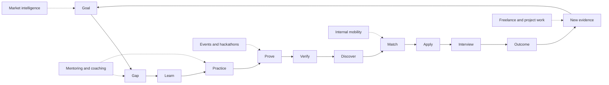

Dotted edges are the OS-expansion modules (gated by `DEC-002` and `OD-PRD-02`): each one plugs into the same loop rather than creating a parallel product. [DER]

### 3. Mission

Make career growth **transparent, verifiable and accessible** by giving every person a portable, evidence-backed career identity, and by giving every organization that learns with, hires or develops people a fair, consent-bound way to rely on it. [SRC: SSOT §2.1; DER]

### 4. Value proposition per audience

| Audience (role code)                   | Job they hire TalentSphere for                                               | Value delivered                                                                                                                    | How the system knows it delivered                                                                    |
| -------------------------------------- | ---------------------------------------------------------------------------- | ---------------------------------------------------------------------------------------------------------------------------------- | ---------------------------------------------------------------------------------------------------- |
| Guest (`GUE`)                          | Look at a job, a course, a public profile or a credential without signing up | Fast public pages; credential verification by link                                                                                 | Public page served; verification lookup answered [DER]                                               |
| Candidate / professional (`CAN`)       | Prove what I can do once, and have it count everywhere                       | Graded evidence ladder, referee verification, explainable matches, applications with a consented evidence snapshot, free core loop | Evidence items at rung ≥ artifact-backed; applications reaching `interviewing` [SRC: STR-01 GOAL-01] |
| Student (`STD`)                        | Leave my institution with proof, not just a transcript                       | Institution-issued credentials that the student keeps after graduation; placement drives                                           | Graduating-cohort activation [SRC: STR-01 GOAL-05]                                                   |
| Instructor (`INS`)                     | Teach and have my learners' outcomes recognized                              | Studio, rubric grading, instructor attestations (issuer class `instructor`), learner outcome analytics                             | Course completion to evidence rate [SRC: STR-01 GOAL-04]                                             |
| Mentor / coach (`MNT`)                 | Help people grow and be paid fairly for it                                   | Bookable offerings, session notes, consented evidence view [PROP]                                                                  | Completed sessions; mentee follow-up evidence [PROP]                                                 |
| Freelancer (`FRL`)                     | Win project work that also builds my record                                  | Service offerings, proposals, milestone contracts, delivered work as evidence [PROP]                                               | Completed contracts producing evidence [PROP]                                                        |
| Recruiter (`REC`)                      | Shortlist trustworthy candidates quickly                                     | Evidence-first applications, consent-gated search and outreach, pipelines, scheduling, offers                                      | Median time from `submitted` to first human review [SRC: STR-01 GOAL-02 REV2]                        |
| Hiring manager (`HMG`)                 | Decide well and fast                                                         | Structured scorecards, blind feedback, evidence packets, debrief                                                                   | Time from final interview to decision [PROP]                                                         |
| Employer admin (`EAD`)                 | Run a compliant hiring organization                                          | Org, teams, roles, SSO, brand, seats, audit                                                                                        | Active seats; access reviews completed [PROP]                                                        |
| Institution admin (`IAD`)              | Show what graduates can do                                                   | Cohorts, licences, k-anonymous skill coverage, credentials, graduation transfer                                                    | Cohorts provisioned; credentials issued [DER]                                                        |
| Placement officer (`PLO`)              | Place students                                                               | Placement drives, employer coordination, outcome reporting with alumni consent                                                     | Placement outcomes recorded [SRC: SSOT J-09]                                                         |
| Enterprise talent / L&D admin (`EXA`)  | Know and grow the skills of the workforce                                    | Skills inventory, internal mobility, mandated learning, HRIS sync [PROP]                                                           | Internal fills; mandated completion [SRC: SSOT J-16, J-28]                                           |
| Moderator (`MOD`)                      | Keep the platform safe                                                       | Report queue, reason codes, appeals, integrity review                                                                              | Time to first action; appeal overturn rate [PROP]                                                    |
| Support agent (`SUP`)                  | Resolve user problems without over-reaching                                  | Time-boxed, reason-coded scoped access                                                                                             | Ticket resolution time; zero unscoped reads [PROP]                                                   |
| Finance operator (`FIN`)               | Keep money correct                                                           | Refunds, disputes, reconciliation, payouts                                                                                         | Reconciliation breaks closed [SRC: COMMERCIAL_OPERATIONS §7]                                         |
| Platform admin (`PAD`)                 | Operate the product                                                          | Flags, taxonomy, verification approvals, configuration                                                                             | Change failure rate [PROP]                                                                           |
| Super admin / security officer (`SAD`) | Protect the platform and its people                                          | Break-glass, privileged access reviews, incident response                                                                          | Confirmed cross-tenant exposures: target zero [SRC: STR-01 GOAL-06 REV2]                             |
| Integration principal (`API`)          | Move data between TalentSphere and partner systems safely                    | Scoped OAuth clients, webhooks with replay                                                                                         | Webhook delivery success rate [PROP]                                                                 |

### 5. "Career operating system": definition

#### 5.1 What it means

An operating system, in this product, is **the layer every career activity runs on**. Concretely, TalentSphere is a career operating system when all of the following hold: [DER from owner goal and SSOT §4.1]

1. **One identity.** A person has one account and one career identity across learning, hiring, mentoring, freelancing, events and institutions; switching role context never requires a second account (`IDN`, `PRF`).
2. **One evidence substrate.** Every module that observes a person doing something career-relevant (finishing a course, passing an assessment, being hired, completing a gig, winning a hackathon) emits it into one evidence model with a provenance, an issuer class and a rung (`EVD`).
3. **One consent and privacy layer.** Every read of a person's data by another party passes the same consent and visibility checks, whatever module asks (`SET`, `BR-XCT-007` to `BR-XCT-013`).
4. **One set of shared services.** Notifications, messaging, scheduling, search, files, payments, moderation and AI are built once and used by every module (see [07 §6](#6-shared-services)).
5. **Interoperability.** Data enters and leaves through documented imports, exports, a public API and webhooks; the person can take their record with them (`PLT`, `SET`).
6. **Extensibility by module, not by fork.** A new career service (for example a mentoring marketplace) is added as a module that consumes the shared services and writes to the evidence substrate.

#### 5.2 What it does not mean

| Not this                                                                                  | Why                                                                                                                   | Source                                      |
| ----------------------------------------------------------------------------------------- | --------------------------------------------------------------------------------------------------------------------- | ------------------------------------------- |
| A device or browser operating system, kernel access, or unrestricted hardware integration | The product is a browser and PWA platform; "OS" describes breadth of the career workflow                              | [SRC: SSOT §4.1, §3.3]                      |
| A general-purpose marketplace for any goods or services                                   | Only career services (learning, mentoring, career-related freelance work, events) are transacted, and each is gated   | [SRC: SSOT §4.2]; `OD-PRD-03`               |
| A social-media clone optimized for engagement                                             | Networking exists to produce referrals, mentoring and community learning; no infinite feed ranking by virality        | [SRC: SSOT §4.2]; `OD-PRD-16`               |
| An HR information system, payroll, benefits or performance-review suite                   | Enterprise features stop at skills, internal mobility and learning; employee master data stays in the customer's HRIS | [SRC: SSOT §4.2]; `OD-PRD-20`               |
| An advertising network                                                                    | No self-serve ads; any paid visibility is decision-gated and never alters ranking                                     | [SRC: SSOT §4.2]; `OD-PRD-18`; `BR-XCT-020` |
| A sales-prospecting or business-development graph                                         | People data is never sold or packaged for sales outreach                                                              | [SRC: SSOT §4.2, OD-31]                     |
| An autonomous hiring agent                                                                | AI explains and drafts; humans decide every consequential action                                                      | [SRC: SSOT §3.2]; `BR-XCT-021`              |
| A replacement for every competitor at once                                                | Imports from external platforms are adapters; TalentSphere remains independently functional                           | [SRC: SSOT §4.3]                            |

### 6. Product principles

Principles are tie-breakers for design decisions. They are ordered; when two conflict, the higher one wins, and the conflict is recorded. [SRC: SSOT §3.1 (12 principles); ordering is DER]

| #   | Principle                                          | What it forces in design                                                                                       | Source                                          |
| --- | -------------------------------------------------- | -------------------------------------------------------------------------------------------------------------- | ----------------------------------------------- |
| 1   | The person owns their career identity              | Export, portability, revocable sharing; institutions and employers never own a person's record                 | [SRC: STR-01 §5 "Learner owns career identity"] |
| 2   | Verified over claimed                              | Every evidence item shows its rung and issuer class; nothing reads "verified" without a server-side transition | [SRC: SSOT §3.1, Appendix E V61-17]             |
| 3   | Candidate dignity first                            | Respectful rejection notices, no ghosting by design (stale-application nudges), no pay-to-apply                | [SRC: SSOT §3.1]                                |
| 4   | Human-controlled AI                                | AI suggests, explains, drafts; never decides a consequential outcome; never becomes evidence                   | [SRC: SSOT §3.1, §3.2]                          |
| 5   | Evidence over popularity                           | Reputation is contextual; follower counts or likes never act as credibility                                    | [SRC: SSOT §3.1, §3.2]                          |
| 6   | Fair by construction                               | No pay-to-rank; explainable matching; adverse-impact review                                                    | [SRC: STR-01 §7; SSOT Amendment E]              |
| 7   | Privacy by purpose                                 | Consent per purpose, default off, effective at the next read after revocation                                  | [SRC: SSOT §15.2; Appendix E V61-16]            |
| 8   | Accessible by default                              | Every journey works with keyboard and screen reader on a low-end phone                                         | [SRC: SSOT §3.1, §21]                           |
| 9   | Monetization follows value                         | Charge for tools and scale, never for trust, rank or the core loop                                             | [SRC: SSOT §3.1; COMMERCIAL_OPERATIONS §1]      |
| 10  | One semantic model                                 | One state vocabulary, one evidence model, one consent catalogue across modules                                 | [SRC: SSOT §3.1, Appendix E V61-18]             |
| 11  | Progressive disclosure and simplicity before scale | A new user reaches first value in one session; advanced controls appear when needed                            | [SRC: SSOT §3.1]                                |
| 12  | No deterministic career promises                   | The product never promises a job, salary or outcome; forecasts carry uncertainty                               | [SRC: SSOT §3.1]                                |

### 7. Product pillars

Pillars group modules by the outcome they produce. Every module belongs to exactly one pillar. [DER]

| Pillar                       | Outcome                                       | Modules                           | Primary roles                     |
| ---------------------------- | --------------------------------------------- | --------------------------------- | --------------------------------- |
| P1 Foundation and trust      | Safe, private, accessible access for everyone | `IDN`, `SET`, `NTF`, `TSF`, `ADM` | All                               |
| P2 Career identity and proof | A portable, graded, person-owned record       | `PRF`, `EVD`, `BGV`, `REP`        | `CAN`, `STD`, `FRL`               |
| P3 Learning and practice     | Skills built and demonstrated                 | `LRN`, `STU`, `ASM`, `INS`        | `CAN`, `STD`, `INS`, `IAD`, `PLO` |
| P4 Opportunity and hiring    | Fair, fast matching of people to work         | `JOB`, `ATS`, `INT`, `EMP`, `SRC` | `CAN`, `REC`, `HMG`, `EAD`        |
| P5 Network and guidance      | Help from other people                        | `NET`, `MSG`, `MEN`, `EVT`        | `CAN`, `MNT`                      |
| P6 Intelligence              | Explainable guidance and insight              | `AIC`, `MKT`, `ANL`               | All                               |
| P7 Work and enterprise       | Career growth inside and beyond employment    | `GIG`, `ENT`                      | `FRL`, `EXA`                      |
| P8 Platform and commerce     | Reach, integration and sustainability         | `BIL`, `PWA`, `PLT`               | `FIN`, `PAD`, `API`               |

### 8. Differentiation

What a complete TalentSphere does that a combination of separate tools does not. Each claim is a design commitment, not a market claim. [DER; competitor behavior from general domain knowledge, tagged PROP where it shapes a capability]

| Capability                                                                                             | Typical separate tools                                                | TalentSphere commitment                                                                                                                                          |
| ------------------------------------------------------------------------------------------------------ | --------------------------------------------------------------------- | ---------------------------------------------------------------------------------------------------------------------------------------------------------------- |
| Graded evidence ladder (claimed, artifact-backed, peer-attested, authority-verified) with issuer class | Profiles show self-declared skills and endorsements with equal weight | Rung and issuer class shown everywhere; matching weights them differently [SRC: Appendix E V61-17]                                                               |
| Referee verification without an account                                                                | Reference checks by phone or a separate vendor                        | Single-use tokenized link; under three minutes on a phone [SRC: USR-01 P4]                                                                                       |
| Application as a consented evidence snapshot                                                           | Résumé PDF attachment                                                 | The employer sees exactly the items consented for that application; revocation tombstones live items [SRC: CONSENT_SCOPE_CATALOGUE `application.share_snapshot`] |
| Learning that produces evidence employers can open                                                     | Course certificates disconnected from hiring                          | Completion, graded work and assessments feed `EVD` with provenance [SRC: SSOT Amendment B]                                                                       |
| Institution to independent identity transfer                                                           | Student accounts deleted at graduation                                | Graduation transfers credentials to the person's own identity [SRC: SSOT §5.7 managed learner lifecycle]                                                         |
| Explainable, uncertainty-aware matching with no pay-to-rank                                            | Opaque ranking; paid boosts                                           | Every match shows rationale and uncertainty; entitlements never change ranking inputs [SRC: SSOT §3.2; ADR-T22]                                                  |
| One consent ledger across all modules                                                                  | Per-product privacy settings                                          | One catalogue, one ledger, one revocation behavior [SRC: Appendix E V61-16]                                                                                      |
| Career services (mentoring, gigs, events) that write to the same record                                | Separate marketplaces with their own profiles                         | Completed sessions, contracts and hackathon results become evidence with their issuer class [PROP; gated `OD-PRD-02`]                                            |

### 9. Success metrics framework

Definitions only. **No target value is set in this blueprint**; targets are set after a measured baseline and approved by the owner (`OD-PRD-01`). [SRC: SSOT OD-40 "set after 90 days of data"; STR-01 REV2 reading rule] Metric keys are plain names, not register ids.

#### 9.1 North-star candidates (choose one or a hierarchy: `OD-PRD-01`)

| Metric key                         | Definition                                             | Formula                                                                                                                                                                                         | Source                                             |
| ---------------------------------- | ------------------------------------------------------ | ----------------------------------------------------------------------------------------------------------------------------------------------------------------------------------------------- | -------------------------------------------------- |
| `ns.career_progress_verified`      | People who made verifiable career progress in a period | Count of distinct people with at least one new outcome-class evidence item (hire, promotion, internal move, completed contract, institution credential) at rung ≥ artifact-backed in the period | [SRC: SSOT §2.4]                                   |
| `ns.evidence_backed_conversations` | Hiring conversations that started from evidence        | Count of applications or outreach threads that reached `interviewing` where the shared snapshot contained at least one item at rung ≥ artifact-backed                                           | [SRC: Appendix E V61-28, target metrics catalogue] |

#### 9.2 Input metrics by pillar

| Pillar | Metric key                        | Definition and formula                                                                                                                                                                             | Owner role   |
| ------ | --------------------------------- | -------------------------------------------------------------------------------------------------------------------------------------------------------------------------------------------------- | ------------ |
| P1     | `act.first_value_session`         | Share of new accounts that complete onboarding and reach their role's first-value event within the first session: first-value accounts ÷ new accounts                                              | `PAD`        |
| P2     | `evd.active_with_3_backed`        | Share of active candidates (signed in within the active window, value `OD-PRD-01`) holding ≥ 3 evidence items at rung ≥ artifact-backed                                                            | `PAD`        |
| P2     | `bgv.referee_response_rate`       | Referee requests answered ÷ referee requests sent, per period                                                                                                                                      | `PAD`        |
| P2     | `bgv.referee_median_minutes`      | Median minutes from link open to referee submission                                                                                                                                                | `PAD`        |
| P3     | `lrn.completion_to_evidence`      | Course completions that produced an evidence item ÷ course completions                                                                                                                             | `INS`, `PAD` |
| P3     | `lrn.learning_to_interview`       | Candidates who reached `interviewing` within the attribution window after completing a course linked to the job's skills ÷ candidates who completed such a course (correlational only, SSOT OD-51) | `PAD`        |
| P4     | `hir.time_to_first_review`        | Median time from application `submitted` to first human review                                                                                                                                     | `REC`, `EAD` |
| P4     | `hir.share_reaching_interview`    | Applications reaching `interviewing` ÷ applications submitted                                                                                                                                      | `REC`, `EAD` |
| P4     | `hir.offer_acceptance`            | Offers accepted ÷ offers extended                                                                                                                                                                  | `EAD`        |
| P4     | `hir.candidate_notified_on_close` | Applications that reached a terminal state with a candidate notice sent ÷ applications reaching a terminal state                                                                                   | `EAD`        |
| P5     | `net.referral_to_interview`       | Referred applications reaching `interviewing` ÷ referred applications                                                                                                                              | `PAD`        |
| P5     | `men.session_completion`          | Booked sessions completed ÷ sessions booked (gated module)                                                                                                                                         | `MNT`, `PAD` |
| P6     | `aic.explanation_coverage`        | Match results shown with rationale and uncertainty ÷ match results shown (design target 100 percent; a gap is a defect)                                                                            | `PAD`        |
| P6     | `aic.suggestion_acceptance`       | AI suggestions accepted with or without edits ÷ AI suggestions shown                                                                                                                               | `PAD`        |
| P7     | `ent.internal_fill_rate`          | Internal roles filled by internal candidates ÷ internal roles filled (gated module)                                                                                                                | `EXA`        |
| P7     | `gig.contract_completion`         | Contracts completed without dispute ÷ contracts started (gated module)                                                                                                                             | `PAD`        |
| P8     | `bil.paid_conversion`             | Accounts or orgs on a paid plan ÷ eligible accounts or orgs, per segment                                                                                                                           | `FIN`        |
| P8     | `plt.webhook_success`             | Webhook deliveries acknowledged within the retry window ÷ deliveries attempted                                                                                                                     | `PAD`        |

#### 9.3 Guardrail metrics (must not degrade while input metrics improve)

| Metric key                        | Definition                                                                                               | Why it is a guardrail                                                     |
| --------------------------------- | -------------------------------------------------------------------------------------------------------- | ------------------------------------------------------------------------- |
| `grd.cross_tenant_exposures`      | Confirmed cross-tenant data exposures per period (target zero, an outcome measure, not proof of absence) | Tenancy is a critical invariant [SRC: SSOT §3.2; STR-01 GOAL-06 REV2]     |
| `grd.consent_violations`          | Reads of personal data without a live consent scope or snapshot, found by audit sampling                 | Privacy by purpose                                                        |
| `grd.adverse_impact_review_held`  | Quarterly adverse-impact review held and recorded (yes or no), threshold set with counsel                | Fairness [SRC: STR-01 GOAL-03 REV2]                                       |
| `grd.autonomous_adverse_actions`  | Consequential adverse actions with no human actor in the audit record (must be zero)                     | Human-controlled AI                                                       |
| `grd.accessibility_defects_open`  | Open accessibility defects of severity high on core journeys                                             | Accessible by default                                                     |
| `grd.ai_cost_per_active_user`     | AI inference cost ÷ monthly active users, against the cost policy                                        | Free users must not cause paid inference without policy [SRC: SSOT §16.4] |
| `grd.moderation_appeal_overturn`  | Appeals overturned ÷ appeals decided                                                                     | Moderation quality                                                        |
| `grd.candidate_complaints_per_1k` | Candidate complaints about employer conduct per 1,000 applications                                       | Candidate dignity                                                         |
| `grd.support_tickets_per_1k_mau`  | Support tickets per 1,000 monthly active users                                                           | Product clarity [SRC: STR-01 §8]                                          |

#### 9.4 Business metrics (reported separately from product outcomes)

Activation, retention (week 4 and week 12 cohorts), paid conversion by segment, revenue by stream, gross margin, AI cost, operational cost per active org, enterprise expansion. [SRC: SSOT §2.4] Values and margin target are open (`OD-PRD-01`, `OD-PRD-05` to `OD-PRD-07`). No revenue, volume or price figure is asserted in this blueprint.

#### 9.5 Measurement rules

1. Every metric has one definition, owned in `ANL`; module specs cite the key rather than restating the formula. [DER]
2. Small cells are suppressed under `min_cohort_k` (`OD-PRD-12`). [SRC: SSOT Amendment G]
3. Learning-to-outcome metrics are correlational unless a causal method is separately validated. [SRC: SSOT OD-51]
4. Product analytics require `analytics.product` consent; operational telemetry has its own lawful basis and no personal profile building. [SRC: CONSENT_SCOPE_CATALOGUE]
5. A target becomes a commitment only after a baseline exists and the owner approves it. [SRC: STR-01 REV2]

### 10. Business model options (decision-gated)

The full model, entitlement philosophy and payment rules are in [06](#06--business-model-and-cross-module-rules). Summary of options; **no stream is active until its decision closes**, and no price is proposed. [SRC: SSOT Appendix E V61-09; COMMERCIAL_OPERATIONS §2]

| Stream                                                          | Payer                 | Mechanism options                                                                  | Hard guardrail                                        | Gate                                  |
| --------------------------------------------------------------- | --------------------- | ---------------------------------------------------------------------------------- | ----------------------------------------------------- | ------------------------------------- |
| Employer subscription                                           | Employer org          | Per seat; per active job slot; hybrid with quotas for verified search and outreach | Never pay-to-rank (`BR-XCT-020`)                      | `OD-PRD-06`, `OD-PRD-08`              |
| Institution licence                                             | Institution           | Per learner seat; per cohort; campus licence                                       | Learner owns identity after graduation (`BR-XCT-001`) | `OD-PRD-07`                           |
| Candidate premium                                               | Candidate             | Subscription for tools (extra variants, analytics, AI quota)                       | Core loop always free (`BR-XCT-027`)                  | `OD-PRD-05`                           |
| Course commerce, first-party                                    | Learner               | One-off or path purchase; platform is seller of record                             | Refund and dispute process (`BR-XCT-044`)             | `OD-PRD-04`                           |
| Third-party marketplace fees (courses, mentoring, gigs, events) | Buyer or seller       | Commission or listing fee                                                          | Payee KYC, held funds, tax (`BR-XCT-048`)             | `OD-PRD-04`, `OD-PRD-02`, `OD-PRD-03` |
| Enterprise talent                                               | Enterprise            | Per employee per period for skills, mobility and L&D                               | Not an HRIS (`OD-PRD-20`)                             | `OD-PRD-02`, `OD-PRD-20`              |
| Verification services                                           | Employer org          | Per check, consent-bound                                                           | Per-person consent (`BR-XCT-012`)                     | `OD-PRD-19`                           |
| Public API access                                               | Partner or org        | Included in enterprise tier or metered                                             | Scoped keys; subject consent (`BR-XCT-055`)           | `OD-PRD-23`                           |
| Aggregate insights                                              | Employer, institution | k-anonymous market and salary benchmarks                                           | No individual data; `min_cohort_k` (`BR-XCT-029`)     | `OD-PRD-29`, `OD-PRD-12`              |

Excluded as streams: advertising network, selling personal data, pay-to-apply, pay-to-rank, paid "verified" badges. [SRC: SSOT §4.2; COMMERCIAL_OPERATIONS §1]

### 11. Non-goals, and where the OS goal widens SSOT §4.2

#### 11.1 Standing non-goals (unchanged)

[SRC: SSOT §3.3, §4.2]

1. Self-serve advertising network.
2. Sales-prospecting suite or business-development people graph.
3. Social-media clone optimized for engagement.
4. Generic HR, HRIS master data, payroll, benefits or performance management.
5. Cryptocurrency, token products, blockchain-backed credentials.
6. Autonomous consequential AI decisions; candidate-level predictive hiring decisions in GA unless admitted by a separate governance process (`OD-PRD-14`).
7. Native apps as a prerequisite for any core function (`OD-PRD-36`).
8. Runtime dependence on competitor platforms; they may only be import or syndication adapters.
9. Unnecessary realtime or live-streaming infrastructure (`OD-PRD-22`).
10. Opaque pay-to-rank in hiring.

#### 11.2 Where the owner's OS goal brushes a non-goal

The owner confirmed the goal of a complete platform "strong like an operating system" for the whole career domain, including learning (`DEC-002`, `DEC-003`). Five OS-expansion modules and several capabilities inside core modules brush a non-goal. Each is specified narrowly and gated; none is silently admitted. [SRC: CONVENTIONS §4; COMMON_BRIEF known conflict]

| OS capability                                                          | Non-goal it brushes                                        | Narrow boundary specified                                                                                                                                                                           | Gate                                  |
| ---------------------------------------------------------------------- | ---------------------------------------------------------- | --------------------------------------------------------------------------------------------------------------------------------------------------------------------------------------------------- | ------------------------------------- |
| `GIG` freelance and project work with contracts and milestone payments | General-purpose marketplace                                | Career-related professional services only (software, design, writing, analysis, tutoring and similar); no physical goods, no local services, no rentals; every completed contract produces evidence | `OD-PRD-02`, `OD-PRD-03`, `OD-PRD-04` |
| `MEN` paid mentoring and coaching sessions                             | General-purpose marketplace                                | Career mentoring, interview coaching, résumé review, portfolio review only; no therapy, legal or immigration advice                                                                                 | `OD-PRD-02`, `OD-PRD-04`              |
| `EVT` events and hackathons                                            | General-purpose marketplace; live-streaming infrastructure | Career events with registration, teams, submissions and judging; video uses an external meeting link; ticketing only if `OD-PRD-04` admits it                                                       | `OD-PRD-02`, `OD-PRD-22`              |
| `ENT` internal mobility, skills inventory and L&D                      | Generic HR or HRIS                                         | Skills, internal job postings, learning assignments, read-only HRIS sync; never payroll, compensation administration, leave, performance ratings or employee master data                            | `OD-PRD-02`, `OD-PRD-20`              |
| `MKT` market intelligence and salary benchmarks                        | Sales-prospecting; data selling                            | Aggregate, k-anonymous labour-market data; no person-level data leaves the platform                                                                                                                 | `OD-PRD-02`, `OD-PRD-29`              |
| `NET` posts, groups, community                                         | Social-media clone                                         | Career-topic community with chronological or relevance-by-topic ordering, no virality ranking, no public follower counts as credibility                                                             | `OD-PRD-16`                           |
| `EMP` company reviews                                                  | Social-media clone; defamation exposure                    | Structured reviews with moderation and verified-employment signal                                                                                                                                   | `OD-PRD-17`                           |
| Promoted job visibility                                                | Advertising network; pay-to-rank                           | Only labelled, separate slots that never change organic ranking; default is none                                                                                                                    | `OD-PRD-18`                           |
| `INT` and `MEN` video                                                  | Live-streaming infrastructure                              | Integration with external meeting providers; no first-party media servers                                                                                                                           | `OD-PRD-22`                           |

#### 11.3 Recorded decision DEC-002

`DEC-002` (full text in [08 §2](#2-recorded-decisions)): the product scope is widened from the SSOT's "career platform" to a **career operating system** for the whole career domain. The widening conflicts with SSOT §4.2 where shown in §11.2 above. The conflict is **recorded, not resolved**: OS-expansion modules are fully specified but every one of their features is gated behind `OD-PRD-02` until the owner admits it module by module. SSOT §4.2 is not edited by this blueprint. [SRC: owner goal relayed in COMMON_BRIEF; CONVENTIONS §4]

### 12. Strategic risks

| ID         | Risk                                                                                             | Likelihood driver           | Impact                                     | Mitigation in this blueprint                                                                                                                                   |
| ---------- | ------------------------------------------------------------------------------------------------ | --------------------------- | ------------------------------------------ | -------------------------------------------------------------------------------------------------------------------------------------------------------------- |
| RSK-PRD-01 | Cold start on a multi-sided platform: candidates without employers, employers without candidates | Few early employers         | No hiring outcomes, so no outcome evidence | Seed supply through institutions (`INS`) and single-player value (`PRF`, `EVD`, `LRN`) before marketplace depth; R1 pilot scope (`OD-PRD-09`) [SRC: STR-01 §9] |
| RSK-PRD-02 | Scope overreach: 30 modules dilute delivery of the core loop                                     | OS goal                     | Nothing reaches production quality         | Release tiers by dependency (02 §4); OS-expansion gated (`OD-PRD-02`) [SRC: SSOT §2.5]                                                                         |
| RSK-PRD-03 | Referee non-response leaves evidence stuck at `claimed`                                          | Busy referees               | Weak evidence ladder                       | Tokenized mobile flow, reminders, alternative verification paths [SRC: STR-01 §9]                                                                              |
| RSK-PRD-04 | Evidence gaming: fake referees, colluding attestations, purchased projects                       | Incentive to look verified  | Trust collapse                             | Independence checks, anomaly review (anomaly is not guilt), revocation [SRC: SSOT §3.2]                                                                        |
| RSK-PRD-05 | Regulatory exposure for automated employment decisions and AI                                    | AI features in hiring       | Legal action; forced withdrawal            | No autonomous adverse decisions; descriptive only; adverse-impact review (`OD-PRD-14`) [SRC: SSOT Amendment E]                                                 |
| RSK-PRD-06 | AI cost overrun from free users                                                                  | Popular AI features         | Negative margin                            | Cost policy and quotas (`OD-PRD-21`) [SRC: SSOT §16.4]                                                                                                         |
| RSK-PRD-07 | Marketplace money-flow liability (tax, payouts, refunds, fraud)                                  | `GIG`, `MEN`, paid courses  | Financial and legal loss                   | Seller-of-record decision first (`OD-PRD-04`); payouts inactive until then                                                                                     |
| RSK-PRD-08 | Institutions or employers treated as data owners of a person                                     | Contract pressure           | Loss of user trust; legal conflict         | `BR-XCT-001`, graduation transfer, consent per institution                                                                                                     |
| RSK-PRD-09 | Moderation load from community and reviews                                                       | `NET`, `EMP` reviews        | Harm, defamation                           | Narrow community scope (`OD-PRD-16`, `OD-PRD-17`), moderation model (`OD-PRD-35`)                                                                              |
| RSK-PRD-10 | Personas are hypothetical; no user research exists                                               | No research budget recorded | Building the wrong thing                   | Research before R1 (`OD-PRD-25`) [SRC: USR-01 "Personas below are hypothetical"]                                                                               |

### 13. Legacy source trace

| Source                                                                                                         | Used for                                                                           | Dropped or changed                                                                                                         |
| -------------------------------------------------------------------------------------------------------------- | ---------------------------------------------------------------------------------- | -------------------------------------------------------------------------------------------------------------------------- |
| `SSOT.md` §1–§4                                                                                                | Vision, loop, principles, non-goals, scope exclusions                              | SSOT principle count mismatch (12 listed, 11 locked) noted, not resolved here; principles re-ordered as tie-breakers [DER] |
| `SSOT.md` Appendix E (V61-03, V61-09, V61-16, V61-17, V61-28)                                                  | Canonical loop, no prices, consent catalogue, evidence ladder, north-star conflict | North-star left open as `OD-PRD-01`                                                                                        |
| `docs/archive/target-blueprint/01_EXECUTIVE_AND_STRATEGY.md` (STR-01 and REV2) | Problem statement, goals, segments, business model, constitution                   | GOAL thresholds not copied; all values remain open                                                                         |
| `docs/archive/target-blueprint/19_BUSINESS_AND_COMMERCIAL_OPERATIONS.md`                   | Guardrails, packaging dimensions                                                   | All prices left open                                                                                                       |
| `docs/PRICING.md`                                                                                              | Shows coded plan recommendations awaiting founder sign-off                         | Coded prices and quotas are **not** adopted as blueprint values                                                            |
| Owner goal relayed by the orchestrator (career OS, learning in scope)                                          | §5, §11.2, `DEC-002`, `DEC-003`                                                    | —                                                                                                                          |

## 02 — Scope and Boundaries

_Former file: `PRODUCT_BLUEPRINT/01_PRODUCT/02_SCOPE_AND_BOUNDARIES.md`._

What the complete product includes, what sits at its edge, and what it will not do. Tiers are dependency-based release tiers from [CONVENTIONS §6](README.md#blueprint-conventions); they carry no dates. Every statement is intent, not build status.

### 1. Scope classes

| Class               | Meaning                                                                        | Build rule                                                                                       |
| ------------------- | ------------------------------------------------------------------------------ | ------------------------------------------------------------------------------------------------ |
| **In scope**        | Part of the complete career OS; specified in a module file                     | Build in its release tier once dependencies exist                                                |
| **In scope, gated** | Specified fully but brushes a non-goal or needs a commercial or legal decision | No build until the named `OD-` closes in favor; until then every capability is denied by default |
| **Adjacent**        | Integrated through an adapter; TalentSphere does not own the capability        | Build the adapter, never the capability                                                          |
| **Out of scope**    | Will not be built                                                              | Requests are declined and recorded                                                               |

### 2. Scope by domain

#### 2.1 Foundation and trust

| Capability                                                                                                                                                                                   | Class           | Module | Notes                                                                                            |
| -------------------------------------------------------------------------------------------------------------------------------------------------------------------------------------------- | --------------- | ------ | ------------------------------------------------------------------------------------------------ |
| Account registration, email and phone verification, password, passkeys, MFA, OAuth sign-in, enterprise SSO (OIDC, SAML), SCIM provisioning, session and device management, account lifecycle | In scope        | `IDN`  | Self-issued first-party sessions; no browser-readable bearer token [SRC: SSOT Appendix E V61-13] |
| One account with many role grants and an explicit active context                                                                                                                             | In scope        | `IDN`  | `BR-XCT-080`                                                                                     |
| Privacy settings, field visibility, consent centre, data export, erasure, rectification, legal hold                                                                                          | In scope        | `SET`  | One consent catalogue [SRC: Appendix E V61-16]                                                   |
| In-app, email, push and digest notifications; preferences; quiet hours                                                                                                                       | In scope        | `NTF`  | SMS only for security codes, `OD-PRD-23` [PROP]                                                  |
| Reporting, moderation queue, appeals, policy enforcement, integrity review                                                                                                                   | In scope        | `TSF`  |                                                                                                  |
| Admin console, support tooling with scoped access, audit log, feature flags, reference data                                                                                                  | In scope        | `ADM`  | No impersonation [SRC: USR-01 REV2 §4]                                                           |
| Government identity document verification                                                                                                                                                    | In scope, gated | `BGV`  | `OD-PRD-26`                                                                                      |

#### 2.2 Career identity and proof

| Capability                                                                                                                            | Class    | Module | Notes                                                                                       |
| ------------------------------------------------------------------------------------------------------------------------------------- | -------- | ------ | ------------------------------------------------------------------------------------------- |
| Profile, headline, skills, experience, education, résumé variants, résumé import and parsing, portfolio projects, public profile page | In scope | `PRF`  |                                                                                             |
| Evidence items, four-rung ladder, issuer class, credentials, certificates, revocation, versioned corrections, verification URLs       | In scope | `EVD`  | [SRC: Appendix E V61-17]                                                                    |
| Referee verification by tokenized link, employer-domain verification, employer confirmation of employment                             | In scope | `BGV`  |                                                                                             |
| Background checks (criminal, education, employment) through a licensed vendor                                                         | Adjacent | `BGV`  | Vendor does the check; TalentSphere manages consent, order and result display (`OD-PRD-19`) |
| Achievements, badges, XP, contextual reputation                                                                                       | In scope | `REP`  | Public leaderboards gated `OD-PRD-28`                                                       |
| Portable credential export (for example Open Badges or verifiable credential formats)                                                 | In scope | `EVD`  | Never claimed as standard-compliant until validated (`BR-XCT-070`)                          |

#### 2.3 Learning and practice

| Capability                                                                                                                     | Class           | Module       | Notes                                                                               |
| ------------------------------------------------------------------------------------------------------------------------------ | --------------- | ------------ | ----------------------------------------------------------------------------------- |
| Course catalog, enrollment, lessons (video, text, code, quiz), progress, notes, Q&A, reviews, learning paths, certificates     | In scope        | `LRN`        | Learning is in scope (`DEC-003`)                                                    |
| Instructor onboarding, course studio, versioning, review and publishing, co-authoring                                          | In scope        | `STU`        |                                                                                     |
| Quizzes, coding challenges, projects with rubrics, peer review, timed assessments, AI modes, accommodations, integrity signals | In scope        | `ASM`        | Code runs only in an isolated runner [SRC: Appendix E V61-22]                       |
| Remote proctoring                                                                                                              | In scope, gated | `ASM`        | `OD-PRD-15`                                                                         |
| Paid first-party courses                                                                                                       | In scope, gated | `LRN`, `BIL` | `OD-PRD-04`                                                                         |
| Paid third-party course marketplace with instructor payouts                                                                    | In scope, gated | `STU`, `BIL` | `OD-PRD-04` [SRC: Appendix E V61-21]                                                |
| Accredited degrees, transcripts of record, exam-board functions                                                                | Out of scope    | —            | Institutions keep their student information systems (adjacent through `INS` import) |

#### 2.4 Opportunity and hiring

| Capability                                                                                                                                         | Class                    | Module       | Notes                                                                                        |
| -------------------------------------------------------------------------------------------------------------------------------------------------- | ------------------------ | ------------ | -------------------------------------------------------------------------------------------- |
| Job postings, job search, saved searches and alerts, applications with evidence snapshot, application tracking, withdrawal                         | In scope                 | `JOB`        |                                                                                              |
| Requisitions, approvals, hiring teams, pipelines, stages, notes, bulk actions with human confirmation, offers, hiring decisions, post-hire outcome | In scope                 | `ATS`        |                                                                                              |
| Interview loops, panels, self-scheduling, calendar sync, scorecards, debriefs                                                                      | In scope                 | `INT`        | Video via external meeting providers (`OD-PRD-22`)                                           |
| Employer org, teams, roles, domain verification, brand page, company reviews                                                                       | In scope (reviews gated) | `EMP`        | Reviews `OD-PRD-17`                                                                          |
| Candidate discovery with consent, outreach requests with quotas                                                                                    | In scope                 | `SRC`, `MSG` |                                                                                              |
| Agency recruiting across client orgs                                                                                                               | In scope                 | `EMP`, `ATS` | `BR-XCT-057`                                                                                 |
| Promoted job placements                                                                                                                            | In scope, gated          | `JOB`, `BIL` | `OD-PRD-18`                                                                                  |
| Job aggregation by scraping third-party sites                                                                                                      | Out of scope             | —            | Terms-of-service and copyright exposure; jobs enter through employers or partner feeds [DER] |
| Payroll, onboarding paperwork, e-signature of employment contracts                                                                                 | Adjacent                 | `PLT`        | Offer acceptance records intent; signature and payroll stay in partner systems [PROP]        |

#### 2.5 Network and guidance

| Capability                                                                        | Class           | Module       | Notes       |
| --------------------------------------------------------------------------------- | --------------- | ------------ | ----------- |
| Connections, follows, referral requests, referral tracking                        | In scope        | `NET`        |             |
| Community posts, articles, groups                                                 | In scope, gated | `NET`        | `OD-PRD-16` |
| Direct messages, application threads, cohort channels, attachments, read receipts | In scope        | `MSG`        |             |
| Mentoring and coaching offerings, booking, sessions, notes, ratings               | In scope, gated | `MEN`        | `OD-PRD-02` |
| Events, hackathons, teams, submissions, judging, results                          | In scope, gated | `EVT`        | `OD-PRD-02` |
| Monetary referral bonuses paid through the platform                               | In scope, gated | `NET`, `BIL` | `OD-PRD-27` |

#### 2.6 Intelligence

| Capability                                                                                                                                    | Class               | Module | Notes                                           |
| --------------------------------------------------------------------------------------------------------------------------------------------- | ------------------- | ------ | ----------------------------------------------- |
| Explainable matching (lexical and skill-based first, AI later), recommendations, career assistant, résumé tailoring, job-description drafting | In scope            | `AIC`  | Human-controlled (`BR-XCT-036` to `BR-XCT-042`) |
| Candidate-level predictive hiring scores, automated screening-out                                                                             | Out of scope for GA | —      | Admission only through `OD-PRD-14`              |
| Career paths, skill demand, salary benchmarks                                                                                                 | In scope, gated     | `MKT`  | `OD-PRD-02`, `OD-PRD-17`, `OD-PRD-29`           |
| Product, hiring, institution and platform analytics                                                                                           | In scope            | `ANL`  | k-anonymous (`BR-XCT-029`)                      |

#### 2.7 Work and enterprise

| Capability                                                                               | Class           | Module       | Notes                    |
| ---------------------------------------------------------------------------------------- | --------------- | ------------ | ------------------------ |
| Freelance service offerings, project posts, proposals, contracts, milestones, deliveries | In scope, gated | `GIG`        | `OD-PRD-02`, `OD-PRD-03` |
| Escrow and payouts for gigs                                                              | In scope, gated | `GIG`, `BIL` | `OD-PRD-04`              |
| Internal mobility marketplace, skills inventory, mandated learning, HRIS read sync       | In scope, gated | `ENT`        | `OD-PRD-20`              |
| Employee master data, compensation, performance ratings, leave                           | Out of scope    | —            | SSOT §4.2                |

#### 2.8 Platform and commerce

| Capability                                                                                                             | Class                          | Module       | Notes                                                                |
| ---------------------------------------------------------------------------------------------------------------------- | ------------------------------ | ------------ | -------------------------------------------------------------------- |
| Plans, checkout, subscriptions, seats, invoices, refunds, dunning, entitlements                                        | In scope                       | `BIL`        | Stripe as processor [SRC: CLAUDE.md stack; COMMERCIAL_OPERATIONS §3] |
| Tax calculation and remittance                                                                                         | Adjacent                       | `BIL`        | Provider tax engine (`OD-PRD-04`, `OD-PRD-10`)                       |
| PWA install, offline read and drafts, push, browser extension                                                          | In scope                       | `PWA`        | Extension sync conflict `OD-PRD-36`                                  |
| Native iOS and Android apps                                                                                            | Out of scope until `OD-PRD-36` | —            | Not a prerequisite [SRC: SSOT §3.3]                                  |
| Public REST API, OAuth clients, webhooks, integrations (calendar, ATS, HRIS, SIS, LMS), files, media, malware scanning | In scope                       | `PLT`        | Priorities `OD-PRD-23`                                               |
| White-label and co-branding                                                                                            | In scope, gated                | `EMP`, `INS` | `OD-PRD-24`                                                          |

### 3. Domains considered and rejected

| Domain                                                                 | Considered because                                 | Rejected because                                                                                                                      | Source                       |
| ---------------------------------------------------------------------- | -------------------------------------------------- | ------------------------------------------------------------------------------------------------------------------------------------- | ---------------------------- |
| Payroll and benefits administration                                    | Enterprise customers ask for one HR suite          | Explicit non-goal; heavy regulation; no link to the evidence loop                                                                     | [SRC: SSOT §4.2]             |
| Performance reviews and employee ratings                               | Would produce "evidence" of on-the-job performance | Employer-owned evaluative data about employees creates coercion risk and conflicts with person ownership (`BR-XCT-001`); out of scope | [SRC: SSOT §4.2; DER]        |
| HRIS employee master data                                              | `ENT` needs employee lists                         | Read-only sync is enough; owning master data makes TalentSphere an HRIS                                                               | [SRC: SSOT §4.2]             |
| Self-serve advertising network                                         | Revenue                                            | Non-goal; undermines fairness and trust                                                                                               | [SRC: SSOT §4.2]             |
| Selling or licensing person-level data                                 | Revenue                                            | Breaks consent model; only k-anonymous aggregates are candidates (`OD-PRD-29`)                                                        | [SRC: SSOT §4.2; DER]        |
| Business-development people graph and sales prospecting                | Recruiter tools resemble prospecting               | Non-goal; outreach stays consent-gated and quota-bound                                                                                | [SRC: SSOT §4.2, OD-31]      |
| Blockchain or token credentials                                        | Credential portability                             | Excluded; portability uses standard formats without tokens                                                                            | [SRC: SSOT §3.3]             |
| Engagement-ranked social feed, stories, short video                    | Engagement                                         | Social-clone non-goal; moderation cost                                                                                                | [SRC: SSOT §4.2]             |
| First-party live video and streaming servers                           | Interviews, mentoring, events                      | Non-goal for infrastructure; external meeting providers suffice (`OD-PRD-22`)                                                         | [SRC: SSOT §4.2, OD-33]      |
| Immigration, visa and legal services                                   | Career moves across borders                        | Regulated professional advice; liability                                                                                              | [DER]                        |
| Education financing (loans, income-share agreements)                   | Learners need funding                              | Regulated credit; conflicts with "no deterministic career promises"                                                                   | [DER; SSOT §3.1]             |
| Relocation and housing services                                        | Career moves                                       | Not career evidence; general marketplace                                                                                              | [SRC: SSOT §4.2]             |
| Recruitment process outsourcing as a service run by TalentSphere staff | Employers want hires                               | TalentSphere is the platform, not an agency; agencies are customers                                                                   | [DER]                        |
| Local or physical-goods gig work (delivery, home services)             | Gig mode                                           | General-marketplace non-goal; produces no career evidence                                                                             | [SRC: SSOT §4.2]             |
| K-12 learning management                                               | Learning in scope                                  | Different safeguarding and legal regime; minimum-age policy (`OD-PRD-11`)                                                             | [DER]                        |
| Automated reference calls by AI voice                                  | Faster referee verification                        | Autonomous consequential AI; referee trust                                                                                            | [SRC: SSOT §3.2]             |
| Psychometric personality testing for hiring                            | Common in hiring suites                            | Validity and adverse-impact risk; predictive scoring excluded (`OD-PRD-14`)                                                           | [SRC: SSOT Amendment E; DER] |
| Cryptocurrency payouts                                                 | Global freelancers                                 | Excluded by SSOT §3.3                                                                                                                 | [SRC: SSOT §3.3]             |

### 4. Release-tier scope map (R0 to R6)

Tiers follow dependencies: a capability enters the first tier in which everything it needs exists. Tiers are not dates. Per-module dependencies are in [07](#07--module-map-and-dependencies). [SRC: CONVENTIONS §6]

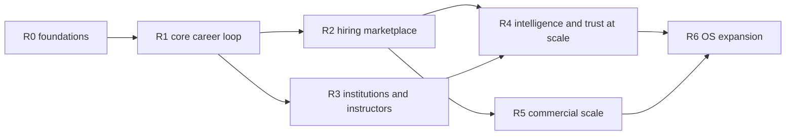

| Tier                               | Goal of the tier                                                           | Capabilities entering (by module)                                                                                                                                                                                                                                                                                                                                                                                                                                                                                                                                                                                                                 | Depends on                                               | Exit condition (observable)                                                                                                                                                                                     |
| ---------------------------------- | -------------------------------------------------------------------------- | ------------------------------------------------------------------------------------------------------------------------------------------------------------------------------------------------------------------------------------------------------------------------------------------------------------------------------------------------------------------------------------------------------------------------------------------------------------------------------------------------------------------------------------------------------------------------------------------------------------------------------------------------- | -------------------------------------------------------- | --------------------------------------------------------------------------------------------------------------------------------------------------------------------------------------------------------------- |
| R0 foundations                     | Anyone can hold a safe account, control privacy and receive messages       | `IDN` register, sign-in, passkey, MFA, sessions, lifecycle · `SET` visibility, consent centre, export, erasure · `NTF` in-app and email transactional · `ADM` audit log, support console with scoped access, flags · `PLT` files, malware scan, outbox and worker · `ANL` event capture with consent · `PWA` installable shell, offline read cache · `TSF` report intake and manual moderation · `BIL` free plan entitlement stub                                                                                                                                                                                                                 | Nothing                                                  | A user registers, sets visibility, grants and revokes a consent, exports data, requests erasure; every step audited                                                                                             |
| R1 core career loop                | A candidate proves skills and work history, learns, applies and hears back | `PRF` profile, résumé import, variants, portfolio · `EVD` evidence ladder, credentials, verification URL · `BGV` referee and email-domain verification · `SRC` lexical job and course search, skill taxonomy · `LRN` first-party free catalog, enrollment, progress, certificates · `ASM` quizzes, projects, auto-graded non-code, unverified code attempts · `EMP` org creation and members (basic) · `JOB` posting, apply with snapshot, tracking, withdraw · `ATS` single pipeline, stage moves, reject with reason, notes · `INT` manual scheduling · `MSG` application threads · `AIC` non-AI explainable matching · `REP` completion badges | R0                                                       | One candidate completes Goal → Gap → Learn → Practice → Prove → Verify → Discover → Match → Apply → Interview → Outcome with evidence produced at Prove, Verify and Outcome (scope of the pilot is `OD-PRD-09`) |
| R2 hiring marketplace              | Employers hire at volume with fair, efficient tools                        | `ATS` requisitions, approvals, templates, offers, hiring decisions · `INT` loops, self-scheduling, calendar sync, scorecards, debrief · `EMP` teams, roles, SSO, brand page, agency relationships · `SRC` consent-gated candidate discovery · `MSG` outreach requests with quotas, real-time delivery · `NET` connections and referrals · `BIL` employer subscriptions, seats, checkout, dunning · `BGV` employer confirmation of employment                                                                                                                                                                                                      | R1                                                       | An org with several recruiters and hiring managers runs requisition to offer to hire with scorecards and approvals; candidates are notified at every terminal state                                             |
| R3 institutions and instructors    | Institutions and instructors teach, assess and place                       | `INS` institutions, cohorts, licences, faculty, k-anonymous analytics, graduation transfer, placement drives · `STU` instructor onboarding, studio, review, publishing · `LRN` institution-private catalogs, assignments · `ASM` rubric grading, peer review, instructor attestations, institution-run assessments · `BIL` institution licences                                                                                                                                                                                                                                                                                                   | R1 (R2 for placement drives with employers)              | A cohort is provisioned, taught, assessed, graduates and keeps its credentials on independent identities                                                                                                        |
| R4 intelligence and trust at scale | Guidance gets smarter while trust controls scale                           | `AIC` AI gateway, career assistant, tailoring, recommendations, JD drafting · `TSF` automated triage, integrity review at scale, appeals tooling · `BGV` background-check vendor integration · `REP` contextual reputation · `ANL` org and institution dashboards · `ASM` isolated code runner, proctoring if admitted (`OD-PRD-15`)                                                                                                                                                                                                                                                                                                              | R2, R3                                                   | AI features run only with consent and cost policy; adverse-impact review held; integrity flags reviewed by humans                                                                                               |
| R5 commercial scale                | The business scales across segments and partners                           | `BIL` invoicing, tax, paid first-party courses, candidate premium (`OD-PRD-05`), promoted placements if admitted · `PLT` public API, OAuth clients, webhooks, ATS/HRIS/SIS integrations · `IDN` SCIM · `PWA` browser extension · `EMP`/`INS` co-branding (`OD-PRD-24`)                                                                                                                                                                                                                                                                                                                                                                            | R2                                                       | A partner system syncs through the API with scoped keys; paid plans reconcile monthly                                                                                                                           |
| R6 OS expansion                    | Career services beyond hiring and learning                                 | `MEN`, `GIG`, `EVT`, `MKT`, `ENT`; third-party marketplace payouts (`OD-PRD-04`)                                                                                                                                                                                                                                                                                                                                                                                                                                                                                                                                                                  | R4, R5; each module also needs its `OD-PRD-02` admission | Each admitted module writes completed outcomes into `EVD`                                                                                                                                                       |

#### 4.1 Tier rules

1. A module may have features in several tiers; the tier of a feature is set in its module file and must be ≥ the tier of every dependency. [SRC: CONVENTIONS §6]
2. A gated capability keeps its tier but cannot ship until its `OD-` closes in favor; if rejected, its features become `Withdrawn`. [DER]
3. No tier may ship a capability that bypasses a R0 control (consent, audit, tenancy, accessibility). [DER]
4. The R1 pilot scope may be narrowed by `OD-PRD-09`; narrowing does not redefine the GA loop. [SRC: docs/reports/FEATURE_STATUS_2026-10-21.md §A "A narrower beta must not silently redefine GA"]

### 5. What a complete product must include (checklist)

A module or tier is not "complete" until each applicable item has a specification and, at build time, executable evidence. [SRC: SSOT Amendment H; DER]

#### 5.1 For every user-facing capability

- [ ] Happy path, empty, loading, error, offline and permission-denied states specified.
- [ ] Keyboard-only and screen-reader operation; visible focus; reduced-motion; target size; color-independent status (WCAG 2.2 AA target, `OD-PRD-33`).
- [ ] Works on a low-end phone over an intermittent network (PWA-first).
- [ ] Server-side authorization from the permission matrix; deny by default.
- [ ] Consent and visibility checks on every read of another person's data.
- [ ] Audit record for every consequential action; idempotent side effects.
- [ ] Rate limits and abuse controls on every write and every outbound message.
- [ ] Notifications with template name, channel and opt-out class.
- [ ] Localization-ready strings, locale-aware dates, numbers and currency (`OD-PRD-38`).
- [ ] Analytics events defined with consent class.
- [ ] Acceptance criteria including a negative case.

#### 5.2 Account and data rights

- [ ] Registration, verification, sign-in, MFA, passkeys, recovery, session list, sign-out everywhere.
- [ ] Deactivate, reactivate, erasure with clocks (`OD-PRD-13`), export in machine-readable format.
- [ ] Consent centre listing every grant, grantee, expiry, with revoke.
- [ ] Access log: who viewed my evidence and when, within the disclosure rule (`BR-XCT-019`).
- [ ] Block, mute and report from every surface where another person appears.

#### 5.3 Organizations and institutions

- [ ] Create, verify, configure, invite, assign roles, transfer ownership, close.
- [ ] SSO and SCIM for enterprise and campus tiers.
- [ ] Access reviews and member offboarding with reassignment of owned work.
- [ ] Org-level audit log and data export of org-owned records.
- [ ] Billing owner, seats, invoices, tax ids.

#### 5.4 Operations

- [ ] Support console with time-boxed, reason-coded access and no impersonation.
- [ ] Moderation queue with reason codes, notices and appeals.
- [ ] Finance console for refunds, disputes, reconciliation, payouts.
- [ ] Feature flags with kill switches per module.
- [ ] Status page and incident communication templates.
- [ ] Break-glass procedure with post-incident review.

#### 5.5 Legal and policy surfaces

- [ ] Terms of service, privacy notice, cookie notice, acceptable-use policy, community guidelines, employer terms, instructor terms, mentor and freelancer terms (gated modules), refund policy.
- [ ] Each policy versioned; acceptance recorded with version and timestamp; re-acceptance on material change.
- [ ] Data processing agreement for organizations and institutions.
- [ ] Accessibility statement.

#### 5.6 Help and onboarding

- [ ] Role-specific onboarding to first value in one session.
- [ ] In-product help, searchable help center, contact support path for every plan (`OD-PRD-34`).
- [ ] Sample data or guided tour for org and institution admins.

### 6. Boundary rules between core and OS-expansion modules

1. OS-expansion modules (`MEN`, `GIG`, `EVT`, `MKT`, `ENT`) never own a core entity; they own only their own entities and write outcomes to `EVD` through its contract (see [07 §3](#3-ownership-of-core-and-shared-entities)). [DER]
2. A core module must not depend hard on an OS-expansion module, so rejecting an expansion module never breaks the core loop. [DER]
3. Shared services used by expansion modules (scheduling, payments, messaging) are owned by core modules (`INT`, `BIL`, `MSG`) and specified generically. [DER]

### 7. Legacy source trace

| Source                                                                                          | Used for                                             | Dropped or changed                                                                              |
| ----------------------------------------------------------------------------------------------- | ---------------------------------------------------- | ----------------------------------------------------------------------------------------------- |
| `SSOT.md` §3.3, §4, Amendments B, E, H                                                          | Exclusions, non-goals, GA loop, production readiness | —                                                                                               |
| `SSOT.md` Appendix E V61-20, V61-21                                                             | Pilot scope contention, marketplace gating           | Kept open as `OD-PRD-09`, `OD-PRD-04`                                                           |
| `docs/archive/target-blueprint/01_EXECUTIVE_AND_STRATEGY.md` §6 | Positioning and boundaries                           | Widened by `DEC-002`                                                                            |
| SSOT phases Ph0 to Ph10                                                                         | Considered for tiering                               | Not used: tiers here are R0 to R6 and are not equated with SSOT phases [SRC: Appendix E V61-02] |

## 03 — Personas and Roles

_Former file: `PRODUCT_BLUEPRINT/01_PRODUCT/03_PERSONAS_AND_ROLES.md`._

Every canonical role from [CONVENTIONS §5](README.md#blueprint-conventions): who holds it, what they want, how they become it and how they stop being it. Personas are **hypothetical**: no user research has been conducted, and validating them is `OD-PRD-25`. [SRC: Yash_Final_Project_Document/02_STAKEHOLDERS_AND_USERS/STAKEHOLDERS_ROLES_PERMISSIONS.md §2] Permissions are in [04](#04--permission-matrix); journeys in [05](#05--user-journeys).

### 1. Role model in one paragraph

A **person** has one account (`IDN`). Every signed-in person holds the **`CAN` base grant** (or `STD` while they are a managed learner) because everyone has a career identity. All other roles are **grants** of the form `(principal, role, scope)`, where scope is one of `platform`, `org:<id>`, `institution:<id>`, `team:<id>`, `cohort:<id>`, `event:<id>` or `self`. A person may hold many grants; the UI shows one **active context** at a time and the server evaluates the grant for that context only (`BR-XCT-080`). Platform staff roles (`MOD`, `SUP`, `FIN`, `PAD`, `SAD`) are held on **separate staff accounts**, never on a personal account (`BR-XCT-060`). `API` is a non-human service principal. `GUE` is the absence of a session. [SRC: USR-01 REV2 §1 scoped grants; SSOT §5.4 deny-by-default; staff-account separation is PROP]

#### 1.1 Role variants

Some legacy roles are variants (narrower grants) of a canonical role rather than separate roles. Variants inherit nothing beyond what the variant row says. [SRC: SSOT §5.4 Tier-2 roles; USR-01 REV2 §1; mapping is DER]

| Canonical role | Variant grant       | Scope                             | What the variant can do                                                     | Legacy name                               |
| -------------- | ------------------- | --------------------------------- | --------------------------------------------------------------------------- | ----------------------------------------- |
| `INS`          | `instructor`        | self (own courses)                | Author and teach own courses                                                | Instructor, Course Author, Content Author |
| `INS`          | `faculty`           | cohort                            | Teach, grade and monitor assigned institution batches                       | Faculty                                   |
| `INS`          | `proctor`           | event or assessment session       | Invigilate one institution-run assessment session; no profile access        | Faculty/Proctor (gated `OD-PRD-15`)       |
| `INS`          | `co_author`         | course                            | Edit drafts of one course; cannot publish or price                          | — [PROP]                                  |
| `REC`          | `recruiter`         | org, team                         | Jobs and applications of jobs where on the hiring team                      | Recruiter                                 |
| `REC`          | `agency_recruiter`  | agency org plus client engagement | Submit candidates to engaged client jobs only                               | Agency Recruiter                          |
| `REC`          | `coordinator`       | org, team                         | Schedule interviews and message candidates; cannot move stages or see notes | — [PROP]                                  |
| `HMG`          | `hiring_manager`    | team (assigned jobs)              | Review, decide, approve offers for assigned jobs                            | Hiring Manager                            |
| `HMG`          | `interviewer`       | interview loop                    | See the candidate packet for one loop and submit one scorecard              | Interviewer                               |
| `HMG`          | `viewer`            | team                              | Read-only job and pipeline counts; no candidate content                     | viewer                                    |
| `EAD`          | `org_owner`         | org                               | Everything `org_admin` can, plus billing owner, ownership transfer, closure | org_owner                                 |
| `EAD`          | `org_admin`         | org                               | Members, roles below owner, settings, templates                             | Org Admin                                 |
| `EAD`          | `billing_manager`   | org                               | Seats, invoices, payment method (if delegated by owner)                     | Billing/Procurement Manager               |
| `IAD`          | `inst_admin`        | institution                       | Institution settings, licences, cohorts, credentials                        | Institution Admin                         |
| `IAD`          | `department_admin`  | department                        | Same, limited to one department and its cohorts                             | Department Admin                          |
| `PLO`          | `placement_officer` | institution                       | Placement drives, employer coordination, outcomes                           | Institutional Partner, career counsellor  |
| `EXA`          | `talent_admin`      | org (enterprise module enabled)   | Skills inventory, internal mobility settings                                | Skills Analyst                            |
| `EXA`          | `ld_admin`          | org                               | Mandated learning, internal catalogs, completion reports                    | Corporate L&D                             |
| `SAD`          | `security_auditor`  | platform                          | Read-only audit and access-review evidence                                  | auditor                                   |
| `CAN`          | `peer_reviewer`     | assignment                        | Review one assigned submission under rubric, double-blind                   | Peer Reviewer                             |
| `CAN`          | `event_judge`       | event                             | Score submissions of one event                                              | — [PROP]                                  |
| `CAN`          | `company_reviewer`  | self                              | Write reviews of employers (gated `OD-PRD-17`)                              | Company Reviewer                          |

#### 1.2 Non-role actors

| Actor                       | How they act                                                             | Allowed                                                                                | Source                |
| --------------------------- | ------------------------------------------------------------------------ | -------------------------------------------------------------------------------------- | --------------------- |
| External referee / verifier | Single-use, expiring token bound to one verification request; no account | Read the request prompt; submit exactly one response; report the request as fraudulent | [SRC: USR-01 REV2 §3] |
| External interview guest    | Calendar invite link to an external meeting; no TalentSphere access      | Join the meeting only                                                                  | [PROP]                |
| Background-check vendor     | `API` principal with a vendor key                                        | Receive an order, return a result for that order                                       | [DER]                 |

### 2. Personas

Legacy personas P-A to P-T are reused [SRC: SSOT §5.5]; P-U to P-Z are new and marked [PROP]. There is no P-P (numbering gap in the source).

| Persona           | Role(s)                                     | One-line context                                                                           |
| ----------------- | ------------------------------------------- | ------------------------------------------------------------------------------------------ |
| P-A Aisha         | `CAN`                                       | 22, computer-science graduate, first job search, mobile-first, limited data plan           |
| P-B Rohan         | `CAN`, later `MNT`                          | 31, backend engineer moving to AI/ML                                                       |
| P-C Priya         | `REC`, `EAD`                                | 29, two-person talent team at a startup                                                    |
| P-D Dev           | `PAD`                                       | 34, platform operations                                                                    |
| P-E Elena         | `HMG`                                       | 38, product director                                                                       |
| P-F Farid         | `REC` (`agency_recruiter`), `EAD` of agency | 40, agency lead with several client orgs                                                   |
| P-G Grace         | `INS`, `CAN`                                | 35, ex-ML engineer creating courses                                                        |
| P-H Hugo          | `MNT`, `HMG`                                | 45, principal engineer who mentors                                                         |
| P-I Ivy           | `PLO`                                       | 33, university career counsellor                                                           |
| P-J Dr. Rao       | `IAD` (`department_admin`)                  | 52, department head                                                                        |
| P-K Meera         | `INS` (`faculty`, `proctor`)                | 34, assistant professor                                                                    |
| P-L Tomas         | `EXA` (`ld_admin`)                          | 41, corporate L&D lead                                                                     |
| P-M Sam           | `CAN`                                       | 27, self-paced learner and career switcher                                                 |
| P-N Nina          | `CAN`, `INS`                                | 30, writes about her field (community gated)                                               |
| P-O Omar          | `CAN`                                       | 28, researches employers before applying                                                   |
| P-Q Quinn         | `CAN`                                       | 24, competitive programmer, hackathons                                                     |
| P-R Ravi          | `CAN`                                       | 34, finance to product career switch                                                       |
| P-S Sara          | `HMG`                                       | 42, engineering manager                                                                    |
| P-T Tara          | `EXA` (`talent_admin`)                      | 38, skills analyst                                                                         |
| P-U Uma [PROP]    | `FRL`                                       | 29, freelance designer with two retainer clients                                           |
| P-V Vikram [PROP] | `STD`                                       | 20, third-year student in a provisioned cohort                                             |
| P-W Wen [PROP]    | `MOD`                                       | 31, trust and safety moderator                                                             |
| P-X Xavier [PROP] | `FIN`                                       | 39, finance operations                                                                     |
| P-Y Yusuf [PROP]  | `SAD`                                       | 44, security officer                                                                       |
| P-Z Zoe [PROP]    | `SUP`                                       | 26, support agent [SRC: USR-01 P5 "Sam, support operator" renamed to avoid clash with P-M] |

### 3. Role profiles

Each profile uses the same fields. "Success measures" are definitions only; targets are open (`OD-PRD-01`). Lifecycle states are role-grant states, distinct from account states owned by `IDN`.

#### 3.1 GUE — Guest

| Field            | Detail                                                                                                                                                                                                                                                                                                                                                                       |
| ---------------- | ---------------------------------------------------------------------------------------------------------------------------------------------------------------------------------------------------------------------------------------------------------------------------------------------------------------------------------------------------------------------------- |
| Who              | Anyone without a session: a job seeker arriving from a search engine, a recruiter checking a shared credential link, a referee opening a verification link, a parent looking at a course                                                                                                                                                                                     |
| Goals            | See a job, course, public profile, employer page or credential quickly; decide whether to sign up                                                                                                                                                                                                                                                                            |
| Pains            | Sign-up walls before any value; slow pages on mobile; unclear whether a credential is genuine                                                                                                                                                                                                                                                                                |
| Jobs to be done  | When I follow a shared credential link, I want to see who issued it and whether it is still valid, so I can trust it without creating an account. · When I find a job, I want the full description and requirements before registering, so I do not waste time. · When I am asked to confirm a colleague's role, I want to answer on my phone in minutes without an account. |
| Context of use   | Mobile browser, first visit, no install; often from email, chat or search                                                                                                                                                                                                                                                                                                    |
| Success measures | `act.guest_to_register` (registrations ÷ guest sessions that viewed a job or course); credential verification lookups answered                                                                                                                                                                                                                                               |
| Lifecycle        | No grant. Becomes `CAN` on registration (`JRN-GUE-01`); acts as referee only through a token (`JRN-GUE-03`)                                                                                                                                                                                                                                                                  |
| Must never       | Read anything not marked public; enumerate profiles; message anyone                                                                                                                                                                                                                                                                                                          |

#### 3.2 CAN — Candidate / Professional

| Field            | Detail                                                                                                                                                                                                                                                                                                                                                                                                                                                                                          |
| ---------------- | ----------------------------------------------------------------------------------------------------------------------------------------------------------------------------------------------------------------------------------------------------------------------------------------------------------------------------------------------------------------------------------------------------------------------------------------------------------------------------------------------- |
| Who              | Every signed-in person in their personal capacity: job seekers, employed professionals, career switchers, learners (P-A, P-B, P-M, P-O, P-Q, P-R)                                                                                                                                                                                                                                                                                                                                               |
| Goals            | Prove skills and work history once; learn what closes a gap; find and win the right role; keep control of personal data                                                                                                                                                                                                                                                                                                                                                                         |
| Pains            | Re-entering the same history for every application; no feedback after applying; unverifiable bootcamp certificates; fear that the current employer sees the job search                                                                                                                                                                                                                                                                                                                          |
| Jobs to be done  | When I set a goal, I want to see the gap between my evidence and the target role, so I know what to learn next. · When I apply, I want to choose exactly what the employer sees, so I stay in control. · When an application stalls, I want a status I can trust, so I can plan. · When I leave a job, I want my former manager to confirm my role quickly, so the claim carries weight. · When I am contacted by a recruiter, I want to accept or decline without exposing my contact details. |
| Context of use   | Mostly mobile for browsing and status checks; desktop for profile building, assessments and applications; short sessions during commutes and evenings                                                                                                                                                                                                                                                                                                                                           |
| Success measures | `evd.active_with_3_backed`; `hir.share_reaching_interview` for their applications; time from goal set to first evidence item                                                                                                                                                                                                                                                                                                                                                                    |
| Lifecycle        | Granted at account creation (base grant). States follow the account: `pending_verification` → `active` ⇄ `suspended` → `deactivated` → `pending_erasure` → `erased` [SRC: SSOT Appendix E V61-18 account states]. A `STD` becomes `CAN` at graduation. The base grant cannot be removed without erasing the account                                                                                                                                                                             |
| Variants         | `peer_reviewer`, `event_judge`, `company_reviewer` (1.1)                                                                                                                                                                                                                                                                                                                                                                                                                                        |
| Must never       | See another candidate's applications; see recruiter internal notes outside a DSR; self-verify evidence                                                                                                                                                                                                                                                                                                                                                                                          |

#### 3.3 STD — Student (candidate attached to an institution)

| Field            | Detail                                                                                                                                                                                                                                                                                                                                                                 |
| ---------------- | ---------------------------------------------------------------------------------------------------------------------------------------------------------------------------------------------------------------------------------------------------------------------------------------------------------------------------------------------------------------------- |
| Who              | A learner provisioned or invited by an institution into a cohort (P-V)                                                                                                                                                                                                                                                                                                 |
| Goals            | Complete assigned courses and assessments; receive faculty feedback; join placement drives; leave with portable credentials                                                                                                                                                                                                                                            |
| Pains            | Institutional systems that disappear at graduation; faculty seeing personal job-search activity; inflexible schedules                                                                                                                                                                                                                                                  |
| Jobs to be done  | When I finish a project, I want faculty-graded evidence on my own profile, so employers can trust it after I graduate. · When a placement drive opens, I want to apply with my institution's endorsement visible. · When I graduate, I want everything I earned to move to my independent account without losing anything.                                             |
| Context of use   | Campus Wi-Fi and phone data; laptop for assessments; timetabled sessions                                                                                                                                                                                                                                                                                               |
| Success measures | Assigned-course completion; credentials issued; graduating-cohort activation (`GOAL-05` definition [SRC: STR-01 REV2])                                                                                                                                                                                                                                                 |
| Lifecycle        | `provisioned` (institution created a seat) → `invited` → `claimed` (student accepted with own credentials) → `active_managed` → `graduation_pending` → `independent` (becomes `CAN`) or `revoked` (institution ended the seat before graduation; student keeps a `CAN` account and all evidence issued so far) → `archived` [SRC: SSOT §5.7 managed learner lifecycle] |
| Restrictions     | Enrollment in paid content limited to the institution's licence pool; job applications outside placement drives depend on institution policy (`OD-PRD-37`); discoverability default off and, if a minor, locked off (`BR-XCT-071`)                                                                                                                                     |
| Must never       | Be treated as institution-owned; lose earned evidence on revocation                                                                                                                                                                                                                                                                                                    |

#### 3.4 INS — Instructor (variants: instructor, faculty, proctor, co-author)

| Field                              | Detail                                                                                                                                                                                                                                                                                                                                                                                                                        |
| ---------------------------------- | ----------------------------------------------------------------------------------------------------------------------------------------------------------------------------------------------------------------------------------------------------------------------------------------------------------------------------------------------------------------------------------------------------------------------------- |
| Who                                | Independent course creators (P-G, P-N), faculty of an institution (P-K), proctors                                                                                                                                                                                                                                                                                                                                             |
| Goals                              | Build and publish quality courses; teach batches; grade fairly; see learner outcomes; earn income (gated)                                                                                                                                                                                                                                                                                                                     |
| Pains                              | Authoring tools that fight them; review delays; no visibility of whether learners got jobs; plagiarism and AI-written submissions                                                                                                                                                                                                                                                                                             |
| Jobs to be done                    | When I draft a course, I want autosave, versioning and preview as a learner, so I can publish with confidence. · When a submission arrives, I want a rubric and side-by-side view, so grading is fast and consistent. · When a learner shows mastery, I want to attest it with my name, so it counts as instructor-issued evidence. · When learners in my batch fall behind, I want an at-risk list so I can intervene early. |
| Context of use                     | Desktop for authoring and grading; mobile for Q&A replies and notifications                                                                                                                                                                                                                                                                                                                                                   |
| Success measures                   | `lrn.completion_to_evidence` for own courses; median grading turnaround; course rating distribution                                                                                                                                                                                                                                                                                                                           |
| Lifecycle (independent instructor) | `applicant` → `under_review` → `approved` → `active` ⇄ `suspended` → `retired` [SRC: SSOT §5.7 instructor lifecycle]. Faculty: granted by `IAD` for a cohort, ends when the cohort closes or the grant is revoked. Proctor: granted per session, expires at session end                                                                                                                                                       |
| Must never                         | Attest their own evidence; review or rate their own course; read learner evidence outside their course; set prices while `OD-PRD-04` is open                                                                                                                                                                                                                                                                                  |

#### 3.5 MNT — Mentor / Coach (gated module `MEN`)

| Field            | Detail                                                                                                                                                                                                                                                                                   |
| ---------------- | ---------------------------------------------------------------------------------------------------------------------------------------------------------------------------------------------------------------------------------------------------------------------------------------- |
| Who              | Experienced professionals offering mentoring, interview coaching, résumé or portfolio review (P-H, later P-B)                                                                                                                                                                            |
| Goals            | Help people progress; manage availability; be paid fairly if paid sessions are admitted                                                                                                                                                                                                  |
| Pains            | No-shows; unclear mentee goals; scheduling across time zones; payment collection                                                                                                                                                                                                         |
| Jobs to be done  | When a mentee books, I want their goal and the evidence they chose to share, so the session is useful. · When a session ends, I want private notes and an optional shared summary, so follow-up is easy. · When a mentee does not show, I want the no-show policy applied automatically. |
| Context of use   | Desktop and phone; sessions by external video link                                                                                                                                                                                                                                       |
| Success measures | `men.session_completion`; mentee follow-up evidence within the attribution window; rating distribution                                                                                                                                                                                   |
| Lifecycle        | `applicant` → `under_review` (identity and experience check, `OD-PRD-26`) → `active` ⇄ `paused` (mentor-set) ⇄ `suspended` (platform) → `retired` [PROP]                                                                                                                                 |
| Must never       | Read mentee evidence not shared through a consent scope; contact mentees outside the platform before a booking; endorse a mentee's evidence as authority-verified                                                                                                                        |

#### 3.6 FRL — Freelancer (candidate with gig mode, gated module `GIG`)

| Field            | Detail                                                                                                                                                                                                                                                                                                                                             |
| ---------------- | -------------------------------------------------------------------------------------------------------------------------------------------------------------------------------------------------------------------------------------------------------------------------------------------------------------------------------------------------- |
| Who              | A `CAN` who enables gig mode to sell career-related professional services (P-U)                                                                                                                                                                                                                                                                    |
| Goals            | Win projects matching skills; deliver against milestones; get paid on time; turn delivered work into evidence                                                                                                                                                                                                                                      |
| Pains            | Unpaid milestones; scope creep; platform fees; profiles that do not show real delivered work                                                                                                                                                                                                                                                       |
| Jobs to be done  | When I see a project, I want to send a proposal with my relevant evidence attached, so the client trusts me. · When I deliver a milestone, I want the client to approve or raise a specific objection within a known window, so I get paid. · When a contract completes, I want the delivered work recorded as evidence with the client as issuer. |
| Context of use   | Desktop for proposals and delivery; mobile for messages                                                                                                                                                                                                                                                                                            |
| Success measures | `gig.contract_completion`; median days from milestone delivery to payment release                                                                                                                                                                                                                                                                  |
| Lifecycle        | `gig_mode_off` → `gig_mode_on` (terms accepted) → `payout_ready` (KYC and tax data accepted by provider, `BR-XCT-048`) ⇄ `restricted` (dispute ratio or policy) → `gig_mode_off` [PROP]                                                                                                                                                            |
| Must never       | Take payment off-platform for a platform contract (policy); sell non-career services (`OD-PRD-03`)                                                                                                                                                                                                                                                 |

#### 3.7 REC — Recruiter (variants: recruiter, agency recruiter, coordinator)

| Field            | Detail                                                                                                                                                                                                                                                                                                                                                                                                                                                     |
| ---------------- | ---------------------------------------------------------------------------------------------------------------------------------------------------------------------------------------------------------------------------------------------------------------------------------------------------------------------------------------------------------------------------------------------------------------------------------------------------------- |
| Who              | In-house recruiters (P-C), agency recruiters (P-F), recruiting coordinators                                                                                                                                                                                                                                                                                                                                                                                |
| Goals            | Fill requisitions with qualified people quickly; keep candidates informed; stay compliant                                                                                                                                                                                                                                                                                                                                                                  |
| Pains            | Volume of unqualified applications; manual reference checks; scheduling ping-pong; hiring managers late with feedback                                                                                                                                                                                                                                                                                                                                      |
| Jobs to be done  | When applications arrive, I want them ordered by explained evidence fit, so I review the strongest first without auto-rejecting anyone. · When I source, I want to find only people who chose to be discoverable, and to send a request they can accept. · When an interview loop is needed, I want candidates to self-schedule against the panel's real availability. · When I reject, I want a respectful template with a reason code sent on my action. |
| Context of use   | Desktop, many hours per day, keyboard-heavy; mobile for approvals and quick replies                                                                                                                                                                                                                                                                                                                                                                        |
| Success measures | `hir.time_to_first_review`; `hir.share_reaching_interview`; `hir.candidate_notified_on_close`                                                                                                                                                                                                                                                                                                                                                              |
| Lifecycle        | Invited by `EAD` → `invited` → `active` (accepted; SSO enforced if configured) ⇄ `suspended` (org) → `removed` (offboarded; owned jobs reassigned, `BR-XCT-003`). Agency recruiter: additionally `engaged` per client org by the client's `EAD`                                                                                                                                                                                                            |
| Must never       | See applications for jobs where not on the hiring team; contact a non-discoverable person; export candidate data without audit; move a candidate's stage with no human action                                                                                                                                                                                                                                                                              |

#### 3.8 HMG — Hiring Manager (variants: hiring manager, interviewer, viewer)

| Field            | Detail                                                                                                                                                                                                                                                                                                                          |
| ---------------- | ------------------------------------------------------------------------------------------------------------------------------------------------------------------------------------------------------------------------------------------------------------------------------------------------------------------------------- |
| Who              | Line managers who own the hire (P-E, P-S), panel interviewers, observers                                                                                                                                                                                                                                                        |
| Goals            | Define what good looks like; see evidence, not noise; decide quickly and fairly                                                                                                                                                                                                                                                 |
| Pains            | Unstructured interview feedback; anchoring on others' opinions; long packets                                                                                                                                                                                                                                                    |
| Jobs to be done  | When I open a requisition, I want to state must-have skills and a scorecard, so the panel evaluates consistently. · When I interview, I want to submit my scorecard before seeing others', so I am not anchored. · When the loop ends, I want a debrief view with every score and the evidence, so I can decide and record why. |
| Context of use   | Desktop and mobile, short bursts between meetings                                                                                                                                                                                                                                                                               |
| Success measures | Median hours from interview end to scorecard submission; time from final interview to decision                                                                                                                                                                                                                                  |
| Lifecycle        | Granted by `EAD` or a `REC` on a job's hiring team; interviewer grant per loop, expires 30 days after the loop closes [PROP]; removed with org membership                                                                                                                                                                       |
| Must never       | See jobs not assigned to their team; see others' scorecards before submitting their own; extend an offer without the approval chain                                                                                                                                                                                             |

#### 3.9 EAD — Employer Admin (variants: org owner, org admin, billing manager)

| Field            | Detail                                                                                                                                                                                                                                                                                                     |
| ---------------- | ---------------------------------------------------------------------------------------------------------------------------------------------------------------------------------------------------------------------------------------------------------------------------------------------------------- |
| Who              | Founder or HR lead who set up the org (P-C), agency owner (P-F), IT admin for SSO                                                                                                                                                                                                                          |
| Goals            | Set up a trustworthy, verified org; control who can do what; manage spend; protect the brand                                                                                                                                                                                                               |
| Pains            | Ex-employees keeping access; seats paid but unused; reviews they cannot answer                                                                                                                                                                                                                             |
| Jobs to be done  | When someone leaves, I want to remove them and reassign their jobs in one step. · When we grow, I want SSO and SCIM so access follows our directory. · When a payment fails, I want a clear grace period and no data loss.                                                                                 |
| Context of use   | Desktop, occasional; mobile for approvals                                                                                                                                                                                                                                                                  |
| Success measures | Access reviews completed per period; share of members with MFA or SSO; seat utilization                                                                                                                                                                                                                    |
| Lifecycle        | Any `CAN` creates an org and becomes `org_owner` (`JRN-EAD-01`); org states `unverified` → `pending_verification` → `verified` ⇄ `restricted` → `closed` [PROP]. Last-owner rule: an org always has at least one owner [SRC: USR-01 REV2]. Ownership transfers only to an existing `org_admin` who accepts |
| Must never       | Read candidate application content unless also on that job's hiring team; file a DSR for an employee; consent on behalf of members                                                                                                                                                                         |

#### 3.10 IAD — Institution Admin (variants: institution admin, department admin)

| Field            | Detail                                                                                                                                                                                                                                                          |
| ---------------- | --------------------------------------------------------------------------------------------------------------------------------------------------------------------------------------------------------------------------------------------------------------- |
| Who              | University, college or bootcamp administrators (P-J)                                                                                                                                                                                                            |
| Goals            | Provision cohorts, license content, assign faculty, issue credentials, show outcomes                                                                                                                                                                            |
| Pains            | Seat management in spreadsheets; data-protection obligations for students; outcomes data nobody trusts                                                                                                                                                          |
| Jobs to be done  | When a term starts, I want to import a roster and invite every student in one action. · When accreditation reviews come, I want k-anonymous skill coverage by program. · When a student graduates, I want their credentials to stay valid on their own account. |
| Context of use   | Desktop; term-based peaks                                                                                                                                                                                                                                       |
| Success measures | Seats claimed ÷ seats provisioned; credentials issued; graduating-cohort activation                                                                                                                                                                             |
| Lifecycle        | Institution created by a `CAN` and verified by `PAD` (`JRN-IAD-01`) → creator becomes `inst_admin`; additional admins invited; department admins scoped to a department                                                                                         |
| Must never       | Read individual evidence beyond institution-issued records and institution-run course work; see students' job-search activity; keep learner identity after graduation without `alumni.share_outcomes`                                                           |

#### 3.11 PLO — Placement Officer

| Field            | Detail                                                                                                                                                                                                                                                                                    |
| ---------------- | ----------------------------------------------------------------------------------------------------------------------------------------------------------------------------------------------------------------------------------------------------------------------------------------- |
| Who              | Career-services staff at an institution (P-I)                                                                                                                                                                                                                                             |
| Goals            | Bring employers to campus, match students to drives, track placements, report outcomes                                                                                                                                                                                                    |
| Pains            | Chasing employers and students by email; outcome data incomplete after graduation                                                                                                                                                                                                         |
| Jobs to be done  | When an employer agrees to a drive, I want to publish it to eligible cohorts with criteria, so only eligible students apply. · When offers come in, I want them recorded against the drive. · When reporting, I want outcomes from alumni who consented, suppressed below `min_cohort_k`. |
| Context of use   | Desktop; seasonal peaks                                                                                                                                                                                                                                                                   |
| Success measures | Students placed ÷ eligible students per drive; drive-to-offer time                                                                                                                                                                                                                        |
| Lifecycle        | Granted by `IAD` within one institution; ends on revocation or institution closure                                                                                                                                                                                                        |
| Must never       | Apply on a student's behalf; see application content beyond what the student shares with the drive                                                                                                                                                                                        |

#### 3.12 EXA — Enterprise Talent / L&D Admin (gated module `ENT`)

| Field            | Detail                                                                                                                                                                                                                                                                                          |
| ---------------- | ----------------------------------------------------------------------------------------------------------------------------------------------------------------------------------------------------------------------------------------------------------------------------------------------- |
| Who              | L&D leads (P-L) and skills analysts (P-T) in an employer org with the enterprise module                                                                                                                                                                                                         |
| Goals            | Know the skills of the workforce; fill roles internally; run mandated learning; report to leadership                                                                                                                                                                                            |
| Pains            | Skills data stale or self-reported; employees hide job interest from managers; HRIS and LMS disconnected                                                                                                                                                                                        |
| Jobs to be done  | When planning, I want an aggregate skills inventory by department, so I can target learning. · When a role opens, I want internal candidates to apply confidentially before external posting. · When compliance training is due, I want assignments, reminders and completion sync to the HRIS. |
| Context of use   | Desktop; reporting cycles                                                                                                                                                                                                                                                                       |
| Success measures | `ent.internal_fill_rate`; mandated-learning completion on time; skills-inventory coverage                                                                                                                                                                                                       |
| Lifecycle        | Granted by `EAD` when the org enables `ENT`; ends with revocation or module disablement                                                                                                                                                                                                         |
| Must never       | See an individual employee's external job search or external applications; read personal evidence the employee did not share to the org; use skills data for performance ratings                                                                                                                |

#### 3.13 MOD — Moderator

| Field            | Detail                                                                                                                                                                                                                                                                                                                    |
| ---------------- | ------------------------------------------------------------------------------------------------------------------------------------------------------------------------------------------------------------------------------------------------------------------------------------------------------------------------- |
| Who              | Trust and safety staff (P-W) on staff accounts                                                                                                                                                                                                                                                                            |
| Goals            | Remove harm quickly, consistently and fairly; resolve appeals                                                                                                                                                                                                                                                             |
| Pains            | Context switching; abusive reporters; unclear policy edges                                                                                                                                                                                                                                                                |
| Jobs to be done  | When a report arrives, I want the content, policy, reporter history and prior actions in one view, so I decide consistently. · When I act, I want reason codes and templates so the user is told why. · When an integrity flag arrives, I want the signals with their uncertainty, so I do not mistake anomaly for guilt. |
| Context of use   | Desktop, shift-based, keyboard-driven queue                                                                                                                                                                                                                                                                               |
| Success measures | Median time to first action by severity; `grd.moderation_appeal_overturn`                                                                                                                                                                                                                                                 |
| Lifecycle        | Granted by `PAD` with `SAD` approval (two-person, `BR-XCT-062`) after training; reviewed monthly; dormant grant expires after 60 days [SRC: USR-01 §6]                                                                                                                                                                    |
| Must never       | Moderate content where they are a party; decide an appeal of their own action                                                                                                                                                                                                                                             |

#### 3.14 SUP — Support Agent

| Field            | Detail                                                                                                                                                                                                    |
| ---------------- | --------------------------------------------------------------------------------------------------------------------------------------------------------------------------------------------------------- |
| Who              | Customer support staff (P-Z) on staff accounts                                                                                                                                                            |
| Goals            | Resolve tickets fast without seeing more than needed                                                                                                                                                      |
| Pains            | Users who cannot sign in; scope of access unclear; repeated identity questions                                                                                                                            |
| Jobs to be done  | When a ticket needs account data, I want time-boxed read access tied to the ticket, so access ends automatically. · When a user lost all factors, I want an identity-proofing checklist before resetting. |
| Context of use   | Desktop, shift-based                                                                                                                                                                                      |
| Success measures | Median resolution time; share of access sessions with a ticket and reason code (must be 100 percent)                                                                                                      |
| Lifecycle        | Granted by `PAD` with `SAD` approval; scoped access sessions expire after a set period (default 60 minutes [PROP], `OD-PRD-34`)                                                                           |
| Must never       | Impersonate a user; issue refunds; edit a user's profile or evidence; access their own or a known person's account                                                                                        |

#### 3.15 FIN — Finance Operator

| Field            | Detail                                                                                                                                                                                           |
| ---------------- | ------------------------------------------------------------------------------------------------------------------------------------------------------------------------------------------------ |
| Who              | Finance operations staff (P-X)                                                                                                                                                                   |
| Goals            | Correct billing, timely refunds, clean reconciliation, safe payouts                                                                                                                              |
| Pains            | Webhook gaps; manual credits; chargebacks with missing evidence                                                                                                                                  |
| Jobs to be done  | When a refund is requested, I want the purchase, consumption and policy in one view, so I decide by rule. · When reconciling, I want processor and ledger differences listed, so I close breaks. |
| Context of use   | Desktop, monthly cycles                                                                                                                                                                          |
| Success measures | Reconciliation breaks open at period close; refund decision time                                                                                                                                 |
| Lifecycle        | Granted by `PAD` with `SAD` approval; dual control for large actions (`BR-XCT-061`)                                                                                                              |
| Must never       | Change entitlements except through billing actions; approve their own refund initiation above the threshold                                                                                      |

#### 3.16 PAD — Platform Admin

| Field            | Detail                                                                                                                                                                                                                                                        |
| ---------------- | ------------------------------------------------------------------------------------------------------------------------------------------------------------------------------------------------------------------------------------------------------------- |
| Who              | Platform operations (P-D)                                                                                                                                                                                                                                     |
| Goals            | Operate the platform safely: configuration, flags, taxonomy, verifications, approvals                                                                                                                                                                         |
| Pains            | Risky changes without rollback; manual verification queues                                                                                                                                                                                                    |
| Jobs to be done  | When rolling out a feature, I want staged exposure with a kill switch. · When an employer requests verification, I want domain evidence and risk signals before approving. · When the skill taxonomy changes, I want a preview of affected profiles and jobs. |
| Context of use   | Desktop                                                                                                                                                                                                                                                       |
| Success measures | Change failure rate; verification queue age                                                                                                                                                                                                                   |
| Lifecycle        | Granted by `SAD` with a second `SAD` or `PAD` approval; monthly review                                                                                                                                                                                        |
| Must never       | Read personal data without a reason-coded, audited session; grant themselves roles                                                                                                                                                                            |

#### 3.17 SAD — Super Admin / Security Officer (variant: security auditor)

| Field            | Detail                                                                                                                                                                                                     |
| ---------------- | ---------------------------------------------------------------------------------------------------------------------------------------------------------------------------------------------------------- |
| Who              | Security officer (P-Y), auditors                                                                                                                                                                           |
| Goals            | Protect users and tenants; respond to incidents; prove control effectiveness                                                                                                                               |
| Pains            | Over-privileged staff; audit evidence scattered                                                                                                                                                            |
| Jobs to be done  | When an incident starts, I want break-glass access that is logged and expires, so response is fast and accountable. · When auditing, I want every privileged grant and access session listed with reasons. |
| Context of use   | Desktop; incident-driven                                                                                                                                                                                   |
| Success measures | `grd.cross_tenant_exposures`; privileged-access review completion                                                                                                                                          |
| Lifecycle        | At least two `SAD` holders exist at all times [PROP]; granted by the owner's designated security authority; never self-granted                                                                             |
| Must never       | Use break-glass without an incident id; edit audit records                                                                                                                                                 |

#### 3.18 API — Integration / Service Principal

| Field            | Detail                                                                                                                                               |
| ---------------- | ---------------------------------------------------------------------------------------------------------------------------------------------------- |
| Who              | A partner ATS, HRIS, SIS, calendar service, background-check vendor or an org's own scripts                                                          |
| Goals            | Sync data reliably within granted scopes                                                                                                             |
| Pains            | Opaque errors; webhook loss; key rotation outages                                                                                                    |
| Jobs to be done  | When a job changes in our ATS, we want it updated in TalentSphere idempotently. · When a webhook fails, we want automatic retries and a replay tool. |
| Context of use   | Machine-to-machine                                                                                                                                   |
| Success measures | `plt.webhook_success`; API error rate by client                                                                                                      |
| Lifecycle        | `created` by `EAD`, `IAD` or `PAD` → `active` → `rotating` (two keys valid during rotation) → `revoked` [PROP]                                       |
| Must never       | Act as a human for consequential decisions; read personal data outside its scope or without subject consent; outlive the org that owns it            |

### 4. Multi-role users

Most professional users hold several grants. Rules for combining them: [DER; `BR-XCT-056`, `BR-XCT-059`, `BR-XCT-080`]

1. **One account, many grants.** The account switcher lists every active grant as a context (for example "Personal", "Acme Corp — Recruiter", "City University — Faculty", "Mentor"). The server ignores any client-supplied role or tenant; it resolves the grant from the session's selected context and verifies it.
2. **No blending.** A screen shows data from one context only. Exceptions: the personal notification inbox and the personal calendar, which aggregate items addressed to the person with a context badge per item.
3. **Union, not escalation.** In a given context, capabilities are those of the grant for that context plus the `CAN` base for the person's own data. Holding `EAD` in org A never adds anything in org B.
4. **Conflict-of-interest exclusions** override grants: an instructor cannot grade their own submission in someone else's course; a recruiter cannot review their own application to their own org (it is routed to another team member); an `EAD` cannot write a review of their own org; a mentor cannot attest evidence of a paying mentee as authority-verified.
5. **Confidential job search.** When a person who is a member of org A (any grant) applies to a job at org A through the public marketplace, the application is visible only to that job's hiring team; members of org A outside the team see nothing, and org A admins see only a count. Internal applications through `ENT` follow their own disclosure rule (`OD-PRD-20`).
6. **Staff separation.** A staff role is held on a separate staff account; a staff member's personal account has no staff grants and staff tooling refuses requests about the staff member's own personal account.

Common combinations:

| Person                                  | Grants held                                                                   | Typical conflict handled by                                                                      |
| --------------------------------------- | ----------------------------------------------------------------------------- | ------------------------------------------------------------------------------------------------ |
| Engineer who mentors and interviews     | `CAN`, `MNT`, `HMG` (`interviewer` at employer)                               | Rule 4: a mentee who applies to the employer is flagged; the engineer is excluded from that loop |
| Course creator who is also a job seeker | `CAN`, `INS`                                                                  | Rule 4: cannot review own course; own learner analytics never show personal job-search data      |
| Recruiter who is looking for a new job  | `CAN`, `REC` at org A                                                         | Rule 5: their job search is invisible to org A                                                   |
| Faculty member who freelances           | `CAN`, `INS` (`faculty`), `FRL`                                               | Rule 2: freelance clients never see faculty context                                              |
| Agency owner                            | `CAN`, `EAD` of agency, `REC` (`agency_recruiter`) engaged by clients B and C | Rule 3: client B data never visible in client C context (`BR-XCT-057`)                           |
| Student who mentors juniors             | `STD`, `MNT` (if institution permits)                                         | `BR-XCT-071` if the student is a minor: mentoring offer disabled                                 |

### 5. Organization hierarchy models

#### 5.1 Employer organization

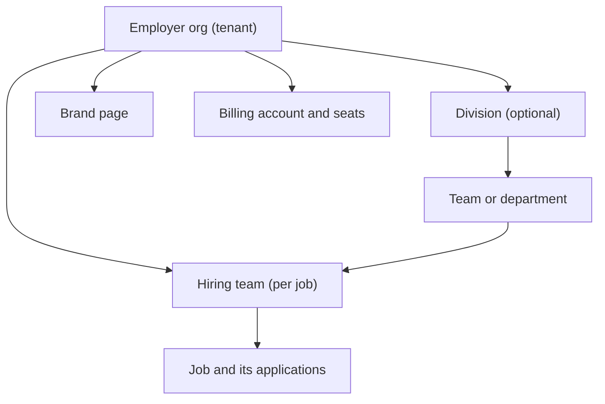

| Level               | Purpose                                                        | Who creates               | Permission effect                                                                               |
| ------------------- | -------------------------------------------------------------- | ------------------------- | ----------------------------------------------------------------------------------------------- |
| Org                 | Tenant boundary for all org-owned data                         | `CAN` creating the org    | Every org record carries the org id; nothing crosses it without a consent bridge (`BR-XCT-055`) |
| Division (optional) | Large orgs with separate brands or budgets                     | `EAD`                     | `org_admin` grants may be scoped to a division [PROP]                                           |
| Team / department   | Structure for requisition approval routing and `ENT` reporting | `EAD`                     | Approval chains reference team heads                                                            |
| Hiring team         | The people who may see one job's applications                  | `REC` or `HMG` on the job | The only path to application content (`T` scope)                                                |

#### 5.2 Agency and client relationship

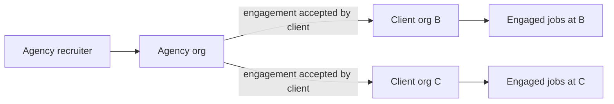

An engagement is created by the agency and accepted by the client `EAD`; it lists the jobs the agency may submit to and the fee terms reference (fees are off-platform unless `OD-PRD-04` admits them). An agency recruiter sees only the submitted candidates' pipeline status at the client, not the client's other applicants. Candidate ownership: the first valid submission with candidate consent wins for a configurable window (default 180 days [PROP]) (`BR-XCT-057`).

#### 5.3 Institution

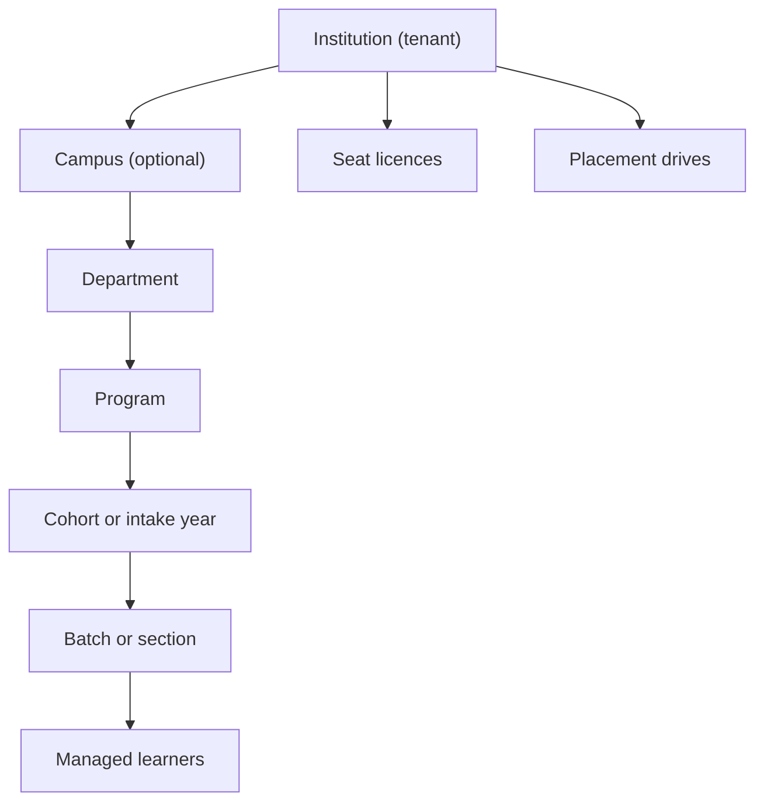

| Level              | Admin role                         | Notes                                                           |
| ------------------ | ---------------------------------- | --------------------------------------------------------------- |
| Institution        | `inst_admin`                       | Licences, verification, credential templates, graduation policy |
| Campus, department | `department_admin`                 | Scoped reports and cohorts                                      |
| Program, cohort    | `inst_admin` or `department_admin` | Curriculum and assigned courses                                 |
| Batch / section    | `faculty`                          | Teaching, grading, at-risk monitoring                           |
| Placement          | `placement_officer`                | Drives for eligible cohorts                                     |

#### 5.4 Enterprise (employer org with `ENT`)

The enterprise view reuses the employer hierarchy (5.1) and adds business units mapped from the HRIS by read-only sync. Employees are org members with the `CAN` base and an `employee` membership flag [PROP]; the flag grants nothing beyond seeing internal roles and assigned learning. `EXA` reports are aggregate by default with `min_cohort_k` suppression.

#### 5.5 Platform staff

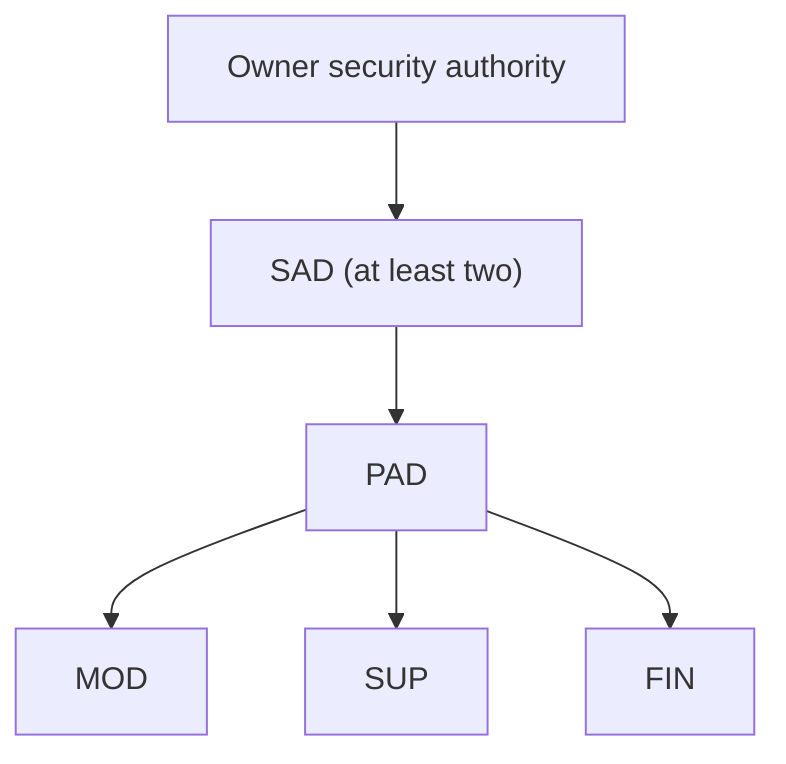

Edges mean "grants with second approval" (`BR-XCT-062`); no role grants itself or its own level.

### 6. Coverage check

| Role | Profile | Journeys in 05               | Matrix column in 04 |
| ---- | ------- | ---------------------------- | ------------------- |
| GUE  | 3.1     | `JRN-GUE-01` to `JRN-GUE-04` | yes                 |
| CAN  | 3.2     | `JRN-CAN-01` to `JRN-CAN-22` | yes                 |
| STD  | 3.3     | `JRN-STD-01` to `JRN-STD-04` | yes                 |
| INS  | 3.4     | `JRN-INS-01` to `JRN-INS-04` | yes                 |
| MNT  | 3.5     | `JRN-MNT-01` to `JRN-MNT-03` | yes                 |
| FRL  | 3.6     | `JRN-FRL-01` to `JRN-FRL-03` | yes                 |
| REC  | 3.7     | `JRN-REC-01` to `JRN-REC-08` | yes                 |
| HMG  | 3.8     | `JRN-HMG-01` to `JRN-HMG-03` | yes                 |
| EAD  | 3.9     | `JRN-EAD-01` to `JRN-EAD-05` | yes                 |
| IAD  | 3.10    | `JRN-IAD-01` to `JRN-IAD-03` | yes                 |
| PLO  | 3.11    | `JRN-PLO-01` to `JRN-PLO-02` | yes                 |
| EXA  | 3.12    | `JRN-EXA-01` to `JRN-EXA-03` | yes                 |
| MOD  | 3.13    | `JRN-MOD-01` to `JRN-MOD-03` | yes                 |
| SUP  | 3.14    | `JRN-SUP-01` to `JRN-SUP-02` | yes                 |
| FIN  | 3.15    | `JRN-FIN-01` to `JRN-FIN-02` | yes                 |
| PAD  | 3.16    | `JRN-PAD-01` to `JRN-PAD-03` | yes                 |
| SAD  | 3.17    | `JRN-SAD-01` to `JRN-SAD-02` | yes                 |
| API  | 3.18    | `JRN-API-01` to `JRN-API-02` | yes                 |

### 7. Legacy source trace

| Source                                                                                             | Used for                                                                                           | Dropped or changed                                                                              |
| -------------------------------------------------------------------------------------------------- | -------------------------------------------------------------------------------------------------- | ----------------------------------------------------------------------------------------------- |
| `SSOT.md` §5.4, §5.5, §5.7                                                                         | Tier-2 roles, personas P-A to P-T, lifecycles                                                      | Tier-1 JWT roles not used; 24 contextual roles mapped to 18 canonical roles plus variants (1.1) |
| `docs/archive/target-blueprint/02_STAKEHOLDERS_AND_USERS.md` and REV2 | Scoped grants, referee as token actor, org owner vs admin, viewer, last-owner rule, access reviews | ROLE-AUD mapped to `SAD` variant `security_auditor`                                             |
| SSOT §5.9 boundary principles                                                                      | Faculty scoped to batches; managed-learner limits; instructors cannot review own courses           | Managed-learner pre-graduation application ban turned into `OD-PRD-37`                          |

## 04 — Permission Matrix

_Former file: `PRODUCT_BLUEPRINT/01_PRODUCT/04_PERMISSION_MATRIX.md`._

Role by capability authorization for all 30 modules, plus the tenancy, delegation, separation-of-duties and break-glass rules that every cell depends on. Authorization is **deny by default**: a capability not granted here, or granted with a condition that is not met, is denied. [SRC: SSOT §5.4; USR-01 INV-T01] Module files refine each row into feature-level permissions and may only narrow a cell, never widen it; a module that needs a wider cell raises an `OD-`. Roles are defined in [03](#03--personas-and-roles); cross-cutting rules (`BR-XCT-`) in [06](#06--business-model-and-cross-module-rules).

### 1. How to read a cell

| Value | Meaning                                                                                                                                                                                  |
| ----- | ---------------------------------------------------------------------------------------------------------------------------------------------------------------------------------------- |
| `A`   | Allowed within the role's natural reach (for public data: anyone; for platform roles: platform-wide)                                                                                     |
| `O`   | Own only: the actor owns, authored, or is the subject of the resource                                                                                                                    |
| `S`   | Scoped: only within the tenant of the grant (the actor's org, institution, department)                                                                                                   |
| `P`   | Approval required: takes effect only after a second principal approves, or (for staff) only inside a reason-coded, time-boxed, audited access session tied to a ticket, case or incident |
| `—`   | Denied                                                                                                                                                                                   |
| `·`   | Not added by this role; the person has it through their `CAN` base grant in their personal context                                                                                       |

Modifiers appended to a value (several may combine, for example `Sce`):

| Modifier | Meaning                                                                                                                                                         |
| -------- | --------------------------------------------------------------------------------------------------------------------------------------------------------------- |
| `t`      | Only resources assigned to the actor: the hiring team of that job, the interview loop, the batch or cohort taught, the peer-review assignment, the event judged |
| `c`      | Only with a live consent scope from the subject or an application snapshot (`BR-XCT-012`); for `GUE`, only items the subject made public                        |
| `e`      | Also subject to an entitlement or quota from `BIL`; never affects ranking (`BR-XCT-020`)                                                                        |
| `g`      | Gated: denied until the named decision admits the capability (`OD-PRD-02` for OS-expansion modules, or the `OD-` in the row)                                    |

Columns: `GUE` Guest · `CAN` Candidate · `STD` Student · `INS` Instructor · `MNT` Mentor · `FRL` Freelancer · `REC` Recruiter · `HMG` Hiring manager · `EAD` Employer admin · `IAD` Institution admin · `PLO` Placement officer · `EXA` Enterprise talent / L&D admin · `MOD` Moderator · `SUP` Support agent · `FIN` Finance operator · `PAD` Platform admin · `SAD` Super admin / security officer · `API` Integration principal.

Variants (03 §1.1) narrow their canonical column: an `interviewer` has only the `HMG` cells marked `t` for one loop; a `viewer` has only `ATS.pipeline.metrics` and `JOB.job.view_public`; a `coordinator` has `INT.interview.schedule` and `MSG.application_thread` from the `REC` column; an `agency_recruiter` has `JOB.agency.submit` and `ATS.application.view` limited to submitted candidates; a `proctor` has only `ASM.proctor`; `org_owner` adds `EMP.ownership.transfer` and `BIL.org.subscribe`, which plain `org_admin` lacks; a `security_auditor` has only the read rows of the `SAD` column.

### 2. Evaluation order

Every request is decided server-side in this order; the first failing step denies. [SRC: SSOT §5.1 authorization chain; DER]

1. **Identity**: a valid session, or a valid referee token, or a valid API key. Client-supplied role, tenant or owner ids are ignored.
2. **Account state**: `suspended`, `deactivated`, `pending_erasure` accounts can only reach the routes their state allows (appeal, reactivate, cancel erasure, export).
3. **Grant**: the grant for the active context carries the capability in this matrix (or the `CAN` base does for the person's own data).
4. **Gate**: if the cell has `g`, the gating decision is closed in favor and the module flag is on.
5. **Scope**: the resource's tenant equals the grant's tenant (`S`), the actor is the owner or subject (`O`), or the actor is assigned (`t`).
6. **Relationship guards**: block list (`BR-XCT-017`), conflict-of-interest exclusions (`BR-XCT-059`), minor protections (`BR-XCT-071`).
7. **Consent**: for `c`, a live consent scope or application snapshot covering this resource and grantee, read at request time with no cache (`BR-XCT-008`).
8. **Entitlement**: for `e`, the quota or tool is available on the actor's or tenant's plan (`OD-PRD-08` decides whose).
9. **Approval or access session**: for `P`, a recorded approval by a different principal, or an open access session with ticket, reason and expiry.
10. **Rate limit and abuse controls** for the capability.
11. **Audit**: consequential actions and every `P` action write an audit record before the response is returned.

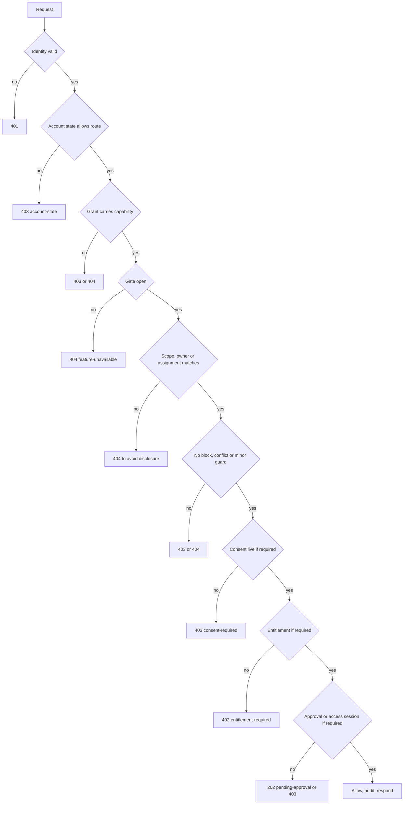

Denials for resources the actor must not know exist return `404`, not `403`, so the response does not disclose existence. [DER]

### 3. Matrix by module

218 capability rows across the 30 modules. Row keys are `<MODULE>.<resource>.<action>`; they are capability names for policy data and tests, not register ids.

#### 3.1 IDN — Identity, Authentication & Account

| Capability                      | What it allows                                                         | GUE | CAN | STD | INS | MNT | FRL | REC | HMG | EAD | IAD | PLO | EXA | MOD | SUP | FIN | PAD | SAD | API |
| ------------------------------- | ---------------------------------------------------------------------- | --- | --- | --- | --- | --- | --- | --- | --- | --- | --- | --- | --- | --- | --- | --- | --- | --- | --- |
| `IDN.account.register`          | Create an account (email, passkey, OAuth)                              | A   | —   | —   | —   | —   | —   | —   | —   | —   | —   | —   | —   | —   | —   | —   | —   | —   | —   |
| `IDN.session.sign_in`           | Sign in, including enterprise SSO when the org enforces it             | A   | A   | A   | A   | A   | A   | A   | A   | A   | A   | A   | A   | A   | A   | A   | A   | A   | —   |
| `IDN.mfa.manage_own`            | Add or remove MFA factors and passkeys (mandatory for staff, EAD, IAD) | —   | O   | O   | O   | O   | O   | O   | O   | O   | O   | O   | O   | O   | O   | O   | O   | O   | —   |
| `IDN.session.revoke_own`        | List own devices and sign out sessions                                 | —   | O   | O   | O   | O   | O   | O   | O   | O   | O   | O   | O   | O   | O   | O   | O   | O   | —   |
| `IDN.account.deactivate_own`    | Deactivate or reactivate own account                                   | —   | O   | O   | ·   | ·   | ·   | ·   | ·   | ·   | ·   | ·   | ·   | —   | —   | —   | —   | —   | —   |
| `IDN.account.suspend_other`     | Suspend another account for policy reasons                             | —   | —   | —   | —   | —   | —   | —   | —   | —   | —   | —   | —   | P   | —   | —   | A   | A   | —   |
| `IDN.account.assisted_recovery` | Recover an account after identity proofing                             | —   | —   | —   | —   | —   | —   | —   | —   | —   | —   | —   | —   | —   | P   | —   | P   | A   | —   |
| `IDN.sso.configure`             | Configure OIDC/SAML SSO and enforcement for a tenant                   | —   | —   | —   | —   | —   | —   | —   | —   | S   | S   | —   | —   | —   | —   | —   | A   | —   | —   |
| `IDN.scim.provision`            | Provision and deprovision members by SCIM                              | —   | —   | —   | —   | —   | —   | —   | —   | S   | S   | —   | —   | —   | —   | —   | A   | —   | S   |
| `IDN.impersonate`               | Act as another user (never provided)                                   | —   | —   | —   | —   | —   | —   | —   | —   | —   | —   | —   | —   | —   | —   | —   | —   | —   | —   |

#### 3.2 SET — Settings, Privacy, Consent & Data Rights

| Capability                       | What it allows                                                             | GUE | CAN | STD | INS | MNT | FRL | REC | HMG | EAD | IAD | PLO | EXA | MOD | SUP | FIN | PAD | SAD | API |
| -------------------------------- | -------------------------------------------------------------------------- | --- | --- | --- | --- | --- | --- | --- | --- | --- | --- | --- | --- | --- | --- | --- | --- | --- | --- |
| `SET.visibility.manage_own`      | Set profile, field and evidence visibility                                 | —   | O   | O   | ·   | ·   | ·   | ·   | ·   | ·   | ·   | ·   | ·   | —   | —   | —   | —   | —   | —   |
| `SET.consent.grant_revoke_own`   | Grant or revoke own consent scopes                                         | —   | O   | O   | ·   | ·   | ·   | ·   | ·   | ·   | ·   | ·   | ·   | —   | —   | —   | —   | —   | —   |
| `SET.consent.grant_for_other`    | Grant consent on behalf of another person (never provided)                 | —   | —   | —   | —   | —   | —   | —   | —   | —   | —   | —   | —   | —   | —   | —   | —   | —   | —   |
| `SET.dsr.file_own`               | File own export, erasure, rectification or restriction request             | —   | O   | O   | ·   | ·   | ·   | ·   | ·   | ·   | ·   | ·   | ·   | —   | —   | —   | —   | —   | —   |
| `SET.dsr.fulfil`                 | Complete a data-rights request after automated steps fail                  | —   | —   | —   | —   | —   | —   | —   | —   | —   | —   | —   | —   | —   | P   | —   | A   | P   | —   |
| `SET.consent_ledger.view_other`  | View another person's consent ledger                                       | —   | —   | —   | —   | —   | —   | —   | —   | —   | —   | —   | —   | —   | P   | —   | P   | A   | —   |
| `SET.legal_hold.place`           | Place or lift a legal hold on a subject's records                          | —   | —   | —   | —   | —   | —   | —   | —   | —   | —   | —   | —   | —   | —   | —   | P   | A   | —   |
| `SET.tenant_retention.configure` | Set retention for org- or institution-owned records within platform bounds | —   | —   | —   | —   | —   | —   | —   | —   | S   | S   | —   | —   | —   | —   | —   | A   | —   | —   |

#### 3.3 NTF — Notifications & Communication Channels

| Capability                      | What it allows                                                               | GUE | CAN | STD | INS | MNT | FRL | REC | HMG | EAD | IAD | PLO | EXA | MOD | SUP | FIN | PAD | SAD | API |
| ------------------------------- | ---------------------------------------------------------------------------- | --- | --- | --- | --- | --- | --- | --- | --- | --- | --- | --- | --- | --- | --- | --- | --- | --- | --- |
| `NTF.preferences.manage_own`    | Set channels, digests, quiet hours per notification class                    | —   | O   | O   | ·   | ·   | ·   | ·   | ·   | ·   | ·   | ·   | ·   | O   | O   | O   | O   | O   | —   |
| `NTF.template.customize_tenant` | Customize candidate-facing templates (invite, rejection, offer) for a tenant | —   | —   | —   | —   | —   | —   | —   | —   | S   | S   | S   | S   | —   | —   | —   | A   | —   | —   |
| `NTF.broadcast.cohort`          | Send an announcement to an assigned cohort or batch                          | —   | —   | —   | St  | —   | —   | —   | —   | —   | S   | S   | —   | —   | —   | —   | —   | —   | —   |
| `NTF.broadcast.org`             | Send an announcement to org members                                          | —   | —   | —   | —   | —   | —   | —   | —   | S   | —   | —   | S   | —   | —   | —   | —   | —   | —   |
| `NTF.broadcast.platform`        | Send a platform-wide service announcement                                    | —   | —   | —   | —   | —   | —   | —   | —   | —   | —   | —   | —   | —   | —   | —   | P   | P   | —   |
| `NTF.delivery_log.view_other`   | View delivery log for another user's notifications                           | —   | —   | —   | —   | —   | —   | —   | —   | —   | —   | —   | —   | —   | P   | —   | A   | A   | —   |

#### 3.4 REP — Gamification, Reputation & Recognition

| Capability                    | What it allows                                                      | GUE | CAN | STD | INS | MNT | FRL | REC | HMG | EAD | IAD | PLO | EXA | MOD | SUP | FIN | PAD | SAD | API |
| ----------------------------- | ------------------------------------------------------------------- | --- | --- | --- | --- | --- | --- | --- | --- | --- | --- | --- | --- | --- | --- | --- | --- | --- | --- |
| `REP.achievements.view_own`   | View own badges, XP and contextual reputation                       | —   | O   | O   | ·   | ·   | ·   | ·   | ·   | ·   | ·   | ·   | ·   | —   | —   | —   | —   | —   | —   |
| `REP.badge.display_toggle`    | Choose which badges appear on own profile                           | —   | O   | O   | ·   | ·   | ·   | ·   | ·   | ·   | ·   | ·   | ·   | —   | —   | —   | —   | —   | —   |
| `REP.badge_definition.create` | Define a badge for own course, event, program or employer challenge | —   | —   | —   | O   | —   | —   | —   | —   | S   | S   | —   | S   | —   | —   | —   | A   | —   | —   |
| `REP.reputation.view_other`   | View another person's contextual reputation signals                 | —   | A   | A   | ·   | ·   | ·   | Sc  | Sc  | —   | —   | —   | —   | —   | —   | —   | P   | —   | —   |
| `REP.leaderboard.view`        | View leaderboards (gated, OD-PRD-28)                                | Ag  | Ag  | Ag  | ·   | ·   | ·   | ·   | ·   | ·   | ·   | ·   | ·   | —   | —   | —   | A   | —   | —   |
| `REP.points.adjust`           | Reverse points or badges obtained by fraud                          | —   | —   | —   | —   | —   | —   | —   | —   | —   | —   | —   | —   | P   | —   | —   | P   | —   | —   |

#### 3.5 PRF — Profile, Resume & Portfolio

| Capability                       | What it allows                                                            | GUE | CAN | STD | INS | MNT | FRL | REC | HMG | EAD | IAD | PLO | EXA | MOD | SUP | FIN | PAD | SAD | API |
| -------------------------------- | ------------------------------------------------------------------------- | --- | --- | --- | --- | --- | --- | --- | --- | --- | --- | --- | --- | --- | --- | --- | --- | --- | --- |
| `PRF.profile.edit_own`           | Create and edit own profile, experience, education, skills                | —   | O   | O   | ·   | ·   | ·   | ·   | ·   | ·   | ·   | ·   | ·   | —   | —   | —   | —   | —   | —   |
| `PRF.profile.view_public`        | View a profile page marked public                                         | A   | A   | A   | ·   | ·   | ·   | ·   | ·   | ·   | ·   | ·   | ·   | A   | A   | —   | A   | A   | —   |
| `PRF.profile.view_discoverable`  | View discoverable profile summaries (needs search.discoverable)           | —   | —   | —   | —   | —   | —   | Sc  | Sc  | —   | —   | Sc  | —   | —   | —   | —   | —   | —   | —   |
| `PRF.profile.view_cohort_member` | View cohort members' profiles within institution sharing                  | —   | —   | —   | Stc | —   | —   | —   | —   | —   | Sc  | Sc  | —   | —   | —   | —   | —   | —   | —   |
| `PRF.resume.variants`            | Create résumé variants (count above base is entitlement-gated)            | —   | Oe  | O   | ·   | ·   | ·   | ·   | ·   | ·   | ·   | ·   | ·   | —   | —   | —   | —   | —   | —   |
| `PRF.resume.import`              | Import and parse a résumé or LinkedIn export                              | —   | O   | O   | ·   | ·   | ·   | ·   | ·   | ·   | ·   | ·   | ·   | —   | —   | —   | —   | —   | —   |
| `PRF.portfolio.publish`          | Publish a portfolio project with artifacts                                | —   | O   | O   | ·   | ·   | ·   | ·   | ·   | ·   | ·   | ·   | ·   | —   | —   | —   | —   | —   | —   |
| `PRF.profile.view_support`       | View a user's profile in support context with ticket and reason           | —   | —   | —   | —   | —   | —   | —   | —   | —   | —   | —   | —   | P   | P   | —   | P   | A   | —   |
| `PRF.profile.edit_other`         | Edit another person's profile (never provided; takedown goes through TSF) | —   | —   | —   | —   | —   | —   | —   | —   | —   | —   | —   | —   | —   | —   | —   | —   | —   | —   |

#### 3.6 EVD — Evidence, Work History & Credentials

| Capability                         | What it allows                                                                  | GUE | CAN | STD | INS | MNT | FRL | REC | HMG | EAD | IAD | PLO | EXA | MOD | SUP | FIN | PAD | SAD | API |
| ---------------------------------- | ------------------------------------------------------------------------------- | --- | --- | --- | --- | --- | --- | --- | --- | --- | --- | --- | --- | --- | --- | --- | --- | --- | --- |
| `EVD.evidence.create_own`          | Add a claim, artifact or link as own evidence                                   | —   | O   | O   | ·   | ·   | ·   | ·   | ·   | ·   | ·   | ·   | ·   | —   | —   | —   | —   | —   | —   |
| `EVD.evidence.view_other`          | Open another person's evidence artifact                                         | Ac  | —   | —   | St  | Oc  | —   | Sc  | Stc | —   | Sc  | Sc  | Sc  | P   | P   | —   | P   | P   | Sc  |
| `EVD.attest.instructor`            | Attest a learner's skill as issuer class instructor (instructor is not learner) | —   | —   | —   | St  | —   | —   | —   | —   | —   | —   | —   | —   | —   | —   | —   | —   | —   | —   |
| `EVD.credential.issue_institution` | Issue an institution credential to a learner of the institution                 | —   | —   | —   | —   | —   | —   | —   | —   | —   | S   | —   | —   | —   | —   | —   | —   | —   | S   |
| `EVD.credential.issue_employer`    | Confirm employment of a person who requested it from the verified org           | —   | —   | —   | —   | —   | —   | —   | —   | S   | —   | —   | —   | —   | —   | —   | —   | —   | —   |
| `EVD.credential.revoke_issued`     | Revoke a credential the actor's tenant or the actor issued, with reason         | —   | —   | —   | St  | —   | —   | —   | —   | S   | S   | —   | —   | —   | —   | —   | P   | —   | —   |
| `EVD.rung.override`                | Correct an evidence rung after a case decision                                  | —   | —   | —   | —   | —   | —   | —   | —   | —   | —   | —   | —   | —   | —   | —   | P   | P   | —   |
| `EVD.dispute.file`                 | Dispute a verification outcome on own evidence                                  | —   | O   | O   | ·   | ·   | ·   | ·   | ·   | ·   | ·   | ·   | ·   | —   | —   | —   | —   | —   | —   |

#### 3.7 BGV — Verification & Background Checks

| Capability                   | What it allows                                         | GUE | CAN | STD | INS | MNT | FRL | REC | HMG | EAD | IAD | PLO | EXA | MOD | SUP | FIN | PAD | SAD | API |
| ---------------------------- | ------------------------------------------------------ | --- | --- | --- | --- | --- | --- | --- | --- | --- | --- | --- | --- | --- | --- | --- | --- | --- | --- |
| `BGV.referee.request`        | Request a referee to verify own work-history claim     | —   | O   | O   | ·   | ·   | ·   | ·   | ·   | ·   | ·   | ·   | ·   | —   | —   | —   | —   | —   | —   |
| `BGV.referee.respond`        | Respond to a verification request (referee token only) | A   | —   | —   | —   | —   | —   | —   | —   | —   | —   | —   | —   | —   | —   | —   | —   | —   | —   |
| `BGV.background.order`       | Order a background check on a candidate at offer stage | —   | —   | —   | —   | —   | —   | Pce | —   | Sce | —   | —   | —   | —   | —   | —   | —   | —   | —   |
| `BGV.background.consent`     | Consent to, review and dispute own background check    | —   | O   | O   | ·   | ·   | ·   | ·   | ·   | ·   | ·   | ·   | ·   | —   | —   | —   | —   | —   | —   |
| `BGV.background.view_result` | View the adjudication summary of a check               | —   | O   | O   | —   | —   | —   | Stc | Stc | Sc  | —   | —   | —   | —   | P   | —   | —   | —   | —   |
| `BGV.org_domain.verify`      | Approve an employer or institution verification        | —   | —   | —   | —   | —   | —   | —   | —   | O   | O   | —   | —   | —   | —   | —   | A   | —   | —   |
| `BGV.identity.verify_own`    | Verify own identity document (gated OD-PRD-26)         | —   | Og  | Og  | ·   | Og  | Og  | ·   | ·   | ·   | ·   | ·   | ·   | —   | —   | —   | —   | —   | —   |

#### 3.8 SRC — Search & Discovery

| Capability                | What it allows                                   | GUE | CAN | STD | INS | MNT | FRL | REC | HMG | EAD | IAD | PLO | EXA | MOD | SUP | FIN | PAD | SAD | API |
| ------------------------- | ------------------------------------------------ | --- | --- | --- | --- | --- | --- | --- | --- | --- | --- | --- | --- | --- | --- | --- | --- | --- | --- |
| `SRC.jobs.search`         | Search and filter public jobs                    | A   | A   | A   | ·   | ·   | ·   | ·   | ·   | ·   | ·   | ·   | ·   | —   | —   | —   | A   | —   | S   |
| `SRC.courses.search`      | Search the course catalog                        | A   | A   | A   | ·   | ·   | ·   | ·   | ·   | ·   | ·   | ·   | ·   | —   | —   | —   | A   | —   | S   |
| `SRC.people.search`       | Search people (only discoverable or connections) | —   | A   | A   | ·   | ·   | ·   | Sce | Sc  | —   | —   | Sc  | —   | —   | —   | —   | —   | —   | —   |
| `SRC.saved_search.manage` | Save searches and alerts                         | —   | O   | O   | ·   | ·   | ·   | O   | O   | —   | —   | O   | —   | —   | —   | —   | —   | —   | —   |
| `SRC.taxonomy.curate`     | Edit skills, synonyms and occupation taxonomy    | —   | —   | —   | —   | —   | —   | —   | —   | —   | —   | —   | —   | —   | —   | —   | A   | —   | —   |
| `SRC.index.admin`         | Reindex, tune ranking weights (never by payment) | —   | —   | —   | —   | —   | —   | —   | —   | —   | —   | —   | —   | —   | —   | —   | P   | —   | —   |

#### 3.9 LRN — Learning & Course Experience

| Capability                  | What it allows                                         | GUE | CAN | STD | INS | MNT | FRL | REC | HMG | EAD | IAD | PLO | EXA | MOD | SUP | FIN | PAD | SAD | API |
| --------------------------- | ------------------------------------------------------ | --- | --- | --- | --- | --- | --- | --- | --- | --- | --- | --- | --- | --- | --- | --- | --- | --- | --- |
| `LRN.catalog.browse`        | Browse catalog and preview lessons                     | A   | A   | A   | ·   | ·   | ·   | ·   | ·   | ·   | ·   | ·   | ·   | —   | —   | —   | A   | —   | S   |
| `LRN.enroll.free`           | Enroll in a free or licensed course                    | —   | O   | S   | ·   | ·   | ·   | ·   | ·   | ·   | ·   | ·   | ·   | —   | —   | —   | —   | —   | —   |
| `LRN.purchase`              | Buy a paid course (gated OD-PRD-04)                    | —   | Og  | —   | ·   | ·   | ·   | ·   | ·   | ·   | ·   | ·   | ·   | —   | —   | —   | —   | —   | —   |
| `LRN.progress.own`          | Track progress, notes, bookmarks; download for offline | —   | O   | O   | ·   | ·   | ·   | ·   | ·   | ·   | ·   | ·   | ·   | —   | —   | —   | —   | —   | —   |
| `LRN.qna.answer`            | Answer learner questions in a course                   | —   | —   | —   | O   | —   | —   | —   | —   | —   | —   | —   | —   | —   | —   | —   | —   | —   | —   |
| `LRN.review.write`          | Rate and review a course taken (never own course)      | —   | O   | O   | ·   | ·   | ·   | ·   | ·   | ·   | ·   | ·   | ·   | —   | —   | —   | —   | —   | —   |
| `LRN.assign`                | Assign a course to learners                            | —   | —   | —   | St  | —   | —   | —   | —   | —   | S   | —   | S   | —   | —   | —   | —   | —   | S   |
| `LRN.progress.view_learner` | View an individual learner's progress                  | —   | —   | —   | St  | Oc  | —   | —   | —   | —   | S   | Sc  | Sc  | —   | P   | —   | —   | —   | —   |

#### 3.10 STU — Instructor Studio & Content Production

| Capability                   | What it allows                                          | GUE | CAN | STD | INS | MNT | FRL | REC | HMG | EAD | IAD | PLO | EXA | MOD | SUP | FIN | PAD | SAD | API |
| ---------------------------- | ------------------------------------------------------- | --- | --- | --- | --- | --- | --- | --- | --- | --- | --- | --- | --- | --- | --- | --- | --- | --- | --- |
| `STU.instructor.apply`       | Apply to become an instructor                           | —   | O   | —   | ·   | O   | O   | ·   | ·   | ·   | ·   | ·   | ·   | —   | —   | —   | —   | —   | —   |
| `STU.course.edit_draft`      | Create and edit a course draft                          | —   | —   | —   | O   | —   | —   | —   | —   | —   | S   | —   | S   | —   | —   | —   | —   | —   | —   |
| `STU.course.publish_public`  | Publish to the public catalog (needs content review)    | —   | —   | —   | P   | —   | —   | —   | —   | —   | P   | —   | —   | —   | —   | —   | A   | —   | —   |
| `STU.course.publish_private` | Publish to an institution or enterprise private catalog | —   | —   | —   | St  | —   | —   | —   | —   | —   | S   | —   | S   | —   | —   | —   | —   | —   | —   |
| `STU.course.review`          | Approve or return a course submitted for public review  | —   | —   | —   | —   | —   | —   | —   | —   | —   | —   | —   | —   | A   | —   | —   | A   | —   | —   |
| `STU.course.price`           | Set price and coupons (gated OD-PRD-04)                 | —   | —   | —   | Pg  | —   | —   | —   | —   | —   | Sg  | —   | —   | —   | —   | —   | A   | —   | —   |
| `STU.earnings.view`          | View own earnings and payouts (gated)                   | —   | —   | —   | Og  | —   | —   | —   | —   | —   | —   | —   | —   | —   | —   | A   | —   | —   | —   |
| `STU.coauthor.invite`        | Invite a co-author to a course                          | —   | —   | —   | O   | —   | —   | —   | —   | —   | S   | —   | S   | —   | —   | —   | —   | —   | —   |

#### 3.11 ASM — Assessments, Challenges & Integrity

| Capability                  | What it allows                                              | GUE | CAN | STD | INS | MNT | FRL | REC | HMG | EAD | IAD | PLO | EXA | MOD | SUP | FIN | PAD | SAD | API |
| --------------------------- | ----------------------------------------------------------- | --- | --- | --- | --- | --- | --- | --- | --- | --- | --- | --- | --- | --- | --- | --- | --- | --- | --- |
| `ASM.attempt.take`          | Take a quiz, challenge or assessment                        | —   | O   | O   | ·   | ·   | ·   | ·   | ·   | ·   | ·   | ·   | ·   | —   | —   | —   | —   | —   | —   |
| `ASM.assessment.create`     | Create an assessment or challenge                           | —   | —   | —   | O   | —   | —   | S   | S   | S   | S   | —   | S   | —   | —   | —   | A   | —   | —   |
| `ASM.grade.rubric`          | Grade a submission against a rubric                         | —   | —   | —   | St  | —   | —   | St  | St  | —   | —   | —   | —   | —   | —   | —   | —   | —   | —   |
| `ASM.peer_review.do`        | Review an assigned peer submission (double-blind)           | —   | Ot  | Ot  | ·   | ·   | ·   | ·   | ·   | ·   | ·   | ·   | ·   | —   | —   | —   | —   | —   | —   |
| `ASM.ai_mode.set`           | Set the AI mode of an assessment (enforced server-side)     | —   | —   | —   | O   | —   | —   | S   | S   | S   | S   | —   | S   | —   | —   | —   | A   | —   | —   |
| `ASM.proctor`               | Invigilate an institution-run session (gated OD-PRD-15)     | —   | —   | —   | Stg | —   | —   | —   | —   | —   | Sg  | —   | —   | —   | —   | —   | —   | —   | —   |
| `ASM.integrity.review`      | Review an integrity flag and decide on a sanction           | —   | —   | —   | St  | —   | —   | —   | —   | —   | S   | —   | —   | P   | —   | —   | —   | —   | —   |
| `ASM.accommodation.request` | Request an accommodation (extra time, screen reader mode)   | —   | O   | O   | ·   | ·   | ·   | ·   | ·   | ·   | ·   | ·   | ·   | —   | —   | —   | —   | —   | —   |
| `ASM.accommodation.approve` | Approve an accommodation without disclosing it to employers | —   | —   | —   | St  | —   | —   | —   | —   | S   | S   | —   | S   | —   | —   | —   | A   | —   | —   |

#### 3.12 JOB — Job Marketplace & Candidate Applications

| Capability                 | What it allows                                                              | GUE | CAN | STD | INS | MNT | FRL | REC | HMG | EAD | IAD | PLO | EXA | MOD | SUP | FIN | PAD | SAD | API |
| -------------------------- | --------------------------------------------------------------------------- | --- | --- | --- | --- | --- | --- | --- | --- | --- | --- | --- | --- | --- | --- | --- | --- | --- | --- |
| `JOB.job.view_public`      | View a published job                                                        | A   | A   | A   | ·   | ·   | ·   | ·   | ·   | ·   | ·   | ·   | ·   | A   | A   | —   | A   | A   | S   |
| `JOB.application.submit`   | Apply with a consented evidence snapshot                                    | —   | O   | P   | ·   | ·   | ·   | ·   | ·   | ·   | ·   | ·   | ·   | —   | —   | —   | —   | —   | —   |
| `JOB.application.withdraw` | Withdraw own application                                                    | —   | O   | O   | ·   | ·   | ·   | ·   | ·   | ·   | ·   | ·   | ·   | —   | —   | —   | —   | —   | —   |
| `JOB.job.create_draft`     | Create a job draft                                                          | —   | —   | —   | —   | —   | —   | S   | S   | S   | —   | —   | S   | —   | —   | —   | —   | —   | S   |
| `JOB.job.publish`          | Publish a job (job slots entitlement; org may require requisition approval) | —   | —   | —   | —   | —   | —   | Se  | —   | Se  | —   | —   | Sg  | —   | —   | —   | —   | —   | Se  |
| `JOB.job.close`            | Close, pause or reopen a job                                                | —   | —   | —   | —   | —   | —   | St  | St  | S   | —   | —   | —   | —   | —   | —   | —   | —   | S   |
| `JOB.job.report`           | Report a job as fraudulent or discriminatory                                | A   | A   | A   | ·   | ·   | ·   | ·   | ·   | ·   | ·   | ·   | ·   | —   | —   | —   | —   | —   | —   |
| `JOB.job.takedown`         | Take down a job for policy breach                                           | —   | —   | —   | —   | —   | —   | —   | —   | —   | —   | —   | —   | A   | —   | —   | A   | —   | —   |
| `JOB.agency.submit`        | Submit a consenting candidate to an engaged client job                      | —   | —   | —   | —   | —   | —   | Sc  | —   | —   | —   | —   | —   | —   | —   | —   | —   | —   | —   |
| `JOB.alerts.manage`        | Save jobs and manage job alerts                                             | —   | O   | O   | ·   | ·   | ·   | ·   | ·   | ·   | ·   | ·   | ·   | —   | —   | —   | —   | —   | —   |

#### 3.13 ATS — Recruiter Workspace & Hiring Pipeline

| Capability                | What it allows                                           | GUE | CAN | STD | INS | MNT | FRL | REC | HMG | EAD | IAD | PLO | EXA | MOD | SUP | FIN | PAD | SAD | API |
| ------------------------- | -------------------------------------------------------- | --- | --- | --- | --- | --- | --- | --- | --- | --- | --- | --- | --- | --- | --- | --- | --- | --- | --- |
| `ATS.application.view`    | Read application content for a job                       | —   | —   | —   | —   | —   | —   | St  | St  | —   | —   | Sc  | —   | —   | P   | —   | —   | —   | Sc  |
| `ATS.pipeline.metrics`    | View pipeline counts and funnel for the org              | —   | —   | —   | —   | —   | —   | S   | St  | S   | —   | —   | —   | —   | —   | —   | —   | —   | —   |
| `ATS.stage.move`          | Move a stage or reject with a reason code (human action) | —   | —   | —   | —   | —   | —   | St  | St  | —   | —   | —   | —   | —   | —   | —   | —   | —   | Sc  |
| `ATS.note.add`            | Add a private evaluative note                            | —   | —   | —   | —   | —   | —   | St  | St  | —   | —   | —   | —   | —   | —   | —   | —   | —   | —   |
| `ATS.pipeline.template`   | Configure pipeline templates and reason codes            | —   | —   | —   | —   | —   | —   | S   | —   | S   | —   | —   | —   | —   | —   | —   | —   | —   | —   |
| `ATS.requisition.create`  | Create a requisition                                     | —   | —   | —   | —   | —   | —   | S   | S   | —   | —   | —   | S   | —   | —   | —   | —   | —   | S   |
| `ATS.requisition.approve` | Approve a requisition (approver is not requester)        | —   | —   | —   | —   | —   | —   | —   | Pt  | P   | —   | —   | —   | —   | —   | —   | —   | —   | —   |
| `ATS.offer.create`        | Draft an offer                                           | —   | —   | —   | —   | —   | —   | St  | —   | —   | —   | —   | —   | —   | —   | —   | —   | —   | —   |
| `ATS.offer.approve`       | Approve an offer in the approval chain                   | —   | —   | —   | —   | —   | —   | —   | Pt  | P   | —   | —   | —   | —   | —   | —   | —   | —   | —   |
| `ATS.export`              | Export candidate data from a job (audited)               | —   | —   | —   | —   | —   | —   | Pt  | —   | P   | —   | —   | —   | —   | —   | —   | —   | —   | —   |

#### 3.14 INT — Interviews & Scheduling

| Capability                  | What it allows                                       | GUE | CAN | STD | INS | MNT | FRL | REC | HMG | EAD | IAD | PLO | EXA | MOD | SUP | FIN | PAD | SAD | API |
| --------------------------- | ---------------------------------------------------- | --- | --- | --- | --- | --- | --- | --- | --- | --- | --- | --- | --- | --- | --- | --- | --- | --- | --- |
| `INT.interview.schedule`    | Create an interview loop, panel and slots            | —   | —   | —   | —   | —   | —   | St  | St  | —   | —   | St  | —   | —   | —   | —   | —   | —   | —   |
| `INT.slot.self_schedule`    | Pick, reschedule or cancel own interview slot        | —   | O   | O   | ·   | ·   | ·   | ·   | ·   | ·   | ·   | ·   | ·   | —   | —   | —   | —   | —   | —   |
| `INT.scorecard.submit`      | Submit own scorecard for an assigned interview       | —   | —   | —   | —   | —   | —   | St  | St  | —   | —   | —   | —   | —   | —   | —   | —   | —   | —   |
| `INT.scorecard.view_others` | See other scorecards (only after submitting own)     | —   | —   | —   | —   | —   | —   | St  | Pt  | —   | —   | —   | —   | —   | —   | —   | —   | —   | —   |
| `INT.recording.enable`      | Record an interview (all-party consent, default off) | —   | —   | —   | —   | —   | —   | Pc  | Pc  | —   | —   | —   | —   | —   | —   | —   | —   | —   | —   |
| `INT.calendar.connect`      | Connect own calendar for availability                | —   | O   | O   | ·   | O   | O   | O   | O   | O   | O   | O   | O   | —   | —   | —   | —   | —   | —   |

#### 3.15 EMP — Employer Organisation, Teams & Brand

| Capability               | What it allows                                                   | GUE | CAN | STD | INS | MNT | FRL | REC | HMG | EAD | IAD | PLO | EXA | MOD | SUP | FIN | PAD | SAD | API |
| ------------------------ | ---------------------------------------------------------------- | --- | --- | --- | --- | --- | --- | --- | --- | --- | --- | --- | --- | --- | --- | --- | --- | --- | --- |
| `EMP.org.create`         | Create an employer org and become its owner                      | —   | A   | —   | ·   | ·   | ·   | ·   | ·   | ·   | ·   | ·   | ·   | —   | —   | —   | —   | —   | —   |
| `EMP.member.manage`      | Invite members, assign roles below owner, remove members         | —   | —   | —   | —   | —   | —   | —   | —   | S   | —   | —   | —   | —   | —   | —   | —   | —   | S   |
| `EMP.ownership.transfer` | Transfer org ownership to an accepting admin                     | —   | —   | —   | —   | —   | —   | —   | —   | O   | —   | —   | —   | —   | —   | —   | —   | —   | —   |
| `EMP.brand.edit`         | Edit the employer brand page                                     | —   | —   | —   | —   | —   | —   | S   | —   | S   | —   | —   | —   | —   | —   | —   | —   | —   | —   |
| `EMP.review.write`       | Write a company review (gated OD-PRD-17; never own org as admin) | —   | Og  | —   | ·   | ·   | ·   | ·   | ·   | ·   | ·   | ·   | ·   | —   | —   | —   | —   | —   | —   |
| `EMP.review.respond`     | Respond publicly to a review of own org                          | —   | —   | —   | —   | —   | —   | —   | —   | S   | —   | —   | —   | —   | —   | —   | —   | —   | —   |
| `EMP.agency.engage`      | Accept or end an agency engagement                               | —   | —   | —   | —   | —   | —   | —   | —   | S   | —   | —   | —   | —   | —   | —   | —   | —   | —   |
| `EMP.audit.view`         | View the org audit log                                           | —   | —   | —   | —   | —   | —   | —   | —   | S   | —   | —   | —   | —   | —   | —   | A   | A   | —   |

#### 3.16 NET — Networking, Community & Referrals

| Capability                 | What it allows                                          | GUE | CAN | STD | INS | MNT | FRL | REC | HMG | EAD | IAD | PLO | EXA | MOD | SUP | FIN | PAD | SAD | API |
| -------------------------- | ------------------------------------------------------- | --- | --- | --- | --- | --- | --- | --- | --- | --- | --- | --- | --- | --- | --- | --- | --- | --- | --- |
| `NET.connection.request`   | Send, accept or remove a connection                     | —   | O   | O   | ·   | ·   | ·   | ·   | ·   | ·   | ·   | ·   | ·   | —   | —   | —   | —   | —   | —   |
| `NET.referral.request`     | Ask a connection at an org for a referral               | —   | O   | P   | ·   | ·   | ·   | ·   | ·   | ·   | ·   | ·   | ·   | —   | —   | —   | —   | —   | —   |
| `NET.referral.give`        | Refer a connection to an org job (verified member only) | —   | O   | —   | ·   | ·   | ·   | ·   | ·   | ·   | ·   | ·   | ·   | —   | —   | —   | —   | —   | —   |
| `NET.post.create`          | Create a community post or article (gated OD-PRD-16)    | —   | Og  | Og  | ·   | ·   | ·   | ·   | ·   | ·   | ·   | ·   | ·   | —   | —   | —   | —   | —   | —   |
| `NET.group.manage`         | Create or moderate a community group (gated)            | —   | Og  | —   | Og  | ·   | ·   | ·   | ·   | ·   | S   | —   | —   | A   | —   | —   | A   | —   | —   |
| `NET.referral_bonus.track` | Track referral bonus eligibility (gated OD-PRD-27)      | —   | —   | —   | —   | —   | —   | Sg  | —   | Sg  | —   | —   | —   | —   | —   | —   | —   | —   | —   |

#### 3.17 MSG — Messaging & Real-time Communication

| Capability                   | What it allows                                                        | GUE | CAN | STD | INS | MNT | FRL | REC | HMG | EAD | IAD | PLO | EXA | MOD | SUP | FIN | PAD | SAD | API |
| ---------------------------- | --------------------------------------------------------------------- | --- | --- | --- | --- | --- | --- | --- | --- | --- | --- | --- | --- | --- | --- | --- | --- | --- | --- |
| `MSG.application_thread`     | Message within an application thread                                  | —   | O   | O   | ·   | ·   | ·   | St  | St  | —   | —   | —   | —   | —   | —   | —   | —   | —   | —   |
| `MSG.outreach.first_contact` | Send a first-contact request (consent and quota)                      | —   | —   | —   | —   | —   | —   | Sce | —   | —   | —   | —   | —   | —   | —   | —   | —   | —   | —   |
| `MSG.connection.message`     | Message a connection or accepted contact                              | —   | O   | O   | ·   | ·   | ·   | ·   | ·   | ·   | ·   | ·   | ·   | —   | —   | —   | —   | —   | —   |
| `MSG.cohort.message`         | Message an assigned cohort or batch channel                           | —   | —   | —   | St  | —   | —   | —   | —   | —   | S   | S   | —   | —   | —   | —   | —   | —   | —   |
| `MSG.mentor.thread`          | Message within a mentoring booking (gated)                            | —   | Og  | Og  | ·   | Og  | ·   | ·   | ·   | ·   | ·   | ·   | ·   | —   | —   | —   | —   | —   | —   |
| `MSG.view_other`             | Read a thread one is not part of (reported threads, ticket, incident) | —   | —   | —   | —   | —   | —   | —   | —   | —   | —   | —   | —   | P   | P   | —   | —   | P   | —   |
| `MSG.block`                  | Block a user                                                          | —   | O   | O   | ·   | ·   | ·   | ·   | ·   | ·   | ·   | ·   | ·   | —   | —   | —   | —   | —   | —   |

#### 3.18 AIC — AI Career Assistant, Matching & Recommendations

| Capability                 | What it allows                                                       | GUE | CAN | STD | INS | MNT | FRL | REC | HMG | EAD | IAD | PLO | EXA | MOD | SUP | FIN | PAD | SAD | API |
| -------------------------- | -------------------------------------------------------------------- | --- | --- | --- | --- | --- | --- | --- | --- | --- | --- | --- | --- | --- | --- | --- | --- | --- | --- |
| `AIC.assistant.use`        | Use the career assistant (consent ai.assist.process and cost policy) | —   | Oce | Oc  | Oce | Oce | Oce | Sce | Sce | —   | —   | —   | —   | —   | —   | —   | —   | —   | —   |
| `AIC.match.explain_own`    | See match explanations for own recommendations                       | —   | O   | O   | ·   | ·   | ·   | ·   | ·   | ·   | ·   | ·   | ·   | —   | —   | —   | —   | —   | —   |
| `AIC.suggested_order.view` | See advisory suggested order with rationale for a job                | —   | —   | —   | —   | —   | —   | St  | St  | —   | —   | —   | —   | —   | —   | —   | —   | —   | —   |
| `AIC.memory.manage_own`    | View and delete own AI memory                                        | —   | O   | O   | ·   | ·   | ·   | ·   | ·   | ·   | ·   | ·   | ·   | —   | —   | —   | —   | —   | —   |
| `AIC.provider.configure`   | Configure AI providers and cost policies (two-person)                | —   | —   | —   | —   | —   | —   | —   | —   | —   | —   | —   | —   | —   | —   | —   | P   | P   | —   |
| `AIC.auto_reject`          | Reject or rank out candidates automatically (never provided)         | —   | —   | —   | —   | —   | —   | —   | —   | —   | —   | —   | —   | —   | —   | —   | —   | —   | —   |

#### 3.19 TSF — Trust, Safety & Moderation

| Capability                  | What it allows                                        | GUE | CAN | STD | INS | MNT | FRL | REC | HMG | EAD | IAD | PLO | EXA | MOD | SUP | FIN | PAD | SAD | API |
| --------------------------- | ----------------------------------------------------- | --- | --- | --- | --- | --- | --- | --- | --- | --- | --- | --- | --- | --- | --- | --- | --- | --- | --- |
| `TSF.report.file`           | Report content, a user, a job or a message            | A   | A   | A   | ·   | ·   | ·   | ·   | ·   | ·   | ·   | ·   | ·   | —   | —   | —   | —   | —   | —   |
| `TSF.report.action`         | Review a report and take an action with reason code   | —   | —   | —   | St  | —   | —   | —   | —   | —   | S   | —   | —   | A   | —   | —   | P   | —   | —   |
| `TSF.appeal.file`           | Appeal an action taken against own content or account | —   | O   | O   | ·   | ·   | ·   | ·   | ·   | ·   | ·   | ·   | ·   | —   | —   | —   | —   | —   | —   |
| `TSF.appeal.decide`         | Decide an appeal (different moderator)                | —   | —   | —   | —   | —   | —   | —   | —   | —   | —   | —   | —   | P   | —   | —   | —   | —   | —   |
| `TSF.policy.configure`      | Configure policy rules and automated filters          | —   | —   | —   | —   | —   | —   | —   | —   | —   | —   | —   | —   | —   | —   | —   | P   | —   | —   |
| `TSF.investigation.linkage` | Investigate linked accounts for fraud rings           | —   | —   | —   | —   | —   | —   | —   | —   | —   | —   | —   | —   | P   | —   | —   | —   | A   | —   |

#### 3.20 INS — Institutions & Managed Learning

| Capability                | What it allows                                           | GUE | CAN | STD | INS | MNT | FRL | REC | HMG | EAD | IAD | PLO | EXA | MOD | SUP | FIN | PAD | SAD | API |
| ------------------------- | -------------------------------------------------------- | --- | --- | --- | --- | --- | --- | --- | --- | --- | --- | --- | --- | --- | --- | --- | --- | --- | --- |
| `INS.institution.create`  | Create an institution (platform verification follows)    | —   | A   | —   | ·   | ·   | ·   | ·   | ·   | ·   | ·   | ·   | ·   | —   | —   | —   | —   | —   | —   |
| `INS.learner.provision`   | Provision learners by CSV or SIS                         | —   | —   | —   | —   | —   | —   | —   | —   | —   | S   | —   | —   | —   | —   | —   | —   | —   | S   |
| `INS.cohort.manage`       | Create cohorts and batches; assign faculty               | —   | —   | —   | —   | —   | —   | —   | —   | —   | S   | —   | —   | —   | —   | —   | —   | —   | —   |
| `INS.analytics.cohort`    | View k-anonymous cohort analytics                        | —   | —   | —   | St  | —   | —   | —   | —   | —   | S   | S   | —   | —   | —   | —   | —   | —   | —   |
| `INS.learner.view_record` | View an individual learner record (institution-run work) | —   | —   | —   | St  | —   | —   | —   | —   | —   | S   | Sc  | —   | —   | P   | —   | —   | —   | —   |
| `INS.graduation.run`      | Run graduation and identity transfer                     | —   | —   | —   | —   | —   | —   | —   | —   | —   | S   | —   | —   | —   | —   | —   | —   | —   | —   |
| `INS.drive.manage`        | Create and manage a placement drive                      | —   | —   | —   | —   | —   | —   | —   | —   | —   | S   | S   | —   | —   | —   | —   | —   | —   | —   |
| `INS.drive.participate`   | Participate in a drive as an employer                    | —   | —   | —   | —   | —   | —   | Sc  | Sc  | S   | —   | —   | —   | —   | —   | —   | —   | —   | —   |
| `INS.outcomes.view`       | View placement outcomes (alumni.share_outcomes)          | —   | —   | —   | —   | —   | —   | —   | —   | —   | Sc  | Sc  | —   | —   | —   | —   | —   | —   | —   |

#### 3.21 BIL — Billing, Plans & Entitlements

| Capability                | What it allows                                                            | GUE | CAN | STD | INS | MNT | FRL | REC | HMG | EAD | IAD | PLO | EXA | MOD | SUP | FIN | PAD | SAD | API |
| ------------------------- | ------------------------------------------------------------------------- | --- | --- | --- | --- | --- | --- | --- | --- | --- | --- | --- | --- | --- | --- | --- | --- | --- | --- |
| `BIL.plans.view`          | View plans and what each includes                                         | A   | A   | A   | ·   | ·   | ·   | ·   | ·   | ·   | ·   | ·   | ·   | —   | —   | A   | A   | —   | —   |
| `BIL.candidate.subscribe` | Buy, change or cancel a personal plan                                     | —   | O   | O   | ·   | ·   | ·   | ·   | ·   | ·   | ·   | ·   | ·   | —   | —   | —   | —   | —   | —   |
| `BIL.org.subscribe`       | Manage org subscription, seats, payment method (owner or billing manager) | —   | —   | —   | —   | —   | —   | —   | —   | S   | —   | —   | —   | —   | —   | —   | —   | —   | —   |
| `BIL.institution.licence` | Buy and manage institution seat licences                                  | —   | —   | —   | —   | —   | —   | —   | —   | —   | S   | —   | —   | —   | —   | —   | —   | —   | —   |
| `BIL.invoice.view`        | View invoices and receipts                                                | —   | O   | O   | ·   | ·   | ·   | ·   | ·   | S   | S   | —   | —   | —   | —   | A   | —   | —   | —   |
| `BIL.refund.request`      | Request a refund                                                          | —   | O   | O   | ·   | ·   | ·   | ·   | ·   | S   | S   | —   | —   | —   | —   | —   | —   | —   | —   |
| `BIL.refund.issue`        | Issue a refund (second operator above threshold)                          | —   | —   | —   | —   | —   | —   | —   | —   | —   | —   | —   | —   | —   | —   | P   | —   | —   | —   |
| `BIL.payout.setup`        | Complete payee KYC and tax details (gated)                                | —   | —   | —   | Og  | Og  | Og  | —   | —   | —   | —   | —   | —   | —   | —   | —   | —   | —   | —   |
| `BIL.payout.run`          | Approve a payout batch (gated; creator is not approver)                   | —   | —   | —   | —   | —   | —   | —   | —   | —   | —   | —   | —   | —   | —   | Pg  | —   | —   | —   |
| `BIL.catalog.edit`        | Create a new plan or price version                                        | —   | —   | —   | —   | —   | —   | —   | —   | —   | —   | —   | —   | —   | —   | P   | P   | —   | —   |
| `BIL.comp.grant`          | Grant a complimentary entitlement                                         | —   | —   | —   | —   | —   | —   | —   | —   | —   | —   | —   | —   | —   | —   | P   | P   | —   | —   |

#### 3.22 MEN — Mentorship, Coaching & Career Services (gated)

| Capability                 | What it allows                                | GUE | CAN | STD | INS | MNT | FRL | REC | HMG | EAD | IAD | PLO | EXA | MOD | SUP | FIN | PAD | SAD | API |
| -------------------------- | --------------------------------------------- | --- | --- | --- | --- | --- | --- | --- | --- | --- | --- | --- | --- | --- | --- | --- | --- | --- | --- |
| `MEN.mentor.browse`        | Browse mentors and offerings                  | Ag  | Ag  | Ag  | ·   | ·   | ·   | ·   | ·   | ·   | ·   | ·   | ·   | —   | —   | —   | A   | —   | —   |
| `MEN.offering.publish`     | Publish a mentoring offering and availability | —   | —   | —   | —   | Og  | —   | —   | —   | —   | —   | —   | —   | —   | —   | —   | —   | —   | —   |
| `MEN.session.book`         | Book, reschedule or cancel a session          | —   | Og  | Og  | ·   | ·   | ·   | ·   | ·   | ·   | ·   | ·   | ·   | —   | —   | —   | —   | —   | —   |
| `MEN.notes.write`          | Write private session notes; share a summary  | —   | —   | —   | —   | Og  | —   | —   | —   | —   | —   | —   | —   | —   | —   | —   | —   | —   | —   |
| `MEN.evidence.view_shared` | View evidence the mentee shared for a booking | —   | —   | —   | —   | Ocg | —   | —   | —   | —   | —   | —   | —   | —   | —   | —   | —   | —   | —   |
| `MEN.mentor.approve`       | Approve a mentor application                  | —   | —   | —   | —   | —   | —   | —   | —   | —   | —   | —   | —   | Ag  | —   | —   | Ag  | —   | —   |

#### 3.23 GIG — Freelance, Contract & Project Work (gated)

| Capability              | What it allows                                      | GUE | CAN | STD | INS | MNT | FRL | REC | HMG | EAD | IAD | PLO | EXA | MOD | SUP | FIN | PAD | SAD | API |
| ----------------------- | --------------------------------------------------- | --- | --- | --- | --- | --- | --- | --- | --- | --- | --- | --- | --- | --- | --- | --- | --- | --- | --- |
| `GIG.mode.enable`       | Turn on gig mode and accept freelancer terms        | —   | Og  | —   | ·   | ·   | ·   | ·   | ·   | ·   | ·   | ·   | ·   | —   | —   | —   | —   | —   | —   |
| `GIG.offering.publish`  | Publish a service offering                          | —   | —   | —   | —   | —   | Og  | —   | —   | —   | —   | —   | —   | —   | —   | —   | —   | —   | —   |
| `GIG.project.post`      | Post a project as a client                          | —   | Og  | —   | ·   | ·   | ·   | Sg  | —   | Sg  | —   | —   | —   | —   | —   | —   | —   | —   | —   |
| `GIG.proposal.submit`   | Submit a proposal                                   | —   | —   | —   | —   | —   | Og  | —   | —   | —   | —   | —   | —   | —   | —   | —   | —   | —   | —   |
| `GIG.contract.accept`   | Accept a proposal and fund a milestone as client    | —   | Og  | —   | ·   | ·   | ·   | Sg  | —   | Sg  | —   | —   | —   | —   | —   | —   | —   | —   | —   |
| `GIG.milestone.approve` | Approve or object to a delivered milestone (client) | —   | Og  | —   | ·   | ·   | ·   | Sg  | —   | Sg  | —   | —   | —   | —   | —   | —   | —   | —   | —   |
| `GIG.dispute.file`      | Open a dispute on a contract one is party to        | —   | Og  | —   | ·   | ·   | Og  | Sg  | —   | Sg  | —   | —   | —   | —   | —   | —   | —   | —   | —   |
| `GIG.dispute.resolve`   | Resolve a dispute and direct funds                  | —   | —   | —   | —   | —   | —   | —   | —   | —   | —   | —   | —   | —   | Pg  | Pg  | —   | —   | —   |

#### 3.24 EVT — Events, Hackathons & Community Programmes (gated)

| Capability            | What it allows                                   | GUE | CAN | STD | INS | MNT | FRL | REC | HMG | EAD | IAD | PLO | EXA | MOD | SUP | FIN | PAD | SAD | API |
| --------------------- | ------------------------------------------------ | --- | --- | --- | --- | --- | --- | --- | --- | --- | --- | --- | --- | --- | --- | --- | --- | --- | --- |
| `EVT.event.browse`    | Browse public events                             | Ag  | Ag  | Ag  | ·   | ·   | ·   | ·   | ·   | ·   | ·   | ·   | ·   | —   | —   | —   | A   | —   | —   |
| `EVT.event.register`  | Register, form or join a team, submit            | —   | Og  | Og  | ·   | ·   | ·   | ·   | ·   | ·   | ·   | ·   | ·   | —   | —   | —   | —   | —   | —   |
| `EVT.event.create`    | Create and run an event or hackathon             | —   | —   | —   | Og  | —   | —   | —   | —   | Sg  | Sg  | Sg  | Sg  | —   | —   | —   | Ag  | —   | —   |
| `EVT.judge.score`     | Score submissions as an invited judge            | —   | Otg | —   | ·   | ·   | ·   | ·   | ·   | ·   | ·   | ·   | ·   | —   | —   | —   | —   | —   | —   |
| `EVT.results.publish` | Publish results and issue participation evidence | —   | —   | —   | Og  | —   | —   | —   | —   | Sg  | Sg  | Sg  | Sg  | —   | —   | —   | Ag  | —   | —   |

#### 3.25 MKT — Market Intelligence & Career Pathing (gated)

| Capability           | What it allows                                | GUE | CAN | STD | INS | MNT | FRL | REC | HMG | EAD | IAD | PLO | EXA | MOD | SUP | FIN | PAD | SAD | API |
| -------------------- | --------------------------------------------- | --- | --- | --- | --- | --- | --- | --- | --- | --- | --- | --- | --- | --- | --- | --- | --- | --- | --- |
| `MKT.paths.view`     | View career paths and skill demand            | Ag  | Ag  | Ag  | ·   | ·   | ·   | ·   | ·   | ·   | ·   | ·   | ·   | —   | —   | —   | A   | —   | —   |
| `MKT.salary.view`    | View k-anonymous salary benchmarks            | —   | Ag  | Ag  | ·   | ·   | ·   | Sge | Sge | Sge | Sg  | Sg  | Sg  | —   | —   | —   | A   | —   | —   |
| `MKT.salary.submit`  | Submit an anonymous salary report             | —   | Og  | —   | ·   | ·   | ·   | ·   | ·   | ·   | ·   | ·   | ·   | —   | —   | —   | —   | —   | —   |
| `MKT.dataset.manage` | Manage labour-market datasets and suppression | —   | —   | —   | —   | —   | —   | —   | —   | —   | —   | —   | —   | —   | —   | —   | Ag  | —   | —   |

#### 3.26 ENT — Enterprise Talent: Internal Mobility, Skills & L&D (gated)

| Capability                | What it allows                                            | GUE | CAN | STD | INS | MNT | FRL | REC | HMG | EAD | IAD | PLO | EXA | MOD | SUP | FIN | PAD | SAD | API |
| ------------------------- | --------------------------------------------------------- | --- | --- | --- | --- | --- | --- | --- | --- | --- | --- | --- | --- | --- | --- | --- | --- | --- | --- |
| `ENT.internal_role.post`  | Post an internal role                                     | —   | —   | —   | —   | —   | —   | Sg  | Sg  | —   | —   | —   | Sg  | —   | —   | —   | —   | —   | —   |
| `ENT.internal_role.apply` | Apply internally as an employee (confidential per policy) | —   | Sg  | —   | ·   | ·   | ·   | ·   | ·   | ·   | ·   | ·   | ·   | —   | —   | —   | —   | —   | —   |
| `ENT.skills.inventory`    | View aggregate skills inventory                           | —   | —   | —   | —   | —   | —   | —   | Stg | —   | —   | —   | Sg  | —   | —   | —   | —   | —   | —   |
| `ENT.learning.mandate`    | Assign mandatory learning and track completion            | —   | —   | —   | —   | —   | —   | —   | —   | —   | —   | —   | Sg  | —   | —   | —   | —   | —   | —   |
| `ENT.hris.sync`           | Sync org structure and completions with an HRIS           | —   | —   | —   | —   | —   | —   | —   | —   | Sg  | —   | —   | Sg  | —   | —   | —   | —   | —   | Sg  |

#### 3.27 ANL — Analytics, Reporting & Insights

| Capability             | What it allows                                   | GUE | CAN | STD | INS | MNT | FRL | REC | HMG | EAD | IAD | PLO | EXA | MOD | SUP | FIN | PAD | SAD | API |
| ---------------------- | ------------------------------------------------ | --- | --- | --- | --- | --- | --- | --- | --- | --- | --- | --- | --- | --- | --- | --- | --- | --- | --- |
| `ANL.personal.view`    | View own analytics (views, funnel, course stats) | —   | O   | O   | O   | O   | O   | ·   | ·   | ·   | ·   | ·   | ·   | —   | —   | —   | —   | —   | —   |
| `ANL.org.view`         | View org hiring analytics                        | —   | —   | —   | —   | —   | —   | St  | St  | S   | —   | —   | S   | —   | —   | —   | —   | —   | —   |
| `ANL.institution.view` | View institution analytics (k-anonymous)         | —   | —   | —   | St  | —   | —   | —   | —   | —   | S   | S   | —   | —   | —   | —   | —   | —   | —   |
| `ANL.platform.view`    | View platform analytics                          | —   | —   | —   | —   | —   | —   | —   | —   | —   | —   | —   | —   | —   | —   | A   | A   | A   | —   |
| `ANL.metric.define`    | Define or change a metric definition             | —   | —   | —   | —   | —   | —   | —   | —   | —   | —   | —   | —   | —   | —   | —   | A   | —   | —   |
| `ANL.raw_export`       | Export event-level data with personal data       | —   | —   | —   | —   | —   | —   | —   | —   | —   | —   | —   | —   | —   | —   | —   | P   | P   | —   |

#### 3.28 ADM — Admin Console, Support & Operations

| Capability                  | What it allows                                                   | GUE | CAN | STD | INS | MNT | FRL | REC | HMG | EAD | IAD | PLO | EXA | MOD | SUP | FIN | PAD | SAD | API |
| --------------------------- | ---------------------------------------------------------------- | --- | --- | --- | --- | --- | --- | --- | --- | --- | --- | --- | --- | --- | --- | --- | --- | --- | --- |
| `ADM.console.access`        | Open the admin console area for own staff role                   | —   | —   | —   | —   | —   | —   | —   | —   | —   | —   | —   | —   | A   | A   | A   | A   | A   | —   |
| `ADM.support_view.open`     | Open a time-boxed support view of an account (ticket and reason) | —   | —   | —   | —   | —   | —   | —   | —   | —   | —   | —   | —   | —   | P   | —   | P   | A   | —   |
| `ADM.ticket.manage`         | Create and follow own support tickets                            | —   | O   | O   | ·   | ·   | ·   | ·   | ·   | ·   | ·   | ·   | ·   | —   | —   | —   | —   | —   | —   |
| `ADM.flag.manage`           | Change a production feature flag (kill switch one-person)        | —   | —   | —   | —   | —   | —   | —   | —   | —   | —   | —   | —   | —   | —   | —   | P   | A   | —   |
| `ADM.role.grant_privileged` | Grant MOD, SUP, FIN, PAD or SAD (two-person)                     | —   | —   | —   | —   | —   | —   | —   | —   | —   | —   | —   | —   | —   | —   | —   | P   | P   | —   |
| `ADM.audit.view_platform`   | Read the platform audit log                                      | —   | —   | —   | —   | —   | —   | —   | —   | —   | —   | —   | —   | —   | —   | —   | A   | A   | —   |
| `ADM.reference_data.manage` | Manage locations, currencies, reason-code catalogs               | —   | —   | —   | —   | —   | —   | —   | —   | —   | —   | —   | —   | —   | —   | —   | A   | —   | —   |
| `ADM.break_glass`           | Use break-glass access during an incident                        | —   | —   | —   | —   | —   | —   | —   | —   | —   | —   | —   | —   | —   | —   | —   | —   | P   | —   |

#### 3.29 PWA — PWA, Offline, Mobile & Browser Extension

| Capability           | What it allows                                 | GUE | CAN | STD | INS | MNT | FRL | REC | HMG | EAD | IAD | PLO | EXA | MOD | SUP | FIN | PAD | SAD | API |
| -------------------- | ---------------------------------------------- | --- | --- | --- | --- | --- | --- | --- | --- | --- | --- | --- | --- | --- | --- | --- | --- | --- | --- |
| `PWA.install`        | Install the PWA and use offline read cache     | A   | A   | A   | ·   | ·   | ·   | ·   | ·   | ·   | ·   | ·   | ·   | A   | A   | A   | A   | A   | —   |
| `PWA.offline_drafts` | Queue drafts offline and sync on reconnect     | —   | O   | O   | ·   | ·   | ·   | O   | O   | ·   | ·   | ·   | ·   | —   | —   | —   | —   | —   | —   |
| `PWA.push.subscribe` | Subscribe a device to push                     | —   | O   | O   | ·   | ·   | ·   | ·   | ·   | ·   | ·   | ·   | ·   | O   | O   | O   | O   | O   | —   |
| `PWA.extension.use`  | Use the browser extension to save jobs locally | —   | O   | O   | ·   | ·   | ·   | ·   | ·   | ·   | ·   | ·   | ·   | —   | —   | —   | —   | —   | —   |
| `PWA.cache.wipe_all` | Wipe offline caches on all devices             | —   | O   | O   | ·   | ·   | ·   | ·   | ·   | ·   | ·   | ·   | ·   | O   | O   | O   | O   | O   | —   |

#### 3.30 PLT — Platform: Public API, Webhooks, Integrations, Media & Files

| Capability                  | What it allows                                         | GUE | CAN | STD | INS | MNT | FRL | REC | HMG | EAD | IAD | PLO | EXA | MOD | SUP | FIN | PAD | SAD | API |
| --------------------------- | ------------------------------------------------------ | --- | --- | --- | --- | --- | --- | --- | --- | --- | --- | --- | --- | --- | --- | --- | --- | --- | --- |
| `PLT.api_client.create`     | Create an OAuth client or API key for a tenant         | —   | —   | —   | —   | —   | —   | —   | —   | S   | S   | —   | —   | —   | —   | —   | A   | —   | —   |
| `PLT.webhook.manage`        | Create, test and replay webhooks                       | —   | —   | —   | —   | —   | —   | —   | —   | S   | S   | —   | —   | —   | —   | —   | A   | —   | S   |
| `PLT.api.call`              | Call the public API within key scope                   | —   | —   | —   | —   | —   | —   | —   | —   | —   | —   | —   | —   | —   | —   | —   | —   | —   | S   |
| `PLT.file.upload`           | Upload a file in a context the actor may write         | —   | O   | O   | O   | O   | O   | S   | S   | S   | S   | S   | S   | —   | —   | —   | —   | —   | S   |
| `PLT.integration.configure` | Connect an ATS, HRIS, SIS, LMS or calendar integration | —   | —   | —   | —   | —   | —   | —   | —   | S   | S   | —   | S   | —   | —   | —   | A   | —   | —   |
| `PLT.integration_log.view`  | View integration and delivery logs                     | —   | —   | —   | —   | —   | —   | —   | —   | S   | S   | —   | —   | —   | P   | —   | A   | A   | —   |
| `PLT.key.revoke`            | Revoke an API key                                      | —   | —   | —   | —   | —   | —   | —   | —   | S   | S   | —   | —   | —   | —   | —   | A   | A   | —   |

### 4. Tenancy and scoping rules

#### 4.1 Scope types

| Scope                        | Carried by                                                      | Examples of resources                                                       | Created by                             |
| ---------------------------- | --------------------------------------------------------------- | --------------------------------------------------------------------------- | -------------------------------------- |
| `self`                       | Every account                                                   | Profile, evidence, applications, consents, own messages                     | Account creation                       |
| `org:<id>`                   | Employer org (agency orgs are employer orgs with `agency=true`) | Jobs, requisitions, pipelines, notes, scorecards, offers, brand page, seats | `EMP.org.create`                       |
| `team:<id>`                  | Hiring team inside an org                                       | Applications of the team's jobs                                             | `REC` or `HMG` on the job              |
| `institution:<id>`           | Institution                                                     | Cohorts, licences, credential templates, placement drives                   | `INS.institution.create`               |
| `department:<id>`            | Department inside an institution                                | Department cohorts and reports                                              | `IAD`                                  |
| `cohort:<id>` / `batch:<id>` | Cohort or batch                                                 | Assignments, cohort channel, learner records of institution-run work        | `IAD`                                  |
| `event:<id>`                 | Event or hackathon                                              | Teams, submissions, judging                                                 | Event organizer (gated)                |
| `engagement:<id>`            | Agency to client relationship                                   | Submitted candidates on engaged jobs                                        | Agency `EAD`, accepted by client `EAD` |
| `platform`                   | Staff accounts                                                  | Queues, consoles, configuration                                             | Privileged grant                       |
| `token:<request>`            | Referee token                                                   | One verification request                                                    | `BGV.referee.request`                  |
| `key:<id>`                   | API client                                                      | Resources named in the key's scope list                                     | `PLT.api_client.create`                |

#### 4.2 Rules

1. **Tenant from the grant, never from the client.** Every tenant-scoped record stores its tenant id; the server resolves it from the actor's grant. A request naming a different tenant id is denied with `404`. (`BR-XCT-055`)
2. **Cross-tenant reads happen only across a consent bridge**: an application snapshot (`application.share_snapshot`), an employer share (`evidence.share_artefact`, `profile.share_contact`), an institution share (`evidence.share_institution`, `alumni.share_outcomes`), discoverability (`search.discoverable`, `evidence.share_summary`) or a mentoring booking share. Without a bridge, an org or institution sees nothing of a person beyond public fields. [SRC: CONSENT_SCOPE_CATALOGUE]
3. **The person is never a tenant member by default.** Applying to an org does not make the person a member; joining an org as an employee does not give the org access to the person's career identity (`BR-XCT-001`).
4. **Active context is explicit.** One active context per request; data from other contexts is never blended into the same response (`BR-XCT-080`).
5. **Agency isolation.** An agency recruiter sees client B data only in the `engagement:<B>` context and only for candidates the agency submitted; nothing from client B appears in client C context (`BR-XCT-057`).
6. **Institution boundary on individuals.** `IAD`, `PLO` and faculty read individual learner data only for institution-issued credentials and institution-run course work, plus what the learner shares through `evidence.share_institution`; everything else is aggregate with `min_cohort_k` suppression. [SRC: USR-01 matrix BR-T100, BR-T105]
7. **Enterprise boundary on employees.** `EXA` reads only aggregate skills data and data employees explicitly shared to the org; an employee's external job search, external applications and personal evidence are never visible to their employer (03 §4 rule 5).
8. **API keys are tenant-bound.** A key belongs to one tenant, carries an explicit scope list and dies with the tenant; personal data needs both the key scope and the subject's consent (`BR-XCT-055`).
9. **Staff reach is platform-wide but session-bound.** A staff `P` cell opens an access session tied to a ticket, case or incident, limited to the named subject or tenant, with an expiry; the subject can see the access in their access log unless a legal hold or investigation forbids it.
10. **Tenant closure.** When an org or institution closes, its grants end, its API keys are revoked, its org-owned records follow the tenant retention setting, and every person keeps their own records and issued credentials (credentials show the issuer as closed).

### 5. Delegation

Delegation lets a grant holder give part of their capability to another principal for a time. [PROP; `BR-XCT-063`, `BR-XCT-064`]

| Rule                  | Detail                                                                                                            |
| --------------------- | ----------------------------------------------------------------------------------------------------------------- |
| What can be delegated | Only capabilities the delegator holds, in the same scope, to a principal who already holds a grant in that tenant |
| Duration              | Start and end time required; maximum 90 days [PROP]; auto-expires                                                 |
| Re-delegation         | Not allowed                                                                                                       |
| Visibility            | Delegations appear in the tenant audit log and in both principals' settings                                       |
| Revocation            | Delegator, any `EAD`/`IAD` of the tenant, or `PAD` can revoke at once; effective at the next request              |
| Acting record         | Actions under delegation record both the delegate (actor) and the delegator (on behalf of)                        |

Typical delegations:

| Delegator    | Delegate                                        | Capability                                                    | Use                       |
| ------------ | ----------------------------------------------- | ------------------------------------------------------------- | ------------------------- |
| `HMG`        | Another `HMG` in the same org                   | `ATS.requisition.approve`, `ATS.offer.approve` for named jobs | Manager on leave          |
| `REC`        | `coordinator`                                   | `INT.interview.schedule` for named jobs                       | Scheduling help           |
| `org_owner`  | `billing_manager`                               | `BIL.org.subscribe`                                           | Finance team runs billing |
| `inst_admin` | `department_admin`                              | `INS.learner.provision` for one department                    | Department self-service   |
| Faculty      | Teaching assistant (faculty grant on one batch) | `ASM.grade.rubric` for one batch                              | Grading load              |

Non-delegable, always: org ownership transfer and closure; consent; data-rights requests; break-glass; privileged staff grants; issuing institution credentials (unless the delegate is also `IAD`); refund approval; payout approval; appeal decisions.

### 6. Separation of duties

A principal may not perform both actions in a pair on the same object. The server enforces each pair; the UI hides the second action but hiding is not enforcement. [SRC: SSOT §5.9; USR-01 REV2 §5; DER; `BR-XCT-058` to `BR-XCT-062`]

| Pair (first action, second action)                 | Object               | Enforced rule                                                                                                          |
| -------------------------------------------------- | -------------------- | ---------------------------------------------------------------------------------------------------------------------- |
| Create requisition, approve requisition            | Requisition          | Approver ≠ requester                                                                                                   |
| Draft offer, approve offer                         | Offer                | Every approver in the chain ≠ drafter; chain order kept                                                                |
| Submit course for review, approve course           | Course version       | Reviewer ≠ author or co-author                                                                                         |
| Request referee verification, respond as referee   | Verification request | Referee identity (email and, if signed in, account) ≠ candidate; referee email domain checks flag self-referral        |
| Learner submission, instructor attestation         | Evidence item        | Instructor ≠ learner                                                                                                   |
| Take moderation action, decide appeal              | Moderation case      | Appeal moderator ≠ original moderator                                                                                  |
| Initiate refund above threshold, approve refund    | Refund               | Approver ≠ initiator (threshold is a finance setting; default: any refund above one billing period of the plan [PROP]) |
| Create payout batch, approve payout batch          | Payout batch         | Approver ≠ creator                                                                                                     |
| Request privileged grant, approve privileged grant | Staff grant          | Two different approvers; requester cannot be approver; nobody grants themselves                                        |
| Open break-glass, approve break-glass              | Break-glass session  | Second `SAD` or designated approver ≠ requester                                                                        |
| Order background check, adjudicate adverse result  | Background check     | Adverse decision needs a second reviewer in the org                                                                    |
| Change AI provider or cost policy, approve change  | AI configuration     | Two-person                                                                                                             |
| Write company review, respond as employer          | Review               | Author cannot be an admin of the reviewed org                                                                          |
| Apply to a job, review that application            | Application          | An applicant who is on the org's hiring team is removed from that job's team for this application                      |
| Grade an assessment, take the same assessment      | Attempt              | Grader cannot grade own attempt                                                                                        |

### 7. Break-glass

Break-glass is the only way to bypass a consent or tenant boundary, and only for security incidents or legal obligations. [PROP; `BR-XCT-065`]

| Element                           | Rule                                                                                                                                                                |
| --------------------------------- | ------------------------------------------------------------------------------------------------------------------------------------------------------------------- |
| Who                               | `SAD` only, on a staff account with MFA verified within the last 5 minutes [PROP]                                                                                   |
| When                              | An open incident id or a legal-obligation case id is required; free-text reason of at least 20 characters                                                           |
| Approval                          | A second `SAD` approves within the console; if none responds within 15 minutes [PROP] and severity is critical, the session opens with a mandatory review flag      |
| Scope                             | Named subjects, tenants or data classes; never "all"                                                                                                                |
| Duration                          | Default 60 minutes [PROP]; extension needs a new approval; auto-closes                                                                                              |
| Logging                           | Every read and write in the session is audited with session id; the session record cannot be edited                                                                 |
| Notice                            | Affected tenants and people are notified after the incident unless law or the investigation forbids it; the decision not to notify is itself recorded with a reason |
| Review                            | Post-incident review within 5 working days [PROP] lists every access and its justification                                                                          |
| Prohibited even under break-glass | Editing audit records; changing evidence rungs; sending messages as a user; changing consent records                                                                |

### 8. Tests the matrix must generate

Policy tests are derived from this matrix as data. [SRC: USR-01 REV2 §5; DER]

1. For every row and column, one allow test where the cell is not `—`, and one deny test where it is `—`, including at least one negative control per `t`, `c`, `e`, `g` modifier.
2. A request with a forged tenant id returns `404` for every `S` row.
3. Revoking a consent scope makes the next `c` read fail with `403 consent-required`.
4. A `g` row returns `404 feature-unavailable` while its decision is open.
5. Every `P` row without an approval or access session returns `202 pending-approval` (business approvals) or `403` (staff access).
6. Every separation-of-duties pair in §6 fails when one principal attempts both.
7. A referee token cannot authenticate any route other than its own request.
8. `IDN.impersonate`, `SET.consent.grant_for_other`, `PRF.profile.edit_other` and `AIC.auto_reject` have no route at all.

### 9. Open items affecting the matrix

| Item                                               | Cells affected                                                          | Decision    |
| -------------------------------------------------- | ----------------------------------------------------------------------- | ----------- |
| Managed learners applying outside placement drives | `JOB.application.submit` (STD `P`)                                      | `OD-PRD-37` |
| Whose entitlement applies inside an org            | Every `e` cell for `REC`, `HMG`, `EAD`                                  | `OD-PRD-08` |
| Proctoring                                         | `ASM.proctor`                                                           | `OD-PRD-15` |
| Community posts and groups                         | `NET.post.create`, `NET.group.manage`                                   | `OD-PRD-16` |
| Company reviews, salary reports                    | `EMP.review.*`, `MKT.salary.*`                                          | `OD-PRD-17` |
| Identity document verification                     | `BGV.identity.verify_own`                                               | `OD-PRD-26` |
| OS-expansion modules                               | All `MEN`, `GIG`, `EVT`, `MKT`, `ENT` rows                              | `OD-PRD-02` |
| Paid courses and payouts                           | `LRN.purchase`, `STU.course.price`, `STU.earnings.view`, `BIL.payout.*` | `OD-PRD-04` |
| Public leaderboards                                | `REP.leaderboard.view`                                                  | `OD-PRD-28` |

### 10. Legacy source trace

| Source                                                                                                                    | Used for                                                                     | Dropped or changed                                                                                                         |
| ------------------------------------------------------------------------------------------------------------------------- | ---------------------------------------------------------------------------- | -------------------------------------------------------------------------------------------------------------------------- |
| `SSOT.md` §5.1, §5.4, §5.8, §5.9                                                                                          | Authorization chain, deny by default, boundary principles                    | §5.8 matrix (illustrative, 10 roles) superseded by this full matrix; "highest wins" kept only as ordering of granted roles |
| `docs/archive/target-blueprint/02_STAKEHOLDERS_AND_USERS.md` and `PERMISSION_MATRIX_REV2.md` | Resource rows, `T`/`H` team scoping, referee token, viewer, org owner, tests | Re-expressed at module-capability granularity with the five cell values requested                                          |
| `docs/archive/target-blueprint/00_CONTROL_CENTRE.md`                                                | Consent bridges in §4.2                                                      | Scope ids reused unchanged                                                                                                 |

## 05 — User Journeys

_Former file: `PRODUCT_BLUEPRINT/01_PRODUCT/05_USER_JOURNEYS.md`._

End-to-end journeys across every role and module. Each journey states its trigger, preconditions, observable steps with system responses, the success outcome, failure branches and the modules touched. Journeys reference capabilities from [04](#04--permission-matrix) and rules from [06](#06--business-model-and-cross-module-rules); module files own the feature-level detail. Every journey also follows the SSOT recovery contract: error → detection → explanation → recovery option → retry or alternative → resolution. [SRC: SSOT §5.2, §5.3]

### 0. Conventions

- Ids are `JRN-<ROLE>-<nn>` ([CONVENTIONS §3](README.md#blueprint-conventions)). 78 journeys: GUE 4, CAN 22, STD 4, INS 4, MNT 3, FRL 3, REC 8, HMG 3, EAD 5, IAD 3, PLO 2, EXA 3, MOD 3, SUP 2, FIN 2, PAD 3, SAD 2, API 2.
- "Tier" is the release tier in which the journey can first complete end to end. Journeys in gated modules carry the gate.
- Legacy journeys J-01 to J-28 and UJ-01 to UJ-20 are mapped in §20.
- Every journey implicitly includes: offline detection with draft retention where drafts exist; duplicate-submit protection (idempotency key per action); session expiry returning the user to the same step after sign-in; and keyboard and screen-reader operability.

### 1. Guest journeys

#### JRN-GUE-01 — Find a public job and sign up to apply

- **Role · persona · tier:** GUE → CAN · P-A Aisha · R1
- **Modules touched:** SRC, JOB, IDN, SET, PRF, NTF, PWA, ANL
- **Trigger:** Aisha opens a shared job link on her phone.
- **Preconditions:** Job is `published`; employer org is `verified` or shows "unverified employer" label.

| #   | Actor action                                                                | System response                                                                                                                                                                                   |
| --- | --------------------------------------------------------------------------- | ------------------------------------------------------------------------------------------------------------------------------------------------------------------------------------------------- |
| 1   | Opens the job URL                                                           | Public job page renders from cache-friendly endpoint: title, employer, location, work mode, salary range if provided, required skills, description, posting date, "Apply" button; no sign-in wall |
| 2   | Taps "Apply"                                                                | Sign-up sheet opens with "Continue with email", passkey and OAuth options; job id kept as return target                                                                                           |
| 3   | Enters email, accepts terms (version shown) and the minimum-age attestation | Account created in `pending_verification`; 6-digit code and magic link emailed; terms version and timestamp recorded                                                                              |
| 4   | Enters the code                                                             | Account `active`; `CAN` base grant created; prompted to set a passkey (skippable)                                                                                                                 |
| 5   | Answers two onboarding questions (target role, location)                    | Profile skeleton created with visibility defaults all private (`BR-XCT-014`)                                                                                                                      |
| 6   | Lands back on the job with "Continue application"                           | Application draft created, autosaved; continues in `JRN-CAN-07`                                                                                                                                   |

- **Success outcome:** Verified account with a draft application for the job; `idn.account.created` and `job.application.draft_created` events.
- **Failure branches:**
  - F1 — Email already registered → "Sign in instead" with the same return target; no disclosure of account details.
  - F2 — Code expired (15 minutes [PROP]) or wrong 5 times → new code offered; further attempts rate-limited with a visible retry time.
  - F3 — Job closed while signing up → draft not created; "This job closed" with three similar open jobs from `SRC`.
  - F4 — Age attestation declined → registration stops with an explanation; nothing stored beyond a rate-limit counter (`BR-XCT-071`, `OD-PRD-11`).
  - F5 — Offline at step 3 → form kept locally; submit queued only after reconnect with a visible "Waiting for connection".
- **Source:** [SRC: SSOT J-02; UJ-01]

#### JRN-GUE-02 — Verify a credential from a shared link

- **Role · persona · tier:** GUE (a recruiter outside the platform) · R1
- **Modules touched:** EVD, PRF, BGV, TSF
- **Trigger:** A recruiter receives a certificate URL in a résumé PDF.
- **Preconditions:** The holder made the credential's verification page public.

| #   | Actor action                                  | System response                                                                                                                                                                                         |
| --- | --------------------------------------------- | ------------------------------------------------------------------------------------------------------------------------------------------------------------------------------------------------------- |
| 1   | Opens the verification URL                    | Page shows holder display name, credential title, issuer name and issuer class (platform, institution, employer org, instructor), issue date, expiry, status (`active`, `expired`, `revoked`), and rung |
| 2   | Clicks "How was this verified?"               | Plain-language provenance: what the issuer checked, when, and whether the issuer is verified                                                                                                            |
| 3   | Optionally enters the code printed on the PDF | Code match confirms the PDF corresponds to this credential                                                                                                                                              |
| 4   | Clicks "Report a problem"                     | Report form (reason, details); filed to `TSF`                                                                                                                                                           |

- **Success outcome:** The verifier sees authoritative status without an account; lookup counted in `ANL` without identifying the viewer.
- **Failure branches:**
  - F1 — Credential revoked → status "Revoked on date by issuer" with the issuer's public reason category; no private reason shown.
  - F2 — Holder made the page private → generic "This credential is not public" with no holder details (no existence leak beyond the URL).
  - F3 — Issuer org closed → "Issued by an organization that has since closed; valid as of issue date" (04 §4.2 rule 10).
  - F4 — Code mismatch → "This document does not match the credential record"; repeated mismatches rate-limited.
- **Source:** [SRC: SSOT F-96 evidence semantics; PROP for code match]

#### JRN-GUE-03 — Referee confirms a work-history claim from a single-use link

- **Role · persona · tier:** GUE (referee token actor) · Priya the referee [SRC: USR-01 P4] · R1
- **Modules touched:** BGV, EVD, NTF, TSF, ANL
- **Trigger:** Email "Rohan asked you to confirm his role at Acme" with a link.
- **Preconditions:** Candidate created the request (`JRN-CAN-03`); token unused and unexpired (14 days [PROP]).

| #   | Actor action                                                                                  | System response                                                                                                                                                                 |
| --- | --------------------------------------------------------------------------------------------- | ------------------------------------------------------------------------------------------------------------------------------------------------------------------------------- |
| 1   | Opens link on phone                                                                           | Token validated; page shows only: candidate name, claimed title, employer, dates, the question "Did you work with this person in this role?", and who the referee is said to be |
| 2   | Chooses "Yes, I confirm", "Partly" (with what differs) or "No"                                | Choice recorded locally; for "Partly", fields to correct title or dates appear                                                                                                  |
| 3   | Optionally states relationship (manager, peer, report, client) and how they know              | Free text capped at 500 characters                                                                                                                                              |
| 4   | Confirms identity check: enters work email domain or signs in if they already have an account | Domain compared with the claimed employer's verified domain; independence checks run (referee ≠ candidate, no shared device or account signals)                                 |
| 5   | Submits                                                                                       | Token consumed; response stored; candidate notified; `EVD` moves the claim to `peer_attested` if "Yes" and checks pass                                                          |

- **Success outcome:** Claim at rung `peer_attested` with referee relationship and domain-match flag shown; referee median time recorded in `bgv.referee_median_minutes`.
- **Failure branches:**
  - F1 — Token expired or used → "This link has expired"; offer to tell the candidate (sends a notice, not the referee's details).
  - F2 — Referee answers "No" → claim stays `claimed` with "A referee did not confirm" visible only to the candidate; the candidate can dispute (`JRN-CAN-14`).
  - F3 — Independence check fails (same device fingerprint as candidate) → response held for `MOD` review; candidate sees "Under review"; anomaly is not guilt (`BR-XCT-025`).
  - F4 — Referee reports the request as unknown or fraudulent → request cancelled, `TSF` case opened, candidate rate-limited on new referee requests.
  - F5 — Referee clicks a link forwarded to someone else → identity step fails domain match; response accepted only as "unmatched referee" (lower weight) if they proceed.
- **Source:** [SRC: UJ-17; USR-01 REV2 §3]

#### JRN-GUE-04 — Preview a course and register to enroll

- **Role · persona · tier:** GUE → CAN · P-M Sam · R1
- **Modules touched:** SRC, LRN, IDN, BIL
- **Trigger:** Sam searches the web for "SQL for analysts course" and lands on a catalog page.
- **Preconditions:** Course `published`, at least one lesson marked preview.

| #   | Actor action             | System response                                                                                                                                         |
| --- | ------------------------ | ------------------------------------------------------------------------------------------------------------------------------------------------------- |
| 1   | Opens course page        | Syllabus, skills taught, estimated hours, level, instructor with issuer class, rating distribution, what evidence completion produces, price or "Free"  |
| 2   | Plays the preview lesson | Lesson plays with captions and transcript; progress not stored                                                                                          |
| 3   | Clicks "Enroll"          | Sign-up sheet as in `JRN-GUE-01` steps 2 to 4                                                                                                           |
| 4   | After verification       | Enrollment created for a free course; for a paid course, checkout appears only if `OD-PRD-04` admits paid first-party courses, else "Not yet available" |
| 5   | Starts lesson 1          | Progress tracking begins; continues in `JRN-CAN-05`                                                                                                     |

- **Success outcome:** Active enrollment; `lrn.enrollment.created`.
- **Failure branches:**
  - F1 — Course unpublished between view and enroll → "This course is no longer available"; similar courses offered.
  - F2 — Video fails to load → transcript shown with retry; offline note if no network.
  - F3 — Paid checkout abandoned → no enrollment; cart not persisted beyond 24 hours [PROP].
- **Source:** [SRC: SSOT J-19]

### 2. Candidate journeys

#### JRN-CAN-01 — Register, confirm email and reach first value

- **Role · persona · tier:** CAN · P-A Aisha · R0 (first value completes in R1)
- **Modules touched:** IDN, SET, PRF, AIC, NTF, ANL, PWA
- **Trigger:** Aisha clicks "Join" on the home page.
- **Preconditions:** None.

| #   | Actor action                                                                                                                              | System response                                                                                          |
| --- | ----------------------------------------------------------------------------------------------------------------------------------------- | -------------------------------------------------------------------------------------------------------- |
| 1   | Chooses passkey sign-up                                                                                                                   | Browser passkey ceremony; account in `pending_verification`                                              |
| 2   | Confirms email via code                                                                                                                   | Account `active`; welcome notification in-app (transactional, not marketing)                             |
| 3   | Chooses intent: "Find a job", "Learn a skill", "Prove my experience", "Switch careers"                                                    | Onboarding branch selected; intent stored for personalization only if `matching.recommend` granted later |
| 4   | Adds target role and up to 10 skills from taxonomy autocomplete                                                                           | Skills normalized to taxonomy ids; free text kept as unmatched skill flagged for curation                |
| 5   | Sees consent prompts with plain-language text, all default off                                                                            | Each grant recorded in the consent ledger with version                                                   |
| 6   | Reaches the "first value" screen for the chosen intent: three matched jobs with explanations, or a gap view, or "Add your first evidence" | `act.first_value_session` event recorded with consent class                                              |
| 7   | Accepts the install prompt (optional)                                                                                                     | PWA installed; no core function requires it                                                              |

- **Success outcome:** Active account, skeleton profile, first-value event within the session.
- **Failure branches:**
  - F1 — Passkey unsupported → falls back to email code plus password with strength meter.
  - F2 — User skips every step → dashboard shows a three-item checklist; no nagging more than once per day (`BR-XCT-067`).
  - F3 — No matched jobs for the location → "No matching jobs yet" with an alert offer and nearby or remote alternatives.
  - F4 — Disposable email domain → allowed but rate limits stricter; flagged for abuse scoring only.
- **Source:** [SRC: UJ-01, UJ-02; SSOT §5.2]

#### JRN-CAN-02 — Import a résumé and build a profile with field visibility

- **Role · persona · tier:** CAN · P-B Rohan · R1
- **Modules touched:** PRF, PLT, AIC, SRC, SET, EVD
- **Trigger:** Rohan chooses "Import my résumé" from the profile checklist.
- **Preconditions:** Active account.

| #   | Actor action                                                                                  | System response                                                                                                                                                               |
| --- | --------------------------------------------------------------------------------------------- | ----------------------------------------------------------------------------------------------------------------------------------------------------------------------------- |
| 1   | Uploads a PDF or DOCX (max 10 MB [PROP]) or a LinkedIn data export                            | File stored privately; malware scan; parse job queued; progress indicator                                                                                                     |
| 2   | Waits                                                                                         | Parser extracts experience, education, skills; deterministic parser first, AI parsing only if `ai.assist.process` granted and cost policy allows (`BR-XCT-037`, `BR-XCT-039`) |
| 3   | Reviews a side-by-side diff: extracted field vs source text                                   | Each field marked "imported, unconfirmed"; nothing is saved to the profile until confirmed                                                                                    |
| 4   | Confirms, edits or discards each entry                                                        | Confirmed entries saved as profile entries and as `claimed` evidence items for roles and education                                                                            |
| 5   | Sets visibility per section: Private, Connections, Discoverable to verified employers, Public | Visibility stored per field; preview "as a recruiter sees it" and "as the public sees it"                                                                                     |
| 6   | Turns on `search.discoverable` (optional)                                                     | Profile summary indexed within 15 minutes [SRC: CONSENT_SCOPE_CATALOGUE BR-T063]                                                                                              |

- **Success outcome:** Profile with confirmed entries; evidence items at `claimed`; `prf.profile.updated`.
- **Failure branches:**
  - F1 — Scan detects malware → file quarantined and deleted; user told "This file could not be processed for security reasons".
  - F2 — Parse fails or low confidence → manual entry form prefilled with what was found; nothing invented.
  - F3 — Duplicate roles detected → merge suggestion; user chooses.
  - F4 — User closes mid-review → unconfirmed extraction kept 7 days [PROP] then deleted.
- **Source:** [SRC: SSOT J-17 LinkedIn migration; UJ-02]

#### JRN-CAN-03 — Add a work-history claim and request referee verification

- **Role · persona · tier:** CAN · P-B Rohan · R1
- **Modules touched:** EVD, BGV, NTF, TSF
- **Trigger:** Rohan taps "Get this verified" on his Acme role.
- **Preconditions:** Role entry exists at `claimed`.

| #   | Actor action                                                                                                                                                                        | System response                                                                                                                            |
| --- | ----------------------------------------------------------------------------------------------------------------------------------------------------------------------------------- | ------------------------------------------------------------------------------------------------------------------------------------------ |
| 1   | Chooses verification method: referee, work-email confirmation, upload artifact (offer letter, payslip with redaction guidance) or employer confirmation (if Acme is a verified org) | Methods available listed with the rung each can reach                                                                                      |
| 2   | Picks referee; enters name, email, relationship                                                                                                                                     | Validation: email not the candidate's own, not a free domain if "work email required" chosen; max 3 open referee requests per claim [PROP] |
| 3   | Previews the exact message the referee receives                                                                                                                                     | Preview rendered from the template `bgv.referee_request`                                                                                   |
| 4   | Sends                                                                                                                                                                               | Token minted; email sent; claim shows "Waiting for referee"; reminders at day 3 and day 7 [PROP]                                           |
| 5   | Receives notification when referee responds                                                                                                                                         | Claim rung updated per `JRN-GUE-03`                                                                                                        |

- **Success outcome:** Claim at `peer_attested` (or `authority_verified` with issuer class `employer_org` if the verified employer confirms).
- **Failure branches:**
  - F1 — No response by expiry → request expires; candidate offered another referee or method.
  - F2 — Referee email bounces → candidate notified within minutes to correct the address.
  - F3 — Candidate tries to edit the claim while a request is open → edit creates a new version and cancels the open request with notice to the referee (`BR-XCT-069`).
  - F4 — Too many requests in a day → rate limit with time shown (abuse control).
- **Source:** [SRC: UJ-03; SSOT Appendix E V61-17]

#### JRN-CAN-04 — Set a career goal, see the gap and accept a learning plan

- **Role · persona · tier:** CAN · P-R Ravi · R1 (non-AI gap), R4 (AI plan), R6 (MKT paths)
- **Modules touched:** AIC, SRC, MKT (gated), LRN, ASM, EVD, PRF
- **Trigger:** Ravi selects "Switch careers" and target role "Product manager".
- **Preconditions:** `matching.recommend` granted (needed to use profile for recommendations).

| #   | Actor action                          | System response                                                                                                                                     |
| --- | ------------------------------------- | --------------------------------------------------------------------------------------------------------------------------------------------------- |
| 1   | Picks target occupation from taxonomy | Required and common skills for the occupation shown with their source (taxonomy, or job-posting frequency from `MKT` if admitted)                   |
| 2   | Views the gap                         | Each skill shows: held with evidence (rung), held claimed only, missing; with uncertainty notes ("based on 3 evidence items")                       |
| 3   | Chooses "Build a plan"                | Plan of ordered steps: courses, practice challenges, portfolio project suggestions; each step names the gap it closes and evidence it would produce |
| 4   | Removes two steps and reorders        | Plan saved as user-owned; AI-generated items labelled (`BR-XCT-036`)                                                                                |
| 5   | Accepts the plan                      | Goal tracked; weekly progress digest offered (opt-in)                                                                                               |

- **Success outcome:** Active goal with plan; progress visible as evidence accrues.
- **Failure branches:**
  - F1 — `matching.recommend` not granted → gap still computed on-device view from profile shown only to Ravi, with explanation that recommendations need consent; no server-side recommendation stored.
  - F2 — No taxonomy match for a niche role → user picks the nearest occupation or defines skills manually.
  - F3 — AI unavailable or quota exhausted → non-AI rule-based plan from taxonomy and catalog; banner explains.
  - F4 — No course exists for a gap skill → "No course yet" with practice challenges and mentoring (if admitted) as alternatives.
- **Source:** [SRC: SSOT J-06, J-26 detailed flow]

#### JRN-CAN-05 — Enroll, learn, complete a course and receive completion evidence

- **Role · persona · tier:** CAN · P-M Sam · R1
- **Modules touched:** LRN, ASM, EVD, REP, NTF, PWA
- **Trigger:** Sam opens an enrolled course from "Continue learning".
- **Preconditions:** Enrollment `active`.

| #   | Actor action                                                  | System response                                                                                                                                 |
| --- | ------------------------------------------------------------- | ----------------------------------------------------------------------------------------------------------------------------------------------- |
| 1   | Plays lesson video at 1.5x with captions                      | Position saved every 10 seconds [PROP] and on pause                                                                                             |
| 2   | Downloads the next two lessons for the train                  | Lessons cached in the PWA with licence check; expire after 30 days offline [PROP]                                                               |
| 3   | Completes in-lesson quiz offline                              | Answers saved as local draft; graded quizzes submit only online; practice quizzes graded locally then reconciled (`BR-XCT-078`)                 |
| 4   | Submits the final project with a repository link and write-up | Submission stored; rubric grading queued (auto-graded parts immediately)                                                                        |
| 5   | Receives grade and feedback                                   | Course `completed` when all required items pass                                                                                                 |
| 6   | Opens "Your new evidence"                                     | Completion credential with issuer class `platform` (first-party course) or `instructor`; project as `artifact_backed` evidence linked to skills |

- **Success outcome:** Completion credential and project evidence in `EVD`; `lrn.course.completed`; badge in `REP`.
- **Failure branches:**
  - F1 — Course version updated mid-way → learner stays on the enrolled version; offered to switch with progress mapping.
  - F2 — Project fails rubric threshold → feedback per criterion; resubmission allowed per course policy.
  - F3 — Offline cache licence expired → lessons hidden until online; progress preserved.
  - F4 — Plagiarism signal on project → held for instructor review, not auto-failed (`BR-XCT-025`).
- **Source:** [SRC: SSOT J-01, J-19, J-20; UJ-04]

#### JRN-CAN-06 — Take a timed assessment under AI-prohibited mode and earn a credential

- **Role · persona · tier:** CAN · P-Q Quinn · R1 (non-code), R4 (code runner)
- **Modules touched:** ASM, AIC, EVD, TSF, SET, NTF
- **Trigger:** Quinn starts "Data Structures — Verified Assessment".
- **Preconditions:** Online; attempt allowance remaining; assessment AI mode `AI_PROHIBITED`.

| #   | Actor action                                                                          | System response                                                                                                              |
| --- | ------------------------------------------------------------------------------------- | ---------------------------------------------------------------------------------------------------------------------------- |
| 1   | Reads rules: duration, attempts, AI mode, integrity signals collected, accommodations | Explicit acknowledgement recorded                                                                                            |
| 2   | Requests extra time accommodation (optional)                                          | Request routed to the assessment owner; approved accommodations apply silently; never disclosed to employers (`BR-XCT-028`)  |
| 3   | Starts the attempt                                                                    | Server timer starts; AI gateway blocks every TalentSphere AI entry point for this user for the attempt window (`BR-XCT-038`) |
| 4   | Answers questions; code questions run in the isolated runner                          | Answers autosaved server-side every change; runner returns test results                                                      |
| 5   | Submits or timer ends                                                                 | Attempt locked; auto-grading; integrity signals evaluated                                                                    |
| 6   | Sees result                                                                           | Score band and per-topic breakdown; if passed, credential issued at `authority_verified`, issuer class `platform`            |

- **Success outcome:** Credential in `EVD` with assessment version and date; `asm.attempt.graded`.
- **Failure branches:**
  - F1 — Connection drops → timer continues server-side; on reconnect within grace (2 minutes [PROP]) the attempt resumes; otherwise submitted as is, with a support path.
  - F2 — User opens the AI assistant → `403 ai-prohibited` with explanation; logged as an integrity signal only if repeated.
  - F3 — Integrity anomaly (paste bursts, tab switching) → attempt held as "Under review", not failed; reviewed in `JRN-MOD-03`.
  - F4 — Code runner unavailable → code items marked "unscored"; no verified credential minted from simulated scores [SRC: Appendix E V61-22].
  - F5 — Attempts exhausted → cooldown shown (default 7 days [SRC: SSOT OD-39]).
- **Source:** [SRC: SSOT §17; J-21]

#### JRN-CAN-07 — Search jobs, read the match explanation and apply

- **Role · persona · tier:** CAN · P-A Aisha, P-B Rohan · R1
- **Modules touched:** SRC, AIC, JOB, PRF, EVD, SET, ATS, NTF, ANL
- **Trigger:** Aisha searches "junior backend developer" in her city.
- **Preconditions:** Active account; profile with at least one evidence item.

| #   | Actor action                                                                       | System response                                                                                                                                                    |
| --- | ---------------------------------------------------------------------------------- | ------------------------------------------------------------------------------------------------------------------------------------------------------------------ |
| 1   | Searches with filters: location radius, remote, salary floor, posted within 7 days | Results ordered by relevance; no paid boosting in organic ranking (`BR-XCT-020`); each card shows match label with "Why?"                                          |
| 2   | Opens "Why?" on a job                                                              | Explanation: matched skills with her evidence rung, missing skills, location fit, uncertainty statement; no protected attributes used (`BR-XCT-022`, `BR-XCT-023`) |
| 3   | Clicks "Apply"                                                                     | Completeness gate: required screening questions, résumé variant selection, evidence picker                                                                         |
| 4   | Picks résumé variant and selects which evidence items to include                   | Snapshot preview "The employer will see exactly this"; contact details included only if she ticks "Share email and phone"                                          |
| 5   | Answers screening questions                                                        | Knockout questions shown with their rule; she can still apply (questions inform humans, never auto-reject, `BR-XCT-021`)                                           |
| 6   | Submits                                                                            | Idempotent submit; `application.share_snapshot` granted; application `submitted`; confirmation in-app and email                                                    |
| 7   | Hiring team notified                                                               | `ATS` card created in the first stage; recruiter notification per their preferences                                                                                |

- **Success outcome:** Application `submitted` with immutable snapshot; `job.application.submitted`.
- **Failure branches:**
  - F1 — Already has an active application to this job → "You already applied" with link to it (one active application per candidate and job [SRC: Appendix E V61-23]).
  - F2 — Job closes during the draft → submit blocked with "This job closed"; draft kept read-only.
  - F3 — Evidence item revoked between selection and submit → removed from snapshot with notice before submit.
  - F4 — Network failure on submit → retry with the same idempotency key; no duplicate application.
  - F5 — Job requires an assessment → applicant routed to it after submit; application remains `submitted` with "Assessment pending".
- **Source:** [SRC: SSOT J-02 detailed; UJ-05]

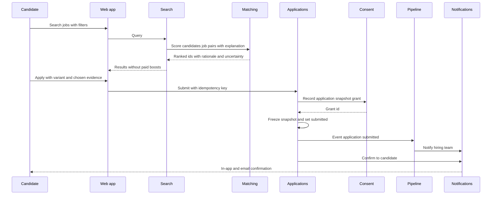

#### JRN-CAN-08 — Track an application, self-schedule an interview and attend

- **Role · persona · tier:** CAN · P-B Rohan · R1 (manual scheduling), R2 (self-scheduling)
- **Modules touched:** JOB, ATS, INT, MSG, NTF, PWA
- **Trigger:** Notification "Acme invited you to schedule an interview".
- **Preconditions:** Application moved to an interview stage by a human.

| #   | Actor action                               | System response                                                                                                                                             |
| --- | ------------------------------------------ | ----------------------------------------------------------------------------------------------------------------------------------------------------------- |
| 1   | Opens the application tracker              | Candidate-facing status (`submitted`, `in_review`, `interviewing`, `offer_extended`, terminal states) with date of last change; internal stage names hidden |
| 2   | Opens the scheduling link                  | Available slots computed from panel calendars, shown in his time zone, with duration, format (video link, phone, onsite) and interviewers' names and titles |
| 3   | Picks a slot                               | Slot held for 10 minutes [PROP] during confirmation; confirmed to all parties; calendar invite with external meeting link                                   |
| 4   | Requests a reschedule two days later       | Allowed up to 24 hours before start [PROP]; new slots shown; panel notified                                                                                 |
| 5   | Sends a question in the application thread | Message delivered to the hiring team thread; recruiter replies                                                                                              |
| 6   | Attends the interview                      | Reminder 24 hours and 1 hour before; status remains `interviewing`                                                                                          |

- **Success outcome:** Interview completed; candidate sees next step within the employer's stated response window.
- **Failure branches:**
  - F1 — No slots available → "Request other times" sends proposed windows to the coordinator.
  - F2 — Interviewer cancels → candidate notified at once with new slots; never left without a path.
  - F3 — Application idle with no human action for 14 days [PROP] → candidate sees "No update yet" and the employer is nudged (`BR-XCT-077`).
  - F4 — Candidate no-show → recruiter marks no-show; candidate notified and may request one reschedule per employer policy.
- **Source:** [SRC: SSOT J-02; UJ-06]

#### JRN-CAN-09 — Receive an offer, accept it, and the outcome becomes new evidence

- **Role · persona · tier:** CAN · P-A Aisha · R2
- **Modules touched:** ATS, JOB, BGV, EVD, NTF, PRF, SET
- **Trigger:** Notification "You have an offer from Acme".
- **Preconditions:** Offer approved through the approval chain (`JRN-REC-06`).

| #   | Actor action                                         | System response                                                                                                                                      |
| --- | ---------------------------------------------------- | ---------------------------------------------------------------------------------------------------------------------------------------------------- |
| 1   | Opens the offer                                      | Offer summary: title, start date, compensation fields the employer chose to include, expiry date, attached letter (PDF)                              |
| 2   | Asks a question in the thread                        | Recruiter replies; offer remains open until expiry                                                                                                   |
| 3   | Clicks "Accept" and types her name to confirm intent | Application `hired`; offer `accepted`; the employer is told; e-signature of the employment contract happens in the employer's tool if any (adjacent) |
| 4   | Is asked whether to add the role to her profile      | On yes: experience entry created as `claimed`, with an employer-confirmation request pre-filled to the verified org                                  |
| 5   | Employer confirms after start date                   | Evidence item moves to `authority_verified`, issuer class `employer_org`                                                                             |
| 6   | Other active applications                            | She is offered one-tap withdrawal with a polite template to each                                                                                     |

- **Success outcome:** Outcome recorded; new authority-verified evidence; `ns.career_progress_verified` counts her.
- **Failure branches:**
  - F1 — Offer expired → "This offer expired"; she may message the recruiter, who can re-issue.
  - F2 — Background check required before final → acceptance is conditional; `JRN-CAN-20` runs.
  - F3 — She declines → reason optional from list; application `offer_declined`; recruiter notified.
  - F4 — Employer rescinds → candidate notified with reason category; recorded for `TSF` employer-conduct metrics.
- **Source:** [SRC: SSOT J-02; UJ-06]

#### JRN-CAN-10 — Respond to a recruiter first-contact request

- **Role · persona · tier:** CAN · P-B Rohan · R2
- **Modules touched:** MSG, SRC, SET, TSF, NTF
- **Trigger:** Notification "A recruiter at Globex wants to contact you about Senior ML Engineer".
- **Preconditions:** Rohan granted `outreach.recruiter_contact` and is discoverable.

| #   | Actor action                                                          | System response                                                                                                                              |
| --- | --------------------------------------------------------------------- | -------------------------------------------------------------------------------------------------------------------------------------------- |
| 1   | Opens the request                                                     | Shows recruiter name, verified org, role, salary range if given, why they reached out (matched skills); recruiter cannot see contact details |
| 2   | Chooses "Interested", "Not now", "Not interested" or "Block this org" | Response recorded                                                                                                                            |
| 3   | On "Interested"                                                       | Thread opens; recruiter can now message; contact details still masked unless he shares them                                                  |
| 4   | On "Not interested" with optional reason                              | Recruiter receives a polite decline; cannot send another request to Rohan for 90 days [PROP]                                                 |
| 5   | On "Block this org"                                                   | Org blocked: no outreach, search excludes him for that org, existing threads closed (`BR-XCT-017`)                                           |

- **Success outcome:** A consented conversation or a respected decline; outreach quota consumed on the recruiter side only.
- **Failure branches:**
  - F1 — Request expired (14 days [PROP]) → archived silently.
  - F2 — Message looks like a scam → "Report" opens `TSF` with the request attached; org recruiter flagged.
  - F3 — Rohan revoked `outreach.recruiter_contact` before opening → request hidden; recruiter told "This person is no longer accepting requests".
- **Source:** [SRC: UJ-12; CONSENT_SCOPE_CATALOGUE `outreach.recruiter_contact`]

#### JRN-CAN-11 — Review consents and revoke an employer share

- **Role · persona · tier:** CAN · P-O Omar · R1
- **Modules touched:** SET, EVD, SRC, AIC, JOB, ANL
- **Trigger:** Omar opens Settings → Privacy → "Who can see my data".
- **Preconditions:** Several grants exist.

| #   | Actor action                              | System response                                                                                                                              |
| --- | ----------------------------------------- | -------------------------------------------------------------------------------------------------------------------------------------------- |
| 1   | Views the consent centre                  | Every grant listed: scope plain-language label, grantee, granted on, expires on, last used on                                                |
| 2   | Opens "Globex can open my evidence files" | Detail: which artifacts, access log entries by Globex (date, artifact, viewer role class)                                                    |
| 3   | Clicks "Revoke"                           | Confirmation explains the effect ("Globex will not be able to open your files from now; links already issued stop working within 5 minutes") |
| 4   | Confirms                                  | Ledger entry appended; next read by Globex fails; signed URLs lapse (`BR-XCT-008`)                                                           |
| 5   | Turns off `matching.recommend`            | Recommendations stop; stored explanations and embeddings deleted; he stays searchable only if discoverable (`BR-XCT-012`)                    |

- **Success outcome:** Revocations effective at next read; receipts downloadable.
- **Failure branches:**
  - F1 — Tries to revoke an application snapshot → explained that the snapshot is per application; withdrawing the application ends live sharing; the snapshot is kept per retention (`BR-XCT-034`).
  - F2 — Network failure → revocation not shown as done until server confirms.
- **Source:** [SRC: SSOT Appendix E V61-16; CONSENT_SCOPE_CATALOGUE]

#### JRN-CAN-12 — Export data, then delete the account

- **Role · persona · tier:** CAN · P-O Omar · R0
- **Modules touched:** SET, IDN, every module holding personal data, NTF, BIL, ADM
- **Trigger:** Omar chooses "Download my data", then "Delete my account".
- **Preconditions:** Signed in with recent re-authentication (within 10 minutes [PROP]).

| #   | Actor action                      | System response                                                                                                                                                                                           |
| --- | --------------------------------- | --------------------------------------------------------------------------------------------------------------------------------------------------------------------------------------------------------- |
| 1   | Requests export                   | Export job collects data from every owning module; ready notification; download link valid 7 days [PROP]; JSON plus readable HTML                                                                         |
| 2   | Downloads                         | Download audited                                                                                                                                                                                          |
| 3   | Requests deletion                 | Screen lists what is deleted, what is retained and why (invoices, legal holds, org-owned hiring records about him per org retention), and the cancel window (`OD-PRD-13`)                                 |
| 4   | Confirms with re-authentication   | Account `pending_erasure`; sessions revoked; profile hidden at once; active applications withdrawn with notice to employers; active subscriptions cancelled at period end                                 |
| 5   | Cancel window passes              | Erasure runs: mutable records deleted, `subject_identity_map` row deleted so history keeps only an opaque reference (`BR-XCT-032`); messages he sent show "Deleted user" to counterparties (`BR-XCT-006`) |
| 6   | Receives final confirmation email | Account `erased`; email address released after the purge clock                                                                                                                                            |

- **Success outcome:** Erasure completed within the completion deadline; post-erasure sweep finds no residual identifiers.
- **Failure branches:**
  - F1 — Legal hold on his records → erasure proceeds for everything else; held records listed with reason category (`BR-XCT-033`).
  - F2 — He signs in during the cancel window → offered "Cancel deletion"; account restored to `active`.
  - F3 — He is the last owner of an org → blocked until ownership is transferred or the org closed.
  - F4 — Outstanding payout as freelancer or instructor → deletion waits for settlement or forfeiture choice.
- **Source:** [SRC: UJ-09; SSOT Appendix E V61-07, V61-19]

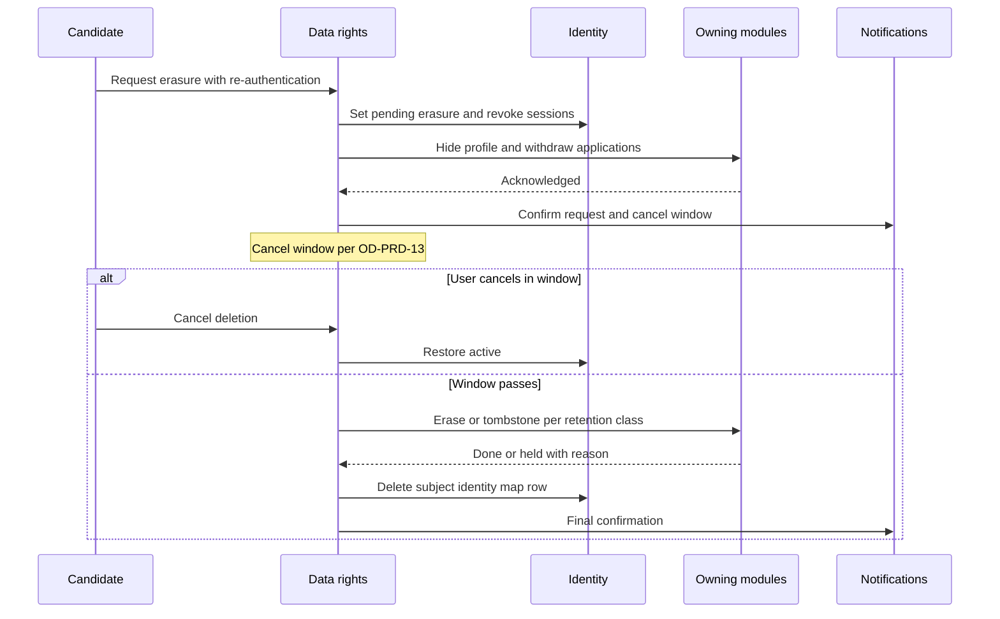

#### JRN-CAN-13 — Recover access after losing password and passkey

- **Role · persona · tier:** CAN · P-A Aisha · R0
- **Modules touched:** IDN, NTF, ADM, SET
- **Trigger:** New phone, passkey gone, password forgotten.
- **Preconditions:** Account `active`.

| #   | Actor action                                  | System response                                                                               |
| --- | --------------------------------------------- | --------------------------------------------------------------------------------------------- |
| 1   | Clicks "Can't sign in"                        | Options: email reset link, recovery codes, a second registered passkey                        |
| 2   | Requests email reset                          | Link sent if the account exists; response identical whether or not it exists                  |
| 3   | Opens link within 30 minutes [PROP]           | Sets new password; all sessions revoked; MFA still required if enrolled                       |
| 4   | MFA device also lost                          | "Recover with support" opens an identity-proofing request                                     |
| 5   | Support verifies per checklist (`JRN-SUP-02`) | Recovery approved; 24-hour delay before MFA reset with notice to all registered emails [PROP] |
| 6   | Signs in and registers a new passkey          | Security notification sent; recovery codes regenerated                                        |

- **Success outcome:** Access restored without exposing the account to takeover.
- **Failure branches:**
  - F1 — Email account also lost → support path with stronger proofing (prior activity questions, government ID only if `OD-PRD-26` admits).
  - F2 — Owner of the account objects during the 24-hour delay → recovery cancelled; `SAD` alerted.
  - F3 — Repeated attempts → rate-limited by account and network.
- **Source:** [SRC: UJ-10]

#### JRN-CAN-14 — Dispute a verification outcome

- **Role · persona · tier:** CAN · P-B Rohan · R1
- **Modules touched:** EVD, BGV, TSF, ADM, NTF
- **Trigger:** Referee answered "No" or an issuer revoked a credential.
- **Preconditions:** Evidence item owned by Rohan.

| #   | Actor action                                                                                             | System response                                                                                 |
| --- | -------------------------------------------------------------------------------------------------------- | ----------------------------------------------------------------------------------------------- |
| 1   | Opens the item and clicks "Dispute"                                                                      | Form: what is wrong, supporting artifacts (up to 5 files)                                       |
| 2   | Submits                                                                                                  | Case created in `TSF` with category `verification_dispute`; item shows "Disputed" to Rohan only |
| 3   | Moderator reviews referee response, independence signals, artifacts                                      | May request more information through the case thread                                            |
| 4   | Decision: uphold, overturn (rung restored or raised by a new verification path) or offer re-verification | Decision with reason; `EVD` transitions only via the case decision (`BR-XCT-068`)               |
| 5   | Rohan may appeal once                                                                                    | Appeal decided by a different moderator (`BR-XCT-052`)                                          |

- **Success outcome:** Disputed item resolved with an auditable reason.
- **Failure branches:**
  - F1 — Dispute about an institution-issued credential → routed to the issuer first; platform reviews only process failures.
  - F2 — Abusive dispute volume → rate limit; repeated bad-faith disputes can restrict the verification feature for 30 days [PROP].
- **Source:** [SRC: SSOT §6.3 evidence conflicts and revocation]

#### JRN-CAN-15 — Ask a connection for a referral

- **Role · persona · tier:** CAN · P-A Aisha · R2
- **Modules touched:** NET, MSG, JOB, ATS, EMP, NTF
- **Trigger:** On a job page Aisha sees "2 connections work at Acme".
- **Preconditions:** Connection is a verified member of the job's org.

| #   | Actor action                                            | System response                                                                                              |
| --- | ------------------------------------------------------- | ------------------------------------------------------------------------------------------------------------ |
| 1   | Clicks "Ask for a referral"                             | Picks the connection; writes a note (max 1,000 characters); attaches her application draft or profile link   |
| 2   | Sends                                                   | Referral request delivered; max 3 open referral requests per job [PROP]                                      |
| 3   | Connection opens it                                     | Sees her shared items only; chooses "Refer", "Decline" or "Not comfortable"                                  |
| 4   | Connection refers with a statement of how they know her | Referral attached to her application (created or existing); hiring team sees "Referred by" with relationship |
| 5   | Application progresses                                  | Both see status updates appropriate to each (referrer sees only stage class, not notes)                      |

- **Success outcome:** Referred application; `net.referral.given`; referral counted in `net.referral_to_interview`.
- **Failure branches:**
  - F1 — Connection declines → Aisha sees "Not available to refer" (no reason exposed).
  - F2 — Connection left the org → referral option disabled.
  - F3 — Org disallows referrals for the job → button hidden with explanation.
- **Source:** [SRC: SSOT J-05; BR-233..BR-240]

#### JRN-CAN-16 — Upgrade to a paid plan, hit a quota and cancel

- **Role · persona · tier:** CAN · P-B Rohan · R5 (gated `OD-PRD-05`)
- **Modules touched:** BIL, AIC, PRF, NTF
- **Trigger:** Rohan reaches the free AI assistance limit.
- **Preconditions:** Candidate premium admitted and priced by the owner.

| #   | Actor action                         | System response                                                                                              |
| --- | ------------------------------------ | ------------------------------------------------------------------------------------------------------------ |
| 1   | Sees "Daily AI limit reached"        | Explains what is free forever (evidence, applying, messaging) and what the paid plan adds; no dark patterns  |
| 2   | Opens plans                          | Monthly and yearly with total price including tax where known; cancellation terms                            |
| 3   | Pays in hosted checkout              | Entitlements change only after the verified webhook (`BR-XCT-043`)                                           |
| 4   | Returns                              | Banner "Plan active" once state confirmed; until then "Confirming payment"                                   |
| 5   | Later cancels in the customer portal | Cancel at period end; data kept; extra résumé variants become read-only beyond the free count (`BR-XCT-045`) |

- **Success outcome:** Paid entitlements applied server-side; cancellation honored without data loss.
- **Failure branches:**
  - F1 — Payment fails → no entitlement; clear retry.
  - F2 — Redirect succeeds but webhook delayed → entitlement waits; never granted from redirect alone.
  - F3 — Refund requested within the window → `JRN-FIN-01`.
- **Source:** [SRC: docs/PRICING.md; COMMERCIAL_OPERATIONS §3]

#### JRN-CAN-17 — Tailor a résumé variant for a job with the AI assistant

- **Role · persona · tier:** CAN · P-R Ravi · R4
- **Modules touched:** AIC, PRF, JOB, SET, EVD
- **Trigger:** "Tailor for this job" on a job page.
- **Preconditions:** `ai.assist.process` granted; cost policy allows the request.

| #   | Actor action                                                         | System response                                                                                                          |
| --- | -------------------------------------------------------------------- | ------------------------------------------------------------------------------------------------------------------------ |
| 1   | Clicks "Tailor"                                                      | Shows what will be sent (profile sections, job text), redaction of contact details                                       |
| 2   | Confirms                                                             | AI gateway call; suggestions returned as a diff against his base variant                                                 |
| 3   | Accepts some suggestions, edits others                               | Accepted text saved in a new variant; suggestions labelled AI-assisted in version history                                |
| 4   | Tries to accept a suggestion claiming a skill he has no evidence for | Warning "This adds a claim not in your profile"; accepting creates a `claimed` item, never a verified one (`BR-XCT-036`) |
| 5   | Uses the variant in an application                                   | Snapshot includes the variant                                                                                            |

- **Success outcome:** Variant created by the candidate's explicit choices.
- **Failure branches:**
  - F1 — Consent missing → `403 consent-required` with one-tap grant.
  - F2 — Provider outage → "AI is unavailable"; manual editing unaffected.
  - F3 — During an `AI_PROHIBITED` attempt window → blocked (`BR-XCT-038`).
- **Source:** [SRC: SSOT §16]

#### JRN-CAN-18 — Benchmark salary before negotiating

- **Role · persona · tier:** CAN · P-O Omar · R6 (gated `OD-PRD-02`, `OD-PRD-17`, `OD-PRD-12`)
- **Modules touched:** MKT, SRC, ATS, ANL
- **Trigger:** Omar has an offer and opens "Salary insights".
- **Preconditions:** `MKT` admitted.

| #   | Actor action                           | System response                                                                                                                               |
| --- | -------------------------------------- | --------------------------------------------------------------------------------------------------------------------------------------------- |
| 1   | Enters occupation, level, location     | Benchmark shows median and quartiles only for cells with at least `min_cohort_k` contributors; sources labelled (user reports, licensed data) |
| 2   | Narrows to company                     | If the company cell is below k → "Not enough data" with the nearest broader cell                                                              |
| 3   | Contributes his own salary anonymously | Report stored separately from his identity; can be deleted from his settings                                                                  |

- **Success outcome:** Benchmark seen without exposing any individual.
- **Failure branches:**
  - F1 — Repeated narrowing to infer a small cell (differencing) → query budget and suppression of complementary cells.
  - F2 — Implausible report → excluded by outlier rule; contributor not told which.
- **Source:** [SRC: SSOT BR-177..BR-183; Amendment G]

#### JRN-CAN-19 — Use the app offline and sync drafts

- **Role · persona · tier:** CAN · P-A Aisha · R0 (read cache), R1 (drafts)
- **Modules touched:** PWA, JOB, PRF, LRN, MSG
- **Trigger:** Train enters a tunnel while she edits an application draft and a message.
- **Preconditions:** PWA installed or visited.

| #   | Actor action              | System response                                                                                             |
| --- | ------------------------- | ----------------------------------------------------------------------------------------------------------- |
| 1   | Keeps editing             | Offline banner; drafts saved locally with timestamp                                                         |
| 2   | Taps "Submit application" | Blocked: "Submitting needs a connection"; submit not queued for server-authoritative actions (`BR-XCT-078`) |
| 3   | Sends a message           | Queued with "Will send when online"; can be cancelled                                                       |
| 4   | Reconnects                | Queued message sent with its idempotency key; draft synced; conflicts shown if the draft changed elsewhere  |
| 5   | Resolves a conflict       | Side-by-side choose-one or merge                                                                            |

- **Success outcome:** No lost work; no action taken on stale state.
- **Failure branches:**
  - F1 — Signed out remotely while offline → local drafts encrypted at rest are wiped on next online check if "sign out everywhere" was used.
  - F2 — Storage quota exceeded → oldest cached lessons evicted first; drafts never evicted silently.
- **Source:** [SRC: SSOT §19; J-11]

#### JRN-CAN-20 — Consent to and review a background check

- **Role · persona · tier:** CAN · P-A Aisha · R4
- **Modules touched:** BGV, ATS, NTF, SET, PLT
- **Trigger:** Conditional offer requires a check.
- **Preconditions:** Offer extended; vendor integration admitted (`OD-PRD-19`).

| #   | Actor action                                                     | System response                                                                                      |
| --- | ---------------------------------------------------------------- | ---------------------------------------------------------------------------------------------------- |
| 1   | Opens request                                                    | Shows check types, vendor name, what data goes to the vendor, legal disclosures for her jurisdiction |
| 2   | Gives consent and enters required data in the vendor-hosted form | TalentSphere does not store identity numbers [PROP]; vendor order created                            |
| 3   | Waits                                                            | Status: `ordered`, `in_progress`, `completed`                                                        |
| 4   | Receives result notice                                           | Sees her full report from the vendor; employer sees only the adjudication summary                    |
| 5   | If employer intends adverse action                               | Pre-adverse notice with report copy and dispute window before any final decision (`BR-XCT-021`)      |

- **Success outcome:** Check completed with consent; any adverse action follows notice and human review.
- **Failure branches:**
  - F1 — She declines consent → employer informed "Candidate declined"; no automatic rejection.
  - F2 — Vendor error → status `on_hold` with vendor contact; recruiter notified.
- **Source:** [DER; SSOT §3.2]

#### JRN-CAN-21 — Appeal a moderation takedown

- **Role · persona · tier:** CAN · P-N Nina · R1
- **Modules touched:** TSF, NTF, ADM
- **Trigger:** Notice "Your project was removed for violating the intellectual-property policy".
- **Preconditions:** Takedown action with reason code.

| #   | Actor action                                            | System response                                                                            |
| --- | ------------------------------------------------------- | ------------------------------------------------------------------------------------------ |
| 1   | Opens the notice                                        | Shows the content, the policy clause, the action, and the appeal deadline (14 days [PROP]) |
| 2   | Files an appeal with explanation and proof of ownership | Appeal case created; content kept under hold (`BR-XCT-054`)                                |
| 3   | Waits                                                   | Second moderator assigned (`BR-XCT-052`)                                                   |
| 4   | Decision                                                | Upheld (final for platform) or overturned (content restored, record annotated)             |

- **Success outcome:** Appeal decided within the stated service time with a reason.
- **Failure branches:**
  - F1 — Deadline passed → appeal refused with explanation.
  - F2 — Legal takedown order → appeal explains the legal basis; platform cannot restore; counter-notice route given where law provides one.
- **Source:** [SRC: UJ-19]

#### JRN-CAN-22 — Register for a hackathon, form a team, submit and receive results

- **Role · persona · tier:** CAN · P-Q Quinn · R6 (gated `OD-PRD-02`)
- **Modules touched:** EVT, NET, MSG, ASM, EVD, REP, NTF
- **Trigger:** Quinn sees "Climate Data Hackathon" in events.
- **Preconditions:** Event `registration_open`.

| #   | Actor action                                                           | System response                                                                                                     |
| --- | ---------------------------------------------------------------------- | ------------------------------------------------------------------------------------------------------------------- |
| 1   | Registers, accepts event rules and code of conduct                     | Registration confirmed; calendar entries                                                                            |
| 2   | Creates a team and invites two connections                             | Team of up to the event's maximum; invites accepted                                                                 |
| 3   | Uses the team channel                                                  | Channel in `MSG`, scoped to the event                                                                               |
| 4   | Submits repository link, demo video link, write-up before the deadline | Submission locked at deadline; late submissions refused                                                             |
| 5   | Judges score with the event rubric                                     | Scores aggregated; conflicts of interest excluded (judge cannot score a team with a connection on it, `BR-XCT-059`) |
| 6   | Results published                                                      | Participation and placement evidence issued to each member with issuer class of the organizer                       |

- **Success outcome:** Team submission evaluated; evidence issued.
- **Failure branches:**
  - F1 — Team member withdraws → team continues if above the minimum size; else allowed to merge.
  - F2 — Plagiarism report → submission held; organizer and `MOD` review.
- **Source:** [SRC: SSOT §5.7 contest lifecycle; J-21]

### 3. Student journeys

#### JRN-STD-01 — Claim an institution-provisioned account

- **Role · persona · tier:** STD · P-V Vikram · R3
- **Modules touched:** INS, IDN, SET, NTF, PRF
- **Trigger:** Email "City University invited you to TalentSphere".
- **Preconditions:** Seat `provisioned` by `IAD` (`JRN-IAD-01`).

| #   | Actor action                                            | System response                                                                                                                                       |
| --- | ------------------------------------------------------- | ----------------------------------------------------------------------------------------------------------------------------------------------------- |
| 1   | Opens invite                                            | Shows institution, program, cohort, what the institution can and cannot see (plain list)                                                              |
| 2   | Chooses "I already have an account" or "Create account" | Existing account: the `STD` grant is attached to it; new: account created with the invite email                                                       |
| 3   | Reviews institution sharing                             | `evidence.share_institution` explained; institution-run course work is visible to faculty by the enrollment itself; personal job search never visible |
| 4   | Accepts                                                 | Seat `claimed`; state `active_managed`; assigned courses appear                                                                                       |

- **Success outcome:** Student linked to cohort without losing independence.
- **Failure branches:**
  - F1 — Invite expired (30 days [PROP]) → "Ask your institution to resend".
  - F2 — Invite email differs from the account email → claim allowed after verifying the invite email.
  - F3 — Student is under the minimum age for independent accounts → managed mode only, discoverability locked off (`BR-XCT-071`).
- **Source:** [SRC: SSOT §5.7 managed learner; J-12]

#### JRN-STD-02 — Complete an assigned course with a peer-reviewed assignment

- **Role · persona · tier:** STD · P-V Vikram · R3
- **Modules touched:** LRN, ASM, INS, EVD, NTF
- **Trigger:** Faculty assigns "Software Engineering Project" with a due date.
- **Preconditions:** `active_managed`.

| #   | Actor action                              | System response                                                                                 |
| --- | ----------------------------------------- | ----------------------------------------------------------------------------------------------- |
| 1   | Opens assignment                          | Brief, rubric, due date in his time zone, peer-review requirement (2 reviews [SRC: SSOT OD-37]) |
| 2   | Submits                                   | Submission time-stamped; late policy applied                                                    |
| 3   | Reviews two peers' anonymized submissions | Double-blind; rubric required for each criterion; comments checked for abuse                    |
| 4   | Receives peer and faculty grades          | Faculty grade is final; peer grades inform it per course rule                                   |
| 5   | Course completes                          | Institution-issued credential with issuer class `institution`                                   |

- **Success outcome:** Graded work and credential on Vikram's profile.
- **Failure branches:**
  - F1 — Missed due date → late window or zero per policy; faculty can grant extension.
  - F2 — Peer review not done → his own grade withheld until done, per course rule.
  - F3 — Abusive review comment → hidden and reported.
- **Source:** [SRC: SSOT J-25; §5.9 double-blind]

#### JRN-STD-03 — Apply through a campus placement drive

- **Role · persona · tier:** STD · P-V Vikram · R3 (needs R2 employer side)
- **Modules touched:** INS, JOB, ATS, INT, NTF, SET
- **Trigger:** Notification "Globex placement drive open for your cohort".
- **Preconditions:** Drive published by `PLO` (`JRN-PLO-01`); Vikram meets eligibility.

| #   | Actor action                 | System response                                                                                  |
| --- | ---------------------------- | ------------------------------------------------------------------------------------------------ |
| 1   | Opens drive                  | Roles, eligibility criteria, schedule, what is shared with Globex                                |
| 2   | Applies to a role            | Application created under the drive; snapshot includes institution-issued credentials he selects |
| 3   | Attends drive interview slot | Scheduling as in `JRN-CAN-08`                                                                    |
| 4   | Receives offer               | Offer recorded against the drive; `PLO` sees outcome only per drive consent                      |

- **Success outcome:** Application through the drive with institution context.
- **Failure branches:**
  - F1 — Not eligible → reason shown (criterion not met); appeal to `PLO`.
  - F2 — Institution policy limits number of drive applications → counter shown; exceeding blocked with explanation.
- **Source:** [SRC: SSOT J-09]

#### JRN-STD-04 — Graduate and move to an independent career identity

- **Role · persona · tier:** STD → CAN · P-V Vikram · R3
- **Modules touched:** INS, IDN, SET, EVD, PRF, LRN, NTF
- **Trigger:** Institution runs graduation for the cohort.
- **Preconditions:** Seat `active_managed`.

| #   | Actor action                                                       | System response                                                                                                                                              |
| --- | ------------------------------------------------------------------ | ------------------------------------------------------------------------------------------------------------------------------------------------------------ |
| 1   | Receives "Your graduation transfer is ready"                       | State `graduation_pending`; list of everything moving to his independent identity                                                                            |
| 2   | Confirms a personal email if the account used an institution email | Primary email switched after verification, so access survives the institution closing the mailbox                                                            |
| 3   | Chooses whether to grant `alumni.share_outcomes` and which fields  | Default off; offered once with plain text                                                                                                                    |
| 4   | Completes                                                          | Grant becomes `CAN`; institution's licensed course access ends per licence; credentials stay valid; `evidence.share_institution` ends with the cohort sunset |

- **Success outcome:** Independent `CAN` with all earned evidence; graduating-cohort activation counted.
- **Failure branches:**
  - F1 — Student ignores the transfer → after 30 days [PROP] transfer completes automatically with defaults (no alumni sharing).
  - F2 — Institution revokes seat before graduation → student keeps a `CAN` account and all issued evidence.
  - F3 — Licensed course in progress → learner offered to continue by buying or enrolling in a free equivalent; progress record kept.
- **Source:** [SRC: SSOT §5.7, J-12; CONSENT_SCOPE_CATALOGUE `alumni.share_outcomes`]

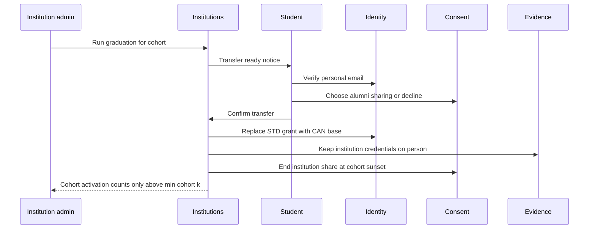

### 4. Instructor journeys

#### JRN-INS-01 — Apply to teach and get approved

- **Role · persona · tier:** CAN → INS · P-G Grace · R3
- **Modules touched:** STU, BGV, ADM, TSF, NTF
- **Trigger:** Grace clicks "Teach on TalentSphere".
- **Preconditions:** Verified account.

| #   | Actor action                                                               | System response                                |
| --- | -------------------------------------------------------------------------- | ---------------------------------------------- |
| 1   | Fills application: expertise areas, sample lesson, links to prior teaching | Draft autosaved                                |
| 2   | Accepts instructor terms (version recorded)                                | Application `under_review`                     |
| 3   | Reviewer checks sample quality and identity signals                        | Decision `approved` or `returned` with reasons |
| 4   | Grace is approved                                                          | `INS` grant `active`; studio unlocked          |

- **Success outcome:** Active instructor.
- **Failure branches:**
  - F1 — Returned → can resubmit once after 14 days [PROP].
  - F2 — Plagiarized sample → rejected; `TSF` case.
- **Source:** [SRC: SSOT §5.7 instructor lifecycle; OD-27]

#### JRN-INS-02 — Author, submit and publish a course

- **Role · persona · tier:** INS · P-G Grace · R3
- **Modules touched:** STU, PLT, TSF, LRN, SRC, ASM, NTF
- **Trigger:** "New course" in studio.
- **Preconditions:** `INS` active.

| #   | Actor action                                                           | System response                                                                                 |
| --- | ---------------------------------------------------------------------- | ----------------------------------------------------------------------------------------------- |
| 1   | Creates outline: modules, lessons, skills taught from taxonomy         | Draft version 1                                                                                 |
| 2   | Uploads videos, writes text lessons, adds quizzes and a rubric project | Media transcoded, captions auto-generated and editable; accessibility checklist score shown     |
| 3   | Previews as learner                                                    | Learner view with keyboard and screen-reader checks                                             |
| 4   | Submits for public review                                              | Version locked; review SLA shown (72 hours [SRC: SSOT OD-42])                                   |
| 5   | Moderator reviews against content policy                               | Approve, return with comments, or reject                                                        |
| 6   | Approved → publishes                                                   | Course `published`; indexed in search; enrolled learners of earlier versions keep their version |

- **Success outcome:** Published course version; `stu.course.published`.
- **Failure branches:**
  - F1 — Missing captions on a video → submission blocked until added.
  - F2 — Returned → comments per lesson; resubmission creates version 1.1.
  - F3 — Copyright claim after publishing → `TSF` takedown flow; enrolled learners notified.
- **Source:** [SRC: SSOT §5.7 course lifecycle; J-07, J-13]

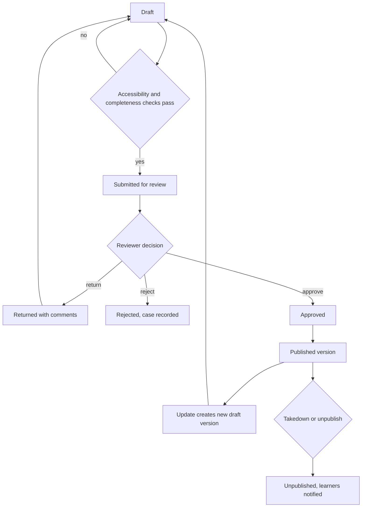

#### JRN-INS-03 — Grade submissions and attest learner skills

- **Role · persona · tier:** INS · P-K Meera · R3
- **Modules touched:** ASM, EVD, LRN, NTF
- **Trigger:** Grading queue shows 40 submissions.
- **Preconditions:** Meera teaches the batch (`t` scope).

| #   | Actor action                                              | System response                                                                                                                |
| --- | --------------------------------------------------------- | ------------------------------------------------------------------------------------------------------------------------------ |
| 1   | Opens queue sorted by submission time                     | Side-by-side rubric and submission; keyboard shortcuts per criterion                                                           |
| 2   | Grades, writes feedback                                   | Saved per submission; returned to learner when "Release grades" is pressed                                                     |
| 3   | For a strong learner, clicks "Attest skill" on two skills | Attestation with issuer class `instructor`; independence check (instructor ≠ learner, not a connection-only relationship flag) |
| 4   | Releases grades                                           | Learners notified; evidence items created                                                                                      |

- **Success outcome:** Grades released; attested skills at `authority_verified` with issuer class `instructor`, shown distinctly from platform-verified (`BR-XCT-016`).
- **Failure branches:**
  - F1 — Meera's own account appears as learner → attestation blocked (`BR-XCT-059`).
  - F2 — Grade changed after release → new version with reason; learner notified.
- **Source:** [SRC: SSOT Appendix E V61-17; USR-01 REV2 BR-T119]

#### JRN-INS-04 — Run a faculty batch and intervene with at-risk learners

- **Role · persona · tier:** INS (faculty) · P-K Meera · R3
- **Modules touched:** INS, LRN, ANL, MSG, NTF
- **Trigger:** Weekly at-risk digest.
- **Preconditions:** Faculty grant on the batch.

| #   | Actor action            | System response                                                                                                                 |
| --- | ----------------------- | ------------------------------------------------------------------------------------------------------------------------------- |
| 1   | Opens at-risk list      | Learners flagged by transparent rules (no activity for 10 days, two missed deadlines) with the rule shown; no opaque risk score |
| 2   | Messages three learners | Messages via the batch channel or direct batch thread                                                                           |
| 3   | Grants an extension     | Due date changed for that learner; logged                                                                                       |
| 4   | Marks intervention done | Outcome tracked for the batch report (k-anonymous at institution level)                                                         |

- **Success outcome:** At-risk learners contacted; follow-up tracked.
- **Failure branches:**
  - F1 — Learner opted out of non-essential messages → only course-required messages allowed.
  - F2 — Faculty tries to view learner's job applications → no such view exists (`BR-XCT-012`).
- **Source:** [SRC: SSOT J-15]

### 5. Mentor journeys (gated `OD-PRD-02`)

#### JRN-MNT-01 — Become a mentor and publish availability

- **Role · persona · tier:** CAN → MNT · P-H Hugo · R6
- **Modules touched:** MEN, BGV, INT, BIL, PRF
- **Trigger:** "Offer mentoring".
- **Preconditions:** Verified account with at least one `authority_verified` or `peer_attested` work-history item [PROP].

| #   | Actor action                                                                 | System response                                                |
| --- | ---------------------------------------------------------------------------- | -------------------------------------------------------------- |
| 1   | Creates offering: topic, format, duration, free or paid, cancellation policy | Paid only if `OD-PRD-04` admits; price fields hidden otherwise |
| 2   | Connects calendar and sets weekly availability                               | Availability computed from calendar busy times plus rules      |
| 3   | Submits for review                                                           | Mentor application `under_review`                              |
| 4   | Approved                                                                     | Offering listed                                                |

- **Success outcome:** Listed mentor with bookable slots.
- **Failure branches:**
  - F1 — Paid offering without payout setup → saved as draft until `BIL.payout.setup` complete.
  - F2 — Offering describes therapy or legal advice → rejected as out of scope.
- **Source:** [SRC: SSOT J-08; OD-50]

#### JRN-MNT-02 — Run a booked session with notes and follow-up

- **Role · persona · tier:** MNT, CAN · P-H Hugo, P-R Ravi · R6
- **Modules touched:** MEN, INT, MSG, EVD, SET, NTF
- **Trigger:** Ravi books a 45-minute "Product interview practice".
- **Preconditions:** Slot available.

| #   | Actor action                                                     | System response                                          |
| --- | ---------------------------------------------------------------- | -------------------------------------------------------- |
| 1   | Ravi books, states goal, shares two evidence items               | Booking `confirmed`; share granted for this booking only |
| 2   | Hugo prepares                                                    | Sees goal and shared items; nothing else                 |
| 3   | Session at external meeting link                                 | Reminders; join link                                     |
| 4   | Hugo writes private notes and a shared summary with action items | Summary sent to Ravi; private notes only Hugo's          |
| 5   | Ravi rates the session                                           | Rating aggregated; free-text reviewed for abuse          |

- **Success outcome:** Session `completed`; mentee's follow-up actions tracked toward his goal.
- **Failure branches:**
  - F1 — Share revoked before session → items disappear from Hugo's view.
  - F2 — Inappropriate conduct report → `TSF` case; mentor offerings paused pending review.
- **Source:** [SRC: SSOT J-08]

#### JRN-MNT-03 — Handle a mentee no-show and refund

- **Role · persona · tier:** MNT · P-H Hugo · R6 (paid needs `OD-PRD-04`)
- **Modules touched:** MEN, BIL, TSF, NTF
- **Trigger:** Mentee does not join within 10 minutes [PROP].

| #   | Actor action                  | System response                                                                                        |
| --- | ----------------------------- | ------------------------------------------------------------------------------------------------------ |
| 1   | Hugo marks no-show            | Booking `no_show_mentee`; policy applied: paid session not refunded unless mentee disputes with reason |
| 2   | Mentee disputes ("emergency") | Case to `SUP`; refund decision by rule; money movement by `FIN`                                        |
| 3   | Mentor no-show instead        | Automatic full refund; mentor reliability counter incremented; repeated no-shows pause offering        |

- **Success outcome:** Policy applied consistently; money moves only through `BIL`.
- **Failure branches:**
  - F1 — Both claim the other did not show → meeting-provider join logs requested if integrated; otherwise refund by default to the payer [PROP].
- **Source:** [PROP]

### 6. Freelancer journeys (gated `OD-PRD-02`, `OD-PRD-03`)

#### JRN-FRL-01 — Turn on gig mode and publish a service offering

- **Role · persona · tier:** CAN → FRL · P-U Uma · R6
- **Modules touched:** GIG, PRF, BGV, BIL
- **Trigger:** "Offer services" in profile.
- **Preconditions:** Verified account.

| #   | Actor action                                                                                                  | System response                                           |
| --- | ------------------------------------------------------------------------------------------------------------- | --------------------------------------------------------- |
| 1   | Accepts freelancer terms                                                                                      | `FRL` grant; gig mode on                                  |
| 2   | Creates offering: category (career-related professional services only), deliverables, packages, delivery time | Category validated against the allowed list (`OD-PRD-03`) |
| 3   | Attaches portfolio evidence                                                                                   | Evidence rung shown on offering                           |
| 4   | Completes payout setup with the payment provider                                                              | `payout_ready` after provider verification (`BR-XCT-048`) |
| 5   | Publishes                                                                                                     | Offering searchable                                       |

- **Success outcome:** Published offering backed by evidence.
- **Failure branches:**
  - F1 — Category not allowed → explanation and the allowed list.
  - F2 — Payout verification fails → offering can be published for unpaid inquiries only; contracts blocked until fixed.
- **Source:** [PROP]

#### JRN-FRL-02 — Win a project, deliver milestones and get paid

- **Role · persona · tier:** FRL, client (CAN or EAD/REC) · P-U Uma · R6 (escrow needs `OD-PRD-04`)
- **Modules touched:** GIG, MSG, BIL, EVD, TSF, NTF
- **Trigger:** Client posts "Redesign careers page".
- **Preconditions:** Uma `payout_ready`.

| #   | Actor action                                          | System response                                                                                                                          |
| --- | ----------------------------------------------------- | ---------------------------------------------------------------------------------------------------------------------------------------- |
| 1   | Uma submits proposal with price, milestones, timeline | Proposal visible to client only                                                                                                          |
| 2   | Client accepts and funds milestone 1                  | Funds held by the payment provider on the platform's account (seller-of-record model per `OD-PRD-04`)                                    |
| 3   | Uma delivers milestone 1 with files                   | Delivery recorded; client review window (7 days [PROP]) starts                                                                           |
| 4   | Client approves                                       | Funds released to Uma minus fee; next milestone funded                                                                                   |
| 5   | Contract completes                                    | Both rate; delivered work offered to Uma as evidence with issuer class of the client org if verified, else `peer_attested` by the client |

- **Success outcome:** Paid milestones; new evidence.
- **Failure branches:**
  - F1 — Client silent through review window → auto-approve after window with notice at 48 and 24 hours [PROP].
  - F2 — Client objects with specifics → revision cycle; second objection allows dispute (`JRN-FRL-03`).
  - F3 — Off-platform payment solicitation detected in messages → warning and `TSF` signal.
- **Source:** [PROP]

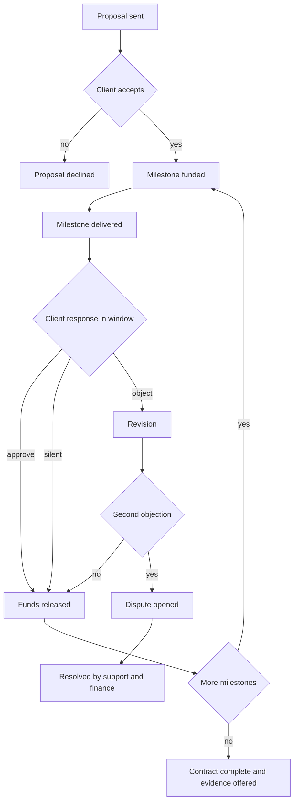

#### JRN-FRL-03 — Dispute an unpaid milestone

- **Role · persona · tier:** FRL · P-U Uma · R6
- **Modules touched:** GIG, TSF, BIL, ADM, NTF
- **Trigger:** Client objects a second time.
- **Preconditions:** Milestone funded and delivered.

| #   | Actor action                                                    | System response                                         |
| --- | --------------------------------------------------------------- | ------------------------------------------------------- |
| 1   | Uma opens dispute with statement and evidence                   | Funds stay held; both parties notified                  |
| 2   | Client responds within 5 days [PROP]                            | Case packet assembled: contract, messages, deliveries   |
| 3   | `SUP` mediates; proposes split                                  | Either party accepts or escalates                       |
| 4   | Escalated decision by `SUP` with `FIN` executing money movement | Decision with reason; funds moved; both may appeal once |

- **Success outcome:** Funds released according to a recorded decision.
- **Failure branches:**
  - F1 — Client does not respond → decision on available evidence.
  - F2 — Chargeback by client's bank → `JRN-FIN-01` chargeback path; freelancer payout clawback rules per terms.
- **Source:** [PROP]

### 7. Recruiter journeys

#### JRN-REC-01 — Accept an org invite and set up the workspace

- **Role · persona · tier:** CAN → REC · P-C Priya · R1
- **Modules touched:** EMP, IDN, ATS, NTF, INT
- **Trigger:** Email "Acme added you as a recruiter".
- **Preconditions:** `EAD` invited Priya's email (`JRN-EAD-02`).

| #   | Actor action                                                                       | System response                                                                                             |
| --- | ---------------------------------------------------------------------------------- | ----------------------------------------------------------------------------------------------------------- |
| 1   | Opens invite, signs in or registers                                                | Invite email must match a verified email on the account; if the org enforces SSO, redirected to the org IdP |
| 2   | Accepts                                                                            | `REC` grant `active` in `org:Acme`; context switcher shows "Acme — Recruiter"                               |
| 3   | Sets notification preferences for new applications (instant, hourly digest, daily) | Stored per context                                                                                          |
| 4   | Connects calendar                                                                  | Busy times only are read (no event details)                                                                 |
| 5   | Opens the recruiter home                                                           | Empty states: "No jobs yet — create a requisition" with a checklist                                         |

- **Success outcome:** Working recruiter context with calendar and notifications.
- **Failure branches:**
  - F1 — Invite expired (7 days [PROP]) → "Ask your admin to resend".
  - F2 — SSO login fails → IdP error shown with the admin contact; no fallback to password when SSO is enforced.
  - F3 — Seat limit reached → invite cannot be accepted; `EAD` notified to add a seat.
- **Source:** [SRC: UJ-11]

#### JRN-REC-02 — Open a requisition, get approval and publish a job

- **Role · persona · tier:** REC · P-C Priya · R1 (publish), R2 (approvals)
- **Modules touched:** ATS, JOB, EMP, TSF, BIL, SRC, AIC
- **Trigger:** Hiring manager asks for a "Backend Engineer II".
- **Preconditions:** Org verified; job slots available on the plan.

| #   | Actor action                                                                                                                    | System response                                                                                                                                   |
| --- | ------------------------------------------------------------------------------------------------------------------------------- | ------------------------------------------------------------------------------------------------------------------------------------------------- |
| 1   | Creates requisition: title, team, headcount, location, work mode, salary range, must-have and nice-to-have skills from taxonomy | Requisition `draft`                                                                                                                               |
| 2   | Uses "Draft description" (AI, optional)                                                                                         | Draft labelled AI-assisted; bias-language checker flags terms; recruiter edits (`BR-XCT-041`)                                                     |
| 3   | Submits for approval                                                                                                            | Routed to the team's approver (`HMG` or `EAD`), never the requester (`BR-XCT-058`)                                                                |
| 4   | Approver approves                                                                                                               | Requisition `approved`; job draft created from it                                                                                                 |
| 5   | Adds screening questions, pipeline template, hiring team                                                                        | Hiring team members get `t` scope on this job                                                                                                     |
| 6   | Publishes                                                                                                                       | Automated policy checks (prohibited content, discriminatory requirements, missing employer identity); job `published`; indexed; job slot consumed |

- **Success outcome:** Published job with hiring team; `job.job.published`.
- **Failure branches:**
  - F1 — Approver rejects → requisition `returned` with comment.
  - F2 — Policy check fails → publish blocked with the clause; recruiter edits or requests review.
  - F3 — No job slot → `402 entitlement-required` with "Close a job or upgrade"; never silently unpublishes another job.
  - F4 — Salary range missing where the launch jurisdiction requires it (`OD-PRD-10`) → publish blocked for that location.
- **Source:** [SRC: SSOT J-03; UJ-11]

#### JRN-REC-03 — Screen applicants with evidence and move or reject

- **Role · persona · tier:** REC · P-C Priya · R1
- **Modules touched:** ATS, JOB, EVD, AIC, MSG, NTF, ANL
- **Trigger:** 120 applications in "New".
- **Preconditions:** On the job's hiring team.

| #   | Actor action                                       | System response                                                                                                                                                             |
| --- | -------------------------------------------------- | --------------------------------------------------------------------------------------------------------------------------------------------------------------------------- |
| 1   | Opens the stage list with "Suggested order" toggle | Suggested order with rationale per card (skills matched with rung, missing skills); default view is submission order; never labelled "shortlist" [SRC: STR-01 REV2 BR-T072] |
| 2   | Opens a candidate                                  | Snapshot: chosen résumé variant, evidence items with rung and issuer class, screening answers; artifacts open only within the snapshot grant                                |
| 3   | Moves 15 to "Phone screen"                         | Stage change recorded with actor; candidate-facing status becomes `in_review`                                                                                               |
| 4   | Selects 40 and clicks "Reject"                     | Bulk action requires a reason code and a template; confirmation states the count; each rejection is a human action recorded with the actor (`BR-XCT-021`, `BR-XCT-026`)     |
| 5   | Adds a private note                                | Visible only to the hiring team                                                                                                                                             |

- **Success outcome:** Every applicant has a human decision or remains in review; rejected candidates are notified.
- **Failure branches:**
  - F1 — Candidate revoked an artifact → artifact shows "No longer shared"; snapshot text remains.
  - F2 — Concurrent edits by two recruiters → last-write conflict shown; stage moves are versioned so a stale move is refused.
  - F3 — Recruiter tries to filter by age, gender or similar → no such filters exist; free-text notes scanned for protected-attribute terms with a warning [PROP].
- **Source:** [SRC: SSOT J-03; UJ-11]

#### JRN-REC-04 — Search discoverable candidates and send outreach

- **Role · persona · tier:** REC · P-F Farid or P-C Priya · R2
- **Modules touched:** SRC, PRF, EVD, MSG, SET, BIL, TSF
- **Trigger:** Few qualified applicants for a niche role.
- **Preconditions:** Org verified; outreach quota available.

| #   | Actor action                                             | System response                                                                                              |
| --- | -------------------------------------------------------- | ------------------------------------------------------------------------------------------------------------ |
| 1   | Searches by skills, rung minimum, location, availability | Only profiles with live `search.discoverable` returned; summary fields only if `evidence.share_summary` live |
| 2   | Opens a summary                                          | Headline, skills with rung, evidence titles; no contact details, no full artifacts                           |
| 3   | Sends a first-contact request with role and message      | Requires `outreach.recruiter_contact`; quota decremented; message checked for spam patterns                  |
| 4   | Candidate accepts (`JRN-CAN-10`)                         | Thread opens; candidate may apply or share more                                                              |

- **Success outcome:** Consented conversation started.
- **Failure branches:**
  - F1 — Candidate not accepting requests → "Contact unavailable"; no quota consumed.
  - F2 — Quota exhausted → `402` with reset date; no ranking or visibility change for paying more (`BR-XCT-020`).
  - F3 — Many declines and reports → recruiter outreach paused for review.
- **Source:** [SRC: UJ-12; SSOT BR-130]

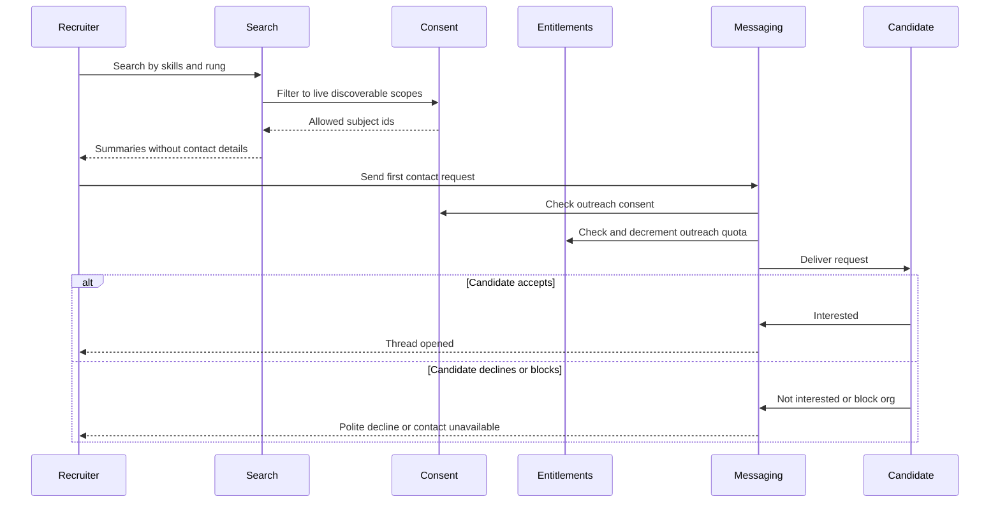

#### JRN-REC-05 — Schedule a panel interview loop

- **Role · persona · tier:** REC (or coordinator) · P-C Priya · R2
- **Modules touched:** INT, ATS, MSG, NTF, PLT
- **Trigger:** Candidate moved to "Onsite".
- **Preconditions:** Panel members have calendars connected or have set manual availability.

| #   | Actor action                                                          | System response                                                                         |
| --- | --------------------------------------------------------------------- | --------------------------------------------------------------------------------------- |
| 1   | Chooses loop template: four 45-minute interviews, two may be parallel | Template defines interview types and scorecards                                         |
| 2   | Selects panel members                                                 | Each gets `interviewer` grant for this loop                                             |
| 3   | Sends self-schedule link                                              | System computes feasible loop slots across panel calendars in the candidate's time zone |
| 4   | Candidate picks a slot                                                | Holds placed, invites sent to panel and candidate with external meeting links           |
| 5   | One interviewer declines                                              | Replacement suggested from a backup pool; candidate not disturbed unless time changes   |

- **Success outcome:** Confirmed loop; every interviewer has a scorecard task.
- **Failure branches:**
  - F1 — No feasible slot in 10 business days [PROP] → coordinator notified to adjust panel.
  - F2 — Calendar provider outage → manual scheduling with proposed times.
  - F3 — Candidate requests accessibility needs → note shared with panel without diagnosis details.
- **Source:** [SRC: SSOT OD-09; UJ-06]

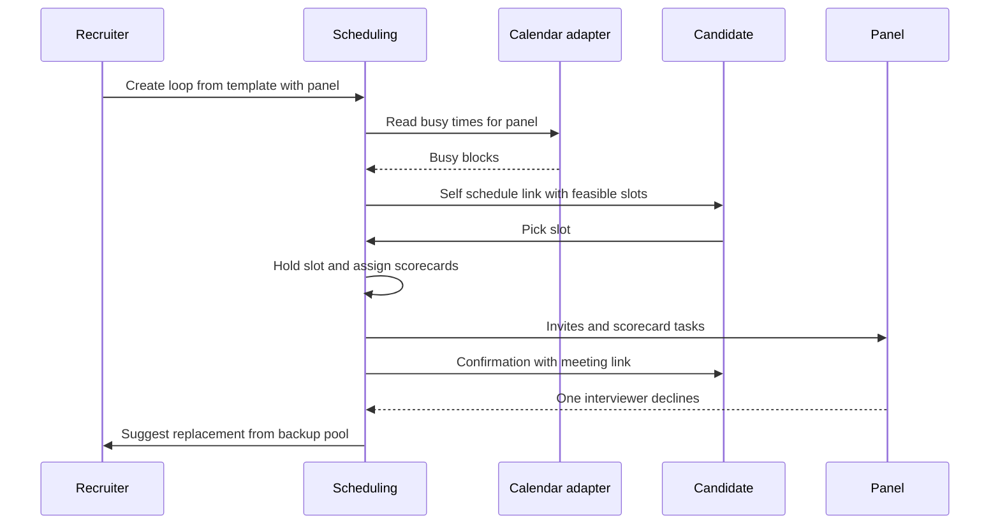

#### JRN-REC-06 — Prepare an offer through the approval chain

- **Role · persona · tier:** REC · P-C Priya · R2
- **Modules touched:** ATS, EMP, NTF, BGV, MSG
- **Trigger:** Debrief decision "Hire" (`JRN-HMG-03`).
- **Preconditions:** Application `interviewing` with a recorded hire decision.

| #   | Actor action                                                                      | System response                                                                                   |
| --- | --------------------------------------------------------------------------------- | ------------------------------------------------------------------------------------------------- |
| 1   | Drafts offer from template: title, level, start date, compensation fields, expiry | Offer `draft`; fields outside the requisition salary range flagged                                |
| 2   | Submits for approval                                                              | Chain from org policy (for example hiring manager then finance approver); each approver ≠ drafter |
| 3   | Approvers approve                                                                 | Offer `approved`; out-of-range requires an extra approver                                         |
| 4   | Sends                                                                             | Application `offer_extended`; candidate notified (`JRN-CAN-09`)                                   |

- **Success outcome:** Approved offer delivered.
- **Failure branches:**
  - F1 — Approver rejects → back to draft with comment.
  - F2 — Approver unavailable → delegation if set (04 §5); otherwise escalation to `EAD` after 48 hours [PROP].
- **Source:** [SRC: SSOT J-03]

#### JRN-REC-07 — Agency recruiter submits a candidate to a client

- **Role · persona · tier:** REC (agency) · P-F Farid · R2
- **Modules touched:** EMP, ATS, JOB, SET, MSG, NTF
- **Trigger:** Client Globex engaged the agency for three jobs.
- **Preconditions:** Engagement `active`; candidate is in a conversation with Farid.

| #   | Actor action                            | System response                                                                                         |
| --- | --------------------------------------- | ------------------------------------------------------------------------------------------------------- |
| 1   | Selects candidate and client job        | Candidate receives a consent request naming the client and job                                          |
| 2   | Candidate consents and chooses evidence | Application created at the client with source "Agency: Farid's agency"                                  |
| 3   | Client hiring team reviews              | Farid sees stage class of his submitted candidates only                                                 |
| 4   | Duplicate check                         | If the candidate already applied directly, the first valid submission owns the candidacy (`BR-XCT-057`) |

- **Success outcome:** Consented agency submission with clear ownership.
- **Failure branches:**
  - F1 — Engagement ended → submit blocked.
  - F2 — Candidate declines → nothing is shared with the client.
- **Source:** [SRC: SSOT J-10]

#### JRN-REC-08 — Participate in a campus placement drive

- **Role · persona · tier:** REC · P-C Priya · R3
- **Modules touched:** INS, JOB, ATS, INT, NTF
- **Trigger:** Invitation from City University placement office.
- **Preconditions:** Org verified.

| #   | Actor action                            | System response                                                              |
| --- | --------------------------------------- | ---------------------------------------------------------------------------- |
| 1   | Accepts drive invitation, selects roles | Drive jobs created as drive-restricted (visible only to eligible students)   |
| 2   | Reviews applicants                      | Standard pipeline with drive tag; institution-issued credentials highlighted |
| 3   | Schedules drive-day interviews          | Slots within the drive window                                                |
| 4   | Records offers                          | Drive outcome updated for the `PLO`                                          |

- **Success outcome:** Offers recorded against the drive.
- **Failure branches:**
  - F1 — Recruiter requests student contact list → not provided; only applicants who applied are visible.
- **Source:** [SRC: SSOT J-09]

### 8. Hiring manager journeys

#### JRN-HMG-01 — Define role requirements, scorecard and assessment

- **Role · persona · tier:** HMG · P-S Sara · R2
- **Modules touched:** ATS, ASM, JOB, SRC
- **Trigger:** Sara opens a new requisition assigned to her team.
- **Preconditions:** `HMG` grant on the team.

| #   | Actor action                                                               | System response                                                           |
| --- | -------------------------------------------------------------------------- | ------------------------------------------------------------------------- |
| 1   | States must-have skills with minimum rung                                  | Stored on requisition; used in explanations, never as automatic rejection |
| 2   | Builds a scorecard: 4 to 6 competencies with behavioral anchors            | Scorecard template saved                                                  |
| 3   | Attaches a take-home assessment from the library with `AI_RESTRICTED` mode | Assessment linked; candidates see rules before starting                   |

- **Success outcome:** Structured evaluation defined before any interview.
- **Failure branches:**
  - F1 — Competency wording flagged by bias checker → suggestion; Sara decides.
- **Source:** [SRC: SSOT J-27]

#### JRN-HMG-02 — Review a candidate packet and submit a blind scorecard

- **Role · persona · tier:** HMG (interviewer) · P-E Elena · R2
- **Modules touched:** INT, ATS, EVD
- **Trigger:** Interview completed.
- **Preconditions:** `interviewer` grant on the loop.

| #   | Actor action                               | System response                                                                                   |
| --- | ------------------------------------------ | ------------------------------------------------------------------------------------------------- |
| 1   | Opens packet                               | Snapshot, assessment results, her assigned competencies                                           |
| 2   | Scores each competency with evidence notes | Draft autosaved                                                                                   |
| 3   | Submits                                    | Scorecard locked; others' scorecards become visible to her only now (`INT.scorecard.view_others`) |

- **Success outcome:** Independent scorecard submitted; `hmg` turnaround measured.
- **Failure branches:**
  - F1 — Not submitted within 24 hours [PROP] → reminders; debrief waits or proceeds without it, shown as missing.
  - F2 — Tries to view others first → blocked with explanation.
- **Source:** [SRC: UJ-13]

#### JRN-HMG-03 — Run the debrief, decide and record a post-hire outcome

- **Role · persona · tier:** HMG · P-S Sara · R2
- **Modules touched:** ATS, INT, ANL, EVD, NTF
- **Trigger:** All scorecards in.
- **Preconditions:** Loop complete.

| #   | Actor action                                                            | System response                                                                                                                                  |
| --- | ----------------------------------------------------------------------- | ------------------------------------------------------------------------------------------------------------------------------------------------ |
| 1   | Opens debrief                                                           | Matrix of competencies by interviewer, evidence notes, disagreements highlighted                                                                 |
| 2   | Records decision "Hire" or "No hire" with rationale                     | Decision stored with actor; triggers `JRN-REC-06` or rejection flow                                                                              |
| 3   | 90 days after start [PROP], answers "Is the hire meeting expectations?" | Aggregate outcome stored for org analytics only, never shown to the hired person as a rating and never exported as their evidence (`BR-XCT-001`) |

- **Success outcome:** Decision with rationale; post-hire outcome feeds hiring-quality analytics.
- **Failure branches:**
  - F1 — Split panel → decision requires `HMG` rationale explicitly addressing dissent.
- **Source:** [SRC: SSOT J-27]

### 9. Employer admin journeys

#### JRN-EAD-01 — Create and verify an employer organization

- **Role · persona · tier:** CAN → EAD · P-C Priya · R1
- **Modules touched:** EMP, BGV, IDN, ADM, NTF
- **Trigger:** "Hire on TalentSphere".
- **Preconditions:** Verified account.

| #   | Actor action                                                      | System response                                   |
| --- | ----------------------------------------------------------------- | ------------------------------------------------- |
| 1   | Enters legal name, display name, website, size, country           | Org `unverified`; creator becomes `org_owner`     |
| 2   | Verifies domain by a work email at the domain or a DNS TXT record | Domain `verified` on success                      |
| 3   | Optionally submits registration documents                         | Org `pending_verification` for `PAD` review       |
| 4   | `PAD` approves (`JRN-PAD-02` pattern)                             | Org `verified`; "Verified employer" badge on jobs |

- **Success outcome:** Verified org able to publish jobs without the "unverified" label.
- **Failure branches:**
  - F1 — Domain already claimed by another org → claim dispute to `PAD`; neither gains the badge until resolved.
  - F2 — Free email domain → org may exist but cannot verify by email; DNS required.
  - F3 — Risk signals (newly registered domain, job-scam patterns) → manual review before any job publishes.
- **Source:** [SRC: SSOT J-04; UJ-14]

#### JRN-EAD-02 — Invite members, assign roles and enforce SSO

- **Role · persona · tier:** EAD · P-C Priya · R2
- **Modules touched:** EMP, IDN, NTF, PLT
- **Trigger:** Team grows.
- **Preconditions:** Org verified; plan supports SSO.

| #   | Actor action                                                                    | System response                                                              |
| --- | ------------------------------------------------------------------------------- | ---------------------------------------------------------------------------- |
| 1   | Invites emails with role (`org_admin`, `recruiter`, `hiring_manager`, `viewer`) | Invites sent; seats checked                                                  |
| 2   | Configures SAML with IdP metadata                                               | Test sign-in required before enabling                                        |
| 3   | Enables enforcement                                                             | Members must sign in via SSO in the org context; personal context unaffected |
| 4   | Enables SCIM                                                                    | Deprovisioned users lose org grants within minutes                           |

- **Success outcome:** Members in correct roles; SSO enforced.
- **Failure branches:**
  - F1 — Admin tries to make someone `org_owner` while only `org_admin` → denied (owner only).
  - F2 — SSO misconfiguration → enforcement blocked until test passes; owner keeps a recovery sign-in path.
- **Source:** [SRC: UJ-14; USR-01 REV2]

#### JRN-EAD-03 — Buy seats, survive a failed payment, downgrade

- **Role · persona · tier:** EAD (owner or billing manager) · R2
- **Modules touched:** BIL, EMP, JOB, NTF
- **Trigger:** Card declined at renewal.
- **Preconditions:** Active subscription.

| #   | Actor action                    | System response                                                                                                                                                   |
| --- | ------------------------------- | ----------------------------------------------------------------------------------------------------------------------------------------------------------------- |
| 1   | Receives "Payment failed"       | Subscription `past_due`; full entitlements during grace (`OD-PRD-06`) with banner                                                                                 |
| 2   | Updates card in customer portal | Retry succeeds; `active`                                                                                                                                          |
| 3   | Alternative: does nothing       | Dunning stages; at exhaustion, free-tier entitlements; jobs beyond the free limit stop accepting new applications but are not deleted; data intact (`BR-XCT-045`) |

- **Success outcome:** No data loss; clear status at every stage.
- **Failure branches:**
  - F1 — Downgrade below current seat count → owner chooses which members lose seats; removed members keep personal accounts.
- **Source:** [SRC: COMMERCIAL_OPERATIONS §3–§4]

#### JRN-EAD-04 — Offboard a member and run an access review

- **Role · persona · tier:** EAD · R2
- **Modules touched:** EMP, ATS, INT, IDN, ADM
- **Trigger:** A recruiter leaves; quarterly access-review prompt.
- **Preconditions:** Member active.

| #   | Actor action               | System response                                                                                 |
| --- | -------------------------- | ----------------------------------------------------------------------------------------------- |
| 1   | Clicks "Remove member"     | Shows owned jobs, open offers, scheduled interviews                                             |
| 2   | Reassigns each to a member | Ownership moved; candidates see no disruption                                                   |
| 3   | Confirms                   | Org grants revoked at once; API keys created by the member stay owned by the org (`BR-XCT-003`) |
| 4   | Runs access review         | List of members, roles, last activity, MFA/SSO status; each confirmed or revoked                |

- **Success outcome:** No orphaned work; review recorded in org audit log.
- **Failure branches:**
  - F1 — Removing the last owner → blocked.
  - F2 — Member is mid-offer approval → approval re-routed.
- **Source:** [SRC: USR-01 §6; UJ-14]

#### JRN-EAD-05 — Publish the brand page and respond to reviews

- **Role · persona · tier:** EAD · R2 (reviews gated `OD-PRD-17`)
- **Modules touched:** EMP, TSF, SRC, NTF
- **Trigger:** Org wants a public careers presence.
- **Preconditions:** Org verified.

| #   | Actor action                                                     | System response                                                                                        |
| --- | ---------------------------------------------------------------- | ------------------------------------------------------------------------------------------------------ |
| 1   | Edits brand page: about, values, benefits, media, open jobs feed | Draft preview; media scanned                                                                           |
| 2   | Publishes                                                        | Page public and indexed                                                                                |
| 3   | A review appears                                                 | Admin can respond publicly once per review; cannot edit, hide or learn the author's identity           |
| 4   | Reports a review as false                                        | `TSF` reviews; review stays visible unless the policy threshold for interim hide is met (`BR-XCT-053`) |

- **Success outcome:** Brand page live; reviews answered without suppression.
- **Failure branches:**
  - F1 — Admin attempts to write a review of own org → denied (`BR-XCT-059`).
- **Source:** [SRC: SSOT J-22, J-24]

### 10. Institution admin journeys

#### JRN-IAD-01 — Set up an institution, buy a licence and provision a cohort

- **Role · persona · tier:** CAN → IAD · P-J Dr. Rao · R3
- **Modules touched:** INS, BIL, IDN, PLT, NTF, BGV
- **Trigger:** Department signs up.
- **Preconditions:** Verified account.

| #   | Actor action                                                                      | System response                                                                                        |
| --- | --------------------------------------------------------------------------------- | ------------------------------------------------------------------------------------------------------ |
| 1   | Creates institution with official domain                                          | `pending_verification`; `PAD` review                                                                   |
| 2   | Buys or is assigned a seat licence (`OD-PRD-07`)                                  | Seats available                                                                                        |
| 3   | Creates program and cohort; uploads roster CSV (name, email, student id optional) | Validation report: duplicates, invalid emails, over-seat rows; max rows per batch [SRC: SSOT OD-21 5k] |
| 4   | Confirms                                                                          | Seats `provisioned`; invites sent (`JRN-STD-01`)                                                       |

- **Success outcome:** Cohort provisioned with invites out.
- **Failure branches:**
  - F1 — Rows exceed seats → only rows within seats processed after explicit choice.
  - F2 — Student already on platform with that email → invite attaches grant on claim.
- **Source:** [SRC: SSOT J-14]

#### JRN-IAD-02 — Read cohort skill coverage without seeing private data

- **Role · persona · tier:** IAD · P-J Dr. Rao · R3
- **Modules touched:** INS, ANL, EVD
- **Trigger:** Accreditation report due.
- **Preconditions:** Cohort active.

| #   | Actor action         | System response                                                                                                                          |
| --- | -------------------- | ---------------------------------------------------------------------------------------------------------------------------------------- |
| 1   | Opens skill coverage | Share of learners with evidence per skill, by rung, from institution-run work and shared evidence; cells below `min_cohort_k` suppressed |
| 2   | Drills to a program  | Same suppression; no learner names unless the view is institution-run course grades                                                      |
| 3   | Exports PDF          | Export carries suppression and method notes                                                                                              |

- **Success outcome:** Aggregate report with no individual inference.
- **Failure branches:**
  - F1 — Filter combination yields small cell → suppressed with "Not enough learners".
- **Source:** [SRC: USR-01 BR-T100]

#### JRN-IAD-03 — Issue institution credentials and correct one

- **Role · persona · tier:** IAD · R3
- **Modules touched:** INS, EVD, NTF, TSF
- **Trigger:** Program completion.
- **Preconditions:** Credential template approved.

| #   | Actor action                            | System response                                                               |
| --- | --------------------------------------- | ----------------------------------------------------------------------------- |
| 1   | Selects completed learners and template | Preview per learner                                                           |
| 2   | Issues                                  | Credentials `active`, issuer class `institution`, verification URLs           |
| 3   | Discovers a wrong name on one           | Issues a corrected version; old version `superseded` with link (`BR-XCT-069`) |
| 4   | Revokes one for academic misconduct     | Reason recorded; holder notified; public status "Revoked"                     |

- **Success outcome:** Credentials valid and correctable with history.
- **Failure branches:**
  - F1 — Holder disputes revocation → routed to institution's process; platform tracks the case.
- **Source:** [SRC: SSOT §6.3]

### 11. Placement officer journeys

#### JRN-PLO-01 — Organize a placement drive with employers

- **Role · persona · tier:** PLO · P-I Ivy · R3
- **Modules touched:** INS, EMP, JOB, INT, NTF
- **Trigger:** Placement season.
- **Preconditions:** `PLO` grant.

| #   | Actor action                                                                      | System response                                                  |
| --- | --------------------------------------------------------------------------------- | ---------------------------------------------------------------- |
| 1   | Creates drive: dates, eligible cohorts, criteria (program, year, credential held) | Drive `draft`                                                    |
| 2   | Invites employers                                                                 | Invitations to verified orgs (`JRN-REC-08`)                      |
| 3   | Publishes to eligible students                                                    | Notifications to eligible students only                          |
| 4   | Monitors                                                                          | Applications per role, interviews scheduled, offers; counts only |

- **Success outcome:** Drive with employers and applicants.
- **Failure branches:**
  - F1 — Criteria use a protected attribute → not offered as a criterion.
- **Source:** [SRC: SSOT J-09]

#### JRN-PLO-02 — Produce the placement outcome report

- **Role · persona · tier:** PLO · P-I Ivy · R3
- **Modules touched:** INS, ANL, SET
- **Trigger:** End of season.
- **Preconditions:** Drives closed.

| #   | Actor action   | System response                                                                                 |
| --- | -------------- | ----------------------------------------------------------------------------------------------- |
| 1   | Opens outcomes | Drive offers plus alumni outcomes from `alumni.share_outcomes`; suppressed below `min_cohort_k` |
| 2   | Exports        | Method notes: coverage rate (share of graduates who shared), suppressed cells                   |

- **Success outcome:** Honest report stating coverage, not a claimed placement rate for non-sharers.
- **Failure branches:**
  - F1 — Alumnus revokes sharing → excluded from the next run.
- **Source:** [SRC: SSOT J-09; CONSENT_SCOPE_CATALOGUE]

### 12. Enterprise talent journeys (gated `OD-PRD-02`, `OD-PRD-20`)

#### JRN-EXA-01 — Launch internal mobility and post an internal role

- **Role · persona · tier:** EXA · P-T Tara · R6
- **Modules touched:** ENT, ATS, JOB, SET, NTF
- **Trigger:** Leadership asks to fill roles internally first.
- **Preconditions:** `ENT` enabled for the org.

| #   | Actor action                                                                                                         | System response                                        |
| --- | -------------------------------------------------------------------------------------------------------------------- | ------------------------------------------------------ |
| 1   | Configures policy: internal window (10 days [PROP]), whether current manager is notified on application (default no) | Policy saved                                           |
| 2   | Posts internal role                                                                                                  | Visible only to org members with the employee flag     |
| 3   | Employee applies                                                                                                     | Application confidential to the hiring team per policy |
| 4   | Window closes                                                                                                        | Role may be published externally                       |

- **Success outcome:** Internal candidates considered first.
- **Failure branches:**
  - F1 — Employee's manager is on the hiring team → employee warned before applying.
- **Source:** [SRC: SSOT J-16, J-28; PROP]

#### JRN-EXA-02 — Assign mandatory learning and track completion

- **Role · persona · tier:** EXA · P-L Tomas · R6
- **Modules touched:** ENT, LRN, NTF, PLT
- **Trigger:** Annual security training.
- **Preconditions:** Course in the internal catalog.

| #   | Actor action                                | System response                                                                                                                     |
| --- | ------------------------------------------- | ----------------------------------------------------------------------------------------------------------------------------------- |
| 1   | Assigns course to departments with due date | Assignments created; employees notified                                                                                             |
| 2   | Monitors completion                         | Counts by department; individual completion of mandated courses visible to `EXA` (lawful basis: employment obligation, `OD-PRD-20`) |
| 3   | Syncs completions to HRIS                   | Via `JRN-API-01` style integration                                                                                                  |

- **Success outcome:** Completion tracked and synced.
- **Failure branches:**
  - F1 — HRIS sync fails → retries; report flags unsynced records.
- **Source:** [SRC: SSOT J-16]

#### JRN-EXA-03 — Run a skills inventory and gap report

- **Role · persona · tier:** EXA · P-T Tara · R6
- **Modules touched:** ENT, ANL, AIC, MKT, EVD
- **Trigger:** Workforce planning.
- **Preconditions:** Employees shared skills to the org (opt-in).

| #   | Actor action                | System response                                                                                 |
| --- | --------------------------- | ----------------------------------------------------------------------------------------------- |
| 1   | Opens inventory             | Aggregate skill counts by department and rung; suppressed below `min_cohort_k`; coverage stated |
| 2   | Compares with target skills | Gap list with learning suggestions                                                              |
| 3   | Exports                     | No individual names                                                                             |

- **Success outcome:** Aggregate gap report.
- **Failure branches:**
  - F1 — Request for individual skill list → denied (`BR-XCT-001`).
- **Source:** [SRC: SSOT J-28]

### 13. Moderator journeys

#### JRN-MOD-01 — Work the report queue and take down content

- **Role · persona · tier:** MOD · P-W Wen · R0
- **Modules touched:** TSF, NTF, ADM, JOB, NET, MSG
- **Trigger:** Queue item "Job post: suspected scam" severity high.
- **Preconditions:** Staff account with `MOD`.

| #   | Actor action                                                              | System response                                                                                                |
| --- | ------------------------------------------------------------------------- | -------------------------------------------------------------------------------------------------------------- |
| 1   | Opens item                                                                | Content, reporter count, reporter reliability, prior actions on the account, policy clauses suggested          |
| 2   | Chooses action: no violation, label, restrict, take down, suspend account | Reason code required                                                                                           |
| 3   | Confirms take down                                                        | Content hidden; copy preserved under hold (`BR-XCT-054`); applicants to a scam job notified with safety advice |
| 4   | Notice sent to the poster with appeal path                                | Template by reason code                                                                                        |

- **Success outcome:** Action with reason, notice and appeal path; time-to-action recorded.
- **Failure branches:**
  - F1 — Moderator is connected to the poster → item auto-reassigned (`BR-XCT-059`).
  - F2 — Suspension beyond 7 days [PROP] → needs a second moderator (`IDN.account.suspend_other` `P`).
- **Source:** [SRC: UJ-19]

#### JRN-MOD-02 — Decide an appeal as a second moderator

- **Role · persona · tier:** MOD · R0
- **Modules touched:** TSF, NTF
- **Trigger:** Appeal filed (`JRN-CAN-21`).
- **Preconditions:** Different moderator from the original.

| #   | Actor action                     | System response                                            |
| --- | -------------------------------- | ---------------------------------------------------------- |
| 1   | Opens appeal                     | Original decision, appeal statement, new evidence          |
| 2   | Upholds or overturns with reason | Overturn restores content and annotates the account record |

- **Success outcome:** Appeal decided; overturn rate tracked.
- **Failure branches:**
  - F1 — Original moderator opens the appeal → blocked.
- **Source:** [SRC: SSOT §5.9 quorum moderation]

#### JRN-MOD-03 — Review an assessment integrity flag

- **Role · persona · tier:** MOD · R1
- **Modules touched:** ASM, TSF, EVD, NTF
- **Trigger:** Attempt held "Under review" (`JRN-CAN-06` F3).
- **Preconditions:** Flag with signals.

| #   | Actor action                                                | System response                                                          |
| --- | ----------------------------------------------------------- | ------------------------------------------------------------------------ |
| 1   | Opens case                                                  | Signals with base rates and uncertainty; no single signal shown as proof |
| 2   | Requests explanation from the candidate (optional)          | Candidate responds within 7 days [PROP]                                  |
| 3   | Decides: clear, invalidate attempt, or restrict assessments | Sanctions beyond invalidation need a second reviewer                     |

- **Success outcome:** Fair decision; cleared attempts release their credential.
- **Failure branches:**
  - F1 — Insufficient evidence → cleared by default (anomaly is not guilt, `BR-XCT-025`).
- **Source:** [SRC: SSOT §3.2, §17.4]

### 14. Support agent journeys

#### JRN-SUP-01 — Resolve a ticket with time-boxed scoped access

- **Role · persona · tier:** SUP · P-Z Zoe · R0
- **Modules touched:** ADM, IDN, SET, NTF
- **Trigger:** Ticket "My application shows submitted twice".
- **Preconditions:** Staff account with `SUP`.

| #   | Actor action                             | System response                                                                                    |
| --- | ---------------------------------------- | -------------------------------------------------------------------------------------------------- |
| 1   | Opens ticket, clicks "Open support view" | Requires reason code and ticket id; scope: this user's applications only; expiry 60 minutes [PROP] |
| 2   | Inspects                                 | Read-only view; every read audited; user's access log shows a support access entry                 |
| 3   | Finds a display duplicate (one record)   | Files a defect; replies to user                                                                    |
| 4   | Session ends                             | Access revoked automatically                                                                       |

- **Success outcome:** Resolved without editing user data or impersonating.
- **Failure branches:**
  - F1 — Agent needs to change data → creates a request to the owning module's admin action or to the user; no direct edit.
  - F2 — Ticket is about the agent's own account → refused (`BR-XCT-060`).
- **Source:** [SRC: UJ-18]

#### JRN-SUP-02 — Assist an identity-proofed account recovery

- **Role · persona · tier:** SUP · R0
- **Modules touched:** IDN, ADM, NTF
- **Trigger:** Recovery request from `JRN-CAN-13`.
- **Preconditions:** Request open.

| #   | Actor action                                                                          | System response                                          |
| --- | ------------------------------------------------------------------------------------- | -------------------------------------------------------- |
| 1   | Follows checklist: control of registered email, recent activity facts, device history | Score of proofs recorded                                 |
| 2   | Approves recovery                                                                     | 24-hour delayed reset with notices to all known channels |
| 3   | Insufficient proofs                                                                   | Refuses with the reason category and next options        |

- **Success outcome:** Recovery granted only with sufficient proof.
- **Failure branches:**
  - F1 — Account is privileged (`EAD` owner, `IAD`) → requires `SAD` approval.
- **Source:** [SRC: UJ-10]

### 15. Finance operator journeys

#### JRN-FIN-01 — Process a refund and a chargeback

- **Role · persona · tier:** FIN · P-X Xavier · R2
- **Modules touched:** BIL, ADM, NTF
- **Trigger:** Refund request from an org; separately a chargeback notice.
- **Preconditions:** Payment record exists.

| #   | Actor action                     | System response                                                                                              |
| --- | -------------------------------- | ------------------------------------------------------------------------------------------------------------ |
| 1   | Opens refund request             | Purchase, usage, policy rule result                                                                          |
| 2   | Approves                         | Refund via processor; entitlement change only when webhook confirms; above threshold a second `FIN` approves |
| 3   | Opens chargeback                 | Evidence package assembled from delivery and access logs                                                     |
| 4   | Submits response before deadline | Outcome recorded on reconciliation                                                                           |

- **Success outcome:** Refund issued by rule; chargeback answered in time.
- **Failure branches:**
  - F1 — Processor error → retry with idempotency key; no double refund.
- **Source:** [SRC: COMMERCIAL_OPERATIONS §5]

#### JRN-FIN-02 — Run monthly reconciliation and a payout batch

- **Role · persona · tier:** FIN · R5 (payouts R6 gated `OD-PRD-04`)
- **Modules touched:** BIL, ANL, ADM
- **Trigger:** Period close.
- **Preconditions:** Period ended.

| #   | Actor action          | System response                                              |
| --- | --------------------- | ------------------------------------------------------------ |
| 1   | Opens reconciliation  | Processor records vs internal ledger; breaks listed          |
| 2   | Resolves breaks       | Each with reason                                             |
| 3   | Creates payout batch  | Payees `payout_ready`; held funds for open disputes excluded |
| 4   | Second `FIN` approves | Batch sent; payees notified                                  |

- **Success outcome:** Closed period, approved payouts.
- **Failure branches:**
  - F1 — Payee KYC lapsed → payee excluded with notice.
- **Source:** [SRC: COMMERCIAL_OPERATIONS §7]

### 16. Platform admin journeys

#### JRN-PAD-01 — Roll out a feature flag and use the kill switch

- **Role · persona · tier:** PAD · P-D Dev · R0
- **Modules touched:** ADM, ANL, PWA
- **Trigger:** New scheduling feature ready.
- **Preconditions:** Flag exists.

| #   | Actor action                                          | System response                                                      |
| --- | ----------------------------------------------------- | -------------------------------------------------------------------- |
| 1   | Sets exposure to internal accounts, then a percentage | Change requires a second `PAD` approval in production                |
| 2   | Watches error and guardrail metrics                   | Dashboard per flag                                                   |
| 3   | Errors spike → kills the flag                         | Kill is one-person and immediate; clients pick it up on next request |

- **Success outcome:** Controlled rollout; reversible.
- **Failure branches:**
  - F1 — Flag removal while still referenced → blocked.
- **Source:** [SRC: SSOT §22.3]

#### JRN-PAD-02 — Change the skill taxonomy safely

- **Role · persona · tier:** PAD · R1
- **Modules touched:** SRC, ADM, AIC, EVD, JOB, PRF
- **Trigger:** Two skills should merge ("ReactJS" and "React").
- **Preconditions:** Both skills exist.

| #   | Actor action   | System response                                                                          |
| --- | -------------- | ---------------------------------------------------------------------------------------- |
| 1   | Proposes merge | Impact preview: profiles, jobs, courses, evidence affected                               |
| 2   | Applies        | Old id becomes an alias; references remapped by background job; no evidence rung changes |

- **Success outcome:** Taxonomy consistent; search and matching use the merged skill.
- **Failure branches:**
  - F1 — Job fails midway → resumable; aliases keep old ids resolvable.
- **Source:** [SRC: SSOT §6.2]

#### JRN-PAD-03 — Grant a privileged role with two-person approval

- **Role · persona · tier:** PAD, SAD · R0
- **Modules touched:** ADM, IDN
- **Trigger:** New moderator hired.
- **Preconditions:** Staff account created.

| #   | Actor action                                    | System response                         |
| --- | ----------------------------------------------- | --------------------------------------- |
| 1   | `PAD` requests `MOD` grant with training record | Request pending                         |
| 2   | `SAD` approves                                  | Grant active; review date set (monthly) |

- **Success outcome:** Privileged grant with two approvers.
- **Failure branches:**
  - F1 — Requester tries to approve → denied (`BR-XCT-062`).
- **Source:** [SRC: USR-01 §6]

### 17. Security officer journeys

#### JRN-SAD-01 — Use break-glass access during an incident

- **Role · persona · tier:** SAD · P-Y Yusuf · R0
- **Modules touched:** ADM, IDN, SET, NTF
- **Trigger:** Incident: suspected account takeover ring.
- **Preconditions:** Incident id open.

| #   | Actor action                            | System response                                           |
| --- | --------------------------------------- | --------------------------------------------------------- |
| 1   | Requests break-glass for named accounts | Second `SAD` approves; session 60 minutes [PROP]          |
| 2   | Investigates                            | All access audited                                        |
| 3   | Session closes                          | Post-incident review scheduled; notices decided per 04 §7 |

- **Success outcome:** Fast, accountable access.
- **Failure branches:**
  - F1 — No incident id → refused.
- **Source:** [PROP; 04 §7]

#### JRN-SAD-02 — Respond to a suspected cross-tenant exposure

- **Role · persona · tier:** SAD · R0
- **Modules touched:** ADM, PLT, NTF, SET, ANL
- **Trigger:** Canary test or report shows org B data in org A view.
- **Preconditions:** Alert.

| #   | Actor action                                                | System response                          |
| --- | ----------------------------------------------------------- | ---------------------------------------- |
| 1   | Declares critical incident                                  | Affected feature flag killed             |
| 2   | Scopes exposure from audit logs                             | List of records and viewers              |
| 3   | Notifies affected tenants and people per legal requirements | Templates with what, when, what we did   |
| 4   | Records in incident register                                | `grd.cross_tenant_exposures` incremented |

- **Success outcome:** Exposure contained and disclosed.
- **Failure branches:**
  - F1 — Audit gap prevents scoping → treat all possibly affected as affected.
- **Source:** [SRC: SSOT §3.2 "Cross-tenant exposure is a critical incident"]

### 18. Integration principal journeys

#### JRN-API-01 — Partner ATS syncs jobs and applications through the public API

- **Role · persona · tier:** API · R5
- **Modules touched:** PLT, JOB, ATS, SET, EMP
- **Trigger:** Org connects its external ATS.
- **Preconditions:** `EAD` created an OAuth client with scopes `jobs.write`, `applications.read`.

| #   | Actor action                        | System response                                                                                        |
| --- | ----------------------------------- | ------------------------------------------------------------------------------------------------------ |
| 1   | Partner pushes job with external id | Upsert by external id; idempotent                                                                      |
| 2   | Partner reads applications          | Only for the org's jobs and only within the snapshot grant; contact only if shared                     |
| 3   | Partner updates stage               | Recorded as a human action only if the payload names the acting user; otherwise refused (`BR-XCT-021`) |

- **Success outcome:** Two-way sync without consent leaks.
- **Failure branches:**
  - F1 — Rate limit → `429` with retry-after.
  - F2 — Scope missing → `403` naming the scope.
- **Source:** [SRC: SSOT §13.3]

#### JRN-API-02 — Webhook delivery fails, retries and is replayed

- **Role · persona · tier:** API · R5
- **Modules touched:** PLT, NTF, ADM
- **Trigger:** Partner endpoint down.
- **Preconditions:** Webhook subscription active.

| #   | Actor action                        | System response                                  |
| --- | ----------------------------------- | ------------------------------------------------ |
| 1   | Event emitted                       | Signed delivery attempted                        |
| 2   | Endpoint returns 500                | Exponential backoff retries over 24 hours [PROP] |
| 3   | Retries exhausted                   | Subscription marked failing; `EAD` notified      |
| 4   | `EAD` replays from the delivery log | Deliveries resent with original event ids        |

- **Success outcome:** No silent data loss.
- **Failure branches:**
  - F1 — Signature secret rotated → both secrets valid during rotation window.
- **Source:** [PROP]

### 19. Coverage check

#### 19.1 Modules touched

| Module | Journeys                                                                                                               |
| ------ | ---------------------------------------------------------------------------------------------------------------------- |
| IDN    | GUE-01, CAN-01, CAN-12, CAN-13, STD-01, STD-04, REC-01, EAD-01, EAD-02, EAD-04, IAD-01, SUP-01, SUP-02, PAD-03, SAD-01 |
| SET    | GUE-01, CAN-01, CAN-02, CAN-11, CAN-12, STD-01, STD-04, REC-04, REC-07, PLO-02, EXA-01, SAD-01, API-01                 |
| NTF    | Most journeys; notably CAN-01, CAN-08, REC-02, MOD-01, SAD-02                                                          |
| REP    | CAN-05, CAN-22                                                                                                         |
| PRF    | GUE-01, CAN-02, CAN-04, CAN-09, CAN-17, FRL-01, MNT-01                                                                 |
| EVD    | GUE-02, GUE-03, CAN-03, CAN-05, CAN-06, CAN-09, CAN-14, INS-03, IAD-03, HMG-03                                         |
| BGV    | GUE-03, CAN-03, CAN-20, INS-01, EAD-01                                                                                 |
| SRC    | GUE-01, GUE-04, CAN-04, CAN-07, REC-04, PAD-02                                                                         |
| LRN    | GUE-04, CAN-05, STD-02, INS-02, EXA-02                                                                                 |
| STU    | INS-01, INS-02                                                                                                         |
| ASM    | CAN-06, STD-02, INS-03, HMG-01, MOD-03                                                                                 |
| JOB    | GUE-01, CAN-07, CAN-09, REC-02, REC-03, STD-03, API-01                                                                 |
| ATS    | CAN-07, CAN-08, REC-02, REC-03, REC-06, HMG-03, API-01                                                                 |
| INT    | CAN-08, REC-05, HMG-02, MNT-01                                                                                         |
| EMP    | EAD-01 to EAD-05, REC-01, REC-07                                                                                       |
| NET    | CAN-15, CAN-22                                                                                                         |
| MSG    | CAN-08, CAN-10, REC-04, MNT-02, FRL-02                                                                                 |
| AIC    | CAN-04, CAN-07, CAN-17, REC-02, REC-03                                                                                 |
| TSF    | GUE-03, CAN-14, CAN-21, MOD-01 to MOD-03, EAD-05                                                                       |
| INS    | STD-01 to STD-04, IAD-01 to IAD-03, PLO-01, PLO-02, REC-08                                                             |
| BIL    | CAN-16, EAD-03, FIN-01, FIN-02, MNT-03, FRL-02                                                                         |
| MEN    | MNT-01 to MNT-03                                                                                                       |
| GIG    | FRL-01 to FRL-03                                                                                                       |
| EVT    | CAN-22                                                                                                                 |
| MKT    | CAN-04, CAN-18, EXA-03                                                                                                 |
| ENT    | EXA-01 to EXA-03                                                                                                       |
| ANL    | CAN-01, INS-04, IAD-02, PLO-02, PAD-01                                                                                 |
| ADM    | CAN-13, SUP-01, SUP-02, PAD-01 to PAD-03, SAD-01, SAD-02                                                               |
| PWA    | GUE-01, CAN-05, CAN-19, PAD-01                                                                                         |
| PLT    | CAN-02, REC-05, API-01, API-02, EXA-02                                                                                 |

All 30 modules are touched by at least one journey.

#### 19.2 Diagrams

Sequence diagrams: `JRN-CAN-07`, `JRN-CAN-12`, `JRN-STD-04`, `JRN-REC-04`, `JRN-REC-05`. Flowcharts: `JRN-INS-02`, `JRN-FRL-02`.

### 20. Legacy journey mapping

| Legacy                                   | New journeys                                                                                                                                  |
| ---------------------------------------- | --------------------------------------------------------------------------------------------------------------------------------------------- |
| J-01 Learn → Prove → Showcase            | CAN-05, CAN-06, CAN-02                                                                                                                        |
| J-02 Apply → Track → Hire                | CAN-07, CAN-08, CAN-09                                                                                                                        |
| J-03 Post → Source → Hire                | REC-02 to REC-06                                                                                                                              |
| J-04 Org setup                           | EAD-01, EAD-02                                                                                                                                |
| J-05 Referral                            | CAN-15                                                                                                                                        |
| J-06, J-26 Career path, switcher         | CAN-04                                                                                                                                        |
| J-07, J-13, J-18 Creator                 | INS-01, INS-02 (monetization gated `OD-PRD-04`)                                                                                               |
| J-08 Mentor                              | MNT-01 to MNT-03                                                                                                                              |
| J-09, J-12 Institution, graduation       | PLO-01, PLO-02, STD-03, STD-04                                                                                                                |
| J-10 Agency                              | REC-07                                                                                                                                        |
| J-11 Extension                           | CAN-19 (extension sync conflict `OD-PRD-36`)                                                                                                  |
| J-14 Procurement                         | IAD-01                                                                                                                                        |
| J-15 Faculty                             | INS-04                                                                                                                                        |
| J-16, J-28 Corporate L&D, skills analyst | EXA-02, EXA-03                                                                                                                                |
| J-17 LinkedIn migration                  | CAN-02                                                                                                                                        |
| J-19, J-20 Self-paced learner, path      | GUE-04, CAN-05                                                                                                                                |
| J-21 Contestant                          | CAN-06, CAN-22                                                                                                                                |
| J-22 Researcher                          | CAN-18, EAD-05                                                                                                                                |
| J-23 Author, newsletter                  | Not mapped: community content gated `OD-PRD-16`                                                                                               |
| J-24 Reviewer                            | EAD-05 (`OD-PRD-17`)                                                                                                                          |
| J-25 Peer reviewer                       | STD-02                                                                                                                                        |
| J-27 Hiring manager                      | HMG-01 to HMG-03                                                                                                                              |
| UJ-01 to UJ-20 (target blueprint)        | Covered by GUE-01, CAN-01 to CAN-03, CAN-05 to CAN-13, REC-01, REC-03, REC-04, HMG-02, EAD-02, INS-02, IAD-02, GUE-03, SUP-01, MOD-01, PAD-01 |

## 06 — Business Model and Cross-Module Rules

_Former file: `PRODUCT_BLUEPRINT/01_PRODUCT/06_BUSINESS_MODEL_AND_CROSS_MODULE_RULES.md`._

Monetization options, the entitlement philosophy, and the cross-cutting business rules (`BR-XCT-nnn`) that every module must obey. Module rules (`BR-<MOD>-nnn`) may refine but never contradict a `BR-XCT` rule; a contradiction is resolved by the precedence in §5 and recorded as an `OD-`. **No price, fee, percentage, quota value or revenue figure is decided here**; where a number is needed, a parameter name and a [PROP] default are given, or the value is left to an `OD-PRD-` decision. [SRC: SSOT Appendix E V61-09; COMMERCIAL_OPERATIONS preamble]

### 1. Monetization options

#### 1.1 Streams

| Stream                             | Payer                                                             | Unit options                                                               | Value delivered                                                                                 | Guardrails (rules)                       | Active when                                   | Tier |
| ---------------------------------- | ----------------------------------------------------------------- | -------------------------------------------------------------------------- | ----------------------------------------------------------------------------------------------- | ---------------------------------------- | --------------------------------------------- | ---- |
| Employer subscription              | Employer org                                                      | Per seat; per active job slot; hybrid of seats plus slot and quota bundles | Seats, active jobs, verified-search and outreach quotas, ATS depth, SSO, audit export           | `BR-XCT-020`, `BR-XCT-043`, `BR-XCT-045` | `OD-PRD-06`, `OD-PRD-08` close                | R2   |
| Free employer tier                 | —                                                                 | Limited active jobs and seats                                              | Lets small employers post and close the loop for candidates                                     | Same ranking treatment as paid jobs      | `OD-PRD-06` (free posting policy)             | R1   |
| Institution licence                | Institution                                                       | Per provisioned seat; per cohort; campus licence                           | Cohorts, licensed content, analytics, credentials, placement                                    | `BR-XCT-001`, `BR-XCT-029`               | `OD-PRD-07`                                   | R3   |
| Candidate premium                  | Candidate                                                         | Monthly or yearly subscription                                             | Tools: extra résumé variants above the free count, advanced personal analytics, higher AI quota | `BR-XCT-027`, `BR-XCT-047`, `BR-XCT-039` | `OD-PRD-05`                                   | R5   |
| First-party course sales           | Learner                                                           | Per course; per path; course bundle                                        | Paid catalog content sold by the platform                                                       | `BR-XCT-044`, `BR-XCT-049`               | `OD-PRD-04`                                   | R5   |
| Third-party marketplace commission | Seller (instructor, mentor, freelancer, event organizer) or buyer | Percentage commission; fixed fee per transaction; listing fee              | Reach, payments, dispute handling                                                               | `BR-XCT-048`, `BR-XCT-049`               | `OD-PRD-04` plus module admission `OD-PRD-02` | R6   |
| Enterprise talent                  | Enterprise org                                                    | Per employee per period                                                    | Skills inventory, internal mobility, mandated learning, HRIS sync                               | `BR-XCT-001`, `OD-PRD-20`                | `OD-PRD-02`, `OD-PRD-20`                      | R6   |
| Verification services              | Employer org                                                      | Per check                                                                  | Background checks, bulk employment verification                                                 | `BR-XCT-012`, `BR-XCT-021`               | `OD-PRD-19`                                   | R4   |
| Public API                         | Partner or org                                                    | Included in top employer and institution tiers; metered calls              | Integrations                                                                                    | `BR-XCT-055`                             | `OD-PRD-23`                                   | R5   |
| Aggregate insights                 | Employer, institution                                             | Subscription add-on                                                        | k-anonymous salary and skills-demand benchmarks                                                 | `BR-XCT-029`                             | `OD-PRD-29`, `OD-PRD-12`                      | R6   |
| Promoted job placement             | Employer org                                                      | Per placement period                                                       | Labelled visibility in separate slots                                                           | `BR-XCT-020`                             | `OD-PRD-18` (default: not offered)            | R5   |

#### 1.2 Streams excluded

| Excluded stream                                         | Reason                                              | Source                          |
| ------------------------------------------------------- | --------------------------------------------------- | ------------------------------- |
| Advertising network, display ads, sponsored feed posts  | Non-goal; degrades trust and fairness               | [SRC: SSOT §4.2, OD-32]         |
| Selling or licensing person-level data                  | Breaks consent model                                | [SRC: SSOT §4.2]                |
| Pay-to-apply, pay-to-be-seen, paid "verified" badge     | Core loop must be free; verification must be earned | [SRC: COMMERCIAL_OPERATIONS §1] |
| Pay-to-rank candidates or jobs in organic results       | Fairness                                            | [SRC: ADR-T22]                  |
| Paid unlock of contact details of non-consenting people | Consent                                             | [DER]                           |
| Cryptocurrency or token rewards                         | Excluded scope                                      | [SRC: SSOT §3.3]                |

#### 1.3 Commercial parameters (names only)

| Parameter                           | Meaning                                         | Default proposal                                                                               | Decision                 |
| ----------------------------------- | ----------------------------------------------- | ---------------------------------------------------------------------------------------------- | ------------------------ |
| `plan.catalog_version`              | Immutable version of each plan and price        | Versioned; never edited in place [PROP]                                                        | `OD-PRD-06`              |
| `bil.grace_period_days`             | Days of full entitlements while `past_due`      | Set by owner                                                                                   | `OD-PRD-06`              |
| `bil.refund_window_days`            | Days in which a refund is granted by rule       | SSOT recommends 30 days, pro-rated after 20 percent consumption [SRC: SSOT OD-29]; not adopted | `OD-PRD-04`, `OD-PRD-05` |
| `bil.refund_dual_control_threshold` | Amount above which a second `FIN` approves      | One billing period of the plan [PROP]                                                          | Finance setting          |
| `mkt.commission_rate`               | Marketplace commission                          | SSOT recommends 70/30 revenue share for courses [SRC: SSOT OD-28]; not adopted                 | `OD-PRD-04`              |
| `ai.free_daily_quota`               | Free AI usage                                   | Zero paid inference unless cost policy (`BR-XCT-039`)                                          | `OD-PRD-21`              |
| `msg.outreach_quota_per_period`     | First-contact requests per recruiter per period | SSOT carries 20 (Pro) and 50 (Team) per week [SRC: SSOT BR-130]; not adopted                   | `OD-PRD-06`              |
| `job.free_active_slots`             | Active jobs on the free employer tier           | Set by owner                                                                                   | `OD-PRD-06`              |

### 2. Entitlement philosophy

1. **Charge for tools, scale and convenience; never for trust, rank or access to the core loop.** Entitlements may gate quotas (seats, active jobs, outreach requests, AI requests, résumé variants) and tools (SSO, audit export, API, advanced analytics). They may never gate: evidence creation and verification, applying, messaging in consented threads, consent and privacy controls, data export, accessibility features, or safety reporting. [SRC: COMMERCIAL_OPERATIONS §1; STR-01 §5]
2. **Entitlements are computed server-side from verified billing state.** The client and the checkout redirect grant nothing. [SRC: INV-T17]
3. **Entitlements never enter ranking.** Search, matching and suggested order read no billing field; tests assert that changing a plan leaves ranking output unchanged. (`BR-XCT-020`)
4. **Losing an entitlement never deletes data.** Over-limit items become read-only or stop accepting new activity; the owner chooses what to keep active. (`BR-XCT-045`)
5. **Entitlement holder is explicit.** In an org context, the org subscription is the default holder; whether a member's personal plan can add org quota is `OD-PRD-08`. [SRC: docs/PRICING.md review notes]
6. **Quotas are visible before they bite.** Every quota shows usage and reset time; hitting a quota returns `402 entitlement-required` with what is still free.
7. **Gated modules are off, not hidden-but-reachable.** A capability gated by an `OD-` returns `404 feature-unavailable` from the server; UI hiding is not enforcement. (04 §2 step 4)
8. **Institution and enterprise sponsorship.** An institution or enterprise may sponsor entitlements for its learners or employees; sponsorship ends with the seat and the person keeps all data. (`BR-XCT-001`)

#### 2.1 Entitlement dimensions

| Dimension               | Applies to                  | Kind                                | Free floor                                           |
| ----------------------- | --------------------------- | ----------------------------------- | ---------------------------------------------------- |
| `seats`                 | Employer org, institution   | Count                               | Owner decides (`OD-PRD-06`, `OD-PRD-07`)             |
| `active_job_slots`      | Employer org                | Count                               | `job.free_active_slots`                              |
| `outreach_requests`     | Recruiter in an org         | Per period                          | Zero or owner-set                                    |
| `verified_search_views` | Recruiter in an org         | Per period                          | Owner-set                                            |
| `resume_variants`       | Candidate                   | Count                               | A free count is always available (value `OD-PRD-05`) |
| `ai_requests`           | Any role                    | Per period                          | `ai.free_daily_quota`                                |
| `sso_scim`              | Org, institution            | Boolean                             | No                                                   |
| `audit_export`          | Org, institution            | Boolean                             | No                                                   |
| `api_access`            | Org, institution            | Boolean plus rate                   | No                                                   |
| `advanced_analytics`    | Org, institution, candidate | Boolean                             | No                                                   |
| `cohort_analytics`      | Institution                 | Boolean                             | Basic always                                         |
| `branding`              | Org, institution            | Level (none, co-brand, white-label) | None (`OD-PRD-24`)                                   |

### 3. Cross-cutting business rules

"Enforced where" names the owning module or shared service that enforces the rule; every other module calls it rather than restating it.

#### 3.1 Ownership and identity

| ID         | Rule                                                                                                                                                                                                                                                                                                                                       | Rationale                                  | Enforced where                 | Source                                          |
| ---------- | ------------------------------------------------------------------------------------------------------------------------------------------------------------------------------------------------------------------------------------------------------------------------------------------------------------------------------------------ | ------------------------------------------ | ------------------------------ | ----------------------------------------------- |
| BR-XCT-001 | A person owns their career identity: profile, evidence, learning records, applications, consents. No org, institution or enterprise becomes the owner of a person's career identity through employment, enrollment, sponsorship or contract; such parties own only the records they create about their own processes.                      | Portability and trust                      | `PRF`, `EVD`, `SET`, contracts | [SRC: STR-01 §5 "Learner owns career identity"] |
| BR-XCT-002 | Every core entity has exactly one owning module; only the owner writes it; others read through the owner's contract or events (see 07 §3).                                                                                                                                                                                                 | One semantic model                         | All modules                    | [SRC: SSOT §3.1 "One semantic model"; DER]      |
| BR-XCT-003 | Org-owned hiring records (jobs, requisitions, notes, scorecards, offers, API keys, integrations) belong to the org and survive a member's departure; offboarding reassigns them.                                                                                                                                                           | Continuity                                 | `EMP`, `ATS`, `PLT`            | [SRC: USR-01 REV2; DER]                         |
| BR-XCT-004 | An issuer (platform, institution, employer org, instructor) controls the validity of a credential it issued (issue, correct, revoke with reason); the holder controls whether it is displayed.                                                                                                                                             | Issuer accountability, holder control      | `EVD`                          | [SRC: SSOT §6.3]                                |
| BR-XCT-005 | Course and content ownership follows the authoring agreement: independent instructors own their courses and license the platform to distribute; institution and enterprise courses are owned by that tenant; first-party courses by the platform.                                                                                          | Clear rights                               | `STU`                          | [SRC: COMMERCIAL_OPERATIONS §13; DER]           |
| BR-XCT-006 | When a person is erased, records shared with others keep the counterparty's copy: messages show "Deleted user"; reviews they wrote are removed; scorecards about them in an org are handled by the org's retention class; referee responses they gave remain attached to the candidate's evidence with the referee shown as "Former user". | Erasure without destroying others' records | `SET`, owning modules          | [SRC: Appendix E V61-19; DER]                   |
| BR-XCT-080 | One account may hold many grants; every request carries one active context; capabilities are evaluated for that context only and never escalate across contexts.                                                                                                                                                                           | Multi-role safety                          | `IDN`, policy service          | [SRC: USR-01 REV2 §1; DER]                      |

#### 3.2 Consent

| ID         | Rule                                                                                                                                                                                                                                                             | Rationale          | Enforced where               | Source                                                      |
| ---------- | ---------------------------------------------------------------------------------------------------------------------------------------------------------------------------------------------------------------------------------------------------------------- | ------------------ | ---------------------------- | ----------------------------------------------------------- |
| BR-XCT-007 | Consent is purpose-bound, versioned and taken from one catalogue of scope ids; every scope defaults to off, except `application.share_snapshot`, which is granted by the act of applying.                                                                        | Privacy by purpose | `SET`                        | [SRC: CONSENT_SCOPE_CATALOGUE]                              |
| BR-XCT-008 | Revocation takes effect at the first read after the revoking commit; no module caches consent; signed URLs issued under a revoked scope lapse within their short life (at most 5 minutes).                                                                       | Immediate control  | `SET`, `PLT`                 | [SRC: Appendix E V61-16]                                    |
| BR-XCT-009 | Consent is never bundled with terms of service or made a condition of the core loop, except processing strictly necessary to provide what the person asked for.                                                                                                  | Freely given       | `SET`, all UI                | [DER]                                                       |
| BR-XCT-010 | Nobody grants consent on behalf of another person; org admins, institution admins and enterprise admins cannot consent for members or learners.                                                                                                                  | Autonomy           | `SET`                        | [SRC: USR-01 REV2 §2.1]                                     |
| BR-XCT-011 | Every grant is visible in one consent centre with grantee, date, expiry, last use and a revoke control; receipts are downloadable.                                                                                                                               | Transparency       | `SET`                        | [DER]                                                       |
| BR-XCT-012 | Every read of a person's non-public data by another party requires a live consent scope, an application snapshot, a booking share, or a lawful-basis exception named in the module spec (for example institution-run course work, mandated enterprise learning). | Consent bridge     | Policy service, every module | [SRC: USR-01 §4 "consent scopes gate every recruiter read"] |
| BR-XCT-013 | Scopes with an expiry remind the person 14 days before; re-confirmation prompts are not expiries.                                                                                                                                                                | Avoid silent lapse | `SET`, `NTF`                 | [SRC: CONSENT_SCOPE_CATALOGUE]                              |

#### 3.3 Visibility

| ID         | Rule                                                                                                                                                                                                                                                                         | Rationale                    | Enforced where      | Source                                      |
| ---------- | ---------------------------------------------------------------------------------------------------------------------------------------------------------------------------------------------------------------------------------------------------------------------------- | ---------------------------- | ------------------- | ------------------------------------------- |
| BR-XCT-014 | Visibility levels are private, connections, discoverable to verified employers, and public; new accounts default to private for evidence and to not public for the profile page.                                                                                             | Safe defaults                | `SET`, `PRF`        | [SRC: CONSENT_SCOPE_CATALOGUE defaults off] |
| BR-XCT-015 | Email and phone are masked from every other party unless `profile.share_contact` is live for that party or the person shared them in an accepted conversation.                                                                                                               | Contact protection           | `PRF`, `MSG`        | [SRC: CONSENT_SCOPE_CATALOGUE]              |
| BR-XCT-016 | Evidence is always displayed with its rung (claimed, artifact-backed, peer-attested, authority-verified) and, for authority-verified, its issuer class; the word "verified" never appears for claimed items, and instructor attestation never displays as platform-verified. | Verified over claimed        | `EVD`, all UI       | [SRC: Appendix E V61-17]                    |
| BR-XCT-017 | A block overrides every consent, visibility and discoverability setting: the blocked party cannot view, search, message, refer, review or invite the blocker.                                                                                                                | Safety                       | Policy service      | [DER]                                       |
| BR-XCT-018 | Evaluative notes and scorecards about a person are never shown to that person in product; they are disclosed only through a legally required data-subject access response handled by `SUP` with review.                                                                      | Candid evaluation within law | `ATS`, `INT`, `SET` | [DER]                                       |
| BR-XCT-019 | Profile-view and evidence-view disclosure to the person defaults to semi-anonymous (org class and date, not the viewer's name); stronger or weaker disclosure is an owner decision.                                                                                          | Balance of interests         | `PRF`, `EVD`        | [SRC: SSOT OD-36]                           |

#### 3.4 Fairness

| ID         | Rule                                                                                                                                                                                                                    | Rationale                  | Enforced where             | Source                               |
| ---------- | ----------------------------------------------------------------------------------------------------------------------------------------------------------------------------------------------------------------------- | -------------------------- | -------------------------- | ------------------------------------ |
| BR-XCT-020 | No pay-to-rank: no billing field, plan or payment is an input to search ranking, matching, suggested order or recommendations; any paid visibility (if `OD-PRD-18` admits it) is labelled and placed in separate slots. | Fairness                   | `SRC`, `AIC`               | [SRC: ADR-T22; INV-T19]              |
| BR-XCT-021 | No autonomous adverse decision: rejection, ranking out, suspension, sanction or adverse background-check action requires a recorded human actor; bulk actions require explicit confirmation by a human.                 | Human-controlled AI        | `ATS`, `TSF`, `BGV`, `AIC` | [SRC: SSOT §3.2; STR-01 §7]          |
| BR-XCT-022 | Every match or recommendation shown carries its rationale and an uncertainty statement.                                                                                                                                 | Explainability             | `AIC`                      | [SRC: SSOT §3.2]                     |
| BR-XCT-023 | Protected attributes are never ranking features; they are collected only voluntarily, for audit-only purposes, stored separately and readable only by the audit role.                                                   | Non-discrimination         | `AIC`, `ANL`               | [SRC: STR-01 REV2 GOAL-03]           |
| BR-XCT-024 | An adverse-impact review is held each quarter on audit-only attributes; the result is recorded; a ratio below the counsel-set threshold opens a human review.                                                           | Fairness monitoring        | `ANL`, `AIC`               | [SRC: STR-01 REV2 GOAL-03]           |
| BR-XCT-025 | Anomaly is not guilt: integrity, fraud and abuse signals trigger human review and temporary holds, never automatic sanctions beyond rate limiting.                                                                      | Due process                | `TSF`, `ASM`, `BGV`        | [SRC: SSOT §3.2]                     |
| BR-XCT-026 | Rejections use a reason code from a fixed list and send a respectful notice to the candidate on the human's action.                                                                                                     | Candidate dignity          | `ATS`, `NTF`               | [SRC: SSOT §3.1]                     |
| BR-XCT-027 | The core loop is free and equal for every candidate regardless of plan: creating and verifying evidence, applying, messaging in consented threads, privacy controls and export.                                         | Fair access                | `BIL`, all modules         | [SRC: STR-01 §5]                     |
| BR-XCT-028 | Assessment accommodations are available on request and are never disclosed to employers or shown on results.                                                                                                            | Accessibility and fairness | `ASM`                      | [DER]                                |
| BR-XCT-029 | Aggregates about people (analytics, cohort reports, salary benchmarks, skills inventories) are published only for cells of at least `min_cohort_k` contributors, with complementary suppression against differencing.   | Re-identification risk     | `ANL`, `MKT`, `INS`, `ENT` | [SRC: SSOT Amendment G; `OD-PRD-12`] |

#### 3.5 Retention

| ID         | Rule                                                                                                                                                                                                             | Rationale                  | Enforced where             | Source                                  |
| ---------- | ---------------------------------------------------------------------------------------------------------------------------------------------------------------------------------------------------------------- | -------------------------- | -------------------------- | --------------------------------------- |
| BR-XCT-030 | Every entity is assigned one retention class (ephemeral, operational, tenant-configurable, financial, legal-hold-eligible, audit); values are policy configuration.                                              | Predictable lifecycle      | Each module's entity table | [SRC: SSOT Amendment G]                 |
| BR-XCT-031 | Erasure runs on three separate clocks: cancel window, completion deadline and deactivation purge; their values are `OD-PRD-13`.                                                                                  | Clarity                    | `SET`                      | [SRC: Appendix E V61-07]                |
| BR-XCT-032 | Append-only histories reference a person only through an opaque subject reference; erasure deletes the identity mapping instead of rewriting history.                                                            | Erasure with integrity     | `SET`, `ADM`               | [SRC: Appendix E V61-19]                |
| BR-XCT-033 | A legal hold supersedes erasure for the held records only; the person is told which categories are held and why, unless law forbids.                                                                             | Legal obligations          | `SET`                      | [SRC: COMMERCIAL_OPERATIONS §3 records] |
| BR-XCT-034 | An application snapshot expires at the application's terminal state plus a retention period (default 12 months [SRC: CONSENT_SCOPE_CATALOGUE]); the candidate may withdraw earlier, which tombstones live items. | Bounded employer retention | `JOB`, `SET`               | [SRC: CONSENT_SCOPE_CATALOGUE]          |
| BR-XCT-035 | Backups age out within the backup retention window; a restore re-applies erasures recorded after the backup point before the data is served.                                                                     | Erasure survives restore   | Platform operations        | [DER]                                   |

#### 3.6 AI usage

| ID         | Rule                                                                                                                                                                        | Rationale                    | Enforced where      | Source                         |
| ---------- | --------------------------------------------------------------------------------------------------------------------------------------------------------------------------- | ---------------------------- | ------------------- | ------------------------------ |
| BR-XCT-036 | AI output never becomes evidence or changes a rung; AI-assisted text is labelled in version history; anything a person accepts from AI is their own claim.                  | Integrity of evidence        | `AIC`, `EVD`        | [SRC: SSOT Amendment C]        |
| BR-XCT-037 | Sending a person's content to an AI provider requires `ai.assist.process`, with redaction of contact details and identifiers.                                               | Privacy                      | AI gateway (`AIC`)  | [SRC: CONSENT_SCOPE_CATALOGUE] |
| BR-XCT-038 | `AI_PROHIBITED` assessment mode is enforced server-side across every TalentSphere AI entry point for the candidate during the attempt window; UI hiding is not enforcement. | Assessment integrity         | AI gateway, `ASM`   | [SRC: SSOT Amendment D]        |
| BR-XCT-039 | Free users cause no paid AI inference unless an explicit, active cost policy allows it.                                                                                     | Cost control                 | AI gateway, `BIL`   | [SRC: SSOT §16.4]              |
| BR-XCT-040 | AI memory is separate from profile truth; the person can view and delete it.                                                                                                | Control                      | `AIC`               | [SRC: SSOT §3.2]               |
| BR-XCT-041 | No AI-generated message, outreach, job description or feedback is sent without a human reviewing and pressing send.                                                         | Accountability               | `AIC`, `MSG`, `ATS` | [SRC: SSOT §3.2]               |
| BR-XCT-042 | AI in hiring is descriptive and advisory only; candidate-level predictive scores and automated screening-out are excluded unless admitted by `OD-PRD-14`.                   | Regulatory and fairness risk | `AIC`, `ATS`        | [SRC: SSOT Amendment E]        |

#### 3.7 Payments

| ID         | Rule                                                                                                                                                               | Rationale         | Enforced where                    | Source                          |
| ---------- | ------------------------------------------------------------------------------------------------------------------------------------------------------------------ | ----------------- | --------------------------------- | ------------------------------- |
| BR-XCT-043 | Entitlements derive only from verified billing state (processor webhooks reconciled to the ledger); a redirect, a support action or a client claim grants nothing. | Correctness       | `BIL`                             | [SRC: INV-T17]                  |
| BR-XCT-044 | Refunds, credits and dispute outcomes follow a published policy, are executed only by `FIN` through `BIL`, and are audited; `SUP` can request but not issue.       | Financial control | `BIL`, `ADM`                      | [SRC: COMMERCIAL_OPERATIONS §5] |
| BR-XCT-045 | Billing state never deletes user or tenant data; downgrade or non-payment limits new activity only.                                                                | Trust             | `BIL`, all modules                | [SRC: COMMERCIAL_OPERATIONS §3] |
| BR-XCT-046 | Plans and prices are immutable catalogue versions; a change creates a new version with an explicit grandfathering rule.                                            | Auditability      | `BIL`                             | [SRC: COMMERCIAL_OPERATIONS §2] |
| BR-XCT-047 | Candidates never pay to apply, to be seen by employers, or to be verified.                                                                                         | Fair access       | `BIL`, `JOB`, `EVD`               | [SRC: COMMERCIAL_OPERATIONS §1] |
| BR-XCT-048 | Payouts to instructors, mentors, freelancers or organizers require provider-verified payee identity and tax details; funds for open disputes are held.             | Fraud and tax     | `BIL`                             | [SRC: Appendix E V61-21]        |
| BR-XCT-049 | No third-party money flows into or through the platform until `OD-PRD-04` decides the seller of record, payouts, tax and refunds.                                  | Liability         | `BIL`, `STU`, `MEN`, `GIG`, `EVT` | [SRC: Appendix E V61-21]        |

#### 3.8 Moderation

| ID         | Rule                                                                                                                                                                                                  | Rationale                  | Enforced where | Source           |
| ---------- | ----------------------------------------------------------------------------------------------------------------------------------------------------------------------------------------------------- | -------------------------- | -------------- | ---------------- |
| BR-XCT-050 | Enforcement sources take precedence in this order: legal obligation or court order; safety emergency; platform policy; tenant policy (org or institution community rules); the person's own settings. | Predictable outcomes       | `TSF`          | [DER]            |
| BR-XCT-051 | Every moderation action carries a reason code, a notice to the affected person and an appeal path, except where law forbids notice or the content is spam.                                            | Due process                | `TSF`, `NTF`   | [SRC: UJ-19]     |
| BR-XCT-052 | An appeal is decided by a moderator other than the one who took the action.                                                                                                                           | Independence               | `TSF`          | [SRC: SSOT §5.9] |
| BR-XCT-053 | Reported content stays visible until decided unless its severity class meets the interim-hide threshold.                                                                                              | Avoid weaponized reporting | `TSF`          | [DER]            |
| BR-XCT-054 | Taken-down content is preserved under hold for the appeal period plus any legal requirement, then deleted.                                                                                            | Appeals and law            | `TSF`          | [DER]            |

#### 3.9 Tenancy, separation of duties, delegation, break-glass

| ID         | Rule                                                                                                                                                                                                                                                                                                                                                                    | Rationale                         | Enforced where        | Source                        |
| ---------- | ----------------------------------------------------------------------------------------------------------------------------------------------------------------------------------------------------------------------------------------------------------------------------------------------------------------------------------------------------------------------- | --------------------------------- | --------------------- | ----------------------------- |
| BR-XCT-055 | The tenant of every request is derived from the server-side grant; cross-tenant reads occur only across consent bridges; API keys are bound to one tenant with explicit scopes and need subject consent for personal data.                                                                                                                                              | Cross-tenant exposure is critical | Policy service, `PLT` | [SRC: SSOT §3.2, §5.1]        |
| BR-XCT-056 | One screen or response holds one context's data; the personal inbox and calendar may aggregate with per-item context badges.                                                                                                                                                                                                                                            | No blending                       | All UI, API           | [DER]                         |
| BR-XCT-057 | Agency recruiters see client data only inside an accepted engagement and only for candidates they submitted with consent; the first valid consented submission owns the candidacy for a configurable window (default 180 days [PROP]).                                                                                                                                  | Agency isolation                  | `EMP`, `ATS`, `JOB`   | [SRC: SSOT J-10; DER]         |
| BR-XCT-058 | No self-approval: the requester of a requisition, offer, refund, payout, privileged grant, course review or break-glass cannot approve it.                                                                                                                                                                                                                              | Separation of duties              | Policy service        | [DER]                         |
| BR-XCT-059 | Conflict-of-interest exclusions: instructors cannot attest their own evidence or review their own course; referees cannot be the candidate; moderators cannot act on content they are party to or connected with; org admins cannot review their own org; judges cannot score teams with a connection; applicants are removed from their own application's hiring team. | Integrity                         | Policy service        | [SRC: SSOT §5.9; USR-01 REV2] |
| BR-XCT-060 | Platform staff roles live on staff accounts separate from personal accounts; staff tooling refuses actions on the staff member's own personal account.                                                                                                                                                                                                                  | Insider risk                      | `IDN`, `ADM`          | [PROP]                        |
| BR-XCT-061 | Finance dual control: refunds above the threshold and every payout batch need a second `FIN`.                                                                                                                                                                                                                                                                           | Fraud                             | `BIL`                 | [DER]                         |
| BR-XCT-062 | Privileged grants (`MOD`, `SUP`, `FIN`, `PAD`, `SAD`) need two approvers other than the grantee and requester; reviewed monthly; dormant grants expire after 60 days.                                                                                                                                                                                                   | Least privilege                   | `ADM`, `IDN`          | [SRC: USR-01 §6]              |
| BR-XCT-063 | Delegation is limited to capabilities the delegator holds, in the same scope, time-bounded, revocable, audited, and not re-delegable.                                                                                                                                                                                                                                   | Controlled flexibility            | Policy service        | [PROP]                        |
| BR-XCT-064 | Ownership transfer, consent, data-rights requests, break-glass, privileged grants, credential issuance, refunds, payouts and appeal decisions are not delegable.                                                                                                                                                                                                        | High-risk actions                 | Policy service        | [PROP]                        |
| BR-XCT-065 | Break-glass is available only to `SAD` with an incident or legal-case id, second-`SAD` approval, named scope, auto-expiry, full audit, post-incident review and notice where law requires.                                                                                                                                                                              | Accountable emergency access      | `ADM`                 | [PROP]                        |

#### 3.10 Communication, evidence, minors, accessibility, operations

| ID         | Rule                                                                                                                                                                                                                                              | Rationale                | Enforced where      | Source                                  |
| ---------- | ------------------------------------------------------------------------------------------------------------------------------------------------------------------------------------------------------------------------------------------------- | ------------------------ | ------------------- | --------------------------------------- |
| BR-XCT-066 | Notifications are classed as security, transactional, or marketing; security notices cannot be turned off; marketing requires `comms.marketing_email`.                                                                                            | Lawful communication     | `NTF`               | [SRC: CONSENT_SCOPE_CATALOGUE]          |
| BR-XCT-067 | Non-security notifications respect quiet hours, digests and a per-class frequency cap (parameter `ntf.max_nudges_per_day`, default 1 for reminders [PROP]).                                                                                       | Respect attention        | `NTF`               | [DER]                                   |
| BR-XCT-068 | Evidence rung transitions happen only server-side through the ladder: claimed → artifact-backed → peer-attested → authority-verified; only defined verification events or case decisions move a rung.                                             | Verified over claimed    | `EVD`               | [SRC: Appendix E V61-17]                |
| BR-XCT-069 | Corrections create a new version; revocations are visible with a reason category; applications whose snapshot contains a revoked or superseded item show a flag to the hiring team.                                                               | Lineage                  | `EVD`, `JOB`        | [SRC: SSOT Amendment F]                 |
| BR-XCT-070 | A credential export is labelled with a portable standard only after the export is validated against that standard.                                                                                                                                | Honesty                  | `EVD`               | [SRC: SSOT Amendment F]                 |
| BR-XCT-071 | People below the minimum age cannot register; managed learners who are minors have discoverability, outreach and marketplace features locked off.                                                                                                 | Protection of minors     | `IDN`, `SET`        | [SRC: Appendix E V61-24; `OD-PRD-11`]   |
| BR-XCT-072 | Every journey is completable with keyboard and screen reader; no gate relies on an inaccessible challenge (for example a visual-only CAPTCHA).                                                                                                    | Accessible by default    | All UI              | [SRC: SSOT §21]                         |
| BR-XCT-073 | Reputation is contextual: popularity measures (followers, likes, views) are never displayed or used as credibility.                                                                                                                               | Evidence over popularity | `REP`, `SRC`, `AIC` | [SRC: SSOT §3.2]                        |
| BR-XCT-074 | No core function depends at runtime on a competitor platform; external platforms are import or syndication adapters only.                                                                                                                         | Independence             | `PLT`               | [SRC: SSOT §4.3]                        |
| BR-XCT-075 | Recruiter first contact is a request that needs `outreach.recruiter_contact` and quota; the candidate accepts, declines or blocks before any free messaging.                                                                                      | Consent and dignity      | `MSG`               | [SRC: CONSENT_SCOPE_CATALOGUE]          |
| BR-XCT-076 | Every consequential side effect is idempotent and audited, including the acting principal and, under delegation, the delegator.                                                                                                                   | Integrity                | All modules, `ADM`  | [SRC: SSOT §3.2]                        |
| BR-XCT-077 | An application with no human action for `ats.stale_days` (default 14 [PROP]) shows the candidate an honest "No update yet" and nudges the hiring team; employers can set automatic closure notices but never automatic rejection without a human. | No ghosting by design    | `ATS`, `JOB`, `NTF` | [SRC: SSOT §3.1 candidate dignity; DER] |
| BR-XCT-078 | Offline caches are never authoritative: server-authoritative actions (submit application, take assessment, pay, change consent) require a connection; only drafts and messages queue.                                                             | Correctness              | `PWA`               | [SRC: SSOT §3.2, §19]                   |
| BR-XCT-079 | Interview and session recording is off by default and requires the consent of every participant before it starts.                                                                                                                                 | Privacy                  | `INT`, `MEN`        | [SRC: SSOT OD-48]                       |

Rule count: 80 (`BR-XCT-001` to `BR-XCT-080`).

### 4. Rule-to-module enforcement map

| Rule group                                                                  | Enforced by (single implementation)                      | Called by                                              |
| --------------------------------------------------------------------------- | -------------------------------------------------------- | ------------------------------------------------------ |
| Consent `BR-XCT-007` to `BR-XCT-013`                                        | `SET` consent service                                    | Every module reading another person's data             |
| Policy and tenancy `BR-XCT-055` to `BR-XCT-065`, `BR-XCT-017`, `BR-XCT-080` | Policy decision service (shared service, owned by `IDN`) | Every API route                                        |
| Evidence display and ladder `BR-XCT-016`, `BR-XCT-068`, `BR-XCT-069`        | `EVD`                                                    | `PRF`, `JOB`, `ATS`, `SRC`, `AIC`, `INS`, `MEN`, `GIG` |
| Fairness in ranking `BR-XCT-020`, `BR-XCT-022`, `BR-XCT-023`                | `AIC` matching and `SRC` ranking                         | `JOB`, `ATS`, `NET`, `LRN`                             |
| AI `BR-XCT-036` to `BR-XCT-042`                                             | AI gateway (`AIC`)                                       | Every module with AI features                          |
| Payments `BR-XCT-043` to `BR-XCT-049`                                       | `BIL`                                                    | All commercial features                                |
| Moderation `BR-XCT-050` to `BR-XCT-054`                                     | `TSF`                                                    | All UGC modules                                        |
| Aggregates `BR-XCT-029`                                                     | `ANL` aggregation service                                | `INS`, `MKT`, `ENT`, `EMP`                             |
| Notifications `BR-XCT-066`, `BR-XCT-067`                                    | `NTF`                                                    | All                                                    |
| Audit `BR-XCT-076`                                                          | `ADM` audit service                                      | All                                                    |

### 5. Conflict-resolution precedence

When two rules, settings or requests conflict, the higher level wins. The losing party is told what happened where that is safe; the conflict is logged. [DER, consistent with SSOT §3.1 ordering and `BR-XCT-050`]

| Level | Source of the rule or request                                                   | Examples                                                                            |
| ----- | ------------------------------------------------------------------------------- | ----------------------------------------------------------------------------------- |
| 1     | Law, court order, legal hold                                                    | Retention of invoices; lawful takedown; legal hold over erasure                     |
| 2     | Safety and security                                                             | Break-glass during an incident; emergency takedown; account suspension for takeover |
| 3     | The person's control over their own data: consent, block, erasure, visibility   | Revocation, block, deletion                                                         |
| 4     | Platform invariants: fairness, human control, evidence integrity, accessibility | No pay-to-rank; no autonomous rejection; no AI evidence                             |
| 5     | Tenant policy (org, institution, enterprise)                                    | Approval chains, community rules, retention within bounds                           |
| 6     | Commercial entitlements                                                         | Quotas, plan limits                                                                 |
| 7     | Personal preferences and product defaults                                       | Digest timing, sort orders                                                          |
| 8     | Engagement or growth optimization                                               | Nudges, recommendations of features                                                 |

Tie-break within a level: the more restrictive outcome for disclosure of personal data wins; for access to one's own data, the more permissive outcome wins. [DER]

#### 5.1 Worked conflicts

| Conflict                                                                                        | Winner                            | Resolution                                                                                                                                                                                                             |
| ----------------------------------------------------------------------------------------------- | --------------------------------- | ---------------------------------------------------------------------------------------------------------------------------------------------------------------------------------------------------------------------- |
| Learner revokes `alumni.share_outcomes`; institution contract requires outcome reporting        | Level 3 over 5                    | Learner excluded from the next report; report states coverage; institution contract cannot override (`BR-XCT-001`)                                                                                                     |
| Erasure request; invoice records must be kept                                                   | Level 1 over 3                    | Invoices kept under financial retention with identity minimized; person told                                                                                                                                           |
| Employer on top plan asks for its jobs to rank first                                            | Level 4 over 6                    | Refused; promoted slots only if `OD-PRD-18` admits them, labelled and separate                                                                                                                                         |
| Candidate blocks an org; the org's recruiter holds a valid application snapshot                 | Level 3                           | Existing application remains readable by the hiring team for the process the candidate started (snapshot is the candidate's own act); new outreach, search and referrals blocked; the candidate may withdraw to end it |
| Moderator takes down a project that is evidence in live applications                            | Level 2 or platform policy over 7 | Artifact hidden in snapshots with "Removed for policy"; hiring teams flagged (`BR-XCT-069`)                                                                                                                            |
| Institution policy forbids students applying outside drives; student wants to apply             | Level 5 vs `OD-PRD-37`            | Until decided: application allowed only if the institution permits (cell `P`); the student is told the institution rule                                                                                                |
| Instructor wants to attest a learner who is their colleague's child                             | Level 4 (`BR-XCT-059`)            | Allowed only without other conflict flags; known relationships declared by the instructor block attestation                                                                                                            |
| Security incident needs reading private messages                                                | Level 2 over 3                    | Break-glass with scope and audit; notice afterwards unless law forbids                                                                                                                                                 |
| Recruiter quota exhausted mid-campaign; candidate already accepted contact                      | Level 3 over 6                    | Accepted threads continue; quota applies only to new first-contact requests                                                                                                                                            |
| AI-prohibited attempt in progress; candidate's paid plan includes AI assistance                 | Level 4 over 6                    | AI blocked for the attempt window                                                                                                                                                                                      |
| Org retention says delete applications after 6 months; candidate's snapshot expiry is 12 months | Level 5 bounded by 3              | The shorter, more privacy-protective period applies to the org's copy                                                                                                                                                  |

### 6. Open decisions referenced

`OD-PRD-04` to `OD-PRD-08`, `OD-PRD-12`, `OD-PRD-13`, `OD-PRD-14`, `OD-PRD-18`, `OD-PRD-19`, `OD-PRD-21`, `OD-PRD-29`, `OD-PRD-37` (see [08](#08--stakeholder-decisions-needed)).

### 7. Legacy source trace

| Source                                                                                       | Used for                                                                               | Dropped or changed                                         |
| -------------------------------------------------------------------------------------------- | -------------------------------------------------------------------------------------- | ---------------------------------------------------------- |
| `SSOT.md` §3, Amendments C to G, §5.9, OD-28, OD-29, OD-36, OD-48, BR-130                    | Invariants, numeric recommendations                                                    | Numeric values listed as recommendations only, not adopted |
| `docs/archive/target-blueprint/19_BUSINESS_AND_COMMERCIAL_OPERATIONS.md` | Guardrails, packaging dimensions, billing states, refunds                              | All prices open                                            |
| `docs/archive/target-blueprint/00_CONTROL_CENTRE.md`                   | Scope ids, defaults, revocation behavior                                               | —                                                          |
| `docs/PRICING.md`                                                                            | Evidence that coded prices are unapproved recommendations; entitlement-holder question | Coded prices not adopted                                   |
| Legacy `BR-001` to `BR-248`                                                                  | Separate namespace; not renumbered                                                     | `BR-XCT` is new                                            |

## 07 — Module Map and Dependencies

_Former file: `PRODUCT_BLUEPRINT/01_PRODUCT/07_MODULE_MAP_AND_DEPENDENCIES.md`._

How the 30 modules relate: who owns each core entity, which modules depend on which, the build order those dependencies imply, and the shared services every module uses. Module files in [`02_MODULES/`](02_MODULES/) own their detail; where this file and a module file disagree on ownership, this file is the arbiter until the conflict is recorded and decided (`BR-XCT-002`). Entity names below are product-level names; module files assign `ENT-` ids.

### 1. Modules by group

| Group                            | Modules                           | Role in the career OS                                            |
| -------------------------------- | --------------------------------- | ---------------------------------------------------------------- |
| Foundation                       | `IDN`, `SET`, `NTF`               | Identity, privacy and consent, communication channels            |
| Governance                       | `TSF`, `ADM`                      | Safety, moderation, operations, audit                            |
| Platform                         | `SRC`, `ANL`, `PWA`, `PLT`        | Discovery, measurement, delivery surfaces, integration and files |
| Career identity                  | `PRF`, `EVD`, `BGV`               | The person's record and its verification                         |
| Engagement                       | `REP`                             | Recognition                                                      |
| Learning                         | `LRN`, `STU`, `ASM`               | Learning, authoring, assessment                                  |
| Institutions                     | `INS`                             | Managed learning and placement                                   |
| Hiring                           | `JOB`, `ATS`, `INT`, `EMP`        | Marketplace, pipeline, interviews, employer tenant               |
| Social                           | `NET`, `MSG`                      | Network and messaging                                            |
| Intelligence                     | `AIC`                             | Matching, recommendations, AI assistance                         |
| Commercial                       | `BIL`                             | Plans, payments, entitlements                                    |
| OS expansion (gated `OD-PRD-02`) | `MEN`, `GIG`, `EVT`, `MKT`, `ENT` | Career services beyond hiring and learning                       |

### 2. Module relationship diagram

Solid edges are hard dependencies (the module cannot function without the target); dotted edges are soft (degrades gracefully). The R0 kernel is drawn as one node to keep the diagram readable; every module depends hard on it.

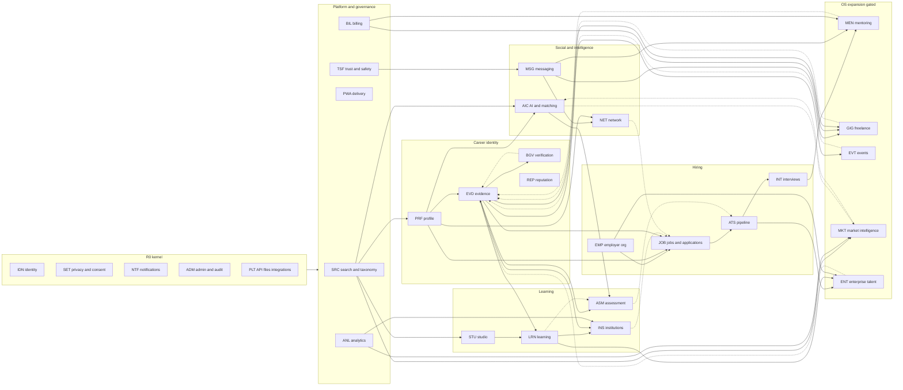

The dotted edges from the expansion modules back to `EVD` show the evidence they emit through `EVD`'s intake contract; `EVD` does not depend on them (02 §6).

### 3. Ownership of core and shared entities

One owner per entity. "Writes via" names how other modules change the entity: by calling the owner's command contract, never by writing its tables. [SRC: SSOT §12.5 data and change ownership; DER]

| Entity                                                                                                                     | Owner                  | Readers (main)                                         | Writes via                                                                                                  | Notes                                                                             |
| -------------------------------------------------------------------------------------------------------------------------- | ---------------------- | ------------------------------------------------------ | ----------------------------------------------------------------------------------------------------------- | --------------------------------------------------------------------------------- |
| Account, credential factor, session, device                                                                                | `IDN`                  | All                                                    | `IDN` commands                                                                                              | Account states per SSOT V61-18                                                    |
| Role grant, active context, delegation                                                                                     | `IDN`                  | Policy service, `EMP`, `INS`, `ADM`                    | Grant commands from `EMP`, `INS`, `ADM`                                                                     | `EMP` and `INS` request grants; `IDN` stores them                                 |
| Policy decision (capability evaluation)                                                                                    | `IDN` (policy service) | All                                                    | n/a — computed                                                                                              | Derived from [04](#04--permission-matrix) as data                                |
| Consent grant, consent ledger, scope catalogue                                                                             | `SET`                  | All reading others' data                               | `SET` commands                                                                                              | `JOB` records the snapshot grant through `SET`                                    |
| Data-rights request, legal hold, retention policy                                                                          | `SET`                  | `ADM`, owning modules                                  | `SET` orchestrates; modules execute erasure of their own data                                               |                                                                                   |
| Visibility setting (field level)                                                                                           | `SET`                  | `PRF`, `EVD`, `SRC`                                    | `SET` commands                                                                                              |                                                                                   |
| Notification, preference, template, delivery record                                                                        | `NTF`                  | All                                                    | `NTF` send contract                                                                                         | Templates for tenants customized via `NTF`                                        |
| Audit event                                                                                                                | `ADM`                  | `SAD`, tenants (own scope)                             | Append-only audit contract                                                                                  | Append-only; subject by opaque reference                                          |
| Support ticket, access session, feature flag, reference data (locations, currencies, reason-code catalogs)                 | `ADM`                  | All                                                    | `ADM`                                                                                                       |                                                                                   |
| File object, media asset, scan result                                                                                      | `PLT`                  | All                                                    | `PLT` upload contract                                                                                       | Modules hold file references only                                                 |
| API client, API key, webhook subscription, delivery log, integration connection                                            | `PLT`                  | `EMP`, `INS`, `ENT`, `ADM`                             | `PLT`                                                                                                       | Keys bound to a tenant                                                            |
| Outbox event, background job                                                                                               | `PLT`                  | All                                                    | Each module writes its own outbox rows through the shared outbox library; `PLT` owns the delivery mechanism | Ownership of an event's meaning stays with the emitting module                    |
| Search index document                                                                                                      | `SRC`                  | All search surfaces                                    | Projection from owner events                                                                                | Never a source of truth                                                           |
| Skill, occupation, taxonomy alias                                                                                          | `SRC`                  | `PRF`, `EVD`, `JOB`, `LRN`, `ASM`, `AIC`, `MKT`, `ENT` | `SRC` curation (by `PAD`)                                                                                   | Single taxonomy for all modules                                                   |
| Saved search, job alert                                                                                                    | `SRC`                  | `NTF`                                                  | `SRC`                                                                                                       |                                                                                   |
| Profile, experience entry, education entry, résumé variant, portfolio project                                              | `PRF`                  | `JOB`, `ATS`, `SRC`, `AIC`, `NET`, `MEN`, `GIG`        | `PRF`                                                                                                       | Experience entries link to `EVD` items                                            |
| Evidence item, evidence version, rung, credential, verification URL                                                        | `EVD`                  | All                                                    | `EVD` intake contract (from `LRN`, `ASM`, `BGV`, `INS`, `ATS`, `MEN`, `GIG`, `EVT`, `ENT`)                  | Only `EVD` changes a rung (`BR-XCT-068`)                                          |
| Verification request (referee, email, domain), background-check order, identity check                                      | `BGV`                  | `EVD`, `ATS`, `EMP`, `INS`                             | `BGV`                                                                                                       | `BGV` emits outcomes; `EVD` decides rung                                          |
| Org verification record                                                                                                    | `BGV`                  | `EMP`, `INS`, `JOB`                                    | `BGV`                                                                                                       | Used for employers and institutions                                               |
| Badge definition, badge award, XP ledger, reputation signal                                                                | `REP`                  | `PRF`, `SRC`                                           | `REP`                                                                                                       | Never a ranking input by popularity (`BR-XCT-073`)                                |
| Course, course version, lesson, learning path (content)                                                                    | `STU`                  | `LRN`, `INS`, `ENT`, `SRC`                             | `STU`                                                                                                       | Authoring lifecycle including publish                                             |
| Catalog listing, enrollment, progress, note, course review, certificate issuance request                                   | `LRN`                  | `INS`, `ENT`, `ANL`, `EVD`                             | `LRN`                                                                                                       | Certificates become `EVD` credentials                                             |
| Assessment, question bank, attempt, submission, rubric grade, peer review, accommodation, integrity flag                   | `ASM`                  | `LRN`, `ATS`, `INS`, `TSF`, `EVD`                      | `ASM`                                                                                                       | Integrity cases escalate into `TSF` cases                                         |
| Employer org, division, team, membership, brand page, agency engagement, company review                                    | `EMP`                  | `JOB`, `ATS`, `INT`, `ENT`, `SRC`                      | `EMP`                                                                                                       | Reviews authored by users but stored and moderated in `EMP` with `TSF`            |
| Job posting, screening question, application, application snapshot, candidate-visible status, withdrawal                   | `JOB`                  | `ATS`, `SRC`, `AIC`, `INS`, `NET`                      | `JOB`                                                                                                       | Candidate-visible status is derived from `ATS` stage by a mapping `ATS` publishes |
| Requisition, hiring team, pipeline template, pipeline position, evaluative note, offer, hiring decision, post-hire outcome | `ATS`                  | `INT`, `ANL`, `ENT`                                    | `ATS`                                                                                                       | `ATS` asks `JOB` to update candidate-visible status                               |
| Interview loop, interview, slot, availability rule, scorecard, debrief                                                     | `INT`                  | `ATS`, `MEN`                                           | `INT`                                                                                                       | Scheduling engine is shared with `MEN` and `EVT`                                  |
| Connection, follow, referral request, referral, community post, group                                                      | `NET`                  | `JOB`, `ATS`, `SRC`                                    | `NET`                                                                                                       | Posts and groups gated `OD-PRD-16`                                                |
| Conversation, message, attachment reference, read receipt, outreach request                                                | `MSG`                  | `ATS`, `NET`, `MEN`, `GIG`, `EVT`, `INS`               | `MSG`                                                                                                       | Threads typed by context                                                          |
| Match result, explanation, recommendation, AI interaction log, AI memory, AI cost ledger                                   | `AIC`                  | `JOB`, `ATS`, `LRN`, `PRF`                             | `AIC`                                                                                                       | Explanations deleted on `matching.recommend` revocation                           |
| Report, moderation case, action, appeal, policy rule                                                                       | `TSF`                  | All UGC modules                                        | `TSF`                                                                                                       |                                                                                   |
| Institution, campus, department, program, cohort, batch, seat, faculty assignment, placement drive, graduation run         | `INS`                  | `LRN`, `ASM`, `JOB`, `ANL`                             | `INS`                                                                                                       |                                                                                   |
| Plan, price version, subscription, entitlement, invoice, payment, refund, dispute, payee, payout                           | `BIL`                  | All                                                    | `BIL`                                                                                                       | Entitlement check is a shared service                                             |
| Mentor profile, offering, booking, session note, rating                                                                    | `MEN`                  | `PRF`, `EVD`                                           | `MEN`                                                                                                       | Gated                                                                             |
| Service offering, project, proposal, contract, milestone, delivery, gig dispute                                            | `GIG`                  | `EVD`, `BIL`                                           | `GIG`                                                                                                       | Gated                                                                             |
| Event, registration, team, submission, judging score, result                                                               | `EVT`                  | `EVD`, `REP`                                           | `EVT`                                                                                                       | Gated                                                                             |
| Career path, labour-market dataset, salary report, salary aggregate                                                        | `MKT`                  | `AIC`, `SRC`                                           | `MKT`                                                                                                       | Gated                                                                             |
| Internal role, employee flag, skills inventory snapshot, learning mandate, HRIS mapping                                    | `ENT`                  | `ATS`, `LRN`, `ANL`                                    | `ENT`                                                                                                       | Gated                                                                             |
| Metric definition, aggregate dataset, dashboard, report export                                                             | `ANL`                  | All                                                    | `ANL`                                                                                                       | Aggregation service enforces `BR-XCT-029`                                         |
| Offline cache manifest, push subscription, extension install                                                               | `PWA`                  | `NTF`                                                  | `PWA`                                                                                                       | Device-local data is never authoritative                                          |

#### 3.1 Ownership conflicts found and how they are settled here

| Contested entity                    | Contenders                 | Settled owner                                                                                                           | Reason                                                                                  |
| ----------------------------------- | -------------------------- | ----------------------------------------------------------------------------------------------------------------------- | --------------------------------------------------------------------------------------- |
| Application                         | `JOB`, `ATS`               | `JOB` owns the application and its candidate-visible status; `ATS` owns the pipeline position and everything evaluative | The candidate's act and the employer's process have different lifecycles and visibility |
| Skill taxonomy                      | `SRC`, `AIC`, `MKT`, `PRF` | `SRC`                                                                                                                   | Normalization belongs with search; `MKT` is gated and cannot own a core entity (02 §6)  |
| Course                              | `STU`, `LRN`               | `STU` for content and versions; `LRN` for enrollment and delivery                                                       | Authoring and learning have different users and states                                  |
| Scheduling (slots, availability)    | `INT`, `MEN`, `EVT`        | `INT`                                                                                                                   | Core module; expansion modules consume it                                               |
| Company review                      | `EMP`, `NET`, `TSF`        | `EMP` (moderated through `TSF`)                                                                                         | Displayed on the employer page; org cannot edit (04 matrix `EMP.review.*`)              |
| Verification outcome vs rung        | `BGV`, `EVD`               | `BGV` owns the verification case; `EVD` owns the rung                                                                   | One place moves the ladder                                                              |
| Audit log                           | `ADM`, `IDN`, `PLT`        | `ADM`                                                                                                                   | Operations and security review live in the console                                      |
| Credential issuance by institutions | `INS`, `EVD`               | `EVD` stores and serves; `INS` requests issuance                                                                        | Single credential model                                                                 |

### 4. Dependency matrix

Rows depend on columns. `H` hard, `S` soft, `K` kernel co-dependency (the R0 kernel modules are built together), `—` self.

| Depends on → | IDN | SET | NTF | ADM | PLT | ANL | PWA | TSF | BIL | PRF | EVD | BGV | SRC | LRN | STU | ASM | JOB | ATS | INT | EMP | NET | MSG | AIC | INS | REP | MEN | GIG | EVT | MKT | ENT |
| ------------ | --- | --- | --- | --- | --- | --- | --- | --- | --- | --- | --- | --- | --- | --- | --- | --- | --- | --- | --- | --- | --- | --- | --- | --- | --- | --- | --- | --- | --- | --- |
| **IDN**      | —   | K   | K   | K   | K   | S   | S   |     |     |     |     |     |     |     |     |     |     |     |     |     |     |     |     |     |     |     |     |     |     |     |
| **SET**      | K   | —   | K   | K   | K   |     |     |     |     |     |     |     |     |     |     |     |     |     |     |     |     |     |     |     |     |     |     |     |     |     |
| **NTF**      | K   | K   | —   | K   | K   |     | S   |     |     |     |     |     |     |     |     |     |     |     |     |     |     |     |     |     |     |     |     |     |     |     |
| **ADM**      | K   | K   | K   | —   | K   |     |     |     |     |     |     |     |     |     |     |     |     |     |     |     |     |     |     |     |     |     |     |     |     |     |
| **PLT**      | K   | K   | K   | K   | —   |     |     | S   |     |     |     |     |     |     |     |     |     |     |     |     |     |     |     |     |     |     |     |     |     |     |
| **ANL**      | H   | H   |     | H   |     | —   |     |     |     |     |     |     |     |     |     |     |     |     |     |     |     |     |     |     |     |     |     |     |     |     |
| **PWA**      | H   |     | S   |     | H   |     | —   |     |     |     |     |     |     |     |     |     |     |     |     |     |     |     |     |     |     |     |     |     |     |     |
| **TSF**      | H   |     | H   | H   | H   |     |     | —   |     |     |     |     |     |     |     |     |     |     |     |     |     | S   | S   |     |     |     |     |     |     |     |
| **BIL**      | H   | H   | H   | H   | S   |     |     |     | —   |     |     |     |     |     |     |     |     |     |     |     |     |     |     |     |     |     |     |     |     |     |
| **PRF**      | H   | H   | S   |     | H   |     |     | S   |     | —   | S   |     | H   |     |     |     |     |     |     |     |     |     | S   |     |     |     |     |     |     |     |
| **EVD**      | H   | H   | H   | H   | H   |     |     | S   |     | H   | —   | S   | H   |     |     |     |     |     |     |     |     |     |     |     |     |     |     |     |     |     |
| **BGV**      | H   | H   | H   |     | S   |     |     | S   | S   |     | H   | —   |     |     |     |     |     |     |     | S   |     |     |     |     |     |     |     |     |     |     |
| **SRC**      | H   | H   |     | H   | S   |     |     |     |     |     |     |     | —   |     |     |     |     |     |     |     |     |     | S   |     |     |     |     |     |     |     |
| **LRN**      | H   |     | H   |     | H   |     | S   |     | S   |     | H   |     | H   | —   | H   | S   |     |     |     |     |     |     |     |     | S   |     |     |     |     |     |
| **STU**      | H   |     |     | H   | H   |     |     | H   | S   |     |     |     | H   |     | —   |     |     |     |     |     |     |     |     |     |     |     |     |     |     |     |
| **ASM**      | H   |     |     |     | H   |     |     | S   |     |     | H   |     | H   | S   |     | —   |     |     |     |     |     |     | H   |     |     |     |     |     |     |     |
| **JOB**      | H   | H   | H   |     |     |     |     | H   | S   | H   | H   |     | H   |     |     |     | —   |     |     | H   |     |     | S   |     |     |     |     |     |     |     |
| **ATS**      |     |     | H   |     |     | S   |     |     |     |     | H   | S   |     |     |     | S   | H   | —   | S   | H   |     | S   | S   |     |     |     |     |     |     |     |
| **INT**      |     |     | H   |     | S   |     |     |     |     |     |     |     |     |     |     |     |     | H   | —   | H   |     | S   |     |     |     |     |     |     |     |     |
| **EMP**      | H   |     | H   | H   | S   |     |     | S   | S   |     |     | S   |     |     |     |     |     |     |     | —   |     |     |     |     |     |     |     |     |     |     |
| **NET**      | H   | H   | H   |     |     |     |     | H   |     | H   |     |     |     |     |     |     | S   |     |     |     | —   | H   |     |     |     |     |     |     |     |     |
| **MSG**      | H   | H   | H   |     | S   |     |     | H   |     |     |     |     |     |     |     |     |     |     |     |     |     | —   |     |     |     |     |     |     |     |     |
| **AIC**      | H   | H   |     | H   |     |     |     |     | S   | H   | S   |     | H   |     |     |     |     |     |     |     |     |     | —   |     |     |     |     |     | S   |     |
| **INS**      | H   | H   | H   |     |     | H   |     |     | S   |     | H   |     |     | H   |     |     | S   |     | S   | S   |     |     |     | —   |     |     |     |     |     |     |
| **REP**      | H   |     |     |     |     |     |     | S   |     |     | S   |     |     | S   |     | S   |     |     |     |     | S   |     |     |     | —   |     |     |     |     |     |
| **MEN**      | H   | H   |     |     |     |     |     | H   | H   | H   | S   |     |     |     |     |     |     |     | H   |     |     | H   |     |     |     | —   |     |     |     |     |
| **GIG**      | H   |     |     |     |     |     |     | H   | H   | H   | H   | S   |     |     |     |     |     |     |     |     |     | H   |     |     |     |     | —   |     |     |     |
| **EVT**      | H   |     | H   |     |     |     |     | H   | S   |     | H   |     |     |     |     | S   |     |     |     |     | S   | S   |     |     | S   |     |     | —   |     |     |
| **MKT**      |     | H   |     |     |     | H   |     |     |     |     |     |     | H   |     |     |     | S   |     |     |     |     |     | S   |     |     |     |     |     | —   |     |
| **ENT**      |     | H   |     |     | S   | H   |     |     |     | H   |     |     |     | H   |     |     |     | H   |     | H   |     |     |     |     |     |     |     |     |     | —   |

### 5. Dependencies by module

| Module | Hard dependencies                      | Soft dependencies            | Depended on by                                                                                                                                                                                                                  |
| ------ | -------------------------------------- | ---------------------------- | ------------------------------------------------------------------------------------------------------------------------------------------------------------------------------------------------------------------------------- |
| IDN    | NTF, ADM, SET, PLT                     | ANL, PWA                     | SET (K), NTF (K), ADM (K), PLT (K), ANL (H), PWA (H), TSF (H), BIL (H), PRF (H), EVD (H), BGV (H), SRC (H), LRN (H), STU (H), ASM (H), JOB (H), EMP (H), NET (H), MSG (H), AIC (H), INS (H), REP (H), MEN (H), GIG (H), EVT (H) |
| SET    | IDN, NTF, ADM, PLT                     | none                         | IDN (K), NTF (K), ADM (K), PLT (K), ANL (H), BIL (H), PRF (H), EVD (H), BGV (H), SRC (H), JOB (H), NET (H), MSG (H), AIC (H), INS (H), MEN (H), MKT (H), ENT (H)                                                                |
| NTF    | IDN, SET, ADM, PLT                     | PWA                          | IDN (K), SET (K), ADM (K), PLT (K), PWA (S), TSF (H), BIL (H), PRF (S), EVD (H), BGV (H), LRN (H), JOB (H), ATS (H), INT (H), EMP (H), NET (H), MSG (H), INS (H), EVT (H)                                                       |
| ADM    | IDN, SET, NTF, PLT                     | none                         | IDN (K), SET (K), NTF (K), PLT (K), ANL (H), TSF (H), BIL (H), EVD (H), SRC (H), STU (H), EMP (H), AIC (H)                                                                                                                      |
| PLT    | IDN, SET, ADM, NTF                     | TSF                          | IDN (K), SET (K), NTF (K), ADM (K), PWA (H), TSF (H), BIL (S), PRF (H), EVD (H), BGV (S), SRC (S), LRN (H), STU (H), ASM (H), INT (S), EMP (S), MSG (S), ENT (S)                                                                |
| ANL    | IDN, SET, ADM                          | none                         | IDN (S), ATS (S), INS (H), MKT (H), ENT (H)                                                                                                                                                                                     |
| PWA    | IDN, PLT                               | NTF                          | IDN (S), NTF (S), LRN (S)                                                                                                                                                                                                       |
| TSF    | IDN, NTF, ADM, PLT                     | MSG, AIC                     | PLT (S), PRF (S), EVD (S), BGV (S), STU (H), ASM (S), JOB (H), EMP (S), NET (H), MSG (H), REP (S), MEN (H), GIG (H), EVT (H)                                                                                                    |
| BIL    | IDN, NTF, ADM, SET                     | PLT                          | BGV (S), LRN (S), STU (S), JOB (S), EMP (S), AIC (S), INS (S), MEN (H), GIG (H), EVT (S)                                                                                                                                        |
| PRF    | IDN, SET, PLT, SRC                     | NTF, AIC, EVD, TSF           | EVD (H), JOB (H), NET (H), AIC (H), MEN (H), GIG (H), ENT (H)                                                                                                                                                                   |
| EVD    | PRF, IDN, SET, PLT, SRC, NTF, ADM      | BGV, TSF                     | PRF (S), BGV (H), LRN (H), ASM (H), JOB (H), ATS (H), AIC (S), INS (H), REP (S), MEN (S), GIG (H), EVT (H)                                                                                                                      |
| BGV    | EVD, IDN, NTF, SET                     | PLT, BIL, EMP, TSF           | EVD (S), ATS (S), EMP (S), GIG (S)                                                                                                                                                                                              |
| SRC    | IDN, SET, ADM                          | PLT, AIC                     | PRF (H), EVD (H), LRN (H), STU (H), ASM (H), JOB (H), AIC (H), MKT (H)                                                                                                                                                          |
| LRN    | IDN, STU, SRC, EVD, NTF, PLT           | BIL, REP, PWA, ASM           | ASM (S), INS (H), REP (S), ENT (H)                                                                                                                                                                                              |
| STU    | IDN, PLT, TSF, ADM, SRC                | BIL                          | LRN (H)                                                                                                                                                                                                                         |
| ASM    | IDN, EVD, AIC, PLT, SRC                | TSF, LRN                     | LRN (S), ATS (S), REP (S), EVT (S)                                                                                                                                                                                              |
| JOB    | IDN, EMP, PRF, EVD, SET, SRC, NTF, TSF | BIL, AIC                     | ATS (H), NET (S), INS (S), MKT (S)                                                                                                                                                                                              |
| ATS    | JOB, EMP, NTF, EVD                     | MSG, INT, ASM, BGV, AIC, ANL | INT (H), ENT (H)                                                                                                                                                                                                                |
| INT    | ATS, EMP, NTF                          | PLT, MSG                     | ATS (S), INS (S), MEN (H)                                                                                                                                                                                                       |
| EMP    | IDN, NTF, ADM                          | PLT, BGV, BIL, TSF           | BGV (S), JOB (H), ATS (H), INT (H), INS (S), ENT (H)                                                                                                                                                                            |
| NET    | IDN, PRF, SET, MSG, TSF, NTF           | JOB                          | REP (S), EVT (S)                                                                                                                                                                                                                |
| MSG    | IDN, SET, NTF, TSF                     | PLT                          | TSF (S), ATS (S), INT (S), NET (H), MEN (H), GIG (H), EVT (S)                                                                                                                                                                   |
| AIC    | IDN, SET, PRF, SRC, ADM                | EVD, BIL, MKT                | TSF (S), PRF (S), SRC (S), ASM (H), JOB (S), ATS (S), MKT (S)                                                                                                                                                                   |
| INS    | IDN, LRN, EVD, NTF, SET, ANL           | JOB, EMP, BIL, INT           | none                                                                                                                                                                                                                            |
| REP    | IDN                                    | EVD, LRN, ASM, NET, TSF      | LRN (S), EVT (S)                                                                                                                                                                                                                |
| MEN    | IDN, PRF, INT, MSG, BIL, TSF, SET      | EVD                          | none                                                                                                                                                                                                                            |
| GIG    | IDN, PRF, MSG, BIL, TSF, EVD           | BGV                          | none                                                                                                                                                                                                                            |
| EVT    | IDN, NTF, TSF, EVD                     | ASM, NET, REP, BIL, MSG      | none                                                                                                                                                                                                                            |
| MKT    | SRC, ANL, SET                          | JOB, AIC                     | AIC (S)                                                                                                                                                                                                                         |
| ENT    | EMP, ATS, LRN, PRF, ANL, SET           | PLT                          | none                                                                                                                                                                                                                            |

### 6. Shared services

Built once, owned by one module, used by all. A module that needs one of these never builds its own. [SRC: SSOT §12.1 "keep the shared kernel deliberately small"; DER]

| Service                            | Owner                  | Contract (what callers get)                                                                        | Main callers                                                  | Rules enforced                             |
| ---------------------------------- | ---------------------- | -------------------------------------------------------------------------------------------------- | ------------------------------------------------------------- | ------------------------------------------ |
| Authentication and session         | `IDN`                  | Verified principal, active context                                                                 | All                                                           | `BR-XCT-080`                               |
| Policy decision                    | `IDN`                  | Allow or deny with reason code, evaluated per [04 §2](#2-evaluation-order)  | All routes                                                    | `BR-XCT-055` to `BR-XCT-065`, `BR-XCT-017` |
| Consent check and ledger           | `SET`                  | Live-scope check at read time; grant and revoke commands                                           | All readers of others' data                                   | `BR-XCT-007` to `BR-XCT-013`               |
| Audit                              | `ADM`                  | Append-only audit write; scoped audit read                                                         | All                                                           | `BR-XCT-076`                               |
| Notification dispatch              | `NTF`                  | Send by template, class and recipient; preference and quiet-hour handling; digests                 | All                                                           | `BR-XCT-066`, `BR-XCT-067`                 |
| Messaging threads                  | `MSG`                  | Typed threads (application, outreach, cohort, booking, contract, event team) with membership rules | `ATS`, `NET`, `INS`, `MEN`, `GIG`, `EVT`                      | `BR-XCT-075`, `BR-XCT-017`                 |
| Scheduling and availability        | `INT`                  | Availability rules, calendar busy-time reads, slot holds, invites with external meeting links      | `ATS`, `MEN`, `EVT`, `INS`                                    | `BR-XCT-079`                               |
| Files and media                    | `PLT`                  | Upload, malware scan, transcode, captions, signed URLs (short life)                                | All                                                           | `BR-XCT-008`                               |
| Outbox, events and background jobs | `PLT`                  | Transactional outbox, fenced job leases, retries, dead letters                                     | All                                                           | `BR-XCT-076`                               |
| Search indexing and taxonomy       | `SRC`                  | Index projections; skill normalization and aliases                                                 | `PRF`, `JOB`, `LRN`, `NET`, `AIC`, `MKT`                      | `BR-XCT-020`                               |
| AI gateway                         | `AIC`                  | Provider routing, consent and cost checks, AI-mode enforcement, redaction, provenance labels       | Any module with AI features                                   | `BR-XCT-036` to `BR-XCT-042`               |
| Entitlement check and metering     | `BIL`                  | `can(principal or tenant, dimension)`; usage increments                                            | All commercial features                                       | `BR-XCT-043`, `BR-XCT-045`                 |
| Payments                           | `BIL`                  | Checkout sessions, customer portal, payouts (gated), refunds                                       | `LRN`, `MEN`, `GIG`, `EVT`, `STU`                             | `BR-XCT-044`, `BR-XCT-048`, `BR-XCT-049`   |
| Evidence intake                    | `EVD`                  | Submit an outcome as evidence with issuer class and provenance                                     | `LRN`, `ASM`, `BGV`, `INS`, `ATS`, `MEN`, `GIG`, `EVT`, `ENT` | `BR-XCT-068`                               |
| Moderation hook                    | `TSF`                  | Pre-publish checks, report intake, case creation, takedown command                                 | All UGC                                                       | `BR-XCT-050` to `BR-XCT-054`               |
| Aggregation with suppression       | `ANL`                  | k-anonymous aggregates and exports                                                                 | `INS`, `MKT`, `ENT`, `EMP`, `ANL`                             | `BR-XCT-029`                               |
| Feature flags and kill switches    | `ADM`                  | Flag evaluation per tenant, cohort, percentage                                                     | All                                                           | —                                          |
| Localization                       | `ADM` (reference data) | Locale formats, translated strings, currency display                                               | All UI                                                        | `OD-PRD-38`                                |
| Offline and push                   | `PWA`                  | Cache policies, draft queue, push delivery                                                         | `NTF`, `LRN`, `JOB`, `MSG`                                    | `BR-XCT-078`                               |

### 7. Build-order implications

#### 7.1 Dependency layers

Computed from hard dependencies only (kernel co-dependencies treated as one layer). A module can be started when every module in lower layers that it depends on exists. Layer is a technical order; the release tier ([02 §4](#4-release-tier-scope-map-r0-to-r6)) also depends on product gating, so a gated module in a low layer (for example `MKT` in L2) still ships only in R6.

| Layer | Modules                           | Meaning                                   |
| ----- | --------------------------------- | ----------------------------------------- |
| L0    | IDN, SET, NTF, ADM, PLT           | Kernel, co-built                          |
| L1    | ANL, PWA, TSF, BIL, SRC, EMP, REP | All hard dependencies are in lower layers |
| L2    | PRF, STU, MSG, MKT                | All hard dependencies are in lower layers |
| L3    | EVD, NET, AIC                     | All hard dependencies are in lower layers |
| L4    | BGV, LRN, ASM, JOB, GIG, EVT      | All hard dependencies are in lower layers |
| L5    | ATS, INS                          | All hard dependencies are in lower layers |
| L6    | INT, ENT                          | All hard dependencies are in lower layers |
| L7    | MEN                               | All hard dependencies are in lower layers |

#### 7.2 Implications

1. **The kernel comes first and together.** `IDN`, `SET`, `NTF`, `ADM` (audit) and `PLT` (files, outbox) depend on each other; they are one R0 work package. Shipping any user feature before the kernel means shipping without consent, audit or tenancy. [DER]
2. **Taxonomy before profiles.** `SRC` (skills taxonomy) must exist before `PRF` and `EVD`, or skills become free text that later needs migration.
3. **Evidence before learning and hiring.** `LRN`, `ASM`, `JOB` and `INS` all write or read evidence; `EVD` with its ladder and intake contract is on the critical path of R1.
4. **Employer org before jobs.** `JOB` depends hard on `EMP`; a minimal `EMP` (create, verify domain, members) is R1 even though most of `EMP` is R2.
5. **`ATS` before `INT`, `INT` before `MEN`.** Scheduling is built generically in `INT` so `MEN` and `EVT` reuse it.
6. **AI gateway before verified assessments.** `ASM` depends hard on the `AIC` gateway for `AI_PROHIBITED` enforcement even when no AI feature is offered; the gateway's enforcement part is R1, its generation features R4.
7. **Payments before any marketplace.** `MEN`, `GIG` and paid `EVT` depend hard on `BIL` payments and on `OD-PRD-04`; this is why they sit in R6.
8. **Soft dependencies are feature flags.** Every `S` edge must degrade cleanly when the target is absent or gated: for example `JOB` without `AIC` uses lexical matching with explanation; `ATS` without `INT` uses manual scheduling; `LRN` without `BIL` offers free courses only.
9. **Expansion modules never become dependencies of core modules.** The matrix has no `H` edge from a core module to `MEN`, `GIG`, `EVT`, `MKT` or `ENT`; reviewers reject any module spec that adds one (02 §6).
10. **Critical path for R1.** Kernel → `SRC` → `PRF` → `EVD` → (`BGV`, `LRN` with `STU` minimal, `ASM` with `AIC` gateway) and `EMP` minimal → `JOB` → `ATS` minimal → `INT` manual.

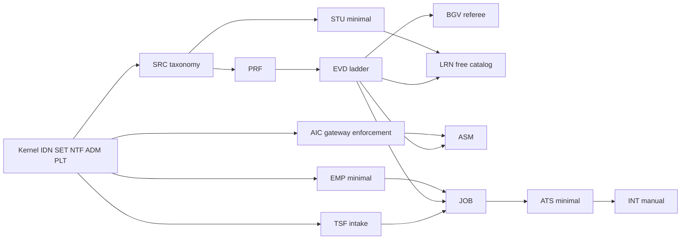

### 8. Key cross-module events

Event names follow `module.entity.action`; module files assign `EVT-` ids. Listed here are the events that connect modules on the main loop. [DER]

| Event                                                                                                    | Emitted by        | Consumed by                              | Effect                                                          |
| -------------------------------------------------------------------------------------------------------- | ----------------- | ---------------------------------------- | --------------------------------------------------------------- |
| `idn.account.created`                                                                                    | `IDN`             | `SET`, `PRF`, `NTF`, `ANL`               | Default settings, profile skeleton, welcome                     |
| `set.consent.revoked`                                                                                    | `SET`             | `SRC`, `AIC`, `EVD`, `JOB`, `INS`, `MSG` | Remove index entries, delete explanations, stop reads           |
| `set.erasure.started`                                                                                    | `SET`             | All owning modules                       | Hide, withdraw, then erase per class                            |
| `prf.profile.updated`                                                                                    | `PRF`             | `SRC`, `AIC`                             | Reindex, recompute matches                                      |
| `evd.evidence.rung_changed`                                                                              | `EVD`             | `PRF`, `SRC`, `AIC`, `JOB`, `REP`        | Display updates; flag snapshots if revoked                      |
| `bgv.verification.completed`                                                                             | `BGV`             | `EVD`, `NTF`                             | Rung transition decision                                        |
| `lrn.course.completed`                                                                                   | `LRN`             | `EVD`, `REP`, `INS`, `ENT`, `ANL`        | Credential, badge, cohort progress                              |
| `asm.attempt.graded`                                                                                     | `ASM`             | `EVD`, `LRN`, `ATS`, `TSF`               | Credential or hold                                              |
| `job.application.submitted`                                                                              | `JOB`             | `ATS`, `NTF`, `ANL`                      | Pipeline card, notifications                                    |
| `ats.stage.changed`                                                                                      | `ATS`             | `JOB`, `NTF`, `INT`, `ANL`               | Candidate-visible status, scheduling trigger                    |
| `ats.offer.accepted`                                                                                     | `ATS`             | `JOB`, `EVD`, `INS`, `BGV`, `ANL`        | Hired outcome; employer-confirmation request; placement outcome |
| `int.scorecard.submitted`                                                                                | `INT`             | `ATS`                                    | Debrief readiness                                               |
| `tsf.action.taken`                                                                                       | `TSF`             | Content owner module, `NTF`              | Hide or restore, notice                                         |
| `bil.entitlement.changed`                                                                                | `BIL`             | All gated-by-plan modules                | Quota updates                                                   |
| `ins.graduation.completed`                                                                               | `INS`             | `IDN`, `SET`, `EVD`, `LRN`               | Grant change, share end                                         |
| `men.session.completed`, `gig.contract.completed`, `evt.results.published`, `ent.internal_move.recorded` | Expansion modules | `EVD`                                    | Outcome evidence (gated)                                        |

### 9. Cross-module needs for module authors

| Need                                                                                                                                                | From  | To                                       |
| --------------------------------------------------------------------------------------------------------------------------------------------------- | ----- | ---------------------------------------- |
| Publish the application candidate-visible status mapping                                                                                            | `ATS` | `JOB`                                    |
| Provide the evidence intake contract with issuer classes `platform`, `institution`, `employer_org`, `instructor`, plus peer and client attestations | `EVD` | All emitters                             |
| Provide the generic scheduling engine with availability rules and holds                                                                             | `INT` | `MEN`, `EVT`, `INS`                      |
| Provide typed threads with membership rules                                                                                                         | `MSG` | `ATS`, `NET`, `INS`, `MEN`, `GIG`, `EVT` |
| Provide AI-mode enforcement independent of AI generation features                                                                                   | `AIC` | `ASM`                                    |
| Provide the aggregation service with `min_cohort_k` and complementary suppression                                                                   | `ANL` | `INS`, `MKT`, `ENT`, `EMP`               |
| Provide grant creation commands with scope types from [04 §4.1](#41-scope-types)                                             | `IDN` | `EMP`, `INS`, `ADM`, `EVT`               |
| Provide org verification records usable by employers and institutions                                                                               | `BGV` | `EMP`, `INS`                             |

### 10. Legacy source trace

| Source                                                          | Used for                                                                        | Dropped or changed                    |
| --------------------------------------------------------------- | ------------------------------------------------------------------------------- | ------------------------------------- |
| `SSOT.md` §8 foundational systems, §12.4, §12.5, §12.10, §12.11 | Bounded contexts and change ownership                                           | Re-expressed with the 30 module codes |
| `SSOT.md` Amendment A, Appendix E V61-14                        | Outbox and worker instead of vendor queues                                      | Vendor-neutral                        |
| `ARCHITECTURE.md`                                               | Awareness that the current code is a modular monolith with a small fetch helper | No build status taken from it         |

## 08 — Stakeholder Decisions Needed

_Former file: `PRODUCT_BLUEPRINT/01_PRODUCT/08_STAKEHOLDER_DECISIONS_NEEDED.md`._

High-level decisions only the owner can make (`OD-PRD-nn`), and the decisions already recorded (`DEC-nnn`). Module-level open decisions live in each module file as `OD-<MOD>-nn`; they are escalated here only when they change product scope, money, law or trust. Nothing here is resolved by this blueprint: each item gives options, a **default proposal** marked [PROP] that stands only until the owner decides, the impact, and the urgency expressed as what it blocks. No deadlines are set. [SRC: CONVENTIONS §2, §3]

### 1. Urgency classes

| Class | Meaning                                                                            |
| ----- | ---------------------------------------------------------------------------------- |
| U1    | Blocks R0 or R1 (foundations or the core loop); decide before building those tiers |
| U2    | Blocks R2 or R3 (hiring marketplace, institutions and instructors)                 |
| U3    | Blocks R4 or R5 (intelligence, trust at scale, commercial scale)                   |
| U4    | Blocks R6 (OS expansion) only                                                      |

### 2. Recorded decisions

#### DEC-001 — The new from-scratch blueprint lives in PRODUCT_BLUEPRINT

| Field          | Detail                                                                                                                                                                                                                                                                                  |
| -------------- | --------------------------------------------------------------------------------------------------------------------------------------------------------------------------------------------------------------------------------------------------------------------------------------- |
| Decision       | The complete intended product is specified from first principles in `PRODUCT_BLUEPRINT/`. `SSOT.md`, `docs/` and `Yash_Final_Project_Document/` are inputs, never limits; they are not edited by this work. Existing code is not assumed to implement anything.                         |
| Decided by     | Owner, relayed by the orchestrating agent [SRC: COMMON_BRIEF; CONVENTIONS §1]                                                                                                                                                                                                           |
| Recorded       | 2026-11-23                                                                                                                                                                                                                                                                              |
| Status         | Recorded                                                                                                                                                                                                                                                                                |
| Consequences   | Ids in the blueprint use new namespaces (`FR-`, `BR-<MOD>-`, `BR-XCT-`, `OD-PRD-`, `JRN-`); legacy ids (`F-`, `BR-001…248`, `J-`, `OD-01…53`) remain separate and are cited, not renumbered. A disposition of the legacy documents and code is still needed (`OD-PRD-30`, `OD-PRD-31`). |
| Conflict noted | `SSOT.md` calls itself the source of truth; the blueprint does not supersede it until `OD-PRD-31` defines ratification. Until then both exist: SSOT as founder intent of record, the blueprint as the proposed complete product.                                                        |

#### DEC-002 — Scope widened to a career operating system (conflicts with SSOT §4.2)

| Field                        | Detail                                                                                                                                                                                                                                                                                                                                                                                              |
| ---------------------------- | --------------------------------------------------------------------------------------------------------------------------------------------------------------------------------------------------------------------------------------------------------------------------------------------------------------------------------------------------------------------------------------------------- |
| Decision                     | The product goal is a complete platform "strong like an operating system" for the whole career domain: identity, learning, assessment, evidence, hiring, networking, institutions, plus adjacent career services.                                                                                                                                                                                   |
| Decided by                   | Owner [SRC: COMMON_BRIEF "Stakeholder goal (confirmed by the owner)"]                                                                                                                                                                                                                                                                                                                               |
| Recorded                     | 2026-11-23                                                                                                                                                                                                                                                                                                                                                                                          |
| Status                       | Recorded; conflict open                                                                                                                                                                                                                                                                                                                                                                             |
| Conflict                     | `SSOT.md` §4.2 lists non-goals: general-purpose marketplace, social-media clone, generic HR/payroll, ad network, sales prospecting. Five OS-expansion modules (`MEN`, `GIG`, `EVT`, `MKT`, `ENT`) and some core capabilities (community posts, company reviews, promoted placements) brush those non-goals ([01 §11.2](#112-where-the-owners-os-goal-brushes-a-non-goal)). |
| How the blueprint handles it | Expansion modules are fully specified but gated: every capability is denied until `OD-PRD-02` admits the module. Each brushing capability is specified narrowly and has its own `OD-`. SSOT §4.2 is not edited.                                                                                                                                                                                     |
| Follow-up decisions          | `OD-PRD-02`, `OD-PRD-03`, `OD-PRD-16`, `OD-PRD-17`, `OD-PRD-18`, `OD-PRD-20`, `OD-PRD-29`                                                                                                                                                                                                                                                                                                           |

#### DEC-003 — Learning is in scope

| Field       | Detail                                                                                                                                                                                                              |
| ----------- | ------------------------------------------------------------------------------------------------------------------------------------------------------------------------------------------------------------------- |
| Decision    | Learning, instructor authoring, assessments and institution-managed learning are part of the product (`LRN`, `STU`, `ASM`, `INS`).                                                                                  |
| Decided by  | Owner [SRC: COMMON_BRIEF "Learning features are IN scope"]                                                                                                                                                          |
| Recorded    | 2026-11-23                                                                                                                                                                                                          |
| Status      | Recorded                                                                                                                                                                                                            |
| Consistency | Consistent with the SSOT GA loop (Learn, Practice in Amendment B). It does not decide paid course commerce or a third-party marketplace (`OD-PRD-04`), proctoring (`OD-PRD-15`) or R1 learning depth (`OD-PRD-09`). |

#### DEC-004 — Push to the main branch authorized; CI lint was red at the time

| Field      | Detail                                                                                                                                                                                                                                                                                                                        |
| ---------- | ----------------------------------------------------------------------------------------------------------------------------------------------------------------------------------------------------------------------------------------------------------------------------------------------------------------------------- |
| Decision   | The owner authorized pushing this blueprint work to the `main` branch.                                                                                                                                                                                                                                                        |
| Decided by | Owner, relayed by the orchestrating agent [SRC: orchestrator brief for this file]                                                                                                                                                                                                                                             |
| Recorded   | 2026-11-23                                                                                                                                                                                                                                                                                                                    |
| Status     | Recorded                                                                                                                                                                                                                                                                                                                      |
| Context    | At the time of the authorization the CI lint check (Prettier) was failing on `main`. The repository instructions say not to push unless asked; this authorization is that request. The last recorded audit also showed lint failing on pre-existing files [SRC: docs/reports/FEATURE_STATUS_2026-10-21.md §B command ledger]. |
| Risk       | Pushing onto a red check hides whether new files introduce further formatting failures.                                                                                                                                                                                                                                       |
| Follow-up  | `OD-PRD-32` (restore a green gate before further pushes). This blueprint author ran no git command, formatter or build.                                                                                                                                                                                                       |

### 3. Open decisions

#### OD-PRD-01 — North-star metric and metric hierarchy

| Field            | Detail                                                                                                                                                                                   |
| ---------------- | ---------------------------------------------------------------------------------------------------------------------------------------------------------------------------------------- |
| Question         | Which single north-star metric, or which approved hierarchy, governs success claims?                                                                                                     |
| Options          | A: `ns.career_progress_verified` (SSOT §2.4). B: `ns.evidence_backed_conversations` (target metrics catalogue). C: A as north star, B as the leading indicator.                          |
| Default proposal | C [PROP]: outcome as north star, conversations as leading indicator; all targets set only after a measured baseline. Also define the "active candidate" window (default 30 days [PROP]). |
| Impact           | Analytics design (`ANL`), dashboards, roadmap trade-offs.                                                                                                                                |
| Blocks           | U1: instrumenting R1 metrics.                                                                                                                                                            |
| Source           | [SRC: SSOT Appendix E V61-28; STR-01 REV2 open items]                                                                                                                                    |

#### OD-PRD-02 — Admission of each OS-expansion module

| Field            | Detail                                                                                                                                                                                                                                   |
| ---------------- | ---------------------------------------------------------------------------------------------------------------------------------------------------------------------------------------------------------------------------------------- |
| Question         | Which of `MEN`, `GIG`, `EVT`, `MKT`, `ENT` are admitted into the product, and in what order?                                                                                                                                             |
| Options          | Per module: admit, admit narrowed, defer, reject.                                                                                                                                                                                        |
| Default proposal | [PROP] Admit `EVT` (free events, no ticketing) and `MKT` (aggregate career paths) first because they need no money flow; admit `MEN` after `OD-PRD-04`; admit `ENT` only with `OD-PRD-20` boundary; decide `GIG` last after `OD-PRD-03`. |
| Impact           | Five module specs either proceed to build or become `Withdrawn`; marketplace liabilities; positioning.                                                                                                                                   |
| Blocks           | U4.                                                                                                                                                                                                                                      |
| Source           | [SRC: DEC-002; CONVENTIONS §4]                                                                                                                                                                                                           |

#### OD-PRD-03 — Freelance marketplace boundary

| Field            | Detail                                                                                                                                  |
| ---------------- | --------------------------------------------------------------------------------------------------------------------------------------- |
| Question         | How far does `GIG` go?                                                                                                                  |
| Options          | A: Listing only (offerings and projects, contracts off-platform). B: Managed contracts with milestones and held funds. C: Out of scope. |
| Default proposal | A first [PROP], restricted to career-related professional services, with B only after `OD-PRD-04`.                                      |
| Impact           | Money-flow liability, disputes, KYC, positioning against the general-marketplace non-goal.                                              |
| Blocks           | U4.                                                                                                                                     |
| Source           | [SRC: SSOT §4.2; DEC-002]                                                                                                               |

#### OD-PRD-04 — Seller of record and money flow for third-party sales

| Field            | Detail                                                                                                                                                                                                            |
| ---------------- | ----------------------------------------------------------------------------------------------------------------------------------------------------------------------------------------------------------------- |
| Question         | Who is the seller of record for paid courses, mentoring, gigs and event tickets; how are payouts, tax, refunds and disputes handled?                                                                              |
| Options          | A: Platform sells first-party content only; no third-party payouts. B: Merchant-of-record provider handles tax and payouts. C: Marketplace model with connected accounts; platform takes commission.              |
| Default proposal | A until a money-flow ADR is approved [PROP]; then B or C chosen with finance and legal advice. Commission rate and refund window decided then (SSOT recommendations of 70/30 and 30 days are noted, not adopted). |
| Impact           | `BIL`, `STU`, `MEN`, `GIG`, `EVT`; tax registration; fraud exposure.                                                                                                                                              |
| Blocks           | U3 (paid first-party courses), U4 (marketplaces).                                                                                                                                                                 |
| Source           | [SRC: SSOT Appendix E V61-21; OD-28; OD-29; MARKETPLACE_MONEY_FLOW_ADR_PROPOSAL]                                                                                                                                  |

#### OD-PRD-05 — Candidate premium tier

| Field            | Detail                                                                                                                                                           |
| ---------------- | ---------------------------------------------------------------------------------------------------------------------------------------------------------------- |
| Question         | Is there a paid candidate tier, what does it include, at what price?                                                                                             |
| Options          | A: No candidate tier. B: Tools-only tier (variants, analytics, AI quota). C: B plus career services credits.                                                     |
| Default proposal | B [PROP], with the free core loop protected (`BR-XCT-027`); price set by owner with cost data. Coded price recommendations in `docs/PRICING.md` are not adopted. |
| Impact           | Revenue, AI cost, fairness perception.                                                                                                                           |
| Blocks           | U3.                                                                                                                                                              |
| Source           | [SRC: SSOT OD-34; docs/PRICING.md]                                                                                                                               |

#### OD-PRD-06 — Employer packaging and free posting policy

| Field            | Detail                                                                                                             |
| ---------------- | ------------------------------------------------------------------------------------------------------------------ |
| Question         | Seat, job-slot or hybrid pricing; how many free active jobs; quota values; grace period.                           |
| Options          | A: Per seat. B: Per active job. C: Hybrid seats plus slot bundles. Free tier: none, limited, unlimited.            |
| Default proposal | C with a limited free tier [PROP] so small employers can close the loop for candidates; values set by owner.       |
| Impact           | Supply of jobs for R1, revenue model, quota design in `BIL`.                                                       |
| Blocks           | U1 for the free tier (R1 needs employers), U2 for paid packaging.                                                  |
| Source           | [SRC: COMMERCIAL_OPERATIONS §2; docs/PRICING.md "Free recruiters posting jobs: unlimited today, policy undecided"] |

#### OD-PRD-07 — Institution licensing model

| Field            | Detail                                                                       |
| ---------------- | ---------------------------------------------------------------------------- |
| Question         | Per seat, per cohort or campus licence; what happens to seats at graduation. |
| Options          | A: Per provisioned seat per term. B: Per cohort. C: Campus licence.          |
| Default proposal | A with seat release at graduation [PROP].                                    |
| Impact           | `INS`, `BIL`; procurement flow.                                              |
| Blocks           | U2.                                                                          |
| Source           | [SRC: SSOT OD-15]                                                            |

#### OD-PRD-08 — Billing owner inside organizations

| Field            | Detail                                                                                                 |
| ---------------- | ------------------------------------------------------------------------------------------------------ |
| Question         | Do entitlements in an org context come from the org subscription, the acting user's plan, or both?     |
| Options          | A: Org subscription only. B: Acting user only. C: Org, with personal plans adding personal tools only. |
| Default proposal | C [PROP].                                                                                              |
| Impact           | Every `e` cell for `REC`, `HMG`, `EAD` in [04](#04--permission-matrix).                               |
| Blocks           | U2.                                                                                                    |
| Source           | [SRC: docs/PRICING.md review notes]                                                                    |

#### OD-PRD-09 — R1 pilot scope

| Field            | Detail                                                                                                                                                                                                                                                                        |
| ---------------- | ----------------------------------------------------------------------------------------------------------------------------------------------------------------------------------------------------------------------------------------------------------------------------- |
| Question         | Which loop does the first pilot prove?                                                                                                                                                                                                                                        |
| Options          | A: Full GA loop including first-party learning and practice. B: Prove → Showcase → Apply with non-AI matching; learning in R1 limited to free first-party courses. C: Narrow beta (identity, profile, evidence verification, jobs, applications, messaging) without learning. |
| Default proposal | B [PROP]: proves evidence and hiring value early while keeping `DEC-003` (learning in scope) with a minimal catalog.                                                                                                                                                          |
| Impact           | R1 contents in [02 §4](#4-release-tier-scope-map-r0-to-r6); a narrower pilot must not redefine GA.                                                                                                                                                  |
| Blocks           | U1.                                                                                                                                                                                                                                                                           |
| Source           | [SRC: SSOT Appendix E V61-20; FEATURE_STATUS_2026-10-21 §A]                                                                                                                                                                                                                   |

#### OD-PRD-10 — Launch jurisdictions, data residency and legal regime

| Field            | Detail                                                                                         |
| ---------------- | ---------------------------------------------------------------------------------------------- |
| Question         | Which countries at launch; where data is hosted; which privacy and employment laws apply.      |
| Options          | A: Single country first. B: One region (for example one economic area). C: Global from launch. |
| Default proposal | A or B with counsel [PROP]; no compliance claim before mapping (SSOT Amendment G India note).  |
| Impact           | Consent texts, salary-transparency rules on job posts, background checks, erasure clocks, tax. |
| Blocks           | U1.                                                                                            |
| Source           | [SRC: SSOT Appendix E V61-27; Amendment G]                                                     |

#### OD-PRD-11 — Minimum age and minors policy

| Field            | Detail                                                                                                                                                                            |
| ---------------- | --------------------------------------------------------------------------------------------------------------------------------------------------------------------------------- |
| Question         | Minimum age for independent accounts; whether minors can be managed learners; what is locked for them.                                                                            |
| Options          | A: 16 (SSOT provisional). B: 18. C: Jurisdiction-specific with attestation.                                                                                                       |
| Default proposal | C with attestation and no date of birth unless counsel requires it [PROP]; minors only as managed learners with discoverability, outreach and marketplaces locked (`BR-XCT-071`). |
| Impact           | `IDN`, `INS`, `SET`; safeguarding.                                                                                                                                                |
| Blocks           | U1.                                                                                                                                                                               |
| Source           | [SRC: SSOT Appendix E V61-24]                                                                                                                                                     |

#### OD-PRD-12 — `min_cohort_k` default and overrides

| Field            | Detail                                                                                                                       |
| ---------------- | ---------------------------------------------------------------------------------------------------------------------------- |
| Question         | Value of the small-cell threshold; what k counts; permitted overrides.                                                       |
| Options          | Default k of 5, 10 or 20; k counts distinct people or reports.                                                               |
| Default proposal | k ≥ 10 distinct people for public and sensitive cells [SRC: SSOT Amendment G]; lower values need owner and counsel approval. |
| Impact           | `ANL`, `INS`, `MKT`, `ENT` reports; usefulness for small cohorts.                                                            |
| Blocks           | U2 (institution analytics).                                                                                                  |
| Source           | [SRC: SSOT Appendix E V61-04]                                                                                                |

#### OD-PRD-13 — Erasure clocks

| Field            | Detail                                                                                |
| ---------------- | ------------------------------------------------------------------------------------- |
| Question         | Cancel window, completion deadline and deactivation purge values.                     |
| Options          | Cancel window 7 or 30 days; completion within 30 days of request or of window end.    |
| Default proposal | 7-day cancel window, completion within 30 days of the request [PROP, target BR-T060]. |
| Impact           | `SET`, every module's erasure handler.                                                |
| Blocks           | U1.                                                                                   |
| Source           | [SRC: SSOT Appendix E V61-07; DOR-017]                                                |

#### OD-PRD-14 — Predictive or automated hiring decisions

| Field            | Detail                                                                                                                                               |
| ---------------- | ---------------------------------------------------------------------------------------------------------------------------------------------------- |
| Question         | Are candidate-level predictive scores or automated screening ever admitted?                                                                          |
| Options          | A: Permanently excluded. B: Excluded from GA; admission only through a governance process with validation, fairness, human control and legal review. |
| Default proposal | B [SRC: SSOT Amendment E]; advisory suggested order with explanation stays allowed.                                                                  |
| Impact           | `AIC`, `ATS`; regulatory exposure.                                                                                                                   |
| Blocks           | U3.                                                                                                                                                  |
| Source           | [SRC: SSOT Amendment E]                                                                                                                              |

#### OD-PRD-15 — Proctoring

| Field            | Detail                                                                                                                                     |
| ---------------- | ------------------------------------------------------------------------------------------------------------------------------------------ |
| Question         | Is remote proctoring offered; vendor or in-house; webcam and screen capture?                                                               |
| Options          | A: No proctoring; integrity by design and review. B: Live human proctoring for institution-run exams only. C: Vendor automated proctoring. |
| Default proposal | A until institution demand is shown, then B [PROP].                                                                                        |
| Impact           | `ASM`, privacy, accessibility.                                                                                                             |
| Blocks           | U3.                                                                                                                                        |
| Source           | [SRC: SSOT OD-35]                                                                                                                          |

#### OD-PRD-16 — Community content breadth

| Field            | Detail                                                                                                                       |
| ---------------- | ---------------------------------------------------------------------------------------------------------------------------- |
| Question         | Posts, articles, groups and newsletters: which are offered?                                                                  |
| Options          | A: None beyond referrals and messaging. B: Topic groups and Q&A only. C: Posts, articles and groups with non-viral ordering. |
| Default proposal | B [PROP].                                                                                                                    |
| Impact           | `NET`, `TSF` load; social-clone non-goal.                                                                                    |
| Blocks           | U2.                                                                                                                          |
| Source           | [SRC: SSOT J-23; §4.2]                                                                                                       |

#### OD-PRD-17 — Company reviews and salary reports

| Field            | Detail                                                                                                                                       |
| ---------------- | -------------------------------------------------------------------------------------------------------------------------------------------- |
| Question         | Are company reviews and salary reports allowed; anonymous or not?                                                                            |
| Options          | A: Neither. B: Salary reports (aggregate only) without reviews. C: Both, anonymous to employers and public, with verified-employment signal. |
| Default proposal | B first, C after moderation capacity exists [PROP].                                                                                          |
| Impact           | `EMP`, `MKT`, `TSF`; defamation exposure.                                                                                                    |
| Blocks           | U2 (reviews), U4 (salary).                                                                                                                   |
| Source           | [SRC: SSOT OD-45, OD-47]                                                                                                                     |

#### OD-PRD-18 — Promoted placements

| Field            | Detail                                                         |
| ---------------- | -------------------------------------------------------------- |
| Question         | Is any paid visibility offered?                                |
| Options          | A: None. B: Labelled promoted jobs in separate slots only.     |
| Default proposal | A [PROP].                                                      |
| Impact           | Revenue vs fairness perception; `BR-XCT-020` holds either way. |
| Blocks           | U3.                                                            |
| Source           | [SRC: SSOT OD-32]                                              |

#### OD-PRD-19 — Background-check scope and vendor model

| Field            | Detail                                                                                                           |
| ---------------- | ---------------------------------------------------------------------------------------------------------------- |
| Question         | Which checks (employment, education, criminal), which vendor model, which countries?                             |
| Options          | A: None; referee and employer confirmation only. B: Employment and education via vendor. C: Full vendor catalog. |
| Default proposal | A in R1–R3, B in R4 [PROP].                                                                                      |
| Impact           | `BGV`, legal notices, adverse-action process.                                                                    |
| Blocks           | U3.                                                                                                              |
| Source           | [DER]                                                                                                            |

#### OD-PRD-20 — Enterprise internal mobility boundary

| Field            | Detail                                                                                                                                                                |
| ---------------- | --------------------------------------------------------------------------------------------------------------------------------------------------------------------- |
| Question         | Where does `ENT` stop relative to HR systems?                                                                                                                         |
| Options          | A: Skills inventory and internal roles only. B: A plus mandated learning and read-only HRIS sync. C: B plus performance data (rejected by default as an HR non-goal). |
| Default proposal | B [PROP]; manager notification on internal application defaults to off.                                                                                               |
| Impact           | `ENT`, privacy of employees.                                                                                                                                          |
| Blocks           | U4.                                                                                                                                                                   |
| Source           | [SRC: SSOT §4.2; J-16, J-28]                                                                                                                                          |

#### OD-PRD-21 — AI funding and provider strategy

| Field            | Detail                                                                                                                          |
| ---------------- | ------------------------------------------------------------------------------------------------------------------------------- |
| Question         | How are AI costs funded for free users; which providers; is bring-your-own-key allowed?                                         |
| Options          | A: No paid inference for free users. B: Small platform-funded quota under a cost policy. C: Bring-your-own-key for power users. |
| Default proposal | A in R1 (non-AI matching), B from R4 with a cost policy [PROP].                                                                 |
| Impact           | `AIC`, margins.                                                                                                                 |
| Blocks           | U3.                                                                                                                             |
| Source           | [SRC: SSOT §16.4; OD-07]                                                                                                        |

#### OD-PRD-22 — Real-time video

| Field            | Detail                                                                                       |
| ---------------- | -------------------------------------------------------------------------------------------- |
| Question         | Build, integrate or omit video for interviews, mentoring and events?                         |
| Options          | A: External meeting links only. B: Embedded third-party video. C: First-party media servers. |
| Default proposal | A [PROP].                                                                                    |
| Impact           | `INT`, `MEN`, `EVT`; live-streaming non-goal.                                                |
| Blocks           | U2.                                                                                          |
| Source           | [SRC: SSOT OD-33; §4.2]                                                                      |

#### OD-PRD-23 — External integration priorities

| Field            | Detail                                                                                                                                             |
| ---------------- | -------------------------------------------------------------------------------------------------------------------------------------------------- |
| Question         | Which integrations first: LinkedIn data import, calendar, partner ATS, HRIS, SIS/LMS, background-check vendor, public API pricing?                 |
| Options          | Any order; API enterprise-only or metered.                                                                                                         |
| Default proposal | Calendar and résumé/LinkedIn-export import in R1–R2; SIS roster import in R3; ATS and HRIS in R5; API enterprise-only at launch [SRC: SSOT OD-53]. |
| Impact           | `PLT` roadmap.                                                                                                                                     |
| Blocks           | U2.                                                                                                                                                |
| Source           | [SRC: SSOT §13.3, OD-53]                                                                                                                           |

#### OD-PRD-24 — White-label and co-branding

| Field            | Detail                                                |
| ---------------- | ----------------------------------------------------- |
| Question         | Can institutions or enterprises brand the experience? |
| Options          | A: None. B: Co-branded pages. C: Full white-label.    |
| Default proposal | B first [SRC: SSOT OD-20].                            |
| Impact           | `EMP`, `INS`, design system.                          |
| Blocks           | U3.                                                   |
| Source           | [SRC: SSOT OD-20]                                     |

#### OD-PRD-25 — User research before R1

| Field            | Detail                                                                     |
| ---------------- | -------------------------------------------------------------------------- |
| Question         | Commission research to validate personas and journeys before building R1?  |
| Options          | A: Yes, before R1 build. B: In parallel with R1 build. C: After the pilot. |
| Default proposal | B [PROP].                                                                  |
| Impact           | Personas in [03](#03--personas-and-roles) are hypothetical.               |
| Blocks           | U1.                                                                        |
| Source           | [SRC: USR-01 §2 "validate via OPEN-07"]                                    |

#### OD-PRD-26 — Government identity verification

| Field            | Detail                                                                                                |
| ---------------- | ----------------------------------------------------------------------------------------------------- |
| Question         | Is identity-document verification offered or required (for mentors, freelancers, payees, or anyone)?  |
| Options          | A: Never. B: Only where a payment provider requires it. C: Optional for anyone as an evidence signal. |
| Default proposal | B [PROP].                                                                                             |
| Impact           | `BGV`, privacy, cost.                                                                                 |
| Blocks           | U3.                                                                                                   |
| Source           | [DER]                                                                                                 |

#### OD-PRD-27 — Monetary referral bonuses

| Field            | Detail                                                                                |
| ---------------- | ------------------------------------------------------------------------------------- |
| Question         | Does the platform track or pay referral bonuses?                                      |
| Options          | A: No. B: Track eligibility only; employers pay outside. C: Pay through the platform. |
| Default proposal | A [PROP].                                                                             |
| Impact           | `NET`, `BIL`.                                                                         |
| Blocks           | U3.                                                                                   |
| Source           | [SRC: SSOT BR-233..BR-240]                                                            |

#### OD-PRD-28 — Public gamification

| Field            | Detail                                                                                          |
| ---------------- | ----------------------------------------------------------------------------------------------- |
| Question         | Are XP, levels and leaderboards public?                                                         |
| Options          | A: Private only. B: Opt-in public badges, no leaderboards. C: Public leaderboards for contests. |
| Default proposal | B, with C only inside events [PROP].                                                            |
| Impact           | `REP`; evidence over popularity.                                                                |
| Blocks           | U2.                                                                                             |
| Source           | [SRC: SSOT OD-06]                                                                               |

#### OD-PRD-29 — Commercial use of aggregate data

| Field            | Detail                                                                                                                 |
| ---------------- | ---------------------------------------------------------------------------------------------------------------------- |
| Question         | May k-anonymous aggregates be sold as insights or used for research?                                                   |
| Options          | A: No. B: Inside paid tiers only, never person-level. C: Research partnerships with consent `data.research_aggregate`. |
| Default proposal | B [PROP]; C stays hidden until decided.                                                                                |
| Impact           | `MKT`, `ANL`, trust.                                                                                                   |
| Blocks           | U4.                                                                                                                    |
| Source           | [SRC: CONSENT_SCOPE_CATALOGUE `data.research_aggregate` hidden]                                                        |

#### OD-PRD-30 — Legacy code disposition

| Field            | Detail                                                                                               |
| ---------------- | ---------------------------------------------------------------------------------------------------- |
| Question         | Is the blueprint built by evolving the existing code or by rebuilding?                               |
| Options          | A: Evolve existing modules where they match the blueprint. B: Rebuild. C: Module-by-module decision. |
| Default proposal | C [PROP], recorded in `11_LEGACY_DISPOSITION`.                                                       |
| Impact           | Effort and risk.                                                                                     |
| Blocks           | U1.                                                                                                  |
| Source           | [SRC: DEC-001]                                                                                       |

#### OD-PRD-31 — Blueprint ratification governance

| Field            | Detail                                                                                          |
| ---------------- | ----------------------------------------------------------------------------------------------- |
| Question         | Who ratifies `[PROP]` items, and when does the blueprint supersede `SSOT.md`?                   |
| Options          | A: Owner ratifies per module. B: Owner ratifies per tier. C: Blueprint supersedes SSOT at once. |
| Default proposal | A [PROP]; SSOT stays founder intent until each module is ratified.                              |
| Impact           | All modules.                                                                                    |
| Blocks           | U1.                                                                                             |
| Source           | [SRC: SSOT Appendix E V61-31]                                                                   |

#### OD-PRD-32 — Restore a green CI gate before further pushes

| Field            | Detail                                                                                                                                                                        |
| ---------------- | ----------------------------------------------------------------------------------------------------------------------------------------------------------------------------- |
| Question         | Should further pushes to `main` wait until the lint gate is green?                                                                                                            |
| Options          | A: Yes, fix lint first. B: Allow documentation-only pushes while red. C: Keep pushing.                                                                                        |
| Default proposal | A [PROP]. Fixing requires touching files outside this blueprint and possibly Prettier configuration, which is a build file reserved to humans by the repository instructions. |
| Impact           | Release discipline.                                                                                                                                                           |
| Blocks           | U1.                                                                                                                                                                           |
| Source           | [SRC: DEC-004; CLAUDE.md build-file rule]                                                                                                                                     |

#### OD-PRD-33 — Accessibility commitment and independent audit

| Field            | Detail                                                           |
| ---------------- | ---------------------------------------------------------------- |
| Question         | Commit to WCAG 2.2 AA conformance and fund an independent audit? |
| Options          | A: Yes before GA. B: Target only, audit later.                   |
| Default proposal | A [PROP]; no conformance claim until an audit report exists.     |
| Impact           | All UI.                                                          |
| Blocks           | U1.                                                              |
| Source           | [SRC: STR-01 REV2 GOAL-06; OPEN-37]                              |

#### OD-PRD-34 — Support model

| Field            | Detail                                                             |
| ---------------- | ------------------------------------------------------------------ |
| Question         | Channels, hours, free-user support, support access-session length. |
| Options          | A: Help center and email for all; chat for paid. B: Email for all. |
| Default proposal | A, access sessions 60 minutes [PROP].                              |
| Impact           | `ADM`, cost.                                                       |
| Blocks           | U1.                                                                |
| Source           | [DER]                                                              |

#### OD-PRD-35 — Moderation operating model

| Field            | Detail                                                                                      |
| ---------------- | ------------------------------------------------------------------------------------------- |
| Question         | In-house or outsourced moderators; degree of automated triage.                              |
| Options          | A: In-house with automated triage for spam. B: Outsourced first-line with in-house appeals. |
| Default proposal | A [SRC: SSOT OD-05 "AI-triage for spam; human for bans"].                                   |
| Impact           | `TSF`, cost, quality.                                                                       |
| Blocks           | U1.                                                                                         |
| Source           | [SRC: SSOT OD-05]                                                                           |

#### OD-PRD-36 — Native apps and browser-extension sync

| Field            | Detail                                                                                            |
| ---------------- | ------------------------------------------------------------------------------------------------- |
| Question         | Are native apps ever built; may the browser extension sync to the server?                         |
| Options          | Extension: local-only (SSOT BR-30) or opt-in sync (J-11). Native: never, later, wrappers.         |
| Default proposal | Extension opt-in sync with explicit consent [PROP]; no native apps until PWA limits are measured. |
| Impact           | `PWA`.                                                                                            |
| Blocks           | U3.                                                                                               |
| Source           | [SRC: SSOT §10.2 note on J-11 vs BR-30]                                                           |

#### OD-PRD-37 — Managed learners applying before graduation

| Field            | Detail                                                                |
| ---------------- | --------------------------------------------------------------------- |
| Question         | Can a `STD` apply to jobs outside placement drives before graduation? |
| Options          | A: Never (SSOT §5.9). B: Institution decides per cohort. C: Always.   |
| Default proposal | B [PROP].                                                             |
| Impact           | `JOB.application.submit` STD cell.                                    |
| Blocks           | U2.                                                                   |
| Source           | [SRC: SSOT §5.9]                                                      |

#### OD-PRD-38 — Languages and locales at launch

| Field            | Detail                                                           |
| ---------------- | ---------------------------------------------------------------- |
| Question         | Which languages, scripts and currencies are supported at launch? |
| Options          | A: One language. B: A short list tied to `OD-PRD-10`.            |
| Default proposal | B [PROP]; all strings externalized from R0.                      |
| Impact           | All UI, templates, taxonomy labels.                              |
| Blocks           | U1.                                                              |
| Source           | [DER]                                                            |

### 4. Summary by urgency

| Class | Decisions                                                                                                                                                                                        |
| ----- | ------------------------------------------------------------------------------------------------------------------------------------------------------------------------------------------------ |
| U1    | `OD-PRD-01`, `OD-PRD-06` (free tier), `OD-PRD-09`, `OD-PRD-10`, `OD-PRD-11`, `OD-PRD-13`, `OD-PRD-25`, `OD-PRD-30`, `OD-PRD-31`, `OD-PRD-32`, `OD-PRD-33`, `OD-PRD-34`, `OD-PRD-35`, `OD-PRD-38` |
| U2    | `OD-PRD-06` (paid), `OD-PRD-07`, `OD-PRD-08`, `OD-PRD-12`, `OD-PRD-16`, `OD-PRD-17` (reviews), `OD-PRD-22`, `OD-PRD-23`, `OD-PRD-28`, `OD-PRD-37`                                                |
| U3    | `OD-PRD-04` (first-party paid courses), `OD-PRD-05`, `OD-PRD-14`, `OD-PRD-15`, `OD-PRD-18`, `OD-PRD-19`, `OD-PRD-21`, `OD-PRD-24`, `OD-PRD-26`, `OD-PRD-27`, `OD-PRD-36`                         |
| U4    | `OD-PRD-02`, `OD-PRD-03`, `OD-PRD-04` (marketplaces), `OD-PRD-17` (salary), `OD-PRD-20`, `OD-PRD-29`                                                                                             |

### 5. Legacy source trace

| Source                         | Used for                                                                                                                                           |
| ------------------------------ | -------------------------------------------------------------------------------------------------------------------------------------------------- |
| `SSOT.md` §24.5 OD-01 to OD-53 | Recommendations cited as sources (OD-05, OD-06, OD-07, OD-15, OD-20, OD-28, OD-29, OD-32 to OD-36, OD-45, OD-47, OD-53); none adopted as decisions |
| `SSOT.md` Appendix E           | V61-04, V61-07, V61-20, V61-21, V61-24, V61-27, V61-28, V61-31                                                                                     |
| `docs/PRICING.md`              | Unapproved coded prices; free-recruiter and billing-owner questions                                                                                |
