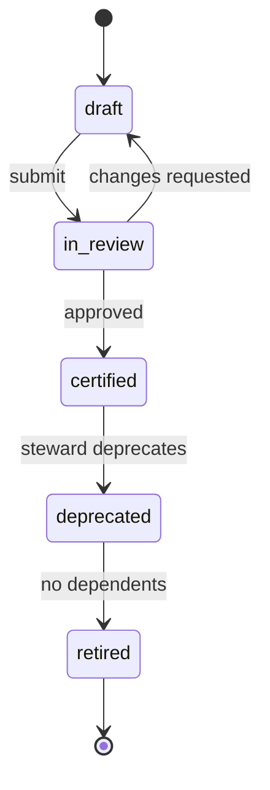
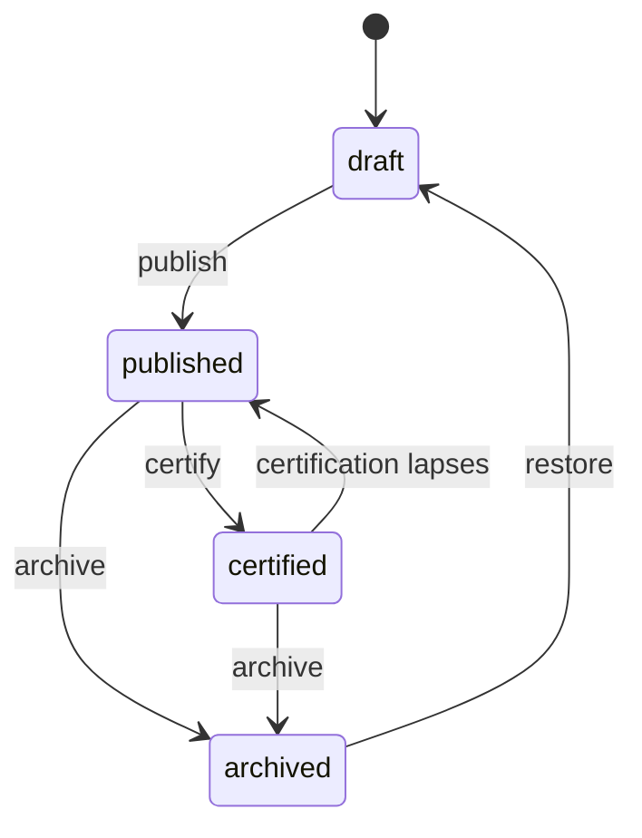
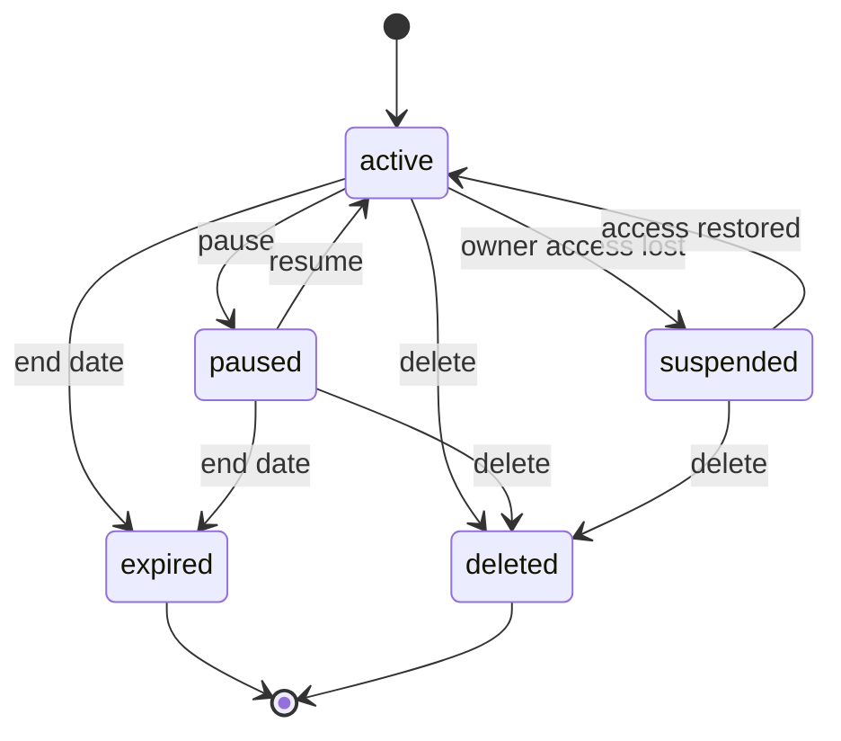
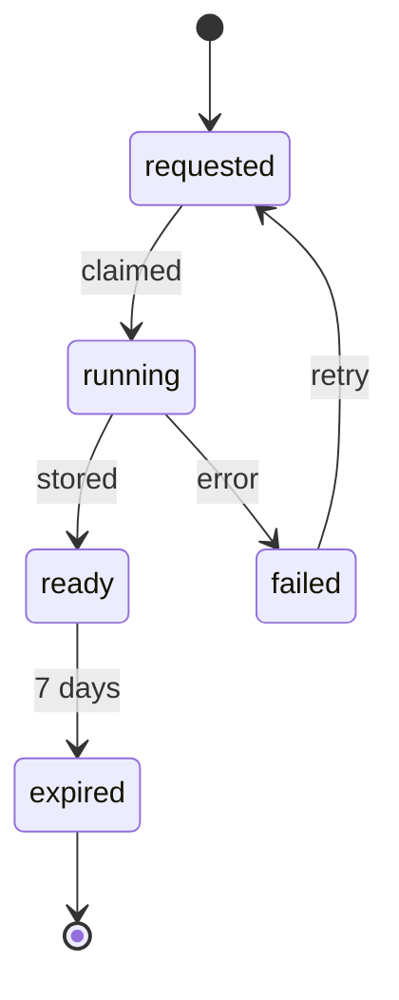
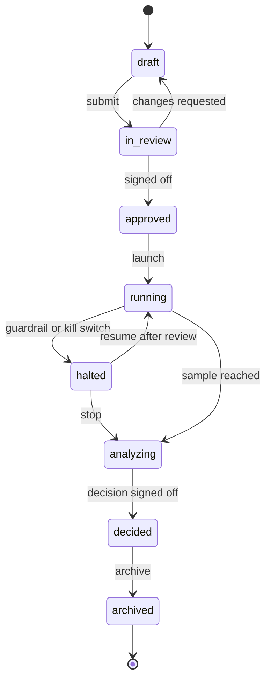
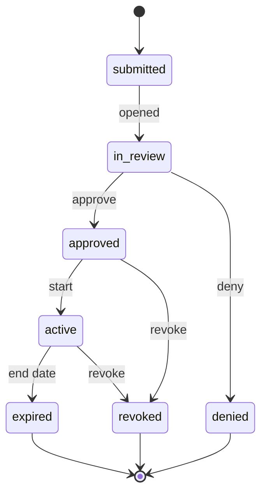
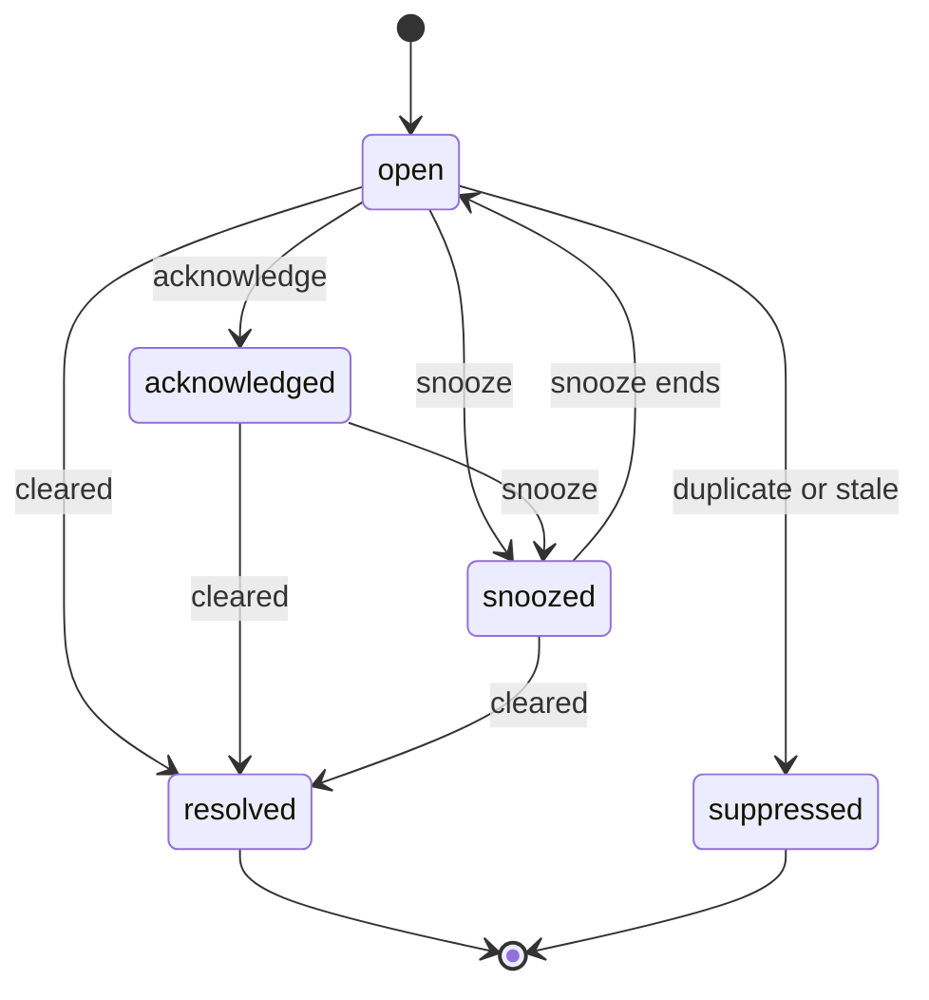

# ANL — Analytics, Reporting & Insights

> Status: intended product specification. Nothing in this file is built. Module group: Platform. Evidence tags follow [CONVENTIONS](../README.md#blueprint-conventions). Legacy metric ids `MET-001..055` come from the target metrics catalogue and are used here as [SRC] references; new module-level ids use `MET-ANL-nn`.

## 1. Purpose, outcomes and boundaries

### 1.1 Purpose

ANL is the product's measurement and insight layer. It gives **every role** the numbers it needs to decide something (candidate, instructor, recruiter, hiring manager, employer admin, institution admin, placement officer, enterprise admin, platform admin), and it gives the company a governed way to measure its own product (event taxonomy, consent, experiments). It owns the **metric registry**, the **analytics data boundary** (domain events to warehouse to semantic layer), the **privacy rules for aggregation**, and the **report, schedule and export tooling**. [SRC: SSOT §7.1 F-19 Product Analytics, F-31 KPI Aggregation & Rollups, F-46 Institutional Analytics, F-82 Student Learning Analytics, F-105 Post-Hire Analytics, F-113 Recruiter Outreach Analytics, F-114 Learning Impact Tracking, F-119, F-153, F-158, F-160, F-165; Yash_Final_Project_Document/20_ANALYTICS_AND_MEASUREMENT/METRICS_CATALOG.md] [PROP: report builder, scheduled reports, experimentation platform, analyst workspace, embedded analytics]

### 1.2 Outcomes

1. Every number shown anywhere in the product traces to a registered, owned, versioned definition. [SRC: METRICS_CATALOG §1 principle 2, §8]
2. Each role sees a dashboard answering "what should I do next?" with outcomes before vanity engagement. [SRC: METRICS_CATALOG §1 principle 1]
3. No analytics feature becomes surveillance of candidates, employees, recruiters or instructors. [SRC: METRICS_CATALOG §1 principle 4, §6.2]
4. Product teams can run governed experiments with fairness and dark-pattern guardrails. [SRC: METRICS_CATALOG §7]
5. Aggregates never fall below the minimum cohort and can never be differenced to individuals. [SRC: SSOT Amendment G, BR-178]

### 1.3 Scope

| In scope                                                              | Out of scope                                                                                                                                   | Owned by ANL                                                                 | Consumed from other modules                                         |
| --------------------------------------------------------------------- | ---------------------------------------------------------------------------------------------------------------------------------------------- | ---------------------------------------------------------------------------- | ------------------------------------------------------------------- |
| Metric registry, semantic layer, KPI rollups                          | Operational telemetry (logs, traces, SLO alerts) owned by platform observability; audit log (`ADM`, `PLT` planned)                             | Metric definitions, rollups, dashboards, reports, schedules, exports, alerts | Domain events from every module via the outbox                      |
| Role dashboards and the dashboard framework                           | Module-specific analytics UIs that belong inside a feature (for example event organizer analytics, EVT) — ANL supplies definitions and rollups | Event schema registry, consent-aware ingestion, warehouse boundary           | Consent state (`SET` planned), identity pseudonyms (`IDN` planned)  |
| Funnels, cohorts, learning and hiring outcome analytics               | Market and salary insights for the public (`MKT` owns them; ANL provides the shared suppression policy interface)                              | Experiments, exposure logging, decision log                                  | Entitlements (`BIL` planned) for premium analytics                  |
| Report builder, scheduled reports, exports, alerts                    | Billing ledger and revenue accounting (`BIL`; ANL only reads aggregates)                                                                       | Analyst workspace and access approvals                                       | Moderation, support data aggregates (`TSF`, `ADM` planned)          |
| Data governance: classification, PII minimization, retention, erasure | Individual-level performance management of staff                                                                                               | Fairness measurement store (P3)                                              | Notification delivery (`NTF` planned), file storage (`PLT` planned) |
| Embedded analytics and partner API for tenants                        | Third-party ad analytics or tracking pixels [SRC: SSOT §4.2 no ad network]                                                                     | Cost and unit-economics view                                                 | Cohorts and tenants (`INS`, `EMP`, `ENT` planned)                   |

### 1.4 Boundary note on SSOT non-goals

SSOT §4.2 forbids a sales-prospecting suite and an advertising network. ANL therefore ships no cross-site tracking, no third-party advertising SDKs, and no employer-facing lists of other employers' candidate activity. SSOT also warns against opaque pay-to-rank hiring; the experiment guardrails (`BR-ANL-018`) forbid pay-to-rank variants. The owner's "operating system" goal asks for analytics for every role; that breadth is accepted here and sized in `OD-ANL-01`.

### 1.5 Three separate signals

Product analytics, operational telemetry and the audit log are different signals and are not merged, stored together by default, or used for each other's purpose [SRC: METRICS_CATALOG §9.2]. ANL owns only the first. The rule is `BR-ANL-010`.

## 2. Roles and permission matrix

Legend: R read, C create, U update, D delete, A approve, X execute, — none. "Own" = the person's own data; "Tenant" = the user's organization; "Cohort" = institution cohorts the user is attached to.

| Capability                         | CAN/STD              | INS           | MNT      | REC                | HMG            | EAD                | IAD      | PLO                | EXA      | MOD/SUP/FIN           | PAD                           | SAD     | Analyst (PAD with analyst permission) |
| ---------------------------------- | -------------------- | ------------- | -------- | ------------------ | -------------- | ------------------ | -------- | ------------------ | -------- | --------------------- | ----------------------------- | ------- | ------------------------------------- |
| Own personal dashboard             | R                    | R             | R        | R                  | R              | R                  | R        | R                  | R        | R                     | R                             | —       | —                                     |
| Candidate dashboard                | R own                | —             | —        | —                  | —              | —                  | —        | —                  | —        | —                     | —                             | —       | —                                     |
| Instructor dashboard               | —                    | R own courses | —        | —                  | —              | —                  | —        | —                  | —        | —                     | R all                         | —       | R                                     |
| Recruiter dashboard                | —                    | —             | —        | R own work         | —              | R tenant aggregate | —        | —                  | —        | —                     | R all                         | —       | R                                     |
| Hiring manager dashboard           | —                    | —             | —        | —                  | R own reqs     | R tenant           | —        | —                  | —        | —                     | R all                         | —       | R                                     |
| Employer admin dashboard           | —                    | —             | —        | —                  | —              | R                  | —        | —                  | —        | —                     | R all                         | —       | R                                     |
| Institution dashboards             | —                    | —             | —        | —                  | —              | —                  | R tenant | R cohort placement | —        | —                     | R all                         | —       | R                                     |
| Enterprise admin dashboard         | —                    | —             | —        | —                  | —              | R summary          | —        | —                  | R        | —                     | R all                         | —       | R                                     |
| Platform and operations dashboards | —                    | —             | —        | —                  | —              | —                  | —        | —                  | —        | R (scope by function) | R                             | R audit | R                                     |
| Fairness monitoring                | —                    | —             | —        | —                  | —              | —                  | —        | —                  | —        | —                     | R (responsible-AI permission) | R       | R aggregated                          |
| Report builder                     | —                    | —             | —        | C own tenant scope | C              | C                  | C        | C                  | C        | C by function         | C                             | —       | C                                     |
| Scheduled reports                  | —                    | —             | —        | C own              | C own          | C                  | C        | C                  | C        | C                     | C                             | —       | C                                     |
| Exports (aggregate)                | R own data only      | R own courses | —        | R own              | R own          | X tenant           | X tenant | X cohort           | X tenant | X by function         | X                             | —       | X                                     |
| Alerts                             | —                    | —             | —        | own thresholds     | own thresholds | C tenant           | C tenant | C                  | C        | C ops                 | C                             | —       | C                                     |
| Metric registry                    | R public definitions | R             | R        | R                  | R              | R                  | R        | R                  | R        | R                     | CRUDA                         | R       | C proposals                           |
| Experiments                        | —                    | —             | —        | —                  | —              | —                  | —        | —                  | —        | —                     | C, A with review              | R       | C, X                                  |
| Analyst workspace (pseudonymous)   | —                    | —             | —        | —                  | —              | —                  | —        | —                  | —        | —                     | request                       | audit   | X after approval                      |
| Identity-join access               | —                    | —             | —        | —                  | —              | —                  | —        | —                  | —        | —                     | A (privacy lead)              | A       | requested only                        |
| Consent and analytics preferences  | CRUD own             | CRUD own      | CRUD own | CRUD own           | CRUD own       | CRUD own           | CRUD own | CRUD own           | CRUD own | CRUD own              | CRUD own                      | —       | —                                     |

Service principal `API`: reads tenant aggregates under scoped grants (`FR-ANL-034`).

## 3. Sub-module map

| Code | Sub-module                              | Features                      |
| ---- | --------------------------------------- | ----------------------------- |
| A    | Metric foundations and data governance  | FR-ANL-001 to 009             |
| B    | Role dashboards                         | FR-ANL-010 to 021, FR-ANL-037 |
| C    | Analysis, reporting and delivery        | FR-ANL-022 to 029             |
| D    | Experimentation                         | FR-ANL-030 to 032             |
| E    | Access, embedding and change management | FR-ANL-033 to 036             |

## 4. Feature specifications

### Sub-module A — Metric foundations and data governance

### FR-ANL-001 — Metric registry

- **Sub-module:** A Metric foundations and data governance
- **Priority / tier:** Must · R1
- **Source:** [SRC: METRICS_CATALOG §1, §3, §8, §9.1; SSOT §7.1 F-31]
- **Purpose and outcome:** One registry holds every metric definition so no number is invented in a dashboard. Success: each displayed metric links to a registered, versioned definition with an owner and the decision it supports.
- **Roles and permissions:** `PAD (metric steward permission): create, update, certify, deprecate` · `Analyst: propose` · `all roles: read public definitions`
- **Preconditions and entry points:** Admin "Metric registry" (`SCR-ANL-020`); "Definition" links on every widget.
- **User interactions and actions:** 1. Click "New metric". 2. Enter name, plain definition, formula (numerator, denominator, population), source (domain events, database, billing, support, CI), privacy class (P0–P3), allowed dimensions, consent basis, dedup key, owner role, decision supported, review cadence, minimum cohort. 3. Save draft. 4. Request review. 5. Owner and a privacy reviewer approve. 6. Publish as certified.
- **System behaviour:** Stores `ENT-ANL-01` per `SM-ANL-01`; a metric id (`MET-` prefix; legacy ids kept) is permanent; any change creates a new version, never an in-place edit of a certified definition (`BR-ANL-001`, `BR-ANL-025`); validates that a formula references only registered events and fields; "decision supported" is mandatory (metrics without decisions are not allowed); emits `analytics.metric.published`.
- **UI elements and controls:** Definition form with required markers, formula builder (event picker with allowed properties), privacy-class select with explanations, dimension multiselect (blocked dimensions greyed with reason), version history, "Usage" tab listing dashboards using the metric, status chip.
- **Configuration options:** Platform: required reviewers by privacy class (P2 and P3 need privacy reviewer), review cadence default (`OD-ANL-08`).
- **Business rules:** `BR-ANL-001`, `BR-ANL-003`, `BR-ANL-004`, `BR-ANL-025`.
- **Validation:** Name 3–80 chars unique; definition 20–1,000 chars; owner role required; dimensions limited to the allowed list for the privacy class (no demographic dimensions outside the fairness store); formula references must resolve.
- **Inputs and outputs:** In: definition fields. Out: versioned definition with id and "used in" list.
- **Filters, sorting, search:** Filter by domain, owner, privacy class, status, certified; search by name and event.
- **Notifications and communication:** Review requests and decisions (`anl.metric.review`, class `admin-ops`); owner reminder at the review cadence.
- **Error handling and edge cases:** Duplicate definition: suggests the existing metric. Deprecating a metric used by a certified dashboard: blocked until the dashboard migrates. Owner role vacant: flagged and routed to the platform admin.
- **Dependencies:** `ENT-ANL-01`, `FR-ANL-007`, `FR-ANL-035`.
- **Security and privacy:** Definitions public inside the product; changes audited with before and after; P3 definitions visible only to the fairness permission.
- **Acceptance criteria:**
  - Given a metric draft without a decision supported, when requesting review, then the system rejects naming the field.
  - Given a certified metric, when its formula is edited, then a new draft version is created and the certified one is unchanged.
  - Given a request to deprecate a metric used by a certified dashboard, when submitted, then it is blocked with the dashboard list.

### FR-ANL-002 — Event pipeline and warehouse boundary

- **Sub-module:** A Metric foundations and data governance
- **Priority / tier:** Must · R1
- **Source:** [SRC: METRICS_CATALOG §4.1, §5, §9.2; ARCHITECTURE outbox pattern per SSOT §13] [DER]
- **Purpose and outcome:** Business facts flow from the transactional system to an analytics store through a governed pipeline so analytics never load or lock the primary database. Success: events arrive exactly once in effect, within the freshness target, in the right zone.
- **Roles and permissions:** `system: execute` · `PAD (data platform): monitor, replay, pause` · `SAD: audit`
- **Preconditions and entry points:** Domain events written to the outbox by each module; ingest job; admin "Pipeline" page (`SCR-ANL-021`).
- **User interactions and actions:** 1. Data platform admin opens the pipeline monitor. 2. Sees lag, volume and rejects per source module. 3. Pauses a source or replays a time window. 4. Reviews the dead-letter queue and reprocesses or discards with reason.
- **System behaviour:** Ingest reads outbox events, validates against the schema registry (`FR-ANL-007`), applies consent filtering (`FR-ANL-006`), computes pseudonymous ids, tags test traffic, writes to the raw zone, transforms to the pseudonymous analytics zone and then to the semantic layer (`FR-ANL-003`); identity-joined data only in the restricted zone (`BR-ANL-011`); dedupe by `eventId` and replay-safe loaders (`BR-ANL-013`); the warehouse is read-only for application code and separate from the transactional primary (`BR-ANL-026`); freshness target [PROP] 15 minutes for operational tiles, 24 hours for batch metrics (`OD-ANL-03` for the store choice).
- **UI elements and controls:** Pipeline table (source, last event time, lag, rows accepted, rejected), dead-letter list with schema error, replay dialog (date range, source), pause toggle.
- **Configuration options:** Platform: freshness targets, retention of raw events (`OD-ANL-04`), batch schedules.
- **Business rules:** `BR-ANL-002`, `BR-ANL-009`, `BR-ANL-011`, `BR-ANL-013`, `BR-ANL-026`.
- **Validation:** Event envelope fields present (`eventId`, name, `schema_version`, `occurred_at`, pseudonymous actor, consent ref, release id); unknown fields dropped; free text rejected.
- **Inputs and outputs:** In: outbox events. Out: analytics tables, lag metrics.
- **Filters, sorting, search:** Monitor filter by source module, status, time.
- **Notifications and communication:** Lag over threshold or reject rate over 1% [PROP] alerts data platform (`anl.pipeline.alert`, class `admin-ops`).
- **Error handling and edge cases:** Out-of-order events: ordering by `occurred_at` with late-arrival window 7 days. Schema violation: event goes to the dead-letter queue with the violation, never partially loaded. Replay over already-loaded events: idempotent. Warehouse outage: events buffer in the outbox, dashboards show stale banner.
- **Dependencies:** All modules' outbox; `FR-ANL-004`, `FR-ANL-006`, `FR-ANL-007`.
- **Security and privacy:** Raw zone restricted; pseudonymous zone for analysts; replay and pause audited.
- **Acceptance criteria:**
  - Given the same `eventId` delivered twice, when ingested, then one row exists.
  - Given an event with a free-text property, when validated, then it is rejected to the dead-letter queue.
  - Given a warehouse outage, when a dashboard loads, then it shows the last good data with a staleness banner.

### FR-ANL-003 — Semantic layer and KPI rollups

- **Sub-module:** A Metric foundations and data governance
- **Priority / tier:** Must · R2
- **Source:** [SRC: SSOT §7.1 F-31 KPI Aggregation & Rollups (priority 6, Ph2); METRICS_CATALOG §5 "semantic layer"]
- **Purpose and outcome:** Registered metrics are computed once into reusable rollups so dashboards, reports, exports and APIs return identical numbers. Success: a metric query returns the same value in every surface.
- **Roles and permissions:** `system: compute` · `PAD (data platform): configure, backfill` · `all consumers: read through the query service`
- **Preconditions and entry points:** Published metric definitions; rollup scheduler.
- **User interactions and actions:** 1. Data platform admin selects a metric and grain (day, week, month) and dimensions. 2. Starts a backfill. 3. Reviews computed values and reconciliation. 4. Enables the rollup for consumers.
- **System behaviour:** Query service resolves a metric id plus dimensions and filters into a rollup read or a computed query; applies tenant scoping (`BR-ANL-006`) and the suppression service (`FR-ANL-005`) before returning; stores `ENT-ANL-06` rollups with metric version; late data triggers recompute of affected windows; time zones: stored UTC, grains computed in tenant time zone and fiscal calendar (`BR-ANL-035`).
- **UI elements and controls:** Rollup catalogue table, backfill dialog, compute status.
- **Configuration options:** Grains, tenant fiscal calendar start, rollup retention.
- **Business rules:** `BR-ANL-001`, `BR-ANL-004`, `BR-ANL-006`, `BR-ANL-035`.
- **Validation:** Dimensions must be in the metric's allowed list; grain must be supported.
- **Inputs and outputs:** In: metric id, dimensions, filters, range. Out: series with value, sample size, version, freshness.
- **Filters, sorting, search:** Query filters by date, dimension values.
- **Notifications and communication:** n/a — no recipient is affected.
- **Error handling and edge cases:** Backfill failure: partial windows marked incomplete and excluded. Metric version change: both versions retained; consumers pin versions. Query above cost budget: rejected with guidance to narrow.
- **Dependencies:** `FR-ANL-001`, `FR-ANL-002`, `FR-ANL-005`.
- **Security and privacy:** Tenant scoping enforced in the query service, not the UI.
- **Acceptance criteria:**
  - Given a metric shown on a dashboard and in an export, when the same filters are used, then both show the same value.
  - Given a request with a disallowed dimension, when queried, then the service rejects it.
  - Given late data for last week, when it arrives, then the rollup for that window recomputes.

### FR-ANL-004 — Data classification and PII minimization

- **Sub-module:** A Metric foundations and data governance
- **Priority / tier:** Must · R1
- **Source:** [SRC: METRICS_CATALOG §4.1, §6.1, §6.2]
- **Purpose and outcome:** Every analytics field is classified and the platform collects the minimum. Success: no field enters analytics without a class, purpose and owner.
- **Roles and permissions:** `PAD (privacy lead): classify, approve` · `engineers: propose fields` · `SAD: audit`
- **Preconditions and entry points:** Data catalogue (`SCR-ANL-022`); schema registry review.
- **User interactions and actions:** 1. Engineer proposes an event property. 2. Privacy reviewer assigns class (P0 none, P1 pseudonymous, P2 aggregate-only with minimum cohort, P3 special handling), purpose and retention. 3. Approves or rejects. 4. Catalogue shows the classification per field.
- **System behaviour:** Property allowlists per event; automatic scanner rejects property names or values matching PII patterns (email, phone, names, message bodies, resume text, tokens); P3 fields flow only to the fairness store (`FR-ANL-021`); joins between classes only through the restricted zone (`BR-ANL-011`).
- **UI elements and controls:** Catalogue table (field, event, class, purpose, retention, owner), review queue, scanner results.
- **Configuration options:** PII pattern list; default retention by class.
- **Business rules:** `BR-ANL-003`, `BR-ANL-009`, `BR-ANL-011`, `BR-ANL-015`.
- **Validation:** Field name pattern; class and purpose required; free text types disallowed.
- **Inputs and outputs:** Out: classification catalogue.
- **Filters, sorting, search:** By class, owner, event.
- **Notifications and communication:** Review request to privacy lead (`anl.field.review`, class `admin-ops`).
- **Error handling and edge cases:** Scanner false positive: reviewer overrides with reason. Unclassified field in production: ingest drops it and alerts.
- **Dependencies:** `FR-ANL-007`, `FR-ANL-009`.
- **Security and privacy:** Classification changes audited; P3 catalogue visible to privacy and fairness roles only.
- **Acceptance criteria:**
  - Given a property named `email`, when proposed, then it is rejected.
  - Given an unclassified field in an incoming event, when ingested, then it is dropped and an alert is raised.
  - Given a P3 field, when routed, then it lands only in the fairness store.

### FR-ANL-005 — Aggregation thresholds and suppression service

- **Sub-module:** A Metric foundations and data governance
- **Priority / tier:** Must · R2
- **Source:** [SRC: SSOT Amendment G, BR-178, V61-04; METRICS_CATALOG §6.1 P2]
- **Purpose and outcome:** One service enforces the minimum cohort and differencing protection for every aggregate returned by ANL. Success: no response contains a cell below policy.
- **Roles and permissions:** `PAD (privacy policy permission): configure with decision record` · `system: enforce` · `SAD: audit`
- **Preconditions and entry points:** All query service, export and API responses.
- **User interactions and actions:** 1. Privacy admin edits `min_cohort_k` (default 10) and feature overrides. 2. Runs a simulation showing which dashboard cells would hide. 3. Approves with a decision record id.
- **System behaviour:** Counts distinct people (or the registered unit) per cell; suppresses cells below k; applies complementary suppression and rounding (`BR-ANL-005`); limits dimensions per query and query budget per client; overrides: learning outcome analytics k ≥ 30 [SRC: BR-189], career transition k ≥ 20 [SRC: BR-160] are stricter feature values; any value below default needs owner and counsel decision (`BR-ANL-004`); fails closed if unavailable; this service exposes the policy interface that `MKT FR-MKT-033` and `ENT` reports consume or mirror.
- **UI elements and controls:** Policy table (parameter, default, overrides, decision record), simulation report, approval flow.
- **Configuration options:** `min_cohort_k` (10), rounding granularity (5), max dimensions per query (3), query budget per client.
- **Business rules:** `BR-ANL-004`, `BR-ANL-005`, `BR-ANL-006`, `BR-ANL-024`, `BR-ANL-032`.
- **Validation:** Values below default require a decision record; overrides must be ≥ default unless recorded.
- **Inputs and outputs:** In: candidate cells; out: published cells or suppression markers with reason code.
- **Filters, sorting, search:** Simulation filter by dashboard and metric.
- **Notifications and communication:** Policy change notice to metric owners (class `admin-ops`).
- **Error handling and edge cases:** Differencing attempt via sibling queries: second query returns suppressed. Simulation shows more than 20% cells hidden: warning before approval. Engine outage: reads fail closed.
- **Dependencies:** `FR-ANL-003`, `FR-ANL-026`, `FR-ANL-028`, `FR-ANL-034`.
- **Security and privacy:** Policy changes audited with decision record; response includes only a reason code for suppression, never the hidden count.
- **Acceptance criteria:**
  - Given k = 10 and a cell of 9 people, when queried, then the cell is suppressed with reason `below_threshold`.
  - Given suppressed cell C whose siblings and total are visible, when queried, then another sibling is also suppressed.
  - Given a policy change to k = 5 without a decision record, when saved, then the system rejects.

### FR-ANL-006 — Analytics consent and user preferences

- **Sub-module:** A Metric foundations and data governance
- **Priority / tier:** Must · R1
- **Source:** [SRC: METRICS_CATALOG §6.2 Consent, §6.3 Candidate-facing transparency; INV-T15]
- **Purpose and outcome:** People decide whether their usage contributes to person-keyed product analytics and can see what they agreed to. Success: ingestion honors the stored consent and users can change it any time.
- **Roles and permissions:** `all signed-in: manage own` · `GUE: cookie-less aggregate counting only`
- **Preconditions and entry points:** First-run notice, Settings → Privacy → "Product analytics" (`SCR-ANL-023`), consent banner for guests.
- **User interactions and actions:** 1. Read what each purpose means (product improvement, experiments, research). 2. Toggle purposes. 3. View "Analytics data about me" summary and download it. 4. Withdraw.
- **System behaviour:** Writes consent (`analytics.product`, `analytics.experiments`) to the consent service (`SET` planned); the consent reference travels in every event envelope (`BR-ANL-008`); with no consent, person-keyed events are not stored and only aggregate counters without identifiers are kept; withdrawal stops new collection immediately and triggers de-identification of prior person-keyed events per retention (`BR-ANL-014`); service-operation facts (for example an application was submitted) remain as business records, not analytics.
- **UI elements and controls:** Purpose toggles (default off where law requires opt-in, `OD-ANL-02`), explanation text, "Download my analytics data" button, "Withdraw all" button, guest banner with equal-weight Accept/Decline.
- **Configuration options:** Platform: default per jurisdiction (`OD-ANL-02`); consent text versions.
- **Business rules:** `BR-ANL-008`, `BR-ANL-014`, `BR-ANL-019`.
- **Validation:** Consent version recorded; no pre-ticked toggles in opt-in regions.
- **Inputs and outputs:** Out: consent state; data export file.
- **Filters, sorting, search:** n/a — settings page.
- **Notifications and communication:** Confirmation of changes (`anl.consent.changed`, class `privacy-activity`).
- **Error handling and edge cases:** Consent service unreachable: default to no person-keyed analytics for the session. Withdrawal during an active experiment: the user is removed from analysis and exposure stops. Guest with browser privacy signals (GPC/Do Not Track): treated as decline.
- **Dependencies:** `SET` (planned), `FR-ANL-002`, `FR-ANL-009`.
- **Security and privacy:** Consent ledger append-only; export contains only the person's attributable analytics.
- **Acceptance criteria:**
  - Given no consent, when the user browses, then no person-keyed analytics event is stored.
  - Given withdrawal, when processed, then collection stops immediately and prior events are de-identified per retention.
  - Given a guest sending a privacy signal, when the banner would show, then analytics stays off and the banner is not required to be answered.

### FR-ANL-007 — Product analytics event taxonomy and schema registry

- **Sub-module:** A Metric foundations and data governance
- **Priority / tier:** Must · R1
- **Source:** [SRC: METRICS_CATALOG §4.1, §4.2; SSOT §7.1 F-19 Product Analytics]
- **Purpose and outcome:** All events follow one naming and envelope standard with versioned schemas, so metrics are reliable. Success: no event enters the pipeline without a registered schema.
- **Roles and permissions:** `PAD (data platform): approve schemas` · `engineers: propose` · `Analyst: read`
- **Preconditions and entry points:** Schema registry page (`SCR-ANL-024`); CI check for event definitions.
- **User interactions and actions:** 1. Engineer proposes an event: name `<domain>.<entity>.<past_tense_verb>`, trigger, server or client source, allowlisted properties with types and enumerations, owner, feeding metrics. 2. Data platform and privacy review. 3. Publish schema version. 4. Instrumentation uses generated types.
- **System behaviour:** Server events for business facts (outbox), client events only for UX interactions the server cannot know (`BR-ANL-002`); additive schema changes only, breaking change means a new event name; envelope: `event_id`, name, `schema_version`, `occurred_at` (server time), `actor_pseudo_id`, `session_pseudo_id`, `tenant_id`, `source`, `consent_scope_ref`, `release_id`, `props` (`BR-ANL-009`); client SDK is a thin first-party wrapper with allowlisting (no auto-capture, no session replay of personal content).
- **UI elements and controls:** Schema list, schema editor with property table and enum editor, change diff, "Used by metrics" tab.
- **Configuration options:** Platform: client sampling rates, naming exceptions.
- **Business rules:** `BR-ANL-002`, `BR-ANL-009`, `BR-ANL-012`, `BR-ANL-013`.
- **Validation:** Name pattern; property types limited to number, boolean, enum, id, timestamp; max 20 properties; enumerations ≤ 50 values.
- **Inputs and outputs:** Out: published schema and typed SDK definitions.
- **Filters, sorting, search:** By domain, status, owner.
- **Notifications and communication:** Review requests (class `admin-ops`).
- **Error handling and edge cases:** Event removed from code but still received: alert "orphan event". Breaking change attempt: blocked with suggestion to create a new event name. Client sampling mismatch: documented in schema.
- **Dependencies:** `FR-ANL-001`, `FR-ANL-004`.
- **Security and privacy:** Allowlists enforced at ingest, not just in code.
- **Acceptance criteria:**
  - Given a schema change that removes a property, when proposed, then the system blocks it as breaking.
  - Given an event name not matching the pattern, when proposed, then the system rejects.
  - Given a client event with an unregistered property, when received, then the property is dropped and counted in rejects.

### FR-ANL-008 — Data quality and reconciliation monitors

- **Sub-module:** A Metric foundations and data governance
- **Priority / tier:** Must · R2
- **Source:** [SRC: METRICS_CATALOG §5 data quality; §9.1 "Integrity check"]
- **Purpose and outcome:** Key metric counts are reconciled to source tables so a wrong number is detected before users see it. Success: reconciliation runs daily and failures block certification.
- **Roles and permissions:** `system: execute` · `PAD (data platform): review, resolve`
- **Preconditions and entry points:** Reconciliation jobs; "Data quality" page (`SCR-ANL-025`).
- **User interactions and actions:** 1. Open the monitor. 2. See each check (for example applications in analytics vs applications table) with tolerance and last result. 3. Open a failure to see the diff by day. 4. Mark resolved with cause or trigger replay.
- **System behaviour:** Each certified metric has an integrity check (`ENT-ANL-19`); default tolerance 0.5% [PROP] (`BR-ANL-028`); failing metrics are flagged "under investigation" on dashboards; certified dashboards depending on a failing metric show a banner; checks also cover small-cell suppression tests, freshness and null-rate on key properties.
- **UI elements and controls:** Check table with status icon plus text, diff view, resolve dialog, replay button.
- **Configuration options:** Tolerance per metric, schedule.
- **Business rules:** `BR-ANL-017`, `BR-ANL-028`.
- **Validation:** Each certified metric has at least one check.
- **Inputs and outputs:** Out: check results.
- **Filters, sorting, search:** By metric, status, date.
- **Notifications and communication:** Failure alert to the metric owner (`anl.quality.failed`, class `admin-ops`).
- **Error handling and edge cases:** Source table changes meaning: check flagged "definition drift". Check itself fails: marked "inconclusive" and treated as failing for certification.
- **Dependencies:** `FR-ANL-001`, `FR-ANL-002`.
- **Security and privacy:** Checks read counts only.
- **Acceptance criteria:**
  - Given a difference above tolerance, when the check runs, then the metric is flagged and the owner notified.
  - Given a flagged metric on a certified dashboard, when the dashboard loads, then a banner states it is under investigation.
  - Given an inconclusive check, when evaluating certification, then it counts as failing.

### FR-ANL-009 — Retention, erasure and de-identification

- **Sub-module:** A Metric foundations and data governance
- **Priority / tier:** Must · R1
- **Source:** [SRC: METRICS_CATALOG §5 Retention, §6.2 De-identification; SSOT §7.1 data rights]
- **Purpose and outcome:** Analytics data lives only as long as needed and is erased or irreversibly de-identified on request. Success: erasure requests complete within the data-rights target and aggregates stay correct.
- **Roles and permissions:** `system: execute` · `PAD (privacy lead): configure, verify` · `data subject: request via SET`
- **Preconditions and entry points:** Data-rights workflow (`SET` planned) triggers; retention schedule.
- **User interactions and actions:** 1. Privacy lead sets retention per class (raw events, pseudonymous events, aggregates, reports). 2. On erasure request the system executes. 3. Privacy lead verifies the completion report.
- **System behaviour:** Raw event retention default [PROP] 25 months (`OD-ANL-04`); pseudonym salts rotate per policy and old mapping tables are destroyed, making older events unlinkable; erasure removes the person's pseudonym mapping and deletes or de-identifies person-keyed events; aggregates are not recomputed but small cells are re-evaluated for suppression; completion report logged.
- **UI elements and controls:** Retention schedule table, erasure queue with status, verification report.
- **Configuration options:** Retention periods by class; salt rotation period.
- **Business rules:** `BR-ANL-011`, `BR-ANL-014`, `BR-ANL-015`.
- **Validation:** Retention values within legal bounds set by counsel (`OD-ANL-04`).
- **Inputs and outputs:** Out: erasure receipt.
- **Filters, sorting, search:** Queue by status, age.
- **Notifications and communication:** Completion notice to the data-rights workflow.
- **Error handling and edge cases:** Erasure for a person in an active experiment: removed and excluded from results. Backup restore: erasure list reapplied. Failure: retried, alert after 3 failures.
- **Dependencies:** `SET` (planned), `FR-ANL-002`, `FR-ANL-006`.
- **Security and privacy:** Mapping destruction is irreversible; operations logged in the audit log (not in analytics).
- **Acceptance criteria:**
  - Given an erasure request, when completed, then no person-keyed event of that person remains linkable.
  - Given raw events older than the retention period, when the job runs, then they are deleted.
  - Given a backup restore, when finished, then prior erasures are re-applied before access is enabled.

### Sub-module B — Role dashboards

### FR-ANL-010 — Dashboard framework

- **Sub-module:** B Role dashboards
- **Priority / tier:** Must · R2
- **Source:** [SRC: SSOT §7.1 F-03 Role-Adaptive Dashboard] [PROP] framework features
- **Purpose and outcome:** All dashboards share one framework: widgets bound to registered metrics, consistent filters, drill-down, definition links, freshness and accessibility. Success: any dashboard is a configuration, not custom code.
- **Roles and permissions:** `all roles: view allowed dashboards` · `PAD: create platform dashboards` · `tenant admins: create tenant dashboards within scope`
- **Preconditions and entry points:** Dashboard pages per role; "Dashboards" menu.
- **User interactions and actions:** 1. Open a dashboard. 2. Change date range or filters (applied to all widgets). 3. Click a widget value to drill down. 4. Click "Definition" to see the metric. 5. Toggle chart/table view. 6. Share a read-only snapshot link, download, schedule (`FR-ANL-027`). 7. Save a personal view.
- **System behaviour:** `ENT-ANL-07` dashboards composed of widgets referencing metric ids and versions; all data via the query service (`FR-ANL-003`) so suppression and tenancy apply; widget shows value, comparison to previous period, sample size, freshness; shared snapshot links freeze values, are tenant-scoped, expire in 30 days [PROP]; lifecycle per `SM-ANL-02` (draft → published → certified → archived); a widget whose metric is uncertified shows an "unverified definition" label.
- **UI elements and controls:** Global filter bar, widget cards with title, value, delta text (not color only), chart with accessible data table, definition link, freshness label, "Share", "Download", "Schedule", "Reset view".
- **Configuration options:** User: default range, saved views; tenant: default filters, fiscal calendar; platform: widget library.
- **Business rules:** `BR-ANL-006`, `BR-ANL-017`, `BR-ANL-024`, `BR-ANL-025`, `BR-ANL-037`.
- **Validation:** Date range ≤ 24 months (daily grain ≤ 92 days); widget metric must be published; filters limited to allowed dimensions.
- **Inputs and outputs:** In: filters. Out: widget data with provenance.
- **Filters, sorting, search:** Date range, comparison period, tenant dimensions (team, job, course, cohort), dashboard search.
- **Notifications and communication:** n/a — read surface; delivery handled by schedules.
- **Error handling and edge cases:** Widget error: that card shows an error and retry, others render. Suppressed cell: "Not enough data to show" with reason code, never zero. Stale data: banner. Large range: auto-coarsens grain with a note. Slow query: progressive load with skeleton states.
- **Dependencies:** `FR-ANL-001`, `FR-ANL-003`, `FR-ANL-005`.
- **Security and privacy:** Server-side authorization per widget; snapshots contain aggregates only.
- **Acceptance criteria:**
  - Given a widget with a suppressed cell, when displayed, then it shows "Not enough data" and no number.
  - Given a keyboard-only user, when navigating widgets, then every chart has a reachable data table and focus order follows reading order.
  - Given a shared snapshot older than 30 days, when opened, then it returns 410.

### FR-ANL-011 — Candidate dashboard

- **Sub-module:** B Role dashboards
- **Priority / tier:** Must · R1
- **Source:** [SRC: SSOT §7.1 F-03; PRD §9 Verifiable Career Progress; METRICS_CATALOG §3.1] [DER]
- **Purpose and outcome:** Candidates and students see their own progress toward their goal and what to do next. Success: a private view driven by their own data with next-step prompts.
- **Roles and permissions:** `CAN/STD: read own` · no other role can read it
- **Preconditions and entry points:** Home dashboard; "My progress".
- **User interactions and actions:** 1. Open dashboard. 2. See goal progress, evidence count by level, skills coverage vs target role (from `MKT`), learning progress, application funnel (applied, viewed, shortlisted, interview, offer), profile views by recruiters (counts only, aggregated, consented), assessment results trend. 3. Click an item to go to the relevant module. 4. Hide any widget.
- **System behaviour:** Reads the person's own operational data (not analytics-consent dependent, since it is the service's own feature) through the query service; "profile views" show counts by employer type and never names unless the candidate has chosen to display (profile viewer visibility is `PRF`/`NET` policy); comparisons to others only as anonymous aggregates above threshold; no ranking against peers.
- **UI elements and controls:** Goal ring with numeric percent, evidence ladder bar with text, funnel chart with table, learning tiles, "Next best action" list with reasons, hide-widget menu.
- **Configuration options:** User: widget visibility, weekly summary on/off.
- **Business rules:** `BR-ANL-016`, `BR-ANL-031`, `BR-ANL-004`.
- **Validation:** n/a — read-only with filter bounds.
- **Inputs and outputs:** Out: own metrics. Key metrics: evidence items by rung (MET-003, MET-008 own view), applications by stage (own), course progress (MET-017 own), assessment pass rate (own), profile completeness, goal progress. Definitions registered per `FR-ANL-001`.
- **Filters, sorting, search:** Date range, goal, job application status.
- **Notifications and communication:** Optional weekly summary email (`anl.candidate.weekly`, class `insights`, opt-out).
- **Error handling and edge cases:** New user with no data: empty state with first steps. Application data from deleted job: shown as "job removed". Employer view count below threshold: shown as "a few" without number.
- **Dependencies:** `PRF`, `EVD`, `JOB`, `LRN` (planned), `MKT`, `FR-ANL-010`.
- **Security and privacy:** Private to the person; no sharing of the dashboard itself; derived from own records only.
- **Acceptance criteria:**
  - Given a candidate with 3 applications, when the dashboard loads, then the funnel shows their own stage counts.
  - Given another user's id in the URL, when requested, then the system returns 403.
  - Given fewer than the minimum employers viewing, when shown, then the number is replaced by "a few".

### FR-ANL-012 — Instructor dashboard

- **Sub-module:** B Role dashboards
- **Priority / tier:** Should · R3
- **Source:** [SRC: SSOT §7.1 F-82 Student Learning Analytics, F-114 steps 4-5]
- **Purpose and outcome:** Instructors see how their courses perform and where learners struggle, in aggregate. Success: actionable course-level insight without exposing individual learners beyond what the course UI already shows them.
- **Roles and permissions:** `INS: read own courses` · `PAD: read all`
- **Preconditions and entry points:** Studio → "Analytics" (`STU` planned).
- **User interactions and actions:** 1. Pick course and period. 2. See enrollments, active learners, completion funnel by module, drop-off points, assessment item difficulty and discrimination, time on lesson (median), learner satisfaction rating, outcomes (hire/interview rate where consented, correlational). 3. Drill into a module. 4. Export aggregates.
- **System behaviour:** Aggregates only; learner-level lists belong to the course gradebook (`LRN`, with learner consent rules) and are not part of ANL; outcome metrics require k ≥ 30 (`BR-ANL-032`) and are labelled correlational (`BR-ANL-016`); satisfaction shown only with ≥ `min_cohort_k` responses.
- **UI elements and controls:** Course selector, funnel with table, drop-off heat strip, item difficulty table, outcome card with correlation label.
- **Configuration options:** Period, module grouping.
- **Business rules:** `BR-ANL-004`, `BR-ANL-016`, `BR-ANL-032`, `BR-ANL-006`.
- **Validation:** Course must belong to the instructor (or co-instructor).
- **Inputs and outputs:** Out: course metrics. Key metrics: enrollment count, completion rate (completed / enrolled, cohort by enrollment week), module drop-off (reached next / reached module), median time to complete, assessment pass rate (MET-019), item difficulty (correct / attempts), course rating, course-completion→evidence rate (MET-017), learning-to-interview rate (MET-018, correlational).
- **Filters, sorting, search:** By cohort week, module, learner segment (self-paced, institution cohort at aggregate).
- **Notifications and communication:** Monthly course report (`anl.instructor.monthly`, class `insights`, opt-out).
- **Error handling and edge cases:** New course with < threshold learners: "Not enough learners yet". Course archived: read-only history.
- **Dependencies:** `LRN`, `STU`, `ASM` (planned), `FR-ANL-024`.
- **Security and privacy:** No individual learner identification; instructors cannot see other instructors' courses.
- **Acceptance criteria:**
  - Given 18 learners and an outcome metric requiring 30, when displayed, then the outcome card shows "Not enough learners".
  - Given an instructor of course A, when requesting course B, then 403.
  - Given an outcome metric, when displayed, then the "correlational, not causal" label is present.

### FR-ANL-013 — Recruiter dashboard

- **Sub-module:** B Role dashboards
- **Priority / tier:** Should · R2
- **Source:** [SRC: SSOT §7.1 F-06 ATS, F-113 Recruiter Outreach Analytics; METRICS_CATALOG §3.2]
- **Purpose and outcome:** Recruiters see their own pipeline health and where to act. Success: a personal work dashboard that supports daily prioritization, not a performance ranking.
- **Roles and permissions:** `REC: read own work and shared team requisitions` · `EAD: read tenant aggregates only`
- **Preconditions and entry points:** Recruiter workspace home (`ATS` planned).
- **User interactions and actions:** 1. See open requisitions with stage counts, aging, SLA risks (candidates waiting > N days). 2. See outreach and response rates for own messages. 3. See source effectiveness (which channels yield qualified applicants). 4. Click a bar to open the filtered pipeline.
- **System behaviour:** Own-work view only; no ranking of recruiters against each other anywhere (`BR-ANL-007`); team-level aggregates to employer admins only for teams ≥ `min_cohort_k` or tenant-wide; fairness-sensitive stage conversion is shown without demographic dimensions (demographic analysis is in `FR-ANL-021`).
- **UI elements and controls:** Requisition list with stage bars and numbers, aging chart, outreach funnel, source table.
- **Configuration options:** SLA thresholds per stage (tenant), default range.
- **Business rules:** `BR-ANL-006`, `BR-ANL-007`, `BR-ANL-004`.
- **Validation:** Requisitions must belong to the user's tenant and assignment.
- **Inputs and outputs:** Out: own metrics. Key metrics: qualified applications per job (MET-009), time to shortlist (MET-010), shortlist-to-interview rate (MET-011), interview-to-hire rate (MET-012), recruiter evidence-open rate (MET-015, own), outreach reply rate, candidates stalled > SLA, source yield.
- **Filters, sorting, search:** By job, stage, date, source.
- **Notifications and communication:** Daily digest of stalled candidates (`anl.recruiter.stalled`, class `work-updates`, opt-out).
- **Error handling and edge cases:** Job with no applicants: empty state. Shared requisition: counts split by contributions are not attributed per person.
- **Dependencies:** `ATS`, `JOB`, `MSG` (planned), `FR-ANL-010`.
- **Security and privacy:** Candidate-level drill goes to the ATS under its own permissions, not through ANL.
- **Acceptance criteria:**
  - Given recruiter A, when viewing the dashboard, then colleague B's personal metrics are not visible.
  - Given an employer admin, when opening recruiter metrics, then only tenant or team (≥ threshold) aggregates appear.
  - Given a stage with candidates over the SLA, when displayed, then the count links to the filtered list.

### FR-ANL-014 — Hiring manager dashboard

- **Sub-module:** B Role dashboards
- **Priority / tier:** Should · R2
- **Source:** [SRC: SSOT §7.1 F-06, F-105; METRICS_CATALOG §3.2]
- **Purpose and outcome:** Hiring managers track their requisitions and decision latency. Success: a view of each role's pipeline and what is blocking.
- **Roles and permissions:** `HMG: read own requisitions` · `EAD: read tenant aggregate`
- **Preconditions and entry points:** Manager home in the hiring workspace.
- **User interactions and actions:** 1. Choose requisition. 2. See candidates per stage, feedback pending from interviewers (counts by interviewer role, not named ranking), time in stage, offer status, diversity of pipeline only through approved fairness view. 3. Click to open candidates.
- **System behaviour:** Own requisitions only; interviewer pending feedback shown as the manager's team's outstanding count, named lists are in the ATS workflow; offers acceptance rate aggregated per requisition; fairness metrics excluded here.
- **UI elements and controls:** Requisition header with stage bar, "Waiting on you" list, latency chart.
- **Configuration options:** Latency targets.
- **Business rules:** `BR-ANL-006`, `BR-ANL-007`.
- **Validation:** Requisition ownership.
- **Inputs and outputs:** Out: own metrics. Key metrics: time in stage, feedback latency (median), offer acceptance, time to fill (from publish to accepted), pipeline coverage (candidates per must-have criterion).
- **Filters, sorting, search:** By requisition, stage.
- **Notifications and communication:** Nudges for pending actions (`anl.hm.pending`, class `work-updates`).
- **Error handling and edge cases:** Requisition transferred: history stays with the requisition. No candidates: empty state.
- **Dependencies:** `ATS`, `INT` (planned), `FR-ANL-010`.
- **Security and privacy:** No peer manager comparison.
- **Acceptance criteria:**
  - Given a requisition of another manager, when opened, then 403.
  - Given pending feedback, when displayed, then the count links to the owning workflow.
  - Given zero offers, when viewing acceptance rate, then it shows "No offers yet", not 0%.

### FR-ANL-015 — Employer admin dashboard

- **Sub-module:** B Role dashboards
- **Priority / tier:** Should · R2
- **Source:** [SRC: SSOT §7.1 F-105, F-158, F-113; METRICS_CATALOG §3.2, §3.5]
- **Purpose and outcome:** Employer admins see organization-level hiring performance, brand reach and plan usage. Success: decisions about hiring investment and seat allocation.
- **Roles and permissions:** `EAD: read tenant` · `PAD: read all`
- **Preconditions and entry points:** Employer console home.
- **User interactions and actions:** 1. View hiring funnel across requisitions, time to hire, offer acceptance, source mix, employer brand reach (page views, follows, aggregated), seat and entitlement usage, team activity summary (team-level only), cost per hire inputs where the org supplies cost data. 2. Compare to anonymous platform benchmarks above threshold. 3. Export.
- **System behaviour:** Tenant-scoped; platform benchmarks shown only as anonymous medians for cohorts ≥ k with the cohort definition visible; no individual recruiter leaderboard (`BR-ANL-007`); cost per hire computed from org-entered fields, labelled as such.
- **UI elements and controls:** Funnel, trend charts, benchmark bars with sample note, entitlement usage meters with numeric values.
- **Configuration options:** Cost inputs, benchmark cohort definition (industry, size).
- **Business rules:** `BR-ANL-004`, `BR-ANL-006`, `BR-ANL-007`.
- **Validation:** Cost inputs ≥ 0 with currency.
- **Inputs and outputs:** Out: tenant metrics. Key metrics: applications and qualified rate, time to shortlist and hire, offer acceptance rate, source yield, adverse impact ratio (summary only via `FR-ANL-021` with permission), brand page reach, seats used / entitled.
- **Filters, sorting, search:** By job family, location, period, team.
- **Notifications and communication:** Monthly hiring summary (`anl.employer.monthly`, class `insights`).
- **Error handling and edge cases:** Benchmark cohort below k: "Benchmark unavailable". New org: empty state with guidance.
- **Dependencies:** `EMP`, `ATS`, `BIL` (planned), `FR-ANL-010`.
- **Security and privacy:** No cross-tenant raw data; benchmarks aggregated.
- **Acceptance criteria:**
  - Given a cohort of 8 comparable employers, when benchmarks load, then they are hidden.
  - Given an org without cost inputs, when viewing cost per hire, then the tile prompts for inputs and shows no number.
  - Given an admin of org A, when requesting org B, then 403.

### FR-ANL-016 — Institution admin dashboard

- **Sub-module:** B Role dashboards
- **Priority / tier:** Should · R3
- **Source:** [SRC: SSOT §7.1 F-46 Institutional Analytics, F-47; METRICS_CATALOG §3.3 MET-021, §6.2 Institution analytics]
- **Purpose and outcome:** Institution admins see adoption, learning and outcome results for their cohorts. Success: cohort-level insight used for programme and licensing decisions.
- **Roles and permissions:** `IAD: read own institution` · `PAD: read all`
- **Preconditions and entry points:** Institution console home (`INS` planned).
- **User interactions and actions:** 1. Pick cohort/programme/term. 2. View activation (graduating cohort with ≥ 1 evidence item), course completion, assessment results, evidence creation, licence utilization, and outcome indicators (interviews and offers among consenting students, aggregated). 3. Compare to prior cohorts and to anonymous peer medians above threshold. 4. Export.
- **System behaviour:** Cohort-level only; faculty cannot see non-consented private job-search data (`BR-ANL-030`); outcome metrics require consent and threshold; peer benchmarks only above k.
- **UI elements and controls:** Cohort selector, activation funnel, completion bars, outcomes card with consent coverage note, licence meter.
- **Configuration options:** Cohort definitions, academic calendar.
- **Business rules:** `BR-ANL-004`, `BR-ANL-006`, `BR-ANL-030`, `BR-ANL-032`.
- **Validation:** Cohort belongs to the institution.
- **Inputs and outputs:** Out: cohort metrics. Key metrics: graduating cohort activation (MET-021), course completion, evidence per student (median), assessment pass rate, licence seats used / purchased, consented outcomes (interview rate, offer rate; correlational).
- **Filters, sorting, search:** By programme, cohort, term, course.
- **Notifications and communication:** Term-end summary (`anl.institution.term`, class `insights`).
- **Error handling and edge cases:** Cohort < k: whole cohort shown as "too small" rather than partial. Consent coverage low: outcomes carry "based on N consenting students" note.
- **Dependencies:** `INS`, `LRN`, `ASM` (planned), `FR-ANL-024`.
- **Security and privacy:** Student-level data stays in the institution's operational tools under their consent rules.
- **Acceptance criteria:**
  - Given a cohort of 8 students, when viewing outcomes, then they are suppressed.
  - Given a faculty member, when seeking non-consented job-search activity, then the system returns no data.
  - Given consent coverage of 40%, when outcomes show, then the note states the consenting share.

### FR-ANL-017 — Placement officer dashboard

- **Sub-module:** B Role dashboards
- **Priority / tier:** Should · R3
- **Source:** [PROP]; relates [SRC: SSOT §5 roles, F-46]
- **Purpose and outcome:** Placement officers monitor placement activity, employer engagement and at-risk cohorts (in aggregate), and drive outreach. Success: clear placement funnel and actionable segments without individual surveillance.
- **Roles and permissions:** `PLO: read own institution cohorts` · `IAD: read`
- **Preconditions and entry points:** Placement console (`INS` planned).
- **User interactions and actions:** 1. View placement funnel (students job-search active, applied, interviewed, offered, placed) for consenting students only. 2. See employer engagement (employers viewing the cohort's aggregate profile, drives, events held through `EVT`). 3. See skills gaps vs regional demand (`MKT`). 4. Create an outreach segment by aggregate criteria (for example "final-year, no evidence in 60 days") that triggers an opt-in message campaign in `NTF` without revealing individuals to the officer beyond counts.
- **System behaviour:** Funnels count consenting students; segments are aggregate rules executed by the system that send messages through the platform; the officer sees counts and delivery results, not the individuals unless students consent to share with placement (separate, explicit); placement outcomes entered by students or confirmed employers.
- **UI elements and controls:** Funnel, employer engagement table, skills-gap panel, segment builder with live count and suppression note, campaign status.
- **Configuration options:** Segment rules, message templates (reviewed).
- **Business rules:** `BR-ANL-004`, `BR-ANL-006`, `BR-ANL-030`.
- **Validation:** Segment size ≥ `min_cohort_k` to send; templates reviewed for content policy.
- **Inputs and outputs:** Out: placement metrics. Key metrics: placement rate among consenting students, time to first offer (median), employers engaged, drive attendance (`EVT`), skills coverage vs demand.
- **Filters, sorting, search:** By programme, cohort, term, employer type.
- **Notifications and communication:** Campaign messages to students (`anl.placement.outreach`, class `career`, opt-out); officer digest.
- **Error handling and edge cases:** Segment below k: cannot send. Student withdraws consent: removed from counts at next compute.
- **Dependencies:** `INS`, `EVT`, `MKT`, `NTF` (planned), `FR-ANL-010`.
- **Security and privacy:** No individual identification to the officer without the student's explicit share.
- **Acceptance criteria:**
  - Given a segment of 6 students, when sending, then the system blocks it.
  - Given a non-consenting student, when computing the funnel, then they are excluded.
  - Given an officer, when requesting names for a segment, then the system returns counts only.

### FR-ANL-018 — Enterprise admin dashboard

- **Sub-module:** B Role dashboards
- **Priority / tier:** Could · R6
- **Source:** [PROP]; relates `ENT` (planned: `FR-ENT-008`, `FR-ENT-023`, `FR-ENT-030` own the feature views, ANL provides definitions and rollups)
- **Purpose and outcome:** Enterprise talent and L&D admins see a unified rollup of learning, compliance, mobility and skills coverage. Success: a single tenant dashboard fed from registered metrics.
- **Roles and permissions:** `EXA: read tenant` · `EAD: summary` · `HMG: own team aggregates ≥ threshold`
- **Preconditions and entry points:** Enterprise console home (`ENT`).
- **User interactions and actions:** 1. View compliance rate and overdue backlog, learning completion, internal mobility funnel and fill rate, skills inventory coverage, matching opt-in rate. 2. Filter by org unit, country, period. 3. Export aggregates; individual-level compliance export only under `ENT` rules.
- **System behaviour:** Reads rollups of `MET-ENT-*` and `MET-ANL-*` metrics; groups below threshold suppressed; regional flags (works-council) hide metrics for countries where the feature is disabled.
- **UI elements and controls:** KPI tiles with numbers and text deltas, unit filter, country filter.
- **Configuration options:** Unit hierarchy depth.
- **Business rules:** `BR-ANL-004`, `BR-ANL-006`, `BR-ANL-007`.
- **Validation:** Unit membership from HRIS sync.
- **Inputs and outputs:** Out: tenant metrics. Key metrics: mandatory completion on time, overdue backlog, internal fill rate, time to internal decision, inventory coverage, link rate.
- **Filters, sorting, search:** By unit, country, period.
- **Notifications and communication:** Monthly summary (`anl.enterprise.monthly`, class `insights`).
- **Error handling and edge cases:** Country with feature disabled: shown as "not enabled". Unit < k: merged into parent.
- **Dependencies:** `ENT` (planned), `FR-ANL-010`.
- **Security and privacy:** Aggregates only.
- **Acceptance criteria:**
  - Given a unit of 7 employees, when grouping, then it merges into its parent.
  - Given a country with matching disabled, when viewing mobility opt-in, then it shows "not enabled".
  - Given a non-enterprise user, when opening, then 403.

### FR-ANL-019 — Platform executive and product-health dashboard

- **Sub-module:** B Role dashboards
- **Priority / tier:** Must · R2
- **Source:** [SRC: METRICS_CATALOG §2 north star, §3.1, §3.4, §3.5]; [SRC: PRD §9 primary metric conflict OPEN-51]
- **Purpose and outcome:** Platform admins and leadership see product health and the north star. Success: a single page with the north star, input metrics, guardrails and counter-metrics.
- **Roles and permissions:** `PAD: read` · `Analyst: read` · `FIN: read business tiles` · `SAD: read`
- **Preconditions and entry points:** Admin console home.
- **User interactions and actions:** 1. View north star (EBHC per week or the chosen primary metric, `OD-ANL-05`), activation, retention W4/W12, DAU/MAU, evidence quality, marketplace health (qualified applications per job), learning-to-evidence conversion. 2. See guardrails (opt-out rates, ticket rate, accessibility defects, SLO burn, AI cost). 3. Drill to funnels and cohorts. 4. Annotate with release markers.
- **System behaviour:** Uses certified metrics only; shows counter-metrics beside growth metrics so gaming is visible; annotations (`ENT-ANL-22`) link releases and experiments to changes; segments by plan tier and persona, no demographic cuts.
- **UI elements and controls:** North-star card, input-metric grid, guardrail panel with threshold status text, annotation timeline.
- **Configuration options:** North-star definition (`OD-ANL-05`), guardrail thresholds.
- **Business rules:** `BR-ANL-001`, `BR-ANL-017`, `BR-ANL-025`.
- **Validation:** Annotations need text ≤ 200 chars and a date.
- **Inputs and outputs:** Out: platform metrics. Key metrics: EBHC (MET-001), activation (MET-002), evidence-backed candidates (MET-004), qualified applications per job (MET-009), W4 and W12 retention (MET-022, MET-023), DAU/MAU (MET-024), notification opt-out (MET-048), paid conversion (MET-026), AI cost per MAU (MET-029), cross-tenant incidents (MET-042).
- **Filters, sorting, search:** By persona, plan, platform (web/PWA), period.
- **Notifications and communication:** Weekly leadership digest (`anl.exec.weekly`, class `admin-ops`).
- **Error handling and edge cases:** Uncertified metric: shown dimmed with label. Missing counter-metric: dashboard cannot be certified.
- **Dependencies:** `FR-ANL-001`, `FR-ANL-003`, `FR-ANL-035`.
- **Security and privacy:** Aggregates; finance tiles restricted to `FIN` and `PAD`.
- **Acceptance criteria:**
  - Given a growth metric without its guardrail on the page, when certifying, then certification is blocked.
  - Given a `CAN`, when opening the executive dashboard, then 403.
  - Given an uncertified metric, when displayed, then it is labelled "unverified definition".

### FR-ANL-020 — Operations, support and trust dashboards

- **Sub-module:** B Role dashboards
- **Priority / tier:** Should · R2
- **Source:** [SRC: METRICS_CATALOG §3.6 MET-033..047; §6 data classes]
- **Purpose and outcome:** Support, moderation, finance and security operators see load, SLA attainment and quality for their function. Success: managers staff and prioritize from measured load.
- **Roles and permissions:** `SUP: read support tiles` · `MOD: read moderation tiles` · `FIN: read finance tiles` · `PAD/SAD: read all`
- **Preconditions and entry points:** Admin console function dashboards (`ADM` planned).
- **User interactions and actions:** 1. Select function dashboard. 2. View volume, backlog, time-to-first-response, resolution time, SLA attainment, reopen rate, moderation time-to-action by harm class, appeals reversal rate, refund and chargeback rates, data-rights SLA attainment. 3. Drill to queues in `ADM`.
- **System behaviour:** Operational data classes P0; no per-agent ranking for evaluation (`BR-ANL-007`), team-level only; moderation metrics by harm class and appeal outcome; links to the source queues.
- **UI elements and controls:** Queue load chart, SLA gauge with numbers, backlog table.
- **Configuration options:** SLA targets (`OD-ANL-07`, linked to the legacy OPEN-16).
- **Business rules:** `BR-ANL-007`, `BR-ANL-017`.
- **Validation:** n/a — read-only.
- **Inputs and outputs:** Out: ops metrics. Key metrics: tickets per 1k MAU (MET-033), SLA attainment (MET-034), moderation time-to-action (MET-047), integrity-flag reversal rate (MET-020), refund/chargeback rates (MET-032), data-rights SLA attainment (MET-046), policy-denied ratio (MET-055).
- **Filters, sorting, search:** By category, severity, period.
- **Notifications and communication:** Breach alerts via `FR-ANL-029`.
- **Error handling and edge cases:** Source outage: tile flagged stale. Missing SLA target: tile shows counts only.
- **Dependencies:** `ADM`, `TSF`, `BIL` (planned).
- **Security and privacy:** No per-person evaluation of staff.
- **Acceptance criteria:**
  - Given a support agent, when opening the dashboard, then individual colleague rankings are absent.
  - Given a missing SLA target, when viewing, then SLA attainment is not computed and the tile says so.
  - Given a moderation harm class with fewer than k cases, when displayed, then the rate is suppressed.

### FR-ANL-021 — Fairness and adverse-impact monitoring

- **Sub-module:** B Role dashboards
- **Priority / tier:** Should · R4
- **Source:** [SRC: METRICS_CATALOG §3.2 MET-014, §6.4; SSOT §7.1 F-119 D&I Analytics, F-165]
- **Purpose and outcome:** Selection-rate disparities in matching and pipelines are measured and reviewed by humans, using voluntary self-identification stored separately. Success: periodic audit reports and flags with confidence intervals.
- **Roles and permissions:** `PAD (responsible-AI permission): read, review` · `SAD: audit` · `Analyst: aggregated outputs only` · `EAD: summary of own tenant adverse impact only where the tenant opted in`
- **Preconditions and entry points:** Fairness console; quarterly audit schedule.
- **User interactions and actions:** 1. Reviewer opens the audit pack: selection-rate ratios at shortlist stage by self-identified group, with confidence intervals, only for cohorts above threshold. 2. Records findings and decisions (investigate, mitigate, accept with reason). 3. Triggers a model or process review. 4. Optionally releases a tenant-scoped summary to a consenting employer.
- **System behaviour:** Reads the P3 fairness store (`ENT-ANL-18`): voluntary, revocable, separate, never visible to recruiters or used as a matching feature; ratio = group rate / highest group rate; flags ratios below the policy threshold (default 0.8 [PROP], `OD-ANL-06`) for human review (it is a signal, not a legal conclusion); experiments on matching must show parity results before rollout (`BR-ANL-018`).
- **UI elements and controls:** Audit pack tables, CI bands with text, findings form, tenant release toggle.
- **Configuration options:** Threshold, cadence (default quarterly), groups offered for voluntary identification (per jurisdiction).
- **Business rules:** `BR-ANL-015`, `BR-ANL-018`, `BR-ANL-004`.
- **Validation:** Reviewer cannot be the owner of the audited model; groups below k are "not assessable".
- **Inputs and outputs:** Out: audit reports. Key metric: adverse impact ratio (MET-014).
- **Filters, sorting, search:** By stage, model version, period, tenant (aggregate only).
- **Notifications and communication:** Findings to model owners (`anl.fairness.finding`, class `admin-ops`).
- **Error handling and edge cases:** Group size too small: "not assessable", no inference. Self-identification withdrawn: removed at next compute and excluded.
- **Dependencies:** `FR-ANL-004`, `FR-ANL-030`, `AIC`, `ATS` (planned).
- **Security and privacy:** Purpose-limited store with separate access; never joined to individuals in dashboards.
- **Acceptance criteria:**
  - Given a group below k, when computing, then it is marked "not assessable".
  - Given a recruiter, when requesting fairness data, then 403.
  - Given a ratio below the threshold, when computed, then a review item is created and no automated action occurs.

### Sub-module C — Analysis, reporting and delivery

### FR-ANL-022 — Funnel analysis

- **Sub-module:** C Analysis, reporting and delivery
- **Priority / tier:** Should · R2
- **Source:** [SRC: METRICS_CATALOG §3.1 MET-002, §3.2 MET-016; SSOT F-19]
- **Purpose and outcome:** Users define ordered steps and see conversion and drop-off, so friction can be found. Success: a funnel with step counts, conversion and time between steps.
- **Roles and permissions:** `Analyst/PAD: all funnels` · `EAD/IAD/EXA: tenant funnels from approved step templates`
- **Preconditions and entry points:** "Funnels" in analytics (`SCR-ANL-012`).
- **User interactions and actions:** 1. Pick a template (registration → activation, apply started → submitted, course enrolled → completed) or build steps from registered events. 2. Set conversion window (for example 7 days) and population (new users, all). 3. Choose breakdown (platform, persona, plan). 4. Run. 5. Save, schedule, share.
- **System behaviour:** Counts distinct actors via pseudonymous ids for consenting users and from server events for service facts; windows anchored on the first step; shows step counts, conversion, median time between steps; breakdowns limited to allowed dimensions with suppression; client-side steps are labelled "sampled" where sampling applies.
- **UI elements and controls:** Step builder (event picker, property filters), window selector, funnel chart with table, breakdown selector, "Save" button.
- **Configuration options:** Default window, sampling notes.
- **Business rules:** `BR-ANL-004`, `BR-ANL-006`, `BR-ANL-008`, `BR-ANL-024`.
- **Validation:** 2–10 steps; steps from registered events; window 1 minute–90 days.
- **Inputs and outputs:** In: steps, window, filters. Out: counts, conversion, times with provenance.
- **Filters, sorting, search:** Breakdown by platform, persona, plan, tenant dimensions.
- **Notifications and communication:** n/a — on-demand analysis (schedules via `FR-ANL-027`).
- **Error handling and edge cases:** Non-consenting users excluded from person-keyed steps; the note shows coverage. Step with no events: flagged. Suppressed breakdown cell: "Not enough data".
- **Dependencies:** `FR-ANL-003`, `FR-ANL-007`.
- **Security and privacy:** No user lists; tenant users can only use their tenant's events.
- **Acceptance criteria:**
  - Given 3 steps and a 7-day window, when run, then conversion per step and median time are shown.
  - Given a breakdown cell of 6 people, when displayed, then it is suppressed.
  - Given a tenant user selecting another tenant's job id, when running, then the system rejects.

### FR-ANL-023 — Cohort analysis and retention

- **Sub-module:** C Analysis, reporting and delivery
- **Priority / tier:** Should · R2
- **Source:** [SRC: METRICS_CATALOG §3.4 MET-022, MET-023]
- **Purpose and outcome:** Users compare groups of people who started together (registration week, programme, plan) over time. Success: retention curves and cohort tables.
- **Roles and permissions:** `Analyst/PAD: all` · `IAD/EXA/EAD: own cohorts`
- **Preconditions and entry points:** "Cohorts" page (`SCR-ANL-013`).
- **User interactions and actions:** 1. Define cohort by first event and period (week, month). 2. Define return event ("active" = registered activity list). 3. Choose measure (retention, repeat rate, evidence created). 4. View the triangle table and curves. 5. Compare two cohorts.
- **System behaviour:** Activity definition is a registered metric ("active user" per `BR-ANL-001`); cohort assignment by first-event week in tenant time zone; cells below k suppressed; comparisons annotate releases or experiments overlapping the window.
- **UI elements and controls:** Cohort triangle with percent values in cells (not color only), curve chart with table, compare selector.
- **Configuration options:** Active definition, period.
- **Business rules:** `BR-ANL-001`, `BR-ANL-004`, `BR-ANL-029`.
- **Validation:** Period ≥ 1 week; at most 52 cohorts.
- **Inputs and outputs:** Out: cohort tables.
- **Filters, sorting, search:** By persona, plan, acquisition class.
- **Notifications and communication:** n/a — on-demand analysis.
- **Error handling and edge cases:** Cohort too small: suppressed. Incomplete latest period: flagged "partial".
- **Dependencies:** `FR-ANL-003`, `FR-ANL-005`.
- **Security and privacy:** Aggregates only.
- **Acceptance criteria:**
  - Given a registration-week cohort, when W4 retention is computed, then the value equals active_w4 / cohort.
  - Given the latest week, when displayed, then it carries the "partial" label.
  - Given a cohort of 7, when displayed, then it is suppressed.

### FR-ANL-024 — Learning-to-outcome analytics

- **Sub-module:** C Analysis, reporting and delivery
- **Priority / tier:** Should · R4
- **Source:** [SRC: SSOT §7.1 F-114 Learning Impact Tracking, F-153; BR-189..BR-193]
- **Purpose and outcome:** Show how course completion, assessments and skills relate to interviews, hires and retention, honestly as correlation. Success: descriptive outcome analyses with disclosures.
- **Roles and permissions:** `PAD/Analyst: platform-wide` · `INS: own courses` · `IAD: own cohorts` · `EXA: own tenant learning`
- **Preconditions and entry points:** Learning impact view; embedded cards in instructor and institution dashboards.
- **User interactions and actions:** 1. Choose course, skill, path or assessment. 2. View enrolled → completed → interview → hired within 12 months (cohort by completion month). 3. Compare to a matched non-completer baseline described on screen. 4. Read the correlational note and method.
- **System behaviour:** Nightly job builds `learning_outcomes` rollups (`ENT-ANL-06` family); minimum k ≥ 30 per cell (`BR-ANL-032`, feature override of `min_cohort_k`); matched baseline uses documented covariates (job family, region, prior evidence level) and is always labelled descriptive (`BR-ANL-016`); individual outcomes never exposed without consent [SRC: BR-190]; course quality score composite available only to the owning instructor and admin.
- **UI elements and controls:** Outcome funnel, baseline comparison table, method panel, correlation label.
- **Configuration options:** Outcome window (default 12 months [SRC: F-114]), covariate list.
- **Business rules:** `BR-ANL-004`, `BR-ANL-016`, `BR-ANL-032`.
- **Validation:** Window 3–24 months.
- **Inputs and outputs:** Out: outcome rates with intervals and sample sizes.
- **Filters, sorting, search:** By course, skill, cohort period, region.
- **Notifications and communication:** n/a — read analysis.
- **Error handling and edge cases:** Cell under 30: "Not enough learners". Selection bias flagged where completion is self-selected: note required in method panel.
- **Dependencies:** `LRN`, `ASM`, `ATS` (planned), `FR-ANL-005`.
- **Security and privacy:** Aggregate; instructors see only their courses.
- **Acceptance criteria:**
  - Given 25 completers, when viewing the hire rate, then the cell is suppressed.
  - Given any outcome figure, when displayed, then the correlational label is present.
  - Given an instructor of another course, when requesting, then 403.

### FR-ANL-025 — Hiring outcome and quality-of-hire analytics

- **Sub-module:** C Analysis, reporting and delivery
- **Priority / tier:** Could · R4
- **Source:** [SRC: SSOT §7.1 F-105 Post-Hire Analytics & ROI Tracking, F-154, F-166, F-168]
- **Purpose and outcome:** Employers who opt in connect hiring decisions to post-hire signals (retention at 6 and 12 months, hiring manager satisfaction) to learn which sources and evidence predict success, without creating employee surveillance. Success: aggregate tenant insights with explicit limits.
- **Roles and permissions:** `EAD/EXA: read tenant` · `Analyst: aggregated cross-tenant, k-protected`
- **Preconditions and entry points:** Employer console "Hiring outcomes"; tenant opt-in.
- **User interactions and actions:** 1. Opt in and enter periodic outcome confirmations (still employed at 6/12 months, hiring manager satisfaction 1–5) for hires made through the platform. 2. View outcome by source, evidence level at hire, interview structure. 3. View time-to-productivity only if the org supplies it. 4. Export aggregates.
- **System behaviour:** Inputs are employer-entered confirmations about hires, linked to the hire record, never to employee performance data; correlations shown with intervals and the descriptive label; cross-tenant learnings only anonymized at k ≥ `min_cohort_k` tenants; predictive "hiring prediction models" (F-168) remain out unless the fairness and consent gate passes (`OD-ANL-09`).
- **UI elements and controls:** Opt-in switch, confirmation form, outcome tables with CI, method panel.
- **Configuration options:** Cadence of confirmations; included metrics.
- **Business rules:** `BR-ANL-004`, `BR-ANL-007`, `BR-ANL-016`, `BR-ANL-006`.
- **Validation:** Satisfaction 1–5; retention flags once per interval.
- **Inputs and outputs:** Out: outcome analytics. Key metrics: retention at 6 and 12 months of platform hires (employer-confirmed), satisfaction median, source yield to retained hires.
- **Filters, sorting, search:** By source, role family, evidence level.
- **Notifications and communication:** Confirmation reminders to hiring managers (`anl.outcome.confirm`, class `work-updates`, opt-out).
- **Error handling and edge cases:** Few hires: "Not enough hires". Employer stops confirming: analysis marks coverage.
- **Dependencies:** `ATS`, `FR-ANL-021`.
- **Security and privacy:** No individual employee tracking; data is about the hire event.
- **Acceptance criteria:**
  - Given 8 platform hires, when viewing by source, then breakdowns below threshold are suppressed.
  - Given a non-opted-in tenant, when opening, then the feature explains opt-in and shows no data.
  - Given a result, when displayed, then the descriptive label is present.

### FR-ANL-026 — Report builder

- **Sub-module:** C Analysis, reporting and delivery
- **Priority / tier:** Should · R2
- **Source:** [PROP]
- **Purpose and outcome:** Authorized users build ad hoc reports from registered metrics and dimensions without writing SQL. Success: a saved report that returns governed numbers.
- **Roles and permissions:** `REC/HMG/EAD/IAD/PLO/EXA/MOD/SUP/FIN/PAD/Analyst: create within scope`
- **Preconditions and entry points:** "Reports → New report" (`SCR-ANL-014`).
- **User interactions and actions:** 1. Choose one or more metrics. 2. Choose dimensions (within allowed list) and filters. 3. Choose visualization (table, line, bar, stacked, pie limited to ≤ 6 categories). 4. Preview. 5. Save with a name, optionally to a folder and share with named colleagues of the same tenant.
- **System behaviour:** Compiles to query-service calls only; no free SQL for non-analysts; per-query budget; suppression applied after compile (`BR-ANL-024`); report definition `ENT-ANL-08` stores metric ids and versions; share respects the recipient's permissions (they see only what they could see themselves); analysts get an additional governed SQL surface in `FR-ANL-033`.
- **UI elements and controls:** Metric picker, dimension picker with blocked items greyed, filter builder, chart type selector, preview pane with data table, Save/Share buttons.
- **Configuration options:** Query budget per role, folder structure.
- **Business rules:** `BR-ANL-004`, `BR-ANL-006`, `BR-ANL-024`.
- **Validation:** Max 5 metrics and 3 dimensions; date range ≤ 24 months; report name unique per folder.
- **Inputs and outputs:** In: selections. Out: table or chart with provenance.
- **Filters, sorting, search:** Saved reports by owner, folder, metric.
- **Notifications and communication:** Share notice to colleagues (`anl.report.shared`, class `work-updates`).
- **Error handling and edge cases:** Budget exceeded: asks to narrow. Metric deprecated: report flagged and migrated to successor if mapped. Recipient lacks access: sees "no access" with the owner contact.
- **Dependencies:** `FR-ANL-003`, `FR-ANL-005`.
- **Security and privacy:** Sharing never widens access; every run logged for governance.
- **Acceptance criteria:**
  - Given a user selecting a disallowed dimension, when previewing, then the builder blocks it with the reason.
  - Given a report shared with a colleague lacking access to a metric, when opened, then the data is withheld.
  - Given six metrics, when previewing, then the builder rejects over the limit.

### FR-ANL-027 — Scheduled reports and subscriptions

- **Sub-module:** C Analysis, reporting and delivery
- **Priority / tier:** Should · R2
- **Source:** [PROP]
- **Purpose and outcome:** Dashboards and reports arrive on a schedule so decisions do not depend on remembering to log in. Success: on-time delivery to authorized recipients.
- **Roles and permissions:** `report owners: create, edit, pause` · `recipients: receive, unsubscribe` · `tenant admins: manage tenant schedules`
- **Preconditions and entry points:** "Schedule" on any dashboard or report.
- **User interactions and actions:** 1. Choose frequency (daily, weekly, monthly, quarterly), day and time in the tenant time zone. 2. Choose format (in-app, email link, PDF, CSV). 3. Add recipients (same tenant). 4. Preview. 5. Save; pause or delete later.
- **System behaviour:** `ENT-ANL-09` per `SM-ANL-03`; each run executes with the current permissions of the owner and verifies each recipient's current access at send time (`BR-ANL-023`); emails contain a link by default, files only if policy allows and watermarked; failed runs retry then notify the owner; schedule suspends if the owner loses access.
- **UI elements and controls:** Frequency selector, time picker with time zone, format radio, recipient chips, preview, pause/resume.
- **Configuration options:** Max schedules per user (default 20 [PROP]); allowed formats per tenant.
- **Business rules:** `BR-ANL-022`, `BR-ANL-023`.
- **Validation:** Recipients valid and same tenant; minimum frequency daily; PDF size ≤ 10 MB.
- **Inputs and outputs:** Out: delivered report, run history.
- **Filters, sorting, search:** Schedules by owner, status, next run.
- **Notifications and communication:** Delivery (`anl.report.delivery`, class `insights`, unsubscribe link per recipient); failure notice to owner.
- **Error handling and edge cases:** Recipient lost access: skipped and owner told. Metric under investigation: report includes the banner text. Time zone change: next run recomputed.
- **Dependencies:** `FR-ANL-026`, `FR-ANL-010`, `NTF`, `PLT` files (planned).
- **Security and privacy:** Links authenticated; attachments watermarked and expire in 7 days.
- **Acceptance criteria:**
  - Given a recipient removed from the tenant, when the next run occurs, then they receive nothing.
  - Given the owner losing access, when the schedule runs, then it is suspended and the owner informed.
  - Given a PDF over 10 MB, when generated, then the run falls back to a link.

### FR-ANL-028 — Governed exports and downloads

- **Sub-module:** C Analysis, reporting and delivery
- **Priority / tier:** Must · R2
- **Source:** [DER] from [SRC: METRICS_CATALOG §5 access, §6.2]; [PROP]
- **Purpose and outcome:** Users download aggregate data with controls that prevent leakage. Success: export files carry provenance and never contain individual-level rows.
- **Roles and permissions:** `roles per matrix: X within scope` · `data subject: self-export via SET`
- **Preconditions and entry points:** "Download" on dashboards, reports, funnels.
- **User interactions and actions:** 1. Click Download. 2. Choose CSV, XLSX or PDF. 3. Confirm the scope shown ("Aggregates, date range, filters"). 4. Receive file (instant for small, asynchronous for large).
- **System behaviour:** `ENT-ANL-10` per `SM-ANL-04`; rows come from the query service so suppression and tenancy apply (`BR-ANL-022`); header includes metric definitions, versions, filters, generated-at and requester; files watermarked; links expire in 7 days; max rows default 100,000 [PROP]; every export logged (not in analytics, in the audit log).
- **UI elements and controls:** Format chooser, scope summary, status toast and "My exports" list with Download and Expired labels.
- **Configuration options:** Max rows, allowed formats per tenant.
- **Business rules:** `BR-ANL-005`, `BR-ANL-022`.
- **Validation:** Format allow-list; row cap.
- **Inputs and outputs:** Out: file.
- **Filters, sorting, search:** My exports by date, status.
- **Notifications and communication:** `anl.export.ready` (class `service`).
- **Error handling and edge cases:** Over cap: asks to narrow. Job failure: retried then error with reference. Expired link: 410.
- **Dependencies:** `FR-ANL-003`, `FR-ANL-005`.
- **Security and privacy:** Signed URLs; no PII columns exist in the query service outputs.
- **Acceptance criteria:**
  - Given a suppressed cell, when exporting, then the file shows the suppression marker, not a value.
  - Given a link older than 7 days, when opened, then 410.
  - Given an export of any dashboard, when opened, then the header contains definitions and versions.

### FR-ANL-029 — Metric alerts and anomaly detection

- **Sub-module:** C Analysis, reporting and delivery
- **Priority / tier:** Should · R2
- **Source:** [SRC: METRICS_CATALOG §3.6 alerting metrics, MET-037 alert quality]; [PROP]
- **Purpose and outcome:** Owners are told when a metric crosses a threshold or behaves abnormally. Success: few, actionable alerts with clear owners.
- **Roles and permissions:** `metric owners, tenant admins, PAD: create` · `recipients: acknowledge`
- **Preconditions and entry points:** "Alerts" tab on metrics and dashboards.
- **User interactions and actions:** 1. Choose metric, scope, condition (above, below, change over previous period, anomaly), threshold and evaluation window. 2. Choose recipients and channel. 3. Save. 4. On alert, acknowledge, comment, resolve or snooze.
- **System behaviour:** `ENT-ANL-11` rules and `ENT-ANL-12` instances per `SM-ANL-07`; evaluation on rollup refresh; anomaly mode uses seasonal baseline with a minimum history and requires a sample above threshold (`BR-ANL-004`); deduplication window prevents repeats (`BR-ANL-027`); alert payload shows aggregate values only.
- **UI elements and controls:** Rule form, preview chart with threshold line, alert inbox with Acknowledge and Resolve, snooze control.
- **Configuration options:** Dedup window (default 24 hours), quiet hours.
- **Business rules:** `BR-ANL-004`, `BR-ANL-027`.
- **Validation:** At most 50 rules per owner; threshold numeric within metric range.
- **Inputs and outputs:** Out: alert notifications and history.
- **Filters, sorting, search:** Inbox by status, metric, owner.
- **Notifications and communication:** `anl.alert.fired` (email, in-app; class `work-updates`, owner can mute a rule).
- **Error handling and edge cases:** Metric stale: alert says "data stale" instead of evaluating. Suppressed value: no evaluation. Alert storm: rolled up into one with count.
- **Dependencies:** `FR-ANL-003`, `NTF` (planned).
- **Security and privacy:** Tenant-scoped.
- **Acceptance criteria:**
  - Given a repeat breach within the dedup window, when evaluated, then no second notification is sent.
  - Given a stale metric, when evaluated, then the alert indicates stale data.
  - Given a suppressed value, when evaluated, then no alert fires.

### Sub-module D — Experimentation

### FR-ANL-030 — Experiment registry and guardrails

- **Sub-module:** D Experimentation
- **Priority / tier:** Should · R4
- **Source:** [SRC: METRICS_CATALOG §7 Experimentation guardrails]; [PROP] tooling
- **Purpose and outcome:** Every experiment is registered, reviewed and bounded by guardrails. Success: no unregistered or forbidden experiment can run.
- **Roles and permissions:** `PAD/Analyst: propose` · `PAD (reviewers: product, privacy, responsible-AI for matching): approve` · `SAD: audit`
- **Preconditions and entry points:** "Experiments → New" (`SCR-ANL-016`).
- **User interactions and actions:** 1. Enter hypothesis, variants, primary metric, guardrail metrics, population and exclusions, duration, minimum sample, risk class, owner. 2. Submit for review. 3. Reviewers approve or request changes. 4. Launch via flag (`FR-ANL-031`). 5. Halt with the kill switch.
- **System behaviour:** `ENT-ANL-13` per `SM-ANL-05`; automatic risk classification (touches ranking, matching, verification, assessment, moderation, pricing, consent or notification frequency => ethics review required); forbidden classes blocked (pay-to-rank variants; hiding or downgrading verification status; removing match explanations; weakening consent, security, accessibility or integrity safeguards; deceptive pricing; dark patterns) (`BR-ANL-018`, `BR-ANL-019`); guardrail breach (opt-out, tickets, accessibility regressions, SLO burn, AI cost, refund rate) auto-halts (`BR-ANL-020`); minors and vulnerable groups excluded unless reviewed (`BR-ANL-021`); results and decisions logged including negatives.
- **UI elements and controls:** Experiment form with required fields, risk badge, guardrail picker with defaults, reviewer sign-off panel, kill-switch button with confirm.
- **Configuration options:** Default guardrails, minimum duration, maximum concurrent experiments per surface.
- **Business rules:** `BR-ANL-018`, `BR-ANL-019`, `BR-ANL-020`, `BR-ANL-021`.
- **Validation:** Primary metric certified; at least 2 guardrails; duration ≥ the pre-registered minimum; population excludes non-consented users (`BR-ANL-008`).
- **Inputs and outputs:** Out: registered experiment with approvals.
- **Filters, sorting, search:** By status, risk, owner, surface.
- **Notifications and communication:** Review requests, launch and halt notices (`anl.experiment.*`, class `admin-ops`).
- **Error handling and edge cases:** Forbidden class detected: submission rejected with the rule. Reviewer is the experiment owner: rejected. Overlapping experiments on one surface: blocked or requires interaction analysis note.
- **Dependencies:** `FR-ANL-001`, `FR-ANL-006`, `FR-ANL-031`, `FR-ANL-021`.
- **Security and privacy:** Experiments never use protected attributes or proxies as treatment criteria.
- **Acceptance criteria:**
  - Given a variant that hides verification status, when submitted, then it is rejected as forbidden.
  - Given a matching experiment, when submitted, then it requires responsible-AI sign-off before launch.
  - Given an opt-out guardrail breach, when detected, then the experiment auto-halts and owners are notified.

### FR-ANL-031 — Assignment, exposure logging and flags

- **Sub-module:** D Experimentation
- **Priority / tier:** Should · R4
- **Source:** [PROP]; relates [SRC: METRICS_CATALOG §7 Kill switch (OPS-REL §9.1)]
- **Purpose and outcome:** Consenting users are consistently assigned to variants and exposures are recorded for analysis. Success: stable assignment, correct exposure counting, instant kill switch.
- **Roles and permissions:** `system: assign` · `PAD: manage flags` · `engineers: integrate`
- **Preconditions and entry points:** Approved experiment; feature-flag evaluation at runtime.
- **User interactions and actions:** 1. Engineer wires the flag. 2. Experiment starts at a rollout percentage. 3. Owner increases the allocation after guardrails stay green. 4. Kill switch reverts all to control.
- **System behaviour:** Deterministic hash on pseudonymous id and experiment salt; exposure event emitted only when the variant is actually rendered or applied (`analytics.experiment.exposed`); assignment skipped for non-consenting and excluded groups; sample-ratio-mismatch monitor; kill switch takes effect within 1 minute [PROP]; holdout groups for lifecycle messaging.
- **UI elements and controls:** Rollout slider with numeric entry, SRM status, kill switch.
- **Configuration options:** Holdout size; ramp schedule.
- **Business rules:** `BR-ANL-008`, `BR-ANL-018`, `BR-ANL-020`.
- **Validation:** Allocations sum to 100; ramp steps monotonic.
- **Inputs and outputs:** Out: assignments and exposures.
- **Filters, sorting, search:** Exposure table by variant and day (aggregate).
- **Notifications and communication:** SRM alert to owner (class `admin-ops`).
- **Error handling and edge cases:** Flag service outage: all users get control. Users switching devices: same assignment via the pseudonym. Consent withdrawn: exposure stops.
- **Dependencies:** `FR-ANL-030`, `FR-ANL-006`.
- **Security and privacy:** Assignment keyed to pseudonyms only.
- **Acceptance criteria:**
  - Given the kill switch, when pressed, then new requests receive control within 1 minute.
  - Given a non-consenting user, when evaluating the flag, then they get control and no exposure event.
  - Given a sample-ratio mismatch, when detected, then the experiment is flagged invalid.

### FR-ANL-032 — Experiment analysis and decision log

- **Sub-module:** D Experimentation
- **Priority / tier:** Should · R4
- **Source:** [SRC: METRICS_CATALOG §7 Statistics, Reporting]
- **Purpose and outcome:** Results are analyzed correctly and decisions recorded, including negative results. Success: a decision log informing later work.
- **Roles and permissions:** `PAD/Analyst: analyze, decide` · `reviewers: sign off`
- **Preconditions and entry points:** Experiment `analyzing`.
- **User interactions and actions:** 1. Open results: primary metric effect with interval, guardrail effects, SRM check, segment results for pre-registered segments only. 2. Choose a decision (ship, iterate, stop) with reasoning. 3. Reviewers sign off. 4. Publish to the learnings library.
- **System behaviour:** Pre-registered primary metric; sequential or fixed-horizon method as registered, no peeking-based stopping without sequential method; multiple comparison control; minimum sample thresholds; fairness parity for matching experiments (MET-014) must be reported before rollout; harm to any cohort blocks rollout (`BR-ANL-018`); results stored `ENT-ANL-15`.
- **UI elements and controls:** Results page with intervals as numbers and chart, guardrail table, decision form, learnings library.
- **Configuration options:** Alpha, power, method per experiment.
- **Business rules:** `BR-ANL-016`, `BR-ANL-018`.
- **Validation:** Decision reasoning ≥ 50 chars; sign-off by a reviewer distinct from the owner.
- **Inputs and outputs:** Out: result report and decision.
- **Filters, sorting, search:** Library by surface, outcome, metric.
- **Notifications and communication:** Decision summary to stakeholders (class `admin-ops`).
- **Error handling and edge cases:** Underpowered: result labelled inconclusive, not neutral. Segment hunting beyond pre-registration: flagged exploratory.
- **Dependencies:** `FR-ANL-030`, `FR-ANL-031`, `FR-ANL-021`.
- **Security and privacy:** Aggregate results only.
- **Acceptance criteria:**
  - Given a matching experiment without a parity report, when deciding "ship", then the system blocks.
  - Given an underpowered run, when analyzed, then it is labelled inconclusive.
  - Given the owner signing off their own decision, when saving, then the system rejects.

### Sub-module E — Access, embedding and change management

### FR-ANL-033 — Analyst workspace and identity-join approvals

- **Sub-module:** E Access, embedding and change management
- **Priority / tier:** Should · R2
- **Source:** [SRC: METRICS_CATALOG §5 Access, §6.1 P1; INV-T18 spirit]
- **Purpose and outcome:** Analysts query pseudonymous data in a governed workspace; joining to identity needs approval for a purpose and time. Success: analysis without uncontrolled access to personal data.
- **Roles and permissions:** `Analyst: query pseudonymous views after training attestation` · `privacy lead: approve identity joins` · `SAD: audit`
- **Preconditions and entry points:** Analyst workspace (`SCR-ANL-018`); access requests (`SCR-ANL-019`).
- **User interactions and actions:** 1. Analyst requests access (purpose, datasets, duration). 2. Privacy lead approves or denies. 3. Analyst runs SQL or notebooks on pseudonymous views with row and time limits. 4. For identity joins, files a separate request naming the purpose; approval is time-boxed.
- **System behaviour:** `ENT-ANL-16` per `SM-ANL-06`; query logging in `ENT-ANL-17` (who, what, rows returned) retained for audit; result size caps; export from the workspace blocked for individual-level data; default views exclude P3; approvals expire automatically; access revoked immediately on role change.
- **UI elements and controls:** SQL editor with schema browser showing classes, request form, access status, query history.
- **Configuration options:** Row caps (default 10,000 [PROP]), duration (default 30 days), training requirement.
- **Business rules:** `BR-ANL-011`, `BR-ANL-022`, `BR-ANL-033`.
- **Validation:** Purpose 20–500 chars; duration ≤ 90 days.
- **Inputs and outputs:** Out: query results within caps.
- **Filters, sorting, search:** Query history by user, dataset, date.
- **Notifications and communication:** Approval decisions and expiry (`anl.access.*`, class `admin-ops`).
- **Error handling and edge cases:** Query exceeds cap: truncated with message. Access expired mid-session: next query denied. Attempt to select a P3 column: denied and flagged.
- **Dependencies:** `FR-ANL-004`, `FR-ANL-002`.
- **Security and privacy:** All queries logged; join approvals audited; no raw data downloads.
- **Acceptance criteria:**
  - Given no approved request, when an analyst queries, then access is denied.
  - Given an identity-join approval expired, when used, then the query is denied.
  - Given a query for a P3 column without grant, when run, then it is denied and logged.

### FR-ANL-034 — Embedded analytics and partner API

- **Sub-module:** E Access, embedding and change management
- **Priority / tier:** Could · R5
- **Source:** [PROP]; relates `PLT` (planned)
- **Purpose and outcome:** Tenants and partners read their own analytics through an API or embed dashboards in their tools. Success: tenant-scoped, suppressed, rate-limited access.
- **Roles and permissions:** `EAD/IAD/EXA: request grant` · `PAD: approve, revoke` · `API: read within scope`
- **Preconditions and entry points:** Developer settings; grant request.
- **User interactions and actions:** 1. Request a grant with scopes (metrics list, tenant) and purpose. 2. Admin approves. 3. Client calls the metrics endpoint or loads an embed token for a certified dashboard. 4. Review usage.
- **System behaviour:** `ENT-ANL-21` grant; endpoints return metric series via the query service with tenant scoping and suppression; embed uses short-lived signed tokens bound to tenant and dashboard, with allowed origins; rate limits per grant; usage metered; revocation immediate.
- **UI elements and controls:** Request form, key list, embed snippet generator with origin allow-list, usage chart.
- **Configuration options:** Rate tier, allowed origins, token TTL (default 15 minutes).
- **Business rules:** `BR-ANL-006`, `BR-ANL-024`, `BR-ANL-034`.
- **Validation:** Scopes from the allow-list; origin HTTPS only.
- **Inputs and outputs:** In: queries. Out: JSON with provenance.
- **Filters, sorting, search:** Query params for metric, dimensions, range.
- **Notifications and communication:** Grant decisions (class `service`).
- **Error handling and edge cases:** Suppressed cell: `suppressed: true`. Origin mismatch: embed token rejected. Rate exceeded: 429 with `Retry-After`.
- **Dependencies:** `PLT` (planned), `FR-ANL-003`, `FR-ANL-005`.
- **Security and privacy:** Keys hashed; probing patterns throttled.
- **Acceptance criteria:**
  - Given an embed token used from an unlisted origin, when loaded, then it is rejected.
  - Given a suppressed cell, when queried through the API, then no value is returned.
  - Given a revoked grant, when used, then 401.

### FR-ANL-035 — Metric change management and dashboard certification

- **Sub-module:** E Access, embedding and change management
- **Priority / tier:** Must · R2
- **Source:** [SRC: METRICS_CATALOG §8 "dashboard changes follow definition changes"; §9.1]
- **Purpose and outcome:** Metric and dashboard changes are reviewed and versioned so numbers do not shift unexplained. Success: certified dashboards only use certified metric versions and changes are visible in a changelog.
- **Roles and permissions:** `PAD (metric steward): certify` · `owners: request` · `all: read changelog`
- **Preconditions and entry points:** Metric registry and dashboard admin.
- **User interactions and actions:** 1. Owner proposes a change with impact preview (dashboards, reports, schedules, alerts using the metric). 2. Steward and privacy reviewer approve. 3. New version published; dependents get the pin updated on request or stay on the old version until migrated. 4. Changelog entry is written.
- **System behaviour:** Certification requires: definition complete, integrity check passing (`FR-ANL-008`), suppression class assigned, owner present, decision supported; dashboards (`SM-ANL-02`) can be certified only if all metrics are certified and a guardrail/counter-metric is present where required; "unverified definition" label appears otherwise; users see "What changed" banners for 14 days after a definition change [PROP].
- **UI elements and controls:** Impact preview table, approval panel, changelog feed, certification badge with text.
- **Configuration options:** Review cadence (`OD-ANL-08`), banner duration.
- **Business rules:** `BR-ANL-001`, `BR-ANL-025`.
- **Validation:** Breaking changes require a migration note.
- **Inputs and outputs:** Out: new version, changelog.
- **Filters, sorting, search:** Changelog by metric, date.
- **Notifications and communication:** Change notices to dependents' owners (`anl.metric.changed`, class `admin-ops`).
- **Error handling and edge cases:** Dependent on a deprecated metric: blocked until migrated. Certification expires if the review cadence lapses: badge becomes "review overdue".
- **Dependencies:** `FR-ANL-001`, `FR-ANL-008`, `FR-ANL-010`.
- **Security and privacy:** Audit of all approvals.
- **Acceptance criteria:**
  - Given a metric with a failing integrity check, when certifying, then it is blocked.
  - Given a definition change, when published, then dependent dashboards show a "What changed" banner.
  - Given a lapsed review cadence, when displayed, then the badge reads "review overdue".

### FR-ANL-036 — Unit economics and cost analytics

- **Sub-module:** E Access, embedding and change management
- **Priority / tier:** Should · R5
- **Source:** [SRC: METRICS_CATALOG §3.5 MET-026..032; INV-T07, GOAL-07]
- **Purpose and outcome:** Finance and platform admins see revenue, cost drivers (AI, infrastructure, support) and margin per active user and per plan. Success: a view reconciled to billing and cloud invoices.
- **Roles and permissions:** `FIN: read, annotate` · `PAD: read` · `SAD: read`
- **Preconditions and entry points:** Admin → "Unit economics".
- **User interactions and actions:** 1. Choose period and segment (plan, region coarse, AI feature). 2. View recurring revenue, paid conversion, churn and net revenue retention, gross margin, AI cost per MAU (free versus paid), infrastructure cost per MAU, refund and chargeback rates, reconciliation breaks. 3. Compare forecast to actual with labels. 4. Export.
- **System behaviour:** Revenue from billing events and provider reconciliation (`BIL` planned); cost from the AI gateway and cloud billing exports; forecast values always labelled forecast; no person-level data (P0 or P2); reconciliation checks run daily (`FR-ANL-008`).
- **UI elements and controls:** Cost and revenue tiles with numbers, driver breakdown tables, forecast label, reconciliation panel.
- **Configuration options:** Cost allocation rules, segments.
- **Business rules:** `BR-ANL-001`, `BR-ANL-036`, `BR-ANL-028`.
- **Validation:** Allocation rules sum to 100% per cost pool.
- **Inputs and outputs:** Out: unit economics. Key metrics: MRR/ARR (MET-027), gross margin (MET-028), AI cost per MAU (MET-029), infra cost per MAU (MET-030), churn and NRR (MET-031), refund/chargeback (MET-032).
- **Filters, sorting, search:** By plan, period, AI feature.
- **Notifications and communication:** Budget alerts via `FR-ANL-029`.
- **Error handling and edge cases:** Provider data delayed: tile stale. Allocation changes: historical values not rewritten, new version recorded.
- **Dependencies:** `BIL` (planned), AI gateway (planned), cloud billing export.
- **Security and privacy:** Finance data restricted; no person-level.
- **Acceptance criteria:**
  - Given a forecast value, when displayed, then it is labelled "forecast".
  - Given a reconciliation break above tolerance, when viewing, then the tile flags it.
  - Given a non-finance role, when opening, then 403.

### FR-ANL-037 — Career workbench: tasks, saved items and layout

- **Sub-module:** B Role dashboards
- **Priority / tier:** Could · R4
- **Source:** [SRC: SSOT §7.1 F-48 OS Shell & Workbench (title and dependencies F-01, F-03 only; priority 4, Ph2+); SSOT §14.5 "OS layer" table names `saved_workspace_layouts`, `workspace_widgets`, `user_tasks`, `os_bookmarks`, `os_favorites`, `os_history`; SSOT §12.6 "Career Workspace / OS layer"] [PROP] for behavior; scope under `DEC-002` and `OD-ANL-12`
- **Purpose and outcome:** Every signed-in person has one personal home that shows what needs action next, keeps things they saved in any module in collections, lets them return to what they recently viewed, and lets them arrange the page. The system knows it works when open tasks are cleared from the workbench and saved items are reopened from it.
- **Roles and permissions:** `all signed-in roles (CAN, STD, FRL, INS, MNT, REC, HMG, EAD, IAD, PLO, EXA): create, read, update, delete own workbench data` · `PAD: configure widget catalogue and task source registry` · `SUP: none (no view-as access to personal tasks and notes)` · staff roles use the admin console (FR-ADM-001), not this page
- **Preconditions and entry points:** Signed in. Entry: `/home` (default landing unless the user chose another in FR-SET-022), "Home" in the main navigation, "Save" controls across modules, command search (FR-SRC-001) action "Add task".
- **User interactions and actions:**
  1. Open Home. See four regions: Tasks, Saved, Recent, and the role dashboard widgets of FR-ANL-010 and FR-ANL-011.
  2. Tasks: read system tasks (for example "Reply to interview invite, expires in 2 days", "Respond to offer by 14 Mar", "Finish your assessment attempt", "Reference request waiting", "Course due soon"), each with title, source module, due time and a deep link. Mark done, dismiss, or snooze (1 day, 3 days, next week). Add a personal task (title, optional due date, optional note, optional link to a saved item). Reorder personal tasks.
  3. Saved: use "Save" on supported objects (jobs, courses, companies, people, mentors, gigs, events, posts, challenges). Open the Saved region to see all saved items in one list, create collections, move items into collections, add tags, pin up to {10} favorites, and search within saved items.
  4. Recent: reopen any of the last {50} viewed objects of supported kinds. Use "Pause history" or "Clear history".
  5. Layout: choose "Customize", reorder widgets by drag or by "Move up" and "Move down" buttons, hide or show widgets, choose density (comfortable, compact), save up to {5} named layouts (for example "Job search", "Learning"), switch layouts from a menu, or "Reset to default".
- **System behaviour:** The workbench is a read model over the owning modules, not a second source of truth. A saved item stores only `(module, objectType, objectId)` plus the user's collection, tags and pin; each save also writes to the owning module's own save store where one exists (FR-JOB-010, FR-LRN-007, FR-NET-017). Titles and visibility are re-read and re-authorized at display time (BR-ANL-038). System tasks come from a task source registry: each module registers rules (key, trigger event, due-date field, auto-resolve event) so a task is created once per `(user, sourceKey, objectId)` and closes when the underlying state changes. Layouts are stored per role context (FR-IDN-022). History is stored for {90} days, can be paused or cleared (deleted within 24 hours), and is never used for ranking, matching or employer-facing signals (BR-ANL-039). Offline, the workbench shows the cached copy with an "as of" label (FR-PWA-011); personal tasks can be created offline through the outbox (FR-PWA-014).
- **UI elements and controls:** Task list with checkboxes and snooze menu, "Add task" form, collection sidebar, tag chips, pin toggle, search field, "Customize" button, layout menu, "Pause history" switch, "Clear history" button with confirmation. States: empty tasks ("Nothing to do right now" with suggested next steps from FR-ANL-011), loading skeletons per region, per-region error with Retry, unavailable saved item ("No longer available" with Remove).
- **Configuration options:** User: default layout, density, history on or off, task sources on or off per module. Platform: widget catalogue per role, limits (collections {20}, personal tasks {200}, saved items {2,000}, tags per item {10}), task source registry.
- **Business rules:** BR-ANL-038, BR-ANL-039, BR-ANL-031
- **Validation:** Task title 1 to 120 characters; note 0 to 500; due date not earlier than 5 years ago and not later than 5 years ahead; collection name 1 to 60 characters, unique per user; tag 1 to 30 characters, at most 10 per item; layout name 1 to 40 characters; limits as listed return `422 limit_reached` with the limit value.
- **Inputs and outputs:** In: task, collection, tag, pin and layout changes; save and unsave calls from modules. Out: workbench view model (tasks, saved items, recent items, layout) and updated counts.
- **Filters, sorting, search:** Tasks filter by status (open, done, snoozed), source module and due window; sort by due date or manual order. Saved filter by type, collection and tag; search within titles of items still visible; sort by saved date or title. Recent shows newest first.
- **Notifications and communication:** Due reminders for tasks use FR-NTF-028 only when the user sets a reminder on a task; no email is sent by the workbench itself; automation of task creation is user-defined in FR-NTF-033.
- **Error handling and edge cases:** A source module is down: its tasks show "Couldn't refresh" with the last-known time and are not removed. A saved object is deleted or becomes hidden: the row shows "No longer available" and reveals no title. Limit reached: `422 limit_reached`. Duplicate task creation from a replayed event: idempotent, one task. A layout references a widget that no longer exists: the widget is dropped with a notice. Role context change: the layout of that context loads, or the default if none. Two devices edit a layout: last write wins with a version check and a "Layout updated on another device" notice.
- **Dependencies:** FR-ANL-010, FR-ANL-011, FR-SRC-001, FR-JOB-010, FR-LRN-007, FR-NET-017, FR-NTF-028, FR-NTF-033, FR-PWA-011, FR-PWA-014, FR-IDN-022, FR-SET-013, FR-SET-022, ENT-ANL-25, ENT-ANL-26.
- **Security and privacy:** Private to the owner; no other role can read tasks, notes, collections or history; items hold references only, so source permissions always apply; personal notes are classified personal data and included in export and erasure (FR-SET-013, FR-SET-015); writes are rate limited per user.
- **Acceptance criteria:**
  - Given a candidate has an interview invite expiring in 2 days, when they open Home, then a system task with a deep link and the due time appears once.
  - Given the candidate accepts the invite, when the interview is scheduled, then the task closes automatically.
  - Given a saved job is later removed by its employer, when the candidate opens Saved, then the row shows "No longer available" and no job title.
  - Given 200 personal tasks exist, when the user adds another, then the API returns `422 limit_reached` and nothing is created (negative).
  - Given user A requests user B's workbench by id, when the request is made, then the system returns 404 (negative).

## 5. Business rule table

`min_cohort_k` is the single policy parameter for minimum cohort size; default 10 [SRC: SSOT Amendment G, BR-178]. Feature overrides stricter than the default are allowed; values below the default need an owner and counsel decision record.

| ID         | Rule                                                                                                                                                                                                                                                                                                                                                                                                                                                                                                                        | Rationale                                                       | Enforced where                               | Source                                                                |
| ---------- | --------------------------------------------------------------------------------------------------------------------------------------------------------------------------------------------------------------------------------------------------------------------------------------------------------------------------------------------------------------------------------------------------------------------------------------------------------------------------------------------------------------------------- | --------------------------------------------------------------- | -------------------------------------------- | --------------------------------------------------------------------- |
| BR-ANL-001 | Every metric has a permanent id, owner role, definition, formula (numerator, denominator, population), source, privacy class, allowed dimensions, consent basis, dedup key, review cadence, integrity check and a decision it supports. A metric without a decision is not registered. Definitions cannot be redefined silently.                                                                                                                                                                                            | One number, one meaning.                                        | Metric registry, query service               | [SRC: METRICS_CATALOG §1 principle 2, §8, §9.1]                       |
| BR-ANL-002 | Business-critical counts come from server-side domain events (outbox), not client beacons; client events cover only UX interactions the server cannot know.                                                                                                                                                                                                                                                                                                                                                                 | Accuracy and resistance to blockers and tampering.              | Schema registry, ingest                      | [SRC: METRICS_CATALOG §1 principle 5, §4.1]                           |
| BR-ANL-003 | Every analytics field carries a privacy class: P0 no personal data, P1 pseudonymous event, P2 aggregate-only with minimum cohort, P3 special handling (fairness data and anything sensitive).                                                                                                                                                                                                                                                                                                                               | Proportionate protection.                                       | Data catalogue, ingest                       | [SRC: METRICS_CATALOG §6.1]                                           |
| BR-ANL-004 | No aggregate is returned with fewer than `min_cohort_k` distinct people (or the metric's registered unit) in a cell; stricter feature values stay as overrides (learning outcomes 30, career transitions 20); a value below default needs a decision record.                                                                                                                                                                                                                                                                | Re-identification control.                                      | Suppression service                          | [SRC: SSOT BR-178, BR-189, BR-160, V61-04]                            |
| BR-ANL-005 | Suppression is complementary (hidden cells cannot be derived from totals, siblings or overlapping queries), counts are rounded, and dimensions per query and query budget per client are capped.                                                                                                                                                                                                                                                                                                                            | Blocks differencing.                                            | Suppression service                          | [DER]                                                                 |
| BR-ANL-006 | Tenant users (employer, institution, enterprise) see only their own tenant's analytics; tenancy is enforced in the query service, not the UI; cross-tenant benchmarks are anonymous medians above the cohort minimum.                                                                                                                                                                                                                                                                                                       | Tenant isolation.                                               | Query service, tests                         | [SRC: METRICS_CATALOG §5 Access; MET-042]                             |
| BR-ANL-007 | ANL provides no individual-level performance tracking or ranking of recruiters, instructors, support agents, moderators or employees; team-level aggregates only, above the cohort minimum.                                                                                                                                                                                                                                                                                                                                 | Analytics must not become staff surveillance.                   | Dashboard design review, authz               | [SRC: METRICS_CATALOG §1 principle 4]                                 |
| BR-ANL-008 | Person-keyed product analytics beyond what is needed to operate the service requires consent `analytics.product`; the consent reference travels in the event envelope; without consent only identifier-free aggregate counters are kept; experiments additionally require `analytics.experiments`.                                                                                                                                                                                                                          | Lawful, transparent collection.                                 | Ingest, flag service                         | [SRC: METRICS_CATALOG §6.2 Consent; INV-T15]; legal basis `OD-ANL-02` |
| BR-ANL-009 | Events use the standard envelope and property allowlists; no free text, emails, names, phone numbers, message bodies, resume content or tokens; schema changes are additive only; a breaking change is a new event name.                                                                                                                                                                                                                                                                                                    | Safety and stability.                                           | Schema registry, ingest                      | [SRC: METRICS_CATALOG §4.1]                                           |
| BR-ANL-010 | Product analytics, operational telemetry and the audit log are separate signals: not merged, not stored together by default, not used for each other's purpose; analytics opt-out never shortens audit retention.                                                                                                                                                                                                                                                                                                           | Different bases and risks.                                      | Architecture, access control                 | [SRC: METRICS_CATALOG §9.2]                                           |
| BR-ANL-011 | Actors are identified by rotating pseudonymous ids; joins to identity happen only in the restricted zone, for an approved, time-boxed purpose, and are audited.                                                                                                                                                                                                                                                                                                                                                             | Limits re-identification.                                       | Warehouse zones, access approvals            | [SRC: METRICS_CATALOG §4.1, §5]                                       |
| BR-ANL-012 | Synthetic, test and staff test traffic is tagged at ingest and excluded from every metric.                                                                                                                                                                                                                                                                                                                                                                                                                                  | Clean numbers.                                                  | Ingest                                       | [SRC: METRICS_CATALOG §4.1]                                           |
| BR-ANL-013 | Ingest is idempotent by `event_id`; loaders are replay-safe; late events are accepted for 7 days and reprocessed.                                                                                                                                                                                                                                                                                                                                                                                                           | Exactness.                                                      | Ingest                                       | [SRC: METRICS_CATALOG §4.1]; late window [PROP]                       |
| BR-ANL-014 | Erasure removes or irreversibly de-identifies a person's person-keyed events (pseudonym mapping destroyed); aggregates are not recomputed but small cells are re-evaluated for suppression.                                                                                                                                                                                                                                                                                                                                 | Data rights with analytic continuity.                           | Erasure job                                  | [SRC: METRICS_CATALOG §5 Retention]                                   |
| BR-ANL-015 | Fairness and demographic data is voluntary, separately stored (P3), revocable, never visible to recruiters, never a matching or scoring feature, and purpose-limited to audit.                                                                                                                                                                                                                                                                                                                                              | Fairness measurement without discrimination.                    | Fairness store, authz                        | [SRC: METRICS_CATALOG §6.4; INV-T19]                                  |
| BR-ANL-016 | Outcome and trend statements are labelled descriptive or correlational unless produced by a registered experiment; no guarantee or causal claim appears in the product.                                                                                                                                                                                                                                                                                                                                                     | Honesty.                                                        | UI templates, copy review                    | [SRC: SSOT BR-193]                                                    |
| BR-ANL-017 | Every widget shows its definition link, data freshness and sample size; stale data (older than twice its cadence) carries a banner; a metric under investigation carries a banner.                                                                                                                                                                                                                                                                                                                                          | Trustworthy dashboards.                                         | Dashboard framework                          | [DER]                                                                 |
| BR-ANL-018 | Every experiment is registered with hypothesis, primary metric, guardrails, population, duration and owner and reviewed by its risk class; experiments on ranking, matching, verification, assessment, moderation, pricing, consent or notification frequency need ethics review; forbidden: pay-to-rank, hiding or downgrading verification status, removing match explanations, weakening consent, security, accessibility or integrity, deceptive pricing; matching experiments must show outcome parity before rollout. | Responsible experimentation.                                    | Experiment registry                          | [SRC: METRICS_CATALOG §7]                                             |
| BR-ANL-019 | Dark patterns are prohibited in experiments, consent flows and notification design: confirmshaming, fake urgency, pre-ticked consent, hidden unsubscribe, guilt-based streaks.                                                                                                                                                                                                                                                                                                                                              | User dignity.                                                   | Review checklist                             | [SRC: METRICS_CATALOG §7]                                             |
| BR-ANL-020 | A guardrail breach (opt-out rate, ticket rate, accessibility regressions, SLO burn, AI cost, refund rate) auto-halts the experiment; every experiment has a kill switch effective within 1 minute.                                                                                                                                                                                                                                                                                                                          | Fast safety stop.                                               | Flag service                                 | [SRC: METRICS_CATALOG §7]; 1 minute [PROP]                            |
| BR-ANL-021 | Minors and users in sensitive circumstances are excluded from experiments unless specifically reviewed.                                                                                                                                                                                                                                                                                                                                                                                                                     | Protect vulnerable users.                                       | Eligibility filter                           | [SRC: METRICS_CATALOG §7; OPEN-09]                                    |
| BR-ANL-022 | Exports contain aggregates only, pass suppression, carry definitions, versions and filters, are watermarked, expire in 7 days and are logged in the audit log; individual-level exports exist only as a data subject's own data-rights export.                                                                                                                                                                                                                                                                              | Prevents leakage.                                               | Export service                               | [DER]; limits [PROP]                                                  |
| BR-ANL-023 | A scheduled report runs with the owner's current permissions and verifies each recipient's current access at send time; when the owner loses access the schedule suspends.                                                                                                                                                                                                                                                                                                                                                  | No stale access.                                                | Scheduler                                    | [PROP]                                                                |
| BR-ANL-024 | Reports and API calls compile to registered metrics and dimensions and are suppressed after compilation; no filter, grouping or sharing can bypass suppression; non-analysts have no free SQL.                                                                                                                                                                                                                                                                                                                              | Governed self-service.                                          | Query service                                | [PROP]                                                                |
| BR-ANL-025 | Metric versions are immutable once certified; dashboards pin metric versions; a certified dashboard uses only certified metrics and includes the counter-metrics or guardrails its metrics require; changes show a "What changed" banner.                                                                                                                                                                                                                                                                                   | Stable and explainable numbers.                                 | Registry, dashboard certification            | [SRC: METRICS_CATALOG §8, §9.1]; banner [PROP]                        |
| BR-ANL-026 | Analytics queries never run on the transactional primary; the analytics store is read-only to application code and separate when volume or isolation requires it.                                                                                                                                                                                                                                                                                                                                                           | Protects the product.                                           | Architecture                                 | [SRC: METRICS_CATALOG §5; OPEN-25]                                    |
| BR-ANL-027 | Alert rules have an owner, an evaluation window and a deduplication window (default 24 hours); alerts on stale or suppressed data do not evaluate.                                                                                                                                                                                                                                                                                                                                                                          | Alert quality.                                                  | Alert engine                                 | [SRC: METRICS_CATALOG MET-037]; defaults [PROP]                       |
| BR-ANL-028 | Certified metrics reconcile to source counts within tolerance (default 0.5%); an inconclusive check counts as failing; failures flag the metric on every surface.                                                                                                                                                                                                                                                                                                                                                           | Detect wrong numbers.                                           | Reconciliation jobs                          | [SRC: METRICS_CATALOG §5, §9.1]; tolerance [PROP]                     |
| BR-ANL-029 | Cohort and activity definitions are registered metrics: cohort week by first-event week in tenant time zone, activation within 7 days of registration, "active" per the registered activity list.                                                                                                                                                                                                                                                                                                                           | Comparable cohorts.                                             | Registry                                     | [SRC: METRICS_CATALOG MET-002, MET-022]                               |
| BR-ANL-030 | Institution and placement analytics are cohort-level; faculty and placement staff cannot see non-consented private job-search data; outcome counts include only consenting students; segments must meet the cohort minimum before any message goes out.                                                                                                                                                                                                                                                                     | Student privacy.                                                | Authz, segment service                       | [SRC: METRICS_CATALOG §6.2 Institution analytics]                     |
| BR-ANL-031 | The candidate dashboard is private to the candidate, built from their own records, ranks them against no one, and shows peer comparisons only as anonymous aggregates above the cohort minimum.                                                                                                                                                                                                                                                                                                                             | Candidate dignity.                                              | Authz                                        | [DER]                                                                 |
| BR-ANL-032 | Learning-to-outcome analytics require at least 30 learners per cell, a feature override stricter than `min_cohort_k`.                                                                                                                                                                                                                                                                                                                                                                                                       | Statistical and privacy robustness.                             | Suppression service                          | [SRC: SSOT BR-189, V61-04]                                            |
| BR-ANL-033 | Analyst access requires a role, a training attestation, an approved purpose and a time limit; every query is logged; identity joins need separate approval; individual-level data cannot leave the workspace.                                                                                                                                                                                                                                                                                                               | Governed analyst access.                                        | Access service                               | [SRC: METRICS_CATALOG §5 Access]; attestation [PROP]                  |
| BR-ANL-034 | Partner API keys and embed tokens are tenant-scoped, rate-limited, hashed at rest, revocable and subject to the same suppression as the UI.                                                                                                                                                                                                                                                                                                                                                                                 | Safe delivery.                                                  | API gateway                                  | [PROP]                                                                |
| BR-ANL-035 | Time is stored in UTC and displayed in the tenant time zone; grains and fiscal periods follow the tenant calendar; money uses minor units and ISO-4217 currency.                                                                                                                                                                                                                                                                                                                                                            | Correct period boundaries.                                      | Query service                                | [DER] from [SRC: SSOT BR-179]                                         |
| BR-ANL-036 | Cost and revenue metrics are P0 or P2 aggregates readable only by finance and platform roles; forecast values are labelled forecast and never mixed silently with actuals.                                                                                                                                                                                                                                                                                                                                                  | Honest finance reporting.                                       | Authz, UI                                    | [SRC: METRICS_CATALOG §3.5, §9.1]                                     |
| BR-ANL-037 | Every chart has a data-table alternative, does not rely on color alone, and meets WCAG 2.2 AA contrast and keyboard operation.                                                                                                                                                                                                                                                                                                                                                                                              | Accessibility.                                                  | Component library                            | [SRC: METRICS_CATALOG MET-041 accessibility defects]; [DER]           |
| BR-ANL-038 | Workbench saved items and recent items store references only; title, status and visibility are re-read and re-authorized at display time, and an object that is removed or no longer visible shows "No longer available" without its title.                                                                                                                                                                                                                                                                                 | No stale or leaked content through a convenience layer.         | Workbench read model (FR-ANL-037)            | [DER]                                                                 |
| BR-ANL-039 | Workbench tasks, notes, collections, tags and history are private to their owner and are not shared with employers, institutions or enterprises and not used for matching, ranking or scoring; only aggregate usage counts (cell size at least `min_cohort_k`) may feed product metrics.                                                                                                                                                                                                                                    | Prevents a personal organizer from becoming a profiling source. | Workbench service; query service suppression | [DER] [SRC: SSOT §4.2 ungoverned automated profiling]                 |

## 6. State machines

### SM-ANL-01 — Metric definition

States: draft, in_review, certified, deprecated, retired.

Transitions: [new] → draft; draft → in_review (owner submits; guard: required fields complete, integrity check defined); in_review → draft (changes requested); in_review → certified (steward and privacy reviewer approve; guard: integrity check passing, reviewer is not the author); certified → deprecated (steward; guard: no certified dashboard depends on it, successor optional); deprecated → retired (no dependents and retention elapsed); a change to a certified metric creates a new draft version and leaves the certified one unchanged. Terminal: retired.

### SM-ANL-02 — Dashboard

States: draft, published, certified, archived.

Transitions: [new] → draft; draft → published (owner; guard: all metrics published); published → certified (steward; guard: all metrics certified, required guardrails present); certified → published (a metric loses certification or review lapses); published/certified → archived (owner or steward); archived → draft (restore). Terminal: none (archived is restorable); no hard delete of certified history.

### SM-ANL-03 — Scheduled report

States: active, paused, suspended, expired, deleted.

Transitions: [new] → active; active → paused (owner); paused → active (owner); active → suspended (owner lost access or target report deleted); suspended → active (access restored, owner confirms); active/paused → expired (end date reached); any → deleted (owner or admin). Terminal: deleted, expired.

### SM-ANL-04 — Export job

States: requested, running, ready, failed, expired.

Transitions: [new] → requested; requested → running (worker claims); running → ready (file stored); running → failed (error after retries); ready → expired (7 days); failed → requested (user retries). Terminal: expired.

### SM-ANL-05 — Experiment

States: draft, in_review, approved, running, halted, analyzing, decided, archived.

Transitions: [new] → draft; draft → in_review (submit; guard: not forbidden class); in_review → draft (changes requested) / approved (all required reviewers sign off; reviewer is not the owner); approved → running (launch via flag); running → halted (guardrail breach, SRM, kill switch); halted → running (owner resumes after review) / analyzing (stop); running → analyzing (duration and sample reached); analyzing → decided (decision with sign-off); decided → archived. Terminal: archived.

### SM-ANL-06 — Data access request

States: submitted, in_review, approved, active, expired, denied, revoked.

Transitions: [new] → submitted; submitted → in_review (privacy lead opens); in_review → approved / denied; approved → active (start date); active → expired (end date); active/approved → revoked (privacy lead, role change, incident). Terminal: expired, denied, revoked.

### SM-ANL-07 — Alert

States: open, acknowledged, snoozed, resolved, suppressed.

Transitions: [new] → open (condition met, outside dedup window); open → acknowledged (recipient); open/acknowledged → snoozed (recipient, bounded duration); snoozed → open (snooze ends and condition persists); open/acknowledged/snoozed → resolved (condition cleared or manual); open → suppressed (duplicate in dedup window, data stale or suppressed). Terminal: resolved, suppressed.

## 7. Screen inventory

| ID          | Name                           | Route proposal                 | Roles                       | Purpose                             | Key states                                |
| ----------- | ------------------------------ | ------------------------------ | --------------------------- | ----------------------------------- | ----------------------------------------- |
| SCR-ANL-001 | Candidate dashboard            | `/me/progress`                 | CAN, STD                    | Own progress and next steps         | New user empty, populated, hidden widgets |
| SCR-ANL-002 | Instructor analytics           | `/studio/analytics`            | INS                         | Course performance                  | Not enough learners, outcome label        |
| SCR-ANL-003 | Recruiter dashboard            | `/recruit/home`                | REC                         | Own pipeline health                 | Stalled candidates, empty                 |
| SCR-ANL-004 | Hiring manager dashboard       | `/hiring/home`                 | HMG                         | Requisition status                  | Waiting on you                            |
| SCR-ANL-005 | Employer admin dashboard       | `/employer/analytics`          | EAD                         | Org hiring performance              | Benchmark unavailable                     |
| SCR-ANL-006 | Institution dashboard          | `/institution/analytics`       | IAD                         | Cohort adoption and outcomes        | Cohort too small, consent note            |
| SCR-ANL-007 | Placement dashboard            | `/institution/placement`       | PLO, IAD                    | Placement funnel, outreach segments | Segment below minimum                     |
| SCR-ANL-008 | Enterprise dashboard           | `/enterprise/analytics`        | EXA                         | Learning, mobility, skills rollup   | Feature not enabled in country            |
| SCR-ANL-009 | Executive and product health   | `/admin/analytics`             | PAD, Analyst, FIN           | North star, inputs, guardrails      | Unverified metric, annotation             |
| SCR-ANL-010 | Operations dashboards          | `/admin/analytics/ops`         | SUP, MOD, FIN, PAD          | Support, moderation, finance ops    | Stale source                              |
| SCR-ANL-011 | Fairness monitoring            | `/admin/analytics/fairness`    | PAD (RAI), SAD              | Adverse-impact audit                | Not assessable                            |
| SCR-ANL-012 | Funnel analysis                | `/analytics/funnels`           | Analyst, PAD, tenant admins | Funnel builder and results          | Suppressed breakdown                      |
| SCR-ANL-013 | Cohort analysis                | `/analytics/cohorts`           | Analyst, PAD, tenant admins | Retention tables                    | Partial period                            |
| SCR-ANL-014 | Report builder                 | `/analytics/reports/new`       | Roles per matrix            | Build and save reports              | Blocked dimension, budget exceeded        |
| SCR-ANL-015 | Scheduled reports              | `/analytics/schedules`         | Owners, admins              | Manage schedules                    | Suspended, failed                         |
| SCR-ANL-016 | Experiments                    | `/admin/analytics/experiments` | PAD, Analyst                | Registry, results, decisions        | Halted, inconclusive                      |
| SCR-ANL-017 | Alerts inbox                   | `/analytics/alerts`            | Owners, admins              | Rules and alerts                    | Open, snoozed                             |
| SCR-ANL-018 | Analyst workspace              | `/admin/analytics/workspace`   | Analyst                     | Governed querying                   | Access expired                            |
| SCR-ANL-019 | Access requests                | `/admin/analytics/access`      | Analyst, privacy lead       | Request and approve                 | Pending, expired                          |
| SCR-ANL-020 | Metric registry                | `/admin/analytics/metrics`     | PAD, all read               | Definitions and versions            | Draft, certified, deprecated              |
| SCR-ANL-021 | Pipeline monitor               | `/admin/analytics/pipeline`    | PAD                         | Lag, rejects, replay                | Paused source                             |
| SCR-ANL-022 | Data catalogue                 | `/admin/analytics/catalogue`   | PAD, privacy lead           | Field classification                | Unclassified                              |
| SCR-ANL-023 | Analytics preferences          | `/settings/privacy/analytics`  | Signed-in                   | Consent and own data export         | Opt-in, withdrawn                         |
| SCR-ANL-024 | Event schema registry          | `/admin/analytics/schemas`     | PAD, engineers              | Schemas and reviews                 | Breaking change blocked                   |
| SCR-ANL-025 | Data quality                   | `/admin/analytics/quality`     | PAD                         | Reconciliation results              | Failing, inconclusive                     |
| SCR-ANL-026 | My exports                     | `/analytics/exports`           | Roles per matrix            | Download aggregate exports          | Ready, expired                            |
| SCR-ANL-027 | Dashboard home and saved views | `/analytics`                   | All with a dashboard        | Entry point and saved views         | No access                                 |
| SCR-ANL-028 | API and embed grants           | `/settings/analytics/api`      | EAD, IAD, EXA, PAD          | Grants, embeds, usage               | Pending, revoked                          |
| SCR-ANL-029 | Unit economics                 | `/admin/analytics/economics`   | FIN, PAD                    | Revenue, cost, margin               | Forecast label, break flagged             |
| SCR-ANL-030 | Changelog and certification    | `/admin/analytics/changes`     | PAD (steward)               | Impact preview, approvals           | Review overdue                            |

## 8. Data entities owned

| ID         | Entity              | Key attributes                                                                                                                                                                                              | Relationships                                       | Retention class                                            |
| ---------- | ------------------- | ----------------------------------------------------------------------------------------------------------------------------------------------------------------------------------------------------------- | --------------------------------------------------- | ---------------------------------------------------------- |
| ENT-ANL-01 | MetricDefinition    | metricId, version, state, owner, formula, privacyClass, dimensions, consentBasis, dedupKey, decisionSupported                                                                                               | 1:N versions; used by dashboards                    | Permanent                                                  |
| ENT-ANL-02 | DimensionDefinition | dimensionId, name, allowedFor classes, hierarchy                                                                                                                                                            | N:M metrics                                         | Permanent                                                  |
| ENT-ANL-03 | EventSchema         | eventName, version, properties, source, owner, feedsMetrics                                                                                                                                                 | N:M metrics                                         | Permanent                                                  |
| ENT-ANL-04 | DataCatalogueField  | fieldId, eventName, class, purpose, retention, owner                                                                                                                                                        | N:1 schema                                          | Permanent                                                  |
| ENT-ANL-05 | PipelineRun         | sourceModule, window, rowsIn, rowsOut, rejected, lag                                                                                                                                                        | N:1 source                                          | 12 months                                                  |
| ENT-ANL-06 | Rollup              | metricId, metricVersion, grain, dimensions, windowStart, value, sampleSize, computedAt                                                                                                                      | N:1 MetricDefinition                                | Per metric (default 36 months)                             |
| ENT-ANL-07 | DashboardDefinition | dashboardId, state, widgets (metricId, version), filters, ownerId or tenantId                                                                                                                               | N:M metrics                                         | Permanent while active                                     |
| ENT-ANL-08 | SavedReport         | reportId, ownerId, tenantId, metrics, dimensions, filters, visualization                                                                                                                                    | N:1 owner                                           | While owner active                                         |
| ENT-ANL-09 | ReportSchedule      | scheduleId, targetRef, cadence, timezone, format, recipients, state                                                                                                                                         | N:1 report or dashboard                             | While active                                               |
| ENT-ANL-10 | ExportJob           | jobId, requesterId, scope, state, fileRef, expiresAt                                                                                                                                                        | N:1 user                                            | File 7 days; audit 24 months                               |
| ENT-ANL-11 | AlertRule           | ruleId, metricId, scope, condition, window, dedupWindow, recipients                                                                                                                                         | N:1 metric                                          | While active                                               |
| ENT-ANL-12 | AlertInstance       | alertId, ruleId, value, state, ackBy                                                                                                                                                                        | N:1 rule                                            | 12 months                                                  |
| ENT-ANL-13 | Experiment          | experimentId, hypothesis, variants, primaryMetric, guardrails, riskClass, state, approvals                                                                                                                  | 1:N exposures                                       | Permanent (learnings)                                      |
| ENT-ANL-14 | ExperimentExposure  | experimentId, pseudonymId, variant, exposedAt                                                                                                                                                               | N:1 Experiment                                      | 25 months; de-identified on erasure                        |
| ENT-ANL-15 | ExperimentResult    | experimentId, effects, intervals, srmCheck, decision, signOffs                                                                                                                                              | N:1 Experiment                                      | Permanent                                                  |
| ENT-ANL-16 | DataAccessGrant     | requestId, analystId, datasets, purpose, validFrom, validTo, state, joinApproved                                                                                                                            | N:1 analyst                                         | 24 months                                                  |
| ENT-ANL-17 | AnalystQueryLog     | queryId, analystId, datasets, rowsReturned, at                                                                                                                                                              | N:1 grant                                           | 24 months                                                  |
| ENT-ANL-18 | FairnessRecord      | pseudonymId, groupCode (voluntary), consentVersion, stageOutcomes                                                                                                                                           | Separate P3 store                                   | Until withdrawal or retention policy                       |
| ENT-ANL-19 | ReconciliationRun   | metricId, sourceCount, analyticsCount, difference, result                                                                                                                                                   | N:1 metric                                          | 24 months                                                  |
| ENT-ANL-20 | SuppressionPolicy   | parameter, value, scope, decisionRecordId, version                                                                                                                                                          | Versioned                                           | Permanent                                                  |
| ENT-ANL-21 | ApiGrant            | grantId, tenantId, scopes, origins, rateTier, keyHash, state                                                                                                                                                | N:1 tenant                                          | While active                                               |
| ENT-ANL-22 | Annotation          | scope, date, text, releaseOrExperimentRef                                                                                                                                                                   | N:1 dashboard                                       | Permanent                                                  |
| ENT-ANL-23 | ErasureRecord       | requestRef, completedAt, scopeSummary                                                                                                                                                                       | Link to `SET` request                               | 24 months                                                  |
| ENT-ANL-24 | CostFact            | period, category, amountMinor, currency, allocation, source                                                                                                                                                 | Aggregate only                                      | 7 years [PROP]                                             |
| ENT-ANL-25 | WorkbenchLayout     | id, ownerId, roleContext, name, widgets[{widgetKey, position, size, visible}], density, isDefault, version                                                                                                  | N:1 user                                            | Life of account                                            |
| ENT-ANL-26 | WorkbenchItem       | id, ownerId, kind (task, saved, history, collection), sourceModule, objectType, objectId, title (personal tasks and collections only), status, dueAt, snoozedUntil, collectionId, tags[], pinned, createdAt | N:1 user; references objects owned by other modules | Done tasks 12 months; saved until removed; history 90 days |

## 9. Events emitted and consumed

### 9.1 Emitted

| ID          | Name                                | Trigger                          | Key payload                          |
| ----------- | ----------------------------------- | -------------------------------- | ------------------------------------ |
| EVT-ANL-001 | analytics.metric.published          | Metric certified or new version  | metricId, version                    |
| EVT-ANL-002 | analytics.metric.deprecated         | Metric deprecated                | metricId, successorId                |
| EVT-ANL-003 | analytics.dashboard.published       | Dashboard published or certified | dashboardId, state                   |
| EVT-ANL-004 | analytics.report.saved              | Report saved                     | reportId                             |
| EVT-ANL-005 | analytics.schedule.created          | Schedule created                 | scheduleId, cadence                  |
| EVT-ANL-006 | analytics.report.delivered          | Scheduled run delivered          | scheduleId, recipientCount, status   |
| EVT-ANL-007 | analytics.export.requested          | Export requested                 | jobId, format                        |
| EVT-ANL-008 | analytics.export.ready              | Export ready                     | jobId                                |
| EVT-ANL-009 | analytics.alert.fired               | Alert opened                     | ruleId, metricId                     |
| EVT-ANL-010 | analytics.quality.failed            | Reconciliation failure           | metricId, difference                 |
| EVT-ANL-011 | analytics.pipeline.lagging          | Lag or reject rate breach        | sourceModule, lag                    |
| EVT-ANL-012 | analytics.consent.changed           | Analytics consent changed        | purpose, state                       |
| EVT-ANL-013 | analytics.erasure.completed         | Erasure done                     | requestRef                           |
| EVT-ANL-014 | analytics.experiment.approved       | Experiment approved              | experimentId, riskClass              |
| EVT-ANL-015 | analytics.experiment.started        | Experiment launched              | experimentId                         |
| EVT-ANL-016 | analytics.experiment.exposed        | Variant applied                  | experimentId, variant (pseudonymous) |
| EVT-ANL-017 | analytics.experiment.halted         | Guardrail breach or kill         | experimentId, reason                 |
| EVT-ANL-018 | analytics.experiment.decided        | Decision recorded                | experimentId, decision               |
| EVT-ANL-019 | analytics.access.approved           | Analyst access approved          | requestId, joinApproved              |
| EVT-ANL-020 | analytics.access.revoked            | Access revoked or expired        | requestId                            |
| EVT-ANL-021 | analytics.fairness.finding_recorded | Fairness review outcome          | modelVersion, outcome                |
| EVT-ANL-022 | analytics.policy.changed            | Suppression policy changed       | parameter, decisionRecordId          |
| EVT-ANL-023 | analytics.api.grant_changed         | API or embed grant changed       | grantId, state                       |
| EVT-ANL-024 | analytics.dashboard.shared          | Snapshot link created            | dashboardId, expiresAt               |

### 9.2 Consumed

| Source (module)               | Event                                                             | Use                                        |
| ----------------------------- | ----------------------------------------------------------------- | ------------------------------------------ |
| All modules (outbox)          | Domain events listed in 9.3 and each module's emitted-event table | Metrics, funnels, cohorts                  |
| `SET` (planned)               | consent changed; data-rights request created                      | Consent filtering; erasure                 |
| `IDN` (planned)               | account deleted, role changed                                     | Erasure, access revocation                 |
| `EMP`, `INS`, `ENT` (planned) | tenant created, cohort changed, unit sync                         | Tenant scoping, cohort definitions         |
| `BIL` (planned)               | entitlement changed, invoice, refund                              | Business metrics, premium analytics gating |
| `ADM`, `TSF` (planned)        | ticket, report and decision events                                | Operations metrics                         |
| `MKT`                         | snapshot published                                                | Market widgets in role dashboards          |

### 9.3 Product analytics event taxonomy (initial catalogue)

Naming: `<domain>.<entity>.<past_tense_verb>`; server events are business facts; client events are UX interactions only [SRC: METRICS_CATALOG §4.1, §4.2]. Properties are allowlisted enums and opaque ids.

| Event                                                 | Source            | Trigger                 | Key properties                            | Feeds                     |
| ----------------------------------------------------- | ----------------- | ----------------------- | ----------------------------------------- | ------------------------- |
| account.user.registered                               | Server            | Sign-up completed       | role intent, referral class               | MET-002, MET-022          |
| profile.profile.updated                               | Server            | Section saved           | sections changed (enum)                   | MET-003                   |
| evidence.item.created                                 | Server            | Evidence saved          | type, rung, source class                  | MET-002, MET-003, MET-008 |
| evidence.item.verified                                | Server            | Verification transition | from rung, to rung, method class          | MET-004, MET-008          |
| evidence.item.revoked                                 | Server            | Revocation              | reason class                              | MET-007                   |
| evidence.item.viewed_by_employer                      | Server            | Consented view          | job id, rung                              | MET-001, MET-015          |
| verification.request.created, completed               | Server            | Request lifecycle       | type, outcome class                       | MET-005                   |
| reference.request.sent, answered, expired             | Server            | Referee flow            | latency bucket                            | MET-006                   |
| assessment.attempt.started, submitted, passed         | Server            | Attempt lifecycle       | assessment id, integrity mode             | MET-019                   |
| assessment.integrity.flagged, decided, appealed       | Server            | Review flow             | decision class                            | MET-020                   |
| course.enrollment.created, completed                  | Server            | Learning                | course id                                 | MET-017                   |
| job.posting.published, closed                         | Server            | Job lifecycle           | org id (opaque), category                 | MET-009, MET-010          |
| application.application.submitted                     | Server            | Apply                   | job id, evidence count                    | MET-009, MET-016          |
| application.stage.changed                             | Server            | Pipeline                | from, to, actor type                      | MET-011, MET-012, MET-052 |
| interview.interview.scheduled                         | Server            | Scheduling              | type                                      | MET-001, MET-011          |
| messaging.message.sent                                | Server            | Message                 | thread type only                          | MET-001                   |
| search.query.performed, search.result.clicked         | Client and server | Search                  | result count bucket, position             | MET-053                   |
| match.explanation.viewed                              | Client            | Opens rationale         | side                                      | MET-013                   |
| notification.notification.delivered, opened, disabled | Server and client | Notification            | class, channel                            | MET-048                   |
| push.permission.prompted, granted                     | Client            | PWA push                | platform class                            | MET-049                   |
| billing.entitlement.changed                           | Server            | Verified webhook        | plan code                                 | MET-026, MET-031          |
| privacy.consent.changed                               | Server            | Consent                 | purpose, new state                        | compliance                |
| privacy.request.completed                             | Server            | Data rights             | type, duration bucket                     | MET-046                   |
| ai.call.completed                                     | Server            | Gateway                 | feature, model class, token buckets, tier | MET-029                   |
| events.registration.confirmed, checked_in             | Server            | `EVT`                   | event type                                | MET-EVT-01, MET-EVT-02    |
| mkt.benchmark.viewed                                  | Client            | `MKT`                   | kind                                      | MET-ANL-05                |
| enterprise.learning.completed                         | Server            | `ENT`                   | mandatory flag                            | MET-ENT-05                |
| support.ticket.created, resolved                      | Server            | Ticketing               | category                                  | MET-033                   |
| analytics.experiment.exposed                          | Server            | Variant applied         | experiment id, variant                    | experiment analysis       |

## 10. Integrations and external dependencies

| Dependency                                                                                       | Purpose                                 | Notes                                                                        |
| ------------------------------------------------------------------------------------------------ | --------------------------------------- | ---------------------------------------------------------------------------- |
| Analytics warehouse (first-party Postgres schema or separate analytics DB, or managed warehouse) | Store and compute                       | Choice `OD-ANL-03`; legacy OPEN-25                                           |
| Product analytics SaaS (optional)                                                                | Visualization, if chosen                | Only server-side forwarding with allowlist; no free-capture SDK; `OD-ANL-10` |
| Feature flag service                                                                             | Experiment assignment and kill switch   | First-party or provider                                                      |
| Object storage and PDF/CSV generator                                                             | Exports and scheduled files             | Via `PLT` (planned)                                                          |
| Email, in-app, push                                                                              | Report and alert delivery               | Via `NTF` (planned)                                                          |
| Billing provider reports; cloud billing exports; AI gateway usage                                | Unit economics                          | Read-only reconciliation inputs                                              |
| BI embedding libraries                                                                           | Embedded dashboards                     | Signed tokens, origin allow-list                                             |
| Statistical libraries                                                                            | Experiment analysis, forecasting inputs | Versioned                                                                    |

## 11. Cross-module dependencies

| Depends on                  | Why                          | Depended on by               | Why                                               |
| --------------------------- | ---------------------------- | ---------------------------- | ------------------------------------------------- |
| All modules (outbox events) | Source of facts              | EVT                          | Organizer analytics reads rollups and definitions |
| SET (planned)               | Consent and data rights      | MKT                          | Shared suppression policy and metric registry     |
| IDN (planned)               | Pseudonymous ids, roles      | ENT                          | Enterprise rollups, thresholds                    |
| EMP, INS (planned)          | Tenant and cohort scoping    | INS (planned)                | Institution analytics                             |
| BIL (planned)               | Revenue, entitlements        | EMP (planned)                | Employer analytics tiles                          |
| NTF, PLT (planned)          | Delivery, files, API gateway | ATS, JOB, LRN, STU (planned) | Embedded role widgets                             |
| ADM, TSF (planned)          | Operations data              | ADM (planned)                | Operations dashboards                             |
| MKT                         | Market snapshots             | AIC (planned)                | Fairness and parity checks                        |

## 12. Module-level metrics

### 12.1 ANL's own metrics

| Metric                                       | Definition                                            | Formula                                                      | Owner role       |
| -------------------------------------------- | ----------------------------------------------------- | ------------------------------------------------------------ | ---------------- |
| MET-ANL-01 Certified metric coverage         | Share of displayed widgets that use certified metrics | certified widgets / all widgets                              | Metric steward   |
| MET-ANL-02 Data freshness attainment         | Pipelines within freshness target                     | on-time runs / runs                                          | Data platform    |
| MET-ANL-03 Reconciliation pass rate          | Certified metrics passing integrity checks            | passing / certified                                          | Data platform    |
| MET-ANL-04 Suppression rate                  | Cells suppressed under the cohort minimum             | suppressed / candidate cells                                 | Privacy lead     |
| MET-ANL-05 Insight adoption                  | Active dashboard users per role                       | users opening a dashboard in 28 days / active users per role | Product          |
| MET-ANL-06 Scheduled report delivery success | Runs delivered on time                                | delivered / scheduled                                        | Data platform    |
| MET-ANL-07 Alert actionability               | Alerts that led to an acknowledgement or resolution   | acted / fired                                                | Metric steward   |
| MET-ANL-08 Experiment halt rate              | Experiments halted by guardrails                      | halted / launched                                            | Product, privacy |
| MET-ANL-09 Analyst access time               | Median days from request to decision                  | median(decision − submitted)                                 | Privacy lead     |
| MET-ANL-10 Erasure completion time           | p95 time to complete analytics erasure                | p95(done − requested)                                        | Privacy lead     |

### 12.2 Dashboard catalogue (role to dashboard to key metrics)

Legacy metric ids are from METRICS_CATALOG §3 [SRC]; all metrics are registered under `FR-ANL-001` before use.

| Role                         | Dashboard (feature)                   | Key metrics                                                                                          | Privacy class        |
| ---------------------------- | ------------------------------------- | ---------------------------------------------------------------------------------------------------- | -------------------- |
| Candidate, Student           | Candidate dashboard (FR-ANL-011)      | Own evidence by rung, own application funnel, own course progress, assessment results, goal progress | P1 own data          |
| Instructor                   | Instructor analytics (FR-ANL-012)     | Completion rate, module drop-off, MET-019, MET-017, MET-018                                          | P2 (outcomes k ≥ 30) |
| Recruiter                    | Recruiter dashboard (FR-ANL-013)      | MET-009, MET-010, MET-011, MET-012, MET-015 (own), outreach reply rate                               | P2                   |
| Hiring manager               | Hiring manager dashboard (FR-ANL-014) | Time in stage, feedback latency, offer acceptance, time to fill                                      | P2                   |
| Employer admin               | Employer admin dashboard (FR-ANL-015) | Funnel, time to hire, source yield, brand reach, seats used, MET-014 summary                         | P2                   |
| Institution admin            | Institution dashboard (FR-ANL-016)    | MET-021, completion, evidence per student, consented outcomes                                        | P2                   |
| Placement officer            | Placement dashboard (FR-ANL-017)      | Placement rate (consenting), time to first offer, employer engagement                                | P2                   |
| Enterprise admin             | Enterprise dashboard (FR-ANL-018)     | Mandatory completion, overdue backlog, internal fill rate, inventory coverage                        | P2                   |
| Platform admin, executives   | Executive and health (FR-ANL-019)     | MET-001, MET-002, MET-004, MET-009, MET-022, MET-023, MET-024, MET-048, MET-026, MET-029, MET-042    | P0/P2                |
| Support, moderation, finance | Operations dashboards (FR-ANL-020)    | MET-033, MET-034, MET-047, MET-020, MET-032, MET-046, MET-055                                        | P0                   |
| Responsible-AI reviewer      | Fairness monitoring (FR-ANL-021)      | MET-014                                                                                              | P3                   |
| Finance                      | Unit economics (FR-ANL-036)           | MET-027, MET-028, MET-029, MET-030, MET-031, MET-032                                                 | P0                   |

## 13. Open decisions

| ID        | Question                                                                                                                                                                                                                                     | Options                                                                                          | Default proposal                                                                                                                                                | Who decides                  | Blocking               |
| --------- | -------------------------------------------------------------------------------------------------------------------------------------------------------------------------------------------------------------------------------------------- | ------------------------------------------------------------------------------------------------ | --------------------------------------------------------------------------------------------------------------------------------------------------------------- | ---------------------------- | ---------------------- |
| OD-ANL-01 | How broad is the first analytics release given "analytics for every role"?                                                                                                                                                                   | A: all dashboards; B: platform, candidate, recruiter, institution first; C: platform only        | B, with minimal viable slice = FR-ANL-001, 002, 003, 004, 005, 006, 007, 008, 009, 010, 011, 019, 028 at R1 to R2; role dashboards follow their feature modules | Product owner                | All ANL build          |
| OD-ANL-02 | Consent defaults and legal basis for product analytics per jurisdiction                                                                                                                                                                      | Opt-in everywhere; opt-in where required, notice elsewhere                                       | Opt-in everywhere until counsel advises (legacy OPEN-08)                                                                                                        | Counsel, Privacy             | FR-ANL-006             |
| OD-ANL-03 | Analytics store: Postgres schema, separate analytics DB, or managed warehouse                                                                                                                                                                | Options                                                                                          | Postgres schema first, separate store when volume or isolation requires (legacy OPEN-25)                                                                        | Engineering lead             | FR-ANL-002             |
| OD-ANL-04 | Retention of raw and pseudonymous events and salt rotation                                                                                                                                                                                   | Months                                                                                           | 25 months raw, aggregates longer (legacy OPEN-08)                                                                                                               | Counsel, Privacy             | FR-ANL-009             |
| OD-ANL-05 | North-star metric: Evidence-Backed Hiring Conversations per week or Verifiable Career Progress, or a hierarchy                                                                                                                               | EBHC; VCP; hierarchy                                                                             | Hierarchy with VCP for candidate outcomes and EBHC for marketplace health (legacy OPEN-51)                                                                      | Product owner                | FR-ANL-019             |
| OD-ANL-06 | Adverse-impact threshold and legal interpretation                                                                                                                                                                                            | 0.8 ratio or other                                                                               | 0.8 as a review signal only; counsel interprets                                                                                                                 | Counsel, Responsible-AI lead | FR-ANL-021             |
| OD-ANL-07 | Support and moderation SLA targets                                                                                                                                                                                                           | Per class                                                                                        | Defined after baseline measurement (legacy OPEN-16)                                                                                                             | Support and T&S leads        | FR-ANL-020             |
| OD-ANL-08 | Metric review cadence and owners                                                                                                                                                                                                             | Quarterly, semi-annual                                                                           | Quarterly (legacy OPEN-15)                                                                                                                                      | Metric steward               | FR-ANL-001, 035        |
| OD-ANL-09 | Predictive hiring or success models (SSOT F-168)                                                                                                                                                                                             | Allow; defer; forbid                                                                             | Defer until fairness and consent gates pass                                                                                                                     | Product owner, Counsel       | FR-ANL-025             |
| OD-ANL-10 | First-party analytics only or an analytics SaaS                                                                                                                                                                                              | First-party; SaaS with server-side forwarding                                                    | First-party; SaaS only server-side and allow-listed                                                                                                             | Engineering lead, Privacy    | FR-ANL-002, 007        |
| OD-ANL-11 | Do employer admins see individual recruiter metrics?                                                                                                                                                                                         | Never; team-level; individual with consent of the recruiter                                      | Team-level only                                                                                                                                                 | Product owner, Counsel       | FR-ANL-013, 015        |
| OD-ANL-12 | Is a cross-module personal workbench (tasks, saved collections, history, custom layout) in scope as the SSOT F-48 "OS Shell & Workbench" feature, which is priority 4 in SSOT and part of the owner's operating-system goal under `DEC-002`? | A: include as specified; B: keep only the role dashboards of FR-ANL-010 and FR-ANL-011; C: defer | A at tier R4, `Could` `[PROP]`                                                                                                                                  | Product owner                | FR-ANL-037, FR-NTF-033 |

## 14. Risks

| ID         | Risk                                                             | Impact               | Mitigation                                                                 |
| ---------- | ---------------------------------------------------------------- | -------------------- | -------------------------------------------------------------------------- |
| RSK-ANL-01 | Analytics becomes surveillance of candidates, staff or employees | Trust and legal harm | BR-ANL-007, 030, 031; no individual-level tools in dashboards              |
| RSK-ANL-02 | Re-identification from small cells or repeated queries           | Privacy breach       | BR-ANL-004, 005, 024; query budgets (FR-ANL-005)                           |
| RSK-ANL-03 | Conflicting definitions and silently shifting numbers            | Wrong decisions      | Registry, versioning, certification, reconciliation (FR-ANL-001, 008, 035) |
| RSK-ANL-04 | Experimentation harms users or fairness                          | Harm, reputation     | BR-ANL-018..021, guardrails and kill switch                                |
| RSK-ANL-05 | Low consent reduces coverage and biases insights                 | Misleading metrics   | Coverage labels, service-fact metrics from server records, `OD-ANL-02`     |
| RSK-ANL-06 | Cost and load of analytic queries affecting the product          | Outages              | Separate store, query budgets, rollups (BR-ANL-026)                        |
| RSK-ANL-07 | Scope breadth across all roles delays core value                 | Delivery risk        | `OD-ANL-01` minimal slice; dashboards follow module readiness              |
| RSK-ANL-08 | Dashboard overload with vanity metrics                           | Poor decisions       | Decision-supported rule (BR-ANL-001), counter-metrics (BR-ANL-025)         |

## 15. Legacy source trace

| Source                                                                                 | Used for                                                                                                                                                  | Dropped or changed                                                            |
| -------------------------------------------------------------------------------------- | --------------------------------------------------------------------------------------------------------------------------------------------------------- | ----------------------------------------------------------------------------- |
| Yash_Final_Project_Document `20_ANALYTICS_AND_MEASUREMENT/METRICS_CATALOG.md` §1 to §9 | Principles, metric catalogue (MET-001..055), event envelope and catalogue, pipeline, privacy classes, experimentation guardrails, three-signal separation | North-star conflict kept open (`OD-ANL-05`); targets omitted as in the source |
| SSOT §7.1 F-19 Product Analytics, F-31 KPI Aggregation & Rollups                       | Event pipeline, rollups                                                                                                                                   | Detailed behavior derived                                                     |
| SSOT §7.1 F-46, F-47, F-82                                                             | Institution, faculty and student learning analytics                                                                                                       | Student-level views left to `INS`/`LRN`                                       |
| SSOT §7.1 F-105, F-113, F-154, F-158, F-160, F-166, F-168                              | Hiring outcome, recruiter, talent-pool analytics                                                                                                          | F-168 predictive modeling deferred (`OD-ANL-09`)                              |
| SSOT F-114, F-153; BR-189..BR-193                                                      | Learning outcome analytics, k ≥ 30, correlational labelling                                                                                               | Applied as `BR-ANL-016`, `BR-ANL-032`                                         |
| SSOT F-119, F-165; METRICS_CATALOG §6.4                                                | Fairness measurement                                                                                                                                      | Voluntary, separate store                                                     |
| SSOT Amendment G, BR-178, V61-04                                                       | `min_cohort_k`                                                                                                                                            | Lower values only via decision record                                         |
| docs/product/PRD.md §9 (via METRICS_CATALOG merge)                                     | Verifiable Career Progress as an alternative primary metric                                                                                               | Reconciliation open                                                           |
| SSOT §4.2 non-goals                                                                    | No ad network, no sales-prospecting suite                                                                                                                 | No third-party tracking pixels or cross-site tracking                         |
