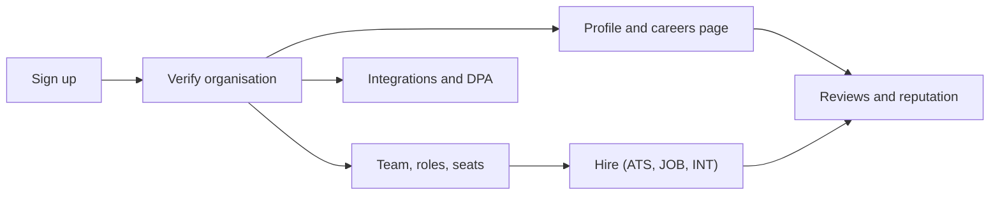
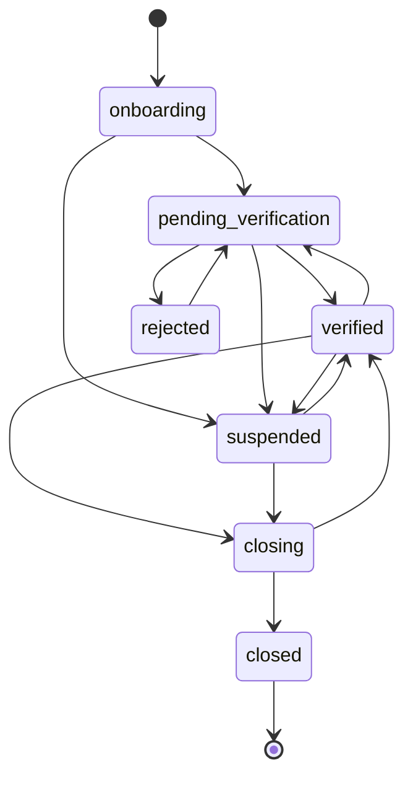
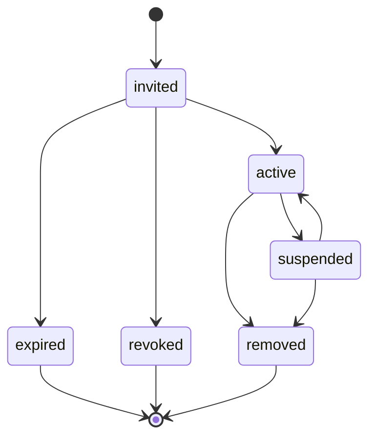
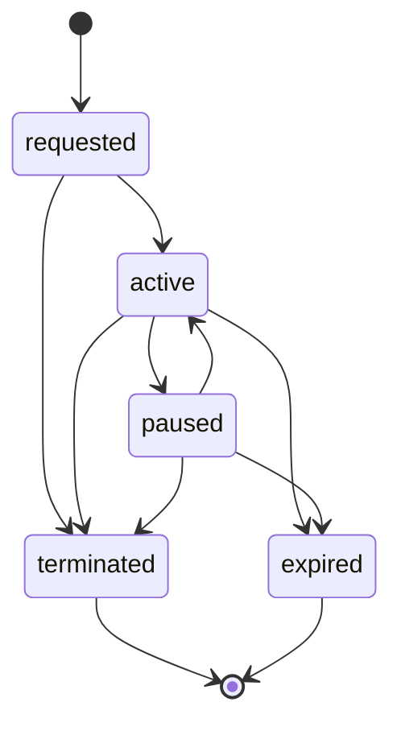
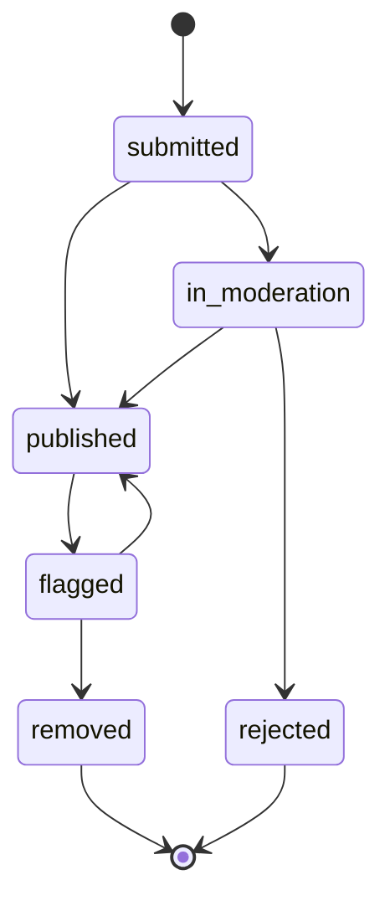
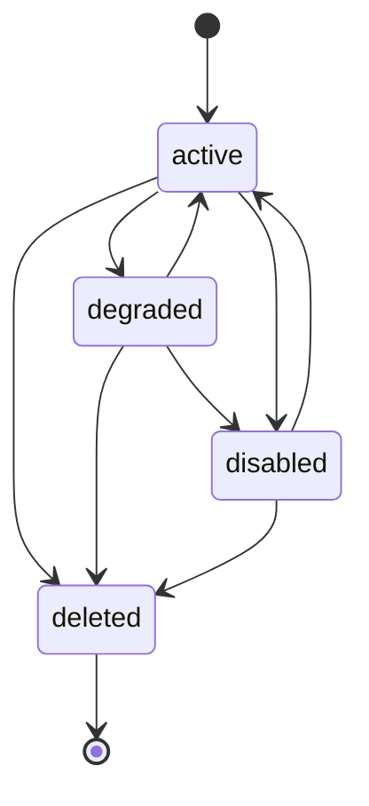
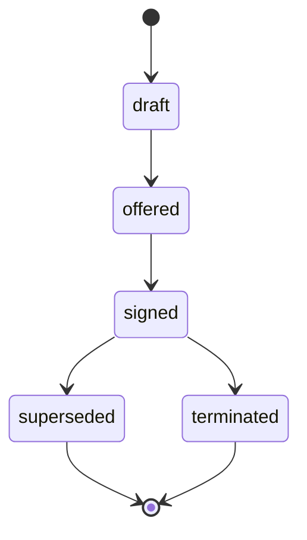
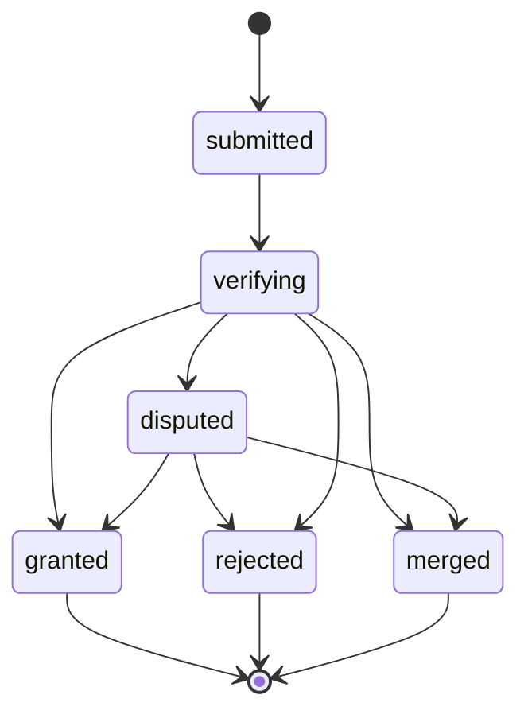
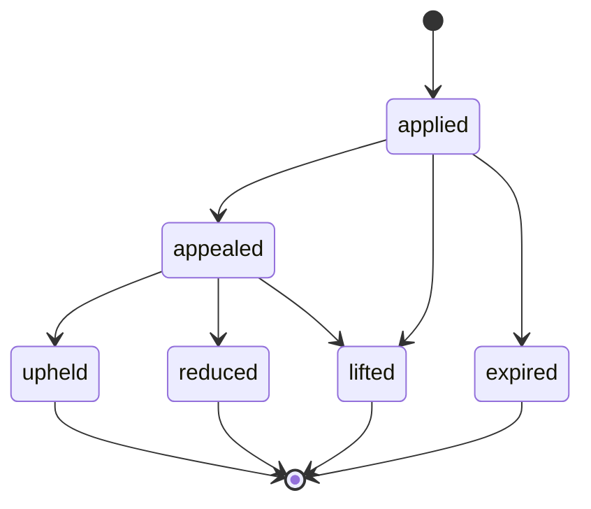
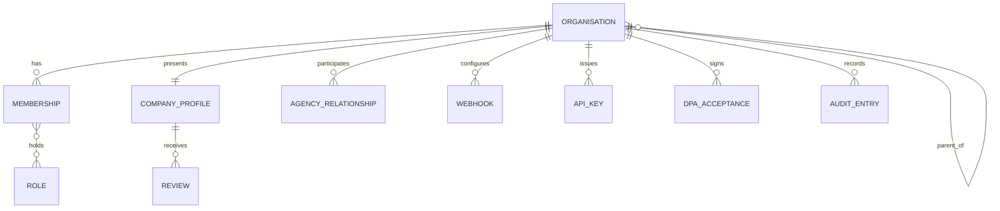

# EMP — Employer Organisation, Teams & Brand

> Status: intended product specification. Nothing in this file claims anything is built. See [CONVENTIONS](../README.md#blueprint-conventions).

## 1. Purpose, outcomes and boundaries

### 1.1 Purpose

EMP is the tenant model for everyone who hires on TalentSphere. It creates and verifies the employer organisation, holds the company profile and careers page that candidates see, manages teams, seats, roles and approvals, supports agencies hiring on behalf of clients, hosts moderated employer reviews and reputation, and exposes the commercial, legal and integration hooks (billing entitlements, data-processing agreements, webhooks, ATS connectors, SSO). It is where trust in an employer is established before any job is published. [SRC: SSOT F-56 Organization and Institution Pages, F-75 Employer Insights, BR-036, BR-062, BR-080, BR-136..138] [DER]

### 1.2 Outcomes

| Outcome                                      | How the system knows                                                        |
| -------------------------------------------- | --------------------------------------------------------------------------- |
| Only real employers publish jobs             | Share of live jobs from verified organisations; scam listings per 1,000     |
| An employer is productive within one session | Time from sign-up to first published job                                    |
| Access is least-privilege and auditable      | Zero cross-tenant access; every permission change logged                    |
| Candidates see an honest employer picture    | Verified profile, moderated reviews, reputation shown only with enough data |
| Employers can integrate with their stack     | Webhook delivery success rate; connector health                             |

### 1.3 Boundaries

| In scope (owned by EMP)                                                                              | Out of scope                                                           | Consumed                                     |
| ---------------------------------------------------------------------------------------------------- | ---------------------------------------------------------------------- | -------------------------------------------- |
| Org accounts, verification, profile, public page, careers page, brand media, widgets, claims         | Job content and pipeline (ATS), listings (JOB)                         | Postings and jobs from ATS and JOB           |
| Members, invitations, seats, roles, departments, locations, sub-orgs, approval policy, hiring policy | Identity, passwords, MFA mechanics (IDN planned)                       | Authentication and sessions                  |
| Agencies and client relationships                                                                    | Plans, prices, invoices, payment (BIL planned)                         | Entitlements and subscription state from BIL |
| Employer reviews, responses, candidate-experience ratings, reputation                                | Moderation decisions and trust enforcement (TSF planned)               | Moderation and sanctions from TSF            |
| DPA, compliance documents, webhooks, connectors, API keys, SSO and SCIM, security settings, audit    | Platform public API gateway (PLT planned)                              | Gateway and delivery infrastructure          |
| Notification preferences, brand analytics, export and closure                                        | Notification delivery (NTF planned), analytics warehouse (ANL planned) | Delivery, warehouse                          |

EMP is the owner of the `organization_id` tenant boundary used by ATS, INT and JOB. [SRC: BR-080] [DER]

## 2. Roles and permission matrix

Legend: Y allowed, O own records, A audited, N not allowed. Org role names map to the canonical roles: `EAD` Employer Admin, `REC` Recruiter, `HMG` Hiring Manager. Other employer-side roles (Coordinator, Interviewer, Approver, Billing contact, Brand editor, Agency recruiter) are custom or built-in org roles in FR-EMP-012.

| Capability                              | EAD | REC            | HMG | Brand editor | Billing contact | CAN                        | MOD       | PAD             | SUP    |
| --------------------------------------- | --- | -------------- | --- | ------------ | --------------- | -------------------------- | --------- | --------------- | ------ |
| Create org, submit verification         | Y   | N              | N   | N            | N               | N                          | N         | Review A        | Assist |
| Edit company profile and careers page   | Y   | N              | N   | Y            | N               | N                          | N         | Edit with audit | N      |
| Invite and remove members, assign roles | Y   | N              | N   | N            | N               | N                          | N         | A               | N      |
| Manage seats and billing                | Y   | N              | N   | N            | Y               | N                          | N         | A               | Assist |
| Configure approval and hiring policies  | Y   | N              | N   | N            | N               | N                          | N         | N               | N      |
| Create sub-orgs, agency relationships   | Y   | N              | N   | N            | N               | N                          | N         | A               | N      |
| Post employer reviews                   | N   | N              | N   | N            | N               | Verified relationship only | N         | N               | N      |
| Respond to reviews                      | Y   | Y (if granted) | N   | Y            | N               | N                          | N         | N               | N      |
| Moderate reviews                        | N   | N              | N   | N            | N               | N                          | Y, A      | Y, A            | N      |
| Manage webhooks, API keys, SSO          | Y   | N              | N   | N            | N               | N                          | N         | N               | N      |
| View audit log                          | Y   | Own            | Own | N            | N               | N                          | N         | A               | A      |
| Sign DPA                                | Y   | N              | N   | N            | N               | N                          | N         | N               | N      |
| Suspend, restore org                    | N   | N              | N   | N            | N               | N                          | Recommend | Y, A            | N      |

## 3. Sub-module map

| Code | Sub-module                  | Features                                  |
| ---- | --------------------------- | ----------------------------------------- |
| A    | Onboarding and verification | FR-EMP-001 to 003                         |
| B    | Profile, brand and careers  | FR-EMP-004 to 009                         |
| C    | Teams and access            | FR-EMP-010 to 015                         |
| D    | Structure and agencies      | FR-EMP-016 to 018                         |
| E    | Reviews and reputation      | FR-EMP-019 to 022, FR-EMP-034, FR-EMP-035 |
| F    | Commercial and legal        | FR-EMP-023, 024                           |
| G    | Integrations                | FR-EMP-025 to 027                         |
| H    | Security and trust          | FR-EMP-028 to 030                         |
| I    | Operations                  | FR-EMP-031 to 033                         |

## 4. Feature specifications

### Sub-module A: Onboarding and verification

### FR-EMP-001 — Employer sign-up and onboarding wizard

- **Sub-module:** A Onboarding
- **Priority / tier:** Must · R2
- **Source:** [SRC: SSOT F-05 recruiter journeys; BR-036] [DER]
- **Purpose and outcome:** A recruiter creates an employer organisation and reaches first value quickly; success is a created org with an owner and a started verification.
- **Roles and permissions:** `GUE: start` · `New owner (becomes EAD)` · `PAD: monitor funnel`
- **Preconditions and entry points:** `/employers/start` from marketing pages and "Post a job"; the person has or creates a verified account (IDN planned) with a work email.
- **User interactions and actions:** 1) Choose account type: Employer, Agency, Institution (redirects to INS planned). 2) Enter company name, website, country, company size band, industry, work email. 3) Verify the work email by link. 4) Accept terms and data-processing notice. 5) Complete checklist: add logo and description, invite teammates, start verification (FR-EMP-002), create first requisition. 6) Skip steps; resume later from a persistent checklist.
- **System behaviour:** Creates organisation in `onboarding` (SM-EMP-01) with the user as owner EAD. Free-mail addresses (public email domains) are not accepted as the work email for employer accounts; users get an explanation and may continue with a domain-verified alternative or contact support. Suggests existing unclaimed company profiles that match name or domain to claim (FR-EMP-009) instead of duplicating. Unverified orgs are limited: draft postings only until verification or accelerated review result (BR-EMP-002). Wizard state persists.
- **UI elements and controls:** Multi-step form, progress checklist, company name typeahead showing existing profiles, "This is my company" claim link, Terms checkbox (required).
- **Configuration options:** Platform: blocked email domain list, org size bands, unverified limits.
- **Business rules:** BR-EMP-001, BR-EMP-002, BR-EMP-010
- **Validation:** Company name 2 to 120 chars; website https URL; country ISO 3166; work email on a non-free domain matching the website domain unless verification overrides.
- **Inputs and outputs:** In: company details, email. Out: organisation record, owner membership, checklist.
- **Filters, sorting, search:** n/a — wizard.
- **Notifications and communication:** Email verification `emp.onboarding.verify_email`; welcome `emp.onboarding.welcome`; nudges at 2 and 7 days if checklist incomplete, class product_updates.
- **Error handling and edge cases:** Email already used by a member of another org: ask to join that org (request access) instead. Duplicate company name: shows candidates for claim. Verification email not received: resend with 60-second cooldown, max 5 per hour.
- **Dependencies:** IDN (planned), FR-EMP-002, FR-EMP-009, ENT-EMP-01.
- **Security and privacy:** Bot protection on sign-up; rate limits; no password handling here.
- **Acceptance criteria:**
  - Given a valid work email, When the wizard completes step 3, Then an organisation in `onboarding` exists with the user as owner.
  - Given a free-mail address, When submitting, Then the form explains and does not create the org.
  - Given an existing unclaimed profile with the same domain, When entering the company, Then the claim option is offered.
  - Negative: Given the verification link is expired, When clicked, Then no org is activated and a resend option is shown.

### FR-EMP-002 — Organisation verification

- **Sub-module:** A Verification
- **Priority / tier:** Must · R2
- **Source:** [SRC: BR-036 jobs require approved org + verified owner; BR-062 accelerated approval] [DER]
- **Purpose and outcome:** Prove the organisation is real and the applicant is authorized; success is the `verified` badge and unrestricted publishing.
- **Roles and permissions:** `EAD: submit` · `PAD: review, approve, reject (A)` · `MOD: advise`
- **Preconditions and entry points:** Checklist step; `/employers/verification`.
- **User interactions and actions:** 1) Prove domain control: add a DNS TXT record or confirm via an email to an address at the domain (admin@, hr@, or the owner's verified work email). 2) Provide legal name, registration number and country, registered address, and optionally upload a registry extract or incorporation certificate (PDF, up to 10 MB). 3) Optionally connect a business registry check (where available). 4) Submit. 5) Track status; respond to "More information needed".
- **System behaviour:** SM-EMP-01. Automatic checks: domain control, registry lookup where an open registry exists, sanction and risk screening via provider (BGV planned), age of domain, duplicates with other orgs. Low-risk orgs with domain proof plus registry match are auto-verified; others go to a PAD queue with a 2 business day target [PROP]. Rejection returns reasons and allows resubmission with new evidence (max 3 per 30 days). Verified status is revalidated annually and on triggers (domain change, spike in reports). Verification documents are encrypted and visible only to PAD and the owner.
- **UI elements and controls:** Verification stepper, DNS instructions with copy buttons, document upload, status chip with text, "Add information" thread.
- **Configuration options:** Platform: auto-verification rules, review SLA, revalidation interval (12 months).
- **Business rules:** BR-EMP-002, BR-EMP-003, BR-EMP-004
- **Validation:** Registration number format per country; document type and size; domain must be the org website domain or a listed alternate.
- **Inputs and outputs:** In: evidence. Out: verification decision with reasons.
- **Filters, sorting, search:** PAD queue sorted by risk then age.
- **Notifications and communication:** `emp.verification.submitted`, `.approved`, `.rejected`, `.info_requested`; class transactional.
- **Error handling and edge cases:** DNS propagation delay: re-check button and automatic retries for 72 hours. Registry unavailable: manual review path. Domain ownership changes: automatic downgrade to `pending_verification` with notice and 14-day grace.
- **Dependencies:** BGV (planned), TSF (planned), ADM (planned) queue, ENT-EMP-02.
- **Security and privacy:** Documents encrypted and retained 12 months after decision; registry data minimized.
- **Acceptance criteria:**
  - Given DNS proof and a registry match, When submitted, Then the org becomes `verified` automatically.
  - Given a failed check, When reviewed, Then the owner sees reasons and can resubmit.
  - Given a domain transfer detected, When revalidation runs, Then the org moves to `pending_verification` with a 14-day grace.
  - Negative: Given a fourth resubmission within 30 days, When submitting, Then refused with the wait time.

### FR-EMP-003 — Recruiter identity and domain verification

- **Sub-module:** A Verification
- **Priority / tier:** Must · R2
- **Source:** [SRC: BR-036 verified owner] [PROP]
- **Purpose and outcome:** Ensure each recruiter belongs to the company; success is every member tied to a verified identity and domain.
- **Roles and permissions:** `EAD: manage` · `Members: verify own`
- **Preconditions and entry points:** Invitation acceptance; member profile.
- **User interactions and actions:** 1) New members verify their work email at an allowed org domain. 2) EAD can allow additional domains (subsidiaries) after proof. 3) EAD can approve exceptions for contractors with non-org emails (limited role, expiry date). 4) Members see their verification state; display name and job title shown on recruiter-contact points with their consent.
- **System behaviour:** Members from non-allowed domains are blocked unless exception; exception members are labelled "External" in the audit and on candidate-visible recruiter cards. Verified recruiter cards (name, title, company) appear on listings only if the org enables it. Domain list changes are audited. When a member leaves (email domain bounce or HR signal via SCIM), access is revoked.
- **UI elements and controls:** Domain list with verified chips, exception form (reason, expiry), member verification status column.
- **Configuration options:** Org: allowed domains; exceptions allowed (default off).
- **Business rules:** BR-EMP-004, BR-EMP-005
- **Validation:** Domain syntax; exception expiry within 12 months.
- **Inputs and outputs:** In: domains, exceptions. Out: member verification state.
- **Filters, sorting, search:** Members by verification state.
- **Notifications and communication:** Verification email to members; EAD alert on exception expiry.
- **Error handling and edge cases:** Shared mailboxes disallowed for member identity. Domain removed with active members: members flagged and given 14 days.
- **Dependencies:** FR-EMP-010, IDN (planned).
- **Security and privacy:** Domain evidence stored with org.
- **Acceptance criteria:**
  - Given an allowed domain, When a member verifies, Then they are marked verified.
  - Given an exception with expiry, When it passes, Then access is revoked automatically.
  - Negative: Given a free-mail invite without exception, When accepted, Then access is refused.

### Sub-module B: Profile, brand and careers

### FR-EMP-004 — Company profile editor

- **Sub-module:** B Profile
- **Priority / tier:** Must · R2
- **Source:** [SRC: SSOT F-56] [DER]
- **Purpose and outcome:** Maintain the factual company profile used on listings and public pages.
- **Roles and permissions:** `EAD, Brand editor: edit` · `All members: view`
- **Preconditions and entry points:** `/employers/profile`.
- **User interactions and actions:** 1) Edit: display name, legal name (read-only after verification), tagline (up to 120 chars), about (up to 3,000 chars rich text), industry (taxonomy), size band, founded year, headquarters and locations (FR-EMP-013), website, social links, languages, benefits list (taxonomy plus custom), diversity and inclusion statement, mission and values (up to 6), tech stack or tools (skills taxonomy), logo and cover image. 2) Preview public page. 3) Publish changes. 4) View change history.
- **System behaviour:** Changes to sensitive fields (display name, logo, website) re-enter lightweight moderation and may trigger lookalike checks (FR-EMP-029). Content is sanitized. Claims such as "Best employer" are not verified but prohibited content is scanned (BR-EMP-005). Profile completeness meter drives onboarding. History retained 12 versions.
- **UI elements and controls:** Sectioned form, rich-text, image croppers with alt text input, completeness meter, Preview, Publish.
- **Configuration options:** Org: profile visibility (public default), hide company size.
- **Business rules:** BR-EMP-005, BR-EMP-006
- **Validation:** Name 2 to 120; about up to 3,000; images PNG or JPG up to 5 MB, logo at least 200 px square; alt text required for images.
- **Inputs and outputs:** In: fields. Out: profile version.
- **Filters, sorting, search:** n/a.
- **Notifications and communication:** Moderation outcome notice if flagged.
- **Error handling and edge cases:** Moderation hold: previous version stays live. Logo contains offensive content: rejected with reason.
- **Dependencies:** FR-EMP-013, TSF (planned), ENT-EMP-03.
- **Security and privacy:** Public data; employee names not included without consent.
- **Acceptance criteria:**
  - Given a name change, When published, Then lookalike check runs and the old version stays live until clear.
  - Given an image without alt text, When saving, Then refused.
  - Negative: Given a user without edit rights, When saving, Then 403.

### FR-EMP-005 — Public company page

- **Sub-module:** B Profile
- **Priority / tier:** Must · R2
- **Source:** [SRC: SSOT F-56, F-75]
- **Purpose and outcome:** A public, search-indexed page where candidates learn about the employer and see jobs; success is candidate follows and applications from the page.
- **Roles and permissions:** `GUE, CAN: view` · `CAN: follow` · `EAD, Brand editor: manage`
- **Preconditions and entry points:** `/companies/:slug`; links from listings; search.
- **User interactions and actions:** 1) View header (logo, name, verified badge, tagline, location, size). 2) Tabs: About, Jobs, Life at the company (brand content), Reviews (FR-EMP-019), Interview experiences. 3) Follow (FR-JOB-039). 4) Share. 5) Report.
- **System behaviour:** Server-rendered with structured data (Organization). Unverified orgs show an "Unverified" label and no reviews; the page may be hidden from search until verified [PROP]. Shows reputation summary only when sample size allows (BR-EMP-024). Jobs tab lists live jobs from JOB. Slug unique and permanent with redirects on change.
- **UI elements and controls:** Header, tab bar, job list with filters, Follow button, rating summary with sample size, "Report this page".
- **Configuration options:** Org: show jobs tab, show reviews tab (reviews cannot be fully disabled for verified orgs [DEC-REQ OD-EMP-04]).
- **Business rules:** BR-EMP-006, BR-EMP-024
- **Validation:** Slug 3 to 60 chars, lowercase letters, digits, hyphens, not reserved.
- **Inputs and outputs:** In: slug. Out: rendered page.
- **Filters, sorting, search:** Jobs tab filters mirror JOB filters.
- **Notifications and communication:** n/a.
- **Error handling and edge cases:** Suspended org: page shows neutral notice, jobs hidden. Slug change: 301 from old slug for 12 months. Unknown slug: 404 with search.
- **Dependencies:** FR-JOB-039, FR-EMP-019, FR-EMP-022.
- **Security and privacy:** Public; no PII; follower count only with 10 or more.
- **Acceptance criteria:**
  - Given a verified org, When a guest opens the page, Then profile, jobs and reputation (if sample sufficient) show.
  - Given a slug change, When the old URL is opened, Then 301 to the new slug.
  - Negative: Given a suspended org, When the page is opened, Then jobs are not shown.

### FR-EMP-006 — Careers page

- **Sub-module:** B Careers page
- **Priority / tier:** Should · R5
- **Source:** [PROP] [SRC: Greenhouse and Lever hosted careers pages]
- **Purpose and outcome:** A branded careers site fed by live jobs, so employers can link to it from their own website; success is applications arriving from the careers page source.
- **Roles and permissions:** `EAD, Brand editor: design` · `All: view`
- **Preconditions and entry points:** `/employers/careers`; public at `careers.talentsphere.example/<slug>` or custom domain (FR-EMP-006 domain setup).
- **User interactions and actions:** 1) Choose theme (colors from palette tokens, fonts from allowed list), hero image or video, headline. 2) Arrange sections: About, Values, Teams, Benefits, Jobs, Locations, Testimonials, FAQ. 3) Add custom sections (rich text, image). 4) Choose job filters shown (department, location, type). 5) Set a custom domain: add CNAME record, verify, TLS is issued automatically. 6) Preview on desktop and mobile; publish.
- **System behaviour:** Page renders live jobs from JOB and apply flows through the platform. Custom domain verification via DNS, HTTPS enforced; removal restores default URL. SEO: sitemap, structured JobPosting data. Accessibility checker warns on contrast and alt text before publishing (BR-EMP-008). Source attribution `careers_page` applied to applications.
- **UI elements and controls:** Section list with reorder buttons and drag, theme editor with contrast ratio indicator, domain wizard, Preview, Publish, Unpublish.
- **Configuration options:** Org: custom domain, hide jobs by department.
- **Business rules:** BR-EMP-007, BR-EMP-008, BR-EMP-006
- **Validation:** Contrast ratio at least 4.5:1 for text; video URL from allowed providers or uploaded file; custom domain syntax.
- **Inputs and outputs:** In: layout, domain. Out: published careers page.
- **Filters, sorting, search:** Visitor filters per configuration.
- **Notifications and communication:** Domain verification status notices.
- **Error handling and edge cases:** DNS invalid: instructions and retry. TLS issuance failure: stays on default domain. No live jobs: friendly "No openings" with talent-network sign-up if enabled.
- **Dependencies:** FR-EMP-007, FR-JOB-003, PLT (planned) hosting.
- **Security and privacy:** Custom content sanitized; no third-party scripts allowed.
- **Acceptance criteria:**
  - Given a verified custom domain, When visited, Then the careers page serves over HTTPS.
  - Given text with contrast 3:1, When publishing, Then blocked with the failing element.
  - Given no live jobs, When viewed, Then the empty state renders.
  - Negative: Given a custom script block, When saving, Then rejected.

### FR-EMP-007 — Employer brand content

- **Sub-module:** B Brand
- **Priority / tier:** Should · R5
- **Source:** [PROP] [SRC: SSOT F-56] · also [SRC: SSOT §7 F-171 Employer Brand Management System]
- **Purpose and outcome:** Show what working there is like; success is richer pages and better-informed applicants.
- **Roles and permissions:** `EAD, Brand editor: create` · `Moderation by MOD`
- **Preconditions and entry points:** `/employers/brand`.
- **User interactions and actions:** 1) Add photo galleries, short videos (up to 2 minutes), team spotlights (employee name, role, quote, photo — requires the employee's consent), day-in-the-life posts, benefits detail, office tours, awards, events. 2) Provide alt text and captions. 3) Schedule publishing. 4) Archive.
- **System behaviour:** Media is scanned and moderated; employee spotlights require recorded consent from the featured person (revocable, removal within 24 hours) (BR-EMP-008). Videos are transcoded with captions required (auto-generated captions allowed, flagged for review). Claims of awards require a source link. Content appears on the company page and careers page.
- **UI elements and controls:** Content cards, upload dialog, consent request button for featured employees, schedule picker.
- **Configuration options:** Org: moderation queue before publish (default on for new orgs).
- **Business rules:** BR-EMP-008, BR-EMP-005
- **Validation:** Images up to 5 MB; video up to 100 MB; captions required; quote up to 300 chars.
- **Inputs and outputs:** In: media and text. Out: published content.
- **Filters, sorting, search:** Filter by type, status.
- **Notifications and communication:** Consent request to employee `emp.brand.consent_request`; moderation results.
- **Error handling and edge cases:** Consent withdrawn: content removed within 24 hours. Transcode failure: retry and notice.
- **Dependencies:** PLT (planned) media, TSF (planned).
- **Security and privacy:** Employee personal data only with consent.
- **Acceptance criteria:**
  - Given a spotlight, When the employee has not consented, Then it cannot publish.
  - Given consent withdrawn, When processed, Then the content is removed within 24 hours.
  - Negative: Given a video without captions, When publishing, Then refused.

### FR-EMP-008 — Embeddable job widget and jobs feed

- **Sub-module:** B Careers
- **Priority / tier:** Could · R5
- **Source:** [PROP]
- **Purpose and outcome:** Show live jobs on the employer's own website; success is traffic and applications from embeds.
- **Roles and permissions:** `EAD, Brand editor: configure`
- **Preconditions and entry points:** `/employers/embed`.
- **User interactions and actions:** 1) Choose widget type: list, single department, count badge. 2) Set filters, theme, number of items. 3) Add allowed origins. 4) Copy the snippet (script tag or iframe). 5) Optionally enable a JSON/XML jobs feed for site generators.
- **System behaviour:** Widget serves only published jobs, checks origin against the allowlist, caches 5 minutes, and links to platform apply pages with source attribution `embed`. Feed is read-only with a token. No tracking cookies set on third-party sites; analytics only aggregate counts.
- **UI elements and controls:** Widget configurator with live preview, origin list, snippet with Copy, token regenerate.
- **Configuration options:** Org: origins, cache TTL.
- **Business rules:** BR-EMP-009
- **Validation:** Origins https; max 20 origins.
- **Inputs and outputs:** In: configuration. Out: snippet and feed URL.
- **Filters, sorting, search:** Widget filters.
- **Notifications and communication:** n/a.
- **Error handling and edge cases:** Origin mismatch: widget renders nothing and logs. Token leak: regenerate invalidates old.
- **Dependencies:** FR-JOB-001, FR-EMP-026.
- **Security and privacy:** No personal data in feed.
- **Acceptance criteria:**
  - Given an allowed origin, When the widget loads, Then jobs show.
  - Given a different origin, When loaded, Then nothing renders.
  - Negative: Given a regenerated token, When the old token is used, Then 401.

### FR-EMP-009 — Company claim and dispute

- **Sub-module:** B Claim
- **Priority / tier:** Should · R4
- **Source:** [PROP] [SRC: BR-244 verified alumni postings analog]
- **Purpose and outcome:** Let real employers take control of company pages created from imports or reviews; success is correct ownership without hijacking.
- **Roles and permissions:** `EAD (new or existing org): claim` · `PAD: resolve disputes (A)`
- **Preconditions and entry points:** "Is this your company? Claim" on unclaimed pages; import claim invitations (FR-JOB-037).
- **User interactions and actions:** 1) Start claim. 2) Prove domain control (FR-EMP-002). 3) If the page is already claimed, "Dispute ownership" with evidence. 4) PAD reviews both sides (7 days). 5) Outcome: claim granted, rejected, or both merged.
- **System behaviour:** Claim converts the unclaimed profile into the org's profile, keeping imported listings and reviews intact. Disputes lock changes to sensitive fields during review. Merge of duplicate company profiles moves jobs, followers, reviews to the surviving profile and redirects slugs.
- **UI elements and controls:** Claim banner, dispute form with evidence upload, status tracker.
- **Configuration options:** Platform: dispute SLA.
- **Business rules:** BR-EMP-010, BR-EMP-003
- **Validation:** Domain proof required; evidence type and size.
- **Inputs and outputs:** In: claim, evidence. Out: ownership decision.
- **Filters, sorting, search:** PAD queue.
- **Notifications and communication:** Parties notified of outcomes.
- **Error handling and edge cases:** Both parties prove control (parent and subsidiary): resolved via sub-org structure (FR-EMP-016). Competing claims: first verified within window gets provisional rights.
- **Dependencies:** FR-EMP-002, FR-EMP-016, ENT-EMP-04.
- **Security and privacy:** Evidence confidential.
- **Acceptance criteria:**
  - Given a claim with domain proof, When approved, Then the profile becomes the org's with imported listings retained.
  - Given an existing owner, When a second org disputes, Then sensitive edits are locked.
  - Negative: Given a claim without domain proof, When submitted, Then refused.

### Sub-module C: Teams and access

### FR-EMP-010 — Team invitations and member lifecycle

- **Sub-module:** C Teams
- **Priority / tier:** Must · R2
- **Source:** [SRC: BR-040, BR-078 role boundaries] [DER]
- **Purpose and outcome:** Add and remove people safely; success is access that matches employment and responsibility.
- **Roles and permissions:** `EAD: invite, change, suspend, remove` · `Members: leave` · `PAD: assist (A)`
- **Preconditions and entry points:** `/employers/team`.
- **User interactions and actions:** 1) Click Invite; enter one or many emails (up to 50), choose role and (optionally) job-level access, custom message. 2) Invitee receives a link, signs in or creates an account, verifies email, accepts. 3) EAD edits role, suspends (temporary), reactivates, or removes a member with reassignment of their jobs, candidates and scorecards. 4) Member requests access via company domain ("Ask to join"); EAD approves.
- **System behaviour:** Invitations are single-use, expire in 7 days, are tied to the invited email, and can be revoked (SM-EMP-02). Domain rules per FR-EMP-003. Seat availability checked at acceptance (FR-EMP-011). Removal triggers a reassignment wizard: owned requisitions and jobs go to a chosen member, open scorecards are waived or reassigned, calendar connection tokens revoked, webhooks and API keys created by the member are reviewed. The last EAD cannot be removed or demoted (BR-EMP-013). All actions audited (FR-EMP-028).
- **UI elements and controls:** Team table with role chips and status, Invite dialog, bulk invite textarea, Resend, Revoke, Suspend, Remove with reassignment wizard.
- **Configuration options:** Org: invitation expiry (7 days), self-join requests allowed (default off).
- **Business rules:** BR-EMP-011, BR-EMP-012, BR-EMP-013, BR-EMP-014
- **Validation:** Valid emails; not already a member; role exists; max 50 per batch; max 200 pending invites.
- **Inputs and outputs:** In: invites and changes. Out: membership records.
- **Filters, sorting, search:** Filter by role, status, department; search by name or email.
- **Notifications and communication:** `emp.member.invited`, `.accepted`, `.removed`; class transactional.
- **Error handling and edge cases:** Expired link: resend. Invitee already in another org: allowed as multi-org member with org switcher. Removal of a member with pending approvals: approvals reassigned to EAD. Seat exhausted: invite allowed but acceptance waits for a seat with message.
- **Dependencies:** FR-EMP-003, FR-EMP-011, FR-EMP-012, IDN (planned), ENT-EMP-05.
- **Security and privacy:** Invitation tokens hashed; removal revokes sessions for that org within 1 minute.
- **Acceptance criteria:**
  - Given a valid invite, When the invitee accepts, Then membership is `active` with the chosen role.
  - Given a member removed, When the wizard completes, Then their jobs are reassigned and their sessions for the org end.
  - Given the last EAD, When removing them, Then refused.
  - Negative: Given an expired invitation, When clicked, Then no membership is created.

### FR-EMP-011 — Seat management

- **Sub-module:** C Teams
- **Priority / tier:** Must · R5
- **Source:** [SRC: BR-072..075 seat consumption analogs for institutions] [PROP]
- **Purpose and outcome:** Control paid seats used by members; success is no overselling and no surprise access.
- **Roles and permissions:** `EAD, Billing contact: manage` · `PAD: adjust (A)`
- **Preconditions and entry points:** `/employers/seats`; entitlement from BIL (planned).
- **User interactions and actions:** 1) See seats purchased, used, free, by role type (full recruiter seat, hiring manager seat (free or limited), interviewer (no seat)). 2) Assign or release a seat. 3) Request more seats (opens BIL purchase). 4) See a waitlist of members pending a seat.
- **System behaviour:** Seat entitlement is read from BIL; assignment is atomic so the last seat never oversells [SRC: BR-074 pattern]. Releasing returns it immediately to the pool; the member keeps read-only access to their past work for 7 days [PROP, analogous BR-073]. Downgrade below used seats: EAD must release seats within a grace period of 14 days or the system suspends the most recently added members. Hiring managers and interviewers participate without a paid seat but with limited permissions (OD-EMP-02).
- **UI elements and controls:** Seat meter, member table with Assign/Release, Waitlist, Buy more link.
- **Configuration options:** Plan-driven; org: auto-assign seat on invite acceptance (default on).
- **Business rules:** BR-EMP-012, BR-EMP-027
- **Validation:** Assignment requires a free seat and an eligible role.
- **Inputs and outputs:** In: assign or release. Out: seat state.
- **Filters, sorting, search:** Members by seat type.
- **Notifications and communication:** `emp.seats.low` at 90 percent used; `emp.seats.downgrade_grace`.
- **Error handling and edge cases:** Concurrent assignments on last seat: one succeeds, other gets waitlisted. BIL outage: cached entitlement for 24 hours then read-only for new assignments.
- **Dependencies:** BIL (planned), FR-EMP-023, ENT-EMP-06.
- **Security and privacy:** Billing role sees counts, not candidate data.
- **Acceptance criteria:**
  - Given one free seat and two simultaneous assignments, When both run, Then exactly one succeeds.
  - Given a downgrade, When used seats exceed the new total, Then a 14-day grace banner appears.
  - Negative: Given an interviewer role, When assigning a seat, Then refused as not required.

### FR-EMP-012 — Roles and permissions inside the organisation

- **Sub-module:** C Teams
- **Priority / tier:** Must · R2
- **Source:** [SRC: BR-08, BR-09, BR-078] [DER]
- **Purpose and outcome:** Give people exactly the access they need; success is least-privilege everywhere.
- **Roles and permissions:** `EAD: manage roles` · `All: view own permissions`
- **Preconditions and entry points:** `/employers/roles`.
- **User interactions and actions:** 1) See built-in roles: Employer Admin, Recruiter, Coordinator, Hiring Manager, Interviewer, Approver, Brand editor, Billing contact, Agency recruiter, Read-only analyst. 2) Clone a role to create a custom role: choose permissions from a catalog grouped by module (jobs, applications, scorecards, offers, sourcing, reports, brand, billing, integrations, team). 3) Set scope: all jobs, own jobs, department jobs, assigned jobs. 4) Assign to members. 5) View permission diff before saving.
- **System behaviour:** Authorization is evaluated as (role permissions) AND (scope) AND (job team membership for candidate data, ATS BR-ATS-040). Custom roles cannot grant a permission the creator lacks, cannot grant integrations or DPA signing unless the creator is EAD, and cannot remove the EAD capabilities from the owner. Permission changes take effect on the next request, sessions are not trusted with cached permissions beyond 60 seconds (BR-EMP-014). Billing contact has no candidate data access (BR-078 analogy: faculty and proctors hold no billing rights).
- **UI elements and controls:** Role list, permission matrix with search, scope selects, diff view, Assign.
- **Configuration options:** Org: max custom roles 20.
- **Business rules:** BR-EMP-013, BR-EMP-014
- **Validation:** Role name 3 to 50 chars; at least one permission; no privilege escalation.
- **Inputs and outputs:** In: role definition. Out: role and assignments.
- **Filters, sorting, search:** Permission search.
- **Notifications and communication:** Members notified of role change.
- **Error handling and edge cases:** Deleting a role in use: must reassign first. Conflicting role assignments: union of permissions with a visible "effective permissions" view.
- **Dependencies:** FR-ATS-028, ENT-EMP-07.
- **Security and privacy:** Change log; periodic access review reminder every 6 months [PROP].
- **Acceptance criteria:**
  - Given a custom role without offers permission, When the member opens an offer, Then 403.
  - Given an attempt to grant a permission the creator lacks, When saving, Then refused.
  - Given a role change, When the member next acts, Then new permissions apply within 60 seconds.
  - Negative: Given deletion of a role still assigned, When confirming, Then blocked.

### FR-EMP-013 — Departments, locations and cost centres

- **Sub-module:** C Teams
- **Priority / tier:** Should · R2
- **Source:** [PROP]
- **Purpose and outcome:** Structure the org for routing, permissions and reporting; success is requisitions and jobs tagged consistently.
- **Roles and permissions:** `EAD: manage` · `Others: view`
- **Preconditions and entry points:** `/employers/structure`.
- **User interactions and actions:** 1) Add departments (hierarchy up to 4 levels), offices (address, time zone, country, accessibility info), remote regions, cost centres (code, name). 2) Assign department heads and default approvers. 3) Import via CSV with dry-run preview. 4) Archive items.
- **System behaviour:** Departments and locations are pickers across ATS and INT. Archiving keeps history. Imports require a preview and show errors per row; no silent partial import [SRC: BR-077 principle]. Office time zones feed INT defaults and location data feeds JOB filters.
- **UI elements and controls:** Tree editor, location form with map preview, CSV import with preview table.
- **Configuration options:** Org: required fields per object.
- **Business rules:** BR-EMP-016, BR-EMP-017
- **Validation:** Names unique among siblings; codes unique; address valid; time zone valid IANA.
- **Inputs and outputs:** In: structure data. Out: org structure records.
- **Filters, sorting, search:** Search by name or code.
- **Notifications and communication:** n/a.
- **Error handling and edge cases:** Archiving a department with open requisitions: requires reassignment. Import with invalid rows: none imported until fixed or user excludes rows explicitly.
- **Dependencies:** ENT-EMP-08.
- **Security and privacy:** Office addresses are company data; public only when chosen.
- **Acceptance criteria:**
  - Given a CSV with 3 invalid rows, When previewing, Then errors list them and nothing is imported until resolved or excluded.
  - Given an archived department, When creating a requisition, Then it is not offered.
  - Negative: Given a duplicate sibling name, When saving, Then refused.

### FR-EMP-014 — Approval policy configuration

- **Sub-module:** C Teams
- **Priority / tier:** Must · R2
- **Source:** [PROP] (consumed by FR-ATS-002, FR-ATS-037, FR-ATS-008)
- **Purpose and outcome:** Define who must approve requisitions, offers and postings; success is the right chain applied automatically.
- **Roles and permissions:** `EAD: configure`
- **Preconditions and entry points:** `/employers/approvals`.
- **User interactions and actions:** 1) Create a policy per object type (requisition, offer, job posting). 2) Define rules: conditions (department, level, location, budget or comp threshold, out-of-band flag) mapped to ordered steps; each step lists approvers (by person or role) and minimum count; timeouts; delegation allowed. 3) Test policy against sample objects. 4) Publish new version.
- **System behaviour:** Policies are versioned; changes apply to new requests only; in-flight approvals keep their snapshot (BR-EMP-015). Ambiguous matching resolves by priority order. Policy simulation shows which chain a sample would trigger. A policy must always resolve to at least one approver who is not the requester; otherwise saving is blocked.
- **UI elements and controls:** Rule builder, step editor, simulator, version history.
- **Configuration options:** Defaults: requisition requires department head; offer requires hiring manager and EAD above threshold; posting requires none for verified orgs.
- **Business rules:** BR-EMP-015, BR-ATS-003 (consumed)
- **Validation:** Each step at least one eligible approver; timeout 1 to 14 business days.
- **Inputs and outputs:** In: policy. Out: versioned policy.
- **Filters, sorting, search:** n/a.
- **Notifications and communication:** Policy change notice to approvers affected.
- **Error handling and edge cases:** Approver removed: policy flags "needs approver" and fallback to EAD. Circular delegation: blocked.
- **Dependencies:** FR-ATS-002, FR-ATS-037, ENT-EMP-09.
- **Security and privacy:** Audit.
- **Acceptance criteria:**
  - Given a threshold rule at 150000, When an offer is 160000, Then the extra step appears.
  - Given a published new version, When an old request is in flight, Then it keeps its original chain.
  - Negative: Given a step with no eligible approver, When saving, Then refused.

### FR-EMP-015 — Organisation hiring policies

- **Sub-module:** C Teams
- **Priority / tier:** Should · R2
- **Source:** [SRC: BR-045, BR-224] [PROP]
- **Purpose and outcome:** Set org-wide defaults and guardrails used by ATS, INT and JOB; success is consistent practice without per-job reconfiguration.
- **Roles and permissions:** `EAD: configure`
- **Preconditions and entry points:** `/employers/policies`.
- **User interactions and actions:** 1) Set defaults: rejection message delay, requirement to send rejection messages, blind screening default, scorecard blind review, retention periods, recording policy and retention, AI-assist features enabled, outreach caps, offer expiry, response-time targets shown to candidates, "Viewed" signal. 2) See platform minimum and maximum next to each. 3) Save with a change reason.
- **System behaviour:** Values must lie within platform bounds (for example retention 6 to 36 months). Per-job overrides allowed only where the policy permits. Policies versioned and audited; changes apply to new objects unless "apply to existing open items" is chosen with preview.
- **UI elements and controls:** Policy form with bound hints, Reason field, Apply to existing checkbox with impact preview.
- **Configuration options:** As listed.
- **Business rules:** BR-EMP-017, BR-EMP-033
- **Validation:** Within platform bounds.
- **Inputs and outputs:** In: policy values. Out: policy version.
- **Filters, sorting, search:** n/a.
- **Notifications and communication:** Notice to team leads on material changes.
- **Error handling and edge cases:** Value outside bounds: refused with allowed range. Conflicting with a legal requirement of a location: location rule wins and the UI explains.
- **Dependencies:** FR-ATS-044, FR-INT-021, FR-ATS-047.
- **Security and privacy:** Audited.
- **Acceptance criteria:**
  - Given retention 60 months, When saving, Then refused with allowed range 6 to 36.
  - Given a policy change with Apply to existing, When confirmed, Then the preview count matches affected jobs.
  - Negative: Given a change without a reason, When saving, Then refused.

### Sub-module D: Structure and agencies

### FR-EMP-016 — Sub-organisations and brands

- **Sub-module:** D Structure
- **Priority / tier:** Should · R5
- **Source:** [PROP] [SRC: BR-080 org scoping]
- **Purpose and outcome:** Run subsidiaries or brands under a parent while controlling data sharing; success is clean separation and shared governance.
- **Roles and permissions:** `Parent EAD: create and manage children` · `Child EAD: manage within child`
- **Preconditions and entry points:** `/employers/organisations`; parent verified.
- **User interactions and actions:** 1) Create a child organisation (name, brand, domain list, locations). 2) Choose inheritance: policies, templates, roles, integrations, billing. 3) Choose data sharing: isolated (default), shared candidate pool (with candidate notice), parent read-only reporting. 4) Switch between orgs with the org switcher. 5) Detach a child into an independent org.
- **System behaviour:** Each child has its own `organization_id`; data is isolated unless sharing is explicitly on (BR-EMP-016). Billing and seats can be pooled via the parent. Child profiles and careers pages are independent. Cross-org candidate sharing requires lawful basis and candidate notice. Parent reporting shows aggregates only unless granted.
- **UI elements and controls:** Org tree, inheritance toggles, data-sharing select, switcher, Detach with warnings.
- **Configuration options:** Per child: inheritance and sharing.
- **Business rules:** BR-EMP-016, BR-EMP-017
- **Validation:** Child names unique under parent; max depth 3; verification per child or inherited from parent per rule.
- **Inputs and outputs:** In: child definition. Out: organisation tree.
- **Filters, sorting, search:** Tree search.
- **Notifications and communication:** Members of child orgs notified of structure changes.
- **Error handling and edge cases:** Detach with shared pool: sharing ends and data stays with originating org. Parent suspended: children not automatically suspended unless flagged.
- **Dependencies:** FR-EMP-002, FR-EMP-023, ENT-EMP-10.
- **Security and privacy:** Isolation tests per tenant boundary.
- **Acceptance criteria:**
  - Given isolated mode, When a parent recruiter queries child candidates, Then none are returned.
  - Given shared pool enabled, When a candidate is added to the pool, Then the candidate receives a notice.
  - Negative: Given depth 4, When creating, Then refused.

### FR-EMP-017 — Agency accounts and client relationships

- **Sub-module:** D Agencies
- **Priority / tier:** Could · R5
- **Source:** [PROP] [SRC: FR-ATS-035]
- **Purpose and outcome:** Allow recruitment agencies to hire on behalf of clients with clear permission and attribution.
- **Roles and permissions:** `Agency EAD: create relationships` · `Client EAD: approve, scope, terminate` · `PAD: arbitrate (A)`
- **Preconditions and entry points:** Agency org type verified (FR-EMP-002 with agency evidence); `/employers/clients`.
- **User interactions and actions:** 1) Agency invites a client (or client invites agency) by email. 2) Client EAD reviews terms: scope (all jobs, selected jobs), permissions (post jobs, view candidates, move stages, send offers), data-sharing rules, attribution window, expiry. 3) Both accept; relationship becomes active. 4) Client can pause or terminate at any time. 5) Renewals reminders.
- **System behaviour:** SM-EMP-03: requested, active, paused, terminated, expired. Agency access is limited to scope and defined permissions via agency roles (BR-EMP-018). Jobs posted by an agency show "Posted by <agency> on behalf of <client>" and the client verification state is displayed [DEC-REQ OD-EMP-05 on whether the client may remain anonymous]. Termination ends access immediately, returns client data per the DPA, and agency keeps only its own submitted candidates' records (BR-EMP-020).
- **UI elements and controls:** Client list, relationship form, scope picker, permission checklist, Pause/Terminate buttons.
- **Configuration options:** Per relationship as above; platform: allow client anonymity (off).
- **Business rules:** BR-EMP-018, BR-EMP-019, BR-EMP-020
- **Validation:** Both orgs verified; permissions from allowed set; expiry up to 24 months.
- **Inputs and outputs:** In: relationship terms. Out: relationship record.
- **Filters, sorting, search:** Filter by state.
- **Notifications and communication:** `emp.agency.requested`, `.activated`, `.terminated`; class transactional.
- **Error handling and edge cases:** Client suspended: relationship paused. Agency suspended: all client jobs from agency paused with notice to client. Overlapping agencies on one job: allowed with attribution rules in ATS.
- **Dependencies:** FR-EMP-002, FR-ATS-035, ENT-EMP-11.
- **Security and privacy:** Least privilege; DPA required between parties for personal data (FR-EMP-024).
- **Acceptance criteria:**
  - Given an active relationship with scope selected jobs, When the agency opens a job outside scope, Then 404.
  - Given termination, When confirmed, Then agency access ends within 1 minute.
  - Negative: Given an unverified client, When requesting activation, Then refused.

### FR-EMP-018 — Agency workspace

- **Sub-module:** D Agencies
- **Priority / tier:** Could · R5
- **Source:** [PROP]
- **Purpose and outcome:** Let agency recruiters work across clients without data leakage; success is fast switching and clean attribution.
- **Roles and permissions:** `Agency recruiter: use` · `Client members: see agency attribution only`
- **Preconditions and entry points:** Agency org with active relationships; `/agency`.
- **User interactions and actions:** 1) Switch client context with a header selector (data never mixes in lists). 2) See jobs per client, submissions, placements, and pipeline of submitted candidates. 3) Submit candidates to client jobs (FR-ATS-035). 4) Track attribution windows and expected placements. 5) Report per client.
- **System behaviour:** Context-bound sessions: every request carries the client org context and is authorized against the relationship. Cross-client views show only agency-owned data (its own candidates and submissions), never client data of another client. Agency candidates pool (agency CRM) is the agency's own tenant data.
- **UI elements and controls:** Client switcher, client dashboard, submissions table, attribution timer chips.
- **Configuration options:** Agency: default permissions for new relationships.
- **Business rules:** BR-EMP-018, BR-EMP-019
- **Validation:** Context must be an active relationship.
- **Inputs and outputs:** In: client context. Out: scoped views.
- **Filters, sorting, search:** Per client.
- **Notifications and communication:** Placement milestones.
- **Error handling and edge cases:** Relationship paused mid-session: UI downgrades to read-only and informs. Switching clients with unsaved forms: prompts.
- **Dependencies:** FR-EMP-017, FR-ATS-035.
- **Security and privacy:** No cross-client joins; audited.
- **Acceptance criteria:**
  - Given client A context, When listing candidates, Then client B data is absent.
  - Given a paused relationship, When the agency views the client, Then actions are disabled.
  - Negative: Given a request with a forged client id, When made, Then 404.

### Sub-module E: Reviews and reputation

### FR-EMP-019 — Employer reviews (candidate and employee submitted, moderated)

- **Sub-module:** E Reviews
- **Priority / tier:** Should · R4
- **Source:** [SRC: SSOT F-75 Employer Insights; BR-136 anonymous reviews, BR-137 company responses, BR-138 interview questions moderated] [DER]
- **Purpose and outcome:** Give candidates honest insight into employers while protecting reviewers and employers from abuse; success is trusted, representative reviews.
- **Roles and permissions:** `CAN/STD/FRL with verified relationship: submit` · `MOD: moderate (A)` · `EAD: respond, flag` · `GUE: read`
- **Preconditions and entry points:** "Write a review" on company page; prompts after employment verification (EVD planned) or after a closed application (FR-EMP-021).
- **User interactions and actions:** 1) Choose relationship: Employee (current or former, verified via EVD or work email domain), Interviewee or applicant (verified by an application or interview with this org on the platform), Contractor. 2) Rate overall and categories (work-life balance, compensation and benefits, culture, management, career growth, diversity and inclusion) 1 to 5. 3) Write pros, cons, advice (each 20 to 2,000 chars), job title, tenure band, location. 4) Choose to post anonymously (default) or with display name. 5) Accept community guidelines. 6) Submit; see status.
- **System behaviour:** Eligibility by verified relationship; one review per relationship per 12 months (BR-EMP-021). Reviews pass automated checks (profanity, personal data, threats, doxxing, confidential information, copied text) then human moderation for flagged items (SM-EMP-04). Anonymous reviews hide identity from the employer and public but not from PAD and legal process [SRC: BR-136] (BR-EMP-022). Employers cannot delete or edit reviews; they can respond (FR-EMP-020) or flag a review for moderation (BR-EMP-025). Reviews appear on the company page only after publication; the org's reputation computed per FR-EMP-022. Interview experiences (questions and process) follow the same flow with the rule that question text is moderated before public display [SRC: BR-138].
- **UI elements and controls:** Review form with star inputs (keyboard operable), counters, anonymity toggle with explanation, guidelines checkbox, status page "In review, Published, Not published (reason)".
- **Configuration options:** Platform: categories, tenure bands, minimum text length, moderation thresholds.
- **Business rules:** BR-EMP-021, BR-EMP-022, BR-EMP-025
- **Validation:** Text lengths; ratings 1 to 5 all required for overall; relationship proof; no URLs or emails in text.
- **Inputs and outputs:** In: review. Out: review record, moderation status.
- **Filters, sorting, search:** Public: filter by role, location, tenure, relationship; sort by most recent, most helpful, rating high or low.
- **Notifications and communication:** Reviewer: `emp.review.published` or `.rejected`; employer EAD digest of new reviews (weekly) class workflow.
- **Error handling and edge cases:** Duplicate within 12 months: refused with link to edit own review. Reviewer deletes account: anonymized review remains unless requested removal. Coordinated review bombing: velocity checks hold new reviews for moderator review.
- **Dependencies:** TSF (planned), EVD (planned), FR-EMP-021, ENT-EMP-12.
- **Security and privacy:** Reviewer identity encrypted separately; employer never receives identity; legal disclosure only via formal process.
- **Acceptance criteria:**
  - Given a candidate with a closed application at the org, When they submit a valid review, Then it is `in_moderation` then publishable.
  - Given an anonymous review, When the employer views it, Then no reviewer attribute beyond role and tenure band is visible.
  - Given a second review for the same relationship within 12 months, When submitting, Then refused.
  - Negative: Given a person with no relationship, When submitting, Then refused.

### FR-EMP-020 — Company responses to reviews

- **Sub-module:** E Reviews
- **Priority / tier:** Should · R4
- **Source:** [SRC: BR-137 company responses appended, never edit original]
- **Purpose and outcome:** Employers reply publicly and professionally; success is balanced context next to reviews.
- **Roles and permissions:** `EAD, Brand editor, REC with permission: respond` · `MOD: moderate responses`
- **Preconditions and entry points:** Review on company page; employer reviews inbox.
- **User interactions and actions:** 1) Open a published review. 2) Write a response (up to 1,500 chars) as the company (shows responder's role, not personal name by default). 3) Submit; moderation if flagged. 4) Edit own response within 24 hours or add a follow-up. 5) Flag a review as violating guidelines with a reason (FR-EMP-019).
- **System behaviour:** Responses are appended to the review and never alter it [SRC]. One response plus one follow-up per review. Responses cannot contain identification attempts of the reviewer, retaliation or threats (scanned; blocked). Flags create moderation cases and do not hide the review during review unless it contains personal data or threats (then temporarily hidden).
- **UI elements and controls:** Response editor, Flag button with reason list, response status.
- **Configuration options:** Org: who may respond.
- **Business rules:** BR-EMP-023, BR-EMP-025
- **Validation:** 20 to 1,500 chars.
- **Inputs and outputs:** In: response text. Out: appended response.
- **Filters, sorting, search:** Inbox filter: unanswered, flagged.
- **Notifications and communication:** Reviewer notified of an employer response if they opted in.
- **Error handling and edge cases:** Attempt to guess identity: blocked and logged to MOD. Response after 12 months: allowed.
- **Dependencies:** FR-EMP-019.
- **Security and privacy:** No reviewer data exposure.
- **Acceptance criteria:**
  - Given a review, When the company responds, Then the original text is unchanged and the response is appended.
  - Given a response naming a suspected reviewer, When submitting, Then blocked.
  - Negative: Given a second follow-up beyond the limit, When posting, Then refused.

### FR-EMP-021 — Candidate experience ratings

- **Sub-module:** E Reviews
- **Priority / tier:** Should · R4
- **Source:** [SRC: F-122 Application Feedback Loop, F-75] [PROP]
- **Purpose and outcome:** Collect structured ratings of the hiring process from candidates after an outcome; success is measurable process quality and fair employer metrics.
- **Roles and permissions:** `CAN: submit` · `EAD, REC: view aggregates`
- **Preconditions and entry points:** Prompt in tracker after status Not selected, Withdrawn, Hired or offer declined; reminder email.
- **User interactions and actions:** 1) Rate: communication, respect for time, clarity of process, fairness, interviewer professionalism (1 to 5) and "Would you recommend applying" (yes or no). 2) Optional comment (up to 500 chars). 3) Choose whether the comment may appear publicly (moderated) or stay private to the employer as aggregate only. 4) Submit or dismiss.
- **System behaviour:** One rating per application. Ratings feed aggregates only; individual ratings and comments are never shown to the recruiter who handled the candidate and are shown to the employer as de-identified, grouped by job family when sample ≥ 10 (BR-EMP-026). Public display (stars) only when the org has ≥ 10 ratings in the last 12 months. Nudges: not more than 2 prompts per application.
- **UI elements and controls:** Short survey with star inputs and optional comment, privacy choice, dismiss link.
- **Configuration options:** Platform: survey questions, time window (60 days after outcome).
- **Business rules:** BR-EMP-024, BR-EMP-026
- **Validation:** Ratings required unless dismissed; comment 0 to 500.
- **Inputs and outputs:** In: survey. Out: rating record.
- **Filters, sorting, search:** Aggregates by job family, period.
- **Notifications and communication:** `emp.experience.survey` to candidate, class job_alerts (can opt out).
- **Error handling and edge cases:** Candidate re-surveys: blocked. Small employer with few ratings: aggregated "Not enough ratings". Retaliation concerns: individual comments never exposed to the hiring team.
- **Dependencies:** FR-JOB-026, ENT-EMP-13.
- **Security and privacy:** De-identified aggregation; k threshold.
- **Acceptance criteria:**
  - Given 9 ratings in 12 months, When viewing the public page, Then no star rating is shown.
  - Given a comment marked private, When the employer views aggregates, Then no comment text appears.
  - Negative: Given a recruiter requesting a specific candidate's rating, When called, Then 403.

### FR-EMP-022 — Reputation score and trust badges

- **Sub-module:** E Reputation
- **Priority / tier:** Should · R4
- **Source:** [SRC: F-75; BR-135..138 employer insights rules] [PROP: badges]
- **Purpose and outcome:** Summarize employer trust signals transparently; success is candidates who can understand the score and employers who cannot game it.
- **Roles and permissions:** `All: view` · `EAD: view breakdown` · `PAD: configure formula`
- **Preconditions and entry points:** Company page and job listing header.
- **User interactions and actions:** 1) See rating summary (average of reviews, candidate experience), response rate and time (from JOB/ATS), verification status, and badges: Verified employer, Responsive employer, Gives feedback, Pay transparent. 2) Open "How this is calculated". 3) EAD sees a breakdown with trends and suggestions.
- **System behaviour:** No single opaque "score": components are shown separately with sample sizes. Components appear only when sample ≥ 10 (BR-EMP-024). Badges derive from objective measures over the last 12 months: Responsive (median first response ≤ 7 days with ≥ 10 applications), Gives feedback (≥ 50 percent of rejections with feedback), Pay transparent (≥ 80 percent of live jobs disclose pay). Employers cannot purchase or hide components; badges revoke automatically. Formula changes are versioned and published.
- **UI elements and controls:** Component list with sample size text, badges with tooltips, "How this works" page, EAD breakdown charts with tables.
- **Configuration options:** Platform: thresholds (PAD with audit).
- **Business rules:** BR-EMP-024, BR-EMP-026
- **Validation:** n/a — computed.
- **Inputs and outputs:** In: events from JOB, ATS, reviews. Out: component values and badges.
- **Filters, sorting, search:** Breakdown by period and job family.
- **Notifications and communication:** EAD notified when a badge is gained or lost.
- **Error handling and edge cases:** Data gaps: components omitted. Review bombing detection: moderated before inclusion.
- **Dependencies:** FR-EMP-019, FR-EMP-021, FR-JOB-035, FR-ATS-046.
- **Security and privacy:** Aggregates only.
- **Acceptance criteria:**
  - Given 12 candidates with responses within 7 days median, When computed, Then the Responsive badge shows.
  - Given a component with 6 data points, When displayed, Then it is hidden.
  - Negative: Given an employer request to hide a negative component, When made, Then not possible.

### Sub-module F: Commercial and legal

### FR-EMP-023 — Billing hooks and entitlement checks

- **Sub-module:** F Commercial
- **Priority / tier:** Must · R5
- **Source:** [SRC: BR-07 conflict, BR-055, BR-056, BR-032 subscription state webhook-owned]
- **Purpose and outcome:** Make every paid capability check entitlements consistently; success is no feature use beyond the plan and no feature loss on valid plans.
- **Roles and permissions:** `EAD, Billing contact: view plan and usage` · `System: enforce`
- **Preconditions and entry points:** Any gated action (publish job, sourcing view, seats); `/employers/billing` (links to BIL).
- **User interactions and actions:** 1) See current plan, entitlements and usage meters (active jobs, seats, sourcing views, outreach messages). 2) Hitting a limit shows an upgrade prompt with specifics. 3) Open BIL for purchase, invoices, payment methods.
- **System behaviour:** EMP defines a single entitlement-check interface: `canUse(org, capability, quantity)` answered from BIL's subscription state (webhook-owned, not user-editable) [SRC: BR-032, BR-056]; usage events emitted for metering. Limits are enforced server-side; downgrades never delete data, they restrict creation (BR-EMP-027). Plan prices and quotas are BIL's decisions (OD-EMP-06); EMP stores none. Grace period when payment fails per BIL.
- **UI elements and controls:** Plan summary card, usage meters with text, upgrade prompt, link to BIL.
- **Configuration options:** None here; plan config in BIL.
- **Business rules:** BR-EMP-027, BR-EMP-012
- **Validation:** n/a.
- **Inputs and outputs:** In: capability check. Out: allow, deny with reason code.
- **Filters, sorting, search:** n/a.
- **Notifications and communication:** Limit warnings at 80 and 100 percent to EAD and Billing contact.
- **Error handling and edge cases:** BIL outage: allow existing entitlements from a 24-hour cache; deny new paid actions after cache expiry. Race on last quota unit: atomic decrement.
- **Dependencies:** BIL (planned), ENT-EMP-14.
- **Security and privacy:** Billing role sees no candidate data.
- **Acceptance criteria:**
  - Given a plan limit of 10 active jobs, When publishing the 11th, Then denied with upgrade message.
  - Given a downgrade, When existing jobs exceed the new limit, Then they remain live until expiry and creation is blocked.
  - Negative: Given a client editing entitlement via API, When called, Then 403.

### FR-EMP-024 — Data processing agreement and compliance documents

- **Sub-module:** F Legal
- **Priority / tier:** Must · R2
- **Source:** [DER: data protection law] [PROP] [SRC: SSOT §14 security and privacy]
- **Purpose and outcome:** Employers formally accept their role as controller and TalentSphere's as processor where applicable; success is a signed, versioned agreement before candidate data is processed.
- **Roles and permissions:** `EAD: review and sign` · `PAD: manage templates` · `Legal viewers (read-only role): view`
- **Preconditions and entry points:** Onboarding checklist; `/employers/legal`; gated before first application is received [DEC-REQ OD-EMP-03].
- **User interactions and actions:** 1) Read the DPA, sub-processor list, security overview, transfer mechanism (standard contractual clauses) and regional options. 2) Sign electronically (name, title, date, IP recorded). 3) Download signed PDF. 4) Subscribe to sub-processor change notices. 5) Request amendments (opens a ticket to PAD/legal).
- **System behaviour:** SM-EMP-06: draft, offered, signed, superseded, terminated. Without a signed DPA (where required by the org's jurisdiction) the org may publish jobs but received applications stay inaccessible after 14 days [PROP] with a banner to sign. New DPA versions require re-acceptance within 30 days; sub-processor changes are notified 30 days before effect [PROP]. Agency relationships require inter-party terms noted in FR-EMP-017.
- **UI elements and controls:** Document viewer, Sign dialog with typed name, Download, Subscribe toggle, Amendment request form.
- **Configuration options:** Platform: DPA versions, regions.
- **Business rules:** BR-EMP-028
- **Validation:** Signer must be EAD with authority attestation checkbox.
- **Inputs and outputs:** In: signature. Out: signed record and PDF.
- **Filters, sorting, search:** History of versions.
- **Notifications and communication:** `emp.legal.dpa_update`, `.subprocessor_change`; class legal (cannot unsubscribe).
- **Error handling and edge cases:** Signer leaves org: EAD must re-sign if signer authority is questioned; terminated org retains signed copy 7 years. New version unsigned past 30 days: org enters restricted mode for candidate data access.
- **Dependencies:** SET (planned) for platform privacy docs, ENT-EMP-15.
- **Security and privacy:** Signed copies tamper-evident (hash).
- **Acceptance criteria:**
  - Given an unsigned DPA at day 15 after the first application, When opening applications, Then access is blocked with a signing banner.
  - Given a signature, When completed, Then a PDF with hash is stored and downloadable.
  - Negative: Given a Recruiter role, When trying to sign, Then 403.

### Sub-module G: Integrations

### FR-EMP-025 — Webhooks

- **Sub-module:** G Integrations
- **Priority / tier:** Should · R5
- **Source:** [SRC: SSOT F-120 API and Integration Platform; BR-31 idempotent delivery keys] [PROP]
- **Purpose and outcome:** Send employer systems events as they happen; success is reliable, verified delivery.
- **Roles and permissions:** `EAD: manage` · `PAD: monitor platform`
- **Preconditions and entry points:** `/employers/webhooks`; entitlement.
- **User interactions and actions:** 1) Add an endpoint: URL (https), description, events (application.created, application.stage_changed, application.hired, offer.extended, offer.decided, job.published, job.closed, interview.scheduled, member.removed), per-event filters (job, department). 2) Copy the signing secret (shown once). 3) Send a test event. 4) View delivery log with request, response, attempts. 5) Replay a failed delivery. 6) Rotate the secret (old valid 24 hours). 7) Disable or delete.
- **System behaviour:** SM-EMP-05. Payloads are signed with HMAC-SHA256 and include event id, timestamp and a delivery id for idempotency [SRC pattern]. Delivery with retries over 24 hours with exponential backoff; endpoint auto-disabled after 50 consecutive failures with notice. Payloads minimize personal data (ids and non-sensitive fields; fetch details via API) (BR-EMP-029). SSRF protection blocks private addresses. Rate limit 10 requests/second/endpoint.
- **UI elements and controls:** Endpoint form, event checklist, secret reveal with copy, Test, Replay, Rotate, status chip with text.
- **Configuration options:** Org: max 20 endpoints.
- **Business rules:** BR-EMP-029
- **Validation:** https URL resolving to a public address; events from catalog.
- **Inputs and outputs:** In: endpoint config. Out: deliveries.
- **Filters, sorting, search:** Delivery log filter by event, status.
- **Notifications and communication:** `emp.webhook.disabled` to EAD.
- **Error handling and edge cases:** Endpoint slow (over 10 s): timeout and retry. Duplicate deliveries: receiver uses delivery id. Replay: marked as replay.
- **Dependencies:** PLT (planned) webhook infrastructure, ENT-EMP-16.
- **Security and privacy:** Secrets stored hashed or encrypted; deliveries logged 30 days.
- **Acceptance criteria:**
  - Given a failing endpoint, When 50 consecutive failures occur, Then it is disabled and EAD notified.
  - Given a rotated secret, When within 24 hours, Then both signatures validate.
  - Given a private-IP URL, When saving, Then refused.
  - Negative: Given a payload, When inspected, Then it contains no resume text or sensitive answers.

### FR-EMP-026 — ATS connectors and API keys

- **Sub-module:** G Integrations
- **Priority / tier:** Should · R5
- **Source:** [SRC: F-120] [PROP: Greenhouse, Lever, Workday import/export]
- **Purpose and outcome:** Connect external ATS, HRIS, job boards and e-sign providers or build custom integrations; success is data flowing without manual copy.
- **Roles and permissions:** `EAD: connect, create keys` · `PAD: manage connector catalog`
- **Preconditions and entry points:** `/employers/integrations`.
- **User interactions and actions:** 1) Browse catalog: ATS migration (import jobs, candidates, history from Greenhouse, Lever, Workday, CSV), HRIS handoff, job boards, e-sign providers, calendar (via INT), identity (SSO). 2) Connect via OAuth or API credentials. 3) Map fields, choose direction and sync schedule, run dry-run. 4) Create API keys: name, scopes (read jobs, write jobs, read applications, write stages, read reports), expiry, IP allowlist. 5) Revoke or rotate keys. 6) View sync status and error log.
- **System behaviour:** Connectors run under a service principal (`API` role) with scopes; imports preview first and never silently partially import [SRC: BR-077]; deduplicate against existing. API keys are shown once, stored hashed, scoped to the org, rate limited, and logged; keys inherit no more than the creator's permissions. Credentials for third parties stored encrypted in a vault. Migrated historical data is labelled imported and does not alter reputation metrics.
- **UI elements and controls:** Catalog tiles, connection wizard with field mapping table, dry-run result, API keys table with Revoke and Rotate, sync log.
- **Configuration options:** Org: allowed scopes, key expiry max (default 12 months).
- **Business rules:** BR-EMP-030, BR-EMP-033
- **Validation:** Scopes from catalog; expiry within max; IP list valid CIDR.
- **Inputs and outputs:** In: connector config, keys. Out: sync runs, key records.
- **Filters, sorting, search:** Log filter by connector, status.
- **Notifications and communication:** `emp.integration.failing` to EAD; key expiring notice 14 days before.
- **Error handling and edge cases:** Provider token revoked: connector `needs_reauth`. Field mapping error: row-level errors reported. Key leaked: instant revoke and audit trail of last use.
- **Dependencies:** PLT (planned) API gateway, FR-ATS-009, FR-ATS-038, FR-ATS-040, ENT-EMP-17.
- **Security and privacy:** Least-privilege scopes; secrets vault; IP allowlist optional.
- **Acceptance criteria:**
  - Given a dry-run import with 5 invalid rows, When previewed, Then errors list per row and nothing imports until resolved or excluded.
  - Given a key with read scope, When it calls a write endpoint, Then 403.
  - Given revocation, When used afterwards, Then 401 within 1 minute.
  - Negative: Given a key requested with scopes beyond the creator's permissions, When creating, Then refused.

### FR-EMP-027 — SSO and SCIM provisioning

- **Sub-module:** G Integrations
- **Priority / tier:** Could · R5
- **Source:** [PROP] [SRC: SSOT §14 enterprise]
- **Purpose and outcome:** Let enterprises authenticate staff with their identity provider and provision or deprovision automatically; success is immediate access removal on termination.
- **Roles and permissions:** `EAD: configure` · `IDN (planned): authentication`
- **Preconditions and entry points:** `/employers/security/sso`; verified domain; entitlement.
- **User interactions and actions:** 1) Choose SAML 2.0 or OIDC. 2) Enter IdP metadata or discovery URL; download SP metadata. 3) Test sign-in with a test user. 4) Map groups to roles. 5) Enable enforcement for the domain (members must use SSO; local passwords disabled except break-glass owner). 6) Generate a SCIM token and configure the IdP for user provisioning. 7) View provisioning log.
- **System behaviour:** Just-in-time provisioning applies group-to-role mapping and seat rules; SCIM create, update, deactivate within 5 minutes [PROP] (BR-EMP-031). Deactivation removes access, reassigns work via the same wizard as FR-EMP-010 (default reassign to owner). Enforcement requires one successful test and an owner break-glass account with 2FA. Misconfiguration lockout prevention: enforcement can be turned off by PAD with owner verification.
- **UI elements and controls:** Protocol select, metadata fields, test button, group mapping table, enforcement switch with warning, SCIM token reveal-once.
- **Configuration options:** Org: enforce, default role.
- **Business rules:** BR-EMP-031, BR-EMP-032
- **Validation:** Metadata schema; certificates valid; domain verified.
- **Inputs and outputs:** In: IdP config. Out: SSO and SCIM state.
- **Filters, sorting, search:** Provisioning log filters.
- **Notifications and communication:** Members notified of enforcement start 7 days earlier.
- **Error handling and edge cases:** Certificate expiring: alerts at 30 and 7 days. SCIM conflict with manual users: matched by email, mismatches reported. IdP down: break-glass owner login.
- **Dependencies:** IDN (planned), FR-EMP-010, ENT-EMP-18.
- **Security and privacy:** SCIM token hashed; assertions validated strictly.
- **Acceptance criteria:**
  - Given enforcement on, When a member tries password sign-in, Then refused with SSO guidance.
  - Given SCIM deactivation, When processed, Then the member's access ends within 5 minutes.
  - Negative: Given enforcement without a successful test, When enabling, Then blocked.

### Sub-module H: Security and trust

### FR-EMP-028 — Security settings and employer audit log

- **Sub-module:** H Security
- **Priority / tier:** Must · R2
- **Source:** [SRC: BR-067 admin actions audit logged; BR-029] [DER]
- **Purpose and outcome:** Enforce security policy for the organisation and provide a full account of administrative actions.
- **Roles and permissions:** `EAD: configure, read log` · `PAD, SAD: platform audit (A)`
- **Preconditions and entry points:** `/employers/security`; `/employers/audit`.
- **User interactions and actions:** 1) Require 2FA for all members (default on for EAD). 2) Set session length (default 12 hours), idle timeout (default 60 minutes), allowed IP ranges (optional), allowed sign-in methods. 3) View audit log: member changes, role changes, policy changes, integration and key actions, exports, DPA signatures, login anomalies. 4) Filter and export. 5) View active sessions and revoke.
- **System behaviour:** Settings apply on next request. Log entries are append-only (BR-EMP-033), include actor, action, object, before/after and request id, and retained 7 years [PROP; aligns ATS OD-ATS-08]. Anomaly alerts for new country sign-in, mass export, key creation. Dangerous actions (role escalation, key creation, SSO change) require re-authentication.
- **UI elements and controls:** Policy form, active sessions list with Revoke, audit table with filters and Export.
- **Configuration options:** As described; platform bounds.
- **Business rules:** BR-EMP-032, BR-EMP-033, BR-EMP-014
- **Validation:** Idle timeout 5 to 480 minutes; IP list CIDR valid.
- **Inputs and outputs:** In: policies. Out: enforced settings; audit entries.
- **Filters, sorting, search:** Audit by actor, action, object, date.
- **Notifications and communication:** `emp.security.alert` to EAD.
- **Error handling and edge cases:** IP allowlist lockout: break-glass owner via support with verification. Export of audit log is itself logged.
- **Dependencies:** IDN (planned), ENT-EMP-19.
- **Security and privacy:** Log integrity hash chain.
- **Acceptance criteria:**
  - Given 2FA required, When a member without 2FA signs in, Then they must enroll first.
  - Given a role change, When viewing the log, Then actor, before and after are shown.
  - Negative: Given an attempt to edit a log entry, When called, Then refused.

### FR-EMP-029 — Impersonation and lookalike protection

- **Sub-module:** H Trust
- **Priority / tier:** Must · R2
- **Source:** [PROP] [SRC: BR-036, F-28 scam controls]
- **Purpose and outcome:** Stop fake companies posing as real brands; success is zero verified lookalike orgs.
- **Roles and permissions:** `System; MOD, PAD: review` · `Brand owners: report`
- **Preconditions and entry points:** On org creation, name or domain change, profile or logo change.
- **User interactions and actions:** 1) Org submits name, domain and logo. 2) System compares against verified orgs and a protected-brand list. 3) Suspicious cases go to review; the org sees "Review needed". 4) A brand owner can report impersonation with evidence. 5) Outcome: approve, require changes, reject, suspend.
- **System behaviour:** Checks edit distance and confusables (homoglyphs) on names and domains, logo perceptual similarity, same contact details across orgs, mismatched registry data. Protected-brand list managed by PAD (BR-EMP-034). Matches are blocked from verification until review. Reports create TSF cases; confirmed impersonators are suspended and their jobs taken down (FR-JOB-036).
- **UI elements and controls:** Review banner for orgs, report form for brand owners with evidence upload, reviewer queue.
- **Configuration options:** Platform: similarity thresholds, protected list.
- **Business rules:** BR-EMP-034
- **Validation:** Evidence type and size.
- **Inputs and outputs:** In: org identity data. Out: match results and decisions.
- **Filters, sorting, search:** Queue by score.
- **Notifications and communication:** `emp.lookalike.review`, outcomes.
- **Error handling and edge cases:** Legitimate similar names (unrelated companies): reviewer approves with note and display disambiguator (location). Appeal via FR-EMP-030.
- **Dependencies:** TSF (planned), FR-EMP-002, FR-JOB-036.
- **Security and privacy:** Reporter identity confidential.
- **Acceptance criteria:**
  - Given a name using a homoglyph of a protected brand, When created, Then verification is blocked pending review.
  - Given a confirmed impersonation, When actioned, Then org is suspended and jobs removed.
  - Negative: Given an unrelated company with a common name, When reviewed, Then it can be approved with a disambiguator.

### FR-EMP-030 — Suspension and appeals

- **Sub-module:** H Trust
- **Priority / tier:** Must · R2
- **Source:** [SRC: BR-068 account termination dual approval; BR-29 confirmation, audit] [DER]
- **Purpose and outcome:** Apply proportionate sanctions to employers and give a fair route to contest; success is quick containment and transparent resolution.
- **Roles and permissions:** `MOD: recommend` · `PAD: suspend (A); terminate needs dual approval` · `EAD: appeal`
- **Preconditions and entry points:** TSF case outcomes; admin console (ADM planned).
- **User interactions and actions:** 1) PAD selects sanction: warning, restrict (no new postings), suspend (all postings hidden, members read-only), terminate (dual approval). 2) Employer receives reason categories, evidence summary where legally allowed, and appeal instructions. 3) EAD submits appeal with explanation and documents within 14 days. 4) A different PAD reviews; outcome: upheld, reduced, lifted. 5) Candidates affected are informed neutrally.
- **System behaviour:** SM-EMP-08. Suspension takes effect immediately and keeps data intact. In-flight applications: candidates are told the listing is unavailable; scheduled interviews are cancelled with a neutral notice and candidates offered similar jobs. Offers outstanding are paused and employer must resolve upon restoration. Termination requires dual PAD approval [SRC: BR-068], exports data to the owner within 30 days per FR-EMP-033 unless legal restrictions apply. Appeals reviewed within 5 business days [PROP].
- **UI elements and controls:** Notice page in employer console, appeal form, status tracker; admin sanction dialog (admin side).
- **Configuration options:** Platform: appeal window, sanction ladder.
- **Business rules:** BR-EMP-035, BR-EMP-033
- **Validation:** Appeal text 50 to 5,000 chars; one appeal per sanction.
- **Inputs and outputs:** In: sanction, appeal. Out: decision.
- **Filters, sorting, search:** Admin queue.
- **Notifications and communication:** `emp.org.suspended`, `.appeal_received`, `.appeal_decided`; class legal.
- **Error handling and edge cases:** Safety emergency (scam): immediate suspension without notice, notification follows. Appeal lost: final unless new evidence.
- **Dependencies:** TSF (planned), ADM (planned), FR-JOB-036, FR-INT-013, ENT-EMP-20.
- **Security and privacy:** Evidence summary withholds reporter identity.
- **Acceptance criteria:**
  - Given a suspension, When applied, Then postings disappear from search within 1 minute and members become read-only.
  - Given termination, When only one PAD approves, Then it does not execute.
  - Given an appeal, When submitted within 14 days, Then a different reviewer is assigned.
  - Negative: Given a second appeal for the same sanction, When submitted, Then refused.

### Sub-module I: Operations

### FR-EMP-031 — Employer notification preferences

- **Sub-module:** I Operations
- **Priority / tier:** Should · R2
- **Source:** [PROP]
- **Purpose and outcome:** Let each member tune how they hear about hiring activity; success is fewer ignored messages and no missed critical ones.
- **Roles and permissions:** `Members: own` · `EAD: set org defaults and mandatory sets`
- **Preconditions and entry points:** Settings, Notifications.
- **User interactions and actions:** 1) For each event class (new applications, mentions, scorecard requests, approvals, SLA alerts, interview changes, offers, reports, security) choose in-app, email, push, digest (instant, hourly, daily). 2) Set quiet hours and time zone. 3) EAD sets org defaults and marks classes mandatory (security, legal, approval deadlines).
- **System behaviour:** Preferences stored via NTF (planned); mandatory classes cannot be disabled by members (BR-EMP-036). Digest batches by job. Delegation: when on leave, route approvals to a delegate for a date range.
- **UI elements and controls:** Matrix of event class by channel with frequency select, quiet hours picker, delegate picker.
- **Configuration options:** Defaults per role.
- **Business rules:** BR-EMP-036
- **Validation:** Quiet hours valid; delegate eligible.
- **Inputs and outputs:** In: preferences. Out: stored.
- **Filters, sorting, search:** n/a.
- **Notifications and communication:** Confirmation toast.
- **Error handling and edge cases:** Delegate also on leave: chain falls to EAD. Mandatory class toggled off: control disabled with explanation.
- **Dependencies:** NTF (planned).
- **Security and privacy:** n/a.
- **Acceptance criteria:**
  - Given quiet hours, When a non-urgent notification fires, Then it is deferred.
  - Given a mandatory class, When a member tries to disable it, Then refused.
  - Negative: Given a delegate without approver role, When saving, Then refused.

### FR-EMP-032 — Brand analytics and follower insights

- **Sub-module:** I Operations
- **Priority / tier:** Could · R4
- **Source:** [SRC: F-75, BR-201, BR-207 k>=10] [PROP]
- **Purpose and outcome:** Employers understand how candidates engage with their brand; success is better content and posting decisions without exposing individuals.
- **Roles and permissions:** `EAD, Brand editor: view`
- **Preconditions and entry points:** `/employers/insights`.
- **User interactions and actions:** 1) View page views, job views, follower count and trend, saves (aggregate), apply conversion by job and source, careers-page traffic, top search terms leading to jobs, reputation component trends. 2) Filter by period, location, job family. 3) Export aggregates.
- **System behaviour:** All metrics aggregated with k ≥ 10 [SRC: BR-207]; smaller cells hidden. Follower and saver identities never shown (BR-JOB-033). Demographic breakdown is not offered. Data refresh hourly to daily.
- **UI elements and controls:** Charts with data tables, filters, export.
- **Configuration options:** Platform: metrics catalog.
- **Business rules:** BR-EMP-037
- **Validation:** Period max 24 months.
- **Inputs and outputs:** In: filters. Out: aggregated metrics.
- **Filters, sorting, search:** As described.
- **Notifications and communication:** Monthly summary email `emp.insights.monthly`, class product_updates.
- **Error handling and edge cases:** Small org: "Not enough data". Data lag: banner.
- **Dependencies:** ANL (planned), FR-JOB-039, FR-JOB-010.
- **Security and privacy:** No individual-level data.
- **Acceptance criteria:**
  - Given 8 followers, When viewing, Then follower count is hidden.
  - Given a request for list of followers, When called, Then 403.
  - Negative: Given a filter by gender, When requested, Then not available.

### FR-EMP-033 — Data export and account closure

- **Sub-module:** I Operations
- **Priority / tier:** Must · R2
- **Source:** [SRC: BR-063 export within 30 days; BR-068] [DER]
- **Purpose and outcome:** An employer can leave the platform with its data, and the platform cleans up responsibly; success is complete export and verified deletion.
- **Roles and permissions:** `EAD (owner): request` · `PAD: assist (A)`
- **Preconditions and entry points:** `/employers/settings/close`; owner re-authentication.
- **User interactions and actions:** 1) Request an export: jobs, requisitions, applications, notes, scorecards, offers, communications, audit log, configuration; format JSON plus CSV plus documents. 2) Download within 14 days (signed link, owner only). 3) Choose Close account: select what happens to live jobs (close, with applicant notice), pending offers (must be resolved), candidate data (delete after retention or immediately subject to legal holds). 4) Confirm by typing the org name and re-authenticating. 5) 30-day cooling-off period during which closure can be cancelled.
- **System behaviour:** SM-EMP-01 `closing` then `closed`. Postings close with applicant notice (BR-JOB-041); interviews cancelled; integrations disabled; seats released; billing ended via BIL. After cooling-off: candidate data purged per ATS retention rules (not retained for the employer's convenience), aggregate and audit data retained per policy, org name and slug reserved for 12 months. Candidates' own copies are unaffected. Export completes within 30 days (target hours) [SRC: BR-063].
- **UI elements and controls:** Export request, status table, Close wizard, typed confirmation, Cancel closure button during cooling-off.
- **Configuration options:** Platform: cooling-off 30 days; export expiry 14 days.
- **Business rules:** BR-EMP-038, BR-EMP-035
- **Validation:** Owner only; typed confirmation exact match; unresolved offers block closure.
- **Inputs and outputs:** In: request. Out: export package; closure state.
- **Filters, sorting, search:** n/a.
- **Notifications and communication:** `emp.export.ready`, `emp.org.closing`, class legal.
- **Error handling and edge cases:** Legal hold: deletion deferred with explanation. Export too large: split parts. Owner unreachable: PAD-assisted closure with verified identity.
- **Dependencies:** FR-ATS-044, FR-ATS-045, FR-JOB-040, BIL (planned).
- **Security and privacy:** Export links single-use, owner-bound.
- **Acceptance criteria:**
  - Given a closure request, When confirmed, Then jobs close with applicant notice and a 30-day cooling-off starts.
  - Given cancellation within 30 days, When confirmed, Then the org returns to `verified` state.
  - Given an unresolved offer, When closing, Then blocked with a list.
  - Negative: Given a non-owner, When requesting closure, Then 403.

### FR-EMP-034 — Interview experience repository

- **Sub-module:** E Reviews and reputation
- **Priority / tier:** Should · R4
- **Source:** [SRC: SSOT §7.1 F-87 Interview Experience Repository (priority 7, Ph4; dependencies F-04, F-56, F-88); BR-138 interview questions moderated] [DER]; extends FR-EMP-019, which states the shared review flow in one sentence
- **Purpose and outcome:** Candidates read how interviews at a company really work and share their own experience, so people prepare with real information. The system knows it works when company pages show moderated experiences with aggregates only above the sample threshold and employers cannot suppress them.
- **Roles and permissions:** `GUE, CAN, STD, FRL: read published entries` · `CAN, STD, FRL with a verified interview relationship: submit, edit within 14 days, withdraw` · `EAD: read, respond (FR-EMP-020), flag` · `MOD: moderate` · `PAD: configure fields and takedown policy`
- **Preconditions and entry points:** The submitter has an application or interview with this organization recorded on the platform (BR-EMP-021). Entry: company page "Interviews" tab (FR-EMP-005), the tracker prompt after an interview outcome (FR-JOB-025), company search results (FR-SRC-006).
- **User interactions and actions:**
  1. Reader: open the "Interviews" tab. See aggregates (median difficulty, experience split, outcome split, median time from first contact to decision, stage frequency) when at least {10} entries exist, then the list of entries.
  2. Filter by role family, level, location, outcome and year; sort by most recent or most helpful; open an entry; mark it helpful; report it.
  3. Submitter: press "Share your interview experience". Enter role title, level, country and city, month and year, stages experienced (recruiter call, technical screen, take-home, panel or onsite, case, presentation, final), total duration in weeks, difficulty 1 to 5, overall experience (positive, neutral, negative), outcome (offer, declined the offer, rejected, no response, withdrew, still in process), how the interview came about (applied online, referral, recruiter, campus, other), process description (up to 2,000 characters), up to 5 questions (each up to 300 characters with a type: behavioral, technical, case, other), tips (up to 500).
  4. Choose anonymous (default) or display name, accept the guidelines (including "do not share material covered by a confidentiality agreement"), and submit. See status (in review, published, not published with reason).
- **System behaviour:** Entries use the review pipeline of FR-EMP-019: automated checks for personal data, interviewer names, threats and copied text, then human moderation for flagged items; question text is moderated before public display and interviewer names are removed (BR-EMP-039). One entry per interview relationship per 12 months (BR-EMP-021). Aggregates and any public rating-like values appear only with at least 10 entries in the cell (BR-EMP-024). Employers cannot delete or edit entries; they may respond or flag (BR-EMP-023, BR-EMP-025). Confidential assessment content is removed within {3} business days of a valid takedown request. The submitter's identity is held in the separate encrypted store of `ENT-EMP-12`. Entries are indexed for company and content search under permissions (FR-SRC-025). Entries are never shown to the recruiters who handled the submitter as attributable data and never influence candidate ranking or matching.
- **UI elements and controls:** Aggregate cards with text values, entry list with chips (stage, outcome, difficulty), filters, "Helpful" button, report menu, submission form with counters and a guidelines checkbox. States: fewer than 10 entries (aggregates hidden: "Not enough entries to summarize yet"), empty ("No experiences shared yet"), in-review banner for the submitter, rejected with reason.
- **Configuration options:** Platform: field list, stage list, minimum sample (default 10), takedown service level, edit window (default 14 days). User: anonymity default.
- **Business rules:** BR-EMP-021, BR-EMP-022, BR-EMP-024, BR-EMP-025, BR-EMP-039
- **Validation:** Role title 2 to 120 characters; difficulty integer 1 to 5; month and year not in the future and not older than 5 years; process text up to 2,000; at most 5 questions of up to 300 characters; no URLs, emails or phone numbers in text; stages from the list.
- **Inputs and outputs:** In: the entry fields. Out: entry record with moderation status, public entry view, aggregates per cell with sample size.
- **Filters, sorting, search:** Role family, level, location, outcome, year, difficulty band; sort by recent or helpful; keyword search through content search.
- **Notifications and communication:** Submitter `emp.interview_experience.published` or `.rejected` (in-app, email, class workflow); employer EAD weekly digest of new entries together with reviews (class workflow, opt-out).
- **Error handling and edge cases:** No interview relationship: submit is disabled with "You can share after an interview recorded on TalentSphere" and a link to the explanation. Duplicate entry for the same relationship within 12 months: refused with a link to edit. Review bombing velocity: new entries for the organization are held for moderator review. Submitter deletes the account: the anonymized entry stays unless removal is requested. A takedown for confidential content: the question is removed, the rest of the entry stays.
- **Dependencies:** FR-EMP-005, FR-EMP-019, FR-EMP-020, FR-JOB-025, FR-SRC-006, FR-SRC-025, FR-TSF-012, ENT-EMP-12.
- **Security and privacy:** Reviewer identity encrypted separately and disclosed only through formal legal process; entries contain no personal data of interviewers; abuse and coordinated posting handled by TSF (FR-TSF-018).
- **Acceptance criteria:**
  - Given a candidate who interviewed with an organization on the platform, when they submit a valid entry, then it is `in_moderation` and becomes public after approval with questions shown.
  - Given 7 published entries, when a guest opens the tab, then entries are listed and no aggregate values are shown.
  - Given an entry names an interviewer, when moderation runs, then the name is removed or the entry is held with a reason.
  - Given a person with no interview relationship, when they try to submit, then the system refuses with `relationship_required` (negative).

### FR-EMP-035 — Company culture survey

- **Sub-module:** E Reviews and reputation
- **Priority / tier:** Could · R5
- **Source:** [SRC: SSOT §7.2 F-127 Company Culture Assessment (priority 4, Ph5; dependencies F-56, F-75)] [PROP] for the instrument and display; scope in `OD-EMP-11`
- **Purpose and outcome:** Verified current and former employees, and verified interviewees, answer a short standardized survey so candidates can see how working at a company is described by people with a real relationship to it. The system knows it works when profiles appear only with enough responses, employers cannot see or influence individual answers, and nothing is used to score candidates.
- **Roles and permissions:** `CAN, STD, FRL with a verified employee or interviewee relationship: submit` · `GUE, CAN, STD, FRL: read published profiles` · `EAD: read aggregates, publish a response per dimension, request moderation of abuse` · `PAD: manage the instrument and versions` · `MOD: review flagged submissions`
- **Preconditions and entry points:** A verified relationship with the organization (BR-EMP-021). Entry: company page "Culture" tab (FR-EMP-005), the prompt after employment verification or an interview outcome.
- **User interactions and actions:**
  1. Employee: open "Share how it works here". Answer 10 statements on a 5-point agreement scale (strongly disagree to strongly agree) covering collaboration, autonomy, work-life balance, learning and growth, inclusion and belonging, management support, recognition, transparency, pace, and flexibility. Each can be left unanswered; at least 6 answers are needed. Submit.
  2. Interviewee: answer 4 statements about whether the interview process matched what the company says about its culture (clarity of values, respect for time, consistency between interviewers, openness to questions).
  3. Reader: open the "Culture" tab. See each dimension as a distribution bar with text percentages and the response count, a "last updated" date, and the employer's published reply per dimension.
  4. Optional: press "Compare with my preferences", set private sliders for up to 5 dimensions, and see them beside the company's distribution; no fit percentage or score is shown.
- **System behaviour:** One response per verified relationship per 12 months (BR-EMP-041). Employee and interviewee results are shown separately. A dimension appears publicly only with at least {10} responses in the last 24 months (BR-EMP-040); otherwise the tab says "Not enough responses yet". Results are distributions, not a single culture score. Employers see aggregates only, cannot see who responded, cannot incentivize, require or monitor participation, and may publish one reply per dimension (BR-EMP-041). Velocity checks hold bursts from one organization for moderation (FR-TSF-018). Preferences stay private and are never sent to employers or used in matching, ranking or screening (BR-EMP-040, BR-AIC-005). Instrument changes create a new version; versions are shown separately.
- **UI elements and controls:** Survey form with radio groups, progress text, "Skip" per item, submit; culture tab with accessible distribution charts (text table alternative), reply cards, preference sliders, methodology link. States: not enough responses, loading, error with Retry, already responded ("You answered on <date>").
- **Configuration options:** Platform: statements and dimensions, minimum responses (default 10), window (default 24 months), survey versions. Organization: reply publishing on or off.
- **Business rules:** BR-EMP-040, BR-EMP-041, BR-EMP-021, BR-EMP-024
- **Validation:** Each answer integer 1 to 5; at least 6 of 10 employee answers; reply text up to 1,000 characters per dimension; preferences limited to 5 dimensions.
- **Inputs and outputs:** In: answers, preferences, employer replies. Out: per-dimension distributions with sample size and date, reply texts.
- **Filters, sorting, search:** Filter by respondent type (employee, interviewee) and by period; no individual-level filtering.
- **Notifications and communication:** Employer EAD is told when a profile first reaches the display threshold or a new version publishes (`emp.culture_profile.updated`, in-app, class workflow); respondents get no notification.
- **Error handling and edge cases:** Duplicate response within 12 months: refused with a link to the date. Respondent's relationship later found invalid: the response is removed from aggregates at the next computation. Organization merges or renames: responses follow the verified organization record. Coordinated submissions: held and reviewed. A respondent under 18: not accepted; the survey requires an adult account.
- **Dependencies:** FR-EMP-005, FR-EMP-019, FR-EMP-020, FR-EMP-022, FR-TSF-018, FR-EVD-008, ENT-EMP-24.
- **Security and privacy:** Identity reference stored encrypted and separately; the employer receives only aggregates with k at least 10 (BR-EMP-037); preferences are private personal data included in export and erasure; staff access is audited.
- **Acceptance criteria:**
  - Given 12 verified employee responses, when a guest opens the Culture tab, then each dimension shows a distribution with the count 12.
  - Given 6 responses, when the tab loads, then it shows "Not enough responses yet" and no distribution.
  - Given an employer admin tries to view the list of respondents, when they request it, then the system returns 403 (negative).
  - Given a candidate sets preferences, when they compare, then no fit percentage is displayed and the employer cannot read the preferences.

## 5. Business rule table

| ID         | Rule                                                                                                                                                                                                                                                                                        | Rationale                                                           | Enforced where                           | Source                                            |
| ---------- | ------------------------------------------------------------------------------------------------------------------------------------------------------------------------------------------------------------------------------------------------------------------------------------------- | ------------------------------------------------------------------- | ---------------------------------------- | ------------------------------------------------- |
| BR-EMP-001 | An organisation is created by a verified person who becomes its owner (EAD) and must accept the terms and data notice; every organisation has at least one active EAD at all times.                                                                                                         | Accountability.                                                     | Org creation, member removal             | [DER]                                             |
| BR-EMP-002 | Unverified organisations may draft jobs but cannot publish without platform review; limits on active jobs and sourcing apply until verified.                                                                                                                                                | Fraud control.                                                      | Publish workflow                         | [SRC: BR-036, BR-062] [PROP: limits]              |
| BR-EMP-003 | Verification requires domain control proof plus at least one of registry match or reviewed legal documents; verified status is revalidated at least every 12 months and on risk triggers.                                                                                                   | Authenticity.                                                       | Verification service                     | [PROP] [SRC: BR-036]                              |
| BR-EMP-004 | Members must use an email on an allowed org domain unless an expiring EAD-approved exception exists; free-mail domains are not accepted for employer accounts.                                                                                                                              | Identity integrity.                                                 | Invitation and sign-in                   | [PROP]                                            |
| BR-EMP-005 | Company profile, brand and review-response content is scanned and moderated; prohibited content (hate, discrimination, personal data, misleading claims, scams) is rejected.                                                                                                                | Safety.                                                             | Content services                         | [SRC: BR-083 pattern] [PROP]                      |
| BR-EMP-006 | Company slugs are unique, permanent (with redirects), and reserved or protected names cannot be claimed.                                                                                                                                                                                    | Trust.                                                              | Slug service                             | [PROP]                                            |
| BR-EMP-007 | Custom careers domains require DNS verification and enforce HTTPS; removal restores the default URL.                                                                                                                                                                                        | Security.                                                           | Domain service                           | [PROP]                                            |
| BR-EMP-008 | Brand media requires alt text and captions; featuring a person requires their recorded, revocable consent honored within 24 hours of withdrawal; contrast and accessibility checks must pass before publishing careers pages.                                                               | Accessibility and consent.                                          | Publishing checks                        | [SRC: BR-079 consent pattern] [PROP]              |
| BR-EMP-009 | Embeds and feeds serve only published jobs, check an origin allowlist, and set no tracking cookies on third-party sites.                                                                                                                                                                    | Privacy and safety.                                                 | Embed service                            | [PROP]                                            |
| BR-EMP-010 | Unclaimed company profiles are labelled; claims need domain proof; disputes lock sensitive edits until resolved by PAD.                                                                                                                                                                     | Fair ownership.                                                     | Claim workflow                           | [PROP]                                            |
| BR-EMP-011 | Invitations are single-use, bound to the invited email, expire in 7 days and can be revoked; max 200 pending.                                                                                                                                                                               | Access control.                                                     | Invitation service                       | [PROP]                                            |
| BR-EMP-012 | Seat assignment is atomic and never oversells the last seat; released seats return immediately; members keep read-only access to their past work for 7 days after release.                                                                                                                  | Commercial integrity.                                               | Seat service                             | [SRC: BR-074, BR-075 pattern] [PROP]              |
| BR-EMP-013 | Built-in roles are fixed; custom roles cannot exceed the creator's permissions; the last EAD cannot be removed or demoted; billing roles have no candidate data access.                                                                                                                     | Least privilege.                                                    | Role service                             | [SRC: BR-078 pattern] [DER]                       |
| BR-EMP-014 | Permission and role changes take effect within 60 seconds and are audit logged; sensitive actions require re-authentication.                                                                                                                                                                | Security.                                                           | Authorization layer                      | [SRC: BR-09, BR-067] [PROP]                       |
| BR-EMP-015 | Approval policies are versioned; changes apply to new requests only; a policy must resolve to at least one approver who is not the requester.                                                                                                                                               | Fairness and control.                                               | Policy service                           | [PROP]                                            |
| BR-EMP-016 | Organisation data is scoped by `organization_id`; sub-organisations are isolated unless sharing is explicitly enabled with candidate notice; no cross-tenant reads.                                                                                                                         | Tenant isolation.                                                   | Data layer                               | [SRC: BR-080]                                     |
| BR-EMP-017 | Organisation hiring policies must lie within platform minimum and maximum bounds, and location-specific legal rules override org settings.                                                                                                                                                  | Compliance.                                                         | Policy validation                        | [PROP]                                            |
| BR-EMP-018 | An agency acts only within an active, client-approved relationship scope and permissions; each request carries a client context that is authorized.                                                                                                                                         | Consent and isolation.                                              | Authorization layer                      | [PROP]                                            |
| BR-EMP-019 | Agencies see only their own submitted candidates and the client jobs in scope; clients see agency attribution; no cross-client data for agencies.                                                                                                                                           | Privacy.                                                            | Agency workspace                         | [PROP]                                            |
| BR-EMP-020 | Terminating a relationship ends agency access immediately; the agency retains only records of candidates it submitted; the DPA governs the remainder.                                                                                                                                       | Data control.                                                       | Relationship service                     | [PROP]                                            |
| BR-EMP-021 | Only people with a verified relationship (employee via EVD or work email, applicant or interviewee via platform records, contractor) may review; one review per relationship per 12 months.                                                                                                 | Authentic reviews.                                                  | Review service                           | [DER] [SRC: F-75]                                 |
| BR-EMP-022 | Anonymous reviews hide the reviewer's identity from the employer and public, never from PAD and legal process.                                                                                                                                                                              | Safe speech.                                                        | Review storage and API                   | [SRC: BR-136]                                     |
| BR-EMP-023 | Company responses are appended and never edit the original review; one response and one follow-up per review.                                                                                                                                                                               | Fairness.                                                           | Review service                           | [SRC: BR-137]                                     |
| BR-EMP-024 | Reputation components and ratings are shown publicly only when at least 10 data points support them; badges derive from objective thresholds and cannot be purchased or hidden.                                                                                                             | Statistical honesty.                                                | Reputation service                       | [SRC: BR-207, BR-180 principle] [PROP]            |
| BR-EMP-025 | Employers cannot delete or edit reviews; they may flag them; removal occurs only by moderation under published guidelines.                                                                                                                                                                  | Integrity.                                                          | Moderation workflow                      | [DER]                                             |
| BR-EMP-026 | Candidate experience ratings are shown to employers only as de-identified aggregates with sample at least 10, never to the recruiters who handled the candidate.                                                                                                                            | Anti-retaliation.                                                   | Reporting                                | [PROP] aligns [SRC: BR-220]                       |
| BR-EMP-027 | Entitlements come only from BIL subscription state (webhook-owned); limits are enforced server-side; downgrades restrict creation but never delete data.                                                                                                                                    | Commercial integrity.                                               | Entitlement service                      | [SRC: BR-032, BR-055, BR-056]                     |
| BR-EMP-028 | A signed DPA (where required) is a precondition for accessing received applications after 14 days; new versions require re-acceptance within 30 days; sub-processor changes are notified 30 days ahead.                                                                                     | Legal compliance.                                                   | Gate in ATS access                       | [PROP] [DEC-REQ OD-EMP-03]                        |
| BR-EMP-029 | Webhooks are https-only, HMAC-signed, retried with backoff over 24 hours, auto-disabled after 50 consecutive failures, and carry minimal personal data.                                                                                                                                     | Reliability and privacy.                                            | Webhook service                          | [SRC: BR-31] [PROP]                               |
| BR-EMP-030 | API keys and connectors are org-bound, scope-limited, never exceed the creator's permissions, are shown once, stored hashed, rotatable and logged.                                                                                                                                          | Least privilege.                                                    | Key service                              | [PROP]                                            |
| BR-EMP-031 | SCIM deactivation removes access within 5 minutes; SSO enforcement requires a tested configuration and a break-glass owner with 2FA.                                                                                                                                                        | Prompt de-provisioning.                                             | SSO service                              | [PROP]                                            |
| BR-EMP-032 | Security policies (2FA, session limits, IP rules) are enforced server-side; dangerous actions require re-authentication.                                                                                                                                                                    | Security.                                                           | Auth layer                               | [DER]                                             |
| BR-EMP-033 | Employer audit entries are append-only, tamper-evident, and retained 7 years.                                                                                                                                                                                                               | Accountability.                                                     | Audit service                            | [SRC: BR-067] [PROP]                              |
| BR-EMP-034 | Names, domains and logos are screened for lookalikes against verified organisations and a protected-brand list before verification.                                                                                                                                                         | Anti-impersonation.                                                 | Screening service                        | [PROP]                                            |
| BR-EMP-035 | Sanctions are proportionate (warning, restrict, suspend, terminate); termination needs dual PAD approval; every sanction offers one appeal reviewed by a different PAD; affected candidates are informed neutrally.                                                                         | Due process.                                                        | Sanction workflow                        | [SRC: BR-068, BR-29]                              |
| BR-EMP-036 | Security, legal and approval-deadline notifications are mandatory and cannot be disabled by members.                                                                                                                                                                                        | Safety.                                                             | Notification layer                       | [PROP]                                            |
| BR-EMP-037 | Employer analytics are aggregate-only with k at least 10 and offer no demographic breakdown.                                                                                                                                                                                                | Privacy.                                                            | Analytics service                        | [SRC: BR-207, BR-201]                             |
| BR-EMP-038 | On closure the owner may export all data; export completes within 30 days; a 30-day cooling-off precedes deletion; candidate data is purged per retention rules.                                                                                                                            | Data rights.                                                        | Closure workflow                         | [SRC: BR-063] [PROP]                              |
| BR-EMP-039 | Interview experiences are moderated before public display: interviewer names and personal data are removed, question text is reviewed, and confidential assessment content is removed within {3} business days of a valid takedown request; employers cannot suppress entries.              | Useful but safe and fair information.                               | Review pipeline (FR-EMP-019, FR-EMP-034) | [SRC: SSOT BR-138] [PROP] takedown period         |
| BR-EMP-040 | Culture survey results are shown only as per-dimension distributions with at least {10} responses in the window; they are never combined into a score used to rank, filter or screen candidates, and a candidate's culture preferences are private and never used in matching or screening. | Culture fit is a known bias vector; keeps the survey informational. | Culture service; matching allowlist      | [DER] [SRC: SSOT §4.2 opaque ranking; BR-AIC-005] |
| BR-EMP-041 | Culture survey participation is voluntary and open only to verified relationships, once per 12 months; employers cannot incentivize, require or monitor participation or see who responded.                                                                                                 | Honest, unpressured answers.                                        | Survey service; invitation validators    | [PROP]                                            |

## 6. State machines

### SM-EMP-01 — Organisation

States: `onboarding`, `pending_verification`, `verified`, `rejected`, `suspended`, `closing`, `closed`. Terminal: `closed`.

| From                                       | To                   | Trigger                                         | Guard                                  |
| ------------------------------------------ | -------------------- | ----------------------------------------------- | -------------------------------------- |
| (none)                                     | onboarding           | Org created                                     | BR-EMP-001                             |
| onboarding                                 | pending_verification | Verification submitted                          | Evidence present                       |
| pending_verification                       | verified             | Auto or PAD approval                            | BR-EMP-003, BR-EMP-034 clear           |
| pending_verification                       | rejected             | PAD rejects                                     | Reasons recorded                       |
| rejected                                   | pending_verification | Resubmission                                    | Max 3 per 30 days                      |
| verified                                   | pending_verification | Revalidation trigger (domain change, risk)      | 14-day grace                           |
| onboarding, pending_verification, verified | suspended            | Sanction                                        | PAD, BR-EMP-035                        |
| suspended                                  | verified             | Appeal upheld or sanction lifted                | Different reviewer                     |
| verified, suspended                        | closing              | Owner requests closure, or termination approved | Re-auth; dual approval for termination |
| closing                                    | verified             | Owner cancels within 30 days                    | Prior state restored                   |
| closing                                    | closed               | Cooling-off elapsed                             | Purge scheduled                        |

### SM-EMP-02 — Membership and invitation

States: `invited`, `active`, `suspended`, `expired`, `revoked`, `removed`. Terminal: `expired`, `revoked`, `removed`.

| From              | To        | Trigger                                      | Guard                                       |
| ----------------- | --------- | -------------------------------------------- | ------------------------------------------- |
| (none)            | invited   | EAD invites                                  | BR-EMP-011                                  |
| invited           | active    | Invitee accepts                              | Email verified, domain rule, seat if needed |
| invited           | expired   | 7 days pass                                  | none                                        |
| invited           | revoked   | EAD revokes                                  | none                                        |
| active            | suspended | EAD suspends or SCIM deactivates temporarily | none                                        |
| suspended         | active    | Reactivated                                  | Seat available                              |
| active, suspended | removed   | EAD removes or SCIM delete                   | Reassignment wizard done, last EAD guard    |

### SM-EMP-03 — Agency-client relationship

States: `requested`, `active`, `paused`, `terminated`, `expired`. Terminal: `terminated`, `expired`.

| From           | To         | Trigger                                | Guard                 |
| -------------- | ---------- | -------------------------------------- | --------------------- |
| (none)         | requested  | Invitation by either party             | Both orgs verified    |
| requested      | active     | Both accept terms                      | BR-EMP-018            |
| requested      | terminated | Declined or withdrawn                  | none                  |
| active         | paused     | Client pauses, or either org suspended | none                  |
| paused         | active     | Resumed                                | Both in good standing |
| active, paused | terminated | Either party ends                      | BR-EMP-020            |
| active, paused | expired    | Expiry date passes                     | none                  |

### SM-EMP-04 — Employer review

States: `submitted`, `in_moderation`, `published`, `flagged`, `removed`, `rejected`. Terminal: `removed`, `rejected`.

| From          | To            | Trigger                         | Guard              |
| ------------- | ------------- | ------------------------------- | ------------------ |
| (none)        | submitted     | Reviewer submits                | BR-EMP-021         |
| submitted     | published     | Automated checks pass           | Low risk           |
| submitted     | in_moderation | Checks flag content or velocity | none               |
| in_moderation | published     | Moderator approves              | none               |
| in_moderation | rejected      | Moderator rejects               | Reason to reviewer |
| published     | flagged       | Employer or user flags          | BR-EMP-025         |
| flagged       | published     | Moderator keeps                 | none               |
| flagged       | removed       | Moderator removes               | Guideline cited    |

### SM-EMP-05 — Webhook endpoint

States: `active`, `degraded`, `disabled`, `deleted`. Terminal: `deleted`.

| From             | To       | Trigger                        | Guard                 |
| ---------------- | -------- | ------------------------------ | --------------------- |
| (none)           | active   | Created and test passes        | https, public address |
| active           | degraded | 5 consecutive failures         | none                  |
| degraded         | active   | A delivery succeeds            | none                  |
| degraded         | disabled | 50 consecutive failures        | BR-EMP-029            |
| active, degraded | disabled | EAD disables                   | none                  |
| disabled         | active   | EAD re-enables and test passes | none                  |
| any              | deleted  | EAD deletes                    | none                  |

### SM-EMP-06 — Data processing agreement

States: `draft`, `offered`, `signed`, `superseded`, `terminated`. Terminal: `superseded`, `terminated`.

| From    | To         | Trigger                  | Guard                 |
| ------- | ---------- | ------------------------ | --------------------- |
| (none)  | draft      | Version authored by PAD  | none                  |
| draft   | offered    | Published to orgs        | none                  |
| offered | signed     | EAD signs                | Authority attestation |
| signed  | superseded | New version signed       | none                  |
| signed  | terminated | Org closes or terminates | none                  |

### SM-EMP-07 — Company claim

States: `submitted`, `verifying`, `granted`, `disputed`, `rejected`, `merged`. Terminal: `granted`, `rejected`, `merged`.

| From                | To        | Trigger                                   | Guard      |
| ------------------- | --------- | ----------------------------------------- | ---------- |
| (none)              | submitted | Org starts claim                          | none       |
| submitted           | verifying | Domain proof submitted                    | none       |
| verifying           | granted   | Proof valid, no competing owner           | BR-EMP-010 |
| verifying           | disputed  | Existing owner or second claimant objects | none       |
| disputed            | granted   | PAD decides for claimant                  | Reason     |
| disputed            | rejected  | PAD decides against                       | Reason     |
| verifying, disputed | merged    | Duplicate profile merged                  | PAD        |
| verifying           | rejected  | Proof invalid                             | none       |

### SM-EMP-08 — Sanction and appeal

States: `applied`, `appealed`, `upheld`, `reduced`, `lifted`, `expired`. Terminal: `upheld`, `reduced`, `lifted`, `expired`.

| From              | To       | Trigger                                   | Guard      |
| ----------------- | -------- | ----------------------------------------- | ---------- |
| (none)            | applied  | PAD applies sanction                      | BR-EMP-035 |
| applied           | appealed | EAD appeals within 14 days                | One appeal |
| appealed          | upheld   | Different PAD upholds                     | none       |
| appealed          | reduced  | Different PAD reduces                     | none       |
| appealed, applied | lifted   | Different PAD lifts or PAD resolves cause | none       |
| applied           | expired  | Time-boxed sanction ends                  | none       |

## 7. Screen inventory

| ID          | Name                        | Route proposal                     | Roles             | Purpose                | Key states                         |
| ----------- | --------------------------- | ---------------------------------- | ----------------- | ---------------------- | ---------------------------------- |
| SCR-EMP-001 | Employer start wizard       | `/employers/start`                 | GUE, new owner    | Sign-up and checklist  | email unverified, claim suggestion |
| SCR-EMP-002 | Verification                | `/employers/verification`          | EAD               | Submit evidence        | each SM-EMP-01 verification state  |
| SCR-EMP-003 | Company profile editor      | `/employers/profile`               | EAD, Brand editor | Edit                   | moderation hold, completeness      |
| SCR-EMP-004 | Public company page         | `/companies/:slug`                 | All               | Candidate-facing       | verified, unverified, suspended    |
| SCR-EMP-005 | Careers page designer       | `/employers/careers`               | EAD, Brand editor | Theme and sections     | domain pending, contrast fail      |
| SCR-EMP-006 | Brand content               | `/employers/brand`                 | EAD, Brand editor | Media                  | consent pending                    |
| SCR-EMP-007 | Embeds and feeds            | `/employers/embed`                 | EAD               | Snippets               | origin list                        |
| SCR-EMP-008 | Claim and dispute           | `/companies/:slug/claim`           | EAD               | Claim                  | disputed                           |
| SCR-EMP-009 | Team                        | `/employers/team`                  | EAD               | Members                | invited, suspended                 |
| SCR-EMP-010 | Seats                       | `/employers/seats`                 | EAD, Billing      | Assign                 | waitlist, grace                    |
| SCR-EMP-011 | Roles                       | `/employers/roles`                 | EAD               | Custom roles           | diff                               |
| SCR-EMP-012 | Structure                   | `/employers/structure`             | EAD               | Departments, locations | import preview                     |
| SCR-EMP-013 | Approval policies           | `/employers/approvals`             | EAD               | Rules                  | simulator                          |
| SCR-EMP-014 | Hiring policies             | `/employers/policies`              | EAD               | Defaults               | out of bounds                      |
| SCR-EMP-015 | Organisations (sub-orgs)    | `/employers/organisations`         | EAD               | Tree                   | detach                             |
| SCR-EMP-016 | Clients and agencies        | `/employers/clients`               | EAD               | Relationships          | paused                             |
| SCR-EMP-017 | Agency workspace            | `/agency`                          | Agency recruiter  | Client contexts        | read-only                          |
| SCR-EMP-018 | Reviews (public)            | `/companies/:slug/reviews`         | All               | Browse                 | small sample                       |
| SCR-EMP-019 | Write review                | `/companies/:slug/reviews/new`     | CAN               | Submit                 | in moderation                      |
| SCR-EMP-020 | Reviews inbox               | `/employers/reviews`               | EAD, Brand editor | Respond, flag          | unanswered                         |
| SCR-EMP-021 | Reputation breakdown        | `/employers/reputation`            | EAD               | Components             | hidden for small sample            |
| SCR-EMP-022 | Billing and usage           | `/employers/billing`               | EAD, Billing      | Entitlements           | limit warnings                     |
| SCR-EMP-023 | Legal and DPA               | `/employers/legal`                 | EAD               | Sign                   | unsigned banner                    |
| SCR-EMP-024 | Webhooks                    | `/employers/webhooks`              | EAD               | Endpoints              | degraded, disabled                 |
| SCR-EMP-025 | Integrations and API keys   | `/employers/integrations`          | EAD               | Connectors             | needs reauth                       |
| SCR-EMP-026 | SSO and SCIM                | `/employers/security/sso`          | EAD               | Configure              | enforced                           |
| SCR-EMP-027 | Security and audit          | `/employers/security`              | EAD               | Policies, log          | anomaly                            |
| SCR-EMP-028 | Notification preferences    | `/settings/notifications/employer` | Members           | Tune                   | mandatory locked                   |
| SCR-EMP-029 | Insights                    | `/employers/insights`              | EAD, Brand editor | Brand analytics        | not enough data                    |
| SCR-EMP-030 | Closure and export          | `/employers/settings/close`        | EAD owner         | Export, close          | cooling-off                        |
| SCR-EMP-031 | Sanction notice and appeal  | `/employers/notice`                | EAD               | Appeal                 | each SM-EMP-08 state               |
| SCR-EMP-032 | Platform verification queue | `/admin/employers/verification`    | PAD               | Review                 | risk sorted                        |

Accessibility notes: star inputs and charts have keyboard and text alternatives; the careers page designer enforces contrast and alt text; seat and permission tables use real table markup; wizard progress is announced; destructive actions need explicit confirmation. [DER]

## 8. Data entities owned

| ID         | Entity                            | Key attributes                                                                                                                                                                | Relationships      | Retention class                           |
| ---------- | --------------------------------- | ----------------------------------------------------------------------------------------------------------------------------------------------------------------------------- | ------------------ | ----------------------------------------- |
| ENT-EMP-01 | Organisation                      | org id, legal name, display name, type (employer, agency, institution), state, parent id, domain list, country                                                                | Members, jobs      | Life + 7 years minimal record             |
| ENT-EMP-02 | Verification case                 | org, evidence refs (encrypted), checks, decision, reviewer, dates                                                                                                             | Organisation       | 12 months after decision                  |
| ENT-EMP-03 | Company profile and version       | slug, fields, media refs, version no., moderation state                                                                                                                       | Organisation       | Life of org                               |
| ENT-EMP-04 | Claim and dispute                 | company profile, claimant, evidence, state                                                                                                                                    | Profile            | 24 months                                 |
| ENT-EMP-05 | Membership and invitation         | org, user, email, role ids, state, verification state, exception expiry                                                                                                       | Organisation, user | Life + 7 years audit                      |
| ENT-EMP-06 | Seat assignment                   | org, member, seat type, assigned at                                                                                                                                           | Membership         | Life of membership                        |
| ENT-EMP-07 | Role                              | org, name, permissions, scope, built-in flag                                                                                                                                  | Members            | Life of org                               |
| ENT-EMP-08 | Structure item                    | type (department, location, cost centre), hierarchy, codes, address, zone                                                                                                     | Organisation       | Life of org                               |
| ENT-EMP-09 | Approval policy version           | object type, rules, steps, version                                                                                                                                            | Organisation       | 7 years                                   |
| ENT-EMP-10 | Organisation relationship         | parent, child, inheritance, sharing mode                                                                                                                                      | Organisations      | Life of relationship + 7 years            |
| ENT-EMP-11 | Agency relationship               | agency org, client org, scope, permissions, window, state                                                                                                                     | Organisations      | 7 years                                   |
| ENT-EMP-12 | Review (and interview experience) | company, relationship type, ratings, texts, anonymity, state, identity ref (encrypted, separate store)                                                                        | Company            | Public life + 24 months after removal     |
| ENT-EMP-13 | Candidate experience rating       | application ref (pseudonymous), ratings, comment, visibility                                                                                                                  | Application        | 24 months, aggregates indefinitely        |
| ENT-EMP-14 | Entitlement snapshot and usage    | org, capability, limit, used, source version                                                                                                                                  | BIL                | 24 months                                 |
| ENT-EMP-15 | DPA acceptance                    | org, version, signer, time, hash, IP                                                                                                                                          | Organisation       | 7 years after termination                 |
| ENT-EMP-16 | Webhook endpoint and delivery     | url, events, secret ref, state, attempts                                                                                                                                      | Organisation       | Deliveries 30 days                        |
| ENT-EMP-17 | Connector and API key             | provider, scopes, secret ref (vault), key hash, expiry, last used                                                                                                             | Organisation       | Until revoked + 12 months log             |
| ENT-EMP-18 | SSO and SCIM configuration        | protocol, metadata, group mapping, enforcement, token hash                                                                                                                    | Organisation       | Life of org                               |
| ENT-EMP-19 | Employer audit entry              | actor, action, object, before, after, hash                                                                                                                                    | Organisation       | 7 years                                   |
| ENT-EMP-20 | Sanction and appeal               | org, level, reason categories, dates, appeal, decision                                                                                                                        | Organisation       | 7 years                                   |
| ENT-EMP-21 | Brand content item                | type, media refs, consent refs, state, schedule                                                                                                                               | Organisation       | Life of org                               |
| ENT-EMP-22 | Careers page configuration        | theme, sections, custom domain, verification state                                                                                                                            | Organisation       | Life of org                               |
| ENT-EMP-23 | Notification preference           | member, event class, channels, frequency, delegate                                                                                                                            | Member             | Life of membership                        |
| ENT-EMP-24 | Culture survey response           | company, relationship type (employee current, employee former, interviewee), survey version, answers by item (1 to 5), submitted at, identity ref (encrypted, separate store) | Company            | Detail 24 months; aggregates indefinitely |

## 9. Events emitted and consumed

| ID          | Event                                  | Emitted by      | Consumed by                           |
| ----------- | -------------------------------------- | --------------- | ------------------------------------- |
| EVT-EMP-001 | `emp.org.created`                      | FR-EMP-001      | ANL (planned), ADM                    |
| EVT-EMP-002 | `emp.org.verified`                     | FR-EMP-002      | ATS (publish gate), JOB, TSF          |
| EVT-EMP-003 | `emp.org.verification_rejected`        | FR-EMP-002      | NTF                                   |
| EVT-EMP-004 | `emp.org.suspended`                    | FR-EMP-030      | ATS, JOB (listings hidden), INT       |
| EVT-EMP-005 | `emp.org.restored`                     | FR-EMP-030      | ATS, JOB                              |
| EVT-EMP-006 | `emp.org.closed`                       | FR-EMP-033      | ATS, JOB, BIL                         |
| EVT-EMP-007 | `emp.profile.published`                | FR-EMP-004      | Search index, JOB                     |
| EVT-EMP-008 | `emp.claim.granted`                    | FR-EMP-009      | JOB (imports)                         |
| EVT-EMP-009 | `emp.member.invited`                   | FR-EMP-010      | NTF                                   |
| EVT-EMP-010 | `emp.member.added`                     | FR-EMP-010      | ATS, INT                              |
| EVT-EMP-011 | `emp.member.removed`                   | FR-EMP-010, 027 | ATS (reassign), INT (calendar revoke) |
| EVT-EMP-012 | `emp.role.changed`                     | FR-EMP-012      | audit                                 |
| EVT-EMP-013 | `emp.seat.assigned` / `.released`      | FR-EMP-011      | BIL                                   |
| EVT-EMP-014 | `emp.policy.updated`                   | FR-EMP-014, 015 | ATS, INT                              |
| EVT-EMP-015 | `emp.agency.activated` / `.terminated` | FR-EMP-017      | ATS                                   |
| EVT-EMP-016 | `emp.review.published`                 | FR-EMP-019      | Search index, reputation              |
| EVT-EMP-017 | `emp.review.responded`                 | FR-EMP-020      | NTF                                   |
| EVT-EMP-018 | `emp.experience.rated`                 | FR-EMP-021      | reputation                            |
| EVT-EMP-019 | `emp.reputation.updated`               | FR-EMP-022      | JOB                                   |
| EVT-EMP-020 | `emp.dpa.signed`                       | FR-EMP-024      | ATS (access gate)                     |
| EVT-EMP-021 | `emp.webhook.disabled`                 | FR-EMP-025      | NTF                                   |
| EVT-EMP-022 | `emp.apikey.created` / `.revoked`      | FR-EMP-026      | audit                                 |
| EVT-EMP-023 | `emp.sso.enforced`                     | FR-EMP-027      | IDN (planned)                         |
| EVT-EMP-024 | `emp.lookalike.flagged`                | FR-EMP-029      | TSF                                   |
| EVT-EMP-025 | `emp.export.requested`                 | FR-EMP-033      | PLT                                   |
| EVT-EMP-026 | `emp.interview_experience.published`   | FR-EMP-034      | SRC, NTF                              |
| EVT-EMP-027 | `emp.culture_profile.updated`          | FR-EMP-035      | NTF, SRC                              |

Consumed: `ats.application.hired`, `ats.posting.published`, `ats.offer.extended` (webhook relay), `job.application.submitted` (webhook relay), `int.interview.scheduled`, `tsf.case.decided`, `bil.subscription.changed`, `evd.employment.verified`, `idn.user.deleted`.

## 10. Integrations and external dependencies

| Dependency                                          | Use                             | Failure behaviour                        |
| --------------------------------------------------- | ------------------------------- | ---------------------------------------- |
| DNS and registry lookups                            | Domain and company verification | Manual review path                       |
| Risk and sanctions screening provider (BGV planned) | Verification                    | Manual review                            |
| Identity provider (SAML, OIDC), SCIM client         | SSO                             | Break-glass owner                        |
| Billing service (BIL planned)                       | Entitlements                    | 24-hour cache then deny new paid actions |
| Certificate and domain automation                   | Careers custom domains          | Stay on default domain                   |
| Job boards, HRIS, e-sign providers, external ATS    | Connectors                      | Retries, status, tasks                   |
| Media transcoding (PLT planned)                     | Brand videos                    | Retry and notice                         |

## 11. Cross-module dependencies

| Depends on         | For                                                         | Depended on by                      |
| ------------------ | ----------------------------------------------------------- | ----------------------------------- |
| IDN (planned)      | Authentication, 2FA, sessions, SSO mechanics                | none                                |
| BIL (planned)      | Subscription state, seats                                   | BIL: seat and usage events          |
| TSF (planned)      | Moderation, sanctions, lookalike cases                      | TSF: case inputs                    |
| EVD, BGV (planned) | Employment verification for reviews, screening              | none                                |
| NTF (planned)      | Delivery                                                    | none                                |
| ADM (planned)      | Admin queues, support                                       | ADM: PAD actions                    |
| PLT (planned)      | Webhook infrastructure, media, API gateway                  | none                                |
| ATS                | Approval consumers, hiring policies, webhooks events        | ATS: org, roles, policies, DPA gate |
| JOB                | Company follow, listing display, claim of imported listings | JOB: company data, reputation       |
| INT                | Locations, calendars, retention policy                      | INT: org members and locations      |
| ANL (planned)      | Aggregates                                                  | none                                |

## 12. Module-level metrics

| Metric                      | Definition and formula                                                 | Owner role |
| --------------------------- | ---------------------------------------------------------------------- | ---------- |
| Time to verify              | Median hours from verification submission to decision                  | PAD        |
| Verification pass rate      | Verified / submitted (first attempt)                                   | PAD        |
| Onboarding completion       | Orgs that publish a first job within 14 days / orgs created            | PAD        |
| Verified share of live jobs | Live jobs of verified orgs / live jobs                                 | PAD        |
| Access hygiene              | Members inactive over 90 days / active members                         | EAD        |
| Seat utilization            | Assigned seats / purchased seats                                       | EAD        |
| Review moderation latency   | Median hours to publish or reject                                      | MOD        |
| Reputation coverage         | Verified orgs with at least 10 ratings / verified orgs                 | PAD        |
| Webhook success rate        | Deliveries succeeded first or after retry / deliveries                 | EAD        |
| DPA coverage                | Orgs with a current signed DPA / orgs receiving applications           | PAD        |
| Lookalike catches           | Confirmed impersonations blocked before verification / total confirmed | MOD        |

## 13. Open decisions

| ID        | Question                                                                                                                                         | Options                                                                                                                            | Default proposal                                                                                                                              | Decides                         | Blocks                 |
| --------- | ------------------------------------------------------------------------------------------------------------------------------------------------ | ---------------------------------------------------------------------------------------------------------------------------------- | --------------------------------------------------------------------------------------------------------------------------------------------- | ------------------------------- | ---------------------- |
| OD-EMP-01 | Employer verification rigor (registry only, documents, paid check) and manual review SLA                                                         | Light, standard, strict                                                                                                            | Standard: domain plus registry or documents, 2 business days target                                                                           | Product owner and T&S           | FR-EMP-002             |
| OD-EMP-02 | Which roles consume paid seats (hiring managers and interviewers free or paid)                                                                   | All paid; only recruiters paid                                                                                                     | Recruiters and coordinators paid; hiring managers and interviewers free with limited permissions                                              | Product owner (commercial)      | FR-EMP-011             |
| OD-EMP-03 | Is a signed DPA a hard gate before access to applications                                                                                        | Hard gate; click-through at onboarding; none                                                                                       | Click-through accepted at onboarding plus signed DPA for enterprise on request; hard gate only after 14 days in jurisdictions that require it | Counsel                         | FR-EMP-024             |
| OD-EMP-04 | May verified employers disable the reviews tab                                                                                                   | Never; allowed                                                                                                                     | Never for verified orgs (reviews are candidate-protection)                                                                                    | Product owner                   | FR-EMP-005, FR-EMP-019 |
| OD-EMP-05 | May agencies post for an anonymous client                                                                                                        | Never; allowed with verified client hidden                                                                                         | Never; client shown                                                                                                                           | Product owner and T&S           | FR-EMP-017             |
| OD-EMP-06 | Plan prices, seat quotas and limits                                                                                                              | Open                                                                                                                               | Owned by BIL; EMP stores none                                                                                                                 | Product owner                   | FR-EMP-023             |
| OD-EMP-07 | Scope of reviews (employees plus applicants vs applicants only) and the brush with SSOT §4.2 non-goal of a general reviews platform              | Candidates only; employees included                                                                                                | Verified employees and applicants included, strictly employer-related                                                                         | Product owner                   | FR-EMP-019             |
| OD-EMP-08 | Whether staffing agencies and recruitment businesses are in scope (brushes the non-goal of generic HR and a general marketplace)                 | Out; limited                                                                                                                       | Limited: agency posting and submission only, no payroll or contingent workforce management                                                    | Product owner                   | FR-EMP-017, 018        |
| OD-EMP-09 | Subsidiary candidate sharing defaults                                                                                                            | Isolated; shared                                                                                                                   | Isolated                                                                                                                                      | Counsel                         | FR-EMP-016             |
| OD-EMP-10 | May people without a platform-recorded interview submit experiences (labelled unverified), or only verified interviewees as BR-EMP-021 requires? | Verified only; verified plus labelled unverified                                                                                   | Verified only `[PROP]`                                                                                                                        | Product owner and Trust lead    | FR-EMP-034             |
| OD-EMP-11 | Is a structured culture survey in scope, given the fairness risk of culture-fit framing and the SSOT F-127 title "Company Culture Assessment"?   | A: include as informational distributions (FR-EMP-035); B: keep only the culture category rating in reviews (FR-EMP-019); C: defer | A `[PROP]`                                                                                                                                    | Product owner and fairness lead | FR-EMP-035             |

## 14. Risks

| ID         | Risk                                                                 | Mitigation                                                                   |
| ---------- | -------------------------------------------------------------------- | ---------------------------------------------------------------------------- |
| RSK-EMP-01 | Fake or lookalike employers harm candidates                          | Verification, lookalike screening, suspension, reports                       |
| RSK-EMP-02 | Review manipulation (employer pressure, competitor attacks, bombing) | Relationship verification, velocity checks, moderation, anonymity protection |
| RSK-EMP-03 | Cross-tenant data leaks via agencies or sub-orgs                     | Isolation tests, context-bound authorization, audits                         |
| RSK-EMP-04 | Privilege escalation through custom roles or API keys                | Creator-bound permissions, re-auth, key scopes                               |
| RSK-EMP-05 | Webhook endpoints abused for SSRF or data leaks                      | URL validation, minimal payloads, signing                                    |
| RSK-EMP-06 | Billing and entitlement drift between EMP and BIL                    | Single source of truth in BIL, cached with TTL                               |
| RSK-EMP-07 | Legal exposure from reviews or DPA gaps                              | Moderation guidelines, counsel review, DPA gate                              |
| RSK-EMP-08 | SSO misconfiguration locks out an org                                | Test requirement, break-glass owner                                          |

## 15. Legacy source trace

| Legacy file                                                                                                                 | Informed                                                                   | Dropped or changed              |
| --------------------------------------------------------------------------------------------------------------------------- | -------------------------------------------------------------------------- | ------------------------------- |
| SSOT F-56 Organization and Institution Pages, F-75 Employer Insights, F-120 API and Integration Platform (FEATURE_REGISTRY) | Company pages, reviews, integrations                                       | Institution pages belong to INS |
| BUSINESS_RULE_REGISTRY BR-036, 062, 067, 068, 072..075, 078..080, 136..138, 180, 207, 244                                   | Verification, audit, termination, seats, isolation, reviews, k thresholds  | Numbers re-issued as BR-EMP     |
| SSOT §10.25 Employer Insights Rules                                                                                         | Anonymous reviews, responses, moderation                                   | None                            |
| SSOT BR-07 billing conflict note                                                                                            | Entitlement ownership delegated to BIL                                     | Open decision OD-EMP-06         |
| Own knowledge (Greenhouse, Lever, Workday, LinkedIn Company Pages, Glassdoor, Indeed Company pages, Okta SCIM patterns)     | Careers page, brand, agency model, SSO and SCIM, reputation badges, claims | Tagged [PROP]                   |
