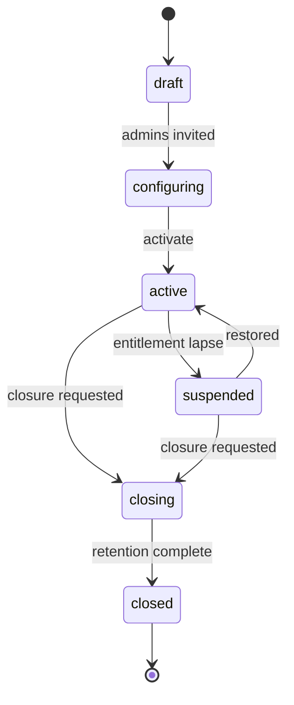
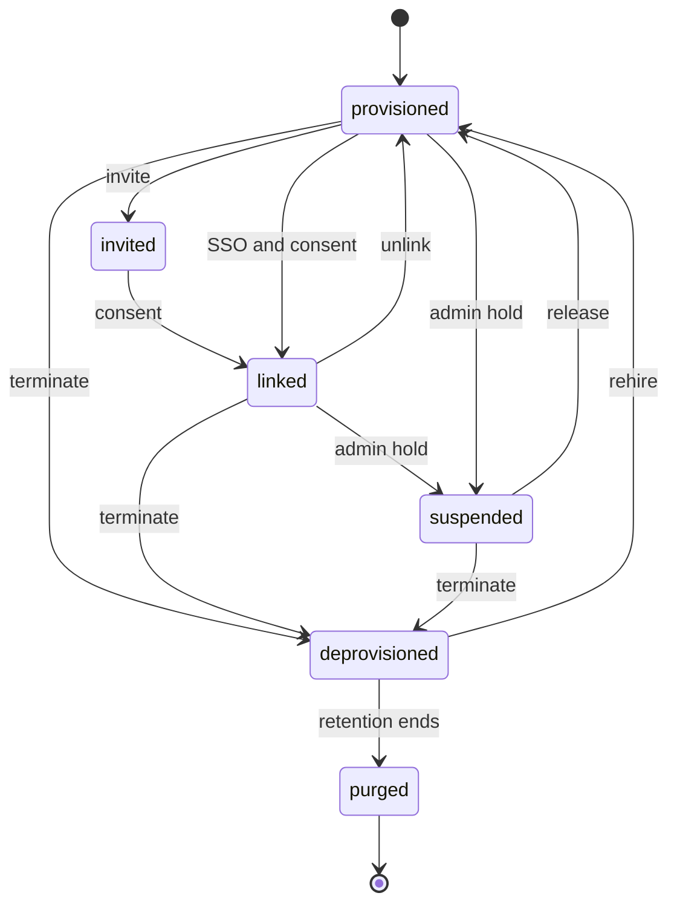
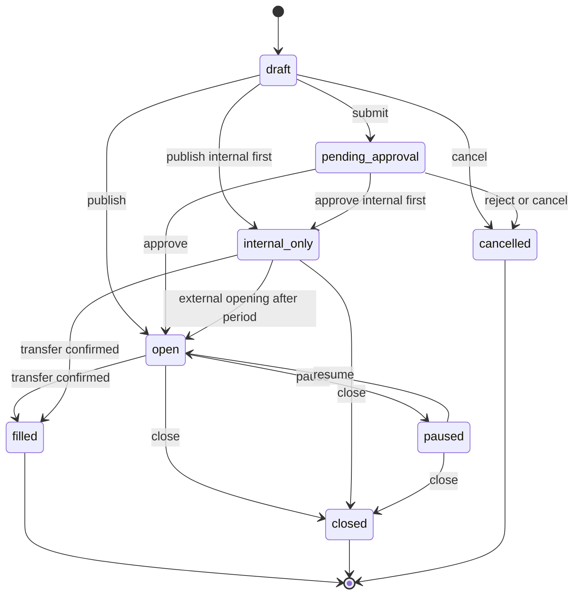
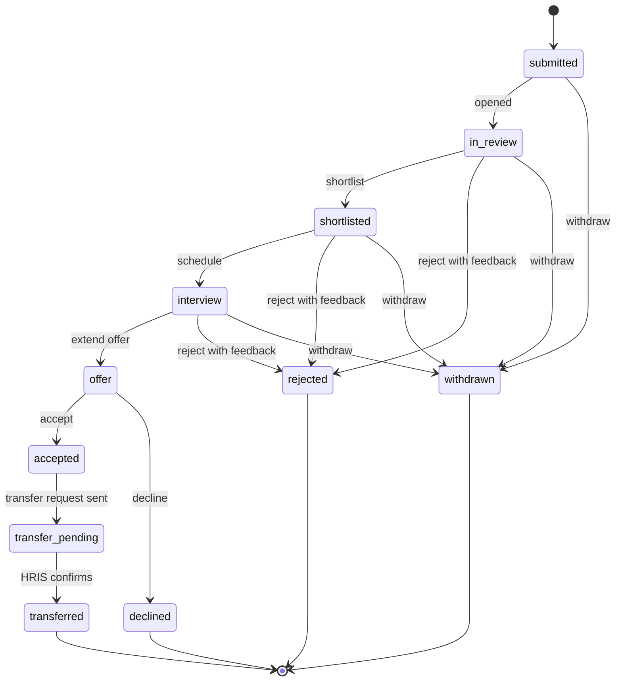
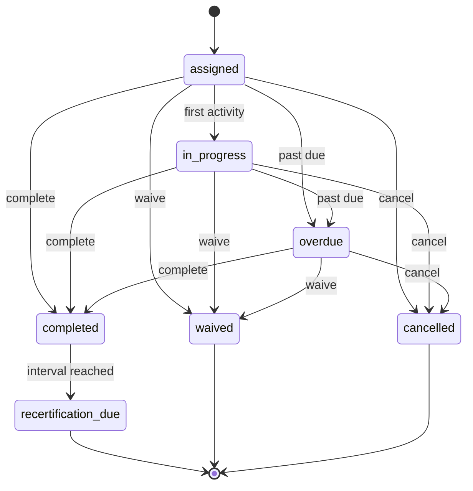
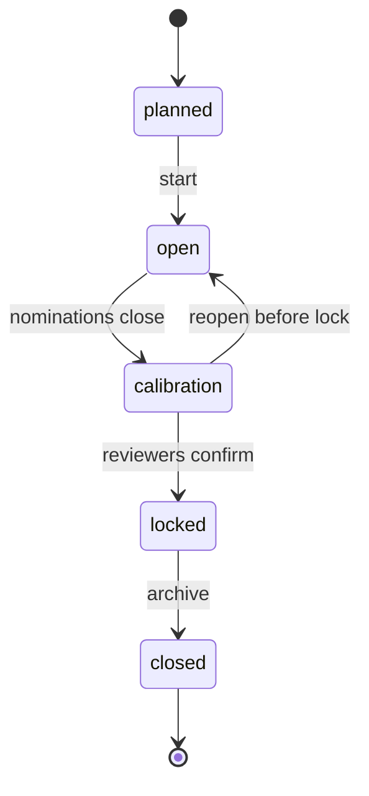
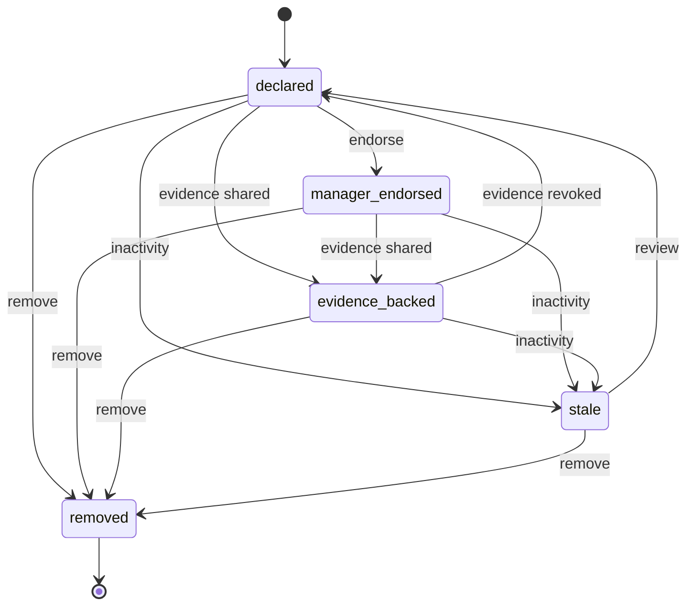
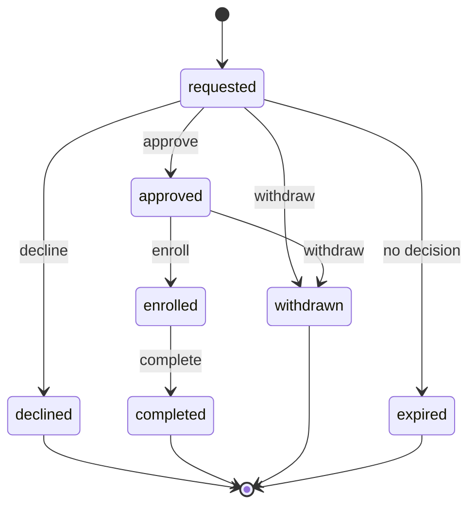

# ENT — Enterprise Talent: Internal Mobility, Skills & L&D

> Status: intended product specification. Nothing in this file is built. Module group: OS expansion (`R6`), gated by `OD-ENT-01`, which exists because this module brushes the SSOT non-goal "generic HR/payroll system". Evidence tags follow [CONVENTIONS](../README.md#blueprint-conventions). Id note: entity ids read `ENT-ENT-nn` because both the module code and the entity prefix are `ENT`.

## 1. Purpose, outcomes and boundaries

### 1.1 Purpose

ENT gives an employer that already uses TalentSphere a second audience: its own employees. The enterprise talent and L&D team can run an **internal job board**, build a **skills inventory**, assign **learning and compliance training**, support **internal mobility and succession** (narrowly, from skills and readiness only), and connect via **SSO, SCIM and HRIS**. The employee keeps a personal TalentSphere career account; the enterprise sees only what the privacy boundary allows. [SRC: SSOT §7.1 F-161 Internal Mobility & Succession Platform (priority 3, Ph6–7)] [PROP: full module]

### 1.2 Outcomes

1. An employee can find and apply for internal roles and gigs, and see development options, without their manager learning of it before they choose. [PROP]
2. L&D assigns learning, tracks compliance training to completion, and can prove it to an auditor. [PROP]
3. Talent leaders see an aggregate skills map and gaps for workforce planning, never individual surveillance. [PROP]
4. IT can provision, authenticate and deprovision employees with the identity systems it already runs. [PROP]
5. The line between "my career account" and "my employer's view of me" is explicit, consented and logged. [DER]

### 1.3 Scope

| In scope                                                    | Out of scope                                                                                                                                 | Owned by ENT                                                                                                                                         | Consumed from other modules                                                                 |
| ----------------------------------------------------------- | -------------------------------------------------------------------------------------------------------------------------------------------- | ---------------------------------------------------------------------------------------------------------------------------------------------------- | ------------------------------------------------------------------------------------------- |
| Enterprise workspace, SSO, SCIM, HRIS read sync             | Payroll, compensation administration, benefits, leave, attendance, time tracking, performance ratings, disciplinary records [SRC: SSOT §4.2] | Enterprise workspace, members, internal postings and applications, skills inventory, learning assignments, compliance requirements, succession plans | Employer organization and verification (`EMP` planned), entitlements (`BIL` planned)        |
| Employee skills inventory and org skills map                | A generic HRIS or applicant tracking replacement                                                                                             | Enterprise policies, access logs                                                                                                                     | Course catalogue and learning delivery (`LRN` planned)                                      |
| Internal job board, internal applications, internal gigs    | External hiring pipeline (`ATS` planned owns it; ENT reuses stage handling where noted)                                                      | Internal mobility pipeline for internal postings                                                                                                     | Taxonomy, roles, career paths (`MKT`)                                                       |
| L&D assignment, compliance tracking, learning requests      | Content authoring (`STU` planned)                                                                                                            | Learning assignments, compliance requirements, approvals                                                                                             | Evidence and credentials (`EVD` planned), identity (`IDN` planned), consent (`SET` planned) |
| Talent review and succession (narrow), manager workspace    | Performance management and review forms                                                                                                      | Talent review cycles, succession slates                                                                                                              | Notifications (`NTF` planned), analytics (`ANL`)                                            |
| Privacy boundary, offboarding, audit log, regional controls | Employee surveillance or productivity monitoring                                                                                             | Consent and link records, regional policy flags                                                                                                      | Moderation and support (`TSF`, `ADM` planned)                                               |

### 1.4 Boundary note on the SSOT non-goal

SSOT §4.2 says: do not turn TalentSphere into a "generic HR/payroll system". ENT stays on the learning, skills, opportunity and development side of HR. `BR-ENT-002` bans payroll, compensation administration, performance ratings, disciplinary, leave, benefits and time data by blocklist, and `OD-ENT-01` asks the owner to confirm scope. The HRIS integration is read-only (`BR-ENT-004`) and exists to avoid duplicate data entry, not to replace the HRIS.

## 2. Roles and permission matrix

Enterprise-scoped roles are assigned inside an enterprise workspace. Canonical codes: `EXA` Enterprise Talent / L&D Admin; `HMG` manager (people manager of an employee); `CAN` employee (a Candidate with an enterprise link); `REC` internal recruiter; `EAD` Employer Admin (owner of the employer org); `PAD` platform admin. "HRBP" is a configured permission set on `EXA`, not a new role.

Legend: C create, R read, U update, D delete, A approve, X execute, — none. "Own" = employee's own data; "Report" = direct reports.

| Capability                                | CAN (employee)            | HMG (manager)                       | REC (internal)       | EXA (L&D/talent admin)                           | EAD       | PAD                         |
| ----------------------------------------- | ------------------------- | ----------------------------------- | -------------------- | ------------------------------------------------ | --------- | --------------------------- |
| Configure workspace, SSO, SCIM, HRIS      | —                         | —                                   | —                    | CRUD (dual control)                              | A         | support access with consent |
| View own enterprise record and access log | R                         | R own                               | R own                | R own                                            | R own     | —                           |
| Skills inventory                          | CRUD own                  | R/endorse Report (visibility rules) | R aggregate          | R aggregate + individual for admins with purpose | —         | —                           |
| Internal job board: browse and apply      | R/C apply                 | R                                   | R                    | R                                                | —         | —                           |
| Internal posting: create and manage       | —                         | C (own team)                        | CRUD                 | CRUD                                             | —         | —                           |
| Internal applications: view               | R own                     | R only post-disclosure              | R for owned postings | R for owned postings                             | —         | —                           |
| Learning assignments                      | R own, X complete         | C/R for Report                      | —                    | CRUD                                             | —         | —                           |
| Compliance requirements                   | R own                     | R Report status                     | —                    | CRUD, waive                                      | —         | —                           |
| Learning requests                         | C own                     | A for Report                        | —                    | R, A if no manager                               | —         | —                           |
| Talent review and succession              | R own record (per policy) | C nominate, R own team              | —                    | CRUD, calibrate                                  | R summary | —                           |
| Manager workspace                         | —                         | R/X                                 | —                    | R                                                | —         | —                           |
| Reports and exports                       | —                         | R team (≥ threshold)                | R postings metrics   | R/X (purpose-bound)                              | R summary | R platform aggregates       |
| Regional policy and works-council toggles | —                         | —                                   | —                    | CRUD                                             | A         | —                           |

Service principal `API`: SCIM client and HRIS connector act under `API` with scoped, rotatable credentials.

## 3. Sub-module map

| Code | Sub-module                                      | Features          |
| ---- | ----------------------------------------------- | ----------------- |
| A    | Enterprise workspace and identity integration   | FR-ENT-001 to 006 |
| B    | Skills inventory and job architecture           | FR-ENT-007 to 010 |
| C    | Internal mobility                               | FR-ENT-011 to 017 |
| D    | Learning and development                        | FR-ENT-018 to 023 |
| E    | Talent review, succession and manager workspace | FR-ENT-024 to 027 |
| F    | Privacy, governance and reporting               | FR-ENT-028 to 032 |

## 4. Feature specifications

### Sub-module A — Enterprise workspace and identity integration

### FR-ENT-001 — Enterprise workspace setup

- **Sub-module:** A Enterprise workspace and identity integration
- **Priority / tier:** Must · R6
- **Source:** [PROP]; relates [SRC: SSOT §7.1 F-161; employer organization concept, the legacy F-61 label is Premium Candidate Tier and is not cited here]
- **Purpose and outcome:** A verified employer with an enterprise entitlement creates its enterprise workspace and invites admins. Success: an `active` workspace with at least two admins and baseline policies.
- **Roles and permissions:** `EAD: create` · `EXA: configure` · `PAD: suspend`
- **Preconditions and entry points:** Employer org verified (`EMP` planned) and enterprise entitlement active (`BIL` planned); entry from the employer console "Enterprise".
- **User interactions and actions:** 1. Click "Set up enterprise workspace". 2. Confirm legal entity, country list, data residency choice (`OD-ENT-08`). 3. Invite at least two `EXA` admins by email. 4. Review and accept the data-processing terms (employer acts as controller for employee data). 5. Choose baseline policies: confidential internal applications (default on), manager notification stage (default "offer"), employee visibility of access log (default on). 6. Activate.
- **System behaviour:** Creates `ENT-ENT-01` per `SM-ENT-01` (`draft → configuring → active`); activation requires two admins and accepted terms; tenant id assigned; all data scoped by tenant (`BR-ENT-025`); emits `enterprise.workspace.activated`.
- **UI elements and controls:** Setup wizard with progress indicator, admin invite list, policy toggles with explanations, "Activate" button disabled until checks pass.
- **Configuration options:** Org: policies listed above; platform: default retention periods.
- **Business rules:** `BR-ENT-001`, `BR-ENT-002`, `BR-ENT-025`, `BR-ENT-028`.
- **Validation:** Legal entity name 2–200 chars; admin emails valid, on the verified org domain unless verified exception; at least 2 distinct admins.
- **Inputs and outputs:** In: entity, admins, policies. Out: active workspace.
- **Filters, sorting, search:** n/a — single record.
- **Notifications and communication:** Invitations (`ent.admin.invite`, class `service`); activation confirmation.
- **Error handling and edge cases:** Entitlement lapses: workspace moves to `suspended` read-only with banner, no data deleted. Admin leaves: workspace needs a replacement admin within 30 days [PROP] or is flagged. Domain mismatch: requires platform support review.
- **Dependencies:** `EMP`, `BIL` (planned), `ENT-ENT-01`.
- **Security and privacy:** Terms acceptance recorded with version; audit; tenant isolation.
- **Acceptance criteria:**
  - Given a verified org with entitlement and two invited admins, when activated, then the workspace state is `active`.
  - Given a single admin, when the owner clicks Activate, then the system rejects with "two admins required".
  - Given an org without entitlement, when opening setup, then the page shows an upgrade path and creates nothing.

### FR-ENT-002 — Single sign-on (SAML 2.0 and OIDC)

- **Sub-module:** A Enterprise workspace and identity integration
- **Priority / tier:** Must · R6
- **Source:** [PROP]; relates `IDN` (planned)
- **Purpose and outcome:** Employees sign in to the enterprise area with the company identity provider. Success: a user authenticated by the IdP lands in their enterprise workspace linked to their personal account.
- **Roles and permissions:** `EXA: configure (dual control)` · `CAN: sign in`
- **Preconditions and entry points:** Workspace `configuring` or `active`; verified email domain(s); entry "Security → Single sign-on".
- **User interactions and actions:** 1. Choose SAML or OIDC. 2. Copy the service-provider metadata or redirect URI to the IdP. 3. Paste IdP metadata or issuer, client id and secret. 4. Map attributes (email, name, employee id, manager id, department). 5. Click "Test" with a test user. 6. Enable for domains; optionally enforce SSO for the enterprise area.
- **System behaviour:** Stores connection `ENT-ENT-03` encrypted; supports just-in-time provisioning (`BR-ENT-021`); validates assertions (signature, audience, time skew ≤ 2 minutes, replay protection); enforced SSO blocks password login for enterprise-scoped views only, never for the person's personal account; second admin must approve changes (`BR-ENT-026`); emits `enterprise.sso.configured`.
- **UI elements and controls:** Provider type radio, metadata/URL fields, certificate upload with expiry display, attribute mapping table, "Test" button with step-by-step result, "Enforce SSO" switch with confirm, "Break-glass admin" status.
- **Configuration options:** Domains, enforcement, session length for enterprise area (default 8 hours [PROP]), JIT on/off.
- **Business rules:** `BR-ENT-021`, `BR-ENT-026`, `BR-ENT-030`.
- **Validation:** Valid XML or discovery URL; certificate not expired; domain ownership verified by DNS TXT; required attribute email.
- **Inputs and outputs:** Out: connection status, test report.
- **Filters, sorting, search:** n/a — no list or query in this feature.
- **Notifications and communication:** Certificate expiry warnings at 60 and 14 days (`ent.sso.cert_expiring`, class `admin-ops`).
- **Error handling and edge cases:** Test fails: step-level error (signature, audience, clock skew). Enforce before a working test: blocked. IdP outage: break-glass local admin (at most two, MFA required) can sign in. Email on IdP differs from personal account email: linking requires confirmation by the person (`BR-ENT-030`).
- **Dependencies:** `IDN` (planned), `FR-ENT-001`, `FR-ENT-005`.
- **Security and privacy:** Secrets in vault; configuration changes audited and dual-approved; assertion replay cache.
- **Acceptance criteria:**
  - Given a valid IdP configuration and a test user, when the test runs, then each step shows pass and the connection is marked verified.
  - Given an assertion signed with the wrong certificate, when a user signs in, then login is refused and an audit event is written.
  - Given enforce-SSO without a verified test, when enabling, then the system rejects.

### FR-ENT-003 — SCIM provisioning and deprovisioning

- **Sub-module:** A Enterprise workspace and identity integration
- **Priority / tier:** Must · R6
- **Source:** [PROP]
- **Purpose and outcome:** The enterprise IdP creates, updates and deactivates enterprise memberships automatically. Success: membership state matches the directory within the sync window.
- **Roles and permissions:** `EXA: configure` · `API (SCIM client): create, update, deactivate members`
- **Preconditions and entry points:** SSO connection exists; "Provisioning" tab shows base URL and token.
- **User interactions and actions:** 1. Generate SCIM token (shown once). 2. Configure IdP with the SCIM base URL. 3. Run IdP "provision on demand" for a test user. 4. Review provisioning log.
- **System behaviour:** Implements SCIM 2.0 `Users` and `Groups`; creates `ENT-ENT-02` members in `provisioned`; `active=false` or delete sets membership `deprovisioned` within 15 minutes of receipt (`BR-ENT-021`), revokes enterprise sessions and access, never deletes the person's personal account (`BR-ENT-021`); group-to-role mapping configurable; idempotent by `externalId`; rate-limited.
- **UI elements and controls:** Token generator with copy and rotate buttons, mapping table (group → role), provisioning log table with status, "Retry failed" button.
- **Configuration options:** Group → enterprise role mapping, attribute mapping, deprovision behavior (default "disable and start retention clock").
- **Business rules:** `BR-ENT-021`, `BR-ENT-022`, `BR-ENT-029`, `BR-ENT-030`.
- **Validation:** Token rotated at most every 24 hours; payload per RFC 7644; email unique per tenant.
- **Inputs and outputs:** In: SCIM operations. Out: SCIM responses, log rows.
- **Filters, sorting, search:** Log filter by status, user, time.
- **Notifications and communication:** Failure digest to `EXA` (class `admin-ops`).
- **Error handling and edge cases:** Duplicate email across members: 409 SCIM uniqueness error. Unknown group: ignored and logged. Token leaked and rotated: old token rejected immediately. Reactivation of a deprovisioned user within the retention clock restores their enterprise data.
- **Dependencies:** `FR-ENT-002`, `FR-ENT-028`.
- **Security and privacy:** Token hashed at rest; IP allow-list optional; all operations audited with `API` principal id.
- **Acceptance criteria:**
  - Given an IdP deactivation, when received, then enterprise access ends within 15 minutes and the personal account remains.
  - Given a duplicate email, when provisioning, then SCIM returns 409 and no second member is created.
  - Given a rotated token, when the old token is used, then the system returns 401.

### FR-ENT-004 — HRIS integration (read-only sync)

- **Sub-module:** A Enterprise workspace and identity integration
- **Priority / tier:** Should · R6
- **Source:** [PROP]; relates [SRC: SSOT §4.3 external platforms as adapters]
- **Purpose and outcome:** Org structure and job profiles are imported from the HRIS so enterprise data is not typed twice. Success: org units, job profiles, manager relationships and employment status sync on schedule.
- **Roles and permissions:** `EXA: configure, run sync` · `API (connector): write imported attributes`
- **Preconditions and entry points:** Workspace active; HRIS credentials available; "Integrations → HRIS".
- **User interactions and actions:** 1. Pick a connector (Workday, SAP SuccessFactors, BambooHR, HiBob, Personio, generic SFTP/CSV, generic REST) [PROP list]. 2. Authenticate (OAuth or API key). 3. Choose fields to import from the allow-list (employee id, job profile, department, location, manager id, start date, employment type, status). 4. Map to ENT fields. 5. Dry run and review diffs. 6. Enable schedule.
- **System behaviour:** Import allow-list excludes banned data classes (`BR-ENT-002`); sync is read-only and HRIS wins on org attributes (`BR-ENT-004`, `BR-ENT-029`); runs as `ENT-ENT-05` SyncRun with counts of created/updated/ignored/errored; unmatched employees (no link) stay as unlinked directory entries; schedule default every 6 hours [PROP].
- **UI elements and controls:** Connector gallery, field allow-list checkboxes (banned fields disabled with reason), mapping table, dry-run diff, schedule selector, run history.
- **Configuration options:** Schedule, fields, match key (employee id or email), org-unit depth.
- **Business rules:** `BR-ENT-002`, `BR-ENT-004`, `BR-ENT-029`.
- **Validation:** Connector credentials test must pass; at least match key and status mapped; banned fields cannot be selected.
- **Inputs and outputs:** In: HRIS payloads. Out: updated directory and run summary.
- **Filters, sorting, search:** Run history by status and date.
- **Notifications and communication:** Failed sync alert (`ent.hris.sync_failed`, class `admin-ops`).
- **Error handling and edge cases:** Partial failure: successful records applied, failed ones listed, rerunnable. Connector throttled: backoff. Field becomes unavailable: mapping flagged. Employee terminated in HRIS: triggers deprovision workflow (`FR-ENT-028`) if SCIM is not already active.
- **Dependencies:** `FR-ENT-001`, `FR-ENT-005`, integrations (`PLT` planned).
- **Security and privacy:** Credentials in vault; least-privilege scopes; no sensitive HRIS fields ever requested.
- **Acceptance criteria:**
  - Given a connector exposing salary fields, when selecting fields, then salary fields are not selectable.
  - Given a manager change in the HRIS, when the next sync runs, then the manager relationship updates and the audit log records it.
  - Given a failing credential, when syncing, then the run fails with a clear error and no partial deletions occur.

### FR-ENT-005 — Employee account linking and enterprise-scoped profile

- **Sub-module:** A Enterprise workspace and identity integration
- **Priority / tier:** Must · R6
- **Source:** [PROP]; relates [SRC: SSOT §5 role model]
- **Purpose and outcome:** An employee links their personal TalentSphere account to the enterprise record, consenting to defined sharing. Success: a linked member with a clear view of what the employer can see.
- **Roles and permissions:** `CAN (employee): link, unlink, change sharing` · `EXA: view link status` · `HMG: none`
- **Preconditions and entry points:** Employee received an invite or signs in through SSO; entry "Link to {Company}" prompt.
- **User interactions and actions:** 1. Open invite or SSO first login. 2. See "What {Company} will see": enterprise-scoped profile (name, job title and department from HRIS, enterprise skills inventory, assigned learning) and "What stays private": personal profile, applications elsewhere, messages, personal evidence. 3. Toggle optional shares (share personal evidence for skills validation, show personal profile photo). 4. Click "Link account". 5. Unlink later from settings.
- **System behaviour:** Two-sided link (`BR-ENT-030`): `ENT-ENT-02` becomes `linked` only after the employee consents; consent recorded in `ENT-ENT-23`; a person with no personal account is offered to create one or to use a workspace-only account that can be converted later; the enterprise-scoped profile is a projection, not a copy of the personal profile (`BR-ENT-003`); unlinking removes enterprise access to personal-derived data immediately and begins retention for enterprise-owned records.
- **UI elements and controls:** Two-column "Employer sees / Stays private" panel, optional share toggles (default off), "Link account" and "Unlink" buttons, status badge.
- **Configuration options:** Employee: optional shares. Org: which optional shares may be offered.
- **Business rules:** `BR-ENT-003`, `BR-ENT-005`, `BR-ENT-030`.
- **Validation:** Email verified before linking; one active link per (person, tenant).
- **Inputs and outputs:** Out: link state and consent record.
- **Filters, sorting, search:** n/a — no list or query in this feature.
- **Notifications and communication:** Link confirmation to employee and `EXA` summary count (no personal detail).
- **Error handling and edge cases:** Invitation to an email already used by a different personal account: requires sign-in to that account. Employee declines: stays `provisioned`, enterprise-scoped features limited to mandatory items (compliance training assigned by the employer remains visible through a workspace-only view, `OD-ENT-04`). Unlink with open internal application: application withdrawn with notice.
- **Dependencies:** `IDN`, `SET` (planned), `FR-ENT-002`, `FR-ENT-027`.
- **Security and privacy:** Link consent versioned; the employer cannot read personal-profile data absent explicit share.
- **Acceptance criteria:**
  - Given a first SSO login, when the consent panel is shown, then no optional share is pre-checked.
  - Given an unlink, when confirmed, then the employer can no longer read any personal-derived fields.
  - Given a declined link, when the employee opens an assigned compliance course, then it is still accessible without exposing personal data.

### FR-ENT-006 — Enterprise roles, permission sets and delegation

- **Sub-module:** A Enterprise workspace and identity integration
- **Priority / tier:** Must · R6
- **Source:** [PROP]
- **Purpose and outcome:** Enterprise admins grant exactly the access each person needs, including delegation. Success: every enterprise action is authorized by a role or permission set with an audit trail.
- **Roles and permissions:** `EXA: manage roles (dual control for admin roles)` · `EAD: approve admin changes`
- **Preconditions and entry points:** "Access" tab.
- **User interactions and actions:** 1. Pick a member or group. 2. Assign a role (admin, internal recruiter, L&D manager, HRBP, reviewer, auditor read-only). 3. Optionally scope to org units or countries. 4. Set an end date. 5. Save; second admin approves admin roles.
- **System behaviour:** Roles are bundles of fine-grained permissions (read inventory aggregate, read inventory individual, run talent review, export, etc.); scoped assignments evaluated at request time against org-unit membership; delegation (manager proxy for approvals) limited to 30 days [PROP]; every individual-level read by an enterprise role needs a declared purpose when above the "aggregate" tier (`BR-ENT-023`).
- **UI elements and controls:** Role assignment table, scope picker (org tree), end-date picker, "Request approval" button, permission preview.
- **Configuration options:** Custom permission sets (max 20 per workspace [PROP]).
- **Business rules:** `BR-ENT-018`, `BR-ENT-023`, `BR-ENT-026`.
- **Validation:** End date ≤ 12 months for elevated roles; cannot remove the last two admins.
- **Inputs and outputs:** Out: assignment records.
- **Filters, sorting, search:** By role, scope, expiry.
- **Notifications and communication:** Expiry reminder 7 days before (class `admin-ops`).
- **Error handling and edge cases:** Scope references a deleted org unit: assignment suspended with alert. Delegate leaves: delegation ends with deprovision.
- **Dependencies:** `FR-ENT-003`, `FR-ENT-004`.
- **Security and privacy:** Least privilege; audit; separation of duties between approver and requester.
- **Acceptance criteria:**
  - Given a scoped HRBP for Germany, when they open data for a French employee, then access is denied.
  - Given an admin role request, when only the requester approves, then it stays pending.
  - Given the last two admins, when one is removed, then the system rejects.

### Sub-module B — Skills inventory and job architecture

### FR-ENT-007 — Employee skills inventory

- **Sub-module:** B Skills inventory and job architecture
- **Priority / tier:** Must · R6
- **Source:** [PROP]; relates [SRC: SSOT §6.1 evidence semantics, F-84]
- **Purpose and outcome:** Each employee maintains skills with proficiency and evidence level in an enterprise-scoped inventory, optionally endorsed by their manager. Success: inventory entries with provenance that the enterprise can aggregate.
- **Roles and permissions:** `CAN: CRUD own` · `HMG: endorse for Report` · `EXA: read aggregate; individual read with purpose`
- **Preconditions and entry points:** Linked employee; "My skills" in the employee career hub (`SCR-ENT-012`).
- **User interactions and actions:** 1. Add skill from the canonical taxonomy (`MKT`). 2. Set self-rated proficiency (1–5 with descriptors). 3. Optionally attach evidence from personal profile (shared per skill) or enterprise learning completion. 4. Manager reviews and clicks "Endorse" or leaves a suggestion. 5. Employee hides or removes entries.
- **System behaviour:** Entry `ENT-ENT-08` with `SM-ENT-07` states `declared → manager_endorsed | evidence_backed → stale → removed`; "manager-endorsed" is labelled and never shown as verified (`BR-ENT-006`); evidence-backed pulls the evidence tier from `EVD` (planned) with the employee's per-skill share consent; entries older than 12 months without activity become `stale` and prompt review; HRIS job profile seeds suggested skills.
- **UI elements and controls:** Skill typeahead, proficiency selector with descriptors, evidence attach button, endorsement badge with text, stale indicator, "Hide from my manager" toggle per entry only where policy allows.
- **Configuration options:** Org: whether manager visibility is mandatory for validated skills (default employee chooses, `OD-ENT-05`); staleness period (default 12 months).
- **Business rules:** `BR-ENT-003`, `BR-ENT-005`, `BR-ENT-006`, `BR-ENT-019`.
- **Validation:** Skill from the taxonomy (proposals allowed through `MKT`); proficiency 1–5; max 100 entries per employee [PROP]; endorsement only by the current HRIS-recorded manager.
- **Inputs and outputs:** Out: inventory with provenance.
- **Filters, sorting, search:** By proficiency, status, stale, skill category.
- **Notifications and communication:** Manager notified to review (`ent.skill.endorse_request`, class `work-updates`); stale-review reminder quarterly (opt-out).
- **Error handling and edge cases:** Manager changed in HRIS: pending endorsements reassigned. Evidence revoked in `EVD`: entry downgrades to `declared` with notice. Skill deprecated in taxonomy: mapped to successor.
- **Dependencies:** `MKT FR-MKT-001`, `EVD` (planned), `FR-ENT-005`.
- **Security and privacy:** Enterprise-scoped; no personal-profile data without share; individual reads by `EXA` need purpose and are logged.
- **Acceptance criteria:**
  - Given a manager endorsement, when displayed, then it is labelled "manager-endorsed" and not "verified".
  - Given revoked evidence, when the entry is viewed, then it shows `declared`.
  - Given a non-manager user, when they endorse, then the system returns 403.

### FR-ENT-008 — Organization skills map and capability heat map

- **Sub-module:** B Skills inventory and job architecture
- **Priority / tier:** Should · R6
- **Source:** [PROP]; relates [SRC: SSOT F-158 Talent Pool Intelligence, F-160]
- **Purpose and outcome:** Talent leaders see where skills concentrate and thin out, by department, location and role family. Success: aggregate map with suppression and provenance.
- **Roles and permissions:** `EXA: read` · `EAD: read summary` · `HMG: own team aggregate if ≥ threshold`
- **Preconditions and entry points:** Enterprise analytics → "Skills map".
- **User interactions and actions:** 1. Choose skill or skill group. 2. Group by org unit, location, job family. 3. View count by proficiency/evidence tier. 4. Drill down until the group would fall under threshold. 5. Export aggregates.
- **System behaviour:** Aggregates `ENT-ENT-08` entries of linked members with enterprise-share enabled; groups smaller than `min_cohort_k` suppressed (`BR-ENT-019`); never lists names; employees who hid entries are excluded; labels coverage ("based on N of M employees who maintain an inventory").
- **UI elements and controls:** Heat-map grid with table alternative and text values, grouping selector, tier toggle, coverage badge.
- **Configuration options:** Grouping dimensions (department, location, job family); threshold (default `min_cohort_k` = 10, org may raise).
- **Business rules:** `BR-ENT-005`, `BR-ENT-019`, `BR-ENT-020`.
- **Validation:** Grouping must be enabled by policy and regional flags.
- **Inputs and outputs:** Out: aggregate counts.
- **Filters, sorting, search:** Skill, group, region, tier.
- **Notifications and communication:** n/a — no recipient is affected.
- **Error handling and edge cases:** Low coverage (< 30% of employees [PROP]): warning that results may mislead. Group under threshold: shown as "fewer than 10", merged into parent where policy allows.
- **Dependencies:** `FR-ENT-007`, `FR-ENT-004`, `ANL` thresholds (planned).
- **Security and privacy:** No individual identification; export watermarks (`BR-ENT-020`).
- **Acceptance criteria:**
  - Given a department of 7 people, when grouping by department, then it is suppressed.
  - Given 25% coverage, when viewed, then the coverage warning appears.
  - Given an employee who hid a skill, when counted, then they are excluded.

### FR-ENT-009 — Workforce skill-gap analysis

- **Sub-module:** B Skills inventory and job architecture
- **Priority / tier:** Should · R6
- **Source:** [PROP]; relates [SRC: SSOT F-151, F-161]
- **Purpose and outcome:** Compare the current inventory with the skills needed by target roles or strategic capabilities. Success: a gap report by unit with suggested actions (hire, develop, mobilize).
- **Roles and permissions:** `EXA: run, save` · `EAD: read`
- **Preconditions and entry points:** Skills map or workforce planning page.
- **User interactions and actions:** 1. Define a target (role set or capability list with required headcount and proficiency). 2. Choose scope (units, countries). 3. Run analysis. 4. View gaps ranked by size and market scarcity. 5. Create actions: learning path, internal posting, external requisition hand-off.
- **System behaviour:** Supply from aggregated inventory (above threshold), demand from targets entered by `EXA`; market scarcity from `MKT` indices; action creation links to `FR-ENT-020`, `FR-ENT-011`, or `ATS` (planned); saved scenarios versioned.
- **UI elements and controls:** Target builder, scope picker, gap table with bars and numbers, scarcity chip, "Create action" menu.
- **Configuration options:** Scenarios; proficiency thresholds.
- **Business rules:** `BR-ENT-019`, `BR-ENT-020`, `BR-ENT-017`.
- **Validation:** Targets reference taxonomy skills and active job profiles.
- **Inputs and outputs:** Out: gap report.
- **Filters, sorting, search:** By unit, skill, severity.
- **Notifications and communication:** n/a — no recipient is affected.
- **Error handling and edge cases:** Insufficient coverage: report marks "incomplete supply data". Unit under threshold: merged into parent.
- **Dependencies:** `FR-ENT-008`, `MKT`.
- **Security and privacy:** Aggregates; scenarios private to the workspace.
- **Acceptance criteria:**
  - Given a target needing 20 at proficiency 4 and an inventory of 12, when run, then the gap is 8 with the coverage note.
  - Given a unit of 6, when analyzing, then it is merged into its parent group.
  - Given a gap, when "Create action → learning path" is chosen, then a draft path pre-filled with the skill is created.

### FR-ENT-010 — Internal job architecture and role catalogue

- **Sub-module:** B Skills inventory and job architecture
- **Priority / tier:** Should · R6
- **Source:** [PROP]; relates `MKT FR-MKT-007`
- **Purpose and outcome:** The enterprise maps its own job profiles to the platform role catalogue and skills so internal postings, paths and gap analyses share a vocabulary. Success: every job profile maps to a role and required skills.
- **Roles and permissions:** `EXA: CRUD` · `employees: read`
- **Preconditions and entry points:** "Job architecture"; HRIS import of profiles.
- **User interactions and actions:** 1. Import or create job profiles (name, family, level). 2. Map to platform roles. 3. Adjust required skills with proficiency. 4. Publish.
- **System behaviour:** `ENT-ENT-07` JobProfile with versioning; suggestions from alias matching; shows differences from the market role; internal level ladder defined per family; no compensation bands stored (`BR-ENT-002`).
- **UI elements and controls:** Profile table, mapping dialog, skill requirement editor, version history.
- **Configuration options:** Level ladders per family.
- **Business rules:** `BR-ENT-002`, `BR-ENT-004`.
- **Validation:** Name unique per family and level; skills from taxonomy; salary fields not available.
- **Inputs and outputs:** Out: profile catalogue.
- **Filters, sorting, search:** By family, level, mapped status.
- **Notifications and communication:** n/a — no recipient is affected.
- **Error handling and edge cases:** Unmapped profile: shown with "no market comparison". HRIS rename: version created.
- **Dependencies:** `FR-ENT-004`, `MKT`.
- **Security and privacy:** Internal catalogue visible to members only.
- **Acceptance criteria:**
  - Given a profile mapped to a role, when a gap analysis runs, then required skills come from the mapping.
  - Given an attempt to add a salary band, when saving, then the field does not exist and the API rejects it.
  - Given an HRIS rename, when synced, then a new version is created.

### Sub-module C — Internal mobility

### FR-ENT-011 — Internal job board and posting

- **Sub-module:** C Internal mobility
- **Priority / tier:** Must · R6
- **Source:** [PROP]; relates [SRC: SSOT F-04, F-05, F-161]
- **Purpose and outcome:** Hiring teams post openings visible only to employees (optionally also externally). Success: eligible employees find and apply.
- **Roles and permissions:** `REC/EXA: create, publish` · `HMG: create for own team, approval by REC` · `CAN: browse, apply`
- **Preconditions and entry points:** Workspace active; "Internal jobs → New posting".
- **User interactions and actions:** 1. Choose job profile or write posting. 2. Set location, work arrangement, team, closing date, eligibility rules (minimum time in current role, country, job family, language). 3. Choose visibility (internal only, internal first for N days then external, both). 4. Submit for approval where policy requires. 5. Publish.
- **System behaviour:** `ENT-ENT-09` per `SM-ENT-03`; eligibility rules are explicit, shown to applicants, and cannot reference protected attributes (`BR-ENT-007`); "internal first" auto-opens to the external board (`JOB` planned) after the period; posting is visible only to linked employees within its eligibility scope; emits `enterprise.posting.published`.
- **UI elements and controls:** Posting form (reuses job editor), eligibility builder, visibility selector, preview, approval status.
- **Configuration options:** Org: approval policy, default internal-first period (default 7 days [PROP]), minimum tenure cap (max 12 months [PROP], `OD-ENT-06`).
- **Business rules:** `BR-ENT-007`, `BR-ENT-009`, `BR-ENT-025`.
- **Validation:** Title 5–120; description 100–10,000; closing date future; minimum tenure ≤ cap; eligibility fields from allow-list.
- **Inputs and outputs:** Out: published internal posting.
- **Filters, sorting, search:** Employees filter by job family, location, level, arrangement, "matches my skills"; sort by newest, closing soon.
- **Notifications and communication:** Subscribed saved searches (`ent.posting.new_match`, class `career`, opt-out).
- **Error handling and edge cases:** Posting visible to ineligible user via link: 404. Hiring manager is the applicant's manager: allowed only with explicit disclosure rules (`BR-ENT-008`). Internal-first to external transition fails: stays internal with alert.
- **Dependencies:** `FR-ENT-010`, `JOB` (planned), `FR-ENT-005`.
- **Security and privacy:** Tenant-scoped; visible to linked employees only; audit.
- **Acceptance criteria:**
  - Given a minimum-tenure rule of 12 months, when a 6-month employee views the posting, then the rule is displayed and apply is disabled with the reason.
  - Given an eligibility rule on age, when saving, then the system rejects.
  - Given a non-employee, when requesting the posting, then it returns 404.

### FR-ENT-012 — Confidential internal application

- **Sub-module:** C Internal mobility
- **Priority / tier:** Must · R6
- **Source:** [PROP]
- **Purpose and outcome:** Employees apply internally without their manager seeing it before the agreed stage. Success: applications processed by the internal recruiting team under confidentiality.
- **Roles and permissions:** `CAN: apply, withdraw` · `REC (owning posting): review` · `HMG (posting owner): review after shortlist` · `current manager: notified only per policy`
- **Preconditions and entry points:** Linked, eligible employee; posting detail "Apply".
- **User interactions and actions:** 1. Click "Apply". 2. Choose the profile view to submit (enterprise-scoped, or a custom resume from personal profile via share). 3. Answer questions. 4. See "Who sees this" summary (hiring team yes, current manager no until offer stage). 5. Submit. 6. Track status; withdraw.
- **System behaviour:** `ENT-ENT-10` per `SM-ENT-04`; stages mirror the standard pipeline (`ATS` planned) with enterprise additions (manager release); current manager notified only at the policy stage (default "offer extended and accepted") (`BR-ENT-009`); decisions and feedback required within the SLA (`BR-ENT-010`); HRBP visibility only if org policy allows and the employee is told in the apply screen (`BR-ENT-008`).
- **UI elements and controls:** Apply drawer, "Who sees this" panel, document attach, status timeline, withdraw button with confirm.
- **Configuration options:** Org: confidentiality (default on), manager notification stage, feedback SLA (default 10 business days [PROP]).
- **Business rules:** `BR-ENT-008`, `BR-ENT-009`, `BR-ENT-010`, `BR-ENT-003`.
- **Validation:** One active application per posting; max 5 concurrent internal applications [PROP]; attachments ≤ 10 MB, PDF/DOCX.
- **Inputs and outputs:** Out: application with timeline.
- **Filters, sorting, search:** Employee "My applications" by status; recruiter pipeline by stage.
- **Notifications and communication:** Status changes (`ent.application.status`, class `career`, non-optional for decisions); feedback prompt to recruiter at SLA − 2 days.
- **Error handling and edge cases:** Current manager is the hiring manager: policy rule requires disclosure; applicant warned before submit. Employee deprovisioned mid-process: application cancelled. SLA breached: escalates to `EXA`.
- **Dependencies:** `FR-ENT-011`, `FR-ENT-005`, `ATS` stage logic (planned).
- **Security and privacy:** Application invisible to current manager and HRBP except as configured; every view logged and visible to the employee on request.
- **Acceptance criteria:**
  - Given confidentiality on, when the current manager opens the team's mobility list, then the application does not appear.
  - Given an offer accepted, when the stage changes, then the current manager is notified per policy.
  - Given a sixth concurrent application, when submitting, then the system rejects with the limit.

### FR-ENT-013 — Internal talent matching suggestions

- **Sub-module:** C Internal mobility
- **Priority / tier:** Should · R6
- **Source:** [PROP]; relates [SRC: SSOT F-11, F-84; §4.2 no ungoverned autonomous AI decisions]
- **Purpose and outcome:** Employees who opt in get explained suggestions of internal roles and gigs, and recruiters get explained suggestions of internal candidates for a posting. Success: suggestions with reasons, no auto decisions.
- **Roles and permissions:** `CAN: opt in/out, view own suggestions` · `REC: view suggestions for own postings (opted-in employees only)`
- **Preconditions and entry points:** Employee opted in at "Mobility preferences"; posting published.
- **User interactions and actions:** 1. Employee opts in and sets interests (roles, locations, willingness for gigs). 2. Sees "Suggested for you" with reasons (skills matched, gaps). 3. Recruiter opens "Suggested internal candidates", sees only opted-in employees, reasons and gaps, then sends a confidential invitation.
- **System behaviour:** Matching uses inventory skills, declared interests, job profile requirements; no performance data, no protected attributes, no tenure as a negative signal beyond posted eligibility; every suggestion carries reasons and uncertainty (`BR-ENT-011`); recruiter invitation is a message the employee may ignore; employee can hide from suggestions any time.
- **UI elements and controls:** Mobility preference form, suggestion cards with "Why", recruiter candidate list with invite button, "Not interested" and "Hide me" controls.
- **Configuration options:** Org: matching on/off (off in regions without clearance, `FR-ENT-031`); employee: opt-in default off.
- **Business rules:** `BR-ENT-011`, `BR-ENT-005`, `BR-ENT-024`.
- **Validation:** Interest list ≤ 10; invitations ≤ 3 per employee per month [PROP].
- **Inputs and outputs:** Out: suggestion lists with reasons.
- **Filters, sorting, search:** Employee suggestions by role family and location; recruiter list by match reasons.
- **Notifications and communication:** Invitations (`ent.mobility.invite`, class `career`, opt-out).
- **Error handling and edge cases:** Employee opts out after being invited: invitation withdrawn. No inventory: empty state prompts to add skills. Region flag off: feature hidden.
- **Dependencies:** `FR-ENT-007`, `FR-ENT-011`, `AIC` (planned).
- **Security and privacy:** Opt-in; reasons visible to both sides; match logs audited; not shared with managers.
- **Acceptance criteria:**
  - Given an employee who has not opted in, when a recruiter opens suggestions, then the employee is absent.
  - Given a suggestion, when displayed, then at least one reason is shown.
  - Given a region with matching disabled, when the page loads, then the feature is hidden.

### FR-ENT-014 — Internal gigs and short-term assignments

- **Sub-module:** C Internal mobility
- **Priority / tier:** Could · R6
- **Source:** [PROP]; scope check `OD-ENT-07` (brushes HR time/allocation tracking)
- **Purpose and outcome:** Teams post time-boxed internal projects so employees can build experience. Success: gigs filled with manager-approved time allocation, without any time tracking.
- **Roles and permissions:** `HMG/EXA: post` · `CAN: apply` · `current manager: approve allocation`
- **Preconditions and entry points:** "Internal gigs" tab.
- **User interactions and actions:** 1. Poster describes the gig, skills built, duration (max 6 months), expected allocation percentage (5–40%), team. 2. Employee applies. 3. Poster selects. 4. Current manager approves allocation within the SLA. 5. On completion, both confirm; gig added to the employee's inventory as evidence of experience.
- **System behaviour:** `ENT-ENT-12`; allocation is an agreed number only (no hour logging, `BR-ENT-012`); manager approval required (visible to manager at selection stage, not at application stage); completion generates an enterprise-scoped record and, with employee consent, a personal evidence item draft (`EVD` planned).
- **UI elements and controls:** Gig form, apply button, approval tracker, completion confirmation.
- **Configuration options:** Org: allocation cap (default 20% [PROP]), max concurrent gigs per employee (default 1).
- **Business rules:** `BR-ENT-012`, `BR-ENT-008`, `BR-ENT-009`.
- **Validation:** Duration ≤ 6 months; allocation 5–40; skills from taxonomy.
- **Inputs and outputs:** Out: gig and assignment records.
- **Filters, sorting, search:** By skill, duration, team, allocation.
- **Notifications and communication:** Approval requests and outcomes (`ent.gig.approval`, class `work-updates`).
- **Error handling and edge cases:** Manager does not respond in SLA: escalates to HRBP/`EXA`, never auto-approves. Gig ends early: either side can end with reason. Over-allocation across gigs: blocked by cap.
- **Dependencies:** `FR-ENT-011`, `FR-ENT-007`.
- **Security and privacy:** Same confidentiality as applications until selection.
- **Acceptance criteria:**
  - Given an allocation of 50%, when posting, then the system rejects with the cap.
  - Given no manager response by SLA, when time passes, then escalation occurs and the gig does not start.
  - Given a completed gig, when confirmed, then an enterprise record exists and the personal evidence draft appears only if the employee consented.

### FR-ENT-015 — Internal mobility pipeline and transfer workflow

- **Sub-module:** C Internal mobility
- **Priority / tier:** Must · R6
- **Source:** [PROP]
- **Purpose and outcome:** From shortlist to transfer, recruiters and managers move internal candidates through stages and complete a transfer handoff to the HRIS owner. Success: a documented decision per candidate and a transfer request sent for HR processing.
- **Roles and permissions:** `REC/HMG (posting): move stages` · `EXA: oversee, approve exceptions` · `CAN: respond to offer`
- **Preconditions and entry points:** Internal posting with applications; pipeline board.
- **User interactions and actions:** 1. Review applications, shortlist, schedule interviews (`INT` planned). 2. Record structured feedback. 3. Extend internal offer (role, start window) without compensation fields. 4. Employee accepts; current manager is notified per policy. 5. Release date agreed. 6. System creates a "transfer request" record and sends it to the HRIS owner (webhook or CSV) for HR processing.
- **System behaviour:** `SM-ENT-04` transitions; compensation and contract changes are out of scope and handled in the HRIS (`BR-ENT-002`); release date negotiated within a policy bound (default max 60 days [PROP]); on `transfer_pending` the record is sent through the configured channel; HRIS confirmation sync sets `transferred`.
- **UI elements and controls:** Kanban/list pipeline, feedback form, offer dialog, release-date picker, transfer status chip.
- **Configuration options:** Org: stages, release-date cap, handoff channel.
- **Business rules:** `BR-ENT-002`, `BR-ENT-008`, `BR-ENT-009`, `BR-ENT-010`.
- **Validation:** Feedback required before rejection (min 20 chars); offer needs start window within the cap.
- **Inputs and outputs:** Out: decision, transfer request.
- **Filters, sorting, search:** By stage, posting, recruiter, age.
- **Notifications and communication:** Stage notices to the employee (non-optional); current manager notification at the policy stage.
- **Error handling and edge cases:** HRIS never confirms: reminder after 14 days and visible status "awaiting HR". Employee declines: reason optional; posting remains open. Two postings accepted at once: second flagged for conflict resolution.
- **Dependencies:** `FR-ENT-012`, `FR-ENT-004`, `INT` (planned).
- **Security and privacy:** Feedback visible to hiring team only, summary to the employee on request; audit.
- **Acceptance criteria:**
  - Given an offer form, when it includes salary, then the field does not exist.
  - Given acceptance, when processed, then the current manager is notified only at the configured stage.
  - Given an unconfirmed transfer after 14 days, when time passes, then a reminder is sent to the HRIS owner.

### FR-ENT-016 — Employee career development plan

- **Sub-module:** C Internal mobility
- **Priority / tier:** Should · R6
- **Source:** [PROP]; relates `MKT FR-MKT-024..026`
- **Purpose and outcome:** Employees set a career goal and get a plan combining internal roles, learning and gigs. Success: a plan owned by the employee, optionally shared with their manager.
- **Roles and permissions:** `CAN: CRUD own` · `HMG: read if shared, comment` · `EXA: aggregate`
- **Preconditions and entry points:** Career hub → "My plan".
- **User interactions and actions:** 1. Choose a goal role (internal or market). 2. See gap via `MKT` and internal requirements. 3. Add actions: learning, gigs, mentoring requests, internal postings. 4. Set dates. 5. Choose to share with manager (default private). 6. Discuss in a development conversation record.
- **System behaviour:** `ENT-ENT-19`; reuses `MKT` gap and readiness (never exposed to employers: `MKT BR-MKT-024`); sharing is a per-plan flag, revocable; manager comments visible to the employee; plan completion creates personal evidence offer.
- **UI elements and controls:** Goal picker, gap view, action list, share toggle, comment thread.
- **Configuration options:** Employee: sharing; org: plan templates.
- **Business rules:** `BR-ENT-003`, `BR-ENT-005`, `BR-ENT-011`.
- **Validation:** Max 20 actions; dates future.
- **Inputs and outputs:** Out: plan.
- **Filters, sorting, search:** Actions by status.
- **Notifications and communication:** Reminders (`ent.plan.reminder`, class `career`, opt-out).
- **Error handling and edge cases:** Manager leaves: share ends and employee is asked to share with the new manager. Goal role retired: plan prompts to pick a successor.
- **Dependencies:** `MKT`, `FR-ENT-018`, `FR-ENT-014`.
- **Security and privacy:** Private by default; never used in talent review unless employee shares (`BR-ENT-017`).
- **Acceptance criteria:**
  - Given a plan not shared, when the manager opens the team page, then the plan is not visible.
  - Given sharing revoked, when the manager reloads, then it disappears.
  - Given a retired goal role, when opening the plan, then a banner prompts a replacement.

### FR-ENT-017 — Mobility preferences and visibility controls

- **Sub-module:** C Internal mobility
- **Priority / tier:** Should · R6
- **Source:** [PROP]
- **Purpose and outcome:** Employees control whether and how they are discoverable internally. Success: every visibility choice honored by search, matching and reports.
- **Roles and permissions:** `CAN: manage own` · `EXA: read aggregate counts`
- **Preconditions and entry points:** Career hub → "Mobility preferences".
- **User interactions and actions:** 1. Set "open to internal moves" (off, passive, active). 2. Choose interests, locations, willingness for gigs and relocation. 3. Choose who can see "open to moves": nobody (default), internal recruiters, hiring managers of postings I applied to. 4. Save.
- **System behaviour:** `ENT-ENT-11`; consumed by matching (`FR-ENT-013`), recruiter search and reports; changes take effect within 1 minute; history kept for audit but not shown to managers.
- **UI elements and controls:** Segmented control (off, passive, active), checkbox list for audiences, interests selectors.
- **Configuration options:** Org: allowed audiences.
- **Business rules:** `BR-ENT-005`, `BR-ENT-011`, `BR-ENT-008`.
- **Validation:** At most 10 interests.
- **Inputs and outputs:** Out: preferences.
- **Filters, sorting, search:** n/a — no list or query in this feature.
- **Notifications and communication:** n/a — no recipient is affected.
- **Error handling and edge cases:** Audience disallowed by org later: preference reduced with notice.
- **Dependencies:** `FR-ENT-013`.
- **Security and privacy:** Not visible to current manager unless the employee grants.
- **Acceptance criteria:**
  - Given "nobody", when a recruiter searches, then the employee is absent.
  - Given a change to "active", when saved, then matching includes the employee within 1 minute.
  - Given a manager request to view preferences, when called, then 403.

### Sub-module D — Learning and development

### FR-ENT-018 — Learning assignment

- **Sub-module:** D Learning and development
- **Priority / tier:** Must · R6
- **Source:** [PROP]; relates [SRC: SSOT F-07, F-42 Institutional Course Marketplace analog]
- **Purpose and outcome:** L&D assigns courses, paths and assessments to individuals, groups or rules-based audiences with due dates. Success: every assignee sees it and progress is tracked.
- **Roles and permissions:** `EXA (L&D manager): create, assign` · `HMG: assign to Report within policy` · `CAN: view, complete`
- **Preconditions and entry points:** Course/path detail "Assign"; L&D console.
- **User interactions and actions:** 1. Pick content from the catalogue (`LRN` planned, enterprise private content, imported content). 2. Choose audience: individuals, groups, org units, rule (job family = X and location = Y). 3. Set due date, reminders, mandatory flag. 4. Review count and preview. 5. Assign.
- **System behaviour:** Creates `ENT-ENT-13` per member, `SM-ENT-05`; rule-based audiences re-evaluated daily (new joiners receive assignments automatically); completion events from `LRN` update state; mandatory assignments follow `BR-ENT-013`; employees may add completed courses to personal profile only after consent (`BR-ENT-015`).
- **UI elements and controls:** Content picker, audience builder with live count, due-date picker, reminder schedule, "Mandatory" switch, preview.
- **Configuration options:** Default reminders (7, 3, 1 days before due [PROP]), enterprise-wide learning calendar.
- **Business rules:** `BR-ENT-013`, `BR-ENT-015`, `BR-ENT-016`, `BR-ENT-027`.
- **Validation:** Due date ≥ 24 hours ahead; audience ≤ 100,000 members; content must be active and licensed to the tenant.
- **Inputs and outputs:** Out: assignments and counts.
- **Filters, sorting, search:** L&D table by content, audience, state, due date; employee "My learning" by due date.
- **Notifications and communication:** Assignment notice (`ent.learning.assigned`, class `work-required`, non-optional), reminders, overdue notices.
- **Error handling and edge cases:** Content unpublished: assignment flagged, alternate suggested. Employee deprovisioned: assignment cancelled. Rule matches 0: warning.
- **Dependencies:** `LRN` (planned), `FR-ENT-004`.
- **Security and privacy:** L&D sees status and completion, not personal-profile contents; employees see exactly who assigned.
- **Acceptance criteria:**
  - Given a rule audience, when a new employee matches, then the assignment appears within 24 hours.
  - Given an assignment due in 2 hours, when creating, then the system rejects.
  - Given an employee, when they open a mandatory assignment, then they cannot remove it.

### FR-ENT-019 — Compliance training tracking

- **Sub-module:** D Learning and development
- **Priority / tier:** Must · R6
- **Source:** [PROP]
- **Purpose and outcome:** Mandatory training (safety, security awareness, code of conduct, regulatory) is assigned on cycles, tracked to completion, and provable in an audit. Success: an audit report showing who completed what, when, with immutable evidence.
- **Roles and permissions:** `EXA: define, waive, report` · `HMG: view Report status` · `CAN: complete` · `auditor (read-only permission set): view`
- **Preconditions and entry points:** "Compliance" console; requirement definition.
- **User interactions and actions:** 1. Define a requirement: content, audience rule, initial deadline, recertification interval, grace period, evidence needed (completion, passing score, attestation). 2. Activate. 3. Monitor dashboard (compliant, due soon, overdue). 4. Waive with reason where permitted. 5. Export audit report.
- **System behaviour:** `ENT-ENT-14` generates assignments for matching members on joining and at each cycle; completion evidence (timestamp, score, content version) is immutable (`BR-ENT-013`); overdue escalation sequence runs (`BR-ENT-027`); retention per `BR-ENT-014`; content version change triggers "re-attest if material" option.
- **UI elements and controls:** Requirement editor, status dashboard with numbers and text, waiver dialog (reason required), audit export button, escalation timeline editor.
- **Configuration options:** Interval, grace, escalation steps (employee reminder, manager notice, L&D alert), waiver permissions.
- **Business rules:** `BR-ENT-013`, `BR-ENT-014`, `BR-ENT-027`, `BR-ENT-020`.
- **Validation:** Interval ≥ 1 month; escalation order valid; waiver reason ≥ 20 chars; waivers bounded by expiry.
- **Inputs and outputs:** Out: compliance status, audit report with evidence ids.
- **Filters, sorting, search:** By requirement, unit, status, due window, location.
- **Notifications and communication:** `ent.compliance.due`, `ent.compliance.overdue` (class `work-required`, non-optional); manager digest weekly.
- **Error handling and edge cases:** Employee on leave: HRIS status can pause due dates only through an admin-set pause (platform has no leave data, `OD-ENT-09`). Tamper attempt on records: rejected, audited. Content retired: requirement flagged for replacement.
- **Dependencies:** `FR-ENT-018`, `LRN` (planned), `FR-ENT-004`.
- **Security and privacy:** Evidence immutable; reports purpose-bound; managers see status, not scores unless policy.
- **Acceptance criteria:**
  - Given an interval of 12 months, when completion anniversary arrives, then a new assignment is created.
  - Given a waived assignment, when audited, then the waiver, reason and approver appear.
  - Given an employee attempting to delete a completion record, when called, then the system rejects.

### FR-ENT-020 — Enterprise learning paths

- **Sub-module:** D Learning and development
- **Priority / tier:** Should · R6
- **Source:** [PROP]; relates [SRC: SSOT F-157 path optimizer, WF-31 path enrolment]
- **Purpose and outcome:** L&D builds role- or skill-based paths mixing platform content, enterprise content and external links. Success: employees enroll and progress through steps with completion evidence.
- **Roles and permissions:** `EXA: CRUD` · `CAN: enroll, follow` · `HMG: recommend to Report`
- **Preconditions and entry points:** L&D console → "Paths".
- **User interactions and actions:** 1. Create path (title, goal skills, target role). 2. Add steps (course, assessment, project, external link with self-attestation, mentor session). 3. Set sequencing and prerequisites. 4. Publish. 5. Employees enroll or are assigned.
- **System behaviour:** Path with steps, prerequisite validation (acyclic), skill outcomes mapped to taxonomy; completion awards enterprise record and optional personal credential offer; external-link steps are "self-attested" and labelled as such (not verified).
- **UI elements and controls:** Path builder (drag with keyboard alternative), prerequisite editor, publish button, enrollment button.
- **Configuration options:** Visibility (all employees, audiences).
- **Business rules:** `BR-ENT-006`, `BR-ENT-015`.
- **Validation:** At least 1 step; no cycles; steps ≤ 50.
- **Inputs and outputs:** Out: path and enrollment.
- **Filters, sorting, search:** Catalogue by skill, role, duration.
- **Notifications and communication:** Enrollment confirmation, progress nudges (class `career`, opt-out).
- **Error handling and edge cases:** Step content removed: path flagged; progress retained. Skipped prerequisite: blocked unless waived by `EXA`.
- **Dependencies:** `FR-ENT-018`, `LRN` (planned), `MKT`.
- **Security and privacy:** Enterprise-visible progress only.
- **Acceptance criteria:**
  - Given a cyclic prerequisite, when saving, then the system rejects.
  - Given an external link step, when completed, then it is labelled self-attested.
  - Given a retired course in a path, when an employee opens it, then the path flags the step.

### FR-ENT-021 — Learning requests and approvals

- **Sub-module:** D Learning and development
- **Priority / tier:** Could · R6
- **Source:** [PROP]; boundary: no payment or budget accounting in the platform (`OD-ENT-09`)
- **Purpose and outcome:** Employees request courses or events and managers/L&D approve. Success: approved requests enroll the employee.
- **Roles and permissions:** `CAN: request` · `HMG: approve for Report` · `EXA: approve fallback, configure`
- **Preconditions and entry points:** Course page "Request via {Company}"; career hub.
- **User interactions and actions:** 1. Pick a course or external offering. 2. Write justification (skills, plan link). 3. Submit. 4. Approver approves or declines with reason. 5. Employee enrolls.
- **System behaviour:** `ENT-ENT-15` per `SM-ENT-08`; the platform records approval only; cost reimbursement and budget live outside; auto-routes to L&D if no manager; SLA 5 business days [PROP] with escalation.
- **UI elements and controls:** Request form, status tracker, approver inbox.
- **Configuration options:** Org: approval chain, external vendors allowed, max open requests.
- **Business rules:** `BR-ENT-016`, `BR-ENT-010`.
- **Validation:** Justification 20–1,000 chars; cost field informational only.
- **Inputs and outputs:** Out: decision.
- **Filters, sorting, search:** Approver inbox by age.
- **Notifications and communication:** `ent.request.status` (class `work-updates`).
- **Error handling and edge cases:** Approver absent: escalate after SLA. Request withdrawn after approval: enrollment cancelled.
- **Dependencies:** `FR-ENT-018`, `LRN` (planned).
- **Security and privacy:** Visible to employee, approver, `EXA`.
- **Acceptance criteria:**
  - Given no manager is recorded, when submitted, then it routes to `EXA`.
  - Given a declined request, when viewed, then the reason is shown.
  - Given SLA breach, when time passes, then escalation occurs.

### FR-ENT-022 — External learning record import

- **Sub-module:** D Learning and development
- **Priority / tier:** Could · R6
- **Source:** [PROP]
- **Purpose and outcome:** Training completed in other LMSs or vendors is imported to give one compliance and skills view. Success: records imported, labelled by source, and not mistaken for verified platform evidence.
- **Roles and permissions:** `EXA: import, configure` · `CAN: see own`
- **Preconditions and entry points:** "Learning → Import records".
- **User interactions and actions:** 1. Upload CSV (employee id, course, completion date, hours, score) or connect xAPI/SCORM LRS endpoint. 2. Map columns. 3. Dry run, review matches. 4. Import.
- **System behaviour:** `ENT-ENT-22` records matched by employee id; labelled "imported, unverified by TalentSphere"; may satisfy compliance requirements only if the requirement allows imported evidence (`BR-ENT-031`); duplicates deduped by (employee, course, date).
- **UI elements and controls:** Upload zone, mapping grid, dry-run result table, import button.
- **Configuration options:** Per requirement: accept imported evidence yes/no.
- **Business rules:** `BR-ENT-031`, `BR-ENT-013`.
- **Validation:** ≤ 100,000 rows; date not in future; employee must exist.
- **Inputs and outputs:** Out: import report.
- **Filters, sorting, search:** Records by source, date.
- **Notifications and communication:** Import completion (class `admin-ops`).
- **Error handling and edge cases:** Unmatched employees listed. Re-import: idempotent. Score outside range: row rejected.
- **Dependencies:** `FR-ENT-019`, `FR-ENT-004`.
- **Security and privacy:** Imported records enterprise-owned; deletion per retention.
- **Acceptance criteria:**
  - Given an import allowed for a requirement, when matched, then the requirement shows satisfied with an "imported" label.
  - Given a requirement disallowing imports, when imported, then it does not satisfy.
  - Given a repeat import, when run, then no duplicates appear.

### FR-ENT-023 — L&D reporting and impact

- **Sub-module:** D Learning and development
- **Priority / tier:** Should · R6
- **Source:** [PROP]; relates [SRC: SSOT F-114, F-153 Learning Impact Dashboard]
- **Purpose and outcome:** L&D sees completion, engagement and skill-movement results, and correlates learning with mobility, without individual surveillance. Success: aggregate dashboards with definitions.
- **Roles and permissions:** `EXA: read` · `HMG: own team (≥ threshold)` · `EAD: summary`
- **Preconditions and entry points:** L&D console → "Reports".
- **User interactions and actions:** 1. Choose report (completion rate, time to complete, overdue, path progression, skills added, internal moves after learning). 2. Filter. 3. Export aggregates.
- **System behaviour:** Reads from `ANL` metric registry (planned); correlations labelled correlational (`MKT BR-MKT-019` analog); cohorts under threshold suppressed (`BR-ENT-019`).
- **UI elements and controls:** Report picker, charts with tables, export button.
- **Configuration options:** Date range, grouping.
- **Business rules:** `BR-ENT-019`, `BR-ENT-020`.
- **Validation:** Date range ≤ 36 months.
- **Inputs and outputs:** Out: aggregates.
- **Filters, sorting, search:** By audience, content, unit, period.
- **Notifications and communication:** Scheduled digest (class `admin-ops`).
- **Error handling and edge cases:** Missing data: states coverage. Small cohort: suppressed.
- **Dependencies:** `ANL` (planned), `FR-ENT-018`, `FR-ENT-019`.
- **Security and privacy:** Aggregates; exports logged.
- **Acceptance criteria:**
  - Given a team of 6, when a manager opens team learning aggregates, then they are suppressed.
  - Given a correlation chart, when displayed, then it is labelled correlational.
  - Given an export, when generated, then it is logged with purpose.

### Sub-module E — Talent review, succession and manager workspace

### FR-ENT-024 — Talent review cycle (skills and readiness only)

- **Sub-module:** E Talent review, succession and manager workspace
- **Priority / tier:** Could · R6
- **Source:** [PROP]; boundary `OD-ENT-02`
- **Purpose and outcome:** Reviewers discuss development and mobility readiness of employees using skills, interests and nominations, explicitly excluding performance ratings. Success: a documented review with human decisions and rationale.
- **Roles and permissions:** `EXA: configure cycle` · `HMG: nominate and review own team` · `designated reviewers: calibrate` · `CAN: view own record per policy`
- **Preconditions and entry points:** "Talent review" console; workspace policy enabling the feature and regional clearance (`FR-ENT-031`).
- **User interactions and actions:** 1. `EXA` creates a cycle (scope, dates, reviewers). 2. Managers add employees with mobility readiness (ready now, ready later, development focus), skills highlights, interests, and optional notes (restricted field set). 3. Calibration session: reviewers discuss groups and record decisions. 4. Lock the cycle. 5. Employees see their own summary where policy allows.
- **System behaviour:** `ENT-ENT-16`, `ENT-ENT-18` per `SM-ENT-06`; inputs limited to inventory skills, interests, tenure band, manager nominations; banned inputs (performance rating, compensation, protected attributes, leave, discipline) are not stored and free text is scanned for blocklist terms with a warning (`BR-ENT-002`, `BR-ENT-017`); outputs are recorded human decisions; any suggestion carries reasons.
- **UI elements and controls:** Cycle wizard, nomination grid (readiness categories with text labels, not a 9-box of performance), notes field with blocklist warning, calibration board, lock button.
- **Configuration options:** Reviewer groups, categories, employee visibility policy (`OD-ENT-03`).
- **Business rules:** `BR-ENT-002`, `BR-ENT-017`, `BR-ENT-018`, `BR-ENT-023`.
- **Validation:** Notes ≤ 1,000 chars; blocklist match requires confirmation or edit; reviewers cannot review their own record.
- **Inputs and outputs:** Out: review records.
- **Filters, sorting, search:** By unit, category, reviewer.
- **Notifications and communication:** Cycle invitations (class `work-required`), reminders.
- **Error handling and edge cases:** Reviewer is the subject's manager: allowed as nominator, not as sole calibrator. Free text with a sensitive term: warned and may be saved only after removal.
- **Dependencies:** `FR-ENT-007`, `FR-ENT-017`, `FR-ENT-031`.
- **Security and privacy:** Visible only to designated reviewers; logged reads; employee rights of access handled by `OD-ENT-03`.
- **Acceptance criteria:**
  - Given a note containing "performance rating", when saving, then a blocklist warning appears and saving requires edit.
  - Given a reviewer reviewing their own record, when opening, then access is denied.
  - Given a locked cycle, when a manager edits, then the system rejects.

### FR-ENT-025 — Succession planning for critical roles

- **Sub-module:** E Talent review, succession and manager workspace
- **Priority / tier:** Could · R6
- **Source:** [SRC: SSOT §7.1 F-161 Succession]; scope [PROP] narrow, `OD-ENT-02`
- **Purpose and outcome:** Identify critical roles and slates of possible successors based on skills readiness, with human decisions. Success: a documented slate with readiness and development actions.
- **Roles and permissions:** `EXA: define critical roles` · `designated reviewers: build slates` · `EAD: view summary`
- **Preconditions and entry points:** Talent review console → "Succession".
- **User interactions and actions:** 1. Mark roles critical with reason. 2. View suggested internal candidates (opted-in only) with reasons and gaps. 3. Add candidates to a slate with readiness (ready now, 1–2 years, 3+ years). 4. Add development actions (links to plan). 5. Review annually.
- **System behaviour:** `ENT-ENT-17`; suggestions use only opted-in employees' inventory and interests (`BR-ENT-011`), never performance or demographics; slate membership is a human decision with rationale; slate visible to reviewers only; aggregate bench strength metric (slate coverage) is shown above threshold.
- **UI elements and controls:** Critical role list, candidate suggestion panel, slate board, readiness tags, "Why suggested".
- **Configuration options:** Review cadence; employee visibility (`OD-ENT-03`).
- **Business rules:** `BR-ENT-011`, `BR-ENT-017`, `BR-ENT-018`, `BR-ENT-019`.
- **Validation:** Rationale required (min 20 chars); at most 5 successors per role [PROP].
- **Inputs and outputs:** Out: slate and bench metric.
- **Filters, sorting, search:** By unit, role, readiness.
- **Notifications and communication:** Annual review reminder to reviewers.
- **Error handling and edge cases:** Candidate leaves: removed from slate with notice to reviewers. Role retired: slate archived.
- **Dependencies:** `FR-ENT-024`, `FR-ENT-013`.
- **Security and privacy:** Highly restricted; reads logged.
- **Acceptance criteria:**
  - Given an employee not opted in, when suggestions run, then they are absent but a reviewer may still nominate manually with rationale.
  - Given a slate without rationale, when saving, then the system rejects.
  - Given a non-reviewer, when opening a slate, then 403.

### FR-ENT-026 — Manager workspace

- **Sub-module:** E Talent review, succession and manager workspace
- **Priority / tier:** Must · R6
- **Source:** [PROP]
- **Purpose and outcome:** People managers see one place for their team's learning status, skills endorsements, mobility-related tasks and approvals. Success: a task-driven view limited to what policy allows.
- **Roles and permissions:** `HMG: read/act for direct reports`
- **Preconditions and entry points:** Manager role derived from HRIS or SCIM; "Manager workspace".
- **User interactions and actions:** 1. See tasks (endorse skills, approve learning requests, approve gig allocation, review compliance status, respond to transfer release). 2. Open a direct report's card (assigned learning status, shared plan, endorsed skills). 3. Add recognition notes. 4. See team aggregate with suppression for groups below threshold.
- **System behaviour:** Reads only what policy and employee choices allow (`BR-ENT-005`); confidential applications never appear (`BR-ENT-008`); team aggregates for < `min_cohort_k` shown as per-person operational items only (status of mandatory training), never skills heat maps; manager changes via HRIS update visibility immediately.
- **UI elements and controls:** Task list, report cards, filters, approval buttons.
- **Configuration options:** Org: manager visibility into inventory (employee choice default).
- **Business rules:** `BR-ENT-005`, `BR-ENT-008`, `BR-ENT-019`, `BR-ENT-023`.
- **Validation:** Only current HRIS manager and valid delegates.
- **Inputs and outputs:** Out: tasks and views.
- **Filters, sorting, search:** Tasks by type, due date.
- **Notifications and communication:** Daily digest (`ent.manager.digest`, class `work-updates`, opt-out frequency).
- **Error handling and edge cases:** Manager change mid-task: tasks move to the new manager. No manager: tasks route to `EXA`.
- **Dependencies:** `FR-ENT-007`, `FR-ENT-018`, `FR-ENT-019`, `FR-ENT-012`.
- **Security and privacy:** No individual skill scores shown if employee hid; reads logged.
- **Acceptance criteria:**
  - Given a hidden skill, when the manager opens the report card, then it is absent.
  - Given a confidential application, when the manager opens the workspace, then it is not present.
  - Given a team of 5, when opening team aggregates, then skills heat maps are suppressed.

### FR-ENT-027 — Employee career hub

- **Sub-module:** E Talent review, succession and manager workspace
- **Priority / tier:** Must · R6
- **Source:** [PROP]
- **Purpose and outcome:** Employees have a single home for learning, internal jobs, gigs, plan and privacy. Success: employees see tasks, opportunities, and "what my employer sees".
- **Roles and permissions:** `CAN (employee): read/act own`
- **Preconditions and entry points:** Linked employee; "Career at {Company}" tab.
- **User interactions and actions:** 1. See assigned/mandatory learning with due dates. 2. See matching internal jobs/gigs (if opted in). 3. Open "My plan", "My skills", "Mobility preferences". 4. Open "What {Company} sees" (live view of enterprise-scoped data and access log). 5. Unlink.
- **System behaviour:** Aggregates widgets; "What {Company} sees" renders the exact projection used by enterprise roles; access log (`BR-ENT-023`) shows reads by enterprise roles above the aggregate tier within 24 hours.
- **UI elements and controls:** Task list, opportunities cards, privacy panel, access log table.
- **Configuration options:** Widget order; hide sections.
- **Business rules:** `BR-ENT-003`, `BR-ENT-023`, `BR-ENT-030`.
- **Validation:** n/a — read and navigation only.
- **Inputs and outputs:** Out: hub data.
- **Filters, sorting, search:** Tasks by due date.
- **Notifications and communication:** Aggregated reminders (class `work-required`, optional ones in `career`).
- **Error handling and edge cases:** Unlinked employee: only mandatory learning view. Workspace suspended: read-only banner.
- **Dependencies:** `FR-ENT-005`, `FR-ENT-018`, `FR-ENT-011`, `FR-ENT-029`.
- **Security and privacy:** Strictly own data; no peer data.
- **Acceptance criteria:**
  - Given an access by `EXA` to the employee's inventory, when the employee opens the log, then the entry appears with purpose and time within 24 hours.
  - Given an unlinked employee, when opening the hub, then only mandatory learning is visible.
  - Given a suspended workspace, when opened, then the hub is read-only.

### Sub-module F — Privacy, governance and reporting

### FR-ENT-028 — Offboarding and personal data separation

- **Sub-module:** F Privacy, governance and reporting
- **Priority / tier:** Must · R6
- **Source:** [PROP]
- **Purpose and outcome:** When someone leaves, enterprise access ends cleanly, enterprise records follow retention rules, and the person keeps their personal account and evidence. Success: no enterprise access after the deprovision window; no loss of personal data.
- **Roles and permissions:** `system: execute` · `EXA: configure retention, request early deletion` · `CAN: receive export`
- **Preconditions and entry points:** SCIM deactivation, HRIS termination, manual removal, or employee unlink.
- **User interactions and actions:** 1. Trigger arrives. 2. System ends sessions and enterprise access. 3. Employee is offered an export of their own enterprise-scoped data and learning records (and certificates issued by the enterprise remain theirs). 4. `EXA` may confirm early deletion of non-compliance records.
- **System behaviour:** `SM-ENT-02` → `deprovisioned`; compliance records retained per `BR-ENT-014`; skills inventory, talent review, plans and mobility preferences are deleted or anonymized after 90 days (`BR-ENT-022`) unless a legal hold flag is set by `EXA` with reason; personal account untouched; credentials issued by the enterprise stay in the person's profile marked "issued by {Company}".
- **UI elements and controls:** Offboarding queue, retention schedule view, legal hold toggle, employee export link.
- **Configuration options:** Retention periods (defaults in `BR-ENT-014`, `BR-ENT-022`), legal hold.
- **Business rules:** `BR-ENT-014`, `BR-ENT-021`, `BR-ENT-022`.
- **Validation:** Legal hold requires reason and expiry.
- **Inputs and outputs:** Out: deletion receipts, employee export.
- **Filters, sorting, search:** Queue by date and status.
- **Notifications and communication:** Employee notice with export link (`ent.offboard.export`, class `service`).
- **Error handling and edge cases:** Rehire within retention: records restored. Export link expires after 30 days. Deletion job failure: retried, alert after 3 failures.
- **Dependencies:** `FR-ENT-003`, `SET` (planned), `EVD` (planned).
- **Security and privacy:** Deletion verified and logged; export contains only the person's own data.
- **Acceptance criteria:**
  - Given a deprovision, when 15 minutes pass, then enterprise access is gone and the personal account works.
  - Given 90 days after exit, when the job runs, then inventory and plans are deleted unless a legal hold exists.
  - Given an enterprise-issued certificate, when the employee leaves, then it remains in their profile.

### FR-ENT-029 — Data-access log and employee transparency

- **Sub-module:** F Privacy, governance and reporting
- **Priority / tier:** Must · R6
- **Source:** [DER] from [SRC: SSOT audit principles]; [PROP]
- **Purpose and outcome:** Every enterprise-role read of an individual employee's data is logged with purpose, and the employee can see it. Success: log entries visible within 24 hours.
- **Roles and permissions:** `CAN: read own log` · `EXA: read workspace log (auditor)` · `SAD: platform audit`
- **Preconditions and entry points:** Career hub → "Who viewed my data"; admin audit view.
- **User interactions and actions:** 1. Employee opens the log. 2. Filters by role, date, data type. 3. Raises a concern ("Report a concern") routing to `EXA` and, if needed, platform support.
- **System behaviour:** Append-only `ENT-ENT-20`; fields: actor role, actor id (visible as role plus name where policy allows), data class, purpose code, time; aggregate reads are not logged individually; log retention 24 months [PROP].
- **UI elements and controls:** Log table, filters, "Report a concern" button.
- **Configuration options:** Org: show actor name or role only (default role plus name).
- **Business rules:** `BR-ENT-023`, `BR-ENT-025`.
- **Validation:** Purpose code required for individual-level reads.
- **Inputs and outputs:** Out: log entries.
- **Filters, sorting, search:** By date, actor role, data class.
- **Notifications and communication:** Optional monthly access digest (class `privacy-activity`).
- **Error handling and edge cases:** Log write failure fails the read (fail closed). Concern raised: ticket with log excerpt.
- **Dependencies:** `FR-ENT-006`.
- **Security and privacy:** Tamper-evident; not editable by enterprise admins.
- **Acceptance criteria:**
  - Given an `EXA` reading an individual inventory, when done, then an entry with purpose exists.
  - Given a failed log write, when reading, then the read fails.
  - Given an employee, when requesting another employee's log, then 403.

### FR-ENT-030 — Enterprise reporting and compliance exports

- **Sub-module:** F Privacy, governance and reporting
- **Priority / tier:** Should · R6
- **Source:** [PROP]; relates [SRC: SSOT F-31 KPI rollups]
- **Purpose and outcome:** Authorized admins export mobility, learning and compliance data with purpose-binding. Success: exports that follow suppression and logging.
- **Roles and permissions:** `EXA: export (aggregate), individual-level compliance export with purpose` · `auditor: read-only`
- **Preconditions and entry points:** Reports → "Export".
- **User interactions and actions:** 1. Choose dataset (mobility funnel, learning completion, compliance status, skills coverage). 2. Choose level (aggregate or individual for compliance). 3. Enter purpose (required for individual). 4. Generate; download.
- **System behaviour:** Aggregates pass `BR-ENT-019`; individual-level exports allowed only for compliance status and learning completion (not skills, mobility, plans, talent review) (`BR-ENT-020`); files watermarked with requester and time; links expire in 7 days; access logged.
- **UI elements and controls:** Dataset picker, level toggle, purpose field, generate button, history table.
- **Configuration options:** Org: max rows, allowed purposes list.
- **Business rules:** `BR-ENT-019`, `BR-ENT-020`, `BR-ENT-023`.
- **Validation:** Purpose 10–300 chars when individual.
- **Inputs and outputs:** Out: file.
- **Filters, sorting, search:** History by date and requester.
- **Notifications and communication:** Ready notice (class `admin-ops`).
- **Error handling and edge cases:** Individual-level request for skills: rejected with reason. Large export: async with progress.
- **Dependencies:** `ANL` (planned), `FR-ENT-029`.
- **Security and privacy:** Signed URL; encrypted at rest; retention 7 days.
- **Acceptance criteria:**
  - Given an individual-level skills export request, when submitted, then the system rejects.
  - Given a compliance individual export without a purpose, when generating, then it rejects.
  - Given a link older than 7 days, when opened, then 410.

### FR-ENT-031 — Regional policy and works-council controls

- **Sub-module:** F Privacy, governance and reporting
- **Priority / tier:** Must · R6
- **Source:** [PROP]; `OD-ENT-10`
- **Purpose and outcome:** Features that process employee data can be switched on per country only after the employer confirms legal prerequisites (for example employee representative consultation). Success: features disabled by default in sensitive jurisdictions until acknowledged.
- **Roles and permissions:** `EXA: configure` · `EAD: acknowledge` · `PAD: maintain regional presets`
- **Preconditions and entry points:** Workspace → "Regional policy".
- **User interactions and actions:** 1. Pick countries in scope (from HRIS locations). 2. For each regulated feature (matching, talent review, skills map, learning analytics), read the guidance note. 3. Upload or record an acknowledgement (reference of consultation or legal sign-off). 4. Enable.
- **System behaviour:** Platform keeps presets per country (default "off until acknowledged" for matching, talent review, succession, individual analytics in presets marked sensitive [PROP]); features check the employee's HRIS work country at request time; acknowledgement stored with date and approver; disabling is immediate.
- **UI elements and controls:** Country table with feature columns, acknowledgement dialog (reference text, optional file), enable toggles.
- **Configuration options:** Presets per country (platform), org overrides after acknowledgement.
- **Business rules:** `BR-ENT-024`, `BR-ENT-028`.
- **Validation:** Acknowledgement requires approver and reference; no enabling without it for flagged countries.
- **Inputs and outputs:** Out: effective feature matrix.
- **Filters, sorting, search:** By country, feature.
- **Notifications and communication:** Notice to `EAD` on enabling (class `admin-ops`).
- **Error handling and edge cases:** Employee relocates: HRIS country change re-evaluates features at next sync. Missing HRIS country: features default to the strictest preset.
- **Dependencies:** `FR-ENT-004`.
- **Security and privacy:** Acknowledgements are legal records; audit.
- **Acceptance criteria:**
  - Given a flagged country without acknowledgement, when matching is requested, then it is disabled.
  - Given an acknowledgement recorded, when enabling, then matching activates for that country only.
  - Given a missing HRIS country, when evaluating, then the strictest preset applies.

### FR-ENT-032 — Enterprise notifications and collaboration-tool delivery

- **Sub-module:** F Privacy, governance and reporting
- **Priority / tier:** Could · R6
- **Source:** [PROP]
- **Purpose and outcome:** Required enterprise notices (assigned and overdue training, approvals) reach employees and managers in tools they use (email, in-app, Microsoft Teams, Slack) without leaking sensitive content. Success: delivery with minimal content and deep links.
- **Roles and permissions:** `EXA: configure channels` · `CAN/HMG: choose optional channels`
- **Preconditions and entry points:** "Notifications" in workspace settings; employee settings.
- **User interactions and actions:** 1. `EXA` connects a Teams or Slack workspace by OAuth. 2. Chooses which notice classes go there. 3. Employees pick personal channel preferences for optional classes.
- **System behaviour:** Uses `NTF` (planned) channels; mandatory classes (`work-required`) cannot be disabled by employees but their channel may vary; messages in chat tools carry no sensitive detail (for example "You have a new assignment", not the application details); confidential internal applications never notify in shared channels (`BR-ENT-008`).
- **UI elements and controls:** Connector buttons, class-to-channel table, employee preference table.
- **Configuration options:** Per class channels; quiet hours (employee).
- **Business rules:** `BR-ENT-032`, `BR-ENT-008`.
- **Validation:** OAuth scopes minimal; channel must be a DM or admin-designated channel, never public ones for personal notices.
- **Inputs and outputs:** Out: delivered notices.
- **Filters, sorting, search:** Delivery log by class and status.
- **Notifications and communication:** Self-describing.
- **Error handling and edge cases:** Connector revoked: fall back to email and alert admin. Delivery failure: retry then in-app.
- **Dependencies:** `NTF` (planned), `FR-ENT-018`.
- **Security and privacy:** Tokens in vault; message content minimized.
- **Acceptance criteria:**
  - Given a mandatory assignment, when an employee disables chat notices, then email or in-app delivery still occurs.
  - Given a confidential application update, when sending, then no shared channel receives it.
  - Given a revoked connector, when a notice is sent, then email is used and the admin is alerted.

## 5. Business rule table

| ID         | Rule                                                                                                                                                                                                                                                                         | Rationale                                             | Enforced where                          | Source                                                |
| ---------- | ---------------------------------------------------------------------------------------------------------------------------------------------------------------------------------------------------------------------------------------------------------------------------- | ----------------------------------------------------- | --------------------------------------- | ----------------------------------------------------- |
| BR-ENT-001 | Enterprise features require a verified employer organization and an active enterprise entitlement; without either, no enterprise data is created or readable.                                                                                                                | Commercial and trust gate.                            | Workspace service, entitlement check    | [PROP]                                                |
| BR-ENT-002 | ENT never stores or processes payroll, compensation, benefits, performance ratings, disciplinary or grievance records, leave, attendance or time-tracking data. HRIS import allow-lists, forms and free-text scanning enforce a blocklist.                                   | Stays inside the SSOT non-goal on generic HR/payroll. | Import allow-list, schema, text scanner | [SRC: SSOT §4.2]; [DER]                               |
| BR-ENT-003 | A person's personal TalentSphere account belongs to the person. The enterprise sees only an enterprise-scoped projection: HRIS attributes, the enterprise skills inventory, assigned learning, and data the person has explicitly shared.                                    | Privacy boundary between employee and employer.       | Projection service, authz               | [DER]                                                 |
| BR-ENT-004 | HRIS-sourced attributes (org unit, manager, job profile, status) are read-only in ENT; the HRIS is the source of truth; ENT writes nothing back except an optional transfer request message.                                                                                 | Avoids a shadow HRIS.                                 | Sync service                            | [PROP]                                                |
| BR-ENT-005 | Skills data reaches the enterprise only through the enterprise inventory, with per-entry visibility choices; personal-profile evidence is visible only if the employee shares it per skill; aggregate use excludes employees who hid entries.                                | Consent and control.                                  | Inventory authz                         | [PROP] (`OD-ENT-05`)                                  |
| BR-ENT-006 | A manager endorsement or self-attested step is labelled as such and is never presented as verified evidence.                                                                                                                                                                 | Evidence honesty.                                     | UI templates, API labels                | [SRC: SSOT §6.1]                                      |
| BR-ENT-007 | Internal eligibility rules use only job-related, documented attributes (tenure in role up to the policy cap, job family, location, language, required skills) and never protected attributes or proxies.                                                                     | Fair opportunity.                                     | Posting validation                      | [DER]                                                 |
| BR-ENT-008 | Internal applications and gig applications are confidential from the applicant's current manager and from HR partners unless org policy allows HR visibility and the applicant is told before submitting.                                                                    | Protects employees who explore moves.                 | Authz, UI disclosure                    | [PROP]                                                |
| BR-ENT-009 | The current manager is notified at the policy stage (default: offer accepted) and the release date is agreed within the policy cap (default 60 days).                                                                                                                        | Orderly transfers.                                    | Workflow engine                         | [PROP]                                                |
| BR-ENT-010 | Internal applicants receive a decision and feedback within the SLA (default 10 business days); breaches escalate to the talent admin.                                                                                                                                        | Fair treatment and transparency.                      | SLA scheduler                           | [PROP]                                                |
| BR-ENT-011 | Matching suggestions are opt-in for employees, explained with reasons, never auto-decide, use no performance or protected data, and can be hidden by the employee at any time.                                                                                               | No ungoverned autonomous decisions.                   | Matching service                        | [SRC: SSOT §4.2]; [PROP]                              |
| BR-ENT-012 | Internal gigs are time-boxed (≤ 6 months), have an agreed allocation percentage within the cap, need current-manager approval, and carry no time or hour tracking.                                                                                                           | Avoids time-tracking/HR scope.                        | Gig service                             | [PROP]                                                |
| BR-ENT-013 | Mandatory (compliance) assignments cannot be removed by the employee; completion evidence (time, score, content version) is immutable; waivers require an authorized admin, a reason and an expiry.                                                                          | Audit integrity.                                      | Assignment service                      | [PROP]                                                |
| BR-ENT-014 | Compliance completion records are retained for the org-configured period (default 7 years [PROP], `OD-ENT-09`) even after the employee leaves.                                                                                                                               | Regulatory evidence.                                  | Retention job                           | [PROP]                                                |
| BR-ENT-015 | Enterprise-issued certificates may be added to a person's personal profile only with the person's consent; once issued and accepted, they remain the person's after leaving.                                                                                                 | Portability.                                          | Credential hand-off with `EVD`          | [PROP]                                                |
| BR-ENT-016 | Learning requests record approval only; the platform does not process payment, reimbursement or budgets.                                                                                                                                                                     | Scope boundary.                                       | Request service                         | [PROP] (`OD-ENT-09`)                                  |
| BR-ENT-017 | Talent review and succession inputs are limited to inventory skills, stated interests, tenure band and manager nominations; outcomes are recorded human decisions with rationale; no performance ratings, compensation, protected attributes or automated ranking decisions. | Fairness; stays narrow.                               | Review service, text scanner            | [PROP] (`OD-ENT-02`)                                  |
| BR-ENT-018 | Talent review and succession data is visible only to designated reviewers; employee access to their own record follows the org policy decided under `OD-ENT-03`, never below the legal right of access.                                                                      | Confidentiality vs rights.                            | Authz                                   | [PROP]; [DEC-REQ]                                     |
| BR-ENT-019 | Any aggregate grouping smaller than `min_cohort_k` (default 10; org may raise) is suppressed; managers see operational status for individual direct reports but never skills heat maps for teams below the threshold.                                                        | Re-identification control.                            | Report service                          | [DER] from [SRC: SSOT Amendment G, BR-178]            |
| BR-ENT-020 | Individual-level exports are allowed only for compliance and learning completion status, need a stated purpose, and are watermarked and logged; skills, mobility, plans and talent review data export only in aggregate.                                                     | Purpose limitation.                                   | Export service                          | [PROP]                                                |
| BR-ENT-021 | SSO is JIT-provisioning capable; SCIM or HRIS deactivation removes enterprise access within 15 minutes and never deletes the person's personal account.                                                                                                                      | Safe identity lifecycle.                              | Identity integration                    | [PROP]                                                |
| BR-ENT-022 | After offboarding, skills inventory, plans, mobility preferences and talent review data are deleted or anonymized after 90 days unless a legal hold (reason, expiry) exists; compliance records follow `BR-ENT-014`.                                                         | Data minimization.                                    | Retention job                           | [PROP] (`OD-ENT-09`)                                  |
| BR-ENT-023 | Every enterprise-role read of an individual employee's data is logged with actor, purpose and time; the employee can see the log; log write failure fails the read.                                                                                                          | Transparency and accountability.                      | Access-log service                      | [DER]                                                 |
| BR-ENT-024 | Features that process employee data run per country only after the regional policy allows them; sensitive jurisdictions default to off until an acknowledgement is recorded; missing country defaults to the strictest preset.                                               | Local-law and consultation duties.                    | Feature flags                           | [PROP] (`OD-ENT-10`)                                  |
| BR-ENT-025 | Every ENT record and query is scoped by tenant; no cross-tenant read is possible.                                                                                                                                                                                            | Tenant isolation.                                     | Data layer, tests                       | [SRC: SSOT tenant isolation; METRICS_CATALOG MET-042] |
| BR-ENT-026 | SSO, SCIM, role and policy changes need two admins (requester and approver); at most two break-glass local admins with MFA exist.                                                                                                                                            | Prevents lockout and abuse.                           | Admin workflow                          | [PROP]                                                |
| BR-ENT-027 | Overdue training follows the configured escalation (employee, manager, L&D); the system sends notices only and takes no punitive or access-removing action.                                                                                                                  | Non-punitive stance.                                  | Scheduler                               | [PROP]                                                |
| BR-ENT-028 | Enterprise data residency follows the choice made at workspace setup, subject to platform availability.                                                                                                                                                                      | Customer requirement.                                 | Storage routing                         | [PROP] (`OD-ENT-08`)                                  |
| BR-ENT-029 | When the HRIS and ENT disagree on an org attribute, the HRIS wins; user-entered skill data is never overwritten by sync.                                                                                                                                                     | Clear precedence.                                     | Sync service                            | [PROP]                                                |
| BR-ENT-030 | Linking a personal account to an enterprise record needs the person's consent and a verified email; the person can unlink at any time.                                                                                                                                       | Two-sided consent.                                    | Link service                            | [DER]                                                 |
| BR-ENT-031 | Imported external learning records are labelled as imported and unverified by TalentSphere and satisfy a compliance requirement only if that requirement allows imported evidence.                                                                                           | Evidence honesty.                                     | Import and requirement logic            | [PROP]                                                |
| BR-ENT-032 | Mandatory notice classes (`work-required`) cannot be disabled by employees, but channel choice is theirs; chat-tool messages carry minimal content and confidential application updates never go to shared channels.                                                         | Reliable compliance with privacy.                     | Notification routing                    | [PROP]                                                |

## 6. State machines

### SM-ENT-01 — Enterprise workspace

States: draft, configuring, active, suspended, closing, closed.

Transitions: [new] → draft; draft → configuring (admins invited); configuring → active (guard: two admins, terms accepted, entitlement active); active → suspended (entitlement lapse, platform action); suspended → active (entitlement restored); active/suspended → closing (owner requests closure); closing → closed (retention schedule complete and export delivered). Terminal: closed.

### SM-ENT-02 — Enterprise member (employee link)

States: provisioned, invited, linked, suspended, deprovisioned, purged.

Transitions: [new] → provisioned (SCIM, HRIS, JIT or CSV); provisioned → invited (invitation sent); invited → linked (employee consents); provisioned → linked (SSO sign-in with consent); linked → provisioned (employee unlinks, enterprise records retained); any active state → suspended (admin hold); suspended → linked/provisioned (admin releases); any → deprovisioned (SCIM or HRIS termination, manual removal); deprovisioned → provisioned (rehire within retention); deprovisioned → purged (retention schedule). Terminal: purged.

### SM-ENT-03 — Internal posting

States: draft, pending_approval, open, internal_only, paused, filled, closed, cancelled.

Transitions: draft → pending_approval (submit, if policy requires); draft/pending_approval → open (publish or approve); draft/pending_approval → internal_only (publish with internal-first); internal_only → open (external opening after the internal period); open → paused (poster); paused → open; open/internal_only → filled (transfer confirmed); open/internal_only/paused → closed (closing date or poster); draft/pending_approval → cancelled. Terminal: filled, closed, cancelled.

### SM-ENT-04 — Internal application

States: submitted, in_review, shortlisted, interview, offer, accepted, transfer_pending, transferred, declined, rejected, withdrawn.

Transitions: [new] → submitted; submitted → in_review (recruiter opens); in_review → shortlisted / rejected (feedback required); shortlisted → interview / rejected; interview → offer / rejected; offer → accepted (employee; guard: release date within cap; current manager notified at policy stage) / declined; accepted → transfer_pending (transfer request sent); transfer_pending → transferred (HRIS confirmation); any pre-transfer state → withdrawn (employee, deprovision, unlink). Terminal: transferred, declined, rejected, withdrawn.

### SM-ENT-05 — Learning assignment

States: assigned, in_progress, completed, overdue, waived, recertification_due, cancelled.

Transitions: [new] → assigned; assigned → in_progress (first activity); assigned/in_progress → completed (completion event, evidence recorded); assigned/in_progress → overdue (past due, grace elapsed); overdue → completed; assigned/in_progress/overdue → waived (admin with reason and expiry); completed → recertification_due (interval reached; a new assignment is created); any non-completed → cancelled (member removed, content retired, audience change). Terminal: completed, waived, cancelled (records retained).

### SM-ENT-06 — Talent review cycle

States: planned, open, calibration, locked, closed.

Transitions: [new] → planned; planned → open (start date, guard: reviewers set, regional policy allows); open → calibration (nomination deadline); calibration → locked (reviewers confirm); locked → closed (summaries released per policy and cycle archived); open/calibration → planned (admin reopens scope before lock only). Terminal: closed.

### SM-ENT-07 — Skill inventory entry

States: declared, manager_endorsed, evidence_backed, stale, removed.

Transitions: [new] → declared; declared → manager_endorsed (manager endorses); declared/manager_endorsed → evidence_backed (evidence shared and valid); evidence_backed → declared (evidence revoked); any → stale (12 months without activity); stale → declared/manager_endorsed/evidence_backed (employee reviews); any → removed (employee). Terminal: removed.

### SM-ENT-08 — Learning request

States: requested, approved, declined, enrolled, completed, withdrawn, expired.

Transitions: [new] → requested; requested → approved / declined (approver); requested → expired (no decision after escalation window 30 days); requested/approved → withdrawn (employee); approved → enrolled (employee enrolls); enrolled → completed (completion event). Terminal: declined, completed, withdrawn, expired.

## 7. Screen inventory

| ID          | Name                                 | Route proposal                      | Roles          | Purpose                             | Key states                   |
| ----------- | ------------------------------------ | ----------------------------------- | -------------- | ----------------------------------- | ---------------------------- |
| SCR-ENT-001 | Enterprise setup wizard              | `/enterprise/setup`                 | EAD, EXA       | Create and activate workspace       | Steps, checks failing        |
| SCR-ENT-002 | Identity and provisioning            | `/enterprise/identity`              | EXA            | SSO, SCIM, HRIS, test and logs      | Test results, failures       |
| SCR-ENT-003 | Directory and members                | `/enterprise/members`               | EXA            | Members, link status, roles         | Unlinked, suspended          |
| SCR-ENT-004 | Access and roles                     | `/enterprise/access`                | EXA, EAD       | Roles, scopes, approvals            | Pending approval             |
| SCR-ENT-005 | Job architecture                     | `/enterprise/jobs/architecture`     | EXA            | Profiles and mappings               | Unmapped                     |
| SCR-ENT-006 | Skills map and gaps                  | `/enterprise/skills`                | EXA            | Aggregate map, workforce gaps       | Suppressed, low coverage     |
| SCR-ENT-007 | Internal job board                   | `/careers-internal`                 | CAN            | Browse and filter internal postings | Eligible, ineligible reasons |
| SCR-ENT-008 | Internal posting editor              | `/enterprise/postings/:id`          | REC, HMG, EXA  | Create and manage postings          | Approval, internal-first     |
| SCR-ENT-009 | Internal pipeline                    | `/enterprise/postings/:id/pipeline` | REC, HMG       | Review, interview, offer, transfer  | Stages, SLA warnings         |
| SCR-ENT-010 | My applications                      | `/me/enterprise/applications`       | CAN            | Track, withdraw, see who sees what  | Confidential banner          |
| SCR-ENT-011 | Gigs board and editor                | `/enterprise/gigs`                  | CAN, HMG       | Browse, apply, approve              | Allocation, approval         |
| SCR-ENT-012 | Employee career hub                  | `/me/enterprise`                    | CAN            | Learning, jobs, plan, privacy       | Unlinked, suspended          |
| SCR-ENT-013 | My skills inventory                  | `/me/enterprise/skills`             | CAN            | Manage skills and visibility        | Stale, endorsed              |
| SCR-ENT-014 | Mobility preferences                 | `/me/enterprise/mobility`           | CAN            | Opt-in and visibility               | Off, passive, active         |
| SCR-ENT-015 | Development plan                     | `/me/enterprise/plan`               | CAN            | Goals and actions                   | Shared, private              |
| SCR-ENT-016 | What my employer sees and access log | `/me/enterprise/privacy`            | CAN            | Projection and log                  | Entries, concern form        |
| SCR-ENT-017 | Learning assignments console         | `/enterprise/learning`              | EXA            | Assign and track                    | Audience counts              |
| SCR-ENT-018 | Compliance dashboard                 | `/enterprise/compliance`            | EXA, auditor   | Requirements, status, audit export  | Overdue, waived              |
| SCR-ENT-019 | Learning paths                       | `/enterprise/paths`                 | EXA            | Build and publish paths             | Cycle error                  |
| SCR-ENT-020 | My learning                          | `/me/enterprise/learning`           | CAN            | Assigned and requested learning     | Due soon, overdue            |
| SCR-ENT-021 | Learning requests                    | `/enterprise/requests`              | CAN, HMG, EXA  | Request and approve                 | Pending, escalated           |
| SCR-ENT-022 | Talent review and succession         | `/enterprise/talent-review`         | Reviewers, EXA | Cycle, nominations, slates          | Locked, restricted           |
| SCR-ENT-023 | Manager workspace                    | `/enterprise/manager`               | HMG            | Tasks, reports, aggregates          | Empty, suppressed            |
| SCR-ENT-024 | Regional policy                      | `/enterprise/regions`               | EXA, EAD       | Country feature matrix              | Needs acknowledgement        |
| SCR-ENT-025 | Reports and exports                  | `/enterprise/reports`               | EXA            | Aggregates, purpose-bound exports   | Suppressed, expired link     |
| SCR-ENT-026 | Notification channels                | `/enterprise/notifications`         | EXA            | Teams, Slack, email routing         | Connector revoked            |
| SCR-ENT-027 | Offboarding queue                    | `/enterprise/offboarding`           | EXA            | Retention, legal holds              | Pending purge                |

## 8. Data entities owned

| ID         | Entity                             | Key attributes                                                                                      | Relationships                          | Retention class                                        |
| ---------- | ---------------------------------- | --------------------------------------------------------------------------------------------------- | -------------------------------------- | ------------------------------------------------------ |
| ENT-ENT-01 | EnterpriseWorkspace                | tenantId, orgId, state, residency, terms version, policies                                          | 1:N members, postings                  | Business; per contract                                 |
| ENT-ENT-02 | EnterpriseMember                   | memberId, tenantId, personId?, externalId, state, orgUnitId, managerMemberId, jobProfileId, country | N:1 Workspace; optional link to person | Enterprise record; purge per `BR-ENT-022`              |
| ENT-ENT-03 | SSOConnection                      | protocol, domains, certificate/secret ref, mappings, enforcement                                    | N:1 Workspace                          | While active                                           |
| ENT-ENT-04 | ScimConnection and ProvisioningLog | tokenHash, group mappings; log rows                                                                 | N:1 Workspace                          | Log 24 months                                          |
| ENT-ENT-05 | HrisConnection and SyncRun         | connector, allow-listed fields, schedule; run counts                                                | N:1 Workspace                          | Runs 12 months                                         |
| ENT-ENT-06 | OrgUnit                            | unitId, parentId, name, country                                                                     | N:1 Workspace                          | Synced; current + 24 months history                    |
| ENT-ENT-07 | JobProfile                         | profileId, family, level, roleId (`MKT`), requiredSkills, version                                   | N:1 Workspace                          | Business; versioned                                    |
| ENT-ENT-08 | SkillInventoryEntry                | memberId, skillId, proficiency, state, evidenceRef?, visibility, endorsedBy?                        | N:1 Member                             | Personal; purge per `BR-ENT-022`                       |
| ENT-ENT-09 | InternalPosting                    | postingId, profileId, state, visibility, eligibility rules, closing date                            | 1:N applications                       | Business 24 months                                     |
| ENT-ENT-10 | InternalApplication                | applicationId, postingId, memberId, state, feedback, releaseDate                                    | N:1 Posting                            | Business 24 months; applicant content deleted at purge |
| ENT-ENT-11 | MobilityPreference                 | memberId, openness, interests, audiences                                                            | 1:1 Member                             | Personal; purge                                        |
| ENT-ENT-12 | InternalGig and Assignment         | gigId, skills, duration, allocation, state, approvals                                               | N:M members                            | Business 24 months                                     |
| ENT-ENT-13 | LearningAssignment                 | assignmentId, memberId, contentRef, dueDate, state, evidence                                        | N:1 Member                             | Per `BR-ENT-014` for mandatory; 24 months otherwise    |
| ENT-ENT-14 | ComplianceRequirement              | requirementId, content, audience rule, interval, grace, escalation, evidence type                   | 1:N assignments                        | Permanent with versions                                |
| ENT-ENT-15 | LearningRequest                    | requestId, memberId, offering, justification, state, approver                                       | N:1 Member                             | 24 months                                              |
| ENT-ENT-16 | TalentReviewCycle                  | cycleId, scope, reviewers, state                                                                    | 1:N review notes                       | 7 years or policy                                      |
| ENT-ENT-17 | SuccessionPlan                     | criticalRoleId, slate (member, readiness, rationale), reviewDate                                    | N:1 Cycle                              | Policy; purged for departed members per `BR-ENT-022`   |
| ENT-ENT-18 | ReviewNote                         | cycleId, memberId, readiness, interests, note, reviewerId                                           | N:1 Cycle                              | As cycle                                               |
| ENT-ENT-19 | DevelopmentPlan                    | planId, memberId, goal, actions, sharedWithManager                                                  | N:1 Member                             | Personal; purge                                        |
| ENT-ENT-20 | AccessLog                          | logId, actorRole, actorId, memberId, dataClass, purposeCode, at                                     | N:1 Member                             | 24 months, append-only                                 |
| ENT-ENT-21 | EnterprisePolicy                   | key, value, scope (org, country), version                                                           | N:1 Workspace                          | Permanent with versions                                |
| ENT-ENT-22 | ExternalLearningRecord             | memberId, source, course, completedAt, hours, score, label                                          | N:1 Member                             | Per `BR-ENT-014`                                       |
| ENT-ENT-23 | LinkConsent                        | memberId, personId, consentVersion, optional shares, state, at                                      | N:1 Member                             | Append-only                                            |
| ENT-ENT-24 | ReportExportJob                    | jobId, requesterId, dataset, level, purpose, state, expiresAt                                       | N:1 Workspace                          | File 7 days; audit 24 months                           |

## 9. Events emitted and consumed

### 9.1 Emitted

| ID          | Name                                 | Trigger                        | Key payload                                                 |
| ----------- | ------------------------------------ | ------------------------------ | ----------------------------------------------------------- |
| EVT-ENT-001 | enterprise.workspace.activated       | Workspace activated            | tenantId                                                    |
| EVT-ENT-002 | enterprise.workspace.suspended       | Entitlement lapse              | tenantId, reason                                            |
| EVT-ENT-003 | enterprise.sso.configured            | SSO enabled                    | tenantId, protocol                                          |
| EVT-ENT-004 | enterprise.member.provisioned        | SCIM, HRIS or JIT creation     | memberId, source                                            |
| EVT-ENT-005 | enterprise.member.linked             | Employee linked                | memberId                                                    |
| EVT-ENT-006 | enterprise.member.unlinked           | Employee unlinked              | memberId                                                    |
| EVT-ENT-007 | enterprise.member.deprovisioned      | Termination or SCIM deactivate | memberId, source                                            |
| EVT-ENT-008 | enterprise.hris.sync_completed       | Sync run ends                  | runId, counts                                               |
| EVT-ENT-009 | enterprise.skill.endorsed            | Manager endorsement            | entryId                                                     |
| EVT-ENT-010 | enterprise.posting.published         | Posting opened                 | postingId, visibility                                       |
| EVT-ENT-011 | enterprise.application.submitted     | Internal application           | applicationId (no applicant detail to non-hiring consumers) |
| EVT-ENT-012 | enterprise.application.stage_changed | Stage change                   | applicationId, from, to                                     |
| EVT-ENT-013 | enterprise.transfer.requested        | Transfer handoff               | applicationId, releaseDate                                  |
| EVT-ENT-014 | enterprise.transfer.confirmed        | HRIS confirmation              | applicationId                                               |
| EVT-ENT-015 | enterprise.gig.assigned              | Gig assignment approved        | gigId, memberId                                             |
| EVT-ENT-016 | enterprise.learning.assigned         | Assignment created             | assignmentId, mandatory                                     |
| EVT-ENT-017 | enterprise.learning.completed        | Completion                     | assignmentId                                                |
| EVT-ENT-018 | enterprise.compliance.overdue        | Overdue                        | assignmentId, requirementId                                 |
| EVT-ENT-019 | enterprise.compliance.waived         | Waiver                         | assignmentId, approverId                                    |
| EVT-ENT-020 | enterprise.request.decided           | Learning request decided       | requestId, decision                                         |
| EVT-ENT-021 | enterprise.review.locked             | Talent review cycle locked     | cycleId                                                     |
| EVT-ENT-022 | enterprise.access.logged             | Individual-level read          | memberId, dataClass, purposeCode                            |
| EVT-ENT-023 | enterprise.export.generated          | Export                         | jobId, level                                                |
| EVT-ENT-024 | enterprise.region.policy_changed     | Regional enablement            | country, feature                                            |
| EVT-ENT-025 | enterprise.member.purged             | Retention purge                | memberId, scope                                             |

### 9.2 Consumed

| Source (module) | Event                                       | Use                                              |
| --------------- | ------------------------------------------- | ------------------------------------------------ |
| `BIL` (planned) | entitlement changed                         | Activate or suspend workspace                    |
| `EMP` (planned) | org verified or suspended                   | Gate workspace                                   |
| `LRN` (planned) | enrollment and completion                   | Assignment states                                |
| `EVD` (planned) | evidence shared, revoked, credential issued | Inventory states, certificates                   |
| `MKT`           | taxonomy version published, role updated    | Skill migration, job profile mapping             |
| `IDN` (planned) | person account deleted                      | Unlink and purge enterprise-linked personal data |
| `SET` (planned) | consent changed                             | Link consent state                               |
| `INT` (planned) | interview scheduled                         | Pipeline stage                                   |

## 10. Integrations and external dependencies

| Dependency                                                                                  | Purpose                                   | Notes                                      |
| ------------------------------------------------------------------------------------------- | ----------------------------------------- | ------------------------------------------ |
| Identity providers (Okta, Microsoft Entra ID, Google Workspace, OneLogin, Ping)             | SSO and SCIM                              | SAML 2.0, OIDC, SCIM 2.0                   |
| HRIS vendors (Workday, SAP SuccessFactors, BambooHR, HiBob, Personio) and generic SFTP/REST | Org structure and job profiles, read-only | Connector list [PROP]; vendors `OD-ENT-11` |
| Microsoft Teams, Slack                                                                      | Notice delivery                           | OAuth, minimal scopes                      |
| xAPI / SCORM LRS endpoints and CSV                                                          | External learning records                 | Import only                                |
| DNS (TXT)                                                                                   | Domain ownership for SSO                  | Standard                                   |
| `NTF`, `PLT` (planned)                                                                      | Delivery, integration framework           | Consumed                                   |

## 11. Cross-module dependencies

| Depends on              | Why                                  | Depended on by | Why                                                             |
| ----------------------- | ------------------------------------ | -------------- | --------------------------------------------------------------- |
| EMP (planned)           | Employer organization, verification  | ANL            | Enterprise workforce metrics                                    |
| BIL (planned)           | Enterprise entitlement               | MKT            | Workforce planning view uses ENT inventory aggregate (optional) |
| LRN (planned)           | Course catalogue, completion         | LRN (planned)  | Enterprise assignment hooks                                     |
| MKT                     | Taxonomy, roles, paths, gap analysis | EVD (planned)  | Enterprise-issued credentials                                   |
| EVD (planned)           | Evidence and credentials             | ATS (planned)  | Internal pipeline reuses stage handling                         |
| IDN, SET (planned)      | Accounts, consent                    | JOB (planned)  | Internal-first postings open to external board                  |
| ATS, JOB, INT (planned) | Pipeline, external board, interviews | ADM (planned)  | Support for enterprise tenants                                  |
| NTF, PLT (planned)      | Delivery, integrations               | PWA (planned)  | Offline learning access                                         |

## 12. Module-level metrics

| Metric                               | Definition                                  | Formula                             | Owner role         |
| ------------------------------------ | ------------------------------------------- | ----------------------------------- | ------------------ |
| MET-ENT-01 Link rate                 | Employees linked vs provisioned             | linked / provisioned                | Enterprise success |
| MET-ENT-02 Internal fill rate        | Postings filled internally                  | internally filled / closed postings | EXA                |
| MET-ENT-03 Time to internal decision | Median time from application to decision    | median(decision − submitted)        | EXA                |
| MET-ENT-04 Feedback SLA attainment   | Decisions with feedback within SLA          | on time / decided                   | EXA                |
| MET-ENT-05 Mandatory completion rate | Mandatory assignments completed by due date | completed on time / assigned        | L&D                |
| MET-ENT-06 Overdue backlog           | Overdue assignments                         | count and age                       | L&D                |
| MET-ENT-07 Inventory coverage        | Employees with ≥ 5 inventory entries        | count / linked                      | EXA                |
| MET-ENT-08 Opt-in rate to matching   | Employees opted in                          | opted in / linked                   | Product            |
| MET-ENT-09 Deprovision latency       | Time from signal to access removal          | p95(removal − signal)               | Security           |
| MET-ENT-10 Access-log concerns       | Concerns raised per 1,000 employees         | concerns / linked × 1000            | Privacy lead       |

All are P0/P2 aggregates with `min_cohort_k` where grouped [DER].

## 13. Open decisions

| ID        | Question                                                                                                   | Options                                                                      | Default proposal                                                                                                                                                                                                            | Who decides            | Blocking             |
| --------- | ---------------------------------------------------------------------------------------------------------- | ---------------------------------------------------------------------------- | --------------------------------------------------------------------------------------------------------------------------------------------------------------------------------------------------------------------------- | ---------------------- | -------------------- |
| OD-ENT-01 | Is ENT in scope given SSOT §4.2 "not a generic HR/payroll system" and the owner's "operating system" goal? | A: full module; B: L&D and skills only; C: internal job board only; D: defer | A with minimal viable slice = FR-ENT-001, 002, 003, 005, 011, 012, 018, 019, 027, 029 (workspace, SSO, SCIM, linking, internal jobs, learning and compliance, hub, access log); talent review, succession, gigs, HRIS later | Product owner          | All ENT build        |
| OD-ENT-02 | Is talent review and succession allowed even in narrow form?                                               | Allow; allow skills-readiness only; exclude                                  | Allow skills-readiness only                                                                                                                                                                                                 | Product owner, Counsel | FR-ENT-024, 025      |
| OD-ENT-03 | Employee access to their own talent review and succession data                                             | Always; summary only; legal minimum                                          | Summary and legal minimum                                                                                                                                                                                                   | Counsel, Product       | FR-ENT-024, 025      |
| OD-ENT-04 | Employees who decline linking: mandatory learning through a workspace-only view?                           | Yes; no                                                                      | Yes                                                                                                                                                                                                                         | Counsel, Product       | FR-ENT-005, 018      |
| OD-ENT-05 | Manager visibility of inventory                                                                            | Employee choice; manager sees all enterprise-scoped                          | Employee choice                                                                                                                                                                                                             | Product, Counsel       | FR-ENT-007, 026      |
| OD-ENT-06 | Cap on tenure rules in eligibility                                                                         | None; 6, 12, 24 months                                                       | 12 months                                                                                                                                                                                                                   | Product                | FR-ENT-011           |
| OD-ENT-07 | Internal gigs: in scope? (brushes time and allocation tracking)                                            | Yes; no                                                                      | Yes, allocation-percentage only                                                                                                                                                                                             | Product owner          | FR-ENT-014           |
| OD-ENT-08 | Data residency options                                                                                     | None; EU/US regions                                                          | Choice recorded at setup, availability per platform                                                                                                                                                                         | Platform, Counsel      | FR-ENT-001           |
| OD-ENT-09 | Compliance record retention, offboarding schedule, budgets and leave pauses                                | Retention years; budgets in or out; leave pause                              | 7 years; budgets out; admin-set pauses only                                                                                                                                                                                 | Counsel, Product       | FR-ENT-019, 021, 028 |
| OD-ENT-10 | Regional presets and works-council rules by country                                                        | Preset list                                                                  | Strict default for countries with employee-representation consultation duties; list from counsel                                                                                                                            | Counsel                | FR-ENT-031           |
| OD-ENT-11 | Which HRIS connectors first                                                                                | Vendor list                                                                  | CSV/SFTP and one major vendor driven by first customer                                                                                                                                                                      | Product owner          | FR-ENT-004           |

## 14. Risks

| ID         | Risk                                                                        | Impact                     | Mitigation                                                                        |
| ---------- | --------------------------------------------------------------------------- | -------------------------- | --------------------------------------------------------------------------------- |
| RSK-ENT-01 | Scope creep into HRIS, performance or payroll                               | Violates SSOT §4.2         | Blocklist, read-only HRIS, `OD-ENT-01`, `OD-ENT-02`                               |
| RSK-ENT-02 | Employer surveillance of employee career exploration                        | Trust collapse, legal risk | Confidential applications, access log, projection boundary (BR-ENT-003, 008, 023) |
| RSK-ENT-03 | Works-council and local law non-compliance                                  | Fines, blocked rollout     | Regional controls and acknowledgements (FR-ENT-031)                               |
| RSK-ENT-04 | Bias in internal matching or succession                                     | Discrimination             | Narrow inputs, explainability, fairness review with `MKT` (BR-ENT-011, 017)       |
| RSK-ENT-05 | SSO or SCIM misconfiguration locking out users or leaving access after exit | Security incident          | Tests, dual control, break-glass, latency metric (BR-ENT-021, 026)                |
| RSK-ENT-06 | Small-group re-identification in team views                                 | Privacy breach             | Thresholds and operational vs analytic separation (BR-ENT-019)                    |
| RSK-ENT-07 | Compliance evidence tampering or loss                                       | Audit failure              | Immutable evidence, retention (BR-ENT-013, 014)                                   |

## 15. Legacy source trace

| Source                                                                                              | Used for                                                 | Dropped or changed                                       |
| --------------------------------------------------------------------------------------------------- | -------------------------------------------------------- | -------------------------------------------------------- |
| SSOT §7.1 F-161 Internal Mobility & Succession Platform (priority 3, Ph6–7, deps F-84, F-91, F-132) | Existence of internal mobility and succession capability | No detailed spec existed; all behavior here is [PROP]    |
| SSOT §4.2 non-goals (generic HR/payroll)                                                            | `BR-ENT-002`, `OD-ENT-01`                                | Compensation, performance, payroll excluded              |
| SSOT §4.2 no ungoverned autonomous AI decisions                                                     | `BR-ENT-011`, `BR-ENT-017`                               | Human decisions only                                     |
| SSOT §6.1 Evidence semantics, F-84 Skills Graph                                                     | Inventory labels and skill taxonomy                      | Manager endorsement distinguished from verified evidence |
| SSOT F-07 LMS, F-114, F-153                                                                         | Learning assignment and impact                           | Aggregates labelled correlational                        |
| SSOT Amendment G, BR-178                                                                            | `min_cohort_k`                                           | Applied to team and unit grouping                        |
| SSOT §5 roles and tenant isolation                                                                  | Role model, tenant scoping                               | `EXA` role from the blueprint role table                 |
| Yash_Final_Project_Document `20_ANALYTICS_AND_MEASUREMENT/METRICS_CATALOG.md`                       | Privacy classes, cohort minimum principle                | None                                                     |
