# LRN: Learning and Course Experience

> Status: intended product specification. Nothing in this file is a claim that anything is built. Existing code and legacy documents are inputs, not limits (see [CONVENTIONS](../README.md#blueprint-conventions) §1).

Source aliases used in evidence tags: `SSOT` = `SSOT.md`; `YASH-G3` = `docs/archive/target-blueprint/05_FEATURE_SPECIFICATIONS.md`; `YASH-MICRO` = `docs/archive/target-blueprint/05_FEATURE_SPECIFICATIONS.md`; `FREG` = `docs/registries/FEATURE_REGISTRY.md`.

## 1. Purpose, outcomes and boundaries

### 1.1 Purpose

LRN is the learner-facing half of the learning product. It lets a person find a course or path, get access to it, learn from it (video, reading, practice, quizzes, assignments, projects, live sessions), talk to peers and instructors, see honest progress, and finish with a verifiable credential and skill evidence that flows into the career evidence graph. It is the "Learn" step of the TalentSphere loop (Goal, Gap, Learn, Practice, Prove, Verify, Discover, Match, Apply) [SRC: SSOT §1.1, §2.3].

### 1.2 Outcomes

| Outcome                                                                                  | How the system knows                                                                             |
| ---------------------------------------------------------------------------------------- | ------------------------------------------------------------------------------------------------ |
| A learner reaches a relevant course within three interactions of arriving                | Catalog funnel events `learning.catalog.course_opened` per `learning.catalog.viewed`             |
| A learner who starts a course can finish it on any device, including poor networks       | Completion rate by cohort; progress-sync failure rate                                            |
| Completion produces trusted evidence, not a PDF the learner must describe                | Share of completed enrollments with exactly one evidence item (target 100%)                      |
| Learning is honest: no completion, grade, certificate or evidence the rules did not earn | Reconciliation job `completed enrollments = rule satisfied at pinned version` reports zero drift |
| Learning is accessible and usable offline where policy allows                            | Accessibility audit results; offline replay success rate                                         |

No numeric targets are set here; thresholds are `[PROP]` defaults listed in the metrics section and need owner decisions.

### 1.3 In scope

Course catalog, taxonomy, discovery (search, filter, sort, skill and goal browse, compare, save); course detail and curriculum presentation; prerequisites and readiness; enrollment and access for free, paid, institution-managed, invite and plan-entitled routes; access windows, expiry, pause, drop, refund requests; learning paths, tracks, programs and personal plans; the learning player and every lesson type; cohorts, pacing and live sessions; Q&A, discussion, notes, bookmarks, announcements, study groups; progress, completion, gradebook, certificates and achievements; ratings and reviews; recommendations, dashboard, goals, streaks, reminders; learner analytics; skill mapping and evidence hand-off; learner data export.

### 1.4 Out of scope (owned elsewhere)

| Capability                                                                      | Owner         | Boundary                                                                             |
| ------------------------------------------------------------------------------- | ------------- | ------------------------------------------------------------------------------------ |
| Authoring, versioning, media processing, pricing, coupons, instructor payouts   | STU           | LRN consumes a published, immutable course version and its rendition manifest        |
| Assessment engine (questions, attempts, timers, grading, integrity, proctoring) | ASM           | LRN embeds quizzes and exams and consumes `assessment.attempt.passed/failed` results |
| Payment capture, invoices, tax, refunds execution, plan catalog                 | BIL (planned) | LRN requests checkout and consumes verified payment and entitlement events           |
| Evidence ledger, credential rungs, issuer classes                               | EVD (planned) | LRN calls the issuer API; it never writes evidence rows itself                       |
| XP, levels, badges engine                                                       | REP (planned) | LRN emits learning events; REP decides awards                                        |
| Global search index and ranking infrastructure                                  | SRC (planned) | LRN defines catalog documents and facets; SRC runs the index                         |
| Notification delivery, channels, preferences                                    | NTF (planned) | LRN names templates and triggers                                                     |
| Institution cohorts, seat licences, faculty roles                               | INS (planned) | LRN honors institution assignments and visibility scopes                             |
| Review and discussion abuse handling, takedown policy                           | TSF (planned) | LRN raises reports and applies decisions                                             |
| Video chat or live-stream infrastructure                                        | PLT (planned) | LRN schedules and presents sessions; the room provider is an adapter (see OD-LRN-06) |

### 1.5 Owned versus consumed

Owned by LRN: catalog read model, taxonomy, enrollments, progress, playback positions, offline licenses, submissions as seen by learners, peer reviews, notes, bookmarks, Q&A and discussion posts, reviews, certificates, paths and path enrollments, goals, streaks, plans, wishlists, recommendations impressions. Consumed: published course versions (STU), assessment results (ASM), entitlements and payment events (BIL), skills ontology (EVD or AIC, planned), consent flags (SET, planned).

## 2. Roles and permission matrix

Cell legend: **R** read, **C** create, **U** update own, **D** delete own, **M** moderate, **A** administer, **-** none, **S** scoped (see note).

| Capability                             | GUE          | CAN          | STD                 | INS                           | IAD/PLO                        | MOD             | SUP              | FIN     | PAD                 |
| -------------------------------------- | ------------ | ------------ | ------------------- | ----------------------------- | ------------------------------ | --------------- | ---------------- | ------- | ------------------- |
| Browse catalog, search, compare        | R            | R            | R                   | R                             | R                              | R               | R                | R       | R                   |
| See institution-private courses        | -            | -            | R (own institution) | R (own)                       | R (own institution)            | R               | R                | -       | R                   |
| View course detail and preview lessons | R            | R            | R                   | R                             | R                              | R               | R                | R       | R                   |
| Save courses, build plans, goals       | -            | C U D        | C U D               | C U D                         | -                              | -               | -                | -       | -                   |
| Enroll (free or invite)                | -            | C            | C                   | C (as learner)                | assign: C (S)                  | -               | grant: C (S)     | -       | override: C (audit) |
| Pay and enroll                         | -            | C            | C                   | C                             | -                              | -               | -                | -       | -                   |
| Access lessons and media               | preview only | R (enrolled) | R (enrolled)        | R (own courses, no progress)  | -                              | R (case-scoped) | R (grant-scoped) | -       | R (audit)           |
| Submit assignments, projects, quizzes  | -            | C U          | C U                 | -                             | -                              | -               | -                | -       | -                   |
| Peer review                            | -            | C            | C                   | -                             | -                              | -               | -                | -       | -                   |
| Post Q&A and discussion                | -            | C U D        | C U D               | C U D M (own course)          | -                              | M               | -                | -       | M                   |
| Private notes and bookmarks            | -            | C U D        | C U D               | C U D                         | -                              | -               | -                | -       | -                   |
| Rate and review                        | -            | C U D        | C U D               | - (own course barred)         | -                              | M               | -                | -       | M                   |
| Reply to reviews                       | -            | -            | -                   | C (once per review)           | -                              | -               | -                | -       | -                   |
| View learner-level progress            | -            | own          | own                 | S (own course)                | S (cohort, aggregate default)  | S (case)        | S (grant)        | -       | S (audit)           |
| Override completion or grade           | -            | -            | -                   | A (own course, reason)        | A (institution course, reason) | -               | -                | -       | A (audit)           |
| Issue, revoke certificate              | -            | -            | -                   | revoke S (own course, reason) | revoke S                       | -               | -                | -       | A                   |
| Verify certificate (public)            | R            | R            | R                   | R                             | R                              | R               | R                | R       | R                   |
| Approve refund                         | -            | request      | request             | -                             | -                              | -               | approve S        | approve | A                   |
| Manage taxonomy and rails              | -            | -            | -                   | -                             | -                              | -               | -                | -       | A                   |
| View aggregate learning analytics      | -            | own          | own                 | S (own course, k-threshold)   | S (cohort, k-threshold)        | -               | -                | -       | R                   |

`SAD` and `API` hold no direct learner capabilities; `API` principals read catalog and verify certificates through the public API (PLT, planned). Permissions are resolved server-side on every request; hiding a control is never the control.

## 3. Sub-module map

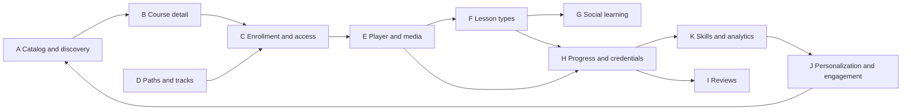

| Code | Sub-module                     | Features                      |
| ---- | ------------------------------ | ----------------------------- |
| A    | Catalog and discovery          | FR-LRN-001 to 007, FR-LRN-076 |
| B    | Course detail                  | FR-LRN-008 to 012             |
| C    | Enrollment and access          | FR-LRN-013 to 021             |
| D    | Paths and tracks               | FR-LRN-022 to 025             |
| E    | Player and media               | FR-LRN-026 to 040             |
| F    | Lesson types                   | FR-LRN-041 to 049             |
| G    | Social learning                | FR-LRN-050 to 054             |
| H    | Progress and credentials       | FR-LRN-055 to 062             |
| I    | Reviews                        | FR-LRN-063 to 065             |
| J    | Personalization and engagement | FR-LRN-066 to 070             |
| K    | Skills and analytics           | FR-LRN-071 to 075             |

## 4. Feature specifications

Notification opt-out classes used below (owned by NTF, planned): `TRANSACTIONAL` (cannot be disabled: receipts, access, security), `LEARNING` (progress and study reminders, user can disable per type), `SOCIAL` (replies, mentions), `PROMO` (recommendations by message, off by default).

### A. Catalog and discovery

### FR-LRN-001 — Course catalog listing

- **Sub-module:** A. Catalog and discovery
- **Priority / tier:** Must · R1
- **Source:** [SRC: SSOT §9.2 F-07 step 1] [DER]
- **Purpose and outcome:** Anyone can browse every visible published course in a fast, paged list and open one. Success is measured by the share of catalog views that reach a course detail page.
- **Roles and permissions:** `GUE: view` · `CAN: view, save, compare` · `STD: view incl. own-institution private courses` · `PAD: view all states with a state badge`
- **Preconditions and entry points:** Routes `/learn` (curated rails) and `/learn/courses` (full list); top navigation "Learn", dashboard, search results, sitemap, deep links. No account required.
- **User interactions and actions:**
  1. Open `/learn/courses`; the first 24 cards render.
  2. Scroll; the next page loads 200 px before the end. A visible "Load more" button is the keyboard and no-script fallback.
  3. Focus or hover a card to open a quick peek (summary, top three skills, total duration, last updated); press Enter or click to open the course (FR-LRN-008).
  4. Use the heart control to save (FR-LRN-007) or the compare checkbox (FR-LRN-006).
  5. Switch between grid and list with the layout toggle.
- **System behavior:** Returns only courses passing BR-LRN-001 and BR-LRN-002 from the catalog read model (ENT-LRN-01), which updates within 60 seconds of a publish, unpublish or takedown event from STU. Uses cursor pagination (default 24, max 48). Viewer-specific decorations (saved, enrolled, progress percent) are added per request and are never stored in shared caches. Home rails (for example "Continue learning", "New this month", "Popular in your goal") are separate queries, each labeled with why it is shown.
- **UI elements and controls:** Course card (16:9 thumbnail, title, lead instructor, level chip, rating average and count or "New", total duration, price or "Free", primary language, badges "Updated" and "Popular", progress ring when enrolled); layout toggle (grid default, list); result count; "Load more" button; skeleton cards while loading; heart and compare controls with accessible names ("Save course X").
- **Configuration options:** Platform: page size, rail composition and ordering, badge thresholds (`popularBadgeEnrollmentsPercentile`, default top 10 percent in category [PROP]). User: remembered layout (browser storage, per viewer). Org: institution catalog scope (which institution-private courses show).
- **Business rules:** BR-LRN-001, BR-LRN-002, BR-LRN-052
- **Validation:** `pageSize` integer 1 to 48; `cursor` opaque string issued by the server; an unknown or malformed filter value returns `422 invalid_filter` naming the allowed values rather than being ignored.
- **Inputs and outputs:** In: optional cursor, page size, filters (FR-LRN-004). Out: ordered list of card objects, `nextCursor`, `totalApprox`, applied-filter echo, and per-viewer decorations when authenticated.
- **Filters, sorting, search:** See FR-LRN-003 and FR-LRN-004; default sort is "Recommended" for signed-in users with consent, otherwise "Newest published".
- **Notifications and communication:** n/a — browsing triggers no messages.
- **Error handling and edge cases:** Empty catalog or empty filter result shows an empty state with a "Clear filters" action and three suggested categories. Backend failure shows an inline error with Retry and keeps already-loaded cards. A stale cursor (index rebuilt) restarts at the first page with a toast "The list was refreshed". A thumbnail that fails to load shows a neutral placeholder with the title. A course unpublished between list and open opens a "No longer available" page with similar courses (FR-LRN-066).
- **Dependencies:** ENT-LRN-01, FR-LRN-002, FR-LRN-004, STU publish events (`studio.course.published`), SRC (planned) index.
- **Security and privacy:** Public data only in shared responses; anonymous requests rate limited ([PROP] 60 per minute per IP); no per-user data in CDN-cached payloads; institution-private courses never appear to anonymous viewers or in counts.
- **Acceptance criteria:**
  1. Given 100 published and 5 draft courses, when a guest opens `/learn/courses`, then only published courses are listed and the first page has 24 cards.
  2. Given a course is unpublished by STU, when 60 seconds have passed, then it no longer appears in the list for any new request.
  3. Negative: Given a guest and an institution-private course, when the guest lists courses or requests the course by id, then the course is absent from results and counts and the direct request returns `404`.

### FR-LRN-002 — Taxonomy: categories, tags, levels and languages

- **Sub-module:** A. Catalog and discovery
- **Priority / tier:** Must · R1
- **Source:** [SRC: SSOT §9.2 F-07 step 1; BR-096] [PROP] for the tag governance and level definitions
- **Purpose and outcome:** Every course is classified in one shared vocabulary so learners can navigate and filter reliably. The system knows it works when no published course lacks a primary category and level.
- **Roles and permissions:** `PAD: create, rename, merge, retire categories and tags, define levels` · `INS: choose from the vocabulary via STU (FR-STU-007)` · `GUE, CAN: view`
- **Preconditions and entry points:** Platform admin console taxonomy screen (ADM, planned); category pages `/learn/c/:slug`; authoring forms in STU.
- **User interactions and actions:**
  1. PAD opens the taxonomy screen and sees the category tree (max depth 3), the flat tag list with usage counts, the fixed level set and the language list.
  2. PAD adds a category with name, slug, parent, description, icon and display order.
  3. PAD renames a category (slug redirect is created) or merges it into another (all courses re-pointed, old slug redirects).
  4. PAD retires a category or tag; courses keep it as a hidden label until the author re-classifies; new assignment is blocked.
  5. Learner opens `/learn/c/:slug` and sees the category description, sub-categories and its courses.
- **System behavior:** Enforces BR-LRN-003. Level set is fixed: `beginner`, `intermediate`, `advanced`, `all_levels`, each with a published definition shown as a tooltip (for example "beginner: no prior knowledge of the topic"). Tags are lower-case, deduplicated, with alias lists (for example "js" aliases "javascript"). Merge is a transactional job that re-indexes affected courses and emits `learning.taxonomy.changed`. Slug changes keep a permanent 301 redirect table. Tags created by authors enter as `proposed` and become usable by others only after PAD or an auto-approval rule (usage by two or more distinct instructors and no profanity match).
- **UI elements and controls:** Tree editor with drag to reorder; inline rename; "Merge into…" dialog with impact count; "Retire" button with confirm; tag table with alias editor; read-only level definitions.
- **Configuration options:** Platform: max category depth (3), max tags per course (10), tag auto-approval rule.
- **Business rules:** BR-LRN-003
- **Validation:** Category name 2 to 60 characters, unique among siblings; slug `[a-z0-9-]{2,60}` unique globally; tag 2 to 30 characters, no leading or trailing spaces, no punctuation except hyphen and plus; description up to 500 characters; merge target must be active and not a descendant of the source.
- **Inputs and outputs:** In: taxonomy edits. Out: updated tree, affected-course count, redirect entries, audit record.
- **Filters, sorting, search:** Admin tag list: search by text, filter by state (`proposed`, `active`, `retired`), sort by usage count or name.
- **Notifications and communication:** Instructors whose course uses a merged or retired term receive an in-app notice `lrn.taxonomy.course_reclassified` (`TRANSACTIONAL`).
- **Error handling and edge cases:** Merge into own descendant returns `409 cycle_detected`. Retiring a category that still has active courses requires choosing a replacement. Two admins editing the same node: the second save returns `409 stale_version` with a refresh prompt. Slug collision returns `409 slug_taken` with a suggested alternative.
- **Dependencies:** ADM (planned) admin console, SRC (planned) re-index, FR-STU-007.
- **Security and privacy:** Taxonomy edits are audited (who, what, before and after); only `PAD` may write; public read is cacheable.
- **Acceptance criteria:**
  1. Given categories A and B, when PAD merges A into B, then all A courses show category B, `/learn/c/a` redirects to `/learn/c/b`, and one audit record exists.
  2. Given a course with 10 tags, when the author adds an eleventh, then the request is rejected with `422 too_many_tags`.
  3. Negative: Given a non-admin user, when they call the taxonomy write endpoint, then the response is `403` and no change is stored.

### FR-LRN-003 — Catalog search with typeahead

- **Sub-module:** A. Catalog and discovery
- **Priority / tier:** Must · R1
- **Source:** [SRC: SSOT §7 F-34; §9.2 F-07] [DER]
- **Purpose and outcome:** A learner types what they want to learn and gets ranked, relevant courses, paths and instructors, tolerant of typos. Success is a non-empty result rate and a click-through on the first page.
- **Roles and permissions:** `GUE: search` · `CAN: search, see history` · `STD: search incl. own-institution courses`
- **Preconditions and entry points:** Search box in the Learn header and on `/learn/courses`; keyboard shortcut `/` focuses the box.
- **User interactions and actions:**
  1. Focus the search box; recent searches (signed-in, if enabled) and trending skills appear.
  2. Type at least two characters; after 150 ms a suggestion panel shows up to 8 items grouped into Courses, Paths, Skills and Instructors.
  3. Use Arrow Down and Up to move through suggestions, Enter to open one, or Enter on the raw text to open full results.
  4. On the results page, edit the query, apply filters (FR-LRN-004), or use "Did you mean" and "Search instead for".
  5. Clear recent searches with the "Clear history" control.
- **System behavior:** Queries SRC (planned) with a catalog scope; matches title, subtitle, skills, tags, instructor name, curriculum lesson titles and description with field boosts (title and skills highest) [PROP]. Applies typo tolerance (edit distance up to 2 for words of 5 or more characters), prefix match, synonym lists (for example "k8s" and "kubernetes") and language-aware stemming. Respects BR-LRN-001 and BR-LRN-002 before ranking. Records the query for relevance tuning under BR-LRN-061. Zero-result queries are logged (without user id) to feed catalog gap reports to STU.
- **UI elements and controls:** Combobox (role `combobox`, `aria-expanded`, `aria-activedescendant`); grouped suggestion list; clear-text button; "Did you mean" link; recent search chips with remove icon; results header with count.
- **Configuration options:** Platform: synonym lists, boost weights, minimum characters (2), debounce (150 ms). User: save search history (default on for signed-in users, off if personalization consent is withdrawn).
- **Business rules:** BR-LRN-001, BR-LRN-002, BR-LRN-061
- **Validation:** Query trimmed, 2 to 100 characters; control characters stripped; queries over 100 characters are truncated with a notice; operators are not supported (plain text only) and quotes request an exact phrase.
- **Inputs and outputs:** In: query text, optional filters, cursor. Out: suggestions, ranked results with highlighted matched fields, total, facets (FR-LRN-004), spelling suggestion.
- **Filters, sorting, search:** Is the search; sorting per FR-LRN-004 with default "Relevance".
- **Notifications and communication:** n/a — search triggers none.
- **Error handling and edge cases:** No results shows suggestions (broader terms, related categories, "browse all"). Search backend unavailable falls back to category browse with a notice "Search is temporarily limited". Query with only stop words returns top popular courses with a notice. Very rapid typing cancels earlier in-flight requests. Right-to-left languages are supported in input and highlighting.
- **Dependencies:** SRC (planned), ENT-LRN-01, FR-LRN-004.
- **Security and privacy:** Query text is personal data when linked to an account (BR-LRN-061); HTML in queries is escaped in all echoes; rate limit 30 searches per minute per client [PROP].
- **Acceptance criteria:**
  1. Given a course titled "Kubernetes for Developers", when a user types "kubernets", then it appears in the first page of results with the match highlighted.
  2. Given an institution-private course, when a user outside that institution searches its exact title, then it is not returned.
  3. Negative: Given the query ``, when searching, then the page shows the text escaped and no script executes.

### FR-LRN-004 — Catalog filters, facets and sorting

- **Sub-module:** A. Catalog and discovery
- **Priority / tier:** Must · R1
- **Source:** [SRC: SSOT §9.2 F-07 step 1] [DER]
- **Purpose and outcome:** Learners narrow and order the catalog by what matters to them. Success is that filtered views return results quickly and filter state is shareable by URL.
- **Roles and permissions:** `GUE, CAN, STD: use`
- **Preconditions and entry points:** Filter panel on `/learn/courses` and search results; category and skill pages inherit their scope as a locked filter.
- **User interactions and actions:**
  1. Open the filter panel (a sheet on mobile) and choose any facet value: category, skill, level, duration band, rating minimum, price (free, paid, included in my plan), language, subtitle language, format (self-paced, cohort-based, live sessions), has certificate, has hands-on practice, updated within period, accessibility features (captions, transcripts, audio description, keyboard-only friendly).
  2. See result count update after each selection (debounced 300 ms) and facet counts recompute.
  3. Pick a sort order: Recommended, Relevance (only with a query), Highest rated, Newest, Most enrolled, Shortest, Price low to high, Price high to low.
  4. Remove a filter via its chip or "Clear all".
  5. Copy or share the URL; it reproduces the same filters and sort.
- **System behavior:** Facets are computed over the visible set (BR-LRN-002). Within a facet values OR together; across facets AND. Rating filter uses only courses meeting BR-LRN-021. "Most enrolled" uses enrollments in the last 90 days, not lifetime, to reduce staleness [PROP]. "Recommended" uses FR-LRN-066 only for signed-in users with personalization consent; otherwise it silently equals "Newest" and the label shows "Newest" (honest labeling). Filter state is encoded in query parameters; unknown parameters are rejected.
- **UI elements and controls:** Checkbox groups with counts, dual-handle duration slider with text equivalent, star-minimum radio group, price radio group, language select, sort select (native `select` on mobile), active-filter chips, "Clear all" button, "Show N results" sticky button on mobile.
- **Configuration options:** Platform: duration bands (default under 2 h, 2 to 6 h, 6 to 17 h, over 17 h [PROP]), facets shown per category, new-badge window. User: none persisted beyond URL.
- **Business rules:** BR-LRN-002, BR-LRN-021, BR-LRN-044
- **Validation:** Each facet value must exist in the facet vocabulary; duration band ids from the configured set; sort from the enumerated list; at most 10 values per facet.
- **Inputs and outputs:** In: facet selections and sort as query parameters. Out: filtered results, facet counts, applied echo, canonical URL.
- **Filters, sorting, search:** The feature itself. Facets with zero count are shown disabled, never hidden, so learners understand the vocabulary.
- **Notifications and communication:** n/a — no messages.
- **Error handling and edge cases:** Combination yields zero results: empty state suggests removing the most restrictive filter by name. Filter references a retired category: value is ignored with a visible notice. Facet counts lag the list by at most the index refresh (up to 60 seconds) and counts are labeled "about" when the index is behind. A very long URL is truncated by the browser: filters are re-derived from stored view state where available.
- **Dependencies:** FR-LRN-001, FR-LRN-002, FR-LRN-003, SRC (planned).
- **Security and privacy:** Filters never embed personal data; "included in my plan" is resolved server-side from the caller's entitlements and never leaked in shared URLs (the URL carries the token `plan`, not the plan name).
- **Acceptance criteria:**
  1. Given courses in English and Spanish, when the learner selects language Spanish and level beginner, then only Spanish beginner courses show and counts match the list.
  2. Given sort "Highest rated", when two courses have equal rating, then the one with more reviews ranks first, and courses below the review threshold (BR-LRN-021) are not ranked by rating.
  3. Negative: Given the URL contains `level=expert`, when the page loads, then the response is `422 invalid_filter` listing the four allowed levels and the page shows an inline notice instead of silently ignoring it.

### FR-LRN-005 — Skill-based and goal-based browse

- **Sub-module:** A. Catalog and discovery
- **Priority / tier:** Should · R1
- **Source:** [SRC: SSOT §1.1 loop Goal→Gap→Learn; §9.1 F-84] [DER]
- **Purpose and outcome:** A learner chooses a skill or a career goal and sees the courses, paths and tracks that build it, ordered by fit. Success is enrollments that originate from skill pages.
- **Roles and permissions:** `GUE: view skill pages` · `CAN, STD: view plus "match to my gap"`
- **Preconditions and entry points:** `/learn/skills/:skill`, skill chips on course cards, "Close my gap" action from profile or goal screens (PRF and AIC, planned), career goal pages `/learn/goals/:goalSlug`.
- **User interactions and actions:**
  1. Open a skill page; see the skill definition, parent and related skills, courses ranked by how directly they teach it, and relevant paths.
  2. Toggle "Show only courses that award evidence for this skill".
  3. Signed-in learners with a declared goal see "Your gap" (skills in the goal not yet evidenced) and a button "Add all to my plan" (FR-LRN-025).
  4. Pick a proficiency target (for example "working level") to filter courses whose declared outcome meets it.
- **System behavior:** Joins catalog entries with the skills ontology: each course lists skills with an author-declared `targetLevel` and a `coverage` weight (primary, secondary). Ranking uses coverage, level fit, rating and recency. "Awards evidence" means the course has an assessed completion rule (BR-LRN-025) and is derived, not author-asserted. Gap data is read from the evidence graph (EVD, planned) with the viewer's consent; without consent the page shows the generic view.
- **UI elements and controls:** Skill header with definition, "related skills" chips, toggle "Awards evidence", level selector, ranked course list with a "Why this course" line (for example "primary skill, intermediate level"), "Add all to my plan" button.
- **Configuration options:** Platform: coverage weights. User: share goal with learning recommendations (consent in SET, planned).
- **Business rules:** BR-LRN-044, BR-LRN-046
- **Validation:** Skill slug must exist in the ontology else `404`; target level from the ontology scale.
- **Inputs and outputs:** In: skill or goal slug, level, toggle. Out: ranked courses and paths with explanation strings; gap list when permitted.
- **Filters, sorting, search:** Same facets as FR-LRN-004 plus level fit; default sort "Best match for skill".
- **Notifications and communication:** n/a — none.
- **Error handling and edge cases:** Skill with no courses shows "No courses yet" and a "Tell us you want this" request (stored as anonymous demand signal for STU). Ontology outage: page shows catalog-only view without gap. Retired or renamed skill redirects to its successor.
- **Dependencies:** EVD or AIC (planned) skills ontology and gap API, FR-LRN-025, FR-LRN-071.
- **Security and privacy:** Gap data is sensitive career data; shown only to the owner; never in shared URLs.
- **Acceptance criteria:**
  1. Given a goal needing skills S1 and S2 and evidence for S1, when the learner opens the goal page, then S2 is listed as the gap with courses ranked for S2.
  2. Given the learner withdrew personalization consent, when opening a skill page, then no gap section is shown and a note explains why.
  3. Negative: Given an unknown skill slug, when opening the page, then `404` with search suggestions is shown.

### FR-LRN-006 — Course comparison

- **Sub-module:** A. Catalog and discovery
- **Priority / tier:** Could · R3
- **Source:** [SRC: FREG F-67 "Categories, Discovery & Comparison"] [DER]
- **Purpose and outcome:** A learner compares up to three courses side by side to choose. Success is a comparison view that ends in an enrollment or a save.
- **Roles and permissions:** `GUE, CAN, STD: use`
- **Preconditions and entry points:** Compare checkbox on cards and detail pages; `/learn/compare?ids=a,b,c`.
- **User interactions and actions:**
  1. Tick compare on two or three courses; a tray appears at the bottom with their thumbnails.
  2. Activate "Compare" to open the table.
  3. Scan rows: price, duration, level, language, subtitles, format, skills covered, evidence awarded, prerequisites, certificate, rating, last updated, instructor, accessibility features. Differences are highlighted; a toggle "Show only differences" hides identical rows.
  4. Remove a column with its close button, or enroll or save from the column header.
- **System behavior:** Limit enforced per BR-LRN-053 (3 courses). Selection lives in the URL and browser storage; signed-in selection does not persist on the server. Data read from the catalog read model at view time.
- **UI elements and controls:** Compare tray with count and clear button; comparison table with sticky first column and header; difference toggle; per-column actions.
- **Configuration options:** Platform: comparison rows list and order.
- **Business rules:** BR-LRN-053
- **Validation:** `ids` must be 2 to 3 distinct visible course ids; invisible ids are dropped with a notice.
- **Inputs and outputs:** In: up to three course ids. Out: normalized comparison matrix.
- **Filters, sorting, search:** n/a — fixed rows; no filtering across courses.
- **Notifications and communication:** n/a — none.
- **Error handling and edge cases:** A fourth selection is refused with "You can compare up to 3 courses". A course becomes unavailable: its column shows "No longer available". Single course in URL redirects to its detail page.
- **Dependencies:** ENT-LRN-01, FR-LRN-008.
- **Security and privacy:** Only public catalog data shown; no personal data.
- **Acceptance criteria:**
  1. Given two selected courses, when the learner opens compare, then every configured row is shown with differences highlighted.
  2. Given three selected, when selecting a fourth, then it is refused with the limit message and the three remain.
  3. Negative: Given an id of an institution-private course the viewer cannot see, when opening the URL, then that column is dropped and a notice states one course was unavailable.

### FR-LRN-007 — Saved courses

- **Sub-module:** A. Catalog and discovery
- **Priority / tier:** Should · R1
- **Source:** [DER]
- **Purpose and outcome:** A learner bookmarks courses and paths to return to later. Success is that saved items convert to enrollments at a measurable rate.
- **Roles and permissions:** `CAN, STD: save, unsave, view own` · `GUE: prompt to sign in`
- **Preconditions and entry points:** Heart control on cards, detail, comparison and path pages; list at `/learn/saved`.
- **User interactions and actions:**
  1. Activate the heart; it fills and a toast "Saved" offers Undo.
  2. Open `/learn/saved`; items show current price, availability and any price change since saving.
  3. Reorder by drag or "Move up/down" menu; sort by date saved or title.
  4. Remove an item with its menu; enroll directly from the list.
- **System behavior:** Idempotent save keyed on (account, target). Limit per BR-LRN-053 (200). Price drop on a saved paid course creates an optional in-app notice. Items that become unavailable stay with a "Unavailable" badge for 30 days then are removed with a one-time notice.
- **UI elements and controls:** Toggle button (`aria-pressed`), saved list with cards, drag handle with keyboard alternative, sort select, bulk remove with select checkboxes.
- **Configuration options:** User: price-drop alerts on or off (default on, class `LEARNING`).
- **Business rules:** BR-LRN-053
- **Validation:** Target must exist and be visible at save time; duplicate saves are no-ops.
- **Inputs and outputs:** In: target id and type (course or path). Out: saved state, list.
- **Filters, sorting, search:** Sort by date saved, title, price change; filter by type (course, path) and availability.
- **Notifications and communication:** `lrn.saved.price_dropped` in-app and optional email, class `LEARNING`, recipient the saver, sent at most once per price change.
- **Error handling and edge cases:** Save at limit returns `409 wishlist_full` with a prompt to remove items. Offline save is queued and replayed. Unsaving while the list view is open updates without reload. Account erasure deletes the list.
- **Dependencies:** ENT-LRN-18, FR-LRN-001.
- **Security and privacy:** Private to the owner; never visible to instructors or other users; included in data export.
- **Acceptance criteria:**
  1. Given a signed-in learner, when they save a course twice, then one saved item exists.
  2. Given a saved paid course whose price drops, when the change is published, then one notice is created if alerts are on.
  3. Negative: Given 200 saved items, when saving another, then the request fails with `409 wishlist_full` and the list is unchanged.

### B. Course detail

### FR-LRN-008 — Course detail page

- **Sub-module:** B. Course detail
- **Priority / tier:** Must · R1
- **Source:** [SRC: SSOT §9.2 F-07 step 2; YASH-G3 SPEC-06 §4] [DER]
- **Purpose and outcome:** A visitor learns exactly what a course teaches, what it needs, what it costs and what they earn, then enrolls or saves it. Success is detail-to-enroll conversion and low post-enrollment refund rate.
- **Roles and permissions:** `GUE, CAN, STD: view` · `INS: view own course with an "Edit in Studio" link` · `PAD: view any state`
- **Preconditions and entry points:** `/learn/courses/:slug` (slug stable, with id-based fallback). The course is `published`, `unlisted` (link only) or visible by invite.
- **User interactions and actions:**
  1. Open the page; the summary strip shows title, subtitle, rating, learner count, level, duration, language, last updated, price and the primary action (Enroll, Continue, Buy, Request access, or Join waitlist).
  2. Read tabs or anchored sections: What you will learn, Skills and evidence earned, Curriculum (FR-LRN-009), Prerequisites (FR-LRN-010), Instructors (FR-LRN-011), Reviews (FR-LRN-064), Q&A preview (public questions only if instructor opted in), FAQ, Related courses.
  3. Play the promo video (autoplay never; muted until activated).
  4. Share via copy link or system share sheet; report the course (FR-LRN-075).
- **System behavior:** Renders from the published version snapshot, not from the draft. Primary action is computed server-side from the viewer state (not enrolled, enrolled, expired, locked with reason (FR-LRN-013)). Emits JSON-LD `Course` structured data on public pages; no learner data in the HTML (BR-LRN-052). Canonical URL points at the slug; non-canonical slugs redirect with 301. Page cache keyed by version and language; the action area is hydrated per viewer.
- **UI elements and controls:** Summary strip; sticky purchase card (price, coupon field if a coupon is applicable (STU), Enroll or Buy button, Save, Share, guarantee line showing the refund window from BR-LRN-010); section anchors; promo video; skills chips linking to FR-LRN-005; "Includes" list (hours of video, readings, quizzes, assignments, live sessions, downloadable resources, certificate, lifetime or limited access).
- **Configuration options:** Platform: refund-guarantee line on or off; "learners also viewed" on or off. Author: sections shown (STU landing editor).
- **Business rules:** BR-LRN-001, BR-LRN-002, BR-LRN-008, BR-LRN-021, BR-LRN-052
- **Validation:** Slug resolves to exactly one visible course; query params `coupon` (alphanumeric up to 32) and `invite` (token) validated server-side.
- **Inputs and outputs:** In: slug, optional coupon, invite token. Out: page model with version id, curriculum summary, price quote for this viewer, action state.
- **Filters, sorting, search:** n/a — single entity; reviews and Q&A have their own controls.
- **Notifications and communication:** n/a — viewing triggers none.
- **Error handling and edge cases:** Unpublished or taken-down course: `410 Gone` page with similar courses, except for existing enrollees who are routed to their learning space (BR-LRN-047). Region-blocked: explains the restriction without naming internal rules. Price fetch failure: shows the action as "Price unavailable, try again" and disables purchase. Invalid coupon: inline message and normal price remains. Unlisted course without the link: `404`.
- **Dependencies:** ENT-LRN-01, FR-LRN-009 to 013, FR-STU-014, BIL (planned) price quote.
- **Security and privacy:** Public page exposes only published data; invite tokens are single-purpose and not logged in analytics URLs; bot traffic is rate limited.
- **Acceptance criteria:**
  1. Given a published course, when a guest opens it, then price, duration, curriculum, skills and instructor are shown and no draft content appears.
  2. Given an enrolled learner, when opening the page, then the primary action reads "Continue" and links to their next lesson.
  3. Negative: Given a taken-down course and a non-enrolled visitor, when opening its URL, then `410` is returned and no content is rendered.

### FR-LRN-009 — Curriculum presentation and free previews

- **Sub-module:** B. Course detail
- **Priority / tier:** Must · R1
- **Source:** [SRC: SSOT §9.2 F-07 step 2; BR-094] [DER]
- **Purpose and outcome:** Visitors see the real structure of the course and can sample marked lessons without enrolling. Success is that preview use correlates with enrollment and that previews never expose protected content.
- **Roles and permissions:** `GUE, CAN, STD: view outline and preview lessons` · `Enrolled learners: full access`
- **Preconditions and entry points:** Curriculum section of the detail page and the player's curriculum drawer.
- **User interactions and actions:**
  1. Expand or collapse a section; "Expand all" toggles every section.
  2. See for each lesson: type icon (video, reading, quiz, assignment, project, live, practice), title, duration, and a "Preview" label when free.
  3. Activate a preview lesson to open it in a modal or the player in preview mode.
  4. At the end of a preview, see a prompt to enroll; next previews are offered.
- **System behavior:** Outline comes from the published version. Only lessons flagged `preview` by the author (maximum share enforced at publish by STU: 20 percent of content duration) are playable without enrollment (BR-LRN-008). Preview playback uses a preview token that is not tied to an account, expires in 5 minutes and is rate limited. Preview views never create progress. Section and lesson counts and total duration are computed from the version, not stored by hand.
- **UI elements and controls:** Accordion (`aria-expanded`), lesson rows with icons and durations, "Preview" pill, "Expand all" button, lock icon on non-preview lessons with the label "Enroll to access".
- **Configuration options:** Author: which lessons are preview (STU). Platform: preview token TTL (5 min), preview rate limit.
- **Business rules:** BR-LRN-008, BR-LRN-037
- **Validation:** Preview token must match lesson and course version; reuse after expiry returns `401 token_expired`.
- **Inputs and outputs:** In: course slug, lesson key (preview). Out: outline model; preview manifest for allowed lessons.
- **Filters, sorting, search:** Optional in-page search across lesson titles (client side, no network).
- **Notifications and communication:** n/a — none.
- **Error handling and edge cases:** Course with a single section is shown expanded. A preview lesson whose media is still processing hides its Preview label. Preview fetch fails: message with Retry and the outline stays usable. Free-preview abuse (scripted bulk fetching) is throttled with `429`.
- **Dependencies:** FR-STU-008, FR-STU-041 (publish rules), FR-LRN-039 (tokens), ENT-LRN-01.
- **Security and privacy:** Non-preview lesson URLs and manifests are never exposed to anonymous callers; titles are public, bodies are not.
- **Acceptance criteria:**
  1. Given a course with two preview lessons, when a guest opens the curriculum, then exactly those two are playable.
  2. Given a preview token older than 5 minutes, when reused, then `401 token_expired` is returned.
  3. Negative: Given a guest calls the manifest endpoint of a non-preview lesson, then `403` is returned and no media URL is issued.

### FR-LRN-010 — Prerequisites and readiness check

- **Sub-module:** B. Course detail
- **Priority / tier:** Should · R2
- **Source:** [SRC: SSOT §7 F-106; §9.2 F-07 step 7; BR-022] [DER]
- **Purpose and outcome:** Learners see what they should know first and whether they meet it, with a path to close any gap. Success is fewer early drop-outs caused by missing background.
- **Roles and permissions:** `GUE: view declared prerequisites` · `CAN, STD: view met or unmet state`
- **Preconditions and entry points:** Prerequisites section of the detail page; enrollment gate (FR-LRN-013).
- **User interactions and actions:**
  1. Read prerequisites listed as courses, skills with a minimum level, or free text "recommended background".
  2. Signed-in learners see each item as Met, Not met or Unknown, with the source of the verdict (for example "Completed course X on 12 May", "Evidence for SQL at working level").
  3. Activate "Close this gap" on an unmet item to open the course, path or assessment that satisfies it.
  4. Take an optional readiness quiz (an ASM practice assessment) to test out of a skill prerequisite; passing records readiness only for this course unless the quiz is an evidence-minting assessment.
- **System behavior:** Evaluates each structured prerequisite against the learner's completed enrollments and evidence graph (EVD, planned) with consent. Enforced prerequisites (author marks "required") block enrollment per BR-LRN-004; advisory ones only warn. Evaluation happens at enroll time and is not re-evaluated later (BR-LRN-045). Free-text items are never evaluated.
- **UI elements and controls:** Prerequisite rows with status icon and text (never color alone), "Close this gap" link, "Take readiness quiz" button, legend explaining Met, Not met and Unknown.
- **Configuration options:** Author: per item `required` or `recommended`, minimum level. Platform: whether institution assignment overrides enforced prerequisites (see BR-LRN-054).
- **Business rules:** BR-LRN-004, BR-LRN-045, BR-LRN-054
- **Validation:** Structured prerequisite references must exist (course id or ontology skill) and not form a cycle; minimum level from the ontology scale.
- **Inputs and outputs:** In: course version, viewer account. Out: per-item verdict with explanation, overall `canEnroll` and lock reason `prerequisite` when blocked.
- **Filters, sorting, search:** n/a — short list.
- **Notifications and communication:** n/a — none.
- **Error handling and edge cases:** Evidence service unavailable: items show Unknown and enforced items fail open only if the author marked the course "allow when unknown" [PROP]; otherwise enrollment is held with message "We couldn't check prerequisites, try again". No consent to read evidence: items show Unknown with a prompt to share or to self-declare (self-declaration is allowed only for advisory items). Prerequisite course retired: item is marked "Equivalent: <successor>" if STU set one, else ignored with a note.
- **Dependencies:** EVD (planned), FR-LRN-013, FR-STU-013, FR-ASM-011.
- **Security and privacy:** Verdict text reveals only what the viewer already owns; evidence details are not shown to guests.
- **Acceptance criteria:**
  1. Given an enforced prerequisite course not completed, when the learner views the page, then the item shows Not met and the primary action is a soft block with a link to the prerequisite.
  2. Given the learner completes the prerequisite, when revisiting, then the item shows Met with the completion date.
  3. Negative: Given enforced prerequisites unmet, when calling the enroll API directly, then `409 prerequisites_unmet` lists the unmet items and no enrollment is created.

### FR-LRN-011 — Instructor and ownership display

- **Sub-module:** B. Course detail
- **Priority / tier:** Must · R3
- **Source:** [SRC: SSOT §9.2 F-07 step 2; FREG F-74] [DER]
- **Purpose and outcome:** Learners see who teaches and who stands behind a course (individual, institution, employer, platform) and can judge credibility. Success is trust-related metrics such as lower refund rate for courses with verified instructors.
- **Roles and permissions:** `GUE, CAN, STD: view` · `INS: edit own profile via STU (FR-STU-004)`
- **Preconditions and entry points:** Instructor section on the detail page; instructor profile page `/learn/instructors/:handle`; "Offered by" line on cards.
- **User interactions and actions:**
  1. See the lead instructor and co-instructors with photo, headline, verification badge, rating across courses, learner count and a short bio.
  2. See "Offered by" when the owner differs from the instructor (for example an institution or company), with the owner's name and verification state.
  3. Open an instructor profile to see all their published courses, bio, credentials they chose to show, and aggregate rating.
  4. Report a profile (FR-LRN-075).
- **System behavior:** Ownership types: `instructor`, `institution`, `employer`, `platform`. Badge states: `identity_verified`, `expertise_verified` (from FR-STU-002), none. Aggregate ratings follow BR-LRN-021 and exclude refunded and own-institution reviews where flagged. Only data the instructor marked public is shown; email and payout data are never exposed. Courses owned by an institution show the institution as owner even if the instructor leaves; a removed instructor shows as "Former instructor" with name only if they consent.
- **UI elements and controls:** Instructor cards, verification badges with tooltip text, "Offered by" row with link, instructor profile page with course grid.
- **Configuration options:** Instructor: visibility of each profile field. Platform: badge definitions.
- **Business rules:** BR-LRN-019, BR-LRN-021
- **Validation:** Handles are unique, lower-case, 3 to 30 characters; profile links are sanitized.
- **Inputs and outputs:** In: course id or instructor handle. Out: instructor list with public fields and badges; owner object.
- **Filters, sorting, search:** Instructor page: sort courses by newest or rating.
- **Notifications and communication:** n/a — none.
- **Error handling and edge cases:** Instructor account suspended: their courses show "Instructor unavailable" and enrollments continue per BR-LRN-047 unless safety takedown. Deleted instructor account: name replaced with "Former instructor". Co-instructor limit exceeded is blocked in STU, not here.
- **Dependencies:** FR-STU-002, FR-STU-004, FR-STU-016, EVD (planned) for verification display.
- **Security and privacy:** Public profile only; minors' data rules apply to learner content, not instructors; scraping throttled.
- **Acceptance criteria:**
  1. Given a course owned by an institution and taught by an instructor, when viewing, then both the instructor and "Offered by <institution>" appear.
  2. Given an expertise-verified instructor, when viewing, then the badge appears with an explanatory tooltip.
  3. Negative: Given an instructor hid their photo, when viewing, then no photo is rendered and no URL to it is present in the page data.

### FR-LRN-012 — Course versions and change log

- **Sub-module:** B. Course detail
- **Priority / tier:** Should · R3
- **Source:** [SRC: YASH-G3 SPEC-06 §3.4; SSOT BR-093, BR-105] [DER]
- **Purpose and outcome:** Learners know which version they are on, what changed in newer versions and can choose to move over without losing progress. Success is no forced progress loss and a high opt-in rate for relevant updates.
- **Roles and permissions:** `CAN, STD: view change log, migrate own enrollment` · `INS: author change notes (STU)`
- **Preconditions and entry points:** "What's new" banner in the player and on My learning when a newer version exists for an active enrollment; detail page "Version history".
- **User interactions and actions:**
  1. See a banner "A newer version is available" with the summary of changes (added, changed, removed lessons and whether completion rules changed).
  2. Open the change log: versions with date, author note and lesson-level diff list.
  3. Choose "Switch to latest" or "Stay on my version" (dismiss for 30 days).
  4. On switching, review a mapping preview: lessons matched by `lessonKey` keep their status; new required lessons appear as not started; removed lessons keep completion in history.
- **System behavior:** Enrollment stays pinned to its version (BR-LRN-006). Migration is atomic: progress is mapped by `lessonKey`, completion is re-evaluated on the new rules and could change from completed to active only if the learner had not yet completed; a completed enrollment is never reopened (it may "view new content" without effect on credentials). Certificates are never altered by migration. Emits `learning.enrollment.migrated`.
- **UI elements and controls:** Banner, change-log drawer, "Switch to latest" and "Stay" buttons, mapping preview table, confirmation dialog.
- **Configuration options:** Author: change summary text and whether the update is `recommended`. Platform: banner snooze (30 days).
- **Business rules:** BR-LRN-006
- **Validation:** Migration allowed only to a published, newer version of the same course; learner must confirm the mapping preview.
- **Inputs and outputs:** In: enrollment id, target version. Out: new pinned version, progress mapping result.
- **Filters, sorting, search:** n/a — short list.
- **Notifications and communication:** `lrn.course.new_version` in-app and email (class `LEARNING`) to learners with active enrollments when the author marks the update recommended; at most once per version.
- **Error handling and edge cases:** Mapping conflict (lesson key reused for a different lesson) is blocked by STU; if found, migration aborts with `409 mapping_conflict` and an alert. Migration during an active attempt is refused until the attempt ends. Double-click switch is idempotent.
- **Dependencies:** FR-STU-019, ENT-LRN-03, ENT-LRN-05.
- **Security and privacy:** No new data exposure; audit entry records the switch.
- **Acceptance criteria:**
  1. Given a learner with 6 of 10 lessons complete and a new version that adds one lesson, when they switch, then six lessons stay complete and the new one is not started.
  2. Given the learner dismisses the banner, when 30 days have not passed, then it does not reappear.
  3. Negative: Given a completed enrollment, when the learner switches versions, then the status stays `completed` and the certificate is unchanged.

### C. Enrollment and access

### FR-LRN-013 — Eligibility gate and lock reasons

- **Sub-module:** C. Enrollment and access
- **Priority / tier:** Must · R1
- **Source:** [SRC: YASH-G3 SPEC-06 §3.2 (lock reasons `prerequisite`, `plan`, `region`)] [DER]
- **Purpose and outcome:** Before any enrollment the system decides, in one place, whether this learner may enroll, and tells them plainly why not. Success is that every blocked attempt shows a specific reason and next step.
- **Roles and permissions:** `CAN, STD: evaluated` · `SUP: view the evaluation for a user under a support grant`
- **Preconditions and entry points:** Any enroll, buy, redeem or assign action; the detail page primary action; the player entry check.
- **User interactions and actions:**
  1. Learner activates the primary action; the gate runs.
  2. If allowed, flow continues to FR-LRN-014, 015, 016, 017 or 018.
  3. If blocked, a panel names the reason and offers the single best next step (for example "Complete SQL Basics first", "Upgrade to access", "Not available in your region", "Account restricted, contact support").
- **System behavior:** Evaluates in order: course visible (BR-LRN-002), course accepting enrollments (not closed, not full, cohort window open), account active and not sanctioned, age or consent requirements for the course's content rating, region and sanctions restrictions (legal list from PLT or ADM, planned), prerequisites (FR-LRN-010), duplicate active enrollment (BR-LRN-005), plan or payment requirement. Returns the first failing reason code plus all failing codes for support. Lock reasons are an enumerated set: `not_visible`, `closed`, `full`, `account_restricted`, `age_or_consent`, `region`, `prerequisite`, `plan`, `payment_required`, `duplicate`. Evaluation is deterministic and side-effect free; it is re-run, not cached, at the moment of enrollment.
- **UI elements and controls:** Lock panel with icon and text, primary next-step button, "Why am I seeing this?" disclosure, link to support for `account_restricted`.
- **Configuration options:** Platform: region restriction lists, content ratings requiring age confirmation. Author: enrollment cap and close date (cohorts).
- **Business rules:** BR-LRN-002, BR-LRN-004, BR-LRN-005, BR-LRN-054
- **Validation:** Course id and account must resolve; evaluation never trusts client-supplied flags.
- **Inputs and outputs:** In: account, course, route (self, invite, assigned, plan). Out: `allowed` boolean, first reason, reason list, next-step suggestion.
- **Filters, sorting, search:** n/a — decision function.
- **Notifications and communication:** n/a — the panel is the notification; support contact only for `account_restricted`.
- **Error handling and edge cases:** Dependency (evidence, entitlement) outage returns `503 eligibility_unavailable` rather than allowing or blocking silently; the UI shows "We couldn't check eligibility, try again". Race: seat taken between check and enroll returns `409 full` at enroll time. Region unknown (VPN, no geolocation) uses account country; never blocks on IP alone.
- **Dependencies:** FR-LRN-010, BIL (planned) entitlement API, IDN (planned) account state, ADM (planned) restriction lists.
- **Security and privacy:** Reason text for `account_restricted` never reveals internal flags; region decisions logged without precise location.
- **Acceptance criteria:**
  1. Given a closed cohort course, when a learner activates Enroll, then the reason `closed` is shown with the next cohort date if any.
  2. Given a free open course and an eligible learner, when evaluated, then `allowed` is true with no reasons.
  3. Negative: Given a sanctioned account, when calling enroll directly, then `403 account_restricted` is returned and no enrollment row is created.

### FR-LRN-014 — Free enrollment

- **Sub-module:** C. Enrollment and access
- **Priority / tier:** Must · R1
- **Source:** [SRC: SSOT §9.2 F-07 step 3; YASH-G3 SPEC-06 §3.2; BR-046] [DER]
- **Purpose and outcome:** A learner enrolls in a free course in one action and lands in the player. Success is enrollment-to-first-lesson rate.
- **Roles and permissions:** `CAN, STD: enroll` · `INS: enroll as learner (BR-LRN-019 limits)`
- **Preconditions and entry points:** Detail page Enroll button; "Start learning" on cards; deep link from email or path. Signed in; gate (FR-LRN-013) allows.
- **User interactions and actions:**
  1. Activate "Enroll for free".
  2. If not signed in, authenticate (IDN, planned) and return to the same course with the action resumed.
  3. See a confirmation screen with what is included, version, access window (FR-LRN-019) and "Start first lesson".
- **System behavior:** `POST` enroll with an idempotency key; natural key (account, course) returns the existing active enrollment on repeat (BR-LRN-005). Creates enrollment `active` pinned to the current published version (BR-LRN-006), seeds lesson progress rows lazily, emits `learning.enrollment.created` and `learning.enrollment.activated`, and sends the confirmation. Enrollment confirmation response is under 300 ms p95 [PROP].
- **UI elements and controls:** "Enroll for free" button (disabled with spinner while pending), confirmation panel, "Start first lesson" button, "View my learning" link.
- **Configuration options:** Platform: whether free enrollment needs a verified email (default yes). Author: access window.
- **Business rules:** BR-LRN-005, BR-LRN-006, BR-LRN-009, BR-LRN-011
- **Validation:** Idempotency key required (UUID); course id exists; account state `active`.
- **Inputs and outputs:** In: course id, idempotency key, optional source (catalog, path, email). Out: enrollment id, state, pinned version, first-lesson link.
- **Filters, sorting, search:** n/a — single action.
- **Notifications and communication:** `lrn.enrollment.confirmed` email and in-app, class `TRANSACTIONAL`, recipient the learner, includes course title, start link and access window.
- **Error handling and edge cases:** Double click or two tabs: one enrollment, both calls return it. Course unpublished during action: `409 course_unavailable`. Verified email missing: gate reason `account_restricted` variant `email_unverified` with resend link. Offline click: action is not queued (enrollment needs the server); the UI says "You are offline".
- **Dependencies:** FR-LRN-013, IDN (planned), NTF (planned), ENT-LRN-03.
- **Security and privacy:** Source parameter validated against an allowlist; enrollment is personal data owned by the learner.
- **Acceptance criteria:**
  1. Given an eligible learner, when they enroll twice with different idempotency keys, then one active enrollment exists and both responses return it.
  2. Given a free course, when enrolled, then the pinned version equals the published version at that instant.
  3. Negative: Given an unverified email and the platform rule requiring it, when enrolling, then no enrollment is created and the learner sees the resend-verification action.

### FR-LRN-015 — Paid enrollment and checkout hand-off

- **Sub-module:** C. Enrollment and access
- **Priority / tier:** Must · R5
- **Source:** [SRC: SSOT BR-115; YASH-G3 SPEC-06 §3.2 (paid ⇒ `pending_payment`); SSOT Appendix E V61-21] [DER]
- **Purpose and outcome:** A learner buys a course; access starts only after verified payment. Success is zero access without payment and a smooth confirmation experience.
- **Roles and permissions:** `CAN, STD: purchase` · `FIN: view orders (BIL, planned)` · `SUP: assist`
- **Preconditions and entry points:** Detail page Buy button; cart-less single-course flow [PROP]; gate (FR-LRN-013) allows; price quote valid.
- **User interactions and actions:**
  1. Activate "Buy for <price>"; optionally apply a coupon (STU defines coupons).
  2. Review the order summary (price, taxes shown by BIL, refund window).
  3. Complete payment on the BIL-hosted checkout and be redirected back.
  4. See "We're confirming your payment" until the webhook is processed (poll or push up to 2 minutes, then an email follows).
  5. See success and "Start learning".
- **System behavior:** Creates enrollment `pending_payment` with the quote id and coupon (SM-LRN-01), then calls BIL (planned) to start checkout. Returning from checkout grants nothing (BR-LRN-007). Activation occurs on the verified `billing.purchase.fulfilled` event, idempotent on the payment event id. Unpaid enrollments `expire` after 24 hours. Prices are re-quoted at checkout creation; the learner sees the price they agreed. Payment failure, cancellation and delayed settlement update the enrollment and notify.
- **UI elements and controls:** Buy button, coupon input with Apply, order summary, "Confirming payment" status page with progress indicator and "Refresh" button, success page, failure page with "Try again" and "Use a different method".
- **Configuration options:** Platform: pending-payment TTL (24 h), poll duration (2 min), coupon stacking (none). Author: price and coupons (STU).
- **Business rules:** BR-LRN-005, BR-LRN-006, BR-LRN-007, BR-LRN-010
- **Validation:** Quote id must be unexpired (15 minutes [PROP]) and match course and version; coupon format and applicability validated by STU or BIL.
- **Inputs and outputs:** In: course id, coupon code, idempotency key. Out: enrollment `pending_payment`, checkout redirect URL; later activation event.
- **Filters, sorting, search:** n/a — single flow.
- **Notifications and communication:** `lrn.payment.pending` (in-app), `lrn.enrollment.confirmed` (email, `TRANSACTIONAL`), `lrn.payment.failed` (email, `TRANSACTIONAL`).
- **Error handling and edge cases:** Webhook delayed: status page stays "processing", lesson endpoints return `403`; activation happens when the event arrives. Webhook arrives before redirect: page shows success immediately. Event order inverted (invoice before checkout): final state is still a single activation. Double purchase attempt: second checkout is refused with `409 duplicate` while one is pending. Price changed after quote: learner is shown the new price and must reconfirm. Payment provider outage: purchase disabled with banner.
- **Dependencies:** BIL (planned) checkout and webhooks, FR-STU-033, FR-STU-034, FR-LRN-013, ENT-LRN-03.
- **Security and privacy:** No card data in LRN; success redirect parameters are untrusted; webhook signature verified in BIL; purchase records have financial retention.
- **Acceptance criteria:**
  1. Given a paid course, when the learner completes checkout and the webhook arrives, then the enrollment becomes `active` exactly once even if the event is redelivered.
  2. Given the checkout success redirect without a webhook, when the learner opens a lesson, then `403` is returned and the status page says processing.
  3. Negative: Given a pending enrollment unpaid for 24 hours, when the sweep runs, then it becomes `expired` and no access was ever granted.

### FR-LRN-016 — Institution-managed enrollment

- **Sub-module:** C. Enrollment and access
- **Priority / tier:** Must · R3
- **Source:** [SRC: SSOT §7 F-40, F-50; §10.20 BR-072..BR-082; YASH-G3 SPEC-06 §2] [DER]
- **Purpose and outcome:** An institution or employer assigns courses to a batch of its learners; learners see them as assigned work with the institution's deadlines. Success is exact seat accounting and clear learner understanding of what is mandatory.
- **Roles and permissions:** `IAD, PLO: assign courses to members (INS planned)` · `STD: see assigned courses, accept, start` · `EXA: assign for employees (ENT, planned)` · `SUP: view`
- **Preconditions and entry points:** Assignment created in INS (planned); learner sees "Assigned to you" on the dashboard and in notifications.
- **User interactions and actions:**
  1. Learner opens the assignment from the dashboard; sees assigner, due date, whether mandatory and whether progress is visible to the institution.
  2. Learner activates "Start" (or "Accept" if consent to share progress is required).
  3. Learner works the course as usual; due-date reminders appear.
  4. On completion the institution sees completion per its visibility scope.
- **System behavior:** INS creates the assignment and consumes a seat or license; LRN creates an enrollment with `route=institution`, `assignmentId`, due date and a visibility scope recorded on the enrollment. Institution assignment may override advisory and, if the institution policy allows, enforced prerequisites; the override is recorded (BR-LRN-054). Seat return and reassignment on removal are INS rules; LRN sets the enrollment `suspended` or `dropped` per the INS decision event and keeps progress for 90 days (BR-LRN-012). Progress visible to the institution is limited to the scope stated to the learner before the first lesson.
- **UI elements and controls:** Assignment card with due date and mandatory label, visibility disclosure panel ("Your institution can see: completion, scores; not: notes, discussions"), Accept and Start buttons, due-date chip.
- **Configuration options:** Institution: due dates, mandatory flag, visibility scope (completion only, completion and scores, full progress), reminder schedule (INS, planned). Platform: visible-fields catalog.
- **Business rules:** BR-LRN-005, BR-LRN-028, BR-LRN-054
- **Validation:** Assignment must reference a course the institution may license (public with seat, institution-private, or institution-owned); learner must be an active member of the assigning institution.
- **Inputs and outputs:** In: `ins.assignment.created` event (assignment id, learner, course, due date, scope). Out: enrollment record; `learning.enrollment.created` event; completion events to INS.
- **Filters, sorting, search:** Dashboard filter "Assigned" and sort by due date.
- **Notifications and communication:** `lrn.assignment.received` (email and in-app, `TRANSACTIONAL`), `lrn.assignment.due_soon` (3 days and 1 day, class `LEARNING`), `lrn.assignment.overdue` (`LEARNING`), recipient the learner; institution recipients are INS rules.
- **Error handling and edge cases:** Learner already enrolled self-paced: the existing enrollment is linked to the assignment (no duplicate, BR-LRN-005) and progress is kept. Learner leaves the institution: the assignment ends; progress retained; the visibility scope stops applying immediately. Seat unavailable: INS refuses before LRN is called. Learner declines consent where required: enrollment stays `pending_assignment` and the institution sees "not accepted".
- **Dependencies:** INS (planned), FR-LRN-013, FR-LRN-049, ENT-LRN-03.
- **Security and privacy:** Institution visibility strictly scoped and shown to the learner; notes, bookmarks and discussion posts never visible to institutions (BR-LRN-029); FERPA-style handling per SET (planned).
- **Acceptance criteria:**
  1. Given an assignment with scope "completion only", when the learner finishes, then the institution receives completion and no scores.
  2. Given an existing self-paced enrollment, when an assignment arrives, then no second enrollment is created and the assignment link is attached.
  3. Negative: Given a learner who left the institution, when the institution requests progress, then no data is returned.

### FR-LRN-017 — Invite links and access codes

- **Sub-module:** C. Enrollment and access
- **Priority / tier:** Should · R3
- **Source:** [PROP] (Udemy/Teachable-style private access) [DER]
- **Purpose and outcome:** An instructor or institution gives specific people access using a link or a code, including for private or unlisted courses. Success is correct redemption with no leakage of unlisted courses.
- **Roles and permissions:** `INS: create and revoke codes for own courses (STU)` · `IAD: create for institution courses` · `CAN, STD: redeem`
- **Preconditions and entry points:** Link `/learn/redeem?code=…` or "Have a code?" field on the detail page and My learning.
- **User interactions and actions:**
  1. Learner opens the link or types a code and activates Redeem.
  2. If not signed in, authenticates and returns.
  3. Sees the course summary and what the code grants (free access, discount, seat in a cohort), then confirms.
  4. Lands in the player or in checkout with a discount applied.
- **System behavior:** Code types: `access` (free enrollment), `discount` (percentage or fixed, applied to checkout), `cohort_seat`. Each code has uses limit (single, N, unlimited), expiry, optional email-domain restriction, and creator. Redemption is atomic and idempotent per (code, account). Codes are 12 characters from an unambiguous alphabet, stored hashed; failed attempts are rate limited (BR-LRN-055). Redeeming grants `route=invite` enrollment which passes the gate (FR-LRN-013) except for safety reasons.
- **UI elements and controls:** Code input with paste support, Redeem button, result panel, "Copy link" and "Revoke" controls on the creator side (STU).
- **Configuration options:** Creator: uses, expiry (default 30 days), domain restriction. Platform: max active codes per course (1,000 [PROP]), failed-attempt limit.
- **Business rules:** BR-LRN-005, BR-LRN-055
- **Validation:** Code format and checksum validated before lookup; expired, revoked or exhausted codes return distinct reasons; email-domain restriction compares verified email domain.
- **Inputs and outputs:** In: code. Out: grant summary, enrollment or checkout with discount.
- **Filters, sorting, search:** Creator view lists codes by status, creator and course (STU).
- **Notifications and communication:** `lrn.invite.redeemed` in-app to the creator (class `SOCIAL`) for named-recipient invites; `lrn.invite.sent` email to the invitee when the creator sends by email (`TRANSACTIONAL`).
- **Error handling and edge cases:** Exhausted code: "This code has been used up". Code for a course the learner is already in: shows "You already have access" and does not consume a use. Brute force: after 5 failures per 10 minutes the client is delayed and after 20 the account is locked from redeeming for 1 hour. Link opened by a different person than the named invitee: access is granted only if the code is not email-bound.
- **Dependencies:** FR-STU-034, FR-LRN-013, FR-LRN-014, FR-LRN-015, IDN (planned).
- **Security and privacy:** Codes never logged in clear; unlisted course titles are revealed only to code holders; link previews (social cards) for unlisted courses show a generic card.
- **Acceptance criteria:**
  1. Given a single-use access code, when two learners redeem simultaneously, then exactly one succeeds and the other receives `409 code_exhausted`.
  2. Given a discount code, when the learner proceeds to checkout, then the quote reflects the discount and respects the platform minimum price.
  3. Negative: Given 6 wrong codes in 10 minutes, when a seventh is tried, then the attempt is delayed with `429` and no lookup is performed.

### FR-LRN-018 — Plan-entitled access

- **Sub-module:** C. Enrollment and access
- **Priority / tier:** Should · R5
- **Source:** [SRC: SSOT §9.2 F-07 step 3 (entitlement free/paid/Pro/Team/institutional); V61-09] [DER]
- **Purpose and outcome:** Learners on a subscription or team plan access included courses without per-course purchase, and lose new access cleanly when the plan ends. Success is correct entitlement mapping with no orphan access.
- **Roles and permissions:** `CAN, STD: use` · `EXA: manage team licences (BIL/ENT planned)`
- **Preconditions and entry points:** Course shows "Included in your plan"; plan filter (FR-LRN-004); enrollment action.
- **User interactions and actions:**
  1. Learner sees the "Included" badge and activates "Start with my plan".
  2. If not entitled, sees "Upgrade to access" with plan options (BIL, planned).
  3. When the plan lapses, sees a banner on affected enrollments with the end date and options to renew or keep access by purchasing the course.
- **System behavior:** The catalog marks `entitlementKinds` per course (free, paid, plan tiers). Enrollment created `route=plan` links to the entitlement id. On `billing.entitlement.ended`, linked enrollments become `expired` after the grace period (default 7 days [PROP]); progress and earned credentials are kept (BR-LRN-056). Re-subscribing within retention restores the enrollment and progress.
- **UI elements and controls:** "Included" badge, "Start with my plan" button, upgrade panel, expiry banner with date.
- **Configuration options:** Platform: grace period; which plans include which courses (BIL, STU).
- **Business rules:** BR-LRN-005, BR-LRN-007, BR-LRN-056
- **Validation:** Entitlement verified server-side at enrollment and on each content request (cached max 60 s).
- **Inputs and outputs:** In: entitlement id, course. Out: enrollment with route `plan`.
- **Filters, sorting, search:** FR-LRN-004 price facet "Included in my plan".
- **Notifications and communication:** `lrn.plan.access_ending` (7 days and 1 day before, `TRANSACTIONAL`), `lrn.plan.access_ended` (`TRANSACTIONAL`).
- **Error handling and edge cases:** Entitlement service unavailable: existing sessions keep working up to the cached TTL then show "We couldn't verify your plan" and allow read-only cached lessons. Downgrade mid-course: access to courses outside the new plan expires after grace. Refund of subscription: treated as entitlement end.
- **Dependencies:** BIL (planned), FR-LRN-019, ENT-LRN-03.
- **Security and privacy:** Entitlement checks server-side only; no plan details in public URLs.
- **Acceptance criteria:**
  1. Given an active plan including a course, when the learner enrolls, then the enrollment is `active` with route `plan` and no payment is requested.
  2. Given the plan ends, when the grace period passes, then the enrollment becomes `expired` and the certificate already earned remains verifiable.
  3. Negative: Given a learner without the entitlement, when calling the enroll API with route `plan`, then `403 plan_required` is returned.

### FR-LRN-019 — Access window, expiry and extension

- **Sub-module:** C. Enrollment and access
- **Priority / tier:** Should · R3
- **Source:** [SRC: SSOT §9.2 F-07 state machine (`expired`: window elapsed, cohort end)] [DER]
- **Purpose and outcome:** Courses can offer lifetime, fixed-duration or cohort-bound access, and learners always know when access ends and what happens then. Success is no surprise expiries.
- **Roles and permissions:** `CAN, STD: view window, request extension` · `INS: grant extension (own course)` · `SUP: grant extension with reason` · `IAD: extend institution assignments`
- **Preconditions and entry points:** Course page "Access" line; My learning countdown; expiry banners.
- **User interactions and actions:**
  1. See access type and end date on the detail page and in My learning ("Access until 30 Sep, 12 days left").
  2. Activate "Request extension", choose a reason from a list and optionally add a note.
  3. Receive the decision; if approved the end date moves.
  4. After expiry, open the course in read-only "Expired" mode: see progress, certificates and notes but no lessons.
- **System behavior:** Window types: `lifetime`, `fixed_days` (from activation), `fixed_date`, `cohort_bound`. A sweep job expires enrollments at the end instant (server time, user time zone shown). Expiry preserves progress for 90 days and credentials always (BR-LRN-011). Extension grants are recorded with grantor, reason and new end; automatic extension on a pause is defined in FR-LRN-020. Re-purchase or re-enroll after expiry restores progress if within 90 days.
- **UI elements and controls:** Access chip with date and countdown, "Request extension" dialog, expired-state banner with "Re-enroll" action.
- **Configuration options:** Author: window type and length (STU). Platform: default window, retention (90 days), reminder schedule (14, 7, 1 days).
- **Business rules:** BR-LRN-011, BR-LRN-012
- **Validation:** Extension length 1 to 365 days [PROP]; reason from the enumerated list; at most 3 extensions per enrollment without staff approval [PROP].
- **Inputs and outputs:** In: enrollment id, extension request or grant. Out: updated end date, event.
- **Filters, sorting, search:** My learning filter "Expiring soon" (within 14 days).
- **Notifications and communication:** `lrn.access.expiring` at 14, 7 and 1 days (`LEARNING`); `lrn.access.expired` (`TRANSACTIONAL`); `lrn.access.extended` (`TRANSACTIONAL`).
- **Error handling and edge cases:** Learner mid-lesson at expiry: the current lesson finishes loading but new content requests return `403 access_expired` and progress already queued still saves. Clock skew: server time is authoritative. Offline downloads expire with the enrollment (FR-LRN-037).
- **Dependencies:** FR-LRN-020, FR-LRN-037, FR-STU-033, ENT-LRN-03.
- **Security and privacy:** Extension audit trail with grantor identity; support grants limited to reason codes.
- **Acceptance criteria:**
  1. Given a 90-day window, when day 91 begins, then the enrollment is `expired` and content endpoints return `403 access_expired`.
  2. Given an approved extension of 30 days, when granted, then the end date moves by 30 days and an audit entry exists.
  3. Negative: Given a learner who expired 120 days ago, when re-enrolling, then progress is not restored (retention exceeded) and a fresh enrollment starts.

### FR-LRN-020 — Drop, pause and re-enroll

- **Sub-module:** C. Enrollment and access
- **Priority / tier:** Should · R1
- **Source:** [SRC: SSOT §9.2 F-07 state machine (`dropped`); YASH-G3 SPEC-06 §3.2 (t6/t7, 90 days)] [DER] [PROP] for pause
- **Purpose and outcome:** Learners can step away deliberately without losing progress, and can return. The system also learns why people leave.
- **Roles and permissions:** `CAN, STD: drop, pause, resume, re-enroll` · `IAD: drop on behalf for assigned (INS)`
- **Preconditions and entry points:** My learning course menu; course page.
- **User interactions and actions:**
  1. Open "Manage enrollment", choose Pause or Drop.
  2. For Drop, pick an optional reason (too hard, too easy, no time, content outdated, found another course, other) with free text up to 300 characters; Drop is confirmed in a dialog stating progress is kept for 90 days.
  3. For Pause, choose a resume date (default 30 days, max 90 days) or none.
  4. Later, activate "Resume" or "Re-enroll"; progress is restored.
- **System behavior:** Drop moves the enrollment to `dropped` (terminal, BR-LRN-012); re-enroll creates a new enrollment linked to the old (`restoredFrom`), restoring progress if within retention. Pause is only for self-paced courses with a time-bound window: it freezes the access clock (extending the end date by the paused duration up to a cap) and is not available for cohort-bound or institution-assigned courses (BR-LRN-058). Paid enrollments: drop does not itself refund (see FR-LRN-021). Exit reasons feed FR-STU-048 analytics in aggregate only.
- **UI elements and controls:** "Manage enrollment" menu, Pause dialog with date picker, Drop dialog with reason radio group and text area, Resume button.
- **Configuration options:** Platform: pause cap (90 days), retention (90 days), pause allowed per enrollment (1 time).
- **Business rules:** BR-LRN-012, BR-LRN-058
- **Validation:** Reason from enumerated list; note up to 300 characters, stripped of HTML; resume date between tomorrow and cap.
- **Inputs and outputs:** In: enrollment id, action, reason. Out: new state, dates.
- **Filters, sorting, search:** My learning filters: In progress, Paused, Completed, Dropped.
- **Notifications and communication:** `lrn.enrollment.pause_ending` 3 days before resume (`LEARNING`); `lrn.enrollment.dropped` confirmation in-app only.
- **Error handling and edge cases:** Drop while an assessment attempt is open: attempt must be submitted or abandoned first, with a warning. Paused enrollment hits expiry despite pause: clock frozen so it cannot. Double click drop is idempotent. Instructor sees only aggregate reasons.
- **Dependencies:** FR-LRN-019, FR-LRN-021, ENT-LRN-03, ENT-LRN-04.
- **Security and privacy:** Reason text is personal data visible to the instructor only in aggregate unless the learner opts to share.
- **Acceptance criteria:**
  1. Given an active enrollment, when the learner drops and re-enrolls on day 89, then progress is restored.
  2. Given a pause for 30 days on a 90-day window ending in 40 days, when resumed after 30 days, then the end date moves out by 30 days.
  3. Negative: Given a cohort-bound course, when the learner chooses Pause, then the option is absent and the API returns `409 pause_not_allowed`.

### FR-LRN-021 — Refund request and access revocation

- **Sub-module:** C. Enrollment and access
- **Priority / tier:** Should · R5
- **Source:** [SRC: SSOT BR-100; §24.5 OD-29; YASH-G3 SPEC-06 §3.5 (t8, t9)] [DER]
- **Purpose and outcome:** A learner who bought a course can request a refund inside the policy and see the decision; the system removes access and handles credentials consistently. Success is a refund decision for each request within the stated time and no orphan access.
- **Roles and permissions:** `CAN, STD: request` · `SUP: approve or reject within policy` · `FIN: execute, approve exceptions` · `PAD: policy override with audit`
- **Preconditions and entry points:** My learning orders list, course menu "Request refund"; visible while inside the window.
- **User interactions and actions:**
  1. Open the order; see eligibility: "Eligible for a full refund until <date>" or "Pro-rated" or "Not eligible", with the rule shown.
  2. Choose a reason and add a note.
  3. Confirm; see the consequence ("You will lose access immediately").
  4. Track status: Requested, Approved, Refunded or Rejected with reason.
- **System behavior:** Eligibility by BR-LRN-010: full within the window and progress below the threshold; pro-rated per BIL policy above it; after completion only by human exception, in which case a human issuer revokes the linked evidence and certificate (BR-LRN-024, BR-LRN-025). On approval BIL executes the refund; LRN receives `billing.refund.completed` and moves the enrollment to `refunded` (terminal), removes access, ends offline licenses, and marks the learner's review as excluded from aggregates (BR-LRN-020). Auto-approval inside the window is configurable.
- **UI elements and controls:** Eligibility panel, reason select, note area, confirm checkbox, status tracker.
- **Configuration options:** Platform: `refundWindowDays` (default 30, OD-LRN-03), `refundProgressThresholdPct` (default 20), auto-approve on or off.
- **Business rules:** BR-LRN-010, BR-LRN-020, BR-LRN-024, BR-LRN-025
- **Validation:** Request must reference a paid, non-refunded order; reason required; one open request per order.
- **Inputs and outputs:** In: order id, reason. Out: request id, eligibility result, state.
- **Filters, sorting, search:** Support queue: filter by state, age and amount (ADM, planned).
- **Notifications and communication:** `lrn.refund.requested`, `lrn.refund.decided`, `lrn.refund.completed`, all `TRANSACTIONAL`, recipient the learner; SUP receives queue items.
- **Error handling and edge cases:** Refund executes but the webhook is late: state shows "Refund processing"; access is removed at approval, not at settlement. Abuse pattern (repeated buy-complete-refund): flagged for FIN review; access revoked pending review only after a human decision. Refund requested during an active exam attempt: attempt is closed as `abandoned`.
- **Dependencies:** BIL (planned), FR-LRN-064, FR-LRN-059, FR-STU-037.
- **Security and privacy:** Reason and note are personal data; instructor sees only counts; refund records have financial retention.
- **Acceptance criteria:**
  1. Given 10 percent progress on day 10, when the learner requests a refund and it is approved, then the enrollment is `refunded`, access ends and a refund event is emitted once.
  2. Given 50 percent progress, when requesting, then the panel shows "Pro-rated" with the rule text and routes to review.
  3. Negative: Given a completed course with a certificate, when requesting a refund, then it is not auto-approved and requires a human exception that records a reason.

### D. Paths and tracks

### FR-LRN-022 — Learning path and track catalog

- **Sub-module:** D. Paths and tracks
- **Priority / tier:** Should · R3
- **Source:** [SRC: SSOT §7 F-70; WF-31] [PROP] for the track level above paths · also [SRC: SSOT §7 F-129 Leadership Development (as a role-based track)]
- **Purpose and outcome:** Learners browse curated sequences of courses (paths) and role-based groupings of paths (tracks) and see total effort and outcome before starting. Success is path enrollments per catalog view.
- **Roles and permissions:** `GUE, CAN, STD: view` · `INS, IAD: author paths via STU` · `PAD: curate tracks`
- **Preconditions and entry points:** `/learn/paths`, `/learn/paths/:slug`, `/learn/tracks/:slug`; links from skill, goal and course pages.
- **User interactions and actions:**
  1. Browse paths and tracks with the same filters as courses (FR-LRN-004) plus "sequenced" and "capstone included".
  2. Open a path: see ordered courses with duration, skills, whether order is enforced, capstone, program certificate and total price or inclusion in plan.
  3. Open a track: see its paths grouped by stage (foundation, core, specialization).
  4. Enroll in the path (FR-LRN-023) or save it (FR-LRN-007).
- **System behavior:** A path is a published, versioned ordered list of course references with optional `sequenced` flag, optional capstone and optional program certificate rule. A path displays only courses the viewer may see; hidden members show as "Institution course". Totals are computed. A track is a platform-curated grouping with a target role label from the ontology.
- **UI elements and controls:** Path card, ordered course list with connectors, "Sequenced" badge, capstone and certificate chips, total effort, track stage columns.
- **Configuration options:** Platform: track curation. Author: sequencing and certificate rules.
- **Business rules:** BR-LRN-001, BR-LRN-002, BR-LRN-042
- **Validation:** Path has 2 to 30 courses; no course repeated; every course published at path publish time.
- **Inputs and outputs:** In: slug, filters. Out: path model with courses, totals, rules.
- **Filters, sorting, search:** Facets as FR-LRN-004; sort by duration, newest, enrolled.
- **Notifications and communication:** n/a — none.
- **Error handling and edge cases:** A member course unpublished: path shows it as "Unavailable" and path completion treats it as waived only if the author configured a replacement, else the path is flagged to its owner. Empty track: not listed.
- **Dependencies:** FR-STU-019, FR-LRN-001, ENT-LRN-10.
- **Security and privacy:** Public data only.
- **Acceptance criteria:**
  1. Given a sequenced path of 4 courses, when opened, then the courses appear in order with the sequenced badge and total duration.
  2. Given an institution-private member course, when a guest opens the path, then that member shows only as "Institution course".
  3. Negative: Given a path with a repeated course, when publishing, then it is rejected with `422 duplicate_course`.

### FR-LRN-023 — Path enrollment and progression

- **Sub-module:** D. Paths and tracks
- **Priority / tier:** Should · R3
- **Source:** [SRC: SSOT §7 F-70; BR-106; WF-31] [DER]
- **Purpose and outcome:** A learner enrolls once in a path and moves through its courses in the declared order with unified progress. Success is path completion rate.
- **Roles and permissions:** `CAN, STD: enroll, continue, leave`
- **Preconditions and entry points:** Path page "Enroll in path"; dashboard "Continue path".
- **User interactions and actions:**
  1. Activate "Enroll in path"; see which courses are free, included, or need purchase (price total and per course).
  2. Start the first available course; completed courses show a check; locked courses show the reason ("Finish Course 2 first").
  3. See the path progress bar and the next recommended lesson on the dashboard.
  4. Leave the path (courses already started remain enrolled).
- **System behavior:** Creates a path enrollment (SM-LRN-06) and individual course enrollments lazily when the learner starts each course (or all upfront for assigned paths). When `sequenced`, course N+1 is gated on course N completion (BR-LRN-042); otherwise any order. Path progress is derived from member enrollments, never stored as truth. Paid members route to FR-LRN-015 with an optional bundle price from BIL (planned).
- **UI elements and controls:** Path progress bar, course rows with state icons and text, "Start", "Continue", "Leave path" controls.
- **Configuration options:** Author: sequencing. Platform: bundle pricing (BIL).
- **Business rules:** BR-LRN-005, BR-LRN-042
- **Validation:** One active path enrollment per (account, path); all courses must be visible to the learner.
- **Inputs and outputs:** In: path id. Out: path enrollment, member states.
- **Filters, sorting, search:** My learning filter "Paths".
- **Notifications and communication:** `lrn.path.course_unlocked` in-app (`LEARNING`) when the next course unlocks.
- **Error handling and edge cases:** Member already completed earlier: counts immediately. Member course replaced by a newer course in the path: learner keeps the old one until completed, and credit maps via `equivalentTo`. Path updated mid-way: pinned to the path version with opt-in migration like FR-LRN-012.
- **Dependencies:** FR-LRN-022, FR-LRN-014, FR-LRN-015, ENT-LRN-11.
- **Security and privacy:** Personal progress only to the owner and scoped institution.
- **Acceptance criteria:**
  1. Given a sequenced path, when course 1 completes, then course 2 unlocks and a notice is created.
  2. Given a learner who completed course 3 earlier, when enrolling in the path, then course 3 shows complete.
  3. Negative: Given a sequenced path, when starting course 3 before course 2, then the API returns `403 path_order` naming course 2.

### FR-LRN-024 — Programs, capstone and program certificate

- **Sub-module:** D. Paths and tracks
- **Priority / tier:** Could · R3
- **Source:** [SRC: SSOT BR-110; FREG F-70 "Programs & Specializations"; J-20] [DER]
- **Purpose and outcome:** A path can end in a capstone project and award a program certificate that proves completion of the whole program. Success is verifiable program credentials with exact rules.
- **Roles and permissions:** `CAN, STD: submit capstone, view certificate` · `INS: review capstone` · `PAD: revoke`
- **Preconditions and entry points:** Path with `program=true`; capstone unlocks after required courses complete.
- **User interactions and actions:**
  1. Complete all required courses; see "Capstone unlocked".
  2. Submit the capstone (FR-LRN-046).
  3. Receive the review result; resubmit if returned.
  4. On pass receive the program certificate and see evidence added.
- **System behavior:** Program certificate rule: all required courses complete at their pinned versions and capstone passed (BR-LRN-042). Issued once per path enrollment (FR-LRN-059 mechanism, type `program`). Evidence hand-off follows FR-LRN-071 with `issuerRef=path:<id>@<version>`.
- **UI elements and controls:** Capstone card with requirements checklist, submission button, status chip, certificate button.
- **Configuration options:** Author: capstone required or optional, rubric, reviewer type (instructor, peer).
- **Business rules:** BR-LRN-025, BR-LRN-042
- **Validation:** Capstone cannot be submitted until required courses complete.
- **Inputs and outputs:** In: capstone submission. Out: review, certificate.
- **Filters, sorting, search:** n/a — single item.
- **Notifications and communication:** `lrn.capstone.reviewed` (`TRANSACTIONAL`), `lrn.program.completed` (`TRANSACTIONAL`).
- **Error handling and edge cases:** Required course later retired: waived only by an explicit author decision recorded on the path version. Reviewer unavailable beyond SLA: escalates to owner.
- **Dependencies:** FR-LRN-046, FR-LRN-059, FR-LRN-071, FR-STU-031.
- **Security and privacy:** Capstone content visible only to reviewers and the learner unless shared by the learner.
- **Acceptance criteria:**
  1. Given all courses complete and capstone passed, when evaluated, then one program certificate is issued.
  2. Given capstone returned for revision, when resubmitted and passed, then the certificate is issued once.
  3. Negative: Given one required course incomplete, when the capstone is submitted by API, then `409 program_incomplete` is returned.

### FR-LRN-025 — Personal learning plan

- **Sub-module:** D. Paths and tracks
- **Priority / tier:** Should · R4
- **Source:** [SRC: SSOT §7 F-156 "Professional Development Plan"; WF-42] [DER]
- **Purpose and outcome:** A learner arranges courses, paths and assessments into an ordered plan with target dates toward a goal. Success is plan items completed on schedule.
- **Roles and permissions:** `CAN, STD: create, edit, delete own plans`
- **Preconditions and entry points:** "Add to plan" on cards, skill pages and the goal-gap view; `/me/learning/plan`.
- **User interactions and actions:**
  1. Add items to a plan or create a plan from a goal's gap ("Add all").
  2. Reorder items by drag or menu; set target dates per item or an overall date.
  3. See a feasibility hint (total hours versus weekly commitment, FR-LRN-068).
  4. Mark items done or remove them.
- **System behavior:** A plan has up to 50 items (BR-LRN-043); plans never gate enrollment (BR-LRN-043). Items link to catalog entries; status mirrors enrollments. Plan changes emit events for AIC (planned) to adapt recommendations. Dates drive reminders (FR-LRN-070).
- **UI elements and controls:** Sortable list, date pickers, progress per item, feasibility message, "Share with mentor" toggle (MEN, planned).
- **Configuration options:** User: reminders on or off; share with mentor.
- **Business rules:** BR-LRN-043
- **Validation:** Target dates not in the past at creation; item must be visible.
- **Inputs and outputs:** In: items, dates. Out: plan with computed status.
- **Filters, sorting, search:** Filter by status; sort by order or date.
- **Notifications and communication:** `lrn.plan.item_due` (`LEARNING`).
- **Error handling and edge cases:** Item becomes unavailable: kept with badge and replacement suggestion. Over-capacity plan shows a non-blocking warning.
- **Dependencies:** FR-LRN-005, FR-LRN-068, FR-LRN-070, ENT-LRN-12.
- **Security and privacy:** Private; shared only on explicit toggle.
- **Acceptance criteria:**
  1. Given a goal gap of 3 skills, when the learner adds all, then a plan with matching items exists.
  2. Given a plan with 20 hours and a 2-hour weekly commitment, when dates fall in 4 weeks, then a warning appears.
  3. Negative: Given 50 items, when adding a 51st, then `409 plan_full` is returned.

### E. Player and media

### FR-LRN-026 — Learning player shell

- **Sub-module:** E. Player and media
- **Priority / tier:** Must · R1
- **Source:** [SRC: SSOT §9.2 F-07 step 4; YASH-G3 SPEC-06 §4] [DER]
- **Purpose and outcome:** One immersive workspace holds the lesson, the curriculum, notes, Q&A and progress so the learner never loses place. Success is time-to-first-content under 3 seconds and low navigation friction.
- **Roles and permissions:** `CAN, STD: use (enrolled)` · `GUE: preview lessons only` · `INS: preview mode via STU`
- **Preconditions and entry points:** `/learn/courses/:slug/lessons/:lessonKey`; "Continue" buttons deep-link to the next incomplete lesson.
- **User interactions and actions:**
  1. Open a lesson; the main area renders its type (video, reading, quiz, assignment, project, live, practice).
  2. Toggle the curriculum drawer to see sections, completion marks and locks; jump to any available lesson.
  3. Use Previous and Next (Next is enabled after the lesson's completion rule is met or the lesson is optional; "Skip" is offered where free navigation is on).
  4. Open side panels: Notes (FR-LRN-052), Q&A (FR-LRN-050), Resources (FR-LRN-041), Transcript (FR-LRN-031).
  5. Leave via "Back to course" or the course title link.
- **System behavior:** Every content request is authorized against the enrollment (BR-LRN-009) and, if sequential, against lesson locks (BR-LRN-018). The shell remembers the last lesson per enrollment and restores it on return. Progress events batch and flush every 15 seconds, on lesson change and on page hide; they replay after reconnect (BR-LRN-013). On a narrow screen panels become bottom sheets and the drawer a full-screen modal.
- **UI elements and controls:** Header (course title, progress bar, account menu), main pane, curriculum drawer (`nav` landmark, current lesson `aria-current`), Previous and Next buttons, panel tabs, "Saved" sync indicator, focus-mode toggle that hides panels.
- **Configuration options:** User: default panel, focus mode, remembered drawer state. Author: free versus sequential navigation (STU).
- **Business rules:** BR-LRN-009, BR-LRN-013, BR-LRN-018
- **Validation:** Lesson key must exist in the pinned version; locked lessons return `403 lesson_locked` with the blocking lesson.
- **Inputs and outputs:** In: enrollment, lesson key. Out: lesson payload (manifest or body), navigation model, saved position.
- **Filters, sorting, search:** Drawer search filters lesson titles client side.
- **Notifications and communication:** n/a — none from the shell; sync failure shows an inline banner.
- **Error handling and edge cases:** Lesson content fails to load: message with Retry and "Report a problem" (FR-LRN-075), drawer still usable. Enrollment expired mid-session: banner and read-only state. Two tabs open: the latest tab owns playback (BR-LRN-036). Progress queue over 500 events: oldest position events are dropped, completion events never.
- **Dependencies:** FR-LRN-027 to 040, FR-LRN-057, ENT-LRN-05.
- **Security and privacy:** No content URLs without a valid token (BR-LRN-037); analytics events carry ids only, no content text.
- **Acceptance criteria:**
  1. Given an enrolled learner, when opening "Continue", then the player shows the first incomplete lesson at the saved position.
  2. Given the connection drops, when the learner completes a lesson offline, then the event is queued and the server decides completion after replay.
  3. Negative: Given a locked lesson, when its URL is opened directly, then the player shows the lock reason and requests no media.

### FR-LRN-027 — Video core controls

- **Sub-module:** E. Player and media
- **Priority / tier:** Must · R1
- **Source:** [SRC: SSOT §9.2 F-07 step 4; §13.14] [DER]
- **Purpose and outcome:** The learner controls playback with familiar, reliable controls. Success is playback start under 3 seconds and zero stuck states.
- **Roles and permissions:** `CAN, STD, GUE (preview): use`
- **Preconditions and entry points:** A video lesson in the player; manifest and token available (FR-LRN-039).
- **User interactions and actions:**
  1. Click the video or the Play button to play; press again to pause.
  2. Drag the progress bar to seek; hover shows time and a thumbnail (FR-LRN-035). Use the 10-second back and forward buttons.
  3. Adjust volume with the slider; click the speaker to mute.
  4. At the end, see "Up next" with a 5-second countdown that can be canceled; autoplay of the next lesson is a user setting (default off).
  5. Double-click the video to toggle fullscreen on desktop.
- **System behavior:** Plays HLS or DASH renditions through the platform player (provider-agnostic engine, STU-022) with buffering indicator after 300 ms stall. Volume and mute persist per user. Autoplay respects browser policies: if blocked the player shows the Play control and never loops silently. Playback events (`play`, `pause`, `seek`, `ended`, `error`) are sent to the progress service in batches. On `ended` the lesson completion check runs (FR-LRN-036).
- **UI elements and controls:** Play or Pause (`button`, name changes), progress slider (`role=slider`, value text "3:12 of 10:40"), back 10 and forward 10 buttons, volume slider and mute, current time and duration text, settings menu (speed, quality, captions), fullscreen button, "Up next" overlay with Cancel.
- **Configuration options:** User: autoplay next (default off), remembered volume, skip interval (10 s default, options 5, 10, 15, 30). Platform: autoplay countdown seconds.
- **Business rules:** BR-LRN-013, BR-LRN-015, BR-LRN-036
- **Validation:** Seek target clamped to [0, duration]; volume 0 to 100.
- **Inputs and outputs:** In: user input events. Out: playback state, progress events.
- **Filters, sorting, search:** n/a — control surface.
- **Notifications and communication:** n/a — none.
- **Error handling and edge cases:** Media error code mapped to messages: network (Retry), expired token (silent refresh once then Retry), unsupported format (fallback rendition), unavailable (FR-LRN-040 fallback). Playback stalls over 10 seconds suggest lowering quality. Window loses focus: playback continues unless the user set "pause when I leave" (default off).
- **Dependencies:** FR-LRN-039, FR-LRN-036, FR-STU-022.
- **Security and privacy:** Playback events carry no IP in analytics; token binding per FR-LRN-039.
- **Acceptance criteria:**
  1. Given a loaded video, when the learner presses Play, then playback begins within 3 seconds on a reference connection [PROP].
  2. Given the video ends with autoplay off, when "Up next" shows, then the next lesson does not start until the learner chooses it.
  3. Negative: Given an expired token mid-play, when the player refreshes once and fails again, then it shows a Retry message and does not loop requests.

### FR-LRN-028 — Playback speed

- **Sub-module:** E. Player and media
- **Priority / tier:** Must · R1
- **Source:** [SRC: SSOT §9.2 F-07 step 4; YASH-G3 SPEC-06 §4 "speed 0.5–2×"] [DER]
- **Purpose and outcome:** Learners watch faster or slower to suit themselves. Success is accurate speed persistence and correct progress accounting.
- **Roles and permissions:** `CAN, STD: use`
- **Preconditions and entry points:** Settings menu in the player; keyboard shortcuts (FR-LRN-033).
- **User interactions and actions:**
  1. Open Settings, then Speed, and pick 0.5, 0.75, 1, 1.25, 1.5, 1.75, 2 (and 2.5 or 3 if enabled).
  2. Or press `Shift+>` or `Shift+<` to step up or down.
  3. Hold the Space bar for temporary 2x playback [PROP] (release returns to prior speed).
- **System behavior:** Speed applies instantly with audio pitch correction. Speed persists per user and optionally per course. Watched-time accounting uses media time, not wall time, so speed does not distort completion (BR-LRN-015). Providers lacking `supportsPlaybackSpeed` hide the control (BR-LRN-033).
- **UI elements and controls:** Speed submenu with radio items, on-video toast "1.5x", header label when not 1x.
- **Configuration options:** User: remember speed globally or per course (default global), allow speeds above 2x (default off). Platform: maximum speed (3x).
- **Business rules:** BR-LRN-015, BR-LRN-033
- **Validation:** Allowed speeds from the configured list only.
- **Inputs and outputs:** In: speed choice. Out: playback rate, stored preference.
- **Filters, sorting, search:** n/a — menu.
- **Notifications and communication:** n/a — none.
- **Error handling and edge cases:** Browser rejects a rate: player falls back to the nearest supported rate with a toast. Live sessions and live recordings in progress hide speed above 1x until recording is complete.
- **Dependencies:** FR-LRN-027, FR-LRN-036, FR-LRN-040.
- **Security and privacy:** Preference stored with the account; no sensitive data.
- **Acceptance criteria:**
  1. Given speed 1.5x, when the learner reloads the lesson, then the player starts at 1.5x.
  2. Given a 10-minute video watched at 2x for its full length, when it ends, then watched-time is 10 media minutes.
  3. Negative: Given a provider without speed support, when opening the menu, then no speed control is shown rather than a non-working one.

### FR-LRN-029 — Quality selection, adaptive streaming and data saver

- **Sub-module:** E. Player and media
- **Priority / tier:** Must · R1
- **Source:** [SRC: SSOT §13.13 to §13.15 (HLS renditions)] [PROP] for bandwidth rules and data saver
- **Purpose and outcome:** Video adapts to the learner's connection and the learner can override it. Success is low rebuffering and the ability to learn on weak networks, including audio-only.
- **Roles and permissions:** `CAN, STD, GUE (preview): use`
- **Preconditions and entry points:** Settings menu, Quality; global data-saver setting in Learning settings.
- **User interactions and actions:**
  1. Leave quality on Auto (default) or choose a fixed rendition (for example 1080p, 720p, 480p, 360p, 240p, Audio only).
  2. See the current effective quality in the menu ("Auto (720p)").
  3. Turn on Data saver in settings: caps at 480p on mobile data and disables preloading of the next lesson.
  4. Choose "Audio only" to hear the lesson with a still poster and transcript.
- **System behavior:** Adaptive bitrate algorithm picks the highest rendition the measured throughput sustains with a 15-second buffer target [PROP]; switches down fast and up slowly. Auto respects the data saver cap. Network type (where available) selects default caps: cellular defaults to 480p only if data saver is on. The player reports quality-switch and rebuffer metrics (anonymous) for operations. Audio-only uses the audio rendition and keeps progress accounting. Providers without `canTrackPlayback` show no quality control.
- **UI elements and controls:** Quality submenu (radio), "Auto" label with effective rendition, data-saver toggle in settings, audio-only poster state.
- **Configuration options:** User: data saver, default quality, audio-only default for mobile data. Platform: rendition ladder, buffer targets.
- **Business rules:** BR-LRN-015, BR-LRN-033
- **Validation:** Renditions must be in the lesson's manifest; fixed choice falls back to nearest if missing.
- **Inputs and outputs:** In: quality choice, network signals. Out: selected rendition; metrics.
- **Filters, sorting, search:** n/a — menu.
- **Notifications and communication:** n/a — none; a toast suggests data saver after 3 rebuffer events in 2 minutes.
- **Error handling and edge cases:** Selected rendition fails (404): fallback to the next lower with a toast. Throughput collapses: switches to audio-only suggestion. Offline playback uses the downloaded rendition only. Rendition missing for old lessons: manifest-driven list so no dead options.
- **Dependencies:** FR-STU-022, FR-LRN-027, FR-LRN-037.
- **Security and privacy:** Metrics contain no user identifier beyond an anonymous session id.
- **Acceptance criteria:**
  1. Given throughput drops from 5 to 1 Mbps, when playing in Auto, then the rendition steps down without stopping playback where buffer allows.
  2. Given data saver on and mobile data, when playing, then the cap is 480p and the next lesson is not preloaded.
  3. Negative: Given a fixed 1080p choice and a manifest lacking 1080p, when playing, then the nearest available rendition plays and a toast explains.

### FR-LRN-030 — Captions and subtitles

- **Sub-module:** E. Player and media
- **Priority / tier:** Must · R1
- **Source:** [SRC: YASH-MICRO FEAT-08-03.3; SSOT §13.14 `supportsCaptions`] [DER]
- **Purpose and outcome:** Learners read the spoken content in the language they choose, with readable styling. Success is caption availability on every published video and accurate labeling.
- **Roles and permissions:** `CAN, STD, GUE (preview): use`
- **Preconditions and entry points:** CC button and Settings, Subtitles.
- **User interactions and actions:**
  1. Press `c` or the CC button to turn captions on or off.
  2. Open Settings, Subtitles, and choose a language from those available (caption tracks and translated subtitles).
  3. Open Caption style: size, font, text color, background color and opacity, edge style, position (top or bottom).
  4. See the "Auto-generated" tag where captions were not reviewed by the author.
- **System behavior:** Captions on by default if the user chose "Captions always on" or the account accessibility preference says so; otherwise default off with a first-use prompt. Track selection order: user's last choice, then UI language, then course language. Tracks are WebVTT sidecars (not burned in) served with the same token authorization. Auto-generated tracks carry a label until the author marks them reviewed (BR-LRN-035). Style is applied by the player and persisted per account.
- **UI elements and controls:** CC toggle (`aria-pressed`), language list, style dialog with live preview, "Auto-generated" tag, "Report caption error" link (FR-LRN-075).
- **Configuration options:** User: captions always on, language preference, style. Platform: minimum contrast ratio for presets (4.5:1).
- **Business rules:** BR-LRN-035
- **Validation:** Style values from allowed sets; contrast presets cannot go below 4.5:1 unless the user explicitly picks a custom color.
- **Inputs and outputs:** In: track choice, style. Out: caption cues rendered; stored preference.
- **Filters, sorting, search:** n/a — short language list.
- **Notifications and communication:** n/a — none.
- **Error handling and edge cases:** Track fails to load: toast "Captions unavailable" and continue without. Cue out of sync reported by learners (3 reports) flags the lesson to the author. Provider video lacking caption support shows no CC control and the transcript (FR-LRN-031) if available. Right-to-left and CJK scripts render with correct direction and line breaking.
- **Dependencies:** FR-STU-023, FR-LRN-031, FR-LRN-038.
- **Security and privacy:** Preference storage only; reports contain lesson id and time.
- **Acceptance criteria:**
  1. Given captions in English and Spanish, when the learner selects Spanish, then cues in Spanish show and the choice persists on the next lesson.
  2. Given only an auto-generated track, when captions show, then the "Auto-generated" tag is visible.
  3. Negative: Given no caption track, when the lesson loads, then the CC control is disabled with the text "No captions for this lesson" rather than hidden.

### FR-LRN-031 — Interactive transcript

- **Sub-module:** E. Player and media
- **Priority / tier:** Must · R1
- **Source:** [SRC: SSOT §9.2 F-07 step 4 (transcript); YASH-MICRO FEAT-08-03.3] [DER]
- **Purpose and outcome:** Learners read, search and jump through the transcript synchronized with the video. Success is use by learners who cannot or prefer not to listen.
- **Roles and permissions:** `CAN, STD, GUE (preview): use`
- **Preconditions and entry points:** Transcript panel tab in the player; available on lessons with a transcript.
- **User interactions and actions:**
  1. Open the Transcript panel; the current sentence is highlighted and scrolls into view.
  2. Click a sentence to seek to its time.
  3. Search within the transcript; matches are highlighted and Enter moves to the next.
  4. Toggle "Follow playback" to stop auto-scroll.
  5. Download the transcript as text or copy a selection with its timestamp (copy as quote adds the course attribution).
- **System behavior:** Transcript cues come from the same data as captions plus speaker labels where provided. Search is client side. Download is limited to enrolled learners and respects the author's `allowTranscriptDownload` flag. Selecting text can create a note anchored to the time (FR-LRN-052).
- **UI elements and controls:** Panel with list of timed cues (`role=list`), search input, "Follow playback" switch, download menu, per-cue "Make note" button.
- **Configuration options:** Author: allow download. User: follow playback default on.
- **Business rules:** BR-LRN-035
- **Validation:** Search up to 100 characters; download limited to once per lesson per minute.
- **Inputs and outputs:** In: click, search text. Out: seek, highlights, file.
- **Filters, sorting, search:** In-transcript text search.
- **Notifications and communication:** n/a — none.
- **Error handling and edge cases:** No transcript: panel shows "A transcript isn't available" and the author-reported accessibility gap is logged. Very long transcript (over 2 hours) is virtualized. Out-of-order cues are sorted by start time. Screen readers do not announce every cue change (live region disabled by default).
- **Dependencies:** FR-STU-023, FR-LRN-030, FR-LRN-052.
- **Security and privacy:** Transcript content follows course access; scraping throttled.
- **Acceptance criteria:**
  1. Given a playing lesson, when the learner clicks a sentence, then the video seeks to that sentence's start within 300 ms.
  2. Given a search for "index", when pressing Enter twice, then the second match is focused and scrolled into view.
  3. Negative: Given an author who disabled downloads, when a learner requests the download, then `403 download_disabled` is returned and the control is absent.

### FR-LRN-032 — Fullscreen, theater mode and picture-in-picture

- **Sub-module:** E. Player and media
- **Priority / tier:** Must · R1
- **Source:** [SRC: SSOT §9.2 F-07 step 4; §13.14 `supportsFullscreen`, `supportsPictureInPicture`] [DER]
- **Purpose and outcome:** Learners watch in the layout they prefer, including while working in another window. Success is stable state across mode changes.
- **Roles and permissions:** `CAN, STD: use`
- **Preconditions and entry points:** Buttons in the control bar; shortcuts `f`, `t`, `i`.
- **User interactions and actions:**
  1. Press `f` or the button to enter fullscreen; Esc exits.
  2. Press `t` for theater mode (wide player, panels collapse below).
  3. Press `i` or the PiP button to float the video above other windows.
  4. In PiP, play, pause and seek use the browser PiP controls; closing PiP returns to the page.
- **System behavior:** Uses standard Fullscreen and PiP APIs; capability detection hides unsupported controls (never shows dead buttons). Captions and chapters remain visible in fullscreen. In fullscreen, controls hide after 3 seconds of inactivity and reappear on mouse move or key press. State (volume, speed, captions) survives mode changes. In PiP, completion tracking continues. On iOS Safari the native fullscreen player is used.
- **UI elements and controls:** Fullscreen button, theater button, PiP button, exit controls, auto-hiding control bar that never hides while keyboard focus is on it.
- **Configuration options:** User: start in theater mode, auto-PiP when switching tabs (default off).
- **Business rules:** BR-LRN-033, BR-LRN-036
- **Validation:** n/a — no free-text inputs; modes are toggles.
- **Inputs and outputs:** In: mode toggles. Out: layout state.
- **Filters, sorting, search:** n/a — control.
- **Notifications and communication:** n/a — none.
- **Error handling and edge cases:** Fullscreen denied by the browser: toast with reason. PiP unsupported: control hidden and a tooltip in settings explains. Switching lessons in PiP is not supported: PiP closes and the next lesson loads in the page. Orientation change on mobile keeps fullscreen.
- **Dependencies:** FR-LRN-027, FR-LRN-033.
- **Security and privacy:** n/a — no data; the protected-playback overlay stays in PiP where supported.
- **Acceptance criteria:**
  1. Given fullscreen with captions on, when exiting with Esc, then captions and position are unchanged.
  2. Given PiP active, when the learner switches tabs, then the video keeps playing and progress events continue.
  3. Negative: Given a browser without PiP support, when viewing the control bar, then no PiP button is rendered.

### FR-LRN-033 — Keyboard shortcuts

- **Sub-module:** E. Player and media
- **Priority / tier:** Must · R1
- **Source:** [SRC: SSOT §21.4 (WCAG 2.2 AA); YASH-G3 SPEC-06 §4 "keyboard shortcuts"] [DER]
- **Purpose and outcome:** Every player action is reachable from the keyboard with discoverable shortcuts. Success is a fully keyboard-operable lesson (accessibility gate).
- **Roles and permissions:** `CAN, STD, GUE (preview): use`
- **Preconditions and entry points:** Focus is inside the player region; `?` opens the shortcut list.
- **User interactions and actions:**
  1. Press: `Space` or `k` play and pause; `j` back 10 s and `l` forward 10 s; `Left` and `Right` back and forward 5 s; `Up` and `Down` volume; `m` mute; `f` fullscreen; `t` theater; `i` PiP; `c` captions; `Shift+>` and `Shift+<` speed; `0` to `9` jump to 0 to 90 percent; `,` and `.` frame step when paused; `Home` and `End` start and end; `n` and `p` next and previous lesson; `b` add bookmark; `Shift+n` add note at current time; `?` shortcut help; `Esc` close dialogs.
  2. Open "Keyboard shortcuts" from Settings to see and, where allowed, remap keys.
  3. Turn shortcuts off globally (for screen reader and voice-control users who need single-key conflicts avoided).
- **System behavior:** Shortcuts are active only when focus is in the player or the page body, never while typing in an input, textarea, or contenteditable. A visible focus ring is always shown. Remaps are validated for conflicts with browser and assistive technology reserved keys. Shortcut help is a modal dialog with focus trap and returns focus on close.
- **UI elements and controls:** Shortcut help dialog (table), remap fields, "Disable single-key shortcuts" switch, tooltips listing the key beside each control.
- **Configuration options:** User: remaps and disable switch. Platform: default map.
- **Business rules:** BR-LRN-036
- **Validation:** One action per key; reserved keys (Tab, Enter on focused controls, browser shortcuts) not remappable.
- **Inputs and outputs:** In: key events. Out: actions; saved map.
- **Filters, sorting, search:** n/a — static list.
- **Notifications and communication:** n/a — none.
- **Error handling and edge cases:** Conflicting remap rejected with the existing owner of the key named. Non-US keyboard layouts use key codes for `,` and `.` equivalents and display layout-appropriate labels. Shortcuts while a modal is open are suppressed.
- **Dependencies:** FR-LRN-027 to 035, FR-LRN-052.
- **Security and privacy:** Remaps stored with account preferences only.
- **Acceptance criteria:**
  1. Given focus on the player, when pressing `k` then `l`, then playback pauses and then jumps 10 seconds ahead.
  2. Given focus in the notes text area, when typing the letter `m`, then the video is not muted.
  3. Negative: Given the learner tries to remap `Tab`, when saving, then it is rejected with `reserved_key`.

### FR-LRN-034 — Resume playback and cross-device position

- **Sub-module:** E. Player and media
- **Priority / tier:** Must · R1
- **Source:** [SRC: YASH-MICRO FEAT-08-03.1; SSOT §9.2 F-07 step 4 "resume-from-last-position"] [DER]
- **Purpose and outcome:** Learners return to where they stopped, on any device. Success is resume accuracy within 5 seconds.
- **Roles and permissions:** `CAN, STD: use`
- **Preconditions and entry points:** Opening any video lesson with a stored position; "Continue" buttons.
- **User interactions and actions:**
  1. Open a lesson; if the saved position is 5 seconds or more and under 95 percent, a prompt offers "Resume at 12:04" or "Start over"; default focus is Resume.
  2. Choose either; the choice applies immediately.
  3. On another device, the same prompt shows the latest position.
- **System behavior:** Position events are sent every 15 seconds, on pause, seek, lesson change and page hide. The server stores the position with the highest server timestamp per (enrollment, lesson), tie-broken by `clientSeq` (BR-LRN-013, BR-LRN-016). Position never changes completion. "Start over" resets position but not completion. Version migration maps positions by `lessonKey` if the media asset is unchanged, else resets.
- **UI elements and controls:** Resume prompt (non-modal banner over the video, auto-resumes after 5 seconds if the user has "Always resume" on), "Start over" button.
- **Configuration options:** User: always resume without asking (default off), clear all positions.
- **Business rules:** BR-LRN-013, BR-LRN-016
- **Validation:** Position clamped to [0, duration]; events with `clientSeq` lower than stored are ignored.
- **Inputs and outputs:** In: position events. Out: stored position, resume offer.
- **Filters, sorting, search:** n/a — per lesson.
- **Notifications and communication:** n/a — none.
- **Error handling and edge cases:** Offline: last local position is stored and replayed. Clock skew between devices: server time decides. Media replaced by the author: position reset with a note. Position near the end (95 percent or more): no resume prompt, lesson starts from the beginning.
- **Dependencies:** FR-LRN-026, FR-LRN-027, ENT-LRN-06.
- **Security and privacy:** Position data is learner-private; instructors see only aggregate drop-off curves.
- **Acceptance criteria:**
  1. Given a pause at 120 seconds on a phone, when opening on a laptop, then the prompt offers 2:00.
  2. Given position events with sequence 7 then 5, when processed, then the stored position is from sequence 7.
  3. Negative: Given a position at 96 percent, when opening, then no resume prompt shows and playback starts at 0:00.

### FR-LRN-035 — Chapters and scrub previews

- **Sub-module:** E. Player and media
- **Priority / tier:** Should · R3
- **Source:** [PROP] (standard in YouTube, Coursera, Udemy)
- **Purpose and outcome:** Learners jump to a topic inside a long video and preview frames while scrubbing. Success is use of chapter navigation in videos over 10 minutes.
- **Roles and permissions:** `CAN, STD, GUE (preview): use`
- **Preconditions and entry points:** Videos with chapter data; thumbnail sprite generated in the media pipeline (STU-022).
- **User interactions and actions:**
  1. See chapter ticks on the progress bar; hover shows the chapter title and a thumbnail at the time.
  2. Open the chapter list in Settings or the panel and select a chapter to seek.
  3. Use `Ctrl+Left` and `Ctrl+Right` to move between chapters.
- **System behavior:** Chapters come from the author (STU-009) or auto-suggestion accepted by the author; each has start time and title (2 to 80 characters). Scrub previews use a sprite sheet with one frame per 5 seconds. Chapters are also listed in the transcript panel. If no chapters exist the control is hidden.
- **UI elements and controls:** Chapter ticks on the slider, hover card, chapter list with current chapter marked, shortcut hints.
- **Configuration options:** Author: chapters and titles. Platform: sprite interval.
- **Business rules:** BR-LRN-015
- **Validation:** Chapters strictly increasing, first at 0:00, minimum length 10 seconds.
- **Inputs and outputs:** In: seek. Out: position change.
- **Filters, sorting, search:** n/a — short list.
- **Notifications and communication:** n/a — none.
- **Error handling and edge cases:** Sprite not ready: hover shows time only. Chapter list longer than 50 entries scrolls. Seeking via chapter does not count as watched time.
- **Dependencies:** FR-STU-009, FR-STU-022, FR-LRN-036.
- **Security and privacy:** Sprites follow the same authorization as media.
- **Acceptance criteria:**
  1. Given a video with 5 chapters, when selecting chapter 3, then the playhead jumps to its start.
  2. Given hover at 2:10, when the sprite is ready, then a frame near 2:10 shows.
  3. Negative: Given a video without chapters, when opening controls, then no chapter UI renders.

### FR-LRN-036 — Video completion tracking

- **Sub-module:** E. Player and media
- **Priority / tier:** Must · R1
- **Source:** [SRC: YASH-G3 SPEC-06 §3.3 (90 percent watched, 25 percent seek-skip); SSOT BR-021, BR-087] [DER]; threshold values [PROP] pending OD-LRN-04
- **Purpose and outcome:** A video lesson counts complete only when it is honestly watched. Success is no completions earned by dragging to the end.
- **Roles and permissions:** `CAN, STD: earn completion` · `INS: set per-lesson mode (STU)`
- **Preconditions and entry points:** Playback of a lesson whose completion rule is `watch`.
- **User interactions and actions:**
  1. Watch the video normally; a completion check mark appears when the rule is met.
  2. If the rule is not met at the end, see "Watch the skipped parts to complete" with ranges highlighted on the progress bar.
  3. Use "Mark complete" only when the author set the mode to "no minimum".
- **System behavior:** The player sends watched segments (start and end media seconds, no overlap) not just the position. Server computes unique watched seconds; skipped ranges beyond `seekSkipCreditCapPct` of duration are not credited (BR-LRN-015). Completion when unique watched is at least `videoCompletionThresholdPct` of duration (default 90). Completed is sticky (BR-LRN-013). External providers without `canTrackProgress` fall back to manual "Mark complete" (BR-LRN-033). Playback speed does not affect the computation.
- **UI elements and controls:** Progress bar with watched-segment shading, check mark, "Mark complete" button (only when allowed), message for skipped ranges.
- **Configuration options:** Platform: `videoCompletionThresholdPct` (90), `seekSkipCreditCapPct` (25). Author per lesson: `watch` or `none`.
- **Business rules:** BR-LRN-013, BR-LRN-014, BR-LRN-015, BR-LRN-033
- **Validation:** Segments within [0, duration], start less than end, at most 1,000 segments per lesson (merged server side).
- **Inputs and outputs:** In: segment events with `clientSeq`. Out: lesson status, unique watched seconds.
- **Filters, sorting, search:** n/a — computation.
- **Notifications and communication:** n/a — completion celebration is in FR-LRN-057.
- **Error handling and edge cases:** Offline watch: segments replay later. Tampered or impossible segments (more watched than real time elapsed plus 10 percent) are discarded and flagged for abuse review. Video re-uploaded by author: threshold recalculated on the new duration with old coverage mapped by proportion only if the asset is replaced with an equal-length file, else reset.
- **Dependencies:** FR-LRN-027, FR-LRN-057, ENT-LRN-05.
- **Security and privacy:** Segment data stays private to the learner; aggregates only for authors.
- **Acceptance criteria:**
  1. Given a 10-minute video with 9 minutes watched, when evaluated, then the lesson is complete.
  2. Given the learner seeks from 0:10 to 9:50 and watches the end, when evaluated, then the lesson is not complete and skipped ranges are shown.
  3. Negative: Given a forged event claiming 100 percent watched in 5 seconds of real time, when processed, then it is discarded and flagged.

### FR-LRN-037 — Offline download rules

- **Sub-module:** E. Player and media
- **Priority / tier:** Could · R4
- **Source:** [SRC: SSOT §19.2; YASH-G3 SPEC-06 §3.3 offline, REVW-15 (downloadable video out of early phases)] [PROP] for the licensing model
- **Purpose and outcome:** Learners on the installed PWA or mobile download permitted lessons for use without a connection, within rules that protect content and cost. Success is safe offline playback and correct sync.
- **Roles and permissions:** `CAN, STD: download for enrolled courses` · `INS: allow or disallow per lesson (STU)` · `PAD: global switch`
- **Preconditions and entry points:** Installed PWA or supported browser storage; active enrollment; lesson flagged downloadable; entitlement allows (not preview, not plan-lapsed).
- **User interactions and actions:**
  1. Tap the download icon on a lesson, section or course; choose quality (default 480p).
  2. Watch download progress; pause, resume or cancel.
  3. Open "Downloads" to see size, expiry and remove items; see remaining device slots.
  4. Play offline; progress is stored locally and syncs on reconnect.
- **System behavior:** The server issues an offline license per (enrollment, lesson, device) with expiry (default 30 days, renewed whenever the device is online and the enrollment is active), device cap (default 3, BR-LRN-032), and DRM-protected renditions where the platform supports it. Text lessons and transcripts download as cached content. Licenses are revoked on drop, expiry, refund and takedown. Progress queued offline replays idempotently; completion is decided only by the server (BR-LRN-014). A storage quota prompt lets the user choose what to keep.
- **UI elements and controls:** Download icon states (not downloaded, queued, downloading with percent, downloaded, expiring, failed), Downloads manager with total size and delete, device list with remove, Wi-Fi only switch (default on).
- **Configuration options:** Platform: enabled courses, device cap, license TTL, max size per device [PROP]. User: Wi-Fi only, default quality.
- **Business rules:** BR-LRN-032, BR-LRN-037
- **Validation:** License requests need a valid enrollment, device id from the PWA registration, and free storage check; content flagged not downloadable returns `403 not_downloadable`.
- **Inputs and outputs:** In: lesson list, quality, device id. Out: licenses, encrypted media, manifest.
- **Filters, sorting, search:** Downloads list sorted by date, size, expiry.
- **Notifications and communication:** `lrn.download.expiring` (3 days, `LEARNING`) and `lrn.download.revoked` (in-app, `TRANSACTIONAL`).
- **Error handling and edge cases:** Over the device cap: dialog to remove a device. Storage full: partial download is discarded with a message. Offline past expiry: playback blocked with "Reconnect to renew". Course version changes: downloaded lesson flagged "Update available" and still plays until license expiry. Clock tampering is mitigated by license-embedded server time checks on reconnect.
- **Dependencies:** PWA (planned) storage and service worker, FR-STU-024, FR-LRN-019, FR-LRN-021, ENT-LRN-07.
- **Security and privacy:** Encrypted at rest on device; downloads never include other users' data; OD-LRN-05 decides if offline video ships at all.
- **Acceptance criteria:**
  1. Given a downloadable lesson, when downloaded and played offline, then it plays and progress syncs on reconnect without double counting.
  2. Given a fourth device, when requesting a license with a cap of 3, then `409 device_limit` lists devices to remove.
  3. Negative: Given a refunded enrollment, when the device reconnects, then its licenses are revoked and playback is blocked.

### FR-LRN-038 — Accessible player

- **Sub-module:** E. Player and media
- **Priority / tier:** Must · R1
- **Source:** [SRC: SSOT §21.3 to §21.7; YASH-G3 SPEC-06 §8 Accessibility] [DER]
- **Purpose and outcome:** The player and lesson views meet WCAG 2.2 AA for every user, including screen reader, keyboard-only, low vision, deaf and motion-sensitive learners. Success is an accessibility audit with no blocking defects.
- **Roles and permissions:** `All learners: use`
- **Preconditions and entry points:** Every lesson view; accessibility preferences in Learning settings.
- **User interactions and actions:**
  1. Navigate every control by Tab in logical order with a visible focus indicator.
  2. Turn on audio description (a separate narrated track) from Settings when the author provided one.
  3. Choose reduced motion (no autoplay animations, no confetti), high contrast theme and larger text.
  4. Use a screen reader to read lesson titles, progress, control names and state changes.
- **System behavior:** Controls have names, roles and states; slider values are text ("3:12 of 10:40"); status changes use polite live regions sparingly; the timer-like elements never auto-focus. Honors `prefers-reduced-motion`, `prefers-contrast` and `prefers-color-scheme`. Audio description tracks sync to the video as an alternate audio rendition. Sign language video, when supplied, shows as a picture-in-picture overlay. Courses show accessibility badges derived from real assets (captions, transcript, audio description) not author claims (FR-LRN-004).
- **UI elements and controls:** Skip link to lesson content, accessibility settings panel, audio description toggle, text size control, caption style (FR-LRN-030).
- **Configuration options:** User: all accessibility preferences stored on the account and applied on every device. Platform: contrast tokens.
- **Business rules:** BR-LRN-035
- **Validation:** Contrast of overlay UI at least 4.5:1; touch targets at least 24 by 24 CSS pixels.
- **Inputs and outputs:** In: preferences. Out: adapted rendering.
- **Filters, sorting, search:** Catalog facet "Accessibility features".
- **Notifications and communication:** n/a — none.
- **Error handling and edge cases:** Audio description unavailable: toggle disabled with a reason. Conflicting preferences (reduced motion plus autoplay) resolve to the safer option. Learners can report accessibility barriers via FR-LRN-075 with category "Accessibility", which routes to a priority queue.
- **Dependencies:** FR-STU-028, FR-LRN-030, FR-LRN-031.
- **Security and privacy:** Accessibility preferences are sensitive; not shared with instructors or institutions.
- **Acceptance criteria:**
  1. Given keyboard only, when completing a video lesson and moving to the next, then every control is operable in a logical order.
  2. Given `prefers-reduced-motion`, when completing a lesson, then no confetti or animated celebration plays.
  3. Negative: Given a course with captions but no audio description, when filtering by "Audio description", then it is not returned.

### FR-LRN-039 — Protected playback session

- **Sub-module:** E. Player and media
- **Priority / tier:** Must · R1
- **Source:** [SRC: SSOT §9.2 F-07 security "time-limited media tokens"; §13.16] [DER]
- **Purpose and outcome:** Media is delivered only to authorized, active learners through short-lived signed access, and account sharing is limited. Success is zero unauthorized content access.
- **Roles and permissions:** `CAN, STD: playback` · `SUP: view session metadata under grant`
- **Preconditions and entry points:** Every protected media request.
- **User interactions and actions:**
  1. Learner presses Play; no extra step is visible.
  2. If another session started elsewhere past the concurrent limit, the oldest session shows "Playing on another device" with "Play here instead".
  3. A learner whose access ended sees the reason (expired, refunded, suspended).
- **System behavior:** The server verifies enrollment and lock state, then issues a playback session with signed manifest and segment tokens (TTL 5 minutes, refreshed silently), bound to enrollment, lesson, device session and optionally IP range [PROP] (BR-LRN-037). Concurrent streams per account are limited (default 2, BR-LRN-036); eviction is graceful. Tokens never appear in logs or analytics URLs. DRM licenses (STU-024) are requested per session where enabled. Abnormal patterns (many distinct devices or locations) raise a sharing flag for TSF (planned) review, never an automatic ban.
- **UI elements and controls:** "Playing on another device" dialog, "Play here instead" button, access-ended message.
- **Configuration options:** Platform: token TTL, concurrent limit, IP binding on or off, flag thresholds.
- **Business rules:** BR-LRN-009, BR-LRN-036, BR-LRN-037
- **Validation:** Token signature, expiry, binding and enrollment state checked on each segment authorization at the edge.
- **Inputs and outputs:** In: enrollment, lesson, device session. Out: manifest URL with tokens, license URL.
- **Filters, sorting, search:** n/a — infrastructure.
- **Notifications and communication:** `lrn.security.new_device_playback` in-app after a 3rd distinct device in 24 hours (`TRANSACTIONAL`).
- **Error handling and edge cases:** Token refresh fails: one retry then user message. Clock drift: tokens carry server issue time, tolerance 30 seconds. CDN outage: manifest falls back to the secondary provider where configured. Shared screenshot of a manifest URL is useless after expiry.
- **Dependencies:** FR-STU-024, PLT (planned) media delivery, ENT-LRN-30.
- **Security and privacy:** Per-session audit records minimal; no content in URLs; defense in depth with RLS-style enrollment checks.
- **Acceptance criteria:**
  1. Given an enrolled learner, when requesting a manifest, then a tokenized URL valid 5 minutes is returned.
  2. Given a third simultaneous stream with a limit of 2, when it starts, then the oldest stream stops with the notice.
  3. Negative: Given a token copied to another account's session, when used, then the edge returns `403` because the binding fails.

### FR-LRN-040 — External-provider media and fallback

- **Sub-module:** E. Player and media
- **Priority / tier:** Should · R2
- **Source:** [SRC: SSOT §13.12 to §13.16; BR-083..BR-090] [DER]
- **Purpose and outcome:** Lessons hosted on approved external providers play inside the lesson with honest capability limits, and any provider failure stays contained. Success is no silent broken embeds.
- **Roles and permissions:** `CAN, STD: view` · `INS: configure via STU-027`
- **Preconditions and entry points:** Lesson with delivery mode B, C, D or E (external video, playlist embed, playlist import, external link).
- **User interactions and actions:**
  1. Open the lesson; the provider player renders in a sandboxed frame.
  2. Use provider controls; platform controls that the provider cannot support are absent.
  3. If the provider is down or blocks embedding, see "This video can't be shown here" with "Open on <provider>" and "Report a problem".
  4. Use "Mark complete" where progress cannot be tracked.
- **System behavior:** Providers declare capabilities (`canEmbed`, `canTrackProgress`, `supportsCaptions`, `supportsPlaybackSpeed`, and others); the player enables only supported controls (BR-LRN-033). Embeds come only from an allowlisted domain set in CSP `frame-src`; `javascript:`, `data:` and unknown iframes are rejected. A failing provider affects only that lesson (BR-LRN-034). Protected third-party content is never downloaded or proxied. Progress is tracked when the provider exposes it; otherwise manual completion.
- **UI elements and controls:** Sandboxed frame, provider badge, capability-limited controls, fallback panel, "Mark complete" button.
- **Configuration options:** Platform: provider allowlist, per-provider capability map. Org: allowlist narrowing server side (BR-LRN-033).
- **Business rules:** BR-LRN-033, BR-LRN-034
- **Validation:** URL must match a provider pattern; unsupported providers produce an explicit error at authoring, never a silent embed.
- **Inputs and outputs:** In: lesson with provider reference. Out: embed or fallback.
- **Filters, sorting, search:** n/a — lesson view.
- **Notifications and communication:** n/a — none; repeated failures notify the author via STU.
- **Error handling and edge cases:** Provider changes embed rules: lesson shows fallback and flags the author. Provider unreachable from a region: fallback link. Provider ads or tracking: embed uses the privacy-enhanced mode where available. Mixed-content or CSP block: reported and fallback shown.
- **Dependencies:** FR-STU-027, FR-LRN-036, FR-LRN-075.
- **Security and privacy:** iframe sandbox attributes, no arbitrary HTML or script from authors, SSRF-safe server fetches, third-party privacy disclosure in the lesson footer.
- **Acceptance criteria:**
  1. Given a provider that cannot report progress, when the lesson loads, then only "Mark complete" is offered for completion.
  2. Given the provider fails, when the lesson loads, then other lessons in the course work and the failing one shows the fallback.
  3. Negative: Given a lesson URL on a non-allowlisted domain, when a learner opens it (bypassing authoring checks), then no frame is rendered and the fallback with an explicit message appears.

### F. Lesson types

### FR-LRN-041 — Reading lessons and downloadable resources

- **Sub-module:** F. Lesson types
- **Priority / tier:** Must · R1
- **Source:** [SRC: SSOT §13.12 (ARTICLE, PDF); BR-092] [DER]
- **Purpose and outcome:** Learners read text lessons and download supporting files comfortably on any device. Success is reading completion that reflects real reading.
- **Roles and permissions:** `CAN, STD: read, download` · `GUE: preview lessons only`
- **Preconditions and entry points:** Lesson type `reading`; Resources panel.
- **User interactions and actions:**
  1. Read the lesson: headings, paragraphs, lists, tables, images with alt text, code blocks with copy button, math, callouts, embedded diagrams.
  2. Change reading settings: text size, line spacing, serif or sans, theme.
  3. Open Resources; download a file or open a link; see file type and size first.
  4. Press "Mark as complete" or scroll to the end to finish, depending on the rule.
- **System behavior:** Content is a safe, structured document (no arbitrary HTML or script). Reading completion rule per author: `scroll_end` (reached 90 percent of the body and spent at least min(estimated reading time, 30 s) — [PROP] anti-skim), `manual` or `none` (BR-LRN-014 forbids client-side completion for graded types). Estimated reading time is computed (about 200 words per minute). Downloads are served with signed short-lived URLs, scanned files only, and counted. Code blocks support syntax highlighting; copy emits plain text. Reading position is saved per lesson.
- **UI elements and controls:** Reading pane, table of contents for long lessons, settings popover, "Mark as complete" button, resource list with icons and sizes, "Download all" zip for 2 or more files.
- **Configuration options:** User: reading preferences (stored). Author: completion rule, downloads allowed per resource.
- **Business rules:** BR-LRN-009, BR-LRN-013, BR-LRN-014
- **Validation:** Resource files up to the platform limit (default 500 MB each [PROP]) and allowed types; images require alt text or an explicit "decorative" mark at authoring.
- **Inputs and outputs:** In: lesson key, resource id. Out: rendered content, file stream.
- **Filters, sorting, search:** In-lesson browser find; course-wide resource list sorted by lesson order.
- **Notifications and communication:** n/a — none.
- **Error handling and edge cases:** Image fails: alt text remains visible. Large table scrolls horizontally with a focusable container. Resource scan pending: item shows "Checking file" and cannot be downloaded. Offline: cached lessons readable (FR-LRN-037).
- **Dependencies:** FR-STU-010, FR-STU-011, FR-LRN-026.
- **Security and privacy:** Downloads authorized per enrollment; watermarking optional for paid PDFs [PROP]; no hot-linking.
- **Acceptance criteria:**
  1. Given a reading lesson with `scroll_end`, when the learner scrolls to the end after the minimum time, then the lesson completes once.
  2. Given a resource still scanning, when the learner clicks it, then no file is served and the state is explained.
  3. Negative: Given a non-enrolled user with a resource URL, when requested, then `403` is returned.

### FR-LRN-042 — In-lesson quizzes

- **Sub-module:** F. Lesson types
- **Priority / tier:** Must · R1
- **Source:** [SRC: SSOT §9.2 F-07 step 6; BR-107, BR-108, BR-109, BR-113] [DER]
- **Purpose and outcome:** Learners check understanding with quizzes, checkpoints and final exams inside the course, with immediate useful feedback. Success is that quiz results are honest and drive completion rules.
- **Roles and permissions:** `CAN, STD: attempt` · `INS: author via STU-029`
- **Preconditions and entry points:** Lesson type `quiz` or `exam`; checkpoint quizzes between lessons; ASM assessment engine (ASM-016, ASM-029).
- **User interactions and actions:**
  1. Open the quiz; see attempts left, time limit, passing score, counts toward grade or practice.
  2. Answer questions (single choice, multiple choice, ordering, matching, fill in the blank, short answer where configured); navigate and flag questions.
  3. Submit; see score, pass or fail, and per-question feedback and explanations according to the quiz's release policy.
  4. Retake if attempts remain or the quiz is practice; review past attempts.
- **System behavior:** The quiz is an ASM assessment in context `course_lesson`. LRN embeds the attempt UI, passes the enrollment and course version, and consumes `assessment.attempt.graded` to set lesson status (BR-LRN-017). Graded quizzes feed the course grade (FR-LRN-062); practice quizzes are unlimited and ungraded. Question order and options may be randomized from a pool; answers are never in the client payload; question versions are pinned per attempt (BR-113). Final exam completion criterion is part of the course completion rule (FR-LRN-058).
- **UI elements and controls:** Question navigator, flag toggle, timer when timed, "Saved" indicator, Submit with unanswered count, feedback panel per question.
- **Configuration options:** Author: time limit, passing score, max attempts, grade weight, feedback release (immediate, after submit, after deadline, never), shuffle, pool size. Platform: default attempts (3).
- **Business rules:** BR-LRN-013, BR-LRN-017, BR-LRN-048
- **Validation:** Handled by ASM (answer shapes per question type); LRN validates enrollment state and attempt limits.
- **Inputs and outputs:** In: answers (autosaved). Out: attempt result, lesson status.
- **Filters, sorting, search:** Attempt history sorted newest first.
- **Notifications and communication:** `lrn.quiz.passed` and `lrn.quiz.failed` in-app (`LEARNING`) with retake info.
- **Error handling and edge cases:** Connection loss: ASM autosave and resume rules apply; submission after the deadline is not accepted. Enrollment expires mid-attempt: the attempt may be submitted, but later content stays locked. Instructor edits the quiz after publish: learners continue on their pinned version.
- **Dependencies:** FR-ASM-005, FR-ASM-016, FR-ASM-029, FR-ASM-030, FR-ASM-040, FR-STU-029, FR-LRN-062.
- **Security and privacy:** Server-authoritative timer and grading; no AI help during `AI_PROHIBITED` quizzes (ASM).
- **Acceptance criteria:**
  1. Given a graded quiz with passing score 70, when the learner scores 70, then the lesson completes and the grade is recorded.
  2. Given a practice quiz, when retaken 10 times, then every attempt is allowed and none affects the grade.
  3. Negative: Given the attempt limit is reached, when starting another, then `409 attempts_exhausted` is returned.

### FR-LRN-043 — Interactive coding exercises

- **Sub-module:** F. Lesson types
- **Priority / tier:** Could · R4
- **Source:** [SRC: SSOT §9.4 F-08 sandbox reuse; BR-112] [PROP] for inline lesson exercises
- **Purpose and outcome:** Learners practice code inside the lesson with instant feedback, without leaving the course. Success is exercise pass rates and transfer to challenge performance.
- **Roles and permissions:** `CAN, STD: attempt`
- **Preconditions and entry points:** Lesson type `practice` configured with a challenge or exercise from ASM (ASM-003, ASM-019).
- **User interactions and actions:**
  1. Read the instructions beside an editor preloaded with starter code.
  2. Run against visible tests; see output and test results.
  3. Request a hint (limited per exercise) or view the solution after the unlock rule.
  4. Mark done automatically when all required tests pass.
- **System behavior:** Uses the ASM sandbox (ASM-023) with course-scoped limits; exercises are practice mode and never mint evidence (ASM-011). Completion rule: all required tests pass. Hints and solution reveal follow ASM-012 rules and are recorded. Code drafts autosave per lesson.
- **UI elements and controls:** Editor, language label, Run button, test result list, Hint button with remaining count, Reset to starter code.
- **Configuration options:** Author: starter code, tests, hint count, solution unlock (after N attempts or time).
- **Business rules:** BR-LRN-013, BR-LRN-017
- **Validation:** Code size up to 100 KB; language from the exercise's allowlist.
- **Inputs and outputs:** In: code, run request. Out: test results; lesson status.
- **Filters, sorting, search:** n/a — single exercise.
- **Notifications and communication:** n/a — none.
- **Error handling and edge cases:** Sandbox queue delay: honest "Running" with elapsed time; after 30 seconds suggest retry. Sandbox down: exercise shows "Practice runner is unavailable" and does not block course completion unless the exercise is required (then lesson stays incomplete with explanation). Infinite loop: the test fails by timeout.
- **Dependencies:** FR-ASM-003, FR-ASM-011, FR-ASM-012, FR-ASM-023, FR-ASM-025.
- **Security and privacy:** Code is the learner's; instructors see it only for graded submissions; no network in the sandbox.
- **Acceptance criteria:**
  1. Given all required tests pass, when the learner runs, then the lesson completes once.
  2. Given 3 hints configured, when the fourth is requested, then it is refused with the count.
  3. Negative: Given the sandbox is unavailable, when a required exercise is run, then the lesson remains incomplete and no false pass is shown.

### FR-LRN-044 — Assignment submission

- **Sub-module:** F. Lesson types
- **Priority / tier:** Must · R3
- **Source:** [SRC: SSOT §7 F-69; BR-111; WF-30] [DER]
- **Purpose and outcome:** Learners submit written, file, link or code work against a rubric and receive grades and feedback. Success is on-time, traceable submissions with transparent grading.
- **Roles and permissions:** `CAN, STD: draft, submit, resubmit (if allowed), view feedback` · `INS: grade via STU-031`
- **Preconditions and entry points:** Lesson type `assignment`; assignment page.
- **User interactions and actions:**
  1. Read the brief, rubric, due date, late policy and allowed formats.
  2. Write in the editor, attach files, or paste a link or repository URL; save draft automatically.
  3. Tick the honesty declaration (own work, permitted AI use stated in the brief) and Submit.
  4. See status Submitted, then In review, then Graded; read score, rubric breakdown and comments; resubmit if the policy allows.
- **System behavior:** Submission creates an immutable snapshot (BR-LRN-039); resubmission creates a new revision up to the allowed count. Late submissions are flagged and graded per policy (accept with penalty, accept ungraded, reject) (BR-LRN-038). Files are scanned; code submissions can auto-grade through the ASM sandbox. A similarity check (ASM-033) can run on text and code and creates a review flag, never an automatic penalty. Grades flow to the gradebook; a pass sets lesson completion (rule per author).
- **UI elements and controls:** Brief panel, rubric table, editor, file dropzone with progress, link field, declaration checkbox, Submit and Save draft buttons, status timeline, feedback panel with rubric.
- **Configuration options:** Author: due date, late policy, formats, max size, revisions, grading mode (instructor, peer, auto, mixed), AI policy statement.
- **Business rules:** BR-LRN-013, BR-LRN-038, BR-LRN-039, BR-LRN-048
- **Validation:** Text up to 20,000 characters; files per allowed list with size limits (default 100 MB each, 10 files [PROP]); links must be `https` and not on a blocked list.
- **Inputs and outputs:** In: content, files, links, declaration. Out: submission id, status, grade and feedback.
- **Filters, sorting, search:** Submission history by revision.
- **Notifications and communication:** `lrn.assignment.submitted` (receipt, `TRANSACTIONAL`), `lrn.assignment.graded` (`LEARNING`), `lrn.assignment.due_soon` (`LEARNING`); instructor gets queue items in STU.
- **Error handling and edge cases:** Upload interruption resumes. Deadline passes during editing: draft kept, submission follows the late policy with the server time shown. Virus found: file rejected with explanation. Two tabs: last-write conflict detected with a merge prompt.
- **Dependencies:** FR-STU-030, FR-STU-031, FR-ASM-020, FR-ASM-033, SM-LRN-04, ENT-LRN-20.
- **Security and privacy:** Submissions visible only to the learner, graders and reviewers; plagiarism data limited to reviewers; retention per policy.
- **Acceptance criteria:**
  1. Given an assignment with one allowed revision, when submitted twice, then the second revision is accepted and the first snapshot remains unchanged.
  2. Given a late submission with a 10 percent penalty, when graded, then the penalty is shown separately from the raw score.
  3. Negative: Given a file with malware, when uploaded, then it is rejected and no submission is created.

### FR-LRN-045 — Peer review

- **Sub-module:** F. Lesson types
- **Priority / tier:** Could · R3
- **Source:** [SRC: SSOT §7 F-69; BR-103; WF-30] [DER]
- **Purpose and outcome:** Learners review each other's work against a rubric and receive peer feedback at scale. Success is reliable review coverage and fair aggregate grades.
- **Roles and permissions:** `CAN, STD: review assigned submissions, rate review helpfulness` · `INS: configure, adjudicate`
- **Preconditions and entry points:** Assignment configured for peer review; reviewer has submitted their own work (if required).
- **User interactions and actions:**
  1. Open "Review queue": see assigned anonymized submissions with remaining count.
  2. Score each rubric criterion and write comments (minimum length per author setting).
  3. Submit the review; flag a submission as inappropriate or off-topic.
  4. Receive peer reviews on own work; rate each review as helpful or not; dispute a grade to the instructor.
- **System behavior:** Each submission needs at least two completed reviews (BR-LRN-040); assignments are made automatically with load balancing, avoiding self, same group and known conflicts. Reviews are anonymous to reviewees by default. Aggregation: median of scores across reviewers with outlier detection; a review deviating strongly from others is queued for instructor check. A reviewer's own grade can be withheld until they complete their required reviews (author option). Timeouts reassign unreviewed items.
- **UI elements and controls:** Queue list, rubric scoring form, comment box with minimum character counter, flag button, review feedback form.
- **Configuration options:** Author: reviews required per submission (min 2), reviews per learner, anonymity, deadline, reviewer deadline, withhold-until-done.
- **Business rules:** BR-LRN-039, BR-LRN-040
- **Validation:** Scores within rubric ranges; comments minimum 20 characters per criterion by default [PROP].
- **Inputs and outputs:** In: review scores and comments. Out: aggregated grade, feedback.
- **Filters, sorting, search:** Queue filter by state (to do, done); sorted by deadline.
- **Notifications and communication:** `lrn.peer.review_assigned`, `lrn.peer.review_received`, `lrn.peer.review_overdue` (`LEARNING`).
- **Error handling and edge cases:** Too few reviewers in a small cohort: instructor reviews or the threshold falls back with explicit notice. Reviewer abandons: item reassigned after deadline. Abuse (retaliation, offensive comments) reported to the instructor and TSF (planned).
- **Dependencies:** FR-LRN-044, FR-STU-032, FR-ASM-020, ENT-LRN-21.
- **Security and privacy:** Anonymity enforced server side; reviewer identity revealed only to instructors.
- **Acceptance criteria:**
  1. Given a submission with two completed reviews, when aggregated, then the median of criterion scores is the peer grade.
  2. Given a reviewer who misses the deadline, when it passes, then their items are reassigned.
  3. Negative: Given a learner assigned their own submission by a bug, when opening it, then `403 self_review` is returned.

### FR-LRN-046 — Projects and capstone work

- **Sub-module:** F. Lesson types
- **Priority / tier:** Should · R3
- **Source:** [SRC: SSOT §7 F-100, F-124; J-20] [DER]
- **Purpose and outcome:** Learners deliver a substantial project (single or team) reviewed against a rubric, producing portfolio evidence. Success is graded projects that become showcaseable evidence.
- **Roles and permissions:** `CAN, STD: submit, collaborate` · `INS: review`
- **Preconditions and entry points:** Lesson type `project`; path capstone (FR-LRN-024).
- **User interactions and actions:**
  1. Read the project brief, milestones and rubric.
  2. Submit milestones (links, repo, files, demo video link) with a written reflection.
  3. For team projects, invite teammates; every member confirms the team.
  4. Receive milestone feedback and the final grade; opt to publish to the portfolio (PRF, planned).
- **System behavior:** Projects extend FR-LRN-044 with milestones with their own due dates, team membership (up to 5 [PROP]) and per-member contribution statements. Grades can be team-level with individual adjustment by the instructor. Evidence minting is rule-based per FR-LRN-071; publishing to the portfolio is learner-controlled and creates a PRF artifact reference.
- **UI elements and controls:** Milestone timeline, team panel, reflection text box, publish-to-portfolio toggle.
- **Configuration options:** Author: milestones, team size, reviewer type, individual adjustment on or off.
- **Business rules:** BR-LRN-039, BR-LRN-048
- **Validation:** Team of 1 to the max size; members must be enrolled; repository links must be `https`.
- **Inputs and outputs:** In: milestone submissions, team. Out: grades, feedback.
- **Filters, sorting, search:** Milestones by due date.
- **Notifications and communication:** `lrn.project.milestone_due`, `lrn.project.graded` (`LEARNING`).
- **Error handling and edge cases:** Member leaves the course: team continues with an instructor note. Disputed contributions: instructor adjudicates with a recorded note. Repository becomes private: reviewer sees "Link unreachable" and the submission is flagged.
- **Dependencies:** FR-LRN-044, FR-STU-030, FR-STU-031, PRF (planned).
- **Security and privacy:** Team data shared among members only; portfolio publication is opt-in.
- **Acceptance criteria:**
  1. Given a team of 3, when all confirm, then the team is locked and the first milestone accepts one team submission.
  2. Given an individual adjustment, when the instructor sets it, then each member's grade shows the team score and adjustment separately.
  3. Negative: Given a teammate not enrolled, when invited, then the invitation is refused with `422 not_enrolled`.

### FR-LRN-047 — Live sessions

- **Sub-module:** F. Lesson types
- **Priority / tier:** Should · R3
- **Source:** [SRC: SSOT §7 F-107; OD-33] [DER]
- **Purpose and outcome:** Learners attend scheduled live classes with Q&A, then watch recordings. Success is attendance and recording watch rates, and no missed notices.
- **Roles and permissions:** `CAN, STD: register, join, ask questions` · `INS: host (STU-047)`
- **Preconditions and entry points:** Lesson type `live`; schedule in the course (FR-LRN-048); learner enrolled.
- **User interactions and actions:**
  1. See upcoming sessions with local time and "Add to calendar".
  2. Join when the lobby opens (default 10 minutes before); mic and camera are optional for learners per host settings.
  3. Use chat, raise hand and polls; submit questions that the host can answer.
  4. After the session, watch the recording and read the Q&A summary.
- **System behavior:** Sessions run on a room provider via an adapter (OD-LRN-06). Joining issues a signed, single-use room token tied to the enrollment. Attendance is recorded when the learner is present for at least 50 percent of the scheduled duration (BR-LRN-041); the recording consent notice is displayed before joining. Recordings become lessons after processing (STU pipeline) with captions. Attendance completes the lesson if the rule requires attendance, or the recording watch completes it.
- **UI elements and controls:** Session card with countdown, Join button (enabled in window), lobby device check, chat, hand-raise, poll, "Leave", recording notice.
- **Configuration options:** Host: capacity, recording on or off, chat on or off, attendance rule. Platform: lobby window.
- **Business rules:** BR-LRN-041
- **Validation:** Join only inside the window; capacity limit; token single-use.
- **Inputs and outputs:** In: join request. Out: room token, attendance record.
- **Filters, sorting, search:** Schedule list: upcoming, past.
- **Notifications and communication:** `lrn.live.reminder` at 24 hours and 15 minutes (`LEARNING`), `lrn.live.starting` push, `lrn.live.recording_ready` (`LEARNING`).
- **Error handling and edge cases:** Provider outage: host and learners are notified, session rescheduled by the host, attendance rule suspended for that session. Session over capacity: waitlist with auto-admit. Learner in another time zone: times always shown in local zone with zone name. Host no-show: session auto-cancelled after 15 minutes with notice.
- **Dependencies:** FR-STU-047, FR-LRN-048, PLT (planned) live provider, MSG (planned), ENT-LRN-22.
- **Security and privacy:** Recording consent notice; chat retained per policy and visible to host and enrolled learners only; minors' participation rules follow IDN (planned).
- **Acceptance criteria:**
  1. Given a session starting in 10 minutes, when a registered learner clicks Join, then they enter the lobby with a valid room token.
  2. Given a learner present for 60 percent of the session, when it ends, then attendance is recorded as attended.
  3. Negative: Given a learner who is not enrolled, when requesting a room token, then `403` is returned.

### FR-LRN-048 — Cohorts and cohort calendar

- **Sub-module:** F. Lesson types
- **Priority / tier:** Should · R3
- **Source:** [DER] (live sessions and cohorts in scope per brief; SSOT §9.2 F-07 `expired: cohort end`) [PROP]
- **Purpose and outcome:** Courses can run as dated cohorts with a shared schedule so learners progress together. Success is cohort completion rates and clear schedules.
- **Roles and permissions:** `CAN, STD: join a cohort, view schedule` · `INS: create runs (STU)` · `IAD: create institution runs`
- **Preconditions and entry points:** Cohort-based course; run selection on the detail page.
- **User interactions and actions:**
  1. Choose a cohort run (start date, end date, time zone, seats left).
  2. See the cohort calendar: lessons, deadlines, live sessions, office hours; export to a calendar app (FR-LRN-070).
  3. View cohort members (opt-in names) and the cohort discussion space.
  4. Switch cohort before start if seats exist.
- **System behavior:** A cohort run has enrollment open and close dates, capacity, waitlist, start and end, and a schedule. Enrollment pins to the run (BR-LRN-038); access ends at the run end plus a configured grace period (BR-LRN-011). Lessons may be scheduled to release (FR-LRN-049). Waitlisted learners are auto-admitted in order when a seat frees, with a 24-hour claim window.
- **UI elements and controls:** Run picker, calendar with list and month views, seats left, "Join waitlist", cohort roster toggle.
- **Configuration options:** Author: runs, capacity, grace period, roster visibility. Learner: share my name with cohort.
- **Business rules:** BR-LRN-011, BR-LRN-038
- **Validation:** Start before end; capacity 1 to 5,000 [PROP]; time zone from IANA list.
- **Inputs and outputs:** In: run choice. Out: enrollment with run id; calendar.
- **Filters, sorting, search:** Run picker sorted by start date.
- **Notifications and communication:** `lrn.cohort.starting` (7 days, 1 day), `lrn.cohort.waitlist_seat` (`TRANSACTIONAL`).
- **Error handling and edge cases:** Run cancelled: learners offered another run or a refund (FR-LRN-021). Late join after start: allowed only if the author permits and shows missed items. Daylight-saving changes handled by time-zone-aware schedule.
- **Dependencies:** FR-STU-041, FR-LRN-047, FR-LRN-049, ENT-LRN-23.
- **Security and privacy:** Roster only for consenting members.
- **Acceptance criteria:**
  1. Given a run with 1 seat left, when two learners enroll simultaneously, then one is enrolled and one is waitlisted.
  2. Given a waitlist seat offered, when 24 hours pass unclaimed, then it moves to the next learner.
  3. Negative: Given the enrollment close date passed, when enrolling, then `409 closed` is returned.

### FR-LRN-049 — Pacing, deadlines and drip release

- **Sub-module:** F. Lesson types
- **Priority / tier:** Should · R3
- **Source:** [DER] [PROP] for drip release · also [SRC: SSOT §7 F-136 Micro-Learning (as daily drip release of short lessons)]
- **Purpose and outcome:** Authors control when content unlocks and when work is due; learners always see what is due. Success is fewer missed deadlines and clear expectations.
- **Roles and permissions:** `CAN, STD: view and follow schedule` · `INS: configure (STU)`
- **Preconditions and entry points:** Course or run with schedule rules; "Due soon" list on dashboard.
- **User interactions and actions:**
  1. See locked lessons with their unlock date ("Opens 12 May, 09:00").
  2. See a Deadlines list with due items sorted by date, with state (not started, in progress, submitted, late).
  3. Request a deadline extension for an assignment with a reason (FR-LRN-044).
- **System behavior:** Release modes: `open`, `drip_relative` (N days after enrollment), `drip_absolute` (dates, typical for cohorts), `sequence_gated`. Deadlines are soft (late allowed per policy) or hard. Locks never delete progress; unlock events are timed by a scheduler and emit notifications. Extensions are per learner, granted by the instructor, audited (BR-LRN-038).
- **UI elements and controls:** Lock labels with date, Deadlines panel, extension request dialog.
- **Configuration options:** Author: release mode, deadlines, grace window. Platform: reminder offsets.
- **Business rules:** BR-LRN-018, BR-LRN-038
- **Validation:** Dates in the course time zone; hard deadline cannot precede release.
- **Inputs and outputs:** In: schedule rules. Out: lock states, due list.
- **Filters, sorting, search:** Deadlines by date and course.
- **Notifications and communication:** `lrn.content.unlocked`, `lrn.deadline.due_soon`, `lrn.deadline.missed` (`LEARNING`).
- **Error handling and edge cases:** Author shifts dates: learners get a single summary notice. Learner with accommodation (ASM-041) receives extended deadlines recorded as exceptions. Time zone change by learner does not shift course-defined instants.
- **Dependencies:** FR-LRN-044, FR-LRN-048, FR-STU-013, FR-LRN-070.
- **Security and privacy:** n/a — no sensitive data beyond learner progress.
- **Acceptance criteria:**
  1. Given a lesson dripping at day 7, when day 7 starts, then it unlocks and a notice is created once.
  2. Given a hard deadline passed, when submitting, then it is rejected with `409 deadline_passed`.
  3. Negative: Given a learner tries a locked lesson by URL, when the release date has not arrived, then `403 lesson_locked` with the date is returned.

### G. Social learning

### FR-LRN-050 — Course Q&A

- **Sub-module:** G. Social learning
- **Priority / tier:** Must · R3
- **Source:** [SRC: SSOT §7 F-71, F-107] [DER]
- **Purpose and outcome:** Learners ask questions tied to a lesson and get answers from instructors and peers. Success is median time to first answer and share of questions resolved.
- **Roles and permissions:** `CAN, STD: ask, answer, vote, follow` · `INS: answer, endorse, pin, hide in own course` · `MOD: moderate`
- **Preconditions and entry points:** Q&A panel in the player (pre-filtered to the current lesson); `/learn/courses/:slug/qa`.
- **User interactions and actions:**
  1. Search existing questions first; a "similar questions" list appears while typing the title.
  2. Post a question with title, details, optional timestamp link and code block; choose "Post anonymously to classmates" (instructor still sees the author).
  3. Answer, upvote helpful answers, follow a thread, and mark one answer as the accepted solution (asker only).
  4. Instructors endorse answers; staff pin top questions.
- **System behavior:** Posting needs an active or completed enrollment (BR-LRN-030) and respects rate limits (5 questions and 20 answers per hour [PROP]). Threads have states (SM-LRN-09). Instructor-endorsed and accepted answers rank first. A model-assisted duplicate detector suggests matches but never blocks. Reports go to TSF (planned) via FR-LRN-065-style reporting. Course-scope visibility: enrolled learners and instructors; public Q&A on the detail page only for questions the instructor chose to publish.
- **UI elements and controls:** Question list with filters, composer (rich text with code block), vote buttons with counts, "Accepted" and "Instructor" badges, follow toggle, anonymous checkbox, report menu.
- **Configuration options:** Author: Q&A on or off, public questions. User: notify on replies.
- **Business rules:** BR-LRN-030, BR-LRN-049
- **Validation:** Title 10 to 150 characters; body up to 5,000; links limited to 3 per post for new accounts; markup sanitized.
- **Inputs and outputs:** In: question, answer, vote. Out: thread with ranked answers.
- **Filters, sorting, search:** Filter: this lesson, all, unanswered, my questions, following, instructor-answered. Sort: recent, top, unanswered first. Full-text search within the course.
- **Notifications and communication:** `lrn.qa.answer_received`, `lrn.qa.accepted`, `lrn.qa.instructor_replied` (`SOCIAL`).
- **Error handling and edge cases:** Rate limit hit: message with time remaining. Edit window 15 minutes after posting, afterwards edits are marked "edited". Deleted account: posts keep text under "Former learner". Spam: auto-hold new accounts with links for review.
- **Dependencies:** FR-STU-043, TSF (planned), NTF (planned), ENT-LRN-17.
- **Security and privacy:** Anonymous to peers only; instructors and moderators can see authors; no personal contact details allowed in posts (auto-detect and warn).
- **Acceptance criteria:**
  1. Given an enrolled learner, when posting a question on lesson 4, then it appears in lesson 4's Q&A and the instructor is notified.
  2. Given an accepted answer, when others view the thread, then it appears first with the badge.
  3. Negative: Given a non-enrolled user, when calling the post endpoint, then `403` is returned.

### FR-LRN-051 — Discussion forums

- **Sub-module:** G. Social learning
- **Priority / tier:** Could · R3
- **Source:** [SRC: SSOT §7 F-71] [DER]
- **Purpose and outcome:** Learners and instructors discuss topics beyond individual questions, per course and per cohort. Success is healthy participation with low moderation load.
- **Roles and permissions:** `CAN, STD: post, reply, react` · `INS: create categories, pin, lock, hide` · `MOD: moderate`
- **Preconditions and entry points:** `/learn/courses/:slug/discuss`; cohort space.
- **User interactions and actions:**
  1. Browse threads by category (Announcements, Introductions, Project help, Resources, Off-topic).
  2. Start a thread; reply with quoting and mentions (`@name` of enrolled members).
  3. React (like, helpful, insightful), bookmark, follow.
  4. Report a post.
- **System behavior:** Posting rules as BR-LRN-030; moderation as BR-LRN-049 (hide, not delete; reason and audit). Mentions notify only enrolled members. Threads can be locked by instructors. Cohort spaces open at the run start and close read-only at the end.
- **UI elements and controls:** Category sidebar, thread list, composer, reactions, follow and bookmark toggles, locked-thread banner.
- **Configuration options:** Author: categories, who can start threads, pre-moderation for new members.
- **Business rules:** BR-LRN-030, BR-LRN-049
- **Validation:** Title 5 to 150 characters; body up to 10,000; attachments images only up to 5 MB.
- **Inputs and outputs:** In: posts, reactions. Out: threaded view.
- **Filters, sorting, search:** Category, following, mine, unanswered; sort recent, top, active; search.
- **Notifications and communication:** `lrn.discuss.reply`, `lrn.discuss.mention` (`SOCIAL`), digest option daily.
- **Error handling and edge cases:** Locked thread: composer disabled with reason. Hidden post: placeholder "Hidden by instructor" visible to authors and mods with reason. Flood: rate limits per BR-LRN-030.
- **Dependencies:** FR-LRN-050, TSF (planned), ENT-LRN-17.
- **Security and privacy:** Content visible only to enrolled members; export on data request; minors' protections per IDN (planned).
- **Acceptance criteria:**
  1. Given a thread, when an instructor locks it, then no new replies are accepted and the banner shows.
  2. Given a mention of a non-enrolled name, when posting, then no notification is sent and the mention is plain text.
  3. Negative: Given a hidden post, when a regular learner requests it by id, then the content is not returned, only the placeholder.

### FR-LRN-052 — Notes and bookmarks

- **Sub-module:** G. Social learning
- **Priority / tier:** Must · R1
- **Source:** [SRC: SSOT §9.2 F-07 step 4 (notes panel)] [DER]
- **Purpose and outcome:** Learners keep private time-stamped notes, highlights and bookmarks and find them again across courses. Success is notes retention and export.
- **Roles and permissions:** `CAN, STD: create, edit, delete, export own`
- **Preconditions and entry points:** Notes panel and `n` shortcut in the player; "Bookmark" shortcut `b`; `/me/learning/notes`.
- **User interactions and actions:**
  1. Press `Shift+n` or Add note; the note is stamped with the video time or text position and lesson.
  2. Select text in a reading lesson or transcript and choose Highlight or Add note.
  3. Press `b` to bookmark the current point with an optional label.
  4. Open My notes: search, filter by course, edit, delete, click an item to jump to its place; export all notes as Markdown or PDF.
- **System behavior:** Notes are private (BR-LRN-029); they sync across devices with last-write-wins per note plus edit history of the last 5 versions. Anchors reference `lessonKey` and position; on course version change they re-anchor by `lessonKey` and show "Position may have moved" when the media changed. Notes persist after enrollment ends for read-only access for 365 days [PROP] then are exportable on request.
- **UI elements and controls:** Notes panel with composer, list with timestamps, highlight toolbar, bookmark star, search box, export menu.
- **Configuration options:** User: auto-pause when typing a note (default on).
- **Business rules:** BR-LRN-029
- **Validation:** Note text up to 5,000 characters; up to 5,000 notes per account [PROP].
- **Inputs and outputs:** In: note, highlight, bookmark. Out: list, export file.
- **Filters, sorting, search:** Filter by course, lesson, type; sort by recent or position; full-text search.
- **Notifications and communication:** n/a — none.
- **Error handling and edge cases:** Offline edits queue and merge on reconnect, conflicts keep both versions with a prompt. Quota exceeded: message and export suggestion. Lesson removed in a new version: notes remain under "Archived lessons".
- **Dependencies:** FR-LRN-026, FR-LRN-031, FR-LRN-074, ENT-LRN-15, ENT-LRN-16.
- **Security and privacy:** Never visible to instructors, institutions or recruiters; included in data export and erased with the account.
- **Acceptance criteria:**
  1. Given a note at 3:12, when clicked in My notes, then the player opens that lesson at 3:12.
  2. Given offline note creation, when reconnecting, then the note syncs without duplication.
  3. Negative: Given an instructor requests a learner's notes by API, when called, then `403` is returned.

### FR-LRN-053 — Instructor announcements

- **Sub-module:** G. Social learning
- **Priority / tier:** Should · R3
- **Source:** [SRC: SSOT BR-102 (1 per day per course)] [DER]
- **Purpose and outcome:** Learners receive timely course updates from instructors without noise. Success is read rate and low mute rate.
- **Roles and permissions:** `CAN, STD: read, mute` · `INS: post (STU-044)`
- **Preconditions and entry points:** Announcements tab in the course; bell in the player; email.
- **User interactions and actions:**
  1. See unread count; open an announcement with formatted text and links.
  2. Mark read automatically on view; reply in a comment thread if enabled.
  3. Mute announcements for a course (the in-app list still shows them).
- **System behavior:** Posting limit 1 per day per course (BR-LRN-031). Delivery in-app always; email per notification preferences. Muted learners receive no email or push for that course. Announcements are versioned for corrections, with an "Edited" mark.
- **UI elements and controls:** List with unread dots, detail view, Mute switch, comment box.
- **Configuration options:** User: mute per course; email on or off.
- **Business rules:** BR-LRN-031
- **Validation:** Title 5 to 120 characters; body up to 5,000.
- **Inputs and outputs:** In: read marks, mute. Out: list.
- **Filters, sorting, search:** Unread filter; sorted newest first.
- **Notifications and communication:** `lrn.announcement.posted` in-app, email and push per preference (`LEARNING`).
- **Error handling and edge cases:** Instructor posts twice in a day: STU blocks the second with `429`. Learner dropped: no further announcements. Announcement links checked for safety.
- **Dependencies:** FR-STU-044, NTF (planned).
- **Security and privacy:** Visible to enrolled learners only.
- **Acceptance criteria:**
  1. Given a posted announcement, when a learner opens the course, then the unread count increases by one.
  2. Given mute on, when an announcement is posted, then no email or push is sent but the in-app item appears.
  3. Negative: Given a second post on the same day, when the instructor submits, then it is refused with the limit message.

### FR-LRN-054 — Study groups

- **Sub-module:** G. Social learning
- **Priority / tier:** Could · R6
- **Source:** [SRC: SSOT §7 F-138 "Study Accountability Partners"] [DER]
- **Purpose and outcome:** Learners form small groups to stay on track together. Success is higher completion among group members.
- **Roles and permissions:** `CAN, STD: create, join, leave`
- **Preconditions and entry points:** `/learn/groups`; "Find a study partner" on a course.
- **User interactions and actions:**
  1. Create a group for a course or path with a goal and weekly check-in day; or join through an invite link or the matching list.
  2. Share check-ins ("I completed 3 lessons"), set group goals, send nudges, chat in the group thread.
  3. Leave the group at any time.
- **System behavior:** Opt-in only, up to 8 members (BR-LRN-050). Members choose what to share (completion count, streak) per item; nothing is shared by default. Matching suggestions use only declared course, schedule and language, with consent. Moderation: reporting, group owner can remove members, groups with abuse reports go to TSF (planned).
- **UI elements and controls:** Group card, member list with chosen shared stats, check-in composer, invite link, leave button.
- **Configuration options:** User: allow matching suggestions (default off).
- **Business rules:** BR-LRN-050
- **Validation:** Group name 3 to 60 characters; max 8 members.
- **Inputs and outputs:** In: group actions. Out: group state.
- **Filters, sorting, search:** Groups by course and language.
- **Notifications and communication:** `lrn.group.checkin`, `lrn.group.nudge` (`SOCIAL`).
- **Error handling and edge cases:** Owner leaves: ownership passes to the longest-standing member or the group closes. Member limit hit: join refused. Minor learners: restricted per IDN (planned).
- **Dependencies:** MSG (planned), FR-LRN-069, ENT-LRN-26.
- **Security and privacy:** Private to members; no instructor visibility.
- **Acceptance criteria:**
  1. Given a group of 8, when a ninth joins via link, then `409 group_full` is returned.
  2. Given a member shares only streak, when others view, then completion counts are not shown.
  3. Negative: Given matching suggestions off, when browsing, then the learner is not offered or exposed to matches.

### H. Progress and credentials

### FR-LRN-055 — Progress tracking

- **Sub-module:** H. Progress and credentials
- **Priority / tier:** Must · R1
- **Source:** [SRC: SSOT §9.2 F-07 step 5; BR-021; YASH-G3 SPEC-06 §3.3] [DER]
- **Purpose and outcome:** Progress is recorded reliably, survives refresh, crashes and bad networks, and shows the same everywhere. Success is zero lost completions and progress writes under 200 ms p95.
- **Roles and permissions:** `CAN, STD: own` · `INS: aggregate and per learner in own course (BR-LRN-028)` · `IAD: scope per assignment`
- **Preconditions and entry points:** Every lesson interaction; course header progress bar; My learning.
- **User interactions and actions:**
  1. Learn normally; the progress bar and lesson check marks update.
  2. See per-section percent and "x of y lessons".
  3. Click "Sync status" to see queued events when offline or after errors.
- **System behavior:** Events `{enrollmentId, lessonKey, courseVersion, kind: started | position | completed | segment, clientSeq}` are accepted in batches; storage keeps max `clientSeq` per kind per lesson; `completed` is sticky; position never regresses completion (BR-LRN-013). Course progress percent = completed required lessons weighted by estimated minutes divided by total required weight (optional lessons excluded), rounded down to a whole percent. Progress is a derived read model; the event log is the source. Idempotency key `(enrollmentId, lessonKey, kind, clientSeq)`.
- **UI elements and controls:** Progress bar with text percent, lesson check marks with text alternatives, sync indicator with queued count.
- **Configuration options:** Platform: flush interval (15 s), batch size (up to 100 events).
- **Business rules:** BR-LRN-013, BR-LRN-014, BR-LRN-028
- **Validation:** Event schema validated; unknown lesson keys rejected `422`; events for an expired enrollment accepted only if time-stamped before expiry.
- **Inputs and outputs:** In: event batches. Out: acknowledgement with server state.
- **Filters, sorting, search:** n/a — computed values.
- **Notifications and communication:** n/a — milestone messages are FR-LRN-061.
- **Error handling and edge cases:** Out-of-order or duplicate events: max sequence wins, no regression. Device lost offline: nothing counts until events reach the server. Course version change: progress mapped (FR-LRN-012). Burst writes throttled with `429` and Retry-After.
- **Dependencies:** FR-LRN-026, FR-LRN-057, ENT-LRN-05.
- **Security and privacy:** Learner-owned; instructor view limited to what their course needs.
- **Acceptance criteria:**
  1. Given 4 of 8 equally weighted required lessons complete, when viewing, then progress shows 50 percent.
  2. Given the same completion event sent three times, when processed, then the state and counts are unchanged after the first.
  3. Negative: Given a `started` event arriving after `completed`, when processed, then the lesson remains completed.

### FR-LRN-056 — Learning history

- **Sub-module:** H. Progress and credentials
- **Priority / tier:** Must · R1
- **Source:** [SRC: SSOT §9.2 F-07 step 10 (`/courses/my-learning`)] [DER]
- **Purpose and outcome:** Learners see everything they have enrolled in, finished or dropped, and get back into any of it. Success is high resume rate from this page.
- **Roles and permissions:** `CAN, STD: own`
- **Preconditions and entry points:** `/me/learning/courses`; "My learning" in navigation.
- **User interactions and actions:**
  1. See tabs: In progress, Not started, Paused, Completed, Dropped, Expired, Assigned.
  2. Each card shows progress, last activity, next lesson, due date, access end, and actions (Continue, Certificate, Manage).
  3. Search by course title; sort by last accessed, title, progress, due date.
  4. Open "Learning transcript": a printable and downloadable list of completed courses, hours, dates, certificates and grades.
- **System behavior:** Reads enrollments and derived progress. Transcript includes only completed enrollments and includes verification links; hours are the author-declared durations, labeled "course hours (not time spent)". Share the transcript through a link with consent scope (EVD planned for evidence rules). Dropped and expired items retain data per retention rules.
- **UI elements and controls:** Tabs with counts, course cards, search input, sort select, "Download transcript" button, "Share transcript" toggle.
- **Configuration options:** User: default tab.
- **Business rules:** BR-LRN-011, BR-LRN-012, BR-LRN-059
- **Validation:** Search text up to 100 characters.
- **Inputs and outputs:** In: filter and sort. Out: enrollment list, transcript file.
- **Filters, sorting, search:** As above; plus date-range filter for transcript.
- **Notifications and communication:** n/a — none.
- **Error handling and edge cases:** No enrollments: empty state with "Browse courses" and recommendations. Unpublished course: card shows "No longer in catalog" but keeps access per BR-LRN-047. Many items (over 200) paginate.
- **Dependencies:** FR-LRN-055, FR-LRN-059, ENT-LRN-03.
- **Security and privacy:** Transcript share links expire (default 30 days) and are revocable.
- **Acceptance criteria:**
  1. Given 3 in-progress and 2 completed courses, when opening, then tab counts show 3 and 2.
  2. Given a completed course, when downloading the transcript, then it lists the course, date, certificate id and a verification URL.
  3. Negative: Given an expired share link, when opened, then it returns `410` and no data.

### FR-LRN-057 — Lesson completion rules

- **Sub-module:** H. Progress and credentials
- **Priority / tier:** Must · R1
- **Source:** [SRC: SSOT BR-021, BR-022, BR-047; YASH-G3 SPEC-06 §3.3] [DER]
- **Purpose and outcome:** Each lesson type has a precise, visible rule for when it is complete. Success is that learners always know what finishes a lesson.
- **Roles and permissions:** `CAN, STD: earn completion` · `INS: choose rule per lesson (STU)`
- **Preconditions and entry points:** Any lesson in an active enrollment.
- **User interactions and actions:**
  1. See the rule in the lesson header ("Complete by watching 90 percent", "Pass the quiz with 70 percent", "Submit the assignment", "Attend or watch the recording").
  2. Complete the lesson; the check mark and a short confirmation appear; the Next button highlights.
  3. For `manual` lessons press "Mark as complete" (and "Mark as incomplete" to undo before course completion).
- **System behavior:** Rules by type: video `watch` or `none` (FR-LRN-036), reading `scroll_end`, `manual` or `none`, quiz `pass` (BR-LRN-017), assignment `submitted` or `graded_pass`, practice `all_required_tests`, live `attended` or `recording_watched`, project `milestones_done`. Completion is idempotent and sticky (BR-LRN-013) and emitted as `learning.lesson.completed`; a completed lesson never reverts when the version changes. Optional lessons never block course completion. A short celebration respects reduced motion and is dismissible.
- **UI elements and controls:** Rule label, check mark, "Mark as complete" and "Mark as incomplete" buttons, celebration toast.
- **Configuration options:** Author: rule per lesson. Platform: default rules per type.
- **Business rules:** BR-LRN-013, BR-LRN-014, BR-LRN-017, BR-LRN-018
- **Validation:** Rule must be valid for the lesson type; `manual` not allowed for graded types.
- **Inputs and outputs:** In: completion-related events. Out: lesson state, event.
- **Filters, sorting, search:** n/a — rules.
- **Notifications and communication:** n/a — in-product only.
- **Error handling and edge cases:** Lesson completion event fails to persist: retry queue and visible "Saving" state. Manual undo after course completion is blocked. Concurrent manual toggles from two devices resolve to the latest server timestamp except completed-by-rule, which is sticky.
- **Dependencies:** FR-LRN-036, FR-LRN-041 to 047, FR-LRN-055.
- **Security and privacy:** n/a — progress data only.
- **Acceptance criteria:**
  1. Given a manual reading lesson, when marked complete, then `learning.lesson.completed` is emitted once.
  2. Given a lesson completed by passing a quiz, when the learner tries to mark it incomplete, then it is refused.
  3. Negative: Given a client call that sets a quiz lesson completed without a pass, when processed, then `403 rule_not_met` is returned.

### FR-LRN-058 — Course completion engine

- **Sub-module:** H. Progress and credentials
- **Priority / tier:** Must · R1
- **Source:** [SRC: SSOT §9.2 F-07 step 8; BR-048, BR-109; YASH-G3 SPEC-06 §3.4] [DER]
- **Purpose and outcome:** Course completion is decided by one pure, version-pinned rule evaluator, so credentials are trustworthy. Success is zero drift between recorded completion and the rule.
- **Roles and permissions:** `System: evaluate` · `INS: sign off (STU-042), override with reason (own course)` · `PAD: override with audit` · `CAN, STD: view status`
- **Preconditions and entry points:** After every progress, grade or assessment event; a nightly sweep.
- **User interactions and actions:**
  1. See a "What's left" checklist: required lessons, required assessments with minimum score, final exam, instructor sign-off, and overall grade threshold.
  2. On completion see the completion page with certificate (FR-LRN-059), evidence added (FR-LRN-071), recommended next steps and an invitation to review.
  3. If sign-off is required see "Awaiting instructor review" and an estimated response time.
- **System behavior:** Completion rule per version: `{requiredLessonKeys (default all non-optional), requiredAssessments [{id, minScore}], minimumCourseGrade, instructorSignoff}`. Evaluated server side only (BR-LRN-014) against the enrollment's pinned version (BR-LRN-006). On true: enrollment `completed`, emit `learning.course.completed` once (outbox), trigger certificate and evidence jobs. With sign-off, the enrollment stays `active` with `completionPendingSignoff` until sign-off. Overrides require a reason and create an auditable `override` marker that shows on the certificate as "Completed with instructor-approved exception". Recomputation is available for audit and equals the stored result.
- **UI elements and controls:** Checklist with state per item, completion page, "Awaiting sign-off" status.
- **Configuration options:** Author: rule in STU-013. Platform: sweep time, sign-off reminder days (3 and 7).
- **Business rules:** BR-LRN-006, BR-LRN-014, BR-LRN-017, BR-LRN-048
- **Validation:** Rule must reference lessons and assessments existing in the version; the engine rejects unsatisfiable rules at publish (STU).
- **Inputs and outputs:** In: events. Out: enrollment state, completion event.
- **Filters, sorting, search:** n/a — engine.
- **Notifications and communication:** `lrn.course.completed` (`TRANSACTIONAL`), `lrn.completion.awaiting_signoff` to the learner (in-app) and to the instructor (task).
- **Error handling and edge cases:** Instructor never signs off: reminders at 3 and 7 days and escalation to the course owner; learner sees status. Assessment later retracted (voided attempt): completion is re-evaluated; a voided pass reverts completion only if the certificate was not yet issued, else raises a human review. Redelivery of events never duplicates completion.
- **Dependencies:** FR-LRN-057, FR-LRN-062, FR-STU-042, FR-ASM-043, ENT-LRN-03.
- **Security and privacy:** Overrides audited with actor and reason; instructor cannot sign off for their own enrollment (BR-LRN-019).
- **Acceptance criteria:**
  1. Given all required lessons done and the final exam passed, when the last event arrives, then the enrollment is `completed` and `learning.course.completed` is emitted once.
  2. Given one required assessment not passed, when all lessons finish, then the enrollment stays `active`.
  3. Negative: Given an instructor who is also the learner, when signing off, then `422 self_signoff` is returned and nothing changes.

### FR-LRN-059 — Certificate issuance

- **Sub-module:** H. Progress and credentials
- **Priority / tier:** Must · R1
- **Source:** [SRC: SSOT §9.2 F-07 step 8; F-52; OD-18] [DER]
- **Purpose and outcome:** Completing a course issues a certificate that proves it, with a tamper-evident record. Success is one certificate per completion with reproducible hash.
- **Roles and permissions:** `System: issue` · `CAN, STD: view, download, share` · `INS: revoke (own course, reason)` · `PAD: revoke, reissue`
- **Preconditions and entry points:** `learning.course.completed` or program completion; `/me/certificates`.
- **User interactions and actions:**
  1. Receive "Your certificate is ready"; open it; see title, learner name, course, instructor, date, hours, skills, certificate id, QR code and verification URL.
  2. Download as PDF or image, add to a profile or share (FR-LRN-060).
  3. Choose which name appears (legal name or display name) before first issuance; request correction later.
- **System behavior:** Issued once per completed enrollment (BR-LRN-023), idempotent on `enrollmentId`. Certificate id is a random unguessable token; content hash (SHA-256 over the canonical certificate payload) is stored and reproducible. Layout is rendered from a template by a worker (PDF and image). Name policy per BR-LRN-059. Validity: perpetual by default (OD-18) or an expiry date for courses flagged `expires` (for example compliance training). Reissue after name correction creates a new version and marks the old `superseded` while keeping it verifiable.
- **UI elements and controls:** Certificate view with print stylesheet, Download PDF and PNG buttons, "Share" menu, "Request correction" link.
- **Configuration options:** Platform: template, validity default, name policy. Author: validity period, whether certificate is offered at all.
- **Business rules:** BR-LRN-023, BR-LRN-024, BR-LRN-025, BR-LRN-059
- **Validation:** Name 1 to 100 characters, no emoji or URLs; correction needs a reason.
- **Inputs and outputs:** In: completion event, name choice. Out: certificate record, files, hash.
- **Filters, sorting, search:** `/me/certificates` sorted by date; filter by type (course, program).
- **Notifications and communication:** `lrn.certificate.issued` email and in-app (`TRANSACTIONAL`).
- **Error handling and edge cases:** Rendering fails: certificate record exists with status `pending_render`, retried; learner sees "Preparing"; alert after 3 failures. Duplicate event: no second certificate. Name change after issue: correction flow. Course later retracted for fraud: revocation (FR-LRN-060 shows status).
- **Dependencies:** FR-LRN-058, EVD (planned), SM-LRN-03, ENT-LRN-09.
- **Security and privacy:** Certificate id unguessable; public view minimal (FR-LRN-060); PDF metadata excludes email.
- **Acceptance criteria:**
  1. Given a completed enrollment, when the issue job runs twice, then one certificate exists.
  2. Given the stored payload, when recomputing the SHA-256, then it equals the stored hash.
  3. Negative: Given an incomplete enrollment, when the issue endpoint is called, then `409 not_completed` is returned.

### FR-LRN-060 — Certificate verification and sharing

- **Sub-module:** H. Progress and credentials
- **Priority / tier:** Must · R1
- **Source:** [SRC: SSOT §9.2 F-07 step 9 (`/verify/{hash}`); F-52; BR-024 style] [DER]
- **Purpose and outcome:** Anyone can verify a certificate is genuine, current and unrevoked, and learners can share it without exposing more than they choose. Success is verification checks that never confuse revoked with valid.
- **Roles and permissions:** `GUE, all: verify` · `CAN, STD: share, set visibility, revoke own share link`
- **Preconditions and entry points:** `/verify/:certId` by link or QR; share menu on the certificate.
- **User interactions and actions:**
  1. A verifier opens the link or scans the QR code and sees status (Valid, Revoked, Expired, Superseded), learner display name (if the learner allows), course, issuer, date and hash.
  2. A verifier can paste a certificate id or upload the PDF to check its hash.
  3. The learner chooses visibility: public link, link only for named recipients, or private; and can add the certificate to a profile (PRF, planned) or copy a share link; "Add to LinkedIn" opens the external form prefilled.
- **System behavior:** Public page shows only minimal fields: status, course title, issuer, issue date, expiry, learner name per consent, and the SHA-256. Revoked and expired items stay verifiable with status and reason class (BR-LRN-024). Rate limited. Page is cacheable for 60 seconds. Upload check compares the file's embedded hash to the record. Verification events are counted for the learner (count only).
- **UI elements and controls:** Status banner with icon and text, details list, hash with copy, "Check a file" uploader, learner-side visibility selector and share buttons.
- **Configuration options:** Learner: visibility, show name or initials. Platform: cache TTL.
- **Business rules:** BR-LRN-023, BR-LRN-024, BR-LRN-059
- **Validation:** Certificate id format and checksum; uploads PDF or PNG up to 10 MB.
- **Inputs and outputs:** In: certificate id or file. Out: verification result.
- **Filters, sorting, search:** n/a — lookup.
- **Notifications and communication:** `lrn.certificate.verified_view` count only in dashboard; no per-viewer notification.
- **Error handling and edge cases:** Unknown id: "We couldn't find this certificate" with no hints. Private certificate: shows "This credential is not public" without existence confirmation of details. Scraping: rate limit 30 per minute per IP [PROP]. Revoked yet cached: status shows within 60 seconds.
- **Dependencies:** FR-LRN-059, EVD (planned), PRF (planned), ENT-LRN-09.
- **Security and privacy:** Minimal public data; no email, no enrollment ids; id enumeration impractical.
- **Acceptance criteria:**
  1. Given a valid certificate, when opening its link, then status Valid appears with course, issuer and date.
  2. Given a revoked certificate, when opening, then status Revoked appears with the reason class and the date.
  3. Negative: Given a private certificate, when an anonymous user opens the link, then no learner name or course is shown.

### FR-LRN-061 — Learning achievements

- **Sub-module:** H. Progress and credentials
- **Priority / tier:** Should · R4
- **Source:** [SRC: SSOT BR-053 "badges minted only upon verified milestone completion"; F-22] [DER]
- **Purpose and outcome:** Meaningful learning milestones are recognized visibly and never for empty activity. Success is achievements correlated with real completion, not gaming.
- **Roles and permissions:** `CAN, STD: view, share` · `REP (planned): award engine`
- **Preconditions and entry points:** Completion page, dashboard, `/me/learning/achievements`.
- **User interactions and actions:**
  1. See earned achievements (for example first course completed, five courses completed, path completed, 7-day streak, first perfect quiz) with date and requirement.
  2. See locked achievements with progress toward them.
  3. Share an achievement (private link or profile).
- **System behavior:** LRN emits milestone events; REP decides awards and values (XP, badges) under its own caps. Achievements are minted only from verified milestones (BR-LRN-014). Revoked completions revoke dependent achievements. In-product celebration respects reduced motion.
- **UI elements and controls:** Achievement grid with icon, name, date, progress meter with text, share button.
- **Configuration options:** User: hide achievements from public profile.
- **Business rules:** BR-LRN-014, BR-LRN-027
- **Validation:** n/a — awarded by rule.
- **Inputs and outputs:** In: LRN events. Out: achievements list.
- **Filters, sorting, search:** Filter earned or locked.
- **Notifications and communication:** `lrn.achievement.earned` in-app (`LEARNING`).
- **Error handling and edge cases:** Duplicate event: one award. REP outage: achievements post later; learner sees them when the engine catches up. Streak freeze or reset affects streak achievements per FR-LRN-069.
- **Dependencies:** REP (planned), FR-LRN-058, FR-LRN-069.
- **Security and privacy:** Visibility controlled by the learner.
- **Acceptance criteria:**
  1. Given five completed courses, when the fifth completes, then the "Five courses" achievement is awarded once.
  2. Given a completion later revoked, when the revocation is processed, then dependent achievements are revoked.
  3. Negative: Given a learner who only opens lessons without completing, when evaluating "first course", then no achievement is awarded.

### FR-LRN-062 — Gradebook for learners

- **Sub-module:** H. Progress and credentials
- **Priority / tier:** Should · R3
- **Source:** [SRC: SSOT BR-108; YASH-G3 SPEC-06] [DER]
- **Purpose and outcome:** Learners see every graded item, its weight, their score and their running course grade. Success is no grade surprises.
- **Roles and permissions:** `CAN, STD: view own` · `INS: view and adjust (STU-031)`
- **Preconditions and entry points:** `/learn/courses/:slug/grades`; link from the player.
- **User interactions and actions:**
  1. See a table of items (quizzes, assignments, projects, exams) with weight, due date, score, status, feedback link.
  2. See the current grade, the minimum grade needed, and "what if" scores for pending items (calculator).
  3. Open an item to read feedback and rubric detail; dispute a grade with a reason.
- **System behavior:** Course grade = sum of weight times score over graded items, with ungraded items shown as pending and excluded from the running percentage but included in the "final if remaining are zero" line (BR-LRN-048). Overrides carry a reason and audit. Disputes go to the instructor queue with a response SLA shown. Rounding: half up to one decimal.
- **UI elements and controls:** Grade table, what-if inputs, dispute button, grade summary card.
- **Configuration options:** Author: weights, grading scale labels, minimum course grade.
- **Business rules:** BR-LRN-048
- **Validation:** What-if scores 0 to 100; weights sum to 100 (author side).
- **Inputs and outputs:** In: scores from ASM and assignments. Out: grade view.
- **Filters, sorting, search:** Sort by due date or weight.
- **Notifications and communication:** `lrn.grade.posted`, `lrn.grade.changed` (`LEARNING`).
- **Error handling and edge cases:** Grade changed after completion: certificate unaffected but a note records the change if the rule would no longer hold, which opens human review. Missing score for an excused item: weight redistributed with a visible note.
- **Dependencies:** FR-LRN-042, FR-LRN-044, FR-STU-031, ENT-LRN-28.
- **Security and privacy:** Grades are private to the learner and graders; institutions per scope.
- **Acceptance criteria:**
  1. Given two graded items weighted 40 and 60 with scores 80 and 90, when viewing, then the grade is 86.0.
  2. Given a dispute, when submitted, then it appears in the instructor queue with the item and reason.
  3. Negative: Given another learner's gradebook URL, when opened, then `403` is returned.

### I. Reviews

### FR-LRN-063 — Submit course review

- **Sub-module:** I. Reviews
- **Priority / tier:** Must · R3
- **Source:** [SRC: SSOT §7 F-72; BR-095, BR-104] [DER]
- **Purpose and outcome:** Eligible learners rate and review a course so others can choose well. Success is a representative share of completers reviewing, with authentic content.
- **Roles and permissions:** `CAN, STD: create, edit, delete own review` · `INS: barred from own course (BR-LRN-019)`
- **Preconditions and entry points:** Enrollment verified and at least 20 percent progress (BR-LRN-020); prompt on completion and after milestones; `/learn/courses/:slug/review`.
- **User interactions and actions:**
  1. Choose 1 to 5 stars; optionally rate sub-aspects (content quality, instructor clarity, practice quality, value).
  2. Write a title and text (optional above 1 star requires text of 20 or more characters); optionally add "What would improve this course".
  3. Choose display name or "Anonymous learner"; tick "I have not been paid or incentivized for this review".
  4. Submit; edit or delete later; see it appear.
- **System behavior:** One review per learner per course, editable (BR-LRN-020). Published immediately unless the auto-moderation filter holds it for review (BR-LRN-022). Edits keep history for moderators. Aggregate and distributions update within 60 seconds and display only above the minimum review count (BR-LRN-021). Reviews tied to a refunded enrollment are excluded from aggregates. Review is tagged with the course version range the learner took. Review prompts snooze for 14 days if dismissed.
- **UI elements and controls:** Star selector (`radiogroup`), sub-aspect stars, title and text fields with counters, anonymity radio, incentive declaration checkbox, Submit, Delete.
- **Configuration options:** Platform: minimum progress (20 percent), review prompt timing, sub-aspects.
- **Business rules:** BR-LRN-019, BR-LRN-020, BR-LRN-021, BR-LRN-022
- **Validation:** Title up to 100 characters; text up to 3,000; no URLs or contact details (blocked with explanation); one review per learner per course.
- **Inputs and outputs:** In: rating, text, flags. Out: review record, updated aggregate.
- **Filters, sorting, search:** n/a — composer.
- **Notifications and communication:** `lrn.review.published` to learner in-app; `lrn.review.new` to the instructor (`SOCIAL`); `lrn.review.held` to learner when held.
- **Error handling and edge cases:** Ineligible (under 20 percent): control disabled with "Reach 20 percent progress to review". Refunded: `403 review_ineligible`. Review held: learner sees "Pending review" with an expected time. Edit after instructor reply: the reply stays attached with a note "review edited".
- **Dependencies:** FR-LRN-055, FR-LRN-064, FR-LRN-065, ENT-LRN-19.
- **Security and privacy:** Review shows display name by choice; the platform retains real identity for moderators; brigading detection by TSF (planned).
- **Acceptance criteria:**
  1. Given 25 percent progress, when submitting a 4-star review, then it is published and the aggregate updates within 60 seconds.
  2. Given a second review attempt, when submitted, then the existing review is updated, not duplicated.
  3. Negative: Given 10 percent progress, when calling the create endpoint, then `403 review_ineligible` is returned.

### FR-LRN-064 — Review display and instructor response

- **Sub-module:** I. Reviews
- **Priority / tier:** Must · R3
- **Source:** [SRC: SSOT §7 F-72, F-148] [DER]
- **Purpose and outcome:** Visitors read helpful, honest reviews with context, and instructors reply publicly. Success is review usefulness and constructive replies.
- **Roles and permissions:** `GUE, CAN, STD: read, vote helpful` · `INS: one public reply per review` · `MOD: hide`
- **Preconditions and entry points:** Reviews section on the course page; instructor studio (STU-045).
- **User interactions and actions:**
  1. See the rating summary (average, count, distribution histogram) and individual reviews.
  2. Filter by stars, by "has text", by course version, by language; sort by most helpful, newest, highest, lowest.
  3. Vote Helpful or Not helpful; one vote per signed-in user per review.
  4. Read the instructor reply under a review.
- **System behavior:** Average is displayed to one decimal only when at least 5 eligible reviews exist (BR-LRN-021); before that "New" and a count. Most-helpful ranking uses a Wilson lower bound on votes with decay for age. Reviews show "Completed" or "In progress" and hours spent bands. Replies are limited to one and cannot be edited after 24 hours (BR-LRN-022). Instructors cannot delete or hide a learner review.
- **UI elements and controls:** Summary header, histogram with accessible table alternative, filter chips, sort select, review cards, helpful buttons, reply block.
- **Configuration options:** Platform: minimum review count (5), vote weighting, language filter default.
- **Business rules:** BR-LRN-021, BR-LRN-022
- **Validation:** Votes by authenticated users only; reply up to 1,000 characters.
- **Inputs and outputs:** In: filters, votes. Out: review list, aggregate.
- **Filters, sorting, search:** As above; search within reviews by keyword.
- **Notifications and communication:** `lrn.review.reply` to the reviewer (`SOCIAL`).
- **Error handling and edge cases:** Review text in another language: shown with "Translate" option [PROP]. Hidden by moderation: placeholder to the author only. Aggregate drift from deletions recalculated asynchronously and reconciled nightly.
- **Dependencies:** FR-LRN-063, FR-STU-045, FR-LRN-065, ENT-LRN-19.
- **Security and privacy:** Display names only; reviewer identity never exposed to instructors beyond what the reviewer chose.
- **Acceptance criteria:**
  1. Given 3 reviews, when viewing the course, then the page shows "New" and "3 reviews" without an average.
  2. Given 6 reviews averaging 4.33, when viewing, then 4.3 and the distribution show.
  3. Negative: Given an instructor who tries to reply twice, when submitting the second, then `409 reply_exists` is returned.

### FR-LRN-065 — Review reporting and moderation hand-off

- **Sub-module:** I. Reviews
- **Priority / tier:** Should · R4
- **Source:** [SRC: SSOT §7 F-72; BR-116..BR-128 social rules] [DER]
- **Purpose and outcome:** Abusive, fake or off-topic reviews are reported and decided consistently, with a path for appeal. Success is median decision time and low overturn rate.
- **Roles and permissions:** `All signed-in: report` · `INS: report reviews` · `MOD: decide` · `CAN: appeal own removed review`
- **Preconditions and entry points:** "Report" menu on a review; instructor studio.
- **User interactions and actions:**
  1. Choose a reason (spam, abusive, off-topic, fake or incentivized, personal information, other) and optional note.
  2. Receive a receipt; reporters see the outcome category ("Action taken" or "No action") but not details.
  3. The review author is told if their review is removed or held with the reason and can appeal once.
- **System behavior:** Reports create a moderation case in TSF (planned) with the review snapshot (SM-LRN-05 transitions: published, reported, hidden, removed). Rate limits and duplicate detection apply (a user can report a review once). Automated signals: bursts of reviews from related accounts, reviews right after refund, text duplicates; they raise the priority, never decide. Decisions restore, hide or remove and recalculate aggregates.
- **UI elements and controls:** Report dialog, receipt, appeal form.
- **Configuration options:** Platform: report reasons, auto-hold threshold (distinct reporters, default 3 [PROP]).
- **Business rules:** BR-LRN-022
- **Validation:** One report per user per review; note up to 500 characters.
- **Inputs and outputs:** In: report. Out: case id, outcome.
- **Filters, sorting, search:** Moderator queue by reason, priority, course.
- **Notifications and communication:** `lrn.review.removed` and `lrn.review.appeal_decided` (`TRANSACTIONAL`).
- **Error handling and edge cases:** Report storm on one review: auto-hold pending review with notice to the author. Appeal on a removed review: second moderator decides. Review of a taken-down course remains but is not displayed.
- **Dependencies:** TSF (planned), FR-LRN-064, SM-LRN-05.
- **Security and privacy:** Reporter identity hidden from the review author and instructor.
- **Acceptance criteria:**
  1. Given 3 distinct reports, when the threshold is met, then the review is held and a case is opened.
  2. Given a removal, when the author appeals, then a different moderator decides and the author is notified.
  3. Negative: Given the same user reports twice, when the second is submitted, then `409 already_reported` is returned.

### J. Personalization and engagement

### FR-LRN-066 — Course recommendations

- **Sub-module:** J. Personalization and engagement
- **Priority / tier:** Should · R4
- **Source:** [SRC: SSOT §18.2; F-155; BR-184..BR-188] [DER]
- **Purpose and outcome:** Learners see relevant courses with a clear reason. Success is recommendation click-through and enrollments without eroding trust.
- **Roles and permissions:** `CAN, STD: view, dismiss, reset`
- **Preconditions and entry points:** Dashboard rails, catalog "Recommended" sort, end-of-course page, empty states.
- **User interactions and actions:**
  1. See rails: "Because you completed X", "Close your gap in Y", "Popular in your goal", "Next in your path".
  2. Tap "Why this?" to see the reasons and the data used.
  3. Dismiss with "Not interested" (choose reason: too basic, too advanced, not relevant, already know it).
  4. Reset personalization in settings.
- **System behavior:** Candidates come from AIC (planned) using the evidence graph, goals, completed courses and behavior, with signals limited to what the learner consented to (BR-LRN-044). Each item carries an explanation string and a source label ("sponsored" placement is not supported). Excludes completed, enrolled, dismissed and not-visible courses. Cold start uses popular-in-category and goal. Impressions and clicks are logged for evaluation without storing sensitive attributes.
- **UI elements and controls:** Rail cards with reason line, "Why this?" popover, "Not interested" menu, "Reset recommendations" button in settings.
- **Configuration options:** User: personalization on or off, signals used. Platform: rail composition.
- **Business rules:** BR-LRN-044
- **Validation:** Dismiss reason from list.
- **Inputs and outputs:** In: feedback. Out: ranked items with explanations.
- **Filters, sorting, search:** Rails are fixed; full list through the catalog sort.
- **Notifications and communication:** Optional weekly digest of recommendations by email, class `PROMO`, off by default.
- **Error handling and edge cases:** Recommender down: popular-in-category fallback with generic labels. No consent: generic rails and a note linking to settings. Dismissed course reappears only if a new version is materially different (changed skills or level).
- **Dependencies:** AIC (planned), FR-LRN-005, ENT-LRN-25.
- **Security and privacy:** No protected attributes used; explanation transparency; user can export and delete signals.
- **Acceptance criteria:**
  1. Given a learner who completed a SQL course, when opening the dashboard, then a rail "Because you completed SQL Basics" shows courses not yet taken.
  2. Given "Not interested" on a course, when refreshing, then it no longer appears in rails.
  3. Negative: Given personalization off, when viewing the dashboard, then no personalized reasons appear and no behavior signals are sent to AIC.

### FR-LRN-067 — Learner dashboard

- **Sub-module:** J. Personalization and engagement
- **Priority / tier:** Must · R1
- **Source:** [SRC: SSOT §9.2 F-07 step 10 ("Continue learning" widget)] [DER]
- **Purpose and outcome:** A single home where learners see what to do next today. Success is sessions that start with Continue.
- **Roles and permissions:** `CAN, STD: own`
- **Preconditions and entry points:** `/learn/home`; default landing for learners with active enrollments.
- **User interactions and actions:**
  1. See "Continue learning" (most recent lesson with time left), "Due this week", "Live sessions", "Goal progress", "Streak", "Recommended", "Recent achievements".
  2. Hide or reorder cards; collapse sections.
  3. Take a quick action: resume, join a live session, open a deadline.
- **System behavior:** Aggregates read models; each card loads independently with its own skeleton so one failing card does not block others. Time estimates use the lesson durations. For institution-assigned work, assigned items surface first. New learners see a first-steps checklist (choose a goal, enroll in a course, finish a lesson).
- **UI elements and controls:** Cards with consistent headers, per-card "Hide", reorder handle with keyboard alternative, empty states with actions.
- **Configuration options:** User: card visibility and order.
- **Business rules:** BR-LRN-009, BR-LRN-057
- **Validation:** Card ids from the supported set.
- **Inputs and outputs:** In: preferences. Out: dashboard model.
- **Filters, sorting, search:** n/a — cards.
- **Notifications and communication:** n/a — none.
- **Error handling and edge cases:** Card service fails: card shows "Couldn't load" with Retry. Many enrollments: only top 5 in "Continue" with "See all". No enrollments: onboarding card with goal selection.
- **Dependencies:** FR-LRN-056, FR-LRN-066, FR-LRN-068, FR-LRN-069.
- **Security and privacy:** Data scoped to the learner.
- **Acceptance criteria:**
  1. Given an in-progress course, when opening the dashboard, then Continue shows its next lesson and remaining time.
  2. Given one card's service is down, when loading, then other cards render normally.
  3. Negative: Given a brand-new account, when opening the dashboard, then no empty tables are shown, only first-steps actions.

### FR-LRN-068 — Goals and weekly commitment

- **Sub-module:** J. Personalization and engagement
- **Priority / tier:** Should · R4
- **Source:** [SRC: SSOT §1.1 Goal; F-95, F-156] [DER]
- **Purpose and outcome:** Learners set a learning goal and a weekly commitment and see honest progress against both. Success is goal attainment and sustained weekly activity.
- **Roles and permissions:** `CAN, STD: own`
- **Preconditions and entry points:** Dashboard goal card; `/me/learning/plan`; onboarding.
- **User interactions and actions:**
  1. Choose a career goal (from MKT or AIC goals, planned) or a skill target.
  2. Set weekly commitment as hours (default 3) or lessons, and preferred days.
  3. See this week's progress bar and an "on track" or "behind" message.
  4. Adjust or pause the goal.
- **System behavior:** Weekly window runs Monday to Sunday in the learner's time zone (BR-LRN-057). Activity counted: media minutes watched, lessons completed, quiz attempts. Missed weeks never produce punitive language. Goal progress derives from gap closure (evidence earned) not from hours. Goal data can inform recommendations only with consent.
- **UI elements and controls:** Goal picker, commitment slider with text value, progress ring with number, pause switch.
- **Configuration options:** User: goal, commitment, days, pause.
- **Business rules:** BR-LRN-043, BR-LRN-057
- **Validation:** Commitment 0.5 to 40 hours per week; at most 3 active goals.
- **Inputs and outputs:** In: goal, commitment. Out: progress.
- **Filters, sorting, search:** n/a — settings.
- **Notifications and communication:** `lrn.goal.weekly_summary` (`LEARNING`), opt-out.
- **Error handling and edge cases:** Time zone change mid-week: window keeps the original zone until next week. Over-commitment warning if the plan needs more than 40 hours per week to meet dates.
- **Dependencies:** FR-LRN-025, FR-LRN-070, MKT (planned), ENT-LRN-13.
- **Security and privacy:** Goals are sensitive career data; private by default.
- **Acceptance criteria:**
  1. Given a 3-hour commitment and 2 hours watched, when viewing midweek, then the ring shows 67 percent.
  2. Given a goal paused, when the week ends, then no "behind" message is generated.
  3. Negative: Given a fourth active goal, when creating, then `409 goal_limit` is returned.

### FR-LRN-069 — Streaks

- **Sub-module:** J. Personalization and engagement
- **Priority / tier:** Could · R4
- **Source:** [PROP] (consumer-learning standard); [SRC: SSOT §7 F-22 engagement] [DER]
- **Purpose and outcome:** A gentle consistency signal rewards regular learning without penalizing breaks. Success is more regular sessions without increased drop-off after streak loss.
- **Roles and permissions:** `CAN, STD: view, opt out`
- **Preconditions and entry points:** Dashboard card; achievements.
- **User interactions and actions:**
  1. See current streak, longest streak and a week strip showing active days.
  2. Use one "streak freeze" per week automatically on a missed day, or choose to skip a day deliberately.
  3. Turn streaks off in settings (hides everywhere).
- **System behavior:** A day counts when at least one qualifying activity (a lesson completed or 5 or more minutes of media watched) occurs in the learner's local day (BR-LRN-027, BR-LRN-057). Streaks are display-only and never gate access. Time zone changes use the day of the new zone without double counting. Streak data feeds achievements (FR-LRN-061).
- **UI elements and controls:** Streak counter with text, week strip, freeze indicator, opt-out switch.
- **Configuration options:** User: streaks on or off, freeze auto-use. Platform: qualifying activity thresholds.
- **Business rules:** BR-LRN-027, BR-LRN-057
- **Validation:** n/a — derived.
- **Inputs and outputs:** In: activity events. Out: streak value.
- **Filters, sorting, search:** n/a — display.
- **Notifications and communication:** Streak-at-risk reminder in the evening of the learner's day (`LEARNING`), off by default, at most 1 per day.
- **Error handling and edge cases:** Offline activity credited by event timestamp on sync. Travel across zones: no double days. Opt-out deletes streak history display but keeps raw activity.
- **Dependencies:** FR-LRN-055, FR-LRN-061, ENT-LRN-14.
- **Security and privacy:** Private unless the learner shares.
- **Acceptance criteria:**
  1. Given activity on 3 consecutive local days, when viewing, then streak is 3.
  2. Given one missed day and a freeze available, when the next day has activity, then the streak continues and the freeze is consumed.
  3. Negative: Given 2 minutes watched only, when the day ends, then the day does not count.

### FR-LRN-070 — Reminders, nudges and calendar export

- **Sub-module:** J. Personalization and engagement
- **Priority / tier:** Should · R4
- **Source:** [SRC: SSOT §9.2 F-07 notifications "drop-off reminder 7d, 14d, 30d"] [DER]
- **Purpose and outcome:** Learners get timely, controllable prompts and can put study time in their calendar. Success is reactivation without opt-out spikes.
- **Roles and permissions:** `CAN, STD: configure own`
- **Preconditions and entry points:** Learning settings; plan and goal screens; "Add to calendar" on sessions and study blocks.
- **User interactions and actions:**
  1. Choose reminder types: study time, deadlines, live sessions, inactivity, streak, new content.
  2. Set study blocks (days, time, length) and quiet hours.
  3. Export blocks and deadlines as a calendar feed (subscription URL) or a one-off `.ics`.
  4. Snooze or turn off any reminder from the message itself.
- **System behavior:** Inactivity nudges at 7, 14 and 30 days for active enrollments, each only once per gap (BR-LRN-026). A global cap of 3 non-transactional learning nudges per week and quiet hours are enforced before sending. Channels per NTF (planned). The calendar feed uses a secret URL that can be reset. All timestamps are time-zone aware.
- **UI elements and controls:** Reminder matrix (type by channel), study block editor, quiet hours pickers, "Reset calendar link" button.
- **Configuration options:** User: all of the above. Platform: caps, inactivity thresholds.
- **Business rules:** BR-LRN-026, BR-LRN-057
- **Validation:** Study block length 10 minutes to 4 hours; no more than 14 blocks per week.
- **Inputs and outputs:** In: preferences. Out: scheduled reminders, feed.
- **Filters, sorting, search:** n/a — settings.
- **Notifications and communication:** `lrn.reminder.study`, `lrn.reminder.inactive_7d`, `lrn.reminder.inactive_14d`, `lrn.reminder.inactive_30d` (`LEARNING`).
- **Error handling and edge cases:** Over-cap: lowest-priority nudges are dropped and logged. Unsubscribe link in each email works without login. Calendar feed revoked: old URL returns `404`.
- **Dependencies:** NTF (planned), FR-LRN-025, FR-LRN-049, FR-LRN-068.
- **Security and privacy:** Feed URL is a bearer secret; shows titles only, never lesson content.
- **Acceptance criteria:**
  1. Given 7 days of inactivity on an active course, when the job runs, then one nudge is sent and none repeats until activity resumes.
  2. Given quiet hours 22:00 to 07:00, when a reminder falls inside, then it is deferred to 07:00.
  3. Negative: Given 3 nudges already sent this week, when a fourth is due, then it is not sent.

### K. Skills and analytics

### FR-LRN-071 — Skill mapping and evidence hand-off

- **Sub-module:** K. Skills and analytics
- **Priority / tier:** Must · R1
- **Source:** [SRC: YASH-G3 SPEC-06 §3.4 evidence minting; SSOT §6.1; V61-17] [DER]
- **Purpose and outcome:** Finishing a course adds exactly the right, honestly graded evidence to the learner's career evidence graph. Success is one evidence item per qualifying completion and none for mere participation.
- **Roles and permissions:** `System: hand off` · `CAN, STD: view, choose visibility` · `INS: sign-off feeds the rung`
- **Preconditions and entry points:** `learning.course.completed`, program completion, assessment pass inside a course.
- **User interactions and actions:**
  1. On the completion page see "Evidence added: <skills> at <level>" with the rung label and issuer class ("Platform", "Instructor", "Institution").
  2. Open the evidence item (EVD, planned) to set visibility or attach the project.
  3. See "How this was verified" explaining the rule used.
  4. If no evidence was earned (watch-only course), see why and which assessment would earn it.
- **System behavior:** The course version carries declared skills with `targetLevel` (claims by the author). On completion the consumer calls the EVD issuer API exactly once with `(issuerRef=course:<id>@<version>, sourceRef=enrollmentId)` (BR-LRN-025). Rung policy (OD-LRN-02): rule-based completion that includes at least one graded, integrity-protected assessment passed yields `authority_verified` with the issuer class (platform for platform-authored, instructor for third-party courses, institution for institution-owned); instructor sign-off yields class `instructor` and never counts as platform-verified; watch-only completion yields no authority-verified evidence. Partial progress never creates evidence (BR-LRN-046). Voided assessment passes or revoked certificates revoke dependent evidence through the human issuer path. Retries are idempotent; failure leaves the enrollment `completed` with "evidence pending" and a dead-letter alert.
- **UI elements and controls:** Evidence card on completion, "How this was verified" disclosure, link to the EVD item.
- **Configuration options:** Platform: rung policy table; author: declared skills, levels, which assessments count.
- **Business rules:** BR-LRN-025, BR-LRN-046
- **Validation:** Skills must exist in the ontology; levels from the ontology scale; one mint per enrollment id.
- **Inputs and outputs:** In: completion event. Out: evidence item reference stored on the enrollment.
- **Filters, sorting, search:** n/a — hand-off.
- **Notifications and communication:** `lrn.evidence.added` (in-app and email, `LEARNING`); `lrn.evidence.pending` if delayed over 10 minutes.
- **Error handling and edge cases:** EVD outage: retries with backoff; learner sees "evidence pending". Skill retired in the ontology: mapped to its successor or evidence created at the parent skill with a note. Course retraction: evidence revoked by a human issuer with reason.
- **Dependencies:** EVD (planned), FR-LRN-058, FR-LRN-059, FR-ASM-045, ENT-LRN-03.
- **Security and privacy:** Evidence visibility is learner-controlled in EVD; LRN passes no data beyond skills, course and dates.
- **Acceptance criteria:**
  1. Given a completed course with a passed graded assessment, when the consumer runs three times, then exactly one `authority_verified` evidence item exists.
  2. Given a watch-only course, when completed, then no authority-verified item is created and the learner sees the reason.
  3. Negative: Given a learner at 90 percent progress, when requesting evidence manually, then `409 not_completed` is returned.

### FR-LRN-072 — Learner analytics

- **Sub-module:** K. Skills and analytics
- **Priority / tier:** Could · R4
- **Source:** [SRC: SSOT §7 F-82, F-114, F-153; BR-189..BR-193] [DER]
- **Purpose and outcome:** Learners see their own learning patterns, strengths and gaps and, optionally, how they compare to similar learners. Success is that insights lead to actions without inducing anxiety.
- **Roles and permissions:** `CAN, STD: own`
- **Preconditions and entry points:** `/me/learning/insights`; dashboard teaser.
- **User interactions and actions:**
  1. See time learned per week, completion pace, quiz performance by topic, strongest and weakest skills, best study times.
  2. Choose a date range; export the data.
  3. Opt in to anonymous comparison ("You finish courses faster than 60 percent of learners with similar goals") shown only when the cohort has enough learners.
  4. Act on suggestions ("Review these 3 topics").
- **System behavior:** Computes from the learner's own events; comparisons use aggregates with a minimum cohort size of 30 and are off by default (BR-LRN-028). Skill strengths derive from graded results, not time spent. Insights are labeled correlational where they relate learning to outcomes (BR-LRN-028). No rankings of individuals are shown. Suggestions link to adaptive review (FR-LRN-073).
- **UI elements and controls:** Charts with text tables, date range picker, comparison toggle with explanation, "Suggested actions" list.
- **Configuration options:** User: comparison opt-in, data export.
- **Business rules:** BR-LRN-028
- **Validation:** Date range up to 24 months.
- **Inputs and outputs:** In: range, opt-in. Out: metrics and suggestions.
- **Filters, sorting, search:** Filter by course, skill, date range.
- **Notifications and communication:** Optional monthly summary (`LEARNING`).
- **Error handling and edge cases:** Insufficient data: "Complete a few lessons to see insights". Cohort too small: comparison hidden with explanation. Charts provide data tables for screen readers.
- **Dependencies:** FR-LRN-055, FR-LRN-073, ANL (planned).
- **Security and privacy:** Own data only; comparison never reveals individuals.
- **Acceptance criteria:**
  1. Given 4 weeks of activity, when opening insights, then weekly time and pace charts show with matching tables.
  2. Given comparison opt-in and a cohort of 12, when viewing, then no comparison is shown and the reason is explained.
  3. Negative: Given an instructor, when requesting a learner's insights by API, then `403` is returned.

### FR-LRN-073 — Adaptive review and spaced repetition

- **Sub-module:** K. Skills and analytics
- **Priority / tier:** Could · R4
- **Source:** [SRC: SSOT §7 F-137, F-155, WF-64] [DER]
- **Purpose and outcome:** The system schedules short reviews of weak or aging topics so knowledge sticks. Success is better retention on later quizzes.
- **Roles and permissions:** `CAN, STD: use`
- **Preconditions and entry points:** "Daily review" card; end-of-lesson "Review later"; insights suggestions.
- **User interactions and actions:**
  1. Start a review session of 5 to 15 items drawn from quizzes and flashcards the author or learner marked for review.
  2. Rate each answer (again, hard, good, easy) or answer the question; see the explanation.
  3. Add your own flashcards from notes.
  4. Snooze or turn off.
- **System behavior:** Intervals follow a spaced schedule based on correctness and self-rating (initial 1, 3, 7, 21 days, adjusted by performance) [PROP]. Items come from course quiz pools flagged `reviewable`, learner flashcards and missed questions. Reviews are suggestions: they never gate access or completion (BR-LRN-051) and never mint evidence. Review data is private.
- **UI elements and controls:** Review card with Show answer, rating buttons, session progress, flashcard editor.
- **Configuration options:** User: daily review size, on or off, reminder time.
- **Business rules:** BR-LRN-051
- **Validation:** Flashcard front and back up to 500 characters.
- **Inputs and outputs:** In: ratings. Out: next review dates.
- **Filters, sorting, search:** Filter by course and topic.
- **Notifications and communication:** `lrn.review.due` daily at the learner's chosen time (`LEARNING`).
- **Error handling and edge cases:** Quiz question retired: card removed. Large backlog: capped per day with a notice. Course unenrolled: items remain for 90 days then are archived.
- **Dependencies:** FR-LRN-042, FR-ASM-018, ENT-LRN-15.
- **Security and privacy:** Learner-private.
- **Acceptance criteria:**
  1. Given a missed quiz question, when the review job runs next day, then it is scheduled for review.
  2. Given "easy" ratings, when scheduling, then the next interval is longer than after "hard".
  3. Negative: Given review items overdue, when the learner continues the course, then no lesson is locked because of them.

### FR-LRN-074 — Learning data export and deletion

- **Sub-module:** K. Skills and analytics
- **Priority / tier:** Must · R1
- **Source:** [SRC: SSOT §10.18 BR-063; §15.9 privacy] [DER]
- **Purpose and outcome:** Learners get a complete copy of their learning data and can delete what is theirs, while credentials stay verifiable where law and policy require. Success is exports delivered within the deadline.
- **Roles and permissions:** `CAN, STD: request export, delete notes and optional data` · `SET (planned): owns the request workflow`
- **Preconditions and entry points:** Settings, Privacy (SET planned) and Learning settings.
- **User interactions and actions:**
  1. Request an export of learning data; choose format (JSON plus a human-readable PDF).
  2. Receive a notification when ready and download the archive within 7 days.
  3. Delete specific data: notes, bookmarks, review history, Q&A posts (anonymized), recommendation signals.
  4. On account deletion see what will be removed and what is retained (BR-LRN-060).
- **System behavior:** The export includes enrollments, progress, grades, submissions (own files), notes, bookmarks, reviews, Q&A posts, certificates, preferences and recommendation signals. Deleting a certificate record keeps a tombstone that verifies as "Record removed at the holder's request" without personal data, so third parties can see that a credential was withdrawn (BR-LRN-060). Posts become "Former learner" content to preserve thread integrity.
- **UI elements and controls:** Export button with status, deletion checklist with preview, confirmation requiring password or re-authentication.
- **Configuration options:** Platform: export link TTL (7 days), format.
- **Business rules:** BR-LRN-029, BR-LRN-060
- **Validation:** Re-authentication required; one export in progress at a time.
- **Inputs and outputs:** In: request. Out: archive.
- **Filters, sorting, search:** n/a — request.
- **Notifications and communication:** `lrn.export.ready` (`TRANSACTIONAL`).
- **Error handling and edge cases:** Export job fails: retried, learner informed after 24 hours. Legal hold: deletion deferred with reason to the learner. Submissions with other participants (team projects) export only the learner's own contribution.
- **Dependencies:** SET (planned), FR-LRN-052, FR-LRN-059.
- **Security and privacy:** Archive encrypted, link single-use; audit of request and download.
- **Acceptance criteria:**
  1. Given an export request, when the job completes, then the archive contains notes, progress and certificates and the learner is notified.
  2. Given deletion of notes, when processed, then no notes remain in primary storage and export shows none.
  3. Negative: Given a request without re-authentication, when submitted, then it is rejected `401`.

### FR-LRN-075 — Report a content problem

- **Sub-module:** K. Skills and analytics
- **Priority / tier:** Must · R3
- **Source:** [SRC: SSOT BR-086 provider isolation; §7 F-51] [DER]
- **Purpose and outcome:** Learners report broken media, wrong content, accessibility barriers, harmful or copyright-infringing content, and get a receipt. Success is time to fix and fewer repeat reports.
- **Roles and permissions:** `GUE, CAN, STD: report` · `INS: receive for own course` · `MOD: triage safety and copyright` · `SUP: triage technical`
- **Preconditions and entry points:** "Report a problem" in the player, lesson footer, course page and profile menus.
- **User interactions and actions:**
  1. Choose a category (video or audio problem, caption or transcript error, wrong or outdated content, accessibility barrier, inappropriate content, copyright, other) with the lesson and time prefilled.
  2. Add a note up to 1,000 characters and optional screenshot.
  3. Submit and receive a reference id; track status in "My reports".
- **System behavior:** Technical categories route to the course author and platform ops with auto-diagnostics (browser, rendition, network, no personal identifiers beyond the account id). Safety categories route to TSF (planned), copyright to STU-050 process. Repeated identical reports aggregate into one issue with a count and raise priority at thresholds (3 reporters). Reporter receives updates on outcome.
- **UI elements and controls:** Report dialog with category list, note, screenshot upload, reference confirmation, "My reports" list.
- **Configuration options:** Platform: categories and routing; thresholds.
- **Business rules:** BR-LRN-034
- **Validation:** Category required; note up to 1,000 characters; screenshot up to 5 MB, image types only.
- **Inputs and outputs:** In: report. Out: reference, status.
- **Filters, sorting, search:** My reports by status.
- **Notifications and communication:** `lrn.report.received`, `lrn.report.resolved` (`TRANSACTIONAL`); author gets `lrn.report.new_for_author` (`SOCIAL`).
- **Error handling and edge cases:** Duplicate flood from one user throttled (5 per hour). Reporter offline: queued. Copyright reporters directed to the formal notice form when they claim to be rights holders.
- **Dependencies:** TSF (planned), FR-STU-050, FR-STU-026, ENT-LRN-27.
- **Security and privacy:** Reporter identity is not shown to the author for safety and copyright categories.
- **Acceptance criteria:**
  1. Given a broken video, when the learner reports it, then the author receives an issue with lesson, time and diagnostics.
  2. Given 3 reports on the same lesson, when aggregated, then priority is raised and the count shows to the author.
  3. Negative: Given a reporter who is not signed in for a safety category, when submitting, then they are asked to sign in or provide a contact email for follow-up.

### FR-LRN-076 — Industry learning hubs

- **Sub-module:** A. Catalog and discovery
- **Priority / tier:** Could · R4
- **Source:** [SRC: SSOT §7.1 F-111 Industry-Specific Learning Hubs (priority 4, Ph8; dependencies F-07, F-55); SSOT §10.35 BR-196 "Industry hubs must have at least 3 active contributors to display"] [PROP] for hub content and behavior
- **Purpose and outcome:** Learners and career changers enter one learning space per industry that brings together curated paths and courses, community discussion, events and market signals. The system knows it works when enrollments and group joins originate from hubs and no hub is shown without real contributor activity.
- **Roles and permissions:** `GUE: view public hubs` · `CAN, STD: view, follow, contribute resources and answers` · `INS, MNT: contribute; may be designated steward` · `PAD: create hubs, designate and remove stewards, hide a hub` · `MOD: moderate contributions`
- **Preconditions and entry points:** A hub exists for an industry in the market taxonomy (FR-MKT-007 industry values) and has at least {3} active contributors (BR-LRN-062). Entry: `/learn/industries/:slug`, industry chips on skill pages (FR-LRN-005), course cards and goal pages.
- **User interactions and actions:**
  1. Open a hub. See the industry description, a "Follow" button, and tabs: Start here (curated path or paths and beginner courses), Courses (catalog filtered to the industry, FR-LRN-004), Community (the linked group and latest questions, FR-NET-025), Events (FR-EVT-006 filtered), Market snapshot (demand for the hub's skills, FR-MKT-012, shown only above `min_cohort_k`), Resources (contributed links and articles).
  2. Press "Follow" to receive an optional weekly hub digest.
  3. Press "Suggest a resource": enter title, link or course, why it helps (up to 500 characters), tags, and tick "I am affiliated with this resource" where true. Submit to the steward and moderator queue.
  4. Stewards review pending resources (approve, edit, reject with a reason) and pin up to {5} items to Start here.
  5. Any viewer can report a resource (FR-TSF-001).
- **System behaviour:** An active contributor is an account with at least {1} approved contribution to the hub in the last {90} days (OD-LRN-16). The count is recomputed daily; the hub is public and listed only while the count is at least {3}; otherwise it is hidden from catalog, search and sitemap, its URL shows "This hub isn't available yet" with links to the general catalog, and stewards see a warning with tools to invite contributors. Courses appear in the hub when tagged with the hub's industry tag (FR-LRN-002) or when at least {60} percent of their declared skills belong to the hub's skill set `[PROP]`; courses are listed from the catalog, never copied. Contributed links pass safe-link validation and SSRF-safe previews (FR-PLT-043); affiliated items carry an "Affiliated" label (BR-LRN-063). Ordering is by editorial pin, then relevance and rating; payment never changes order. Steward changes are audited.
- **UI elements and controls:** Hub header with follow button and steward names, tab list, resource cards with an "Affiliated" chip and a report menu, "Suggest a resource" dialog, steward queue (approve, edit, reject), contributor-count warning banner for stewards. States: hidden (below threshold), loading, empty tab ("No resources yet, be the first to suggest one"), error with Retry.
- **Configuration options:** Platform: active-contributor definition (default 1 approved contribution in 90 days), minimum active contributors (default 3), course inclusion skill share (default 60 percent), pinned limit. User: follow and digest on or off.
- **Business rules:** BR-LRN-062, BR-LRN-063, BR-LRN-001
- **Validation:** Resource title 5 to 120 characters; reason up to 500; link must be https and on a valid provider or domain (FR-PLT-043); at most 10 suggestions per user per day; tags from the taxonomy (up to 5).
- **Inputs and outputs:** In: hub slug, resource suggestions, steward decisions, follow state. Out: hub view model (tabs, items, counts), moderation outcomes.
- **Filters, sorting, search:** Courses tab uses the catalog facets of FR-LRN-004; Resources filter by type (article, video, tool, community) and tag, sorted by pinned then newest; hub directory searchable by industry name.
- **Notifications and communication:** Contributor receives `learning.hub.contribution_decided` (in-app, class engagement); followers receive the optional weekly hub digest (class engagement, opt-out); stewards receive the below-threshold warning (in-app).
- **Error handling and edge cases:** The count drops below the threshold: hub hidden within 24 hours, follows kept, and the hub reappears when the threshold is met. A steward leaves or is removed: PAD is notified when none remain. A linked resource becomes unavailable: flagged by link health check and hidden after 3 failed checks. Duplicate suggestion of the same link: merged with a note. A contributor is suspended: their approved resources stay unless moderators remove them.
- **Dependencies:** FR-LRN-001, FR-LRN-002, FR-LRN-004, FR-LRN-005, FR-LRN-022, FR-NET-025, FR-EVT-006, FR-MKT-007, FR-MKT-012, FR-TSF-001, FR-PLT-043, ENT-LRN-32, ENT-LRN-33.
- **Security and privacy:** Contributor names are shown only if the contributor's profile visibility allows; follow lists are private; stewards cannot see follower identities, only counts; contributions are moderated before display; no paid placement.
- **Acceptance criteria:**
  - Given a hub with 3 active contributors, when a guest opens its URL, then the hub page is shown.
  - Given the third contributor's last approved contribution ages past 90 days, when the daily job runs, then the hub is hidden from catalog and search and shows "This hub isn't available yet".
  - Given a contributor submits a resource marked "I am affiliated", when it is approved, then it displays the "Affiliated" label.
  - Given a user pastes a link that fails safe-link validation, when submitting, then the system rejects it with `link_not_allowed` and nothing is queued (negative).

## 5. Business rules

Parameters in braces are `[PROP]` defaults pending the decisions in section 13.

| ID         | Rule                                                                                                                                                                                                                                                                                        | Rationale                                                    | Enforced where                        | Source                                                        |
| ---------- | ------------------------------------------------------------------------------------------------------------------------------------------------------------------------------------------------------------------------------------------------------------------------------------------- | ------------------------------------------------------------ | ------------------------------------- | ------------------------------------------------------------- |
| BR-LRN-001 | Only courses in state `published` appear in the public catalog, search and sitemap. `unlisted` courses are reachable only by direct link or invite. Drafts, in-review, unpublished, archived and taken-down courses never appear.                                                           | Learners must not see unfinished or removed content.         | Catalog read model, search index, API | [SRC: SSOT §10.22 BR-093] [DER]                               |
| BR-LRN-002 | Visibility is decided server-side for every list, count, facet and direct read: institution-private, region-blocked and sanctioned items are excluded, and counts exclude them too.                                                                                                         | Prevent leakage of private catalog and counts.               | API and index filters                 | [DER]                                                         |
| BR-LRN-003 | Each course has one primary category, up to 3 secondary categories, up to 10 tags, exactly one level from {beginner, intermediate, advanced, all_levels} and one primary language.                                                                                                          | Reliable filtering and navigation.                           | Publish check (STU), taxonomy service | [SRC: SSOT BR-096] [DER]                                      |
| BR-LRN-004 | Prerequisites marked `required` block enrollment with an explanation; `recommended` ones only warn. Free-text items are never evaluated.                                                                                                                                                    | Avoid false blocks; keep honesty.                            | Eligibility gate                      | [SRC: SSOT §9.2 F-07 step 7; BR-022] [DER]                    |
| BR-LRN-005 | At most one active enrollment per (account, course). Enroll is idempotent on this natural key.                                                                                                                                                                                              | Prevent duplicates and double charges.                       | DB unique index, enroll service       | [SRC: SSOT BR-046]                                            |
| BR-LRN-006 | An enrollment is pinned to one published course version; completion is judged on that version. Moving to a newer version is optional and never forced; completed enrollments are never reopened.                                                                                            | Fair rules for the learner who started.                      | Enrollment service                    | [SRC: SSOT BR-105; YASH-G3 SPEC-06 §3.4]                      |
| BR-LRN-007 | Paid access begins only after a verified payment event from BIL (planned); returning from checkout grants nothing. Activation is idempotent on the payment event id.                                                                                                                        | Redirects can be forged.                                     | Enrollment consumer                   | [SRC: SSOT BR-115; YASH-G3 SPEC-06 INV-T17]                   |
| BR-LRN-008 | Anonymous and non-enrolled viewers can reach only lessons flagged `preview`; every other lesson, manifest and resource returns 403.                                                                                                                                                         | Protect paid content.                                        | Content API                           | [SRC: SSOT BR-094] [DER]                                      |
| BR-LRN-009 | Every lesson content, media-token and resource request is authorized against the enrollment state (`active`, or `completed` within retention) and lock state at request time.                                                                                                               | Zero unauthorized access.                                    | Content API, edge                     | [SRC: SSOT §9.2 F-07 security]                                |
| BR-LRN-010 | Refund eligibility: full refund when requested within `refundWindowDays` {30} of purchase and progress is at most `refundProgressThresholdPct` {20}; otherwise pro-rated per BIL policy; after completion only by human exception with a recorded reason.                                   | Fairness and abuse control.                                  | Refund service, BIL                   | [SRC: SSOT BR-100; OD-29] [DEC-REQ] OD-LRN-03                 |
| BR-LRN-011 | Access expiry ends access to lessons but preserves progress and never revokes credentials already earned.                                                                                                                                                                                   | Learners keep what they earned.                              | Expiry sweep                          | [DER]                                                         |
| BR-LRN-012 | After `dropped` or `expired`, progress is retained {90} days; re-enrollment within that time restores it, after that starts fresh.                                                                                                                                                          | Allow return without indefinite storage.                     | Enrollment service                    | [SRC: YASH-G3 SPEC-06 §3.2]                                   |
| BR-LRN-013 | Progress events are idempotent on (enrollmentId, lessonKey, kind, clientSeq); the server keeps the highest `clientSeq`; `completed` is sticky and never reverted by later `started` or `position` events.                                                                                   | Offline replay, out-of-order delivery.                       | Progress service                      | [SRC: SSOT BR-021; YASH-G3 SPEC-06 §3.3]                      |
| BR-LRN-014 | Completion of lessons graded by rule, and of courses, is decided only by server-side rule evaluation on the pinned version. The client can never assert completion except for lessons whose rule is `manual`.                                                                               | Trustworthy credentials.                                     | Rule evaluator                        | [SRC: YASH-G3 SPEC-06 §3.4]                                   |
| BR-LRN-015 | A video lesson with rule `watch` completes when unique watched time is at least `videoCompletionThresholdPct` {90} of duration; seek-skipped time beyond `seekSkipCreditCapPct` {25} is not credited; media time, not wall time, is used.                                                   | Honest completion.                                           | Progress service                      | [SRC: YASH-G3 SPEC-06 §3.3] [DEC-REQ] OD-LRN-04               |
| BR-LRN-016 | Resume is offered when the saved position is at least 5 seconds and below 95 percent of duration; the latest server timestamp wins across devices.                                                                                                                                          | Predictable continuity.                                      | Player, progress service              | [SRC: YASH-MICRO FEAT-08-03.1]                                |
| BR-LRN-017 | Quiz lessons complete on a passing result from ASM; graded quizzes count toward the course grade, practice quizzes are unlimited and ungraded; attempts are bounded by the configured maximum.                                                                                              | Consistent assessment semantics.                             | Lesson rules, ASM consumer            | [SRC: SSOT BR-107, BR-108]                                    |
| BR-LRN-018 | When a section or course is `sequential`, lesson N+1 is locked until lesson N is complete; default is free navigation.                                                                                                                                                                      | Author-intended order.                                       | Content API                           | [SRC: SSOT BR-047]                                            |
| BR-LRN-019 | An instructor or co-instructor of a course cannot rate or review it and cannot sign off their own enrollment; any learner enrollment they hold never yields ratings or instructor-class evidence for themselves.                                                                            | Conflict of interest.                                        | Review and sign-off services          | [SRC: SSOT BR-104; YASH-MICRO AC-05-04-53]                    |
| BR-LRN-020 | A review requires a verified enrollment (active or completed, not refunded) and at least {20} percent progress. One review per learner per course, editable. Reviews on refunded enrollments are excluded from aggregates.                                                                  | Authentic reviews.                                           | Review service                        | [SRC: SSOT BR-095] [DER]                                      |
| BR-LRN-021 | A numeric average rating is shown publicly only when at least {5} eligible reviews exist; before that the course shows "New" and the count.                                                                                                                                                 | Avoid misleading small samples.                              | Catalog and review read models        | [PROP] OD-LRN-08                                              |
| BR-LRN-022 | Reviews publish immediately unless auto-moderation holds them; instructors may reply once publicly (no edit after 24 hours) and can never edit, hide or delete a learner review; removals follow moderation with appeal.                                                                    | Fair, tamper-resistant reviews.                              | Review and moderation services        | [DER]                                                         |
| BR-LRN-023 | One certificate is issued per completed enrollment (or per program completion), only after rule-based completion; it has an unguessable id and a reproducible SHA-256 hash of its canonical payload.                                                                                        | Verifiable and non-duplicable.                               | Certificate service                   | [SRC: SSOT §9.2 F-07 acceptance; F-52]                        |
| BR-LRN-024 | Revoked, expired and superseded certificates remain verifiable with their status and reason class; they are never silently deleted.                                                                                                                                                         | Auditability.                                                | Certificate service, verify page      | [DER]                                                         |
| BR-LRN-025 | Evidence hand-off happens exactly once per completed enrollment (idempotent on enrollmentId). Authority-verified evidence requires at least one graded integrity-protected assessment passed or an independent instructor sign-off (class `instructor`); watch-only completion yields none. | No inflated authority.                                       | Evidence consumer                     | [SRC: YASH-G3 SPEC-06 §3.4; V61-17] [DEC-REQ] OD-LRN-02       |
| BR-LRN-026 | At most {3} non-transactional learning nudges per learner per week; inactivity nudges only at 7, 14 and 30 days once per gap; quiet hours and opt-outs are honored.                                                                                                                         | Avoid nagging.                                               | Nudge scheduler                       | [SRC: SSOT §9.2 F-07 notifications] [PROP]                    |
| BR-LRN-027 | A streak day counts when at least one qualifying activity (a lesson completed or {5} or more minutes of media watched) occurs in the learner's local day; one freeze per week; streaks never gate access.                                                                                   | Gentle consistency.                                          | Streak service                        | [PROP]                                                        |
| BR-LRN-028 | Instructors see learner-level data only for their own course and only fields needed (progress, scores, Q&A); aggregate outcome analytics require at least 30 learners with measurable outcomes; individual outcomes are never exposed without consent; analytics are labeled correlational. | Privacy and honest analytics.                                | Analytics API                         | [SRC: SSOT BR-189 to BR-193]                                  |
| BR-LRN-029 | Notes, bookmarks, highlights, flashcards and saved lists are private to the learner and never visible to instructors, institutions or recruiters.                                                                                                                                           | Safe personal study space.                                   | API authorization                     | [DER]                                                         |
| BR-LRN-030 | Only learners with an active or completed enrollment (and course staff) can post in Q&A and discussions; rate limits {5 questions and 20 answers per hour}; links limited for new accounts.                                                                                                 | Quality and spam control.                                    | Social service                        | [DER]                                                         |
| BR-LRN-031 | Course announcements are limited to 1 per day per course; learners can mute emails and push per course.                                                                                                                                                                                     | Avoid noise.                                                 | Announcement service                  | [SRC: SSOT BR-102]                                            |
| BR-LRN-032 | Offline downloads only for lessons the author allowed, active enrollments, at most {3} devices, license TTL {30} days renewed online, revoked on drop, expiry, refund and takedown; completion is still decided online.                                                                     | Protect content and rights.                                  | License service                       | [PROP] OD-LRN-05                                              |
| BR-LRN-033 | External-provider lessons expose only controls the provider's declared capabilities support; unsupported providers are rejected at authoring; embeds come only from allowlisted domains; protected content is never downloaded or proxied.                                                  | Honest, safe embeds.                                         | Player, CSP, authoring                | [SRC: SSOT BR-084, BR-085, BR-088, BR-090]                    |
| BR-LRN-034 | A failing media provider or asset affects only its lesson; the course stays usable and the learner can report the problem.                                                                                                                                                                  | Containment.                                                 | Player                                | [SRC: SSOT BR-086]                                            |
| BR-LRN-035 | Every published video lesson has captions or a transcript available to learners; auto-generated text is labeled until the author reviews it.                                                                                                                                                | Accessibility.                                               | Publish check (STU), player           | [SRC: YASH-MICRO FEAT-08-03.3]                                |
| BR-LRN-036 | At most {2} concurrent playback sessions per account; a newer session evicts the oldest with a message; patterns of sharing are flagged for review, not auto-banned.                                                                                                                        | Limit account sharing.                                       | Playback session service              | [PROP] OD-LRN-09                                              |
| BR-LRN-037 | Playback and download authorization uses signed tokens with a TTL of {5} minutes, bound to enrollment, lesson and device session; tokens are never logged or placed in analytics.                                                                                                           | Prevent link sharing.                                        | Media edge                            | [SRC: SSOT §9.2 F-07 security]                                |
| BR-LRN-038 | Cohort runs have enrollment open and close times, start, end and a grace period; deadlines are soft or hard; late submissions are flagged and treated per the author's policy; extensions are per learner, audited.                                                                         | Predictable schedules.                                       | Cohort and assignment services        | [SRC: SSOT BR-111] [DER]                                      |
| BR-LRN-039 | A submission snapshot is immutable once submitted; resubmission creates a new revision within the allowed count; grades attach to a revision.                                                                                                                                               | Fair, auditable grading.                                     | Submission service                    | [DER]                                                         |
| BR-LRN-040 | Each peer-reviewed submission needs at least 2 completed reviews; reviewers cannot review their own or their group's work; reviews are anonymous to reviewees by default.                                                                                                                   | Reliable peer grades.                                        | Peer review service                   | [SRC: SSOT BR-103]                                            |
| BR-LRN-041 | Live-session attendance is recorded when the learner is present at least {50} percent of the scheduled duration; the recording notice is shown before joining.                                                                                                                              | Fair attendance and consent.                                 | Live session service                  | [PROP]                                                        |
| BR-LRN-042 | Sequenced paths unlock courses in the declared order; a program certificate is issued only when all required path courses are complete and any capstone is passed; path progress is derived from member enrollments.                                                                        | Program integrity.                                           | Path service                          | [SRC: SSOT BR-106, BR-110]                                    |
| BR-LRN-043 | Personal learning plans hold at most 50 items and never gate enrollment or access; learning goals are limited to 3 active.                                                                                                                                                                  | Planning aid, not a lock.                                    | Plan service                          | [DER]                                                         |
| BR-LRN-044 | Recommendations carry a reason, exclude completed, enrolled and dismissed items, use only data covered by the learner's personalization consent, use no protected attributes, and never mix unlabeled sponsored items.                                                                      | Trust and fairness.                                          | Recommendation service                | [SRC: SSOT BR-184 to BR-188]                                  |
| BR-LRN-045 | Prerequisites are evaluated at enrollment time only and not re-evaluated afterwards.                                                                                                                                                                                                        | Stable enrollments.                                          | Eligibility gate                      | [SRC: YASH-G3 SPEC-06 §9]                                     |
| BR-LRN-046 | Skills declared by authors are claims until completion; evidence is created only at rule-based completion, never from partial progress, and is tied to the course version.                                                                                                                  | Honest skill evidence.                                       | Evidence consumer                     | [DER]                                                         |
| BR-LRN-047 | Unpublishing or archiving a course blocks new enrollments but preserves access for existing enrollees; safety or legal takedown can revoke access.                                                                                                                                          | Fair treatment of learners.                                  | Catalog and content API               | [SRC: SSOT BR-114; YASH-G3 SPEC-06 §3.5]                      |
| BR-LRN-048 | Course grade = sum of item weight times score over graded items, rounded half up to 1 decimal; ungraded items are pending; instructor overrides require a reason and are audited and visible to the learner.                                                                                | Transparent grading.                                         | Gradebook service                     | [SRC: SSOT BR-108] [DER]                                      |
| BR-LRN-049 | Moderators and instructors hide posts, never hard-delete them, with a reason and audit; the author sees the placeholder and reason.                                                                                                                                                         | Accountable moderation.                                      | Social service                        | [DER]                                                         |
| BR-LRN-050 | Study groups are opt-in, limited to {8} members; members choose what they share; no default sharing.                                                                                                                                                                                        | Privacy.                                                     | Group service                         | [PROP]                                                        |
| BR-LRN-051 | Adaptive review and spaced repetition are suggestions only; they never gate access or completion and never mint evidence.                                                                                                                                                                   | Avoid hidden gates.                                          | Review service                        | [DER]                                                         |
| BR-LRN-052 | Public course pages carry only published catalog data (with structured data and canonical URLs); no learner data appears in public HTML.                                                                                                                                                    | Privacy and SEO.                                             | Page rendering                        | [DER]                                                         |
| BR-LRN-053 | Wishlist holds at most 200 items; comparison holds at most 3 courses.                                                                                                                                                                                                                       | Bounded lists.                                               | Wishlist API, compare view            | [PROP]                                                        |
| BR-LRN-054 | Institution assignments may override advisory prerequisites and, if institution policy permits, enforced ones (recorded); institutions see learner data only within the visibility scope shown to the learner before the first lesson, and never notes or discussions.                      | Respect learner and institution needs.                       | Enrollment and analytics services     | [SRC: SSOT §10.20 BR-072..BR-082] [DER]                       |
| BR-LRN-055 | Access and discount codes are random, stored hashed, and have a use limit and expiry; redemption is atomic and idempotent per (code, account); more than 5 failures in 10 minutes triggers delays, 20 a one-hour lock.                                                                      | Prevent guessing and over-use.                               | Redemption service                    | [PROP]                                                        |
| BR-LRN-056 | Plan-entitled enrollments end after a grace period {7 days} when the entitlement ends; progress and credentials are kept; re-subscription restores access within retention.                                                                                                                 | Fair subscription behavior.                                  | Entitlement consumer                  | [SRC: SSOT §9.2 F-07 step 3] [DER]                            |
| BR-LRN-057 | Days and weeks for goals and streaks use the learner's profile time zone; time zone changes take effect at the next period boundary.                                                                                                                                                        | Consistent counting.                                         | Goal and streak services              | [PROP]                                                        |
| BR-LRN-058 | Pause is allowed once per enrollment for at most {90} days on self-paced courses only (not cohort-bound or institution-assigned), and freezes the access clock.                                                                                                                             | Fair breaks.                                                 | Enrollment service                    | [PROP]                                                        |
| BR-LRN-059 | The certificate name is the learner's chosen legal or display name set before first issuance; corrections need a reason and create a superseding version while the original stays verifiable.                                                                                               | Accurate credentials.                                        | Certificate service                   | [DER]                                                         |
| BR-LRN-060 | On export or erasure, learning records are exported fully; erasure removes personal content and leaves a tombstone certificate record verifying as "Record removed at the holder's request" without personal data.                                                                          | Privacy with credential integrity.                           | Data-rights service                   | [SRC: SSOT Appendix E V61-19] [DER]                           |
| BR-LRN-061 | Search queries linked to an account are retained at most {90} days, used only for relevance and gap reporting, never for advertising; zero-result queries are logged without account ids.                                                                                                   | Privacy.                                                     | Search logging                        | [PROP]                                                        |
| BR-LRN-062 | An industry hub is public and listed only while it has at least {3} active contributors, where active means at least {1} approved contribution in the last {90} days; below that it is hidden from catalog, search and sitemap.                                                             | Prevents empty or abandoned hubs from looking authoritative. | Hub visibility job (FR-LRN-076)       | [SRC: SSOT BR-196]; definition of "active" [PROP] `OD-LRN-16` |
| BR-LRN-063 | Hub contributions are moderated before display; contributors affiliated with a resource must disclose it and affiliated items are labelled; no payment, sponsorship or affiliate arrangement influences hub ordering.                                                                       | Trust and honest curation.                                   | Hub moderation queue; ranking         | [DER] [SRC: SSOT BR-202 spirit; BR-SRC-038]                   |

## 6. State machines

### SM-LRN-01 Enrollment

States: `pending_assignment`, `pending_payment`, `active`, `paused`, `completed`, `dropped`, `expired`, `refunded`, `suspended`. Terminal: `completed`, `dropped`, `expired`, `refunded` (a new linked enrollment may follow).

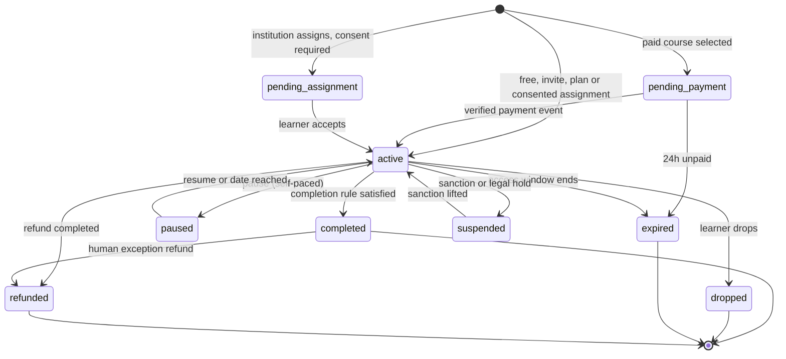

| From              | To                | Trigger                      | Guard                                                       |
| ----------------- | ----------------- | ---------------------------- | ----------------------------------------------------------- |
| (new)             | `pending_payment` | Buy                          | Gate allows; quote valid (BR-LRN-007)                       |
| `pending_payment` | `active`          | `billing.purchase.fulfilled` | Event verified and not previously applied                   |
| `pending_payment` | `expired`         | Sweep                        | 24 hours elapsed                                            |
| `active`          | `completed`       | Rule evaluation              | Rule satisfied at pinned version; sign-off done if required |
| `active`          | `paused`          | Learner                      | Self-paced, no prior pause (BR-LRN-058)                     |
| `active`          | `expired`         | Sweep                        | End instant reached and not paused                          |
| `completed`       | `refunded`        | Human exception              | Reason recorded; evidence revoked by human issuer           |
| `suspended`       | `active`          | Moderator or support         | Reason recorded                                             |

Forbidden: `completed -> active`; any state to `active` from a payment redirect alone; `refunded -> active` (a new enrollment is created).

### SM-LRN-02 Lesson progress

States: `locked`, `available`, `in_progress`, `completed`. Terminal: none (completed is sticky within the pinned version).

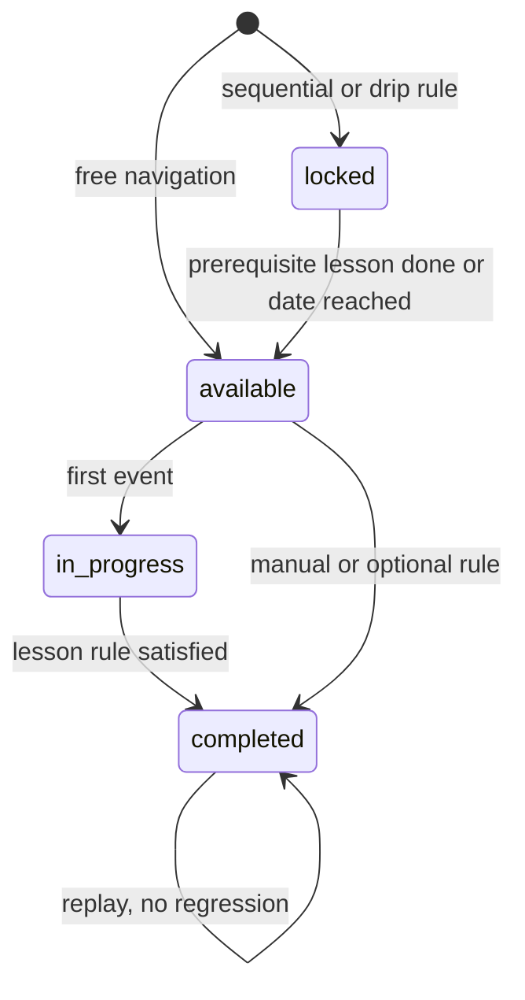

| From                         | To            | Trigger                                 | Guard                                            |
| ---------------------------- | ------------- | --------------------------------------- | ------------------------------------------------ |
| `locked`                     | `available`   | Prior lesson completion or release time | BR-LRN-018                                       |
| `available` or `in_progress` | `completed`   | Rule event                              | BR-LRN-014; sticky                               |
| `completed`                  | `in_progress` | none                                    | Forbidden: completion never reverts (BR-LRN-013) |

### SM-LRN-03 Certificate

States: `pending_render`, `issued`, `superseded`, `revoked`, `expired`, `tombstoned`. Terminal: `revoked`, `expired`, `superseded`, `tombstoned`.

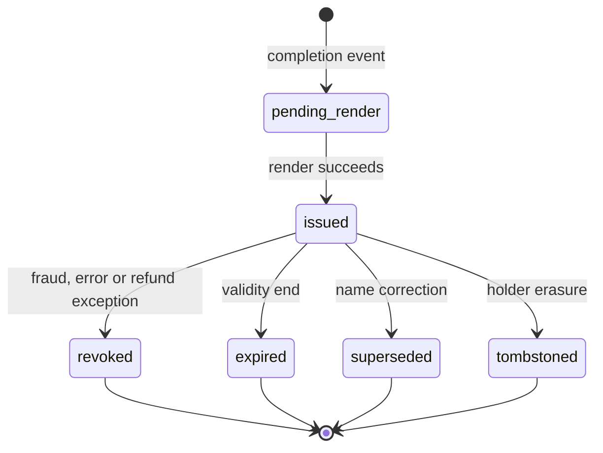

| From             | To           | Trigger             | Guard                             |
| ---------------- | ------------ | ------------------- | --------------------------------- |
| `pending_render` | `issued`     | Worker              | Hash computed; one per enrollment |
| `issued`         | `revoked`    | Instructor or admin | Reason class and actor recorded   |
| `issued`         | `superseded` | Correction approved | New version issued atomically     |

### SM-LRN-04 Assignment submission

States: `draft`, `submitted`, `in_review`, `returned`, `graded`, `withdrawn`. Terminal: `graded` (unless a new revision opens), `withdrawn`.

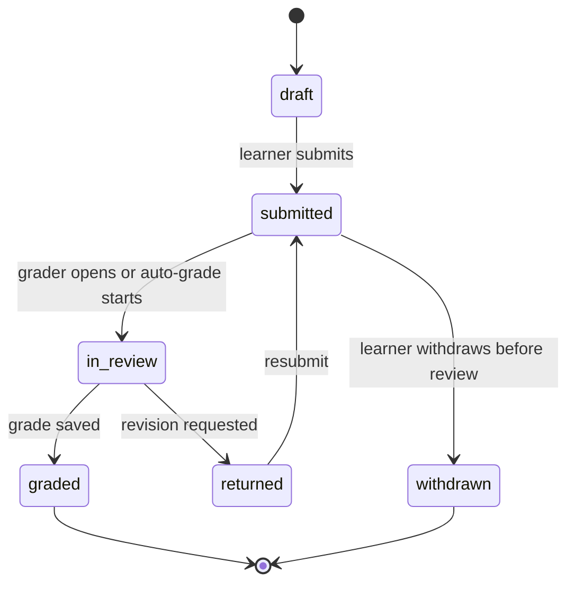

| From       | To          | Trigger  | Guard                                            |
| ---------- | ----------- | -------- | ------------------------------------------------ |
| `draft`    | `submitted` | Submit   | Declaration ticked; deadline policy (BR-LRN-038) |
| `returned` | `submitted` | Resubmit | Revisions remaining (BR-LRN-039)                 |

### SM-LRN-05 Review

States: `held`, `published`, `reported`, `hidden`, `removed`. Terminal: `removed`.

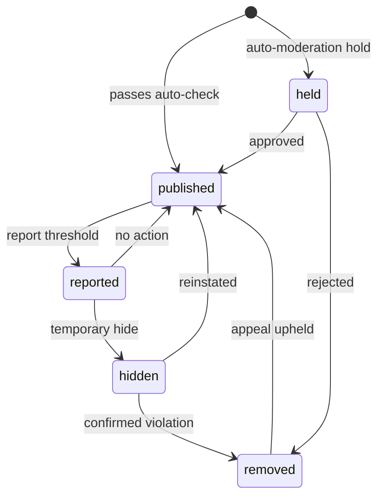

| From        | To          | Trigger       | Guard                            |
| ----------- | ----------- | ------------- | -------------------------------- |
| `removed`   | `published` | Appeal upheld | Second moderator (FR-LRN-065)    |
| `published` | `reported`  | Reports       | Threshold {3 distinct reporters} |

### SM-LRN-06 Path enrollment

States: `active`, `completed`, `dropped`, `expired`. Terminal: all except `active`.

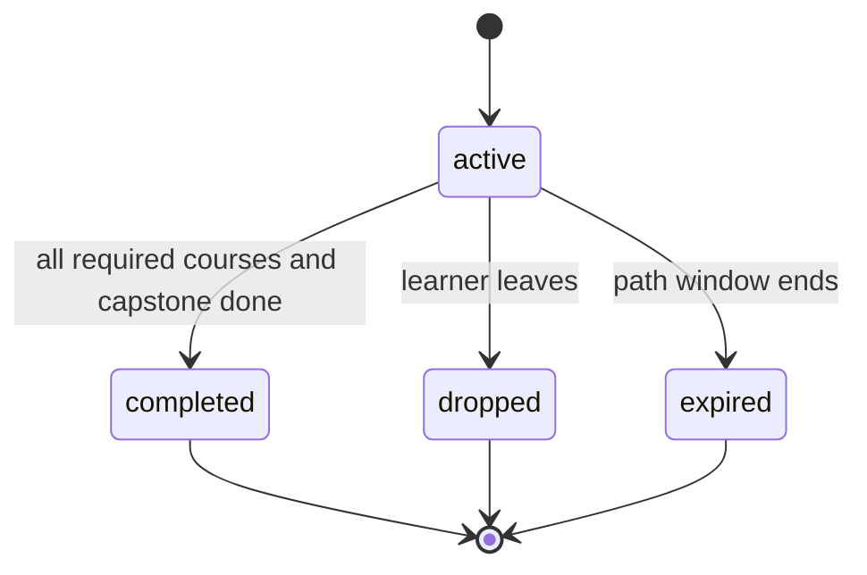

| From     | To          | Trigger              | Guard      |
| -------- | ----------- | -------------------- | ---------- |
| `active` | `completed` | Derived from members | BR-LRN-042 |

### SM-LRN-07 Offline license

States: `requested`, `active`, `expiring`, `expired`, `revoked`. Terminal: `expired`, `revoked`.

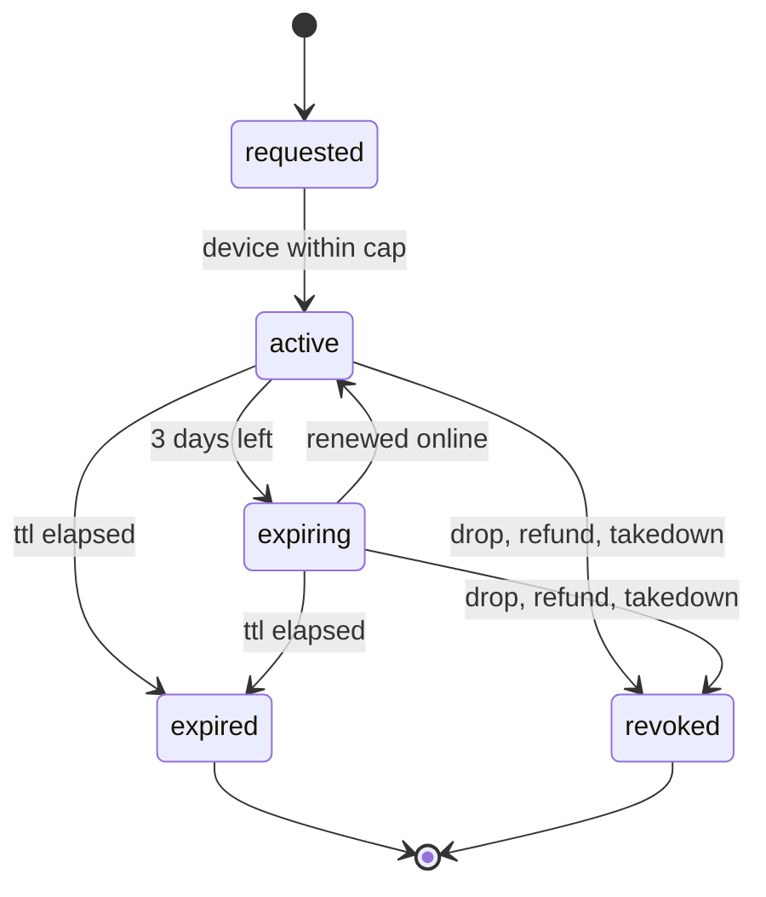

| From        | To        | Trigger         | Guard                                          |
| ----------- | --------- | --------------- | ---------------------------------------------- |
| `requested` | `active`  | Server          | Device count at most cap (BR-LRN-032)          |
| `active`    | `revoked` | Enrollment ends | Applied on next reconnect and by server record |

### SM-LRN-08 Live session attendance

States: `registered`, `joined`, `attended`, `missed`, `cancelled`. Terminal: `attended`, `missed`, `cancelled`.

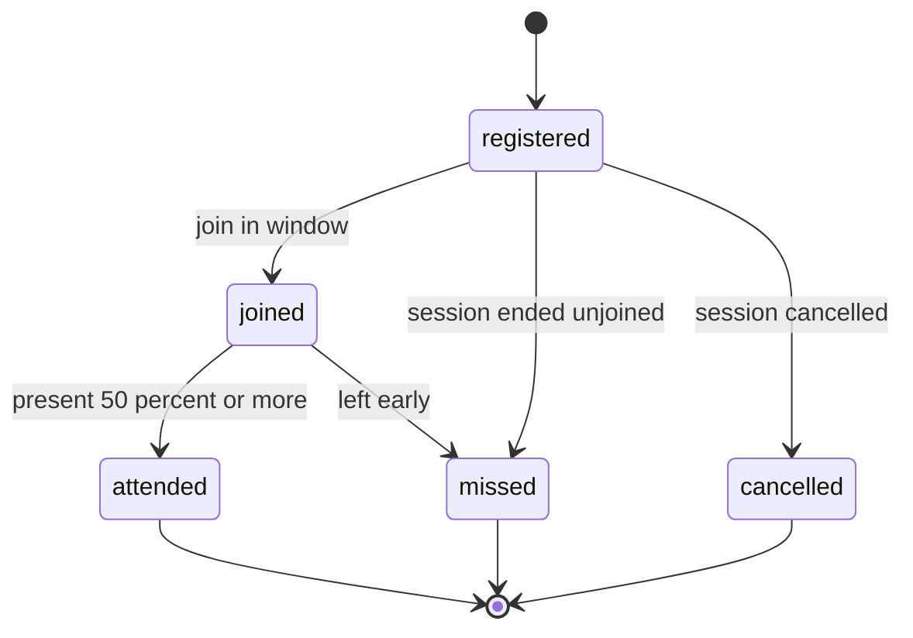

| From     | To         | Trigger     | Guard                                       |
| -------- | ---------- | ----------- | ------------------------------------------- |
| `joined` | `attended` | Session end | Presence at least {50} percent (BR-LRN-041) |

### SM-LRN-09 Q&A thread

States: `open`, `answered`, `resolved`, `hidden`. Terminal: none (reopenable).

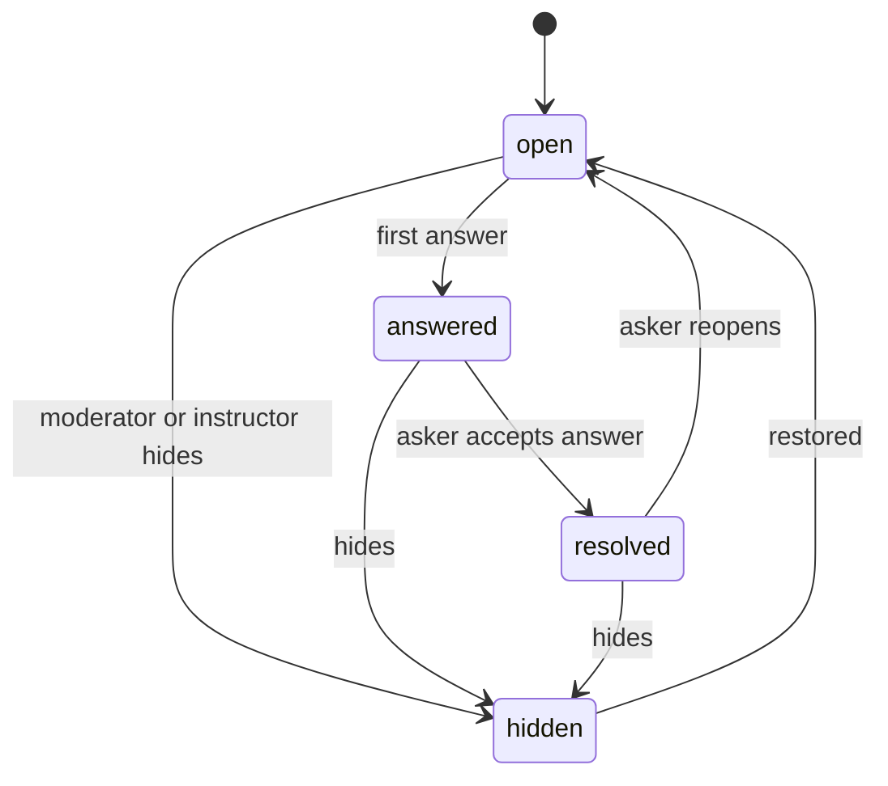

| From | To       | Trigger                 | Guard                        |
| ---- | -------- | ----------------------- | ---------------------------- |
| any  | `hidden` | Moderator or instructor | Reason recorded (BR-LRN-049) |

### SM-LRN-10 Playback session

States: `authorizing`, `playing`, `paused`, `evicted`, `ended`. Terminal: `evicted`, `ended`.

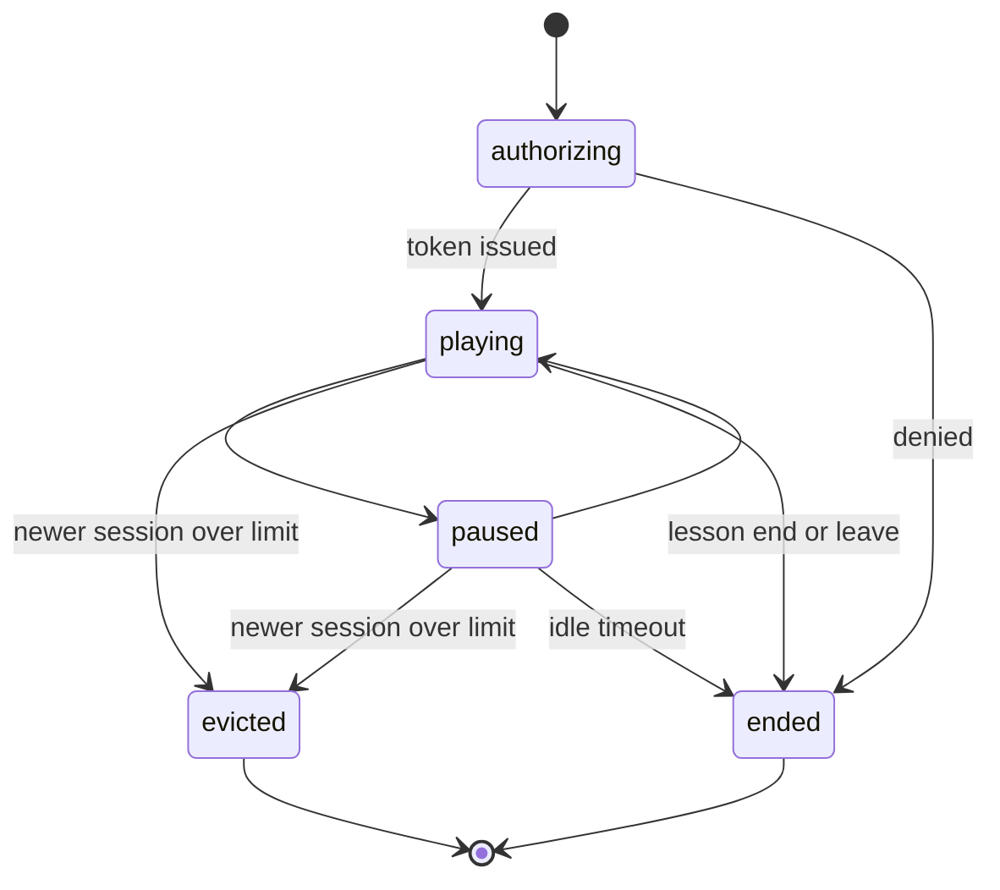

| From      | To        | Trigger                | Guard                  |
| --------- | --------- | ---------------------- | ---------------------- |
| `playing` | `evicted` | Third concurrent start | Limit {2} (BR-LRN-036) |
| `paused`  | `ended`   | Idle                   | {30} minutes [PROP]    |

## 7. Screen inventory

Key states for every screen include loading (skeleton), empty, error with retry, offline (where cached) and forbidden. Only screen-specific states are listed.

| ID          | Name                              | Route proposal                                   | Roles                   | Purpose                                                        | Key states                                       |
| ----------- | --------------------------------- | ------------------------------------------------ | ----------------------- | -------------------------------------------------------------- | ------------------------------------------------ |
| SCR-LRN-001 | Learn home                        | `/learn`                                         | GUE, CAN, STD           | Curated rails and entry to catalog                             | rails loading per rail, personalized vs generic  |
| SCR-LRN-002 | Course catalog and search results | `/learn/courses`                                 | GUE, CAN, STD           | List, search, filter, sort (FR-LRN-001 to 004)                 | zero results, filter conflict, index behind      |
| SCR-LRN-003 | Category page                     | `/learn/c/:slug`                                 | GUE, CAN, STD           | Category description and courses                               | retired category redirect                        |
| SCR-LRN-004 | Skill and goal page               | `/learn/skills/:skill`, `/learn/goals/:goalSlug` | GUE, CAN, STD           | Skill-based browse and gap view                                | consent missing, no courses                      |
| SCR-LRN-005 | Course comparison                 | `/learn/compare`                                 | GUE, CAN, STD           | Side-by-side compare                                           | course unavailable column                        |
| SCR-LRN-006 | Saved courses                     | `/learn/saved`                                   | CAN, STD                | Wishlist                                                       | list full, price dropped, unavailable            |
| SCR-LRN-007 | Course detail                     | `/learn/courses/:slug`                           | GUE, CAN, STD, INS      | Detail, curriculum, reviews, action                            | not enrolled, enrolled, locked with reason, 410  |
| SCR-LRN-008 | Enroll confirmation               | `/learn/courses/:slug/enroll`                    | CAN, STD                | Confirm free or invite enrollment                              | gate blocked, success                            |
| SCR-LRN-009 | Payment status                    | `/learn/enrollments/:id/status`                  | CAN, STD                | Pending payment confirmation                                   | processing, failed, succeeded, expired           |
| SCR-LRN-010 | Redeem code                       | `/learn/redeem`                                  | CAN, STD                | Access and discount codes                                      | invalid, exhausted, rate limited                 |
| SCR-LRN-011 | Path and track catalog            | `/learn/paths`                                   | GUE, CAN, STD           | Browse paths and tracks                                        | empty track                                      |
| SCR-LRN-012 | Path or track detail              | `/learn/paths/:slug`, `/learn/tracks/:slug`      | GUE, CAN, STD           | Path structure and enrollment                                  | sequenced locked members, unavailable member     |
| SCR-LRN-013 | Learner dashboard                 | `/learn/home`                                    | CAN, STD                | What to do next                                                | first-steps, card error                          |
| SCR-LRN-014 | My courses and history            | `/me/learning/courses`                           | CAN, STD                | Enrollments by state and transcript                            | tabs with counts, expiring, assigned             |
| SCR-LRN-015 | Learning player                   | `/learn/courses/:slug/lessons/:lessonKey`        | CAN, STD, GUE (preview) | All lesson types, panels, drawer                               | locked, preview, expired read-only, sync pending |
| SCR-LRN-016 | Assignment workspace              | `/learn/courses/:slug/assignments/:id`           | CAN, STD                | Brief, draft, submit, feedback                                 | draft, submitted, in review, graded, late        |
| SCR-LRN-017 | Peer review workspace             | `/learn/courses/:slug/reviews/:id`               | CAN, STD                | Review queue and forms                                         | queue empty, overdue                             |
| SCR-LRN-018 | Project workspace                 | `/learn/courses/:slug/projects/:id`              | CAN, STD                | Milestones and team                                            | team unconfirmed, milestone due                  |
| SCR-LRN-019 | Live session lobby and room       | `/learn/courses/:slug/live/:id`                  | CAN, STD                | Join live session                                              | too early, open, full, ended, recording          |
| SCR-LRN-020 | Cohort schedule                   | `/learn/courses/:slug/schedule`                  | CAN, STD                | Calendar and deadlines                                         | no schedule, past                                |
| SCR-LRN-021 | Course Q&A                        | `/learn/courses/:slug/qa`                        | CAN, STD                | Questions and answers                                          | no answers, rate limited                         |
| SCR-LRN-022 | Discussion forum                  | `/learn/courses/:slug/discuss`                   | CAN, STD                | Threads and categories                                         | locked thread, hidden post                       |
| SCR-LRN-023 | Notes and bookmarks               | `/me/learning/notes`                             | CAN, STD                | Search and export notes                                        | none, quota near                                 |
| SCR-LRN-024 | Announcements                     | `/learn/courses/:slug/announcements`             | CAN, STD                | Instructor updates                                             | none, muted                                      |
| SCR-LRN-025 | Gradebook                         | `/learn/courses/:slug/grades`                    | CAN, STD                | Scores, weights, what-if                                       | pending items, disputed                          |
| SCR-LRN-026 | Course completion                 | `/learn/courses/:slug/complete`                  | CAN, STD                | Completion summary and next steps                              | awaiting sign-off, evidence pending              |
| SCR-LRN-027 | Certificates                      | `/me/certificates`, `/me/certificates/:id`       | CAN, STD                | View, download, share                                          | pending render, revoked, superseded              |
| SCR-LRN-028 | Certificate verification          | `/verify/:certId`                                | GUE, all                | Public verification                                            | valid, revoked, expired, private, not found      |
| SCR-LRN-029 | Review composer                   | `/learn/courses/:slug/review`                    | CAN, STD                | Write or edit review                                           | ineligible, held                                 |
| SCR-LRN-030 | Goals and learning plan           | `/me/learning/plan`                              | CAN, STD                | Goals, plan, study blocks                                      | over capacity, paused goal                       |
| SCR-LRN-031 | Learning insights                 | `/me/learning/insights`                          | CAN, STD                | Learner analytics                                              | insufficient data                                |
| SCR-LRN-032 | Achievements                      | `/me/learning/achievements`                      | CAN, STD                | Earned and locked                                              | engine delayed                                   |
| SCR-LRN-033 | Downloads manager                 | `/me/learning/downloads`                         | CAN, STD                | Offline lessons and devices                                    | device limit, expiring, storage full             |
| SCR-LRN-034 | Study groups                      | `/learn/groups`                                  | CAN, STD                | Groups and check-ins                                           | full group, no matches                           |
| SCR-LRN-035 | Learning settings                 | `/settings/learning`                             | CAN, STD                | Player, reminders, personalization, accessibility, data export | export in progress                               |
| SCR-LRN-036 | Refund request                    | `/me/learning/orders/:id/refund`                 | CAN, STD                | Refund eligibility and request                                 | eligible, pro-rated, not eligible, processing    |
| SCR-LRN-037 | Report a problem dialog           | modal (no route)                                 | GUE, CAN, STD           | Content problem report                                         | submitted, duplicate                             |
| SCR-LRN-038 | Daily review                      | `/me/learning/review`                            | CAN, STD                | Spaced repetition session                                      | none due, backlog capped                         |

## 8. Data entities owned

Retention classes: `ACCT` deleted or anonymized with the account; `TXN` financial record, {7 years} [PROP] OD-LRN-10; `CRED` credential record kept as tombstone after erasure (BR-LRN-060); `LOG90` {90 days}; `AGG` anonymized aggregate; `PUBLIC` published catalog data.

| ID         | Entity                    | Key attributes                                                                                                                                                                                                                            | Relationships                                       | Retention                                                                          |
| ---------- | ------------------------- | ----------------------------------------------------------------------------------------------------------------------------------------------------------------------------------------------------------------------------------------- | --------------------------------------------------- | ---------------------------------------------------------------------------------- |
| ENT-LRN-01 | CatalogEntry              | courseId, versionId, slug, title, summary, categoryIds, tags, level, language, subtitleLanguages, durationMinutes, skills[], priceRef, entitlementKinds, ratingAvg, ratingCount, accessibilityFlags, state, updatedAt                     | Projection of STU course version; 1..n TaxonomyNode | PUBLIC                                                                             |
| ENT-LRN-02 | TaxonomyNode              | id, kind (category, tag), name, slug, parentId, state, aliases[], redirectFrom[]                                                                                                                                                          | Parent-child; used by CatalogEntry                  | PUBLIC                                                                             |
| ENT-LRN-03 | Enrollment                | id, accountId, courseId, versionId, route (self, invite, plan, institution, paid), state, activatedAt, accessEndsAt, completedAt, completionPendingSignoff, certificateId, evidenceRef, assignmentId, cohortRunId, orderRef, restoredFrom | n LessonProgress, 1 Certificate, 0..1 CohortRun     | ACCT; order refs TXN                                                               |
| ENT-LRN-04 | EnrollmentEvent           | enrollmentId, from, to, trigger, actor, reason, at                                                                                                                                                                                        | Append-only history of Enrollment                   | CRED (history without personal data after erasure)                                 |
| ENT-LRN-05 | LessonProgress            | enrollmentId, lessonKey, status, watchedSegments, maxClientSeq, completedAt, ruleVersion                                                                                                                                                  | Belongs to Enrollment                               | ACCT                                                                               |
| ENT-LRN-06 | PlaybackPosition          | enrollmentId, lessonKey, positionSeconds, serverTime, clientSeq, deviceId                                                                                                                                                                 | Belongs to Enrollment                               | ACCT                                                                               |
| ENT-LRN-07 | OfflineLicense            | id, enrollmentId, lessonKey, deviceId, state, issuedAt, expiresAt, revokedReason                                                                                                                                                          | Belongs to Enrollment                               | LOG90 after end                                                                    |
| ENT-LRN-08 | AccessCode                | id, courseId, type, codeHash, usesAllowed, usesCount, expiresAt, domainRestriction, createdBy                                                                                                                                             | Redemptions per account                             | ACCT of creator; redemption log LOG90                                              |
| ENT-LRN-09 | Certificate               | id, enrollmentId or pathEnrollmentId, type (course, program), version, state, payloadHash, nameUsed, issuedAt, expiresAt, revokedReason, supersededBy                                                                                     | 1 Enrollment                                        | CRED                                                                               |
| ENT-LRN-10 | LearningPath              | id, version, slug, courseRefs[], sequenced, capstone, programRule, state                                                                                                                                                                  | Many courses                                        | PUBLIC                                                                             |
| ENT-LRN-11 | PathEnrollment            | id, accountId, pathId, pathVersion, state, progressCache                                                                                                                                                                                  | n Enrollment                                        | ACCT                                                                               |
| ENT-LRN-12 | LearningPlan              | id, accountId, items[{targetType, targetId, order, targetDate, status}], sharedWith                                                                                                                                                       | Items to catalog                                    | ACCT                                                                               |
| ENT-LRN-13 | LearningGoal              | id, accountId, goalRef, weeklyCommitmentMinutes, days, state                                                                                                                                                                              | Optional link to plan                               | ACCT                                                                               |
| ENT-LRN-14 | StreakRecord              | accountId, current, longest, lastActiveDate, freezeUsedWeek, timezone                                                                                                                                                                     | One per account                                     | ACCT                                                                               |
| ENT-LRN-15 | Note                      | id, accountId, enrollmentId, lessonKey, type (note, highlight, flashcard), position, body, versionHistory                                                                                                                                 | Belongs to Enrollment                               | ACCT                                                                               |
| ENT-LRN-16 | Bookmark                  | id, accountId, enrollmentId, lessonKey, position, label                                                                                                                                                                                   | Belongs to Enrollment                               | ACCT                                                                               |
| ENT-LRN-17 | DiscussionThread and Post | id, courseId, cohortRunId, lessonKey, kind (qa, forum), title, state, authorId, anonymousToPeers, acceptedPostId, posts[]                                                                                                                 | Course                                              | ACCT content becomes "Former learner" on erasure                                   |
| ENT-LRN-18 | SavedItem                 | accountId, targetType, targetId, savedAt, priceAtSave                                                                                                                                                                                     | Catalog                                             | ACCT                                                                               |
| ENT-LRN-19 | Review                    | id, accountId, courseId, versionRange, rating, subRatings, title, body, displayMode, state, instructorReply, history                                                                                                                      | Enrollment                                          | ACCT content; aggregate AGG                                                        |
| ENT-LRN-20 | Submission                | id, enrollmentId, assignmentId, revision, content, files[], state, submittedAt, late, grade, rubricScores, feedback                                                                                                                       | Enrollment                                          | ACCT; grade record CRED if evidence minted                                         |
| ENT-LRN-21 | PeerReview                | id, submissionId, reviewerEnrollmentId, scores, comments, state, helpful                                                                                                                                                                  | Submission                                          | ACCT                                                                               |
| ENT-LRN-22 | LiveAttendance            | sessionId, enrollmentId, state, joinedAt, leftAt, presenceSeconds                                                                                                                                                                         | Session (STU)                                       | LOG90 after grading period                                                         |
| ENT-LRN-23 | CohortRun                 | id, courseId, start, end, enrollOpen, enrollClose, capacity, waitlist[], timezone, graceDays                                                                                                                                              | Enrollments                                         | ACCT-free (course data)                                                            |
| ENT-LRN-24 | Achievement               | accountId, type, awardedAt, sourceEvent, revokedAt                                                                                                                                                                                        | REP (planned)                                       | ACCT                                                                               |
| ENT-LRN-25 | RecommendationImpression  | accountId, itemId, reason, shownAt, action                                                                                                                                                                                                | Feedback loop                                       | LOG90                                                                              |
| ENT-LRN-26 | StudyGroup                | id, name, courseId or pathId, ownerId, members[{accountId, shares[]}], state                                                                                                                                                              | Course                                              | ACCT                                                                               |
| ENT-LRN-27 | ContentReport             | id, reporterId, targetType, targetId, lessonKey, time, category, note, diagnostics, state, outcome                                                                                                                                        | Course, TSF case                                    | ACCT; outcome kept AGG                                                             |
| ENT-LRN-28 | GradeRecord               | enrollmentId, itemRef, weight, rawScore, penalties, finalScore, override{by, reason}, at                                                                                                                                                  | Enrollment                                          | ACCT                                                                               |
| ENT-LRN-29 | RefundRequest             | id, enrollmentId, orderRef, reason, eligibility, state, decidedBy, decidedAt                                                                                                                                                              | Enrollment, BIL order                               | TXN                                                                                |
| ENT-LRN-30 | PlaybackSession           | id, accountId, enrollmentId, lessonKey, deviceSessionId, state, startedAt, lastSeenAt                                                                                                                                                     | Enrollment                                          | LOG90                                                                              |
| ENT-LRN-31 | NudgeSchedule             | accountId, type, lastSentAt, weekCount, quietHours, calendarFeedSecretHash                                                                                                                                                                | Account                                             | ACCT                                                                               |
| ENT-LRN-32 | IndustryHub               | id, slug, industryRef, name, description, state (hidden, public), stewardIds[], skillSetRef, activeContributorCount, evaluatedAt                                                                                                          | Links TaxonomyNode (industry tag) and a NET group   | PUBLIC                                                                             |
| ENT-LRN-33 | HubContribution           | id, hubId, contributorId, kind (resource, pinned item), payload, affiliationDeclared, state (pending, approved, rejected, removed), decidedBy, decidedAt                                                                                  | Belongs to IndustryHub                              | ACCT while contributor exists; approved items kept as anonymous content on erasure |

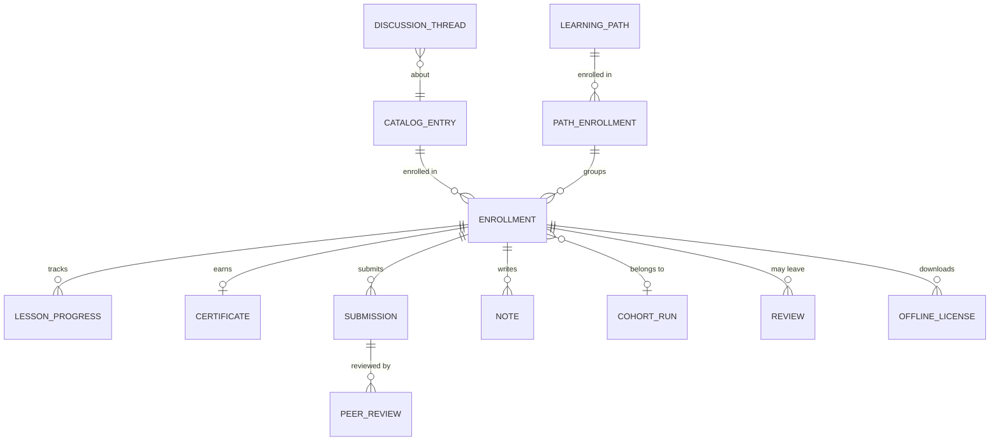

## 9. Events emitted and consumed

### 9.1 Emitted

| ID          | Event name                          | Trigger                               | Key payload                                   | Consumers               |
| ----------- | ----------------------------------- | ------------------------------------- | --------------------------------------------- | ----------------------- |
| EVT-LRN-001 | `learning.catalog.viewed`           | Catalog list or search shown          | anonymous session id, filters, result count   | ANL                     |
| EVT-LRN-002 | `learning.course.viewed`            | Course detail opened                  | courseId, source                              | ANL, AIC                |
| EVT-LRN-003 | `learning.enrollment.created`       | Enrollment row created                | enrollmentId, courseId, versionId, route      | NTF, INS, ANL, REP      |
| EVT-LRN-004 | `learning.enrollment.activated`     | Enrollment becomes active             | enrollmentId, accessEndsAt                    | NTF, STU analytics      |
| EVT-LRN-005 | `learning.enrollment.paused`        | Learner pauses                        | enrollmentId, resumeAt                        | NTF                     |
| EVT-LRN-006 | `learning.enrollment.resumed`       | Resume                                | enrollmentId                                  | NTF                     |
| EVT-LRN-007 | `learning.enrollment.dropped`       | Learner drops                         | enrollmentId, reasonCode                      | STU analytics, INS      |
| EVT-LRN-008 | `learning.enrollment.expired`       | Window ends or unpaid                 | enrollmentId, cause                           | NTF, INS                |
| EVT-LRN-009 | `learning.enrollment.refunded`      | Refund completed                      | enrollmentId                                  | EVD, STU, REP           |
| EVT-LRN-010 | `learning.enrollment.migrated`      | Learner switches version              | enrollmentId, fromVersion, toVersion          | ANL                     |
| EVT-LRN-011 | `learning.lesson.started`           | First lesson event                    | enrollmentId, lessonKey                       | ANL                     |
| EVT-LRN-012 | `learning.lesson.completed`         | Lesson rule met                       | enrollmentId, lessonKey, ruleKind             | REP, ANL, AIC           |
| EVT-LRN-013 | `learning.course.completed`         | Completion rule met                   | enrollmentId, courseId, versionId, gradeFinal | EVD, REP, NTF, INS, AIC |
| EVT-LRN-014 | `learning.certificate.issued`       | Certificate issued                    | certificateId, enrollmentId, type             | NTF, PRF                |
| EVT-LRN-015 | `learning.certificate.revoked`      | Revocation                            | certificateId, reasonClass                    | EVD, PRF                |
| EVT-LRN-016 | `learning.evidence.requested`       | Evidence hand-off                     | issuerRef, sourceRef, skills[]                | EVD                     |
| EVT-LRN-017 | `learning.path.enrolled`            | Path enrollment                       | pathEnrollmentId, pathId                      | ANL                     |
| EVT-LRN-018 | `learning.path.completed`           | Program rule met                      | pathEnrollmentId                              | EVD, NTF, REP           |
| EVT-LRN-019 | `learning.submission.submitted`     | Submission                            | submissionId, assignmentId, late              | STU inbox               |
| EVT-LRN-020 | `learning.submission.graded`        | Grade saved                           | submissionId, score                           | NTF, gradebook          |
| EVT-LRN-021 | `learning.peerreview.completed`     | Review submitted                      | peerReviewId                                  | gradebook               |
| EVT-LRN-022 | `learning.review.published`         | Review visible                        | reviewId, rating                              | STU, ANL                |
| EVT-LRN-023 | `learning.review.reported`          | Report threshold                      | reviewId, reasons                             | TSF                     |
| EVT-LRN-024 | `learning.qa.question_posted`       | Question posted                       | threadId, lessonKey                           | STU inbox               |
| EVT-LRN-025 | `learning.live.attended`            | Attendance finalized                  | sessionId, enrollmentId                       | completion rules        |
| EVT-LRN-026 | `learning.download.licensed`        | Offline license issued                | licenseId, deviceId                           | ANL                     |
| EVT-LRN-027 | `learning.goal.updated`             | Goal or plan changed                  | goalRef                                       | AIC                     |
| EVT-LRN-028 | `learning.streak.updated`           | Streak day counted or lost            | streak                                        | REP                     |
| EVT-LRN-029 | `learning.recommendation.dismissed` | Not interested                        | itemId, reason                                | AIC                     |
| EVT-LRN-030 | `learning.report.filed`             | Content problem filed                 | reportId, category                            | STU, TSF                |
| EVT-LRN-031 | `learning.access.extended`          | Extension granted                     | enrollmentId, newEnd                          | NTF                     |
| EVT-LRN-032 | `learning.hub.visibility_changed`   | Hub crosses the contributor threshold | hubId, state                                  | NTF, ANL                |
| EVT-LRN-033 | `learning.hub.contribution_decided` | Contribution approved or rejected     | hubId, contributionId, decision               | NTF, REP                |

### 9.2 Consumed

| Event (producer)                                                                                     | Used by                   | Effect                                             |
| ---------------------------------------------------------------------------------------------------- | ------------------------- | -------------------------------------------------- |
| `studio.course.published`, `studio.course.unpublished`, `studio.course.taken_down` (STU)             | FR-LRN-001, 008, 022      | Update catalog read model and visibility           |
| `assessment.attempt.graded`, `assessment.attempt.voided` (ASM)                                       | FR-LRN-042, 057, 058, 062 | Lesson completion, grade, completion re-evaluation |
| `billing.purchase.fulfilled`, `billing.refund.completed`, `billing.entitlement.ended` (BIL, planned) | FR-LRN-015, 018, 021      | Activate, refund, expire enrollments               |
| `institution.assignment.created`, `institution.assignment.removed` (INS, planned)                    | FR-LRN-016                | Create or end institution enrollments              |
| `evidence.item.revoked` (EVD, planned)                                                               | FR-LRN-071                | Mark dependent achievements and show status        |
| `trust.case.decided` (TSF, planned)                                                                  | FR-LRN-065, 075           | Apply review and content decisions                 |
| `identity.account.erased` (IDN, planned)                                                             | FR-LRN-074                | Run erasure rules                                  |

## 10. Integrations and external dependencies

| Dependency                                                | Direction      | Purpose                                  | Failure behavior                                    |
| --------------------------------------------------------- | -------------- | ---------------------------------------- | --------------------------------------------------- |
| Media delivery and CDN (PLT planned, STU pipeline)        | Outbound       | HLS or DASH, signed tokens, DRM licenses | Fallback CDN; lesson-level containment (BR-LRN-034) |
| Video providers (YouTube, Vimeo and others per allowlist) | Outbound embed | External lessons                         | Fallback link (FR-LRN-040)                          |
| Payment provider via BIL (planned)                        | Via BIL        | Checkout and webhooks                    | Purchases disabled with banner                      |
| Live room provider (adapter, OD-LRN-06)                   | Outbound       | Live sessions                            | Reschedule flow                                     |
| Search index (SRC planned)                                | Outbound       | Catalog search                           | Category browse fallback                            |
| Recommendation service (AIC planned)                      | Outbound       | Rails                                    | Popular fallback                                    |
| Evidence issuer API (EVD planned)                         | Outbound       | Evidence hand-off                        | Retry, "evidence pending"                           |
| Notification service (NTF planned)                        | Outbound       | Templates and channels                   | Queue and retry                                     |
| Calendar clients (ICS feed)                               | Outbound feed  | Study and deadline events                | Feed reset                                          |
| LinkedIn "Add to profile" link                            | Outbound link  | Share certificate                        | Link only; no data pushed                           |
| Virus scanning, file storage (PLT planned)                | Outbound       | Submissions and resources                | Hold upload until scanned                           |

## 11. Cross-module dependencies

| Depends on    | What LRN needs                                                                                            |
| ------------- | --------------------------------------------------------------------------------------------------------- |
| STU           | Published immutable course versions, curriculum, rendition manifests, rules, preview flags, announcements |
| ASM           | Assessment attempts and results inside lessons; sandbox; accommodations                                   |
| EVD (planned) | Evidence issuer API, skills ontology reads, revocation notices                                            |
| BIL (planned) | Quotes, checkout, entitlements, refunds                                                                   |
| INS (planned) | Assignments, seat control, visibility scopes                                                              |
| IDN (planned) | Accounts, sessions, age and sanctions                                                                     |
| SET (planned) | Consent flags, data rights workflow                                                                       |
| NTF (planned) | Templates, channels, preferences                                                                          |
| SRC (planned) | Index and ranking                                                                                         |
| AIC (planned) | Recommendations and gap analysis                                                                          |
| TSF (planned) | Moderation cases                                                                                          |
| REP (planned) | XP, badges                                                                                                |
| PLT (planned) | Media, files, public API                                                                                  |

| Depended on by     | What they use                                                            |
| ------------------ | ------------------------------------------------------------------------ |
| EVD (planned)      | `learning.course.completed` evidence requests                            |
| PRF (planned)      | Certificates and completed courses on profiles                           |
| AIC, MKT (planned) | Learning signals, gap-to-course mapping                                  |
| JOB, ATS (planned) | Verified course and certificate evidence on candidate profiles (via EVD) |
| INS (planned)      | Completion and progress reports within scope                             |
| STU                | Enrollments, reviews, Q&A, analytics events                              |
| ANL (planned)      | Learning events for reporting                                            |

## 12. Module-level metrics

| Metric                           | Definition and formula                                                                                                 | Owner role             |
| -------------------------------- | ---------------------------------------------------------------------------------------------------------------------- | ---------------------- |
| Catalog to detail rate           | Course detail views from catalog sessions divided by catalog sessions                                                  | Learning product owner |
| Enrollment conversion            | Enrollments divided by course detail views, by route                                                                   | Learning product owner |
| Time to first lesson             | Median minutes from enrollment to first lesson started                                                                 | Learning product owner |
| Course completion rate           | Completed enrollments divided by enrollments older than the expected duration (cohort-based)                           | Learning product owner |
| Weekly active learners           | Distinct learners with a qualifying learning activity in a week                                                        | Learning product owner |
| Progress sync failure rate       | Failed or retried progress batches divided by batches                                                                  | Engineering lead       |
| Playback start p95               | 95th percentile ms from Play to first frame (target defined in NFR-PERF, planned)                                      | Engineering lead       |
| Rebuffer ratio                   | Rebuffering seconds divided by watch seconds                                                                           | Engineering lead       |
| Evidence integrity               | Completed enrollments with exactly one evidence item (when evidence-eligible) divided by evidence-eligible completions | Trust owner            |
| Completion drift                 | Completed enrollments whose recomputed rule result differs from stored state (target zero)                             | Engineering lead       |
| Certificate verification success | Verification requests resolving to a valid or definitive status divided by requests                                    | Trust owner            |
| Review authenticity              | Removed or flagged reviews divided by published reviews                                                                | Trust and safety owner |
| Refund rate                      | Refunded enrollments divided by paid enrollments                                                                       | Finance owner          |
| Accessibility defects open       | Count of open accessibility barrier reports older than SLA                                                             | Accessibility owner    |
| Nudge opt-out rate               | Learners disabling learning reminders divided by learners receiving them                                               | Learning product owner |

## 13. Open decisions

| ID        | Question                                                                                                               | Options                                                                                                                                                 | Default proposal                                                                                                                        | Who decides                  | Blocks                 |
| --------- | ---------------------------------------------------------------------------------------------------------------------- | ------------------------------------------------------------------------------------------------------------------------------------------------------- | --------------------------------------------------------------------------------------------------------------------------------------- | ---------------------------- | ---------------------- |
| OD-LRN-01 | When do paid courses ship and in what form: first-party only first, or an instructor marketplace?                      | First-party only; marketplace later; both                                                                                                               | First-party paid courses first (SSOT V61-21); third-party marketplace gated by a separate decision on seller of record, tax and payouts | Founder, Finance             | FR-LRN-015, 018, 021   |
| OD-LRN-02 | Which evidence rung and issuer class does a completion of a third-party instructor course earn?                        | Always claimed; authority_verified with instructor class only with graded assessment or independent sign-off; platform class only for platform-authored | Authority-verified with instructor class only with a graded protected assessment or independent sign-off; none for watch-only           | Product, Trust               | FR-LRN-071             |
| OD-LRN-03 | Refund window and progress threshold                                                                                   | 14 or 30 days; thresholds 10, 20, 50 percent                                                                                                            | 30 days and 20 percent (SSOT OD-29)                                                                                                     | Founder, Finance, Legal      | FR-LRN-021             |
| OD-LRN-04 | Video completion threshold and seek-skip cap                                                                           | 80, 90, 100 percent; cap 10, 25, 50 percent                                                                                                             | 90 percent and 25 percent                                                                                                               | Product                      | FR-LRN-036             |
| OD-LRN-05 | Does downloadable video ship, and with which DRM?                                                                      | None, text only, DRM video                                                                                                                              | Text and transcripts first; DRM video when media cost model accepted                                                                    | Founder, Engineering         | FR-LRN-037             |
| OD-LRN-06 | Live session provider                                                                                                  | Build, vendor adapter, defer                                                                                                                            | Defer; vendor adapter behind an interface (SSOT OD-33)                                                                                  | Founder                      | FR-LRN-047             |
| OD-LRN-07 | Certificate validity and legal-name policy                                                                             | Perpetual or timed; legal or display name                                                                                                               | Perpetual default, timed for compliance courses; learner chooses name before first issue (SSOT OD-18)                                   | Product, Legal               | FR-LRN-059             |
| OD-LRN-08 | Minimum reviews before public rating and incentivized review policy                                                    | 3, 5, 10                                                                                                                                                | 5; incentivized reviews prohibited and declared                                                                                         | Product, Trust               | FR-LRN-063, 064        |
| OD-LRN-09 | Concurrent stream limit and account-sharing enforcement                                                                | 1, 2, 3; flag only or block                                                                                                                             | 2 and flag only                                                                                                                         | Product, Security            | FR-LRN-039             |
| OD-LRN-10 | Retention periods                                                                                                      | progress 90 days, notes 365 days, financial 7 years                                                                                                     | As proposed; Legal confirms by jurisdiction                                                                                             | Legal                        | BR-LRN-012, FR-LRN-052 |
| OD-LRN-11 | Gamification split between LRN and REP                                                                                 | LRN emits events only; or LRN keeps streaks                                                                                                             | LRN keeps streak computation and emits events; REP owns XP, badges                                                                      | Product                      | FR-LRN-061, 069        |
| OD-LRN-12 | Default institution visibility of learner data                                                                         | completion only; completion and scores; full                                                                                                            | Completion and scores, with learner disclosure before first lesson                                                                      | Product, Legal, institutions | FR-LRN-016             |
| OD-LRN-13 | Personalization consent default                                                                                        | opt-in or opt-out by region                                                                                                                             | Opt-in for behavioral personalization; generic rails otherwise                                                                          | Legal, Product               | FR-LRN-066             |
| OD-LRN-14 | "Popular" badge and ranking fairness for new instructors                                                               | Pure popularity; blend with quality; exploration slots                                                                                                  | Blend with quality and reserve exploration slots for new courses                                                                        | Product                      | FR-LRN-001, 004        |
| OD-LRN-15 | Minors in discussions and live sessions                                                                                | Block, restrict, allow with guardian rules                                                                                                              | Restrict by age band per IDN policy                                                                                                     | Legal, Trust                 | FR-LRN-047, 051        |
| OD-LRN-16 | SSOT BR-196 requires at least 3 active contributors for an industry hub but does not define "active" or a time window. | 1 approved contribution in 90 days; 2 in 180 days; any activity including comments                                                                      | 1 approved contribution in 90 days `[PROP]`                                                                                             | Product owner                | FR-LRN-076             |

## 14. Risks

| ID         | Risk                                                                           | Likelihood and impact | Mitigation                                                                   |
| ---------- | ------------------------------------------------------------------------------ | --------------------- | ---------------------------------------------------------------------------- |
| RSK-LRN-01 | Completion credentials inflated by watch-only courses, reducing employer trust | Medium, high          | BR-LRN-025 rung policy; evidence integrity metric; OD-LRN-02                 |
| RSK-LRN-02 | Media cost (storage, egress, DRM) grows faster than revenue                    | Medium, high          | Adaptive ladder, data saver, download gating, cost dashboards (OD-LRN-05)    |
| RSK-LRN-03 | Progress loss or double counting on poor networks                              | Medium, high          | Idempotent events, queue, reconciliation job, chaos tests                    |
| RSK-LRN-04 | Fake or incentivized reviews distort ratings                                   | High, medium          | Eligibility rules, moderation, burst detection, review authenticity metric   |
| RSK-LRN-05 | Account sharing and content piracy                                             | High, medium          | Tokens, concurrency limits, sharing flags, DRM where justified               |
| RSK-LRN-06 | Accessibility gaps (captions missing, player barriers)                         | Medium, high          | Publish gates (STU), accessibility audit gate, barrier reports with priority |
| RSK-LRN-07 | Recommendations amplify bias or reveal sensitive inferences                    | Medium, high          | Consent, no protected attributes, explanations, evaluation by AIC (planned)  |
| RSK-LRN-08 | Payment webhook ordering and delays create wrong access                        | Medium, high          | Event-owned activation, idempotency, sweeps, reconciliation                  |
| RSK-LRN-09 | Notification fatigue drives opt-outs and lost deliverability                   | Medium, medium        | BR-LRN-026 caps, quiet hours, opt-out metric                                 |
| RSK-LRN-10 | Scope creep from commerce and live features into a full marketplace            | Medium, medium        | Tier gating (R5), OD-LRN-01, boundary with STU and BIL                       |
| RSK-LRN-11 | Version migration corrupts progress mapping                                    | Low, high             | Atomic mapping, preview, tests on lessonKey stability, rollback              |
| RSK-LRN-12 | Privacy exposure of learner data to institutions or instructors                | Medium, high          | Scope disclosure, field-level authorization, audits, k-thresholds            |

## 15. Legacy source trace

| Legacy source                                                                                                                          | Used for                                                                                                                             | Dropped or changed and why                                                                                                                                                                                                              |
| -------------------------------------------------------------------------------------------------------------------------------------- | ------------------------------------------------------------------------------------------------------------------------------------ | --------------------------------------------------------------------------------------------------------------------------------------------------------------------------------------------------------------------------------------- |
| `SSOT.md` §9.2 F-07 (LMS), §10.17, §10.21, §10.22 (BR-091..BR-115), §10.34 (BR-189..BR-193), §13.12 to §13.16 (media model), §19 (PWA) | Catalog, detail, enrollment, player, progress, completion, certificate, reviews rules, provider capability model, offline contract   | "Sequential module progress" (BR-047) became author-configurable because free navigation is a common learner expectation; the 70 percent final-assessment rule became author-configured because a fixed value is a policy decision (OD) |
| `SSOT.md` §7 feature rows F-66..F-74, F-82, F-100, F-106, F-107, F-136, F-137, F-155                                                   | Feature coverage list (study groups, Q&A, adaptive learning, micro-learning ideas)                                                   | F-66, F-73 and F-74 detail (authoring, commerce, instructor platform) moved to STU; F-136 micro-learning is covered by short lessons, reading and daily review rather than a separate feature                                           |
| `docs/archive/target-blueprint/05_FEATURE_SPECIFICATIONS.md` SPEC-06                                     | Enrollment state machine, idempotency, progress events, version pinning, completion rule, evidence hand-off, refund after completion | Offline video marked open; video threshold values kept as proposals                                                                                                                                                                     |
| `docs/archive/target-blueprint/05_FEATURE_SPECIFICATIONS.md` FEAT-08-03.1 to .3                                      | Resume rule, offline lesson cache, captions and transcript requirement                                                               | Cached video excluded by REVW-15 is reopened as a decision (OD-LRN-05)                                                                                                                                                                  |
| `docs/registries/FEATURE_REGISTRY.md` F-07, F-52, F-67 to F-72, F-114, F-116                                                           | Cross-check of scope                                                                                                                 | Registry status is not treated as built                                                                                                                                                                                                 |
| `docs/product/PRD.md`, `docs/experience/JOURNEY_REGISTRY.md` (J-01, J-19, J-20)                                                        | Journey framing: learn, prove, showcase; self-paced learner; path with capstone                                                      | Journeys are targets, not tests                                                                                                                                                                                                         |
| Own knowledge of Coursera, Udemy, edX, LinkedIn Learning, Khan Academy, YouTube player conventions                                     | Player controls, shortcuts, chapters, streaks, notes, calendar feeds, study groups                                                   | Tagged `[PROP]` where used                                                                                                                                                                                                              |
