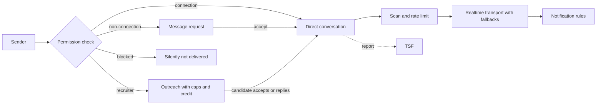
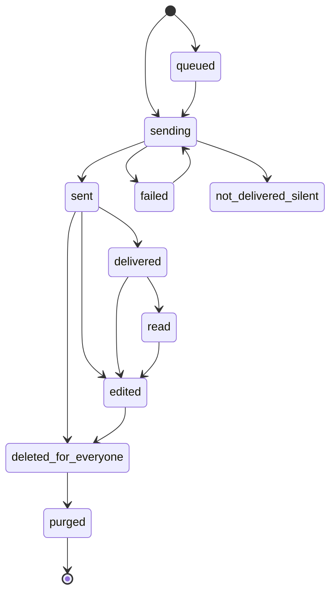
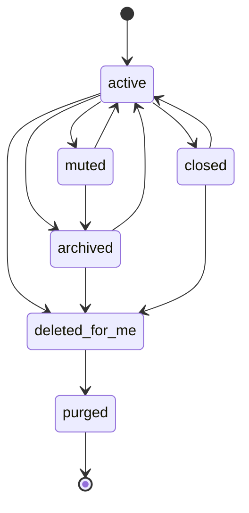
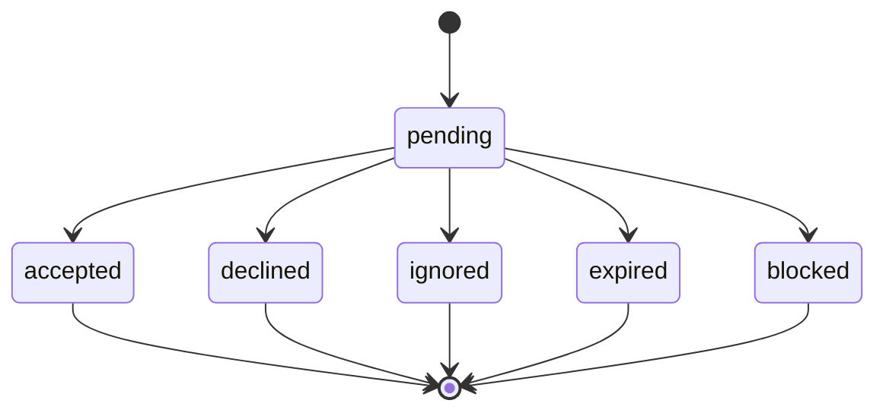
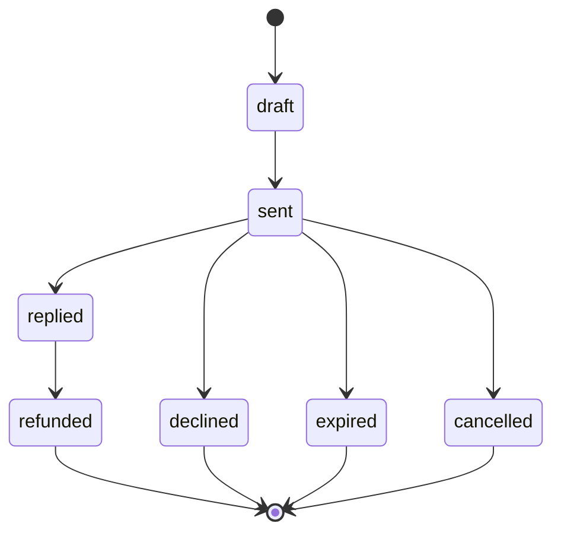
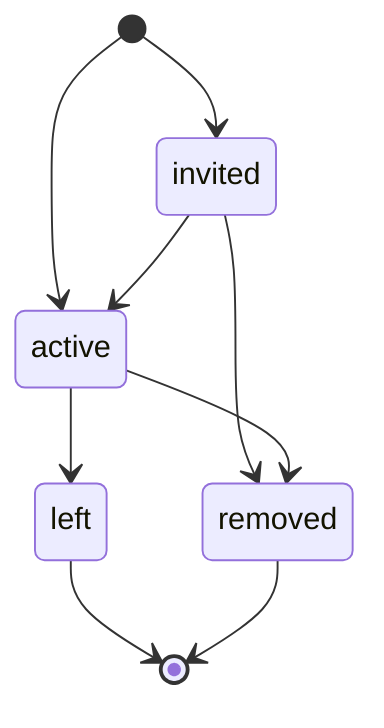
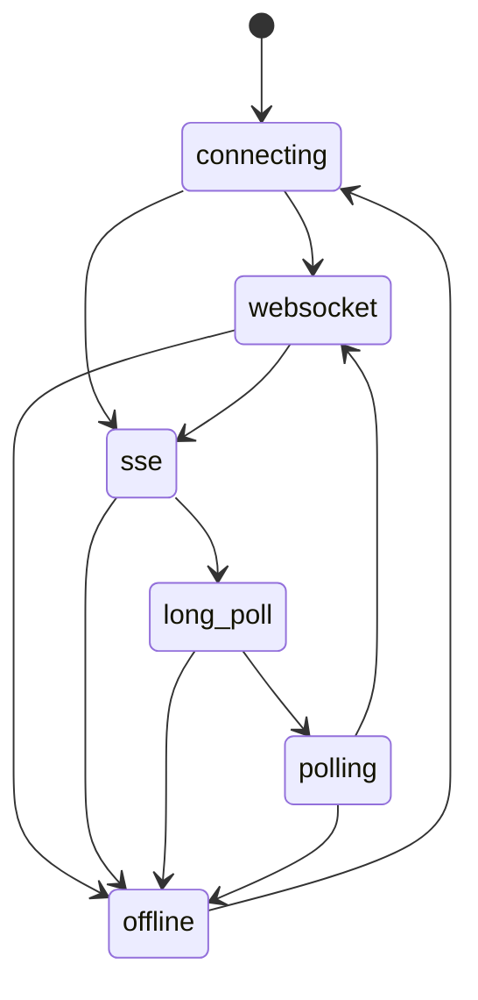
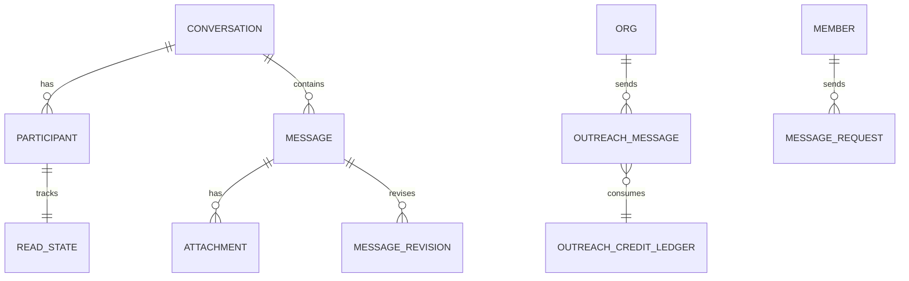

# MSG — Messaging & Real-time Communication

> Status: intended product specification. Nothing in this file is a claim that anything is built. Legacy inputs are inputs, not limits. Conventions: [`../00_START_HERE/CONVENTIONS.md`](../README.md#blueprint-conventions).

## 1. Purpose, outcomes and boundaries

### 1.1 Purpose

MSG is the single place where people on TalentSphere talk to each other: connections, candidates and recruiters, mentors and mentees, group collaborators. It gives members control over who can reach them, gives recruiters accountable and rate-limited outreach, and keeps scams and harassment out. [SRC: SSOT §7 F-10, F-59; WF-10]

### 1.2 Outcomes

1. A member can hold direct and group conversations with delivery, read state, search and attachments that behave identically on desktop, phone and flaky networks.
2. A stranger (including a recruiter) cannot land in a member's main inbox: contact from non-connections goes through message requests with candidate-set controls. [SRC: SSOT BR-129, BR-130, BR-214]
3. Recruiter outreach is labelled, capped, refundable on reply, and respects candidate preferences.
4. Abuse is reportable from every message, blockable, and visible to TSF with only the context needed.
5. Messages are encrypted in transit and at rest, access by staff is exceptional and audited, and members can export and delete their data.
6. Realtime delivery degrades gracefully: the product is usable when WebSockets are unavailable. [SRC: SSOT §4.2 "unnecessary realtime infrastructure" is a non-goal, so transports are chosen by need]

### 1.3 In scope

Direct and group conversations; message composition, edit, delete, reactions, replies; attachments; conversation list, folders and states; search; read receipts, typing, presence; message requests; recruiter outreach with controls, credits and caps; candidate outreach preferences; context threads (application, introduction, mentor, interview); employer shared inbox; saved replies; broadcasts; spam and abuse controls; scam banners; encryption posture; retention, export, staff access; realtime transport and fallbacks; offline queue; notification rules; accessibility; link safety.

### 1.4 Out of scope (owned elsewhere)

| Capability                                                  | Owner                            |
| ----------------------------------------------------------- | -------------------------------- |
| Notification delivery channels, templates, preferences hub  | NTF (planned)                    |
| Report intake UI behaviour, moderation decisions, sanctions | TSF                              |
| Block and privacy settings storage                          | NET (`FR-NET-006`, `FR-NET-007`) |
| Interview scheduling and video rooms                        | INT (planned)                    |
| Application stage changes and automated pipeline emails     | ATS (planned)                    |
| Plan prices, outreach credit purchase                       | BIL (planned)                    |
| AI drafting and translation models                          | AIC                              |
| Media storage and virus scanning pipeline                   | PLT (planned)                    |
| Mentor sessions                                             | MEN (planned)                    |

### 1.5 Boundary with the non-goal "sales-prospecting suite"

[SRC: SSOT §4.2] excludes a sales-prospecting suite. MSG limits recruiter outreach to hiring purposes: one-to-one messages labelled with a job or talent-pool purpose, no bulk sequences, no scraping-based cold campaigns, and no contact-data export. Opens `OD-MSG-01` for the allowed bulk volume.

### 1.6 Owned versus consumed

Owned: conversations, messages, attachments, message requests, outreach records and credits ledger entries, read and delivery state, saved replies, broadcasts, messaging export and retention. Consumed: identity and role (IDN planned), connection and block state (NET), employer verification (EMP planned), plan entitlements (BIL planned), moderation verdicts (TSF), notification delivery (NTF planned).

## 2. Roles and permission matrix

Legend: Y allowed, O own conversations only, S scoped by rule, R by rule, N not allowed.

| Capability                            | GUE | CAN | STD | INS | MNT | REC | HMG | EAD | IAD | PLO | MOD | SUP | PAD | SAD |
| ------------------------------------- | --- | --- | --- | --- | --- | --- | --- | --- | --- | --- | --- | --- | --- | --- |
| Message a connection                  | N   | Y   | R   | Y   | Y   | Y   | Y   | Y   | Y   | Y   | N   | N   | N   | N   |
| Send a message request                | N   | Y   | R   | Y   | Y   | Y   | Y   | Y   | Y   | Y   | N   | N   | N   | N   |
| Send recruiter outreach               | N   | N   | N   | N   | N   | S   | S   | S   | N   | N   | N   | N   | N   | N   |
| Receive recruiter outreach            | N   | Y   | R   | Y   | Y   | Y   | Y   | Y   | N   | N   | N   | N   | N   | N   |
| Create group conversation             | N   | Y   | R   | Y   | Y   | Y   | Y   | Y   | Y   | Y   | N   | N   | N   | N   |
| Send attachments                      | N   | Y   | Y   | Y   | Y   | Y   | Y   | Y   | Y   | Y   | N   | N   | N   | N   |
| Send broadcast                        | N   | N   | N   | S   | S   | S   | N   | S   | S   | S   | N   | N   | N   | N   |
| Read message content of others        | N   | O   | O   | O   | O   | O   | O   | O   | O   | O   | R   | R   | N   | R   |
| Export own conversations              | N   | O   | O   | O   | O   | O   | O   | O   | O   | O   | N   | N   | N   | N   |
| Configure messaging policy (platform) | N   | N   | N   | N   | N   | N   | N   | N   | N   | N   | N   | N   | Y   | Y   |
| View messaging audit log              | N   | N   | N   | N   | N   | N   | N   | N   | N   | N   | N   | R   | Y   | Y   |

Notes. `MOD` read access applies only to messages attached to a report, with the report's context window (`BR-MSG-022`). `SUP` read access requires a support ticket and the member's explicit in-ticket consent, limited to the named conversation (`BR-MSG-019`). `SAD` access is for legal orders and security incidents under dual approval (`BR-MSG-019`). `STD` follows institution policy (`IAD` can restrict messaging to enrolled peers and staff). `HMG` may send outreach only on jobs where they are a named hiring manager. Minors follow `BR-MSG-008`. `API` principals have no MSG write access in this blueprint; any integration is a PLT (planned) decision.

## 3. Sub-module map

| Code  | Sub-module                              | Features          |
| ----- | --------------------------------------- | ----------------- |
| MSG-A | Conversations                           | FR-MSG-001 to 008 |
| MSG-B | Message requests and recruiter outreach | FR-MSG-009 to 016 |
| MSG-C | Safety and abuse controls               | FR-MSG-017 to 021 |
| MSG-D | Realtime, delivery and notifications    | FR-MSG-022 to 026 |
| MSG-E | Data governance and access              | FR-MSG-027 to 030 |
| MSG-F | Experience and accessibility            | FR-MSG-031 to 033 |

## 4. Feature specifications

### 4.1 MSG-A Conversations

### FR-MSG-001 — Start a direct conversation

- **Sub-module:** MSG-A Conversations
- **Priority / tier:** Must · R1
- **Source:** [SRC: SSOT §7 F-10; WF-10]
- **Purpose and outcome:** A member opens a one-to-one thread with a connection and sends a first message; the system decides whether it is a conversation, a request or blocked.
- **Roles and permissions:** `CAN, STD (R), INS, MNT, REC, HMG, EAD, IAD, PLO: create` · others N
- **Preconditions and entry points:** "Message" on a profile, connection list, group member list, application page, mentor profile, introduction. Sender has an active, verified-email account and is not under a TSF messaging restriction.
- **User interactions and actions:** 1. Select Message. 2. If a conversation already exists, it opens; otherwise a new thread opens with a composer. 3. Type and send (see FR-MSG-002). 4. If the recipient is not a connection, the composer explains "This will be sent as a message request" with the request limits visible before sending.
- **System behaviour:** Evaluates `BR-MSG-001`. Connection and no block: creates a `Conversation` (type `direct`) with two `Participant` rows, unique per member pair (a second creation returns the existing one). Non-connection: routes to FR-MSG-009. Blocked either way: the composer appears normal and send is accepted but never delivered (`BR-MSG-023`). Emits `msg.conversation.created`.
- **UI elements and controls:** Message button (states Message, Request, Unavailable not shown to hide blocks); composer; recipient header with name, headline, verified-employer badge when applicable; banner for request mode.
- **Configuration options:** User: "Who can message me" (FR-MSG-012). Platform: none.
- **Business rules:** `BR-MSG-001`, `BR-MSG-008`, `BR-MSG-021`, `BR-MSG-023`
- **Validation:** Recipient resolves to an active member; self-conversation rejected; sender's restrictions checked.
- **Inputs and outputs:** In: recipient id, first message. Out: conversation id and first message state.
- **Filters, sorting, search:** n/a — creation flow.
- **Notifications and communication:** Recipient notification per FR-MSG-024 (for request: only the "message request" class).
- **Error handling and edge cases:** Recipient deactivated: "This person is not available". Concurrent creation by both members: one conversation; messages merge ordered by server time. Sender restricted: "Messaging is limited on your account" with appeal link.
- **Dependencies:** NET (connection, block, privacy), `ENT-MSG-01`, `ENT-MSG-02`.
- **Security and privacy:** Authorization checked at creation and on every send; conversation id is non-guessable; participant list immutable for direct conversations.
- **Acceptance criteria:**
  - Given two connections, when A messages B, then one conversation exists and B receives the message.
  - Given A and B are not connected, when A sends, then a message request is created and no conversation appears in B's main inbox.
  - Given B has blocked A, when A sends, then A sees a normal sent state and B receives nothing.
  - Given A messages B twice before reply, then exactly one conversation exists.

### FR-MSG-002 — Compose, send, edit, delete and react

- **Sub-module:** MSG-A Conversations
- **Priority / tier:** Must · R1
- **Source:** [SRC: SSOT WF-10 "clientMessageId dedupe"] [DER]
- **Purpose and outcome:** A member sends text messages reliably and manages them after sending.
- **Roles and permissions:** `participants: send, edit own, delete own, react, reply` · others N
- **Preconditions and entry points:** Open conversation.
- **User interactions and actions:** 1. Type text (up to 5,000 characters) with basic formatting (bold, italic, code, links, line breaks, lists). 2. Press Enter to send (setting: Ctrl or Cmd+Enter), Shift+Enter for newline. 3. Reply to a specific message (quote). 4. React with one of 6 emoji reactions. 5. Edit within 15 minutes. 6. Delete for me, or delete for everyone within 60 minutes.
- **System behaviour:** Client generates `client_message_id` (UUID); server dedupes on (conversation, sender, client_message_id) (`BR-MSG-010`). Server assigns monotonically increasing `sequence` per conversation and the authoritative timestamp. States per `SM-MSG-01`. Edits create `MessageRevision`; recipients see "Edited". Delete for everyone replaces content with a tombstone "This message was deleted"; the content stays in restricted storage for TSF if it was reported or flagged, and otherwise for 30 days (`BR-MSG-011`, `BR-MSG-016`). Reactions: one per user per message, changeable. Emits `msg.message.sent`, `.edited`, `.deleted`.
- **UI elements and controls:** Composer with toolbar; Send button (disabled when empty or over limit); quote preview; message bubble menu (Reply, React, Edit, Delete, Report, Copy); state ticks (sending, sent, delivered, read, failed with Retry); character counter at 90 percent.
- **Configuration options:** User: Enter-to-send, formatting toolbar visibility. Platform: limits (`BR-MSG-009`).
- **Business rules:** `BR-MSG-009`, `BR-MSG-010`, `BR-MSG-011`, `BR-MSG-021`
- **Validation:** 1 to 5,000 characters after trim or at least one attachment; control and zero-width characters stripped; at most 5 links; formatting limited to the allowed set (no HTML).
- **Inputs and outputs:** In: conversation id, text, client id, optional reply-to. Out: message with sequence and state.
- **Filters, sorting, search:** Messages ordered by sequence ascending; search is FR-MSG-006.
- **Notifications and communication:** Per FR-MSG-024.
- **Error handling and edge cases:** Network failure: message shows Failed with Retry; retry reuses the same `client_message_id` so no duplicate. Edit after 15 minutes: rejected. Delete for everyone after 60 minutes: only delete for me. Rate limited: "Slow down; try again in N seconds" (`BR-MSG-021`). Message to a conversation that became unavailable: marked Not delivered silently (block) or "Conversation closed" (closure).
- **Dependencies:** FR-MSG-001, FR-MSG-022, `ENT-MSG-03`, `ENT-MSG-04`.
- **Security and privacy:** Output encoded to prevent injection; link scanning (FR-MSG-031); reported messages preserved regardless of deletion.
- **Acceptance criteria:**
  - Given a failed send, when the sender retries, then exactly one message appears for the recipient.
  - Given a message sent 20 minutes ago, when the sender tries to edit, then the edit is refused.
  - Given a deleted-for-everyone message that was later reported, then TSF can still read the preserved content.
  - Given 5,001 characters, then Send is disabled and the counter shows the overage.

### FR-MSG-003 — Attachments and media

- **Sub-module:** MSG-A Conversations
- **Priority / tier:** Must · R1
- **Source:** [DER] [PROP] for voice notes
- **Purpose and outcome:** Members share files and images safely.
- **Roles and permissions:** `participants: send, download` · `MOD: view reported attachments only`
- **Preconditions and entry points:** Composer attach button, drag and drop, paste, camera (mobile).
- **User interactions and actions:** 1. Select files (up to 10 per message, 25 MB each, 100 MB per message). 2. See upload progress and cancel. 3. Add caption. 4. Send. 5. Recipient previews images and PDFs in-app or downloads others. 6. Record a voice note up to 3 minutes [PROP].
- **System behaviour:** Allowed types: JPEG, PNG, WebP, GIF, PDF, DOCX, XLSX, PPTX, TXT, CSV, MP3, M4A, WebM audio, ZIP not allowed in v1 [PROP]; executables and scripts blocked by content sniffing not by extension only. Files scanned for malware and for known-illegal imagery hashes (TSF); message shows "Scanning" and the file is unavailable to the recipient until the scan passes (target under 30 seconds) (`BR-MSG-009`). EXIF location stripped. Download links are signed and expire in 10 minutes. Attachments follow message retention. Resume attachments from a candidate to a recruiter may be linked to a PRF (planned) resume version and respect resume visibility. Emits `msg.attachment.scanned`.
- **UI elements and controls:** Attach button, progress bars, thumbnails, file chips with size and type, voice recorder with waveform and text alternative prompt, "Scanning" badge, "Blocked file" notice.
- **Configuration options:** Platform: size and type allowlist, quotas per plan (`BR-MSG-032`). Institution or employer policy may further restrict types for managed accounts.
- **Business rules:** `BR-MSG-009`, `BR-MSG-020`, `BR-MSG-031`
- **Validation:** MIME sniffed server-side; file name sanitized (255 characters); empty files rejected; image dimensions up to 8,000 pixels per side.
- **Inputs and outputs:** In: files, caption. Out: attachment ids, scan state.
- **Filters, sorting, search:** Conversation "Media and files" tab filtered by type; sort by date.
- **Notifications and communication:** Notification says "sent an attachment" without file name by default.
- **Error handling and edge cases:** Scan fails: attachment removed, sender told "File blocked by safety checks". Upload interrupted: resumable up to 24 hours. Storage failure: retry then error. Over per-plan storage: rejected with explanation.
- **Dependencies:** PLT media and scanning (planned), TSF hash matching, `ENT-MSG-05`.
- **Security and privacy:** Private bucket, no public URLs; antivirus; no inline rendering of HTML or SVG (SVG not allowed); attachments never used for AI or ads (`BR-MSG-020`).
- **Acceptance criteria:**
  - Given a 30 MB file, then it is rejected with the size limit.
  - Given a file that fails the malware scan, then the recipient never receives a download link.
  - Given a download link older than 10 minutes, then it returns an authorization error and a new link can be requested.
  - Given a renamed executable with a .pdf extension, then it is blocked by content sniffing.

### FR-MSG-004 — Group conversations

- **Sub-module:** MSG-A Conversations
- **Priority / tier:** Should · R2
- **Source:** [DER] [PROP]
- **Purpose and outcome:** A small set of members chats together, for example a study group, project team or interview panel prep.
- **Roles and permissions:** `CAN, STD (R), INS, MNT, REC, HMG, EAD, IAD, PLO: create` · `group admin: add, remove, rename` · `member: leave`
- **Preconditions and entry points:** New group chat button; from project or course contexts (LRN planned).
- **User interactions and actions:** 1. Choose 2 to 49 other people (max 50 members including creator). 2. Name the group (optional). 3. Send a first message. 4. Admin adds members, removes members, promotes admins, renames, sets "Only admins can add members". 5. Members leave.
- **System behaviour:** Only the creator's connections can be added directly; other people must receive an invitation they accept (`BR-MSG-014`). A new member sees history only from their join time. Removing a member ends their access immediately. If the last admin leaves, the longest-standing member becomes admin; if all leave, the group closes. Blocks: if two members have blocked each other the group remains but each does not see the other's messages and a banner explains "Some messages are hidden" without naming (`BR-MSG-023`). Group creation is rate limited (10 per day). Emits `msg.group.created`, `msg.group.member_added`.
- **UI elements and controls:** Member picker, group name field, admin settings sheet, member list with roles, "Leave group" with confirm.
- **Configuration options:** Group: add-members permission, name. Platform: size 50 [PROP], `OD-MSG-02`.
- **Business rules:** `BR-MSG-014`, `BR-MSG-023`, `BR-MSG-021`, `BR-MSG-008`
- **Validation:** Name 0 to 80 characters; 2 to 50 members; no duplicate participants.
- **Inputs and outputs:** In: member ids, name. Out: conversation id.
- **Filters, sorting, search:** Group appears in the conversation list; filter "Groups".
- **Notifications and communication:** Added members get a notice (class `messages`); mentions in groups notify even if the group is muted when the member allows it.
- **Error handling and edge cases:** Add a blocked person: silently skipped, the admin sees "Could not add 1 person". Invitation expires after 14 days. Group at the cap: error.
- **Dependencies:** NET connections and blocks, `ENT-MSG-01`.
- **Security and privacy:** Participant lists visible only to participants; minors cannot be added to groups with adults they are not connected to.
- **Acceptance criteria:**
  - Given an admin adds a non-connection, then that person gets an invitation and sees no history until accepting.
  - Given a 51st member is added, then the action is refused.
  - Given A has blocked B inside a group, then A does not see B's messages and B is not told.

### FR-MSG-005 — Conversation list, folders and states

- **Sub-module:** MSG-A Conversations
- **Priority / tier:** Must · R1
- **Source:** [DER] [PROP]
- **Purpose and outcome:** Members triage their conversations quickly and keep the inbox clean.
- **Roles and permissions:** `participants: view, pin, mute, archive, label` · others N
- **Preconditions and entry points:** Messages home.
- **User interactions and actions:** 1. See the list sorted by last activity with unread badges. 2. Tabs: Inbox, Requests, Archived, and (for recruiters) Outreach. 3. Pin up to 5. 4. Mute a conversation for 1 hour, 8 hours, 1 week or forever. 5. Archive and unarchive. 6. Mark unread. 7. Apply private labels (up to 10 labels). 8. Filter by unread, groups, pinned, labelled, with attachments.
- **System behaviour:** Conversation state per participant: `active`, `muted`, `archived` (`SM-MSG-02`); a new message unarchives unless muted. Unread counts derived from `ReadState`. Labels are private per participant. Muted conversations produce no push or email but still count unread. List virtualized and paginated by cursor (50 per page).
- **UI elements and controls:** Conversation rows (avatar, name, snippet, time, unread dot, mute icon), swipe actions on mobile (archive, mute), tabs with counts, filter chips, label manager, empty states ("No messages yet" with Discover link), skeleton loader.
- **Configuration options:** User: snippet preview on or off (default on, hidden on lock screens per `BR-MSG-026`), default tab. Platform: pin limit 5.
- **Business rules:** `BR-MSG-026`, `BR-MSG-016`
- **Validation:** Label name 1 to 30 characters, unique; mute durations enumerated.
- **Inputs and outputs:** In: conversation id, state change. Out: updated list item.
- **Filters, sorting, search:** Filters as above; sort by last activity (default) or unread first; text search in FR-MSG-006.
- **Notifications and communication:** Badge counts shown in app shell; no extra notifications.
- **Error handling and edge cases:** State change offline: queued (FR-MSG-025). Archived conversation receives a message from a blocked party: nothing. 10,000+ conversations: pagination continues; archive nudges appear.
- **Dependencies:** `ENT-MSG-01`, `ENT-MSG-10`.
- **Security and privacy:** Snippets obey privacy previews; labels never shared.
- **Acceptance criteria:**
  - Given an archived conversation, when a new message arrives, then it returns to Inbox unless muted.
  - Given 5 pinned conversations, when the member pins a sixth, then it is refused with the limit.
  - Given a muted conversation, then no push is sent but the unread count updates.

### FR-MSG-006 — Search in conversations

- **Sub-module:** MSG-A Conversations
- **Priority / tier:** Should · R2
- **Source:** [PROP]
- **Purpose and outcome:** A member finds past messages, people and attachments.
- **Roles and permissions:** `participants: search own accessible conversations` · others N
- **Preconditions and entry points:** Search field on Messages home and inside a conversation.
- **User interactions and actions:** 1. Type at least 2 characters. 2. See results grouped: People, Conversations, Messages, Files. 3. Open a result jumping to the message in context with highlight. 4. Filter by person, date range, has attachment, conversation.
- **System behaviour:** Server-side full-text index per member scope; results restricted by participant membership and join time (group history rule). Deleted messages are removed from the index within 5 minutes (`BR-MSG-015`). Blocked-party messages excluded. No content leaves the platform for indexing. Search queries are not logged with text beyond 7 days and never used for ads or AI training. Emits `msg.search.performed` (no query text).
- **UI elements and controls:** Search box with scope toggle (All, This conversation); filter popover; result list with snippet highlighting (marked with `mark` element and accessible text); "No results" empty state.
- **Configuration options:** User: clear search history. Platform: index lag target under 10 seconds.
- **Business rules:** `BR-MSG-015`, `BR-MSG-020`
- **Validation:** Query 2 to 100 characters; date ranges valid.
- **Inputs and outputs:** In: query, filters, cursor. Out: result groups and counts.
- **Filters, sorting, search:** Sort by relevance (default) or newest.
- **Notifications and communication:** n/a — no notifications.
- **Error handling and edge cases:** Index unavailable: falls back to conversation-level title and name search with a notice. New messages not yet indexed: shown once indexed (within 10 seconds).
- **Dependencies:** `ENT-MSG-16`, PLT search infrastructure (planned).
- **Security and privacy:** Per-member authorization on every hit; index stores no data of conversations where membership ended after leave time.
- **Acceptance criteria:**
  - Given a message containing "portfolio", when the member searches "portfolio", then it appears with the conversation context.
  - Given a deleted message, then it is not found after 5 minutes.
  - Given a group joined after a message was sent, then that message is never in the new member's results.

### FR-MSG-007 — Read receipts, delivery status, typing and presence

- **Sub-module:** MSG-A Conversations
- **Priority / tier:** Should · R2
- **Source:** [PROP]
- **Purpose and outcome:** Members see whether messages arrived and optionally whether someone is available, under privacy controls.
- **Roles and permissions:** `participants: view status; edit own privacy`
- **Preconditions and entry points:** Conversation view; Settings > Messaging > Privacy.
- **User interactions and actions:** 1. See ticks: sent, delivered, read. 2. See "typing" in accepted conversations. 3. See presence dots (Online, Away) where allowed. 4. Turn off read receipts, typing indicators, presence in Settings.
- **System behaviour:** Delivered = stored on a recipient device or visible in the recipient's list; Read = conversation opened with the message in view for at least 1 second. Rules (`BR-MSG-012`, `BR-MSG-013`): read receipts are reciprocal (turning them off hides others' receipts too); no receipts or typing in message requests and outreach before the recipient replies or accepts; presence is off by default and, when on, only visible to connections; typing indicators are ephemeral and never stored. Recruiter outreach: the sender sees Delivered but Read only after a reply. Group read receipts show counts not names unless group size is at most 8. Emits `msg.message.read` (receipt only).
- **UI elements and controls:** Tick icons with text labels for screen readers; typing bubble; presence dot with label; privacy toggles with explanation.
- **Configuration options:** User: read receipts (default on for connections), typing (default on), presence (default off). Platform: idle timeout 5 minutes for Away.
- **Business rules:** `BR-MSG-012`, `BR-MSG-013`
- **Validation:** Presence heartbeats rate limited (1 per 30 seconds per device).
- **Inputs and outputs:** In: events from client. Out: receipt state.
- **Filters, sorting, search:** n/a — status indicators.
- **Notifications and communication:** None.
- **Error handling and edge cases:** Offline recipient: delivered only on reconnect. Multiple devices: read on one device marks read on all (FR-MSG-026).
- **Dependencies:** FR-MSG-022, `ENT-MSG-10`, `ENT-MSG-20`.
- **Security and privacy:** Presence and typing are never stored beyond 5 minutes; they are not used for ranking or analytics at member level.
- **Acceptance criteria:**
  - Given receipts are off for A, then A cannot see B's read state and B cannot see A's.
  - Given a message request, then the sender sees no read state until accepted.
  - Given presence off, then no presence is published to anyone.

### FR-MSG-008 — Conversation lifecycle (close, leave, delete, expire)

- **Sub-module:** MSG-A Conversations
- **Priority / tier:** Must · R1
- **Source:** [DER]
- **Purpose and outcome:** Conversations end cleanly and data follows predictable rules.
- **Roles and permissions:** `participants: leave, delete for me` · `system: close context threads` · `PAD: legal hold via SAD`
- **Preconditions and entry points:** Conversation menu; context events (application withdrawn, job closed, mentorship ended).
- **User interactions and actions:** 1. Delete conversation for me (confirm; "Others keep their copy"). 2. Leave group. 3. For context threads, "End conversation" by either side; closed thread shows a banner and disables the composer. 4. Reopen allowed by the member who closed it within 30 days if the other party has not blocked.
- **System behaviour:** `SM-MSG-02`. Delete for me hides the thread for that participant and removes it from search; the other participant is unaffected; data retained per FR-MSG-027. Context threads close automatically 30 days after the context ends (application closed, mentorship ended) with notice 7 days before. Direct conversations between connections are never auto-closed. Participant accounts deleted: the thread shows "Former member" and the remaining participant keeps content they received for retention (`BR-MSG-035`). Emits `msg.conversation.closed`.
- **UI elements and controls:** Menu items with consequence text; closed banner; reopen button.
- **Configuration options:** Platform: auto-close 30 days; notice 7 days.
- **Business rules:** `BR-MSG-016`, `BR-MSG-017`, `BR-MSG-035`
- **Validation:** Only participants can act.
- **Inputs and outputs:** In: conversation id, action. Out: new state.
- **Filters, sorting, search:** Archived and closed filters.
- **Notifications and communication:** Pre-close notice (class `messages`).
- **Error handling and edge cases:** Delete during legal hold: hidden for the member but retained. Reopen after block: refused.
- **Dependencies:** FR-MSG-027, ATS (planned), MEN (planned).
- **Security and privacy:** Closure is not deletion; retention clocks documented to the member.
- **Acceptance criteria:**
  - Given deletion for me, then the other participant still sees the thread.
  - Given an application closed 30 days ago, then the application thread is closed with a banner.
  - Given a legal hold, when the member deletes, then the thread disappears for them but is retained.

### 4.2 MSG-B Message requests and recruiter outreach

### FR-MSG-009 — Message requests inbox

- **Sub-module:** MSG-B Message requests and recruiter outreach
- **Priority / tier:** Must · R1
- **Source:** [SRC: SSOT §10 BR-129, BR-214] [PROP] for the request mechanics
- **Purpose and outcome:** Contact from non-connections waits in a separate inbox where the recipient decides, so strangers never reach the main inbox.
- **Roles and permissions:** `CAN, STD (R), INS, MNT, REC, HMG, EAD, IAD, PLO: send requests, review requests` · others N
- **Preconditions and entry points:** Sender messages a non-connection (FR-MSG-001). Recipient opens Messages > Requests.
- **User interactions and actions:** 1. Sender writes one message (up to 500 characters, no attachments, no links) and sends. 2. Recipient sees a card with the sender's profile preview, shared context, the message, and a label if from a recruiter (FR-MSG-010). 3. Recipient chooses Accept, Decline, Ignore, or Block and report. 4. After Accept, the thread becomes a direct conversation and the full composer unlocks for both.
- **System behaviour:** `SM-MSG-03`. A sender may have one pending request per recipient (`BR-MSG-002`); after Decline or Ignore the sender cannot re-send for 30 days, and after 2 declines or expiries the sender cannot request that person again. The sender is never told of Decline or Ignore: they see "Sent" until the request expires after 30 days. Daily send cap for requests: 20 per sender (default) [PROP]. Requests do not trigger push; only an in-app badge and, if enabled, a daily digest (FR-MSG-024). Replying inside a request is not possible until accepted. Request text passes link and spam scanning (FR-MSG-017). Emits `msg.request.sent`, `.accepted`, `.declined`.
- **UI elements and controls:** Requests tab with count; request card with Accept, Decline, Ignore and overflow (Block, Report); bulk select Ignore; empty state "No message requests".
- **Configuration options:** User: "Who can message me" with Everyone (open messaging into main inbox, default off), Connections and requests (default), Connections only (FR-MSG-012). Platform: request length 500, daily cap 20, expiry 30 days.
- **Business rules:** `BR-MSG-001`, `BR-MSG-002`, `BR-MSG-008`, `BR-MSG-021`, `BR-MSG-023`
- **Validation:** 1 to 500 characters; no attachments or links in the first message; sender not blocked; recipient accepts requests.
- **Inputs and outputs:** In: recipient, text. Out: request id and state.
- **Filters, sorting, search:** Sort by newest; filter by "from recruiters", "shared context".
- **Notifications and communication:** In-app badge; optional daily digest (class `message_requests`); no notification on decline.
- **Error handling and edge cases:** Recipient set "Connections only": the sender sees the composer disabled with "This person is not accepting message requests" (a recipient-visible setting, not a block signal). Both send requests to each other simultaneously: auto-accepted as a conversation. Sender cap exceeded: error with reset time.
- **Dependencies:** FR-MSG-001, FR-MSG-012, NET privacy, `ENT-MSG-06`.
- **Security and privacy:** Request content is retained for 30 days after expiry then deleted unless reported; never visible to anyone but the pair and TSF on report.
- **Acceptance criteria:**
  - Given a non-connection, when A sends a request, then it appears only in B's Requests tab.
  - Given B declines, then A sees "Sent" and cannot send another for 30 days.
  - Given a request containing a link, then it is refused with the reason.
  - Given B accepts, then the composer unlocks and read receipts follow the conversation settings.

### FR-MSG-010 — Recruiter outreach

- **Sub-module:** MSG-B Message requests and recruiter outreach
- **Priority / tier:** Must · R2
- **Source:** [SRC: SSOT §7 F-59; §10 BR-129, BR-130, BR-214]
- **Purpose and outcome:** A verified recruiter or hiring manager contacts a candidate about a specific opportunity in a labelled, accountable message that the candidate controls.
- **Roles and permissions:** `REC: send (own org, verified)` · `HMG: send for jobs where named` · `EAD: send` · `CAN, STD: receive, reply, decline` · others N
- **Preconditions and entry points:** Recruiter workspace candidate profile "Contact" (ATS planned), talent search result (SRC planned), job page "Invite to apply". Sender's organization is verified (EMP planned); the candidate allows outreach (FR-MSG-012); the candidate is not a minor (`BR-MSG-008`); sender has remaining weekly allowance and credit (FR-MSG-011).
- **User interactions and actions:** 1. Select Contact. 2. Choose purpose: "Specific job" (select a job, required), "Talent pool" (select a pool and a role title), or "Interview request". 3. Write the message (50 to 1,500 characters) or insert a saved reply (FR-MSG-015). 4. The composer shows: sender identity, org badge, remaining weekly outreach, credit cost, and the candidate's stated preferences (for example "Open to remote roles only") with a warning if the job conflicts. 5. Send. 6. Track in the Outreach tab: Sent, Opened by candidate (shown only after reply), Replied, Declined (never shown, only "No reply"), Expired.
- **System behaviour:** Checks `BR-MSG-003`, `BR-MSG-004`, `BR-MSG-005`, `BR-MSG-006`. Creates an `OutreachMessage` (`SM-MSG-04`) delivered into the candidate's Requests tab with an "Outreach" label, org name, job title and compensation range if the job has one (JOB planned). Credit consumed on send to a non-connection and refunded if the candidate replies within 7 days (`BR-MSG-004`). Messages to a connection are normal messages and consume no credit but still count toward the weekly cap [PROP]. Outreach is one-to-one: no bulk send, no sequences or follow-up automation; a second message to the same candidate for the same purpose is blocked for 14 days unless the candidate replies (`BR-MSG-005`). Candidate's profile data visible to the recruiter is unchanged by outreach. Emits `msg.outreach.sent`.
- **UI elements and controls:** Purpose selector; job selector; message editor with counter; preference-conflict warning panel; credit and cap indicator; Send; Outreach tab list with filters.
- **Configuration options:** Org: allowed senders, sender display name, default signature. Platform: weekly caps (20 Pro, 50 Team, custom Enterprise, defaults from [SRC: SSOT BR-130]); 14-day repeat block; length limits.
- **Business rules:** `BR-MSG-003`, `BR-MSG-004`, `BR-MSG-005`, `BR-MSG-006`, `BR-MSG-008`, `BR-MSG-027`
- **Validation:** Purpose required; for "Specific job" the job must be open and owned by the sender's org; message 50 to 1,500 characters; no external contact details (email, phone) in the first message, no links except to the job page on TalentSphere (`BR-MSG-003`); no salary claims that conflict with the job posting.
- **Inputs and outputs:** In: candidate, purpose, job or pool, message. Out: outreach id, credit state.
- **Filters, sorting, search:** Outreach tab filter by state, job, date; search by candidate name.
- **Notifications and communication:** Candidate: in-app badge and a single digest line; push only if the candidate enabled "Recruiter messages" (default off); class `recruiter_outreach`.
- **Error handling and edge cases:** Candidate turned off outreach after the search: send refused with "This candidate is not accepting outreach". Weekly cap reached: refused with reset time. Org verification lapses: all outreach blocked until reverified. Candidate under 18: not offered as a target. Job closed before delivery: outreach cancelled and credit refunded.
- **Dependencies:** EMP, ATS, JOB, BIL (credits and caps), FR-MSG-011, FR-MSG-012, `ENT-MSG-07`.
- **Security and privacy:** The candidate's contact details are never revealed to the recruiter by outreach; recruiter identity and org are shown to the candidate; all outreach is logged for TSF (patterns, scam detection).
- **Acceptance criteria:**
  - Given a verified recruiter with allowance, when they send outreach for an open job to an opted-in candidate, then it appears in the candidate's Requests tab labelled with the org and job.
  - Given the candidate set "Not open to outreach", then the send is refused.
  - Given a message containing a phone number, then send is refused with the reason.
  - Given the candidate replies within 7 days, then the credit is refunded.

### FR-MSG-011 — Outreach limits, credits and plan entitlements

- **Sub-module:** MSG-B Message requests and recruiter outreach
- **Priority / tier:** Must · R5
- **Source:** [SRC: SSOT §10 BR-129, BR-130; V61-09]
- **Purpose and outcome:** Outreach volume is bounded by a weekly cap and a credit ledger so recruiters cannot spam and candidates are protected.
- **Roles and permissions:** `REC, HMG, EAD: view own usage` · `EAD: view org usage` · `PAD: configure defaults` · `FIN: view ledger (BIL planned)`
- **Preconditions and entry points:** Outreach composer indicator; Billing and usage page (BIL planned).
- **User interactions and actions:** 1. Recruiters see "N of M this week" and credits. 2. EAD allocates credits among recruiters. 3. A recruiter whose outreach is replied to sees the refund in the ledger.
- **System behaviour:** Entitlement values come from BIL (planned) with defaults 20 per week (Pro), 50 (Team), custom (Enterprise) [SRC: SSOT BR-130; amounts of credits and prices undecided, V61-09, `OD-MSG-03`]. The weekly window is rolling 7 days UTC. Ledger entries (`ENT-MSG-08`): `consume`, `refund`, `grant`, `expire`, `adjust`. Consume at send to a non-connection; refund on candidate reply within 7 days; no refund on decline or silence. Unused credits follow BIL rules. A refund does not restore weekly cap capacity [PROP] (the cap limits contact attempts). Org-level daily cap protects against compromised accounts (default 200 outreach messages per day across the org [PROP]). Emits `msg.credit.consumed`, `msg.credit.refunded`.
- **UI elements and controls:** Usage meter; ledger table; allocation form; low-balance warning at 20 percent.
- **Configuration options:** Platform: caps per plan; org daily cap; refund window 7 days.
- **Business rules:** `BR-MSG-004`, `BR-MSG-005`, `BR-MSG-032`
- **Validation:** Allocation integers at or above 0 and at most the org balance.
- **Inputs and outputs:** In: sends, replies, allocations. Out: ledger and balances.
- **Filters, sorting, search:** Ledger filter by type, recruiter, date.
- **Notifications and communication:** Low-balance and cap warnings to EAD (class `billing_usage`).
- **Error handling and edge cases:** Concurrent sends race on the last credit: transactional decrement, the loser is refused. Reply arrives on day 8: no refund. Plan downgrade mid-week: lower cap applies at once.
- **Dependencies:** BIL (planned), FR-MSG-010, `ENT-MSG-08`.
- **Security and privacy:** Ledger immutable and audited; no credit transfer between orgs.
- **Acceptance criteria:**
  - Given the cap is 20 and 20 outreaches were sent this week, then the 21st is refused with the reset time.
  - Given a reply on day 6, then the credit is refunded and recorded in the ledger.
  - Given a reply on day 8, then no refund is created.
  - Given two simultaneous sends with one credit left, then exactly one succeeds.

### FR-MSG-012 — Candidate messaging and outreach preferences

- **Sub-module:** MSG-B Message requests and recruiter outreach
- **Priority / tier:** Must · R2
- **Source:** [SRC: SSOT §10 BR-129..134 spirit; F-59] [PROP]
- **Purpose and outcome:** A member decides who may message them and which opportunities they hear about; the system enforces it for every sender.
- **Roles and permissions:** `CAN, STD, INS, MNT: edit own` · `IAD: set bounds for managed learners` · `PAD: defaults`
- **Preconditions and entry points:** Settings > Messaging; recruiter outreach settings on the profile "Open to work" panel (PRF planned).
- **User interactions and actions:** 1. "Who can message me": Everyone, Connections and requests, Connections only. 2. "Recruiter outreach": Off, On for matching roles, On for any role. 3. Desired role titles (up to 10), locations, work modes, minimum compensation (optional, never shown to recruiters), industries to exclude, companies to exclude (up to 100). 4. Quiet hours (default 21:00 to 08:00 local). 5. Auto-decline outreach that does not match (default off). 6. "Show recruiters my response rate" toggle (default off). 7. Preview "what a recruiter sees".
- **System behaviour:** Preferences are enforced server-side at send time (`BR-MSG-006`): excluded companies and industries never reach the candidate and the recruiter is not told why (shows generic "not accepting outreach"); role and location mismatch produce a warning to the recruiter but may still send unless the candidate chose "matching roles only". Quiet hours defer notifications, not delivery. Auto-decline silently marks non-matching outreach as declined. Minimum compensation is used only for matching and warnings and is never disclosed. Changes apply within 1 minute. Emits `msg.preferences.updated`.
- **UI elements and controls:** Radio groups; tag inputs; toggle switches; time pickers; company search; "Preview" button.
- **Configuration options:** As above; institution bounds for managed learners; platform defaults (Connections and requests, outreach On for matching roles when the candidate sets "Open to work", otherwise Off).
- **Business rules:** `BR-MSG-001`, `BR-MSG-006`, `BR-MSG-008`
- **Validation:** Up to 10 role titles (each 2 to 80 characters), 100 excluded companies; compensation positive with ISO 4217 currency; times valid.
- **Inputs and outputs:** In: settings. Out: effective preferences.
- **Filters, sorting, search:** n/a — settings.
- **Notifications and communication:** None.
- **Error handling and edge cases:** Conflicting institution policy: stricter wins and the control shows "Set by your institution". Candidate currently employed by an excluded company: no special case. Excluded company merges or renames: matching by organization id.
- **Dependencies:** PRF (planned), EMP, `ENT-MSG-09`.
- **Security and privacy:** Preferences are personal data with export and deletion; exclusion lists are never visible to employers.
- **Acceptance criteria:**
  - Given a candidate excluded Company X, when a Company X recruiter tries outreach, then it is refused generically.
  - Given "Connections only", when a non-connection tries to message, then the composer is disabled with a neutral message.
  - Given quiet hours, then a message arriving at 23:00 appears but does not trigger push.

### FR-MSG-013 — Context threads (application, introduction, mentor, interview)

- **Sub-module:** MSG-B Message requests and recruiter outreach
- **Priority / tier:** Should · R2
- **Source:** [SRC: SSOT F-121 "three-way message via F-10"; BR-214] [DER]
- **Purpose and outcome:** Conversations tied to a business object carry their context and follow its lifecycle.
- **Roles and permissions:** `participants of the context: send and read` · `REC, HMG: application threads for their pipelines` · `MNT: mentor threads` · `others: N`
- **Preconditions and entry points:** Created by a context event: application submitted (JOB planned), introduction approved (`FR-NET-010`), mentor session booked (MEN planned), interview scheduled (INT planned).
- **User interactions and actions:** 1. Open the thread from the context page or Messages. 2. A context header shows the job, introduction, session or interview with a link. 3. Send messages as in FR-MSG-002.
- **System behaviour:** The thread has `context_type` and `context_id`. Application threads are created when the first recruiter message is sent to a candidate who applied (applying does not open a thread, avoiding unsolicited chat); candidate replies are free. Introduction threads have three participants and are labelled "Introduction" with no credit use (`BR-MSG-007`). Context threads close automatically 30 days after the context ends (FR-MSG-008). System notices about stage changes are not messages: they appear as context events in the application page and optionally a read-only system line in the thread. Messages in application threads are retained per employer policy and candidate rights (`BR-MSG-017`). Emits `msg.context_thread.created`.
- **UI elements and controls:** Context header chip; read-only system lines styled differently; "End conversation".
- **Configuration options:** Employer: allow recruiters to start application threads (default on). Platform: auto-close 30 days.
- **Business rules:** `BR-MSG-007`, `BR-MSG-016`, `BR-MSG-017`, `BR-MSG-027`
- **Validation:** Context must exist and the sender must hold a role in it.
- **Inputs and outputs:** In: context event. Out: conversation.
- **Filters, sorting, search:** Filter by context type.
- **Notifications and communication:** Same as FR-MSG-024 with a context label.
- **Error handling and edge cases:** Context deleted: the thread becomes read-only with banner. Participant loses role (recruiter leaves the org): thread reassigns per FR-MSG-014.
- **Dependencies:** JOB, ATS, INT, MEN (all planned), `FR-NET-010`.
- **Security and privacy:** Introduction participants see only the names in their introduction; context threads never expose other candidates.
- **Acceptance criteria:**
  - Given an approved introduction, then a three-person thread opens labelled "Introduction".
  - Given an application, when the recruiter has not messaged, then no thread exists.
  - Given the application closed 30 days ago, then the thread is read-only.

### FR-MSG-014 — Employer shared inbox, disclosure and response-time badges

- **Sub-module:** MSG-B Message requests and recruiter outreach
- **Priority / tier:** Should · R2
- **Source:** [PROP]
- **Purpose and outcome:** Hiring teams can cover for each other without confusing candidates, and candidates know who they are talking to and how quickly to expect an answer.
- **Roles and permissions:** `REC, HMG: view and reply in org threads they are assigned` · `EAD: reassign, view audit` · `CAN: view disclosure` · others N
- **Preconditions and entry points:** Recruiter workspace Messages (org view); candidate conversation header.
- **User interactions and actions:** 1. EAD or REC assigns a thread to another recruiter or adds a teammate. 2. Candidate sees "Messages with Acme Recruiting" with the current sender name and a notice "Members of the hiring team may read this conversation". 3. Recruiters keep private internal notes next to a thread (never visible to candidates). 4. Candidates see a response-time badge on a recruiter ("Usually replies within 2 days") when at least 10 replied threads exist.
- **System behaviour:** Each org thread has an owner and optional collaborators; all participants are listed to the candidate in the thread info. Disclosure is mandatory and cannot be turned off (`BR-MSG-027`). Messages are labelled with org name and verified badge from EMP. Handoffs are logged. Response time is the median over the last 90 days of recruiter first-reply time on candidate-initiated or outreach-replied threads; only shown when sample size is at least 10 (`BR-MSG-034`). Internal notes are stored separately (`ENT-MSG-03` type `internal_note`) and excluded from export to the candidate. Emits `msg.thread.assigned`.
- **UI elements and controls:** Assign dialog; collaborator chips; disclosure banner; note panel; badge.
- **Configuration options:** Org: default assignment rules, auto-reply text (up to 500 characters, labelled "Automatic reply").
- **Business rules:** `BR-MSG-027`, `BR-MSG-034`, `BR-MSG-019`
- **Validation:** Assignees must be active members of the same org with ATS permission on the job.
- **Inputs and outputs:** In: assignments, notes. Out: updated participants.
- **Filters, sorting, search:** Org inbox filter by owner, job, unread.
- **Notifications and communication:** Assignee notified; candidate gets no notice on internal reassignment but sees the new sender name in the thread.
- **Error handling and edge cases:** Recruiter leaves the org: threads auto-reassign to EAD queue; the candidate sees "Acme Recruiting". Candidate has blocked the original recruiter: reassigned recruiters cannot message that candidate through the same thread (`BR-MSG-023` applies per person).
- **Dependencies:** EMP, ATS, `ENT-MSG-01`.
- **Security and privacy:** Internal notes access limited to the org team with ATS permission; access logged.
- **Acceptance criteria:**
  - Given a reassigned thread, then the candidate sees the new sender name and the disclosure banner.
  - Given fewer than 10 replied threads, then no response-time badge is shown.
  - Given an internal note, then the candidate never sees it in the thread or export.

### FR-MSG-015 — Saved replies and templates

- **Sub-module:** MSG-B Message requests and recruiter outreach
- **Priority / tier:** Could · R2
- **Source:** [PROP]
- **Purpose and outcome:** Frequent senders reuse approved text without bypassing the rules.
- **Roles and permissions:** `CAN, INS, MNT, REC, HMG, EAD: personal templates` · `EAD: org templates` · others N
- **Preconditions and entry points:** Composer "Insert reply".
- **User interactions and actions:** 1. Create template (title, text, variables). 2. Insert into composer. 3. Variables ({first_name}, {job_title}, {company}) auto-fill. 4. Edit before send.
- **System behaviour:** Templates are text only and subject to every send rule (limits, link and contact rules). Inserted text is editable; the system never sends a template without user action. Variables unresolved block the send with a list. Org templates versioned; changes do not alter sent messages. Up to 50 personal and 200 org templates.
- **UI elements and controls:** Template manager; insert popover with search; variable chips.
- **Configuration options:** Org: require approval of org templates (default off).
- **Business rules:** `BR-MSG-003`, `BR-MSG-009`
- **Validation:** Title 1 to 60, text 1 to 1,500 characters; variables from allowlist.
- **Inputs and outputs:** In: template. Out: stored template.
- **Filters, sorting, search:** Search by title; sort by last used.
- **Notifications and communication:** None.
- **Error handling and edge cases:** Missing variable data: highlighted in the composer. Template exceeds the first-message limit: insertion truncated with warning.
- **Dependencies:** FR-MSG-010, `ENT-MSG-12`.
- **Security and privacy:** Templates are private to owner or org; no cross-org sharing.
- **Acceptance criteria:**
  - Given a template with {first_name}, when inserted, then the candidate's first name fills in.
  - Given an unresolved variable, then Send is blocked.
  - Given a template containing a phone number in a first outreach, then send is refused.

### FR-MSG-016 — Broadcast announcements

- **Sub-module:** MSG-B Message requests and recruiter outreach
- **Priority / tier:** Could · R3
- **Source:** [PROP]
- **Purpose and outcome:** Institutions, instructors and employers send one-way announcements to people with an existing relationship without opening conversations.
- **Roles and permissions:** `IAD, PLO: send to their institution cohorts` · `INS: send to their course learners` · `EAD: send to applicants of a job or followers of the org` · `MNT: send to own mentees` · others N
- **Preconditions and entry points:** Cohort pages, course pages, job pipeline "Announce".
- **User interactions and actions:** 1. Choose audience (only groups the sender administers). 2. Write title (up to 100) and body (up to 2,000 characters), optional single link on TalentSphere. 3. Preview recipient count. 4. Send or schedule. 5. Recipients can mute the sender or category.
- **System behaviour:** Broadcasts appear in an "Announcements" tab, not as conversations, with no reply thread (replies go to a Message button that opens a normal request). Limits: 2 per day per sender, 1,000 recipients per send, no marketing or promotional content (`BR-MSG-028`); recipients can unsubscribe per sender or category except mandatory notices (institutional safety, legal). Each broadcast stores audience definition and recipient count for audit. Emits `msg.broadcast.sent`.
- **UI elements and controls:** Audience picker; composer with preview; schedule picker; announcements list with mute.
- **Configuration options:** Platform: caps; institution: allow instructors to broadcast.
- **Business rules:** `BR-MSG-028`, `BR-MSG-021`
- **Validation:** Audience size 1 to 1,000; body 1 to 2,000; links restricted.
- **Inputs and outputs:** In: audience, content. Out: broadcast id, delivery counts.
- **Filters, sorting, search:** Announcements filter by sender and category.
- **Notifications and communication:** In-app plus optional push or email per category; class `announcements`.
- **Error handling and edge cases:** Recipient left the cohort between scheduling and send: removed. Cap exceeded: refused. Reported broadcast: TSF review and sender's broadcast right may be suspended.
- **Dependencies:** INS, LRN, ATS (planned), `ENT-MSG-13`.
- **Security and privacy:** No recipient list exposed to recipients; audit log retained 12 months.
- **Acceptance criteria:**
  - Given an instructor for Course X, when they broadcast, then only enrolled learners receive it.
  - Given a third broadcast in a day, then it is refused.
  - Given a recipient muted the sender, then future broadcasts are not delivered to them.

### 4.3 MSG-C Safety and abuse controls

### FR-MSG-017 — Spam and abuse throttles

- **Sub-module:** MSG-C Safety and abuse controls
- **Priority / tier:** Must · R2
- **Source:** [DER] [PROP]
- **Purpose and outcome:** Automated and human spam is slowed before it reaches people.
- **Roles and permissions:** system; `PAD: configure thresholds` · `TSF reviewers: receive flags`
- **Preconditions and entry points:** Every send.
- **User interactions and actions:** Members see rate-limit messages and, when sending repeatedly flagged content, a friction step (challenge, cooldown).
- **System behaviour:** Rate limits (`BR-MSG-021`): 30 messages per minute and 600 per hour per member; new accounts (under 7 days or unverified phone where used) limited to 10 new conversations or requests per day and no links in first messages; duplicate text sent to more than 5 recipients in 1 hour triggers throttle and TSF flag; sudden bursts raise a risk score. Content signals (known scam phrases, shortened URLs, off-platform contact requests, repeated attachments hashes) route to TSF (FR-TSF-015) as signals; the platform may delay delivery up to 24 hours or hold in the recipient's Requests with a warning, never silently delete. Hard blocks only for confirmed illegal content. Emits `msg.spam.flagged`.
- **UI elements and controls:** Inline rate-limit banner with countdown; challenge dialog.
- **Configuration options:** Platform thresholds editable with audit.
- **Business rules:** `BR-MSG-021`, `BR-MSG-020`
- **Validation:** Threshold values within bounds.
- **Inputs and outputs:** In: send events. Out: allow, delay, hold, challenge, block.
- **Filters, sorting, search:** TSF filter by signal type.
- **Notifications and communication:** Sender sees neutral text; no accusation.
- **Error handling and edge cases:** False positive: sender can appeal via TSF; held messages are released if cleared. Legitimate recruiter bulk behavior: not allowed by design.
- **Dependencies:** TSF FR-TSF-013, FR-TSF-015.
- **Security and privacy:** Signals use metadata and limited pattern matching only (`BR-MSG-020`).
- **Acceptance criteria:**
  - Given 31 messages in a minute, then the 31st is rejected with a countdown.
  - Given a 3-day-old account sending a link in a first message, then it is refused.
  - Given identical text to 6 recipients within an hour, then TSF is flagged and later sends are throttled.

### FR-MSG-018 — Report, block and mute inside conversations

- **Sub-module:** MSG-C Safety and abuse controls
- **Priority / tier:** Must · R1
- **Source:** [SRC: SSOT §10 BR-127, BR-238] [DER]
- **Purpose and outcome:** A member escapes or reports unwanted contact from any message in two taps.
- **Roles and permissions:** `participants: report, block, mute` · `MOD: receive reports`
- **Preconditions and entry points:** Message menu, conversation header menu, request card.
- **User interactions and actions:** 1. Choose Report on a message or conversation. 2. Pick a category (harassment, spam, scam or fraud, inappropriate content, impersonation, threat or self-harm, other) and add detail. 3. Choose which messages to include (default: the reported one and 20 around it). 4. Optionally block. 5. Receive a confirmation reference.
- **System behaviour:** Creates a TSF report (FR-TSF-001) with an evidence snapshot of only the selected messages and attachments (`BR-MSG-022`). Blocking uses NET block semantics (`FR-NET-006`): the conversation is hidden for the blocker; the blocked party's sends are accepted but not delivered (`BR-MSG-023`). Mute silences notifications. Reporting is available even in closed or archived threads and for deleted-by-sender messages that still exist in preservation. Emits `msg.report.created`.
- **UI elements and controls:** Report dialog with category list, message checklist, free text, Block checkbox; confirm.
- **Configuration options:** None.
- **Business rules:** `BR-MSG-022`, `BR-MSG-023`
- **Validation:** Category required; detail up to 1,000 characters.
- **Inputs and outputs:** In: conversation, messages, category. Out: report reference.
- **Filters, sorting, search:** n/a — action flow.
- **Notifications and communication:** Reporter: receipt and outcome via TSF (FR-TSF-003); reported party not told who reported.
- **Error handling and edge cases:** Offline: report queued. Report on a thread the reporter left: allowed for messages they received.
- **Dependencies:** TSF FR-TSF-001, NET FR-NET-006.
- **Security and privacy:** Only selected context is shared; reporter identity hidden from the reported party.
- **Acceptance criteria:**
  - Given a report with block, then TSF receives the selected messages and the sender cannot reach the reporter.
  - Given an unselected earlier message, then TSF cannot read it.
  - Given the reported message was later deleted by the sender, then TSF still sees the preserved content.

### FR-MSG-019 — Scam and off-platform warnings

- **Sub-module:** MSG-C Safety and abuse controls
- **Priority / tier:** Should · R2
- **Source:** [PROP]; fake jobs and scams are TSF-owned risks
- **Purpose and outcome:** Members get timely, specific warnings when a conversation looks like a recruitment scam, without content being read by people.
- **Roles and permissions:** system; `CAN, STD, INS, MNT: see warnings` · `TSF: tune patterns`
- **Preconditions and entry points:** A conversation, request or outreach matches scam patterns.
- **User interactions and actions:** 1. The recipient sees a banner above the message: for example "Be careful: this message asks you to move to another app" with Learn more, Report, Dismiss. 2. Warnings appear before opening links to unknown domains. 3. Senders see a nudge when about to send risky text ("Requests for payment or personal documents are not allowed").
- **System behaviour:** Pattern engine on metadata and on-device or server-side rules only (no AI reading of private content for training; `BR-MSG-020`): asks for money, crypto, gift cards, equipment purchase, bank or ID numbers, "pay to apply", moving to Telegram, WhatsApp or personal email, urgency with unusually high pay, mismatched domain. Flags raise TSF scam signals (FR-TSF-015, FR-TSF-016). Banners are advisory and never hide or delete messages. Banner text links to a safety guide (FR-TSF-026). Emits `msg.scam_warning.shown`.
- **UI elements and controls:** Banner (role `alert`), Learn more link, Dismiss, Report.
- **Configuration options:** TSF tunes patterns and severity; users cannot disable high-severity banners.
- **Business rules:** `BR-MSG-024`, `BR-MSG-020`
- **Validation:** n/a — advisory system.
- **Inputs and outputs:** In: message metadata and text patterns. Out: warning flag.
- **Filters, sorting, search:** n/a — passive.
- **Notifications and communication:** None.
- **Error handling and edge cases:** False positive: dismiss and the pattern's precision metric records it. Language not supported: no banner and metric tracks coverage.
- **Dependencies:** TSF, `ENT-MSG-03`.
- **Security and privacy:** Rules run in the delivery pipeline, results are metadata flags; raw content is not copied to the TSF queue unless reported.
- **Acceptance criteria:**
  - Given a message asking to pay an equipment fee, then the recipient sees a scam banner.
  - Given a normal job description, then no banner appears.
  - Given the banner is dismissed, then the message remains.

### FR-MSG-020 — Encryption and confidentiality posture

- **Sub-module:** MSG-C Safety and abuse controls
- **Priority / tier:** Must · R1
- **Source:** [DER] [PROP]; `OD-MSG-04`
- **Purpose and outcome:** The platform states, enforces and can prove how message confidentiality works.
- **Roles and permissions:** `PAD, SAD: configure and audit` · `all members: see the posture statement`
- **Preconditions and entry points:** Settings > Messaging > Privacy and security (read-only explanation); security documentation.
- **User interactions and actions:** Members read a plain-language statement: "Messages are encrypted in transit and at rest. TalentSphere staff cannot read your messages except for reported messages, valid legal orders, or security incidents, and every access is logged." Members can see "Staff access log" entries about their own conversations when access occurred (not during open legal investigations).
- **System behaviour:** TLS 1.2 or higher with HSTS in transit; AES-256 at rest with envelope keys per environment, rotated at least yearly [PROP]; attachments encrypted similarly. End-to-end encryption is not offered in v1 because server-side safety, search, legal and recruiter-accountability requirements need server access (`BR-MSG-018`, `OD-MSG-04`). Application-level field encryption for message bodies is a [PROP] hardening. Key access limited to the service identity; staff have no key access. Backups encrypted with retention equal to production. Emits no member events; key rotation recorded in security audit.
- **UI elements and controls:** Read-only information page; "Staff access log" list.
- **Configuration options:** Platform: key rotation interval.
- **Business rules:** `BR-MSG-018`, `BR-MSG-019`, `BR-MSG-020`
- **Validation:** n/a — policy statement.
- **Inputs and outputs:** In: none. Out: statements and logs.
- **Filters, sorting, search:** Access log filter by date.
- **Notifications and communication:** Member notified of staff access to their content after the fact unless prohibited by law or investigation (class `account_safety`).
- **Error handling and edge cases:** Key management outage: messaging degrades to read-only and queues sends; no plaintext fallback.
- **Dependencies:** PLT key management (planned), `ENT-MSG-19`.
- **Security and privacy:** Penetration tests cover tenant isolation; no message content in logs or analytics.
- **Acceptance criteria:**
  - Given an intercepted connection, then message payloads are unreadable (TLS enforced).
  - Given a staff member without break-glass approval, then reading a thread is impossible and the attempt is logged.
  - Given an access event for a reported thread, then it appears in the member's access log after any legal hold lifts.

### FR-MSG-021 — Content scanning boundary

- **Sub-module:** MSG-C Safety and abuse controls
- **Priority / tier:** Must · R2
- **Source:** [DER] [PROP]
- **Purpose and outcome:** The platform scans only what is necessary for safety and nothing for advertising or model training.
- **Roles and permissions:** `PAD, SAD: configure` · `TSF: consume signals`
- **Preconditions and entry points:** Every message and attachment passes the delivery pipeline.
- **User interactions and actions:** Members read the policy in privacy settings.
- **System behaviour:** Allowed processing: malware scanning; known-illegal-content hash matching (for example child sexual abuse material hashes) with mandatory report to authorities per TSF; link reputation lookup on URLs only; rate and pattern signals; scam patterns. Prohibited: advertising use, profiling for recruiter ranking, training any model on message content, feeding message content to AIC features without per-use consent (for example "summarize this conversation", which processes only that conversation, only after the member invokes it, and stores nothing from it beyond the result they save) (`BR-MSG-020`). Scan results are metadata (verdict, reason code). Emits `msg.scan.verdict`.
- **UI elements and controls:** Policy page; AIC "Summarize conversation" button shows a consent notice each time.
- **Configuration options:** Platform scanners enabled list.
- **Business rules:** `BR-MSG-020`, `BR-MSG-018`
- **Validation:** Verdict codes from a fixed list.
- **Inputs and outputs:** In: message and attachment. Out: verdict and allow, hold, block.
- **Filters, sorting, search:** n/a — pipeline.
- **Notifications and communication:** Sender notified of blocks with reason category only.
- **Error handling and edge cases:** Scanner outage: text delivers, attachments held until scan returns; if beyond 15 minutes, sender told "Attachment delayed".
- **Dependencies:** TSF, PLT, AIC (consent hook).
- **Security and privacy:** Verdict logs kept 90 days, no content.
- **Acceptance criteria:**
  - Given a message with ordinary text, then no content copy is stored by scanners.
  - Given a hash match to illegal content, then the attachment is blocked and TSF is escalated immediately.
  - Given the AIC summarize button, then conversation text is sent only after consent and is not retained.

### 4.4 MSG-D Realtime, delivery and notifications

### FR-MSG-022 — Realtime transport and fallbacks

- **Sub-module:** MSG-D Realtime, delivery and notifications
- **Priority / tier:** Must · R1
- **Source:** [SRC: SSOT §4.2 avoid unnecessary realtime infrastructure; §19 PWA capability abstraction] [DER]
- **Purpose and outcome:** Messages arrive promptly on any network and browser, degrading from push-style to polling without losing correctness.
- **Roles and permissions:** system; `PAD: view health and set kill switches`
- **Preconditions and entry points:** Signed-in client with messaging screen or app shell open.
- **User interactions and actions:** Members see a small connection indicator only when degraded ("Reconnecting" or "Updates may be delayed").
- **System behaviour:** Transport ladder (`BR-MSG-025`): 1. WebSocket; 2. Server-Sent Events; 3. long polling (25 second hold); 4. interval polling (30 seconds, backs off to 120 when the tab is hidden). The client probes upgrades every 5 minutes. Reconnect uses exponential backoff with jitter (1 to 30 seconds) and resumes from `last_seen_sequence` per conversation, so no message is lost or duplicated (FR-MSG-023). One connection per device multiplexes all conversations. Idle connections are closed after 15 minutes hidden and replaced by push notification wake-ups (NTF planned). Auth tokens are checked at connect and refreshed in-band; revoked sessions are disconnected within 60 seconds. Server capacity protections: per-user connection cap 5 devices, load shedding to polling. Kill switch forces polling.
- **UI elements and controls:** Status chip (hidden when healthy), retry link.
- **Configuration options:** Platform: polling intervals, device cap, kill switch.
- **Business rules:** `BR-MSG-025`, `BR-MSG-010`
- **Validation:** Handshake tokens validated; message frames size-limited (64 KB).
- **Inputs and outputs:** In: subscribe requests. Out: events (message, receipt, typing, membership).
- **Filters, sorting, search:** n/a — transport.
- **Notifications and communication:** None.
- **Error handling and edge cases:** Corporate proxy blocks WebSockets: auto-fallback to SSE then polling. Clock skew: ordering uses server sequence only. Thundering herd after outage: jittered reconnect.
- **Dependencies:** PLT realtime infrastructure (planned), `ENT-MSG-03`.
- **Security and privacy:** Origin checks; subscriptions authorized per conversation; no cross-tenant topics.
- **Acceptance criteria:**
  - Given WebSockets are blocked, then messages still arrive via fallback within the polling interval.
  - Given a disconnect of 2 minutes, then on reconnect all missed messages appear once and in order.
  - Given a revoked session, then the connection closes within 60 seconds.

### FR-MSG-023 — Ordering, delivery guarantees and resume

- **Sub-module:** MSG-D Realtime, delivery and notifications
- **Priority / tier:** Must · R1
- **Source:** [SRC: SSOT WF-10 "clientMessageId dedupe + Realtime RLS"; "Message persisted + ack"]
- **Purpose and outcome:** Every message is persisted before acknowledgment, delivered at least once, displayed exactly once, in a consistent order.
- **Roles and permissions:** system
- **Preconditions and entry points:** Any send or sync.
- **User interactions and actions:** Members see ticks (FR-MSG-007).
- **System behaviour:** Send path: authenticate, authorize, dedupe on `client_message_id`, scan, persist in a transaction with the next `sequence`, then fan out. Ack to sender only after commit (state Sent). Delivery is at least once with client-side dedupe by message id (`BR-MSG-010`). Sync API returns messages after `last_seen_sequence` with pagination 100. Gaps in sequence trigger a resync of that conversation. Delete and edit events carry their own sequence. Clients show messages ordered by sequence, never by local time.
- **UI elements and controls:** None beyond ticks.
- **Configuration options:** Page size 100.
- **Business rules:** `BR-MSG-010`
- **Validation:** Sequence monotonic per conversation; client ids unique per sender and conversation.
- **Inputs and outputs:** In: send and sync calls. Out: acks and message pages.
- **Filters, sorting, search:** n/a — protocol.
- **Notifications and communication:** None.
- **Error handling and edge cases:** Commit succeeds but ack lost: client retries and receives the existing message. Two devices send the same text at once: two distinct messages (distinct client ids). Database failover: sends fail with retryable error; none acked.
- **Dependencies:** `ENT-MSG-03`, FR-MSG-022.
- **Security and privacy:** Authorization on every sync call.
- **Acceptance criteria:**
  - Given a retried send with the same client id, then a single message exists.
  - Given a missing sequence number on the client, then it triggers a resync and the gap fills.
  - Given a commit failure, then the sender sees Failed and the recipient receives nothing.

### FR-MSG-024 — Message notifications

- **Sub-module:** MSG-D Realtime, delivery and notifications
- **Priority / tier:** Must · R1
- **Source:** [DER]; delivery channels owned by NTF (planned)
- **Purpose and outcome:** Members are told about messages in a way that respects privacy, quiet hours and noise.
- **Roles and permissions:** `members: configure own` · `system`
- **Preconditions and entry points:** Settings > Notifications > Messages; Conversation mute.
- **User interactions and actions:** 1. Choose channels per class: Messages, Message requests, Recruiter outreach, Mentions in groups, Announcements. 2. Choose "Show message previews" (default off for push; on in-app). 3. Set quiet hours (FR-MSG-012). 4. Choose email digest of unread messages (default off; if on, one per hour at most).
- **System behaviour:** Notification suppressed if the member is active in that conversation on any device. Push content shows "New message from Name" without text unless previews enabled (`BR-MSG-026`). Request and outreach notifications are in-app only by default. Email for unread after 15 minutes only if enabled. Muted conversations send none. Quiet hours defer push to the end of the window; safety and account notices are exempt. Group chatter collapses to one notification per 10 minutes. Badge counts come from `ReadState`. Emits `msg.notification.requested` to NTF.
- **UI elements and controls:** Toggle matrix; preview toggle; digest toggle; quiet hours.
- **Configuration options:** As above; platform defaults.
- **Business rules:** `BR-MSG-026`, `BR-MSG-006`
- **Validation:** Channel availability by device permission.
- **Inputs and outputs:** In: message events. Out: notification requests.
- **Filters, sorting, search:** n/a.
- **Notifications and communication:** Template `msg.message_received`, `msg.request_received`, `msg.outreach_received`, `msg.mention_received`; opt-out classes as listed.
- **Error handling and edge cases:** Push token invalid: removed and email fallback only if enabled. Duplicate notifications across devices: dedupe by message id.
- **Dependencies:** NTF (planned), PWA push (planned).
- **Security and privacy:** Lock-screen content minimized by default; no message text in email unless the member enabled previews.
- **Acceptance criteria:**
  - Given previews off, then push says only who sent a message.
  - Given quiet hours, then non-urgent push is deferred.
  - Given the member active in the conversation, then no push is sent.

### FR-MSG-025 — Offline queue and sync

- **Sub-module:** MSG-D Realtime, delivery and notifications
- **Priority / tier:** Should · R2
- **Source:** [SRC: SSOT §19 per-feature offline contract; App D M-42 queued messages] [DER]
- **Purpose and outcome:** Members can read recent conversations and compose messages offline; sends happen when connectivity returns, safely.
- **Roles and permissions:** `participants`
- **Preconditions and entry points:** PWA installed or browser tab with service worker.
- **User interactions and actions:** 1. Open Messages offline to see the last 30 days of cached conversations (read-only history). 2. Compose; message shows "Waiting to send". 3. On reconnect messages send in order. 4. Failed items show Retry or Discard.
- **System behaviour:** Offline contract: READ_OFFLINE yes for the last 30 days of the member's conversations, excluding requests and outreach content marked sensitive and excluding attachments larger than 5 MB; WRITE_OFFLINE yes for new text messages and replies (not edits, deletes, requests, outreach, group creation, privacy changes); QUEUE with `client_message_id`; SYNC_STRATEGY: ordered replay with per-conversation sequence resync; CONFLICT_STRATEGY: server authority, rejected items shown with the reason (blocked, closed, rate limited); SENSITIVE_DATA: cache encrypted with a key held in the browser and cleared on sign-out (`BR-MSG-033`). Queue expires after 24 hours. Server re-validates every rule on replay.
- **UI elements and controls:** Offline banner; "Waiting to send" state; Retry, Discard.
- **Configuration options:** User: "Cache messages on this device" (default on for installed PWA, off on shared or public devices when the user selects "This is a shared device").
- **Business rules:** `BR-MSG-033`, `BR-MSG-010`
- **Validation:** Queue max 50 items.
- **Inputs and outputs:** In: queued messages. Out: send results.
- **Filters, sorting, search:** Search offline limited to cached titles and names.
- **Notifications and communication:** Failure notice in-app.
- **Error handling and edge cases:** Replay after the other party blocked: item Not delivered silently per `BR-MSG-023` shows Sent to sender. Storage quota exceeded: oldest cached conversations evicted.
- **Dependencies:** PWA (planned), FR-MSG-023.
- **Security and privacy:** Local cache wiped at logout and on account suspension signal; no cache on shared devices.
- **Acceptance criteria:**
  - Given offline composition of 3 messages, when connectivity returns, then they send in order.
  - Given a queue item older than 24 hours, then it is discarded with a notice.
  - Given sign-out, then the cache is cleared.

### FR-MSG-026 — Multi-device sync and read state

- **Sub-module:** MSG-D Realtime, delivery and notifications
- **Priority / tier:** Must · R1
- **Source:** [DER]
- **Purpose and outcome:** Read, mute, archive and draft state is consistent across a member's devices.
- **Roles and permissions:** `participants`
- **Preconditions and entry points:** Member signed in on more than one device.
- **User interactions and actions:** Reading on one device clears unread on others; drafts sync across devices.
- **System behaviour:** `ReadState` stores `last_read_sequence` per participant and conversation, updated by the first device that views the message; never decreases. Drafts stored server-side for 30 days per conversation, encrypted, deleted on send. Device list shown in Settings with sign-out per device (IDN planned). A new device loads recent state via sync with pagination.
- **UI elements and controls:** Unread badge, draft indicator "Draft" in list.
- **Configuration options:** User: "Sync drafts across devices" (default on).
- **Business rules:** `BR-MSG-010`, `BR-MSG-012`
- **Validation:** `last_read_sequence` at most the conversation head.
- **Inputs and outputs:** In: read events, drafts. Out: synced state.
- **Filters, sorting, search:** n/a.
- **Notifications and communication:** Notification dismissal syncs across devices.
- **Error handling and edge cases:** Conflict of two draft versions: latest write wins with a conflict toast.
- **Dependencies:** `ENT-MSG-10`, FR-MSG-022.
- **Security and privacy:** Drafts are personal data covered by export and deletion.
- **Acceptance criteria:**
  - Given a message read on a phone, then the desktop shows it read within 5 seconds when online.
  - Given a draft on a laptop, then it appears on the phone.
  - Given a read marker lower than the current one, then it is ignored.

### 4.5 MSG-E Data governance and access

### FR-MSG-027 — Retention, deletion and legal hold

- **Sub-module:** MSG-E Data governance and access
- **Priority / tier:** Must · R2
- **Source:** [DER]; data rights from SET (planned)
- **Purpose and outcome:** Messages are kept as long as needed and no longer, with clear member control and exceptions.
- **Roles and permissions:** `members: delete for self` · `EAD: set org retention for context threads within bounds` · `SAD: legal hold` · `PAD: set platform defaults`
- **Preconditions and entry points:** Settings > Data; org settings; legal requests.
- **User interactions and actions:** 1. Member deletes a conversation for self. 2. Member may set "Auto-delete my copy of conversations after N months" (off, 12, 24, 60). 3. EAD sets retention for application threads (default 24 months [PROP], bounded by law `OD-MSG-05`). 4. Member requests account deletion (SET).
- **System behaviour:** `BR-MSG-016`: direct messages are retained while at least one participant's copy exists; deleting for self removes the copy; when all participants have deleted, content purges after 30 days. Delete for everyone (FR-MSG-002) tombstones for all with 30-day restricted retention. `BR-MSG-017`: application-context threads are retained for the employer's retention period for hiring records; the candidate can hide the thread but not force deletion before that period unless law requires, and the candidate is told this at the first message. Reported content and legal holds keep copies in restricted storage until released. Account deletion: the member's copy is removed, remaining participants keep received messages with the sender shown as "Former member" (`BR-MSG-035`); the former member's own sent text is retained for recipients only. Purge job verifies deletion in search index and attachment store. Emits `msg.retention.purged`.
- **UI elements and controls:** Data settings; confirmation dialogs with explicit consequences; org retention form.
- **Configuration options:** As above.
- **Business rules:** `BR-MSG-016`, `BR-MSG-017`, `BR-MSG-035`, `BR-MSG-011`
- **Validation:** Org retention between 6 and 84 months; member auto-delete enumerated.
- **Inputs and outputs:** In: settings and requests. Out: purge reports.
- **Filters, sorting, search:** n/a.
- **Notifications and communication:** Pre-purge notice for auto-delete 7 days before.
- **Error handling and edge cases:** Legal hold on a purged-for-member thread: held copy remains restricted. Purge failure: retried and flagged to PAD.
- **Dependencies:** SET (planned), TSF holds (FR-TSF-027), ATS (planned), `ENT-MSG-18`.
- **Security and privacy:** Deletion verified by automated tests; backups age out per policy.
- **Acceptance criteria:**
  - Given both participants deleted, then content is purged after 30 days.
  - Given an application thread within the employer retention period, when the candidate deletes, then it is hidden from them and retained for the employer.
  - Given a legal hold, then no purge occurs.

### FR-MSG-028 — Conversation export

- **Sub-module:** MSG-E Data governance and access
- **Priority / tier:** Should · R2
- **Source:** [DER] from data-rights obligations (SET planned)
- **Purpose and outcome:** A member downloads their conversations in a portable format.
- **Roles and permissions:** `members: export own` · others N
- **Preconditions and entry points:** Settings > Data > Download my messages; conversation menu > Export.
- **User interactions and actions:** 1. Choose scope (one conversation or all), date range, format (JSON, or HTML for reading). 2. Re-authenticate if last sign-in older than 15 minutes. 3. Receive an in-app and email notice when ready; download link valid 7 days.
- **System behaviour:** Async job builds an archive containing messages visible to the requester (their own and those they received, respecting join times in groups), edits shown as final text with "edited" flags, deleted-for-everyone as tombstones, attachments as files (up to 2 GB per export, else split). Internal org notes excluded. The other party's personal data appears only as it appeared in the thread. Export is audited and limited to 3 per day. Emits `msg.export.requested`, `.ready`.
- **UI elements and controls:** Export wizard; progress; download button.
- **Configuration options:** Platform: link expiry 7 days, size split.
- **Business rules:** `BR-MSG-029`
- **Validation:** Scope valid; date range at most 10 years.
- **Inputs and outputs:** In: scope, format. Out: archive.
- **Filters, sorting, search:** Conversation picker with search.
- **Notifications and communication:** Template `msg.export_ready`.
- **Error handling and edge cases:** Job failure: retry then notify. Link expired: request again.
- **Dependencies:** SET (planned), `ENT-MSG-17`.
- **Security and privacy:** Signed expiring links; archive encrypted in transit and at rest.
- **Acceptance criteria:**
  - Given an export request, then the archive contains only conversations the member participated in.
  - Given an internal recruiter note, then it is absent.
  - Given a fourth export in a day, then it is refused.

### FR-MSG-029 — Staff access, support tooling and break-glass

- **Sub-module:** MSG-E Data governance and access
- **Priority / tier:** Must · R2
- **Source:** [DER]; [SRC: SSOT §5.9 "no cross-user mutation without consent/legal basis"]
- **Purpose and outcome:** Staff can help and enforce without browsing private conversations.
- **Roles and permissions:** `SUP: view metadata with ticket; view content only with member's in-ticket consent` · `MOD: reported content` · `SAD: break-glass` · `PAD: view audit`
- **Preconditions and entry points:** Support ticket; moderation case; security incident; legal request.
- **User interactions and actions:** 1. Support agent asks the member for consent in the ticket; member approves for named conversation and a window (24 hours). 2. Agent views only that conversation. 3. For break-glass, SAD and a second approver (PAD) both approve with a reason and ticket id. 4. All views are written to the audit log and visible to the member.
- **System behaviour:** Default staff view is metadata only (participants, timestamps, counts, state). Content access is time-boxed, scoped and logged (`BR-MSG-019`). Support tooling cannot send messages as a member, cannot alter content, and shows a red "Private content" banner. Break-glass sessions expire in 4 hours. Staff cannot export content. Quarterly access review. Emits `msg.access.granted`, `msg.access.viewed`.
- **UI elements and controls:** Consent request button; scoped viewer; audit list.
- **Configuration options:** Platform: window durations.
- **Business rules:** `BR-MSG-019`, `BR-MSG-022`
- **Validation:** Ticket id required; reason text at least 20 characters.
- **Inputs and outputs:** In: approvals. Out: scoped session.
- **Filters, sorting, search:** Audit filter by staff, conversation, date.
- **Notifications and communication:** Member notified after break-glass or legal access unless barred by law (`FR-MSG-020`).
- **Error handling and edge cases:** Consent withdrawn: session closed immediately. Approver conflict of interest: blocked.
- **Dependencies:** ADM (planned), TSF, `ENT-MSG-19`.
- **Security and privacy:** Dual approval; immutable audit; alerts on unusual access volume.
- **Acceptance criteria:**
  - Given a support ticket without consent, then the agent sees metadata only.
  - Given break-glass with one approver only, then access is denied.
  - Given any content view, then an audit entry exists and the member can see it.

### FR-MSG-030 — Messaging quotas by plan

- **Sub-module:** MSG-E Data governance and access
- **Priority / tier:** Should · R5
- **Source:** [SRC: SSOT V61-09 plan values undecided] [PROP]
- **Purpose and outcome:** Plans can bound storage and volume without ever blocking basic safety or ordinary messaging.
- **Roles and permissions:** `PAD: configure` · `members: view usage`
- **Preconditions and entry points:** Settings > Messaging > Usage.
- **User interactions and actions:** Members see attachment storage used and limits; recruiters see outreach limits (FR-MSG-011).
- **System behaviour:** Entitlements from BIL (planned): attachment storage per member, group size cap, broadcast cap, outreach caps. Core text messaging between connections, receiving and replying, reporting, blocking and export are never paywalled (`BR-MSG-032`). Over-quota behavior: new attachments refused with upgrade prompt; existing content untouched. Values are undecided (`OD-MSG-03`).
- **UI elements and controls:** Usage bars; upgrade link.
- **Configuration options:** Per-plan limits.
- **Business rules:** `BR-MSG-032`
- **Validation:** Limits at or above floor (never below the free minimum).
- **Inputs and outputs:** In: entitlements. Out: enforcement decisions.
- **Filters, sorting, search:** n/a.
- **Notifications and communication:** Warning at 80 percent usage (class `billing_usage`).
- **Error handling and edge cases:** Downgrade over quota: read-only for attachments, no deletion.
- **Dependencies:** BIL (planned).
- **Security and privacy:** Usage counters hold no content.
- **Acceptance criteria:**
  - Given a free member at the attachment storage limit, then text messaging still works.
  - Given a downgrade over quota, then no data is deleted.
  - Given a paywall-eligible feature, then report and block remain free.

### 4.6 MSG-F Experience and accessibility

### FR-MSG-031 — Safe link handling and previews

- **Sub-module:** MSG-F Experience and accessibility
- **Priority / tier:** Must · R2
- **Source:** [DER]
- **Purpose and outcome:** Links in messages cannot be used to phish or leak members' data.
- **Roles and permissions:** system
- **Preconditions and entry points:** Message containing a URL.
- **User interactions and actions:** 1. Tap a link. 2. For unknown external domains see an interstitial "You are leaving TalentSphere" showing the real domain with Continue and Report. 3. TalentSphere links open in-app.
- **System behaviour:** Link scanned against reputation lists at send and again at click; shorteners are expanded server-side and the final domain shown; punycode lookalike domains flagged; `javascript:` and `data:` schemes rejected; previews generated by a server-side fetcher with SSRF protection and only for allowlisted domains and TalentSphere URLs (`BR-MSG-031`). Previews are not generated for message requests and outreach until accepted. Emits `msg.link.blocked`.
- **UI elements and controls:** Interstitial dialog; preview card; warning chip on suspicious links.
- **Configuration options:** Platform: allowlist and blocklist.
- **Business rules:** `BR-MSG-031`, `BR-MSG-024`
- **Validation:** URL parse and normalization; max 5 links per message.
- **Inputs and outputs:** In: URL. Out: verdict and preview.
- **Filters, sorting, search:** n/a.
- **Notifications and communication:** None.
- **Error handling and edge cases:** Reputation service down: links shown with a generic warning. Preview fetch timeout: plain link.
- **Dependencies:** TSF, PLT.
- **Security and privacy:** Fetcher blocks private IP ranges; no cookies sent; referrer stripped.
- **Acceptance criteria:**
  - Given a URL shortener, then the final domain is shown before navigation.
  - Given a `javascript:` link, then the message is refused.
  - Given a request from a non-connection, then no preview is fetched.

### FR-MSG-032 — Accessible messaging experience

- **Sub-module:** MSG-F Experience and accessibility
- **Priority / tier:** Must · R1
- **Source:** [DER]; WCAG 2.1 AA from SSOT quality intent
- **Purpose and outcome:** Messaging is fully usable with keyboard, screen readers, zoom, reduced motion and on small screens.
- **Roles and permissions:** all messaging users
- **Preconditions and entry points:** All MSG screens.
- **User interactions and actions:** 1. Navigate the list and thread with Tab and arrow keys; shortcuts: `N` new message, `/` search, `Esc` close, `Ctrl/Cmd+Enter` send, `Alt+Up` previous unread (customizable, off when screen reader mode is on). 2. Screen reader hears new messages through a polite live region with sender and time; announcements throttled to avoid flooding (one per 2 seconds, batched). 3. Message status is conveyed by text, not only icons. 4. Reduced-motion setting disables typing animation. 5. Dark mode, text zoom to 200 percent, touch targets at least 44 by 44 pixels.
- **System behaviour:** Semantic markup (`role="log"` for the thread, list roles for conversations); focus returns to the composer after send; focus moves to the new item after opening a request; error messages tied to fields; no keyboard traps in modals; voice notes have an optional transcription (user triggered, consent per use) [PROP].
- **UI elements and controls:** Skip link to composer; visible focus rings; shortcut help dialog (`?`).
- **Configuration options:** User: shortcuts on or off, reduced motion (follows OS by default), density.
- **Business rules:** `BR-MSG-030`
- **Validation:** Contrast at least 4.5:1 for text, 3:1 for controls.
- **Inputs and outputs:** n/a — presentation.
- **Filters, sorting, search:** n/a — presentation.
- **Notifications and communication:** None.
- **Error handling and edge cases:** Live-region floods in busy groups: batched summary "5 new messages". Unsupported speech API: transcription hidden.
- **Dependencies:** Design system tokens (`packages/ui` conventions), PWA.
- **Security and privacy:** Accessibility features never expose message text to third parties; transcription requires consent.
- **Acceptance criteria:**
  - Given a screen reader, when a message arrives, then it is announced with sender and time within 2 seconds, batched when frequent.
  - Given keyboard only, then a member can open a conversation, send, search and report without a mouse.
  - Given 200 percent zoom, then no horizontal scrolling occurs in the thread.

### FR-MSG-033 — Availability sharing and meeting links

- **Sub-module:** MSG-F Experience and accessibility
- **Priority / tier:** Could · R3
- **Source:** [PROP]; scheduling owned by INT (planned)
- **Purpose and outcome:** Participants move from conversation to a meeting without leaving the platform or exposing contact details.
- **Roles and permissions:** `REC, HMG, MNT, CAN: share availability or scheduling card` · `participants: respond`
- **Preconditions and entry points:** Composer "Schedule" action in context threads.
- **User interactions and actions:** 1. Choose "Share availability" (INT slot picker) or "Propose time". 2. Recipient sees a card with times in their time zone and Accept or Suggest another. 3. On accept, INT books the meeting and the card shows the TalentSphere meeting link.
- **System behaviour:** MSG renders interactive cards from INT (planned); off-platform meeting links pasted by a sender are allowed only from an allowlist of known providers and are flagged otherwise (FR-MSG-031). Cards carry no contact data. Emits `msg.schedule_card.sent`.
- **UI elements and controls:** Schedule button; card with times and buttons.
- **Configuration options:** Org: allowed external meeting providers.
- **Business rules:** `BR-MSG-031`, `BR-MSG-027`
- **Validation:** Times in the future; time zone IANA.
- **Inputs and outputs:** In: slots. Out: card state.
- **Filters, sorting, search:** n/a.
- **Notifications and communication:** Reminders belong to INT.
- **Error handling and edge cases:** Slot taken: card shows "No longer available". INT unavailable: card hidden.
- **Dependencies:** INT (planned).
- **Security and privacy:** Calendar details not exposed beyond free or busy slots.
- **Acceptance criteria:**
  - Given a recruiter shares 3 slots, then the candidate sees them in their time zone.
  - Given accept, then a meeting is booked and the card updates.
  - Given an unknown meeting domain, then the link carries a warning.

## 5. Business rule table

| ID         | Rule                                                                                                                                                                                                                                                                                                                                                               | Rationale                                                                                 | Enforced where                                    | Source                                             |
| ---------- | ------------------------------------------------------------------------------------------------------------------------------------------------------------------------------------------------------------------------------------------------------------------------------------------------------------------------------------------------------------------ | ----------------------------------------------------------------------------------------- | ------------------------------------------------- | -------------------------------------------------- |
| BR-MSG-001 | A direct conversation can be started only between two active members who are connected and not blocked. A non-connection can send only a message request, and only if the recipient's setting allows requests. If the recipient chose Everyone, the message goes to the main inbox.                                                                                | Strangers never reach the main inbox by default.                                          | Messaging service at conversation create and send | [DER] from [SRC: SSOT BR-129]                      |
| BR-MSG-002 | A message request is one message of 1 to 500 characters with no attachments or links. One pending request per sender and recipient. After Decline or Ignore the sender waits 30 days; after 2 declines or expiries the sender cannot request that person again. Declines are silent. Requests expire after 30 days. A sender may send at most 20 requests per day. | Limits unsolicited contact without revealing refusals.                                    | Messaging service                                 | [PROP]                                             |
| BR-MSG-003 | Recruiter outreach requires a verified organization, a stated purpose (specific open job, talent pool, or interview request), a message of 50 to 1,500 characters, no phone numbers, emails or external links, and a candidate who allows outreach. No bulk sends or automated sequences.                                                                          | Accountable, hiring-only contact; keeps the product out of sales prospecting (SSOT §4.2). | Outreach service                                  | [DER] [PROP] `OD-MSG-01`                           |
| BR-MSG-004 | An outreach credit is consumed on send to a non-connection and refunded if the candidate replies within 7 days. No refund for decline or silence.                                                                                                                                                                                                                  | Rewards relevant outreach.                                                                | Credit ledger service                             | [SRC: SSOT BR-129]                                 |
| BR-MSG-005 | Outreach is capped per rolling 7 days at 20 (Pro), 50 (Team) or a custom number (Enterprise). A second outreach to the same candidate for the same purpose is blocked for 14 days unless the candidate replied. Org daily cap default 200.                                                                                                                         | Volume control.                                                                           | Outreach service, BIL entitlements                | [SRC: SSOT BR-130] caps; repeat and org cap [PROP] |
| BR-MSG-006 | Candidate preferences are binding: outreach is blocked for excluded companies, excluded industries, candidates with outreach Off, and quiet hours defer notifications. The recruiter is never told which preference blocked the send. Preferences such as minimum compensation are never disclosed.                                                                | Candidate control and privacy.                                                            | Outreach service                                  | [DER]                                              |
| BR-MSG-007 | Introduction messages are separate from cold outreach, use no outreach credit and do not count against caps.                                                                                                                                                                                                                                                       | Dignified warm intros.                                                                    | Context thread service                            | [SRC: SSOT BR-214]                                 |
| BR-MSG-008 | Members aged 16 and 17 cannot receive recruiter outreach, message requests from non-connections or broadcasts from non-institution senders; they can message connections and institution staff and peers allowed by their institution; groups with unconnected adults are not allowed.                                                                             | Protects minors.                                                                          | Messaging service using age claim from IDN        | [SRC: SSOT BR-128] `OD-MSG-06`                     |
| BR-MSG-009 | A message is 1 to 5,000 characters; up to 10 attachments, 25 MB each, 100 MB per message; allowed types only; content sniffing decides type; attachments are unavailable until scanned.                                                                                                                                                                            | Abuse and cost control.                                                                   | Messaging and media services                      | [PROP]                                             |
| BR-MSG-010 | Each send carries a client message id. The server persists before acknowledging, dedupes on (conversation, sender, client id), assigns a per-conversation sequence, and delivery is at least once with exactly-once display. Order is by sequence.                                                                                                                 | Reliability on poor networks.                                                             | Messaging service                                 | [SRC: SSOT WF-10 clientMessageId dedupe]           |
| BR-MSG-011 | Edit within 15 minutes with an Edited marker and kept revisions. Delete for me anytime. Delete for everyone within 60 minutes leaves a tombstone. Reported or flagged content is preserved for TSF regardless of deletion.                                                                                                                                         | Accountability.                                                                           | Messaging service                                 | [PROP]                                             |
| BR-MSG-012 | Read receipts are reciprocal and member-controlled; none in requests or outreach before reply or acceptance; recruiters see Read on outreach only after a reply. Group receipts show counts unless the group has at most 8 members.                                                                                                                                | Privacy and pressure reduction.                                                           | Messaging service                                 | [PROP]                                             |
| BR-MSG-013 | Typing indicators are ephemeral and only in accepted conversations. Presence is off by default and visible only to connections when on.                                                                                                                                                                                                                            | Privacy.                                                                                  | Realtime service                                  | [PROP]                                             |
| BR-MSG-014 | Groups have 2 to 50 members; only the creator's connections can be added directly; others must accept an invitation; new members see history only from their join time; groups with unconnected adults are not allowed for minors.                                                                                                                                 | Safety and privacy.                                                                       | Messaging service                                 | [PROP] `OD-MSG-02`                                 |
| BR-MSG-015 | Search is server-side, scoped to the member's accessible messages and join times; deleted messages leave the index within 5 minutes.                                                                                                                                                                                                                               | No leakage through search.                                                                | Search service                                    | [PROP]                                             |
| BR-MSG-016 | Direct messages are retained while at least one participant's copy exists. Deleting for self removes that copy. When all participants have deleted, content purges after 30 days. Members may set auto-delete of their own copy (12, 24, 60 months).                                                                                                               | Data minimization with member control.                                                    | Retention job                                     | [DER]                                              |
| BR-MSG-017 | Application-context threads are retained for the employer's retention period (default 24 months, bounded 6 to 84) for hiring records; the candidate may hide but not force deletion before then unless law requires; the candidate is told at the first message.                                                                                                   | Hiring record obligations.                                                                | Retention job, ATS                                | [PROP] `OD-MSG-05`                                 |
| BR-MSG-018 | Messages are encrypted with TLS 1.2 or higher in transit and AES-256 at rest. End-to-end encryption is not provided in v1.                                                                                                                                                                                                                                         | Server access is required for safety, search and legal duties.                            | Platform                                          | [DER] `OD-MSG-04`                                  |
| BR-MSG-019 | Staff cannot read message content except: reported content (scope limited), member consent in a ticket (scoped, time-boxed), valid legal order, or security incident break-glass with two approvers. Every access is logged and visible to the member after any legal bar lapses.                                                                                  | Privacy by design.                                                                        | Access service, audit log                         | [DER] from [SRC: SSOT §5.9]                        |
| BR-MSG-020 | Message content is never used for advertising, recruiter ranking, profiling or model training. Scanning is limited to malware, illegal-content hashes, link reputation, and rate and scam patterns. AIC features read a conversation only on the member's per-use request.                                                                                         | Trust.                                                                                    | Delivery pipeline, AI gateway                     | [DER] [SRC: SSOT §16.5]                            |
| BR-MSG-021 | Rate limits: 30 messages per minute and 600 per hour per member; new accounts limited to 10 new conversations or requests per day and no links in first messages; group creation 10 per day; duplicate text to more than 5 recipients per hour triggers throttle and TSF flag.                                                                                     | Abuse resistance.                                                                         | Rate limiter                                      | [PROP]                                             |
| BR-MSG-022 | A report shares with TSF only the selected messages and attachments (default the reported message and 20 around it).                                                                                                                                                                                                                                               | Data minimization.                                                                        | Report service                                    | [DER]                                              |
| BR-MSG-023 | After a block, the blocked sender's messages are accepted but not delivered, and the sender sees the normal Sent state; nothing reveals the block. Groups hide each other's messages.                                                                                                                                                                              | Safety without retaliation.                                                               | Messaging service, NET block state                | [DER] from [SRC: SSOT BR-238; NET `BR-NET-008`]    |
| BR-MSG-024 | Scam and off-platform warnings are advisory banners; they never delete or hide messages; high-severity banners cannot be disabled by users.                                                                                                                                                                                                                        | Protects job seekers.                                                                     | Delivery pipeline                                 | [PROP]                                             |
| BR-MSG-025 | Realtime uses the ladder WebSocket, SSE, long polling, interval polling; reconnect with jitter and resume by last seen sequence; sessions revoked disconnect within 60 seconds; at most 5 devices connected per member.                                                                                                                                            | Works on every network.                                                                   | Realtime gateway                                  | [DER]                                              |
| BR-MSG-026 | Push notifications show no message text by default; muted conversations send none; quiet hours defer non-safety notifications; no push when active in the conversation.                                                                                                                                                                                            | Privacy and noise control.                                                                | Notification adapter                              | [PROP]                                             |
| BR-MSG-027 | Employer messages show the organization name and verified badge; the candidate is told when team members can read the thread; the disclosure cannot be disabled; internal notes are never visible to candidates.                                                                                                                                                   | Transparency.                                                                             | Messaging service, EMP                            | [PROP]                                             |
| BR-MSG-028 | Broadcasts are one-way, limited to audiences the sender administers, at most 2 per day and 1,000 recipients, no promotional content; recipients can mute except mandatory notices.                                                                                                                                                                                 | No spam.                                                                                  | Broadcast service                                 | [PROP]                                             |
| BR-MSG-029 | Export contains only what the requester could see, excludes internal notes, is limited to 3 per day, expires after 7 days.                                                                                                                                                                                                                                         | Data rights without leakage.                                                              | Export service                                    | [DER]                                              |
| BR-MSG-030 | Messaging meets WCAG 2.1 AA: keyboard operation, live-region announcements, text status labels, reduced motion, 200 percent zoom.                                                                                                                                                                                                                                  | Accessibility.                                                                            | UI and QA                                         | [DER]                                              |
| BR-MSG-031 | Links are scanned at send and click; shorteners are expanded; unknown domains show an interstitial; `javascript:` and `data:` links are refused; previews only for allowlisted domains and never for requests before acceptance.                                                                                                                                   | Phishing defense.                                                                         | Link service                                      | [DER]                                              |
| BR-MSG-032 | Plans may bound attachment storage, group size, broadcasts and outreach, but plain messaging between connections, receiving, replying, reporting, blocking and export are never paywalled.                                                                                                                                                                         | Safety is not a feature tier.                                                             | BIL entitlements, Messaging                       | [PROP]                                             |
| BR-MSG-033 | Offline: cached conversations for 30 days encrypted on device, cleared at sign-out; queued sends expire after 24 hours; the server re-validates every rule on replay; no offline requests, outreach, edits or deletes.                                                                                                                                             | Server authority.                                                                         | PWA and Messaging service                         | [SRC: SSOT §19] [DER]                              |
| BR-MSG-034 | Response-time badges use a 90-day median of recruiter first replies and are shown only with at least 10 replied threads.                                                                                                                                                                                                                                           | Fair, non-misleading signal.                                                              | Analytics job                                     | [PROP]                                             |
| BR-MSG-035 | When an account is deleted, the owner's copy is removed; other participants keep received messages with the sender shown as "Former member".                                                                                                                                                                                                                       | Data rights balanced with recipient records.                                              | Lifecycle job                                     | [DER]                                              |

## 6. State machines

### SM-MSG-01 — Message

States: `composing` (client only), `queued`, `sending`, `sent`, `delivered`, `read`, `failed`, `not_delivered_silent`, `edited`, `deleted_for_everyone`, `purged`. Terminal: `purged`.

| From                          | To                   | Trigger                            | Guard                 |
| ----------------------------- | -------------------- | ---------------------------------- | --------------------- |
| composing                     | queued               | Send while offline                 | queue has room        |
| composing, queued             | sending              | Send with connectivity             | rate limit pass       |
| sending                       | sent                 | Server commit and ack              | validation, scan pass |
| sending                       | failed               | Rejected or timeout                | retryable             |
| failed                        | sending              | Retry                              | same client id        |
| sending                       | not_delivered_silent | Recipient has blocked sender       | `BR-MSG-023`          |
| sent                          | delivered            | Recipient device or inbox receives | n/a                   |
| delivered                     | read                 | Recipient views                    | receipts allowed      |
| sent, delivered, read         | edited               | Sender edits                       | within 15 minutes     |
| sent, delivered, read, edited | deleted_for_everyone | Sender deletes                     | within 60 minutes     |
| deleted_for_everyone          | purged               | Retention job                      | 30 days and no hold   |

### SM-MSG-02 — Conversation (per participant)

States: `active`, `muted`, `archived`, `closed`, `deleted_for_me`, `purged`. Terminal: `purged`.

| From                    | To             | Trigger                              | Guard            |
| ----------------------- | -------------- | ------------------------------------ | ---------------- |
| (new)                   | active         | First message                        | permission check |
| active                  | muted          | Member mutes                         | n/a              |
| muted                   | active         | Unmute or expiry                     | n/a              |
| active, muted           | archived       | Member archives                      | n/a              |
| archived                | active         | Member unarchives or new message     | not muted        |
| active, muted, archived | closed         | Context ends, or either party ends   | context thread   |
| closed                  | active         | Reopen by closer within 30 days      | no block         |
| any                     | deleted_for_me | Member deletes                       | n/a              |
| deleted_for_me          | purged         | All participants deleted and 30 days | no hold          |

### SM-MSG-03 — Message request

States: `pending`, `accepted`, `declined`, `ignored`, `expired`, `blocked`. Terminal: all except `pending`.

| From    | To       | Trigger            | Guard        |
| ------- | -------- | ------------------ | ------------ |
| (new)   | pending  | Sender sends       | `BR-MSG-002` |
| pending | accepted | Recipient accepts  | not blocked  |
| pending | declined | Recipient declines | n/a          |
| pending | ignored  | Recipient ignores  | n/a          |
| pending | expired  | Job at 30 days     | n/a          |
| pending | blocked  | Recipient blocks   | n/a          |

### SM-MSG-04 — Recruiter outreach

States: `draft`, `sent`, `replied`, `declined`, `expired`, `cancelled`, `refunded`. Terminal: `replied` with credit finalized, `declined`, `expired`, `cancelled`.

| From    | To        | Trigger                            | Guard                                        |
| ------- | --------- | ---------------------------------- | -------------------------------------------- |
| (new)   | draft     | Recruiter composes                 | n/a                                          |
| draft   | sent      | Send                               | `BR-MSG-003`, `BR-MSG-005`, credit available |
| sent    | replied   | Candidate replies                  | n/a                                          |
| replied | refunded  | Reply within 7 days                | credit consumed                              |
| sent    | declined  | Candidate declines or auto-decline | n/a (not shown to recruiter)                 |
| sent    | expired   | 30 days                            | n/a                                          |
| sent    | cancelled | Job closed, org unverified, block  | refund if never opened                       |

### SM-MSG-05 — Group membership

States: `invited`, `active`, `left`, `removed`. Terminal: `left`, `removed`.

| From    | To      | Trigger                                | Guard           |
| ------- | ------- | -------------------------------------- | --------------- |
| (new)   | active  | Admin adds a connection of the creator | size at most 50 |
| (new)   | invited | Admin invites a non-connection         | n/a             |
| invited | active  | Invitee accepts                        | not expired     |
| invited | removed | Decline or 14 days                     | n/a             |
| active  | left    | Member leaves                          | n/a             |
| active  | removed | Admin removes                          | n/a             |

### SM-MSG-06 — Realtime connection (client)

States: `connecting`, `websocket`, `sse`, `long_poll`, `polling`, `offline`. No terminal state.

| From                    | To         | Trigger                | Guard           |
| ----------------------- | ---------- | ---------------------- | --------------- |
| connecting              | websocket  | Handshake succeeds     | n/a             |
| connecting, websocket   | sse        | WebSocket fails        | SSE available   |
| sse                     | long_poll  | SSE fails              | n/a             |
| long_poll               | polling    | Long poll fails twice  | n/a             |
| any                     | offline    | No network             | n/a             |
| offline                 | connecting | Network returns        | backoff elapsed |
| sse, long_poll, polling | websocket  | Upgrade probe succeeds | every 5 minutes |

## 7. Screen inventory

| ID          | Name                             | Route proposal                                   | Roles         | Purpose                                | Key states                          |
| ----------- | -------------------------------- | ------------------------------------------------ | ------------- | -------------------------------------- | ----------------------------------- |
| SCR-MSG-001 | Messages home                    | `/messages`                                      | members       | Conversation list and tabs             | loading, empty, degraded-connection |
| SCR-MSG-002 | Conversation view                | `/messages/:id`                                  | participants  | Thread and composer                    | sending, failed, closed, scanning   |
| SCR-MSG-003 | New message                      | `/messages/new`                                  | members       | Pick recipient                         | request-mode, unavailable           |
| SCR-MSG-004 | Message requests                 | `/messages/requests`                             | members       | Accept, decline, ignore                | empty, bulk-select                  |
| SCR-MSG-005 | Outreach tab                     | `/messages/outreach`                             | REC, HMG, EAD | Sent outreach and states               | empty, cap-reached                  |
| SCR-MSG-006 | Outreach composer                | modal or `/messages/outreach/new`                | REC, HMG, EAD | Compose outreach                       | preference-warning, refused         |
| SCR-MSG-007 | Outreach usage                   | `/org/:id/outreach/usage`                        | EAD, FIN      | Cap, credits, ledger                   | low-balance                         |
| SCR-MSG-008 | Messaging preferences            | `/settings/messaging`                            | members       | Who can message, outreach controls     | institution-locked                  |
| SCR-MSG-009 | Messaging privacy                | `/settings/messaging/privacy`                    | members       | Receipts, typing, presence, access log | none                                |
| SCR-MSG-010 | Notification settings (messages) | `/settings/notifications/messages`               | members       | Channels and quiet hours               | push-denied                         |
| SCR-MSG-011 | Group create and settings        | `/messages/groups/new`, `/messages/:id/settings` | admins        | Group management                       | cap-reached                         |
| SCR-MSG-012 | Search results                   | `/messages/search`                               | members       | Search messages                        | no-results, index-degraded          |
| SCR-MSG-013 | Media and files                  | `/messages/:id/media`                            | participants  | Attachments in a conversation          | empty                               |
| SCR-MSG-014 | Saved replies                    | `/settings/messaging/templates`                  | senders       | Manage templates                       | empty                               |
| SCR-MSG-015 | Org shared inbox                 | `/org/:id/messages`                              | REC, HMG, EAD | Assigned threads and notes             | unassigned                          |
| SCR-MSG-016 | Announcements                    | `/messages/announcements`                        | members       | Read broadcasts                        | muted                               |
| SCR-MSG-017 | Broadcast composer               | `/messages/announcements/new`                    | senders       | Send announcements                     | audience-too-large                  |
| SCR-MSG-018 | Report dialog                    | modal                                            | participants  | Report messages                        | submitted                           |
| SCR-MSG-019 | Export                           | `/settings/data/messages`                        | members       | Request and download export            | processing, ready, expired          |
| SCR-MSG-020 | Staff access viewer              | `/admin/messaging/access`                        | SUP, SAD, PAD | Scoped content view and audit          | consent-pending, expired            |
| SCR-MSG-021 | Messaging admin                  | `/admin/messaging`                               | PAD           | Thresholds, kill switches, health      | degraded                            |
| SCR-MSG-022 | Link interstitial                | modal                                            | members       | Leaving site warning                   | blocked                             |

## 8. Data entities owned

| ID         | Name                      | Key attributes                                                                                                      | Relationships            | Retention class                            |
| ---------- | ------------------------- | ------------------------------------------------------------------------------------------------------------------- | ------------------------ | ------------------------------------------ |
| ENT-MSG-01 | Conversation              | id, type (direct, group, context), context_type, context_id, state, head_sequence                                   | Participant, Message     | Per `BR-MSG-016`, `BR-MSG-017`             |
| ENT-MSG-02 | Participant               | conversation_id, member, role, joined_at, left_at, state, labels                                                    | Conversation, Member     | With conversation                          |
| ENT-MSG-03 | Message                   | id, conversation_id, sequence, sender, client_message_id, body, type (user, system, internal_note), state, reply_to | Conversation, Attachment | Per `BR-MSG-016`                           |
| ENT-MSG-04 | MessageRevision           | message_id, revision, body, edited_at                                                                               | Message                  | 90 days or hold                            |
| ENT-MSG-05 | Attachment                | id, message_id, type, size, scan_state, storage_ref                                                                 | Message                  | With message                               |
| ENT-MSG-06 | MessageRequest            | id, sender, recipient, text, state, expires_at                                                                      | Member x2                | 30 days after terminal                     |
| ENT-MSG-07 | OutreachMessage           | id, sender, org, candidate, purpose, job_ref, state, credit_ref                                                     | Org, Member              | 24 months after terminal [PROP]            |
| ENT-MSG-08 | OutreachCreditLedger      | id, org, user, type, amount, ref, at                                                                                | Org                      | 7 years [PROP]                             |
| ENT-MSG-09 | MessagingPreference       | member, who_can_message, outreach_mode, roles, locations, exclusions, quiet_hours                                   | Member                   | Life of account                            |
| ENT-MSG-10 | ReadState                 | participant, last_read_sequence, draft                                                                              | Participant              | With conversation                          |
| ENT-MSG-11 | MessageReaction           | message_id, member, emoji                                                                                           | Message                  | With message                               |
| ENT-MSG-12 | SavedReply                | id, owner (member or org), title, text, variables, version                                                          | Member, Org              | Life of owner                              |
| ENT-MSG-13 | Broadcast                 | id, sender, audience_ref, title, body, sent_at, recipient_count                                                     | Group, Course            | 12 months                                  |
| ENT-MSG-14 | DeliveryReceipt           | message_id, participant, delivered_at, read_at                                                                      | Message                  | With message                               |
| ENT-MSG-15 | MessagingNotificationPref | member, class, channels, previews                                                                                   | Member                   | Life of account                            |
| ENT-MSG-16 | SearchIndexEntry          | message_id, member_scope, tokens                                                                                    | Message                  | Derived; purged within 5 minutes of delete |
| ENT-MSG-17 | ExportJob                 | id, member, scope, state, expires_at                                                                                | Member                   | 7 days after ready                         |
| ENT-MSG-18 | RetentionPolicy           | scope (member, org), months, effective_from                                                                         | Org, Member              | Permanent                                  |
| ENT-MSG-19 | AccessAuditEntry          | id, actor, basis, conversation_ref, at, approvers                                                                   | Conversation             | 3 years [PROP]                             |
| ENT-MSG-20 | PresenceSignal            | member, state, at                                                                                                   | Member                   | Ephemeral, 5 minutes                       |

## 9. Events emitted and consumed

### 9.1 Emitted

| ID          | Event                      | Trigger    | Key payload                           | Consumers     |
| ----------- | -------------------------- | ---------- | ------------------------------------- | ------------- |
| EVT-MSG-001 | msg.conversation.created   | FR-MSG-001 | conversation id, type                 | ANL           |
| EVT-MSG-002 | msg.message.sent           | FR-MSG-002 | message id, conversation id (no body) | NTF, TSF      |
| EVT-MSG-003 | msg.message.edited         | FR-MSG-002 | message id, revision                  | TSF           |
| EVT-MSG-004 | msg.message.deleted        | FR-MSG-002 | message id, scope                     | SRC, TSF      |
| EVT-MSG-005 | msg.attachment.scanned     | FR-MSG-003 | attachment id, verdict                | TSF           |
| EVT-MSG-006 | msg.group.created          | FR-MSG-004 | conversation id, size                 | TSF           |
| EVT-MSG-007 | msg.group.member_added     | FR-MSG-004 | conversation id, member               | NTF           |
| EVT-MSG-008 | msg.message.read           | FR-MSG-007 | message id, reader                    | ANL           |
| EVT-MSG-009 | msg.conversation.closed    | FR-MSG-008 | conversation id, reason               | ATS, MEN      |
| EVT-MSG-010 | msg.request.sent           | FR-MSG-009 | request id                            | NTF, TSF      |
| EVT-MSG-011 | msg.request.accepted       | FR-MSG-009 | request id, conversation id           | ANL           |
| EVT-MSG-012 | msg.request.declined       | FR-MSG-009 | request id (internal only)            | TSF           |
| EVT-MSG-013 | msg.outreach.sent          | FR-MSG-010 | outreach id, org, job                 | ATS, ANL, TSF |
| EVT-MSG-014 | msg.credit.consumed        | FR-MSG-011 | ledger id                             | BIL           |
| EVT-MSG-015 | msg.credit.refunded        | FR-MSG-011 | ledger id                             | BIL           |
| EVT-MSG-016 | msg.preferences.updated    | FR-MSG-012 | member                                | SRC, ATS      |
| EVT-MSG-017 | msg.context_thread.created | FR-MSG-013 | conversation id, context              | ATS, MEN      |
| EVT-MSG-018 | msg.thread.assigned        | FR-MSG-014 | conversation id, assignee             | ATS           |
| EVT-MSG-019 | msg.broadcast.sent         | FR-MSG-016 | broadcast id, count                   | ANL, TSF      |
| EVT-MSG-020 | msg.spam.flagged           | FR-MSG-017 | member, signal                        | TSF           |
| EVT-MSG-021 | msg.report.created         | FR-MSG-018 | report ref                            | TSF           |
| EVT-MSG-022 | msg.scam_warning.shown     | FR-MSG-019 | conversation id, pattern id           | TSF           |
| EVT-MSG-023 | msg.scan.verdict           | FR-MSG-021 | message or attachment id, verdict     | TSF           |
| EVT-MSG-024 | msg.notification.requested | FR-MSG-024 | member, class                         | NTF           |
| EVT-MSG-025 | msg.retention.purged       | FR-MSG-027 | scope, counts                         | SET, ADM      |
| EVT-MSG-026 | msg.export.requested       | FR-MSG-028 | job id                                | SET           |
| EVT-MSG-027 | msg.export.ready           | FR-MSG-028 | job id                                | NTF           |
| EVT-MSG-028 | msg.access.granted         | FR-MSG-029 | audit id                              | ADM, SAD      |
| EVT-MSG-029 | msg.access.viewed          | FR-MSG-029 | audit id                              | ADM           |
| EVT-MSG-030 | msg.link.blocked           | FR-MSG-031 | domain, reason                        | TSF           |
| EVT-MSG-031 | msg.schedule_card.sent     | FR-MSG-033 | conversation id                       | INT           |
| EVT-MSG-032 | msg.search.performed       | FR-MSG-006 | member (no query text)                | ANL           |

### 9.2 Consumed

| Event                                                                     | From     | Use                                    |
| ------------------------------------------------------------------------- | -------- | -------------------------------------- |
| net.connection.created, net.connection.removed (EVT-NET-002, EVT-NET-003) | NET      | Permission to message                  |
| net.block.created (EVT-NET-005)                                           | NET      | Hide conversations, apply `BR-MSG-023` |
| net.privacy.changed (EVT-NET-006)                                         | NET      | Re-evaluate who can message            |
| net.introduction approved (planned name in NET `SM-NET-07`)               | NET      | Create introduction thread             |
| tsf.sanction.applied (EVT-TSF-013)                                        | TSF      | Restrict messaging                     |
| tsf.content.actioned (EVT-TSF-010)                                        | TSF      | Hide or restore reported messages      |
| tsf.evidence.preserved (EVT-TSF-017)                                      | TSF      | Hold retention                         |
| ats.application.created, ats.application.closed (planned)                 | ATS      | Application threads                    |
| emp.org.verified, emp.org.unverified (planned)                            | EMP      | Outreach eligibility                   |
| bil.entitlement.changed (planned)                                         | BIL      | Caps and quotas                        |
| idn.account.deleted (planned)                                             | IDN, SET | `BR-MSG-035`                           |
| int.meeting.booked (planned)                                              | INT      | Update schedule cards                  |

## 10. Integrations and external dependencies

| Dependency                                             | Purpose          | Failure behaviour                                                                |
| ------------------------------------------------------ | ---------------- | -------------------------------------------------------------------------------- |
| Realtime gateway (WebSocket, SSE)                      | Live delivery    | Fallback ladder to polling                                                       |
| Object storage and malware scanner (PLT planned)       | Attachments      | Text delivers; attachments held                                                  |
| Illegal-content hash lists (via TSF)                   | Hash matching    | Attachments held and TSF alerted if the service is down for more than 15 minutes |
| Link reputation provider                               | Phishing defense | Generic warning                                                                  |
| Push services (Web Push, APNs and FCM via PWA planned) | Wake-ups         | In-app and email fallback if enabled                                             |
| Email provider (NTF planned)                           | Digests          | Retry and suppression                                                            |
| Search index (PLT planned)                             | Message search   | Title and name search fallback                                                   |
| Key management service                                 | Encryption       | Messaging goes read-only on outage                                               |

## 11. Cross-module dependencies

| Depends on         | For                                                     |
| ------------------ | ------------------------------------------------------- |
| IDN (planned)      | Account state, age claim, sessions, devices             |
| NET                | Connections, blocks, privacy settings                   |
| EMP (planned)      | Org verification, roster, badges                        |
| ATS, JOB (planned) | Job and application context, hire state                 |
| BIL (planned)      | Plans, credits, caps                                    |
| TSF                | Reports, scanning verdicts, sanctions, holds            |
| NTF (planned)      | Delivery channels                                       |
| PWA, PLT (planned) | Service worker, push, storage, realtime                 |
| INT (planned)      | Scheduling cards                                        |
| SET (planned)      | Data rights                                             |
| AIC                | Optional summaries and translation with per-use consent |

| Depended on by | Uses                                            |
| -------------- | ----------------------------------------------- |
| NET            | Introduction threads and referral conversations |
| ATS (planned)  | Candidate communication                         |
| MEN (planned)  | Mentor threads                                  |
| INT (planned)  | Meeting coordination                            |
| TSF            | Evidence of abuse and scam patterns             |
| INS (planned)  | Announcements to cohorts                        |

## 12. Module-level metrics

| Metric                                | Definition                                      | Formula                        | Owner            |
| ------------------------------------- | ----------------------------------------------- | ------------------------------ | ---------------- |
| Delivery success rate                 | Messages acked and delivered at least once      | delivered / acked              | Platform         |
| p95 send-to-delivery latency (online) | Time from ack to recipient receipt              | p95(delivered_at - acked_at)   | Platform         |
| Fallback share                        | Sessions not on WebSocket                       | non-WS sessions / sessions     | Platform         |
| Request accept rate                   | Accepted requests                               | accepted / resolved requests   | Product          |
| Outreach reply rate                   | Replied outreach                                | replied / sent                 | Product          |
| Outreach report rate                  | Reports per 1,000 outreach                      | reports / outreach x 1,000     | TSF lead         |
| Spam flag precision                   | Confirmed spam among flags                      | confirmed / flagged            | TSF lead         |
| Scam warning precision                | Banners not dismissed as wrong plus confirmed   | true positives / banners       | TSF lead         |
| Abuse report time to action           | Median report to first moderation action        | median(action_at - report_at)  | TSF lead         |
| Staff content access count            | Content views by staff per 10,000 conversations | views / conversations x 10,000 | Security officer |
| Export completion time                | p95 time from request to ready                  | p95(ready - requested)         | Platform         |
| Accessibility defects open            | Open WCAG AA defects in MSG                     | count                          | QA lead          |

## 13. Open decisions

| ID        | Question                                                                                | Options                                                   | Default proposal                                                           | Who decides                | Blocking               |
| --------- | --------------------------------------------------------------------------------------- | --------------------------------------------------------- | -------------------------------------------------------------------------- | -------------------------- | ---------------------- |
| OD-MSG-01 | How much recruiter volume is acceptable without becoming a sales-prospecting suite?     | One-to-one only; small batches up to N; bulk campaigns    | One-to-one only, caps per `BR-MSG-005`                                     | Owner                      | FR-MSG-010, FR-MSG-011 |
| OD-MSG-02 | Maximum group conversation size and whether group chats exist in v1                     | 50; 100; none                                             | 50, R2                                                                     | Product                    | FR-MSG-004             |
| OD-MSG-03 | Plan values for outreach credits, weekly caps beyond the SSOT figures, storage quotas   | Set per plan by BIL                                       | SSOT caps (20, 50, custom), credits to be set with BIL under this decision | Owner and BIL lead         | FR-MSG-011, FR-MSG-030 |
| OD-MSG-04 | Is end-to-end encryption required?                                                      | Not in v1; optional for direct chats; default             | Not in v1 (`BR-MSG-018`)                                                   | Owner and security officer | FR-MSG-020             |
| OD-MSG-05 | Retention period of application-related messages and whether candidates can delete them | 12 months; 24 months; jurisdiction-based                  | 24 months bounded 6 to 84, legal review                                    | Counsel                    | FR-MSG-027             |
| OD-MSG-06 | Minors' messaging scope                                                                 | Connections only; institution staff allowed; no messaging | Connections and institution staff                                          | Owner and counsel          | `BR-MSG-008`           |
| OD-MSG-07 | Voice notes and transcription in v1                                                     | Yes; later; never                                         | Later (R3)                                                                 | Product                    | FR-MSG-003, FR-MSG-032 |
| OD-MSG-08 | Show candidates a recruiter response-time badge                                         | Yes; no                                                   | Yes with minimum sample                                                    | Product                    | FR-MSG-014             |

## 14. Risks

| ID         | Risk                                                                   | Likelihood and impact | Mitigation                                                                                 |
| ---------- | ---------------------------------------------------------------------- | --------------------- | ------------------------------------------------------------------------------------------ |
| RSK-MSG-01 | Recruitment and fake-job scams delivered via messages                  | H / H                 | Verified orgs, caps, scam banners, TSF signals, no external contact info in first messages |
| RSK-MSG-02 | Harassment and unsolicited sexual content                              | M / H                 | Message requests, block, report, hash matching, rate limits                                |
| RSK-MSG-03 | Message leak through staff access or support tooling                   | L / H                 | Metadata default, consent, break-glass, audit, member-visible log                          |
| RSK-MSG-04 | Realtime outage degrades trust                                         | M / M                 | Fallback ladder, polling kill switch, status chip                                          |
| RSK-MSG-05 | Candidate frustration from unsolicited outreach volume                 | M / M                 | Preferences binding, caps, credit refund model, silent decline                             |
| RSK-MSG-06 | Retention rules conflict with data-protection law across jurisdictions | M / H                 | Counsel review, per-region config, `OD-MSG-05`                                             |
| RSK-MSG-07 | Block leaks via delivery behavior                                      | M / H                 | Silent not-delivered, uniform responses, tests                                             |
| RSK-MSG-08 | Cost of attachments and storage                                        | M / M                 | Quotas, scanning limits, lifecycle rules                                                   |

## 15. Legacy source trace

| Legacy source                                 | Used for                                                                                                                                                             | Dropped or changed                   |
| --------------------------------------------- | -------------------------------------------------------------------------------------------------------------------------------------------------------------------- | ------------------------------------ |
| SSOT §7 F-10, F-59, WF-10                     | Messaging and outreach scope, clientMessageId dedupe, persisted ack                                                                                                  | Phase label Ph0 dropped (tier R1)    |
| SSOT §10.24 (BR-129, BR-130), §10.36 (BR-214) | Outreach credit, caps, intro separation                                                                                                                              | Renamed `BR-MSG-004`, `-005`, `-007` |
| SSOT BR-128                                   | Minors restrictions                                                                                                                                                  | `BR-MSG-008`                         |
| SSOT §4.2                                     | No sales-prospecting; no unnecessary realtime                                                                                                                        | `OD-MSG-01`, fallback ladder         |
| SSOT §19 and App D M-42                       | Offline queue contract                                                                                                                                               | `FR-MSG-025` fills the open contract |
| SSOT §15.10, §16.5                            | AI and data boundary                                                                                                                                                 | `BR-MSG-020`                         |
| docs/registries/BUSINESS_RULE_REGISTRY.md     | Cross-check                                                                                                                                                          | n/a                                  |
| Added by this blueprint [PROP]                | Message requests, candidate preferences, shared inbox disclosure, scam warnings, staff access and break-glass, export, accessibility, broadcasts, availability cards | n/a                                  |
