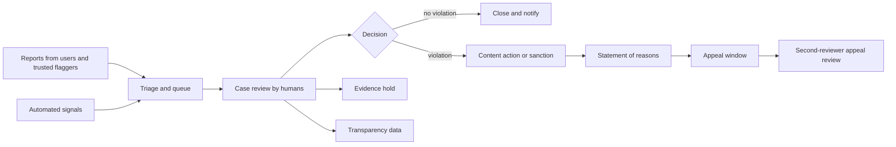
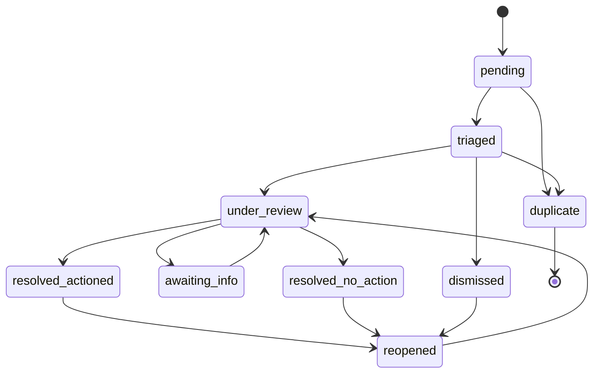
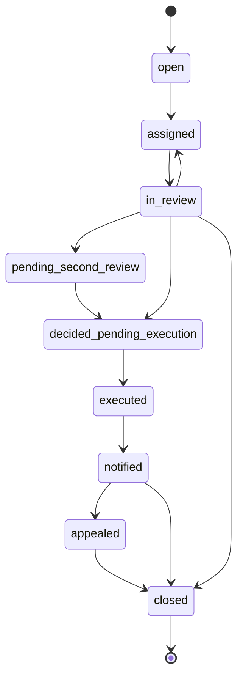
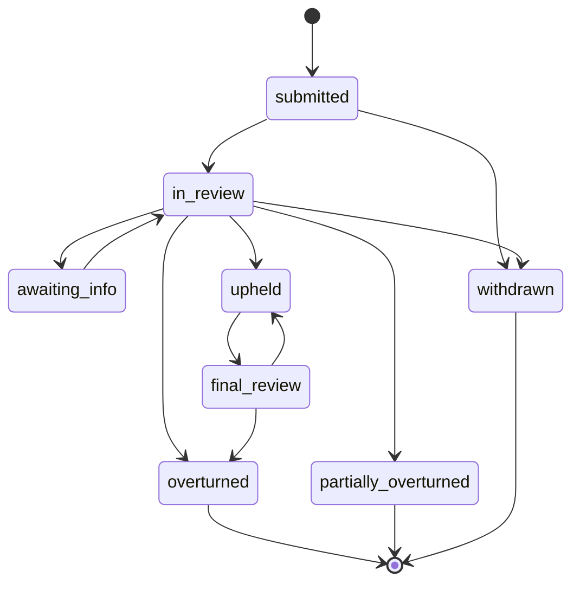
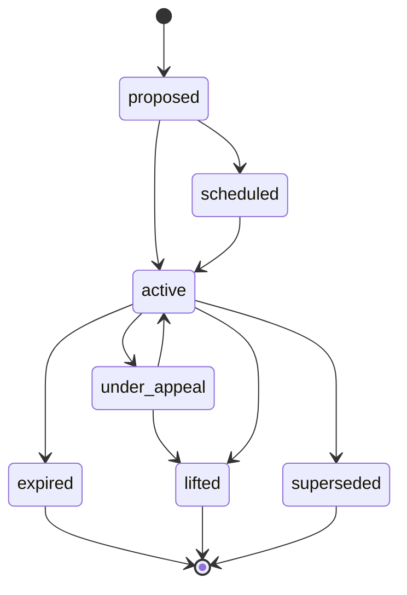
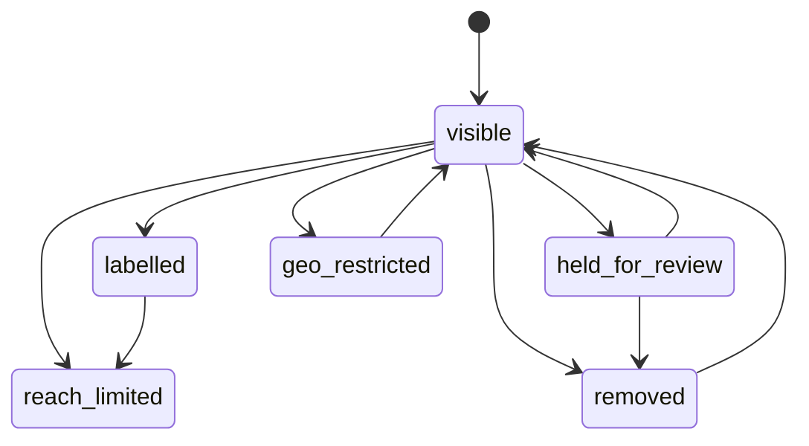
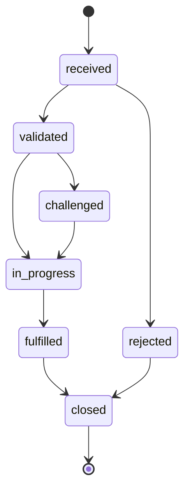
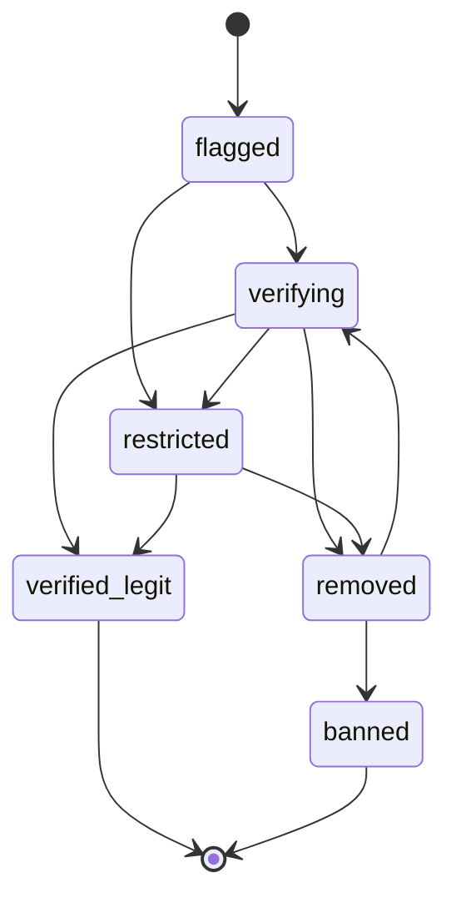
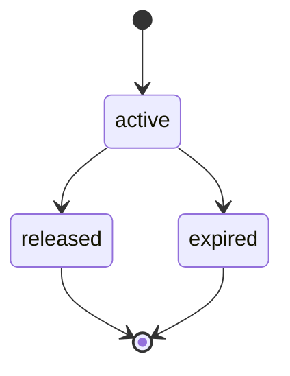
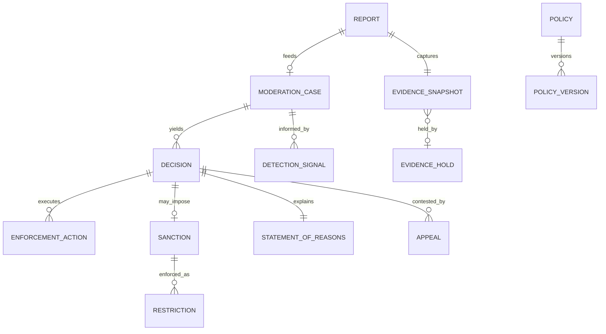

# TSF — Trust, Safety & Moderation

> Status: intended product specification. Nothing in this file is a claim that anything is built. Legacy inputs are inputs, not limits. Conventions: [`../00_START_HERE/CONVENTIONS.md`](../README.md#blueprint-conventions).

## 1. Purpose, outcomes and boundaries

### 1.1 Purpose

TSF keeps TalentSphere safe, honest and lawful: people can report anything, trained humans review it under written policy, automation helps without deciding alone, fraud against job seekers and employers is caught early, and every action is explained, appealable and counted in public. [SRC: SSOT §7 F-24; WF-08; §5.9; §18.3]

### 1.2 Outcomes

1. Anyone can report any content, account, job, employer, credential, message or review in at most three taps, and learns what happened. [SRC: SSOT BR-34]
2. Harmful content and behavior are handled by written policy, proportionate sanctions, and a reviewable record. Permanent actions need two humans. [SRC: SSOT WF-08, §5.9]
3. Job-seeker fraud (fake jobs, fake employers, scams, fake credentials, fake accounts) is detected early and handled with verification and human review, never by anomaly alone. [SRC: SSOT §18.3 "Anomaly is not guilt"]
4. Every enforcement action carries a statement of reasons and an appeal path. [SRC: SSOT BR-154]
5. Evidence is preserved correctly, legal requests are handled by a controlled process, minors are protected, and moderators are protected too.
6. The platform publishes transparency data and can show alignment with the EU Digital Services Act (DSA) and comparable online-safety regimes where they apply.

### 1.3 In scope

Reporting flows for every content type; report taxonomy and triage; policy catalogue and enforcement matrix; moderation queue, case workspace, quorum review, tooling; pre-moderation of high-risk user-generated content; automated detection platform (content abuse, spam and scams, fake jobs and employers, fake credentials, fake and coordinated accounts); content actions; sanctions ladder; statements of reasons; appeals and external dispute settlement information; ban evasion and repeat offenders; minors safety; imminent-harm escalation; scam warnings and safety education; evidence preservation and legal hold; legal requests; transparency reporting; DSA and online-safety workflows; moderator wellbeing, QA and calibration; moderation analytics.

### 1.4 Out of scope (owned elsewhere)

| Capability                                                        | Owner                            |
| ----------------------------------------------------------------- | -------------------------------- |
| Account authentication, session revocation primitives, age claims | IDN (planned)                    |
| Identity and background verification vendors                      | BGV (planned)                    |
| Credential issuance and evidence model                            | EVD (planned)                    |
| Employer verification workflow (know your business customer)      | EMP (planned)                    |
| Support tickets, refunds, admin console frame                     | ADM (planned)                    |
| Assessment integrity engine and exam proctoring signals           | ASM (planned)                    |
| Feed ranking changes beyond reach limitation                      | NET (`FR-NET-036`)               |
| Message delivery and storage                                      | MSG                              |
| AI classifier governance (registry, evaluation, bias audit)       | AIC (`FR-AIC-024`, `FR-AIC-032`) |
| Notification delivery                                             | NTF (planned)                    |
| Data subject rights orchestration                                 | SET (planned)                    |

### 1.5 Boundaries and the non-goal "social-media clone"

TSF does not exist to police speech beyond the platform's career purpose. It enforces published policy for safety, legality, honesty and professionalism. Where policy touches speech (political content, off-topic content) the default is to label or limit reach, not remove, and `OD-TSF-04` records the choice. [SRC: SSOT §4.2]

### 1.6 Owned versus consumed

Owned: reports, cases, decisions, policies, enforcement actions, sanctions, statements of reasons, appeals, evidence holds, legal requests, risk and fraud cases, trusted flagger program, moderator operations, transparency reports. Consumed: content and account data from NET, MSG, JOB, EVD, PRF, LRN and others through a standard content-reference contract; verification states from EMP and BGV; AI classifiers via the AIC registry.

### 1.7 Permission tiers inside role MOD [PROP]

| Tier                  | Abilities                                                                                                                 |
| --------------------- | ------------------------------------------------------------------------------------------------------------------------- |
| MOD-1 Reviewer        | Review assigned cases, apply content actions up to Remove, issue warnings, request second review                          |
| MOD-2 Senior reviewer | Everything in MOD-1, review appeals of MOD-1 decisions, apply temporary suspensions up to 30 days, act as second reviewer |
| MOD-3 Lead            | Everything in MOD-2, propose permanent bans, approve macros, manage queues, calibration, trusted flaggers                 |
| MOD-S Specialist      | Minors safety, legal, fraud investigations (restricted queues with extra training)                                        |

Permanent bans and verified-employer removals need two humans at MOD-2 or above who are different people from the original reviewer (`BR-TSF-011`).

## 2. Roles and permission matrix

Legend: Y allowed, O own objects only, S scoped by tier or queue, R by rule, N not allowed.

| Capability                                                             | GUE | CAN | STD | INS | MNT | REC | HMG | EAD | IAD | PLO | MOD | SUP | PAD | SAD |
| ---------------------------------------------------------------------- | --- | --- | --- | --- | --- | --- | --- | --- | --- | --- | --- | --- | --- | --- |
| Submit a report                                                        | R   | Y   | Y   | Y   | Y   | Y   | Y   | Y   | Y   | Y   | Y   | Y   | Y   | Y   |
| View status of own reports                                             | N   | O   | O   | O   | O   | O   | O   | O   | O   | O   | O   | O   | O   | O   |
| View notices and statements of reasons about own content or account    | N   | O   | O   | O   | O   | O   | O   | O   | O   | O   | O   | O   | O   | O   |
| Appeal a decision                                                      | N   | O   | O   | O   | O   | O   | O   | O   | O   | O   | N   | N   | N   | N   |
| Review cases and apply content actions                                 | N   | N   | N   | N   | N   | N   | N   | N   | N   | N   | S   | N   | N   | N   |
| Apply account sanctions                                                | N   | N   | N   | N   | N   | N   | N   | N   | N   | N   | S   | N   | N   | R   |
| Apply permanent ban (two humans)                                       | N   | N   | N   | N   | N   | N   | N   | N   | N   | N   | S   | N   | R   | R   |
| Read private content beyond a report's scope                           | N   | N   | N   | N   | N   | N   | N   | N   | N   | N   | N   | N   | N   | R   |
| Manage policies and enforcement matrix                                 | N   | N   | N   | N   | N   | N   | N   | N   | N   | N   | N   | N   | Y   | Y   |
| Handle legal requests                                                  | N   | N   | N   | N   | N   | N   | N   | N   | N   | N   | N   | N   | R   | Y   |
| Configure detection thresholds                                         | N   | N   | N   | N   | N   | N   | N   | N   | N   | N   | N   | N   | Y   | Y   |
| View transparency data                                                 | Y   | Y   | Y   | Y   | Y   | Y   | Y   | Y   | Y   | Y   | Y   | Y   | Y   | Y   |
| Act as institution safety contact (receive escalations for own cohort) | N   | N   | N   | N   | N   | N   | N   | N   | S   | S   | N   | N   | N   | N   |
| Act as employer trust contact (respond to fraud inquiries for own org) | N   | N   | N   | N   | N   | N   | N   | S   | N   | N   | N   | N   | N   | N   |
| View moderator wellbeing aggregates                                    | N   | N   | N   | N   | N   | N   | N   | N   | N   | N   | S   | N   | Y   | Y   |

Notes. `MOD` abilities depend on tier (section 1.7) and queue assignment. `SUP` can route reports from tickets but cannot decide. `SAD` access to private content requires a legal basis recorded in the case and is dual-approved. `API` principals (trusted flaggers' tools) may submit reports through a restricted endpoint (`FR-TSF-004`). Minors follow `BR-TSF-017`.

## 3. Sub-module map

| Code  | Sub-module                                             | Features          |
| ----- | ------------------------------------------------------ | ----------------- |
| TSF-A | Reporting                                              | FR-TSF-001 to 005 |
| TSF-B | Policy                                                 | FR-TSF-006 to 007 |
| TSF-C | Moderation queue and tooling                           | FR-TSF-008 to 012 |
| TSF-D | Automated detection and fraud                          | FR-TSF-013 to 018 |
| TSF-E | Enforcement and due process                            | FR-TSF-019 to 026 |
| TSF-F | Evidence, legal, transparency and moderator operations | FR-TSF-027 to 033 |

## 4. Feature specifications

### 4.1 TSF-A Reporting

### FR-TSF-001 — Report content or account (universal intake)

- **Sub-module:** TSF-A Reporting
- **Priority / tier:** Must · R1
- **Source:** [SRC: SSOT §7 F-24; BR-34] [DER] from DSA notice-and-action practice
- **Purpose and outcome:** Any person can report anything on the platform in a guided flow; the system produces a triaged report with an evidence snapshot and a reference the reporter can track.
- **Roles and permissions:** `CAN, STD, INS, MNT, REC, HMG, EAD, IAD, PLO, MOD, SUP, PAD, SAD: report` · `GUE: report public content with challenge`
- **Preconditions and entry points:** Report menu on every reportable object (FR-TSF-002 lists them), the "Report a problem" link in the footer, support ticket "Report abuse", email to the abuse address (routed into the same intake), API for trusted flaggers (FR-TSF-004).
- **User interactions and actions:** 1. Open Report on an object. 2. Choose a top-level reason (for example "Scam or fraud", "Harassment", "Hate or discrimination", "Sexual content", "Violence or threats", "Spam", "Fake profile or impersonation", "Misleading job or employer", "Fake credential", "Privacy violation", "Intellectual property", "Self-harm", "Child safety", "Other"). 3. Choose a more specific sub-reason from a short list. 4. Add optional details (up to 2,000 characters) and optional screenshots (up to 3). 5. For messages, choose which messages to include (`BR-MSG-022`). 6. Optionally block the person or hide the content. 7. Submit and receive a reference ID and expected timeline.
- **System behaviour:** Creates a `Report` (`SM-TSF-01`) with the object reference, reason code, sub-reason, reporter, details, and an `EvidenceSnapshot` (content copy and context at report time, hashed) (`BR-TSF-015`). Duplicates on the same object are merged into one case with a reporter count (`BR-TSF-007`). Assigns a priority tier by reason and signals (`BR-TSF-004`): child safety and imminent harm are P0 and page the on-call specialist (FR-TSF-024, FR-TSF-025). Rate limit: 20 reports per hour per reporter, never applied to P0 reasons (`BR-TSF-001`, `BR-TSF-029`). Guests must pass a challenge and give an optional email for follow-up. The reported party is never told who reported (`BR-TSF-006`). The reporter may choose "hide this for me" immediately. Emits `tsf.report.submitted`.
- **UI elements and controls:** Report dialog (stepper of 3 screens maximum: reason, sub-reason with details, review and submit); reason radio list with descriptions; details textarea with counter; screenshot uploader; "Also block" and "Hide for me" checkboxes; Submit; confirmation page with reference ID and status link; error region.
- **Configuration options:** Platform: reasons and sub-reasons (taxonomy owned by FR-TSF-006), rate limits, screenshot limits. Locale-specific legal reasons (for example "Illegal content" with a jurisdiction field) enabled by region (`BR-TSF-034`).
- **Business rules:** `BR-TSF-001`, `BR-TSF-004`, `BR-TSF-005`, `BR-TSF-006`, `BR-TSF-007`, `BR-TSF-015`, `BR-TSF-029`
- **Validation:** Reason required; details 0 to 2,000 characters; at most 3 images of up to 5 MB (JPEG, PNG, WebP); object reference must resolve and be visible to the reporter (or be public for guests); messages selected must belong to the reporter's accessible conversation.
- **Inputs and outputs:** In: object ref, reason, details, attachments, flags. Out: report id, state `pending`, priority, estimated first-response window.
- **Filters, sorting, search:** n/a — intake flow; status list is in FR-TSF-003.
- **Notifications and communication:** Reporter: confirmation (in-app, email if guest provided) with template `tsf.report_received`; class `account_safety` (non-optional for reporters who asked for updates). P0: on-call page.
- **Error handling and edge cases:** Object already removed: report accepted with note "This content is no longer available; we will still review related account behavior". Reporter offline: the report is queued on the device and submitted on reconnect (up to 24 hours) with a client id for idempotency. Rate limit reached: message with reset time. Attachment fails scan: removed with notice. Reporting own content: allowed only for the reason "Privacy violation" or "Self-harm" and routed accordingly. Report against a moderator or staff member: routed to MOD-3 and SAD, never to the person reported (`BR-TSF-020`).
- **Dependencies:** FR-TSF-002, FR-TSF-006, FR-TSF-008, FR-TSF-015 (evidence), NET, MSG, JOB, EVD, `ENT-TSF-01`, `ENT-TSF-02`.
- **Security and privacy:** Reporter identity stored with restricted access (case staff only); reports are PRIVATE data; snapshots encrypted; CAPTCHA and abuse monitoring for guest reports; no reporter details in any outgoing notice to the reported party.
- **Acceptance criteria:**
  - Given a signed-in member viewing a post, when they report it as "Scam or fraud", then a report exists with a snapshot and the reporter sees a reference ID within 2 seconds.
  - Given two members report the same post, then one case exists with a reporter count of 2.
  - Given a child-safety report, then it is P0 and reaches the on-call specialist within 1 minute.
  - Given a reporter exceeds 20 reports in an hour, when they report another non-P0 item, then it is refused with the reset time; when they report a P0 item, it is accepted.

### FR-TSF-002 — Report entry points and categories for every content type

- **Sub-module:** TSF-A Reporting
- **Priority / tier:** Must · R1
- **Source:** [SRC: SSOT §7 F-24; BR-138] [PROP] for completeness
- **Purpose and outcome:** Every object type has a report entry point with the reasons that apply to it, so nothing on the platform is unreportable.
- **Roles and permissions:** as FR-TSF-001
- **Preconditions and entry points:** The surfaces listed below; each owning module renders the menu item and calls the TSF intake with an object reference.
- **User interactions and actions:** The member opens the overflow menu on any object and selects Report. The reasons shown vary by type per the table below.
- **System behaviour:** The TSF taxonomy registry (FR-TSF-006) lists, per object type, the allowed reasons, the evidence to snapshot and the default queue. Registered types: member profile (photo, headline, summary, name), post, comment, article, newsletter issue, group, group post, direct message or conversation (MSG), message request, recruiter outreach, introduction request, referral request or referral note, recommendation or endorsement, mentor profile and mentor session (MEN planned), job posting (JOB planned), employer page and employer account (EMP planned), company review, salary report, interview question or experience (EVD planned or SRC planned), course and course review (LRN, STU planned), instructor profile, challenge or contest submission (ASM planned), project or portfolio item (PRF planned), credential or certificate claim (EVD planned), event page (EVT planned), gig listing (GIG planned), AI-generated output (AIC `FR-AIC-033`), advertisement or sponsored item, and "something else" for system gaps. Each registered type must have a snapshot adapter implemented by the owning module; a module without an adapter cannot ship a new content type (checked in release gates) (`BR-TSF-005`).
- **UI elements and controls:** Standard "Report" menu item with flag icon and text label; reason list adapted per type.
- **Configuration options:** Per type: reasons, default priority, whether pre-moderation applies (FR-TSF-012), whether the reported party may see the report count (never by default).
- **Business rules:** `BR-TSF-005`, `BR-TSF-001`, `BR-TSF-019`
- **Validation:** The object type must be in the registry; snapshot adapter must return content within 2 seconds.
- **Inputs and outputs:** In: object ref. Out: allowed reasons, snapshot payload.
- **Filters, sorting, search:** n/a — configuration.
- **Notifications and communication:** None.
- **Error handling and edge cases:** Snapshot adapter fails: report is accepted with reference only, and an engineer alert is created; the case is flagged "snapshot missing". Private content the reporter cannot see: cannot be reported by id guessing (authorization check on ref).
- **Dependencies:** All content-owning modules, FR-TSF-006, `ENT-TSF-05`.
- **Security and privacy:** Adapters expose only the content the reporter could see plus system-held context needed for review (for example prior reports on the object).
- **Acceptance criteria:**
  - Given a job posting, when a candidate reports it, then reasons include "Scam or fraud", "Misleading job" and "Discriminatory content".
  - Given a new content type without a snapshot adapter, then the release gate fails.
  - Given an invisible object id supplied by a member, then the intake responds not found.

### FR-TSF-003 — Reporter status and follow-up

- **Sub-module:** TSF-A Reporting
- **Priority / tier:** Must · R2
- **Source:** [SRC: SSOT BR-34 lifecycle] [DER] from DSA acknowledgements
- **Purpose and outcome:** Reporters can see what is happening to their reports and receive a clear outcome without exposing private enforcement details.
- **Roles and permissions:** `reporters: view own reports` · `MOD: n/a`
- **Preconditions and entry points:** Settings > Safety > My reports; email links for guests; notifications.
- **User interactions and actions:** 1. See a list of reports with state: Received, In review, Resolved (action taken), Resolved (no violation found), Closed (duplicate). 2. Open a report to see the timeline and the reason summary. 3. Add more information to an open report (up to 3 additions). 4. Ask to reopen within 14 days with new information. 5. See the outcome in plain language, with a link to the relevant policy.
- **System behaviour:** Reporter-visible states map from case states (`SM-TSF-01`, `SM-TSF-02`). Outcome text says "We removed the content" or "We did not find a violation of <policy>" and for actions against the reported party only the type of action, never personal sanctions details such as suspension duration (`BR-TSF-006`, `BR-TSF-033`). Reporters may appeal a "no violation" outcome once (FR-TSF-022) for high-severity categories and for trusted flaggers. Emits `tsf.report.resolved` consumed for reporter notices.
- **UI elements and controls:** Report list; detail timeline; "Add information" form; "Reopen" button; policy link.
- **Configuration options:** Platform: reopen window 14 days, addition limit 3.
- **Business rules:** `BR-TSF-006`, `BR-TSF-033`, `BR-TSF-002`
- **Validation:** Additional information up to 1,000 characters; reopening requires new information.
- **Inputs and outputs:** In: additions, reopen request. Out: updated status.
- **Filters, sorting, search:** Filter by state; sort by date.
- **Notifications and communication:** `tsf.report_resolved` (in-app, email opt-in); class `account_safety`.
- **Error handling and edge cases:** Report on content later restored after appeal: the reporter is not told the restoration but the case history remains. Reporter account deleted: report kept without reporter identity.
- **Dependencies:** FR-TSF-001, FR-TSF-009, `ENT-TSF-01`.
- **Security and privacy:** Only the reporter sees their report list; no reported-party identity beyond what the reporter already saw.
- **Acceptance criteria:**
  - Given a resolved report with action, then the reporter sees "We took action" and no sanction details.
  - Given a reopen request without new information, then it is refused with a message.
  - Given a closed duplicate, then the reporter sees the outcome of the primary case.

### FR-TSF-004 — Trusted flagger channel and bulk reports

- **Sub-module:** TSF-A Reporting
- **Priority / tier:** Should · R4
- **Source:** [DER] from DSA trusted flaggers concept [PROP]
- **Purpose and outcome:** Vetted organizations (for example anti-fraud agencies, child-safety hotlines, institutions) report at volume with priority handling and accountability.
- **Roles and permissions:** `trusted flagger accounts (CAN with flagger role by TSF assignment, or API principal): submit` · `MOD-3: onboard, review, revoke` · `SAD: approve`
- **Preconditions and entry points:** Application form; signed agreement; designated contacts. Reports via a dedicated form or API with an API key.
- **User interactions and actions:** 1. Organization applies (organization, mission, expertise, accuracy commitments). 2. MOD-3 reviews and SAD approves. 3. Flagger submits reports individually or in batches (CSV or API, up to 500 per batch) with evidence URLs and reason codes. 4. Flagger receives per-report outcomes by webhook or email.
- **System behaviour:** `BR-TSF-028`: criteria are expertise, independence from platform commercial interests, diligence and accuracy tracking. Flagger reports enter a priority queue lane (one tier higher than equivalent user reports, never above P0) and carry a "trusted flagger" label for reviewers. Accuracy is tracked by quarter (share upheld); below 60 percent for two consecutive quarters triggers review, and status can be suspended or revoked with a statement of reasons (`BR-TSF-028`). Flagger status is listed publicly in the transparency report. Abusive batching is blocked by rate limits (500 per hour). Emits `tsf.trusted_flagger.status_changed`.
- **UI elements and controls:** Application form; flagger dashboard (submitted, upheld, rejected); batch upload; API docs link.
- **Configuration options:** Platform: priority uplift, batch size, accuracy thresholds [PROP].
- **Business rules:** `BR-TSF-028`, `BR-TSF-029`, `BR-TSF-004`
- **Validation:** Batch rows validated per row (object ref, reason); invalid rows returned with errors.
- **Inputs and outputs:** In: batch. Out: per-row report ids or errors.
- **Filters, sorting, search:** Dashboard filter by period, outcome.
- **Notifications and communication:** Quarterly accuracy summary; status change notice.
- **Error handling and edge cases:** API key leak: key revoked and reports from it quarantined for review. Duplicate objects: merged.
- **Dependencies:** FR-TSF-001, FR-TSF-008, FR-TSF-029, `ENT-TSF-15`.
- **Security and privacy:** Keys stored hashed; flagger staff identities limited to designated contacts.
- **Acceptance criteria:**
  - Given an approved flagger submits a report, then it enters one priority lane above a user report of the same reason.
  - Given accuracy under 60 percent for two quarters, then a review task is created.
  - Given a revoked flagger, then their API key stops working immediately.

### FR-TSF-005 — Report-abuse controls (manifestly unfounded reports)

- **Sub-module:** TSF-A Reporting
- **Priority / tier:** Should · R2
- **Source:** [DER] from DSA misuse measures [PROP]
- **Purpose and outcome:** Brigading and retaliatory reporting are detected without discouraging legitimate reporting.
- **Roles and permissions:** system; `MOD-2: review flags` · `PAD: configure thresholds`
- **Preconditions and entry points:** Runs on every resolved report; coordinated report spikes.
- **User interactions and actions:** Reporters with repeated unfounded reports receive a graded response: a reminder of policy, then reduced priority for their non-P0 reports, then temporary suspension of the reporting right for non-P0 reasons (14 days), always with a statement of reasons and appeal.
- **System behaviour:** A report is "manifestly unfounded" only when a reviewer marks it so with a reason (not merely "no violation") (`BR-TSF-029`). Thresholds [PROP]: 5 manifestly unfounded reports within 30 days triggers a warning; 10 triggers reduced priority; 20 triggers a 14-day suspension of non-P0 reporting. Report spikes against one target (more than 20 reports in 1 hour from accounts created within 7 days or with correlated signals) are flagged as possible brigading: the target is protected by holding public removal until a human reviews (`BR-TSF-037`) and the reporters are examined (FR-TSF-018). P0 reports are never throttled. Emits `tsf.reporter.warned`.
- **UI elements and controls:** Reviewer UI field "manifestly unfounded" with reason; reporter notice.
- **Configuration options:** Thresholds and windows.
- **Business rules:** `BR-TSF-029`, `BR-TSF-037`, `BR-TSF-006`
- **Validation:** Marking requires a reason of at least 20 characters and MOD-2 review for the suspension step.
- **Inputs and outputs:** In: resolved reports. Out: reporter standing.
- **Filters, sorting, search:** Review queue filter by reporter.
- **Notifications and communication:** Warning, priority reduction and suspension notices (class `account_safety`).
- **Error handling and edge cases:** Reporter harmed by a real abuse pattern repeatedly reporting similar benign-looking items: reviewers may override with "pattern is real". Appeals restore standing.
- **Dependencies:** FR-TSF-009, FR-TSF-018, FR-TSF-022, `ENT-TSF-21`.
- **Security and privacy:** Standing data visible to staff only.
- **Acceptance criteria:**
  - Given 20 manifestly unfounded reports in 30 days, then non-P0 reporting is suspended for 14 days with a notice.
  - Given the suspended reporter, when they submit a child-safety report, then it is accepted.
  - Given a ruling "no violation" without the unfounded flag, then it does not count toward thresholds.

### 4.2 TSF-B Policy

### FR-TSF-006 — Policy catalogue, taxonomy and versioning

- **Sub-module:** TSF-B Policy
- **Priority / tier:** Must · R2
- **Source:** [DER] [PROP]; [SRC: SSOT BR-138, BR-136 policy touchpoints]
- **Purpose and outcome:** Every moderation decision cites a written, versioned, public policy; the report taxonomy and the policies stay in sync.
- **Roles and permissions:** `PAD, SAD: author and publish` · `MOD-3: propose changes` · `all users: read public policies`
- **Preconditions and entry points:** Admin console > Policies; public Safety center and Community guidelines pages.
- **User interactions and actions:** 1. Author drafts a policy or amendment (title, scope, definition, examples of violation and non-violation, exceptions, severity, default actions, regions). 2. Review by counsel and MOD-3. 3. Publish with an effective date. 4. Public pages show versions and a change log. 5. Reviewers see the policy text beside each case.
- **System behaviour:** Policy catalogue (initial set, each with `policy_id`): `POL-01` Child safety; `POL-02` Violence, threats and self-harm; `POL-03` Harassment and bullying; `POL-04` Hate and discrimination; `POL-05` Sexual content and solicitation; `POL-06` Spam and platform manipulation; `POL-07` Scams and financial fraud; `POL-08` Fake jobs and employer misrepresentation (including fees from candidates, work-for-free schemes, pyramid or multi-level offers, requests for sensitive documents before offer); `POL-09` Fake credentials and academic or employment fraud; `POL-10` Impersonation and fake accounts; `POL-11` Privacy and doxxing (including interview questions or reviews exposing individuals); `POL-12` Intellectual property; `POL-13` Illegal goods, services and activities; `POL-14` Misinformation affecting career safety (for example fake certificates or fake regulatory claims); `POL-15` Professional conduct (off-topic, self-promotion beyond limits, engagement bait, undisclosed sponsorship); `POL-16` Reviews and ratings integrity (fake or incentivized reviews, retaliation, interview-process leaks); `POL-17` Assessment and contest integrity violations referred from ASM; `POL-18` Referral and recommendation manipulation; `POL-19` Platform security abuse (scraping, credential trading, automation); `POL-20` Employer conduct (discriminatory job requirements, retaliation against reporters, unauthorized data use). Versions are immutable once published; decisions store `policy_id` and `policy_version` (`BR-TSF-031`, `BR-TSF-035`). Non-urgent changes are announced 14 days before they apply; urgent safety changes apply immediately with after-the-fact notice (`BR-TSF-031`). Translations are maintained for supported languages and the English text is not authoritative where law requires local language (`BR-TSF-034`). Emits `tsf.policy.version_published`.
- **UI elements and controls:** Policy editor with preview; diff view; approval workflow; public policy pages with anchors; "applies in region" selector.
- **Configuration options:** Per policy: severity (low, medium, high, critical), default action set, regions, effective date.
- **Business rules:** `BR-TSF-031`, `BR-TSF-035`, `BR-TSF-034`, `BR-TSF-005`
- **Validation:** Each policy needs definition, at least 3 examples of violation and 3 of non-violation, default action, owner; effective date at least 14 days ahead unless flagged urgent with SAD approval.
- **Inputs and outputs:** In: policy text and metadata. Out: published version.
- **Filters, sorting, search:** Policy list filter by area, region, status.
- **Notifications and communication:** Change announcements to affected users (class `policy_updates`, mandatory for material changes).
- **Error handling and edge cases:** Conflicting policies on one case: reviewer chooses the most specific and notes the overlap. Retired policy referenced by old decisions: version retained for audit.
- **Dependencies:** `ENT-TSF-06`, `ENT-TSF-07`, FR-TSF-007, FR-TSF-030.
- **Security and privacy:** Draft policies restricted; public pages cacheable; audit of edits.
- **Acceptance criteria:**
  - Given a published policy, then it is immutable and a new version is required to change it.
  - Given a decision, then it stores the exact policy id and version.
  - Given a non-urgent amendment with an effective date 5 days away, then publish is refused.

### FR-TSF-007 — Enforcement matrix and severity mapping

- **Sub-module:** TSF-B Policy
- **Priority / tier:** Must · R2
- **Source:** [DER] [PROP]; [SRC: SSOT WF-08 "two-human review on bans"]
- **Purpose and outcome:** For each policy and severity, the allowed and default enforcement actions are written down so decisions are consistent and reviewable.
- **Roles and permissions:** `PAD, SAD: configure` · `MOD-3: propose` · `MOD: view`
- **Preconditions and entry points:** Admin console > Enforcement matrix.
- **User interactions and actions:** 1. PAD edits the matrix: rows are policy and severity; columns are content actions (none, label, reduce reach, hide pending review, remove), account actions (warning, feature restriction, temporary suspension, permanent ban), required reviewer tier, whether two humans are needed, whether to notify authorities, appeal rights. 2. Publish a new matrix version.
- **System behaviour:** The case workspace (FR-TSF-009) offers only actions allowed by the matrix for the chosen policy and severity; a deviation requires a "departure reason" and MOD-2 approval and is flagged for QA (FR-TSF-032) (`BR-TSF-035`). Defaults: critical severity under `POL-01` and `POL-02` allow immediate removal and suspension pending review by MOD-S and mandatory referral (FR-TSF-024, FR-TSF-025); permanent actions always need two humans (`BR-TSF-011`). The matrix version is stored with each decision. Emits `tsf.policy.version_published` (matrix version).
- **UI elements and controls:** Matrix grid editor; version history; test mode to simulate a case.
- **Configuration options:** As described.
- **Business rules:** `BR-TSF-011`, `BR-TSF-013`, `BR-TSF-035`, `BR-TSF-009`
- **Validation:** Every policy-severity row has at least one allowed action; permanent actions cannot be set to a single reviewer; matrix changes need SAD approval.
- **Inputs and outputs:** In: matrix edits. Out: published matrix.
- **Filters, sorting, search:** Filter by policy and severity.
- **Notifications and communication:** Moderators informed of matrix changes before they apply.
- **Error handling and edge cases:** A case with no matching row: escalates to MOD-3 and a matrix gap task is created.
- **Dependencies:** FR-TSF-006, FR-TSF-009, FR-TSF-010, `ENT-TSF-24`.
- **Security and privacy:** Matrix is internal but summarized publicly in the transparency report.
- **Acceptance criteria:**
  - Given a case with `POL-03` low severity, then the permanent ban option is not offered.
  - Given a deviation from the matrix, then the system requires a departure reason and MOD-2 approval.
  - Given a published matrix, then decisions store its version.

### 4.3 TSF-C Moderation queue and tooling

### FR-TSF-008 — Moderation queue and triage

- **Sub-module:** TSF-C Moderation queue and tooling
- **Priority / tier:** Must · R2
- **Source:** [SRC: SSOT WF-08 "append-only queue"; BR-34; BR-059] [PROP]
- **Purpose and outcome:** Reports and automated signals reach the right reviewer in priority order with enough context, and nothing gets lost.
- **Roles and permissions:** `MOD-1..3: work assigned queues` · `MOD-3: manage queues and assignment` · `MOD-S: restricted queues` · `PAD: configure`
- **Preconditions and entry points:** Moderator console > Queues. A report or signal creates a queue item.
- **User interactions and actions:** 1. Choose a queue (General, Fraud, Minors and imminent harm, Legal, Appeals, Pre-moderation, Employer trust, Trusted flagger lane). 2. Click "Take next" (system assigns by priority and age and skill) or pick from a list if the tier allows. 3. Work the case in FR-TSF-009. 4. Release, reassign or escalate. 5. MOD-3 views queue health (counts, age, SLA risk) and rebalances.
- **System behaviour:** Priority tiers (`BR-TSF-004`): P0 immediate (page on-call; target first human review within 15 minutes) for child safety, imminent harm, terrorism or credible violent threats; P1 within 24 hours for scams in progress, doxxing, sexual harassment, hate, fake employer with active postings; P2 within 72 hours for other policy reports; P3 within 7 days for low-severity spam and professional conduct. Sorting within a tier: trusted flagger, report count, reach (views), time waiting. Items are locked to a reviewer for 30 minutes of inactivity then returned. Automated-only signals with no human report expire after 7 days to `lapsed` unless they hit a risk threshold (`BR-TSF-003`, `OD-TSF-02`); any item with a human report never expires. Duplicate reports merge (`BR-TSF-007`). SLA clocks pause when awaiting information from a reporter or agency. Content under automated hold is reviewed within 72 hours or released automatically with the case kept open (`BR-TSF-037`). Queue assignments never route a case to a reviewer with a declared conflict (`BR-TSF-020`). Emits `tsf.report.triaged`, `tsf.case.created`, `tsf.case.assigned`.
- **UI elements and controls:** Queue picker with counts; list with priority chips (text and color), age, reason, reach, flags; "Take next" primary; filters; bulk actions limited to non-sensitive duplicates; SLA risk indicators; keyboard shortcuts.
- **Configuration options:** Platform: priority mapping by reason, SLA targets, lock timeout, queue skills and languages.
- **Business rules:** `BR-TSF-002`, `BR-TSF-003`, `BR-TSF-004`, `BR-TSF-007`, `BR-TSF-020`, `BR-TSF-037`
- **Validation:** Assignment requires tier and language skill match; MOD-S queues require specialist training flag.
- **Inputs and outputs:** In: reports and signals. Out: assigned cases.
- **Filters, sorting, search:** Filter by policy area, region, language, priority, age, source (user, flagger, automated); sort by priority then age; search by case id, object id, reporter id (restricted fields hidden unless needed).
- **Notifications and communication:** SLA risk alerts to MOD-3; P0 pages to on-call.
- **Error handling and edge cases:** No reviewer with the language: machine translation assist is shown with the original (`FR-TSF-011`), and the case is flagged for a native reviewer if the decision is severe. Queue backlog above thresholds: lead can enable "surge mode" (priority-only handling, content reach limits for pending P1 items). On-call unavailable: escalation to the next tier after 5 minutes.
- **Dependencies:** FR-TSF-001, FR-TSF-013, FR-TSF-009, `ENT-TSF-03`, `ENT-TSF-23`.
- **Security and privacy:** Queue views show the minimum data; reporter identity visible to MOD-2 and above only when needed; all views logged.
- **Acceptance criteria:**
  - Given a P0 report, then the on-call specialist is paged and the case is first in the Minors and imminent harm queue.
  - Given a reviewer has declared a conflict with the reported party, then the case is never assigned to them.
  - Given an automated flag without human reports older than 7 days, then it lapses and is counted in metrics.
  - Given a hold older than 72 hours with no decision, then the content is restored and the case stays open.

### FR-TSF-009 — Case workspace and decisions

- **Sub-module:** TSF-C Moderation queue and tooling
- **Priority / tier:** Must · R2
- **Source:** [SRC: SSOT WF-08 "Resolution logged + notice sent"; BR-34] [PROP]
- **Purpose and outcome:** A reviewer sees everything needed to decide, selects a policy-based decision, and the system executes, records and notifies correctly.
- **Roles and permissions:** `MOD-1..3, MOD-S: decide within tier` · `MOD-2: second review` · `SAD: access to restricted data with legal basis`
- **Preconditions and entry points:** A case assigned from the queue.
- **User interactions and actions:** 1. Open the case: reported object, evidence snapshot, context (conversation window, post thread, profile history), reporter reasons (anonymized for the reviewed party), prior reports and prior actions on the object and the account (last 24 months), automated signals with reason codes, applicable policies. 2. Choose Violation or No violation. 3. For violation: choose policy and severity, then actions from the matrix (FR-TSF-007) for content and account. 4. Write a rationale (required, at least 30 characters, using a macro or free text). 5. Choose reviewer notes (internal). 6. Submit; if the action needs a second human (FR-TSF-010) the case moves to `pending_second_review`.
- **System behaviour:** `SM-TSF-02`. Decisions are append-only; changes create a new decision that supersedes the old with a reason (`BR-TSF-012`). Submitting executes actions via owning modules through a signed action API (content hide or remove, account restriction, feature restriction, reach limit), idempotent by decision id. A statement of reasons is generated (FR-TSF-021). Reports linked to the case are resolved with outcomes (FR-TSF-003). Related items found during review can be added to the case ("also affects 3 other posts by this account") with the same decision applied after confirmation. Time spent is recorded for workload and wellbeing metrics (FR-TSF-031). Decision requires policy id, version, severity and rationale (`BR-TSF-035`). Emits `tsf.decision.made`, `tsf.content.actioned`.
- **UI elements and controls:** Three-pane workspace (queue strip, evidence, decision panel); sensitive media blurred by default with click to reveal and a per-session reveal counter; policy side drawer; macros menu; "Request second review"; "Escalate to specialist"; "Needs information" (from reporter or from an agency); timer; keyboard-first controls.
- **Configuration options:** Platform: blur defaults, rationale minimum length, case age limits.
- **Business rules:** `BR-TSF-009`, `BR-TSF-010`, `BR-TSF-012`, `BR-TSF-035`, `BR-TSF-038`
- **Validation:** Rationale at least 30 characters; policy and severity from catalogue; action in matrix or departure with reason.
- **Inputs and outputs:** In: decision. Out: executed actions, notices, updated case state.
- **Filters, sorting, search:** Evidence history filter by type; case search in FR-TSF-011.
- **Notifications and communication:** Notices per FR-TSF-021; reporter outcome per FR-TSF-003.
- **Error handling and edge cases:** Owning module action fails: case stays `decided_pending_execution`, retried with backoff for 24 hours, then escalated to PAD; the reviewer sees the status. Content deleted by the author while under review: case continues for account-level assessment. Concurrent edits: the lock prevents it; expired lock shows "Case reassigned".
- **Dependencies:** FR-TSF-007, FR-TSF-010, FR-TSF-019 to 021, all content-owning modules, `ENT-TSF-03`, `ENT-TSF-04`.
- **Security and privacy:** Reviewer access limited to the case scope; for messages only the selected window (`BR-TSF-038`); every view and action audited; no export of case data except by SAD.
- **Acceptance criteria:**
  - Given a violation decision with policy `POL-07`, then the content action executes and the affected user receives a statement of reasons.
  - Given a rationale shorter than 30 characters, then submit is refused.
  - Given a failed content action, then the case shows "execution pending" and retries without losing the decision.
  - Given a decision correction, then the earlier decision remains visible in history.

### FR-TSF-010 — Quorum review for severe actions

- **Sub-module:** TSF-C Moderation queue and tooling
- **Priority / tier:** Must · R2
- **Source:** [SRC: SSOT §5.9 "Moderation escalations are quorum-based"; WF-08 "two-human review on bans"]
- **Purpose and outcome:** Irreversible or high-impact actions are never made by one person.
- **Roles and permissions:** `MOD-2, MOD-3, MOD-S: first and second reviewers (different people)` · `PAD, SAD: tiebreak for permanent bans of verified employers`
- **Preconditions and entry points:** A decision proposing a permanent ban, removal of a verified employer account or its job inventory, deletion of a group with more than 1,000 members, action on a person holding a TalentSphere staff role, or any action that matrix marks "two humans".
- **User interactions and actions:** 1. First reviewer proposes the action with rationale. 2. The system assigns a second reviewer who has not seen the first rationale until after recording their own independent verdict (blind review). 3. If both agree the action executes. 4. If they disagree a third reviewer (MOD-3) decides; tie rules in `BR-TSF-011`.
- **System behaviour:** Second reviewer must be MOD-2 or above, different person, no conflict of interest, and not in the same shift pod where practical. The action is held in `pending_second_review` with the content restricted (hidden or limited) if the severity is critical, otherwise remains live. SLA for second review: 24 hours (P1) or 72 hours (P2). Both verdicts, rationales and timestamps are stored. Emits `tsf.case.second_review_requested`.
- **UI elements and controls:** "Propose permanent action" form; blind second-review pane that hides the first rationale until the second verdict is submitted; outcome banner.
- **Configuration options:** Platform: list of actions requiring quorum; SLAs; pod separation toggle.
- **Business rules:** `BR-TSF-011`, `BR-TSF-012`, `BR-TSF-020`
- **Validation:** Second reviewer identity differs from first and from anyone who handled prior appeals on the same account.
- **Inputs and outputs:** In: proposal. Out: executed or rejected action.
- **Filters, sorting, search:** Second-review queue filter by action type.
- **Notifications and communication:** Second reviewer assigned; first reviewer informed of outcome.
- **Error handling and edge cases:** Second reviewer unavailable beyond SLA: reassigned automatically. Disagreement unresolved after the third reviewer: lesser action applies and the case is flagged for lead review.
- **Dependencies:** FR-TSF-009, `ENT-TSF-03`, `ENT-TSF-04`.
- **Security and privacy:** Blind review prevents anchoring; all verdicts auditable.
- **Acceptance criteria:**
  - Given a proposed permanent ban, then it does not execute with one verdict.
  - Given the second reviewer is the same person as the first, then assignment is refused.
  - Given disagreement, then a third reviewer decides and the lesser action applies if still tied.

### FR-TSF-011 — Moderator tooling (search, context, macros, translation, redaction)

- **Sub-module:** TSF-C Moderation queue and tooling
- **Priority / tier:** Should · R2
- **Source:** [PROP]
- **Purpose and outcome:** Moderators work faster and more consistently, with less exposure to harmful material.
- **Roles and permissions:** `MOD-1..3, MOD-S: use` · `MOD-3: manage macros and saved searches` · `PAD: configure`
- **Preconditions and entry points:** Moderator console.
- **User interactions and actions:** 1. Search cases by id, object, account, policy, date, reviewer, outcome. 2. Open an account's moderation history (reports, actions, sanctions, appeals) and a timeline of related content. 3. Use macros for rationales and notices with variable fields. 4. See machine translation of foreign-language content beside the original with a "machine translated" label. 5. Use media tools: blur levels, grayscale, audio mute by default, frame sampling for video, OCR text extraction. 6. Use "related content" clustering (same text, same image hash, same links, same account network). 7. Use saved views and keyboard shortcuts.
- **System behaviour:** Search is restricted by tier (MOD-1 sees cases in assigned queues and own history; MOD-2 and above wider). Macros are versioned and approved by MOD-3; macros fill policy citations automatically. Translation never replaces the original in the record. Media tools reduce exposure (`BR-TSF-021`). Image hashing (perceptual) clusters near duplicates and checks against internal block lists. Searching private message content is impossible except inside a case's authorized window (`BR-TSF-038`). All searches are audited. Emits no business events.
- **UI elements and controls:** Global search; account history page; macro picker; translation toggle; media toolbar; cluster view; shortcuts help.
- **Configuration options:** Platform: tier access, macros, blur defaults.
- **Business rules:** `BR-TSF-021`, `BR-TSF-038`, `BR-TSF-020`
- **Validation:** Macro variables resolved before send; search date ranges bounded to 24 months for non-SAD.
- **Inputs and outputs:** In: queries, selections. Out: results, derived views.
- **Filters, sorting, search:** As listed.
- **Notifications and communication:** None.
- **Error handling and edge cases:** Translation unavailable for a language: marks "needs native reviewer". Clustering false positives: reviewers confirm before bulk actions.
- **Dependencies:** FR-TSF-009, AIC translation via gateway (no decisions), `ENT-TSF-22`.
- **Security and privacy:** Audit trail on every search; moderators cannot export data; translation requests pass the AI gateway with redaction rules.
- **Acceptance criteria:**
  - Given a MOD-1, when they search for an account outside their queues, then access is denied and logged.
  - Given a macro with an unfilled variable, then it cannot be sent.
  - Given a graphic image, then it is blurred until revealed and the reveal is counted.

### FR-TSF-012 — Pre-moderation of high-risk user-generated content

- **Sub-module:** TSF-C Moderation queue and tooling
- **Priority / tier:** Must · R2
- **Source:** [SRC: SSOT BR-138; §7 F-75 company reviews; BR-136, BR-137]
- **Purpose and outcome:** Content with high potential for harm to individuals or employers is reviewed before it is public.
- **Roles and permissions:** `MOD-1..2: review` · `PAD: configure categories` · authors: view status
- **Preconditions and entry points:** Submissions of company reviews, salary reports, interview questions and interview experiences, employer replies to reviews, first posts of new accounts containing links, job postings from unverified or new employers (FR-TSF-016), group creation with a name matching an organization, new instructor course publication (STU planned), and content flagged by detectors above a threshold.
- **User interactions and actions:** 1. Author submits; sees "Pending review" with an expected time (typically within 48 hours, P2). 2. Reviewer checks against policy (no personal identification of individuals, no defamation, no confidential information, no solicitation, no abusive language, no fake review signals). 3. Approve, Request changes (with specific feedback), or Reject (with reasons). 4. On approval the item publishes.
- **System behaviour:** `BR-TSF-019`: anonymous reviews hide identity from the employer and the public, never from PAD or legal (a restricted lookup requires dual approval and a recorded basis); interview questions require approval before public display; employer responses are appended and never edit the original review. Salary reports show only in aggregates above `min_cohort_k` (SSOT BR-135 defers the exact k). The review checks for fake-review signals (same device, same IP range, new account, review burst, text similarity, incentives) via FR-TSF-013 signals. Authors can edit and resubmit once per rejection. Items not reviewed within 7 days publish with a "recently posted" label only if the author is established and the category is not critical; otherwise remain pending with an apology notice to the author [PROP]. Emits `tsf.content.actioned` (approve or reject).
- **UI elements and controls:** Pre-moderation queue; reviewer checklist per type; feedback templates; author status chip and feedback message.
- **Configuration options:** Platform: categories subject to pre-moderation, auto-approve rules for established authors in low-risk categories, SLA.
- **Business rules:** `BR-TSF-019`, `BR-TSF-035`, `BR-TSF-016`
- **Validation:** Feedback required for Request changes and Reject (at least 20 characters).
- **Inputs and outputs:** In: pending submissions. Out: published or rejected items.
- **Filters, sorting, search:** Queue filter by type, employer, age.
- **Notifications and communication:** Author notices (approved, changes requested, rejected) with policy links.
- **Error handling and edge cases:** Review contains a named individual: reviewer requests redaction rather than rejecting. Employer contests: handled through appeals or a legal request, never by editing the review.
- **Dependencies:** FR-TSF-008, FR-TSF-013, EVD, SRC (planned), `ENT-TSF-03`.
- **Security and privacy:** Reviewer sees the author identity only when needed for abuse checks (MOD-2 and above), never revealed to employers.
- **Acceptance criteria:**
  - Given a submitted interview question, then it is not visible publicly until approved.
  - Given an anonymous review, then the employer view shows no identifying data.
  - Given an employer reply, then the original review is unchanged.
  - Given a rejected review with feedback, when the author edits and resubmits, then it re-enters the queue.

### 4.4 TSF-D Automated detection and fraud

### FR-TSF-013 — Detection platform and signal registry

- **Sub-module:** TSF-D Automated detection and fraud
- **Priority / tier:** Must · R2
- **Source:** [SRC: SSOT §18.3 "Anomaly is not guilt"; §17.4 signals are indicators] [DER]
- **Purpose and outcome:** One platform collects, scores and routes safety signals from every module, with the rule that signals inform humans and never convict.
- **Roles and permissions:** system; `PAD, SAD: configure thresholds` · `MOD-3: tune rules` · `AIC owners: register classifiers`
- **Preconditions and entry points:** Modules emit signals (content created, message sent, account created, referral integrity flag `EVT-NET-030`, spam flag `EVT-MSG-020`, scam warning `EVT-MSG-022`, assessment integrity events from ASM planned, verification mismatches from EVD or BGV planned).
- **User interactions and actions:** Moderators see signals in cases with reason codes. Admins manage rules and thresholds in the console.
- **System behaviour:** `ENT-TSF-13` `DetectionSignal`: source module, object ref, signal type, reason code, score, detector id and version, created_at. Detectors are rules, statistical models or AIC classifiers registered in the model registry (`FR-AIC-024`) with evaluation and bias results. Actions by score band: low: log only; medium: add to queue at P2 or P3 with signal context; high: apply a reversible hold (hide pending review, delay delivery up to 24 hours, limit reach, require verification step) and queue at P1; critical (confirmed illegal-content hash match): remove immediately, preserve evidence and escalate to MOD-S, with human review following (`BR-TSF-009`). Automated systems never apply permanent bans, never delete accounts and never impose suspensions longer than 24 hours without human review (`BR-TSF-009`, `BR-TSF-010`). Every automated action produces a statement of reasons that says it was automated and offers an appeal (FR-TSF-021). Detectors report precision and recall monthly from reviewed outcomes (FR-TSF-033). Emits `tsf.detection.signal_raised`.
- **UI elements and controls:** Detector catalogue; rule editor with test harness on historical cases; threshold sliders with impact preview; kill switch per detector.
- **Configuration options:** Per detector: thresholds, actions per band, enabled regions, kill switch.
- **Business rules:** `BR-TSF-009`, `BR-TSF-010`, `BR-TSF-025`
- **Validation:** Detector must be registered with an owner, evaluation date and version; thresholds within bounds; new actions in the high band need SAD approval.
- **Inputs and outputs:** In: signals. Out: scored signals, holds, queue items.
- **Filters, sorting, search:** Signal explorer by type, score, module, detector.
- **Notifications and communication:** Detector kill-switch alerts to PAD; affected users per FR-TSF-021.
- **Error handling and edge cases:** Detector outage: signals missing; coverage metric alerts and queue reliance increases. High false-positive rate (precision under target for 7 days): auto-downgrade to medium band and alert.
- **Dependencies:** All emitting modules, AIC registry, FR-TSF-008, `ENT-TSF-13`.
- **Security and privacy:** Signals use metadata and limited content analysis; no use of protected attributes; message content only per MSG scanning boundary (`BR-MSG-020`); signal data retained 12 months [PROP].
- **Acceptance criteria:**
  - Given a high-band signal, then content is reversibly held and a queue item appears at P1.
  - Given a detector claiming to permanently ban an account, then configuration is refused.
  - Given precision below target for 7 days, then the detector is downgraded and an alert is raised.

### FR-TSF-014 — Content abuse detection (text, media, links)

- **Sub-module:** TSF-D Automated detection and fraud
- **Priority / tier:** Must · R2
- **Source:** [SRC: SSOT BR-125 pre-publish abuse scan; BR-059 flags]
- **Purpose and outcome:** Posts, comments, profiles and listings are scanned before and after publish for harassment, hate, sexual content, violence, self-harm and illegal content.
- **Roles and permissions:** system
- **Preconditions and entry points:** Pre-publish hook (NET `FR-NET-014`, comments, profile edits, job posts), post-publish rescans, media upload pipeline (PLT planned).
- **User interactions and actions:** Authors may see "We could not publish this. Review the guidelines." with a link and an option to request review. Content may publish immediately with delayed scan for media.
- **System behaviour:** Pre-publish synchronous checks for text (patterns, lexicons by language, classifier scores) complete within 300 ms p95; media scans are asynchronous (image classifiers, perceptual hash against known-illegal hash lists via an accredited provider, malware scanning, OCR on images for text policies). Outcomes by band (FR-TSF-013): allow; allow and log; hold for review (not published or hidden); block with explanation for critical patterns (for example credible threats, known illegal hashes). A blocked author can request human review (`BR-TSF-014`). Context-aware handling reduces false positives for quoted or reclaiming speech through human review rather than lexicon alone. Reclassification when a new policy version applies is run as batch scans with human review for removals. Emits `tsf.detection.signal_raised`.
- **UI elements and controls:** Author-facing blocked message with "Request review"; moderator detector context.
- **Configuration options:** Per language lexicons and thresholds; region-specific legal lists.
- **Business rules:** `BR-TSF-009`, `BR-TSF-010`, `BR-TSF-014`
- **Validation:** Text up to 50,000 characters scanned; languages detected automatically.
- **Inputs and outputs:** In: content. Out: verdict and reason code.
- **Filters, sorting, search:** n/a — pipeline.
- **Notifications and communication:** Author notice per FR-TSF-021.
- **Error handling and edge cases:** Unsupported language: published with a lower-confidence flag and sampled for human review. Scanner latency above budget: publishes text and continues scanning (hold applies if triggered).
- **Dependencies:** FR-TSF-013, PLT (planned), AIC classifiers, `ENT-TSF-13`.
- **Security and privacy:** Hash-list provider contracts audited; content not shared with third parties beyond hash matching; media retention in scanning ends at verdict.
- **Acceptance criteria:**
  - Given text with a credible threat pattern, then publish is blocked and a P0 or P1 case opens with context.
  - Given a media hash match to known illegal content, then the media is removed and MOD-S is paged.
  - Given an author disputes a block, then a human review task is created.

### FR-TSF-015 — Spam and scam pattern detection

- **Sub-module:** TSF-D Automated detection and fraud
- **Priority / tier:** Must · R2
- **Source:** [SRC: SSOT BR-125; F-24] [PROP]
- **Purpose and outcome:** Mass messaging, link farms, advance-fee and recruitment scams are detected and slowed.
- **Roles and permissions:** system; `MOD-2: tune patterns` · `PAD: thresholds`
- **Preconditions and entry points:** Signals from MSG (`EVT-MSG-020`, `EVT-MSG-022`, `EVT-MSG-030`), NET (connection spam, comment spam), JOB (postings), profile text, group creation.
- **User interactions and actions:** Users encounter friction (challenge, delay) or advisory banners (FR-TSF-026); moderators see clustered cases.
- **System behaviour:** Patterns: advance-fee requests, equipment-purchase scams, check-cashing, gift cards and crypto, "pay to apply" or "training fee", requests to move to external messengers, overseas "recruiter" patterns with mismatched domains, QR codes, fake interview invitations, identical text blasts, link shorteners, newly created accounts with high outbound volume, shared payment or contact details across accounts. Scoring combines pattern, sender trust (account age, verification, history), recipient reports, and network features (same device or IP clusters, shared domains). Actions per FR-TSF-013 bands; for scams in progress the case is P1 and affected recipients can be warned (FR-TSF-026). Known-bad domains and numbers are added to a blocklist after human review. Emits `tsf.detection.signal_raised`, `tsf.scam_warning.shown`.
- **UI elements and controls:** Moderator cluster view; blocklist manager; pattern editor.
- **Configuration options:** Patterns, trust weights, blocklists by region.
- **Business rules:** `BR-TSF-009`, `BR-TSF-010`, `BR-TSF-025`
- **Validation:** Blocklist entries need reviewer and reason; patterns tested on a sample before activation.
- **Inputs and outputs:** In: events. Out: signals, holds, warnings.
- **Filters, sorting, search:** Cluster search by domain, phone hash, text hash.
- **Notifications and communication:** Targeted user warnings (FR-TSF-026).
- **Error handling and edge cases:** Legitimate recruiter flagged: appeal restores and trust score adjusts. Evolving scams: patterns updated weekly through a change log.
- **Dependencies:** FR-TSF-013, MSG, NET, JOB.
- **Security and privacy:** Phone numbers and emails stored as salted hashes in the blocklist.
- **Acceptance criteria:**
  - Given a message requesting a "training fee", then a scam signal is raised and the recipient sees a warning.
  - Given identical text sent to 6 recipients in an hour, then throttling and a case occur.
  - Given a blocklisted domain in a post, then the link is blocked at publish.

### FR-TSF-016 — Fake job and fake employer detection and verification gating

- **Sub-module:** TSF-D Automated detection and fraud
- **Priority / tier:** Must · R2
- **Source:** [PROP]; [SRC: SSOT §18.3 fake projects and credentials resistance]
- **Purpose and outcome:** Job seekers rarely meet fake jobs or sham employers: employers are verified before posting and suspicious listings are reviewed.
- **Roles and permissions:** system; `MOD-S (fraud): investigate` · `EAD: respond to inquiries` · `PAD: configure`
- **Preconditions and entry points:** Job posting submit (JOB planned), employer registration (EMP planned), employer profile changes, candidate reports ("Misleading job").
- **User interactions and actions:** 1. New employers complete verification in EMP (domain email, business registration, payment method for paid plans, contact verification). 2. Unverified or new employers' job posts go to pre-moderation (FR-TSF-012) with limits (for example 3 live jobs, no outreach). 3. Fraud reviewers contact employers for evidence through the platform. 4. Candidates see a verification status badge on employer pages and job posts.
- **System behaviour:** Risk features: domain age and mismatch between email domain and claimed company, free-mail domains, company registry lookup failure, duplicated job text across unrelated employers, impossible salary versus role, requests for payment or sensitive documents, vague remote roles with high pay, contact via messengers only, copied descriptions of real companies (brand impersonation), employer account created recently with many postings, reports per posting. `SM-TSF-07` governs investigations: flagged, verifying, verified_legit, restricted, removed, banned. Restricted state: jobs hidden from recommendations and outreach disabled until verification completes. Removal: jobs taken down with notices to affected applicants where applications exist ("This listing was removed because we could not verify the employer") and application data is protected. Verification outcomes inform EMP badges (`EVT-TSF-022`). Employers are "traders" under DSA-like rules: traceability data (name, address, contact, registration) is collected and kept (`BR-TSF-034`, FR-TSF-030). Paid-plan fraud (chargebacks) is shared with BIL (planned). Emits `tsf.fraud.case_opened`, `tsf.fraud.employer_restricted`, `tsf.fraud.job_removed`.
- **UI elements and controls:** Fraud investigation workspace (employer timeline, job list, evidence, registry results); verification request message templates; candidate-facing badge and "Report this job" link.
- **Configuration options:** Platform: risk thresholds, posting limits for new employers, evidence requirements by region.
- **Business rules:** `BR-TSF-023`, `BR-TSF-009`, `BR-TSF-010`, `BR-TSF-011`, `BR-TSF-027`
- **Validation:** Verification evidence formats (PDF, image) scanned; contact attempts limited to 3 per case.
- **Inputs and outputs:** In: employer and job data, reports. Out: case state, restrictions, badges.
- **Filters, sorting, search:** Fraud queue filter by risk, employer, state, region.
- **Notifications and communication:** Employer inquiry (`tsf.employer_inquiry`), restriction notice, applicant notice on removal (class `account_safety`).
- **Error handling and edge cases:** Legitimate small employer lacking registry data: manual verification path with alternative evidence. Employer disputes: appeal (FR-TSF-022). Mass-posting recruitment agencies: agency verification tier with additional checks.
- **Dependencies:** EMP (planned), JOB (planned), BIL (planned), FR-TSF-012, FR-TSF-013, `ENT-TSF-14`.
- **Security and privacy:** Business registration documents are RESTRICTED; access limited to fraud staff; no cross-employer sharing of findings.
- **Acceptance criteria:**
  - Given an unverified employer posting a job, then the posting is pre-moderated and capped.
  - Given a job asking applicants to pay a fee, then it is removed and the employer enters investigation.
  - Given a legitimate employer verified manually, then restrictions lift and the badge appears.
  - Given removal of a job with applications, then applicants are notified and data is retained per policy.

### FR-TSF-017 — Fake credential and document fraud detection

- **Sub-module:** TSF-D Automated detection and fraud
- **Priority / tier:** Should · R4
- **Source:** [SRC: SSOT §18.3; BR-154 appeal path for disputed credentials, SLA 7 days]
- **Purpose and outcome:** Forged certificates, degrees, employment claims and references are caught and handled fairly, with a dispute path for the credential holder.
- **Roles and permissions:** system; `MOD-S (fraud): review` · `CAN, STD: dispute` · issuers: confirm or deny
- **Preconditions and entry points:** Evidence submission (EVD planned), credential imports, credential disputes, issuer denials, employer reports.
- **User interactions and actions:** 1. A claim is flagged (document manipulation signals, issuer mismatch, impossible dates, duplicate documents across accounts, known template forgeries, unverifiable issuer). 2. The member sees "We could not verify this credential" and may submit more evidence or request a manual review. 3. Reviewer contacts the issuer through verified channels or uses verification partners (BGV planned). 4. Outcome: verified, unverifiable (remains self-reported), or fraudulent (sanction path).
- **System behaviour:** Detection: file forensics (metadata, error level analysis, font and layout anomalies) as signals, hash duplicate detection, issuer registry checks, cross-account duplicates. "Unverifiable" never equals "fraudulent": the claim downgrades to self-reported, with a clear label, and no sanction (`BR-TSF-024`, `BR-TSF-010`). Findings of fraud require human review and, for a sanction, the ladder (FR-TSF-020). Credential holders can dispute any adverse finding; disputes are decided within 7 days (`BR-TSF-024`, SRC SSOT BR-154). Employers see only the current verification state of a credential, never the dispute details. A confirmed forger's published claims are labelled "removed after review" in affected applications. Emits `tsf.detection.signal_raised`, `tsf.fraud.case_opened`.
- **UI elements and controls:** Moderator evidence viewer with forensics panel; member dispute form with document upload; status chips.
- **Configuration options:** Platform: forensic thresholds, dispute SLA 7 days.
- **Business rules:** `BR-TSF-024`, `BR-TSF-010`, `BR-TSF-013`, `BR-TSF-014`
- **Validation:** Dispute evidence up to 5 files of 10 MB.
- **Inputs and outputs:** In: claims and evidence. Out: verification outcome and case.
- **Filters, sorting, search:** Queue filter by credential type, issuer, risk.
- **Notifications and communication:** Member notices at flag, outcome and dispute decision.
- **Error handling and edge cases:** Issuer unresponsive: remains unverifiable after 14 days with explanation. Honest mistake (wrong file): corrected without sanction.
- **Dependencies:** EVD, BGV (planned), FR-TSF-020, FR-TSF-022, `ENT-TSF-14`.
- **Security and privacy:** Documents RESTRICTED; forensics output internal only.
- **Acceptance criteria:**
  - Given a certificate with manipulated metadata and issuer mismatch, then it is flagged for review and the member is told it is unverified.
  - Given an unverifiable credential, then no sanction is applied and the claim is labelled self-reported.
  - Given a dispute, then it is decided within 7 days.

### FR-TSF-018 — Fake account, duplicate identity and coordinated behavior detection

- **Sub-module:** TSF-D Automated detection and fraud
- **Priority / tier:** Should · R4
- **Source:** [SRC: SSOT §18.3 "endorsement rings, review manipulation, assessment farming, duplicate identities"] [PROP]
- **Purpose and outcome:** Networks of fake or duplicate accounts and coordinated manipulation are found and reviewed together, without punishing coincidence.
- **Roles and permissions:** system; `MOD-S (fraud): investigate` · `MOD-3: approve network actions`
- **Preconditions and entry points:** Signals from IDN (device, IP, signup patterns planned), NET (endorsement rings, follow farms, referral rings `EVT-NET-030`), reviews, assessments.
- **User interactions and actions:** 1. Fraud analysts view a network graph of linked accounts with link reasons (shared device, shared payment, same text, synchronized actions, reciprocal endorsements). 2. They confirm a network (human), choose actions per account or for the network, and record rationale. 3. Affected members get notices and appeals.
- **System behaviour:** Links are scored; shared residential or institutional IP addresses and shared devices at libraries or colleges are recognized and weighted down to avoid penalizing shared networks. Anomalies create cases; humans classify as inauthentic, coincidence, or legitimate shared use. Network actions affect only accounts a reviewer confirmed individually (batch UI requires per-account confirmation of the evidence). Reach limits and feature restrictions may be applied immediately as reversible holds; suspensions and bans follow the ladder (`BR-TSF-013`, `BR-TSF-025`). Duplicate identity of one person (multiple personal accounts) leads to merge or closure requests rather than sanction when no harm is shown. Emits `tsf.detection.signal_raised`, `tsf.sanction.proposed`.
- **UI elements and controls:** Graph explorer with link-type filters, per-account confirmation list, timeline.
- **Configuration options:** Link weights, shared-network allowlists (institutions), thresholds.
- **Business rules:** `BR-TSF-025`, `BR-TSF-010`, `BR-TSF-013`
- **Validation:** Network actions require per-account confirmation; network size over 50 accounts requires MOD-3 approval.
- **Inputs and outputs:** In: signals. Out: networks, cases, actions.
- **Filters, sorting, search:** Filter by network size, link type, state.
- **Notifications and communication:** Per-account notices (FR-TSF-021).
- **Error handling and edge cases:** Institution lab IP: allowlist reduces weight. A wrongly linked account: removed from the network with note and any holds lifted.
- **Dependencies:** IDN (planned), NET, FR-TSF-013, FR-TSF-020, `ENT-TSF-13`, `ENT-TSF-14`.
- **Security and privacy:** Device and IP data pseudonymized for analysis; retention 12 months; no protected attributes.
- **Acceptance criteria:**
  - Given 20 new accounts endorsing each other, then a network case opens and no sanction is automatic.
  - Given accounts sharing a university lab IP, then the weight is reduced and no network case opens on that link alone.
  - Given a confirmed network, then each account's action is individually confirmed before execution.

### 4.5 TSF-E Enforcement and due process

### FR-TSF-019 — Content actions (label, limit reach, hide, remove, restore)

- **Sub-module:** TSF-E Enforcement and due process
- **Priority / tier:** Must · R2
- **Source:** [SRC: SSOT §10 BR-122 hidden_by_moderation, removed_by_moderation states; §2.6 states] [DER]
- **Purpose and outcome:** Moderators and the system can proportionately limit content, reversibly where possible, across every module through one consistent action contract.
- **Roles and permissions:** `MOD-1..3, MOD-S: apply per matrix` · system: apply holds per FR-TSF-013 · `PAD: configure`
- **Preconditions and entry points:** A decision (FR-TSF-009), a detection hold (FR-TSF-013), or a legal order (FR-TSF-028).
- **User interactions and actions:** Reviewers choose among: None, Label (for example "Sponsored", "Disputed", "Sensitive media"), Reduce reach (exclude from recommendations and feed ranking, keep visible on profile and by link), Hide pending review, Remove (not visible to anyone except the author with notice and TSF), Geo-restrict (legal orders), Restore (reverse).
- **System behaviour:** The action API (signed, idempotent by decision id) is implemented by each content-owning module and updates content state: NET `SM-NET-03` `hidden_by_moderation`; MSG tombstones with TSF preservation (`FR-MSG-002`); JOB listing takedown; EVD claim label. Authors see removed content with the reason (`BR-NET-037`). Restoration after appeal reverses the state and any reach limit and removes the sanction strike if it was the basis. Removal does not delete evidence (FR-TSF-027). Content counts, labels and reach changes are recorded in the action log. Emits `tsf.content.actioned`, `tsf.content.restored`.
- **UI elements and controls:** Action selector in the case workspace; module-side banners (author view "Removed because ...", viewer view "This content is not available").
- **Configuration options:** Platform: label set, geo-restriction regions.
- **Business rules:** `BR-TSF-008`, `BR-TSF-009`, `BR-TSF-012`, `BR-TSF-013`
- **Validation:** Action must be allowed by the matrix; the object must still exist in a state the action applies to.
- **Inputs and outputs:** In: decision id, object ref, action. Out: acknowledged state change.
- **Filters, sorting, search:** Action log filter by object, action, date.
- **Notifications and communication:** Statement of reasons to the author (FR-TSF-021).
- **Error handling and edge cases:** Module unavailable: retried with backoff, escalates after 24 hours. Content already deleted by the author: action recorded as no-op with note.
- **Dependencies:** NET, MSG, JOB, EVD, LRN, STU and others (planned), `ENT-TSF-08`.
- **Security and privacy:** Actions signed; action log append-only.
- **Acceptance criteria:**
  - Given a Remove decision on a post, then it is invisible to all but the author and TSF and the author sees the reason.
  - Given a restore after appeal, then the post returns and the strike is lifted.
  - Given a retried action with the same decision id, then there is no duplicate effect.

### FR-TSF-020 — Account sanctions ladder

- **Sub-module:** TSF-E Enforcement and due process
- **Priority / tier:** Must · R2
- **Source:** [SRC: SSOT WF-08 "two-human review on bans"; §5.9; §18.3] [PROP] for ladder detail
- **Purpose and outcome:** Account-level consequences are proportionate, escalate predictably, are scoped to the harmed capability where possible, and are always reviewable.
- **Roles and permissions:** `MOD-1: warnings` · `MOD-2: restrictions and suspensions up to 30 days` · `MOD-2 plus second reviewer: permanent actions` · `SAD, PAD: override with audit`
- **Preconditions and entry points:** A decision with an account action; repeat violations tracked as strikes.
- **User interactions and actions:** Reviewers choose a rung: 1. Notice (educational, no strike). 2. Warning (strike 1). 3. Feature restriction (examples: no posting for 7 days, no outreach for 30 days, no messaging to non-connections, no group creation, no referral requests, no job posting, no instructor publishing, reach limitation of all content). 4. Temporary suspension (1, 7, 30 days; sign-in allowed to read notices, view data and appeal; no public presence). 5. Permanent ban (two humans). Severe harms skip rungs (matrix).
- **System behaviour:** `SM-TSF-04`: scheduled, active, expired, lifted, under_appeal (still active unless suspended pending appeal), superseded. Strike model [PROP]: strikes accumulate per policy area; low and medium severity strikes expire after 12 months, high severity after 36 months; critical severities do not expire. Repeat violation increases the default rung but the reviewer may choose a lower rung with a reason (`BR-TSF-013`). Feature restrictions propagate to owning modules via a `Restriction` object (capability code, expiry) enforced at their write paths (`BR-TSF-026`): NET posting, requests, referrals, MSG outreach and requests, JOB posting, STU publishing. Suspension and ban revoke sessions through IDN (planned) and hide the profile; connections are preserved during temporary suspension; ban retains data per retention policy and blocks re-registration signals (FR-TSF-023). Employer account sanctions affect only that organization and its users; they do not become a cross-employer blacklist (`BR-TSF-027`). Sanctions never silently change candidate-facing application outcomes; if a candidate is suspended during a process, ATS (planned) shows "candidate unavailable" without reasons. Interaction with assessments: sanctions from integrity violations are handled via ASM referral (`POL-17`), decided here with the same ladder. Emits `tsf.sanction.proposed`, `tsf.sanction.applied`, `tsf.sanction.lifted`.
- **UI elements and controls:** Ladder selector with consequence text; strike history table; schedule and duration fields; "lift sanction" action (MOD-2); user-facing banner "Your posting is limited until <date>" with details link.
- **Configuration options:** Platform: strike windows, default rungs by policy area, durations.
- **Business rules:** `BR-TSF-011`, `BR-TSF-013`, `BR-TSF-026`, `BR-TSF-027`, `BR-TSF-008`
- **Validation:** Duration within allowed set; permanent action requires quorum; sanction target must be the account responsible (for organization accounts, the organization or a named user, per case).
- **Inputs and outputs:** In: decision with account action. Out: sanction record and restrictions.
- **Filters, sorting, search:** Sanction list filter by state, type, expiry.
- **Notifications and communication:** Statement of reasons plus effect and expiry (FR-TSF-021); expiry notice.
- **Error handling and edge cases:** Sanction applied to compromised account: IDN recovery flow lifts after verification and the case is re-evaluated. Account deletion request during sanction: honored after the legal retention period but the sanction record persists for ban-evasion defense (`BR-TSF-032`).
- **Dependencies:** IDN, NET, MSG, JOB, STU, ATS (planned), FR-TSF-010, FR-TSF-022, `ENT-TSF-09`.
- **Security and privacy:** Sanction records are PRIVATE; shared with law enforcement only through FR-TSF-028; never shared with other employers or third parties.
- **Acceptance criteria:**
  - Given a first low-severity violation, then the default rung is notice or warning, not suspension.
  - Given a 7-day posting restriction, then posting is blocked and messaging still works.
  - Given a permanent ban with one reviewer, then it does not execute.
  - Given a strike older than 12 months of low severity, then it no longer counts.

### FR-TSF-021 — Statements of reasons and notices to affected users

- **Sub-module:** TSF-E Enforcement and due process
- **Priority / tier:** Must · R2
- **Source:** [SRC: SSOT WF-08 "Resolution logged + notice sent"] [DER] from DSA reasoning duties
- **Purpose and outcome:** Everyone affected by a moderation action knows what happened, why, under which rule, whether a machine was involved, and how to contest it.
- **Roles and permissions:** system; `affected users: view` · `MOD-3: maintain templates`
- **Preconditions and entry points:** Any content action, sanction, restriction, pre-moderation rejection, automated hold, or verification downgrade.
- **User interactions and actions:** The user receives an in-app notice and an email, and can open the notice page showing the statement.
- **System behaviour:** Required statement fields (`BR-TSF-008`): what was done (content action and account action), the object (with excerpt where safe), the facts and circumstances relied on (summary), the policy name and version, whether automated detection was used and whether the decision was automated or human, the effective date and duration, the territorial scope (for legal restrictions, the legal basis), how to appeal and the deadline (30 days from notice [PROP]), the availability of out-of-court dispute settlement where applicable (FR-TSF-030), and how to contact support. Notices never name the reporter and avoid disclosing detection internals that enable evasion (`BR-TSF-033`). For legal-order restrictions where law prohibits notice, the notice is delayed or omitted per the order with SAD approval and a record. Statements are written to a restricted database that feeds transparency counts (FR-TSF-029). Templates are localized. Emits `tsf.statement_of_reasons.issued`.
- **UI elements and controls:** Notice page with sections; "Appeal this decision" button; "See the policy"; "Download statement" PDF.
- **Configuration options:** Platform: templates per action and language; appeal deadline.
- **Business rules:** `BR-TSF-008`, `BR-TSF-033`, `BR-TSF-014`, `BR-TSF-035`
- **Validation:** All required fields present or the action cannot execute (the execution step checks completeness).
- **Inputs and outputs:** In: decision. Out: notice and statement record.
- **Filters, sorting, search:** User notice list by date.
- **Notifications and communication:** Template `tsf.statement_of_reasons`; channels in-app (mandatory), email (mandatory for sanctions), push (optional); class `account_safety` (non-optional).
- **Error handling and edge cases:** Email bounces: in-app notice persists and banner shown at sign-in. User with no access (account suspended): the notice page remains reachable via a signed link.
- **Dependencies:** FR-TSF-009, FR-TSF-019, FR-TSF-020, NTF (planned), `ENT-TSF-10`.
- **Security and privacy:** Statements are PRIVATE to the user; excerpts avoid third-party personal data.
- **Acceptance criteria:**
  - Given an automated hold, then the statement says it was automated and offers an appeal.
  - Given a sanction, then the notice includes policy, duration and appeal deadline.
  - Given a decision missing a policy id, then it cannot execute.
  - Given a reported content removal, then the notice never names the reporter.

### FR-TSF-022 — Appeals

- **Sub-module:** TSF-E Enforcement and due process
- **Priority / tier:** Must · R2
- **Source:** [SRC: SSOT BR-154 "appeal path exists for disputed credentials; SLA at most 7 days"; §18.3 "governed review and appeal"]
- **Purpose and outcome:** Any person affected by an enforcement action can contest it and get an independent human review.
- **Roles and permissions:** `affected users (any role): appeal own actions` · `reporters: appeal no-violation outcomes in qualifying cases (FR-TSF-003)` · `MOD-2, MOD-3: decide` · `SAD: final escalation`
- **Preconditions and entry points:** Statement of reasons page; sanction banner; reporter outcome page.
- **User interactions and actions:** 1. Select Appeal within 30 days. 2. Explain why (up to 3,000 characters) and attach evidence (up to 5 files). 3. Receive a reference and expected decision date. 4. See the decision with reasoning, or request the information needed. 5. If upheld the user may ask for a final review (MOD-3 or SAD) once.
- **System behaviour:** `SM-TSF-03`. Appeals are assigned to a reviewer who did not take the original decision and is at least one tier above for permanent actions (`BR-TSF-014`). Review is fresh (not deferential), considers new evidence and the policy at the time (and the current policy if more lenient). Targets: decision within 7 days for credential disputes and account suspensions, within 14 days for others, with automated holds reviewed within 72 hours [PROP, `OD-TSF-06`]. Outcomes: overturned (action reversed, strike removed, statement updated), partially overturned, upheld, withdrawn, or `expired` (no appeal in 30 days). Sanctions that are less than 24 hours old at appeal time may be paused only for critical-error claims. Appeals are free and never lead to a harsher penalty than the original (no reformatio in peius) unless fraud in the appeal is shown. Users are told about external out-of-court dispute bodies where they exist (FR-TSF-030). Emits `tsf.appeal.submitted`, `tsf.appeal.decided`.
- **UI elements and controls:** Appeal form with counter and uploader; timeline; decision page; "Request final review".
- **Configuration options:** Platform: windows (30 days to appeal), SLAs by type.
- **Business rules:** `BR-TSF-014`, `BR-TSF-012`, `BR-TSF-008`, `BR-TSF-024`
- **Validation:** One appeal per action plus one final review; text 20 to 3,000 characters; evidence up to 5 files of 10 MB.
- **Inputs and outputs:** In: appeal. Out: decision.
- **Filters, sorting, search:** Appeals queue filter by age, action type, tier needed.
- **Notifications and communication:** Acknowledgement, decision, SLA slip notice (class `account_safety`).
- **Error handling and edge cases:** Appeal for an action already lifted: closed as moot with a note and the strike removed if applicable. Reviewer conflict: reassigned. Appeal volume spikes: surge handling with priority to suspensions and bans.
- **Dependencies:** FR-TSF-009, FR-TSF-021, FR-TSF-032, `ENT-TSF-11`.
- **Security and privacy:** Appeal text and evidence PRIVATE; reviewers see only case-scope data.
- **Acceptance criteria:**
  - Given a suspension, when the member appeals within 30 days, then a different reviewer decides within 7 days.
  - Given an upheld removal, then the user can request one final review.
  - Given the appeal succeeds, then the content returns, the strike is removed and the statement is updated.
  - Given an appeal after 31 days, then the system explains it is closed and offers to contact support for exceptional circumstances.

### FR-TSF-023 — Ban evasion and repeat-offender handling

- **Sub-module:** TSF-E Enforcement and due process
- **Priority / tier:** Should · R4
- **Source:** [PROP]
- **Purpose and outcome:** Banned or restricted people cannot trivially return, while ordinary people who share devices or networks are not wrongly punished.
- **Roles and permissions:** system; `MOD-S: review matches` · `MOD-2: confirm` · `SAD: access to sensitive identifiers`
- **Preconditions and entry points:** Registration, sign-in and profile edits of new accounts.
- **User interactions and actions:** New accounts matching a banned identity signal are held for verification (email and phone verification, ID check where available) and a human review before activation; confirmed evasion leads to the ban being extended to the new account with a statement and an appeal.
- **System behaviour:** Signals: salted hashes of verified email, phone, payment identifier, government ID (only where an ID verification partner returns a stable hash), device fingerprint classes and behavioral similarity; hashes of banned accounts retained for 36 months [PROP, `BR-TSF-032`]. A match is a signal, not proof (`BR-TSF-010`): confirmation requires a human with two independent signals. Repeat offenders (3 strikes in 12 months across policy areas) are escalated to MOD-2 for rung review. Appeals can lift evasion findings. Emits `tsf.sanction.proposed`.
- **UI elements and controls:** Verification gate screen for held accounts ("We need to verify your account"); moderator match view.
- **Configuration options:** Platform: hash retention, signal weights, verification steps by region.
- **Business rules:** `BR-TSF-010`, `BR-TSF-025`, `BR-TSF-032`
- **Validation:** At least two independent signals to confirm.
- **Inputs and outputs:** In: identity hashes. Out: holds and cases.
- **Filters, sorting, search:** Match queue by signals.
- **Notifications and communication:** Held-account notice; statement of reasons on confirmation.
- **Error handling and edge cases:** Shared family device: single device-class signal never confirms. Person's genuine second account after a mistaken ban: appeal restores.
- **Dependencies:** IDN, BGV (planned), FR-TSF-020, `ENT-TSF-09`.
- **Security and privacy:** Only hashes retained; data minimization; no cross-platform sharing except legal obligations.
- **Acceptance criteria:**
  - Given a new account with the same verified phone as a banned account, then it is held for review and not auto-banned.
  - Given a shared device alone, then no evasion finding is made.
  - Given confirmed evasion, then the user receives a statement and can appeal.

### FR-TSF-024 — Minors safety

- **Sub-module:** TSF-E Enforcement and due process
- **Priority / tier:** Must · R2
- **Source:** [SRC: SSOT BR-128 minors 16+ private-by-default, restricted outreach; cross-module `BR-NET-011`, `BR-MSG-008`, `BR-AIC-030`] [DER]
- **Purpose and outcome:** Young members get protective defaults, and any sexualization, grooming or exploitation of minors is removed immediately and reported to authorities as required.
- **Roles and permissions:** `MOD-S (minors specialists): handle` · `SAD: authority reporting oversight` · system: protective defaults
- **Preconditions and entry points:** Age claim at registration (16 to 17 are allowed minors; under 16 not permitted), reports under child-safety reasons, detector hits, institution reports.
- **User interactions and actions:** 1. Minors see safety information on first use and a visible "Report a concern" link. 2. Specialists review minors-related cases in a restricted queue. 3. Institutions' safety contacts (IAD, PLO) can raise concerns about learners.
- **System behaviour:** Protective defaults enforced across modules (NET `BR-NET-011`, MSG `BR-MSG-008`, AIC `BR-AIC-030`): private profile, restricted discovery, no recruiter outreach, limited groups, no contact-data collection. Suspected under-16 accounts are held for age review with the user able to provide proof. Child-sexual-abuse material and grooming patterns: immediate removal or block, evidence preserved under legal hold, MOD-S review, account suspension pending review, mandatory report to the competent authority or national hotline in the user's and the platform's jurisdictions within the statutory time (`BR-TSF-017`, `OD-TSF-07`). Employers contacting minors outside permitted contexts (for example a recruiter messaging a minor) is a violation under `POL-01` or `POL-08`. Specialists are the only staff who may handle this material; viewing is minimized (hash-based handling, no re-sharing, restricted tooling). Parent or guardian reporting channel exists [PROP]. Emits `tsf.minor_safety.escalated`.
- **UI elements and controls:** Restricted queue; specialist workspace with hash-only views; authority report form; age review gate.
- **Configuration options:** Platform: authority contacts by jurisdiction, statutory deadlines.
- **Business rules:** `BR-TSF-017`, `BR-TSF-015`, `BR-TSF-020`
- **Validation:** Authority report requires case id, evidence hold id, SAD or MOD-S approval.
- **Inputs and outputs:** In: child-safety signals and reports. Out: removals, holds, authority reports.
- **Filters, sorting, search:** Restricted queue only.
- **Notifications and communication:** Reporters get a neutral acknowledgement; affected minors receive supportive guidance and resources where appropriate; guardians per policy.
- **Error handling and edge cases:** Uncertain age appearance: never decided by appearance alone. Authority portal down: retry and escalate to SAD for manual submission.
- **Dependencies:** IDN, NET, MSG, AIC, FR-TSF-027, FR-TSF-028, `ENT-TSF-03`.
- **Security and privacy:** Strictest access: specialists only, dual logging, no export; wellbeing support for specialists (FR-TSF-031).
- **Acceptance criteria:**
  - Given a hash match to known CSAM, then the content is removed, preserved under hold, the case is P0, and an authority report is prepared within the statutory time.
  - Given a minor, then recruiter outreach is refused and the profile is private by default.
  - Given appearance-based suspicion of under-16 age, then no action occurs without a documented age review.

### FR-TSF-025 — Imminent harm and crisis escalation

- **Sub-module:** TSF-E Enforcement and due process
- **Priority / tier:** Must · R2
- **Source:** [PROP]; [SRC: SSOT §12.9 safety flow]
- **Purpose and outcome:** Credible threats of violence and expressions of intent to self-harm get fast human attention and, where required, emergency disclosure to authorities.
- **Roles and permissions:** `MOD-S: handle` · `SAD: approve emergency disclosure` · system: first responses
- **Preconditions and entry points:** Reports with reasons "Violence or threats" or "Self-harm", detector hits (FR-TSF-014), assistant crisis detection (`FR-AIC-029`), messages reported.
- **User interactions and actions:** 1. The reporter or the person in crisis sees supportive resources immediately (hotlines by country, "if you are in immediate danger contact local emergency services"). 2. A specialist reviews within 15 minutes (P0). 3. For credible threats against identifiable people, the specialist may initiate an emergency disclosure to authorities with SAD approval. 4. Content may be hidden or reach-limited to prevent harm; the account may receive a welfare outreach message.
- **System behaviour:** Triage matrix: credible and imminent (identifiable target, means, timeframe) goes to P0 and emergency disclosure; non-imminent threats follow the ladder; self-harm expressions receive supportive outreach templates and are never sanctioned for the expression alone (`BR-TSF-018`). Emergency disclosure is the only case where private content beyond report scope may be accessed without a legal order, under SAD approval with a recorded basis, a minimum necessary rule, and retroactive review (`BR-TSF-016`, `BR-TSF-018`). On-call coverage is defined by region and hours (`OD-TSF-07`). Emits `tsf.imminent_harm.escalated`.
- **UI elements and controls:** Crisis resource interstitial; specialist playbook panel; emergency disclosure form.
- **Configuration options:** Platform: resource lists by country, on-call schedule, templates.
- **Business rules:** `BR-TSF-016`, `BR-TSF-017`, `BR-TSF-018`
- **Validation:** Emergency disclosure requires SAD approval and a written basis.
- **Inputs and outputs:** In: reports and signals. Out: outreach, holds, disclosures.
- **Filters, sorting, search:** Restricted queue only.
- **Notifications and communication:** Supportive notice to the person; no accusatory language.
- **Error handling and edge cases:** On-call unreachable in 5 minutes: escalate to next on-call and SAD. Language unsupported: use translation and flag for native review.
- **Dependencies:** FR-TSF-008, FR-TSF-014, FR-TSF-028, FR-TSF-031, AIC, MSG.
- **Security and privacy:** Disclosures logged with minimum data; post-incident review within 7 days.
- **Acceptance criteria:**
  - Given a credible threat report, then a specialist reviews within 15 minutes.
  - Given a self-harm expression, then the user sees support resources and no sanction is applied.
  - Given an emergency disclosure without SAD approval, then the system refuses it.

### FR-TSF-026 — Scam warnings and safety education

- **Sub-module:** TSF-E Enforcement and due process
- **Priority / tier:** Should · R2
- **Source:** [PROP]
- **Purpose and outcome:** Job seekers recognize and avoid scams through contextual warnings, a safety center and safe-use tips.
- **Roles and permissions:** all users: view · `MOD-3, PAD: manage content`
- **Preconditions and entry points:** Banners in MSG (`FR-MSG-019`), job pages for restricted or unverified employers, application flow when asked for sensitive data, the Safety Center, onboarding.
- **User interactions and actions:** 1. See warnings (for example "This employer is not verified yet"). 2. Open the Safety Center: how to spot fake jobs, what a real recruiter will never ask, how to report, how to protect your identity. 3. Take a short safety quiz during onboarding (optional). 4. Receive targeted alerts when a scam pattern affects people they interacted with.
- **System behaviour:** Warning content library with severity, trigger rule and localization. Alerts to recipients of confirmed scam messages ("A message you received matched a known scam; do not respond or pay"). Aggregated trend notices ("Fake internship offers via messengers rising") appear in the Safety Center. Warnings never state a person is guilty; they describe the pattern. Emits `tsf.scam_warning.shown`.
- **UI elements and controls:** Banner component; Safety Center pages; targeted alert cards.
- **Configuration options:** Platform: warning rules and text, regions.
- **Business rules:** `BR-TSF-023`, `BR-TSF-033`
- **Validation:** Content reviewed by MOD-3 before publish.
- **Inputs and outputs:** In: confirmed patterns. Out: warnings.
- **Filters, sorting, search:** Safety Center searchable.
- **Notifications and communication:** Targeted alert (class `account_safety`).
- **Error handling and edge cases:** False alarm: correction notice. Overexposure: frequency cap of 1 alert per week per user.
- **Dependencies:** MSG, JOB, FR-TSF-015, FR-TSF-016.
- **Security and privacy:** Alerts do not reveal reporters or other victims.
- **Acceptance criteria:**
  - Given a job from an unverified employer, then a warning appears on the job page.
  - Given a confirmed scam message, then recipients get a targeted alert once.
  - Given a pattern description, then no individual is named.

### 4.6 TSF-F Evidence, legal, transparency and moderator operations

### FR-TSF-027 — Evidence preservation and legal hold

- **Sub-module:** TSF-F Evidence, legal, transparency and moderator operations
- **Priority / tier:** Must · R2
- **Source:** [DER]; [SRC: SSOT §5.9 legal basis]
- **Purpose and outcome:** Evidence needed for moderation, appeals and lawful requests is captured intact, kept as long as needed and no longer, and access to it is controlled.
- **Roles and permissions:** system; `MOD-S, MOD-3: place holds for safety cases` · `SAD: legal holds` · `PAD: view metadata`
- **Preconditions and entry points:** Reports (snapshot), automated holds, sanctions, legal requests, authority referrals.
- **User interactions and actions:** Moderators see "Evidence preserved" status; SAD manages legal holds (add, extend, release) with reason and reference.
- **System behaviour:** `SM-TSF-08`: active, released, expired. At report time and at decision time the system stores an evidence package: object content, metadata (author, time, edits), context window, reporter statement, detection signals, action log, and a SHA-256 hash chain (each package hashes the previous one for the case) (`BR-TSF-015`). Packages are encrypted, stored in restricted storage, and access is logged. Retention (`BR-TSF-032`): case evidence 24 months after case closure [PROP]; sanction records 36 months; legal holds until released by SAD with review every 6 months; child-safety evidence per statute. Deleted content, deleted accounts and user erasure requests do not delete evidence under hold (SET planned interplay with the lawful basis stated to the user). Evidence export requires SAD approval and creates a signed bundle. Emits `tsf.evidence.preserved`, `tsf.evidence.released`.
- **UI elements and controls:** Evidence tab in the case; hold manager for SAD; verification tool to recompute hashes.
- **Configuration options:** Platform: retention windows by category and region.
- **Business rules:** `BR-TSF-015`, `BR-TSF-032`, `BR-TSF-012`
- **Validation:** Hold needs reason code and reference; release needs approver other than placer for legal holds.
- **Inputs and outputs:** In: content refs, case data. Out: sealed evidence package, hold state.
- **Filters, sorting, search:** Hold list filter by state, reference, expiry.
- **Notifications and communication:** SAD reminders for hold reviews.
- **Error handling and edge cases:** Hash mismatch on verification: incident opened. Storage failure: write retried, case marked "evidence incomplete".
- **Dependencies:** PLT storage (planned), MSG `FR-MSG-027`, NET `FR-NET-037`, `ENT-TSF-16`, `ENT-TSF-02`.
- **Security and privacy:** Encryption, dual control for export, immutable log.
- **Acceptance criteria:**
  - Given a report, then a hashed snapshot is stored before any action.
  - Given a user erasure request for content under hold, then it remains in restricted storage until the hold is released.
  - Given a tampered package, then verification fails and an incident opens.

### FR-TSF-028 — Legal requests handling

- **Sub-module:** TSF-F Evidence, legal, transparency and moderator operations
- **Priority / tier:** Must · R3
- **Source:** [DER]; [SRC: SSOT §5.9 "no cross-user mutation without consent/legal basis"]
- **Purpose and outcome:** Government and court orders, takedown requests, preservation requests and emergency requests are validated, tracked, answered minimally and recorded.
- **Roles and permissions:** `SAD: handle` · `PAD: view metadata` · counsel (external, via SAD workflow)
- **Preconditions and entry points:** A dedicated legal contact channel and a documented process page; orders received by mail or portal.
- **User interactions and actions:** 1. Intake clerk logs a request with type (disclosure, removal, preservation, emergency), authority, jurisdiction, legal basis, deadline. 2. Counsel validates authenticity and scope. 3. SAD decides: comply, narrow, challenge, reject. 4. Data is gathered by a restricted tool and delivered securely. 5. The affected user is notified unless prohibited by law or an applicable gag order, in which case a delayed-notice timer is set.
- **System behaviour:** `SM-TSF-06`: received, validated, rejected, in_progress, fulfilled, closed, challenged. Rules (`BR-TSF-016`): only designated staff handle; verify authority; minimum necessary data; no bulk or fishing disclosures; jurisdiction and competence checks; record everything; user notice by default; legal-order removals are geo-restricted when the law allows (FR-TSF-019). Emergency requests follow FR-TSF-025. Requests from regimes without adequate legal protections follow an escalation policy (`OD-TSF-08`). Counts feed the transparency report (FR-TSF-029). Emits `tsf.legal_request.received`, `tsf.legal_request.fulfilled`.
- **UI elements and controls:** Request log, validation checklist, data collection tool, notification scheduler, template responses.
- **Configuration options:** Platform: authorized authorities list by jurisdiction, response templates, statutory deadlines.
- **Business rules:** `BR-TSF-016`, `BR-TSF-032`
- **Validation:** Authority identity verified through an independent channel; scope matched to the order text.
- **Inputs and outputs:** In: legal request. Out: response bundle, notices, records.
- **Filters, sorting, search:** Filter by type, authority, jurisdiction, state.
- **Notifications and communication:** User notice template `tsf.legal_notice` (unless barred).
- **Error handling and edge cases:** Overbroad order: narrowed or challenged. Deadline risk: escalation to counsel at 50 percent elapsed.
- **Dependencies:** FR-TSF-027, FR-TSF-029, MSG `FR-MSG-029`, `ENT-TSF-12`.
- **Security and privacy:** Secure transfer; dual approval for message content; full audit.
- **Acceptance criteria:**
  - Given an unauthenticated demand, then it is rejected and logged.
  - Given a valid order for account data, then only the data within scope is disclosed and the user is notified unless barred.
  - Given a gag order, then notice is delayed and a timer is set to review.

### FR-TSF-029 — Transparency reporting

- **Sub-module:** TSF-F Evidence, legal, transparency and moderator operations
- **Priority / tier:** Should · R4
- **Source:** [DER] from DSA transparency obligations [PROP]
- **Purpose and outcome:** The platform publishes regular, comparable data about reports, actions, appeals, automation and legal requests.
- **Roles and permissions:** `PAD, SAD: produce and approve` · `all users incl. GUE: read`
- **Preconditions and entry points:** Public Transparency Center; scheduled generation.
- **User interactions and actions:** 1. System generates a draft report each period. 2. PAD reviews the draft, adds commentary. 3. SAD approves and publishes. 4. Visitors read, filter by period and policy area, and download CSV.
- **System behaviour:** Cadence [PROP, `OD-TSF-09`]: semiannual (and annual summary). Contents: reports received by category and source (user, trusted flagger, automated); actions by type and policy area; median and p90 time to first review and to decision; appeals received, upheld and overturned; share of decisions made or assisted by automation and detector accuracy; legal requests received and fulfilled by country and type; trusted flaggers' counts and accuracy; moderator staffing by language and region (numbers of reviewers); content restored; fraud takedowns (jobs and employers); statement of reasons count; minors-related referrals (counts only); average active users by region if required by law. Small counts under 5 are suppressed or banded. Data derived from the statements-of-reasons database and case tables with reconciliation checks. Emits `tsf.transparency_report.published`.
- **UI elements and controls:** Transparency Center with charts and tables (with text alternatives); CSV download; methodology page.
- **Configuration options:** Platform: periods, metrics list, suppression threshold.
- **Business rules:** `BR-TSF-030`, `BR-TSF-008`
- **Validation:** Reconciliation passes (counts match case totals within 0.5 percent) before publish.
- **Inputs and outputs:** In: case data. Out: published report.
- **Filters, sorting, search:** By period, policy area, region.
- **Notifications and communication:** Announcement to subscribers (class `policy_updates`).
- **Error handling and edge cases:** Reconciliation failure: delay publication with an explanatory note. Data gaps: stated in methodology.
- **Dependencies:** FR-TSF-021, FR-TSF-033, `ENT-TSF-19`.
- **Security and privacy:** Aggregate only; no individual data; suppression for small cells.
- **Acceptance criteria:**
  - Given a period end, then a draft report is generated automatically.
  - Given a cell with fewer than 5 cases, then it is banded or suppressed.
  - Given a failed reconciliation, then publication is blocked.

### FR-TSF-030 — DSA and online-safety compliance workflows

- **Sub-module:** TSF-F Evidence, legal, transparency and moderator operations
- **Priority / tier:** Should · R4
- **Source:** [DER] [PROP]; applicability `OD-TSF-01`
- **Purpose and outcome:** Where the EU Digital Services Act or similar online-safety laws apply, the platform can show it meets their procedural duties.
- **Roles and permissions:** `SAD, counsel: own compliance` · `PAD: operate` · `MOD-3: operational duties`
- **Preconditions and entry points:** Compliance register in the admin console; public contact pages.
- **User interactions and actions:** 1. Publish a single electronic point of contact for authorities and a separate point for users. 2. Maintain the notice-and-action mechanism (FR-TSF-001) with required notice elements for illegal content notices (explanation, exact location (URL), name and email of the notifier where required, statement of good faith) and acknowledgments. 3. Maintain statements of reasons (FR-TSF-021) and submit anonymized statements to the regulator's transparency database where required. 4. Internal complaint handling (FR-TSF-022) at no cost for at least six months after a decision. 5. Provide information about certified out-of-court dispute settlement bodies and engage in good faith where selected. 6. Suspend the provision of services to frequent infringers and the processing of complaints from frequent misusers after a prior warning (FR-TSF-005). 7. Traceability of business users (employers) with identity data and self-certification (FR-TSF-016). 8. Risk assessment and mitigation documentation if the platform reaches obligations that require it; crisis response protocol. 9. Clear terms of service explaining moderation, including policy summaries and the use of automated tools. 10. Cooperate with trusted flaggers and prioritize their notices (FR-TSF-004).
- **System behaviour:** Compliance register ties each obligation to the feature, owner, evidence of operation (reports, dashboards) and last review date; quarterly self-audit creates tasks for gaps; jurisdiction flags enable region-specific flows (`BR-TSF-034`). Systemic risk assessments (for illegal content, fundamental rights, civic discourse, minors, mental wellbeing, gender-based violence) are recorded with mitigations, reviewed annually. Emits `tsf.policy.version_published` for terms updates.
- **UI elements and controls:** Compliance register table with status and links; evidence attachments; audit tasks.
- **Configuration options:** Jurisdiction toggles and thresholds.
- **Business rules:** `BR-TSF-034`, `BR-TSF-008`, `BR-TSF-014`, `BR-TSF-029`
- **Validation:** Each obligation needs an owner and a review date within 12 months.
- **Inputs and outputs:** In: obligations and evidence. Out: compliance status.
- **Filters, sorting, search:** Filter by obligation, region, status.
- **Notifications and communication:** Review reminders to owners.
- **Error handling and edge cases:** Law changes: counsel updates the register and tasks are created. Regulator information request: logged as a legal request (FR-TSF-028).
- **Dependencies:** FR-TSF-001, FR-TSF-004, FR-TSF-005, FR-TSF-016, FR-TSF-021, FR-TSF-022, FR-TSF-029, `ENT-TSF-19`.
- **Security and privacy:** Register internal; public pages for contact and terms.
- **Acceptance criteria:**
  - Given a jurisdiction flag for the EU, then the notice-and-action fields for illegal content appear in the report form.
  - Given a quarterly audit, then each obligation shows an owner and evidence link or an open task.
  - Given a regulator request, then it is logged under FR-TSF-028.

### FR-TSF-031 — Moderator wellbeing

- **Sub-module:** TSF-F Evidence, legal, transparency and moderator operations
- **Priority / tier:** Must · R2
- **Source:** [PROP]
- **Purpose and outcome:** People who review harmful content are protected from harm through exposure limits, tooling, support and choice.
- **Roles and permissions:** `MOD (all tiers): use own settings and support` · `MOD-3: manage rotations` · `PAD, SAD: view aggregate wellbeing data` · HR or an external provider: confidential support
- **Preconditions and entry points:** Moderator console profile; shift scheduler; support portal.
- **User interactions and actions:** 1. Set personal exposure preferences (categories to opt out of where staffing allows, blur strength, audio mute). 2. Take scheduled breaks with a break timer; reviewers see a reminder after 50 minutes. 3. Request a rotation off a category. 4. Access confidential counselling through an external provider. 5. Complete periodic wellbeing check-ins (anonymous aggregate).
- **System behaviour:** Exposure limits (`BR-TSF-021`) [PROP, `OD-TSF-10`]: maximum daily time on graphic content (default 3 hours), maximum consecutive cases of critical severity (20) then a mandatory 10-minute break, minimum weekly rotation to non-graphic queues, no solo night shifts on critical queues. The system measures exposure through case severity and reveal events and enforces limits by pausing assignment. Specialists in minors and imminent harm queues get stricter limits and mandatory debriefs after P0 cases. Wellbeing data is aggregated; individual data is visible only to the individual and, with consent, to a supervisor. Emits `tsf.moderator.exposure_limit_reached`.
- **UI elements and controls:** Exposure dashboard for self; break prompts; preferences; support links.
- **Configuration options:** Platform: limits per queue and tier.
- **Business rules:** `BR-TSF-021`, `BR-TSF-020`
- **Validation:** Limits cannot be disabled by the individual or lead without SAD approval.
- **Inputs and outputs:** In: case exposure events. Out: assignment pauses, prompts.
- **Filters, sorting, search:** Aggregate dashboard by queue and period.
- **Notifications and communication:** Break and limit notices.
- **Error handling and edge cases:** Surge mode: limits remain; extra staff are called rather than relaxing limits.
- **Dependencies:** FR-TSF-008, FR-TSF-011, `ENT-TSF-18`.
- **Security and privacy:** Individual wellbeing data is confidential and excluded from performance evaluation.
- **Acceptance criteria:**
  - Given a reviewer hits the daily graphic limit, then assignment from graphic queues pauses.
  - Given 20 consecutive critical cases, then a 10-minute break is enforced.
  - Given a supervisor, then individual wellbeing data is hidden unless the reviewer consents.

### FR-TSF-032 — Moderator QA and calibration

- **Sub-module:** TSF-F Evidence, legal, transparency and moderator operations
- **Priority / tier:** Must · R2
- **Source:** [PROP]; [SRC: SSOT WF-08 audit]
- **Purpose and outcome:** Decisions are consistent and correct; errors are found and corrected without scoring reviewers on speed alone.
- **Roles and permissions:** `MOD-3: QA lead` · `MOD-2: QA reviewers` · `MOD-1: receive feedback` · `PAD: view metrics`
- **Preconditions and entry points:** QA console.
- **User interactions and actions:** 1. System samples decisions (5 percent of all, 100 percent of departures from the matrix, 100 percent of overturned appeals, 20 percent of automated-assist decisions) [PROP]. 2. A QA reviewer blind-reviews and compares. 3. Differences are classified (policy misapplication, evidence missed, wrong severity, procedural error). 4. Feedback and coaching are logged. 5. Monthly calibration sessions use gold cases and new policy edge cases; results produce guidance updates.
- **System behaviour:** Accuracy is measured against QA consensus and appeal outcomes; quality metrics are used with equal weight to throughput; reviewers are not penalized for appeals overturned due to new information. Persistent systematic errors trigger retraining or policy clarification. Policy ambiguities discovered go to FR-TSF-006 as change requests. QA data feeds the transparency numbers (accuracy of automated tools) and AI evaluation (`FR-AIC-032`). Emits `tsf.qa.review_completed`.
- **UI elements and controls:** Sample queue; side-by-side comparison; error taxonomy; calibration session tool with discussion notes; coaching log.
- **Configuration options:** Sampling rates; accuracy targets (`OD-TSF-05`).
- **Business rules:** `BR-TSF-022`, `BR-TSF-035`
- **Validation:** QA reviewer must not have worked the original case.
- **Inputs and outputs:** In: sampled decisions. Out: QA results and coaching.
- **Filters, sorting, search:** By reviewer, policy, error type, period.
- **Notifications and communication:** Feedback notices to reviewers.
- **Error handling and edge cases:** QA finds a wrong action still in force: correction decision created and user notified with an apology and restoration.
- **Dependencies:** FR-TSF-009, FR-TSF-022, `ENT-TSF-17`.
- **Security and privacy:** QA results visible to the reviewer and leads only.
- **Acceptance criteria:**
  - Given a decision overturned on appeal, then it is automatically sampled for QA.
  - Given a QA finding of an erroneous action, then a correction is issued and the user is notified.
  - Given QA reviewer assignment to a case they decided, then it is refused.

### FR-TSF-033 — Moderation analytics and SLA monitoring

- **Sub-module:** TSF-F Evidence, legal, transparency and moderator operations
- **Priority / tier:** Should · R2
- **Source:** [SRC: SSOT §21 UGC Health (posts, moderation queue, SLA); PROD-022 UGC moderation live "SLA dashboard"]
- **Purpose and outcome:** Leads and executives see whether safety operations meet their targets and where the risks are.
- **Roles and permissions:** `MOD-3: operational view` · `PAD, SAD: full view` · `FIN: cost view`
- **Preconditions and entry points:** Admin console > Safety dashboard.
- **User interactions and actions:** View live queue health, SLA attainment by priority, backlog age, reviewer capacity, decision outcomes, appeal overturn rate, automation precision and recall, scam and fraud prevalence, repeat offender trend, time to remove P0 content, user-reported versus proactively detected share, region and language coverage. Set alert thresholds. Export weekly summaries.
- **System behaviour:** Metrics computed from case, decision, signal and action tables; prevalence estimated by sampling (a random sample of content reviewed monthly to estimate violating prevalence [PROP]). Alerts when SLA attainment drops below targets (`OD-TSF-05`) or when a detector's precision falls. Dashboards respect small-cell suppression where aggregate data is shared externally. Emits no events.
- **UI elements and controls:** Dashboard with time series and tables (text alternatives), filters, alert settings, export.
- **Configuration options:** Targets, alert thresholds.
- **Business rules:** `BR-TSF-004`, `BR-TSF-030`, `BR-TSF-022`
- **Validation:** Thresholds numeric within ranges.
- **Inputs and outputs:** In: operational data. Out: metrics and alerts.
- **Filters, sorting, search:** By period, queue, policy area, region, language.
- **Notifications and communication:** Alerts to MOD-3 and PAD.
- **Error handling and edge cases:** Data lag: displayed with last-updated timestamp. Metric definition changes: versioned.
- **Dependencies:** All TSF features, ANL (planned), ADM (planned).
- **Security and privacy:** Aggregates only except for authorized leads' per-reviewer queue stats (no wellbeing data).
- **Acceptance criteria:**
  - Given P1 SLA attainment below target, then MOD-3 receives an alert.
  - Given a monthly prevalence sample, then results appear in the dashboard with the sampling method.
  - Given a detector precision drop, then an alert links to the detector.

## 5. Business rule table

| ID         | Rule                                                                                                                                                                                                                                                                                                                                                 | Rationale                                                        | Enforced where                   | Source                             |
| ---------- | ---------------------------------------------------------------------------------------------------------------------------------------------------------------------------------------------------------------------------------------------------------------------------------------------------------------------------------------------------- | ---------------------------------------------------------------- | -------------------------------- | ---------------------------------- |
| BR-TSF-001 | Any signed-in member can report any reportable object in at most three taps; guests can report public content with a challenge; reports are never refused except by abuse rate limits, which never apply to P0 reasons.                                                                                                                              | Open reporting is the first safety control.                      | Report intake                    | [DER]                              |
| BR-TSF-002 | A report moves pending, under review, then resolved or dismissed; internal states add triaged, awaiting information, duplicate, escalated.                                                                                                                                                                                                           | Predictable lifecycle.                                           | Case service                     | [SRC: SSOT BR-34]                  |
| BR-TSF-003 | Automated flags that no human has reported lapse after 7 days if not actioned (unless above a risk threshold); any item with a human report never lapses.                                                                                                                                                                                            | Prevents unbounded stale queues without dropping reported items. | Queue service                    | [SRC: SSOT BR-059] `OD-TSF-02`     |
| BR-TSF-004 | Priority tiers: P0 immediate (first human review within 15 minutes) for child safety and credible imminent harm; P1 within 24 hours; P2 within 72 hours; P3 within 7 days. Trusted flagger reports go one tier up (never above P0).                                                                                                                  | Risk-based response.                                             | Triage                           | [PROP] `OD-TSF-05`                 |
| BR-TSF-005 | Every content type has a registered report entry, reason list and snapshot adapter; modules cannot ship a new content type without them.                                                                                                                                                                                                             | Nothing unreportable.                                            | Release gate                     | [PROP]                             |
| BR-TSF-006 | The reporter's identity is never disclosed to the reported party; reporters are protected from retaliation (retaliatory behavior is a policy violation).                                                                                                                                                                                             | Safety to report.                                                | Notices, case access             | [DER]                              |
| BR-TSF-007 | Reports on the same object merge into one case; reporter count raises priority but is not itself proof.                                                                                                                                                                                                                                              | Efficiency without mob rule.                                     | Case service                     | [DER]                              |
| BR-TSF-008 | Every action that affects content or an account carries a statement of reasons: what, facts relied on, policy and version, automated or human, effective date and scope, appeal route and deadline.                                                                                                                                                  | Transparency and due process.                                    | Action execution check           | [DER] from DSA practice            |
| BR-TSF-009 | Automated systems may label, limit reach, delay, hold for review or require verification, but may not impose permanent bans, delete accounts, or suspend beyond 24 hours without human review. The only automatic removal is confirmed illegal-content hash matches, followed by human review.                                                       | Human accountability for consequential actions.                  | Detection platform               | [SRC: SSOT §15.10.1, §18.3] [DER]  |
| BR-TSF-010 | Signals are indicators for review, not proof. "Unverifiable" is not "fraudulent". Anomaly is not guilt.                                                                                                                                                                                                                                              | Fairness.                                                        | Case workspace                   | [SRC: SSOT §17.4, §18.3]           |
| BR-TSF-011 | Permanent bans, removal of a verified employer or its job inventory, deletion of large groups, and any action on staff accounts need two different humans at MOD-2 or above; disagreements go to a third reviewer and a tie yields the lesser action.                                                                                                | Quorum for irreversible actions.                                 | Case service                     | [SRC: SSOT WF-08, §5.9]            |
| BR-TSF-012 | All moderation records are append-only; corrections create new decisions that supersede, never edit.                                                                                                                                                                                                                                                 | Auditability.                                                    | Data layer                       | [SRC: SSOT WF-08]                  |
| BR-TSF-013 | Sanctions are proportionate and follow the ladder: notice, warning, feature restriction, temporary suspension (1, 7 or 30 days), permanent ban; severe harms may skip rungs per the matrix; low and medium strikes expire after 12 months, high after 36, critical never.                                                                            | Predictable proportionality.                                     | Sanction service                 | [PROP]                             |
| BR-TSF-014 | Every enforcement action can be appealed within 30 days; appeals are decided by a reviewer who did not make the original decision (one tier above for permanent actions) within 7 days for suspensions, bans and credential disputes and 14 days for others; an appeal never leads to a harsher penalty absent fraud; one final review is available. | Right to contest.                                                | Appeal service                   | [SRC: SSOT BR-154] [PROP]          |
| BR-TSF-015 | At report and at decision time a hashed evidence package (content, metadata, context, signals, chain hash) is preserved in restricted storage; access is logged; user deletion does not delete evidence under hold.                                                                                                                                  | Evidence integrity.                                              | Evidence service                 | [DER]                              |
| BR-TSF-016 | Legal requests are handled only by designated staff after authenticity and scope checks, with minimum necessary disclosure, user notice unless barred, and a full record. Emergency disclosure needs SAD approval and retroactive review.                                                                                                            | Lawful, accountable disclosure.                                  | Legal workflow                   | [DER] from [SRC: SSOT §5.9]        |
| BR-TSF-017 | Content sexualizing minors or grooming is removed immediately, evidence preserved, handled only by specialists and reported to the competent authority within the statutory time. Minors (16 and 17) keep protective defaults across modules.                                                                                                        | Child safety.                                                    | Minors queue                     | [SRC: SSOT BR-128] [DER]           |
| BR-TSF-018 | Credible imminent threats are P0 with 15-minute review and may trigger emergency disclosure; self-harm expressions get support resources and are not sanctioned for the expression itself.                                                                                                                                                           | Protect life without punishing distress.                         | Imminent-harm playbook           | [PROP]                             |
| BR-TSF-019 | Anonymous company reviews hide identity from the employer and the public but never from PAD or legal (dual approval and recorded basis); interview questions and reviews are pre-moderated before display; employer replies are appended and never edit the original.                                                                                | Honest reviews with accountability.                              | Pre-moderation, review service   | [SRC: SSOT BR-136, BR-137, BR-138] |
| BR-TSF-020 | Moderators have least-privilege access; may not act on cases involving themselves, relatives, colleagues, their own employer or anyone they declare a conflict with; reports about staff go to MOD-3 and SAD.                                                                                                                                        | Integrity.                                                       | Assignment service               | [DER]                              |
| BR-TSF-021 | Moderator exposure limits: default maximum 3 hours per day on graphic content, mandatory 10-minute break after 20 consecutive critical cases, weekly rotation, blur and audio mute by default, no individual wellbeing data in performance reviews.                                                                                                  | Moderator wellbeing.                                             | Assignment service               | [PROP] `OD-TSF-10`                 |
| BR-TSF-022 | QA samples 5 percent of decisions, 100 percent of matrix departures and overturned appeals, and 20 percent of automated-assist decisions; quality is weighted equally with throughput.                                                                                                                                                               | Consistency.                                                     | QA service                       | [PROP]                             |
| BR-TSF-023 | Employers must be verified before posting beyond a new-employer cap; jobs that charge candidates fees, require sensitive documents before an offer, run pyramid schemes, or impersonate other employers are prohibited; unverifiable listings are restricted rather than permanently removed.                                                        | Fraud prevention.                                                | Job pre-moderation               | [PROP]                             |
| BR-TSF-024 | A credential that cannot be verified becomes self-reported, not fraudulent; fraud findings need human review; holders can dispute and receive a decision within 7 days.                                                                                                                                                                              | Fair verification.                                               | Credential fraud workflow        | [SRC: SSOT BR-154]                 |
| BR-TSF-025 | Inauthentic behavior findings (fake accounts, rings, ban evasion) need human confirmation with at least two independent signals; shared networks and devices are weighted down; network actions are confirmed per account.                                                                                                                           | Avoids collective punishment.                                    | Fraud workspace                  | [DER]                              |
| BR-TSF-026 | Feature restrictions and sanctions propagate to modules through a `Restriction` object enforced at each module's write path, scoped to the capability where possible.                                                                                                                                                                                | Consistency across the product.                                  | Owning modules                   | [PROP]                             |
| BR-TSF-027 | Employer and institution sanctions apply only to that organization and its users; there is no cross-employer blacklist and no sharing of sanctions with third parties except by legal process.                                                                                                                                                       | Fair hiring ecosystem.                                           | Sanction service                 | [PROP]                             |
| BR-TSF-028 | Trusted flagger status needs demonstrated expertise, independence and diligence; accuracy is tracked quarterly; below 60 percent for two quarters triggers review; status is public in transparency reporting.                                                                                                                                       | Quality of priority reports.                                     | Flagger program                  | [DER] from DSA                     |
| BR-TSF-029 | Reports are "manifestly unfounded" only when a reviewer says so with a reason; repeated misuse leads to warning, reduced priority and a 14-day suspension of non-P0 reporting with notice and appeal.                                                                                                                                                | Deters abuse without chilling reporting.                         | Reporter standing                | [DER] from DSA                     |
| BR-TSF-030 | The platform publishes a transparency report semiannually with counts of reports, actions, appeals, automation share, legal requests and moderator capacity; small cells are suppressed.                                                                                                                                                             | Public accountability.                                           | Transparency service             | [DER] [PROP] `OD-TSF-09`           |
| BR-TSF-031 | Policies are versioned and immutable once published; non-urgent changes are announced 14 days ahead; urgent safety changes apply immediately with after-the-fact notice.                                                                                                                                                                             | Predictability.                                                  | Policy service                   | [PROP]                             |
| BR-TSF-032 | Retention: reports and evidence 24 months after case closure; sanction records 36 months; ban-evasion hashes 36 months; detection signals 12 months; statements of reasons 36 months; legal holds until released; child-safety evidence per statute.                                                                                                 | Data minimization with safety.                                   | Lifecycle job                    | [PROP] `OD-TSF-11`                 |
| BR-TSF-033 | Notices never reveal reporters or detection internals that enable evasion and use non-accusatory language.                                                                                                                                                                                                                                           | Safety and fairness.                                             | Notice templates                 | [DER]                              |
| BR-TSF-034 | Jurisdiction flags enable region-specific obligations (for example EU DSA notice-and-action fields, trader traceability, point of contact); the default is to apply the strictest common baseline where cheap.                                                                                                                                       | Compliance.                                                      | Config                           | [DER] `OD-TSF-01`                  |
| BR-TSF-035 | Every decision stores policy id and version, severity, matrix version and a written rationale; departures from the matrix need a reason and MOD-2 approval.                                                                                                                                                                                          | Consistency.                                                     | Case workspace                   | [DER]                              |
| BR-TSF-036 | Severe categories reported inside groups bypass group moderators and go to TSF only; group moderators cannot see the reporter or the TSF case.                                                                                                                                                                                                       | Protects victims, avoids local cover-ups.                        | Report routing                   | [DER] with NET `BR-NET-037`        |
| BR-TSF-037 | An automated or brigading-related hold must be reviewed by a human within 72 hours or content is restored automatically and the case remains open; holds are applied to reduce reach, not to punish.                                                                                                                                                 | Prevents indefinite suppression.                                 | Hold service                     | [PROP]                             |
| BR-TSF-038 | Moderators see private message content only within the selected scope of a report or the authorized window of a legal or safety case, never by search.                                                                                                                                                                                               | Privacy.                                                         | Access service, MSG `BR-MSG-022` | [DER]                              |

## 6. State machines

### SM-TSF-01 — Report

States: `pending`, `triaged`, `awaiting_info`, `under_review`, `resolved_actioned`, `resolved_no_action`, `dismissed`, `duplicate`, `reopened`. Terminal: `resolved_actioned`, `resolved_no_action`, `dismissed`, `duplicate` (can move to `reopened` within 14 days).

| From                                             | To                 | Trigger                                       | Guard                           |
| ------------------------------------------------ | ------------------ | --------------------------------------------- | ------------------------------- |
| (new)                                            | pending            | Reporter submits                              | snapshot stored                 |
| pending                                          | triaged            | Triage assigns priority and queue             | n/a                             |
| pending, triaged                                 | duplicate          | Merged into existing case                     | same object                     |
| triaged                                          | under_review       | Reviewer takes case                           | n/a                             |
| under_review                                     | awaiting_info      | Reviewer requests information                 | SLA clock pauses                |
| awaiting_info                                    | under_review       | Information received or 14 days elapsed       | n/a                             |
| under_review                                     | resolved_actioned  | Decision with action                          | `BR-TSF-035`                    |
| under_review                                     | resolved_no_action | Decision no violation                         | rationale                       |
| triaged                                          | dismissed          | Manifestly unfounded or lapsed automated flag | reviewer reason or `BR-TSF-003` |
| resolved_actioned, resolved_no_action, dismissed | reopened           | Reporter adds new information within 14 days  | n/a                             |
| reopened                                         | under_review       | Reviewer takes case                           | n/a                             |

### SM-TSF-02 — Moderation case

States: `open`, `assigned`, `in_review`, `pending_second_review`, `decided_pending_execution`, `executed`, `notified`, `appealed`, `closed`. Terminal: `closed`.

| From                      | To                        | Trigger                                    | Guard                |
| ------------------------- | ------------------------- | ------------------------------------------ | -------------------- |
| (new)                     | open                      | Report or signal creates case              | n/a                  |
| open                      | assigned                  | Queue assignment                           | no conflict          |
| assigned                  | in_review                 | Reviewer opens                             | lock                 |
| in_review                 | assigned                  | Lock timeout or release                    | n/a                  |
| in_review                 | pending_second_review     | Quorum action proposed                     | `BR-TSF-011`         |
| pending_second_review     | decided_pending_execution | Second reviewer agrees                     | different person     |
| in_review                 | decided_pending_execution | Decision submitted                         | rationale and policy |
| decided_pending_execution | executed                  | Owning module acknowledges                 | idempotent           |
| executed                  | notified                  | Statement of reasons issued                | `BR-TSF-008`         |
| notified                  | appealed                  | Appeal submitted                           | within 30 days       |
| appealed                  | closed                    | Appeal decided                             | outcome applied      |
| notified                  | closed                    | Appeal window ends                         | 30 days              |
| in_review                 | closed                    | No violation decision notified to reporter | n/a                  |

### SM-TSF-03 — Appeal

States: `submitted`, `in_review`, `awaiting_info`, `upheld`, `overturned`, `partially_overturned`, `withdrawn`, `expired`, `final_review`. Terminal: `upheld` (after final review or no request), `overturned`, `partially_overturned`, `withdrawn`, `expired`.

| From                 | To                   | Trigger                        | Guard                |
| -------------------- | -------------------- | ------------------------------ | -------------------- |
| (new)                | submitted            | User appeals                   | within 30 days       |
| submitted            | in_review            | Reviewer assigned              | not original decider |
| in_review            | awaiting_info        | Reviewer asks the user         | n/a                  |
| awaiting_info        | in_review            | User answers or 7 days         | n/a                  |
| in_review            | overturned           | Reviewer reverses              | n/a                  |
| in_review            | partially_overturned | Reviewer reduces               | n/a                  |
| in_review            | upheld               | Reviewer confirms              | rationale            |
| upheld               | final_review         | User requests one final review | once                 |
| final_review         | upheld, overturned   | MOD-3 or SAD decides           | n/a                  |
| submitted, in_review | withdrawn            | User withdraws                 | n/a                  |
| (action)             | expired              | Window passes without appeal   | 30 days              |

### SM-TSF-04 — Sanction

States: `proposed`, `scheduled`, `active`, `under_appeal`, `expired`, `lifted`, `superseded`. Terminal: `expired`, `lifted`, `superseded`.

| From         | To           | Trigger                       | Guard                        |
| ------------ | ------------ | ----------------------------- | ---------------------------- |
| (new)        | proposed     | Reviewer or detector proposes | n/a                          |
| proposed     | active       | Approved (quorum if required) | `BR-TSF-011`                 |
| proposed     | scheduled    | Approved with a future start  | n/a                          |
| scheduled    | active       | Start time reached            | n/a                          |
| active       | under_appeal | Appeal submitted              | still enforced unless paused |
| under_appeal | lifted       | Appeal overturned             | n/a                          |
| under_appeal | active       | Appeal upheld                 | n/a                          |
| active       | expired      | Duration ends                 | n/a                          |
| active       | lifted       | MOD-2 lifts early             | reason                       |
| active       | superseded   | A higher rung replaces it     | n/a                          |

### SM-TSF-05 — Content moderation status

States: `visible`, `labelled`, `reach_limited`, `held_for_review`, `removed`, `geo_restricted`. No terminal state (any state can return to `visible` on restoration).

| From                                                              | To              | Trigger                                         | Guard                  |
| ----------------------------------------------------------------- | --------------- | ----------------------------------------------- | ---------------------- |
| visible                                                           | labelled        | Label applied                                   | policy                 |
| visible, labelled                                                 | reach_limited   | Reach limitation                                | matrix                 |
| visible, labelled, reach_limited                                  | held_for_review | Automated or brigading hold                     | review within 72 hours |
| held_for_review                                                   | visible         | Review clears or 72 hours elapse                | n/a                    |
| any                                                               | removed         | Remove decision                                 | `BR-TSF-035`           |
| any                                                               | geo_restricted  | Legal order                                     | SAD                    |
| removed, held_for_review, reach_limited, labelled, geo_restricted | visible         | Restore after appeal, correction or order lapse | n/a                    |

### SM-TSF-06 — Legal request

States: `received`, `validated`, `rejected`, `in_progress`, `challenged`, `fulfilled`, `closed`. Terminal: `closed`.

| From                | To          | Trigger                                 | Guard                             |
| ------------------- | ----------- | --------------------------------------- | --------------------------------- |
| (new)               | received    | Intake logged                           | n/a                               |
| received            | validated   | Counsel confirms authenticity and scope | n/a                               |
| received            | rejected    | Invalid                                 | reason recorded                   |
| validated           | in_progress | SAD decides to comply                   | minimum necessary                 |
| validated           | challenged  | SAD decides to contest                  | counsel                           |
| challenged          | in_progress | Order narrowed                          | n/a                               |
| in_progress         | fulfilled   | Response delivered                      | dual approval for message content |
| fulfilled, rejected | closed      | User notice sent or barred timer set    | n/a                               |

### SM-TSF-07 — Fraud investigation (employer, job, credential, network)

States: `flagged`, `verifying`, `verified_legit`, `restricted`, `removed`, `banned`. Terminal: `verified_legit`, `banned`.

| From                  | To             | Trigger                              | Guard               |
| --------------------- | -------------- | ------------------------------------ | ------------------- |
| (new)                 | flagged        | Detector or report                   | n/a                 |
| flagged               | verifying      | Reviewer starts and contacts subject | n/a                 |
| flagged, verifying    | restricted     | High risk; reversible limits         | `BR-TSF-037`        |
| verifying             | verified_legit | Evidence accepted                    | reviewer decision   |
| restricted            | verified_legit | Verification completed               | n/a                 |
| verifying, restricted | removed        | Violation confirmed on listing       | `BR-TSF-035`        |
| removed               | banned         | Repeat or severe                     | quorum `BR-TSF-011` |
| removed               | verifying      | Appeal accepted                      | n/a                 |

### SM-TSF-08 — Evidence hold

States: `active`, `released`, `expired`. Terminal: `released`, `expired`.

| From   | To       | Trigger                                             | Guard                                               |
| ------ | -------- | --------------------------------------------------- | --------------------------------------------------- |
| (new)  | active   | Report, decision, legal request, authority referral | reason code                                         |
| active | released | Authorized release                                  | SAD for legal holds; different approver than placer |
| active | expired  | Retention period ends                               | no legal hold                                       |

## 7. Screen inventory

| ID          | Name                                      | Route proposal                 | Roles              | Purpose                               | Key states                       |
| ----------- | ----------------------------------------- | ------------------------------ | ------------------ | ------------------------------------- | -------------------------------- |
| SCR-TSF-001 | Report dialog                             | modal                          | all signed-in, GUE | Submit a report                       | stepper, submitted, rate-limited |
| SCR-TSF-002 | My reports                                | `/settings/safety/reports`     | members            | Status of my reports                  | empty, resolved                  |
| SCR-TSF-003 | Report detail                             | `/settings/safety/reports/:id` | members            | Timeline and add information          | reopenable                       |
| SCR-TSF-004 | Notice and statement of reasons           | `/notices/:id`                 | affected users     | Understand action and appeal          | appeal-open, appeal-closed       |
| SCR-TSF-005 | Appeal form                               | `/notices/:id/appeal`          | affected users     | Submit appeal                         | submitted, expired               |
| SCR-TSF-006 | Appeal status                             | `/appeals/:id`                 | affected users     | Track and request final review        | decided                          |
| SCR-TSF-007 | Safety Center                             | `/safety`                      | GUE, all           | Guidelines, scam tips, reporting help | none                             |
| SCR-TSF-008 | Community guidelines and policies         | `/policies`                    | GUE, all           | Public policies with versions         | version-diff                     |
| SCR-TSF-009 | Transparency Center                       | `/transparency`                | GUE, all           | Reports and data                      | period filter                    |
| SCR-TSF-010 | Trusted flagger application and dashboard | `/safety/flaggers`             | CAN, flagger       | Apply, submit batches                 | pending, active, revoked         |
| SCR-TSF-011 | Moderator home                            | `/mod`                         | MOD                | Queues and workload                   | surge-mode                       |
| SCR-TSF-012 | Queue list                                | `/mod/queues/:id`              | MOD                | Cases by priority                     | empty, SLA-risk                  |
| SCR-TSF-013 | Case workspace                            | `/mod/cases/:id`               | MOD                | Evidence and decision                 | locked, execution-pending        |
| SCR-TSF-014 | Second review                             | `/mod/second-review/:id`       | MOD-2, MOD-3       | Blind review                          | submitted                        |
| SCR-TSF-015 | Account moderation history                | `/mod/accounts/:id`            | MOD-2+             | History and strikes                   | restricted-access                |
| SCR-TSF-016 | Moderator search                          | `/mod/search`                  | MOD                | Search cases                          | tier-limited                     |
| SCR-TSF-017 | Pre-moderation queue                      | `/mod/premod`                  | MOD-1, MOD-2       | Approve reviews and posts             | empty                            |
| SCR-TSF-018 | Fraud workspace                           | `/mod/fraud/:id`               | MOD-S              | Employers, jobs, networks             | verifying, restricted            |
| SCR-TSF-019 | Network graph                             | `/mod/fraud/networks/:id`      | MOD-S              | Linked accounts                       | large-network                    |
| SCR-TSF-020 | Minors safety queue                       | `/mod/minors`                  | MOD-S              | Restricted workspace                  | hash-only                        |
| SCR-TSF-021 | Imminent harm console                     | `/mod/urgent`                  | MOD-S              | P0 handling and disclosure            | paging                           |
| SCR-TSF-022 | Appeals queue                             | `/mod/appeals`                 | MOD-2+             | Decide appeals                        | overdue                          |
| SCR-TSF-023 | Evidence and holds                        | `/mod/evidence`                | MOD-S, SAD         | Evidence packages, holds              | tamper-alert                     |
| SCR-TSF-024 | Legal requests                            | `/admin/legal`                 | SAD                | Intake, validate, fulfill             | gag-timer                        |
| SCR-TSF-025 | Policy editor                             | `/admin/policies`              | PAD, SAD           | Edit and publish policies             | draft, review                    |
| SCR-TSF-026 | Enforcement matrix                        | `/admin/enforcement-matrix`    | PAD, SAD           | Configure actions                     | version-diff                     |
| SCR-TSF-027 | Detector management                       | `/admin/detectors`             | PAD, SAD, MOD-3    | Rules, thresholds, kill switches      | downgraded                       |
| SCR-TSF-028 | QA and calibration                        | `/mod/qa`                      | MOD-2, MOD-3       | Sampling and coaching                 | calibration                      |
| SCR-TSF-029 | Wellbeing                                 | `/mod/wellbeing`               | MOD                | Personal exposure and support         | limit-reached                    |
| SCR-TSF-030 | Safety dashboard                          | `/admin/safety`                | MOD-3, PAD, SAD    | SLA and prevalence                    | alerting                         |
| SCR-TSF-031 | Compliance register                       | `/admin/compliance`            | SAD, PAD           | DSA obligations                       | gap-open                         |
| SCR-TSF-032 | Macros                                    | `/mod/macros`                  | MOD-3              | Approve macros                        | pending-approval                 |

## 8. Data entities owned

| ID         | Name                                  | Key attributes                                                                                                | Relationships           | Retention class               |
| ---------- | ------------------------------------- | ------------------------------------------------------------------------------------------------------------- | ----------------------- | ----------------------------- |
| ENT-TSF-01 | Report                                | id, object_ref, reason, sub_reason, reporter (nullable), source, priority, state, details                     | Case, EvidenceSnapshot  | 24 months after closure       |
| ENT-TSF-02 | EvidenceSnapshot                      | id, report_id, object_payload, context, hash, prev_hash, created_at                                           | Report, EvidenceHold    | Per `BR-TSF-032`              |
| ENT-TSF-03 | ModerationCase                        | id, object_ref, state, priority, queue, assignee, policy_area, opened_at, sla_due                             | Report, Decision        | 24 months after closure       |
| ENT-TSF-04 | Decision                              | id, case_id, policy_id, policy_version, severity, matrix_version, outcome, rationale, reviewer, superseded_by | Case, EnforcementAction | 36 months                     |
| ENT-TSF-05 | ContentTypeRegistration               | type, reasons, snapshot_adapter, default_queue, premod_flag                                                   | Policy                  | Permanent                     |
| ENT-TSF-06 | Policy                                | policy_id, title, area, owner                                                                                 | PolicyVersion           | Permanent                     |
| ENT-TSF-07 | PolicyVersion                         | policy_id, version, text, examples, severity_map, effective_at, regions                                       | Policy                  | Permanent                     |
| ENT-TSF-08 | EnforcementAction                     | id, decision_id, object_ref, action, executed_at, module_ack                                                  | Decision                | 36 months                     |
| ENT-TSF-09 | Sanction                              | id, account_ref, rung, scope, start, end, strikes, state                                                      | Decision                | 36 months                     |
| ENT-TSF-10 | StatementOfReasons                    | id, decision_id, recipient, fields, automated_flag, issued_at, appeal_deadline                                | Decision                | 36 months                     |
| ENT-TSF-11 | Appeal                                | id, decision_id, appellant, text, evidence_refs, state, reviewer, outcome                                     | Decision                | 36 months                     |
| ENT-TSF-12 | LegalRequest                          | id, type, authority, jurisdiction, basis, deadline, state, disclosure_log                                     | SAD                     | 7 years [PROP]                |
| ENT-TSF-13 | DetectionSignal                       | id, source_module, object_ref, type, reason_code, score, detector_id, detector_version                        | Case                    | 12 months                     |
| ENT-TSF-14 | RiskCase (fraud)                      | id, subject_type (employer, job, credential, network), subject_ref, state, risk_features, notes               | Case                    | 36 months                     |
| ENT-TSF-15 | TrustedFlagger                        | id, org, status, contacts, accuracy_by_quarter, api_key_ref                                                   | Report                  | Life of status plus 36 months |
| ENT-TSF-16 | EvidenceHold                          | id, case_id or legal_request_id, reason_code, placed_by, state, review_due                                    | EvidenceSnapshot        | Per `BR-TSF-032`              |
| ENT-TSF-17 | QAReview                              | id, decision_id, qa_reviewer, verdict, error_type, feedback                                                   | Decision                | 24 months                     |
| ENT-TSF-18 | WellbeingRecord                       | moderator, period, exposure_minutes, graphic_cases, breaks                                                    | Moderator               | 12 months, confidential       |
| ENT-TSF-19 | TransparencyReport and ComplianceItem | period, metrics, methodology, status; obligation, owner, evidence                                             | Report                  | Permanent                     |
| ENT-TSF-20 | ModerationAuditEntry                  | id, actor, action, object, at, ip_hash                                                                        | All                     | 7 years, append-only          |
| ENT-TSF-21 | ReporterStanding                      | reporter, unfounded_count, state, window                                                                      | Report                  | 12 months                     |
| ENT-TSF-22 | MacroTemplate                         | id, name, text, variables, version, approved_by                                                               | Decision                | Permanent                     |
| ENT-TSF-23 | QueueConfig                           | queue, skills, languages, sla_by_priority                                                                     | Case                    | Permanent                     |
| ENT-TSF-24 | EnforcementMatrix                     | version, rows (policy, severity, allowed_actions, reviewer_tier, quorum)                                      | PolicyVersion           | Permanent                     |
| ENT-TSF-25 | Restriction                           | id, sanction_id, account, capability_code, starts_at, ends_at                                                 | Sanction                | With sanction                 |

## 9. Events emitted and consumed

### 9.1 Emitted

| ID          | Event                                | Trigger              | Key payload                             | Consumers                    |
| ----------- | ------------------------------------ | -------------------- | --------------------------------------- | ---------------------------- |
| EVT-TSF-001 | tsf.report.submitted                 | FR-TSF-001           | report id, object ref, reason, priority | NET, MSG, ANL                |
| EVT-TSF-002 | tsf.report.triaged                   | FR-TSF-008           | report id, queue                        | ANL                          |
| EVT-TSF-003 | tsf.report.resolved                  | FR-TSF-003           | report id, outcome class                | NTF, ANL                     |
| EVT-TSF-004 | tsf.case.created                     | FR-TSF-008           | case id                                 | ANL                          |
| EVT-TSF-005 | tsf.case.assigned                    | FR-TSF-008           | case id, queue                          | ANL                          |
| EVT-TSF-006 | tsf.case.second_review_requested     | FR-TSF-010           | case id                                 | ANL                          |
| EVT-TSF-007 | tsf.decision.made                    | FR-TSF-009           | decision id, policy, outcome            | ANL, AIC (evaluation)        |
| EVT-TSF-008 | tsf.statement_of_reasons.issued      | FR-TSF-021           | statement id, recipient                 | NTF, ANL                     |
| EVT-TSF-009 | tsf.detection.signal_raised          | FR-TSF-013           | signal id, object ref, type, score      | NET, MSG, JOB                |
| EVT-TSF-010 | tsf.content.actioned                 | FR-TSF-019           | object ref, action, decision id         | NET, MSG, JOB, EVD, LRN, SRC |
| EVT-TSF-011 | tsf.content.restored                 | FR-TSF-019           | object ref                              | NET, MSG, JOB, SRC           |
| EVT-TSF-012 | tsf.sanction.proposed                | FR-TSF-020, 018, 023 | sanction id                             | ANL                          |
| EVT-TSF-013 | tsf.sanction.applied                 | FR-TSF-020           | account, restrictions                   | IDN, NET, MSG, JOB, AIC, ATS |
| EVT-TSF-014 | tsf.sanction.lifted                  | FR-TSF-020           | account, restrictions                   | IDN, NET, MSG, JOB, AIC      |
| EVT-TSF-015 | tsf.appeal.submitted                 | FR-TSF-022           | appeal id                               | ANL                          |
| EVT-TSF-016 | tsf.appeal.decided                   | FR-TSF-022           | appeal id, outcome                      | NTF, ANL                     |
| EVT-TSF-017 | tsf.evidence.preserved               | FR-TSF-027           | hold id, scope                          | MSG, NET, SET                |
| EVT-TSF-018 | tsf.evidence.released                | FR-TSF-027           | hold id                                 | MSG, NET, SET                |
| EVT-TSF-019 | tsf.legal_request.received           | FR-TSF-028           | request id (no content)                 | SAD                          |
| EVT-TSF-020 | tsf.legal_request.fulfilled          | FR-TSF-028           | request id                              | SAD                          |
| EVT-TSF-021 | tsf.fraud.case_opened                | FR-TSF-016, 017      | risk case id                            | EMP, BIL                     |
| EVT-TSF-022 | tsf.fraud.employer_restricted        | FR-TSF-016           | org id, state                           | EMP, JOB, MSG                |
| EVT-TSF-023 | tsf.fraud.job_removed                | FR-TSF-016           | job id                                  | JOB, NTF                     |
| EVT-TSF-024 | tsf.minor_safety.escalated           | FR-TSF-024           | case id                                 | SAD                          |
| EVT-TSF-025 | tsf.imminent_harm.escalated          | FR-TSF-025           | case id                                 | SAD                          |
| EVT-TSF-026 | tsf.transparency_report.published    | FR-TSF-029           | period                                  | ANL                          |
| EVT-TSF-027 | tsf.trusted_flagger.status_changed   | FR-TSF-004           | flagger id, status                      | ANL                          |
| EVT-TSF-028 | tsf.qa.review_completed              | FR-TSF-032           | review id                               | AIC, ANL                     |
| EVT-TSF-029 | tsf.moderator.exposure_limit_reached | FR-TSF-031           | moderator id (to assignment only)       | TSF                          |
| EVT-TSF-030 | tsf.policy.version_published         | FR-TSF-006, 007      | policy id, version                      | NTF, all modules             |
| EVT-TSF-031 | tsf.reporter.warned                  | FR-TSF-005           | reporter id                             | NTF                          |
| EVT-TSF-032 | tsf.scam_warning.shown               | FR-TSF-015, 026      | target ref, pattern id                  | MSG, JOB                     |

### 9.2 Consumed

| Event                                                                                                     | From     | Use                              |
| --------------------------------------------------------------------------------------------------------- | -------- | -------------------------------- |
| net.post.published, net.comment.created, net.group.created (EVT-NET-012, EVT-NET-015, EVT-NET-021)        | NET      | Content detection                |
| net.referral.integrity_flagged (EVT-NET-030)                                                              | NET      | Fraud signals                    |
| net.group.moderation_action (EVT-NET-023)                                                                 | NET      | Escalation context               |
| msg.report.created (EVT-MSG-021)                                                                          | MSG      | Create report                    |
| msg.spam.flagged, msg.scam_warning.shown, msg.scan.verdict, msg.link.blocked (EVT-MSG-020, 022, 023, 030) | MSG      | Signals                          |
| aic.output.blocked, aic.injection.detected, aic.incident.opened (EVT-AIC-033, 029, 036)                   | AIC      | AI-harm and abuse signals        |
| job.job.created, emp.org.registered, emp.org.verified (planned)                                           | JOB, EMP | Fraud gating                     |
| evd.evidence.submitted, evd.credential.disputed (planned)                                                 | EVD      | Credential fraud                 |
| asm.integrity.violation_referred (planned)                                                                | ASM      | `POL-17` cases                   |
| idn.account.created, idn.session.anomaly (planned)                                                        | IDN      | Evasion and fake account signals |
| inst.safety_concern.raised (planned)                                                                      | INS      | Minor and learner safety         |
| set.account.erasure_requested (planned)                                                                   | SET      | Retention and hold checks        |

## 10. Integrations and external dependencies

| Dependency                                                                | Purpose                              | Failure behaviour                                             |
| ------------------------------------------------------------------------- | ------------------------------------ | ------------------------------------------------------------- |
| Known-illegal-content hash lists (accredited provider)                    | CSAM and terror content matching     | Media held and TSF alerted if unreachable for over 15 minutes |
| Image, text and audio classifiers (via AIC registry)                      | Detection                            | Rules and queues continue; coverage metric alerts             |
| Machine translation (via AIC gateway)                                     | Moderator assist                     | Native reviewer routing                                       |
| Business registry and domain intelligence providers                       | Employer verification                | Manual verification path                                      |
| Document forensics tooling                                                | Credential checks                    | Manual review                                                 |
| Authority reporting channels (national hotlines, law enforcement portals) | Mandatory reports and legal requests | Manual submission by SAD                                      |
| Crisis resource directories                                               | Self-harm resources                  | Static resource lists                                         |
| External out-of-court dispute bodies                                      | DSA dispute settlement               | Information links maintained                                  |
| Counselling provider for moderators                                       | Wellbeing                            | Internal fallback support                                     |
| Secure evidence storage (PLT planned)                                     | Evidence                             | Case flagged "evidence incomplete"                            |

## 11. Cross-module dependencies

| Depends on                                                                  | For                                                      |
| --------------------------------------------------------------------------- | -------------------------------------------------------- |
| NET, MSG, JOB, EVD, PRF, LRN, STU, EVT, GIG, MEN (planned where not listed) | Content snapshots and action APIs                        |
| IDN (planned)                                                               | Session revocation, age, device and signup signals       |
| EMP (planned)                                                               | Employer verification and badges                         |
| BGV (planned)                                                               | Identity and credential verification partners            |
| AIC                                                                         | Classifier registry, translation, evaluation, bias audit |
| NTF (planned)                                                               | Notices                                                  |
| SET (planned)                                                               | Data rights interplay                                    |
| ADM, ANL (planned)                                                          | Console frame, dashboards                                |
| BIL (planned)                                                               | Payment fraud signals, employer plan status              |
| ASM (planned)                                                               | Integrity violation referrals                            |

| Depended on by     | Uses                                                                   |
| ------------------ | ---------------------------------------------------------------------- |
| NET                | Report routing, content actions, sanctions, referral integrity reviews |
| MSG                | Reports, restrictions, scam and link signals, holds                    |
| AIC                | AI-harm triage, sanction signals, classifier reuse                     |
| JOB, EMP (planned) | Employer and job restrictions, badges                                  |
| EVD (planned)      | Credential dispute outcomes                                            |
| INS (planned)      | Safety escalations, institution contacts                               |
| SET (planned)      | Hold awareness for erasure                                             |
| ADM (planned)      | Case and account views                                                 |

## 12. Module-level metrics

| Metric                              | Definition                                             | Formula                                           | Owner      |
| ----------------------------------- | ------------------------------------------------------ | ------------------------------------------------- | ---------- |
| Time to first review by priority    | Median and p90 from report to first human action       | percentile(first_action_at - created_at) per tier | MOD-3      |
| SLA attainment                      | Share of cases reviewed within the tier target         | on-time / cases                                   | MOD-3      |
| P0 time to removal                  | Median time from P0 report to content removal          | median(removed_at - created_at)                   | SAD        |
| Violating prevalence                | Estimated share of content views that violate policy   | violating in sample / sample size                 | PAD        |
| Proactive detection share           | Actions originating from detection rather than reports | detection-origin actions / actions                | PAD        |
| Automated action precision          | Confirmed share of automated holds                     | upheld / automated holds                          | AI lead    |
| Appeal overturn rate                | Appeals reversing the original decision                | overturned and partial / decided appeals          | MOD-3      |
| Appeal SLA attainment               | Appeals decided within BR-TSF-014 targets              | on-time / decided                                 | MOD-3      |
| Decision accuracy (QA)              | QA agreement rate with original decisions              | agree / sampled                                   | QA lead    |
| Scam and fake-job prevalence        | Live fake or restricted jobs per 1,000 live jobs       | flagged live jobs / live jobs x 1,000             | Fraud lead |
| Verified-employer share of postings | Postings from verified employers                       | verified postings / postings                      | Fraud lead |
| Reporter satisfaction               | Reporters rating outcome clarity                       | positive / responses                              | Product    |
| Repeat offender rate                | Accounts with 2 or more strikes in 12 months           | accounts / actioned accounts                      | MOD-3      |
| Moderator exposure within limits    | Moderator days within limits                           | days within / days worked                         | Ops lead   |
| Legal request on-time rate          | Requests answered within deadline                      | on-time / requests                                | SAD        |

## 13. Open decisions

| ID        | Question                                                                                                            | Options                                     | Default proposal                                                                       | Who decides       | Blocking                 |
| --------- | ------------------------------------------------------------------------------------------------------------------- | ------------------------------------------- | -------------------------------------------------------------------------------------- | ----------------- | ------------------------ |
| OD-TSF-01 | Which regimes apply (EU DSA, UK Online Safety Act, others) and when                                                 | Full DSA baseline everywhere; per-region    | Apply the DSA baseline everywhere cheaply and enable region-specific extras            | Counsel           | FR-TSF-030, FR-TSF-021   |
| OD-TSF-02 | Conflict: BR-059 says flags expire after 7 days if not actioned; accountable review of user reports must not expire | Lapse only automated flags; lapse all; none | Lapse only unreported automated flags                                                  | Product owner     | FR-TSF-008               |
| OD-TSF-03 | Moderation staffing model (in-house, vendor, mixed), languages and hours                                            | In-house; vendor; mix                       | Undecided; design assumes tiers MOD-1 to MOD-S                                         | Owner             | Operations               |
| OD-TSF-04 | How much speech moderation beyond safety and legality (political, off-topic)                                        | Label and limit reach; remove; none         | Label and limit reach                                                                  | Owner             | `POL-15`                 |
| OD-TSF-05 | SLA and accuracy targets                                                                                            | Proposed tiers; stricter; looser            | P0 15 minutes, P1 24 hours, P2 72 hours, P3 7 days; accuracy target set after baseline | Owner and counsel | `BR-TSF-004`, FR-TSF-032 |
| OD-TSF-06 | Appeal SLAs                                                                                                         | 7 and 14 days; 3 and 7 days                 | 7 days for suspensions, bans, credentials; 14 days others                              | Product           | `BR-TSF-014`             |
| OD-TSF-07 | Authority reporting, jurisdictions and on-call hours for P0                                                         | 24x7; business hours with partner           | 24x7 on-call for P0 once live                                                          | Owner and counsel | FR-TSF-024, FR-TSF-025   |
| OD-TSF-08 | Handling legal requests from jurisdictions with weak legal protections                                              | Comply; escalate; refuse                    | Escalate to counsel and SAD, default refuse bulk                                       | Counsel           | FR-TSF-028               |
| OD-TSF-09 | Transparency report cadence and public data scope                                                                   | Semiannual; annual                          | Semiannual                                                                             | Counsel           | FR-TSF-029               |
| OD-TSF-10 | Moderator exposure limits (hours, breaks)                                                                           | As proposed; stricter                       | As proposed, reviewed with occupational health                                         | Ops lead          | FR-TSF-031               |
| OD-TSF-11 | Retention periods for reports, evidence, sanctions                                                                  | As proposed; shorter; longer                | As in `BR-TSF-032`                                                                     | Counsel           | FR-TSF-027               |
| OD-TSF-12 | Whether to collect government ID or use ID verification partners for ban evasion and employer verification          | Yes; only for high-risk; no                 | Only for high-risk and employer verification                                           | Owner and counsel | FR-TSF-016, FR-TSF-023   |

## 14. Risks

| ID         | Risk                                                                   | Likelihood and impact | Mitigation                                                                          |
| ---------- | ---------------------------------------------------------------------- | --------------------- | ----------------------------------------------------------------------------------- |
| RSK-TSF-01 | Fake jobs and recruitment scams harm job seekers and the brand         | H / H                 | Employer verification gating, pre-moderation, scam signals, warnings, fast takedown |
| RSK-TSF-02 | Over-enforcement from automation harms legitimate users                | M / H                 | Holds not bans, human review, appeals, precision monitoring, 72-hour hold limit     |
| RSK-TSF-03 | Under-enforcement, slow response to severe harm                        | M / H                 | P0 on-call, SLAs, surge mode, trusted flaggers                                      |
| RSK-TSF-04 | Moderator psychological harm and turnover                              | H / H                 | Exposure limits, tooling, counselling, rotation                                     |
| RSK-TSF-05 | Regulatory non-compliance (DSA, child safety law)                      | M / H                 | Compliance register, counsel review, audits                                         |
| RSK-TSF-06 | Abuse of reporting to silence people (brigading, employer retaliation) | M / M                 | Report-abuse controls, brigading holds, reviewer judgment                           |
| RSK-TSF-07 | Evidence tampering or leakage                                          | L / H                 | Hash chain, restricted storage, dual control, audit                                 |
| RSK-TSF-08 | Inconsistent decisions across reviewers and regions                    | M / M                 | Matrix, QA, calibration, macros                                                     |
| RSK-TSF-09 | Anonymous review identity exposure                                     | L / H                 | Dual approval lookups, minimal access, audit                                        |
| RSK-TSF-10 | Misuse of legal-request channel (fake authority)                       | M / H                 | Independent verification, counsel, minimum disclosure                               |

## 15. Legacy source trace

| Legacy source                                                                                          | Used for                                                                                                                                                                                                    | Dropped or changed                                                                                                                |
| ------------------------------------------------------------------------------------------------------ | ----------------------------------------------------------------------------------------------------------------------------------------------------------------------------------------------------------- | --------------------------------------------------------------------------------------------------------------------------------- |
| SSOT §7 F-24 and registry F-24                                                                         | Module scope                                                                                                                                                                                                | Phase label dropped                                                                                                               |
| SSOT BR-34, BR-059, BR-06                                                                              | Report lifecycle, flag expiry, admin-only moderation                                                                                                                                                        | BR-059 conflict recorded as `OD-TSF-02`; admin-only replaced by MOD tiers (BR-06 is a legacy rule, not changed here beyond roles) |
| SSOT WF-08 and §5.9                                                                                    | Append-only queue, two-human review on bans, quorum escalations                                                                                                                                             | `BR-TSF-011`, `BR-TSF-012`                                                                                                        |
| SSOT BR-128, BR-136, BR-137, BR-138, BR-154                                                            | Minors, anonymous reviews, interview questions pre-moderation, credential appeals                                                                                                                           | `BR-TSF-017`, `-019`, `-024`, `-014`                                                                                              |
| SSOT §12.9, §15.10, §17.4, §18.3                                                                       | AI safety flow, human gate, anomaly is not guilt                                                                                                                                                            | `BR-TSF-009`, `BR-TSF-010`                                                                                                        |
| SSOT §21 UGC health, PROD-022                                                                          | Dashboards                                                                                                                                                                                                  | `FR-TSF-033`                                                                                                                      |
| SSOT state lists (Post hidden_by_moderation, Comment removed_by_moderation, Account, Group Membership) | Content states                                                                                                                                                                                              | `SM-TSF-05`                                                                                                                       |
| docs/registries/BUSINESS_RULE_REGISTRY.md                                                              | Cross-check                                                                                                                                                                                                 | n/a                                                                                                                               |
| Added by this blueprint [PROP]                                                                         | Trusted flaggers, report-abuse controls, policy catalogue and matrix, fraud workflows, ban evasion, imminent harm, scam education, evidence chain, legal requests, DSA register, moderator wellbeing and QA | n/a                                                                                                                               |
