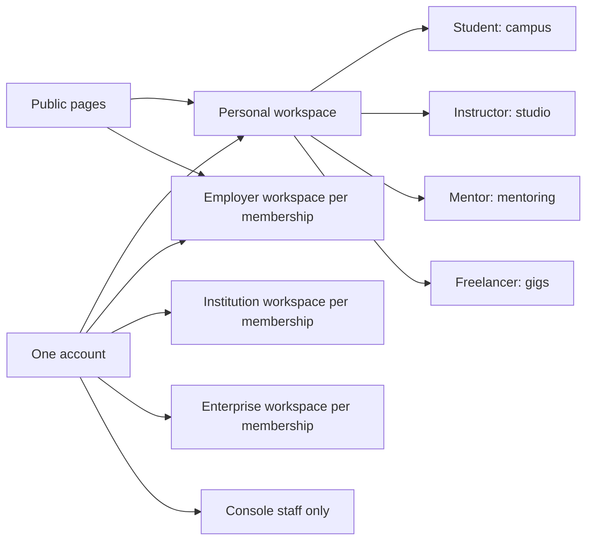

# Blueprint 03: experience

> **Status.** Intent, not ratified. Nothing here claims anything is built; what is built is in `docs/ARCHITECTURE.md` and `docs/mindmap/`. Decision `DEC-001`: this blueprint does not supersede `docs/SSOT.md` until `OD-PRD-31` defines ratification.
>
> **What this file holds.** Information architecture, design system, interaction patterns, accessibility, responsive and PWA UX, microcopy and screen states.
>
> **Merged on 2026-11-25** from the files listed below; each one is a section under its original title. Nothing was removed; the originals are in git history at commit `08387ec`.

| Section | Former file |
|---|---|
| 01 Information Architecture | `PRODUCT_BLUEPRINT/03_EXPERIENCE/01_INFORMATION_ARCHITECTURE.md` |
| 02 Design System | `PRODUCT_BLUEPRINT/03_EXPERIENCE/02_DESIGN_SYSTEM.md` |
| 03 Interaction Patterns | `PRODUCT_BLUEPRINT/03_EXPERIENCE/03_INTERACTION_PATTERNS.md` |
| 04 Accessibility and Inclusion | `PRODUCT_BLUEPRINT/03_EXPERIENCE/04_ACCESSIBILITY_AND_INCLUSION.md` |
| 05 Responsive, Mobile and PWA UX | `PRODUCT_BLUEPRINT/03_EXPERIENCE/05_RESPONSIVE_MOBILE_PWA_UX.md` |
| 06 Content and Microcopy Guide | `PRODUCT_BLUEPRINT/03_EXPERIENCE/06_CONTENT_AND_MICROCOPY_GUIDE.md` |
| 07 Screen and State Checklist | `PRODUCT_BLUEPRINT/03_EXPERIENCE/07_SCREEN_STATE_CHECKLIST.md` |

## 01 Information Architecture

_Former file: `PRODUCT_BLUEPRINT/03_EXPERIENCE/01_INFORMATION_ARCHITECTURE.md`._

Status: intended design. Nothing in this file claims that any screen, route or component is built. The as-built web app (`apps/web/src/App.tsx`, `apps/web/src/components/Layout.tsx`) is an input only: it has a one-row top header, about 25 routes and three navigation sets (public, candidate, hiring). The product described by this blueprint has 31 modules and 18 roles, which that shell cannot carry. This file defines the shell that can.

Shared by every module agent: the route namespaces in section 5, the navigation rules in sections 3 and 4, and the URL rules in section 8 are binding. A module's screen inventory (`02_MODULES/<CODE>_*.md` section 7) proposes routes only inside its reserved namespace. Where a module proposes something that conflicts, the namespace in this file wins and the conflict is recorded in section 14.

Evidence tags follow [CONVENTIONS](README.md#blueprint-conventions). Rule ids in this file use the area code `IAX` (`NFR-IAX-nnn`).

### 1. Purpose and scope

The information architecture answers five questions for every person who signs in:

1. Where am I? (workspace, section, page, breadcrumb, document title)
2. What can I do here? (navigation filtered by role, membership and entitlement)
3. How do I get somewhere else quickly? (sidebar, tabs, command palette, global search, deep links)
4. Which hat am I wearing? (workspace switcher, role chip, staff banner)
5. What do I do first? (onboarding entry points, dashboard next-best-action)

In scope: sitemap, per-role navigation, global navigation patterns at three widths, workspace and role switching, command palette, breadcrumbs, URL conventions, deep links, onboarding entry points, legacy route mapping. Out of scope: the content of each screen (module files), component anatomy (`02_DESIGN_SYSTEM.md`), onboarding step design (`03_INTERACTION_PATTERNS.md` section 2).

### 2. Mental model: one account, many workspaces

[DER] A person has one account (IDN) and may hold several memberships. The shell organizes the product into **workspaces**. A workspace is a pair of (context, role set) that decides the navigation, the dashboard and the data in scope.

| Workspace   | URL prefix            | Who enters                                                                                                 | What it is                                                                                                                                                                                        |
| ----------- | --------------------- | ---------------------------------------------------------------------------------------------------------- | ------------------------------------------------------------------------------------------------------------------------------------------------------------------------------------------------- |
| Public      | none                  | Everyone, signed in or not                                                                                 | Marketing, search, job, course, company, mentor, gig, event and profile pages that are publicly indexable                                                                                         |
| Personal    | none (root paths)     | Every signed-in user                                                                                       | Candidate home. Carries optional capability sections: Student (campus), Instructor (studio), Mentor, Freelancer. Capabilities are sections inside the personal workspace, not separate workspaces |
| Employer    | `/employer/{org}`     | REC, HMG, EAD with a membership in that employer organization                                              | Hiring workspace for one employer organization                                                                                                                                                    |
| Institution | `/institution/{inst}` | IAD, PLO and institution-attached INS with a membership                                                    | Managed learning and placement workspace for one institution                                                                                                                                      |
| Enterprise  | `/enterprise/{org}`   | EXA with a membership                                                                                      | Internal mobility, skills and L&D workspace for one enterprise customer                                                                                                                           |
| Console     | `/console`            | MOD, SUP, FIN, PAD, SAD                                                                                    | Staff operations. Visually distinct (section 6.5)                                                                                                                                                 |
| Developers  | `/developers`         | Anyone for docs; EAD, IAD, EXA for credentials, which live inside their own workspace under `integrations` | Public API documentation and sandbox                                                                                                                                                              |

Rules:

- `NFR-IAX-001` A signed-in user always has the Personal workspace. It cannot be removed. Deleting the account is the only way out of it.
- `NFR-IAX-002` Capabilities (Student, Instructor, Mentor, Freelancer) add navigation groups to Personal. They never create a second login, second profile or second URL root.
- `NFR-IAX-003` Organization workspaces are addressed by membership, never by role alone. A user who is a Recruiter at Org A and a Hiring Manager at Org B sees two workspace entries.
- `NFR-IAX-004` Every route belongs to exactly one workspace. A screen that several workspaces need (messages, notifications, settings) exists once per workspace scope with a shared component, never as a route with a hidden mode.



#### 2.1 Role to workspace map

| Role | Public | Personal                            | Employer      | Institution                      | Enterprise | Console                                                                                              |
| ---- | ------ | ----------------------------------- | ------------- | -------------------------------- | ---------- | ---------------------------------------------------------------------------------------------------- |
| GUE  | yes    | no                                  | no            | no                               | no         | no                                                                                                   |
| CAN  | yes    | yes                                 | no            | no                               | no         | no                                                                                                   |
| STD  | yes    | yes plus Campus section             | no            | no                               | no         | no                                                                                                   |
| INS  | yes    | yes plus Studio section             | no            | yes when attached (Faculty view) | no         | no                                                                                                   |
| MNT  | yes    | yes plus Mentoring (mentor) section | no            | no                               | no         | no                                                                                                   |
| FRL  | yes    | yes plus Gigs (freelancer) section  | no            | no                               | no         | no                                                                                                   |
| REC  | yes    | yes                                 | yes           | no                               | no         | no                                                                                                   |
| HMG  | yes    | yes                                 | yes (reduced) | no                               | no         | no                                                                                                   |
| EAD  | yes    | yes                                 | yes (full)    | no                               | no         | no                                                                                                   |
| IAD  | yes    | yes                                 | no            | yes (full)                       | no         | no                                                                                                   |
| PLO  | yes    | yes                                 | no            | yes (placement and read scope)   | no         | no                                                                                                   |
| EXA  | yes    | yes                                 | no            | no                               | yes        | no                                                                                                   |
| MOD  | yes    | yes                                 | no            | no                               | no         | yes (moderation)                                                                                     |
| SUP  | yes    | yes                                 | no            | no                               | no         | yes (support)                                                                                        |
| FIN  | yes    | yes                                 | no            | no                               | no         | yes (finance)                                                                                        |
| PAD  | yes    | yes                                 | no            | no                               | no         | yes (platform)                                                                                       |
| SAD  | yes    | yes                                 | no            | no                               | no         | yes (security, all read)                                                                             |
| API  | n/a    | n/a                                 | n/a           | n/a                              | n/a        | n/a: a service principal has no UI session; it is managed in the owning workspace under Integrations |

[DER] Staff roles also have the Personal workspace so they can use the product as a user, but staff accounts are separate identities from their personal accounts by default (`OD-UX-04`).

### 3. Global navigation patterns

#### 3.1 Width classes

The shell has three layouts. Breakpoints are the as-built values in `packages/ui/src/tokens.ts` (`sm` 640, `md` 768, `lg` 1024, `xl` 1280, `2xl` 1536).

| Class   | Width       | Primary navigation                                               | Secondary                                                                     | Top bar                                                                                 |
| ------- | ----------- | ---------------------------------------------------------------- | ----------------------------------------------------------------------------- | --------------------------------------------------------------------------------------- |
| Phone   | 320 to 767  | Bottom tab bar, 5 slots                                          | Full-screen "More" or "Me" tab; section switch via top-of-page segmented tabs | App bar 56 px: back or logo, page title, search icon, bell                              |
| Tablet  | 768 to 1023 | Navigation rail 72 px, icon above label, up to 7 items plus More | Group flyout on tap; two-pane layouts for list/detail                         | Bar 56 px: workspace switcher, search field (collapses to icon below 900), bell, avatar |
| Desktop | 1024 and up | Sidebar 248 px, collapsible to 72 px rail                        | Sub-navigation as in-page tabs, never a second sidebar                        | Bar 64 px: breadcrumbs, search field (opens palette), "New" menu, help, bell, avatar    |
| Wide    | 1280 and up | Same as desktop                                                  | Optional right context panel 320 px for inspector, AI assistant or preview    | Same                                                                                    |

- `NFR-IAX-005` Phone is below 768, not below 640. Between 640 and 767 the layout is the phone layout with wider gutters and two-column card grids. Rationale: a 700 px device in portrait cannot host a 248 px sidebar and 400 px of content. [DER]
- `NFR-IAX-006` Public pages use a header (not a sidebar) at every width: logo, up to 5 text links, Sign in, Sign up. Below 1024 the links collapse into a menu button whose panel is a full-height drawer.
- `NFR-IAX-007` The signed-in shell is the same component tree at all widths. Only presentation changes. A route never exists on desktop and not on phone. (PWA parity rule; see `05_RESPONSIVE_MOBILE_PWA_UX.md`.)

#### 3.2 Sidebar (Desktop)

Anatomy, top to bottom:

1. Brand row: logo mark (links to workspace dashboard), collapse toggle (button, `aria-expanded`, `aria-controls`).
2. Workspace switcher (section 6). Shows workspace name, role chip, and a caret.
3. Primary groups. Each group has an optional heading (overline text, `xs`, `wide` tracking) and 1 to 7 items. An item is icon (20 px), label, optional badge. Groups with more than 4 items may be collapsible; collapsed state persists per user per workspace in preferences (not `localStorage` alone; synced via settings so it follows the account across devices).
4. Spacer.
5. Utility group, pinned bottom: Help, Settings (or workspace Settings), collapse.
6. No profile card at the bottom. The account menu lives in the top bar (one place, not two).

Behaviour:

- Active item: `aria-current="page"`, 3 px leading bar in `--ts-color-action`, semibold label, `--ts-color-bg-selected` fill. Never color alone.
- Item states: default, hover, focus-visible (2 px focus ring, offset 2 px, inside the item bounds so it is not clipped), pressed, active (current), disabled (not used in nav; unavailable items are hidden or show a lock per `NFR-IAX-010`).
- Collapsed rail: label hidden visually, still exposed (`aria-label` on the link); a tooltip with the label appears on hover and on keyboard focus after 300 ms; badge dot replaces count.
- Group with a current child auto-expands on load and on route change.
- Landmarks: `<nav aria-label="Primary">`; the workspace switcher is a button inside it; the skip link "Skip to main content" is the first focusable element of the page and targets `<main id="main" tabindex="-1">`.
- Scroll: the sidebar scrolls independently when taller than the viewport; the brand row and the utility group are sticky.
- Resize: below 1024 the sidebar converts to the tablet rail without reload; the expanded/collapsed preference is ignored below 1024 and restored at or above it.

#### 3.3 Navigation rail (Tablet)

- 72 px wide, up to 7 destinations plus a "More" item. Each item: 24 px icon over a 12 px label (labels never hidden on tablet). Group headings are not shown; groups appear as dividers.
- "More" opens a popover sheet anchored to the rail with the remaining destinations, grouped as in the sidebar.
- Landscape tablets at 1024 or wider get the sidebar. Rotating the device swaps layouts and preserves scroll position and unsaved form state (state lives in the route, not the shell).

#### 3.4 Bottom tab bar (Phone)

- Exactly 5 slots. Height 56 px plus the safe-area inset. Each slot: icon 24 px, label 12 px (labels always visible), badge. Touch target at least 48 by 48 px (the slot is the full 20 percent width).
- The fifth slot is always "Me" (avatar or generic icon): it opens the Me screen, a full-screen list of every remaining destination, grouped as in the sidebar, plus Settings, Help, Switch workspace, Sign out.
- Tab semantics: this is navigation, not an ARIA tablist. Use `<nav aria-label="Primary">` with links; the current one has `aria-current="page"`.
- Tab switching preserves each tab's own scroll position and its last visited sub-route for the session (stack per tab). Tapping the active tab pops to that tab's root; tapping it again at the root scrolls to top.
- The bar hides on scroll down in long reading or media screens only if the screen spec says so (`SCR` field "Chrome"); it never hides on list or form screens. It is always hidden inside focused flows (assessment runner, interview room, course player fullscreen, checkout, wizards) where the screen spec declares `Chrome: focus`.
- The on-screen keyboard open state hides the bar (otherwise it jumps above the keyboard on some browsers).
- App bar (top): title is the page title (h1 is the same string); left slot is Back (if depth is 2 or more) else the logo; right slots are at most two icons (Search, Bell). Messages is a tab for most roles; where it is not, it is a third right-slot icon (see section 4).

#### 3.5 Top bar contents (Desktop and Tablet)

| Slot    | Content                                                                              | Rule                                                                                                      |
| ------- | ------------------------------------------------------------------------------------ | --------------------------------------------------------------------------------------------------------- |
| Left    | Breadcrumbs (section 9), or page title only on root pages                            | Never both a breadcrumb and a duplicate title text                                                        |
| Center  | Global search field, 360 px, placeholder "Search or jump to" with `Ctrl K` hint chip | Clicking or focusing opens the command palette (section 7); it is not a separate inline search            |
| Right 1 | "New" menu button (context-sensitive create actions)                                 | Only when the workspace has at least 2 create actions; with one action, show that action's button instead |
| Right 2 | Help (opens help popover: shortcuts, contact support, help center)                   | Always present                                                                                            |
| Right 3 | Notifications bell with unread count badge                                           | Popover lists latest 8, "See all" goes to `/notifications`                                                |
| Right 4 | Avatar button opening the account menu                                               | Contents below                                                                                            |

Account menu items in order: name and email (non-interactive header), Profile (`/profile`), Settings, Switch workspace (if more than one, else hidden), Display (theme and density quick toggles), Keyboard shortcuts, Sign out. Staff: also "Exit staff mode" where applicable. The menu is a menu button pattern (section DS CMP-Menu).

#### 3.6 "New" menu contents per workspace

| Workspace                | Actions (in order)                                                                                                      |
| ------------------------ | ----------------------------------------------------------------------------------------------------------------------- |
| Personal                 | Add work history, Upload evidence, Start application draft (opens Jobs), Write post, Request mentor session, New resume |
| Personal with Instructor | adds New course, New assessment                                                                                         |
| Personal with Freelancer | adds New gig proposal                                                                                                   |
| Employer                 | New job, Add candidate, Invite teammate (EAD), New talent pool, Schedule interview                                      |
| Institution              | Invite students, New cohort, New placement drive, Assign course                                                         |
| Enterprise               | New learning mandate, New internal job, Import people                                                                   |
| Console                  | Context-sensitive: New announcement (PAD), New macro (SUP), New policy (MOD), New flag (PAD)                            |

Each action appears only if the user holds the permission and the entitlement. Keyboard shortcut `c` opens the menu when focus is not in a text field (shortcut disable setting per `NFR-IAX-021`).

### 4. Per-role navigation

Conventions for this section:

- Item = label, route, module, badge rule. Labels use the term list in `06_CONTENT_AND_MICROCOPY_GUIDE.md` section 2.
- Desktop limits: at most 7 groups, at most 7 items per group, at most 24 items total in a workspace sidebar. Phone limit: 5 tabs.
- "Visibility" column: `always`, a permission, a capability flag, or an entitlement. Items hidden by permission are absent from the DOM (not `display:none`), because hidden-but-present items are announced by screen readers and leak the existence of features.
- Badge rules: a badge appears only for items with a user-actionable queue (unread, pending approval, due). Count shows `1` to `99`, then `99+`. Informational counts (number of jobs) never badge.

#### 4.1 Guest (GUE), public header

Desktop header: logo, Jobs (`/jobs`), Courses (`/courses`), Mentors (`/mentors`), Companies (`/companies`), For employers (`/for-employers`), Sign in (`/login`), Sign up (primary button, `/signup`). "Pricing" is reached from For employers, For institutions and the footer (individual pricing is on `/pricing`). Footer groups: Product (Jobs, Courses, Mentors, Gigs, Events, Market insights), Solutions (For employers, For institutions, For enterprise), Company (About, Help, Status, Developers), Legal (Terms, Privacy, Cookies, Accessibility statement), language and region selector, theme toggle.

Search: header contains a search icon button opening the palette in "public search" scope (jobs, courses, companies, mentors only). Guests never see commands or private data.

#### 4.2 Candidate (CAN), Personal workspace

| Group       | Item             | Route                 | Module   | Visibility                                        | Badge                                                                                                  |
| ----------- | ---------------- | --------------------- | -------- | ------------------------------------------------- | ------------------------------------------------------------------------------------------------------ |
| (none)      | Home             | `/dashboard`          | shell    | always                                            | none                                                                                                   |
| Jobs        | Find jobs        | `/jobs`               | JOB      | always                                            | none                                                                                                   |
| Jobs        | Applications     | `/applications`       | JOB      | always                                            | Count of applications needing candidate action (interview to confirm, offer to answer, info requested) |
| Jobs        | Interviews       | `/interviews`         | INT      | has at least one interview ever, or always [PROP] | Count of interviews to confirm                                                                         |
| Jobs        | Saved and alerts | `/jobs/saved`         | JOB      | always                                            | none                                                                                                   |
| Learn       | My learning      | `/learn`              | LRN      | always                                            | Count of overdue deadlines                                                                             |
| Learn       | Course catalog   | `/courses`            | LRN      | always                                            | none                                                                                                   |
| Learn       | Assessments      | `/assess`             | ASM      | always                                            | Count of invitations not started                                                                       |
| Learn       | Certificates     | `/learn/certificates` | LRN      | has at least one                                  | none                                                                                                   |
| Career      | Profile          | `/profile`            | PRF      | always                                            | none                                                                                                   |
| Career      | Evidence         | `/evidence`           | EVD      | always                                            | Count of items needing action (rejected, expiring)                                                     |
| Career      | Credentials      | `/credentials`        | EVD      | always                                            | Count expiring within 30 days [PROP]                                                                   |
| Career      | Verification     | `/verification`       | BGV      | has at least one check or request                 | Count of pending requests needing candidate consent                                                    |
| Career      | Career plan      | `/career`             | AIC, MKT | always                                            | none                                                                                                   |
| Community   | Network          | `/network`            | NET      | always                                            | Count of connection requests                                                                           |
| Community   | Mentors          | `/mentoring`          | MEN      | always                                            | Count of session requests or confirmations pending                                                     |
| Community   | Events           | `/events`             | EVT      | always                                            | none                                                                                                   |
| Community   | Reputation       | `/reputation`         | REP      | always                                            | none                                                                                                   |
| (top-level) | Messages         | `/messages`           | MSG      | always                                            | Unread conversation count                                                                              |
| Utility     | Billing          | `/billing`            | BIL      | always                                            | Dot when payment failed                                                                                |
| Utility     | Settings         | `/settings`           | SET      | always                                            | Dot when a consent or security action is required                                                      |
| Utility     | Help             | `/help`               | ADM      | always                                            | none                                                                                                   |

That is 22 items in 5 groups; it is within the limits. Notifications are not a sidebar item: they are the top-bar bell plus `/notifications`.

Phone tabs for CAN: Home, Jobs, Learn, Messages, Me. "Jobs" tab root is `/jobs` with a segmented control (Find, Applications, Saved); "Learn" tab root is `/learn`. "Me" lists: Profile, Evidence, Credentials, Verification, Career plan, Network, Mentors, Events, Reputation, Interviews, Notifications, Billing, Settings, Help, Switch workspace, Sign out.

#### 4.3 Student (STD)

Same as CAN, plus a leading group "Campus" (institution name shown as group heading):

| Item                  | Route                 | Module   | Visibility                                | Badge                      |
| --------------------- | --------------------- | -------- | ----------------------------------------- | -------------------------- |
| Campus home           | `/campus`             | INS      | STD capability active                     | Count of new announcements |
| My courses (assigned) | `/campus/courses`     | INS, LRN | STD                                       | Count overdue              |
| My cohort             | `/campus/cohort`      | INS      | STD                                       | none                       |
| Placement drives      | `/campus/drives`      | INS, JOB | STD and institution has placement enabled | Count of drives open to me |
| Campus assessments    | `/campus/assessments` | INS, ASM | STD                                       | Count due                  |

Phone tabs for STD: Home, Campus, Learn, Jobs, Me. Messages opens from the app bar icon (third right-slot icon). Rule `NFR-IAX-008`: when a role's tab bar cannot hold Messages, Messages MUST appear in the app bar of every tab root.

A student who leaves the institution (membership ends) loses the Campus group on the next session refresh; their learning records remain under Learn with an "Archived from {institution}" label. [DER]

#### 4.4 Instructor (INS), Personal workspace plus Studio

Adds group "Teach" at the top of the CAN sidebar:

| Item        | Route                 | Module   | Visibility            | Badge                               |
| ----------- | --------------------- | -------- | --------------------- | ----------------------------------- |
| Studio home | `/studio`             | STU      | INS capability        | none                                |
| My courses  | `/studio/courses`     | STU      | INS                   | Count of courses in review feedback |
| Learners    | `/studio/learners`    | STU, LRN | INS                   | none                                |
| Grading     | `/studio/grading`     | STU, ASM | INS                   | Count awaiting grade                |
| Discussions | `/studio/discussions` | STU, LRN | INS                   | Count unanswered questions          |
| Reviews     | `/studio/reviews`     | STU      | INS                   | none                                |
| Earnings    | `/studio/earnings`    | STU, BIL | INS with paid courses | none                                |
| Analytics   | `/studio/analytics`   | STU, ANL | INS                   | none                                |

Phone tabs for INS: Home, Studio, Grading, Messages, Me. Learn and Jobs are in Me. Rationale: an instructor's recurring work is grading and answering; learning is secondary. [DER]

Instructors attached to an institution additionally see the institution's Faculty workspace in the workspace switcher (section 4.12).

#### 4.5 Mentor (MNT), Personal workspace plus Mentoring

Adds group "Mentor":

| Item               | Route                            | Module   | Visibility           | Badge                           |
| ------------------ | -------------------------------- | -------- | -------------------- | ------------------------------- |
| Mentor home        | `/mentoring/mentor`              | MEN      | MNT capability       | none                            |
| Requests           | `/mentoring/mentor/requests`     | MEN      | MNT                  | Count pending                   |
| Sessions           | `/mentoring/mentor/sessions`     | MEN      | MNT                  | Count today                     |
| Mentees            | `/mentoring/mentor/mentees`      | MEN      | MNT                  | none                            |
| Availability       | `/mentoring/mentor/availability` | MEN, INT | MNT                  | Dot when no future availability |
| Offers and pricing | `/mentoring/mentor/offers`       | MEN, BIL | MNT                  | none                            |
| Earnings           | `/mentoring/mentor/earnings`     | MEN, BIL | MNT with paid offers | none                            |
| Reviews            | `/mentoring/mentor/reviews`      | MEN      | MNT                  | none                            |

Phone tabs for MNT: Home, Sessions, Requests, Messages, Me.

#### 4.6 Freelancer (FRL), Personal workspace plus Gigs

Adds group "Freelance" (shown when gig mode is on in `/settings/account`):

| Item         | Route                | Module   | Visibility | Badge                                      |
| ------------ | -------------------- | -------- | ---------- | ------------------------------------------ |
| Find gigs    | `/gigs`              | GIG      | FRL        | none                                       |
| My proposals | `/gigs/my/proposals` | GIG      | FRL        | Count with client replies                  |
| Contracts    | `/gigs/my/contracts` | GIG      | FRL        | Count needing action (milestone to submit) |
| Earnings     | `/gigs/my/earnings`  | GIG, BIL | FRL        | none                                       |
| Gig profile  | `/gigs/my/profile`   | GIG, PRF | FRL        | none                                       |

Phone tabs for FRL: Home, Gigs, Contracts, Messages, Me.

#### 4.7 Recruiter (REC), Employer workspace

Prefix `/employer/{org}`.

| Group    | Item                  | Route (after prefix) | Module     | Visibility                  | Badge                               |
| -------- | --------------------- | -------------------- | ---------- | --------------------------- | ----------------------------------- |
| (none)   | Home                  | `/dashboard`         | shell, ANL | always                      | none                                |
| Hiring   | Jobs                  | `/jobs`              | ATS        | always                      | none                                |
| Hiring   | Applications          | `/applications`      | ATS        | always                      | Count of new, unreviewed            |
| Hiring   | Interviews            | `/interviews`        | INT        | always                      | Count to schedule                   |
| Hiring   | Offers                | `/offers`            | ATS        | always                      | Count awaiting approval or response |
| Sourcing | Candidate search      | `/candidates`        | SRC, ATS   | entitlement `talent_search` | none                                |
| Sourcing | Talent pools          | `/pools`             | ATS        | always                      | none                                |
| Sourcing | Outreach              | `/sourcing`          | ATS, MSG   | entitlement `outreach`      | Count of replies                    |
| Hiring   | Assessments           | `/assessments`       | ASM        | always                      | none                                |
| Insights | Reports               | `/reports`           | ANL        | always                      | none                                |
| Insights | Referrals             | `/referrals`         | NET        | referral program on         | Count new                           |
| Brand    | Company page          | `/brand`             | EMP        | always                      | none                                |
| Brand    | Events and hackathons | `/events`            | EVT        | entitlement                 | none                                |
| Brand    | Gigs                  | `/gigs`              | GIG        | entitlement                 | none                                |
| Utility  | Messages              | `/messages`          | MSG        | always                      | Unread                              |
| Utility  | Settings              | `/settings`          | EMP        | always                      | none                                |

Phone tabs for REC: Home, Applications, Interviews, Messages, Me. Jobs and the pipeline are reached from Home cards and Applications filters; the pipeline board on phone is a column-per-screen view (see `07_SCREEN_STATE_CHECKLIST.md` REFSCR-07).

#### 4.8 Hiring Manager (HMG), Employer workspace (reduced)

| Group    | Item              | Route (after prefix)         | Visibility                              | Badge                        |
| -------- | ----------------- | ---------------------------- | --------------------------------------- | ---------------------------- |
| (none)   | Home              | `/dashboard`                 | always                                  | none                         |
| Hiring   | My jobs           | `/jobs?scope=mine`           | HMG owns or is assigned to at least one | none                         |
| Hiring   | To review         | `/applications?scope=review` | always                                  | Count assigned for my review |
| Hiring   | Interviews        | `/interviews?scope=mine`     | always                                  | Count to prepare or score    |
| Hiring   | Offers to approve | `/offers?scope=approvals`    | always                                  | Count pending my approval    |
| Insights | Reports           | `/reports?scope=mine`        | always                                  | none                         |
| Utility  | Messages          | `/messages`                  | always                                  | Unread                       |

An HMG never sees candidate search, pools, outreach, brand, integrations, billing or team administration. Phone tabs: Home, To review, Interviews, Messages, Me.

#### 4.9 Employer Admin (EAD)

All REC items plus group "Organization":

| Item                      | Route (after prefix) | Module   | Badge                            |
| ------------------------- | -------------------- | -------- | -------------------------------- |
| Team and roles            | `/team`              | EMP      | Count pending invitations        |
| Departments               | `/team/departments`  | EMP      | none                             |
| Hiring plans and requests | `/jobs/requests`     | ATS, EMP | Count requests to approve [PROP] |
| Integrations              | `/integrations`      | PLT      | Dot on failing integration       |
| Billing and plan          | `/billing`           | BIL      | Dot on payment failure           |
| Compliance                | `/compliance`        | EMP, SET | none                             |
| Audit log                 | `/audit`             | EMP      | none                             |

Phone tabs for EAD: Home, Applications, Team, Messages, Me.

#### 4.10 Institution Admin (IAD)

Prefix `/institution/{inst}`.

| Group        | Item                       | Route (after prefix)  | Module   | Badge                              |
| ------------ | -------------------------- | --------------------- | -------- | ---------------------------------- |
| (none)       | Home                       | `/dashboard`          | INS, ANL | none                               |
| People       | Students                   | `/students`           | INS      | Count pending enrollment approvals |
| People       | Cohorts                    | `/cohorts`            | INS      | none                               |
| People       | Faculty                    | `/faculty`            | INS      | Count pending invitations          |
| Learning     | Courses                    | `/courses`            | INS, LRN | none                               |
| Learning     | Programs                   | `/programs`           | INS      | none                               |
| Learning     | Assessments                | `/assessments`        | INS, ASM | none                               |
| Learning     | Progress and interventions | `/progress`           | INS, ANL | Count at-risk                      |
| Placement    | Drives                     | `/placement/drives`   | INS, JOB | none                               |
| Placement    | Partner employers          | `/placement/partners` | INS      | Count pending requests             |
| Placement    | Outcomes                   | `/placement/outcomes` | INS, ANL | none                               |
| Organization | Licensing and seats        | `/licensing`          | INS, BIL | Dot at 90 percent seat use [PROP]  |
| Organization | Public page                | `/brand`              | INS      | none                               |
| Organization | Integrations               | `/integrations`       | PLT      | Dot on failure                     |
| Organization | Reports                    | `/reports`            | ANL      | none                               |
| Utility      | Announcements              | `/announcements`      | INS, NTF | none                               |
| Utility      | Messages                   | `/messages`           | MSG      | Unread                             |
| Utility      | Settings and audit         | `/settings`           | INS      | none                               |

#### 4.11 Placement Officer (PLO)

Institution workspace subset: Home, Students (read, filtered to the officer's assigned cohorts), Drives, Partner employers, Outcomes, Reports, Messages. No Licensing, Faculty, Integrations, Settings. Phone tabs: Home, Drives, Students, Messages, Me.

#### 4.12 Instructor in an institution (INS, Faculty view)

Institution workspace subset: Home, My courses (`/courses?scope=mine`), Cohorts (`/cohorts?scope=mine`), Progress and interventions, Assessments, Announcements, Messages. This view is for managing assigned institutional learning; authoring still happens in `/studio`. A course authored in Studio and assigned to an institution is shown with a link back to Studio.

#### 4.13 Enterprise Admin (EXA)

Prefix `/enterprise/{org}`.

| Group        | Item                | Route (after prefix)       | Module   | Badge                 |
| ------------ | ------------------- | -------------------------- | -------- | --------------------- |
| (none)       | Home                | `/dashboard`               | ENT, ANL | none                  |
| Skills       | Skills inventory    | `/skills`                  | ENT      | none                  |
| Skills       | Skill gaps          | `/skills/gaps`             | ENT, MKT | none                  |
| Mobility     | Internal jobs       | `/mobility/jobs`           | ENT, JOB | Count of applications |
| Mobility     | Talent matches      | `/mobility/matches`        | ENT, AIC | none                  |
| Mobility     | Succession          | `/mobility/succession`     | ENT      | none                  |
| Learning     | Mandates            | `/learning/mandates`       | ENT, LRN | Count overdue         |
| Learning     | Programs            | `/learning/programs`       | ENT, LRN | none                  |
| Learning     | Certifications      | `/learning/certifications` | ENT, LRN | Count expiring        |
| People       | Directory           | `/people`                  | ENT      | none                  |
| Organization | Reports and impact  | `/reports`                 | ANL      | none                  |
| Organization | Integrations (HRIS) | `/integrations`            | PLT      | Dot on sync failure   |
| Organization | Billing             | `/billing`                 | BIL      | none                  |
| Organization | Settings and audit  | `/settings`                | ENT      | none                  |
| Utility      | Messages            | `/messages`                | MSG      | Unread                |

Boundary: [SRC: SSOT §4.2] non-goal "not generic HR/payroll". The Directory is a read model of people and skills synced from an HRIS for skills and mobility purposes. It has no payroll, leave, time or performance-review functions (`OD-UX-05`).

#### 4.14 Console (MOD, SUP, FIN, PAD, SAD)

Prefix `/console`. The sidebar groups are visible per permission; a user with several staff roles sees the union.

| Group            | Item                    | Route (after prefix)      | Role            | Module   |
| ---------------- | ----------------------- | ------------------------- | --------------- | -------- |
| (none)           | Console home            | `/dashboard`              | all staff       | ADM      |
| Trust and safety | Moderation queue        | `/moderation`             | MOD, PAD        | TSF      |
| Trust and safety | Cases                   | `/moderation/cases`       | MOD, PAD        | TSF      |
| Trust and safety | Appeals                 | `/moderation/appeals`     | MOD, PAD        | TSF      |
| Trust and safety | Policies and rules      | `/moderation/policies`    | MOD (read), PAD | TSF      |
| Support          | Tickets                 | `/support/tickets`        | SUP, PAD        | ADM      |
| Support          | Account lookup          | `/support/users`          | SUP, PAD        | ADM      |
| Support          | Organizations           | `/support/orgs`           | SUP, PAD        | ADM      |
| Support          | Verification cases      | `/support/verification`   | SUP, PAD        | BGV      |
| Support          | Macros and help center  | `/support/content`        | SUP, PAD        | ADM      |
| Finance          | Payments and refunds    | `/finance/payments`       | FIN, PAD        | BIL      |
| Finance          | Payouts                 | `/finance/payouts`        | FIN             | BIL      |
| Finance          | Invoices and tax        | `/finance/invoices`       | FIN             | BIL      |
| Finance          | Reconciliation          | `/finance/reconciliation` | FIN             | BIL      |
| Platform         | Users and organizations | `/platform/accounts`      | PAD             | ADM      |
| Platform         | Catalog and taxonomy    | `/platform/catalog`       | PAD             | LRN, MKT |
| Platform         | Plans and entitlements  | `/platform/plans`         | PAD             | BIL      |
| Platform         | Feature flags           | `/platform/flags`         | PAD             | ADM      |
| Platform         | Announcements           | `/platform/announcements` | PAD             | NTF      |
| Platform         | Templates               | `/platform/templates`     | PAD             | NTF      |
| Platform         | Background jobs         | `/platform/jobs`          | PAD             | ADM      |
| Platform         | Data requests           | `/platform/data-requests` | PAD, SAD        | SET      |
| Security         | Audit log               | `/security/audit`         | SAD, PAD (read) | ADM      |
| Security         | Access reviews          | `/security/access`        | SAD             | ADM      |
| Security         | Sessions and devices    | `/security/sessions`      | SAD             | IDN      |
| Security         | Incidents               | `/security/incidents`     | SAD             | ADM      |
| Security         | Break-glass             | `/security/break-glass`   | SAD             | ADM      |

Rules:

- `NFR-IAX-009` The console shell has a 4 px top stripe in `--ts-color-staff` and the persistent text chip "Staff" next to the logo on every console page, so a staff member can never confuse it with the product. The stripe is not the sole signal: the chip and the document title prefix "Console" carry the same information.
- Phone: the console is usable on phone for MOD queue review, SUP tickets and FIN approvals (responsive), but PAD and SAD configuration screens show a notice "Open this on a larger screen to change settings" with the read-only view available. [DER]
- Sensitive routes (`/console/security/*`, `/console/finance/payouts`, `/console/platform/plans`) require step-up authentication: when the last strong authentication is older than the configured window (default 15 minutes [PROP], `OD-UX-06`), the route renders the re-authentication screen in place and resumes on success.

#### 4.15 Item visibility rules (all workspaces)

- `NFR-IAX-010` Permission missing: the item is absent. Entitlement missing but purchasable by this user: the item is present with a lock icon and the label suffix "(Plan)" exposed through `aria-label`; activating it opens the upgrade screen in context (`BIL`). Entitlement missing and not purchasable by this user (for example an HMG without the right): absent.
- `NFR-IAX-011` A feature flag off for the user removes the item entirely; there is no "coming soon" item in navigation. Roadmap messaging lives on public pages only.
- `NFR-IAX-012` The nav is computed from a single manifest (role, capability, membership, entitlement, flag) evaluated on the server in the session bootstrap response, so the client never guesses. The client re-renders when the manifest changes via real-time update (section 6.4). Direct URL access to a hidden item is still authorized server-side (never rely on nav hiding).
- `NFR-IAX-013` Every item has a stable `data-testid` of the form `nav-{workspace}-{item-slug}` for tests.

### 5. Sitemap and route reservation

Column "Auth": `P` public (no session), `S` any signed-in user, a role list means those roles only (and the server enforces it). "Shell" is the chrome used: `pub` public header, `app` signed-in shell, `focus` chrome-free focused flow. Module is the owning module (`02_MODULES/<CODE>_*.md`). Routes are proposals that module agents refine **inside** their namespace; the namespace itself is reserved here.

Dynamic segments: `{id}` is an opaque id, `{slug}` a human slug, `{slug}-{id}` a canonical public pair (section 8.3), `{org}` and `{inst}` are organization slugs.

#### 5.1 Public and authentication

| Route                                                                           | Screen                                                                                                       | Auth                                                              | Shell         | Module     |
| ------------------------------------------------------------------------------- | ------------------------------------------------------------------------------------------------------------ | ----------------------------------------------------------------- | ------------- | ---------- |
| `/`                                                                             | Landing                                                                                                      | P (signed-in users are offered "Go to dashboard", not redirected) | pub           | shell      |
| `/jobs`                                                                         | Job search                                                                                                   | P                                                                 | pub or app    | JOB        |
| `/jobs/{slug}-{id}`                                                             | Job detail                                                                                                   | P                                                                 | pub or app    | JOB        |
| `/companies`, `/companies/{slug}`                                               | Company directory, company page                                                                              | P                                                                 | pub or app    | EMP        |
| `/courses`, `/courses/{slug}-{id}`                                              | Course catalog, course landing page                                                                          | P                                                                 | pub or app    | LRN        |
| `/paths/{slug}-{id}`                                                            | Learning path landing page                                                                                   | P                                                                 | pub or app    | LRN        |
| `/mentors`, `/mentors/{handle}`                                                 | Mentor directory, mentor page                                                                                | P                                                                 | pub or app    | MEN        |
| `/gigs`, `/gigs/{slug}-{id}`                                                    | Gig search, gig detail                                                                                       | P                                                                 | pub or app    | GIG        |
| `/events`, `/events/{slug}-{id}`                                                | Event and hackathon list, detail                                                                             | P                                                                 | pub or app    | EVT        |
| `/institutions/{slug}`                                                          | Institution public page                                                                                      | P                                                                 | pub or app    | INS        |
| `/u/{handle}`                                                                   | Public profile                                                                                               | P (subject to profile visibility)                                 | pub or app    | PRF        |
| `/u/{handle}/portfolio`                                                         | Public portfolio                                                                                             | P (subject to visibility)                                         | pub or app    | PRF        |
| `/market/roles/{slug}`, `/market/skills/{slug}`                                 | Role and skill insight pages                                                                                 | P                                                                 | pub or app    | MKT        |
| `/verify/{code}`                                                                | Credential and evidence verification result                                                                  | P                                                                 | pub           | EVD, BGV   |
| `/search`                                                                       | Search results (`?q=&type=`)                                                                                 | P                                                                 | pub or app    | SRC        |
| `/pricing`, `/for-employers`, `/for-institutions`, `/for-enterprise`            | Marketing pages                                                                                              | P                                                                 | pub           | BIL, shell |
| `/about`, `/help`, `/help/{slug}`                                               | About, help center, article                                                                                  | P                                                                 | pub or app    | ADM        |
| `/legal/terms`, `/legal/privacy`, `/legal/cookies`, `/legal/accessibility`      | Legal documents                                                                                              | P                                                                 | pub           | SET        |
| `/developers`, `/developers/{slug}`                                             | API docs, guides                                                                                             | P                                                                 | pub           | PLT        |
| `/status`                                                                       | Platform status (may redirect to a status host)                                                              | P                                                                 | pub           | ADM        |
| `/login`                                                                        | Sign in                                                                                                      | P                                                                 | pub (minimal) | IDN        |
| `/signup`, `/signup/{intent}`                                                   | Sign up; `intent` in `candidate`, `student`, `employer`, `institution`, `mentor`, `instructor`, `enterprise` | P                                                                 | pub (minimal) | IDN        |
| `/auth/mfa`, `/auth/reset`, `/auth/reset/{token}`, `/auth/verify-email/{token}` | Authentication flows                                                                                         | P                                                                 | pub (minimal) | IDN        |
| `/auth/sso/{provider}`, `/auth/sso/callback`                                    | SSO start and return                                                                                         | P                                                                 | none          | IDN        |
| `/invite/{token}`                                                               | Accept an invitation (organization, institution, cohort, interview, mentor)                                  | P then S                                                          | pub (minimal) | IDN        |
| `/signed-out`                                                                   | Confirmation after sign-out                                                                                  | P                                                                 | pub           | IDN        |
| `/offline`                                                                      | Offline fallback page (served by the service worker)                                                         | P                                                                 | none          | PWA        |
| `/maintenance`                                                                  | Maintenance page (served at the edge during planned work)                                                    | P                                                                 | none          | ADM        |

#### 5.2 Personal workspace (signed in)

| Route                                                                                                                                                                                                                                         | Screen                                                                          | Auth | Module        |
| --------------------------------------------------------------------------------------------------------------------------------------------------------------------------------------------------------------------------------------------- | ------------------------------------------------------------------------------- | ---- | ------------- |
| `/dashboard`                                                                                                                                                                                                                                  | Home                                                                            | S    | shell         |
| `/profile`, `/profile/edit/{section}`, `/profile/preview`                                                                                                                                                                                     | Own profile, section editor, preview as recruiter sees it                       | S    | PRF           |
| `/profile/resumes`, `/profile/resumes/{id}`                                                                                                                                                                                                   | Resumes, resume editor                                                          | S    | PRF           |
| `/profile/portfolio`, `/profile/portfolio/{id}`                                                                                                                                                                                               | Portfolio, project                                                              | S    | PRF           |
| `/evidence`, `/evidence/{id}`, `/evidence/new/{step}`                                                                                                                                                                                         | Work history and evidence list, item, add wizard                                | S    | EVD           |
| `/credentials`, `/credentials/{id}`                                                                                                                                                                                                           | Credentials wallet, credential                                                  | S    | EVD           |
| `/verification`, `/verification/{id}`                                                                                                                                                                                                         | My verification and background checks                                           | S    | BGV           |
| `/jobs/saved`, `/jobs/alerts`                                                                                                                                                                                                                 | Saved jobs, job alerts                                                          | S    | JOB           |
| `/applications`, `/applications/{id}`, `/applications/new/{jobId}/{step}`                                                                                                                                                                     | Application tracker, application detail, apply wizard                           | S    | JOB           |
| `/interviews`, `/interviews/{id}`, `/interviews/{id}/room`                                                                                                                                                                                    | Interviews, detail, live room                                                   | S    | INT           |
| `/offers`, `/offers/{id}`                                                                                                                                                                                                                     | Offers received, offer detail                                                   | S    | ATS, JOB      |
| `/learn`                                                                                                                                                                                                                                      | My learning home                                                                | S    | LRN           |
| `/learn/courses/{id}`                                                                                                                                                                                                                         | Enrolled course home                                                            | S    | LRN           |
| `/learn/courses/{id}/lessons/{lessonId}`                                                                                                                                                                                                      | Course player                                                                   | S    | LRN           |
| `/learn/courses/{id}/assignments/{assignmentId}`                                                                                                                                                                                              | Assignment                                                                      | S    | LRN           |
| `/learn/paths`, `/learn/paths/{id}`                                                                                                                                                                                                           | My paths, path progress                                                         | S    | LRN           |
| `/learn/certificates`, `/learn/certificates/{id}`                                                                                                                                                                                             | Certificates                                                                    | S    | LRN           |
| `/learn/notes`                                                                                                                                                                                                                                | My notes and bookmarks                                                          | S    | LRN           |
| `/assess`, `/assess/invitations`                                                                                                                                                                                                              | Assessments hub, invitations                                                    | S    | ASM           |
| `/assess/{attemptId}/start`, `/assess/{attemptId}/run`, `/assess/{attemptId}/results`                                                                                                                                                         | Pre-check, runner, results                                                      | S    | ASM           |
| `/assess/challenges`, `/assess/challenges/{id}`                                                                                                                                                                                               | Challenges and contests                                                         | S    | ASM           |
| `/assess/accommodations`                                                                                                                                                                                                                      | Request and manage accommodations                                               | S    | ASM, SET      |
| `/career`, `/career/assistant`, `/career/goals`, `/career/readiness`, `/career/plan`, `/career/market`, `/career/recommendations`                                                                                                             | Career hub, AI assistant, goals, readiness, plan, market, recommendations       | S    | AIC, MKT      |
| `/network`, `/network/connections`, `/network/invitations`, `/network/people`, `/network/groups`, `/network/groups/{slug}`, `/network/posts/{id}`, `/network/referrals`                                                                       | Feed, connections, invitations, discover people, groups, group, post, referrals | S    | NET           |
| `/messages`, `/messages/{conversationId}`, `/messages/requests`                                                                                                                                                                               | Inbox, conversation, message requests                                           | S    | MSG           |
| `/notifications`                                                                                                                                                                                                                              | Notification center                                                             | S    | NTF           |
| `/events/my`, `/events/{slug}-{id}/team`                                                                                                                                                                                                      | My events, hackathon team space                                                 | S    | EVT           |
| `/mentoring`, `/mentoring/sessions`, `/mentoring/sessions/{id}`, `/mentoring/my-mentors`                                                                                                                                                      | Mentee home, sessions, session, my mentors                                      | S    | MEN           |
| `/mentoring/mentor/...`                                                                                                                                                                                                                       | Mentor sections (section 4.5)                                                   | MNT  | MEN           |
| `/gigs/my/...`                                                                                                                                                                                                                                | Freelancer sections (section 4.6)                                               | FRL  | GIG           |
| `/studio/...`                                                                                                                                                                                                                                 | Studio sections (section 4.4)                                                   | INS  | STU           |
| `/studio/courses/{id}/edit`, `/studio/courses/{id}/edit/{step}`                                                                                                                                                                               | Course editor, step                                                             | INS  | STU           |
| `/campus`, `/campus/courses`, `/campus/cohort`, `/campus/drives`, `/campus/assessments`                                                                                                                                                       | Student campus                                                                  | STD  | INS           |
| `/reputation`, `/reputation/badges`, `/reputation/leaderboards`                                                                                                                                                                               | Reputation, badges, leaderboards                                                | S    | REP           |
| `/settings/account`, `/settings/security`, `/settings/privacy`, `/settings/consent`, `/settings/notifications`, `/settings/connected-accounts`, `/settings/accessibility`, `/settings/language`, `/settings/data`, `/settings/accommodations` | Settings sections                                                               | S    | IDN, SET, NTF |
| `/billing`, `/billing/invoices`, `/billing/payment-methods`, `/billing/plans`                                                                                                                                                                 | Billing                                                                         | S    | BIL           |
| `/help/contact`, `/help/tickets`, `/help/tickets/{id}`                                                                                                                                                                                        | Contact support, my tickets                                                     | S    | ADM           |

#### 5.3 Employer workspace (prefix `/employer/{org}`)

| Route (after prefix)                                                                                                           | Screen                                                                             | Roles                   | Module   |
| ------------------------------------------------------------------------------------------------------------------------------ | ---------------------------------------------------------------------------------- | ----------------------- | -------- |
| `/dashboard`                                                                                                                   | Employer home                                                                      | REC, HMG, EAD           | ANL, ATS |
| `/jobs`, `/jobs/new/{step}`, `/jobs/requests`                                                                                  | Jobs list, create wizard, hiring requests                                          | REC, EAD; HMG scoped    | ATS, JOB |
| `/jobs/{id}`, `/jobs/{id}/pipeline`, `/jobs/{id}/applicants`, `/jobs/{id}/edit`, `/jobs/{id}/scorecard`, `/jobs/{id}/settings` | Job overview, pipeline board, applicant list, edit, scorecard design, job settings | REC, EAD; HMG scoped    | ATS      |
| `/applications`, `/applications/{id}`                                                                                          | All applications, application review                                               | REC, EAD; HMG scoped    | ATS      |
| `/candidates`, `/candidates/{profileId}`                                                                                       | Candidate search, candidate profile view                                           | REC, EAD                | SRC, ATS |
| `/pools`, `/pools/{id}`, `/sourcing`, `/sourcing/{campaignId}`                                                                 | Talent pools, pool, outreach campaigns, campaign                                   | REC, EAD                | ATS      |
| `/interviews`, `/interviews/{id}`, `/interviews/{id}/room`, `/interviews/availability`                                         | Interviews, interview, live room, interviewer availability                         | REC, HMG, EAD           | INT      |
| `/offers`, `/offers/{id}`                                                                                                      | Offers, offer                                                                      | REC, EAD; HMG approvals | ATS      |
| `/assessments`, `/assessments/{id}`, `/assessments/{id}/results/{attemptId}`                                                   | Assessment library, assessment, candidate result                                   | REC, EAD                | ASM      |
| `/reports`, `/reports/{id}`                                                                                                    | Reports, report                                                                    | REC, HMG, EAD           | ANL      |
| `/referrals`                                                                                                                   | Referrals                                                                          | REC, EAD                | NET      |
| `/brand`, `/brand/careers-site`                                                                                                | Company page editor, careers site                                                  | EAD, REC                | EMP      |
| `/events`, `/gigs`                                                                                                             | Employer events and hackathons, gigs                                               | REC, EAD                | EVT, GIG |
| `/messages`, `/messages/{conversationId}`                                                                                      | Org inbox                                                                          | REC, HMG, EAD           | MSG      |
| `/team`, `/team/roles`, `/team/departments`, `/team/invitations`                                                               | Team, role definitions, departments, invitations                                   | EAD                     | EMP      |
| `/integrations`, `/integrations/api`, `/integrations/webhooks`                                                                 | Integrations, API keys, webhooks                                                   | EAD                     | PLT      |
| `/billing`, `/billing/invoices`                                                                                                | Plan and invoices                                                                  | EAD                     | BIL      |
| `/compliance`                                                                                                                  | EEO, retention, data requests                                                      | EAD                     | EMP, SET |
| `/audit`                                                                                                                       | Org audit log                                                                      | EAD                     | EMP      |
| `/settings`                                                                                                                    | Org settings                                                                       | EAD                     | EMP      |

#### 5.4 Institution workspace (prefix `/institution/{inst}`)

| Route (after prefix)                                                                        | Screen                                     | Roles                | Module   |
| ------------------------------------------------------------------------------------------- | ------------------------------------------ | -------------------- | -------- |
| `/dashboard`                                                                                | Institution home                           | IAD, PLO, INS        | INS, ANL |
| `/students`, `/students/{id}`, `/students/import`                                           | Students, student, bulk import             | IAD; PLO scoped read | INS      |
| `/cohorts`, `/cohorts/{id}`                                                                 | Cohorts, cohort                            | IAD; INS scoped      | INS      |
| `/faculty`, `/faculty/{id}`                                                                 | Faculty                                    | IAD                  | INS      |
| `/courses`, `/courses/{id}`                                                                 | Institutional courses, course              | IAD; INS scoped      | INS, LRN |
| `/programs`, `/programs/{id}`                                                               | Programs                                   | IAD                  | INS      |
| `/assessments`, `/assessments/{id}`                                                         | Assessments                                | IAD; INS scoped      | INS, ASM |
| `/progress`, `/progress/interventions`                                                      | Progress, at-risk and interventions        | IAD; INS scoped      | INS, ANL |
| `/placement/drives`, `/placement/drives/{id}`, `/placement/partners`, `/placement/outcomes` | Drives, drive, partner employers, outcomes | IAD, PLO             | INS      |
| `/licensing`, `/licensing/seats`                                                            | Licenses, seats                            | IAD                  | INS, BIL |
| `/brand`                                                                                    | Public page editor                         | IAD                  | INS      |
| `/integrations`                                                                             | SIS and LMS integrations                   | IAD                  | PLT      |
| `/reports`, `/reports/{id}`                                                                 | Reports                                    | IAD, PLO scoped      | ANL      |
| `/announcements`                                                                            | Announcements                              | IAD, INS scoped      | NTF      |
| `/messages`                                                                                 | Institution inbox                          | IAD, PLO, INS        | MSG      |
| `/settings`, `/audit`                                                                       | Settings, audit log                        | IAD                  | INS      |

#### 5.5 Enterprise workspace (prefix `/enterprise/{org}`)

| Route (after prefix)                                                                 | Screen                                   | Module        |
| ------------------------------------------------------------------------------------ | ---------------------------------------- | ------------- |
| `/dashboard`                                                                         | Enterprise home                          | ENT, ANL      |
| `/skills`, `/skills/gaps`, `/skills/taxonomy`                                        | Skills inventory, gaps, taxonomy mapping | ENT           |
| `/mobility/jobs`, `/mobility/jobs/{id}`, `/mobility/matches`, `/mobility/succession` | Internal jobs, job, matches, succession  | ENT           |
| `/learning/mandates`, `/learning/programs`, `/learning/certifications`               | Mandates, programs, certifications       | ENT, LRN      |
| `/people`, `/people/{id}`                                                            | Directory, person (skills view only)     | ENT           |
| `/reports`                                                                           | Reports and impact                       | ANL           |
| `/integrations`                                                                      | HRIS and SSO                             | PLT           |
| `/billing`, `/settings`, `/audit`, `/messages`                                       | Billing, settings, audit, inbox          | BIL, ENT, MSG |

#### 5.6 Console (prefix `/console`)

Routes are as listed in section 4.14. Detail routes follow the pattern `/console/{area}/{list}/{id}` (for example `/console/support/tickets/{id}`, `/console/moderation/cases/{id}`).

#### 5.7 Sitemap diagram

```mermaid
flowchart TD
    ROOT["talentsphere"] --> PUBLIC["Public: jobs, courses, mentors, companies, gigs, events, profiles, market, help"]
    ROOT --> AUTH["Auth: login, signup, invite, mfa, reset"]
    ROOT --> PERSONAL["Personal workspace"]
    ROOT --> EMPW["/employer/org"]
    ROOT --> INSW["/institution/inst"]
    ROOT --> ENTW["/enterprise/org"]
    ROOT --> CONW["/console"]
    PERSONAL --> P1["Home dashboard"]
    PERSONAL --> P2["Jobs: applications, interviews, offers, saved"]
    PERSONAL --> P3["Learn: my learning, assess, certificates"]
    PERSONAL --> P4["Career identity: profile, evidence, credentials, verification"]
    PERSONAL --> P5["Career growth: assistant, plan, market, mentoring"]
    PERSONAL --> P6["Community: network, messages, events, reputation"]
    PERSONAL --> P7["Capabilities: campus, studio, mentor, gigs"]
    PERSONAL --> P8["Account: settings, billing, help"]
    EMPW --> E1["Hiring: jobs, applications, interviews, offers"]
    EMPW --> E2["Sourcing: candidates, pools, outreach"]
    EMPW --> E3["Organization: team, brand, integrations, billing, audit"]
    INSW --> I1["People: students, cohorts, faculty"]
    INSW --> I2["Learning: courses, programs, assessments, progress"]
    INSW --> I3["Placement: drives, partners, outcomes"]
    ENTW --> N1["Skills, mobility, learning, people"]
    CONW --> C1["Moderation, support, finance, platform, security"]
```



### 6. Workspace and role switching

#### 6.1 Workspace switcher

Entry points: the sidebar header (desktop), the top-bar left slot (tablet), "Switch workspace" in the Me screen and the account menu (phone). Keyboard: command palette command "Switch workspace" and the chord `g` then `w`.

Contents: a listbox of the user's workspaces, each row = name (organization or "Personal"), role chip(s) in that workspace (`Recruiter`, `Hiring manager`, `Admin`), unread-action count for that workspace (sum of its nav badges, capped 99+), and a check on the current one. Sorted: Personal first, then by last used. A search field appears when there are more than 7 rows. Footer actions: "Create an employer organization" and "Create an institution" (self-serve creation where policy allows, `OD-UX-07`), "Join with an invitation code".

Switching behaviour:

1. Selecting a row closes the switcher and navigates to that workspace's last visited route if one is remembered and still authorized, else to its `/dashboard`.
2. The shell announces the change through a polite live region: "Switched to Acme, Recruiter."
3. Focus moves to the page h1.
4. Document title updates to `{Page} · {Workspace} · TalentSphere`.
5. A form with unsaved changes blocks the switch with the leave-page confirmation (`03_INTERACTION_PATTERNS.md` section 9.3). Autosaved drafts do not block.
6. Server session stays the same; the active workspace is sent as a header on API requests derived from the URL prefix, never from client-only state. A request whose URL prefix workspace conflicts with the token's memberships returns 403.
7. Each workspace keeps its own recent items, command-palette history and filter defaults. Nothing from one workspace appears in another workspace's palette results.

Default workspace on sign-in: the last used one, unless the user set a default in `/settings/account`. An invitation link always lands in the invited workspace.

#### 6.2 Cross-workspace links and notifications

- A notification or email deep link into a workspace other than the active one switches automatically, after the same unsaved-changes check, and shows a toast "Switched to {Workspace}." with an Undo action that returns to the previous workspace and route for 8 seconds.
- A deep link to a workspace where the user has no membership or the membership ended renders the permission-denied state (section 10.4) with "Switch workspace" and "Request access" actions. For employer and institution workspaces, the response never confirms the organization exists to non-members except for the public name already published on the public page.

#### 6.3 Role within a workspace

[DER] Permissions inside an organization workspace are the union of the member's role assignments. There is no "switch to Hiring Manager mode". The shell shows only what the union permits. EAD has "Preview as role" ([PROP], `OD-UX-08`): a read-only simulation banner that renders the navigation and dashboard as a chosen role would see them, with all write actions disabled; it never changes real permissions.

#### 6.4 Live manifest changes

When a membership, role, entitlement or flag changes while the user is signed in (for example an admin removes the user from the organization, or the plan lapses), the server pushes a `session.manifest.changed` signal (real-time channel, falling back to the next API response header `x-session-manifest-version`). The shell then: refetches the manifest, rebuilds navigation, and if the current route is no longer authorized shows the permission-denied state in place with the reason. It never silently redirects away from a form with unsaved input; it blocks save and offers "Copy my changes" for text fields. [DER]

#### 6.5 Staff mode and impersonation

- Staff routes under `/console` use the staff shell (section 4.14).
- If support impersonation exists (`OD-UX-09`, default: not offered; read-only "view account as support sees it" instead), the shell shows a non-dismissible 40 px banner at the top of every page: "Viewing as {name}. Read only. Exit". The banner uses `--ts-color-staff` background and 7:1 contrast text, is a `role="status"` region at load, and "Exit" is the first focusable element after the skip link.
- A staff member signed in through the console never silently carries console privileges into the Personal workspace; navigating to a Personal route from the console opens it in the staff member's personal identity only if they have one, else shows a notice.

#### 6.6 Role and workspace rules

- `NFR-IAX-014` Switching workspace must complete (new nav, new h1, announcement) within 1 s on a warm cache and show a skeleton for the content region, never a blank screen. [PROP]
- `NFR-IAX-015` The active workspace name and the user's role chip are readable in the top bar at all desktop and tablet widths; on phone they are on the Me screen and in the document title.
- `NFR-IAX-016` No route is reachable in two workspaces with the same URL.

### 7. Command palette and global search

#### 7.1 Opening and closing

| Action       | Input                                                                                                                                                                               |
| ------------ | ----------------------------------------------------------------------------------------------------------------------------------------------------------------------------------- |
| Open         | `Ctrl K` (Windows, Linux) or `Cmd K` (macOS); activate the top-bar search field; activate the search icon on phone and tablet; the `/` key when focus is not in an editable element |
| Close        | `Esc`; activating the scrim; selecting a result that navigates                                                                                                                      |
| Toggle scope | `Tab` cycles the scope chips (All, Navigate, Commands, People, Jobs, Learning); `Shift Tab` reverses                                                                                |

On phone the palette opens as a full-screen sheet with a visible Cancel button. It is a modal dialog (`role="dialog"`, `aria-modal="true"`, label "Search and commands") with a combobox input (`role="combobox"`, `aria-expanded`, `aria-controls` the listbox, `aria-activedescendant` the highlighted option). Results are a `listbox` with `option` rows grouped by `role="group"` with `aria-labelledby` headings.

#### 7.2 What it searches

Order of groups when the query is empty: Recent (last 5 visited items and commands in this workspace), Suggested (up to 3 next-best-actions from the dashboard), Navigate (top 6 destinations). When the query has characters, groups: Commands, Navigate, then data groups subject to the workspace and permission scope below.

| Workspace           | Data groups (each limited to 5 rows with "See all N results")                                                                          |
| ------------------- | -------------------------------------------------------------------------------------------------------------------------------------- |
| Public and Personal | Jobs, Courses, Companies, People (connections and public profiles), Mentors, Messages (conversation titles only, local), Help articles |
| Employer            | Jobs (org), Candidates (applicants and pool members the user can see), Applications, Interviews, Team members, Reports, Help           |
| Institution         | Students (assigned scope), Cohorts, Courses, Drives, Reports, Help                                                                     |
| Enterprise          | People (skills directory), Skills, Mandates, Reports, Help                                                                             |
| Console             | Accounts by email or id (exact match only for SUP unless permitted), Organizations, Tickets, Cases, Flags, Help                        |

Prefix operators: `>` commands only; `@` people; `#` skills and topics; `?` help articles; `/` navigation only. Operators are shown as hints in the empty state.

#### 7.3 Commands (verbs)

Commands appear only if permitted and relevant to the current route context. Core commands:

| Command                 | Available to                    | Keywords                 | Effect                                             |
| ----------------------- | ------------------------------- | ------------------------ | -------------------------------------------------- |
| Go to {destination}     | all                             | the destination label    | Navigates                                          |
| Switch workspace        | users with 2 or more workspaces | workspace, org, switch   | Opens switcher                                     |
| Toggle theme            | all                             | dark, light, contrast    | Cycles light, dark, system                         |
| Change density          | all                             | compact, comfortable     | Toggles density                                    |
| Show keyboard shortcuts | all                             | shortcuts, keys          | Opens help dialog                                  |
| Add work history        | CAN family                      | experience, job, history | Opens `/evidence/new/work`                         |
| Upload evidence         | CAN family                      | certificate, file        | Opens `/evidence/new/upload`                       |
| New resume              | CAN family                      | cv                       | Creates draft resume and opens it                  |
| Update availability     | CAN family                      | open to work             | Opens availability dialog                          |
| New job                 | REC, EAD                        | post, requisition        | Opens `/jobs/new/basics`                           |
| Invite teammate         | EAD                             | team                     | Opens invite dialog                                |
| Schedule interview      | REC                             | interview                | Opens scheduler for the focused application if any |
| Invite students         | IAD                             | import                   | Opens `/students/import`                           |
| New course              | INS                             | course                   | Opens Studio create                                |
| Sign out                | all                             | logout                   | Signs out                                          |
| Copy link to this page  | all                             | share                    | Copies canonical URL                               |
| Report a problem        | all                             | feedback, bug            | Opens report dialog                                |

Destructive commands (delete, remove, suspend) are never in the palette. Rule `NFR-IAX-017`.

#### 7.4 Behaviour and performance

- Local results (navigation, commands, recents) render synchronously (under 50 ms) from the manifest.
- Remote results are debounced 150 ms, requested with a 2 second timeout, streamed per group; each group shows an inline skeleton row until its response arrives; a group that fails shows "Couldn't load {group}. Retry" and does not block other groups.
- Ranking: exact prefix on label, then word-prefix, then fuzzy; ties broken by recency, then alphabetical. A result from a recent selection gets a boost.
- Up and Down move the highlight, wrapping; `Home` and `End` go to first and last; `Enter` activates; `Ctrl Enter` (`Cmd Enter` on macOS) opens in a new tab for navigation results; `Alt Enter` shows the secondary action if the row has one (for example "Copy link"). Typing never loses focus from the input.
- Screen reader: on each results update a polite live region announces "{n} results" or "No results"; the highlighted option text includes group and hint ("Jobs, Senior Data Engineer at Acme, Remote").
- The palette never lists anything the user could not open; it applies the same server authorization as the destination (`NFR-IAX-018`). Search queries from the palette are logged for personalization only if the user has not opted out in `/settings/privacy`, and are never logged for the Console.
- Empty result state: "No matches for "{query}"." followed by two actions: "Search all of TalentSphere for "{query}"" (navigates to `/search?q=`) and "Clear".
- Offline: local groups still work; remote groups show "Offline. Showing saved items only."

#### 7.5 Global search page

`/search?q=&type=` shows tabs per entity type (All, Jobs, Companies, Courses, People, Mentors, Gigs, Events, Help). The palette is the quick path; the search page is the full path with filters per type (owned by SRC). The palette's "See all" and Enter-on-query both land here.

### 8. URL conventions

#### 8.1 General rules

- `NFR-IAX-019` Paths are lowercase, hyphen-separated, ASCII, no trailing slash, no file extensions. A request with a trailing slash or uppercase redirects (308) to the canonical form.
- Plural nouns for collections (`/applications`), id after the collection (`/applications/{id}`), verbs only for non-resource actions that cannot be modeled as nouns (`/auth/reset`, `/run` for an attempt runner).
- Nesting depth: at most 4 segments after the workspace prefix for a resource, excluding `{id}` segments counted as one with their collection (`/jobs/{id}/pipeline` is depth 2). Deeper structures use query parameters or panels.
- Locale is not in the path by default. Language is a user setting and `Accept-Language` for guests. Public marketing pages offer `/{locale}/...` only when localized (`06_CONTENT_AND_MICROCOPY_GUIDE.md` section 9, `OD-UX-10`).
- Environments, tenants and workspaces: the org slug is always the path segment right after the workspace prefix. No subdomains per tenant (cookie scope, PWA scope and caching stay simple). [DER]

#### 8.2 Query parameters

| Parameter  | Meaning                                                                                                                                                | Rules                                                                                                                                         |
| ---------- | ------------------------------------------------------------------------------------------------------------------------------------------------------ | --------------------------------------------------------------------------------------------------------------------------------------------- |
| `q`        | Free-text query                                                                                                                                        | URL-encoded, max 200 chars; stored in URL on submit and after 400 ms idle                                                                     |
| `sort`     | Sort key, optionally `-key` for descending                                                                                                             | Only values from the screen's declared list; unknown values ignored with default and no error                                                 |
| `cursor`   | Opaque pagination cursor                                                                                                                               | Never parsed by the client; `page` and `pageSize` used only where cursor pagination is not available (`03_INTERACTION_PATTERNS.md` section 7) |
| `view`     | Presentation (`list`, `grid`, `board`, `calendar`)                                                                                                     | Persisted per user per screen as default; URL wins                                                                                            |
| `tab`      | In-page tab                                                                                                                                            | Value equals the tab slug; default tab omits the parameter                                                                                    |
| `scope`    | Ownership or assignment filter (`mine`, `team`, `all`, `review`)                                                                                       | Server enforces; unauthorized scope falls back to the permitted one                                                                           |
| `open`     | Id of the entity shown in a side panel or dialog over the list                                                                                         | Makes the panel linkable and restorable on reload                                                                                             |
| `returnTo` | Where to go after an interrupt flow (login, MFA, verification)                                                                                         | Relative path only, validated (section 10.1)                                                                                                  |
| Filters    | Repeated key for multiple values (`skill=react&skill=go`), `min_`/`max_` prefixes for ranges, `from`/`to` for dates (ISO 8601 dates), `status`, `type` | Filter keys documented per list screen; unknown keys preserved but ignored                                                                    |

Not in the URL: transient UI (menu open, hover), drafts, selections, scroll position (restored by the router), secrets, tokens, personal data (email, phone, name). Tokens in invitation and reset links are in the path and are single use, short lived, and stripped from the address bar after validation (history replace). `NFR-IAX-020`.

#### 8.3 Public content URLs

- `{slug}-{id}` where `{id}` is a short, non-sequential, URL-safe id of 8 to 12 characters and `{slug}` is the title kebab-cased to at most 60 characters. Resolution uses the id only. If the slug differs from the current canonical slug, respond 301 to the canonical. If the item is unpublished or deleted: 410 for items that were public and are gone (with a helpful "This job is no longer available" page and related results), 404 for ids that never existed.
- Profile handles: `/u/{handle}`; handle is 3 to 30 characters, `a-z`, `0-9`, hyphen, unique, not reserved. Changing a handle keeps a 301 from the old handle for 90 days [PROP]. Reserved handles include every first path segment in section 5 and common brand terms.
- Organization slugs follow the same character rules (3 to 40). Slug change keeps a 301 for 180 days [PROP] and invalidates deep links only after that.

#### 8.4 Private URLs and enumeration

- Private resource ids are opaque (non-sequential, 22 characters URL-safe) and never encode user data.
- Unauthorized and not-found responses for private resources are indistinguishable to the user (same screen, same status behavior) for: applications, messages, candidate profiles seen by employers, evidence, verification cases, interviews, offers. Public-by-nature resources (a published course) return an honest 403 with request-access options. `NFR-IAX-021`.

#### 8.5 Shortcuts and navigation key rules

- Single-character shortcuts (`g d`, `c`, `/`, `?`) are active only when focus is not in an editable element or a widget that uses typeahead, and can be turned off or remapped in `/settings/accessibility` (WCAG 2.1.4). `NFR-IAX-022`.
- Chords: `g d` Dashboard, `g j` Jobs, `g a` Applications, `g l` Learn, `g m` Messages, `g n` Notifications, `g s` Settings, `g w` Switch workspace, `g p` Profile, `?` shortcut help. Employer workspace overrides `g j` Jobs and `g a` Applications to the workspace routes. The shortcut sheet is generated from the registry and lists only shortcuts available to the user.

### 9. Breadcrumbs, titles and page headers

#### 9.1 Breadcrumbs

- Shown on desktop and tablet for pages at depth 3 or deeper in the workspace tree (workspace > section > list > item). Root pages (dashboard) and section lists (depth 2) show a page title only.
- Format: `Section / List / Item name`. The workspace name is not part of the trail (it is in the sidebar). The last crumb is the current page, plain text with `aria-current="page"`, not a link. Previous crumbs are links.
- Long labels truncate with an ellipsis at 24 characters visually; the full text is in `title`/`aria-label`. When more than 4 crumbs, the middle ones collapse into a "..." menu button (`aria-label="Show hidden breadcrumbs"`) that lists them.
- Markup: `<nav aria-label="Breadcrumb"><ol>` with `<li>` per crumb; separators are CSS-generated so screen readers do not read them.
- On phone the breadcrumb is replaced by a Back control in the app bar whose accessible name is "Back to {parent label}". Back is not `history.back()`: it goes to the logical parent route (preserving the parent's list filters in `returnTo` if the user came from the list), so deep-linked visitors land somewhere useful. `NFR-IAX-023`.
- Dynamic crumbs show the entity's name from loaded data; while loading they show a 96 px skeleton bar. If the entity fails to load the crumb shows the id's short form.

#### 9.2 Document title, h1 and focus

- Title format: `{Page name} · {Workspace name} · TalentSphere`. Public: `{Page name} · TalentSphere`. Unread count is not in the title for the Console; for others, `(3) ` prefix when unread notifications or messages exist and the tab is hidden.
- Exactly one `h1` per route; its text equals the page name in the title.
- On client-side navigation to a new route, focus moves to the `h1` (made programmatically focusable with `tabindex="-1"`) and a polite live region announces `{Page name}`. On navigation that only changes a query or tab within the same route, focus stays on the control that was activated. As-built behaviour announces route changes in `Layout.tsx`; the rule is retained and tightened here. [SRC: apps/web/src/components/Layout.tsx]
- Scroll: new route starts at top; back/forward restores scroll; tab changes within a route do not scroll.

#### 9.3 Page header pattern

Every list or detail page has a header region: breadcrumb (if depth 3+), h1, optional status pill, optional subtitle (max 1 line on phone), primary action (at most one `primary` button), up to two secondary actions, overflow menu for the rest. On phone, the primary action becomes a sticky bottom action bar when the screen is a form or detail with a dominant action, else stays in the header.

### 10. Deep links, redirects and unavailable states

#### 10.1 `returnTo` and interrupts

- Any route that requires authentication redirects an anonymous user to `/login?returnTo={encoded path and query}`. After successful authentication (including MFA, email verification and onboarding if required) the user lands on `returnTo`.
- Validation: `returnTo` must start with a single `/`, must not start with `//` or `/\`, must not contain a scheme, must resolve (after normalization) to a route in the route table, and must be at most 512 characters. Anything else is discarded and replaced by the workspace default. This closes open-redirect abuse. `NFR-IAX-024`.
- Interrupt order when several are pending: sign in, MFA, email verification, required consent (new legal version), required onboarding step for the role, then `returnTo`. Onboarding steps that are optional never block.
- The expiry of a session during use shows a modal "Your session expired. Sign in to continue" keeping the page and its unsaved state; signing in again resumes in place, not via redirect. `NFR-IAX-025`.

#### 10.2 Link types

| Link type                        | Format                                                                   | Behaviour                                                                                                                                                                                                                                                                                    |
| -------------------------------- | ------------------------------------------------------------------------ | -------------------------------------------------------------------------------------------------------------------------------------------------------------------------------------------------------------------------------------------------------------------------------------------- |
| Public content                   | `/jobs/{slug}-{id}`                                                      | Works signed out; share cards use Open Graph metadata; signed-in users see the same URL in the app shell                                                                                                                                                                                     |
| Private resource                 | `/applications/{id}`                                                     | Auth required; wrong workspace triggers 6.2; no access shows the unavailable state                                                                                                                                                                                                           |
| Invitation                       | `/invite/{token}`                                                        | Single use; shows who invited, to what, expiry; signed-out users choose Sign in or Sign up with the invitation bound; expired token: "This invitation has expired. Ask {inviter} to send a new one." and a contact action                                                                    |
| Email verification and reset     | `/auth/verify-email/{token}`, `/auth/reset/{token}`                      | Single use; token stripped from URL after load                                                                                                                                                                                                                                               |
| Verification code                | `/verify/{code}`                                                         | Public, read-only, shows issuer, subject (as the subject permitted), status, issued and expiry dates, and a link to the issuer; invalid code returns the same page style with "We couldn't find this code" (does not distinguish revoked from never existed unless the subject permitted it) |
| Notification and email deep link | Same canonical routes plus `?ref=notif` or `?ref=email` (analytics only) | Switches workspace if needed (6.2), scrolls and highlights the target element for 2 seconds (highlight is a 2 px outline plus background, honoring reduced motion)                                                                                                                           |
| Calendar and meeting link        | `/interviews/{id}/room` and ICS files                                    | Room opens in focus shell; before the start window shows a waiting state                                                                                                                                                                                                                     |
| Share target (PWA)               | `/share-target` (internal)                                               | Receives text, URL, files from the OS share sheet; routes to evidence upload, message composer or post composer by user choice                                                                                                                                                               |
| Magic or SSO callback            | `/auth/sso/callback`                                                     | Not a page: processes then redirects to `returnTo`                                                                                                                                                                                                                                           |

#### 10.3 Redirect and status behaviour

| Situation                                         | Response                                                                                                     |
| ------------------------------------------------- | ------------------------------------------------------------------------------------------------------------ |
| Unknown route                                     | 404 page: heading "We can't find that page", search field, links to Home and Help; content carries `noindex` |
| Anonymous on a signed-in route                    | 302 to `/login?returnTo=`                                                                                    |
| Signed in, resource not found or hidden (private) | In-shell unavailable state (10.4), HTTP 404                                                                  |
| Signed in, no permission, non-sensitive resource  | In-shell permission-denied state, HTTP 403                                                                   |
| Moved content (slug, handle, org slug)            | 301 to canonical                                                                                             |
| Removed public content                            | 410 with related items                                                                                       |
| Maintenance                                       | 503 with `Retry-After`; static maintenance page from the edge                                                |
| Server error                                      | Route error boundary state (section 10.5), HTTP 5xx on API only; the shell stays interactive                 |

#### 10.4 Unavailable and permission-denied states

Copy and actions are specified in `03_INTERACTION_PATTERNS.md` section 12 (state catalogue). IA requirements: the state renders inside the shell (nav still visible), never a blank page; offers "Go to {workspace} home", "Switch workspace" when the user has another workspace, and "Request access" when the resource kind supports it. Document title is "Not available".

#### 10.5 Route error boundary

Each route segment is wrapped by an error boundary that keeps the shell and nav alive, shows the error state with "Try again" (re-runs the route loader) and "Report a problem" (attaches route, build id, request ids; no personal data). [SRC: apps/web/src/components/RouteErrorBoundary.tsx; the pattern is kept and made universal.]

### 11. Onboarding entry points

Full flows are in `03_INTERACTION_PATTERNS.md` section 2. This table fixes where each flow starts and where it ends so IA is consistent.

| Entry | URL | Who | Ends at |
| ----------------------------------------------- | ------------------------------------------------------------------------------------------- | ---------------------------- | ----------------------------------------------------------------- | ---------------------------------------------- |
| Candidate self sign-up | `/signup/candidate` | New individual | `/dashboard` with the first-run checklist |
| Student sign-up via institution | Institution invite `/invite/{token}` or `/signup/student?inst={slug}` | New or existing user | `/campus` |
| Employer sign-up | `/signup/employer` | New recruiter or hiring lead | `/employer/{org}/dashboard` with the organization setup checklist |
| Teammate invitation | `/invite/{token}` (type org) | Invited REC, HMG, EAD | `/employer/{org}/dashboard` |
| Institution onboarding | `/signup/institution` (request) then admin-provisioned `/invite/{token}` | IAD | `/institution/{inst}/dashboard` |
| Enterprise onboarding | Sales-assisted; provisioned invitation | EXA | `/enterprise/{org}/dashboard` |
| Mentor application | `/signup/mentor` or "Become a mentor" in Personal | CAN | `/mentoring/mentor` in pending-approval state |
| Instructor application | `/signup/instructor` or "Teach" in Personal | CAN | `/studio` |
| Freelancer mode | Settings toggle or "Start freelancing" on `/gigs` | CAN | `/gigs/my/profile` |
| Apply from a shared job link | `/jobs/{slug}-{id}` then Apply while signed out | Guest | Sign up or sign in with `returnTo`, then the apply wizard resumes |
| Referral link | `/r/{code}` (resolves, records attribution, redirects to the target or `/signup/candidate`) | Guest | Target page or onboarding |
| Course purchase from a public page | `/courses/{slug}-{id}` then Enroll | Guest | Sign up, checkout, `/learn/courses/{id}` |
| Assessment invitation (employer or institution) | `/invite/{token}` (type assessment) | Guest or user | `/assess/{attemptId}/start` |
| Interview invitation | `/invite/{token}` (type interview) | Guest or user | `/interviews/{id}` (guest may join with a limited session) |
| Browser extension install | `/extension` (marketing) then extension onboarding tab | CAN | `/profile` import review |
| Profile import (LinkedIn or resume) | `/signup/candidate?import=resume                                                            | linkedin` | New candidate | Profile import review screen then `/dashboard` |
| PWA install prompt | In-app, after second visit and one completed action | Any | Stays in place |
| Staff account creation | Admin-provisioned invitation with mandatory MFA enrollment | Staff | `/console/dashboard` |

Rules:

- `NFR-IAX-026` Onboarding is resumable: leaving at any step and returning later lands on the first incomplete required step, never restarts, and never blocks access to read-only areas for more than the required steps.
- `NFR-IAX-027` An invitation token binds the account email: a signed-in user whose email differs sees "This invitation was sent to a different email address" with options to sign out or add the address as a verified secondary email.

### 12. Legacy route mapping (as-built to blueprint)

[SRC: apps/web/src/App.tsx] Old paths remain valid as 301 redirects for at least one major release so bookmarks and email links continue to work.

| As-built route                       | Blueprint route                                              | Note                                                                                |
| ------------------------------------ | ------------------------------------------------------------ | ----------------------------------------------------------------------------------- |
| `/dashboard`                         | `/dashboard`                                                 | Unchanged for personal; employers redirected to `/employer/{org}/dashboard` by role |
| `/jobs`, `/jobs/:id`                 | `/jobs`, `/jobs/{slug}-{id}`                                 | Id-only links redirect to canonical slug                                            |
| `/applications`                      | `/applications`                                              | Unchanged                                                                           |
| `/evidence`                          | `/evidence`                                                  | Unchanged (product copy says "Work history")                                        |
| `/profile`, `/portfolio`, `/resumes` | `/profile`, `/profile/portfolio`, `/profile/resumes`         |                                                                                     |
| `/learning`, `/learning/:id`         | `/learn`, `/learn/courses/{id}`                              |                                                                                     |
| `/career`                            | `/career`                                                    |                                                                                     |
| `/network`                           | `/network`                                                   |                                                                                     |
| `/messages`, `/messages/:id`         | `/messages`, `/messages/{conversationId}`                    |                                                                                     |
| `/notifications`                     | `/notifications`                                             |                                                                                     |
| `/hiring`, `/hiring/jobs/:id`        | `/employer/{org}/jobs`, `/employer/{org}/jobs/{id}/pipeline` | Org resolved from the user's single membership, else chooser                        |
| `/assessments`                       | `/assess`                                                    |                                                                                     |
| `/admin`                             | `/console/dashboard`                                         |                                                                                     |
| `/settings`                          | `/settings/account`                                          |                                                                                     |
| `/checkout`                          | `/pricing` and `/billing/plans`                              | Checkout steps live in `focus` shell                                                |
| `/verify/:hash`, `/reference/:id`    | `/verify/{code}`, `/invite/{token}` (reference request type) |                                                                                     |
| `/privacy`, `/terms`                 | `/legal/privacy`, `/legal/terms`                             |                                                                                     |
| `/login`, `/signup`                  | unchanged                                                    |                                                                                     |

### 13. Information architecture rules (consolidated)

| Id          | Rule                                                                                | Test                                                                        |
| ----------- | ----------------------------------------------------------------------------------- | --------------------------------------------------------------------------- |
| NFR-IAX-001 | Personal workspace always exists                                                    | Account with only an employer membership still has Personal in the switcher |
| NFR-IAX-002 | Capabilities add groups to Personal, no second login or root                        | Enable gig mode: no new URL root, no new session                            |
| NFR-IAX-003 | Organization workspaces are per membership                                          | User with two memberships sees two rows                                     |
| NFR-IAX-004 | Every route belongs to one workspace                                                | Route table lint: no duplicate path across prefixes                         |
| NFR-IAX-005 | Phone layout below 768 px                                                           | At 767 px bottom tabs; at 768 px rail                                       |
| NFR-IAX-006 | Public pages use a header at all widths                                             | No sidebar on `/jobs` signed out                                            |
| NFR-IAX-007 | Same route set at all widths                                                        | Playwright: every sidebar item reachable from phone Me screen               |
| NFR-IAX-008 | Messages always reachable from every tab root                                       | On STD and INS phone layouts, app bar shows messages icon                   |
| NFR-IAX-009 | Console shows stripe, "Staff" chip and title prefix                                 | Visual and DOM test on `/console/dashboard`                                 |
| NFR-IAX-010 | Missing permission removes item; purchasable entitlement shows lock                 | DOM absent vs locked item assertion                                         |
| NFR-IAX-011 | No "coming soon" items in navigation                                                | Manifest lint                                                               |
| NFR-IAX-012 | Nav derives from one server manifest; server authorizes direct URLs                 | Request hidden route as unauthorized user returns 403 or 404                |
| NFR-IAX-013 | Stable `data-testid` on every nav item                                              | Lint                                                                        |
| NFR-IAX-014 | Workspace switch under 1 s warm, skeleton never blank                               | Performance test                                                            |
| NFR-IAX-015 | Workspace name and role visible on tablet and desktop                               | Visual                                                                      |
| NFR-IAX-016 | No URL reachable in two workspaces                                                  | Route table lint                                                            |
| NFR-IAX-017 | No destructive commands in the palette                                              | Command registry lint                                                       |
| NFR-IAX-018 | Palette results are authorized like destinations                                    | Security test with a user lacking access sees zero matches                  |
| NFR-IAX-019 | Lowercase hyphenated paths, canonical redirects                                     | `/Jobs/` redirects 308 to `/jobs`                                           |
| NFR-IAX-020 | No tokens or personal data in query strings; token path segments stripped after use | Network and history test                                                    |
| NFR-IAX-021 | Private resource unauthorized equals not found                                      | Compare responses for existing and non-existing id as non-owner             |
| NFR-IAX-022 | Single key shortcuts can be disabled or remapped                                    | Settings test, WCAG 2.1.4                                                   |
| NFR-IAX-023 | Back control goes to the logical parent                                             | Deep link then Back lands on parent, not the previous site                  |
| NFR-IAX-024 | `returnTo` validated as same-origin relative                                        | Fuzz: `//evil.com`, `/\evil`, `https://x`, encoded variants are rejected    |
| NFR-IAX-025 | Session expiry resumes in place with state kept                                     | Expire token while form dirty; form retained after sign-in                  |
| NFR-IAX-026 | Onboarding resumable and non-blocking beyond required steps                         | Abort at step 2, return, resumes at step 2                                  |
| NFR-IAX-027 | Invitation binds the invited email                                                  | Mismatch shows message and blocks acceptance                                |

### 14. Conflicts, open decisions and risks

#### 14.1 Conflicts recorded

| Id       | Conflict                                                                                                                                                                         | Resolution in this file                                                                                                                                                  |
| -------- | -------------------------------------------------------------------------------------------------------------------------------------------------------------------------------- | ------------------------------------------------------------------------------------------------------------------------------------------------------------------------ |
| C-IAX-01 | As-built shell is a single top navigation; the product needs 31 modules and 18 roles. Legacy `UI_UX_DESIGN_SYSTEM.md` says "Desktop: Sidebar navigation", the code is a top bar. | Blueprint adopts the sidebar, rail, tabs model (the legacy design target), not the as-built top bar. [SRC: docs/experience/UI_UX_DESIGN_SYSTEM.md §8]                    |
| C-IAX-02 | As-built `/hiring` and `/learning` are unprefixed; the blueprint has organization workspaces.                                                                                    | Mapped in section 12.                                                                                                                                                    |
| C-IAX-03 | SSOT §4.2 non-goals (not generic HR, not a social clone) versus Enterprise people directory and Network feed.                                                                    | Enterprise directory limited to skills and mobility; network feed specified as professional, evidence-linked, not a general social product (module decides). `OD-UX-05`. |

#### 14.2 Open decisions

| Id       | Question                                                                                | Options                                  | Default proposal                                                                           | Decides                    | Blocks          |
| -------- | --------------------------------------------------------------------------------------- | ---------------------------------------- | ------------------------------------------------------------------------------------------ | -------------------------- | --------------- |
| OD-UX-01 | Should the console be on a separate host (for example `admin.`) rather than `/console`? | Same host path; separate host            | Same host path for IA, separate session cookie scope handled by IDN; revisit with security | Security officer           | Console routing |
| OD-UX-02 | Sidebar shell versus keeping a top-nav shell with mega-menus                            | Sidebar; top nav                         | Sidebar (section 3)                                                                        | Product owner              | All shell work  |
| OD-UX-03 | Is a "view as user" capability allowed for support?                                     | None; read-only view; full impersonation | Read-only "view account as support sees it", no impersonation                              | Security officer and legal | Section 6.5     |
| OD-UX-04 | Are staff accounts separate identities from personal accounts?                          | Separate; same                           | Separate [PROP]                                                                            | Security officer           | Console login   |
| OD-UX-05 | Scope of Enterprise people directory                                                    | Skills only; skills plus org chart       | Skills and reporting line only, no HR data                                                 | Product owner              | ENT module      |
| OD-UX-06 | Step-up authentication window for sensitive console routes                              | 5, 15, 30 minutes                        | 15 minutes                                                                                 | Security officer           | Console         |
| OD-UX-07 | Can any user self-create an employer or institution organization?                       | Self-serve; sales-assisted               | Employer self-serve with verification; institution request-and-approve                     | Product owner              | Onboarding      |
| OD-UX-08 | "Preview as role" for EAD                                                               | Include; exclude                         | Include as read-only                                                                       | Product owner              | EMP             |
| OD-UX-09 | Support impersonation                                                                   | See OD-UX-03                             | Not offered                                                                                | Security officer           | Console         |
| OD-UX-10 | Locale in URL for localized public pages                                                | Prefix; domain; none                     | Prefix `/{locale}/` for public pages only once a second language ships                     | Product owner              | Localization    |

#### 14.3 Risks

| Id        | Risk                                                                     | Mitigation                                                                                           |
| --------- | ------------------------------------------------------------------------ | ---------------------------------------------------------------------------------------------------- |
| RSK-UX-01 | Navigation grows by module without discipline, exceeding limits          | Manifest lint enforces the 7/7/24 limits; additions require an IA review                             |
| RSK-UX-02 | Users with many memberships lose track of the active workspace           | Persistent workspace name in the top bar, document title, announcement on switch, last-used ordering |
| RSK-UX-03 | Two modules propose clashing routes                                      | Namespace table in section 5 is the arbiter; route lint in CI (`NFR-IAX-004`, `NFR-IAX-016`)         |
| RSK-UX-04 | Hiding items by permission confuses users who were told a feature exists | Locked items for purchasable entitlements; help articles state role requirements                     |

## 02 Design System

_Former file: `PRODUCT_BLUEPRINT/03_EXPERIENCE/02_DESIGN_SYSTEM.md`._

Status: intended design. The as-built input is `packages/ui/src/tokens.ts` (colors, spacing, typography, motion, breakpoints) and the primitives in `apps/web/src/components/ui/` (Badge, Button, Card, EmptyState, Field, Icons, Input, LoadError, Modal, Notice, PageHeader, StatusPill, VerificationSeal). Those files are inputs: where this document differs, this document is the target and the difference is listed in section 2.4. Nothing here claims that a component exists beyond that list.

Rule ids use area code `DSY` (`NFR-DSY-nnn`). Component ids use `CMP-<Name>`. Contrast ratios quoted in this file were computed with the WCAG 2.2 relative-luminance formula against the stated background; they are not estimates.

### 1. Principles

| Id    | Principle                      | What it means in a screen                                                                                                                                                                                                   | Anti-pattern it forbids                                                                                                  |
| ----- | ------------------------------ | --------------------------------------------------------------------------------------------------------------------------------------------------------------------------------------------------------------------------- | ------------------------------------------------------------------------------------------------------------------------ |
| DP-01 | Evidence before assertion      | Anything the platform has verified shows a verification seal with source and date; anything self-declared is visibly self-declared. The two are never styled alike. [SRC: tokens.ts "spruce is the brand (verified state)"] | Showing a green check for a claim nobody checked                                                                         |
| DP-02 | Calm density                   | Professional users scan many rows; use compact typography and tables, but keep one clear focal point per region and generous space between regions                                                                          | Walls of equal-weight text; decorative gradients                                                                         |
| DP-03 | One primary action             | At most one `primary` button per region (page header, dialog footer, card). Secondary actions are `secondary` or `ghost`                                                                                                    | Two filled buttons side by side                                                                                          |
| DP-04 | Honest state                   | Loading shows structure, not a fake bar; success is shown only after the server confirms; unbuilt or ephemeral features are labeled as such; no invented numbers                                                            | Optimistic "Saved" before the write returns (except where the optimistic rule in `03` section 8 allows it with rollback) |
| DP-05 | Recoverable by default         | Prefer undo over confirm; confirm only when an action cannot be undone or affects others                                                                                                                                    | Confirmation dialogs for every delete                                                                                    |
| DP-06 | Mobile-native, not scaled      | Phone layouts use bottom sheets, sticky action bars, tabs and thumb-reachable controls; desktop uses sidebars, tables and panels                                                                                            | Desktop layout in a narrow column                                                                                        |
| DP-07 | Accessible by construction     | Every component ships with keyboard, focus, ARIA, contrast, reduced-motion and zoom behavior; the component is not done until the checklist in `04` section 12 passes                                                       | "Add accessibility later"                                                                                                |
| DP-08 | Plain language                 | Words are short and concrete; labels name the outcome; see `06`                                                                                                                                                             | Jargon, internal status names, exclamation marks                                                                         |
| DP-09 | Same thing, same look          | A concept (status, person, money, date, skill) renders the same everywhere through one component                                                                                                                            | Feature-local copies of a pill or a card                                                                                 |
| DP-10 | Respect attention              | Notifications, badges, streaks and nudges are rate-limited, dismissible and honest; no countdown timers or scarcity messaging unless real                                                                                   | Dark patterns (confirm-shaming, fake urgency, hidden unsubscribe)                                                        |
| DP-11 | Color is never the only signal | Every status, chart series, validation and selection state has an icon, text, shape or pattern in addition to color                                                                                                         | Red/green only status                                                                                                    |
| DP-12 | Calm motion                    | Motion explains cause and effect, lasts at most 400 ms, and disappears under reduced motion                                                                                                                                 | Decorative animation; auto-playing loops                                                                                 |

### 2. Token architecture

#### 2.1 Three tiers

1. **Primitive tokens**: raw scales (neutral, primary, status ramps, spacing, radii, durations). Only the token package defines them. As-built: `colors.primary`, `colors.neutral`, `spacing`, `typography`, `motion`, `breakpoints`.
2. **Semantic tokens**: role names (`--ts-text-body`, `--ts-bg-surface`, `--ts-action-bg`). Components and features use only these. Themes (light, dark, high contrast) redefine semantic tokens, never primitives.
3. **Component tokens**: optional per-component aliases (`--ts-button-primary-bg: var(--ts-action-bg)`). Created only when a component needs a value that differs from the semantic role.

#### 2.2 Naming and delivery

- CSS custom properties, prefix `--ts-`, kebab-case, `--ts-{category}-{role}[-{variant}]`. Example: `--ts-text-muted`, `--ts-bg-surface`, `--ts-border-control`, `--ts-space-4`, `--ts-radius-md`, `--ts-dur-fast`.
- One generated source: `packages/ui/src/tokens.ts` is the as-built authority; the target adds a theme map (light, dark, high-contrast) and generates both the CSS variables and the TypeScript constants from it, so values are never typed twice. [PROP]
- Feature code never contains a hex color, a pixel spacing literal outside the scale, a raw `z-index`, a raw duration or an `rgba()` color. A lint rule fails the build on those. `NFR-DSY-001`.
- Themes are applied on `<html data-theme="light|dark" data-contrast="more|normal" data-density="comfortable|compact">`. Default follows `prefers-color-scheme` and `prefers-contrast`, overridable by user setting in `/settings/accessibility`.
- Token names are stable API. Renames ship with an alias for one major release.

#### 2.3 Rules for adding tokens

- A new semantic token requires: a role description, values for all three themes, a contrast check against every background it can sit on, and one real usage. Decorative one-off colors are rejected.
- A component token is added only when two or more variants of a component need different values.

#### 2.4 As-built input versus target (gaps)

| Item                                             | As-built (`tokens.ts`)                   | Target                                                                                                                                                   | Reason                                                                |
| ------------------------------------------------ | ---------------------------------------- | -------------------------------------------------------------------------------------------------------------------------------------------------------- | --------------------------------------------------------------------- |
| Radius                                           | Not defined in `tokens.ts`               | `--ts-radius-xs 4, sm 6, md 10, lg 16, full 9999` (legacy design doc lists 6/10/16/50%) [SRC: docs/experience/UI_UX_DESIGN_SYSTEM.md §3]                 | Needed by every component                                             |
| Elevation                                        | Not defined                              | Five levels (section 7)                                                                                                                                  | Overlays need consistent depth                                        |
| Z-index                                          | Not defined                              | Central scale (section 9)                                                                                                                                | Legacy doc requires central ownership                                 |
| Dark theme                                       | Not defined                              | Full dark semantic set (section 4.3)                                                                                                                     | Legacy "Dark mode first-class"                                        |
| High contrast                                    | Not defined                              | `data-contrast="more"` set (section 4.4)                                                                                                                 | WCAG and user need                                                    |
| Spacing                                          | 4, 8, 16, 24, 32, 48, 64                 | Add 12 and 20 (`--ts-space-3`, `--ts-space-5`)                                                                                                           | Dense tables and chips need 12                                        |
| Motion durations                                 | 0, 150, 250, 400 ms                      | Keep as-built. Legacy doc says 120/200/320                                                                                                               | Conflict C-DSY-01: as-built wins unless `OD-DSY-01` decides otherwise |
| Semantic `success`                               | `#1e5b45`, identical to `primary.700`    | Keep value; document that success and brand action share hue, so success is always paired with a check icon and text                                     | Avoids a second green                                                 |
| Semantic `warning` display `#c98a1b`             | 2.69:1 on paper (fails 3:1 for graphics) | Icons use `--ts-warning-icon` `#9a6410` (4.81:1 on card); `#c98a1b` retained only as a fill behind dark text, never as an icon or line on light surfaces | Non-text contrast 1.4.11                                              |
| `neutral.400` `#9aa39c`, `neutral.300` `#c9cfc8` | Usable as borders                        | Forbidden as the boundary of an interactive control (2.37:1 and 1.45:1 on paper); decorative dividers only                                               | 1.4.11                                                                |
| `textColors.faint` (`neutral.500`)               | 4.12:1 on paper, below 4.5:1             | Decorative or large text (24 px or 18.66 px bold) only, never for meaningful copy; documented as such in the as-built comment already                    | 1.4.3                                                                 |
| Tokens for focus                                 | Not defined                              | `--ts-focus-ring` and `--ts-focus-offset` independent of brand (legacy doc requirement)                                                                  | 2.4.7, 2.4.13                                                         |

### 3. Foundations

#### 3.1 Color primitives (as-built)

| Scale                | 50        | 100       | 200       | 300       | 400       | 500       | 600       | 700       | 800       | 900       | 950       |
| -------------------- | --------- | --------- | --------- | --------- | --------- | --------- | --------- | --------- | --------- | --------- | --------- |
| primary (spruce)     | `#eef5f1` | `#d9e9e0` | `#b3d3c2` | `#7fb29a` | `#4f8f75` | `#2f7559` | `#25634a` | `#1e5b45` | `#17493a` | `#10342a` | n/a       |
| neutral (green-grey) | `#fafbf8` | `#f4f5f1` | `#e4e7e1` | `#c9cfc8` | `#9aa39c` | `#6f7971` | `#55605a` | `#3f4a44` | `#2a342f` | `#17201c` | `#0c110e` |

Added primitives [PROP]: neutral `150` `#eceee8` (= as-built `surface.subtle`), neutral `850` `#1e2823`, neutral `875` `#222d27`; status ramps in section 3.3; staff plum `#6b2c5e`.

#### 3.2 Semantic color roles

All pairs below satisfy the stated contrast. "T" is text contrast (AA 4.5:1, large text 3:1), "G" is graphics and control boundaries (3:1).

**Surfaces**

| Token              | Light                                              | Dark               | High contrast (light / dark) | Use                                                     |
| ------------------ | -------------------------------------------------- | ------------------ | ---------------------------- | ------------------------------------------------------- |
| `--ts-bg-page`     | `#f4f5f1`                                          | `#0c110e`          | `#ffffff` / `#000000`        | Page background                                         |
| `--ts-bg-surface`  | `#fafbf8`                                          | `#17201c`          | `#ffffff` / `#000000`        | Cards, panels, table body                               |
| `--ts-bg-subtle`   | `#eceee8`                                          | `#1e2823`          | `#f4f5f1` / `#17201c`        | Table header, code blocks, inset regions, skeleton base |
| `--ts-bg-raised`   | `#ffffff`                                          | `#2a342f`          | `#ffffff` / `#17201c`        | Menus, popovers, dialogs, drawers                       |
| `--ts-bg-hover`    | `#eef0ea`                                          | `#222d27`          | `#e4e7e1` / `#2a342f`        | Row and item hover                                      |
| `--ts-bg-selected` | `#e6f1ec`                                          | `#173a2c`          | `#d9e9e0` / `#10342a`        | Selected row, current nav item                          |
| `--ts-bg-inverse`  | `#17201c`                                          | `#f4f5f1`          | `#000000` / `#ffffff`        | Tooltip, toast                                          |
| `--ts-bg-scrim`    | `rgba(23,32,28,0.55)` (as-built `surface.overlay`) | `rgba(0,0,0,0.65)` | `rgba(0,0,0,0.8)`            | Behind modals and drawers                               |

**Text**

| Token                 | Light     | on         | T                             | Dark      | on         | T                                             | Use                                              |
| --------------------- | --------- | ---------- | ----------------------------- | --------- | ---------- | --------------------------------------------- | ------------------------------------------------ |
| `--ts-text-heading`   | `#17201c` | page       | 15.22                         | `#f4f5f1` | `#0c110e`  | 17.40                                         | h1 to h4, key numbers                            |
| `--ts-text-body`      | `#3f4a44` | page       | 8.43                          | `#c9cfc8` | `#0c110e`  | 12.02                                         | Default paragraph and table cell text            |
| `--ts-text-muted`     | `#55605a` | page       | 5.98 (card 6.30, subtle 5.60) | `#9aa39c` | `#0c110e`  | 7.34 (surface 6.42, subtle 5.85, raised 4.96) | Secondary text, help text, captions, placeholder |
| `--ts-text-faint`     | `#6f7971` | page       | 4.12                          | `#6f7971` | `#0c110e`  | 4.22                                          | Decorative or large text only                    |
| `--ts-text-inverse`   | `#fafbf8` | inverse bg | 15.22                         | `#0c110e` | inverse bg | 17.40                                         | Text on `--ts-bg-inverse`                        |
| `--ts-text-link`      | `#1e5b45` | page       | 7.27                          | `#7fb29a` | surface    | 6.94                                          | Inline links, always underlined (see below)      |
| `--ts-text-on-action` | `#ffffff` | action bg  | 7.09                          | `#0c110e` | action bg  | 7.93                                          | Label on filled primary button                   |

Links: inline links in running text are underlined at all times (not color alone, 1.4.1); underline thickness 1 px, offset 2 px; hover thickens to 2 px. Navigation links and buttons are not underlined.

**Borders**

| Token                 | Light                                                 | Dark                                                      | High contrast         | Use                                                                         | Constraint                                                                                           |
| --------------------- | ----------------------------------------------------- | --------------------------------------------------------- | --------------------- | --------------------------------------------------------------------------- | ---------------------------------------------------------------------------------------------------- |
| `--ts-border-subtle`  | `#e4e7e1`                                             | `#2a342f`                                                 | `#55605a`             | Dividers inside a surface                                                   | Decorative; may be below 3:1 only when content boundaries are also conveyed by spacing or background |
| `--ts-border-default` | `#c9cfc8`                                             | `#3f4a44`                                                 | `#3f4a44`             | Card and panel outlines                                                     | Decorative                                                                                           |
| `--ts-border-control` | `#6f7971` (4.52 on white, 4.12 on page, 4.35 on card) | `#8a948c` (5.31 on surface, 4.11 on raised, 6.07 on page) | `#17201c` / `#ffffff` | Inputs, checkbox, radio, switch outline, outlined buttons, unselected chips | Always at least 3:1 against the surface it sits on                                                   |
| `--ts-border-strong`  | `#3f4a44`                                             | `#9aa39c`                                                 | `#000000` / `#ffffff` | Emphasis outlines, table header rule in HC                                  | none                                                                                                 |

**Action and focus**

| Token                   | Light                                  | Dark                                         | HC                          | Notes                                                                           |
| ----------------------- | -------------------------------------- | -------------------------------------------- | --------------------------- | ------------------------------------------------------------------------------- |
| `--ts-action-bg`        | `#25634a` (primary.600)                | `#7fb29a` (primary.300)                      | `#10342a` / `#b3d3c2`       | Primary button fill. White on it: 7.09 light. `#0c110e` on `#7fb29a`: 7.93 dark |
| `--ts-action-bg-hover`  | `#1e5b45` (primary.700; white 7.96)    | `#b3d3c2` (primary.200; 11.81)               | `#000000` / `#ffffff`       |                                                                                 |
| `--ts-action-bg-active` | `#17493a` (primary.800; white 10.24)   | `#4f8f75` (primary.400; 5.01 with `#0c110e`) | n/a                         |                                                                                 |
| `--ts-action-subtle-bg` | `#d9e9e0` (primary.100)                | `#173a2c`                                    | `#d9e9e0` / `#10342a`       | Tonal and secondary-brand fills; text on it `--ts-text-link`                    |
| `--ts-focus-ring`       | `#1e5b45` (7.67 on card, 7.27 on page) | `#b3d3c2` (10.33 on surface)                 | `#000000` / `#ffffff`, 3 px | 2 px ring, 2 px offset in `--ts-bg-page` (see 3.8)                              |

**Status roles** (each has `bg`, `border`, `text`, `icon`)

| Role      | Light bg  | Light text (on bg)   | Light icon (on bg)                   | Dark bg   | Dark text (on bg) | Meaning                            |
| --------- | --------- | -------------------- | ------------------------------------ | --------- | ----------------- | ---------------------------------- |
| `success` | `#e6f1ec` | `#1e5b45` (6.88)     | `#1e5b45` (6.88)                     | `#12291f` | `#8fd0b3` (8.69)  | Completed, verified, valid         |
| `warning` | `#fbf2de` | `#8a5a12` (5.31)     | `#9a6410` (4.49 on bg, 4.81 on card) | `#33260a` | `#e8c06a` (8.56)  | Needs attention, expiring, partial |
| `danger`  | `#fbece6` | `#a8360a` (5.71)     | `#c2410c` (4.50)                     | `#3a1a10` | `#f2a98a` (8.10)  | Error, blocked, destructive        |
| `info`    | `#e8eff5` | `#3d5a75` (6.20)     | `#4a6b8a` (4.81)                     | `#15222e` | `#9dbbd6` (8.09)  | Neutral information, in progress   |
| `neutral` | `#eceee8` | `#3f4a44` (see body) | `#55605a`                            | `#1e2823` | `#c9cfc8`         | Draft, archived, no status         |

Status borders: `success` `#b3d3c2`, `warning` `#e6c98f`, `danger` `#f0b9a4`, `info` `#b8cde0` (light); dark borders are the status text color at 40 percent. Decorative.

**Special roles**

| Token        | Value                       | Use                                                                                                                                                                         |
| ------------ | --------------------------- | --------------------------------------------------------------------------------------------------------------------------------------------------------------------------- |
| `--ts-staff` | `#6b2c5e` (white text 9.78) | Console top stripe and staff banner only                                                                                                                                    |
| `--ts-ai`    | none (no hue)               | AI-generated content uses `neutral` tonal chip with the sparkle icon and the text "AI". A dedicated hue is deliberately not introduced, to keep one meaning per hue. [PROP] |

#### 3.3 Domain status mapping

Domain lifecycle states from the legacy design doc map to roles. Each status renders as `StatusPill` with an icon, a text label, and the role colors. The label text is fixed here so all modules agree.

| Domain state    | Role    | Icon                                       | Label         | Notes                                                            |
| --------------- | ------- | ------------------------------------------ | ------------- | ---------------------------------------------------------------- |
| `VERIFIED`      | success | shield-check                               | Verified      | Shows source and date in a tooltip and detail                    |
| `PENDING`       | info    | clock                                      | Pending       | Awaiting someone else                                            |
| `PROCESSING`    | info    | spinner (static icon under reduced motion) | Checking      | Active work by the system                                        |
| `REJECTED`      | danger  | x-circle                                   | Not verified  | Candidate-facing copy avoids the word "rejected" for credentials |
| `EXPIRED`       | warning | calendar-x                                 | Expired       | Date shown                                                       |
| `REVOKED`       | danger  | ban                                        | Revoked       | Reason in detail where policy allows                             |
| `DISPUTED`      | warning | flag                                       | Disputed      |                                                                  |
| `ARCHIVED`      | neutral | archive                                    | Archived      |                                                                  |
| `DRAFT`         | neutral | pencil                                     | Draft         |                                                                  |
| `SELF_DECLARED` | neutral | user                                       | Self-reported | Never styled as success                                          |

Application and pipeline stage names are owned by JOB and ATS. Rule `NFR-DSY-002`: a stage that is not an outcome renders `neutral` or `info`; only terminal positive outcomes (offer accepted, hired) render `success`; a candidate-facing rejection renders `neutral` with the label from `06`, not `danger`, because the candidate did not make an error. [PROP]

#### 3.4 Data visualization palette

Categorical (maximum 6 series; beyond that, group into "Other"):

| Slot | Light (on `#fafbf8`) | Contrast | Dark (on `#17201c`) | Contrast | Marker shape |
| ---- | -------------------- | -------- | ------------------- | -------- | ------------ |
| 1    | `#2f7559`            | 5.31     | `#7fb29a`           | 6.94     | circle       |
| 2    | `#4a6b8a`            | 5.38     | `#8fb0d0`           | 7.37     | square       |
| 3    | `#9a6410`            | 4.81     | `#e0ab45`           | 8.00     | triangle     |
| 4    | `#a8360a`            | 6.32     | `#f2a98a`           | 8.59     | diamond      |
| 5    | `#7a5a9c`            | 5.36     | `#b79bd6`           | 6.88     | cross        |
| 6    | `#3f4a44`            | 8.89     | `#c9cfc8`           | 10.51    | star         |

Sequential (one measure, low to high): `primary.100` to `primary.800` in 5 steps; Diverging: `#a8360a` ... `#e4e7e1` ... `#2f7559`. Rules in section 8.3.

#### 3.5 Typography

Families (as-built): sans `"IBM Plex Sans"`, mono `"IBM Plex Mono"`, serif `Newsreader`. Sans is the UI face. Serif is used only for marketing display headings, certificates and long-form editorial (course descriptions, articles); never in controls, tables or navigation.

| Role       | Token                   | Size and line height                                        | Weight         | Letter spacing | Use                                                    |
| ---------- | ----------------------- | ----------------------------------------------------------- | -------------- | -------------- | ------------------------------------------------------ |
| Display XL | `--ts-type-display-xl`  | `6xl` fluid `clamp(3rem, 1.9rem + 4.2vw, 4.5rem)` / 1.15    | 600 serif      | `tight`        | Marketing hero only                                    |
| Display    | `--ts-type-display`     | `5xl` fluid `clamp(2.5rem, 1.6rem + 3.2vw, 3.75rem)` / 1.15 | 600 serif      | `tight`        | Marketing section heads, certificate titles            |
| H1         | `--ts-type-h1`          | `3xl` 1.875rem / 1.35 desktop; `2xl` 1.5rem phone           | 600            | `tight`        | Page title, one per route                              |
| H2         | `--ts-type-h2`          | `2xl` 1.5rem / 1.35; `xl` phone                             | 600            | `tight`        | Section                                                |
| H3         | `--ts-type-h3`          | `xl` 1.25rem / 1.35                                         | 600            | normal         | Subsection, card group title                           |
| H4         | `--ts-type-h4`          | `lg` 1.125rem / 1.35                                        | 600            | normal         | Card title, dialog title                               |
| Body large | `--ts-type-body-lg`     | `lg` / 1.5 (reading 1.65)                                   | 400            | normal         | Lead paragraphs, long-form content                     |
| Body       | `--ts-type-body`        | `base` 1rem / 1.5                                           | 400            | normal         | Default                                                |
| Body small | `--ts-type-body-sm`     | `sm` 0.875rem / 1.43                                        | 400            | normal         | Table cells (comfortable), secondary info, helper text |
| Caption    | `--ts-type-caption`     | `xs` 0.75rem / 1.33                                         | 400            | normal         | Timestamps, legal footnotes, chart axis                |
| Label      | `--ts-type-label`       | `sm` / 1.43                                                 | 500            | normal         | Form labels, button text (md), tabs                    |
| Overline   | `--ts-type-overline`    | `xs` / 1.33                                                 | 600, uppercase | `wide` 0.06em  | Group headings (sidebar), table column group           |
| Code       | `--ts-type-code`        | mono `sm` / 1.5                                             | 400            | normal         | IDs, API keys, code editor                             |
| Numeric    | `tabular-nums` modifier | inherits                                                    | inherits       | normal         | Tables, money, scores, timers                          |

Rules:

- `NFR-DSY-003` Sizes are in `rem`; no component sets a font size in `px`. The page remains fully usable at 200 percent browser text zoom and at 400 percent zoom with reflow (1.4.4, 1.4.10).
- `NFR-DSY-004` Minimum rendered text size is 12 px (caption only). Form input text is at least 16 px on touch devices to prevent browser zoom on focus.
- `NFR-DSY-005` Line length for prose is 45 to 80 characters (`max-width: 72ch`). Table and UI text are exempt.
- `NFR-DSY-006` Weight is never the only emphasis between two statuses; and never below 400 on text under 14 px.
- `NFR-DSY-007` Text spacing overrides (line height 1.5, paragraph spacing 2 em, letter spacing 0.12 em, word spacing 0.16 em) must not clip or overlap content (1.4.12); components do not use fixed heights on text containers.
- `NFR-DSY-008` Fonts are self-hosted, `font-display: swap`, with metric-adjusted fallbacks (`size-adjust`, `ascent-override`) so layout shift on swap is under 0.01 CLS. Weights loaded: 400, 500, 600, 700 for sans, 400 for mono, 600 for serif. [PROP]
- Script fallbacks for localization [PROP]: Arabic `"IBM Plex Sans Arabic"`, Hebrew `"IBM Plex Sans Hebrew"`, Devanagari `"Noto Sans Devanagari"`, Japanese, Korean, Chinese: system stacks. Line height for these scripts is 1.6 minimum. See `06` section 9.
- Truncation: single-line truncation uses ellipsis and exposes the full text (`title` for pointer, accessible name or expandable detail for others). Multi-line clamp is limited to 2 or 3 lines in cards and never in tables' primary column without a "Show more" path. Names are never truncated in dialogs and confirmations.

#### 3.6 Spacing and layout

Base unit 4 px. Token scale: `--ts-space-1` 4, `-2` 8, `-3` 12, `-4` 16, `-5` 20, `-6` 24, `-8` 32, `-12` 48, `-16` 64 (as-built names `xs`..`3xl` map to 1, 2, 4, 6, 8, 12, 16; `3` and `5` are additions).

| Semantic spacing                   | Phone | Tablet | Desktop                            |
| ---------------------------------- | ----- | ------ | ---------------------------------- |
| Page gutter (side padding)         | 16    | 24     | 32                                 |
| Card padding                       | 16    | 20     | 24 (compact density: 12 / 16 / 16) |
| Section gap (between page regions) | 24    | 32     | 32 to 48                           |
| Stack gap, related items           | 8     | 8      | 8                                  |
| Stack gap, form fields             | 16    | 16     | 20                                 |
| Inline gap, button groups          | 8     | 8      | 8                                  |

Layout grid: 4 columns phone (gutter 16), 8 columns tablet (gutter 16), 12 columns desktop (gutter 24). Content max widths in the app shell content area: `--ts-content-max` 1280 px (lists, dashboards), `--ts-content-narrow` 960 px (detail with side panel), `--ts-content-form` 640 px (forms, settings), `--ts-content-reading` 720 px (long text). Pages center within the content area; tables may use the full area width.

#### 3.7 Radius and borders

`--ts-radius-xs` 4 (tags in dense tables), `-sm` 6 (inputs, buttons, chips), `-md` 10 (cards, menus), `-lg` 16 (dialogs, sheets, large cards), `-full` 9999 (avatars, pills, switch). Border width 1 px default, 2 px for selected and focus emphasis. Bottom sheets round only the top corners (`lg`). Nested radius rule: inner radius = outer radius minus padding, minimum 4.

#### 3.8 Elevation, focus and shadows

| Level | Token         | Light                                                           | Dark                                                    | Use                                                    |
| ----- | ------------- | --------------------------------------------------------------- | ------------------------------------------------------- | ------------------------------------------------------ |
| 0     | `--ts-elev-0` | none                                                            | none                                                    | Page                                                   |
| 1     | `--ts-elev-1` | `0 1px 2px rgba(23,32,28,0.06)` + 1 px `--ts-border-default`    | border only                                             | Cards, table container                                 |
| 2     | `--ts-elev-2` | `0 4px 12px rgba(23,32,28,0.12), 0 1px 3px rgba(23,32,28,0.08)` | surface `--ts-bg-raised` + border `--ts-border-default` | Menus, popovers, dropdowns, sticky bars while scrolled |
| 3     | `--ts-elev-3` | `0 8px 24px rgba(23,32,28,0.16)`                                | raised + border + `0 8px 24px rgba(0,0,0,0.4)`          | Drawers, bottom sheets, command palette                |
| 4     | `--ts-elev-4` | `0 16px 48px rgba(23,32,28,0.24)`                               | raised + border + `0 16px 48px rgba(0,0,0,0.5)`         | Modal dialogs                                          |

Focus ring (all focusable elements): `outline: 2px solid var(--ts-focus-ring); outline-offset: 2px;` on `:focus-visible`; high contrast mode 3 px. The offset gap shows the surface color so the ring is distinguishable against both the element and the background (target: contrast change at least 3:1 between focused and unfocused pixels, WCAG 2.4.13). Elements inside overflow-hidden containers use an inset ring (`outline-offset: -2px`) so they are never clipped. Mouse clicks do not show the ring (`:focus-visible` only); programmatic focus after keyboard actions does.

#### 3.9 Motion

| Token              | Value                               | Use                                                             |
| ------------------ | ----------------------------------- | --------------------------------------------------------------- |
| `--ts-dur-instant` | 0 ms                                | Reduced motion, immediate feedback                              |
| `--ts-dur-fast`    | 150 ms                              | Hover, press, color change, tooltip, checkbox, switch           |
| `--ts-dur-normal`  | 250 ms                              | Menus, accordions, toast in, tab indicator, skeleton to content |
| `--ts-dur-slow`    | 400 ms                              | Dialog, drawer, bottom sheet, page element entrance             |
| `--ts-ease-out`    | `cubic-bezier(0, 0, 0.2, 1)`        | Entering                                                        |
| `--ts-ease-in-out` | `cubic-bezier(0.4, 0, 0.2, 1)`      | Moving and resizing                                             |
| `--ts-ease-in`     | `cubic-bezier(0.4, 0, 1, 1)` [PROP] | Exiting (exit durations are 70 percent of entering)             |

Rules:

- `NFR-DSY-009` Only `opacity` and `transform` animate for entrances and exits; layout properties do not animate except height collapse for accordions (use `grid-template-rows` or measured height).
- `NFR-DSY-010` Under `prefers-reduced-motion: reduce` (and the in-app "Reduce motion" setting, which overrides to on): all transforms and slide/scale transitions are replaced by an opacity change of at most 100 ms or by none; spinners become a static icon plus text "Loading"; skeleton shimmer stops (static bars); carousels do not auto advance; parallax and scroll-linked animation are off; smooth scroll is off.
- `NFR-DSY-011` Nothing moves, blinks or auto-updates for more than 5 seconds without a pause, stop or hide control (2.2.2). Nothing flashes more than 3 times per second (2.3.1).
- `NFR-DSY-012` Motion is tied to a cause: user action, state change or arrival of new content. No ambient animation.
- Page transitions: none (instant route change with focus move). Progress indicators for navigations over 400 ms: a 2 px top bar, indeterminate, removed under reduced motion in favor of a text status in the live region.

#### 3.10 Z-index scale

| Token             | Value | Layer                                                |
| ----------------- | ----- | ---------------------------------------------------- |
| `--ts-z-base`     | 0     | Content                                              |
| `--ts-z-raised`   | 10    | Hover cards, sticky table cells                      |
| `--ts-z-sticky`   | 100   | Sticky page header, table header, sticky action bars |
| `--ts-z-nav`      | 200   | Sidebar, top bar, bottom tabs, staff stripe          |
| `--ts-z-dropdown` | 300   | Menus, select lists, autocomplete lists              |
| `--ts-z-drawer`   | 400   | Side panels and bottom sheets (scrim at 390)         |
| `--ts-z-modal`    | 500   | Modal dialogs (scrim at 490)                         |
| `--ts-z-popover`  | 600   | Popovers and menus opened from within modals         |
| `--ts-z-toast`    | 700   | Toasts and live banners                              |
| `--ts-z-tooltip`  | 800   | Tooltips                                             |
| `--ts-z-skip`     | 1000  | Skip link, impersonation banner                      |

All overlays render into one portal root appended to `<body>`; stacking order beyond these layers follows DOM order within the layer. Feature code never sets `z-index`. `NFR-DSY-013`.

#### 3.11 Breakpoints and containers

| Name   | Min width                 | Class       | Shell                                         |
| ------ | ------------------------- | ----------- | --------------------------------------------- |
| `base` | 0 (supported down to 320) | Phone       | Bottom tabs                                   |
| `sm`   | 640                       | Phone, wide | Bottom tabs, 2-column card grids              |
| `md`   | 768                       | Tablet      | Rail                                          |
| `lg`   | 1024                      | Desktop     | Sidebar                                       |
| `xl`   | 1280                      | Wide        | Sidebar plus optional context panel           |
| `2xl`  | 1536                      | Extra wide  | Content max width centers; no further scaling |

Component queries (container queries) are preferred over viewport queries inside cards and panels so a component adapts to the space it gets, not the screen. Pointer and hover queries (`pointer: coarse`, `hover: hover`) decide touch sizing and hover affordances. Orientation changes never remove functionality (1.3.4).

### 4. Themes

#### 4.1 Theme selection

Three settings in `/settings/accessibility`: Theme (System default, Light, Dark), Contrast (System default, Standard, More), Density (Comfortable, Compact), plus Reduce motion (System default, On, Off) and Text size (Standard, Large, Larger: root font size 100, 112.5, 125 percent). Choices sync to the account and are also stored per device so they apply before sign-in. The theme is applied before first paint (inline script reads the stored value) to prevent a flash of the wrong theme. `NFR-DSY-014`.

#### 4.2 Light

The as-built palette. Page `#f4f5f1`, surface `#fafbf8`. Values in section 3.2.

#### 4.3 Dark

Rules: dark is a first-class theme [SRC: docs/experience/UI_UX_DESIGN_SYSTEM.md §2]. Surfaces get lighter with elevation (page `#0c110e`, surface `#17201c`, raised `#2a342f`); shadows are weak, so borders and surface tone carry depth. Pure white text and pure black backgrounds are avoided in standard dark to reduce halation (high-contrast dark uses them). Status colors shift to lighter tints (section 3.2). Images and illustrations are dimmed 8 percent in dark (`filter: brightness(0.92)`) unless they are user content that must stay accurate (certificates, ID documents, charts of evidence, photos of work), which are never filtered. Brand action in dark is the lighter `#7fb29a` with dark text.

#### 4.4 High contrast

Triggered by `prefers-contrast: more`, the in-app Contrast setting "More", and `forced-colors: active`.

- In "More": backgrounds pure white or black, text pure black or white, borders 1 px `--ts-border-strong`, focus ring 3 px, status backgrounds removed (status shown by border, icon and text), elevation removed (borders only), disabled controls keep a visible dashed border.
- In `forced-colors: active` (Windows High Contrast): rely on system colors (`ButtonText`, `Canvas`, `Highlight`, `LinkText`); SVG icons use `currentColor`; custom-drawn controls (checkbox, switch, chart marks) have a transparent border so they appear; `forced-color-adjust: none` is not used except for color swatches and data-viz marks that carry meaning, and those are paired with labels.
- Contrast values used: text black on white 21:1, muted `#3f4a44` on white 9.23:1, action `#10342a` on white 13.58:1 (white label 13.58:1).

#### 4.5 Density

| Aspect                            | Comfortable (default)                 | Compact               |
| --------------------------------- | ------------------------------------- | --------------------- |
| Control height (button, input md) | 40 px                                 | 32 px                 |
| Table row                         | 56 px (single line), 72 px (two line) | 40 px, 56 px          |
| Card padding                      | 24                                    | 16                    |
| List item                         | 56                                    | 44                    |
| Body table text                   | 14 px                                 | 14 px (never smaller) |

Coarse pointers ignore Compact for interactive target size: targets stay at least 44 by 44 px. Compact never reduces any target below 24 by 24 CSS px (2.5.8) on pointer devices. Density applies to tables, lists, forms and sidebars, not to dialogs or marketing pages. `NFR-DSY-015`.

### 5. Iconography

- Single family: line icons on a 24 px grid, 1.5 px stroke, rounded joins, `currentColor`. Sizes: 16 (inline with text and in dense tables), 20 (default in buttons and nav), 24 (standalone, tabs), 32 (empty states, feature cards). As-built `components/ui/Icons.tsx` holds the current custom set; the target adopts one grid-compatible library (Lucide-compatible) [PROP, OD-DSY-02] so the set can grow to the vocabulary below without drawing every icon.
- Decorative icons next to a visible label: `aria-hidden="true"`. Icon-only controls: an accessible name and a tooltip (section 13.5). Informative icons without adjacent text: `role="img"` with `aria-label`.
- Never use an icon as the only carrier of a status, destructive action or unfamiliar concept. Directional icons mirror in RTL (arrows, chevrons, back, send, progress); non-directional icons (check, clock, bell) do not. `NFR-DSY-016`.
- Filled variants are reserved for the selected state of tab bar and toggle icons (outline when unselected, filled when selected) as a non-color selection cue.

Stable vocabulary (concept, icon name): verified shield-check, pending clock, processing loader, not-verified x-circle, expired calendar-x, revoked ban, disputed flag, archived archive, draft pencil, evidence file-check, credential badge, certificate award, skill hexagon, job briefcase, company building, course book-open, lesson play-circle, assessment clipboard-check, challenge trophy, interview video, schedule calendar, message message-square, notification bell, network users, mentor user-check, gig layers, event calendar-star, institution graduation-cap, analytics bar-chart, settings sliders, security lock, privacy eye-off, billing credit-card, help circle-help, search search, filter funnel, sort arrow-up-down, more ellipsis, edit pencil, delete trash, copy copy, share share, download download, upload upload, link link, external external-link, add plus, close x, check check, warning triangle-alert, info info, AI sparkles, offline wifi-off, sync refresh. `sparkles` is reserved for AI so the AI marker stays unique. `NFR-DSY-017`.

### 6. Illustration and imagery

- Illustration style: flat geometric spot illustrations drawn with the primary and neutral ramps only (`primary.100/300/700`, `neutral.200/600/900`), 1.5 px linework matching icons, no gradients, no human figures (avoids representation and skin-tone problems; people are represented by avatars and initials). [PROP]
- Sizes: 120 (inline empty), 160 (page empty), 240 (onboarding, full-page errors). Dark variants swap fills via CSS variables so one SVG serves both themes.
- Usage: empty states, onboarding steps, full-page errors, marketing. Not used inside tables, forms or dashboards cards except empty states.
- Accessibility: purely decorative (`alt=""`, `aria-hidden`) because every illustration sits next to a heading and a sentence that carry the message. Illustrations never contain text.
- Photography and user images: user-uploaded only (profile photos, company logos, banners, course thumbnails, portfolio media). Required alt text for informative images (portfolio items, company banners, course thumbnails are decorative if the title is adjacent, so `alt=""`). Aspect ratios are reserved to avoid layout shift (avatar 1:1, banner 4:1, course thumb 16:9). Placeholders are a dominant-color or blurhash fill, then the image fades in (opacity only, `--ts-dur-normal`, skipped under reduced motion).
- Avatars: image, or initials on a color derived deterministically from the user id from the categorical palette, never conveying status by color. Sizes 24, 32, 40, 56, 96, 160.
- Logos: organization logos render on `--ts-bg-surface` with 4 px padding and a 1 px border so transparent or white logos remain visible in dark mode; if no logo, initials tile.

### 7. Component catalogue

#### 7.1 Conventions

- Every component entry gives: **Anatomy** (named parts), **Variants**, **States**, **Behaviour**, **Keyboard**, **ARIA**, **Do** and **Don't**. Unless stated, all interactive components support the universal states: default, hover (only `hover: hover` devices), focus-visible, pressed, disabled, and, where data is involved, loading and error.
- Disabled: `aria-disabled="true"` for buttons and links that may need an explanation (stays focusable, shows a tooltip or helper text saying why); the native `disabled` attribute only for controls where focus should be skipped. A disabled control is never the only place a reason is given. Disabled text and borders are exempt from contrast but use `--ts-text-faint` on `--ts-bg-subtle` with a dashed border in HC.
- Sizes: `sm` (32), `md` (40, default), `lg` (48). Pointer coarse raises `sm` and `md` targets to 44.
- Promotion rule (as-built): a component stays feature-local until its second meaningful reuse, then moves to `components/ui` and gets this catalogue entry. [SRC: docs/experience/UI_UX_DESIGN_SYSTEM.md §4]
- Test ids: `data-testid` on interactive roots, kebab-case, stable.
- Do/Don't lines are testable review criteria, not advice.

#### 7.2 Primitives

##### CMP-Button

- **Anatomy:** container, leading icon (optional), label, trailing icon (optional), loading spinner (replaces leading icon).
- **Variants:** `primary` (filled `--ts-action-bg`), `secondary` (outlined `--ts-border-control`, transparent fill), `tonal` (`--ts-action-subtle-bg`), `ghost` (no border, text only), `danger` (filled `#a8360a` light, `#f2a98a` dark; white 6.57:1 and `#0c110e` 9.81:1), `danger-ghost`, `link-button` (looks like a link, behaves like a button). Sizes `sm md lg`. Full-width option on phone.
- **States:** default, hover, focus-visible, pressed, loading (label stays, spinner shown, width fixed, `aria-busy="true"`, clicks ignored), disabled, success flash not used (use toast).
- **Behaviour:** one primary per region (DP-03). Activation triggers the action once; double-click guard of 500 ms plus server idempotency key on mutating actions. Loading shows after 150 ms of pending work; shorter operations show no spinner (avoids flicker). A button that navigates is a link (`CMP-Link` styled as button), not a `<button>`.
- **Keyboard:** `Enter` and `Space` activate. Focus order follows DOM.
- **ARIA:** native `<button type="button">` (forms: `type="submit"` explicitly). Icon-only uses `CMP-IconButton`. Toggle buttons use `aria-pressed`. Menu buttons `aria-haspopup="menu"`, `aria-expanded`.
- **Do:** verb plus object labels ("Save changes", "Send invite"); keep label at most 3 words (see `06` section 5); give a loading label via `aria-live` only when the outcome needs announcing.
- **Don't:** use "Click here", "Submit", "OK" alone; disable a submit button to signal invalid fields (show errors instead, `03` section 3.4); place two `primary` in one region; use `danger` for non-destructive actions.

##### CMP-IconButton

- **Anatomy:** container (min 44 by 44 hit area even if the visual is 32), icon, tooltip.
- **Variants:** `ghost` (default), `secondary`, `tonal`, `danger-ghost`; sizes 32, 40, 48.
- **States:** as Button; `aria-pressed` for toggles (bookmark, mute) with filled icon when on.
- **Behaviour:** tooltip shows on hover after 500 ms and on keyboard focus immediately; tooltip text equals the accessible name.
- **Keyboard:** as Button; `Esc` closes the tooltip.
- **ARIA:** required `aria-label` (the action, not the icon: "Close", "Bookmark job", not "X", "Star"); toggles keep a constant label and change `aria-pressed`.
- **Do:** pair with visible text in primary flows. **Don't:** use icon-only for destructive actions without a confirmation; use an unlabeled icon from outside the vocabulary (section 5).

##### CMP-Link

- **Anatomy:** anchor text, optional external icon (16 px) with visually hidden text "(opens in new tab)".
- **Variants:** inline (underlined), nav (not underlined, current page marked), standalone (with trailing arrow), button-styled.
- **States:** default, hover (thicker underline), focus-visible, visited (same color; no purple), current (`aria-current`).
- **Behaviour:** internal links use client routing and move focus to h1; external links open in the same tab unless the user is mid-task (form, assessment, wizard), in which case `target="_blank"` with `rel="noopener noreferrer"`. Links to files show type and size ("PDF, 240 KB").
- **ARIA:** link text makes sense out of context (2.4.4); "Read more" always has `aria-label` including the subject or visually hidden extension.
- **Do/Don't:** do use links for navigation, buttons for actions. Don't use `href="#"` or `role="link"` on a div.

##### CMP-Avatar and CMP-AvatarGroup

- **Anatomy:** image or initials, optional presence dot (online) with text alternative, optional verification corner mark.
- **Variants:** sizes 24 to 160; shape circle (people) or rounded square `radius-md` (organizations).
- **States:** loading (initials until image loads), error (initials fallback).
- **Behaviour:** group shows up to 4 avatars overlapped by 25 percent plus a "+N" chip; "+N" is a button opening the full list. Presence is never shown for candidates to employers (privacy).
- **ARIA:** informative avatars `alt` = person name; adjacent to the name, `alt=""`. Group: `role="group"` with `aria-label` "5 people".
- **Do:** always provide initials fallback. **Don't:** encode role or status by avatar ring color alone.

##### CMP-Badge (count badge)

- **Anatomy:** pill with number or dot. **Variants:** `count` (1 to 99, then 99+), `dot` (a state needing attention, no number). **Colors:** `danger` bg for attention counts (messages, approvals), `neutral` for informational.
- **ARIA:** badge text is part of the item's accessible name ("Messages, 3 unread"); a dot has visually hidden text ("needs attention"). A count change is announced politely at most once per 30 seconds.
- **Don't:** badge non-actionable counts (jobs available).

##### CMP-Tag (chip)

- **Anatomy:** label, optional leading icon or avatar, optional remove button.
- **Variants:** `static` (read-only label, `neutral`), `filter` (toggle, selected shows check icon and `--ts-action-subtle-bg` plus `--ts-border-strong`), `input` (removable token in token inputs), `suggestion` (action chip). Sizes `sm` 24, `md` 32 (44 target on touch via padding hit area).
- **States:** default, hover, selected, focus-visible, disabled, invalid (input tokens, danger border plus icon).
- **Keyboard:** filter chips are toggle buttons (`Space`); input chips: `Backspace` on the input focuses the last token, `Delete` or `Backspace` removes the focused token, arrow keys move between tokens.
- **ARIA:** filter chips `aria-pressed`; remove button `aria-label="Remove {label}"`.
- **Do/Don't:** do truncate at 24 characters with full text in `title`. Don't use a tag as a button without button semantics.

##### CMP-StatusPill

- **Anatomy:** status icon, label. **Variants:** the roles in section 3.2 (success, warning, danger, info, neutral) and the domain mappings in section 3.3. **Sizes:** `sm` 24, `md` 28.
- **Behaviour:** not interactive by default. With a tooltip or popover for detail (source, date, reason) it becomes a button (`aria-describedby` the detail).
- **ARIA:** text label is mandatory; icon `aria-hidden`.
- **Do:** use the labels from section 3.3 verbatim. **Don't:** write your own label ("Approved ✓"), color a pill with no icon, or put two pills of different roles beside the same object without precedence rules.

##### CMP-VerificationSeal

- **Anatomy:** shield-check mark, label ("Verified"), optional source ("by Acme University"), date, "Details" trigger.
- **Variants:** `inline` (icon plus word, 16 to 20 px), `card` (with source and date), `large` (certificate and profile header). States per domain statuses (section 3.3): verified, pending, not verified, expired, revoked, disputed, self-reported (no seal).
- **Behaviour:** details popover shows who verified, method (document, issuer API, employer confirmation, background check partner), date, expiry, and a public verification link `/verify/{code}` when the subject allows. Never shows a seal without a source and a date.
- **Do/Don't:** do match the as-built `VerificationSeal`; don't render the seal for self-declared data under any condition. [SRC: apps/web/src/components/ui/VerificationSeal.tsx]

##### CMP-Divider, CMP-Skeleton, CMP-Spinner, CMP-ProgressBar, CMP-ProgressRing, CMP-Kbd

- **Divider:** 1 px `--ts-border-subtle`; semantic `<hr>` between thematically different content, presentational otherwise (`role="presentation"`). Vertical dividers in toolbars.
- **Skeleton:** section 12.
- **Spinner:** 16, 20, 32 px ring; used only inside buttons and for operations under 2 seconds with no known structure; always has text alternative ("Loading") via the container's `aria-busy` and a polite status; under reduced motion becomes a static dotted ring plus the word "Loading".
- **ProgressBar:** determinate (value known) or indeterminate. Anatomy: track `--ts-bg-subtle`, fill `--ts-action-bg`, label ("42 percent" or "3 of 7 lessons"), optional remaining time. ARIA `role="progressbar"` with `aria-valuenow`, `aria-valuemin`, `aria-valuemax`, `aria-label`; indeterminate omits `aria-valuenow`. Height 8 (4 for compact). Never decreases except on a documented reset. Do show the number; don't use only color to indicate completion.
- **ProgressRing:** same semantics, used for scores and readiness (diameter 48, 96); the value text is inside or adjacent.
- **Kbd:** `<kbd>` with `--ts-bg-subtle` and border; platform-aware (`Cmd` vs `Ctrl`); never the only way to find a feature.

#### 7.3 Form controls

Common to all form controls: wrapped by `CMP-Field`; label always visible (placeholders are never labels); minimum height 40 (44 on touch); border `--ts-border-control` 1 px, 2 px `--ts-focus-ring` on focus plus the global ring; invalid state: border `#a8360a` (dark `#f2a98a`) 2 px, danger icon, error text below; read-only: `--ts-bg-subtle` fill, normal text color, not focusable-skipping; disabled as in 7.1; `autocomplete` tokens set per WCAG 1.3.5 on identity fields (name, email, tel, street-address, bday, organization, one-time-code, current-password, new-password).

##### CMP-Field

- **Anatomy (top to bottom):** label (+ "Optional" suffix when optional; required fields are the default and unmarked, `06` section 3.4 explains), description/help (muted), control, character counter (when limited), error message (with icon), success note (rare).
- **Behaviour:** label is `<label for>`; description linked by `aria-describedby`; error linked by `aria-describedby` and `aria-invalid="true"`; error message and help are both in the description chain in that order. Required is conveyed by `required` and by the text; the asterisk convention is not used. A group of related controls uses `<fieldset><legend>`.
- **Layout:** label above control at all widths (single column forms), two columns only for naturally paired fields (first name, last name; start, end) at 768 and up, stacking below.
- **Do/Don't:** do group at most 7 fields per section; don't put help text in a tooltip.

##### CMP-TextInput, CMP-Textarea, CMP-PasswordInput, CMP-NumberInput, CMP-SearchField

- **TextInput:** types `text`, `email`, `url`, `tel`; correct `inputmode`, `autocomplete`, `spellcheck` (off for emails, handles, codes). Prefix and suffix slots (currency, units, `@`). Clear button for search fields only.
- **Textarea:** auto-grows to a max of 10 lines then scrolls; counter shows remaining when within 20 percent of the limit (polite announce at 90 percent and at the limit); resize handle vertical only. Min 3 rows.
- **PasswordInput:** show/hide toggle button (`aria-pressed`, label "Show password"); strength meter is advisory text, not color only; paste is never blocked; supports password managers.
- **NumberInput:** `inputmode="numeric"` or `decimal`; a text input with validation rather than `type=number` spinners (avoids scroll-wheel changes); optional stepper buttons; locale-aware parsing and display; min, max, step stated in help.
- **SearchField:** `role="search"` landmark wrapper, label "Search {thing}", Enter submits, `Esc` clears when non-empty, debounced live search 400 ms where the screen supports it (section 4 of `03`), "x" clear button focusable. Recent searches listed on focus when empty (opt-out in privacy).
- **Keyboard:** native. **ARIA:** per Field.
- **Do/Don't:** do set `maxlength` only with a visible counter; don't mask input in a way that blocks assistive tech; don't strip whitespace silently (trim and say so only if it changes the value).

##### CMP-Select, CMP-Combobox, CMP-MultiSelect

- **Select:** the native `<select>` for 7 or fewer options on any device and for all options on touch devices where the OS picker is better. For 8 or more options with search: Combobox.
- **Combobox (single):** anatomy: input, popup listbox, option rows (label, optional secondary text, optional icon), empty row, loading row. ARIA 1.2 combobox: `role="combobox"`, `aria-expanded`, `aria-controls`, `aria-autocomplete="list"`, `aria-activedescendant`; options `role="option"` with `aria-selected`. Behaviour: opens on typing, `Alt Down` or click; filters client-side up to 200 options, server-side above, debounce 250 ms; shows "No matches. {Create "{text}"}" only where creating is allowed; selecting closes the popup and keeps focus on the input. Keyboard: Up/Down move, `Home`/`End`, `Enter` selects, `Esc` closes (second `Esc` clears), `Tab` selects nothing and moves on (free text is not committed unless `allowCustom`).
- **MultiSelect:** Combobox plus tokens (CMP-Tag `input`); popup stays open after selection; "Select all" and "Clear" only for lists up to 50; max selection shows "You can choose up to 5" and disables the rest with reason; count summary when tokens overflow ("+3 more").
- **Do/Don't:** do group options with `role="group"`; don't build a custom select for 3 options (use radio group or segmented control).

##### CMP-Checkbox, CMP-RadioGroup, CMP-Switch, CMP-SegmentedControl

- **Checkbox:** 20 px box (hit area 44 including label), checked (check icon), indeterminate (dash icon, `aria-checked="mixed"`), label right. Group in `fieldset`. A single checkbox is for consent or agreement; a list of independent options uses a checkbox group.
- **RadioGroup:** 20 px; arrow keys move and select; roving tabindex (`Tab` enters the group on the checked item); a default selection only when one is genuinely the safe default.
- **Switch:** immediate-effect binary setting (notifications, visibility). Anatomy: track 40 by 24, thumb, label on the left, on/off text (not color only: the label "On"/"Off" or check/dash glyph in thumb). `role="switch"` with `aria-checked`. Never used in a form that has a Save button (use checkbox there): a switch saves immediately and shows a save indicator.
- **SegmentedControl:** 2 to 5 mutually exclusive views (List, Board). Implemented as radio group or tabs depending on semantics (filters: radio; views that change content: `aria-pressed` buttons or tabs). Keyboard arrows.
- **Do/Don't:** do state both on and off in the label ("Email me about new jobs"); don't use a switch for an action ("Delete").

##### CMP-Slider, CMP-DatePicker, CMP-TimePicker, CMP-DateRangePicker

- **Slider:** single or range (salary, years of experience); always paired with a numeric input for precision; native `input type="range"` styling or ARIA slider with `aria-valuetext` (formatted "$80,000"); `Left/Right/Up/Down` step, `PageUp/PageDown` big step, `Home/End` bounds; thumb target 44.
- **DatePicker:** a text input accepting typed dates in the locale format with a format hint ("DD/MM/YYYY") plus a calendar popup button; calendar is a dialog with a grid (`role="grid"`), month/year selectors, today and clear; arrows move by day, `PageUp/PageDown` month, `Shift PageUp/PageDown` year, `Home/End` week start/end; min and max dates disable days with `aria-disabled` and reason; month and year pickers are lists, not 100-year scrolling. Dates are stored as ISO dates (date-only fields are never converted through time zones).
- **TimePicker:** typed input with locale 12/24 hour; step list (15 minutes default) popup; always shows the time zone for events (abbreviation and the IANA name on hover), defaulting to the viewer's zone with the event's zone also shown.
- **DateRangePicker:** two linked inputs plus one calendar showing two months on desktop, one on phone; presets (Last 7 days, Last 30 days, This quarter) as a list; invalid range (end before start) shows an error and is not auto-corrected silently.
- **Do/Don't:** do accept "present" for work-history end dates via a "I currently work here" checkbox, not a magic date; don't use a three-dropdown date of birth unless the age is the only data needed (use month and year selectors).

##### CMP-FileDropzone

See `03` section 13 for behaviour. Anatomy: drop area (dashed `--ts-border-control`), "Choose files" button, accepted types and size, file list with per-file status (queued, uploading with ProgressBar, scanning, ready, error with Retry, removed), remove and replace buttons. The drop area is a button (keyboard and screen reader operable), and drag and drop is an enhancement only. ARIA: file list is a `<ul>` with each status text; upload progress announced at 25 percent steps; errors announced assertively. Paste of images supported in message composers.

##### CMP-RichTextEditor

- Used for job descriptions, posts, course descriptions, messages (light variant), cover letters, reviews.
- **Anatomy:** toolbar (heading, bold, italic, list ordered/unordered, link, quote, code, undo/redo, plus for posts: mention, emoji, attachment), content area, status line (word count, saved state).
- **Behaviour:** content stored as a sanitized structured document (not raw HTML); pasted content is sanitized to the allowed set (headings 2 to 4, paragraphs, lists, links, bold, italic, quote, code, images where permitted); links require `https` or `mailto`; markdown shortcuts (`#`, `-`, `1.`, `**`); autosave per `03` section 8; max length with counter.
- **Keyboard:** standard shortcuts (`Ctrl B`, `Ctrl I`, `Ctrl K` link inside the editor takes precedence over the palette only while the editor has focus; palette remains `Ctrl K` elsewhere, so the editor uses `Ctrl Shift K` for links to avoid the conflict [DER]); toolbar is a `role="toolbar"` with roving tabindex, `Tab` leaves it; `Esc` returns focus from toolbar to content; a documented shortcut to jump to the toolbar (`Alt F10`).
- **ARIA:** content area `role="textbox"` `aria-multiline="true"` labelled; toolbar buttons `aria-pressed`.
- **Don't:** allow script, iframes, inline styles or color picking (consistent look and contrast).

##### CMP-CodeEditor

- Used for coding assessments and technical challenges (ASM). **Anatomy:** language selector, editor, test/console panel, run/submit buttons, timer slot, accessibility toggle.
- **Behaviour:** monospaced `--ts-type-code`, line numbers, bracket matching, indentation helpers; `Esc` then `Tab` leaves the editor (focus trap escape, as in code editor accessibility practice) with a persistent hint; a "Plain text mode" toggle disables autocomplete, auto-close brackets and heavy tooltips for screen reader users or on request (accommodation, `04` section 11); font size follows the user's text size, adjustable 12 to 24 px; theme follows app theme; no paste/copy restrictions are implemented in the component itself (integrity rules live in ASM); run output is an `aria-live="polite"` region (not assertive) with a summary first.
- **Keyboard:** `Ctrl Enter` run, `Ctrl S` save draft; all shortcuts listed in a help dialog.
- **Do/Don't:** do keep editor reachable at 320 px width by horizontal scroll with a visible scrollbar; don't auto-run code on keypress.

##### CMP-SkillPicker, CMP-LocationPicker, CMP-RatingInput

- **SkillPicker:** MultiSelect over the platform taxonomy (MKT/PRF owns the taxonomy). Options show canonical name, aliases matched in secondary text, and category. Unknown text offers "Suggest this skill" (creates a suggestion, not a skill). Each selected skill can take a level (Beginner, Intermediate, Advanced, Expert) via a small select inside the token; level is text, not stars. Max selections set by the screen. Skill chips elsewhere render through `CMP-SkillChip` (section 7.8).
- **LocationPicker:** Combobox over a places service; modes City, Region, Country, Remote; supports "Remote (worldwide)" and "Remote (country)"; stores structured place plus display text; never asks for a street address unless the screen needs it. Accessible: results list per Combobox; map is optional and always has a text equivalent.
- **RatingInput:** 1 to 5 with text labels per value ("Poor" to "Excellent") shown on hover, focus and selection; implemented as a radio group; used for reviews. Display of a rating uses `CMP-Rating` (value and count text; stars are decorative).

#### 7.4 Navigation components

##### CMP-Sidebar, CMP-NavRail, CMP-BottomTabBar, CMP-TopBar

Specified in `01_INFORMATION_ARCHITECTURE.md` section 3. Additional design-system requirements: item height 40 (44 on touch), icon 20, label `--ts-type-label`; current item `--ts-bg-selected` with 3 px bar; focus ring inset; badges `CMP-Badge`; sections announced via `aria-labelledby` on groups; collapse transition `--ts-dur-normal` width, none under reduced motion.

##### CMP-Tabs

- **Anatomy:** tab list (horizontal; scrolls with visible edge fades and keyboard-accessible arrows when overflowing), tabs (label, optional count, optional icon), indicator (2 px bottom bar plus bold label), panel.
- **Variants:** underline (page level), pill (within cards), vertical (settings on tablet, optional).
- **Behaviour:** tab changes update `?tab=` in the URL; panels are lazy loaded and keep state when switching back; unread counts in tabs follow badge rules; no more than 7 tabs, otherwise an overflow "More" menu.
- **Keyboard:** `Left/Right` move focus (automatic activation for fast panels, manual activation with `Enter`/`Space` for panels that load data), `Home/End`, `Tab` moves into the panel.
- **ARIA:** `role="tablist"`, `role="tab"` with `aria-selected`, `aria-controls`; panel `role="tabpanel"` `aria-labelledby`, `tabindex="0"` if it has no focusable first child.
- **Do/Don't:** use tabs for peers of the same object; don't use tabs for site navigation (use links).

##### CMP-Breadcrumbs, CMP-Pagination, CMP-Stepper

- **Breadcrumbs:** specified in `01` section 9.1.
- **Pagination:** `<nav aria-label="Pagination">`; anatomy: Previous, page numbers (current, first, last, neighbors, ellipsis), Next, optional page size select (25, 50, 100), result summary ("Showing 26 to 50 of 312"). Cursor-based lists show only Previous/Next and the summary of what is shown. Current page link has `aria-current="page"`; disabled ends use `aria-disabled`. Focus after page change moves to the table or list heading (programmatic), and the live region announces "Page 3 of 13". Rules for when to use pagination vs infinite scroll: `03` section 7.
- **Stepper:** wizard progress. Anatomy: ordered list of steps with state (complete with check, current with `aria-current="step"`, upcoming, error with icon), step number and title, optional "Optional" mark. Desktop: horizontal or vertical; phone: compact "Step 2 of 5: Experience" with a ProgressBar. Completed steps are links when the wizard allows returning; steps are not links when later steps depend on the current one. Text status for every step ("Complete", "Current", "Not started"), visually hidden if icons carry it.

##### CMP-Menu (dropdown menu), CMP-Accordion, CMP-SkipLink

- **Menu:** button that opens a list of actions. `role="menu"` and `menuitem` (with `menuitemcheckbox`/`menuitemradio` variants); opens on click or `Enter`/`Space`/`Down`; `Up/Down` move, `Home/End`, type-ahead, `Esc` closes and returns focus to the button, `Tab` closes. Destructive items are last, separated by a divider, styled `danger text`, and still require the confirmation policy of `03` section 9. Item max 9; longer lists become a Combobox or a dialog. Submenus are avoided; if needed at most one level and opened by `Right`.
- **Accordion:** headings with a button each (`aria-expanded`, `aria-controls`); allows multiple open by default; used for FAQs, settings groups and long forms; first item may be open by default; state not stored in URL except deep-linked FAQ items (`#faq-id`) which open and focus the target.
- **SkipLink:** first focusable element; visible on focus; text "Skip to main content"; second link "Skip to navigation" on pages with a sidebar [PROP].

##### CMP-CommandPalette, CMP-WorkspaceSwitcher

Behaviour in `01` sections 6 and 7. Visual: palette width 640 (max 92 vw), top aligned at 15 vh, `--ts-bg-raised`, elevation 3, row height 44, group headings overline, shortcut hints right aligned in `Kbd`. Switcher: listbox in a popover (desktop) or bottom sheet (phone), row height 56 with avatar, name, role chips, and badge.

#### 7.5 Overlays

Selection guide (section 11 gives the full rule table): tooltip for a label, popover for rich non-modal content, menu for actions, dialog for a decision or short task, alert dialog for destructive confirmation, drawer for a detail or secondary task alongside the page, bottom sheet for the same on phone, toast for a transient result, banner for persistent system or page status.

##### CMP-Dialog

- **Anatomy:** scrim, container (max width 480 small, 640 default, 800 large; max height 90 vh), header (title h2, close button), body (scrolls), footer (actions right-aligned on desktop; stacked full-width on phone with primary on top).
- **Behaviour:** opening: focus moves to the first focusable element, or to the title (`tabindex="-1"`) when the body is long or the first control is destructive; closing returns focus to the trigger (or to a sensible element if the trigger is gone). Focus is trapped; the background is inert (`inert` attribute), page scroll locked. `Esc` and the close button close it; scrim click closes only non-destructive, non-form dialogs. A dialog with unsaved input intercepts close with the leave confirmation. Entrance: opacity plus 8 px translate, `--ts-dur-slow` (opacity only under reduced motion). On phone a Dialog becomes a full-screen sheet or bottom sheet when its content has a form or is taller than 60 percent of the viewport.
- **ARIA:** `role="dialog"`, `aria-modal="true"`, `aria-labelledby` title, `aria-describedby` for the first paragraph when it explains consequence.
- **Do/Don't:** do keep dialogs to one decision or task; don't stack dialogs (a second level is a replace, not a stack, except for confirmation of a destructive action inside); don't open a dialog on page load (except required consent or session expiry).

##### CMP-AlertDialog

- A Dialog with `role="alertdialog"` for destructive or irreversible confirmations. **Anatomy:** title states the action and object ("Delete resume "Product Manager 2026"?"), body states the consequence and whether it can be undone, footer: Cancel (secondary, initial focus) and the destructive action (danger, verb plus object: "Delete resume"). Scrim click does not close. For severe actions (delete account, delete organization, revoke API key), add a typed confirmation field ("Type DELETE" or the object name) enabled only on exact match (case-sensitive for names), plus re-authentication when required. Rules: `03` section 9.2.

##### CMP-Drawer and CMP-BottomSheet

- **Drawer:** side panel from the end edge, 400 (default) or 560 px wide, non-modal on wide screens when it shows a detail beside a list (the list stays interactive and keyboard reachable; `Esc` closes the drawer; focus moves into it on open and back to the invoking row on close), modal when it contains a form with unsaved changes. Linkable via `?open={id}`.
- **BottomSheet:** phone equivalent: rises from the bottom, handle bar (decorative), snap points 50 and 90 percent, swipe down to close (never the only close method: visible Close button), `Esc` on keyboards. Drag is an enhancement; a header action "Expand" exists for switch-access users.
- **ARIA:** modal variants as Dialog; non-modal drawer is `role="complementary"` labelled by its title.

##### CMP-Popover, CMP-Tooltip

- **Popover:** anchored panel for rich content (profile hover card, help text, filters). Opens on click/`Enter`; closes on `Esc`, outside click, or focus leaving; contents reachable by `Tab`; not opened by hover alone except profile hover cards, which also open by keyboard focus and are dismissible (`Esc`), hoverable and persistent (1.4.13). `aria-haspopup="dialog"` for non-menu content; width 240 to 360; flips to stay inside the viewport; on phone becomes a bottom sheet.
- **Tooltip:** a short text label (max 80 characters, no links, no interactive content) for an element that is focusable. Shown on hover after 500 ms and on keyboard focus after 0 ms; dismiss with `Esc`; remains while the pointer is over the tooltip; `role="tooltip"` and referenced by `aria-describedby` (not used as the sole accessible name, except icon-only buttons where it mirrors the `aria-label`). Not available on touch (information must not live only in a tooltip).

##### CMP-Toast

- **Anatomy:** icon, message (max 2 lines, 120 characters), optional action button (one), close button. Position: bottom center on phone (above tab bar), bottom start on desktop; stack max 3.
- **Behaviour:** success and info auto-dismiss after 6 seconds (pauses on hover and focus; 10 seconds when it has an action); errors that need action persist until dismissed (use Notice if the error is tied to a form); a toast is for the result of the user's own action, never for system announcements. Not used for anything the user must read to proceed (use inline notice). Undo toasts: 8 seconds with a visible countdown-free "Undo" button (no ticking timer).
- **ARIA:** container `role="region"` `aria-label="Notifications"` is not used; instead each toast is `role="status"` (polite) for success/info, `role="alert"` for errors; the live region exists in the DOM before the message is inserted. Focus is not moved to a toast. A keyboard shortcut `Alt T` focuses the toast stack so the action can be used [PROP]; and the toast action always has an alternative on the page.
- **Do/Don't:** do put the object in the message ("Resume saved"); don't toast validation errors; don't show two toasts for one event.

##### CMP-Lightbox

Image, video and document preview overlay: modal, arrows to move, `Esc` to close, zoom controls with keyboard alternatives, download, caption and alt text visible, focus trap; swipe on touch plus visible Next/Previous; pinch zoom allowed.

#### 7.6 Feedback components

##### CMP-Notice (inline alert)

- **Anatomy:** status icon, title (optional), message, actions (up to 2), dismiss (optional). **Variants:** info, success, warning, danger; `compact` single-line. Matches as-built `Notice`. [SRC: apps/web/src/components/ui/Notice.tsx]
- **Behaviour:** inline notices sit directly above the content they concern. Static ones are in the reading order and not live regions. A notice added dynamically after an action uses `role="status"`; errors that block use `role="alert"`. Notices that stop a form submission appear at the top of the form with an anchor list of errors (`03` section 3.5).
- **Do/Don't:** do explain what happened, what it affects and what to do (error formula in `06` section 3); don't use a notice for marketing.

##### CMP-Banner

Page-level or app-level persistent message across the top of the content (system maintenance scheduled, offline, verification needed, trial ending, staff). Full width of the content area, one at a time per class with priority: security > outage > offline > account action > plan > announcement. Dismissible only when non-critical (dismissal stored per user per banner id, reappears if the condition changes). Role `status` unless critical (`alert`). Height 40 to 56; stacks at most 2.

##### CMP-EmptyState, CMP-ErrorState

- **Anatomy:** illustration (optional, 120 to 240), heading (h2 or h3), explanation (one or two sentences), primary action, optional secondary action or link. Formula and copy rules in `06` section 4; state catalogue in `03` section 12. Matches the as-built `EmptyState` and `LoadError`. [SRC: components/ui/EmptyState.tsx, LoadError.tsx]
- **Behaviour:** empty states are specific to cause: first-use, no results, nothing to do, cleared, permission (each different copy and action); error states offer a retry that re-runs only the failed request, plus a way to get help when retry fails twice.

##### CMP-OfflineIndicator, CMP-SaveIndicator, CMP-SyncStatus

- **OfflineIndicator:** persistent banner "You're offline. Changes will sync when you're back." in the shell; clears itself (announced politely "Back online").
- **SaveIndicator:** text status near the title of editors: "Saved", "Saving...", "Couldn't save. Retry", "Saved on this device. Will sync". Updates are polite announcements, debounced so "Saving" is not announced; only failures and the first "Saved" after an error are announced. Icon plus text; time since save in a tooltip ("Saved 2 minutes ago").
- **SyncStatus:** for offline queues: count of pending changes with a button "View pending", states: synced, syncing, paused (offline), conflict (needs choice), failed (needs action).

#### 7.7 Data display components

##### CMP-Card

- **Anatomy:** container (`--ts-bg-surface`, `--ts-border-default`, `radius-md`, elevation 1), optional media, header (title h3/h4, subtitle, actions), body, footer. As-built `Card`.
- **Variants:** static, interactive (the whole card is one link, an overlay link on the title with `::after` stretched, not a nested-anchor wrapper), selectable (checkbox in the top corner, selected state `--ts-bg-selected` plus 2 px `--ts-action-bg` border), compact.
- **Behaviour:** one primary click target per card; secondary actions (bookmark, menu) are separate focusable controls above the stretched link; hover raises border color not elevation; skeleton mirrors the layout.
- **ARIA:** cards in a grid are a list (`<ul>`/`<li>`) when they are peers; the card title is a heading at the correct level.
- **Don't:** nest a button inside a link, nest interactive cards, or let cards become different heights in one row without alignment of actions at the bottom (use grid rows with footer pinned).

##### CMP-List and CMP-ListItem

- **Anatomy:** leading (avatar, icon, checkbox, drag handle), content (primary text, secondary text, meta), trailing (status, value, chevron, actions). Heights 56 (44 compact), up to 2 lines of secondary text.
- **Variants:** navigational (whole row is a link, chevron trailing), selectable, with-actions (swipe actions on phone are an enhancement; every swipe action has a visible alternative in the item menu), reorderable.
- **ARIA:** `<ul>` or `role="list"`; selectable lists use `listbox` only when it is a widget; otherwise checkboxes.

##### CMP-DataTable

The default for dense, comparable, multi-column data (candidates, applications, students, tickets, audit logs).

- **Anatomy:** toolbar (search, filters, column menu, density, export, bulk action bar), header row (sticky), body rows, footer (pagination and summary), empty/loading/error regions. Column parts: header cell with label, sort button and indicator, resize handle (optional), menu.
- **Columns:** at most 8 visible by default on desktop; a primary column (identity) is frozen on horizontal scroll; numeric columns right-aligned with `tabular-nums`; dates in a consistent short format with full timestamp in a tooltip; status columns use `CMP-StatusPill`; actions column last (kebab menu with at most 5 items; the single most common action is visible as a text button).
- **Selection:** checkbox column first; header checkbox selects all on page (indeterminate when partial); "Select all N" offers selecting all results across pages in the bulk bar (see `03` section 5).
- **Sorting:** one active sort by default, multi-sort with Shift for power users in admin; sort state in the URL; header `aria-sort="ascending|descending|none"`; the sort control is a button inside the `th`, announcing "Sort by Name, ascending".
- **Row interaction:** row click opens detail only when there is also a visible link in the row (the primary cell link); rows are not `role="button"`. Row hover `--ts-bg-hover`; selected `--ts-bg-selected` plus left 3 px bar.
- **Responsive:** below 768 px a table transforms: option A (default) card list: each row becomes a card with the primary column as title, 3 key fields, status, and a chevron; option B (for data that needs comparison) horizontal scroll with frozen first column and a visible scroll hint. The screen spec states which. Transformation preserves sort and filter controls (moved into a filter sheet). Column set on phone is declared per screen.
- **Semantics:** native `<table>`, `<caption>` (visually hidden if redundant with the heading), `<th scope="col|row">`; when virtualized or CSS grid is used, ARIA `role="grid"` is added only if cell navigation is implemented (`Arrow` keys between cells, `Enter` to edit); otherwise it stays a table. Row count and column count are announced (`aria-rowcount`, `aria-colcount`) for virtualized tables.
- **Keyboard:** `Tab` through interactive cells; if grid mode: arrows, `Home/End`, `Ctrl Home/End`, `Space` select row, `Enter` open.
- **States:** loading (skeleton rows, 8 rows), empty (zero results versus empty dataset), partial error (one column failed: cell shows "Couldn't load", table remains), refreshing (rows stay, subtle top progress), stale (timestamp "Updated 3 minutes ago" with Refresh).
- **Performance:** server pagination above 100 rows; virtualization above 500 visible rows; table never loads more than 200 rows on a phone page.
- **Do/Don't:** do keep column widths stable between loads; don't hide critical actions only in hover; don't truncate the primary identifier; don't put charts in cells except sparklines (with text value).

##### CMP-DescriptionList, CMP-StatTile, CMP-Timeline

- **DescriptionList:** `<dl>` of term/value pairs; stacked on phone, two-column grid on desktop with term column 30 percent; missing values show "Not provided" in muted text, not blank or a dash alone.
- **StatTile:** anatomy: label, value (`h3` size, tabular), delta (icon plus signed value plus period; color supplementary: text and arrow indicate direction), sparkline optional, link to the source report. Value formats: counts with thousands separators, percentages with up to 1 decimal, durations "3 d 4 h". Never shows a delta without a comparison period; never shows percentage with small denominators without the count ("33% (1 of 3)"). While loading: skeleton of the same size. When data is unavailable: "No data yet" with reason, not 0.
- **Timeline:** vertical list of events (time, icon, actor, description, optional detail). Used for application history, verification trail, audit, order. Newest first for activity feeds, oldest first for processes. Each item is a list item with `<time datetime>`; groups by day with sticky date headings; "Load older" button (not infinite) for audit.

##### CMP-Chart

Types: line, bar (vertical, horizontal, stacked, grouped), donut, sparkline, funnel, heatmap, radar (skills only), scatter (rare). Rules and specs in section 8.3.

##### CMP-Calendar

Month, week, day, agenda. Used for interviews, events, mentoring availability, assignment deadlines. Anatomy: header (range title, previous/next, Today, view switcher), grid, event blocks (title, time, status), side mini-calendar (desktop). Keyboard: grid navigation per DatePicker; `Enter` opens the event; events are links; on phone the default view is agenda (list by day) with a month strip; time zones shown on every event (viewer's zone with the event's zone in the detail); overlapping events lay out side by side up to 3 then "+N more". Drag to reschedule is an enhancement with a menu alternative (Reschedule). Color encodes calendar or type only with a text label and icon alongside.

##### CMP-KanbanBoard

Used for ATS pipelines, application trackers, task boards. Detailed in `03` section 6 and REFSCR-07. Anatomy: column header (name, count, WIP hint, add), cards (`CMP-CandidateCard` or generic), column footer. Keyboard drag alternatives: focus a card, `Space` to pick up, arrows to move between columns/positions, `Space` to drop, `Esc` to cancel, announced via live region ("Moved Sam Chen to Interview, position 2 of 6"); "Move to" menu on every card as a non-drag path.

##### CMP-TreeView

For hierarchical structures (course outline, folder, department tree, skills taxonomy). `role="tree"`, `treeitem`, `aria-expanded`, `aria-level`; arrows: Up/Down, Right expand/enter, Left collapse/parent, `Home/End`, `*` expand siblings, type-ahead; lazy loading children with a status row.

#### 7.8 Domain composites

| Component                              | Anatomy                                                                                                                                                                                                           | Rules                                                                                                                                                                                                                                                  |
| -------------------------------------- | ----------------------------------------------------------------------------------------------------------------------------------------------------------------------------------------------------------------- | ------------------------------------------------------------------------------------------------------------------------------------------------------------------------------------------------------------------------------------------------------ |
| `CMP-EvidenceCard`                     | Title, type icon (work, project, certificate, assessment, recommendation), issuer or organization, dates, `VerificationSeal`, skills (up to 3 `SkillChip` then "+N"), actions menu                                | Verified and self-reported variants differ by seal presence and a text label "Self-reported" on unverified; owner view shows verification progress; viewer view hides private fields                                                                   |
| `CMP-SkillChip`                        | Skill name, optional level text, optional evidence count with a verified tick                                                                                                                                     | Level is text ("Advanced"), not dots only; verified-by-evidence shows seal icon with `aria-label`; clicking opens skill detail popover                                                                                                                 |
| `CMP-JobCard`                          | Title (link), company logo and name, location and work mode, salary (if disclosed; the text "Not disclosed" is not shown), posted date, match explanation chip (if AIC), bookmark button, status (Applied, Saved) | Card is one stretched link; bookmark is a separate toggle IconButton with `aria-pressed`; salary shows currency and period; "Easy apply" style labels are not used unless the apply path is genuinely short                                            |
| `CMP-CourseCard`                       | Thumbnail 16:9, title, instructor, rating (value and count), duration, level, price or "Free" or "Included", progress bar when enrolled                                                                           | Price shows the currency and tax note per region; enrolled state replaces price with progress and "Continue"                                                                                                                                           |
| `CMP-CandidateCard`                    | Avatar, name, headline, location, top skills, verification summary, stage, last activity, match explanation, quick actions                                                                                        | Blind-review mode (hide name, photo, school, graduation year) is a card variant driven by org setting; hidden fields show "Hidden for fair review"                                                                                                     |
| `CMP-ApplicationTracker`               | Horizontal stepper of the stages the candidate may see, current stage, date entered, next action text                                                                                                             | Stage names are the employer's, mapped to candidate-facing names; rejection and withdrawal end states have their own compassionate copy                                                                                                                |
| `CMP-ScoreBar` and Scorecard           | Criteria rows (label, rating control, notes), overall recommendation (Strong yes, Yes, No, Strong no) as radio group, submit                                                                                      | Scores shown with text; hidden from other interviewers until the viewer submits (per ATS rule); autosave drafts                                                                                                                                        |
| `CMP-MessageThread` and `CMP-Composer` | Messages grouped by sender and day, timestamps, delivery and read state (text), attachments, typing indicator; composer with rich text light, attach, send                                                        | Section REFSCR-08; list is `role="log"` with polite live updates; new messages while scrolled up show a "New messages" pill; composer keeps drafts                                                                                                     |
| `CMP-NotificationItem`                 | Icon (type), title, summary, time, unread dot plus bold, actions (mark read, mute type)                                                                                                                           | Read state by icon and text, not weight alone; click navigates and marks read                                                                                                                                                                          |
| `CMP-MediaPlayer`                      | Video or audio surface, controls bar, captions, transcript panel, speed, quality, chapters, notes                                                                                                                 | Behavior in `03` section 14                                                                                                                                                                                                                            |
| `CMP-QuestionRenderer`                 | Stem, media, answer controls (single choice, multi choice, short text, long text, code, file, matching, ordering, numeric), flag for review, question navigator                                                   | Used by ASM and LRN quizzes; ARIA and accommodations per `04` section 11                                                                                                                                                                               |
| `CMP-Timer`                            | Remaining time (text), optional visual ring, warnings at configured thresholds                                                                                                                                    | Does not announce every second; announces at start, at 50 percent where set, at 10, 5, 1 minute and at 30 seconds, then at end; a "Hide timer" toggle exists (visual only, announcements remain); extra time accommodation adjusts the displayed total |
| `CMP-FilterBar`                        | Search field, filter chips, "Filters" button (opens panel/sheet), applied filter summary, "Clear all", saved views menu, result count live region                                                                 | Section 4 of `03`                                                                                                                                                                                                                                      |
| `CMP-BulkActionBar`                    | Selected count, actions, "Select all N", "Clear selection"                                                                                                                                                        | Section 5 of `03`                                                                                                                                                                                                                                      |
| `CMP-ConsentBanner`                    | Plain-language purpose, category toggles (necessary always on, analytics, personalization), Accept all, Reject all (equal prominence), Customize                                                                  | Reject is as easy as accept (same size and styling weight); stored consent has a version; re-asked when purposes change; copy in `06` section 6                                                                                                        |
| `CMP-MatchExplanation`                 | "Why this match" popover: top matching factors, each with evidence link, and missing factors; confidence in words ("Strong", "Good", "Partial"); AI marker                                                        | Always shows that the score is a suggestion, lists inputs used, never exposes protected attributes; "This isn't right" feedback action                                                                                                                 |
| `CMP-EntitlementGate`                  | Lock icon, plan name needed, what you get, upgrade or contact admin button                                                                                                                                        | Inline in place of the feature, not a full-page wall when partial value can be shown                                                                                                                                                                   |
| `CMP-AIMessage`                        | AI marker (sparkles plus "AI"), streaming text, sources/citations, actions (copy, regenerate, helpful, not helpful), "AI can be wrong" note on first use                                                          | See `03` section 16                                                                                                                                                                                                                                    |
| `CMP-Rubric`                           | Criteria by level matrix with descriptors, selected cell, points                                                                                                                                                  | Grid semantics, keyboard cell selection, text for selected level                                                                                                                                                                                       |
| `CMP-CertificateView`                  | Document-like surface (serif title), recipient, issuer, date, credential id, QR and URL for verification, download PDF, share                                                                                     | Always has the verification URL in text; PDF is accessible tagged PDF [PROP]                                                                                                                                                                           |

### 8. Data-display patterns

#### 8.1 Choosing the pattern

| Data shape                                                                               | Pattern                                    | Why                                                       |
| ---------------------------------------------------------------------------------------- | ------------------------------------------ | --------------------------------------------------------- |
| Many records, 4 or more comparable attributes, user sorts and filters, users act in bulk | `CMP-DataTable`                            | Scanning and comparing across rows                        |
| Few records (under 12), rich per-item content (media, description)                       | Card grid                                  | Each item is a unit                                       |
| Records with 1 to 3 attributes, mostly navigational                                      | `CMP-List`                                 | Fast scanning, works at every width                       |
| One record with many attributes                                                          | `CMP-DescriptionList` in a card per topic  | Reading, not comparing                                    |
| Process over time                                                                        | `CMP-Timeline` or `CMP-ApplicationTracker` | Sequence and dates                                        |
| Records in stages the user moves                                                         | `CMP-KanbanBoard` with a table alternative | Workflow, with list view for access and bulk              |
| Trend, composition, distribution, comparison                                             | `CMP-Chart`                                | Pattern recognition; always with a data table alternative |
| Single number with context                                                               | `CMP-StatTile`                             | At-a-glance status                                        |

Rule `NFR-DSY-018`: every board, chart and calendar view has an equivalent list or table view reachable from the same screen (view switcher), because they are the accessible and the low-bandwidth path.

#### 8.2 Card, list and table rules

- Card grids: 1 column below 640, 2 from 640, 3 from 1024 (content area, not viewport), 4 only in the wide content area for compact cards (course thumbnails). Gap `--ts-space-4` phone, `--ts-space-6` desktop. Cards in a row share a height; footers align.
- Lists: dividers between items (`--ts-border-subtle`), no zebra striping. Group headers sticky when the list scrolls.
- Tables: header sticky under the page header (`--ts-z-sticky`); zebra striping off by default (hover and selection states carry row identity); horizontal rules `--ts-border-subtle`; at most one row action menu per row; row actions that apply to many rows live in the bulk bar.
- Counts: every list and table shows how many items match ("312 candidates") in a live region that updates after filters change.
- Sort indicators: arrow icon plus `aria-sort`; unsorted columns show a muted double-arrow on hover and focus only.
- Empty and loading states are mandatory per `03` section 12, and are the same height as the loaded state's minimum to avoid layout shift.
- Truncation, dates, money and numbers: dates "12 Mar 2026" in tables (locale aware), relative time ("2 days ago") for activity with absolute time in `<time>` and a tooltip; money with currency code or symbol according to locale and an explicit period ("per year"); numbers with locale grouping; units after the number with a thin space.

#### 8.3 Charts

Charts exist to answer a question; the title states the question or the finding ("Applications by stage, last 30 days").

**Anatomy:** title (h3), subtitle (period, filters applied), legend, plot, axes with labels and units, tooltip, optional annotation, "View as table" toggle, download (PNG and CSV where permitted), source and "Updated {time}" line.

**Rules:**

- `NFR-DSY-019` Color is never the only differentiator: each series has a distinct marker shape (section 3.4) or line dash, and direct labels at line ends or bar ends where space allows; the legend is also a toggle (`aria-pressed`) that hides a series.
- `NFR-DSY-020` Non-text contrast: marks and axis lines are at least 3:1 against the chart background (the palette in section 3.4 satisfies this). Gridlines are decorative (`--ts-border-subtle`) and never carry information.
- `NFR-DSY-021` Every chart has a text alternative: a one-sentence summary above or in `aria-describedby` ("Applications rose from 120 to 180 between 1 and 30 March; Interview is the largest stage"), and a data table (the "View as table" view) with the same numbers; the SVG is `role="img"` with `aria-labelledby` the title and summary, and the table is the navigable alternative. Interactive points are reachable by keyboard: arrow keys move between data points, the tooltip content is announced.
- `NFR-DSY-022` Bar charts start at zero; line charts may truncate the axis only with an explicit axis break marker and note; no 3D, no dual-axis charts, no pie charts with more than 5 slices (use donut with at most 5 plus "Other", or a bar chart), no truncation of long labels without an alternative.
- `NFR-DSY-023` Small samples: when a rate is based on fewer than 5 items (or the privacy threshold in `OD-UX-11`), show the count instead of a percentage, or suppress with "Not enough data". For cohort and demographic breakdowns the minimum group size is the privacy threshold (default 5 [PROP]).
- Time axes use the user's time zone and say so; missing data shows a gap (not zero) with a legend entry "No data".
- Sparklines: no axes, a text value adjacent, never the sole carrier.
- Sequential scales use lightness steps and also numeric labels in cells (heatmaps print the value in each cell at sizes above 40 px).
- Animation: lines draw in at `--ts-dur-slow` once on first load, skipped under reduced motion; no re-animation on filter change (values tween at `--ts-dur-normal` or jump under reduced motion).
- Dashboards: at most 8 tiles above the fold on desktop and 4 on phone; the first tile answers the user's primary question for the role.
- Loading: chart-shaped skeleton of the plot area. Error: the chart region shows a `CMP-ErrorState` compact with Retry; other charts stay.

### 9. Form patterns

Behavioral timing for validation lives in `03` section 3. Visual and structural rules here.

- Single column; label above; 20 px gap between fields (desktop), 16 (phone); sections separated by `h2`/`h3` and 32 to 48 px gap; maximum form width `--ts-content-form` 640.
- Action bar: primary action left-aligned on desktop forms (reading order puts it after the last field), secondary (Cancel) after it; on phone, primary full width at the bottom, sticky above the on-screen keyboard if the form is long. Destructive form actions (Delete) are separated to the opposite side or into a danger zone section at the bottom of a settings page, with the section titled "Delete or deactivate".
- Required and optional: all fields are required unless labeled "Optional". Group of mutually dependent fields shows a legend.
- Help text appears below the label; format examples are in the help ("Example: 2024-05-31"), not in placeholders. Placeholders are only for non-essential examples at muted color and are never the sole instruction.
- Error message: below the field, danger icon plus text, 14 px; text tells how to fix it. Error summary at the top of the form after a failed submit (section 10 and `03` section 3.5).
- Inline success: only for checks the user is waiting on (username available), a check icon plus text.
- Long forms: grouped into sections with a sticky section nav on desktop and a Stepper (wizard) when more than 7 fields per logical stage or more than 3 stages; each stage valid on its own.
- Read-only view versus edit: view and edit are different modes of one screen when editing is rare (profile sections: view with "Edit" button opening inline or a dialog) and an always-on form for settings; edit in place keeps focus on the field edited and returns it to the Edit button on Save or Cancel.
- Sensitive fields (government ids, bank details, health): masked by default with Show, never autofilled into non-matching fields, `autocomplete="off"` where appropriate, never logged; a lock icon plus short explanation of why it is requested and who sees it.
- Defaults: opt-in for marketing and data sharing is off by default; privacy-preserving options are pre-selected (`04` section 8, `06` section 6).

### 10. Feedback patterns

| Need                                                        | Component                                         | Timing                                | Persistence                 | Announced as                     |
| ----------------------------------------------------------- | ------------------------------------------------- | ------------------------------------- | --------------------------- | -------------------------------- |
| Result of the user's own quick action (saved, copied, sent) | Toast                                             | Immediately after server confirmation | 6 s                         | Polite                           |
| Result needing the user to act (failed save with retry)     | Notice inline near the object, plus SaveIndicator | Immediately                           | Until resolved              | Assertive if blocking            |
| Form submission failed                                      | Error summary at top, field errors                | On submit                             | Until fixed                 | Assertive once, focus to summary |
| Section or page level problem (cannot load)                 | `CMP-ErrorState` in the region                    | When request fails after retry policy | Until retried               | Polite                           |
| System condition (offline, maintenance)                     | Banner                                            | Immediately                           | While condition holds       | Polite (critical: assertive)     |
| New content arrived (messages, jobs)                        | Inline pill "N new"                               | On arrival                            | Until clicked               | Polite, rate-limited             |
| Background task progress (upload, export, import)           | Progress in place and a task tray entry           | While running                         | Until dismissed or complete | Polite at 25 percent steps       |
| Achievement and recognition (REP)                           | Inline celebration card, non-blocking             | On event                              | Dismissible                 | Polite                           |

Rules: no more than one toast at a time per event; no feedback that blocks the page except dialogs for decisions; success is shown only after confirmation unless the optimistic rule in `03` section 8.4 is met; every error has a retry or a path to help; feedback text follows `06`.

### 11. Overlay selection rules

| Situation                                      | Use                                          | Never                                                       |
| ---------------------------------------------- | -------------------------------------------- | ----------------------------------------------------------- |
| Label for an icon or truncated text            | Tooltip                                      | Tooltip for essential information or on touch only elements |
| Extra info, filters, mini-profile, help        | Popover                                      | Popover containing a long form                              |
| List of actions                                | Menu                                         | Menu with more than 9 items, or navigation                  |
| Choose one option from a short list on phone   | Bottom sheet list                            | Native-looking custom wheel                                 |
| Decision or small task (rename, invite, share) | Dialog                                       | A dialog with more than one decision                        |
| Destructive or irreversible confirm            | AlertDialog                                  | Confirmation for undoable actions                           |
| View or edit a record next to a list           | Drawer (desktop), full page or sheet (phone) | Drawer over a drawer                                        |
| Multi-step task (apply, create job, import)    | Full-page wizard (`focus` shell)             | A dialog wizard on phone                                    |
| Transient result                               | Toast                                        | Toast for errors that need action                           |
| Persistent page-level status                   | Banner or Notice                             | Toast                                                       |
| Media or document preview                      | Lightbox                                     |                                                             |

Stacking: at most one modal layer at a time; a destructive confirmation may appear over a modal; popovers inside a modal render at `--ts-z-popover`. Focus and scroll lock behavior as in `CMP-Dialog`. `NFR-DSY-024`.

### 12. Loading skeletons

- Use skeletons for content regions that load structured data and take more than 300 ms; show nothing before 300 ms (prevents flash); keep skeleton visible at least 400 ms once shown. Spinners only inside buttons or for unstructured waits under 2 seconds.
- Skeleton shapes mirror the final layout (text lines at 100, 90 and 60 percent widths, avatar circles, card blocks, table rows with column placeholders); heights equal the loaded heights to prevent layout shift (CLS under 0.1, target 0.05).
- Color `--ts-bg-subtle` on `--ts-bg-surface` (1.2:1, decorative); shimmer gradient moves left to right over 1.4 s infinite; under reduced motion static with no shimmer. A skeleton container has `aria-busy="true"` and a visually hidden "Loading {region}" status; skeleton shapes are `aria-hidden`.
- After 8 seconds of loading, add the text "This is taking longer than usual" with a Retry; after the request timeout (15 seconds default), show the error state.
- Optimistic partial: where cached data exists, show cached content with a subtle "Updating" indicator instead of a skeleton (stale-while-revalidate), and mark it stale if older than the screen's freshness limit.
- Progressive loading order: page chrome (instant), header and primary content (first), secondary regions (independent skeletons that resolve independently), below-the-fold regions (on demand).
- Images and video: reserved aspect ratio box with dominant color; lazy loaded below the fold; `decoding="async"`.
- Route transitions: keep the old page visible until the new route's critical data arrives up to 300 ms, then show the new route's skeleton.

### 13. Consolidated design-system rules

| Id          | Rule                                                                                  | Test                |
| ----------- | ------------------------------------------------------------------------------------- | ------------------- |
| NFR-DSY-001 | No raw colors, spacing literals, z-index, durations or rgba in feature code           | Lint                |
| NFR-DSY-002 | Non-outcome stages render neutral or info; candidate-facing rejection renders neutral | Visual review       |
| NFR-DSY-003 | Font sizes in rem; usable at 200 percent text zoom and 400 percent reflow             | Browser zoom test   |
| NFR-DSY-004 | Minimum text size 12 px; inputs 16 px on touch                                        | CSS audit           |
| NFR-DSY-005 | Prose line length 45 to 80 characters                                                 | Visual              |
| NFR-DSY-006 | Weight is never the sole emphasis between statuses                                    | Review              |
| NFR-DSY-007 | Text spacing overrides do not clip content                                            | Bookmarklet test    |
| NFR-DSY-008 | Self-hosted fonts with metric-adjusted fallbacks, CLS under 0.01 from swap            | Performance test    |
| NFR-DSY-009 | Entrances and exits animate only opacity and transform                                | CSS lint            |
| NFR-DSY-010 | Reduced motion removes transforms, shimmer, spinners, auto-advance                    | Emulated media test |
| NFR-DSY-011 | No auto motion over 5 s without a control; no flashing over 3 per second              | Review              |
| NFR-DSY-012 | Motion is tied to cause                                                               | Review              |
| NFR-DSY-013 | z-index only via tokens; one portal root                                              | Lint                |
| NFR-DSY-014 | Theme applied before first paint                                                      | No flash test       |
| NFR-DSY-015 | Density never reduces targets below 24 px (pointer) or 44 px (coarse)                 | Target size test    |
| NFR-DSY-016 | Directional icons mirror in RTL, others do not                                        | RTL visual test     |
| NFR-DSY-017 | Icons follow the vocabulary; sparkles reserved for AI                                 | Review              |
| NFR-DSY-018 | Every board, chart, calendar has a list or table equivalent                           | Screen spec check   |
| NFR-DSY-019 | Charts: marker shape plus color plus direct label; legend toggles                     | Visual and keyboard |
| NFR-DSY-020 | Chart marks and axes at least 3:1                                                     | Contrast tool       |
| NFR-DSY-021 | Charts have summary text and a data table alternative                                 | Axe plus manual     |
| NFR-DSY-022 | Bar charts start at zero; no 3D, dual-axis; pie at most 5 slices                      | Review              |
| NFR-DSY-023 | Suppress small-sample percentages below threshold                                     | Data test           |
| NFR-DSY-024 | One modal layer at a time (except destructive confirm)                                | Interaction test    |

### 14. Conflicts, open decisions, risks

| Id        | Item                                                                                   | Detail                                                                                                                                                                      |
| --------- | -------------------------------------------------------------------------------------- | --------------------------------------------------------------------------------------------------------------------------------------------------------------------------- |
| C-DSY-01  | Motion durations                                                                       | Legacy design doc says 120/200/320 ms; `tokens.ts` has 150/250/400. As-built values retained. [SRC: docs/experience/UI_UX_DESIGN_SYSTEM.md §3 vs packages/ui/src/tokens.ts] |
| C-DSY-02  | Radii                                                                                  | Legacy lists 6/10/16/50%; `tokens.ts` lacks radii. Legacy values adopted.                                                                                                   |
| C-DSY-03  | Legacy doc says "typography scale xs to 4xl"; `tokens.ts` adds fluid 5xl and 6xl       | Both retained; 5xl and 6xl for marketing only                                                                                                                               |
| OD-DSY-01 | Keep as-built motion durations or legacy ones?                                         | Default: as-built. Decides: design lead. Blocks: motion tokens                                                                                                              |
| OD-DSY-02 | Icon library: continue custom `Icons.tsx` or adopt a Lucide-compatible set             | Default: adopt compatible set, keep custom for domain icons. Decides: design lead                                                                                           |
| OD-DSY-03 | Dark mode image dimming default                                                        | Default on at 8 percent. Decides: design lead                                                                                                                               |
| OD-UX-11  | Minimum group size for analytics breakdowns                                            | Default 5 [PROP]. Decides: privacy officer. Blocks: ANL, INS reports                                                                                                        |
| RSK-UX-05 | Token drift between CSS and TypeScript                                                 | Generate both from one source (section 2.2)                                                                                                                                 |
| RSK-UX-06 | Spruce brand green equals success green; users confuse "primary action" with "success" | Success always has check icon and text; primary actions never use the check icon                                                                                            |
| RSK-UX-07 | Component catalogue grows faster than the team can maintain                            | Promotion rule: second meaningful reuse; each component entry owns tests                                                                                                    |

## 03 Interaction Patterns

_Former file: `PRODUCT_BLUEPRINT/03_EXPERIENCE/03_INTERACTION_PATTERNS.md`._

Status: intended design. This file fixes how the product behaves in response to the user, so that two modules never invent different behavior for the same situation. Components are in `02_DESIGN_SYSTEM.md`, routes in `01_INFORMATION_ARCHITECTURE.md`, copy in `06_CONTENT_AND_MICROCOPY_GUIDE.md`, accessibility in `04_ACCESSIBILITY_AND_INCLUSION.md`. Rule ids use area code `IXP` (`NFR-IXP-nnn`); a consolidated list with tests is in section 17.

Legacy input: the 100-pattern micro-interaction register is canonical in `SSOT.md` Appendix D and the contract in `docs/experience/UI_UX_DESIGN_SYSTEM.md` §6 (trigger, user action, state change, immediate feedback, result, next best action). This file keeps that contract and adds the numeric thresholds. [SRC: SSOT.md Appendix D; docs/experience/UI_UX_DESIGN_SYSTEM.md §6]

### 1. The interaction contract

Every interaction specification answers six questions: Trigger, User action, State change, Immediate feedback, Result, Next best action.

#### 1.1 Response-time budgets

| Time since user action                                                    | Required UI behavior                                                                                                                                    |
| ------------------------------------------------------------------------- | ------------------------------------------------------------------------------------------------------------------------------------------------------- |
| 0 to 100 ms                                                               | The control shows its pressed or toggled state. No spinner                                                                                              |
| 100 to 300 ms                                                             | Nothing extra (avoid flicker). Optimistic update allowed where section 8.4 permits                                                                      |
| 300 ms to 2 s                                                             | Show an in-place progress cue: button loading state, or skeleton for a region                                                                           |
| 2 s to 10 s                                                               | Skeleton or progress bar plus a text status naming what is happening ("Checking your document")                                                         |
| 10 s to 15 s                                                              | Add "This is taking longer than usual" and keep Cancel available where cancellation is possible                                                         |
| Over 15 s (request timeout default)                                       | Stop waiting: show the error state with Retry; the operation may continue on the server, so the retry uses an idempotency key and the system reconciles |
| Operations over 30 s by design (import, export, report, media processing) | Run as a background task: confirm start, show in the task tray, notify on completion (section 10)                                                       |

`NFR-IXP-001` Every user-initiated asynchronous action has exactly one visible pending state, one success outcome and one failure outcome that the user can see without navigating away. Test: for each action in a screen spec, simulate success, failure and 12 s latency.

#### 1.2 Next best action

After every completed task the UI offers the most probable next step (after saving a work history item: "Add evidence for this role" and "Done"; after applying: "View application" and "Find similar jobs"). Next best actions are suggestions: at most two, never auto-executed, never blocking.

#### 1.3 Idempotency and double submission

Mutating requests carry an idempotency key generated when the form opens (not on click). A second activation within the pending state is ignored; a retry after a network failure reuses the key. Buttons show loading and ignore clicks; `Enter` in a text field does not submit twice. The server returns the original result for a repeated key within 24 hours. `NFR-IXP-002`.

### 2. Onboarding

Principles: value before paperwork; ask only what the next step needs (progressive profiling); every step skippable unless legally or technically required; resumable (`01` `NFR-IAX-026`); show progress honestly; never a modal tour on first load.

#### 2.1 Onboarding anatomy

1. **Entry** (`01` section 11) and account creation (IDN): email or SSO, password or passkey, consent to terms (unchecked checkbox with link text, not pre-ticked), email verification can be deferred for browsing but is required before applying, messaging or publishing.
2. **Role intent** (only when the entry did not set it): "What do you want to do first?" single choice cards: Find a job, Learn a skill, Prove my skills, Hire people, Teach or mentor, Manage an institution. Choice sets the first-run checklist, not permanent role; "I'm not sure" is an option and leads to the candidate path.
3. **Setup steps** per path (below), each a full-width step in the `focus` shell with Stepper (`CMP-Stepper`), Back, Skip (where allowed), and Save and continue later.
4. **First-run checklist** on the dashboard (5 items maximum, progress bar, dismissible after 3 are done or manually, reappears on the profile page if incomplete; never blocks).
5. **Contextual coachmarks**: single-use popovers, at most one per session, only on first use of a feature (see 2.6).

#### 2.2 Candidate path

| Step                   | Content                                                                                                                                  | Required                                                                               | Skip effect                          |
| ---------------------- | ---------------------------------------------------------------------------------------------------------------------------------------- | -------------------------------------------------------------------------------------- | ------------------------------------ |
| 1 Basics               | Name, headline (suggestions), location, work-mode preference                                                                             | Name, location                                                                         | None for headline                    |
| 2 Import               | Upload resume (PDF, DOCX), import from LinkedIn export file, or start blank                                                              | No                                                                                     | Blank profile                        |
| 3 Review imported data | Table of parsed roles, education, skills with per-item accept, edit, discard; confidence marks low-confidence fields ("Check this date") | Only if import done                                                                    | Nothing saved until accepted         |
| 4 Skills               | Pick 5 or more skills (SkillPicker) with suggestions from step 3                                                                         | No (5 recommended: "Profiles with 5 skills get better matches" only if evidence-based) | Empty skills; checklist item remains |
| 5 Goals                | Target roles, availability, salary expectation (optional, private by default), job types                                                 | No                                                                                     | Defaults: not set                    |
| 6 Visibility           | Choose profile visibility (Private, Visible to recruiters, Public) with plain-language previews of what each shows                       | Yes: a choice is required, default Private                                             | Cannot skip; default selected        |
| 7 Done                 | Summary and three next steps (Add evidence, Find jobs, Take a skill assessment)                                                          |                                                                                        |                                      |

The checklist items afterward: Add one work-history item with evidence, Verify an email or credential, Set job alerts, Take one assessment, Connect with 3 people (shown only when NET enabled). Each item links to the screen and shows estimated time.

#### 2.3 Employer path

| Step           | Content                                                                                                                                                             | Required                         |
| -------------- | ------------------------------------------------------------------------------------------------------------------------------------------------------------------- | -------------------------------- |
| 1 Account      | Work email (domain checked against free-mail list: free-mail addresses go to manual verification)                                                                   | Yes                              |
| 2 Organization | Company name, website, size band, industry, country; match against existing organizations to avoid duplicates ("Is this your company? Request access")              | Yes                              |
| 3 Verification | Domain email verification or document upload; unverified orgs are labeled "Not yet verified" on job posts and have posting limits (limits set in `OD-UX-12` [PROP]) | Start required, completion later |
| 4 Hiring need  | "Do you have an open role?" Yes starts the job wizard; No goes to Brand step                                                                                        | No                               |
| 5 Team         | Invite colleagues (email list, role selection per invite), skip allowed                                                                                             | No                               |
| 6 Brand        | Logo, banner, about, benefits                                                                                                                                       | No                               |

Checklist afterward: Verify organization, Post first job, Invite a teammate, Set up hiring pipeline stages, Connect calendar, Complete company page.

#### 2.4 Institution, mentor and instructor paths

- **Institution admin:** request or provisioned invitation, institution profile, academic structure (departments, programs), import students (CSV template download, preview with row-level errors, dry-run), invite faculty, set placement preferences. Imports follow section 13.5.
- **Student (from institution invite):** confirm institution link (shown plainly: "Your institution will be able to see your course progress and placement status. They cannot see private messages or your job search."), candidate basics, campus tour of three items (assigned courses, upcoming deadlines, placement drives).
- **Mentor application:** profile, expertise and topics, availability preferences, pricing (free or paid), sample answers (2 questions), identity verification, review pending state with expected response window shown as a parameter (`OD-UX-13` [PROP]); the application is saved and resumable.
- **Instructor application:** profile, teaching experience and credentials, first course outline (optional), payout setup (deferred until first paid sale), agreement to content policy; pending-approval state with access to a draft sandbox.

#### 2.5 Rules

- `NFR-IXP-003` A required step is required because the product cannot function without it or the law demands it; every required step states why in one sentence under its heading.
- `NFR-IXP-004` No onboarding step collects data that is not used within the same session or documented on the screen. Sensitive categories (demographics, disability, government id) are never collected in onboarding; they are requested in context with purpose text (`06` section 6).
- `NFR-IXP-005` Progress is saved on every step; closing the browser returns the user to the same step with entered data present. Step count shown is real and does not grow after start.
- `NFR-IXP-006` Dismissed onboarding elements stay dismissed (stored per account). A "Show setup guide" item lives under Help to bring them back.
- `NFR-IXP-007` A user who arrived to perform an action (apply, accept an invitation, take an assessment) completes that action first; onboarding resumes after.

#### 2.6 Coachmarks and empty-state first use

- Coachmark: a popover anchored to a control with title (max 6 words), body (max 20 words), "Got it" and "Skip tips". Shown once per feature per account, at most one per session, never during a task in progress (form with data, assessment, interview), never on phone for desktop-only controls. Keyboard accessible: focus moves into the popover only if it contains the action; otherwise it is announced politely and dismissible with `Esc`.
- First-use empty states carry the teaching: they explain what the feature is for, show an example (annotated mock or sample data labeled "Sample") and one action. Sample data is always labeled "Sample" and is excluded from metrics.
- Product tours (multi-step overlays) are not used. A "What's new" list in Help covers releases.

#### 2.7 Onboarding states

| State                         | Behavior                                                                                                                                                     |
| ----------------------------- | ------------------------------------------------------------------------------------------------------------------------------------------------------------ |
| Loading import parse          | Progress with status ("Reading your resume", "Finding skills"), cancel allowed, 60 s limit then "We couldn't read this file. Try a PDF or fill in manually." |
| Import partial                | Reviews screen with counts ("We found 4 roles and 12 skills. 2 items need a check.")                                                                         |
| Email not verified            | Banner on dashboard with Resend (cooldown 60 s) and Change email; apply, message and publish actions open a dialog explaining verification is needed         |
| Invitation invalid or expired | State per `01` section 10.2                                                                                                                                  |
| Abandoned                     | After 3 days with incomplete required steps, one reminder email (opt-out class `onboarding`), none after                                                     |

### 3. Forms and validation timing

#### 3.1 Principles

Validate when the user can act on the message; never interrupt typing; never block valid users; explain how to fix, not what is wrong; preserve input on every error.

#### 3.2 Timing table

| Event                                                                | Behavior                                                                                                                                                                                                                                                                      |
| -------------------------------------------------------------------- | ----------------------------------------------------------------------------------------------------------------------------------------------------------------------------------------------------------------------------------------------------------------------------- |
| While typing                                                         | No error is shown for the field being typed in. Exceptions: character counters; password rules that tick off as met (a checklist with text "Met"/"Not met", polite announce only on first met-all); username or handle availability after 500 ms idle                         |
| On blur (leaving the field)                                          | Validate that field's format rules and show the error under it. A required field that was never entered is not flagged on blur (so tabbing through a form is not punished); it is flagged on submit. A required field the user typed into and then cleared is flagged on blur |
| After first error is shown                                           | The field re-validates on every change. The error is removed the moment the value becomes valid (no announcement of the removal); if the value is still invalid the message updates silently and the field keeps `aria-invalid="true"`                                        |
| On submit                                                            | Validate all fields client-side; if any invalid: do not send; show error summary; move focus to the summary; first invalid field is the second Tab stop                                                                                                                       |
| Server validation                                                    | Returned errors map to fields by name; unmapped errors show in a notice above the action bar; focus goes to the summary                                                                                                                                                       |
| Cross-field rules (end date after start, passwords match)            | Evaluated on blur of the later field and on submit; the error attaches to the later field and mentions the earlier                                                                                                                                                            |
| Async checks (email taken, handle available, duplicate organization) | Run on blur or 500 ms idle; show "Checking" text with spinner inline; result never blocks typing; submit waits for pending checks up to 3 s then proceeds and lets the server decide                                                                                          |
| Paste                                                                | Validate on paste as on blur; trim whitespace; never strip characters silently unless they are known invisible/formatting characters, in which case a note says "We removed extra spaces"                                                                                     |

#### 3.3 Submit behavior

- The submit button is enabled whenever the form is not pending, even with errors (`3.4`). Pressing it with errors reveals all errors. When the form is valid, the submit button enters the loading state and the fields become read-only while the request is pending (`aria-busy="true"` on the form) so what is sent matches what is shown; focus stays on the button.
- On success: depends on context: dialogs close and return focus; page forms navigate to the object or show an inline success state with next actions; settings forms show a toast "Saved" and a SaveIndicator.
- On failure: input preserved; focus to summary; button returns to enabled; a network failure shows a notice with Retry (same idempotency key).
- Enter key: in single-line inputs submits only when the form has a single primary action and no multi-line control focused; in Textarea and RichTextEditor, `Enter` is newline and `Ctrl Enter` (`Cmd Enter`) submits where the form is a message or comment.

#### 3.4 Disabled submit buttons

`NFR-IXP-008` A submit button is not disabled to signal invalid input. It is disabled only when the form is pending or the user lacks permission (then `aria-disabled` with the reason in text). Rationale: disabled buttons give no reason and are unreachable to keyboard users in some implementations; revealing errors is clearer. Exception: wizard "Next" may be `aria-disabled` while a required async check runs, with status text.

#### 3.5 Error summary

- Appears at the top of the form after a failed submit: `CMP-Notice` danger, heading "There is a problem" with count ("2 things need fixing"), a list of links: each link text is the error message with the field label, and activating it moves focus to the field (and scrolls it into view, accounting for sticky headers by 80 px offset).
- Focus moves to the summary heading (`tabindex="-1"`); the summary has `role="alert"` once at insertion.
- The summary replaces itself on the next submit; it is not kept in sync live (avoid churn); fixed fields leave the list only on next submit.
- Fields with errors show their message inline as well (same text).

#### 3.6 Field-specific rules

| Field              | Rules                                                                                                                                                                                                                                                                           |
| ------------------ | ------------------------------------------------------------------------------------------------------------------------------------------------------------------------------------------------------------------------------------------------------------------------------- |
| Email              | Syntactic check only (no regex over-strictness: one `@`, a dot in domain, max 254); typo hints for common domains ("Did you mean gmail.com?" as a suggestion button, never auto-corrected); lowercase for comparison, preserved for display; plus-addressing allowed            |
| Password           | Min 12 characters, no composition rules (no forced symbols), blocked if in breach list or contains email local part, strength meter by length and entropy estimate; show/hide; paste allowed; messages say what to do ("Use at least 12 characters"). Final policy owned by IDN |
| Phone              | Country selector plus number; format as typed using the country; stored E.164; accept spaces, dashes, parentheses; error "Enter a phone number for {Country}"                                                                                                                   |
| Name               | Single "Full name" field plus optional "Preferred name"; no max beyond 100; no rejection of apostrophes, hyphens, single names, non-Latin scripts, titles; no "first/last" split unless a downstream system needs it (then derive with an "Edit" option)                        |
| URL                | Accept missing scheme and add `https://`; show normalized form; reject non-http(s)                                                                                                                                                                                              |
| Dates              | Typed in locale format; calendar optional; work history end can be "Present"; future dates allowed only for expected graduation or scheduled events; error text states the allowed range                                                                                        |
| Money              | Currency selector, decimal by locale; min/max with currency; stores integer minor units; the input reformats by locale on blur (grouping separators are accepted when typed and removed from the stored value)                                                                  |
| Free text          | Trim; max length with counter; no HTML; newlines preserved; emoji allowed                                                                                                                                                                                                       |
| Address            | Structured with country-driven fields; autocomplete; optional second line; never require a state or postal code where the country has none                                                                                                                                      |
| Uploads            | Section 13                                                                                                                                                                                                                                                                      |
| Consent checkboxes | Unticked by default; required consent blocks only the feature that needs it, not the whole form; errors say "Tick the box to continue" only when the consent is truly required                                                                                                  |

#### 3.7 Prevent loss

- Input is never cleared on error, session expiry or navigation within the app. Unsaved changes trigger section 9.3. Browser autofill is allowed.
- Long forms autosave per section 8; short forms (login, invite) do not.

### 4. Search, filter and sort

#### 4.1 Search

| Aspect             | Rule                                                                                                                                                                                                                                        |
| ------------------ | ------------------------------------------------------------------------------------------------------------------------------------------------------------------------------------------------------------------------------------------- |
| Entry              | Search field is `role="search"`; submit on `Enter`; live results (debounced 400 ms) only where results are cheap and the screen is a list of the same type; otherwise submit-on-enter                                                       |
| Query in URL       | `q` updates on submit and after 400 ms idle; back button restores earlier queries                                                                                                                                                           |
| Minimum characters | 1 for local filters, 2 for remote search; shorter shows nothing and no error                                                                                                                                                                |
| Suggestions        | On focus with empty field: recent searches (up to 5, clearable) and popular or saved searches. While typing: up to 8 type-ahead suggestions (queries and entities), as Combobox                                                             |
| Highlighting       | Matched terms highlighted with `<mark>` (also visible in HC) in titles and snippets                                                                                                                                                         |
| Zero results       | "No results for "{query}"." plus: check spelling suggestion (did you mean), remove the most restrictive filter (button per filter, with the count it would return), broaden (related terms), and for jobs "Create an alert for this search" |
| Typos and synonyms | Server-side fuzzy match and synonym expansion; the UI states when a synonym or corrected term was used ("Showing results for "javascript". Search instead for "javascipt"")                                                                 |
| Result count       | Always shown, exact up to 1,000 and "1,000+" above; announced politely after update                                                                                                                                                         |
| Saved searches     | "Save search" button after a query or filters are applied (names default to a summary, editable), manageable under the screen's "Saved" menu; alerts optional with frequency (instant, daily, weekly) and channel                           |
| Search scope       | Visible chips for scope (All, Jobs, People...). Global palette rules in `01` section 7                                                                                                                                                      |
| Privacy            | Search history is per user, deletable, and off by switch in `/settings/privacy`. Employer candidate searches are logged for audit (see ATS) and the user is told                                                                            |

#### 4.2 Filters

- **Placement:** desktop list pages: left filter panel 280 px (collapsible) or a top filter bar with chips, per screen spec; phone: a "Filters" button (with applied count) opens a full-height sheet; bottom of the sheet has "Show N results" (live count, primary) and "Clear all".
- **Applied filters** are shown as removable chips above results (`aria-label="Remove filter {name}: {value}"`), plus a "Clear all" button when 2 or more.
- **Apply timing:** desktop: filters apply immediately on change (checkboxes, chips, selects), debounced 300 ms for text and sliders; results region is `aria-busy` while updating and keeps old results (dimmed 60 percent opacity is not used; a thin progress bar instead) to prevent layout jump. Phone sheet: applies on "Show N results" (batch) because each change would redraw behind the sheet.
- **Facet counts:** each option shows the result count it would produce when known; zero-count options are disabled with `aria-disabled` not hidden (so users learn the option exists), except in lists over 20 options where zero-count options are hidden under "Show all".
- **Filter groups:** collapsible (open by default for the first 3), at most 8 groups visible; long option lists show 5 with "Show more" and an inline search at 10+; the order is by importance not alphabet.
- **Persistence:** filters live in the URL; "Remember my filters" is implicit per screen for saved defaults only on screens flagged `persistFilters` (job search, candidate search); a visible "Filters from your last visit" notice with Reset appears when restored.
- **Range filters** (salary, experience): slider with numeric inputs; "Include jobs without salary" checkbox where missing data excludes items, so users know.
- **Date filters:** presets plus custom range.
- **Location filters:** location Combobox, radius selector, "Include remote" toggle.
- **Invalid or unknown URL filter values** are ignored without an error and removed from the URL on next change.
- **Boolean logic:** within a group values are OR; across groups AND; stated in help text ("Match any of these"); advanced boolean query (employer candidate search) is a separate "Advanced" panel with a query builder (rows of field, operator, value) and a text view; no raw boolean text as the only option.

#### 4.3 Sort

- A single "Sort by" select (or column header sort in tables). Options per screen spec; default stated; "Relevance" only exists when there is a query. Sort changes the URL and keeps the filters. Stable secondary sort by id. Sort labels are plain ("Newest first", "Salary: high to low", "Best match").
- Personalized sort ("Best match") is labeled and explains on hover or help ("Based on your skills and preferences"); user can switch to a deterministic sort at any time.
- Sorting never changes pages beyond the first without notice: changing sort resets to the first page and moves focus to the results heading.

#### 4.4 Results region behavior

- Focus: after a filter or sort change that was made via keyboard, focus stays on the control; the results heading's live count updates ("48 jobs"). After "Apply" in the phone sheet, focus goes to the results heading.
- Scroll: the page scrolls to the top of results after page changes, not after filter changes.
- Selection state clears when filters change (with notice if items were selected: "Selection cleared because filters changed").

### 5. Bulk actions

- **Selection model:** checkbox per row/card; header checkbox selects visible page (indeterminate when partial); after selecting a whole page, the bulk bar offers "Select all {N} results" which switches to filter-scoped selection (an explicit `all matching filters` mode; the count shown is the count at the time and re-confirmed server-side before executing). Shift-click selects a range; `Space` toggles on focused row; `Ctrl A` in a table (not in an input) selects the page.
- **Bulk bar:** appears sticky at the top of the table (desktop) or bottom above the tab bar (phone); content: "{n} selected", up to 4 actions as buttons, "More" menu, "Clear selection" button. Announced via polite live region ("3 selected"). Focus is not moved when it appears.
- **Eligible and ineligible items:** an action applies to the eligible subset; before executing, if some are ineligible, the confirmation states exactly ("Move 12 candidates to Interview. 3 can't be moved because they are already hired."), with a link to the list of excluded items.
- **Confirmation tiers:** same as 9.2: reversible bulk actions (move stage, tag, add to pool) run immediately with an Undo toast; irreversible or outward-facing bulk actions (reject with email, send message, delete) use a confirmation dialog stating the count and effect, and for more than 50 items the dialog also requires ticking a box "I understand this will notify {n} people" [PROP].
- **Execution:** up to 50 items run synchronously with a progress indicator; more run as a background task with a tray entry, partial progress and a result summary ("48 moved. 2 failed. View failures") with downloadable failure CSV; each item succeeds or fails independently; the operation is idempotent per item.
- **Undo:** within 8 s for reversible operations via toast; background tasks can be reverted from the result summary within 24 hours for supported actions ("Undo for 48 items").
- **Limits:** maximum selection scope 10,000 items; beyond that the UI asks the user to narrow filters.
- **Phone:** long-press a row enters selection mode (visible alternative: a "Select" button in the toolbar); selection mode replaces the app bar with count, Close and actions.
- **Permissions:** a bulk action is shown only if the user has the permission for every item class in scope; otherwise it is disabled with reason ("You don't have permission to reject candidates in this job").
- **Accessibility:** selection state is conveyed by checkbox state, not row color alone; the bulk bar is a `role="toolbar"` with label "Actions for selected items"; result summary is announced.

### 6. Drag and drop

Scope: reorder (lists, sections, lessons, questions, resume sections, pipeline stages), move between containers (kanban cards, files to folders), upload dropping (section 13).

- `NFR-IXP-009` Every drag operation has a non-drag equivalent that is as available: a "Move to" menu or Move up/Move down buttons or an Edit position field.
- **Pointer:** grab handle (6-dot icon, 44 px target on touch) with `cursor: grab`; drag starts after 4 px movement (mouse) or a 250 ms long press (touch, to preserve scroll); the dragged item lifts (elevation 3, 4 percent scale unless reduced motion) and a placeholder (dashed `--ts-border-control` outline with the item's size) shows the drop position; auto-scroll near viewport edges (48 px zone, speed proportional); valid drop targets highlight (2 px `--ts-action-bg` outline plus the label "Drop here"), invalid targets show not-allowed cursor and an explanation on drop ("Hired candidates can't be moved back").
- **Keyboard:** focus the handle or the item; `Space` or `Enter` picks up (announce: "Picked up {name}, position 3 of 8. Use arrow keys to move, Space to drop, Escape to cancel."); `Up/Down` (lists) or `Left/Right/Up/Down` (boards) move one step with an announcement of the new position ("Moved to Interview, position 2 of 6"); `Space` drops (announce "Dropped {name} in Interview, position 2"); `Esc` cancels and returns to the original position (announce "Cancelled").
- **Screen readers:** each draggable item has `aria-roledescription="sortable item"` (or "draggable item"), instructions available via `aria-describedby`; announcements through a dedicated polite live region.
- **Commit:** a move is committed on drop and saved immediately (optimistic with rollback, section 8.4); a failure returns the item to its origin with a toast "Couldn't move {name}. It's back in {column}. Retry"; conflicting concurrent change (item moved by another user) refreshes the board and shows "{Name} was moved by {user}".
- **Undo:** toast Undo for 8 s for moves.
- **Multi-item drag:** if several are selected, drag moves all (badge with count on the ghost); keyboard moves use the bulk "Move to".
- **Constraints:** server rules (stage transitions that need data, e.g. "Rejected" requires a reason) intercept the drop: the card stays in the target and a dialog asks for the reason; cancel returns the card.
- **Touch:** scrolling is not hijacked: dragging starts only from the handle or after long press; horizontal scrolling of boards remains available via edge drag and visible scroll controls.
- **Reduced motion:** no scale and no animated settling; position updates instantly.

### 7. Pagination versus infinite scroll

| Content                                                                                      | Pattern                                                                                                                      | Reason                                                                       |
| -------------------------------------------------------------------------------------------- | ---------------------------------------------------------------------------------------------------------------------------- | ---------------------------------------------------------------------------- |
| Searchable catalogs where position matters and users share links (jobs, courses, candidates) | Pagination (numbered where total is known, else cursor Previous/Next) with page size 25 default (10, 25, 50, 100 for tables) | Place keeping, footer reachability, back-button restore                      |
| Admin and operational tables (audit, tickets, users)                                         | Pagination with page size select; cursor above 10,000 rows                                                                   | Precision, export, counts                                                    |
| Feeds and streams (network feed, notifications, activity)                                    | Infinite scroll with a "Load more" button after every 3 loads on desktop; automatic loading on phone                         | Low stakes browsing; the button guarantees footer access and keyboard access |
| Messages                                                                                     | Reverse infinite scroll (older loaded on scroll up)                                                                          | Chat convention                                                              |
| Short lists (under 50 items known)                                                           | No pagination: render all (virtualized above 200)                                                                            | Simplicity                                                                   |
| Mobile job search results                                                                    | "Load more" button (not auto) with page size 20                                                                              | Predictable data usage, accessibility                                        |

Rules:

- `NFR-IXP-010` Infinite scroll must meet all of: footer reachable (use "Load more" after threshold or a sticky "Back to top" and footer links duplicated in the menu), keyboard users can reach every item and the end, position restoration after navigating to an item and back (scroll and loaded pages restored from cache for at least 10 minutes), a visible count of loaded and total where known, a status message when more loads ("20 more items loaded") politely announced, an end-of-list message ("You've reached the end"), and a visible loading failure with Retry.
- Pagination: preserves filters; page in URL (`page=` or `cursor=`); changing page moves focus to the results heading and announces "Page 3 of 13, 25 results"; Previous disabled on page 1 with `aria-disabled`; deep pages above 100 pages switch to cursor with "Jump to date" or narrow filters.
- Counts: "1,000+" cap for total counts in search (performance); tables over 1,000,000 rows show approximate counts labeled "about".
- Prefetch the next page when the user is at 70 percent scroll (desktop with good connection only; never under Data Saver or `saveData`).
- Page size changes persist per screen per user.

### 8. Autosave and conflict

#### 8.1 What autosaves

| Class                                     | Autosave                            | Examples                                                                                                      |
| ----------------------------------------- | ----------------------------------- | ------------------------------------------------------------------------------------------------------------- |
| Drafts of long-form creation              | Yes                                 | Job post, course lesson, resume, application answers, post, assignment submission draft, profile section edit |
| Settings with immediate effect            | Yes, per control                    | Switches, theme, notification toggles                                                                         |
| Transactional or irreversible submissions | No (explicit submit)                | Submit application, send offer, submit assessment, pay, publish course                                        |
| Short forms                               | No                                  | Login, invite, report                                                                                         |
| Messages                                  | Draft saved locally and server side | Composer                                                                                                      |

#### 8.2 Cadence

- Changes are saved 2 seconds after the last keystroke (debounced) and on blur of the field, on step change, on visibility hidden (`pagehide`/`visibilitychange` with `sendBeacon`), and at most every 30 seconds during continuous typing.
- Each save sends a revision number (the version the client last saw). The SaveIndicator shows states: Saved, Saving, Couldn't save (Retry), Saved on this device only (offline), Conflict.
- A local copy (IndexedDB) is written on every change (throttled 500 ms) so a crash or offline period never loses text; on next open, if the local copy is newer than the server copy, a notice offers "Restore unsaved changes from {time}" or "Discard".
- Network failure: retry with backoff (2 s, 5 s, 15 s, 30 s) then pause with a persistent "Couldn't save. Your changes are safe on this device. Retry" notice. Connectivity back resumes automatically.

#### 8.3 Conflict handling

A conflict occurs when the server revision differs from the client's base revision.

1. **Different fields changed, no overlap:** the server merges field-level changes (structured data) and returns the merged result; the client updates silently and shows a toast "Updated with changes from {user}" only if a field the user is viewing changed.
2. **Same field changed, structured data:** dialog "{User} changed this while you were editing" with a two-column compare (Yours, Theirs) per conflicting field, choices per field (Keep mine, Use theirs), default none selected, "Apply choices" disabled until each conflict is chosen.
3. **Rich text documents (job description, course lesson):** compare view with inline diff (additions underlined and green plus "+" mark, deletions strikethrough plus "-" mark: not color only), choices: Keep mine (overwrites), Use theirs (discards mine after copying mine to clipboard offer), Merge manually (opens both in editor with markers) [PROP]. A real-time collaborative editing mode (operational transform or CRDT) is out of scope until `OD-UX-14`.
4. **Soft locks:** for documents where overlapping edits are costly (job post in review, scorecard, offer), the second editor sees "{User} is editing this. You can view it; Ask to take over" with a request flow; locks expire after 5 minutes of inactivity and a heartbeat every 30 s.
5. **Delete versus edit:** if the object was deleted, the editor shows "This item was deleted by {user}. Your changes are kept below. Copy them or Restore the item" (restore only if permissions allow).
6. **Versions:** documents that matter (job, resume, course, policy) keep a version history (last 30 versions or 90 days) with restore; restoring creates a new version.

#### 8.4 Optimistic updates

Allowed only when all hold: the action is reversible, the failure rate is low and the user would not be misled by a transient wrong state, no money, legal or messaging effect, and the server will confirm within 3 s. Allowed: bookmark, reorder, tag, mark as read, kanban move (internal), toggle switches. Not allowed: submit application, send message (shows "Sending" state instead), publish, payment, anything that notifies another person, verification, assessment submission. On failure: revert to the previous state within 150 ms, show the error toast with Retry, and announce assertively. Optimistic UI is visually indistinguishable from confirmed except after 3 s pending, where a subtle "Saving..." marker appears.

#### 8.5 Offline drafts

Edits made offline are queued in order with their base revisions and replayed on reconnect; conflicts then follow 8.3. The SyncStatus component shows the number queued. Only classes marked "queueable" in the module spec queue; others show "You need to be online to {action}".

### 9. Undo and confirmations

#### 9.1 Undo

- Preferred for: delete of a user-owned item that is soft-deletable (resume, post, saved search, note, message in own drafts), archive, move, unpublish, bulk reversible actions.
- Pattern: perform immediately, show toast "{Object} deleted" with Undo (8 s, pause on hover/focus); Undo restores in place with the same id; after the timeout the item is retained in Trash for 30 days where applicable [PROP] (retention classes per module), then purged. Trash is reachable at `/settings/data` and the relevant list.
- Keyboard: Undo toast is reachable by `Alt T` (see CMP-Toast); `Ctrl Z` undoes the last undoable action on the screen when focus is not in a text field (stack depth 1 per screen).
- Not undoable: sending a message externally (a 10 s "Undo send" window is allowed for email-like messages [PROP]), payments, published certificates, notifications already delivered, verification submissions.

#### 9.2 Confirmation tiers

| Tier             | When                                                              | Pattern                                                                                                                                               | Example                                                                                                  |
| ---------------- | ----------------------------------------------------------------- | ----------------------------------------------------------------------------------------------------------------------------------------------------- | -------------------------------------------------------------------------------------------------------- |
| 0 None           | Reversible, own data, undo available                              | Immediate with Undo toast                                                                                                                             | Remove a skill, archive a job                                                                            |
| 1 Simple confirm | Irreversible, own data, low blast radius                          | AlertDialog: object named, consequence, Cancel (focused) and Verb-object button                                                                       | Delete an uploaded document with no dependents; withdraw an application                                  |
| 2 Impact confirm | Affects other people, or many items, or has dependents            | AlertDialog listing the impact ("This job has 38 applicants. They will be told the job is closed.") with a checkbox "I understand" for counts over 50 | Close a job with applicants, remove a teammate, reject 20 candidates with email                          |
| 3 Typed confirm  | Destroys a large or regulated body of data, or locks the user out | AlertDialog plus typed object name or word, plus re-authentication if the last strong authentication is older than the window                         | Delete account, delete organization, revoke API key in use, purge data, delete a course with enrollments |
| 4 Two-person     | Operational high risk (admin)                                     | Request goes to a second approver with reason; first user sees "Awaiting approval"                                                                    | Platform-wide config change, bulk refund over a threshold, impersonation (if allowed), break-glass       |

Rules:

- `NFR-IXP-011` Confirmation buttons name the verb and object ("Delete resume"), never "OK" or "Yes". The default focus is Cancel for tiers 1 to 3.
- `NFR-IXP-012` The confirmation states what will happen, what will not, and whether it can be undone, in at most 3 short sentences.
- `NFR-IXP-013` Confirmations are never used for non-destructive actions (Save, Close, Continue) and never repeat (no "Are you sure?" after a confirmed dialog).
- Cooling-off: for account deletion, a 14-day pending-deletion period [PROP] with a banner and a one-click cancel; the dialog states it.
- Fail safe: if the server cannot confirm the action, the item stays and the user is told.

#### 9.3 Leave-page confirmation (unsaved changes)

- A form is dirty when any field differs from its last saved or loaded value. Dirty forms (non-autosaving) protect against: in-app navigation (router blocker showing a dialog "Leave without saving? Your changes will be lost." with "Stay" (focused) and "Leave"), closing the tab or reload (`beforeunload` browser prompt), workspace switch (`01` section 6.1), browser back.
- Autosaving forms never prompt; they show SaveIndicator, and if a save is pending they flush before leaving (up to 2 s, then prompt).
- Dialogs with dirty forms intercept `Esc` and close actions with the same prompt; clean dialogs close silently.
- Prompts offer a third option "Save and leave" when a valid save is possible.
- Wizards treat step changes as saves when the step is valid (section 15).

### 10. Notifications UX

Domain: NTF owns channels, templates and preferences. This section fixes the interaction.

#### 10.1 Surfaces

| Surface                                   | Purpose                                                                              | Rules                                                                                               |
| ----------------------------------------- | ------------------------------------------------------------------------------------ | --------------------------------------------------------------------------------------------------- |
| Bell and unread badge                     | Ambient awareness                                                                    | Count of unread items (max 99+); updates in real time; cleared per item, not by opening the popover |
| Bell popover                              | Latest 8 items, mark all read, Settings link, "See all"                              | Opens on click; items are links; `Esc` closes; focus returns to bell                                |
| Notification center `/notifications`      | Full history (90 days default [PROP]), tabs All, Unread, Mentions and actions needed | Filters by type; bulk mark read; infinite scroll with Load more                                     |
| Toast                                     | Result of own action only                                                            | Section 7.5 of the design system                                                                    |
| Banner                                    | Account-level conditions                                                             | Priority rules in the design system                                                                 |
| Inline pill                               | New content in the current view                                                      | "3 new applications. Show"                                                                          |
| Push (web push, mobile PWA)               | Time-sensitive items                                                                 | Section 10.3                                                                                        |
| Email                                     | Records, digests, off-platform reach                                                 | Opt-out classes in NTF                                                                              |
| SMS                                       | Only security codes, interview day-of reminders where opted in                       | Opt-in explicit                                                                                     |
| In-product message center (announcements) | Product news                                                                         | Separate "What's new"; never in the bell as unread count unless actionable                          |

#### 10.2 Item design

Each notification: type icon, title (who did what, max 90 chars), optional one-line context, relative time, unread marker (dot plus visually hidden "Unread"), and its primary action link. Actionable items (approve, confirm, respond) show a button inline (Confirm interview time) so the user can act without leaving; the action result replaces the item's state ("Confirmed"). Grouping: same type, same object within 1 hour collapse ("5 people viewed your profile" expands). Never group items about different objects. Time is absolute on hover (`<time>`).

#### 10.3 Push permission and channels

- The browser permission prompt is never triggered on first load. Pre-permission "soft ask" is a card in context, shown after a moment of value (after applying to a job: "Get a notification when the employer responds?"), with Yes, Not now (snooze 14 days) and Never. Only after "Yes" is the browser prompt shown. If the browser permission is denied, the settings screen explains how to re-enable per browser and offers email.
- Push content is generic on lock screens when the user selects "Hide details" (default for messages and applications: "You have a new message", no names) [PROP]; setting under `/settings/notifications`.
- Frequency caps: per type per user defaults (no more than 3 push per hour, 8 per day non-critical [PROP]); security and interview-time notifications are exempt. Quiet hours (default 21:00 to 08:00 local, user editable) hold non-critical push and email to the morning digest.
- Digest: users choose Instant, Daily, Weekly per category.

#### 10.4 Preferences UX

`/settings/notifications` is a matrix: rows are categories (Messages, Applications, Interviews, Jobs for you, Learning, Mentoring, Network, Product updates, Security), columns are channels (In-app, Email, Push, SMS). Required security and account notifications show a locked cell with reason ("Required for account safety"). Changes apply immediately with SaveIndicator; "Pause all non-essential for..." (1 hour, 1 day, 1 week, until I turn on). Each email has a one-click unsubscribe per category (no login needed, confirmation page that offers resubscribe and preferences). Opt-outs honored within 1 minute for in-app and push, 24 hours for email batches [PROP].

#### 10.5 Notification rules

- `NFR-IXP-014` No notification is sent for something the user caused in the last 5 seconds (no echo).
- `NFR-IXP-015` No red or numeric badge for non-actionable counts; no badge shows a number the user cannot clear by acting or reading.
- `NFR-IXP-016` Notification language follows the copy guide, uses names and objects, never urgency tricks, and carries no personal data beyond what the channel is allowed to show.
- `NFR-IXP-017` Notification delivery is rate limited, deduplicated by (type, object, window) and never repeated after the user acted.

### 11. Real-time updates

| Aspect                                                            | Rule                                                                                                                                                                                                                                                                                                                                                                             |
| ----------------------------------------------------------------- | -------------------------------------------------------------------------------------------------------------------------------------------------------------------------------------------------------------------------------------------------------------------------------------------------------------------------------------------------------------------------------- |
| Transport states                                                  | Connected, Reconnecting (after 3 s of failure: subtle indicator in the footer of the thread or list "Reconnecting..."), Offline (banner). Exponential backoff with jitter: 1, 2, 4, 8, 15, 30 s cap; resync (fetch missed items since last id) on reconnect; page visible only (pause when hidden after 60 s)                                                                    |
| Messages                                                          | New message appends at the bottom; if the user is within 80 px of the bottom, scroll follows; otherwise a "New messages" pill (count) appears and does not move the scroll; incoming messages announced politely with sender and the first 100 characters only if the thread is focused and the user enabled message announcements (default on in focused thread, off otherwise) |
| Lists and tables                                                  | New items do not reorder or insert into the viewport unprompted; an inline pill "N new. Show" above the list inserts them on click; row updates (status change) update in place with a 2 s highlight (outline plus background, no animation under reduced motion)                                                                                                                |
| Counters                                                          | Update silently except live-region summary every 30 s at most                                                                                                                                                                                                                                                                                                                    |
| Presence                                                          | Shown only inside a conversation or a collaboration object, only to participants, with opt-out (`/settings/privacy`); text alternative "Online"/"Last seen {time}"; candidates' presence is never shown to employers                                                                                                                                                             |
| Typing indicator                                                  | Text "{Name} is typing", shown within a conversation, expires after 5 s, not announced to screen readers                                                                                                                                                                                                                                                                         |
| Live status (interview waiting room, assessment proctoring check) | A single status line with `role="status"`; transitions announced once                                                                                                                                                                                                                                                                                                            |
| Stale data                                                        | Data older than the screen's freshness limit shows "Updated {time}. Refresh" instead of silently refreshing under the user's cursor                                                                                                                                                                                                                                              |
| Collisions                                                        | Real-time updates never replace the content of a field the user is editing; they surface through the conflict flow (8.3)                                                                                                                                                                                                                                                         |
| Throttle                                                          | UI updates coalesce to at most 1 per second per region; high-frequency feeds (leaderboards, live scores) update at most every 5 s                                                                                                                                                                                                                                                |
| Battery and data                                                  | On `saveData` or low battery mode, real-time reduces to polling every 60 s                                                                                                                                                                                                                                                                                                       |

`NFR-IXP-018` Real-time must degrade to correct behavior via polling or manual refresh; no feature depends on a socket being open to be correct.

### 12. State catalogue and copy rules

Every screen declares which of these states apply (`07` checklist). Each state has a layout, an announcement, and a copy formula (`06` sections 3 and 4). Copy shown here is the exact pattern; module screens substitute the nouns.

#### 12.1 Catalogue

| State                    | Trigger                                                         | Layout                                                                                                                                                             | Announcement                            | Copy pattern                                                                                                                                      | Actions                                                                             |
| ------------------------ | --------------------------------------------------------------- | ------------------------------------------------------------------------------------------------------------------------------------------------------------------ | --------------------------------------- | ------------------------------------------------------------------------------------------------------------------------------------------------- | ----------------------------------------------------------------------------------- |
| Loading (initial)        | First request in flight                                         | Skeleton of the final layout (design system section 12)                                                                                                            | `aria-busy`, status "Loading {region}"  | none in skeleton                                                                                                                                  | none; Cancel only for long tasks                                                    |
| Loading (refresh)        | Re-request with data present                                    | Existing content stays, thin top progress, "Updating"                                                                                                              | None                                    | none                                                                                                                                              | none                                                                                |
| Empty, first use         | The user has never created any of this                          | `CMP-EmptyState` with illustration, heading, explanation of value, one primary action                                                                              | none                                    | Heading: what this is for ("Show your work"). Body: why it matters, one sentence. Action: verb plus object ("Add work history")                   | Primary; optional "Learn more"                                                      |
| Empty, no results        | Filters or search return zero                                   | Compact empty state inside the results area, filters stay                                                                                                          | Count live region "0 results"           | "No {things} match your filters."                                                                                                                 | "Clear filters", remove-most-restrictive buttons, "Save this search" where relevant |
| Empty, cleared           | User completed or cleared all (inbox zero)                      | Positive empty state                                                                                                                                               | none                                    | "You're all caught up." plus what is next                                                                                                         | Optional link                                                                       |
| Empty, permission        | The list exists but the user may see none                       | As empty, no hint of hidden items                                                                                                                                  | none                                    | "No {things} to show."                                                                                                                            | Request access if applicable                                                        |
| Success (inline)         | Action done, user still on screen                               | Notice success or inline confirmation card                                                                                                                         | Polite                                  | "{Object} {past tense verb}." ("Resume saved.")                                                                                                   | Next best action                                                                    |
| Success (page)           | Wizard or large task completes                                  | Full success page: check icon, heading, summary, next steps                                                                                                        | Heading focus                           | "You've applied to {Job}."                                                                                                                        | Up to 2 next actions                                                                |
| Partial                  | Some regions failed or part of an operation failed              | Working regions render; failed region shows compact error with Retry; operation summary lists failures                                                             | Polite                                  | "We couldn't load {region}." / "{n} of {m} {things} {verb}. {k} didn't."                                                                          | Retry; View failures                                                                |
| Error, recoverable       | Network or server failure that retry can solve                  | `CMP-ErrorState` in region (or Notice in form)                                                                                                                     | Polite (assertive when blocking submit) | Formula `06` section 3                                                                                                                            | Retry; Report a problem after 2 failures                                            |
| Error, not recoverable   | Object gone, invalid state                                      | Error state without Retry                                                                                                                                          | Polite                                  | What happened, what it means, where to go                                                                                                         | Go to {parent}; Contact support                                                     |
| Offline                  | `navigator.onLine` false or requests failing with network error | Banner (global) plus per-screen indication: cached content marked "Saved on this device" with timestamp; actions that need network are `aria-disabled` with reason | Polite once on change                   | "You're offline. {What still works.}"                                                                                                             | Retry now; View saved items                                                         |
| Permission denied        | 403                                                             | In-shell state (nav visible)                                                                                                                                       | Polite                                  | "You don't have access to this {object}." + why where safe + who can grant                                                                        | Request access; Switch workspace; Go home                                           |
| Not found / unavailable  | 404, 410                                                        | In-shell state                                                                                                                                                     | Polite                                  | "We can't find that {object}. It may have been removed or you may not have access." (private resources use this single sentence by `NFR-IAX-021`) | Go home, Search                                                                     |
| Session expired          | 401 mid-session                                                 | Modal "Sign in again" that preserves the page                                                                                                                      | Alert                                   | "Your session ended. Sign in to continue where you left off."                                                                                     | Sign in; Cancel (leaves, with unsaved prompt)                                       |
| Rate limited             | 429                                                             | Notice (inline) near the control, or banner for global                                                                                                             | Polite                                  | "You're doing that a lot. Try again in {n} seconds." with a countdown text updated every 10 s (not per second)                                    | Retry becomes enabled at expiry; no auto retry loops                                |
| Maintenance (planned)    | Scheduled window announced                                      | Banner 24 hours ahead with local time window                                                                                                                       | Polite                                  | "Planned maintenance on {date}, {start} to {end} ({time zone}). {What is unavailable}."                                                           | Details link                                                                        |
| Maintenance (active)     | 503 or flag                                                     | Static maintenance page from edge; in-app read-only mode when partial                                                                                              | Heading focus                           | "We're updating TalentSphere. Back by {time}." (no time if unknown: "We'll be back soon.")                                                        | Status page link; Subscribe to updates                                              |
| Degraded                 | Dependency down (payments, video)                               | Banner plus inline disabling of affected actions with reason                                                                                                       | Polite                                  | "{Feature} is temporarily unavailable. {Alternative}."                                                                                            | Status link                                                                         |
| Restricted account       | Suspended or banned                                             | Shell with limited nav                                                                                                                                             | Polite                                  | "Your account is restricted. {Reason class}. You can still {allowed actions}."                                                                    | Appeal; Export data; Contact support                                                |
| Entitlement locked       | Plan lacks feature                                              | `CMP-EntitlementGate` inline                                                                                                                                       | none                                    | "{Feature} is part of {Plan}." plus what it gives                                                                                                 | Upgrade; Ask your admin                                                             |
| Region unavailable       | Legal or availability                                           | Inline notice                                                                                                                                                      | none                                    | "{Feature} isn't available in {Country} yet."                                                                                                     | Notify me                                                                           |
| Conflict                 | Revision mismatch                                               | Dialog (8.3)                                                                                                                                                       | Alert                                   | "{User} changed this while you were editing."                                                                                                     | Keep mine; Use theirs; Compare                                                      |
| Stale                    | Data older than freshness limit                                 | Inline "Updated {time}" with Refresh                                                                                                                               | none                                    | "Updated 12 minutes ago."                                                                                                                         | Refresh                                                                             |
| In progress (async task) | Background task running                                         | Progress in place and tray entry                                                                                                                                   | Polite at steps                         | "Importing 240 students. 40 percent done."                                                                                                        | Cancel; Continue working                                                            |
| Verification pending     | Waiting on third party                                          | Status pill and timeline                                                                                                                                           | none                                    | "Checking with {issuer}. Usually done within {time}." (time from observed data, not invented)                                                     | Resend; Cancel                                                                      |
| Read-only                | Archived or locked object                                       | Banner in the object                                                                                                                                               | none                                    | "This {object} is archived. You can view it but not change it."                                                                                   | Restore (if permitted)                                                              |
| Disabled feature (flag)  | Feature flag off                                                | Not shown                                                                                                                                                          | n/a                                     | n/a                                                                                                                                               | n/a                                                                                 |

#### 12.2 Copy rules for states

1. Say what happened, then what it means for the user, then what to do (three parts, each at most one sentence; omit the middle if obvious).
2. Use the user's nouns ("application", not "record"); no codes in the main sentence; include a reference id in a collapsible "Details" for support (`Ref: 7F3K-92QA`).
3. Never blame the user ("You entered an invalid..."): say "Enter a valid..."; never apologize repeatedly: one "Sorry" at most, for platform faults only.
4. Never promise times the system does not know. Use measured typical durations or no time.
5. No humor in error, permission or legal states.
6. Every state in a list or table region is height-stable with the loaded state (minimum height equals 8 skeleton rows or the empty card height).
7. Retry re-runs the failed request only and focuses the first changed content; after the second failure show "Report a problem".

#### 12.3 Retry policy

Automatic retries for idempotent GETs: 2 retries with 1 s and 3 s delay, invisible unless the total exceeds 2 s. No automatic retry for mutating requests (manual Retry with the same idempotency key). 429 and 503 honor `Retry-After`. After a connectivity change from offline to online the failed requests of the current screen retry once automatically.

### 13. File upload

#### 13.1 Flow

1. Selection: drop area, "Choose files" button, paste (images in composers), camera capture on mobile (`capture` attribute option), OS share target.
2. Client checks (instant): type by extension and MIME, size, count, image dimensions where relevant; rejected files list with reason, others continue.
3. Upload: direct to storage via signed URL with chunking (5 MB chunks) and resume; per-file ProgressBar with percent and speed-independent text ("Uploading 42 percent"); Cancel per file; up to 3 concurrent.
4. Server processing: virus and content scan, type sniffing, thumbnailing, transcoding (video) or text extraction; file state "Checking" (`PROCESSING`), then "Ready" or "Rejected: {reason}".
5. Completion: file appears with name, size, type icon, preview where possible, Remove, Replace.

#### 13.2 Limits and types (defaults [PROP], owned by PLT)

| Use                   | Types                                            | Max size       | Max count           |
| --------------------- | ------------------------------------------------ | -------------- | ------------------- |
| Resume                | PDF, DOCX                                        | 10 MB          | 1 per import        |
| Evidence document     | PDF, PNG, JPG, DOCX                              | 20 MB          | 10 per item         |
| Profile photo         | JPG, PNG, WebP                                   | 5 MB           | 1 (crop dialog 1:1) |
| Company banner        | JPG, PNG, WebP                                   | 5 MB           | 1 (crop 4:1)        |
| Message attachment    | Common docs, images, archives except executables | 25 MB          | 10                  |
| Assignment submission | As set by instructor                             | up to 100 MB   | as set              |
| Video (course, intro) | MP4, MOV, WebM                                   | 2 GB resumable | 1                   |
| Bulk import           | CSV, XLSX                                        | 20 MB          | 1                   |

#### 13.3 States and copy

| State              | Visual            | Text                                                             |
| ------------------ | ----------------- | ---------------------------------------------------------------- |
| Queued             | Neutral           | "Waiting"                                                        |
| Uploading          | ProgressBar       | "Uploading, 42 percent"                                          |
| Paused (offline)   | Warning icon      | "Paused. Resumes when you're online."                            |
| Checking           | Info, static icon | "Checking file"                                                  |
| Ready              | Success icon      | "Ready"                                                          |
| Rejected: type     | Danger            | "This file type isn't supported. Use PDF, PNG or JPG."           |
| Rejected: size     | Danger            | "This file is {size}. The limit is {limit}."                     |
| Rejected: infected | Danger            | "We couldn't accept this file because it failed a safety check." |
| Failed (network)   | Danger with Retry | "Upload failed. Retry"                                           |

#### 13.4 Rules

- `NFR-IXP-019` Uploads are resumable and never lose progress on a flaky connection; leaving the page during an upload prompts (9.3) unless the upload continues in the background through the service worker task tray (supported file classes).
- Previews: images inline (with required alt text field for portfolio and course media where used publicly), PDFs in a viewer (first page thumbnail), others as icon; never auto-open a downloaded file.
- Privacy: filenames are shown but not trusted; EXIF location removed from images on upload by default; the user is told when a file will be visible to others ("Visible to recruiters who view this item").
- Camera and microphone capture require a permission rationale before the browser prompt (in-context card).
- Replace keeps the id and creates a new version when the file is attached to evidence already verified; verification is re-evaluated and the user is told ("Replacing this file will require verification again").
- Scanning delay: files in `PROCESSING` can be attached to a draft but not submitted until Ready.

#### 13.5 Bulk import (CSV and spreadsheets)

Download template, upload, parse, **preview with row-level validation** (table: row number, values, status OK/Warning/Error with message; counts: "220 ready, 8 warnings, 12 errors"), options (skip errors, update existing by key, dry run default on), run as background task, result report downloadable (CSV with the error per row). Never import partially without the user having seen the counts and chosen. Duplicates detected by a stated key (email) with the policy shown.

### 14. Media player UX conventions

Applies to course video, interview recordings, mentor session recordings, product demos, audio.

#### 14.1 Controls and layout

- Controls bar (visible on hover, on focus within, on pause, on tap; auto-hides 3 s after play start on pointer and touch, never hides while keyboard focus is inside): Play/Pause, Previous/Next lesson (course), Seek bar with chapter markers and buffer, elapsed and total time, Volume and mute, Captions toggle, Settings (speed, quality, caption style, audio track), Picture in picture, Fullscreen, Transcript toggle, Notes (course), Bookmark.
- Seek bar is a slider (`role="slider"`, `aria-valuetext` "2 minutes 10 seconds of 12 minutes"), with chapters listed in a side list as links.
- Layout: video 16:9 with a side panel (outline and transcript) at 1024 and up; on phone the video is pinned at top (sticky) with tabs (Outline, Transcript, Notes, Q&A) below.
- Sizes: controls 44 px targets on touch; controls contrast 4.5:1 over any frame (controls sit on a gradient scrim of 60 percent black).

#### 14.2 Keyboard (player focused)

`Space` or `K` play/pause; `Left/Right` back/forward 5 s; `J` and `L` 10 s; `Up/Down` volume 5 percent; `M` mute; `C` captions; `F` fullscreen; `Shift ,` and `Shift .` slower and faster speed; `0` to `9` jump to 0 to 90 percent; `Home/End`; `N` next lesson; `T` transcript; `B` bookmark; `?` shortcuts. Keys apply only when the player has focus; no hijacking page keys. Native controls fallback exists for browsers with their own accessibility.

#### 14.3 Behavior rules

- `NFR-IXP-020` No media autoplays with sound. Autoplay of the next lesson is off by default; when on it shows a 10 s countdown card "Next lesson starts in 10. Cancel" with visible text and a Cancel button (pausable, 2.2.2).
- Resume position is stored per user per media (server, 5 s granularity) and offered as "Resume from 12:30" (auto-resumes in the player; "Start over" link). Completion at 90 percent watched or end reached and required checks passed, per LRN rules.
- Speed 0.5 to 2 in 0.25 steps, remembered per user; pitch preserved.
- Quality: Auto default, manual list; on `saveData` or cellular with Data Saver the default is the lowest acceptable; a "Audio only" option for course videos where audio suffices [PROP].
- Captions: on by default if the user's setting says so (`/settings/accessibility`); caption style (size 75 to 200 percent, color, background opacity) saved; every media item must have captions before publish (STU rule); live interview captions (auto) offered with accuracy note.
- Transcript: synchronized, searchable, current line highlighted (outline and background), click to seek, downloadable; screen reader users can read it as text without the player.
- Audio description: where a track exists, a toggle; STU requires description or a text alternative for visual-only content.
- Error states: Loading (poster plus spinner), Buffering (spinner over frame after 1 s stall), Network lost (inline "Connection lost. Retrying..." plus Retry), Unsupported (link to download), Access denied (enrollment needed), DRM or region blocked, Processing (instructor video still transcoding: "This video is still being prepared").
- Offline: downloaded lessons play offline in the PWA where licensed (`05` section 8).
- Analytics: watch time and completion only; no raw interaction keystrokes.
- Focus: opening fullscreen keeps focus on the player; `Esc` exits.
- Reduced motion: no animated thumbnails or auto previews; hover previews on the seek bar are still frames.
- Live sessions (webinars, interviews): joins muted with camera off by default; pre-join check screen (devices, network, level meter); raise hand, chat, captions; reconnect state.

### 15. Wizards

#### 15.1 When to use

A wizard is used for tasks with more than 7 fields across 3 or more logical stages, dependent steps, or tasks that must be completable in sessions (apply, create job, create course, import, checkout, KYC). Otherwise a single page form with sections.

#### 15.2 Structure

- Full-page `focus` shell: header (exit control "Save and exit" / "Cancel", title), Stepper (desktop left or top; phone compact "Step 2 of 5"), content region (max width 720), sticky footer with Back, Save and continue later (text button), and Continue (primary). The final step's primary is the verb of the task ("Submit application"). A Review step precedes submit: summary of all answers grouped by step with "Edit" links returning to that step and coming back to Review.
- URL per step: `/…/new/{step}` (see `01` section 5); direct access to a later step before earlier required ones are complete redirects to the first incomplete step with a notice.
- Steps are validated on Continue (section 3 timing); Continue with errors does not advance; saving draft saves invalid data without validating.
- Progress persists to the server per step (autosave 8.2); the wizard resumes where left; drafts are listed on the entry screen ("Continue your draft").
- Back never loses data. Jumping to a previous step via Stepper is allowed; jumping ahead only to steps already visited and valid.
- Conditional steps appear or disappear based on answers, and the step count updates with an announcement ("Now 6 steps"); the number never shrinks below completed steps.
- Exit: "Save and exit" saves and returns to the entry list; "Cancel" asks confirmation if dirty and offers delete draft vs keep.
- Completion: success page with summary and next best actions; the draft is converted to the object.
- Accessibility: on each step change focus moves to the step heading (h1 or h2 `tabindex="-1"`), step change announced ("Step 3 of 5: Experience"), Stepper marks `aria-current="step"`, errors summary applies per step.
- Time-limited wizards (checkout, assessment-linked) show the deadline in text, extend on activity where allowed, and warn at 5 minutes and 1 minute (polite, then assertive at 1 minute), never expiring silently with data loss.
- Phone: one question per screen allowed for sensitive or complex steps; bottom sticky action bar; native input types.

### 16. AI interaction patterns

Applies to assistants, recommendations, résumé suggestions, match explanations, summaries (AIC and other consumers).

- `NFR-IXP-021` AI output is always labeled (sparkles icon plus "AI" text) and distinguishable from user-authored and verified content. AI never produces a verification seal.
- Streaming: tokens stream into a single message; `aria-busy` on the message while streaming; the live region announces only start ("Assistant is replying") and completion ("Reply complete"), not each token; a Stop button is visible during streaming and `Esc` stops; after Stop the partial message remains with a "Stopped" note.
- Input: multiline composer, `Enter` newline on desktop with `Ctrl/Cmd Enter` send, or `Enter` send per user setting; suggested prompts (max 4) as chips; attachments only where specified.
- Grounding and sources: claims drawn from platform data link to the source object (job, evidence, course); no invented sources; unknown answers say so ("I don't have enough information about X"); confidence words, not percentages, unless calibrated.
- Actions: AI proposes, user disposes. Any change to user data (edit a profile summary, add skills) appears as a suggestion diff with Accept, Edit and Dismiss; nothing is written without an explicit accept. Bulk suggestions can be accepted individually.
- Feedback: "Helpful / Not helpful" with optional reason; "Report" for harmful content; feedback never blocks.
- Safety and boundaries: the assistant states its scope; refuses out-of-scope (legal, medical) with a pointer; never reveals other users' data; hiring-related automated scoring is advisory only and always shows explanation and a human decision step (compliance by design, see TSF and AIC).
- Transparency: "Why am I seeing this?" on every recommendation; control to turn off personalization; data used listed in plain language.
- Errors: model failure shows retry and keeps the user's prompt; rate or quota reached shows plan limit with reset time; latency over 8 s adds "Still working".
- History: conversation history is per user, deletable per conversation and all, with retention in settings; a "Temporary chat" mode stores nothing [PROP].
- Accessibility: new content is reachable by keyboard; streaming does not steal focus; code and tables in responses are navigable; copy button for each block.

### 17. Consolidated interaction rules

| Id          | Rule                                                                   | Test                                      |
| ----------- | ---------------------------------------------------------------------- | ----------------------------------------- |
| NFR-IXP-001 | Every async action has one pending, one success, one failure state     | Latency and failure simulation per action |
| NFR-IXP-002 | Mutations carry idempotency keys; double activation ignored            | Double click test                         |
| NFR-IXP-003 | Required onboarding steps state why                                    | Review                                    |
| NFR-IXP-004 | Onboarding collects only data used in session; no sensitive categories | Data inventory review                     |
| NFR-IXP-005 | Onboarding progress saved each step and real step count                | Close and return test                     |
| NFR-IXP-006 | Dismissed onboarding stays dismissed                                   | Persistence test                          |
| NFR-IXP-007 | User's task completes before onboarding resumes                        | Journey test                              |
| NFR-IXP-008 | Submit buttons are not disabled for invalid input                      | Form test                                 |
| NFR-IXP-009 | Every drag has a non-drag equivalent                                   | Keyboard test                             |
| NFR-IXP-010 | Infinite scroll meets the eight conditions                             | Keyboard and screen reader test           |
| NFR-IXP-011 | Confirmation buttons name verb and object; Cancel focused first        | Dialog test                               |
| NFR-IXP-012 | Confirmations state what, what not, undoability in 3 sentences         | Copy review                               |
| NFR-IXP-013 | No confirmations for non-destructive actions; no double confirms       | Review                                    |
| NFR-IXP-014 | No notification for the user's own action within 5 s                   | Event test                                |
| NFR-IXP-015 | No badges for non-actionable counts                                    | Review                                    |
| NFR-IXP-016 | Notification copy follows the guide and channel privacy                | Copy lint                                 |
| NFR-IXP-017 | Notifications deduplicated and rate limited                            | Load test                                 |
| NFR-IXP-018 | Real-time degrades to polling; correctness without sockets             | Disable sockets test                      |
| NFR-IXP-019 | Uploads resumable without loss                                         | Network throttle test                     |
| NFR-IXP-020 | No autoplay with sound; autoplay-next is pausable and off by default   | Player test                               |
| NFR-IXP-021 | AI output labeled and never shown as verified                          | Visual review                             |

### 18. Open decisions and risks

| Id       | Question                                             | Options                            | Default proposal                             | Decides               | Blocks              |
| -------- | ---------------------------------------------------- | ---------------------------------- | -------------------------------------------- | --------------------- | ------------------- |
| OD-UX-12 | Posting limits for unverified employer organizations | None; low cap; manual approval     | Manual approval for first job, low cap after | Product owner and TSF | Employer onboarding |
| OD-UX-13 | Mentor application response window                   | Parameter                          | Shown as a parameter, no number promised     | Product owner         | MEN                 |
| OD-UX-14 | Real-time collaborative editing                      | Not offered; offered for documents | Not offered; soft locks only                 | Engineering           | STU, ATS            |
| OD-UX-15 | Trash retention and undo-send window                 | 7, 30, 90 days; 10 s undo send     | 30 days; 10 s                                | Privacy officer       | SET                 |

#### 18.1 Risks

| Id        | Risk                                          | Mitigation                                                           |
| --------- | --------------------------------------------- | -------------------------------------------------------------------- |
| RSK-UX-08 | Autosave and conflict rules differ per module | Section 8 is the single rule; module specs may only choose the class |
| RSK-UX-09 | Notification fatigue                          | Frequency caps, quiet hours, digest defaults, preference matrix      |
| RSK-UX-10 | Optimistic updates showing false state        | Section 8.4 allow-list; rollback within 150 ms                       |

## 04 Accessibility and Inclusion

_Former file: `PRODUCT_BLUEPRINT/03_EXPERIENCE/04_ACCESSIBILITY_AND_INCLUSION.md`._

Status: intended requirements. Accessibility is a release gate for every module, not a later pass. A career platform decides who gets work and learning, so exclusion here has real consequences; assessments and interviews carry legal duties (accommodation, equal opportunity). Rule ids use area code `AXS` (`NFR-AXS-nnn`).

Inputs: [SRC: docs/experience/UI_UX_DESIGN_SYSTEM.md §7] (target WCAG 2.2 AA, required behaviors list), `02_DESIGN_SYSTEM.md` (contrast-verified tokens), `01_INFORMATION_ARCHITECTURE.md` (landmarks, titles, focus on route change).

### 1. Scope and conformance target

| Item                            | Requirement                                                                                                                                                                                                                                                                                                                                                                               |
| ------------------------------- | ----------------------------------------------------------------------------------------------------------------------------------------------------------------------------------------------------------------------------------------------------------------------------------------------------------------------------------------------------------------------------------------- |
| Standard                        | WCAG 2.2 Level AA for every page, flow, document and email the product produces. Selected AAA criteria adopted: 2.4.13 Focus Appearance (via the focus ring spec), 2.5.5 Target Size Enhanced (44 px) on touch, 3.1.5 Reading Level (section 10), 2.2.4 Interruptions and 2.2.5 Re-authenticating (section 2.2). 1.4.6 Enhanced Contrast is not adopted except in the high-contrast theme |
| Legal and regulatory references | EN 301 549 v3.2.1, European Accessibility Act (applies to e-commerce and certain services from June 2025), ADA Title III case law for web, Section 508 for US public-sector customers (institutions), AODA, Equality Act duties for employers using assessments; [DEC-REQ] `OD-AXS-01` target jurisdictions and which statutes the legal team confirms                                    |
| Surfaces in scope               | Web app, public site, PWA (installed), emails, PDFs generated by the product (certificates, resumes, reports, invoices), embedded players, assessment runner, interview room, browser extension UI, Public API documentation site                                                                                                                                                         |
| Third-party content             | Embedded third-party tools (payments, proctoring, video conferencing, identity verification) are selected only with a published conformance report (ACR/VPAT) at WCAG 2.2 AA or a documented accessible alternative path. Gap handling in `OD-AXS-02`                                                                                                                                     |
| User-generated content          | The platform provides the means (alt text fields, caption upload, heading structure in editors, contrast-safe formatting) and requires them where specified; it cannot guarantee author content, but flags gaps (section 7)                                                                                                                                                               |
| Conformance statement           | `/legal/accessibility`: conformance level, known limitations with dates and workarounds, contact, feedback and complaint process, last review date; updated at every release with new known issues                                                                                                                                                                                        |
| Accessibility feedback          | A visible "Report an accessibility problem" link in the Help menu and footer opens a form pre-filled with page and environment; acknowledged in 2 business days and resolved or scheduled per severity in section 13.5 [PROP]                                                                                                                                                             |

### 2. Testable rules

Each rule has an id, the requirement, the WCAG success criterion, and the test method: A = automated (axe-core or equivalent in CI), M = manual, AT = assistive technology check. A rule passes only when all listed methods pass.

#### 2.1 Perceivable

| Id          | Requirement                                                                                                                                                                                                                           | SC           | Test |
| ----------- | ------------------------------------------------------------------------------------------------------------------------------------------------------------------------------------------------------------------------------------- | ------------ | ---- |
| NFR-AXS-001 | Every non-decorative image, icon-only control and chart has a text alternative; decorative images have `alt=""` or `aria-hidden`                                                                                                      | 1.1.1        | A, M |
| NFR-AXS-002 | Prerecorded video has synchronized captions (human-verified for course content; auto captions allowed for user chat and interview recordings marked "auto-generated") and a transcript; prerecorded audio has a transcript            | 1.2.1, 1.2.2 | M    |
| NFR-AXS-003 | Prerecorded video with meaningful visuals has audio description or a text alternative that conveys the same information                                                                                                               | 1.2.3, 1.2.5 | M    |
| NFR-AXS-004 | Live events (webinars, live sessions) provide captions (live auto captions minimum; CART on request for institutional events)                                                                                                         | 1.2.4        | M    |
| NFR-AXS-005 | Reading order and meaning survive CSS removal: headings, lists, tables, forms are native structures                                                                                                                                   | 1.3.1        | A, M |
| NFR-AXS-006 | Exactly one `h1` per route; heading levels never skip downward (h2 then h4 is a failure); headings describe sections                                                                                                                  | 1.3.1, 2.4.6 | A, M |
| NFR-AXS-007 | Landmarks: one `header` (banner), `nav` regions each with a unique `aria-label`, one `main`, `footer` (contentinfo), `aside` (complementary) labeled, `form`/`search` landmarks labeled; no content outside landmarks                 | 1.3.1, 2.4.1 | A, M |
| NFR-AXS-008 | Layout works in portrait and landscape; no orientation lock except where essential (e.g., a proctoring camera check explains it)                                                                                                      | 1.3.4        | M    |
| NFR-AXS-009 | Input purpose is exposed with `autocomplete` tokens on fields collecting user data                                                                                                                                                    | 1.3.5        | A    |
| NFR-AXS-010 | Information is never conveyed by color alone (status, validation, selection, charts, links, required)                                                                                                                                 | 1.4.1        | M    |
| NFR-AXS-011 | No audio plays automatically for more than 3 seconds; media has pause, stop and volume controls                                                                                                                                       | 1.4.2        | M    |
| NFR-AXS-012 | Text contrast at least 4.5:1 (3:1 for large text 24 px or 18.66 px bold) in light, dark and high-contrast themes, including text over images and gradients (use scrims)                                                               | 1.4.3        | A, M |
| NFR-AXS-013 | Text resizes to 200 percent without loss of content or function and without assistive tech; no `maximum-scale`/`user-scalable=no`                                                                                                     | 1.4.4        | M    |
| NFR-AXS-014 | No text as images except logos                                                                                                                                                                                                        | 1.4.5        | A, M |
| NFR-AXS-015 | Reflow: at 320 CSS px width (400 percent zoom of 1280) content scrolls in one direction only, except data tables, code editors, maps and charts which scroll horizontally inside a labeled container with a visible scroll affordance | 1.4.10       | M    |
| NFR-AXS-016 | Non-text contrast at least 3:1 for UI component boundaries needed to identify the control (inputs, checkboxes, buttons with border), states (focus, selected), and meaningful graphics                                                | 1.4.11       | A, M |
| NFR-AXS-017 | Text spacing overrides (1.5 line height, 2 em paragraph spacing, 0.12 em letter, 0.16 em word) cause no loss of content                                                                                                               | 1.4.12       | M    |
| NFR-AXS-018 | Content on hover or focus (tooltips, popovers, hover cards) is dismissible (`Esc`), hoverable, and persistent until dismissed or invalid                                                                                              | 1.4.13       | M    |

#### 2.2 Operable

| Id          | Requirement                                                                                                                                                                                                                                                 | SC                   | Test |
| ----------- | ----------------------------------------------------------------------------------------------------------------------------------------------------------------------------------------------------------------------------------------------------------- | -------------------- | ---- |
| NFR-AXS-019 | All functionality is operable by keyboard alone with no timing requirement on individual keystrokes; no keyboard traps (including embedded players and editors)                                                                                             | 2.1.1, 2.1.2         | M    |
| NFR-AXS-020 | Single-character shortcuts can be turned off or remapped, or are active only on focus of the relevant component                                                                                                                                             | 2.1.4                | M    |
| NFR-AXS-021 | Time limits (assessments, checkout, sessions, invitations) can be turned off, adjusted or extended, except where essential (assessment timers are handled by accommodations, section 11); users are warned 60 s before session timeout with a way to extend | 2.2.1                | M    |
| NFR-AXS-022 | Moving, blinking or auto-updating content that starts automatically and lasts over 5 s can be paused, stopped or hidden; no flashing over 3 per second                                                                                                      | 2.2.2, 2.3.1         | M    |
| NFR-AXS-023 | Interruptions (notifications, toasts, real-time updates) can be postponed or suppressed: notification preferences, quiet hours, and a "Pause live updates" control on feeds                                                                                 | 2.2.4 (AAA, adopted) | M    |
| NFR-AXS-024 | Re-authentication after session expiry preserves entered data                                                                                                                                                                                               | 2.2.5 (AAA, adopted) | M    |
| NFR-AXS-025 | Skip link and landmarks allow bypass of repeated blocks                                                                                                                                                                                                     | 2.4.1                | M    |
| NFR-AXS-026 | Every page has a unique descriptive title (`01` section 9.2)                                                                                                                                                                                                | 2.4.2                | A    |
| NFR-AXS-027 | Focus order is meaningful and follows visual order; no positive `tabindex`                                                                                                                                                                                  | 2.4.3                | A, M |
| NFR-AXS-028 | Link purpose is clear from text or its context; no bare "click here" or "read more"                                                                                                                                                                         | 2.4.4                | A, M |
| NFR-AXS-029 | Multiple ways to find a page: navigation, search, command palette, sitemap (footer link)                                                                                                                                                                    | 2.4.5                | M    |
| NFR-AXS-030 | Visible focus on every interactive element, 2 px ring with 2 px offset and at least 3:1 change of contrast (the ring spec in `02` section 3.8)                                                                                                              | 2.4.7, 2.4.13        | A, M |
| NFR-AXS-031 | Focus is not obscured by sticky headers, bars, cookie banners or the bottom tab bar: scroll-padding equals the sticky height plus 8 px; a focused element is at least partially visible (target: fully)                                                     | 2.4.11               | M    |
| NFR-AXS-032 | Pointer gestures with paths (swipe, pinch, drag) have single-pointer alternatives (buttons)                                                                                                                                                                 | 2.5.1, 2.5.7         | M    |
| NFR-AXS-033 | Pointer actions fire on `up` not `down`, and can be aborted by moving away before release                                                                                                                                                                   | 2.5.2                | M    |
| NFR-AXS-034 | Visible label text is contained in the accessible name (voice control)                                                                                                                                                                                      | 2.5.3                | A, M |
| NFR-AXS-035 | Motion actuation (shake, tilt) is never the only way; no such features are planned                                                                                                                                                                          | 2.5.4                | M    |
| NFR-AXS-036 | Target size at least 24 by 24 CSS px (AA) and at least 44 by 44 on coarse pointers (product standard); inline links in text are exempt                                                                                                                      | 2.5.8, 2.5.5         | A, M |

#### 2.3 Understandable

| Id          | Requirement                                                                                                                                                                                                                                | SC           | Test |
| ----------- | ------------------------------------------------------------------------------------------------------------------------------------------------------------------------------------------------------------------------------------------ | ------------ | ---- |
| NFR-AXS-037 | Page language set (`lang` on `html`), language of parts set (`lang` on foreign passages, names of courses in another language)                                                                                                             | 3.1.1, 3.1.2 | A    |
| NFR-AXS-038 | Focus or input never causes an unexpected context change (no auto-submit on select, no auto-advance on OTP unless it can be reversed and is announced)                                                                                     | 3.2.1, 3.2.2 | M    |
| NFR-AXS-039 | Navigation and identifying components are consistent across pages in a workspace                                                                                                                                                           | 3.2.3, 3.2.4 | M    |
| NFR-AXS-040 | Help (Help menu, contact support, shortcuts) appears in the same relative location on every page                                                                                                                                           | 3.2.6        | M    |
| NFR-AXS-041 | Errors are identified in text, associated with fields, with suggestions where known; error summary on submit (`03` section 3.5)                                                                                                            | 3.3.1, 3.3.3 | A, M |
| NFR-AXS-042 | Labels or instructions provided for every input; format hints in text                                                                                                                                                                      | 3.3.2        | A, M |
| NFR-AXS-043 | Legal, financial, data-submitting actions are reversible, checked or confirmed: submit application has Review step and Withdraw; payments have review and confirm; assessments have a review screen before submit                          | 3.3.4        | M    |
| NFR-AXS-044 | Previously entered information is auto-populated or selectable, not requested again in the same process (shipping/billing same as, application answers reuse, profile data prefilled)                                                      | 3.3.7        | M    |
| NFR-AXS-045 | Authentication has no cognitive function test: password managers and paste work, passkeys and email links supported; CAPTCHA, if ever used, offers a non-cognitive alternative; OTP fields accept paste and `autocomplete="one-time-code"` | 3.3.8        | M    |

#### 2.4 Robust

| Id          | Requirement                                                                                                                                          | SC            | Test  |
| ----------- | ---------------------------------------------------------------------------------------------------------------------------------------------------- | ------------- | ----- |
| NFR-AXS-046 | Valid, unique ids; no duplicate attributes; ARIA roles, states and properties valid for their element; accessible name for every interactive element | 4.1.2         | A     |
| NFR-AXS-047 | Status messages (saved, results count, errors, new content) are exposed through live regions without moving focus                                    | 4.1.3         | A, AT |
| NFR-AXS-048 | First rule of ARIA: use native elements; custom widgets follow WAI-ARIA Authoring Practices patterns (as listed in the component catalogue)          | 4.1.2         | M     |
| NFR-AXS-049 | Pages work in forced-colors mode (Windows High Contrast) and with user stylesheets                                                                   | 1.4.3, 1.4.11 | M     |

### 3. Keyboard maps

#### 3.1 Global

| Keys                                                 | Action                                               | Context                                                                                      |
| ---------------------------------------------------- | ---------------------------------------------------- | -------------------------------------------------------------------------------------------- |
| `Tab` / `Shift Tab`                                  | Next / previous focusable element                    | Everywhere                                                                                   |
| `Ctrl K` / `Cmd K`                                   | Open command palette                                 | Not while the rich text editor has focus where `Ctrl K` is link (editor uses `Ctrl Shift K`) |
| `/`                                                  | Open palette in search                               | Not in editable elements                                                                     |
| `?`                                                  | Shortcut help                                        | Not in editable elements                                                                     |
| `g` then `d`, `j`, `a`, `l`, `m`, `n`, `s`, `w`, `p` | Navigate (see `01` section 8.5)                      | Not in editable elements; disableable                                                        |
| `c`                                                  | Open the New menu                                    | Not in editable elements; disableable                                                        |
| `Esc`                                                | Close the topmost overlay, cancel drag, clear search | Everywhere                                                                                   |
| `Alt T`                                              | Focus the toast stack                                | When a toast exists                                                                          |
| `Alt F10`                                            | Focus the toolbar of the current editor              | Editors                                                                                      |

#### 3.2 Widgets

| Widget                        | Keys                                                                                                                                                                    |
| ----------------------------- | ----------------------------------------------------------------------------------------------------------------------------------------------------------------------- |
| Button                        | `Enter`, `Space`                                                                                                                                                        |
| Link                          | `Enter`                                                                                                                                                                 |
| Checkbox                      | `Space` toggles                                                                                                                                                         |
| Radio group                   | Arrows move and select; `Tab` enters on selected                                                                                                                        |
| Switch                        | `Space` toggles                                                                                                                                                         |
| Select (custom) / Combobox    | `Down`/`Up` open and move; `Alt Down` open; `Enter` choose; `Esc` close; `Home/End`; type-ahead; `Tab` leaves                                                           |
| Menu                          | `Enter`/`Space`/`Down` open; arrows move; `Home/End`; type-ahead; `Esc` close; `Right` opens submenu, `Left` closes                                                     |
| Tabs                          | `Left/Right` move; `Home/End`; `Enter/Space` activate (manual activation)                                                                                               |
| Dialog                        | `Tab` cycles within; `Esc` closes (except forced decisions); focus returns to trigger                                                                                   |
| Drawer (non-modal)            | `Esc` closes; `Tab` leaves drawer into the page naturally                                                                                                               |
| Accordion                     | `Enter/Space` toggle; optional `Up/Down` between headers, `Home/End`                                                                                                    |
| Tree                          | `Up/Down`; `Right` expand or enter; `Left` collapse or parent; `Home/End`; `*` expand siblings; type-ahead                                                              |
| Table (plain)                 | `Tab` between interactive cells                                                                                                                                         |
| Data grid (interactive cells) | Arrows move cell focus; `Home/End` row start/end; `Ctrl Home/End` grid start/end; `PageUp/PageDown`; `Enter` edit; `Esc` cancel edit; `Space` select row                |
| Calendar grid                 | Arrows day/week; `PageUp/PageDown` month; `Shift PageUp/PageDown` year; `Home/End` week start/end; `Enter` select                                                       |
| Slider                        | Arrows step; `PageUp/PageDown` big step; `Home/End` bounds                                                                                                              |
| Kanban                        | `Space` pick up/drop; arrows move; `Esc` cancel                                                                                                                         |
| Chat                          | `Enter` send (setting), `Shift Enter` newline, `Up` edit last message when composer empty, `Esc` clear reply                                                            |
| Media player                  | See `03` section 14.2                                                                                                                                                   |
| Code editor                   | `Esc` then `Tab` leaves editor; `Ctrl Enter` run; `Ctrl S` save draft; `F1` command help                                                                                |
| Assessment runner             | `Alt N` next question, `Alt P` previous, `Alt F` flag for review, `Alt Q` question list, `Alt H` hide/show timer (visual) [PROP]; none conflict with screen reader keys |

### 4. Focus management

| Situation                                           | Where focus goes                                                                          | Announcement                                      |
| --------------------------------------------------- | ----------------------------------------------------------------------------------------- | ------------------------------------------------- |
| Route change (client navigation)                    | The route's `h1` (`tabindex="-1"`)                                                        | "{Page name}" polite (and document title updated) |
| Query or tab change within a page                   | Stays on the control used                                                                 | Results count or tab panel label                  |
| Dialog or alert dialog opens                        | First focusable element, or title when content is long or the first action is destructive | Dialog name via role                              |
| Dialog closes                                       | The trigger; if removed, nearest logical element (list heading)                           | none                                              |
| Drawer opens (non-modal)                            | The drawer's title (`tabindex="-1"`)                                                      | Label                                             |
| Drawer closes                                       | The invoking row or button                                                                | none                                              |
| Menu or popover closes                              | Its trigger                                                                               | none                                              |
| Toast appears                                       | Not moved                                                                                 | Status/alert                                      |
| Inline item added to a list                         | The new item (or its first control)                                                       | "{Item} added" polite                             |
| Inline item deleted                                 | The next item, or the previous if last, or the list heading if empty                      | "{Item} deleted. Undo available"                  |
| Item expands (accordion, details)                   | Stays on the toggle                                                                       | State by `aria-expanded`                          |
| Form submit with errors                             | The error summary heading                                                                 | Alert                                             |
| Form submit success (page)                          | Success heading or the next screen's `h1`                                                 | Polite                                            |
| Wizard step change                                  | Step heading                                                                              | "Step 3 of 5: {name}"                             |
| Pagination                                          | Results heading                                                                           | "Page N of M"                                     |
| Infinite scroll load more                           | Stays; new items follow the last focused item in DOM order                                | "{n} more items loaded"                           |
| Search palette opens/closes                         | Input / trigger                                                                           | Count of results                                  |
| Session expiry modal                                | The Sign in button                                                                        | Alert                                             |
| Workspace switch                                    | Page `h1`                                                                                 | "Switched to {Workspace}"                         |
| Skip link used                                      | `main` (`tabindex="-1"`)                                                                  | none                                              |
| Page with live update replacing the focused element | The nearest stable ancestor; never `body`                                                 | Polite                                            |

Rules:

- `NFR-AXS-050` Focus is never lost to `body` after an action; automated check: after each recorded test step, `document.activeElement` is not `body` unless the page just loaded.
- `NFR-AXS-051` Focus traps exist only in modal dialogs, with `inert` on the background; they release on close.
- `NFR-AXS-052` Programmatic focus uses `preventScroll` only when the target is already visible; else it scrolls into view with offset for sticky bars.
- `NFR-AXS-053` Focus styles are never removed (`outline: none` without replacement fails lint).

### 5. Screen readers and semantics

#### 5.1 Structure

- Page = landmarks + one `h1` + ordered headings. Lists are `ul/ol`; card grids are lists; navigation items are lists within `nav`; breadcrumbs `ol`.
- Tables: real `table`, `caption`, `th scope`, no layout tables; complex tables (merged headers) use `id`/`headers`; sortable headers expose `aria-sort`; column header buttons name the sort action; row headers for the identity column (`th scope="row"`).
- Forms: label per control, `fieldset/legend` per group, errors and help via `aria-describedby`, required via `required`, invalid via `aria-invalid`, autocomplete tokens.
- Names: `aria-label` or visible text for every control; names are unique enough within a repeated list ("Delete resume Product Manager", via `aria-labelledby` combining action and object) so screen reader users scanning controls hear the object.
- Language: `lang` per user-selected locale; mixed-language content tagged.

#### 5.2 Live regions policy

- One polite live region (`role="status"`) and one assertive (`role="alert"`) exist at app root (always in DOM), plus local regions where the component owns the state. Announcements are batched and rate limited to one per 2 seconds; duplicates suppressed; text is plain, short (under 100 characters), and complete without visual context.
- Assertive only for: errors blocking progress, session expiry, time warnings at 1 minute, failed saves. Everything else polite.
- Not announced: typing indicators, progress ticks (except 25 percent steps), timers each second, hover content, skeleton loading beyond the single "Loading" statement, decorative animations.
- Live updating content in lists (messages, notifications) follows `03` section 11.

#### 5.3 ARIA usage

- Native first. Custom widgets must match the APG pattern and keyboard map in section 3.2 and be listed in the component catalogue with their ARIA.
- No `aria-label` on elements without a role that supports naming (generic div/span). No `aria-hidden` on focusable elements. No `role="application"`.
- State must be programmatic: expanded, selected, checked, pressed, current, busy, invalid, disabled, sort, level, setsize/posinset for virtualized lists.
- Virtualized lists and tables expose `aria-rowcount`, `aria-rowindex`, `aria-setsize`, `aria-posinset`.

#### 5.4 Assistive technology matrix (supported and tested)

| Platform | AT and browser                                                                                                    | Frequency                                            |
| -------- | ----------------------------------------------------------------------------------------------------------------- | ---------------------------------------------------- |
| Windows  | NVDA with Firefox and Chrome                                                                                      | Every release (critical flows), per component change |
| Windows  | JAWS with Chrome                                                                                                  | Every release for critical flows                     |
| macOS    | VoiceOver with Safari                                                                                             | Every release                                        |
| iOS      | VoiceOver with Safari (and installed PWA)                                                                         | Every release                                        |
| Android  | TalkBack with Chrome (and installed PWA)                                                                          | Every release                                        |
| Cross    | Voice control: Dragon, iOS Voice Control, Android Voice Access                                                    | Quarterly spot checks on critical flows              |
| Cross    | Switch access, keyboard-only, screen magnifiers (ZoomText, OS magnifier), Windows High Contrast, 200 percent text | Quarterly and per release for changed components     |

Critical flows (must pass in the matrix every release): sign up and sign in with MFA, onboarding, profile edit, search and apply to a job, application tracking, add evidence, take a course lesson with video, take an assessment (timed, coding, quiz), join an interview, messaging, employer pipeline review (list view), post a job, settings including consent and accessibility, checkout.

### 6. Reduced motion, animation and sensory

- `prefers-reduced-motion: reduce` and the in-app setting disable non-essential animation (`02` section 3.9 `NFR-DSY-010`). Essential motion (progress of a determinate task, the timer) remains but without large movement.
- No content flashes more than 3 times per second; no red flash patterns. Videos supplied by authors are checked on upload for flash risk through an automated screen where feasible, and authors acknowledge a content rule [PROP].
- No parallax, scroll-jacking, or auto-playing background video on any screen. Marketing hero media is a static image or a short loop under 5 s with a pause button.
- Sound: all UI sounds are off by default; if offered (message sent), they are a setting with volume and respect device silent mode.
- Vibration: haptics (mobile) are a setting, default on for success/warning light patterns only on user action; none for notifications by default.
- Vestibular safety: zoom, slide, and large-scale transitions are replaced by fades; no animated page backgrounds.
- Photosensitivity: dark theme and high contrast are available at all times; no "flashing" notification badge.

### 7. Captions, transcripts and media accessibility

- Publish gate (STU, LRN, EVT): a video cannot be published without captions (auto-generated allowed in draft; author must confirm or correct; "Auto captions" label shown to learners until a human-reviewed caption file replaces them), a transcript is generated from captions, and a text alternative or audio description exists when the video's visuals are essential (author checkbox "This video shows things that are not described in speech" opens a required description field).
- Caption quality: accuracy target 99 percent for human-reviewed captions; speaker identification and non-speech sounds in brackets; max 2 lines, 42 characters; reading speed under 20 characters per second [PROP]. Caption styling user controls (section 14.3 of `03`).
- Audio-only content has a transcript.
- Live: auto captions for live sessions with a visible "Auto captions" label and accuracy notice; a request-CART path for institutional and employer events with at least 5 business days notice [PROP].
- Interview recordings: transcripts and captions are generated where recording is consented; recording and AI note-taking each have explicit consent (SET, INT).
- Sign language: not generated by default; events may attach interpreter video feed; the player supports a second picture-in-picture track [PROP].
- Documents: generated PDFs (certificates, resumes, invoices, reports) are tagged PDF with reading order, document title and language set, alt text for non-text elements, sufficient contrast, real text (not images), and meaningful table headers; an HTML version is available for every generated document. [PROP]
- Emails: semantic HTML emails with plain-text alternative, 16 px minimum, 4.5:1 contrast, no image-only content, descriptive links.

### 8. Cognitive load, safety and inclusive defaults

- `NFR-AXS-054` At most one primary decision per screen region; at most 7 plus or minus 2 items in a choice list before grouping or search; progressive disclosure for advanced options ("More options").
- `NFR-AXS-055` Consistent patterns: the same action has the same label, icon, position and behavior across modules (enforced by shared components).
- `NFR-AXS-056` No time pressure by default. Countdown timers appear only where the timer is real (assessment, session expiry). No fake urgency or scarcity messages (DP-10).
- `NFR-AXS-057` Users can always see where they are and what happens next: titles, breadcrumbs, step counts, confirmations that say what will happen.
- `NFR-AXS-058` Instructions are written before the control, one idea per sentence; long instructions are chunked with headings; examples are provided for formats.
- `NFR-AXS-059` Avoid memory burden: autofill, remember recent choices, show previously entered data in review steps; recognition over recall.
- `NFR-AXS-060` Distraction control: a "Focus mode" (hide non-essential chrome, banners, recommendations) is available in settings and automatically in assessment, interview and course player [PROP]. Notification interruptions are suppressed in focus shells by default.
- `NFR-AXS-061` Consent and privacy defaults are the protective option; consent texts are readable (section 10), unbundled, and as easy to refuse as to accept.
- `NFR-AXS-062` No dark patterns: no pre-checked consent, no hidden unsubscribe, no confirm-shaming copy, no obstruction of cancellation (cancel plan in as few steps as sign-up), no misleading countdowns.
- `NFR-AXS-063` Error tolerance: undo (`03` section 9), clear confirmations, saved drafts, forgiving input formats.
- `NFR-AXS-064` Credentials and identity checks avoid requiring puzzles or memory tests; alternatives exist for biometric or document steps (manual review path).
- Reading support: Left-aligned text (not justified), line length limit, adjustable text size in settings (Standard, Large, Larger), dyslexia-friendly option (a setting that applies increased letter spacing 0.05 em, line height 1.7 and an alternate typeface stack with no italics for body) [PROP].

### 9. Localization, RTL and internationalization

| Topic                      | Requirement                                                                                                                                                                                                                                                                                                                                                                                                                                                                                                                                  |
| -------------------------- | -------------------------------------------------------------------------------------------------------------------------------------------------------------------------------------------------------------------------------------------------------------------------------------------------------------------------------------------------------------------------------------------------------------------------------------------------------------------------------------------------------------------------------------------- |
| Locale model               | Locale = language + region (`en-US`, `en-GB`, `hi-IN`, `ar-AE`). Language, date, number, currency, time zone and first day of week are separate settings with defaults from the locale; guests: `Accept-Language`                                                                                                                                                                                                                                                                                                                            |
| Initial language set       | `OD-AXS-03` decides launch languages; the system must support any left-to-right and right-to-left language without layout changes; `en-US` is source. [DEC-REQ]                                                                                                                                                                                                                                                                                                                                                                              |
| Strings                    | No concatenated sentences; ICU MessageFormat for plurals, gender and select; no text in images; no hard-coded date, number or currency formats; keys have translator comments and context; maximum expansion budget 40 percent (German, Finnish) and 30 percent shrink tolerance (CJK) in layout tests                                                                                                                                                                                                                                       |
| RTL                        | Logical CSS properties (`margin-inline-start`, `padding-inline`, `inset-inline`, `text-align: start`); `dir="rtl"` on `html`; mirror layout, nav, progress, carousels, breadcrumb separators, and directional icons (list in `02` section 5); do not mirror media controls (play, volume), logos, clocks, numerals or checkmarks; horizontal time axes in charts do mirror in RTL (time flows with the writing direction); embedded LTR text (emails, URLs, code, phone numbers) isolated with `<bdi>` or `dir="auto"`; test with pseudo-RTL |
| Bidirectional text         | User-generated text uses `dir="auto"`; names with mixed scripts display correctly; truncation by logical end                                                                                                                                                                                                                                                                                                                                                                                                                                 |
| Fonts                      | Fallback stacks per script (`02` section 3.5); line height 1.6 for scripts with tall glyphs (Devanagari, Thai, Arabic); no letter-spacing on Arabic and Indic scripts (breaks ligatures)                                                                                                                                                                                                                                                                                                                                                     |
| Input                      | Name fields accept all scripts; no ASCII-only validation; IME composition respected (do not validate or transform during composition events); keyboard shortcuts documented per layout and avoiding conflicts (e.g., `/` and `?` need Shift on some layouts, so every shortcut has a menu equivalent)                                                                                                                                                                                                                                        |
| Dates and time zones       | Store UTC (instants) or ISO dates (dates); display in user zone with explicit zone for events; relative times localized; calendar systems: Gregorian default, other calendars display optional [PROP]                                                                                                                                                                                                                                                                                                                                        |
| Numbers and money          | Locale digits (Western or Eastern Arabic-Indic) by user choice; currency by listing currency; no conversions without labeling rates and date                                                                                                                                                                                                                                                                                                                                                                                                 |
| Names and addresses        | Single full-name field plus optional preferred name; pronouns optional free text plus list; address formats by country; no required middle name, last name, state                                                                                                                                                                                                                                                                                                                                                                            |
| Sorting and search         | Locale-aware collation (ICU) and accent-insensitive search where appropriate; transliteration-aware search for names [PROP]                                                                                                                                                                                                                                                                                                                                                                                                                  |
| Content localization       | Job posts, course content, profile content are authored in a language; each has a `language` attribute; the UI offers "Translate" machine translation labeled "Machine translated" with "Show original"; no silent translation                                                                                                                                                                                                                                                                                                               |
| Legal text                 | Legal documents exist per jurisdiction; the version shown matches the user's region; translations marked as convenience unless legally binding                                                                                                                                                                                                                                                                                                                                                                                               |
| Pseudo-localization        | CI runs pseudo-locale (expanded, accented) and pseudo-RTL snapshots; any hard-coded string appearing unaccented fails the build                                                                                                                                                                                                                                                                                                                                                                                                              |
| Accessibility and language | `lang` attributes accurate; screen reader pronunciation of names supported by phonetic hints (optional "How to pronounce my name" field on profile, audio clip optional) [PROP]                                                                                                                                                                                                                                                                                                                                                              |

### 10. Plain language and readability

- Target reading level for product UI, notifications, help and legal summaries: US grade 8 or lower (Flesch-Kincaid), checked on all new copy by a readability lint (warn above grade 9, fail above grade 11 for UI strings; legal full text exempt but each legal document has a plain-language summary at grade 8).
- Sentence length average under 18 words, maximum 30 in UI; active voice; present tense; concrete nouns; one term per concept (glossary in `06` section 2); abbreviations expanded on first use per screen or avoided; no idioms or metaphors in instructions ("hit the ground running"); numbers as numerals; dates unambiguous ("12 March 2026", never "12/03/26").
- Headings are informative sentences or noun phrases; link and button text carry meaning alone.
- Error messages give the fix; help text explains why we ask.
- Content authors (job posts, courses) get an optional readability and inclusive-language checker in editors (suggestions only), covering gendered or exclusionary job-post wording [PROP, owned by JOB and STU].

### 11. Accessibility accommodations in assessments and interviews

Owned jointly with ASM, INT, SET (accommodation profile) and TSF; defined here as the minimum experience rules.

#### 11.1 Accommodation model

- A user may hold an **accommodation profile** in `/settings/accommodations` (visible only to the user and, per grant, to assessing organizations as "accommodations approved", not the underlying condition). The profile lists approved accommodations as capabilities (extra time, breaks, screen reader compatible, large text, plain text mode, captioned media, sign interpreter, separate room for in-person, alternative format) with a status (self-declared, institution-approved, platform-reviewed).
- Requests may be raised per assessment or interview from the invitation screen ("Request accommodations") without disclosing a diagnosis; the free-text field is optional and its handling labeled ("Only {Role} at {Org} will see this and it will be deleted after {retention}").
- Decision flow: request, review (assessing organization's accommodation contact or institution disability office; platform default rules for common requests are pre-approved: up to 50 percent extra time [PROP, parameter `OD-AXS-04`], breaks, large text, screen reader mode), decision with reason, notification. Pre-approval for well-known adjustments is automatic and instant to avoid delay; no documentation is demanded for them.
- Privacy: accommodation data is classified special-category: separate access control, shown to proctors/graders only as the effective adjustments, never as a condition; excluded from analytics and from scoring models; audit-logged access.
- Never penalize: accommodation use is not visible to employers on results; time-based scoring is normalized to the adjusted limit.

#### 11.2 Assessment runner requirements

| Area           | Requirement                                                                                                                                                                                                                                                                                                                                                                                                                                                                                                                                                                                                                                                                             |
| -------------- | --------------------------------------------------------------------------------------------------------------------------------------------------------------------------------------------------------------------------------------------------------------------------------------------------------------------------------------------------------------------------------------------------------------------------------------------------------------------------------------------------------------------------------------------------------------------------------------------------------------------------------------------------------------------------------------- |
| Time           | Total time and per-section time scale by the approved multiplier; timer displays the adjusted total; a pause feature for approved breaks (clock stops, audited); timer warnings are announced politely at configured thresholds; "Hide timer" hides the visual only; screen reader users can query remaining time on demand (`Alt R` or a "Time left" button announcing it)                                                                                                                                                                                                                                                                                                             |
| Navigation     | All questions reachable by keyboard; question list landmark; flag-for-review; no content depends on hover; answer controls are native-semantic; previous/next never lose answers; save on every change                                                                                                                                                                                                                                                                                                                                                                                                                                                                                  |
| Question types | Multiple choice, multi-select: native radio and checkbox groups with `fieldset/legend`; short and long text: native fields, no paste restrictions unless integrity policy declares them (then disclosed up front and accommodations exempt screen reader users' paste needs); code: `CMP-CodeEditor` with plain-text mode; drag-ordering and matching questions have a keyboard and a select-based alternative; math: MathML or accessible LaTeX rendering with a text alternative; diagrams and images: required text alternative authored by the question writer, validated at publish; audio items: captions plus transcript; timed audio plays have replay allowed unless essential |
| Proctoring     | Camera, microphone, screen share, lockdown browser, or AI flags are never a barrier without alternative: a human-proctored or integrity-by-design path is offered; proctoring software must work with screen readers and magnifiers or an alternative is provided; facial analysis is not used as a scoring or flagging input; lockdown tools that block assistive tech are not used for users with an approved screen reader accommodation                                                                                                                                                                                                                                             |
| Environment    | Pre-check screen verifies keyboard, audio, camera, connection with clear instructions in text; no content flashing; can be taken on desktop or mobile where the format allows; the browser's zoom and text-size settings are honored; high contrast and dark theme available inside the runner                                                                                                                                                                                                                                                                                                                                                                                          |
| Language       | Instructions and questions in plain language (grade 8 for instructions, content level as the test demands); one instruction per paragraph; examples for each answer format; glossary for test terms                                                                                                                                                                                                                                                                                                                                                                                                                                                                                     |
| Submission     | Review screen lists answered, unanswered, flagged; submit requires explicit confirmation; auto-submit at time end is announced assertively at 1 minute and at end; a technical failure grants a documented resume path (saved answers, restore session) without penalty; accidental close prompts (9.3)                                                                                                                                                                                                                                                                                                                                                                                 |
| Results        | Results page is accessible, explains scores in text, and offers an alternative appeal or review path including a human review                                                                                                                                                                                                                                                                                                                                                                                                                                                                                                                                                           |

#### 11.3 Interview experience requirements

| Area                          | Requirement                                                                                                                                                                                                                                                                                                                                                                                                                                                                         |
| ----------------------------- | ----------------------------------------------------------------------------------------------------------------------------------------------------------------------------------------------------------------------------------------------------------------------------------------------------------------------------------------------------------------------------------------------------------------------------------------------------------------------------------- |
| Scheduling                    | Invitations include format (video, phone, in-person, text chat), expected duration, interviewer names and roles, and a one-click "Request accommodation or change format" action; format alternatives (audio-only, text-based chat, in-person) are available on request; time zones explicit; reschedule without penalty                                                                                                                                                            |
| Pre-join                      | Test device screen with captions test; text description of what will happen; an option to join with camera off by default (camera is never required unless essential and declared)                                                                                                                                                                                                                                                                                                  |
| Video room                    | Live captions (auto) toggle for all participants, visible and resizable; chat available and persisted for reference; raise hand; screen reader accessible controls (buttons labeled, state announced: "Microphone muted"); keyboard shortcuts documented (`Alt M` mute, `Alt V` video, `Alt C` captions, `Alt H` hand, `Alt L` leave with confirm); no auto-mute/unmute surprises; participants' names and roles shown in text; speaker highlighting is not conveyed by color alone |
| Interpreters                  | Participants can add an interpreter (sign or spoken) as an additional guest with limited rights; interpreter video can be pinned; extra time buffer option                                                                                                                                                                                                                                                                                                                          |
| Recording                     | Consent screen before recording and AI notes; refusal does not penalize the candidate; accessible consent text; accommodation-based requests to record for personal use are honored per policy                                                                                                                                                                                                                                                                                      |
| Structured interview fairness | Interviewers see the same questions in a structured scorecard; scorecards display "Accommodations approved: extra time" as the effective adjustment only; guidance text reminds interviewers not to infer from disability disclosures; AI evaluation of voice, face, or video is not used for scoring                                                                                                                                                                               |
| After                         | Transcript on request; feedback form accessible; candidate can submit comments on accessibility of the interview                                                                                                                                                                                                                                                                                                                                                                    |

#### 11.4 Rules

- `NFR-AXS-065` No hiring or assessment decision may depend on a feature a user with an approved accommodation cannot operate; where a flow has such a feature, an alternative path with equal outcome exists.
- `NFR-AXS-066` Accommodation grants take effect without requiring the user to disclose a diagnosis for the pre-approved set.
- `NFR-AXS-067` Extra-time multipliers apply to every timer in an attempt consistently, including section timers and auto-submit, and are shown in the attempt record.
- `NFR-AXS-068` Proctoring technology must be compatible with assistive technology on the supported matrix or be disabled automatically for the user's session when an approved accommodation says so.

### 12. Component acceptance checklist

A component or screen is not done until all apply. (Used by `07` and by the design system promotion rule.)

| #   | Check                                                                                                                                   | Method |
| --- | --------------------------------------------------------------------------------------------------------------------------------------- | ------ |
| 1   | Operable with keyboard only; order and focus visible; keyboard map matches section 3.2                                                  | M      |
| 2   | Focus managed per section 4 for open, close, add, remove                                                                                | M      |
| 3   | Name, role, state, value exposed (inspect accessibility tree)                                                                           | M, A   |
| 4   | Contrast: text 4.5:1, UI and graphics 3:1 in light, dark, HC                                                                            | A, M   |
| 5   | Not color alone: status has icon or text                                                                                                | M      |
| 6   | 200 percent text, 400 percent reflow at 320 px, text-spacing override: no loss                                                          | M      |
| 7   | Targets 24 px minimum (44 on touch)                                                                                                     | A, M   |
| 8   | Reduced motion respected; no flashing                                                                                                   | M      |
| 9   | Screen reader pass (NVDA+Firefox, VoiceOver+Safari minimum): task completes, announcements correct, no duplicate or noisy announcements | AT     |
| 10  | Forced colors pass                                                                                                                      | M      |
| 11  | RTL pass (layout and icons)                                                                                                             | M      |
| 12  | Touch: no hover-only function, gesture alternatives, tap targets                                                                        | M      |
| 13  | States covered: loading, empty, error, disabled, readonly (as applicable) have accessible equivalents                                   | M      |
| 14  | Copy: plain language, labels, errors with fixes, no color words ("click the red button")                                                | M      |
| 15  | axe-core: zero violations in unit/integration test of the component and in each screen's e2e                                            | A      |

### 13. Testing procedure

#### 13.1 Automated (every pull request)

- axe-core (via Playwright and component tests) on every route and component state with WCAG 2.2 AA tags; zero serious or critical issues allowed to merge; moderate issues tracked with owner and date.
- Lint rules: jsx-a11y; no `outline: none` without replacement; no positive `tabindex`; no `onClick` on non-interactive elements; heading order; image alt required; form label association; color tokens only (contrast guaranteed by tokens).
- Token contrast test: a unit test computes contrast for every foreground/background pair declared in the token map for all three themes and fails below the stated thresholds.
- Lighthouse accessibility score of 100 is a smoke check, not proof.
- Visual regression at 320, 768, 1024 widths and in dark, high-contrast, 200 percent text, RTL, and pseudo-locale.
- Keyboard test scripts (Playwright) for critical flows: Tab traversal reaches all controls, no traps, focus after dialogs.
- Focus-loss detector: after each step `document.activeElement !== body`.

#### 13.2 Manual (every release for changed screens; full pass quarterly)

1. Keyboard-only run of each critical flow (section 5.4) at 100 and 200 percent zoom.
2. Screen reader runs on the matrix, with a script per flow capturing announcements.
3. Magnifier and 400 percent reflow run.
4. High-contrast, forced-colors and dark-theme run.
5. Reduced motion and no-JS-animation run.
6. Voice control run (labels in name).
7. Mobile: TalkBack and VoiceOver with the installed PWA.
8. Content review for plain language and alt text.

#### 13.3 Testing with people

- Recruit disabled participants (screen reader users, low-vision, motor, cognitive, deaf and hard of hearing, neurodivergent) for usability testing at least twice per year and before launching a major workflow (assessment runner, interview room, apply wizard). Participants are paid; findings feed the backlog with severity. [PROP]
- An accessibility advisory group of external users reviews the roadmap annually. [PROP]

#### 13.4 Governance

- Every module spec has an "Accessibility" acceptance criterion; every screen spec (`07`) has the accessibility section filled.
- A named accessibility owner (role) signs off each release; exceptions require a recorded risk acceptance with expiry.
- Annual third-party audit against WCAG 2.2 AA and EN 301 549; resulting ACR published with the accessibility statement.
- New third-party components pass the section 1 procurement rule.

#### 13.5 Defect severity and response

| Severity    | Definition                                                                                            | Response target [PROP]                                                                                |
| ----------- | ----------------------------------------------------------------------------------------------------- | ----------------------------------------------------------------------------------------------------- |
| S1 Blocker  | A user with a disability cannot complete a critical flow (apply, assessment, interview, sign in, pay) | Fix or provide an alternative within 2 business days; release stop for new releases touching the flow |
| S2 Major    | A critical flow is possible but very hard, or a non-critical flow is blocked                          | Fix within the next release, at most 30 days                                                          |
| S3 Moderate | Barrier with a workaround, or WCAG failure without blocking                                           | Within 90 days                                                                                        |
| S4 Minor    | Best-practice issue, no barrier                                                                       | Backlog                                                                                               |

### 14. Open decisions and risks

| Id        | Question                                                                                               | Options                                          | Default proposal                                              | Decides                 | Blocks         |
| --------- | ------------------------------------------------------------------------------------------------------ | ------------------------------------------------ | ------------------------------------------------------------- | ----------------------- | -------------- |
| OD-AXS-01 | Target jurisdictions and statutes for the conformance statement                                        | List                                             | EU (EAA, EN 301 549), US (ADA, 508), UK (Equality Act)        | Legal                   | Statement, ACR |
| OD-AXS-02 | Policy for a third-party component below AA (proctoring, video, payment)                               | Block; accept with alternative; accept with risk | Block unless an alternative path exists                       | Product owner and legal | ASM, INT, BIL  |
| OD-AXS-03 | Launch languages and RTL support in first release                                                      | Set                                              | English first; RTL supported in code and tests from R0        | Product owner           | Localization   |
| OD-AXS-04 | Default extra-time multiplier pre-approved without documentation                                       | 25, 50, 100 percent                              | 50 percent                                                    | Legal and institutions  | ASM            |
| OD-AXS-05 | Human-reviewed captions for all course content, or authors' responsibility with auto captions fallback | Both                                             | Auto fallback labeled; human review required for paid courses | Product owner           | STU, LRN       |

#### 14.1 Risks

| Id         | Risk                                                                 | Mitigation                                                                            |
| ---------- | -------------------------------------------------------------------- | ------------------------------------------------------------------------------------- |
| RSK-AXS-01 | Third-party proctoring and video vendors are inaccessible            | Procurement rule; alternative paths; no facial analysis                               |
| RSK-AXS-02 | Rich user-generated content (portfolio media, posts) is inaccessible | Required alt text and caption fields, nudges, reports, moderation of obvious failures |
| RSK-AXS-03 | Custom widgets drift from APG patterns                               | Shared component library only; promotion rule; AT regression tests                    |
| RSK-AXS-04 | Accessibility treated as late polish                                 | Release gate and definition-of-done checklist                                         |

## 05 Responsive, Mobile and PWA UX

_Former file: `PRODUCT_BLUEPRINT/03_EXPERIENCE/05_RESPONSIVE_MOBILE_PWA_UX.md`._

Status: intended design. The product is PWA-first [SRC: CLAUDE.md "A PWA-first career platform"; docs/experience/UI_UX_DESIGN_SYSTEM.md §2 "Mobile-first PWA composition", §8 "Do not simply scale a desktop layout down"]. As-built, the app registers PWA capability checks (`apps/web/src/pwa.ts` is referenced by `Layout.tsx`) and the web app is one top-nav layout; nothing in this file claims offline behavior is built. Rule ids use area code `RWD` (`NFR-RWD-nnn`). Module-level PWA requirements (service worker, sync engine, extension) are owned by PWA; this file fixes the experience.

### 1. Principles

1. **Mobile is a primary device, not a reduced one.** Candidates search, apply, message and learn on phones; recruiters review and approve on phones. Every route works at 320 px.
2. **One product, adapted layouts.** Same routes, same data, different composition (`01` `NFR-IAX-007`).
3. **Thumb first.** Primary actions sit in the lower 60 percent of the screen on phones; destructive actions are away from the thumb's natural arc.
4. **Honest connectivity.** The UI states what works offline, what is queued and what needs a connection, and never fakes success.
5. **Light by default.** Initial content must arrive fast on mid-range phones over congested networks; heavy features load on demand.
6. **Respect the device.** Honor OS settings (dark, text size, reduced motion, Data Saver, silent mode, safe areas) before the app's own.

### 2. Breakpoint behavior

Widths and class names are in `01` section 3.1 and `02` section 3.11. Below is how patterns change.

| Pattern                  | Phone (0 to 767)                                                                                                                           | Tablet (768 to 1023)                                                | Desktop (1024 and up)                                   |
| ------------------------ | ------------------------------------------------------------------------------------------------------------------------------------------ | ------------------------------------------------------------------- | ------------------------------------------------------- |
| Primary navigation       | Bottom tab bar (5), Me screen                                                                                                              | Rail 72 px                                                          | Sidebar 248 px                                          |
| Top bar                  | App bar 56: back or logo, title, search, bell                                                                                              | 56: switcher, search, bell, avatar                                  | 64: breadcrumbs, palette field, New, help, bell, avatar |
| Page layout              | Single column; sections stack                                                                                                              | Single or two-pane (list and detail) where `md` panes fit 320 + 400 | Multi-column; optional right panel at 1280              |
| Page header              | Title, status, primary action as full-width button below or sticky bottom bar; overflow menu                                               | Title and actions inline                                            | Title and actions inline                                |
| Lists and cards          | 1 column (2 for compact thumbnails from 640)                                                                                               | 2 columns                                                           | 3 to 4 columns                                          |
| Data tables              | Card list per row (default) or horizontal scroll with frozen first column                                                                  | Table with fewer columns (column priority)                          | Full table                                              |
| Filters                  | Full-height sheet, "Show N results"                                                                                                        | Side sheet 360 px                                                   | Left panel 280 or filter bar                            |
| Detail view next to list | Separate full screen (push)                                                                                                                | Two-pane (list 40 percent, detail 60 percent)                       | Two-pane or drawer                                      |
| Dialogs                  | Bottom sheet or full screen for forms                                                                                                      | Centered dialog 480 to 640                                          | Centered dialog                                         |
| Menus and popovers       | Bottom sheet list                                                                                                                          | Anchored                                                            | Anchored                                                |
| Forms                    | Single column; sticky bottom primary; native input types                                                                                   | Single column max 640                                               | Single column max 640; optional section nav             |
| Wizard                   | One stage per screen; compact stepper; sticky action bar                                                                                   | Stepper left or top                                                 | Stepper left                                            |
| Kanban board             | One column per screen with a column switcher (tabs of stage names with counts) and swipe between columns; "Move to" menu; list alternative | Two to three columns visible, horizontal scroll                     | All columns, horizontal scroll if more than fit         |
| Calendar                 | Agenda list by day with month strip                                                                                                        | Week view                                                           | Month, week, day                                        |
| Charts                   | Simplified (fewer series, direct labels, tap for tooltip); table alternative one tap away                                                  | Standard                                                            | Standard                                                |
| Command palette          | Full-screen sheet                                                                                                                          | Dialog                                                              | Dialog                                                  |
| Toasts                   | Bottom, above tab bar and above the keyboard                                                                                               | Bottom start                                                        | Bottom start                                            |
| Media player             | Pinned top, tabs below, fullscreen on rotate (opt-in)                                                                                      | Side panel at landscape                                             | Side panel                                              |
| Rich text editor         | Reduced toolbar (bold, italic, list, link) scrollable; full toolbar behind "More"                                                          | Full                                                                | Full                                                    |

Rules:

- `NFR-RWD-001` No horizontal page scroll at 320 px for any route except inside labeled containers (tables, code, charts, boards) per `04` `NFR-AXS-015`.
- `NFR-RWD-002` Content reorders for priority, not DOM-reversal tricks: DOM order equals reading order at all widths; reordering uses CSS grid placement only when reading order remains logical.
- `NFR-RWD-003` Hiding content on small screens is allowed only for supplementary content with a path to it (a "Details" expander or tab). Primary data and primary actions are never removed.
- `NFR-RWD-004` Layout uses container queries for components and media queries for shell; no device sniffing (user-agent) for layout.
- `NFR-RWD-005` Supported viewport range 320 to 2560 CSS px, any orientation; text zoom to 200 percent; browser minimum supported versions follow the support matrix in `OD-RWD-01`.
- Maximum content width: content area centered at `--ts-content-max` 1280; at 1536 and up whitespace grows; no stretched text lines.
- Safe areas: `env(safe-area-inset-*)` applied to bottom bars, sheets and full-bleed media; bottom tab bar height 56 plus inset.
- Dynamic viewport: use `dvh/svh` for full-height sheets; fixed bars survive URL bar collapse.
- Foldables and split view: layout responds to available width (container), not device type; content is not placed across a fold hinge (`env(viewport-segment-*)` considered for two-pane [PROP]).

### 3. Touch targets and spacing

| Element                                 | Minimum                                                                                           | Standard  |
| --------------------------------------- | ------------------------------------------------------------------------------------------------- | --------- |
| Any interactive target (coarse pointer) | 44 by 44 CSS px (including padding), 8 px gap between adjacent targets                            | Same      |
| Any interactive target (fine pointer)   | 24 by 24 CSS px (WCAG 2.5.8)                                                                      | 32 to 40  |
| Bottom tab slot                         | 48 height, full width / 5                                                                         | 56 height |
| List row                                | 44                                                                                                | 56        |
| Icon button                             | 44 hit area even if icon is 20                                                                    | 44        |
| Checkbox, radio, switch                 | Control 20 to 24, hit area 44 (with label)                                                        |           |
| Inline text links                       | Exempt from size, but at least 8 px vertical separation in lists; link lists use full-row targets |           |
| Table row actions                       | 44 button                                                                                         |           |
| Slider thumb                            | 44                                                                                                |           |
| Close button on sheets                  | 44, top end corner and also reachable at the bottom as "Close" action when content is long        |           |

Rules:

- `NFR-RWD-006` Adjacent destructive and non-destructive targets are separated by at least 16 px; destructive buttons are never directly below the primary button without a gap and different emphasis.
- `NFR-RWD-007` Hover-only affordances (tooltips, hover actions, hover cards) have tap or focus equivalents; row actions visible on hover on desktop are always visible (kebab) on touch.
- `NFR-RWD-008` Primary action reach: on phone detail and form screens, the primary action is in a sticky bottom bar (within 60 percent lower screen), with 16 px margin and the safe-area inset.
- Press feedback within 100 ms (pressed state); no 300 ms tap delay (use `touch-action: manipulation`).
- Text fields use font size 16 px or larger on iOS to prevent focus-zoom.

### 4. Gesture rules

| Gesture                             | Use                                     | Rule                                                                                                                                                                            |
| ----------------------------------- | --------------------------------------- | ------------------------------------------------------------------------------------------------------------------------------------------------------------------------------- |
| Tap                                 | Primary activation                      |                                                                                                                                                                                 |
| Long press                          | Enter selection mode, open context menu | Always paired with a visible alternative (checkbox, menu button); threshold 500 ms; haptic tick if enabled                                                                      |
| Swipe horizontally on list rows     | Reveal actions (archive, mark read)     | Enhancement only: every action also exists in the row menu; actions are reversible (Undo) or confirm; swipe never deletes without Undo; threshold 40 percent width; RTL mirrors |
| Swipe between board columns or tabs | Navigation within a view                | Does not conflict with system back swipe (do not capture edge gestures within 20 px of screen edges); visible tab controls remain                                               |
| Pull to refresh                     | Refresh a list or feed                  | Optional; a Refresh button exists in the page menu; disabled where it conflicts with scroll in editors, chats (older messages load by scroll), maps                             |
| Drag and drop                       | Reorder, move                           | Handle-initiated, long press start, `03` section 6 alternatives                                                                                                                 |
| Pinch and double-tap zoom           | Images, documents, maps                 | Page zoom is never disabled; in-app image viewer allows pinch                                                                                                                   |
| Edge swipe back                     | System navigation                       | Respected; in-app back is a visible control                                                                                                                                     |
| Bottom sheet drag                   | Resize or dismiss                       | Close button visible; snap points; `Esc` and Close for non-touch                                                                                                                |
| Shake, tilt                         | Not used                                | `04` `NFR-AXS-035`                                                                                                                                                              |

Rules:

- `NFR-RWD-009` No functionality is available only through a gesture (WCAG 2.5.1, 2.5.7).
- `NFR-RWD-010` Gestures that start destructive or outward-facing effects (send, delete, reject) always require an explicit button tap or a confirmation.
- `NFR-RWD-011` Scrolling is never hijacked: no horizontal capture by carousels beyond their own bounds; vertical scroll chaining inside sheets prevents background scroll (`overscroll-behavior: contain`).

### 5. Mobile input and device features

- **Input types:** `type=email`, `tel`, `url`, `inputmode=numeric|decimal|search`, `enterkeyhint` (next, done, search, send) on every field; `autocomplete` tokens; `autocapitalize` off for emails and handles, sentences for text; `spellcheck` appropriate.
- **Virtual keyboard:** when it opens, the focused field scrolls into view with 16 px padding above the sticky action bar; the bottom tab bar and sticky bars hide or sit above the keyboard (use `visualViewport`); forms never lose the focused field behind the keyboard; the keyboard "Next" moves to the next field and the last field's key is "Done" or "Send".
- **Pickers:** native date and time pickers on touch where accessible; custom pickers only when native cannot express the need (date range) and then meeting `02` specs; native `select` on touch for up to 30 options.
- **Camera and scanner:** document capture for evidence: guide frame, auto-crop and perspective correction, retake, multi-page, compress to the limit; fallback to file picker; QR scan for credential verification and event check-in with a manual code entry fallback; permissions requested in context with a rationale first.
- **Location:** requested only when the user taps "Use my location" (jobs near me); never on load; coarse location default; the stored location is the city, not coordinates.
- **Contacts and calendar:** no contact access; calendar export via ICS links and "Add to calendar" (Google, Apple, Outlook).
- **Biometrics and passkeys:** WebAuthn passkeys as a first-class sign-in and as the way to unlock the installed app after inactivity (setting); fallback always exists (`04` `NFR-AXS-045`).
- **Share:** Web Share API for sharing jobs, profiles, certificates; copy link fallback; the Share Target receives links, text and files (`01` section 10.2).
- **Clipboard:** "Copy" confirmations by toast "Copied"; paste of images into composers.
- **Haptics:** optional, light, never the only feedback.
- **Orientation:** portrait default; landscape supported for media, boards and tablets; no lock except full-screen video and the assessment camera check (declared).
- **Dark mode and text size:** follow OS by default; in-app overrides.
- **Status bar and theme color:** `theme-color` meta follows theme (light `#f4f5f1`, dark `#0c110e`); standalone display uses the surface color for the app bar so the status bar blends.

### 6. Mobile layout patterns

- **Sticky action bar:** bottom, 56 to 72 px, contains at most 2 actions (primary and secondary/overflow), elevation 2 with top border; hides under the keyboard unless the form needs it; content region has bottom padding equal to its height plus inset.
- **Bottom sheets:** for filters, pickers, menus, quick forms; heights: content-sized up to 90 percent; headers sticky with title and Close; scrim; focus trap; drag handle decorative.
- **Full-screen flows (`Chrome: focus`):** apply, assessment, interview, checkout, wizards; top bar shows title and Exit; no tab bar; confirmation on exit if dirty.
- **App bar behavior:** stays visible; title truncates with ellipsis; scroll-collapse large titles are not used (consistency, focus clarity).
- **Lists:** row-based with 56 px rows; section headers sticky; pull to refresh optional; empty and loading states as per catalog.
- **Tables to cards:** key fields (max 4) per card, status pill, primary action; tap card opens detail; filter and sort in a sheet; sticky "N results" header.
- **Tabs overflow:** horizontal scroll tabs with edge fades and the selected tab scrolled into view; or a segmented control for up to 4.
- **Typography on phone:** H1 24 px, H2 20, body 16, table text 14; no line shorter than 30 characters per line (avoid narrow nested columns).
- **Density:** Comfortable only on coarse pointers.
- **Images:** responsive `srcset` and `sizes`, WebP/AVIF; max 2x DPR variants.
- **Back behavior:** in-app Back goes to the logical parent (`01` `NFR-IAX-023`); hardware/browser back pops the last pushed view or closes the topmost sheet first.
- **Scroll restoration:** per tab stack (`01` section 3.4).

### 7. PWA install flow and app shell

#### 7.1 Installability

Manifest: name "TalentSphere", short name "TalentSphere", `display: standalone`, `start_url: /dashboard?source=pwa`, `scope: /`, `theme_color` and `background_color` per default theme, maskable and monochrome icons (192, 512), screenshots (phone and desktop) for rich install UI, `shortcuts` (Find jobs, Messages, My learning, Applications) [PROP], `share_target`, `launch_handler` focusing an existing window, `categories`. Served over HTTPS with a service worker providing offline fallback (installability requirement).

#### 7.2 When to prompt

| Rule           | Detail                                                                                                                                                                                                 |
| -------------- | ------------------------------------------------------------------------------------------------------------------------------------------------------------------------------------------------------ |
| Eligibility    | Browser fired `beforeinstallprompt` (Chromium) or platform is iOS Safari (manual instructions)                                                                                                         |
| Timing         | After the user has visited at least twice, on different days, and completed one meaningful action (applied, saved a job, completed a lesson, sent a message)                                           |
| Never during   | Forms in progress, assessments, interviews, checkout, onboarding steps, first minute of a session, and within 30 days after the user dismissed the prompt twice                                        |
| Placement      | A small dismissible card in the dashboard region (not a modal) and a permanent "Install app" item in Help and the account menu                                                                         |
| Copy           | "Install TalentSphere to open it from your home screen and keep your applications and lessons available offline." Buttons "Install" and "Not now". A "Never ask again" link under the Not now (stored) |
| Dismiss memory | "Not now" snoozes 14 days; after two dismissals: 90 days; "Never ask again" is permanent for the account and device; Help menu item remains                                                            |
| iOS            | Card with three steps and icons: Share, Add to Home Screen, Add; shown only in Safari; explains that notifications on iOS require the installed app                                                    |
| Desktop        | Chromium shows install icon in the address bar; our card is offered at the same timing, within the page                                                                                                |
| After install  | Standalone launch shows a one-time "You're using the app" tip: notifications opt-in soft ask, offline readiness status ("Your applications and 3 lessons are ready offline")                           |
| Analytics      | Prompt shown, accepted, dismissed, installed, launched from standalone (no personal data)                                                                                                              |

#### 7.3 Standalone behavior

- App bar and bottom tabs form the chrome; there is no browser UI, so the app provides: visible Back, Reload (pull to refresh or menu item "Refresh"), Share, "Open in browser" for external links (external links open in an in-app browser sheet or system browser per platform, with a clear "Opening outside the app" cue), current URL copy (in the menu), and "Copy link".
- Deep links from email, push and the web open in the installed app via `launch_handler`/link capture where supported; otherwise in the browser with a banner "Open in app".
- App badge (`navigator.setAppBadge`) shows the unread actionable count (messages plus actions), subject to the notification preference; cleared when zero.
- Window title and history behave as normal navigation.
- Session persistence: sign-in persists for the configured session length (IDN) with biometric/passkey re-unlock after inactivity (default 15 minutes [PROP], setting).

#### 7.4 Updates

- The service worker updates in the background. When a new version is ready, a non-blocking banner "A new version is ready. Refresh" appears on the next navigation; applying it reloads at a safe moment: never during forms with unsaved changes, assessments, interviews, or uploads. If a version is flagged "required" (security fix) the banner changes to "Update needed" and blocks only creation of new data after 24 hours, giving time to finish current work.
- Schema migrations of local data run silently with a version check; failures clear caches (not drafts) and re-sync.

#### 7.5 Storage and privacy

- Cached personal data is encrypted at rest on device when the platform allows (WebCrypto with a key bound to the session) [PROP]; sign out clears caches and local data except drafts the user chooses to keep; shared-device mode ("This is a shared computer") on sign-in disables offline storage and persistence.
- Quota management: the app reports usage in `/settings/data` ("Offline storage: 38 MB") with "Clear offline data"; eviction order: media downloads, cached lists, then drafts last (drafts are protected with persistent storage request `navigator.storage.persist()` after install).

### 8. Offline UX

#### 8.1 Offline capability classes

| Class                   | Meaning                                                                             | Examples                                                                                                                                                                                                                                                                                                                                                                                               |
| ----------------------- | ----------------------------------------------------------------------------------- | ------------------------------------------------------------------------------------------------------------------------------------------------------------------------------------------------------------------------------------------------------------------------------------------------------------------------------------------------------------------------------------------------------ |
| R: Read offline         | Last-viewed data is cached and viewable, marked with "Saved on this device, {time}" | Dashboard summary, profile, evidence list, applications and statuses, saved jobs, job details viewed, enrolled course outline and notes, downloaded lessons, messages recently opened, interview details and schedule, certificates, upcoming events, mentor sessions                                                                                                                                  |
| W: Queue writes         | Changes are stored locally and sent when online, in order, idempotent               | Draft edits (profile, evidence draft, application draft, resume), bookmarks, mark as read, notes, lesson progress, message drafts and sends ("Waiting to send"), settings toggles, checklist items                                                                                                                                                                                                     |
| O: Online only          | Requires live server                                                                | Submitting an application (draft is saved, submission waits: "Ready to submit when you're online" with explicit manual submit after reconnect), payments, assessment start (an attempt in progress can continue offline only where the format allows and the module declares sync-on-submit), video interviews, search beyond cached, AI assistant, verifications, publishing, sensitive admin actions |
| D: Download for offline | Explicit download by user                                                           | Course lessons (video, PDF, quizzes where permitted), reading materials, certificates PDFs                                                                                                                                                                                                                                                                                                             |

Rule `NFR-RWD-012` Each module's screen spec declares the class per action (R, W, O, D). An action in class O is `aria-disabled` offline with the reason; a class W action works and shows a queued state.

#### 8.2 Offline indicators and states

- Global: banner "You're offline. You can view saved items and make changes that will sync later." appears 3 seconds after connectivity loss (avoids flapping), cleared on recovery with a polite "Back online. Syncing."
- Item level: queued changes show "Waiting to sync" (clock icon plus text); synced shows nothing; failed shows "Couldn't sync. Review"; conflict shows "Needs your choice".
- SyncStatus component in the app bar or a status area lists the queue with per-item status and retry; accessible via the banner's "View".
- Lists show cached content with a header chip "Saved {time}" and Refresh disabled with tooltip "Offline".
- Search offline: searches cached items only with explicit label "Searching saved items".
- Navigation to uncached routes: the offline fallback page `/offline` lists what is available offline (saved applications, downloaded lessons, drafts) rather than a dead end, with a Retry button.
- Time-sensitive information (interview in 10 minutes) is cached with its join link and instructions, and the app warns "You need a connection to join".

#### 8.3 Sync behavior

- Order preserved per object; independent objects sync in parallel up to 3; exponential backoff on failures; Background Sync used where supported, otherwise on app focus and every 60 s while online.
- Conflicts follow `03` section 8.3. A queued write whose target changed server-side is moved to "Needs your choice" with the compare view.
- Queue limits: 200 items or 20 MB; beyond that, new queueable actions fail with "Too many changes waiting. Connect to sync first."
- Server rejects (validation, permission removed) are shown per item with the reason and an Edit or Discard choice; nothing is silently dropped.
- Idempotency keys generated at queue time (`03` section 1.3).
- Clock skew: timestamps on queued changes are from the device but ordering uses a client sequence; the server records both.
- Sign-out with unsynced items: warns "You have 3 changes waiting. Sign out anyway? They will be lost" (or keep drafts locally if the user chooses).

#### 8.4 Downloads for offline (learning)

- Per lesson and per course "Download" (with size shown and storage free), progress, pause, resume, and "Downloaded" badge; Wi-Fi only default on cellular (setting); downloads expire per license rules (7 to 30 days offline validity, parameter `OD-RWD-02` [PROP]) with the expiry date visible; offline progress syncs on reconnect; quizzes marked graded online only unless the module allows offline grading.
- Space management list under `/settings/data`.

#### 8.5 Offline rules

- `NFR-RWD-013` No data the user created is lost because of a connectivity failure; local copy persists until server confirmation.
- `NFR-RWD-014` Offline state is never silent: every screen shows if data is cached and its age, and every disabled action says why.
- `NFR-RWD-015` Sensitive classes (messages with attachments, verification documents, identity data) are not cached unless the user opts in per class; assessment content is never cached beyond the active attempt.

### 9. Low-bandwidth and constrained devices

- **Detection:** `Save-Data` header and `navigator.connection.saveData`, `effectiveType` (`2g`, `slow-2g`, `3g`), `deviceMemory`, `hardwareConcurrency`, battery saver where exposed; plus a manual setting "Data saver" (`/settings/accessibility`): Auto (default), On, Off.
- **Data saver behavior (On or Auto-detected):**
  1. Images load as low-quality placeholders; full images on tap ("Load image, 240 KB").
  2. No video autoplay, no preview loops; video default quality lowest; audio-only option for lessons.
  3. No prefetching of next pages or routes; real-time falls back to polling every 60 s (`03` section 11).
  4. Lists show text-first compact cards (thumbnails hidden for job and course cards, company logos small).
  5. Animations off (same as reduced motion), skeletons simplified.
  6. Uploads: compress images client-side (max 1600 px long edge, quality 0.8) with consent; resumable chunking.
  7. Charts render from compact data; fonts use system fallback if web fonts not yet cached.
  8. A subtle "Data saver is on" chip in the Settings and a banner at first activation.
- **Network quality UX:** requests slower than 3 s show the "taking longer than usual" status; slow-network detected shows "Slow connection. Some content may take time." once per session with a "Turn on Data saver" action.
- **Budget statements (proposals, owned by NFR-PERF in `06_QUALITY_AND_PERFORMANCE`) [PROP]:** first meaningful content on a mid-range phone over a simulated 4G connection within 2.5 s (LCP), interaction response under 200 ms (INP), cumulative layout shift under 0.1; initial critical-route JavaScript under a stated KB budget set by engineering; every route works with JavaScript parse time under a mid-range CPU 4x slowdown test; route-based code splitting; heavy components (editor, chart, player, calendar) lazy loaded when needed with a skeleton.
- **Older devices:** progressive enhancement; core flows work in the last 2 major versions of Chrome, Safari, Firefox, Edge, Samsung Internet (`OD-RWD-01`); features requiring newer APIs degrade (no `inert` fallback via polyfill, no WebGPU).
- **Rules:** `NFR-RWD-016` Data saver never removes functionality, only fidelity. `NFR-RWD-017` The user can see and change data saver status in one tap from the offline or slow-network banner.

### 10. Mobile-specific journeys

Each journey states the phone path, constraints and states. Modules reference these when writing screens.

#### MJ-01 Apply from a phone (links to `JRN-CAN-*` journeys in module files)

1. Entry: shared job link (messaging app), search result, notification. Link opens in browser or installed PWA.
2. Job detail at 320 px: title, company, location, pay, "Apply" sticky bottom bar and Save icon in app bar.
3. Tap Apply: if signed out, sign in with passkey, email link or SSO with `returnTo`; the apply wizard opens full-screen.
4. Steps: contact (prefilled), resume (choose saved, upload from files or camera scan, or import), screening questions (one per screen if more than 3), documents, review, submit. Autosave each step; the `Save and exit` action present.
5. Submit: success page with next steps and "Add to calendar" reminders; offline mid-wizard: stays editable, Submit shows "Ready to submit when you're online".
6. Constraints: typing long answers uses the rich text light editor; file attach from camera with crop; character counters; no horizontal scroll; keyboard-safe action bar.
7. States: network failure on submit (queue and ask manually), duplicate application (explain existing application), job closed (410 state with similar jobs), missing required profile data (inline blocking step with the specific field).

#### MJ-02 Triage notifications into action

Push arrives (generic text if hidden details). Tap opens the exact target (`01` section 10.2). Actionable notifications (interview slot, offer) open a minimal "Respond" screen with two or three choices and one-tap confirm; result shown with calendar add. Silent failure not allowed: if the app cannot open the target (permission lost) it shows the denied state with options.

#### MJ-03 Learn on the commute

Open Learn tab → continue card shows next lesson and resume position; one-tap Continue; player pinned at top; transcript tab; download for offline over Wi-Fi earlier; lesson completion sync when online; interruptions (call, app switch) pause playback and save position; headphone controls via Media Session API (play, pause, seek, next track); picture in picture on leaving the app where supported; quizzes at small screens with large answer targets; notes via voice dictation (OS) supported by plain textarea.

#### MJ-04 Take an assessment on a phone (where the format allows)

Invitation states the device requirements ahead (screen size, camera, connection); the pre-check screen tests camera, mic, network and battery (warn under 20 percent), instructs to plug in; runs in `focus` shell with timer at top, question navigator in a bottom sheet, flag, review screen; leaving the app triggers a visible warning ("Leaving the test will be recorded" if policy; no penalty for incoming calls: the timer policy states pause rules); coding assessments on phone are not offered unless the module supports; on rejection by device, the invitation offers "Continue on a computer" via a link/QR and emails the link. Accommodations follow `04` section 11.

#### MJ-05 Recruiter on the go

Home shows "Needs your action" (new applications to review, interviews to confirm, offers to approve). Review queue: swipe-less card stack: candidate summary card (name, headline, match explanation, key evidence, resume opens in a sheet), actions Advance, Hold, Reject (with reason sheet) as full-width buttons; undo toast; scorecard entry per criterion with large rating controls; approve offers with biometric/passkey confirmation; reply to messages with templates; the pipeline column-per-screen view; all list equivalents; heavy admin (team, billing, integrations) shows desktop recommended notice.

#### MJ-06 Capture evidence with the camera

Add evidence → "Scan a document": permission rationale card → camera with guide frame → auto-capture or tap → crop/perspective → multiple pages → enhance (contrast) → PDF → details (type, issuer, dates) → submit for verification. Offline: saved as draft with images stored locally; upload when online with progress. Privacy notice that IDs and sensitive documents are only visible to the verifier and the user until the user shares.

#### MJ-07 Interview day

Reminders 24 hours and 1 hour before (push, email, SMS opt-in); the Interview card on Home has "Join" enabled from 10 minutes before (button label states "Join in 8 minutes" before then); the pre-join screen tests devices; the room in landscape or portrait with captions; poor network: auto reduce video and offer audio-only; reconnect state keeps the room; text chat fallback; after: feedback prompt and next steps. Time zones displayed explicitly.

#### MJ-08 Mentor session booking and attendance

Browse mentors; availability grid in viewer's time zone (list of slots grouped by day, not a wide grid on phone); pick a slot; add a note; confirm (pay if paid with wallet pay or saved method); calendar add; reminders; join; post-session notes and rating. Reschedule and cancel use sheets with policy text.

#### MJ-09 Verify a credential or check in by QR

Scan QR (in-app scanner or system camera deep link `/verify/{code}`) → read-only result: issuer, subject (as allowed), status, dates; in the app, event check-in codes open a confirmation "You're checked in to {Event}". Manual code entry fallback. Works with weak connectivity (cached issuer public keys for signed credentials where feasible [PROP]).

#### MJ-10 Share into TalentSphere

From any app, Share a link or file to TalentSphere (Share Target): choose "Save job", "Add as evidence", "Send in message", "Add to post" (only options relevant to the content type); the app opens a minimal sheet with prefilled content, confirm, and return.

#### MJ-11 Install and first offline use

After install (7.2), the app shows an "Offline ready" status card in Settings; on losing network the user sees the offline banner and the list of what works; returning online triggers sync and a summary toast "3 changes synced".

#### MJ-12 Student campus quick actions

Campus home highlights: today's classes or deadlines, new announcement, drives open today, attendance or check-in (QR where institutions use it). Everything one tap from Home; notifications from the institution can be muted per category.

### 11. Mobile notifications and badges

Defined with `03` section 10. Mobile specifics: Web Push on Android Chrome and installed iOS PWAs (iOS 16.4 and later; requires install); notification actions (up to 2 buttons: Confirm, Decline) where supported; grouped by channel; tag to replace superseded notifications (interview rescheduled replaces the old one); icon and badge monochrome; on tap, deep link and mark read; badge via app badge API; no sound by default beyond system.

### 12. Consolidated rules

| Id          | Rule                                                                                     | Test                                   |
| ----------- | ---------------------------------------------------------------------------------------- | -------------------------------------- |
| NFR-RWD-001 | No horizontal page scroll at 320 px outside labeled containers                           | Playwright at 320 on every route       |
| NFR-RWD-002 | DOM order equals reading order at all widths                                             | Keyboard and screen reader walkthrough |
| NFR-RWD-003 | Primary data and actions are never removed on small screens                              | Spec review                            |
| NFR-RWD-004 | Container queries for components; no UA sniffing                                         | Lint                                   |
| NFR-RWD-005 | Supported 320 to 2560 px, any orientation, 200 percent text                              | Visual tests                           |
| NFR-RWD-006 | 16 px between adjacent destructive and non-destructive targets                           | Target audit                           |
| NFR-RWD-007 | No hover-only functionality                                                              | Touch emulation tests                  |
| NFR-RWD-008 | Phone primary actions in a sticky bottom bar within the lower 60 percent                 | Visual test                            |
| NFR-RWD-009 | No gesture-only functionality                                                            | Spec review and test                   |
| NFR-RWD-010 | Destructive or outward actions need an explicit tap or confirm                           | Test                                   |
| NFR-RWD-011 | No scroll hijacking                                                                      | Manual                                 |
| NFR-RWD-012 | Each action declares offline class R, W, O or D                                          | Spec lint                              |
| NFR-RWD-013 | No user data lost to connectivity failure                                                | Offline fault injection                |
| NFR-RWD-014 | Offline state never silent; disabled actions explain why                                 | Offline run                            |
| NFR-RWD-015 | Sensitive classes not cached without opt-in; assessments never cached beyond the attempt | Storage inspection                     |
| NFR-RWD-016 | Data saver reduces fidelity, not function                                                | Feature parity test                    |
| NFR-RWD-017 | Data saver status visible and changeable in one tap from the slow-network banner         | UI test                                |

### 13. Open decisions and risks

| Id        | Question                                                           | Options                                 | Default proposal                                                                                          | Decides                 | Blocks        |
| --------- | ------------------------------------------------------------------ | --------------------------------------- | --------------------------------------------------------------------------------------------------------- | ----------------------- | ------------- |
| OD-RWD-01 | Browser and OS support matrix                                      | Last 2 versions; last 3; evergreen only | Last 2 major versions of Chrome, Edge, Firefox, Safari (macOS, iOS), Samsung Internet; iOS 16.4+ for push | Engineering and product | Build targets |
| OD-RWD-02 | Offline validity of downloaded lessons                             | 7, 14, 30 days                          | 30 days, subject to license                                                                               | Product and legal       | LRN, PWA      |
| OD-RWD-03 | Whether application submission may be queued offline and auto-sent | Manual only; auto                       | Manual confirm after reconnect                                                                            | Product owner           | JOB, PWA      |
| OD-RWD-04 | Encrypting local caches                                            | Off; WebCrypto session-bound            | WebCrypto, session-bound                                                                                  | Security officer        | PWA           |

#### 13.1 Risks

| Id         | Risk                                                          | Mitigation                                                                       |
| ---------- | ------------------------------------------------------------- | -------------------------------------------------------------------------------- |
| RSK-RWD-01 | iOS PWA limits (push, storage eviction, background sync gaps) | Honest messaging, draft protection, server-side drafts as truth, email fallbacks |
| RSK-RWD-02 | Offline conflict complexity                                   | One conflict model (`03` section 8.3), restricted queueable classes              |
| RSK-RWD-03 | Install prompt annoyance                                      | Timing and dismissal memory rules in section 7.2                                 |
| RSK-RWD-04 | Mobile assessments with weaker integrity and accessibility    | Device requirements stated up front; "Continue on a computer" path               |

## 06 Content and Microcopy Guide

_Former file: `PRODUCT_BLUEPRINT/03_EXPERIENCE/06_CONTENT_AND_MICROCOPY_GUIDE.md`._

Status: intended standard. Words are interface. This guide fixes voice, vocabulary and the formulas for the copy that appears most often, so every module reads as one product and so copy can be linted and localized. Rule ids use area code `CPY` (`NFR-CPY-nnn`). American English throughout [CONVENTIONS §10]. Legal text here is a drafting standard, not legal advice: all legal copy requires review by counsel (`OD-CPY-01`).

Legacy inputs: `SSOT.md` Appendix D micro-interaction register, the as-built copy conventions in `apps/web/src/pages/*` (for example the product says "Work history" for the `/evidence` route) and `Layout.tsx` (support contact is configuration, not copy). [SRC: apps/web/src/components/Layout.tsx]

### 1. Voice and tone

#### 1.1 Voice (constant)

| Trait      | Means                                                                                                                       | Does not mean                                              |
| ---------- | --------------------------------------------------------------------------------------------------------------------------- | ---------------------------------------------------------- |
| Clear      | Short words, one idea per sentence, the point first                                                                         | Dumbed down; hiding detail (details are one click away)    |
| Calm       | Steady, matter of fact, no exclamation marks except in rare celebration (max one per screen, never in errors)               | Cold or robotic                                            |
| Respectful | Treats the reader as a capable adult with a goal; never scolds, never blames                                                | Overly formal or gushing                                   |
| Honest     | Says what is known and unknown, what the system did and did not do; labels AI, estimates, sample data and unverified claims | Overpromising ("guaranteed", "best", "instantly")          |
| Direct     | Active voice, imperative buttons, "you" and "your" for the user, "we" for TalentSphere only when taking responsibility      | Corporate we-speak, passive evasion ("mistakes were made") |
| Inclusive  | Gender-neutral, culturally neutral, ability-neutral language; no idioms                                                     | Euphemism that obscures meaning                            |

#### 1.2 Tone (varies by moment)

| Moment                                                              | Tone                                                  | Example                                                                                         |
| ------------------------------------------------------------------- | ----------------------------------------------------- | ----------------------------------------------------------------------------------------------- |
| First use, onboarding                                               | Welcoming, encouraging, specific                      | "Add your last role. It takes about two minutes."                                               |
| Routine task                                                        | Neutral, efficient                                    | "Resume saved."                                                                                 |
| Success after effort (applied, passed assessment, certified, hired) | Warm, brief celebration                               | "You've applied to Data Analyst at Northwind. We'll tell you when they respond."                |
| Waiting or uncertainty                                              | Reassuring, factual                                   | "Checking your degree with Northfield University. We'll email you when it's done."              |
| Error caused by system                                              | Accountable, plain, helpful                           | "We couldn't save your changes. Your work is still here. Try again."                            |
| Error caused by user input                                          | Neutral, instructive                                  | "Enter a date after the start date."                                                            |
| Rejection or negative outcome (candidate)                           | Compassionate, respectful, informative, no false hope | "Northwind chose to move forward with other candidates for this role. Thank you for your time." |
| Legal, safety, security                                             | Precise, serious, plain                               | "We'll never ask for your password by message."                                                 |
| Moderation actions                                                  | Neutral, specific, reversible where true              | "We removed your post because it breaks our rule on {rule}. You can appeal within {n} days."    |
| Money                                                               | Exact, unambiguous, no urgency tricks                 | "You'll be charged $X on {date}. Cancel anytime before then." (amounts from the billing system) |
| Hiring-side (recruiters, managers)                                  | Professional, concise, data forward                   | "12 applicants need review."                                                                    |
| Staff console                                                       | Terse, precise, operational                           | "Case 4821 assigned to you."                                                                    |

#### 1.3 Style rules

- `NFR-CPY-001` Sentence case for all UI text (headings, buttons, tabs, menu items, table headers). Exception: proper nouns and product names.
- `NFR-CPY-002` No exclamation marks in errors, warnings, legal, money, security or permission text. Celebration may use at most one per screen.
- `NFR-CPY-003` No emoji in product UI or system emails. User-generated content may contain emoji.
- `NFR-CPY-004` No ALL CAPS text in source (CSS `text-transform: uppercase` only for the overline style).
- `NFR-CPY-005` Numerals for all numbers ("3 jobs", "2 days"); words only in fixed idioms ("one-time"). Numbers in prose with units use a non-breaking space. Dates "12 March 2026" or locale equivalent; times with time zone for events.
- `NFR-CPY-006` Use contractions ("can't", "you're") for friendliness except in legal text and in security-critical sentences where clarity matters ("Do not share this code").
- `NFR-CPY-007` Present tense, active voice; future tense only for what will happen after an action ("We'll email you").
- `NFR-CPY-008` No color, position or shape words as the only identification ("click the green button", "see the menu on the right"). Use names ("Select Save").
- `NFR-CPY-009` No jargon from our implementation (`entity`, `payload`, `null`, `undefined`, HTTP codes, internal state names like `PROCESSING`). A reference code appears only in "Details" for support.
- `NFR-CPY-010` Do not address the user by first name in errors or warnings; use names in greetings and celebrations at most once per screen.
- `NFR-CPY-011` Write for translation: no jokes, no idioms, no puns, no concatenation, no text in images, no cultural references, leave room for 40 percent expansion.
- `NFR-CPY-012` Reading level US grade 8 or lower for UI strings (`04` section 10).
- Length targets: button 1 to 3 words (max 25 characters); tab and nav labels 1 to 2 words (max 20); page title 2 to 6 words; helper text 1 sentence (max 120 characters); toast 1 sentence (max 120); error message 1 to 2 sentences (max 160); empty state body 1 to 2 sentences (max 200); dialog title as a question or statement under 70 characters; push notification title under 40, body under 100.

### 2. Terminology

One term per concept, everywhere (UI, emails, help, API docs, marketing). The glossary below is binding; the copy lint flags banned alternatives. Internal ids and module names are not user terms.

#### 2.1 Core vocabulary

| Use                | Do not use                                                                 | Notes                                                                                                                                                                 |
| ------------------ | -------------------------------------------------------------------------- | --------------------------------------------------------------------------------------------------------------------------------------------------------------------- |
| Work history       | Experience log, CV entries                                                 | The as-built UI uses "Work history" for the evidence area. [SRC: Layout.tsx nav]                                                                                      |
| Evidence           | Proof, artifacts, documents                                                | A piece of supporting material for a claim (document, link, project, assessment result, reference)                                                                    |
| Verified           | Approved, validated, certified (unless a certificate)                      | Checked by a named source; always with source and date                                                                                                                |
| Self-reported      | Unverified, claimed                                                        | Neutral term for unchecked data; "Unverified" may appear as a filter label                                                                                            |
| Credential         | Certificate (generic), badge (generic)                                     | Umbrella; "Certificate" only for course or program completion; "Badge" only for gamification (REP) or digital badges issued as such; "License" for regulated licenses |
| Skill              | Competency (except in institutions where required), tag                    |                                                                                                                                                                       |
| Resume             | CV                                                                         | US usage; locale packs may substitute "CV" (`OD-CPY-02`)                                                                                                              |
| Profile            | Account (for the public persona)                                           | "Account" is login, email, password, billing                                                                                                                          |
| Job                | Position, opening, vacancy (employer UI may say "job")                     | Recruiter UI: "Job"; the pre-approval request is "Hiring request"                                                                                                     |
| Application        | Submission                                                                 | The candidate's application to a job                                                                                                                                  |
| Applicant          | Candidate (in a specific job's context)                                    | "Candidate" is the broader term for a person in the hiring pipeline or talent pool; "Applicant" for someone who applied to a given job                                |
| Pipeline           | Funnel, workflow                                                           | The ordered stages for a job; stage names are employer-defined                                                                                                        |
| Stage              | Step (in pipelines), status                                                | "Step" is for wizards                                                                                                                                                 |
| Offer              | Package                                                                    |                                                                                                                                                                       |
| Interview          | Meeting, call                                                              | Type suffix: video interview, phone interview, on-site interview                                                                                                      |
| Assessment         | Test, exam, quiz (for graded quizzes inside courses use "Quiz")            | Challenge: competitive or practice coding/problem item; Assignment: instructor-set coursework                                                                         |
| Course             | Class, module (module is a section of a course)                            | Lesson: unit within a module; Program or Path: sequence of courses                                                                                                    |
| Instructor         | Teacher, creator (creator may appear in studio marketing)                  | Faculty: institution staff who teach                                                                                                                                  |
| Mentor             | Coach (unless the service is explicitly coaching)                          | Mentee: person receiving mentoring                                                                                                                                    |
| Recruiter          | Talent partner, sourcer                                                    | Roles in an org are as defined in EMP                                                                                                                                 |
| Hiring manager     | HM                                                                         |                                                                                                                                                                       |
| Employer           | Company (when role-related); "Company" for the public page                 | Organization: any workspace entity                                                                                                                                    |
| Institution        | School, college, university (generic)                                      | Use the specific word when naming a specific one                                                                                                                      |
| Student            | Learner (generic in LRN; "Learner" used for non-institution course takers) | "Learner" in course contexts, "Student" for institution-attached users                                                                                                |
| Cohort             | Batch, class (institution UI may display local term via setting [PROP])    |                                                                                                                                                                       |
| Placement          | Campus recruitment                                                         | "Drive": a placement event with employers                                                                                                                             |
| Message            | DM, chat                                                                   | "Conversation" for the thread                                                                                                                                         |
| Connection         | Friend, contact                                                            | Two-way relationship; "Follow" is separate and one-way where offered                                                                                                  |
| Referral           | Recommendation (reserved for reference letters)                            | "Reference" is a request to confirm work history                                                                                                                      |
| Notification       | Alert                                                                      |                                                                                                                                                                       |
| Plan               | Subscription (the product)                                                 | "Subscription" is the billing relationship; "Plan" the tier                                                                                                           |
| Invoice            | Bill                                                                       |                                                                                                                                                                       |
| Sign in / Sign out | Log in / Log out, Login                                                    | "Sign up" to create an account; "Create account" in headings                                                                                                          |
| Settings           | Preferences (except "Notification preferences")                            |                                                                                                                                                                       |
| Delete             | Remove (for permanent), Erase                                              | "Remove" for taking something out of a list without destroying it; "Archive" for reversible hide; "Close" for jobs and accounts' state changes                        |
| Cancel             | Close (dialogs without a pending action)                                   | "Cancel" backs out of a task; "Close" dismisses information                                                                                                           |
| Save               | Submit (for drafts), Update                                                | "Save changes" in forms; "Submit" only for formal submissions (application, assessment)                                                                               |
| Match              | Score (when explaining recommendation)                                     | "Match" with reasons; never a bare percentage as the only explanation                                                                                                 |
| AI                 | Artificial intelligence (spell out only in legal text), bot                | "AI assistant"                                                                                                                                                        |
| Trust and safety   | Moderation (staff term)                                                    | User-facing "Report", "Appeal"                                                                                                                                        |

#### 2.2 Banned or restricted words

| Word or pattern                                                                     | Why                                | Instead                                                                     |
| ----------------------------------------------------------------------------------- | ---------------------------------- | --------------------------------------------------------------------------- |
| "Oops", "Whoops", "Uh oh", "Sorry!" repeated                                        | Trivializes problems               | State what happened                                                         |
| "Please" in every instruction                                                       | Padding                            | Use only for a request that costs effort ("Please check your email")        |
| "Simply", "just", "easily", "obviously"                                             | Condescending                      | Delete                                                                      |
| "Invalid" alone                                                                     | Not actionable                     | "Enter a valid {thing}" with the rule                                       |
| "Failed", "Error" as only message                                                   | Not actionable                     | What failed and what to do                                                  |
| "Click"                                                                             | Not input-agnostic                 | "Select" (tap or click), "Choose" for options, "Go to", "Open"              |
| "Submit" for non-formal actions                                                     | Unclear                            | Verb plus object                                                            |
| "User" in UI                                                                        | Impersonal                         | "you", "people", "member", or the role                                      |
| "Guest" for logged-out visitors in UI                                               |                                    | No label needed; use "Sign in"                                              |
| "Fit", "culture fit"                                                                | Bias-prone in hiring               | "Skills match", "role match"                                                |
| "Rockstar", "ninja", "young", "digital native", "energetic" (in suggested job copy) | Exclusionary                       | Flagged by the inclusive-language checker (`04` section 10)                 |
| "Rejected" in candidate-facing text                                                 | Harsh                              | "Not selected", "Closed"                                                    |
| "Blacklist/whitelist", "master/slave", "sanity check", "crazy" etc.                 | Exclusionary or ableist            | allowlist/blocklist, primary/replica, quick check                           |
| "Disabled" for a person                                                             |                                    | "person with a disability" in policy text; "unavailable" for controls       |
| "Free" without conditions                                                           | Misleading                         | "Free" only when no payment method is needed; otherwise state the condition |
| "Best", "top", "#1", "guaranteed" claims                                            | Unsubstantiated                    | Verifiable statements only                                                  |
| "Hurry", "last chance", "only N left"                                               | Dark pattern unless real and exact | Real deadlines with dates                                                   |
| Protected-attribute words in matching explanations                                  | Fairness                           | Never display or infer                                                      |

#### 2.3 Status labels

Fixed labels for domain states are in `02` section 3.3 (Verified, Pending, Checking, Not verified, Expired, Revoked, Disputed, Archived, Draft, Self-reported). Candidate-facing application statuses are written by JOB; they follow: Draft, Submitted, In review, Interview, Offer, Hired, Not selected, Withdrawn, Closed. Employer-defined stage names pass through unchanged on the employer side and map to the candidate-facing set for display.

#### 2.4 Capitalization and naming of features

- Product name "TalentSphere" (one word, capital T and S). Feature names are lowercase common nouns in running text ("your work history"), Title Case never. Proper product tiers are capitalized ("Pro plan") as defined in BIL.
- Do not coin feature brand names in UI. A named feature requires an `OD-CPY` approval so the glossary stays small.

### 3. Error messages

#### 3.1 The formula

Every error message has up to three parts, in this order, each a sentence or fragment:

1. **What happened**, in the user's terms (and which object).
2. **Why or what it means**, only if it changes what the user does.
3. **What to do next**, as a concrete action or button.

Rules: no codes in the sentence; no blame; no apology unless the fault is ours (then a single "Sorry" is allowed at the start, once per screen); say what is preserved ("Your changes are saved on this device"); give a specific fix, not a vague "try again later" unless that is truly the only action.

#### 3.2 Patterns by cause

| Cause                         | Pattern                                                                                                 | Example                                                                                                        |
| ----------------------------- | ------------------------------------------------------------------------------------------------------- | -------------------------------------------------------------------------------------------------------------- |
| Required field empty          | "Enter {field name}." / "Select {field name}." / "Choose {field}."                                      | "Enter your email address."                                                                                    |
| Wrong format                  | "Enter a {thing} in the format {example}."                                                              | "Enter a phone number for United States numbers, like (415) 555-0132."                                         |
| Out of range                  | "{Field} must be between {min} and {max}."                                                              | "Salary must be between 0 and 1,000,000."                                                                      |
| Too long or short             | "{Field} must be {n} characters or fewer." (show counter)                                               | "Headline must be 120 characters or fewer."                                                                    |
| Cross-field                   | "{Field} must be after {other field}."                                                                  | "End date must be after the start date."                                                                       |
| Not unique                    | "{Value} is already used. {Alternative}."                                                               | "That handle is taken. Try dana-kim-2."                                                                        |
| Already exists                | "You've already {done X}. {link}"                                                                       | "You've already applied to this job. View your application."                                                   |
| Not allowed (permission)      | "You don't have permission to {action}. {Who can}."                                                     | "You don't have permission to reject candidates. Ask an admin for access."                                     |
| Not allowed (state)           | "You can't {action} because {state}."                                                                   | "You can't edit this job because it's closed. Reopen it first."                                                |
| File too large                | "This file is {size}. The limit is {limit}."                                                            | "This file is 14 MB. The limit is 10 MB."                                                                      |
| File type                     | "{Type} files aren't supported. Use {allowed}."                                                         | "DOCX files aren't supported here. Use PDF, PNG or JPG."                                                       |
| Network                       | "We can't connect right now. {What is safe}. {Retry}"                                                   | "We can't connect right now. Your changes are saved on this device. Retry."                                    |
| Server fault                  | "Sorry, something went wrong on our side. {What is safe}. {Retry}"                                      | "Sorry, something went wrong on our side. Your changes are not lost. Try again."                               |
| Timeout                       | "This is taking longer than expected. {Retry}"                                                          |                                                                                                                |
| Session                       | "Your session ended. Sign in to continue where you left off."                                           |                                                                                                                |
| Rate limit                    | "You're trying that too often. Try again in {n} seconds."                                               |                                                                                                                |
| Payment declined              | "Your card was declined. Check the details or use a different card." (never expose processor internals) |                                                                                                                |
| Verification failed           | "We couldn't verify {object}. {Reason class}. {Next}"                                                   | "We couldn't verify your degree. The issuer couldn't find a match. Check the details or upload a certificate." |
| Not found                     | "We can't find that {object}. It may have been removed, or you may not have access."                    |                                                                                                                |
| Conflict                      | "{User} changed this while you were editing. Choose which version to keep."                             |                                                                                                                |
| Integration failed            | "We couldn't connect to {service}. {Next}"                                                              | "We couldn't connect to Google Calendar. Reconnect in Settings."                                               |
| Unsupported browser or device | "{Feature} isn't available on this device. {Alternative}"                                               |                                                                                                                |
| Maintenance                   | See `03` section 12                                                                                     |                                                                                                                |

#### 3.3 Where each error appears

Field error under the field and in the error summary (same text); form-level error in a Notice above the action bar; region error in an ErrorState with Retry; global error in a banner; never only in a toast (`03` section 12, `02` section 10).

#### 3.4 Field labels, required, optional, help

- Labels are nouns or short noun phrases in sentence case ("Email address", "Start date"), not questions or instructions ("What is your email?" only in conversational wizards where the question is the step heading with the field labeled separately).
- Required is the default and unmarked; optional fields end with " (optional)" in the label text, which is exposed to assistive tech as part of the label. No asterisks. Forms state at the top when mixed: "All fields are required unless marked optional."
- Help text answers "why do you ask" or "what format"; it never repeats the label. Example: label "Phone number", help "Employers only see this after you apply."
- Placeholders are examples only ("name@example.com"), never labels or instructions, never required to understand the field.
- Choice labels are parallel in structure and ordered logically (not alphabetical when a natural order exists); include "Prefer not to say" for demographic questions; include "Other (please specify)" only when needed with an input revealed on selection.
- Error text for required fields uses the label: "Enter your email address", not "This field is required".

#### 3.5 Warnings and notices

- Warning: states the condition and consequence, then the action ("Your plan ends on 30 June. After that, you won't be able to post jobs. Renew plan").
- Info notice: states the fact, one sentence, optional link.
- Do not stack more than two notices; prioritize by severity.

### 4. Empty states

#### 4.1 Formula

Heading (what this place is or the state, 2 to 6 words) + body (why it's empty and why it matters or what will appear, 1 to 2 sentences, max 200 characters) + primary action (verb plus object) + optional secondary link. Body never blames and never says "No data".

#### 4.2 Variants and templates

| Variant                        | Heading                            | Body                                                                          | Action                                  |
| ------------------------------ | ---------------------------------- | ----------------------------------------------------------------------------- | --------------------------------------- |
| First use                      | "Show your work" (feature purpose) | "Add roles, projects and credentials. Verified work stands out to employers." | "Add work history"                      |
| No results from search         | "No jobs match your search"        | "Try fewer filters or a broader title."                                       | "Clear filters" and per-filter removers |
| No results, saved search       | "Nothing new yet"                  | "We'll notify you when new jobs match this search."                           | "Edit alert"                            |
| Nothing to do (queue cleared)  | "You're all caught up"             | "New applications will appear here."                                          | "View all applications"                 |
| No access to items             | "Nothing to show here"             | "Items you can see will appear here."                                         | none or "Request access"                |
| Filtered to zero in a table    | "No {things} match these filters"  | "{N} {things} are hidden by filters."                                         | "Clear filters"                         |
| Not yet available (time based) | "Results aren't ready"             | "Results appear within {typical window} after the assessment closes."         | "Notify me"                             |
| Feature off by plan            | See entitlement gate               |                                                                               | "See plans"                             |
| Deleted or archived            | "This {object} is archived"        | "You can view it but not change it."                                          | "Restore"                               |
| Error state replacing empty    | Use error states, not empty states |                                                                               |                                         |

#### 4.3 Rules

- `NFR-CPY-013` Every empty state has at most one primary action and it is the action that most plausibly fills the empty state.
- `NFR-CPY-014` Empty states distinguish "never had any" from "filters hide all" from "cannot see any"; each has different copy.
- Sample content in empty states is labeled "Sample" and never counts in metrics.
- Illustration optional (`02` section 6), never required to understand.
- For employers with zero applicants: factual tone, offers promotion or sharing actions; no guilt ("No one has applied" is stated, not dramatized).

### 5. Button and link labels

#### 5.1 Formula

Verb + object in sentence case, 1 to 3 words: "Save changes", "Add skill", "Send invite", "Apply". The label names the outcome of the action, not the mechanism.

#### 5.2 Standard labels

| Intent                               | Label                                            | Not                              |
| ------------------------------------ | ------------------------------------------------ | -------------------------------- |
| Persist form edits                   | Save changes                                     | Submit, Update, OK               |
| Persist a new object                 | Create {object} / Add {object}                   | Save                             |
| Finish formal submission             | Submit application / Submit assessment           | Submit                           |
| Continue in wizard                   | Continue (final step: the task verb)             | Next >>                          |
| Go back in wizard                    | Back                                             | Previous                         |
| Dismiss without effect               | Cancel (task) / Close (information)              | No, Exit                         |
| Confirm destructive                  | Delete {object} / Remove {person}                | Yes, OK, Confirm                 |
| Safe default in dialog               | Cancel / Keep {object}                           |                                  |
| Undo                                 | Undo                                             |                                  |
| Retry a failed request               | Try again                                        | Retry (acceptable in compact UI) |
| Sign in                              | Sign in                                          | Login, Log in                    |
| Create account                       | Create account                                   | Register                         |
| Search                               | Search                                           | Go                               |
| Download                             | Download {file type}                             |                                  |
| Share                                | Share                                            |                                  |
| Invite                               | Send invite                                      | Invite (when it sends)           |
| Accept or decline offers/invitations | Accept offer / Decline offer / Accept invitation | Yes/No                           |
| Enable a feature                     | Turn on {feature}                                | Enable                           |
| See more                             | Show more (inline), See all {things} (navigates) | More, Read more                  |
| Learn about                          | Learn how {x} works                              | Click here                       |
| Contact                              | Contact support                                  | Help us                          |
| Upgrade                              | See plans / Upgrade to {Plan}                    | Buy now                          |
| Pay                                  | Pay {amount}                                     | Place order                      |
| Join session                         | Join interview / Join session                    | Enter                            |
| Start/resume learning                | Start course / Continue                          | Go                               |

#### 5.3 Rules

- `NFR-CPY-015` A button's accessible name equals its visible label plus, where several identical buttons repeat in a list, the object via `aria-labelledby` ("Delete resume Product Manager").
- `NFR-CPY-016` Links use descriptive text ("View application", "Read the privacy policy"), not URLs or "here".
- `NFR-CPY-017` Primary and secondary actions in a dialog are verbs of opposite meaning when a decision ("Delete job" and "Keep job").
- `NFR-CPY-018` Avoid "Please" and "Now" in labels (the apply action is labeled "Apply").
- Toggle labels: a switch is labeled with the setting name ("Job alerts") with On/Off state text; a button that changes state uses "Turn on alerts" and then "Turn off alerts" and does not use `aria-pressed`.

### 6. Legal, consent and sensitive-data language

Standard for drafting consent screens, notices and microcopy; counsel owns the final legal text. Product requirements: DP-10 (respect attention), `04` `NFR-AXS-061` and `NFR-AXS-062`. Regulatory frames to design for (confirm in `OD-CPY-01`): GDPR and UK GDPR, CCPA/CPRA, India DPDP Act, Canada PIPEDA, Brazil LGPD, COPPA (age limits), EEOC and OFCCP record-keeping, NYC Local Law 144 and EU AI Act obligations for automated employment decision tools, e-privacy rules for cookies and push.

#### 6.1 Consent principles

- Specific, informed, unbundled, freely given, as easy to withdraw as to give, recorded with version and time.
- Consent is requested at the moment the data or capability is needed (just in time), with the purpose in the label: "Let employers who match your preferences see your profile" not "I agree to data processing".
- No pre-ticked boxes; no consent as a condition for unrelated features; refusing is as visible as accepting (same size and weight).
- Terms and Privacy acceptance at sign-up: "By creating an account you agree to the Terms and acknowledge the Privacy Policy." with links, as a statement beneath the button for contractual acceptance, and a separate unticked checkbox for each optional consent (marketing, personalization, research).
- Minors: age gate at sign-up asking for birth year or "I'm at least {age}" statement (age per jurisdiction, `OD-CPY-03`); under-age flow explains that parental permission is needed.

#### 6.2 Templates

| Context                                           | Copy template                                                                                                                                                                                                                                                                                                             |
| ------------------------------------------------- | ------------------------------------------------------------------------------------------------------------------------------------------------------------------------------------------------------------------------------------------------------------------------------------------------------------------------- |
| Cookie banner (non-essential)                     | Title: "Your privacy choices". Body: "We use necessary cookies to run TalentSphere. With your permission we also use cookies to understand how it's used and to personalize it. You can change this anytime." Buttons: "Accept all", "Reject all", "Customize" (equal prominence). Category list with plain purpose lines |
| Profile visibility choice                         | "Private: only you can see your profile." / "Recruiters: employers on TalentSphere can find you based on your preferences." / "Public: anyone can see the parts you choose, including search engines." Each with "What others can see" preview                                                                            |
| Sharing evidence with employers                   | "Visible to employers who view this item. You can change this anytime."                                                                                                                                                                                                                                                   |
| Background check consent                          | "{Employer} asked us to run a {check type} check through {Provider}. They'll receive {what result} and not {what they will not see}. You'll see the result first{if law requires}. Your rights: {link}." Separate "I authorize" checkbox, name typed and date; right to a copy; link to dispute process                   |
| Identity verification                             | "To confirm it's you, {Provider} will check your ID and a selfie. We keep the result, not the images, for {retention}. You can use {alternative path} instead."                                                                                                                                                           |
| Recording an interview                            | "{Employer} would like to record this interview and create a transcript for the hiring team. You can say no, and it won't affect your application." Buttons "Allow recording" and "Don't record"                                                                                                                          |
| AI note taking                                    | "An AI assistant will take notes for the interviewers. It does not score or rank you." (only if true); Accept and Decline equal                                                                                                                                                                                           |
| Automated decision tools                          | "This job uses an automated tool to help rank applicants. {What it considers}. A person makes the final decision. You can ask for a human review." plus where required, bias audit summary link                                                                                                                           |
| Data export                                       | "We'll prepare a file with the data we hold about you and email you when it's ready. This can take up to {n} days."                                                                                                                                                                                                       |
| Account deletion                                  | "Deleting your account removes your profile and ends your sign in. Some records we must keep by law stay for {period}. You have 14 days to change your mind." (parameters from policy)                                                                                                                                    |
| Sensitive categories (diversity data, disability) | "Optional. We use this only to {purpose} and show results in groups of {min group size} or more. It is never shown to employers who view your profile or used to rank you. Prefer not to say."                                                                                                                            |
| Employer data processing (EEO)                    | "These questions are voluntary. Your answers are kept apart from your application and not seen by the hiring team." (if so designed)                                                                                                                                                                                      |
| Marketing email                                   | "Send me product updates and tips." unchecked; separate from transactional email which the user cannot disable but can control by category except security                                                                                                                                                                |
| Third-party sharing                               | "Share with {Partner}: {what} for {purpose}." Each partner separately                                                                                                                                                                                                                                                     |
| Location                                          | "Use your location to show jobs nearby. We save your city, not your exact location."                                                                                                                                                                                                                                      |
| Camera and microphone (browser prompt precursor)  | "TalentSphere needs your camera to {purpose}. We'll ask your browser for permission next."                                                                                                                                                                                                                                |
| Push                                              | "Get notified about {specific things}. You can turn this off anytime in Settings."                                                                                                                                                                                                                                        |

#### 6.3 Legal documents UX copy

- Legal pages have a plain-language summary at the top (grade 8) and a table of changes with dates; version and effective date visible; "Last updated {date}".
- Material changes: in-app notice 30 days before, requiring a re-acceptance dialog only when the law or the change demands; the dialog shows what changed in 3 bullets.
- Never hide opt-outs in legal text; link to Settings.

#### 6.4 Disclosures required in context

- "Sponsored" or "Promoted" labels on paid placements, with an explanation popover.
- "AI-generated" on AI content.
- "Sample" on sample data.
- "Machine translated" on translated user content.
- "Verified by {source} on {date}" with the verification's limits ("checked employment dates, not job performance").
- "Estimated" on salary estimates and market data with source and date; "Employer provided" vs "Estimated by TalentSphere".
- Pay transparency: salary ranges shown where required by law in the job's jurisdiction.

### 7. Notification copy templates

#### 7.1 Structure

Title: who/what + event (under 40 characters for push, under 90 in app). Body: the one detail needed to act (under 100). Action: label verb plus object. Never include sensitive details on lock screen when "Hide details" is set: use the generic form.

#### 7.2 Templates (variables in braces)

| Event                            | In-app title                                  | Body                                                                             | Push (detail hidden form) | Email subject                                  | Action label      |
| -------------------------------- | --------------------------------------------- | -------------------------------------------------------------------------------- | ------------------------- | ---------------------------------------------- | ----------------- |
| Application received (candidate) | "You applied to {Job title}"                  | "{Company} will review your application."                                        | "Application sent"        | "You applied to {Job title} at {Company}"      | View application  |
| Application viewed               | "{Company} viewed your application"           | "They looked at it on {date}."                                                   | "Application viewed"      | none (in-app only by default)                  | View application  |
| Stage change                     | "Your application moved to {Stage}"           | "{Job title} at {Company}"                                                       | "Application update"      | "Update on your application to {Company}"      | View application  |
| Not selected                     | "Update on {Job title}"                       | "{Company} chose to move forward with other candidates. Thank you for applying." | "Application update"      | "Update on your application to {Job title}"    | See similar jobs  |
| Interview invitation             | "{Company} invited you to interview"          | "{Date and time} {time zone}. Confirm or suggest another time."                  | "Interview invitation"    | "Interview invitation from {Company}"          | Choose a time     |
| Interview reminder               | "Interview in {1 hour}"                       | "{Job title} with {Company} at {time}. Join from the app."                       | "Interview soon"          | "Reminder: interview with {Company} at {time}" | Join interview    |
| Offer received                   | "You have an offer from {Company}"            | "Respond by {date}."                                                             | "You have an offer"       | "Offer from {Company}"                         | View offer        |
| New message                      | "{Sender} sent you a message"                 | "{First 80 characters}" (if details shown)                                       | "New message"             | digest                                         | Reply             |
| Connection request               | "{Name} wants to connect"                     | "{Headline}"                                                                     | "New connection request"  | digest                                         | View request      |
| Job alert                        | "{N} new jobs match {Search name}"            | "{Top title} at {Company} and {N-1} more"                                        | "New jobs for you"        | "{N} new jobs for {Search name}"               | View jobs         |
| Evidence verified                | "{Item} is verified"                          | "Confirmed by {Source} on {date}."                                               | "Verification complete"   | "Your {item} was verified"                     | View evidence     |
| Verification needs action        | "We need one more thing for {Item}"           | "{Specific need}."                                                               | "Action needed"           | "Action needed: {Item}"                        | Fix now           |
| Credential expiring              | "{Credential} expires on {date}"              | "Renew it to keep it on your profile."                                           | "Credential expiring"     | same                                           | Renew             |
| Course deadline                  | "{Course} assignment is due {date}"           | "{Assignment}"                                                                   | "Assignment due soon"     | digest                                         | Open assignment   |
| Assessment invitation            | "{Org} invited you to take {Assessment}"      | "Complete it by {date}. It takes about {duration}."                              | "Assessment invitation"   | "{Org} invited you to take an assessment"      | Start assessment  |
| Assessment result                | "Your result for {Assessment} is ready"       | "{Short outcome sentence}"                                                       | "Result ready"            |                                                | View result       |
| Certificate issued               | "You earned a certificate"                    | "{Course}. Share it or add it to your profile."                                  | "Certificate earned"      | "Your {Course} certificate"                    | View certificate  |
| Mentor request                   | "{Name} asked to book a session"              | "{Date and time} {time zone}"                                                    | "New session request"     |                                                | Respond           |
| Session reminder                 | "Session with {Name} in {1 hour}"             |                                                                                  | "Session soon"            |                                                | Join session      |
| New applicant (employer)         | "{N} new applicants for {Job}"                | "{Top match name or 'Review them'}"                                              | "New applicants"          | digest                                         | Review applicants |
| Review requested (HMG)           | "{Recruiter} asked you to review {Candidate}" | "For {Job}. Due {date}."                                                         | "Review requested"        |                                                | Review candidate  |
| Scorecard overdue                | "Scorecard due for {Candidate}"               | "Interview was on {date}."                                                       | "Scorecard due"           |                                                | Add scorecard     |
| Offer approval                   | "{Offer} needs your approval"                 | "{Job}, {candidate name hidden in push}"                                         | "Approval needed"         |                                                | Review offer      |
| Team invite                      | "{Name} invited you to join {Org}"            | "Role: {Role}."                                                                  |                           | "Join {Org} on TalentSphere"                   | Accept invitation |
| Moderation notice                | "We removed your {content type}"              | "It broke our rule on {rule}. You can appeal until {date}."                      | "Account notice"          | "About your {content type}"                    | Review decision   |
| Security: new sign-in            | "New sign-in to your account"                 | "{Device} in {City} on {date}."                                                  | "New sign-in"             | "New sign-in to TalentSphere"                  | Secure account    |
| Payment failed                   | "We couldn't process your payment"            | "Update your payment method to keep {Plan}."                                     | "Payment issue"           | "Action needed: payment failed"                | Update payment    |
| Data export ready                | "Your data export is ready"                   | "Download it within {n} days."                                                   | "Export ready"            | same                                           | Download          |
| Referral outcome                 | "Your referral {Name} {outcome}"              |                                                                                  |                           |                                                | View referral     |

#### 7.3 Rules

- `NFR-CPY-019` Notifications state facts without urgency inflation; deadlines use real dates and times with zone.
- `NFR-CPY-020` Subject lines are specific and under 60 characters; no "Re:" or "Fwd:" tricks, no emoji, no ALL CAPS; transactional email contains no promotional content; footer has the legal entity, address (where required), preference link and one-click unsubscribe for non-essential classes.
- `NFR-CPY-021` Each email has a plain-text part; links are descriptive; the primary action appears once as a button and once as a text link.
- `NFR-CPY-022` Names are only included in channels that allow sensitive content; hidden-detail variants contain no person or employer name.
- `NFR-CPY-023` Templates are versioned and localized; variables validated (no raw `{Placeholder}` leak: lint fails if a rendered string contains braces).
- Email layout: preheader text (under 90 characters) summarizing the action; single column; 16 px text; headings; accessible colors from tokens.
- Digest structure: heading by category, up to 5 items per category, "See all" link, sent at the user's local time (default 08:00).

### 8. Other microcopy patterns

| Pattern                         | Formula                                                                                    | Examples                                                                                                                    |
| ------------------------------- | ------------------------------------------------------------------------------------------ | --------------------------------------------------------------------------------------------------------------------------- |
| Success toast                   | "{Object} {past participle}."                                                              | "Resume saved." "Invite sent." "Link copied."                                                                               |
| Success page heading            | Statement of what the user achieved                                                        | "You've applied to {Job}."                                                                                                  |
| Confirmation dialog title       | Verb + object? ("Delete resume?")                                                          | "Delete this resume?" body "This can't be undone. Applications that used it keep a copy." Buttons "Cancel", "Delete resume" |
| Progress status                 | Present continuous + object                                                                | "Uploading 2 of 3 files", "Checking your document"                                                                          |
| Loading text (only when needed) | "Loading {thing}"                                                                          |                                                                                                                             |
| Tooltip                         | Name or short fact, no sentences with periods unless 2 sentences                           | "Bookmark job"                                                                                                              |
| Placeholder                     | Example value                                                                              | "e.g. Product designer"                                                                                                     |
| Search placeholder              | "Search {things}"                                                                          | "Search jobs, skills or companies"                                                                                          |
| Character counter               | "{remaining} characters left"                                                              |                                                                                                                             |
| Time                            | Relative within 7 days ("2 days ago"), absolute afterward ("12 Mar 2026")                  |                                                                                                                             |
| Counts                          | "{n} {things}" with plural forms via ICU                                                   | "1 job", "2 jobs"                                                                                                           |
| Date range                      | "12 Mar to 20 Apr 2026"                                                                    |                                                                                                                             |
| Currency                        | "$85,000 per year" / "USD 85,000 a year" by locale; ranges "$80,000 to $95,000"            |                                                                                                                             |
| Unknown or missing              | "Not provided"                                                                             | not "N/A", "-" alone                                                                                                        |
| Permissions text                | "{Role} can {action}"                                                                      | "Hiring managers can view and score candidates."                                                                            |
| Onboarding prompts              | Benefit then action                                                                        | "Verified roles get seen more. Add evidence"                                                                                |
| Coachmark                       | Title: feature name; body: one benefit                                                     | "Saved searches. Get alerts when new jobs match."                                                                           |
| AI disclosure                   | "AI-generated. Check for accuracy."                                                        |                                                                                                                             |
| AI refusal                      | "I can't help with {topic}. {Alternative}."                                                |                                                                                                                             |
| Match explanation               | "Matches your {skill} and {experience}. Missing: {skill}."                                 |                                                                                                                             |
| Verification detail             | "Verified by {source} on {date}. We checked {what}."                                       |                                                                                                                             |
| Offline                         | "You're offline. {What still works.}"                                                      |                                                                                                                             |
| Beta labeled                    | "Beta" chip with explanation popover "This feature is new and may change."                 |                                                                                                                             |
| Staff console actions           | Plain operational: "Suspend account", reason required: "Reason (visible in the audit log)" |                                                                                                                             |
| Footers                         | "© {year} TalentSphere" and links                                                          |                                                                                                                             |

#### 8.1 Writing for specific contexts

- **Job and course content authored by users:** the editors suggest, never auto-rewrite; templates and examples avoid bias; length guidance ("Most strong job descriptions run 300 to 700 words" only if evidence-backed, otherwise omit).
- **Recruiter-to-candidate templates:** provided templates must disclose the sender and the job, state a specific reason for contact, and include an easy "Not interested" reply path; no deceptive urgency.
- **Rejection messages** (system templates, editable by employers within guardrails): must thank, state the decision clearly, avoid reasons that could be discriminatory, offer feedback only when the employer provides it, and never promise "we'll keep your resume" unless pool membership is true and consented.
- **Moderation and trust copy:** name the rule, the content, the consequence, the appeal path and the deadline; never accuse beyond the finding ("This post broke our rule", not "You are a spammer").
- **Billing copy:** exact amounts, currencies, tax inclusivity, billing date, renewal, cancellation path in the same screen as purchase; trial copy states when the first charge occurs.
- **AI copy:** first-use note "AI can make mistakes. Check important details." Confidence in words.
- **Accessibility-related copy:** "Accommodations" (not "special needs"); never mention disability in notifications; use "adjustments approved" for effective settings.

### 9. Localization rules for content

- `NFR-CPY-024` Every user-visible string lives in a message catalog with a stable key, source text in `en-US`, a translator note (context, max length, variables), and a screenshot where useful. No string literals in components.
- `NFR-CPY-025` ICU MessageFormat for plurals, select (gender-neutral by default; avoid gender where possible), and number/date formatting; never assemble sentences from fragments; variables are named (`{count}`, `{company}`), not positional.
- `NFR-CPY-026` Layout tolerates 40 percent expansion and RTL mirroring (`04` section 9); button and tab labels allow wrapping to two lines in fixed-width places or have a shorter alternate key flagged `short` for tight spaces.
- `NFR-CPY-027` Terminology glossary is translated per locale and enforced by the translation memory; "Verified", "Evidence", "Work history", "Application" are fixed terms.
- Do not translate: product name, plan names unless localized in BIL, user-generated content (offered with machine translation labeled), legal entity names, code, API names.
- Names: never reorder or assume order; display names as the user entered; sorting by locale rules; honorifics not required.
- Units and formats: metric/imperial and currency by locale; salary periods localized; phone and address formats by country.
- Content tone adaptation: formality levels per language (for example "tu/vous", "du/Sie") default to the polite form; documented per locale.
- Sensitive terms and law-specific copy (consent, hiring decisions) have jurisdiction-specific versions rather than literal translation.
- Images and illustrations contain no culture-specific gestures or text; icons avoid regionally ambiguous metaphors (mailbox, thumbs up) unless validated.
- Review: native-speaker review for each launch language; pseudo-localization in CI (`04` section 9); a linguistic QA pass on screens with the longest strings.
- Fallback: missing translation falls back to `en-US` and logs; user never sees a key.
- Machine translation of UI is not used for legal or consent text.
- Date and time strings for emails use the recipient's locale and zone, plus the organizer's zone for events.

### 10. Copy governance and linting

| Control         | Rule                                                                                                                                                                                                                                                                              |
| --------------- | --------------------------------------------------------------------------------------------------------------------------------------------------------------------------------------------------------------------------------------------------------------------------------- |
| Copy lint (CI)  | Flags banned words (section 2.2), exclamation marks in error/legal text, all caps, "click", "please" density, readability above grade 11, empty alt text on informative images, braces in rendered strings, strings over length targets (section 1.3), non-sentence-case headings |
| Review          | Every new or changed user-facing string needs review by the content designer (or designated reviewer) in the PR; legal strings need counsel sign-off                                                                                                                              |
| Source of truth | Message catalogs per module; shared strings (buttons, errors, statuses) in a common catalog consumed by components so wording cannot drift                                                                                                                                        |
| Change log      | Copy changes to consent, billing, security and moderation strings are logged with version and date                                                                                                                                                                                |
| Research        | Copy tested in usability tests for onboarding, assessments, offers and rejection; comprehension test for consent copy at grade 8 target                                                                                                                                           |

### 11. Rules summary

| Id          | Rule                                                                                |
| ----------- | ----------------------------------------------------------------------------------- |
| NFR-CPY-001 | Sentence case for all UI text                                                       |
| NFR-CPY-002 | No exclamation marks in errors, warnings, legal, money, security or permission text |
| NFR-CPY-003 | No emoji in product UI or system emails                                             |
| NFR-CPY-004 | No ALL CAPS source text                                                             |
| NFR-CPY-005 | Numerals, unambiguous dates, time zones on events                                   |
| NFR-CPY-006 | Contractions in friendly text; not in legal or security-critical sentences          |
| NFR-CPY-007 | Present tense and active voice                                                      |
| NFR-CPY-008 | No color or position words as sole identifiers                                      |
| NFR-CPY-009 | No implementation jargon in UI                                                      |
| NFR-CPY-010 | No first-name use in errors and warnings                                            |
| NFR-CPY-011 | Write for translation                                                               |
| NFR-CPY-012 | Grade 8 reading level                                                               |
| NFR-CPY-013 | One primary action per empty state                                                  |
| NFR-CPY-014 | Distinguish never-had, filtered, cannot-see empties                                 |
| NFR-CPY-015 | Accessible name equals visible label plus object in repeated lists                  |
| NFR-CPY-016 | Descriptive link text                                                               |
| NFR-CPY-017 | Opposite-verb dialog buttons                                                        |
| NFR-CPY-018 | No "Please" or "Now" in labels                                                      |
| NFR-CPY-019 | Notifications without urgency inflation                                             |
| NFR-CPY-020 | Specific subject lines; transactional emails not promotional                        |
| NFR-CPY-021 | Plain-text part and descriptive links in emails                                     |
| NFR-CPY-022 | Hidden-detail variants contain no names                                             |
| NFR-CPY-023 | Templates versioned; no unrendered variables                                        |
| NFR-CPY-024 | All strings in catalogs with keys and translator notes                              |
| NFR-CPY-025 | ICU MessageFormat, named variables, no fragment assembly                            |
| NFR-CPY-026 | 40 percent expansion tolerance and short alternates                                 |
| NFR-CPY-027 | Fixed translated glossary terms                                                     |

### 12. Open decisions and risks

| Id        | Question                                              | Options                   | Default proposal                                 | Decides       | Blocks         |
| --------- | ----------------------------------------------------- | ------------------------- | ------------------------------------------------ | ------------- | -------------- |
| OD-CPY-01 | Jurisdictions the legal copy is drafted for           | List                      | GDPR/UK GDPR, CCPA/CPRA, DPDP, NYC LL144 first   | Counsel       | Section 6      |
| OD-CPY-02 | "Resume" or "CV" default by locale                    | US resume; UK/EU/India CV | By locale setting                                | Content lead  | Terminology    |
| OD-CPY-03 | Minimum age and age gate pattern                      | 13, 16, 18 by region      | 16 in EU, 13 US, hiring features 18              | Counsel       | IDN onboarding |
| OD-CPY-04 | Institution local term overrides ("batch" for cohort) | Allow; disallow           | Allow display override in institution workspaces | Product owner | INS            |

#### 12.1 Risks

| Id         | Risk                                                                      | Mitigation                                                                                         |
| ---------- | ------------------------------------------------------------------------- | -------------------------------------------------------------------------------------------------- |
| RSK-CPY-01 | Copy drift across 31 modules                                              | Shared catalogs, glossary lint, reviewer role                                                      |
| RSK-CPY-02 | Legal text not matching product behavior (consent claims we do not honor) | Consent copy generated from the consent registry in SET; claims reviewed against behavior in tests |
| RSK-CPY-03 | Rejection and moderation copy causing harm or legal exposure              | Template guardrails, counsel review, tone tests                                                    |

## 07 Screen and State Checklist

_Former file: `PRODUCT_BLUEPRINT/03_EXPERIENCE/07_SCREEN_STATE_CHECKLIST.md`._

Status: intended standard. This file gives module authors three things: (1) a checklist every screen must pass before it is called complete, (2) a template for a screen specification, and (3) ten fully worked reference screens that show the level of detail expected. The ten reference screens use ids `REFSCR-01` to `REFSCR-10`; they are cross-module patterns and are **not** entries in any module's `SCR-` register (module screens use `SCR-<MOD>-nnn` in `02_MODULES/`). Where a module screen follows a reference screen it cites it ("Pattern: REFSCR-02") and only specifies the differences. Rule ids use area code `SCR` (`NFR-SCR-nnn`).

How this connects: layout and navigation rules come from `01`, tokens and components from `02`, behaviors from `03`, accessibility from `04`, responsive and offline from `05`, copy from `06`.

### 1. Using this file

1. Write the screen spec with the template in section 3 inside the module's screen inventory (`CONVENTIONS` §8 item 7), expanding the inventory row where a screen is complex.
2. Walk the checklist in section 2 and mark every item Pass, N/A with reason, or a linked open item. N/A without a reason is a fail.
3. A screen is "specified" when all sections of the template are filled and the checklist has no unmarked items; "ready to build" when its acceptance criteria are traceable to `FR-` ids.
4. A screen copied from a reference screen keeps that screen's structure and states unless the spec states the deviation.

### 2. Per-screen checklist

Each item has an id (`CHK-nn`), the requirement, and the evidence expected in the screen spec.

#### 2.1 Purpose and structure

| Id     | Requirement                                                                                                                          | Evidence                                                 |
| ------ | ------------------------------------------------------------------------------------------------------------------------------------ | -------------------------------------------------------- |
| CHK-01 | The screen has one stated purpose, one primary user task, and the role(s) it serves                                                  | Purpose line; primary action named                       |
| CHK-02 | Route, workspace, shell chrome (`app`, `pub`, `focus`) and parent route (for Back and breadcrumb) are stated and fit `01` namespaces | Route table row                                          |
| CHK-03 | Page header defined: h1 text, status, at most one primary action, secondary actions, overflow                                        | Header region spec                                       |
| CHK-04 | Layout described for phone, tablet and desktop, with region order equal to reading order                                             | Three wireframes or a table plus one wireframe per class |
| CHK-05 | Every region lists the components used (from `02`), with variants; any new component is proposed through the promotion rule          | Region and component table                               |
| CHK-06 | Document title, `h1`, and focus target on arrival are stated                                                                         | Title format; focus target                               |

#### 2.2 Data

| Id     | Requirement                                                                                                          | Evidence          |
| ------ | -------------------------------------------------------------------------------------------------------------------- | ----------------- |
| CHK-07 | Each displayed field names its source entity (`ENT-`), format, null display ("Not provided"), and privacy class      | Data table        |
| CHK-08 | Freshness: how current the data must be, how it refreshes (on load, interval, real time, manual), and stale behavior | Data table column |
| CHK-09 | Pagination or windowing rule (page size, cursor, virtualization) and maximum items                                   | Data section      |
| CHK-10 | Sorting, filtering and search options with defaults and URL parameters                                               | Filters section   |
| CHK-11 | Derived values state their formula and denominator, and small-sample suppression applies                             | Formula lines     |

#### 2.3 States (all must be addressed; mark N/A with reason)

| Id     | State                              | Requirement                                                               |
| ------ | ---------------------------------- | ------------------------------------------------------------------------- |
| CHK-12 | Loading (initial)                  | Skeleton matching layout; height-stable                                   |
| CHK-13 | Loading (refresh, partial)         | Existing content retained; per-region skeletons                           |
| CHK-14 | Empty: first use                   | Copy per `06` section 4, one primary action                               |
| CHK-15 | Empty: no results / filtered       | Clear-filters path                                                        |
| CHK-16 | Success                            | Inline or page; next best action                                          |
| CHK-17 | Error: recoverable                 | Retry, preserved input                                                    |
| CHK-18 | Error: not recoverable / not found | Copy and exits                                                            |
| CHK-19 | Partial failure                    | Region-level failure, operation summaries                                 |
| CHK-20 | Offline                            | Offline class per action (R, W, O, D), cached marker                      |
| CHK-21 | Permission denied                  | In-shell state; no leak of existence for private resources                |
| CHK-22 | Rate limited                       | Notice and recovery                                                       |
| CHK-23 | Maintenance and degraded           | Banner behavior, disabled actions                                         |
| CHK-24 | Session expired                    | Resume in place                                                           |
| CHK-25 | Entitlement locked                 | `EntitlementGate` where the feature is plan-gated                         |
| CHK-26 | Conflict / stale                   | Where edits or concurrent changes occur                                   |
| CHK-27 | Read-only / archived               | Where objects can be archived or locked                                   |
| CHK-28 | Long content and extremes          | Very long names, 0, 1, many, 10,000 items, RTL, 40 percent text expansion |

#### 2.4 Permissions and security

| Id     | Requirement                                                                                                       | Evidence                    |
| ------ | ----------------------------------------------------------------------------------------------------------------- | --------------------------- |
| CHK-29 | Permission matrix: role x capability for view, create, edit, delete, export, each special action                  | Table                       |
| CHK-30 | Server enforces every permission; the UI hides or disables per `01` `NFR-IAX-010`                                 | Statement and negative test |
| CHK-31 | Data classification of every field (public, member, private, sensitive, special category) and what each role sees | Data table                  |
| CHK-32 | Abuse controls: rate limits, bulk caps, enumeration resistance, audit logging for sensitive reads and writes      | Security section            |
| CHK-33 | Sensitive actions follow confirmation tiers (`03` section 9.2) and step-up where needed                           | Action table                |

#### 2.5 Interaction

| Id     | Requirement                                                                                             | Evidence            |
| ------ | ------------------------------------------------------------------------------------------------------- | ------------------- |
| CHK-34 | Every action: trigger, pending state, success result, failure result, idempotency, undo or confirm tier | Action table        |
| CHK-35 | Validation timing per `03` section 3; messages from `06` section 3                                      | Form table          |
| CHK-36 | Autosave class (8.1) and conflict behavior                                                              | Interaction section |
| CHK-37 | Drag and drop has non-drag alternative; bulk selection behaves per `03` section 5                       | Where applicable    |
| CHK-38 | Real-time behavior and degradation per `03` section 11                                                  | Where applicable    |
| CHK-39 | Leave-page protection where dirty                                                                       | Where applicable    |
| CHK-40 | Notifications triggered or consumed by the screen (template names)                                      | Notifications line  |

#### 2.6 Responsive and PWA

| Id     | Requirement                                                                   | Evidence        |
| ------ | ----------------------------------------------------------------------------- | --------------- |
| CHK-41 | Phone, tablet, desktop behavior stated; table-to-card or scroll choice stated | Layout section  |
| CHK-42 | Touch targets at least 44 px (coarse), gestures have alternatives             | Statement       |
| CHK-43 | Offline class and queueing behavior; sync conflicts                           | Offline column  |
| CHK-44 | Data saver behavior (what is dropped)                                         | Statement       |
| CHK-45 | Deep link and `returnTo` behavior; share target or push entry if any          | Routing section |

#### 2.7 Accessibility

| Id     | Requirement                                                             | Evidence         |
| ------ | ----------------------------------------------------------------------- | ---------------- |
| CHK-46 | Landmarks, heading outline, and focus order described                   | A11y section     |
| CHK-47 | Keyboard map for every custom widget on the screen                      | A11y section     |
| CHK-48 | Focus management for opens, closes, adds, removes, route arrival        | A11y section     |
| CHK-49 | Live region announcements listed with text and politeness               | A11y section     |
| CHK-50 | Non-color cues for every status and chart; text alternatives for charts | A11y section     |
| CHK-51 | Reduced motion and flashing behavior                                    | Statement        |
| CHK-52 | Accommodations affecting the screen (assessments, interviews)           | Where applicable |
| CHK-53 | The component acceptance checklist (`04` section 12) passes             | Test note        |

#### 2.8 Content and analytics

| Id     | Requirement                                                                                             | Evidence           |
| ------ | ------------------------------------------------------------------------------------------------------- | ------------------ |
| CHK-54 | All copy follows `06`; key strings listed with catalog keys                                             | Copy table         |
| CHK-55 | Terms match the glossary                                                                                | Lint               |
| CHK-56 | Analytics events listed with names, properties, privacy class, trigger                                  | Analytics table    |
| CHK-57 | No personal data in analytics properties or URLs                                                        | Statement          |
| CHK-58 | Acceptance criteria: at least three Given/When/Then including one negative case, traceable to `FR-` ids | Acceptance section |

#### 2.9 Scoring

A screen is **Specified** when CHK-01 to CHK-58 are all Pass or N/A with reason. `NFR-SCR-001` states: no screen enters build planning with an unresolved item. A reviewer may spot-check by choosing five items at random.

### 3. Screen specification template

Copy this block into a module's screen inventory for each screen that is more than a trivial variation. Sections in order; none omitted ("n/a, reason").

```markdown
#### SCR-XXX-000 Screen name

**Pattern:** REFSCR-nn or none
**Route:** `/path/{id}` (workspace: personal | employer | institution | enterprise | console | public)
**Parent route (Back / breadcrumb):** `/parent`
**Roles:** XXX (view, act), YYY (view)
**Shell chrome:** app | pub | focus
**Purpose and primary task:** one sentence each
**Entry points:** nav item, link, notification, deep link, command palette
**Exits and next best actions:** list

##### Layout (phone / tablet / desktop)

Wireframe in text for each class, or one wireframe plus a table of deltas.

##### Regions and components

| Region | Components (CMP-) | Variants and notes |

##### Data

| Field or region | Entity (ENT-) | Format | Null display | Class | Freshness |
Pagination, sort, filters, search parameters (URL keys).

##### Actions

| Action | Trigger | Permission | Pending | Success | Failure | Undo or confirm tier | Idempotency | Offline class |

##### States

| State | Behavior (layout, copy key, actions) | for each of CHK-12 to CHK-28 or N/A with reason

##### Permissions

| Capability | Role: allowed / denied / scoped | Server rule (BR-) |

##### Real time and notifications

Updates received; notifications triggered (template names, opt-out class).

##### Analytics events

| Event | Trigger | Properties | Class |

##### Accessibility

Landmarks and headings; keyboard map; focus management; live announcements; non-color cues; reduced motion; accommodations.

##### Copy

| Key | Text | Notes |

##### Acceptance criteria

- Given / When / Then (positive)
- Given / When / Then (permission)
- Given / When / Then (negative or failure)
- Given / When / Then (accessibility)

##### Open items

OD-, RSK- links
```

#### 3.1 Analytics event conventions

UI analytics events are not domain events (`EVT-`); they describe interface interactions for product analytics and are named `ui.{area}.{element}.{action}` in snake case where `action` is one of `view`, `click`, `submit`, `change`, `open`, `close`, `dismiss`, `select`, `scroll_end`, `error`, `retry`, `complete`, `abandon`. Examples: `ui.dashboard.next_action.click`, `ui.job_search.filter.change`.

Common properties on every event (set once by the shell): `screen_id`, `route_template` (with `{id}` placeholders, never the real ids), `workspace_type`, `role_set` (codes), `viewport_class`, `theme`, `app_version`, `session_id` (pseudonymous), `locale`. Never include: names, emails, phone, free text, search text, resume content, message content, exact salary, demographic data, raw ids of other people. Search query text is recorded only as a hash plus length and the count of filters unless the user has opted in to improvement analytics. Events respect consent: analytics beyond strictly necessary are off until consent (`06` section 6). Events are sampled for high-frequency types (`scroll_end`, `change` on sliders).

`NFR-SCR-002` Every screen emits at least `ui.{screen}.view` once per arrival and an `error` event on each error state shown.

#### 3.2 Test id and copy key conventions

`data-testid` pattern: `{screen}-{region}-{element}` (`job-search-filters-clear`). Copy keys: `{module}.{screen}.{element}.{variant}` (`job.search.empty.noResults.title`).

### 4. Reference screens

Conventions in the wireframes: `[ ]` button, `( )` radio, `[x]` checked box, `[v]` select, `< >` link, `[====    ]` progress, `[ Skeleton ]` loading placeholder, `|` and `+--+` containers, `...` more content. Widths are indicative: desktop content area 1280 px wide, phone 360 px. Role codes per `CONVENTIONS` §5. Domain data names are examples of entities owned by other modules (`planned` where not yet specified).

#### REFSCR-01 Dashboard (candidate home)

**Pattern for:** the Home screen of every workspace (employer, institution, enterprise and console homes reuse regions with different tiles).
**Route:** `/dashboard` (personal workspace). **Parent:** none (root). **Roles:** CAN, STD, INS, MNT, FRL (the Home for the personal workspace). **Chrome:** `app`.
**Purpose:** show what needs the user's attention today and the next best action toward their goal. **Primary task:** act on the top "needs attention" item. **Document title:** "Home - Personal - TalentSphere". **Focus on arrival:** `h1` "Home".

**Desktop wireframe (content area, 12 columns)**

```text
+------------------------------------------------------------------------------------------+
| Home                                                              [ + New v ]            |
| Good morning, Dana. Here's what needs you today.                                         |
+------------------------------------------------------------------------------------------+
| NEEDS YOUR ATTENTION (cols 1-8)                      | PROFILE STRENGTH (cols 9-12)      |
| [!] Confirm interview with Northwind  Tue 10:00 CET  | [========    ] 68 percent         |
|     [ Choose a time ]                                | 3 of 5 steps done                 |
| [i] Acme asked for a work sample      Due 14 Mar     |  [x] Add work history            |
|     [ Upload sample ]                                |  [x] Add 5 skills                |
| [i] Degree check needs one more detail               |  [ ] Verify one credential       |
|     [ Fix now ]                      < See all 5 >   |  [ ] Set job alerts   [ ] ...    |
+------------------------------------------------------+-----------------------------------+
| APPLICATIONS (cols 1-6)              | CONTINUE LEARNING (cols 7-12)                     |
| 4 active   1 interview   0 offers    | [thumb] Data analysis foundations                 |
| Applied > In review > Interview      | Module 3 of 8   [===========      ] 42 percent    |
| 2         1           1              | [ Continue lesson 3.2 ]                           |
| < View applications >                |                                                   |
+--------------------------------------+---------------------------------------------------+
| RECOMMENDED FOR YOU (cols 1-12)                     AI  < Why these? >                   |
| [JobCard] [JobCard] [JobCard] [JobCard]       Match: Strong skills match, 2 of 3 required |
| < See all recommended jobs >                                                             |
+------------------------------------------------------------------------------------------+
| VERIFICATION AND EVIDENCE (cols 1-6)       | CAREER GOAL (cols 7-12)                     |
| 6 verified, 2 pending, 1 needs action      | Goal: Data analyst   Readiness: Good        |
| < Open evidence >                          | Next: Learn SQL window functions < Plan >   |
+--------------------------------------------+---------------------------------------------+
```

**Phone wireframe (single column, bottom tab bar visible)**

```text
+------------------------------+
| Home                  [?] [B]|   app bar: title, search, bell (badge)
+------------------------------+
| Good morning, Dana           |
| NEEDS YOUR ATTENTION (3)     |
| [!] Confirm interview...     |
|     [ Choose a time ]        |
| [i] Acme asked for a sample  |
| < See all 5 >                |
| ---------------------------- |
| Profile strength 68 percent  |
| [=========      ] 3 of 5     |
| < Finish setup >             |
| ---------------------------- |
| Continue learning            |
| Data analysis foundations    |
| [ Continue lesson 3.2 ]      |
| ---------------------------- |
| Applications  4 active ...   |
| Recommended for you  AI      |
| [JobCard] (horizontal list)  |
+------------------------------+
| Home  Jobs  Learn  Msgs  Me  |
+------------------------------+
```

**Regions and components**

| Region                    | Components                                                                                                                         | Notes                                                                                                                             |
| ------------------------- | ---------------------------------------------------------------------------------------------------------------------------------- | --------------------------------------------------------------------------------------------------------------------------------- |
| Page header               | h1, greeting paragraph (time of day from device clock), `CMP-Menu` "New"                                                           | Greeting uses the first name only when the user set one; otherwise "Welcome back"                                                 |
| Needs your attention      | `CMP-List` of `CMP-NotificationItem`-style rows with inline primary action, `CMP-Notice` icon per severity                         | Max 3 shown, then "See all N" to `/notifications?filter=actions`; ordered by due time then severity; excludes informational items |
| Profile strength          | `CMP-ProgressBar` with text, `CMP-List` of checklist items (links)                                                                 | Appears until all done or dismissed; the percentage derives from the checklist, not from a hidden score                           |
| Applications              | `CMP-StatTile` set (active, interview, offers) and a mini stage bar                                                                | Counts link to `/applications?status=...`                                                                                         |
| Continue learning         | `CMP-CourseCard` compact with `CMP-ProgressBar`                                                                                    | Shows the most recently active enrollment; hidden if none                                                                         |
| Recommended jobs          | `CMP-JobCard` x4 (carousel replaced by a grid: 4 columns desktop, horizontal scroll list phone), `CMP-MatchExplanation`, AI marker | Hidden with a "Turn on recommendations" empty state if personalization off                                                        |
| Verification and evidence | `CMP-StatTile` trio and link                                                                                                       | Counts from EVD; "needs action" count also appears in nav badge                                                                   |
| Career goal               | Goal summary and next step                                                                                                         | From AIC and MKT; hidden if no goal, replaced by "Set a goal" card                                                                |

**Data**

| Region            | Source                                                  | Freshness                                                | Pagination | Privacy                                       |
| ----------------- | ------------------------------------------------------- | -------------------------------------------------------- | ---------- | --------------------------------------------- |
| Needs attention   | Aggregated tasks from JOB, INT, EVD, BGV, LRN (planned) | Real time (push) with refresh on focus; stale after 60 s | Top 3      | Private                                       |
| Profile strength  | PRF checklist                                           | On load                                                  | n/a        | Private                                       |
| Applications      | JOB application counts by stage                         | On load, refresh on focus                                | n/a        | Private                                       |
| Continue learning | LRN enrollment progress                                 | On load                                                  | n/a        | Private                                       |
| Recommended jobs  | AIC recommendations (planned)                           | Cached 1 hour                                            | 4          | Private; features used listed in "Why these?" |
| Evidence          | EVD counts                                              | On load                                                  | n/a        | Private                                       |

Each region loads independently; the page is interactive when the header and the first region resolve.

**Actions**

| Action                             | Permission | Pending        | Success                                                      | Failure                  | Undo/confirm  | Offline class |
| ---------------------------------- | ---------- | -------------- | ------------------------------------------------------------ | ------------------------ | ------------- | ------------- |
| Inline task action (Choose a time) | CAN        | Button loading | Item changes to "Confirmed", leaves list after 5 s with undo | Notice in row with Retry | Tier 0 (undo) | O             |
| Dismiss a checklist item           | CAN        | none           | Item removed                                                 | Toast failure            | Tier 0        | W             |
| Bookmark job                       | CAN        | optimistic     | Icon filled                                                  | Revert and toast         | Tier 0        | W             |
| "Why these?"                       | CAN        | popover        | Explanation                                                  | Compact error            | none          | R             |
| Hide recommendations               | CAN        |                | Region replaced by empty state                               |                          | Tier 0        | W             |

**States**

| State                   | Behavior                                                                                                                                               |
| ----------------------- | ------------------------------------------------------------------------------------------------------------------------------------------------------ |
| Loading                 | Regional skeletons; no spinner; header text appears immediately                                                                                        |
| First run (new user)    | Needs attention replaced by the onboarding checklist (`03` section 2); other regions show first-use empty states with one action each; no empty charts |
| Empty "needs attention" | "You're all caught up." with next best action (Find jobs)                                                                                              |
| Region error            | Compact `ErrorState` in that region only with Retry; others unaffected                                                                                 |
| Offline                 | Cached tiles with "Saved 12 minutes ago"; inline actions `aria-disabled` "Needs a connection"; banner global                                           |
| Restricted account      | Single notice explaining restriction and allowed actions; other regions hidden (`01` as-built restricted nav)                                          |
| Stale                   | "Updated 20 minutes ago. Refresh" at the top of Needs attention if over limit                                                                          |
| Permission              | Not applicable (own data); regions for capabilities not enabled are absent                                                                             |
| Long content            | Titles clamp to 2 lines; company names to 1 line with title attribute                                                                                  |
| 0/1/many                | 0 interviews hides stage; 1 shows singular copy via ICU; counts over 99 show 99+                                                                       |
| RTL and expansion       | Layout uses logical properties; progress bars mirror                                                                                                   |

**Permissions:** CAN family: all regions own data only. STD adds a Campus tile (deadlines, drives). INS adds Studio tile (to grade, unanswered). MNT adds Sessions tile. FRL adds Contracts tile. Server returns only the user's data; tile visibility from the manifest.

**Notifications:** none triggered; consumes real-time task updates (`03` section 11: no reordering, "N new" pill).

**Analytics:** `ui.dashboard.view`; `ui.dashboard.task.click` (task_type); `ui.dashboard.task.complete` (task_type); `ui.dashboard.recommendation.click` (position); `ui.dashboard.recommendation_why.open`; `ui.dashboard.checklist_item.click` (item_key); `ui.dashboard.region.error` (region_key). No job ids of other users; job ids are not personal and allowed as `job_ref` hashed.

**Accessibility:** landmarks: `main` with `h1` Home; each tile is a `section` with `aria-labelledby` its `h2`; task list is a `ul`; inline action buttons named "Choose a time for interview with Northwind"; progress bar `role="progressbar"` with text; recommendation grid is a list; "New" pill live region polite; keyboard order follows visual order; focus after completing an inline task moves to the next task or the region heading; no autoplay; the carousel-like list on phone is a native horizontal scroller with visible scroll buttons for keyboard users. Reduced motion: no tile entrance animation.

**Copy keys (sample):** `shell.dashboard.title` "Home"; `shell.dashboard.attention.empty` "You're all caught up."; `shell.dashboard.rec.why` "Why these?".

**Acceptance criteria**

- Given a candidate with one interview to confirm, when Home loads, then that task is first in Needs your attention with a "Choose a time" button and the nav Interviews badge shows 1.
- Given the recommendations service times out, when Home loads, then only the recommendations region shows an error with Retry and every other region renders normally.
- Given the user is offline, when they open Home, then cached tiles show "Saved {time}", task buttons are `aria-disabled` with the reason, and no spinner remains.
- Given a screen reader user completes a task inline, when the item leaves the list, then focus lands on the next task and "Interview confirmed" is announced politely once.
- Negative: given a suspended account, when Home loads, then no recommendation or application regions are shown and the restriction notice lists allowed actions.

#### REFSCR-02 List with filters (job search)

**Pattern for:** every searchable list (courses, candidates, mentors, gigs, events, students, applications). **Route:** `/jobs` (public and signed-in; query parameters below). **Parent:** none. **Roles:** GUE, CAN and others (read); actions needing sign-in prompt sign-in. **Chrome:** `pub` (signed out) or `app`. **Document title:** "Find jobs - TalentSphere" (with query: "{query} jobs - TalentSphere").

**Desktop wireframe**

```text
+----------------------------------------------------------------------------------------------+
| Find jobs                                                                                    |
| [ Search jobs, skills or companies...                    ] [ City or Remote  v ] [ Search ]  |
+----------------------------------------------------------------------------------------------+
| FILTERS            [Clear all]| 248 jobs   Applied filters: [Remote x] [Full-time x] [Data x]|
| > Work mode                   |                          Sort by [Best match v]  [Save search]|
|   [x] Remote  [ ] Hybrid  ... | +----------------------------------------------------------+ |
| > Job type                    | | [logo] Data Analyst                          [bookmark]| |
|   [x] Full-time [ ] Contract  | | Northwind - Berlin or Remote - $70k to $90k a year     | |
| > Experience level            | | Matches your SQL and Excel. Missing: Tableau   AI      | |
| > Salary  [ 40k ]----[ 120k ] | | Posted 2 days ago - Verified employer                  | |
|   [ ] Include jobs w/o salary | +----------------------------------------------------------+ |
| > Skills  [ Add skill... ]    | | [logo] Junior Data Engineer ...                         | |
| > Date posted                 | +----------------------------------------------------------+ |
| > Company [ Search... ]       |   ... 25 results per page                                    |
| > Verified employers only     |   < Previous  1 2 3 ... 10  Next >      Showing 1 to 25 of 248|
+-------------------------------+----------------------------------------------------------------+
```

**Phone wireframe**

```text
+------------------------------+
| Find jobs             [S] [B]|
| [ Search jobs...           ] |
| [ Filters (3) ]  [Sort v]    |
| 248 jobs                     |
| [Remote x][Full-time x] ...  |
| +--------------------------+ |
| | Data Analyst    [bookm.] | |
| | Northwind - Remote       | |
| | $70k-$90k   2 days ago   | |
| +--------------------------+ |
| ...                          |
| [ Load more (20) ]           |
+------------------------------+
| Home  Jobs  Learn  Msgs  Me  |
+------------------------------+
Filters sheet: header "Filters" [Close]; groups; bottom bar [Clear all] [Show 248 jobs]
```

**Regions and components:** search form (`CMP-SearchField`, `CMP-LocationPicker`, `[Search]` primary); filter panel (accordion groups: `CMP-Checkbox`, `CMP-Slider` + number inputs, `CMP-SkillPicker`, `CMP-Combobox`); applied filter chips (`CMP-Tag` filter/removable); toolbar (count live region, `CMP-Select` sort, `[Save search]` button); results list (`CMP-JobCard`); pagination (`CMP-Pagination` desktop; "Load more" button phone); saved searches menu.

**Parameters (URL):** `q`, `loc` (place id) and `radius` (km, 5/10/25/50/100), `mode` (repeat: remote, hybrid, onsite), `type` (repeat: full_time, part_time, contract, internship), `level` (repeat), `min_salary`, `max_salary`, `inc_nosalary` (0/1, default 1), `skill` (repeat, slug), `posted` (24h, 7d, 30d), `company` (id), `verified` (0/1), `sort` (`match`, `-posted`, `-salary`, default `match` if signed in with profile, else `-posted`; `relevance` when `q` present), `page` (1..40). Unknown values ignored.

**Data:** job summary from JOB (title, company, location, mode, salary range and currency and period when disclosed, posted date, employer verification), match explanation from AIC only when signed in with consent for personalization. Result count exact to 1,000 then "1,000+". Freshness: results fetched on parameter change; cached 5 minutes per query; "N new jobs" pill after 5 minutes of inactivity when new matches exist.

**Behavior:** filter changes apply after 300 ms (desktop) and update URL with `replace` while typing and `push` on commit; phone sheet applies on "Show N jobs". Zero-count facets disabled. "Save search" opens a dialog (name, alert frequency, channel) requiring sign-in (sign-in preserves filters via `returnTo`). Results region `aria-busy` during update with a thin top progress bar; old results stay.

**Actions:** Bookmark (optimistic, class W, requires sign-in: guests see sign-in dialog), Save search (O), Open job (navigation, focus on target h1), Clear all, Remove chip, Change sort (resets page 1, focus to results heading), Pagination.

**States:** loading (8 skeleton cards), empty first (guest default query always has results; if the index is empty "No jobs yet" for new regions), no results ("No jobs match your search" with remove-most-restrictive buttons and "Create an alert for this search"), error (region ErrorState with Retry; search form remains), offline (cached last query results marked "Saved {time}", filters disabled except removal, sort disabled), rate limited (notice and 10 s retry), partial (company logos failing fall back to initials), stale (pill), permission (none), long titles clamp 2 lines.

**Permissions:** public read; Bookmark, Save search, Match explanation need sign-in; employer-hidden jobs (confidential) never appear; blocked companies (user's block list) are excluded and a footnote "Hiding 3 companies you blocked. Manage" appears.

**Analytics:** `ui.job_search.view`; `ui.job_search.query.submit` (query_hash, query_length, filter_count); `ui.job_search.filter.change` (filter_key, value_count); `ui.job_search.sort.change` (sort_key); `ui.job_search.result.click` (position, page, job_ref); `ui.job_search.bookmark.click` (state); `ui.job_search.save_search.complete`; `ui.job_search.no_results.view` (filter_count); `ui.job_search.pagination.click` (page).

**Accessibility:** search form `role="search"`; filter panel `aside` labeled "Filters"; each group a `fieldset`/accordion; count in `role="status"` ("248 jobs"); results `ul`; JobCard stretched link with one tab stop for the card and one for the bookmark; salary slider has numeric inputs and `aria-valuetext`; chips removable by keyboard, `Delete` on a focused chip; after filter change via keyboard focus stays; after Apply on phone focus goes to the results heading; pagination moves focus to the heading and announces "Page 2 of 10".

**Acceptance criteria**

- Given a user selects Remote and Full-time, when they press Back after opening a job, then the results show with the same filters, page and scroll position.
- Given a filter combination with zero results, when it renders, then "No jobs match your search" shows with buttons to remove each filter and the number of jobs each removal would return.
- Given a guest taps the bookmark, when the dialog completes sign-in, then the job is bookmarked and the user returns to the same results.
- Given the user changes sort via keyboard, when results update, then focus remains on the sort control and the count is announced.
- Negative: given the URL contains `sort=hacker` and `min_salary=abc`, when the page loads, then those parameters are ignored, defaults apply, no error is shown, and the URL is corrected on the next change.

#### REFSCR-03 Detail (job detail)

**Pattern for:** public or private object detail pages (course landing, company, candidate profile view, application detail). **Route:** `/jobs/{slug}-{id}`. **Parent:** `/jobs` (Back goes to results with filters). **Roles:** GUE and all (read). **Chrome:** `pub` or `app`. **Title:** "{Job title} at {Company} - TalentSphere". **Focus on arrival:** `h1` job title.

**Desktop wireframe**

```text
< Back to jobs
+---------------------------------------------------------------------+-----------------------+
| [logo] Data Analyst                                      [bookmark] | APPLY CARD (sticky)   |
| Northwind - Berlin, Germany or Remote - Full-time                   | $70,000 to $90,000    |
| Posted 2 days ago - 38 applicants      Verified employer            | per year (employer)   |
+---------------------------------------------------------------------+ [ Apply ]            |
| MATCH (signed in)                                           AI      | [ Save ]  [ Share ]   |
| Strong match. You have SQL, Excel. Missing: Tableau.  < Details >  | Closes 30 Apr 2026    |
+---------------------------------------------------------------------+-----------------------+
| About the role   (rich text, sanitized)                             | About Northwind       |
| Responsibilities / Requirements / Nice to have                      | 500 people, Fintech   |
| Skills: [SQL] [Excel] [Tableau]  (your match marked with text)      | < Company page >      |
| Benefits, Location, Hiring process (stages shown)                   | Recruiter: Sam K.     |
+---------------------------------------------------------------------+-----------------------+
| Similar jobs   [JobCard] [JobCard] [JobCard]                                                 |
+----------------------------------------------------------------------------------------------+
```

Phone: header block, match block, tabs "Overview / Company" or stacked sections; sticky bottom bar with `[ Apply ]` (primary, full width less icons) and bookmark icon; the Apply card content (salary, closing date) is part of the overview.

**Data:** Job (title, description rich text, requirements list, skills with required/preferred, salary disclosed range with currency and period and source label "Employer provided", location(s), work mode, type, level, posted date, closing date, applicant count (shown only if employer allows, rounded), pipeline stages summary (if employer shares), employer name, verification state, recruiter display name (if employer opts in), benefits). Company summary (EMP). Candidate-specific: match explanation, whether already applied or saved, profile completeness blockers for applying. Freshness: server-rendered for SEO with structured data (JobPosting JSON-LD); client refresh on focus for closed state.

**Actions:** Apply (signed out: sign in then wizard; signed in: starts REFSCR-04; if already applied the primary becomes "View application" with status), Save/Bookmark (W), Share (Web Share or copy link, O not required), Report job (dialog with reasons; tier 0; O), Follow company (W), Message recruiter (only if employer allows; needs sign-in), View match details (popover). Apply blocked states: profile missing required items shows inline list "Add these to apply: {items}" with links; job closed shows state; user is the poster's colleague sees "You can't apply to your own organization's job".

**States:** loading (header skeleton, description lines); not found or removed: HTTP 410 page "This job is no longer available" with 3 similar jobs and Back to search; closed: banner "Applications closed on {date}" Apply disabled with reason, Save kept; draft/unpublished viewed by owner: "Preview" banner; unverified employer: neutral notice "This employer hasn't been verified yet" with `Learn how we verify`; salary undisclosed: the field is omitted (not "Not disclosed" text) except "Salary not shown by employer" in the facts list for clarity; offline: cached viewed jobs readable, Apply "Needs a connection to start" (draft saves later), error with Retry; rate limited; permission (none for public); conflict none; very long description collapses with "Show more" after 600 words but all content in DOM for search and screen readers (collapse with `aria-expanded`).

**Permissions:** public read; sign-in required for match, save, apply, message; blocked users cannot apply (generic denied "You can't apply to this job"); jobs for restricted audiences (internal mobility ENT, institution drives) 404 for non-members.

**Analytics:** `ui.job_detail.view` (source: search/alert/share/recommendation); `ui.job_detail.apply.click`; `ui.job_detail.save.click`; `ui.job_detail.share.complete` (method); `ui.job_detail.match_details.open`; `ui.job_detail.report.complete` (reason_key); `ui.job_detail.scroll_end`.

**Accessibility:** single h1; sections as h2 ("About the role", "Requirements", "About the company"); skills list with match text ("SQL, you have this") not color alone; apply bar is a `region` labeled "Apply"; sticky bar does not cover focused content (scroll-padding); "Show more" toggle `aria-expanded`; structured text sanitized so headings in descriptions render at h3 or below; external links to employer site flagged "(opens in new tab)".

**Acceptance criteria**

- Given a signed-out visitor opens a job link from a message, when the page loads, then job details render without sign-in, and "Apply" leads to sign-in with `returnTo` set to this job.
- Given the user already applied, when they open the job, then the primary action reads "View application" and the status pill shows the current stage.
- Given the job was closed by the employer, when the page loads, then the HTTP status is 410 for removed jobs or 200 with a "closed" banner for closed-but-visible jobs, and Apply is `aria-disabled` with the reason.
- Negative: given the viewer's profile lacks a required resume, when they press Apply, then no wizard starts and the page lists the missing item with a link to add it, and focus moves to that list.
- Given a screen reader user, when the page loads, then the first heading announced is the job title and the match explanation is reachable by heading navigation.

#### REFSCR-04 Form wizard (apply to a job)

**Pattern for:** multi-step creation or submission (create job, create course, import, checkout, mentor application). **Route:** `/applications/new/{jobId}/{step}` with `step` in `contact`, `resume`, `questions`, `documents`, `review`. **Parent:** `/jobs/{slug}-{id}` (Exit returns there). **Roles:** CAN family. **Chrome:** `focus`. **Title:** "Apply to {Job title} - Step {n} of {total} - TalentSphere". **Focus on step arrival:** the step heading.

**Desktop wireframe**

```text
+----------------------------------------------------------------------------------------------+
| Apply to Data Analyst at Northwind                                [ Save and exit ]          |
+--------------------+-------------------------------------------------------------------------+
| STEPS              |  Step 2 of 5: Resume                                                    |
| (v) Contact        |  Choose the resume Northwind will see.                                  |
| (2) Resume  <cur>  |  ( ) Data Analyst 2026 (saved Mar 3)     < Preview >                    |
| ( ) Questions      |  ( ) Generalist resume (saved Jan 9)     < Preview >                    |
| ( ) Documents      |  ( ) Upload a new resume   [ Choose file ]  PDF or DOCX, up to 10 MB   |
| ( ) Review         |  [x] Include my profile link (https://.../u/dana-kim)                   |
|                    |                                                                         |
| Saved 2 min ago   |                                    [ Back ]  [ Continue ]               |
+--------------------+-------------------------------------------------------------------------+
```

**Phone wireframe**

```text
+------------------------------+
| [X]  Apply          Saved    |
| Step 2 of 5: Resume          |
| [=========        ]          |
|                              |
| Choose the resume Northwind  |
| will see.                    |
| ( ) Data Analyst 2026        |
|     < Preview >              |
| ( ) Generalist resume        |
| ( ) Upload a new resume      |
|                              |
+------------------------------+
| [ Back ]       [ Continue ]  |  sticky action bar
+------------------------------+
```

**Steps and fields**

| Step      | Fields                                                                                                                                                                                                    | Required                     | Validation                                                                                                | Prefill                                                                                                                          |
| --------- | --------------------------------------------------------------------------------------------------------------------------------------------------------------------------------------------------------- | ---------------------------- | --------------------------------------------------------------------------------------------------------- | -------------------------------------------------------------------------------------------------------------------------------- |
| Contact   | Full name, email (verified), phone (optional unless job requires), location (city, country), links (portfolio, optional up to 3)                                                                          | Name, email                  | Email must be verified (else dialog "Verify your email to apply" with Resend); phone per `03` section 3.6 | From profile PRF                                                                                                                 |
| Resume    | Choose existing resume, upload new, or build from profile; include profile link toggle                                                                                                                    | One resume                   | Type PDF/DOCX, 10 MB; scan must be Ready before Submit                                                    | Last used resume                                                                                                                 |
| Questions | Employer-defined: short text (max 500), long text (max 2000), single/multi choice, yes/no, number, date, file; knockout questions flagged internally (not visible to candidate as knockout)               | Per question `required` flag | Per type; counters; no paste blocking                                                                     | Reuse prior answers to identical standard questions (work authorization, notice period) with "Reuse" notice (`04` `NFR-AXS-044`) |
| Documents | Cover letter (rich text light or upload), certificates, work samples (up to 5 files, 20 MB each)                                                                                                          | Per job config               | As upload table `03` section 13                                                                           | Evidence picker from EVD (attach verified items)                                                                                 |
| Review    | Summary per step with Edit links; consent checkbox for sharing profile data with employer (required, unticked); optional "Share demographic information" (voluntary section, separate, prefer not to say) | Consent                      | All previous steps valid                                                                                  |                                                                                                                                  |

**Behavior:** autosave per step (class: draft, `03` section 8); `Continue` validates the current step only; Review shows a validity list; `Submit application` primary on Review; Back never loses data; deep link to a step with prior invalid steps redirects to the first incomplete; draft resumes from `/applications` ("Continue your application"); drafts expire after 90 days with a reminder at 7 days before [PROP]; Submit uses an idempotency key; duplicates blocked server side (one active application per job per user: second attempt shows "You've already applied. View application."); job closing during the draft shows banner "This job closed on {date}. Your draft is saved" and blocks submit; application edits after submit follow JOB rules (withdraw, update answers if employer allows).

**Actions:** Continue (validate and save, advance), Back, Save and exit (saves invalid data too, returns to job), Exit (X) with dirty prompt (autosave means no prompt unless pending), Submit application (O: offline shows "Ready to submit when you're online" and keeps draft; the user must press Submit after reconnect), Edit from Review, Upload file, Attach evidence.

**States:** loading (step skeleton), resume parse in progress (inline status "Reading your resume"), upload errors (per file states), validation errors (summary + inline), server error on submit (notice with Retry, same idempotency key), session expired (resume in place), job closed, job removed (410 page with draft kept for 30 days), offline (editing allowed; submit disabled with reason), rate limited, conflict (draft edited on another device: compare dialog per `03` section 8.3), conditional step count change announced ("Now 6 steps").

**Permissions:** CAN with verified email and profile minimum; HMG/REC of the same organization blocked from applying to own jobs (reason shown); suspended accounts blocked; applying on behalf of someone else not allowed.

**Notifications:** on submit: candidate "Application received" (template `application.submitted.candidate`), employer new applicant (`application.new.employer`); draft reminder (`application.draft.reminder`, opt-out class `reminders`).

**Analytics:** `ui.apply.view` (step); `ui.apply.step.complete` (step_key); `ui.apply.step.error` (step_key, error_count); `ui.apply.resume.upload.complete`; `ui.apply.submit.click`; `ui.apply.submit.complete`; `ui.apply.abandon` (last_step_key, on exit or 24 hours idle); no answers recorded.

**Accessibility:** `Stepper` as `nav` with `aria-label="Application steps"`, current `aria-current="step"`; the page `h1` is "Apply to {Job}", step heading is an `h2` and is the focus target on step change with the announcement "Step 2 of 5: Resume"; radio groups use `fieldset/legend`; resume previews open in a dialog (focus trap, `Esc`); error summary per step; time-based expiry none; phone sticky bar respects keyboard (hides when keyboard opens only if the Continue button remains reachable via the keyboard `Done`/`Go` key on the last field).

**Acceptance criteria**

- Given a candidate completes Contact and leaves, when they reopen the application later, then they land on Resume with Contact data saved and the draft listed in `/applications`.
- Given a required question is empty, when they press Continue, then no step change occurs, an error summary appears and focus moves to it, and the first invalid field is next in tab order.
- Given the network drops on Review, when they press Submit, then the button explains "Needs a connection", nothing is lost, and after reconnect pressing Submit sends once with the same idempotency key.
- Negative: given the candidate already has an active application for the job, when the wizard is opened via an old link, then they are redirected to the application detail with the message "You've already applied" and no second application is created.
- Given the job closes mid-draft, when they press Submit, then the server rejects, the UI shows the closed state and keeps the draft.

#### REFSCR-05 Course player (lesson view)

**Pattern for:** consuming sequenced content (courses, onboarding academies, enterprise mandates). **Route:** `/learn/courses/{id}/lessons/{lessonId}`. **Parent:** `/learn/courses/{id}`. **Roles:** CAN, STD (enrolled or preview), INS (preview). **Chrome:** `app` with optional `focus` toggle (theater mode). **Title:** "{Lesson title} - {Course title} - TalentSphere". **Focus on arrival:** lesson `h1`.

**Desktop wireframe**

```text
+----------------------------------------------------------------------+-------------------------+
| < Data analysis foundations     Module 3: Queries  Lesson 2 of 6   [Theater] | COURSE OUTLINE     |
| +------------------------------------------------------------------+ | v 1 Getting started    |
| |                                                                  | |   (v) Welcome  3:10    |
| |                      VIDEO / CONTENT SURFACE                     | | v 2 Spreadsheets       |
| |                                                                  | |   (v) Formulas 8:20    |
| | [>] 04:12 / 12:30 ======o=============  [CC] [1x] [HD] [PiP] [FS] | | v 3 Queries            |
| +------------------------------------------------------------------+ |   (v) Select basics    |
| 3.2 Joining tables                                  [ Mark complete ] |   (>) Joining tables   |
| Tabs: [Overview] [Transcript] [Notes] [Q and A] [Resources]          |   ( ) Quiz: Joins      |
| Overview text...                                                     | Progress 42 percent    |
| [ < Previous ]                                      [ Next lesson > ] | Downloaded: 2 lessons  |
+----------------------------------------------------------------------+-------------------------+
```

**Phone wireframe**

```text
+------------------------------+
| < Course          3.2     [..]|
| +--------------------------+ |  video pinned at top (sticky)
| |      VIDEO               | |
| | [>] 04:12 ====o=======   | |
| +--------------------------+ |
| Joining tables               |
| [Overview][Transcript][Notes]|
| [Q and A][Outline]           |
| ... tab content scrolls ...  |
+------------------------------+
| [ < ]  [ Mark complete ] [ > ]|  sticky bar
+------------------------------+
```

**Regions and components:** header (course link, location in course), `CMP-MediaPlayer` (`03` section 14), lesson meta, action bar, `CMP-Tabs` (Overview, Transcript, Notes, Q and A, Resources), outline `CMP-TreeView`/accordion with status icons (completed check, current, locked, quiz, downloaded), progress.

**Content types:** video (default), reading (rich text), PDF/slides, interactive exercise, quiz (inline `CMP-QuestionRenderer`), code lab, discussion prompt, live session link. Each type specifies completion rule: video: watched at least 90 percent (or end reached) and required checks passed; reading: reached end and dwell above a minimum? (avoid dwell checks); manual "Mark complete" always available except where the instructor requires a quiz; quiz: score at least the pass mark; assignment: submitted (and graded if required). Completion rules are LRN-owned; the screen displays them ("Complete this lesson by watching it and passing the check").

**Data:** Lesson content and media (STU), enrollment progress, resume position, notes (user private), Q and A threads (LRN), transcripts, captions, outline with lock rules (sequential locks shown with reason "Finish Select basics to unlock"), downloaded status. Freshness: progress saves every 15 s of playback and on pause, end, tab hidden; position resume on next open.

**Actions:** Play and keyboard controls (`03` section 14.2), Mark complete (W; toggles with Undo), Next/Previous, jump via outline, add note at timestamp (W, autosave), bookmark (W), ask question (O), download lesson (D), change speed and captions (settings persisted), report content (O), theater mode (UI only), leave feedback (rating after course).

**States:** loading (player skeleton with poster, outline skeleton), video processing ("This video is still being prepared" for instructors; learners see "Not available yet"), network lost (player inline retry), buffering, locked lesson (reason and link to the blocker), not enrolled (preview-only lessons play; others show enroll prompt via `EntitlementGate`), enrollment expired or revoked (read-only access per policy and message), offline (downloaded lessons play; others "Download to watch offline"), content updated by the instructor while the learner is mid-lesson (banner "This lesson was updated. Reload" never auto reloads), completed (check, optional certificate path at course end), region blocked, DRM errors, session expired (resume in place), conflict (notes edited on two devices: merge append).

**Permissions:** enrolled learners view; previews per `preview` flag; INS course owners can preview with a "Preview mode" banner and no progress written; institution-assigned students with cohort rules; paid content requires entitlement (`CMP-EntitlementGate`); downloaded content respects license expiry.

**Notifications:** deadline reminders (`course.deadline.upcoming`), instructor replies (`course.qa.reply`), certificate issued (`course.certificate.issued`).

**Analytics:** `ui.player.view` (content_type); `ui.player.play`/`pause` (position_bucket); `ui.player.complete` (rule_met); `ui.player.speed.change`; `ui.player.captions.toggle`; `ui.player.note.add`; `ui.player.next.click`; `ui.player.error` (error_class); `ui.player.download.click`. Watch time sampled at 30 s granularity; no keystroke or screen content capture.

**Accessibility:** captions on by user setting; transcript tab synchronized and readable without the player; controls labeled and operable (`03` section 14.2); no autoplay; autoplay-next off by default with a visible 10 s countdown when on; progress `role="progressbar"`; outline is a tree with proper roles and arrow navigation; "Mark complete" is a toggle button `aria-pressed` with label constant ("Mark complete"); status icons have text ("Completed"); tab order: player, action bar, tabs, outline; at 200 percent zoom the outline moves below content (reflow); reduced motion disables hover previews.

**Acceptance criteria**

- Given a learner watches 90 percent of a video lesson that has no quiz, when playback ends, then the lesson is marked complete, the outline shows a check with text "Completed", and "Next lesson" receives focus only if the user activates it (no auto navigation).
- Given the learner closes the tab at 04:12, when they return, then the lesson opens at 04:12 with "Resume from 4:12" and a "Start over" link.
- Given the user is offline with the lesson downloaded, when they open it, then it plays, notes save locally, and on reconnect progress syncs with a summary toast.
- Negative: given the next lesson is locked by a prerequisite, when the user activates it in the outline, then it does not open and a message names the prerequisite with a link.
- Given a keyboard user focused on the player, when pressing `Space`, then play toggles and the page does not scroll; pressing `Esc` in fullscreen exits fullscreen only.

#### REFSCR-06 Assessment runner

**Pattern for:** timed, integrity-sensitive tasks (employer assessments, course exams, challenges). **Route:** `/assess/{attemptId}/run`. **Parent:** `/assess` (Exit with confirmation). **Roles:** CAN, STD (attempt owner), invited guests with a limited session. **Chrome:** `focus`. **Title:** "{Assessment name} - In progress - TalentSphere". **Focus on arrival:** question heading.

**Desktop wireframe**

```text
+----------------------------------------------------------------------------------------------+
| SQL Fundamentals - Northwind            Time left [ 38:12 ] [Hide timer]    Saved 10 s ago  |
+----------------------+-----------------------------------------------------------------------+
| QUESTIONS            |  Question 4 of 12                              [ ] Flag for review    |
| (v)1 (v)2 (v)3 [4]  |  Write a query that returns each customer and their total orders.     |
| ( )5 (F)6 ( )7 ...   |                                                                       |
| ( )12                |  [ Code editor (SQL)                    ] [Plain text mode] [Run]     |
|                      |  [                                      ]                             |
| Legend: v answered   |  Output / test results (status region)                               |
| F flagged ( ) not    |                                                                       |
| [ Review and submit ]|  [ < Previous ]                                      [ Next > ]       |
+----------------------+-----------------------------------------------------------------------+
| Integrity: this attempt is monitored per the rules you accepted. < Rules >                   |
+----------------------------------------------------------------------------------------------+
```

**Phone wireframe**

```text
+------------------------------+
| SQL Fundamentals  [38:12]    |
| Q 4 of 12     [Flag] [List]  |
| +--------------------------+ |
| | Question text...         | |
| | ( ) A  ( ) B  ( ) C ...  | |
| +--------------------------+ |
+------------------------------+
| [ < Prev ]          [ Next > ]|
+------------------------------+
```

The question list opens as a bottom sheet. The code editor type is not offered on phones unless the module supports it (`05` MJ-04).

**Lifecycle:** Invitation → Pre-check (`/assess/{attemptId}/start`: rules, accommodations summary, device check, consent) → Run → Review → Submitted → Results (`/results`). An attempt has one state at a time: not started, in progress, paused (approved break), submitted, expired (auto-submitted), voided. Resumption after a technical break follows the policy: the attempt resumes with saved answers and the timer continues unless a platform fault is verified (then compensated time).

**Behavior:** autosave every answer on change and every 15 s (class: draft; local first); timer synchronized to server time (display from server `deadline`, never from the local clock; clock drift corrected on each save response); extra-time multiplier applied from the approved accommodation and shown ("Time includes your approved extra time"); warnings: polite announcement at 50 percent (if configured), 10 min, 5 min, 1 min (assertive at 1 min), 30 s; at deadline auto-submit with announcement "Time is up. Your answers were submitted."; question navigation unrestricted unless the assessment is sequential-only (then Previous is absent and stated up front); flag for review; Review screen lists status per question with counts and a "Submit" confirmation (tier 2 style text: "You have 2 unanswered and 1 flagged. You can't change answers after submitting."); Exit leaves the attempt running (timer continues) with a warning; `visibilitychange` and fullscreen exits are logged as integrity events per policy and disclosed in the rules (never silently); no screen capture unless the assessment declares proctoring and the user consented.

**Question types and renderers:** single choice, multiple choice, short text, long text (counter, no paste restriction unless disclosed), numeric, code (CMP-CodeEditor, run against sample tests, hidden tests on submit), file upload, ordering, matching, fill-in-the-blank, audio/video response (with accessible alternatives). Each has keyboard operation and a text alternative as in `04` section 11.2.

**Actions:** Answer, Next/Previous, Flag, Open list, Run code (O), Pause (approved breaks only), Request help (opens a support dialog, O), Submit (O: offline shows "Reconnect to submit; your answers are saved on this device"; the timer policy for offline periods is stated in the rules), Exit.

**States:** pre-check failures (camera, mic, network, battery, browser unsupported with alternatives: "Continue on a computer"), loading question (skeleton), question load failure (retry, timer paused for platform faults per policy), save failure (SaveIndicator "Couldn't save. Your answer is kept on this device. Retrying"), offline (editing continues locally, banner and status), session expired (resume in place without losing the timer), paused, time warning, auto-submitted, submitted success page ("Submitted. Results {when}"), voided (explains and offers appeal), accommodations active chip ("Adjustments applied"), rate limited code runs ("You can run code once every 5 seconds"), conflict (attempt opened on two devices: the later device takes over and the earlier shows "This attempt is open on another device").

**Permissions:** attempt owner only; invited guests with token scoped to the attempt; proctors and graders via separate screens; employers never see answers before submission; no peeking APIs. Answers and integrity logs are sensitive (retention per ASM).

**Analytics:** `ui.assess_run.view`; `ui.assess_run.question.view` (index); `ui.assess_run.answer.change` (question_type, no content); `ui.assess_run.flag.toggle`; `ui.assess_run.timer_warning.show` (threshold); `ui.assess_run.review.open`; `ui.assess_run.submit.complete` (reason: manual/auto); `ui.assess_run.error` (error_class); integrity events are domain events owned by ASM, not UI analytics.

**Accessibility:** question region is a `section` labeled by "Question 4 of 12"; navigator is a `nav` with a list of buttons with state text ("Question 6, flagged, answered"); timer is not announced every second; `Alt R` announces remaining time; `Hide timer` hides visual only; `Alt N`/`Alt P`/`Alt F`/`Alt Q` per `04` section 3.2; error summary on Review; code editor plain-text mode; math via MathML; images with authored alt text required at publish; extra time and breaks per `04` section 11; proctoring alternatives; high contrast and dark theme honored; no content flashing; focus after Next moves to the new question heading with announcement "Question 5 of 12".

**Acceptance criteria**

- Given a user with a 50 percent extra-time accommodation, when the attempt starts, then the timer shows the adjusted total, every section timer is scaled, and the attempt record stores the multiplier.
- Given the browser crashes with 12 minutes left, when the user reopens the attempt, then saved answers are restored, the timer reflects server time, and a notice states the time remaining.
- Given a screen reader user, when 1 minute remains, then an assertive announcement states it once, and `Alt R` repeats the remaining time on request.
- Negative: given the device is offline at the deadline, when time ends, then the app stores the final answers locally, shows "Time is up. Reconnect to submit", and on reconnect submits answers with their timestamps; the server accepts only answers saved before the deadline per its rules.
- Negative: given the user opens the attempt on a second device, when the second device loads, then the first shows "This attempt is open on another device" and becomes read-only.

#### REFSCR-07 ATS pipeline board

**Pattern for:** stage-based workflows (applications, mentoring requests, gig proposals, placement drives). **Route:** `/employer/{org}/jobs/{id}/pipeline` (query `view=board|list`, `stage`, `assignee`, `q`, `sort`). **Parent:** `/employer/{org}/jobs/{id}`. **Roles:** REC, EAD (full); HMG (scoped to assigned jobs, limited actions). **Chrome:** `app`. **Title:** "Pipeline - {Job title} - {Org} - TalentSphere".

**Desktop wireframe**

```text
< Jobs / Data Analyst
Data Analyst - Berlin - Open       [Board | List]  [ Add candidate ]  [ ... ]
[ Search candidates ] [Stage v][Assignee v][Match v][Source v]  Selected: 0
+--------------+--------------+--------------+--------------+--------------+------------+
| New (18)     | Screen (12)  | Interview (6)| Offer (1)    | Hired (0)    | Closed (9) |
| +----------+ | +----------+ | +----------+ | +----------+ |              |            |
| |[ ] S.Chen| | |[ ] R.Vega| | |[ ] A.Roy | | |[ ] T.Ito | |  drop here   |            |
| | Strong   | | | Good     | | | Interview| | | Offer    | |              |            |
| | 3d  SQL  | | | 5d       | | | Tue 10:00| | | Sent     | |              |            |
| +----------+ | +----------+ | +----------+ | +----------+ |              |            |
| | ...      | | | ...      | |              |              |              |            |
+--------------+--------------+--------------+--------------+--------------+------------+
```

**Phone wireframe**

```text
+------------------------------+
| < Data Analyst       [Board|List]
| [New 18][Screen 12][Intv 6]> |   stage tabs (horizontal)
| [ Search ] [ Filters ]       |
| +--------------------------+ |
| | S. Chen          Strong  | |
| | Analyst at Contoso  3d   | |
| | [ Move to... ] [ ... ]   | |
| +--------------------------+ |
| ...                          |
+------------------------------+
Selection mode: top bar shows "2 selected" [Move] [Message] [...]
```

**Card (CMP-CandidateCard compact):** avatar (or hidden in blind mode), name, headline or current role, match chip with explanation popover (words: Strong, Good, Partial), top three skills with verified marks, days in stage, source, assignee avatar, scorecard summary (n of m submitted), flags (needs action, duplicate), unread messages icon with text, checkbox. Whole card opens a drawer (`?open={applicationId}`), not a new page, on desktop; a full screen on phone.

**Rules and behavior:** columns are the job's stages (configured in JOB/ATS); column header shows count and optional WIP hint; stage order and names editable by REC/EAD in settings; moving a card requires the target stage's gate (reason for Not selected, schedule for Interview optional, offer details for Offer). Move methods: drag and drop (`03` section 6), keyboard pick-up, "Move to" menu on every card, bulk "Move to" in selection mode. A move to a rejecting stage opens a dialog: reason (required list), message template (preview, editable within guardrails), schedule send (default immediate [PROP: 24-hour delay option]); "Reject without message" allowed where the org policy permits. Moves are saved immediately with optimistic UI limited to non-notifying stages (internal); notifying moves wait for the server (pending state on the card). Concurrent changes: a card moved by someone else shows a toast "A. Roy was moved to Interview by Sam" and re-renders; same card dropped by two users resolves by server order with a notice to the later one.

**Filters, search and sort:** text search (name, skills, resume text where permitted), stage, assignee, match band, source, tags, date applied, scorecard status, "Needs action". Sort within columns: newest, oldest, match, last activity. Filters in URL. Counts per column reflect filters ("12 of 18").

**Bulk actions:** selection per column or across columns (`03` section 5): Move to stage, Assign recruiter, Add tag, Add to pool, Send message (template), Reject with reason. Limits: 100 per action synchronous; above this background task; ineligible items listed.

**Data:** Application summary (JOB/ATS), candidate summary respecting visibility and blind-review settings, scorecards (aggregates visible after the viewer submits their own), messages unread, schedule state. Freshness: real time (`03` section 11) with "N new" pill for new applicants; counts update silently; cards update in place.

**States:** loading (column skeletons, 3 per column), empty column ("No candidates in {Stage}" plus hint "Drag candidates here" and "Move to" alternative text), empty job ("No applicants yet" with Share job and Promote actions; entitlements gate promotion), filtered empty, error per column (Retry), offline (read cached board "Saved {time}"; moves disabled with reason; notes queueable), permission (HMG sees only their assigned stages and cannot move to Not selected if policy denies; actions `aria-disabled` with reason), rate limited (bulk), conflict (above), closed job (read-only board banner "Job closed. Reopen to move candidates"), large boards (virtualized columns above 100 cards; "Load more" per column), blind mode.

**Permissions:** REC and EAD: view all, move, reject, message, assign, export (EAD, audited); HMG: view assigned job applicants, comment, score, move only to review-type stages (policy); no access to candidates of other organizations; candidate PII fields (phone, email) are shown to REC and EAD after stage `Screen`? [PROP: gated by org setting]. Every view of a full profile, export and bulk reject is audit-logged.

**Notifications:** triggered: stage change messages to candidates (templates per `06` section 7), interview scheduling, assignment notifications to recruiters (`application.assigned`), new applicant digests.

**Analytics:** `ui.pipeline.view` (view_mode); `ui.pipeline.card.open`; `ui.pipeline.move.complete` (from_stage_type, to_stage_type, method: drag/keyboard/menu/bulk); `ui.pipeline.reject.complete` (reason_key); `ui.pipeline.filter.change`; `ui.pipeline.bulk.complete` (action, count_bucket); `ui.pipeline.error`.

**Accessibility:** board is a group of `region`s per column labeled "{Stage}, 12 candidates"; cards are `li` items; keyboard drag as `03` section 6 with announcements; the list view (table) is always available and the view choice is remembered per user (board is never forced); every action is available in both views; selection checkboxes with labels "Select Sam Chen"; match chip includes text; drawer focus management per `CMP-Drawer`; column scroll buttons for keyboard; "N new" pill polite; sticky column headers do not obscure focus.

**Acceptance criteria**

- Given a recruiter drags a card from Screen to Interview, when dropped, then the card appears at the drop position within 150 ms, saves, and an Undo toast appears; if the save fails the card returns to Screen with a message.
- Given a keyboard user focuses a card and presses `Space`, `Right`, `Space`, then the card moves to the next stage and "Moved Sam Chen to Interview, position 1 of 7" is announced.
- Given a recruiter selects 12 candidates and chooses Reject, when the dialog opens, then it states "12 candidates will be told they were not selected" with a reason required and templates, and the action is audit logged.
- Negative: given an HMG tries to move a candidate to Offer, when they use any method, then the action is unavailable (`aria-disabled` with "Only recruiters can send offers") and the server rejects direct API attempts with 403.
- Given a job with 1,500 applicants, when the board loads, then each column loads 50 cards with "Load more" and the list view offers pagination; no browser freeze.

#### REFSCR-08 Messaging

**Pattern for:** conversation-based communication (candidate and recruiter messages, mentor chat, institution inbox, support tickets with threads). **Routes:** `/messages` (inbox), `/messages/{conversationId}`, `/messages/requests` (and the org-scoped equivalents under `/employer/{org}/messages`). **Parent:** `/messages` for a conversation. **Roles:** all signed-in users; initiating rules per relationship (below). **Chrome:** `app`. **Title:** "Messages - TalentSphere" / "{Participant name} - Messages - TalentSphere".

**Desktop wireframe (two panes plus optional details)**

```text
+----------------------------+---------------------------------------------+-------------------+
| Messages        [ New ]    | Sam Chen - Recruiter, Northwind     [i] [..]| DETAILS (opt.)    |
| [ Search messages ]        | Re: Data Analyst application                | Sam Chen          |
| [All][Unread][Requests (2)]| ------------------------------------------- | Northwind         |
| +------------------------+ |  Mon 3 Mar                                  | Linked job:       |
| | Sam Chen         10:42 | |  Sam: Hi Dana, thanks for applying...       | Data Analyst      |
| | Can you do Tuesday...  | |                          10:40              | Shared files (2)  |
| | (*) 2 unread           | |  You: Tuesday 10:00 works.      Delivered   | < Mute > < Block >|
| +------------------------+ |                          10:42              | < Report >        |
| | Priya (mentor)  Mon    | |  [ New messages v ]  (pill when scrolled up)|                   |
| | Thanks for the notes   | | +-----------------------------------------+ |                   |
| +------------------------+ | | Write a message...             [clip][>] | |                   |
|                            | +-----------------------------------------+ |                   |
+----------------------------+---------------------------------------------+-------------------+
```

**Phone:** inbox screen (list) → push to conversation screen with app bar (Back, name, info) and composer sticky at bottom; details open as a bottom sheet. Tablet: two panes without the details pane (details as a drawer).

**Regions and components:** inbox (`CMP-List` of conversations with avatar, name, last message preview (plain text, 1 line, hidden if "Hide details" or sensitive), time, unread badge text, mute icon, pin), search field, tabs (All, Unread, Requests, Archived), thread (`CMP-MessageThread`, `role="log"`), composer (`CMP-Composer`: rich text light, attach, emoji, templates for employer roles, Send), details pane (participants, linked object, shared files, notification and safety controls).

**Rules and behavior**

- **Who can message whom (MSG-owned; the screen enforces display):** candidates may reply in any conversation; candidates may start conversations only with connections, mentors they booked, or employers who messaged first or from an application context; employers (REC, HMG, EAD) may start with candidates who applied, opted in to be contacted, or via sourcing outreach within limits; messages from non-connections land in Requests until accepted; blocked users cannot message.
- **Sending:** `Enter` sends or inserts newline per setting (default: Enter sends on desktop, newline on phone); send creates a pending message (gray, "Sending" text), then Sent/Delivered/Read (text, not only ticks) where read receipts are enabled (setting; recruiters' read receipts respect candidate privacy rules: read receipts are off by default for candidates); failed sends stay in the thread with "Not sent. Retry or Delete". Optimistic append of the pending state only; the message is not "sent" until the server confirms.
- **Real time:** new messages append; if the user is within 80 px of the bottom the thread scrolls; otherwise a "New messages (3)" pill; typing indicator; presence only inside conversations (opt-out); reconnection resync (`03` section 11).
- **Attachments:** `03` section 13 (25 MB, scanned; images inline with alt text field optional; links previews off by default for privacy [PROP]); drag onto thread uploads; paste image supported.
- **Editing and deleting:** edit within 15 minutes with "Edited" marker (history retained for moderation); delete for me / delete for everyone within 24 hours leaving "Message deleted" placeholder; both with Undo for 8 s except delete for everyone requiring tier 1 confirm.
- **Safety:** each message menu has Report; conversation menu has Mute, Archive, Block, Report; unsolicited-message warnings ("This person isn't in your network. Be careful sharing personal information"); link safety interstitial for external links from unknown senders; off-platform contact requests flagged by TSF heuristics with a neutral notice.
- **Search:** inbox search over names and message text, local plus server; results highlight and open the thread at the message.
- **Templates and automation (employer roles):** canned replies with variables, preview before send; automated messages are labeled "Automated message".
- **Drafts:** per conversation, autosaved locally and server, shown in inbox as "Draft: ...".
- **Notification interplay:** viewing a thread marks it read after 1 second of visibility with focus; push suppressed while the thread is open.

**Data:** Conversation (participants, linked object ref, last message, unread count, muted, pinned, archived), Message (sender, body sanitized rich text, attachments, timestamps, status, edited flag, reactions optional), participant privacy flags. Pagination: inbox 30 per load; thread loads newest 50, older on scroll up with "Load earlier" at top. Retention per MSG policy; export in `/settings/data`.

**Actions:** Send (O; queueable offline as "Waiting to send" with W class: queued messages send in order on reconnect, user can cancel), Attach (O), Edit, Delete, React, Mute/Unmute (W), Archive (W, Undo), Pin (W), Block (tier 1 confirm), Report (O dialog), New conversation (recipient Combobox restricted to permitted recipients), Mark all read (W), Accept/Decline request (O).

**States:** loading (inbox rows skeleton, thread skeleton bubbles), empty inbox first use ("No messages yet. Messages from employers, mentors and connections appear here." + "Find people"), empty requests, no search results, thread not found/inaccessible (generic unavailable state), error (inbox Retry; thread Retry with composer preserved), offline (cached threads readable; composer enabled with queued sends; attachments disabled "Needs a connection"), reconnecting indicator, rate limited ("You're sending messages too quickly. Try again in 30 seconds."), blocked or restricted account (composer replaced by notice "You can't send messages to this person"), recipient left platform ("This person's account is closed"), muted, archived, large threads (virtualized after 500 messages), message too long (limit 5,000 characters with counter), rich content paste sanitized, RTL and bidi text (`dir="auto"` per message).

**Permissions:** participants only; staff access to message content only via TSF case with logged justification; employers see only conversations for their org (shared inbox with assignment) and cannot see other recruiters' private notes; candidate-facing sender identity is the recruiter's display name and org.

**Analytics:** `ui.messages.view`; `ui.messages.conversation.open` (relationship_type); `ui.messages.send.complete` (has_attachment, length_bucket); `ui.messages.send.error`; `ui.messages.request.accept`; `ui.messages.block.complete`; `ui.messages.report.complete`; no message text, names or ids of counterparties.

**Accessibility:** inbox is a `list`; each conversation is a link whose name includes name, unread count and time ("Sam Chen, 2 unread, 10:42"); thread `role="log"` with `aria-live="polite"` only for the focused thread and only when the announcement setting is on, announcing "{Name}: {first 100 characters}"; message groups by sender with `<time>`; delivery status is text; composer is a labeled textbox; `Ctrl Enter`/`Enter` behavior documented; attach button labeled; `Up` in empty composer edits last message; focus stays in the composer after sending; "New messages" pill is a button with count; no sound by default; keyboard path to message menu; emoji picker accessible with search and skin tone options; reduced motion removes the typing animation (text only).

**Acceptance criteria**

- Given a user is scrolled up reading older messages, when a new message arrives, then the scroll position does not change and a "New messages (1)" pill appears; activating it scrolls to the bottom and focuses the newest message.
- Given the network drops while sending, when the user presses Send, then the message shows "Waiting to send", survives a reload, and is delivered once in order on reconnect with no duplicate.
- Given a non-connection recruiter writes first, when the candidate opens messages, then the message is in Requests with a safety notice and no read receipt is sent until accepted.
- Negative: given the user is blocked by the other participant, when they open the thread, then the composer is replaced by "You can't send messages to this person" and the API rejects sends with 403 without revealing the block.
- Given a screen reader user focused in the composer, when a message arrives in the open thread, then it is announced once without moving focus.

#### REFSCR-09 Settings (privacy and visibility)

**Pattern for:** account and organization settings, preference matrices, consent management. **Route:** `/settings/privacy` within the settings shell (`/settings/*`). **Parent:** `/settings` (account). **Roles:** all signed-in users (own data). **Chrome:** `app`. **Title:** "Privacy and visibility - Settings - TalentSphere".

**Desktop wireframe**

```text
+--------------------+---------------------------------------------------------------------+
| SETTINGS           | Privacy and visibility                          Saved just now          |
| Account            | Control who can see your profile and how your data is used.         |
| Security           |                                                                     |
| > Privacy      <cur| PROFILE VISIBILITY                                                  |
| Consent            | ( ) Private   Only you                                              |
| Notifications      | (o) Recruiters  Employers on TalentSphere who match your preferences|
| Connected accounts | ( ) Public    Anyone, including search engines                      |
| Accessibility      | < Preview what recruiters see >                                     |
| Language           |                                                                     |
| Data and export    | WHAT RECRUITERS CAN SEE                                             |
| Accommodations     | Phone number            [ Off ]  Only after you apply               |
|                    | Current employer        [ On  ]  Hide from my current employer: [x] |
|                    | Salary expectations     [ Off ]                                     |
|                    | Open to work            [ On  ]  Visible only to recruiters         |
|                    |                                                                     |
|                    | DATA USE                                                            |
|                    | Personalized recommendations  [ On ]   < What data is used? >      |
|                    | Improve TalentSphere with my usage data [ Off ]                     |
|                    |                                                                     |
|                    | DELETE OR DEACTIVATE                                                |
|                    | [ Deactivate account ]   [ Delete my account ]                      |
+--------------------+---------------------------------------------------------------------+
```

**Phone:** `/settings` is a list of sections (push navigation); each section is a single column; the save indicator sits in the app bar; the danger zone is the last section with extra spacing; sub-nav is the section list itself (no persistent left rail). Tablet: rail replaced by a 240 px sub-nav at 900 and up.

**Structure rules:** Settings shell has a left sub-navigation (`nav` "Settings sections"), one section per route, each section grouped by `h2` headings, controls in `CMP-Field` rows (label left, control right on desktop; stacked on phone). Controls that take immediate effect are `CMP-Switch` or radio groups that save on change; forms that need multiple fields use a Save button section. A page does not mix patterns without a visual divider and clear labeling ("Changes below are saved when you press Save").

**Settings and defaults (this screen)**

| Setting                                                                | Control                                               | Default                                                                           | Effect                                                                                    | Confirm                                                                                           |
| ---------------------------------------------------------------------- | ----------------------------------------------------- | --------------------------------------------------------------------------------- | ----------------------------------------------------------------------------------------- | ------------------------------------------------------------------------------------------------- |
| Profile visibility                                                     | Radio group (Private, Recruiters, Public)             | Private [PROP]                                                                    | Controls profile discoverability and `/u/{handle}` access                                 | Moving to Public shows a tier 1 dialog explaining search engine indexing and its delay in removal |
| Field-level visibility (phone, current employer, salary, open to work) | Switches                                              | Off for phone and salary, On for open to work (only if Recruiters or Public)      | Per-field exposure; "Hide from my current employer" excludes the verified employer domain | none; Undo toast                                                                                  |
| Hide from specific companies                                           | Combobox adding companies to a block list (up to 100) | empty                                                                             | Excludes them from seeing the profile                                                     | none                                                                                              |
| Personalized recommendations                                           | Switch                                                | On [DEC-REQ `OD-SET-privacy`: consent-based default in some jurisdictions is Off] | Uses profile and activity for recommendations                                             | Turning off explains the effect                                                                   |
| Improve with usage data                                                | Switch                                                | Off                                                                               | Analytics beyond necessary                                                                | none                                                                                              |
| Search history                                                         | Switch plus "Clear history"                           | On                                                                                | Local and account search suggestions                                                      | Clear is tier 0 with Undo                                                                         |
| Message read receipts                                                  | Switch                                                | Off                                                                               | Visible read status                                                                       | none                                                                                              |
| Presence                                                               | Switch                                                | On within conversations                                                           |                                                                                           | none                                                                                              |
| Deactivate account                                                     | Button                                                | n/a                                                                               | Hides profile and pauses notifications, reversible by sign in                             | Tier 1 dialog                                                                                     |
| Delete account                                                         | Button                                                | n/a                                                                               | Tier 3 typed confirm with 14-day cooling-off                                              | Re-authentication required                                                                        |

**Behavior:** every change saves immediately with `SaveIndicator` (Saving, Saved, Couldn't save. Retry); a failed save reverts the control to its previous state and announces the failure; changes made on another device are reflected on focus (stale values refresh; if the control is being edited, the conflict flow applies); a preview link opens `/profile/preview` showing exactly what a recruiter sees under the current settings; changes are audit logged for privacy-related fields (user-visible "Settings history" under Data and export). Consent-bearing switches show a consent version and date in the detail ("You agreed on 12 Mar 2026 to version 3"), and withdrawal is as easy as granting.

**Data:** SET and PRF preference entities; consent records (SET) with version and timestamp; block list; read model of what is visible.

**States:** loading (section skeleton rows), error (page-level ErrorState with Retry; individual save failures inline), offline (settings readable from cache; changes queued W with "Waiting to sync" per control; consent changes require connection: O, disabled with reason "Privacy changes need a connection so we can apply them everywhere"), permission (none; org-managed policy overrides show "Set by your organization" with a lock icon and reason; institution-managed students see locked rows), restricted account (read-only privacy and export/deletion available per the as-built restricted behavior), conflict (above), rate limited (rapid toggling), session expired (re-auth dialog), long lists (block list virtualized beyond 50), RTL.

**Permissions:** self only; support (SUP) cannot change another user's privacy settings (can view history with justification); org admins can set org-level defaults and locks only in their workspace settings (`/employer/{org}/settings`), not personal privacy.

**Analytics:** `ui.settings_privacy.view`; `ui.settings_privacy.visibility.change` (from, to); `ui.settings_privacy.field.change` (field_key, state); `ui.settings_privacy.consent.change` (consent_key, state); `ui.settings_privacy.preview.open`; `ui.settings_privacy.save.error`; `ui.settings_privacy.delete.start`. No identifiers beyond consent keys.

**Accessibility:** settings nav `aria-current="page"`; radio group `fieldset/legend` with descriptions via `aria-describedby`; each switch has a visible label and description, `role="switch"`; state text "On"/"Off" visible; save status in a polite live region (only the first Saved after an error and failures announced; routine saves announce "Saved" at most once per 10 seconds); danger zone headed and separated; locked rows have text reason not only a lock icon; dialogs per `CMP-AlertDialog`; page remains usable at 400 percent zoom with single column.

**Acceptance criteria**

- Given a user switches "Open to work" off, when the switch changes, then it saves within 1 s, "Saved" appears, and recruiters no longer see the flag in the preview.
- Given the save request fails, when the user toggles a switch, then the switch returns to its previous position within 150 ms, an inline error with Retry appears, and the failure is announced assertively once.
- Given an institution locked "Profile visibility" for a student, when the student opens the screen, then the radio group is `aria-disabled`, shows "Set by Northfield University" and lists what is allowed.
- Negative: given the user selects Public, when the dialog appears, then no change is applied until "Make profile public" is confirmed; cancelling leaves the previous value.
- Given a screen reader user toggles three switches quickly, when saves complete, then at most one "Saved" announcement is made.

#### REFSCR-10 Admin table (moderation cases)

**Pattern for:** operational lists in the Console (support tickets, users, orgs, payments, audit log, verification cases). **Route:** `/console/moderation/cases` with query `status`, `severity`, `type`, `assignee`, `age`, `q`, `sort`, `page`, `open`. **Parent:** `/console/moderation`. **Roles:** MOD (full for assigned queues), PAD (all), SAD (read). **Chrome:** `app` with the staff stripe. **Title:** "Cases - Moderation - Console - TalentSphere".

**Desktop wireframe**

```text
[Staff] TalentSphere Console                                               Search  Help  Dana M.
+------------------+---------------------------------------------------------------------------+
| Trust and safety | Cases                                                [ Export ] [ Views v]|
|  Queue           | [ Search case id, user, text ] [Status v][Severity v][Type v][Assignee v] |
|  > Cases     <cur| Applied: [Open x] [High x]                          212 cases  Clear all  |
|  Appeals         | [ ] Case        Type        Severity  Status    Assignee    Age    SLA    |
|  Policies        | [ ] #4821 Post  Harassment  High      Open      Unassigned  2h     1h 20m |
| Support          | [ ] #4820 Job   Scam        High      In review Priya R.    5h     DUE    |
| ...              | [ ] #4819 Msg   Spam        Low       Open      Unassigned  1d     OK     |
|                  |  ...                                                                      |
|                  | 25 per page [v]   < Prev  1 2 3 ... 9  Next >                             |
|                  +---------------------------------------------------------------------------+
|                  | BULK (when selected): 3 selected  [ Assign to me ] [ Assign to... ] [ ... ]|
+------------------+---------------------------------------------------------------------------+
Row click or Enter on case id opens a right drawer (?open=4821) with evidence, history, actions.
```

**Phone:** table becomes a card list (case id, type, severity pill, status, SLA, assignee) with filter sheet; drawer becomes a full-screen detail; bulk actions limited to Assign (destructive moderation actions are desktop only: notice "Open on a larger screen to take enforcement actions").

**Columns (default, reorderable per user, saved view):** Select, Case id (link, frozen), Subject type (icon plus text), Reason category, Severity (pill with icon: High, Medium, Low), Status (Open, In review, Awaiting info, Resolved, Appealed), Assignee, Reporter count, Age (relative; absolute in tooltip), SLA state (text: OK, Due in 1 h 20 m, Overdue; color plus icon), Last activity. Hidden by default: reporter ids (restricted), account age, region.

**Behavior:** default sort SLA ascending then severity descending; sort by header buttons; saved views ("My queue", "Unassigned high severity", custom) stored per user and shareable by link (query string); counts update live (no row reordering without the "N new" pill); row selection model per `03` section 5 with limit 200; bulk actions: Assign (me, person, queue), Change status, Add label. Enforcement actions (remove content, suspend, ban) are only in the case drawer, never bulk (`NFR-SCR-003`), require a reason from a policy-linked list, preview of the notice the user will receive, and for account-level actions tier 4 two-person approval or step-up per policy. Every read of sensitive evidence is audit logged with an auto-recorded reason (opening the drawer) and sensitive images blurred by default with "Show" (tier 0, logged, optional wellness warning). Export (CSV) permitted for MOD leads and PAD, limited to filtered rows (max 10,000), watermarked with exporter and time, audited, excluding personal contact data.

**Data:** Case (TSF), subject summary, reports, policy references, history timeline, SLA computations (TSF rules), assignment. Freshness: real time list refresh with "N new" pill; opened drawer updates live with conflict notice if another agent edits.

**States:** loading (8 skeleton rows), empty queue ("No cases match these filters" and "Queue is clear" variants), error per request (Retry, with request id), partial (a column failing shows "Couldn't load"), offline (console is online-only: banner "The console needs a connection" and actions disabled), permission (items outside the agent's region or queue invisible; direct URL shows unavailable state; no leak), step-up required (re-auth screen in place), rate limited, conflict (case claimed by another agent: toast and row update, action blocked with "Assigned to Priya R."), stale, very large result sets (counts capped "10,000+"; require narrowing for export).

**Permissions (role x capability)**

| Capability                               | MOD                  | PAD           | SAD           | SUP  |
| ---------------------------------------- | -------------------- | ------------- | ------------- | ---- |
| View queue and cases in assigned scope   | allow                | allow (all)   | read          | deny |
| Assign to self                           | allow                | allow         | deny          | deny |
| Assign to others                         | MOD lead only        | allow         | deny          | deny |
| Change status                            | allow                | allow         | deny          | deny |
| Enforcement action in drawer             | allow with reason    | allow         | deny          | deny |
| Account-level enforcement (suspend, ban) | request (two-person) | approve       | deny          | deny |
| View sensitive evidence (unblurred)      | allow, logged        | allow, logged | allow, logged | deny |
| Export                                   | lead only            | allow         | deny          | deny |
| View audit trail of a case               | allow                | allow         | allow         | deny |

**Analytics:** console analytics are operational and internal: `ui.console_cases.view`; `ui.console_cases.filter.change`; `ui.console_cases.bulk.complete` (action, count_bucket); `ui.console_cases.drawer.open`; `ui.console_cases.error`. Content of cases is never in analytics; reviewer activity metrics derive from domain events (`EVT-TSF`, planned), not UI events.

**Accessibility:** native `table` with caption "Moderation cases" (visually hidden), `th scope`, `aria-sort` on sortable headers, row header is the Case id link; selection checkboxes labeled "Select case 4821"; the drawer is a non-modal complementary region with focus managed per `CMP-Drawer` (focus to its title on open, back to the row on close); SLA and severity not color alone (text and icon); live region for "N new cases" polite at most once per minute; keyboard shortcuts in the case drawer documented (`J/K` next/previous case, `A` assign to me, `E` change status) as single-key shortcuts that are disableable and active only in the drawer with focus outside text fields; bulk bar toolbar; sensitive images have text alternatives written by the system ("Image reported as {category}; blurred") and blur toggle accessible; at 200 percent zoom columns collapse to the card layout.

**Acceptance criteria**

- Given 212 open cases, when a moderator filters Severity High and opens a case with `Enter`, then the drawer opens with focus on its title, the URL contains `open=4821`, and `Esc` closes it returning focus to the same row.
- Given three cases selected, when "Assign to me" is chosen, then all three show the assignee, an audit entry is written per case, and an Undo toast restores previous assignees for 8 s.
- Given a case is claimed by another moderator while the first has it open, when the first tries to act, then the drawer shows "Assigned to Priya R." and enforcement actions are `aria-disabled`.
- Negative: given a moderator without export permission, when they open Views, then Export is absent from the DOM and a direct export request is rejected with 403 and audited.
- Negative: given sensitive evidence, when the case opens, then images are blurred; revealing logs the access and the reveal does not persist after closing the drawer.

### 5. How module screens relate to the reference screens

| Module screen type                                                                                          | Pattern                             | Differences to specify                                 |
| ----------------------------------------------------------------------------------------------------------- | ----------------------------------- | ------------------------------------------------------ |
| Home or dashboard of any workspace                                                                          | REFSCR-01                           | Tiles, data sources, role-specific actions             |
| Search or browse lists (courses, mentors, gigs, events, candidates, students, applications, tickets, users) | REFSCR-02 (or REFSCR-10 in Console) | Filters, card or row design, sort options, permissions |
| Object pages (course landing, company, candidate profile, application, mentor, gig, event)                  | REFSCR-03                           | Regions, actions, closed or restricted states          |
| Creation or submission wizards (create job, create course, mentor application, checkout, import)            | REFSCR-04                           | Steps, fields, review, draft rules                     |
| Content consumption (lesson, article, recording, webinar)                                                   | REFSCR-05                           | Completion rule, content types                         |
| Timed or integrity sensitive tasks (assessment, coding challenge, exam)                                     | REFSCR-06                           | Question types, integrity rules, accommodations        |
| Stage-based workflow (pipeline, mentoring requests, gig proposals, drives)                                  | REFSCR-07                           | Stages, gates, card content, roles                     |
| Conversation features (messages, mentor chat, support thread, comment threads)                              | REFSCR-08                           | Who can start, retention, safety                       |
| Settings, preferences and consent                                                                           | REFSCR-09                           | Settings table, defaults, confirmations                |
| Admin and operational tables                                                                                | REFSCR-10                           | Columns, bulk limits, audit, step-up                   |

### 6. Consolidated rules

| Id          | Rule                                                                                                                                                                                   | Test                 |
| ----------- | -------------------------------------------------------------------------------------------------------------------------------------------------------------------------------------- | -------------------- |
| NFR-SCR-001 | No screen enters build planning with an unresolved checklist item (CHK-01 to CHK-58)                                                                                                   | Review gate          |
| NFR-SCR-002 | Every screen emits `ui.{screen}.view` once per arrival and an `error` event for each error state                                                                                       | Analytics test       |
| NFR-SCR-003 | Enforcement, deletion of other people's data, payments and publication are never bulk actions on phone and require explicit per-item confirmation or tiered approval where bulk exists | Spec review and test |
| NFR-SCR-004 | Every list, board and chart screen offers a table or list equivalent (`02` `NFR-DSY-018`)                                                                                              | Screen spec          |
| NFR-SCR-005 | Every action lists its offline class (R, W, O, D)                                                                                                                                      | Spec lint            |
| NFR-SCR-006 | Every screen spec states focus on arrival, landmark structure and live announcements                                                                                                   | Spec lint            |
| NFR-SCR-007 | Each screen defines its null display and error copy keys per `06`                                                                                                                      | Copy lint            |
| NFR-SCR-008 | Permission matrix entries map to `BR-` rules enforced server-side                                                                                                                      | Security test        |

### 7. Open decisions and risks

| Id        | Question                                                                  | Options                                             | Default proposal                          | Decides                           | Blocks |
| --------- | ------------------------------------------------------------------------- | --------------------------------------------------- | ----------------------------------------- | --------------------------------- | ------ |
| OD-SCR-01 | Draft expiry for applications                                             | 30, 90, 180 days                                    | 90 days with reminder                     | Product owner                     | JOB    |
| OD-SCR-02 | Employer view of candidate contact details before an application advances | Always; after Screen; after candidate consent       | After Screen stage, org setting           | Product owner and privacy officer | ATS    |
| OD-SCR-03 | Read receipts defaults for candidates and recruiters                      | Off for candidates, on for recruiters; off for both | Off for both, opt-in                      | Privacy officer                   | MSG    |
| OD-SCR-04 | Reject message delay option                                               | Immediate only; delay options                       | Immediate default, 24-hour delay optional | Product owner                     | ATS    |
| OD-SCR-05 | Single-key shortcuts inside console drawers                               | Allowed; disallowed                                 | Allowed, disableable                      | Security and accessibility lead   | ADM    |

#### 7.1 Risks

| Id         | Risk                                            | Mitigation                                                                                 |
| ---------- | ----------------------------------------------- | ------------------------------------------------------------------------------------------ |
| RSK-SCR-01 | Screen specs become inconsistent across authors | Checklist gate and reference screens as patterns; periodic spec audit                      |
| RSK-SCR-02 | Reference screens are treated as pixel designs  | They are behavior and structure patterns; visual design follows `02` tokens and components |
| RSK-SCR-03 | Spec effort too heavy for trivial screens       | Template permits "n/a, reason"; trivial variations cite the pattern and list deltas only   |
