# Blueprint 04: architecture

> **Status.** Intent, not ratified. Nothing here claims anything is built; what is built is in `ARCHITECTURE.md` and `project-mindmap/`. Decision `DEC-001`: this blueprint does not supersede `SSOT.md` until `OD-PRD-31` defines ratification.
>
> **What this file holds.** Target system architecture, data model, API, events, integrations, AI, search/media/realtime and the technical specification index.
>
> **Merged on 2026-11-25** from the files listed below; each one is a section under its original title. Nothing was removed; the originals are in git history at commit `08387ec`.

| Section | Former file |
|---|---|
| 01 — System Architecture | `PRODUCT_BLUEPRINT/04_ARCHITECTURE/01_SYSTEM_ARCHITECTURE.md` |
| 02 — Data Model | `PRODUCT_BLUEPRINT/04_ARCHITECTURE/02_DATA_MODEL.md` |
| 03 — API Design | `PRODUCT_BLUEPRINT/04_ARCHITECTURE/03_API_DESIGN.md` |
| 04 — Events and Asynchronous Processing | `PRODUCT_BLUEPRINT/04_ARCHITECTURE/04_EVENTS_AND_ASYNC.md` |
| 05 — Integrations and Adapters | `PRODUCT_BLUEPRINT/04_ARCHITECTURE/05_INTEGRATIONS_AND_ADAPTERS.md` |
| 06 — AI Architecture | `PRODUCT_BLUEPRINT/04_ARCHITECTURE/06_AI_ARCHITECTURE.md` |
| 07 — Search, Media and Realtime Architecture | `PRODUCT_BLUEPRINT/04_ARCHITECTURE/07_SEARCH_MEDIA_REALTIME_ARCHITECTURE.md` |
| 08 — Technical Specification Index | `PRODUCT_BLUEPRINT/04_ARCHITECTURE/08_TECHNICAL_SPECIFICATION_INDEX.md` |

## 01 — System Architecture

_Former file: `PRODUCT_BLUEPRINT/04_ARCHITECTURE/01_SYSTEM_ARCHITECTURE.md`._

Owner role: Principal Software Architect. Status: **Proposed target architecture** for the complete 30-module TalentSphere product. Nothing in this file states that anything is built ([CONVENTIONS §1](README.md#blueprint-conventions)).

### 0. How to read this file

| Marker               | Meaning                                                                                                                                                                                                                                                                |
| -------------------- | ---------------------------------------------------------------------------------------------------------------------------------------------------------------------------------------------------------------------------------------------------------------------- |
| **As-built (input)** | Present in repository source at the time of writing, taken from [ARCHITECTURE.md](../../ARCHITECTURE.md) or the code. Source presence is not proof of deployment, durability or production readiness. Every as-built item is tagged `[SRC: …]`.                        |
| **Target**           | The intended architecture for the complete product. Everything not marked as-built is target.                                                                                                                                                                          |
| `DEC-ARC-nnn`        | An architecture decision recorded in this folder (§22). Status is `Proposed` until the owner ratifies it. The `DEC-ARC` prefix is this folder's namespace and is distinct from the repository's `ADR-001…016`, SSOT `ADR-001…013` and the legacy target `ADR-T01…T25`. |
| `OD-ARC-nn`          | An open architecture decision that needs stakeholder input (§23).                                                                                                                                                                                                      |
| `RSK-ARC-nn`         | An architecture risk (§24).                                                                                                                                                                                                                                            |

Companion files: [02 Data model](#02--data-model) · [03 API design](#03--api-design) · [04 Events and async](#04--events-and-asynchronous-processing) · [05 Integrations](#05--integrations-and-adapters) · [06 AI](#06--ai-architecture) · [07 Search, media, realtime](#07--search-media-and-realtime-architecture) · [08 Technical specification index](#08--technical-specification-index).

### 1. Architectural drivers

The product is a career "operating system": identity, evidence, learning, assessment, hiring, networking, institutions, enterprise talent and adjacent services in one platform [SRC: COMMON_BRIEF owner goal]. The drivers below decide the shape of the system. They are ranked; when two conflict, the higher one wins.

| Rank | Driver                                                                                                                                    | Consequence for the architecture                                                                                                                                                                | Source                                            |
| ---- | ----------------------------------------------------------------------------------------------------------------------------------------- | ----------------------------------------------------------------------------------------------------------------------------------------------------------------------------------------------- | ------------------------------------------------- |
| 1    | **Trustworthy evidence.** A claim shown as verified must be verified by a server-side transition with provenance.                         | Verification state is written only by owning-module use cases; no client, AI or import path can set a verification rung. Append-only history for evidence, credential and verification changes. | [SRC: SSOT §3.1 "Verified over claimed"; ADR-T14] |
| 2    | **Privacy and consent are enforced at read time.** A person controls who sees their career data.                                          | Central policy module; consent evaluated against the primary database on every consent-guarded read; no consent cache; erasure designed into the schema.                                        | [SRC: BE-01-R2 §6; SSOT §15.2]                    |
| 3    | **Tenant isolation.** Employers, institutions and enterprises never see each other's data, and never see a person's data without a grant. | Row-level tenancy, RLS as a second boundary under a non-bypass database role, generated cross-tenant tests.                                                                                     | [SRC: ADR-T21; SSOT §14.6] [DER]                  |
| 4    | **Assessment integrity.** Scores and AI restrictions are server-authoritative.                                                            | Isolated code-execution sandbox; AI gateway checks the active assessment mode on every call.                                                                                                    | [SRC: SSOT §17; ARCHITECTURE.md INVARIANT-008]    |
| 5    | **Correctness under retry.** Every write is safe to retry; every async effect is at-least-once and idempotent.                            | Idempotency keys, transactional outbox, consumer inbox, fenced job leases.                                                                                                                      | [SRC: ADR-T09; SSOT CON-005]                      |
| 6    | **Evolvability across 30 modules with a small team.**                                                                                     | Modular monolith with enforced boundaries and explicit extraction triggers, not microservices.                                                                                                  | [SRC: SSOT §12.1; ADR-001]                        |
| 7    | **Cost discipline.** No paid inference for a free user without an active cost policy; no infrastructure before a measured trigger.        | AI budget ledger; PostgreSQL-first for queue, search and cache; triggers listed in §21.                                                                                                         | [SRC: SSOT §16.4; SSOT §20]                       |
| 8    | **PWA reach.** Works on low-end mobile, installable, honest offline behavior.                                                             | Lazy route bundles, read-cache offline, server revalidates any queued write.                                                                                                                    | [SRC: SSOT §19; ADR-T10]                          |

### 2. As-built baseline and where the target outgrows it

The current stack is the starting recommendation. This table records each as-built element, whether the target keeps it, and the decision that changes it.

| Area                 | As-built (input)                                                                                                                                                                                                                     | Target                                                                                                                                    | Change recorded as                              |
| -------------------- | ------------------------------------------------------------------------------------------------------------------------------------------------------------------------------------------------------------------------------------ | ----------------------------------------------------------------------------------------------------------------------------------------- | ----------------------------------------------- |
| Web client           | React 19, TypeScript, Vite, react-router-dom, small `fetch` helper (`apiJson`), no TanStack Query [SRC: CLAUDE.md Stack; ARCHITECTURE.md §15]                                                                                        | Same base; feature folders per module; lazily loaded route bundles; a server-state cache layer                                            | DEC-ARC-020, OD-ARC-04                          |
| API                  | Fastify 5 modular monolith; most routes in one `buildApp` closure in `apps/api/src/server.ts` (about 13.9k lines) [SRC: ARCHITECTURE.md §2; code]                                                                                    | Fastify 5 modular monolith with one plugin per module, module-owned tables and public interfaces                                          | DEC-ARC-001, DEC-ARC-003                        |
| Contracts            | Zod request schemas in one `packages/contracts/src/index.ts`; no generated OpenAPI [SRC: ARCHITECTURE.md §14]                                                                                                                        | Zod per module, OpenAPI 3.1 and AsyncAPI generated, breaking-change gate                                                                  | DEC-ARC-004                                     |
| Domain               | Pure functions in `packages/domain/src` (49 files), no framework or I/O imports [SRC: ARCHITECTURE.md INVARIANT-002/003]                                                                                                             | Kept and strengthened; one folder per module                                                                                              | Kept (DEC-ARC-003)                              |
| Persistence          | PostgreSQL via `pg`; core loop written transactionally through `persist`, read from boot-hydrated in-process Maps; single API writer lease; long-tail modules in memory labelled `ephemeral` [SRC: ARCHITECTURE.md §6, §13; ADR-015] | PostgreSQL is the only system of record; every read is SQL; multiple stateless API replicas; no `ephemeral` module in production          | DEC-ARC-002, OD-ARC-01                          |
| Database access role | API connection role can bypass RLS; policies tested separately [SRC: ARCHITECTURE.md §20]                                                                                                                                            | API runs as a non-owner role subject to RLS with per-transaction claims                                                                   | DEC-ARC-008                                     |
| Async                | `background_jobs` with `FOR UPDATE SKIP LOCKED`, 60 s lease, no claim fencing, most handlers only record events, two mail handlers [SRC: ARCHITECTURE.md §18; migration 00042]                                                       | Outbox + dispatcher + consumer inbox; fenced leases; per-kind retry policy; separate worker pools                                         | DEC-ARC-009, DEC-ARC-010                        |
| Auth                 | Self-issued HMAC session tokens, 24 h, stored in browser `localStorage`, no refresh flow, revocation by cutoff and revoked-session rows [SRC: ARCHITECTURE.md §12]                                                                   | HttpOnly cookie sessions with server-side session records, rotating refresh, passkeys, OAuth/OIDC/SAML federation; HMAC primitives reused | DEC-ARC-006, DEC-ARC-007, OD-ARC-03             |
| Authorization        | Per-handler checks; some organization actions accept any membership [SRC: ARCHITECTURE.md §12, R-2, U-3]                                                                                                                             | Central policy package, deny by default, scoped grants                                                                                    | DEC-ARC-005                                     |
| Billing              | Stripe Checkout, Portal and signed webhook behind `stripe-gateway.ts`; `BILLING_MODE=stripe` opt-in [SRC: ARCHITECTURE.md §17]                                                                                                       | Kept as the only payment processor at launch; entitlement service generalised for org seats, license pools and course purchases           | Kept; see [05](#05--integrations-and-adapters) |
| Email                | Provider-independent service in `apps/worker/src/email`, Brevo adapter, dev outbox [SRC: ARCHITECTURE.md §17]                                                                                                                        | Kept; the pattern is the template for every adapter                                                                                       | DEC-ARC-021                                     |
| AI                   | Local heuristic assistant; `assertWithinAIQuota` with hard-coded tier limits; no remote model [SRC: ARCHITECTURE.md §20, R-4; `packages/domain/src/ai-gateway.ts`]                                                                   | AI gateway with provider adapters, budgets, prompt registry, evals, provenance                                                            | DEC-ARC-014                                     |
| Search               | In-process matching over loaded data; no PostgreSQL FTS at runtime [SRC: ARCHITECTURE.md §3]                                                                                                                                         | PostgreSQL FTS + `pg_trgm` + `pgvector` behind `SearchPort`                                                                               | DEC-ARC-012                                     |
| Realtime             | None [SRC: ARCHITECTURE.md §3]                                                                                                                                                                                                       | Realtime gateway for messaging, notification badges, presence, live interview and contest views                                           | DEC-ARC-011                                     |
| Media and files      | None at runtime; Supabase Storage named as target only [SRC: ARCHITECTURE.md §17]                                                                                                                                                    | Object storage port, presigned uploads, AV scan, video provider port                                                                      | DEC-ARC-013                                     |
| Feature flags        | `feature_flags(key, enabled, description)` read by the API [SRC: migration 00051]                                                                                                                                                    | Flags with targeting rules, distinct from entitlements and kill switches                                                                  | DEC-ARC-017                                     |
| Observability        | Pino logs with redaction, request ids, SQL admin audit, worker heartbeat [SRC: ARCHITECTURE.md §21]                                                                                                                                  | OpenTelemetry traces and metrics end to end, including through the outbox                                                                 | DEC-ARC-019                                     |
| Hosting              | Oracle container, Compose and proxy assets; no observed deployment [SRC: ARCHITECTURE.md §23]                                                                                                                                        | Stateless containers on a managed platform; vendor open                                                                                   | DEC-ARC-023, OD-ARC-05                          |

### 3. System context

```mermaid
flowchart TB
    subgraph People
        CAN["Candidates, students, freelancers"]
        EMPU["Recruiters, hiring managers, employer admins"]
        INSU["Institution admins, placement officers, instructors"]
        ENTU["Enterprise talent and L&D admins"]
        MNTU["Mentors and coaches"]
        OPS["Moderators, support, finance, platform admins"]
        REF["Referees and verifiers without accounts"]
        PUB["Public visitors and credential checkers"]
    end

    TS["TalentSphere platform"]

    subgraph External
        PAY["Payments: Stripe"]
        MAIL["Email provider port: Brevo default"]
        PUSH["Web Push services"]
        IDP["Identity providers: Google, GitHub, LinkedIn, Microsoft, enterprise SAML or OIDC"]
        LLM["Model providers via AI gateway"]
        VID["Video transcode and playback provider"]
        RTC["Video interview provider"]
        CAL["Calendars: Google, Microsoft"]
        BGVV["Background check and identity verification vendors"]
        HRIS["HRIS, ATS, LMS, SIS systems"]
        JOBD["Job distribution and search engines"]
        OBS["Observability backend"]
    end

    CAN & EMPU & INSU & ENTU & MNTU & OPS --> TS
    REF -->|"single-use token links"| TS
    PUB -->|"public pages and credential verification"| TS
    TS --> PAY & MAIL & PUSH & LLM & VID & RTC & CAL & BGVV & JOBD & OBS
    IDP --> TS
    HRIS <--> TS
    PAY -->|"signed webhooks"| TS
    BGVV -->|"signed callbacks"| TS
    VID -->|"signed callbacks"| TS
```

Every external system sits behind a port owned by one module ([05](#05--integrations-and-adapters)). Provider names are defaults or examples, never contracts [SRC: SSOT §13.3 "Vendor names are examples"].

### 4. Container view (target)

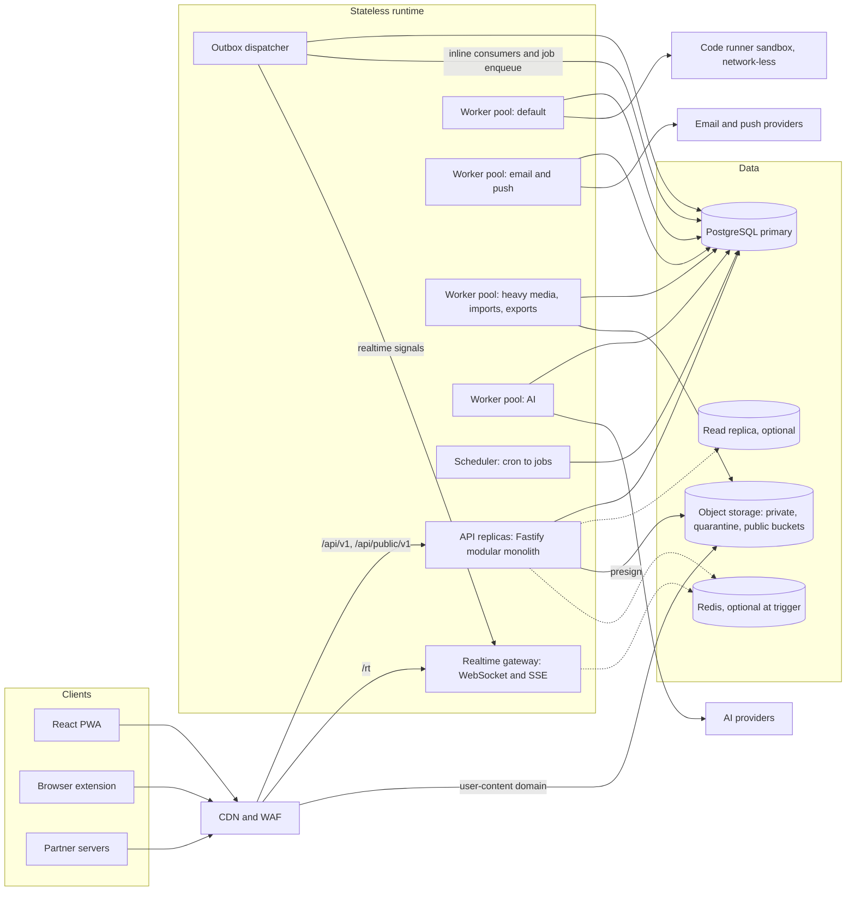

| Container           | Responsibility                                                                                    | Scales by                                      | State                               | As-built?                                                             |
| ------------------- | ------------------------------------------------------------------------------------------------- | ---------------------------------------------- | ----------------------------------- | --------------------------------------------------------------------- |
| React PWA           | All role workspaces, public pages, offline read cache                                             | CDN                                            | Browser cache and local drafts only | Partly: React app exists [SRC: ARCHITECTURE.md §15]                   |
| Browser extension   | Job capture and profile import, local-first                                                       | n/a                                            | Extension storage                   | No [SRC: SSOT ADR-006 intent]                                         |
| API replicas        | HTTP use cases, policy, validation, transactions, outbox writes                                   | Replica count                                  | None in process except caches       | Single writer today [SRC: ADR-015]                                    |
| Realtime gateway    | Authenticated channels; pushes signals, never authoritative rows                                  | Connections                                    | Connection registry                 | No                                                                    |
| Outbox dispatcher   | Reads `outbox_events`, runs inline consumers, enqueues job-mode consumers, emits realtime signals | One active leader, standby                     | None                                | No                                                                    |
| Worker pools        | Execute jobs by queue class with fenced leases                                                    | Pool size per class                            | None                                | One worker, one pool [SRC: ARCHITECTURE.md §18]                       |
| Scheduler           | Turns cron definitions into idempotent jobs (`kind` + period key)                                 | One active leader                              | None                                | No                                                                    |
| Code runner sandbox | Executes untrusted candidate code without network                                                 | Runner instances                               | Ephemeral                           | No (submissions are not executed) [SRC: ARCHITECTURE.md §20]          |
| PostgreSQL          | System of record, queue, outbox, search index, vector index                                       | Vertical, then read replica, then partitioning | All durable state                   | Yes, as system of record for the core loop [SRC: ARCHITECTURE.md §13] |
| Object storage      | Files, media, exports                                                                             | Provider                                       | Blobs                               | No                                                                    |
| Redis               | Optional: rate-limit counters, realtime fan-out, hot caches                                       | Provider                                       | Disposable                          | No                                                                    |

**Leader election for the dispatcher and scheduler** uses a PostgreSQL advisory lock held on a dedicated session connection; a standby takes over when the lock is released or the connection drops [DER]. The as-built API writer lease [SRC: ARCHITECTURE.md §16] is retired by DEC-ARC-002 because the API no longer needs a single writer.

### 5. Bounded contexts mapped to the 30 modules

A **module** is the unit of code ownership: one backend module folder, one contracts folder, one domain folder and one web feature folder per module code. A **bounded context** groups modules that share a vocabulary and may call each other more freely; calls across contexts go only through module public interfaces or events (§7) [DER from SSOT §12.10–§12.11].

| Context                        | Modules            | Strategic class                                          | What the context owns (aggregate roots)                                                                                                               | Proposed tier (dependency view)                |
| ------------------------------ | ------------------ | -------------------------------------------------------- | ----------------------------------------------------------------------------------------------------------------------------------------------------- | ---------------------------------------------- |
| Identity and access            | IDN                | Generic, security-critical                               | Account, Credential (password, passkey, federated identity), Session, ServicePrincipal, Organization, Membership                                      | R0                                             |
| Privacy and account governance | SET                | Generic, compliance-critical                             | ConsentGrant, PrivacySettings, DataSubjectRequest (export, erasure), SubjectIdentityMap                                                               | R0                                             |
| Communications                 | NTF, MSG           | Supporting                                               | Notification, DeliveryAttempt, ChannelPreference, Conversation, Message                                                                               | NTF R0, MSG R2                                 |
| Career identity                | PRF, EVD, BGV      | **Core**                                                 | Profile, Resume, Portfolio, Evidence, Attestation, Credential, VerificationRequest, BackgroundCheck                                                   | PRF and EVD R1, BGV R4                         |
| Learning                       | LRN, STU           | Supporting                                               | Course, CourseVersion, Enrollment, Progress, LearningPath, Certificate, StudioProject, MediaAsset (content usage)                                     | LRN R1, STU R3                                 |
| Assessment                     | ASM                | **Core**                                                 | Assessment, ItemBank, Attempt, Submission, RunnerJob, IntegrityCase                                                                                   | R1 (unverified attempts), runner R4            |
| Hiring                         | JOB, ATS, INT, EMP | **Core** (JOB, ATS), supporting (INT, EMP)               | Job, Application, Requisition, PipelineStage, Scorecard, Offer, Interview, AvailabilitySlot, EmployerPage, Team                                       | R2                                             |
| Community                      | NET, REP, EVT      | Supporting                                               | Connection, Follow, Post, Group, Referral, ReputationLedger, Badge, CommunityEvent, Hackathon                                                         | NET R2, REP R4, EVT R6                         |
| Intelligence and discovery     | AIC, SRC, MKT      | **Core** (AIC matching), generic (SRC), supporting (MKT) | AIInvocation, Recommendation, MatchExplanation, SearchDocument, SavedSearch, SkillTaxonomy (MKT, released at R1, OD-ARC-07), MarketSignal, CareerPath | SRC R1, AIC R1 gateway and R4 features, MKT R6 |
| Trust and governance           | TSF, ADM           | Generic, safety-critical                                 | Report, ModerationCase, Sanction, Appeal, AuditEvent, SupportTicket, PlatformConfig                                                                   | TSF R1, ADM R0                                 |
| Institutions and enterprise    | INS, ENT           | Supporting                                               | Institution profile, Department, Cohort, ManagedLearnerLink, LicensePool, PlacementDrive, WorkforceLink, InternalOpportunity, SkillsInventory         | INS R3, ENT R6                                 |
| Commercial                     | BIL                | Generic, money-critical                                  | Customer, Subscription, Entitlement, Order, Invoice, LicenseSeat, Payout (gated)                                                                      | R1 stub, R5 scale                              |
| Career services                | MEN, GIG           | Supporting, OS expansion                                 | MentorProfile, Engagement, Session, GigProject, Proposal, Contract, Milestone                                                                         | R6                                             |
| Platform                       | PLT, ANL, PWA      | Generic                                                  | FileObject, WebhookEndpoint, ApiClient, IntegrationConnection, AnalyticsEvent, MetricSnapshot, PushSubscription, DeviceInstall                        | PLT and PWA R0, ANL R1                         |

OS-expansion modules (MEN, GIG, EVT, MKT, ENT) are designed into the context map now so that their tenancy, events and data classes do not force later rework, but none is built before `DEC-002` / its module `OD-` clears [SRC: CONVENTIONS §4]. Final tiers belong to `08_ROADMAP`; the column above only shows dependency order.

#### 5.1 Context map

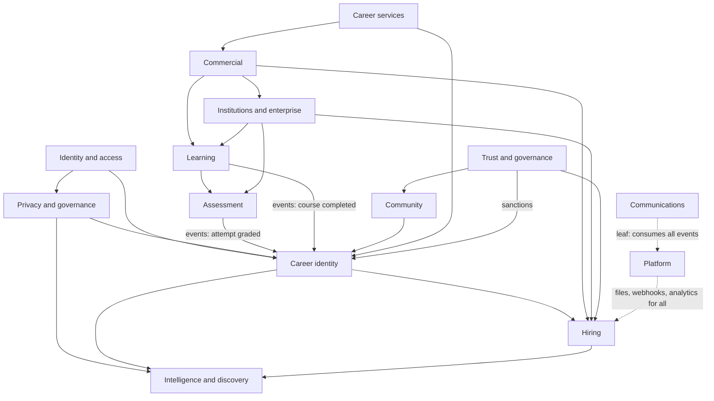

Arrows point from upstream (supplier of a published interface or event) to downstream (consumer). Communications is a **leaf**: nobody imports it; it consumes events [SRC: BE-01-R2 §2 rule 3]. Assessment and Learning **publish** results and Career identity **consumes** them; Assessment and Learning never write evidence rows directly [SRC: BE-01-R2 §2 rule 4].

#### 5.2 Ownership rules that the context map enforces

1. Each table has exactly one owning module, recorded in [02 §3](#02--data-model). Only that module's repository code writes it [SRC: SSOT §12.5].
2. A module reads another module's data through the owner's public interface (`modules/<code>/index.ts`) or through a published read-only view named `pv_<owner>_<name>` that the owner maintains. Direct `SELECT` on another module's tables is a lint failure [SRC: BE-01-R2 rule 1, FF-02].
3. Cross-context writes happen only as reactions to events, never as synchronous writes into another module's tables [SRC: SSOT ADR-013].
4. Synchronous calls between modules must form an acyclic graph; the graph is generated from imports in CI and compared with the baseline in [08 §3](#08--technical-specification-index) [SRC: BE-01-R2 §2].

### 6. Modular-monolith structure

#### 6.1 One server codebase, several process roles (DEC-ARC-001)

All server-side module code lives in one server application. The same build starts in one of six roles selected by `PROCESS_ROLE`: `http`, `dispatcher`, `worker`, `scheduler`, `realtime`, `migrate`. The code runner is the only server component built and deployed separately, because it is a different trust domain (DEC-ARC-015).

As-built input: `apps/api` and `apps/worker` are separate packages and the worker "cannot see API process Maps" [SRC: ARCHITECTURE.md §7]. In the target the worker runs module job handlers, which need module repositories and use cases, so the module code must be shared. Options are compared in DEC-ARC-001.

#### 6.2 Target repository layout

```text
apps/
  web/src/
    app/                      shell: providers, router, layout, error boundaries
    features/<mod>/           pages/, components/, hooks/, api.ts, offline.ts (one folder per module code)
    components/ui/            primitives (as-built owner, kept)
    lib/                      apiJson, session, capability hints (as-built owner, kept)
  api/src/                    the server codebase (all process roles)
    entry/                    http.ts, dispatcher.ts, worker.ts, scheduler.ts, realtime.ts, migrate.ts
    platform/                 http hooks, error mapper, auth plugin, policy plugin, idempotency,
                              rate limits, db (transaction + claims), outbox writer, tracing, flags
    modules/<mod>/
      index.ts                public interface: types and functions other modules may call
      plugin.ts               Fastify plugin; registers this module's routes
      routes/                 thin handlers: parse (contracts) → policy → use case → serialize
      usecases/               one exported function per use case; one transaction each
      repo/                   SQL for tables this module owns; nothing else
      events.ts               emitted event types; consumer registrations (inline or job mode)
      jobs.ts                 job kinds and handlers
      privacy.ts              ErasureParticipant and ExportParticipant
      policy.ts               actions and resource resolvers this module defines
  extension/                  browser extension (PWA module)
runner/                       code-execution sandbox (separate image, separate trust domain)
packages/
  domain/src/<mod>/           pure rules, state machines, scoring (as-built owner, kept)
  contracts/src/<mod>/        Zod schemas: requests, responses, events
  policy/                     authorization engine and action registry (new, DEC-ARC-005)
  adapters/                   server-only provider adapters behind ports (new, DEC-ARC-021)
  config/  observability/  ui/  testing/   (as-built owners, kept)
supabase/migrations/          forward-only SQL migrations (as-built owner, kept)
```

Adding `packages/policy` and `packages/adapters` and the extra entrypoints changes workspace manifests, which are protected build files; the owner must approve those edits before implementation [SRC: CLAUDE.md Rules; AGENTS.md]. Moving `apps/worker/src/email` into `packages/adapters/email` keeps the as-built email contract test (`tests/unit/email/provider-contract.ts`) as the gate [SRC: ARCHITECTURE.md §17].

#### 6.3 Module anatomy rules

| Rule | Statement                                                                                                                                                                                                             | Enforced by                                                    |
| ---- | --------------------------------------------------------------------------------------------------------------------------------------------------------------------------------------------------------------------- | -------------------------------------------------------------- |
| M-01 | A route handler contains no business rule. It parses with the contracts schema, calls `policy.authorize`, calls one use case and serializes the result.                                                               | Code review; lint bans imports of `repo/` from `routes/`       |
| M-02 | A use case runs in exactly one database transaction obtained from `platform/db`; the transaction carries the principal claims (§8.5) and the outbox writer.                                                           | `withTx(principal, fn)` is the only way to get a client        |
| M-03 | A use case that changes state emits its events by inserting into `outbox_events` inside the same transaction.                                                                                                         | Outbox writer API; test helper asserts emitted events          |
| M-04 | Business rules and state machines are defined once in `packages/domain/src/<mod>`; use cases call them; SQL transition functions read their allowed edges from tables generated from the same definitions.            | [SRC: ARCHITECTURE.md INVARIANT-002; BE-01-R2 §9] parity tests |
| M-05 | A module's `index.ts` exports only read functions, command functions that run in the caller's transaction, and types. It never exports repositories.                                                                  | Lint                                                           |
| M-06 | Every table a module creates is declared in the module's `ownership.ts` with ownership class, tenancy column, data class and retention class ([02 §2](#02--data-model)). Migration CI fails for an undeclared table. | Migration lint                                                 |
| M-07 | A module declares its routes in a route registry with policy action, rate-limit class, idempotency mode and pagination mode.                                                                                          | Route-registry lint ([03 §14](#03--api-design))               |

#### 6.4 Extraction criteria

A module is extracted into a separately deployed service only when at least one trigger is measured and recorded in a new DEC-ARC entry [SRC: ADR-T04; SSOT §12.1].

| Trigger                                   | Measured as                                                                                                                                                  | Example candidate                                |
| ----------------------------------------- | ------------------------------------------------------------------------------------------------------------------------------------------------------------ | ------------------------------------------------ |
| T1 Resource profile harms others          | The module's CPU, memory or connection use causes p95 latency regressions in unrelated routes in two consecutive load tests                                  | Media processing, AI batch work                  |
| T2 Different trust boundary               | Executes untrusted code or holds credentials that other modules must not reach                                                                               | Code runner (extracted from day one)             |
| T3 Distinct availability target           | The module needs an availability or latency objective materially different from the API's                                                                    | Realtime gateway, credential verification pages  |
| T4 Data residency or regulatory isolation | A customer contract or regulation requires processing in a separate region or account                                                                        | Enterprise tenant data, background-check results |
| T5 Team ownership contention              | Independent teams block each other's releases on the same deployable (count is a parameter, `extraction.min_independent_teams`, default 3 [PROP], OD-ARC-14) | Learning studio, hiring workspace                |
| T6 Independent scaling                    | The module's load grows on a different curve and would otherwise force over-provisioning of the API                                                          | Search (if moved to an external engine)          |

**Extraction readiness (must already hold before extraction):** the module owns its tables with no foreign keys from other modules' tables except to identity keys; all inbound reads use its interface or `pv_` views; all inbound writes are events; its jobs are in their own queue class. Because these rules hold from day one (§5.2), extraction is a deployment change plus an interface-to-HTTP adapter, not a rewrite [DER].

Ranked extraction candidates: (1) code runner — separate from the start; (2) realtime gateway — separate process role from the start, same codebase; (3) media processing pool; (4) AI gateway execution pool; (5) search, only if an external engine is adopted; (6) notification delivery.

### 7. Layering rules

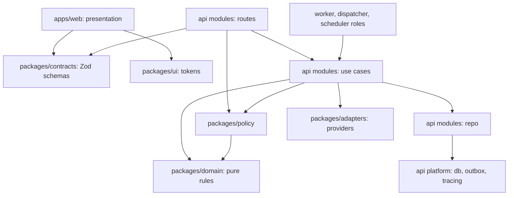

| Id   | Rule                                                                                                                                                                                        | Source                                        | Enforcement                                    |
| ---- | ------------------------------------------------------------------------------------------------------------------------------------------------------------------------------------------- | --------------------------------------------- | ---------------------------------------------- |
| L-01 | `packages/domain` imports nothing from frameworks, providers, Zod, databases or the network. It may import sibling domain files, never its own barrel.                                      | [SRC: ARCHITECTURE.md INVARIANT-003]          | dependency-cruiser rule; as-built tests        |
| L-02 | `packages/contracts` imports only Zod and its own files. It never imports domain.                                                                                                           | [SRC: ARCHITECTURE.md §7]                     | dependency-cruiser                             |
| L-03 | `packages/policy` imports domain predicates and contracts types only. It holds no database client; resource attributes are passed in by resolvers that each module registers.               | [DER from ADR-T07]                            | dependency-cruiser                             |
| L-04 | Only `apps/api` (roles http, dispatcher, worker, scheduler, realtime, migrate) holds a database client, and only through `platform/db`. The web app, contracts, domain and policy never do. | [SRC: ARCHITECTURE.md INVARIANT-005]          | Lint bans `pg` imports outside `platform/db`   |
| L-05 | Provider SDKs are imported only inside `packages/adapters/<port>/<vendor>`. AI provider SDKs only inside `packages/adapters/ai`.                                                            | [SRC: ARCHITECTURE.md §17; BE-01-R2 rule 5]   | Lint                                           |
| L-06 | The web app never contains authorization decisions that the server does not repeat. UI capability hints come from `GET /api/v1/me/capabilities`.                                            | [SRC: ARCHITECTURE.md INVARIANT-001; ADR-T07] | Security tests                                 |
| L-07 | `packages/adapters` is server-only and never bundled for the browser.                                                                                                                       | [SRC: SSOT §12.16 server-only folders]        | Vite build check that fails on adapter imports |
| L-08 | Errors cross layers as `DomainError` (domain, use case) or validation errors (contracts) and are rendered only by the global error mapper.                                                  | [SRC: ARCHITECTURE.md INVARIANT-004]          | Lint bans `reply.code(4xx/5xx)` in handlers    |
| L-09 | Design tokens come only from `packages/ui/src/tokens.ts`; feature code hard-codes no color or spacing.                                                                                      | [SRC: CLAUDE.md Style]                        | Stylelint or lint rule                         |
| L-10 | No module imports another module's `repo/`, `routes/` or `jobs/`. Cross-module calls go through `index.ts`.                                                                                 | [SRC: SSOT ARCH-016]                          | dependency-cruiser                             |

### 8. Multi-tenancy model

#### 8.1 Principals

| Principal kind  | Who                                                           | How authenticated                                                                                                      | Claims carried into a transaction                                                                                                            |
| --------------- | ------------------------------------------------------------- | ---------------------------------------------------------------------------------------------------------------------- | -------------------------------------------------------------------------------------------------------------------------------------------- |
| `account`       | Any human with an account (all human roles in CONVENTIONS §5) | Session cookie (§10)                                                                                                   | `account_id`, active memberships `[{org_id, membership_type, roles}]`, `platform_roles`, `recent_auth_at`, `assessment_session_id` if active |
| `service`       | Partner integration (`API` role) acting for one organization  | OAuth 2.0 client credentials token                                                                                     | `api_client_id`, `org_id`, granted scopes                                                                                                    |
| `system`        | Worker, dispatcher, scheduler                                 | Process identity                                                                                                       | `job_id`, the tenant scope copied from the job payload                                                                                       |
| `token_holder`  | Referee, verifier, guest invitee, unsubscribe link user       | Single-use capability token, stored as a hash                                                                          | `token_purpose`, bound resource id                                                                                                           |
| `support_grant` | Support agent working on a user's case                        | Agent session plus a live, time-boxed `support_access_grants` row consented by the user or an audited policy exception | `agent_account_id`, `subject_account_id`, `grant_id`, allowed scopes                                                                         |

There is no write-capable impersonation ("log in as user"). The read-only, consented, time-boxed "view-as" session that the ADM module specifies (SM-ADM-04, BR-ADM-006) runs as a `support_grant` principal, so every read is attributable and limited [SRC: 02_MODULES ADM BR-ADM-006; API-STD `grant-required`; BR-T041] [DER].

#### 8.2 Tenants

| Tenant kind           | Represented as                                                                                        | Members                                                             | Notes                                                                                                                                            |
| --------------------- | ----------------------------------------------------------------------------------------------------- | ------------------------------------------------------------------- | ------------------------------------------------------------------------------------------------------------------------------------------------ |
| Personal space        | Implicit, keyed by `account_id`                                                                       | The account                                                         | Every person-owned record lives here. A person's personal space is never owned by an organization, even when an organization invited the person. |
| Employer organization | `organizations` row with `kind = 'employer'`                                                          | `staff` memberships (REC, HMG, EAD)                                 | Hiring tenant. May enable the `enterprise_talent` capability (below).                                                                            |
| Recruitment agency    | `organizations.kind = 'agency'`                                                                       | `staff` memberships                                                 | Hires on behalf of client employers; client relationship is a separate `agency_client_links` record [SRC: SSOT §14.5 agency tables]              |
| Institution           | `organizations.kind = 'institution'`                                                                  | `staff` (IAD, PLO), `instructor` (INS), `learner` (STD) memberships | Managed learning tenant [SRC: SSOT ADR-008]                                                                                                      |
| Enterprise            | An employer organization whose `capabilities` include `enterprise_talent` (granted by an entitlement) | `staff` (EXA) and `workforce` memberships (employees)               | Internal mobility and L&D happen inside the same tenant that hires externally, so one company is one tenant [PROP]                               |
| Platform              | Reserved organization `platform`                                                                      | Platform staff (MOD, SUP, FIN, PAD, SAD)                            | Owns platform reference data, moderation and audit                                                                                               |

Membership types are `staff`, `instructor`, `learner`, `workforce`, `mentor` (a mentor attached to an institution or enterprise program) and `alumni`. Roles inside a membership are scoped grants (for example `ats.pipeline.manage` on organization X), not global roles [SRC: V61-05 scoped-grant model] [DER].

#### 8.3 Data ownership classes

Every table belongs to exactly one class ([02 §2](#02--data-model) gives the per-table assignment).

| Class             | Meaning                                                                  | Tenancy columns                        | Who reads without a grant                           | Example tables                                                                                                              |
| ----------------- | ------------------------------------------------------------------------ | -------------------------------------- | --------------------------------------------------- | --------------------------------------------------------------------------------------------------------------------------- |
| OWN-PERSON        | Data about and controlled by one person                                  | `owner_account_id`                     | The owner only                                      | `profiles`, `evidence`, `resumes`, `consent_grants`, `lesson_progress` (personal enrollments)                               |
| OWN-ORG           | Data an organization creates about its own operations                    | `tenant_org_id`                        | Members with the matching scoped grant              | `jobs`, `pipeline_stages`, `scorecards`, `license_pools`, `cohorts`                                                         |
| SHARED-PARTY      | A record that two parties legitimately share, with field-level audiences | `owner_account_id` and `tenant_org_id` | Each party, limited to its audience's fields        | `job_applications`, `interviews`, `offers`, `enrollments` (institution-assigned), `mentorship_engagements`, `gig_contracts` |
| PLATFORM          | Reference and governance data                                            | none, or `tenant_org_id = platform`    | Platform staff with scope; public subsets via views | `skills`, `plans`, `moderation_cases`, `audit_events`                                                                       |
| PUBLIC-PROJECTION | Derived, public-safe copies                                              | Inherits from the source               | Anyone, including guests                            | `pv_public_profiles`, `pv_published_jobs`, `pv_credential_verifications`                                                    |

A SHARED-PARTY record stores org-internal fields (recruiter notes, scorecard ratings, internal tags) in a **separate child table** owned by the organization side (`application_internal_notes`), never in columns of the shared row. This keeps candidate data export and candidate reads free of org-internal content without column masking errors [PROP].

#### 8.4 Grants: how an organization sees person-owned data

| Grant                                  | Created by                                                      | Gives                                                                                                                       | Revocation effect                                                                                                                                                              |
| -------------------------------------- | --------------------------------------------------------------- | --------------------------------------------------------------------------------------------------------------------------- | ------------------------------------------------------------------------------------------------------------------------------------------------------------------------------ |
| `application_share_snapshot`           | Candidate, on submitting an application                         | The employer sees an immutable snapshot of the evidence and profile sections the candidate chose, for that application only | Live evidence links stop resolving at the next read; the snapshot's existence and the application record remain, per hiring retention [SRC: BE-01-R2 §6 application snapshots] |
| `search.discoverable` consent          | Person, in privacy settings                                     | Recruiters with search entitlement can find the public-to-recruiters profile projection                                     | Search documents are excluded at the next query (query-time join on `pv_consent_current`)                                                                                      |
| `institution.share_profile` consent    | Learner                                                         | Placement officers of that institution see the learner's placement profile                                                  | Next read denied                                                                                                                                                               |
| `enterprise.workforce_profile` consent | Employee                                                        | The employer's enterprise talent admins see the fields the employee chose, for internal mobility                            | Next read denied                                                                                                                                                               |
| `support_access_grants`                | Person (or audited policy exception for safety and legal holds) | A named agent reads named scopes for a time window                                                                          | Expiry or revocation ends access at the next request                                                                                                                           |
| `referee_request` capability token     | Person requesting a reference                                   | The referee sees only the claim to be attested                                                                              | Token consumed or expired                                                                                                                                                      |

**Enterprise boundary (the highest-risk tenancy rule):** an employer never learns that its own employee applied to an external job, set `open_to_work`, or was found in external candidate search. External applications are SHARED-PARTY records with the external employer only; the current employer's tenant has no grant path to them, and candidate search excludes profiles from employers listed in the person's `blocked_employer_org_ids` (stealth setting) [PROP] [SRC: SSOT §14.4 "stealth flags"]. What an enterprise may see of an employee is OD-ARC-15.

#### 8.5 How tenancy is enforced in PostgreSQL (DEC-ARC-008)

1. Migrations run as `ts_owner`. The API's http role connects as `ts_app`, which owns no tables and is subject to RLS. Worker roles connect as `ts_worker`, also subject to RLS. A `ts_readonly_analytics` role reads only `pv_` and analytics schemas [DER from SSOT §14.6 and as-built gap ARCHITECTURE.md §20].
2. `platform/db.withTx(principal, fn)` begins a transaction and sets claims with `set_config('app.account_id', …, true)`, `app.org_grants` (a compact JSON array of `{org_id, membership_type, grants}`), `app.principal_kind` and `app.support_grant_id`. `true` makes them transaction-local, which is safe with a transaction-mode connection pooler [DER].
3. Policies call stable SQL helper functions: `app_account_id()`, `app_has_org_grant(org_id, grant)`, `app_is_platform_staff(scope)`, `app_has_consent(subject_account_id, scope, audience)`. Policy templates are generated per ownership class (`generate_rls_policies(table, ownership_class, …)`), extending the SSOT generator model [SRC: SSOT §14.6 generator model].
4. RLS is the **second** boundary. The first is `packages/policy` in the API. A route that passes policy but is denied by RLS is a defect and pages on-call; it never silently returns an empty list [DER].
5. CI generates two tenants and two people per ownership class for every migration and asserts: cross-tenant `SELECT` returns zero rows, cross-tenant `UPDATE` and `DELETE` affect zero rows, public projections expose only columns marked public [SRC: SSOT §14.6 RLS fuzzing].
6. Cross-tenant read is a Sev-1 incident [SRC: ADR-T21].

### 9. Authorization architecture (DEC-ARC-005)

`packages/policy` exposes one function: `authorize(principal, action, resource) → Decision`. A `Decision` is `allow` with **obligations**, or `deny` with a reason code. Obligations are instructions the caller must apply: `field_mask` (remove listed fields), `require_consent(scope, subject)`, `require_step_up(max_age)`, `audit(reason)`, `rate_class(name)`.

| Element               | Design                                                                                                                                                                                                                                      |
| --------------------- | ------------------------------------------------------------------------------------------------------------------------------------------------------------------------------------------------------------------------------------------- |
| Action names          | `<mod>.<resource>.<verb>`, lowercase, for example `ats.application.move_stage`, `evd.evidence.verify`, `ins.cohort.assign_course`. Each module registers its actions in `modules/<mod>/policy.ts`.                                          |
| Resource resolver     | Each module registers a resolver that loads the attributes policy needs (owner, tenant, state, audience) for a resource id, using the same transaction.                                                                                     |
| Rules                 | Role-based grants per membership plus attribute rules (owner equals principal, resource tenant in principal grants, state allows action, consent present). Deny by default; an action with no rule is denied [SRC: V61-05 deny-by-default]. |
| Existence hiding      | A denied read of a resource the principal cannot know about returns `404 not-found`; `403 forbidden` is used only when the principal can already see the resource [SRC: SSOT §13.2 "no existence leakage"].                                 |
| Capabilities endpoint | `GET /api/v1/me/capabilities?resource=<type>:<id>` returns the actions the UI may offer. It is a hint; every action is re-authorized [SRC: ADR-T07].                                                                                        |
| Grants cache          | Role and membership grants may be cached per request using `grants_version` on the account; consent is never cached [SRC: BE-01-R2 §6].                                                                                                     |
| Assessment lock       | If the principal has an active `AI_PROHIBITED` assessment session, every `aic.*` action and every action tagged `ai_assisted` is denied with `ai-prohibited` [SRC: ARCHITECTURE.md INVARIANT-008].                                          |
| Audit                 | Every allow on an action tagged `sensitive` and every deny on any action writes an audit event through the outbox [DER].                                                                                                                    |

### 10. Identity and session architecture (DEC-ARC-006, DEC-ARC-007)

| Concern            | Target                                                                                                                                                                                                                                                                                                                                                                                                             | As-built (input)                                                                  |
| ------------------ | ------------------------------------------------------------------------------------------------------------------------------------------------------------------------------------------------------------------------------------------------------------------------------------------------------------------------------------------------------------------------------------------------------------------ | --------------------------------------------------------------------------------- |
| Browser session    | Opaque session id in an HttpOnly, Secure cookie `__Host-ts_sid` (Path=/, SameSite=Lax). The id is an HMAC-signed random value; the server looks up `sessions` on every request. Short-lived access is not needed because the session row is checked each time; idle timeout and absolute lifetime are parameters (`session.idle_minutes` default 60 [PROP], `session.absolute_days` default 30 [PROP]; OD-ARC-03). | 24 h HMAC bearer token in `localStorage`, XSS-readable [SRC: ARCHITECTURE.md §12] |
| CSRF               | `X-CSRF-Token` double-submit value plus `Origin`/`Sec-Fetch-Site` check on unsafe methods [SRC: API-STD §4]                                                                                                                                                                                                                                                                                                        | None needed for bearer tokens today                                               |
| Revocation         | Delete or mark the `sessions` row; effect at the next request. "Sign out other devices" and password change revoke all other rows.                                                                                                                                                                                                                                                                                 | Revoked-session rows and issuance cutoff [SRC: migrations 00045, 00046]           |
| Password           | PBKDF2-SHA512 kept (as-built `hashPassword`/`verifyPassword`) with upgrade-on-login to a memory-hard hash if OD-ARC-03 chooses it; breached-password check against a k-anonymity range API [SRC: SSOT §13.3 HaveIBeenPwned]                                                                                                                                                                                        | PBKDF2-SHA512, 210,000 iterations [SRC: ARCHITECTURE.md §20]                      |
| Passkeys           | WebAuthn registration and login; passkey is a `credentials` row of type `webauthn`                                                                                                                                                                                                                                                                                                                                 | None                                                                              |
| Social login       | OIDC with Google, GitHub, Microsoft, LinkedIn; federated identity linked to an existing account only after the user proves control of the account (no silent merge by email) [PROP]                                                                                                                                                                                                                                | None [SRC: ARCHITECTURE.md §3]                                                    |
| Enterprise SSO     | Per-organization OIDC or SAML 2.0 connection; optional enforcement for staff and workforce memberships of that organization; SCIM 2.0 provisioning for enterprise and institution tenants [PROP]                                                                                                                                                                                                                   | None                                                                              |
| Service principals | OAuth 2.0 client credentials at `POST /api/public/v1/oauth/token`; tokens are opaque, ≤ 1 h, scoped to one organization [SRC: API-STD §4]                                                                                                                                                                                                                                                                          | None                                                                              |
| Step-up            | Sensitive actions require `recent_auth_at` within `auth.step_up_max_age_minutes` (default 10 [SRC: API-STD §4, target value])                                                                                                                                                                                                                                                                                      | None                                                                              |
| Extension          | The browser extension uses a separate, revocable device session obtained through an OAuth device-style pairing flow; it never reads the web cookie [PROP]                                                                                                                                                                                                                                                          | None                                                                              |

Social login, SSO and passkeys are implemented inside IDN as an identity broker, not delegated to an external auth service, so that one session model serves all principals. Whether to adopt a managed identity provider instead is OD-ARC-03.

### 11. Eventing (DEC-ARC-009, DEC-ARC-010)

Summary; full design in [04](#04--events-and-asynchronous-processing).

1. A use case writes its state change and its events (`outbox_events`) in one transaction.
2. The dispatcher reads committed outbox rows in order, delivers each event to registered consumers: **inline** consumers run immediately in their own transaction with a `consumer_inbox` dedupe row; **job** consumers get a `background_jobs` row.
3. Workers claim jobs with `FOR UPDATE SKIP LOCKED`, a lease, and a **fencing token** (`lease_token`), so a worker whose lease expired cannot complete or overwrite a job another worker reclaimed [SRC: ADR-T09; as-built gap ARCHITECTURE.md §18].
4. Delivery is at-least-once. Consumers are idempotent by `event_id`. Ordering is guaranteed only per aggregate (`aggregate_seq`).
5. No message broker. Kafka, NATS or a managed queue is introduced only when the outbox trigger in §21 is measured (DEC-ARC-009).

### 12. Realtime (DEC-ARC-011)

Realtime improves experience but is never the source of truth [SRC: SSOT ADR-004]. The realtime gateway (`PROCESS_ROLE=realtime`) holds WebSocket connections (SSE fallback), authenticates with the session cookie, authorizes each channel subscription through `packages/policy`, and pushes small signals `{type, entity, id, cursor}` ≤ 4 KB [SRC: SSOT §13.10]. Clients fetch authoritative data over HTTP after a signal. Fan-out across gateway instances uses PostgreSQL `LISTEN/NOTIFY` issued only by the dispatcher (never by business transactions) until the Redis trigger in §21 [SRC: BE-01-R2 §1.2] [DER]. Detail in [07 §3](#07--search-media-and-realtime-architecture).

### 13. Search (DEC-ARC-012)

All search goes through `SearchPort` owned by SRC. The default adapter stores one `search_documents` row per searchable entity per audience, with a `tsvector`, trigram columns for names and titles, and an optional `vector` column for semantic retrieval. Projection jobs rebuild documents from owner interfaces on events. Consent and visibility are joined at query time; a stale document can never leak because the live predicate decides [SRC: BE-01-R2 §6]. Detail in [07 §1](#07--search-media-and-realtime-architecture).

### 14. Media and files (DEC-ARC-013)

`StoragePort` (S3-compatible API) and `MediaProviderPort` (transcode, HLS playback, captions). Uploads go directly from the browser to object storage with a presigned, size-limited, content-type-limited URL into a **quarantine** bucket; a scan job checks type by magic bytes and malware before moving the object to the private bucket and marking the `file_objects` row `available` [SRC: SSOT CON-011, §13.15–§13.16]. User content is served from a separate cookieless registrable domain [SRC: BE-01-R2 §10 REVW-32]. Detail in [07 §2](#07--search-media-and-realtime-architecture).

### 15. AI gateway (DEC-ARC-014)

The AI gateway (owned by AIC, used by all modules) is the only code path to any model. Pipeline: identity → purpose and data class → assessment-mode check → AI policy → entitlement and budget reservation → context firewall and redaction → execution target selection (local heuristic, free quota, user-authorized provider, platform provider) → model call → output validation → provenance record → user review [SRC: SSOT §16.1, §16.3]. Detail in [06](#06--ai-architecture).

### 16. Cache (DEC-ARC-016)

| Layer                               | What may be cached                                                                                                                                                                                                     | Invalidation                                                                                 | Never cached                                                                                                              |
| ----------------------------------- | ---------------------------------------------------------------------------------------------------------------------------------------------------------------------------------------------------------------------- | -------------------------------------------------------------------------------------------- | ------------------------------------------------------------------------------------------------------------------------- |
| CDN                                 | Static assets (immutable, content-hashed); public pages and public API reads (`pv_published_jobs`, public profiles, credential verification pages, skills taxonomy, plans) with short TTL and `stale-while-revalidate` | TTL plus purge on publish, close, takedown, revocation events                                | Any response to a request carrying a session cookie, unless the route is explicitly public and varies on nothing personal |
| Service worker                      | GETs of the user's own data allowed by the per-feature offline contract; labelled stale in the UI                                                                                                                      | Revalidate on focus; cleared on sign-out                                                     | `no-store` routes, tokens, referee pages, payment and privacy routes [SRC: API-STD §10]                                   |
| In-process LRU (API)                | Platform reference data: skills taxonomy, plans, flag definitions, policy rule tables, prompt manifests                                                                                                                | Version number bumped by an event; TTL bound `cache.reference_ttl_seconds` default 60 [PROP] | Authorization decisions, consent, entitlements, balances                                                                  |
| Redis (at trigger)                  | Rate-limit counters, realtime fan-out, expensive derived reads (market aggregates) keyed by tenant and actor                                                                                                           | Event-driven delete plus TTL                                                                 | Same as above [SRC: SSOT CON-014 "keys include tenant + actor"]                                                           |
| PostgreSQL materialized projections | Leaderboards, analytics rollups, salary aggregates                                                                                                                                                                     | Refreshed by jobs                                                                            | n/a                                                                                                                       |

### 17. Configuration and secrets (DEC-ARC-017, DEC-ARC-026)

| Kind                                                                                                         | Where                                                                                                                                | Changed by                                      | Read when                                                            |
| ------------------------------------------------------------------------------------------------------------ | ------------------------------------------------------------------------------------------------------------------------------------ | ----------------------------------------------- | -------------------------------------------------------------------- |
| Boot configuration (ports, database URL, provider selection, signing key references)                         | Environment, validated by the schema in `packages/config/src/env.ts`; deployed mode refuses unsafe values [SRC: ARCHITECTURE.md §16] | Deploy                                          | Process start                                                        |
| Secrets (database passwords, provider API keys, session signing keys, webhook secrets)                       | Secret manager; injected as environment or files at start; never in the repository or image                                          | Security officer (SAD) through rotation runbook | Process start; signing keys support two active versions for rotation |
| Per-organization integration credentials (ATS API keys, SSO certificates, HRIS tokens)                       | `integration_connections.secret_ciphertext`, envelope-encrypted with a data key wrapped by a KMS key                                 | EAD or IAD in their admin console               | On use; decrypted in memory, never logged                            |
| Field-level PII encryption                                                                                   | AES-256-GCM per field with key id stored beside the ciphertext [SRC: SSOT §15.5]                                                     | Key rotation job                                | On read by authorized use cases                                      |
| Runtime configuration (limits, thresholds such as `min_cohort_k`, job-kind retry policy, rate-limit numbers) | `platform_config` table with typed schema, versioned, audited                                                                        | PAD through admin console                       | Cached per reference-cache rules                                     |

### 18. Feature flags, entitlements and kill switches

Three different mechanisms, never mixed [DER]:

| Mechanism    | Question it answers                                                                                                                             | Owner              | Store                                                                                                                                          |
| ------------ | ----------------------------------------------------------------------------------------------------------------------------------------------- | ------------------ | ---------------------------------------------------------------------------------------------------------------------------------------------- |
| Feature flag | Is this code path released to this audience yet? Targeting by environment, platform role, organization id, percentage of accounts (stable hash) | PAD / engineering  | `feature_flags` extended with `rules jsonb`, `owner`, `expires_at` (as-built table has `key`, `enabled`, `description` [SRC: migration 00051]) |
| Entitlement  | Has this account or organization paid for, or been granted, this capability and how much of it remains?                                         | BIL                | `entitlements`, `entitlement_counters`                                                                                                         |
| Kill switch  | Must this dependency or feature be turned off now because it is harmful or failing?                                                             | On-call (PAD, SAD) | `feature_flags` with `kind = 'kill_switch'`; evaluated before entitlements; changes are audited and page the owner                             |

Flags have an expiry date; an expired release flag fails CI until removed [PROP].

### 19. Observability (DEC-ARC-019)

OpenTelemetry traces from browser (sampled) through API, outbox (trace context stored in `outbox_events.trace_context`), dispatcher, worker and provider adapters; RED metrics per route and per job kind; queue depth, oldest-ready-age and dead-letter count per queue class; Pino structured logs with the as-built redaction [SRC: ARCHITECTURE.md §21; ADR-T16]. The security audit trail (`audit_events`) is separate from logs and is a product data store with its own retention ([02 §8](#02--data-model)). Detail belongs to `07_DEVOPS_AND_OPERATIONS`.

### 20. Failure domains and degradation

A failure domain is a component whose failure must not take down the others. Each row states what users see; "never a false success" applies throughout [SRC: SSOT §13.2].

| Failure domain                    | Blast radius if it fails                                   | Isolation mechanism                                                                                     | Degraded behavior users see                                                                                                            |
| --------------------------------- | ---------------------------------------------------------- | ------------------------------------------------------------------------------------------------------- | -------------------------------------------------------------------------------------------------------------------------------------- |
| PostgreSQL primary                | Whole product for writes                                   | Managed failover; read replica for public reads if present                                              | Read-only banner; public job and profile pages served from CDN cache; writes return `503 upstream-unavailable`                         |
| API replica                       | Requests on that replica                                   | Health-checked load balancer; stateless replicas                                                        | Retried by client for idempotent requests                                                                                              |
| Outbox dispatcher                 | Async effects delayed (notifications, search, projections) | Standby leader; outbox persists                                                                         | Notifications late; search freshness banner if lag exceeds `search.freshness_banner_seconds` default 300 [PROP]                        |
| Worker pool (any class)           | That class of jobs only                                    | Separate pools and connection budgets per class                                                         | Email late; media "processing"; export "building"                                                                                      |
| Email or push provider            | Delivery of that channel                                   | Circuit breaker; job retry policy; in-app notification is written inline and is unaffected              | In-app notification still appears; email retried for up to the per-kind span ([04 §6](#04--events-and-asynchronous-processing))                         |
| AI provider                       | AI features                                                | Per-provider breaker; fallback chain; heuristic or non-AI fallback                                      | Badge "AI unavailable, showing basic suggestions"; never blocks a core workflow such as applying [SRC: SSOT §13.2 AI failure row]      |
| Payment provider                  | New purchases, plan changes                                | Breaker; entitlements unchanged on failure                                                              | "Payments temporarily unavailable"; existing entitlements continue [SRC: SSOT §13.2 billing row]                                       |
| Realtime gateway                  | Live updates                                               | Separate process; client falls back to polling with cursor after 3 failed reconnects [SRC: SSOT §13.11] | Slower message arrival; "reconnecting" indicator                                                                                       |
| Code runner                       | Code assessments                                           | Separate image, network and host pool                                                                   | Attempts accepted and queued; results show "grading delayed"; timers are not consumed while grading is pending                         |
| Object storage                    | Uploads, downloads, media                                  | Breaker; presign failures surfaced                                                                      | Upload "unavailable, try later"; text features unaffected                                                                              |
| Video interview provider          | Live interviews                                            | Provider breaker; fallback to dial-in or external meeting link stored on the interview                  | Interview card shows the fallback link                                                                                                 |
| Search index projection           | Search freshness                                           | Live consent and visibility predicates at query time                                                    | Results may miss very recent changes; never show revoked data                                                                          |
| Identity provider (social or SSO) | Federated sign-in for that provider                        | Per-provider breaker                                                                                    | Password and passkey sign-in still available, except for organizations that enforce SSO, which show the organization's support contact |
| Scheduler                         | Periodic jobs delayed                                      | Standby leader; jobs keyed by period are idempotent on catch-up                                         | Digests late                                                                                                                           |

**Connection budgets:** each process role has its own pool size and statement timeout (`db.pool.<role>.max`, `db.statement_timeout_ms.<role>`), so a runaway heavy job cannot exhaust connections that HTTP needs [DER].

### 21. Scale evolution and triggers

SSOT asks for a design that names the trigger for each evolution step rather than overbuilding [SRC: SSOT §20]. No volume target is assumed here; numeric trigger values are parameters with proposed defaults and are open (OD-ARC-10, OD-ARC-11).

| Step | Introduce                                              | Trigger (measured)                                                                                                                                                         | Parameter and default                                                                 |
| ---- | ------------------------------------------------------ | -------------------------------------------------------------------------------------------------------------------------------------------------------------------------- | ------------------------------------------------------------------------------------- |
| S0   | One API replica, one worker, PostgreSQL primary, CDN   | Launch baseline                                                                                                                                                            | n/a                                                                                   |
| S1   | Multiple API replicas behind a load balancer           | DEC-ARC-002 complete (no in-process read model) and either availability needs or CPU saturation                                                                            | `scale.api_cpu_p95_pct` default 70 [PROP]                                             |
| S2   | Separate worker pools per queue class                  | Any class's oldest-ready-age exceeds its target while another class is idle                                                                                                | `queue.<class>.max_ready_age_seconds` (defaults in [04 §5.4](#04--events-and-asynchronous-processing)) |
| S3   | PostgreSQL read replica for public and analytics reads | Primary CPU or I/O saturation from read traffic                                                                                                                            | `scale.pg_primary_cpu_p95_pct` default 70 [PROP]                                      |
| S4   | Redis for rate-limit counters and realtime fan-out     | `auth_throttle` writes exceed 5% of primary write IOPS, limit-check p95 above 5 ms, a Sev-2 credential-stuffing incident, or three or more API replicas [SRC: BE-01-R2 §5] | as stated                                                                             |
| S5   | Table partitioning for high-volume append tables       | A table's size or vacuum time exceeds the threshold in [02 §6](#02--data-model)                                                                                           | `partition.trigger_rows` default 100 million [PROP]                                   |
| S6   | External search engine behind `SearchPort`             | Search p95 above target at measured corpus, or a proven relevance gap PostgreSQL cannot close                                                                              | `search.p95_ms` default 400 [SRC: ADR-T11 trigger value]                              |
| S7   | Message broker behind the outbox                       | Outbox dispatch lag exceeds target under sustained load after dispatcher tuning, or a module is extracted that needs its own subscription                                  | `outbox.max_lag_seconds` default 30 [PROP]                                            |
| S8   | Module extraction                                      | Any trigger T1–T6 (§6.4)                                                                                                                                                   | per trigger                                                                           |
| S9   | Multi-region or regional partition                     | Residency requirement (OD-ARC-06)                                                                                                                                          | n/a                                                                                   |

### 22. Architecture decision register

All entries are `Proposed`. They become binding only after owner ratification. Where an entry supersedes an as-built repository ADR (`ADR-0nn` in ARCHITECTURE.md §26), the as-built ADR stays in force until ratification and until the migration work is done.

| Id          | Decision                                                                                 | Relates to                                  |
| ----------- | ---------------------------------------------------------------------------------------- | ------------------------------------------- |
| DEC-ARC-001 | Modular monolith, one server codebase, six process roles                                 | ADR-001, SSOT ADR-002, ADR-T04              |
| DEC-ARC-002 | PostgreSQL is the only system of record; retire the boot-hydrated read model             | supersedes ADR-015 on ratification; ADR-T05 |
| DEC-ARC-003 | Module anatomy: Fastify plugin per module, module-owned tables, public interfaces        | SSOT ARCH-013..020                          |
| DEC-ARC-004 | Zod-first contracts; generated OpenAPI 3.1 and AsyncAPI; breaking-change gate            | ADR-005, ADR-T08                            |
| DEC-ARC-005 | Central authorization policy package with obligations                                    | ADR-T07                                     |
| DEC-ARC-006 | HttpOnly cookie sessions with server-side session records                                | supersedes ADR-004 token transport; ADR-T06 |
| DEC-ARC-007 | In-house identity broker for social login, enterprise SSO, passkeys, SCIM                | SSOT ADR-001                                |
| DEC-ARC-008 | Shared-schema row-level tenancy; RLS enforced under a non-bypass role                    | SSOT ADR-003, ADR-008, ADR-010; ADR-T21     |
| DEC-ARC-009 | Transactional outbox, dispatcher and consumer inbox; no broker yet                       | SSOT ADR-009, ADR-013; ADR-T09              |
| DEC-ARC-010 | Fenced-lease job engine evolving `background_jobs`                                       | ADR-008, INVARIANT-012                      |
| DEC-ARC-011 | Realtime gateway process; signals only                                                   | SSOT ADR-004                                |
| DEC-ARC-012 | Search behind `SearchPort` on PostgreSQL FTS, trigram and vectors                        | ADR-T11                                     |
| DEC-ARC-013 | Object storage and media provider ports; quarantine and scan                             | SSOT ADR-007, ADR-011                       |
| DEC-ARC-014 | AI gateway is the only path to models                                                    | ADR-007, SSOT §16, ADR-T12                  |
| DEC-ARC-015 | Isolated, network-less code runner as a separate service                                 | ADR-T13                                     |
| DEC-ARC-016 | Cache strategy: CDN and HTTP first, in-process reference cache, Redis at trigger         | SSOT CON-014                                |
| DEC-ARC-017 | Typed configuration; runtime config table; targeted flags separate from entitlements     | as-built migration 00051                    |
| DEC-ARC-018 | REST API with two audiences, RFC 9457 errors, cursor pagination, idempotency keys, ETags | ADR-006, SSOT CON-001..016, ADR-T08         |
| DEC-ARC-019 | OpenTelemetry end-to-end tracing including through the outbox                            | ADR-T16                                     |
| DEC-ARC-020 | Web client: feature modules, bundled lazy routes, server-state cache layer               | SSOT A.6, ADR-T23                           |
| DEC-ARC-021 | Provider-agnostic adapter pattern with contract test suites                              | as-built email service                      |
| DEC-ARC-022 | Erasure by design: `subject_ref` in append-only history, participants per module         | V61-19                                      |
| DEC-ARC-023 | Stateless containers on a managed platform; managed PostgreSQL                           | ADR-T04; deploy assets                      |
| DEC-ARC-024 | Single home region with residency-ready columns                                          | V61-27                                      |
| DEC-ARC-025 | Partner API and outbound webhooks for integrators                                        | SSOT CON-007, PLT module                    |
| DEC-ARC-026 | Secret manager plus envelope encryption for per-tenant credentials and PII fields        | SSOT §15.5                                  |

#### DEC-ARC-001 — Modular monolith, one server codebase, six process roles

- **Status:** Proposed.
- **Context:** 30 modules, small team, strong transactional coupling inside the career loop (evidence, application, verification). The as-built worker is a separate package that cannot use API module code [SRC: ARCHITECTURE.md §7].
- **Options considered:** (a) keep `apps/api` and `apps/worker` as separate packages and duplicate job logic in the worker; (b) extract each module into `packages/modules/<mod>` imported by both apps; (c) one server codebase with entrypoints per process role; (d) microservices per context.
- **Decision:** (c). Process roles `http`, `dispatcher`, `worker`, `scheduler`, `realtime`, `migrate`, chosen by `PROCESS_ROLE`, one container image. The code runner is the exception (DEC-ARC-015).
- **Consequences:** job handlers reuse use cases and repositories; one deployable to version; the `apps/worker` package becomes a thin launcher or is retired (build-file change needs owner approval). Risk of a monolithic build time is handled by affected-only CI.
- **Revisit when:** any extraction trigger T1–T6 (§6.4) is measured.
- **Source:** [SRC: ADR-001; SSOT §12.1; ADR-T04] [DER].

#### DEC-ARC-002 — PostgreSQL is the only system of record

- **Status:** Proposed. Supersedes ADR-015 only after the owner ratifies (OD-ARC-01).
- **Context:** ADR-015 keeps core reads in boot-hydrated Maps with one writer lease; long-tail modules are in memory and labelled `ephemeral` [SRC: ARCHITECTURE.md §6, §13].
- **Options considered:** (a) keep Maps plus writer lease; (b) Maps as a cache invalidated by events; (c) SQL reads everywhere with targeted caches.
- **Decision:** (c). Every read is a SQL query through the owning module's repository. No in-process authoritative state. Every `ephemeral` module is given tables before it is enabled in a deployed environment.
- **Consequences:** horizontal API replicas become possible; stale reads after external SQL changes disappear; query design and indexes matter from the start; the `persistence-honesty` and `database-migrations` tests remain and grow [SRC: CLAUDE.md Rules].
- **Revisit when:** n/a (foundational).
- **Source:** [SRC: ADR-015; ADR-T05].

#### DEC-ARC-003 — Module anatomy

- **Status:** Proposed.
- **Context:** `server.ts` holds most routes in one closure of about 13.9k lines [SRC: code]; ownership and review are hard; authorization is inline [SRC: ARCHITECTURE.md R-2].
- **Options considered:** (a) keep one file with comment blocks per feature; (b) split by HTTP resource; (c) one Fastify plugin per module code with routes, use cases, repositories, events, jobs, privacy participants and policy.
- **Decision:** (c), with the anatomy and rules M-01…M-07 in §6.3. Migration is incremental: one module plugin at a time, behavior-preserving, verified by existing tests.
- **Consequences:** clear ownership per module code; the 30-module blueprint maps one-to-one onto folders.
- **Revisit when:** n/a.
- **Source:** [SRC: SSOT §12.11 ARCH-013…ARCH-020] [DER].

#### DEC-ARC-004 — Zod-first contracts and generated specifications

- **Status:** Proposed.
- **Context:** one 1.8k-line contracts file, no OpenAPI [SRC: ARCHITECTURE.md §14; code].
- **Options considered:** (a) hand-written OpenAPI; (b) code-first from Fastify route schemas; (c) Zod schemas per module, OpenAPI 3.1 and AsyncAPI generated, `oasdiff` breaking-change gate.
- **Decision:** (c).
- **Consequences:** the generated spec is committed and diffed; hand edits are defects [SRC: API-STD §1].
- **Revisit when:** a non-TypeScript client team needs a spec-first workflow.
- **Source:** [SRC: ADR-005; ADR-T08].

#### DEC-ARC-005 — Central authorization policy

- **Status:** Proposed.
- **Context:** inline and duplicated checks; organization actions accept any membership [SRC: ARCHITECTURE.md R-2, U-3].
- **Options considered:** (a) per-handler checks with shared helpers; (b) an external policy engine (OPA, Cedar) as a sidecar; (c) an in-process TypeScript policy package with registered actions, resolvers and obligations.
- **Decision:** (c). A later move to a policy language such as Cedar stays possible because rules are data plus resolvers.
- **Consequences:** every route declares an action (route-registry lint); permission matrices in module specs translate directly into rules.
- **Revisit when:** enterprise customers require customer-authored policies.
- **Source:** [SRC: ADR-T07; V61-05].

#### DEC-ARC-006 — HttpOnly cookie sessions with server-side session records

- **Status:** Proposed (OD-ARC-03 for parameters and for the managed-provider alternative).
- **Context:** tokens in `localStorage` are readable by any XSS [SRC: ARCHITECTURE.md §12]; SSOT intends Supabase Auth JWTs [SRC: SSOT ADR-001]; the legacy target proposes 15-minute access cookies plus rotating refresh [SRC: ADR-T06].
- **Options considered:** (a) keep bearer in `localStorage`; (b) short-lived signed access cookie plus rotating refresh cookie with reuse detection (ADR-T06); (c) opaque session id cookie looked up on every request.
- **Decision:** (c) for the browser, because every request already reads current roles and revocation state from the database [SRC: ARCHITECTURE.md §12], so a stateless access token saves nothing and adds a refresh protocol. The as-built HMAC primitives sign the session id. (b) remains the pattern for the browser extension and mobile wrappers if they cannot use cookies.
- **Consequences:** CSRF protection required; same-origin API routing through the CDN; realtime gateway authenticates with the same cookie.
- **Revisit when:** session lookups exceed the read budget; then add a short-lived signed cache of the session row.
- **Source:** [SRC: ADR-004; ADR-T06; V61-13].

#### DEC-ARC-007 — In-house identity broker

- **Status:** Proposed (OD-ARC-03).
- **Context:** social login, enterprise SSO, SCIM, passkeys are needed by candidates, employers, institutions and enterprises; Supabase Auth is not used [SRC: CLAUDE.md Stack].
- **Options considered:** (a) managed identity provider (Supabase Auth, Auth0, Cognito, Keycloak) as session authority; (b) in-house broker using standard libraries for OIDC, SAML, WebAuthn and SCIM, sessions issued by IDN.
- **Decision:** (b) as default, because one session model must also serve referee tokens, support grants and service principals, and per-organization SSO enforcement is a domain rule.
- **Consequences:** security-critical protocol code needs dedicated review and conformance tests; SAML is the highest-risk component.
- **Revisit when:** the security review finds the protocol surface cannot be maintained, or a customer requires a certified identity provider.
- **Source:** [SRC: SSOT §13.3 OAuth and SSO rows] [PROP].

#### DEC-ARC-008 — Row-level tenancy enforced twice

- **Status:** Proposed.
- **Context:** employers, agencies, institutions and enterprises are tenants; people own their data; the API currently connects with a role that can bypass RLS [SRC: ARCHITECTURE.md §20].
- **Options considered:** (a) schema per tenant; (b) database per tenant; (c) shared schema with `tenant_org_id` and RLS under a non-bypass role with transaction-local claims.
- **Decision:** (c), with the ownership classes, grants and claims in §8.
- **Consequences:** every table declares its ownership class; generated RLS policies and cross-tenant tests; dedicated databases remain possible for a regulated customer later.
- **Revisit when:** a contract requires physical isolation (trigger T4).
- **Source:** [SRC: ADR-T21; SSOT §14.6].

#### DEC-ARC-009 — Transactional outbox, no broker yet

- **Status:** Proposed.
- **Context:** as-built effects commit before `dispatchJob`, so a crash between them loses or duplicates work [SRC: ARCHITECTURE.md §8 item 6].
- **Options considered:** (a) enqueue jobs in the same transaction for each effect (job per subscriber); (b) outbox plus dispatcher with inline and job consumer modes; (c) a broker (Kafka, NATS, SQS) with an outbox relay.
- **Decision:** (b). Consumer modes follow BE-01-R2 §1.1.
- **Consequences:** one extra insert per event; ordering per aggregate; replay within outbox retention.
- **Revisit when:** trigger S7 (§21).
- **Source:** [SRC: ADR-T09; BE-01-R2 §1].

#### DEC-ARC-010 — Fenced-lease job engine

- **Status:** Proposed.
- **Context:** as-built leases are not fenced; a timed-out handler's promise is not aborted; expired leases can be reclaimed and executed twice [SRC: ARCHITECTURE.md §18].
- **Options considered:** (a) keep the claim loop and accept duplicates; (b) add `lease_token` fencing, lease renewal, abort signals and per-kind policy to `background_jobs`; (c) adopt an external queue library or service.
- **Decision:** (b). Keeps INVARIANT-012 (one durable queue path) [SRC: ARCHITECTURE.md §25].
- **Consequences:** schema migration of `background_jobs` (additive columns plus status set change, [04 §5](#04--events-and-asynchronous-processing)); `JobQueueEngine` memory engine is removed after ratification [SRC: ADR-008].
- **Revisit when:** job throughput exceeds what PostgreSQL claims sustain under load tests.
- **Source:** [SRC: ADR-T09; BE-01-R2 §3].

#### DEC-ARC-011 — Realtime gateway, signals only

- **Status:** Proposed (OD-ARC-08 for interview media vendor).
- **Context:** messaging, notification badges, presence, interview collaboration, live contest boards need push [SRC: SSOT §13.9].
- **Options considered:** (a) polling only; (b) managed realtime service (Supabase Realtime, Pusher, Ably); (c) own gateway process with WebSocket and SSE.
- **Decision:** (c) for signals and collaborative editing, (b) remains an adapter option behind `RealtimePort`; live audio and video always use an external provider.
- **Consequences:** sticky connections; per-channel authorization; fallback to polling.
- **Revisit when:** concurrent connections exceed what the gateway pool sustains in load tests.
- **Source:** [SRC: SSOT ADR-004, §13.9–§13.11].

#### DEC-ARC-012 — Search on PostgreSQL behind a port

- **Status:** Proposed.
- **Options considered:** (a) in-process ranking (as-built); (b) PostgreSQL FTS, `pg_trgm`, `pgvector`; (c) OpenSearch, Typesense or Meilisearch now.
- **Decision:** (b) behind `SearchPort`.
- **Consequences:** search documents are projections; relevance tuning in SQL; external engine is an adapter swap.
- **Revisit when:** trigger S6.
- **Source:** [SRC: SSOT §12.2 Search row; ADR-T11].

#### DEC-ARC-013 — Files and media

- **Status:** Proposed (OD-ARC-12 for the video vendor).
- **Options considered:** (a) store files in PostgreSQL; (b) object storage proxied through the API; (c) object storage with presigned direct upload, quarantine, scan, separate content domain; video by a managed transcode provider.
- **Decision:** (c).
- **Consequences:** `file_objects` state machine; AV scanner in the heavy worker pool; provider capability flags for embedded video [SRC: SSOT §13.14].
- **Revisit when:** video egress cost or vendor limits justify self-hosted transcoding.
- **Source:** [SRC: SSOT ADR-007, §13.12–§13.16].

#### DEC-ARC-014 — AI gateway

- **Status:** Proposed (OD-ARC-13).
- **Options considered:** (a) modules call provider SDKs directly; (b) one gateway module with adapters, policy, budgets, prompt registry, evaluation and provenance; (c) a third-party LLM gateway product.
- **Decision:** (b); a third-party gateway may sit behind the adapter for routing, never replace the policy layer.
- **Consequences:** every AI feature declares a capability id, data class and output-impact class ([06](#06--ai-architecture)).
- **Revisit when:** n/a.
- **Source:** [SRC: SSOT §16; ADR-007; ADR-T12].

#### DEC-ARC-015 — Isolated code runner

- **Status:** Proposed (OD-ARC-09).
- **Options considered:** (a) do not execute code, mark submissions unverified (as-built); (b) self-hosted sandbox (gVisor or Firecracker microVMs) with no network, CPU, memory and time limits; (c) a vendor execution API.
- **Decision:** (b) or (c) behind `CodeRunnerPort`; until one exists, (a) and no verified evidence from code assessments [SRC: ADR-T13; ARCHITECTURE.md §20].
- **Consequences:** separate deploy, separate credentials, results returned through signed callbacks into the outbox.
- **Revisit when:** runner chosen.
- **Source:** [SRC: V61-22].

#### DEC-ARC-016 — Cache strategy

- **Status:** Proposed. Decision as in §16. Options considered: (a) Redis from day one; (b) no caching; (c) CDN and HTTP caching first, in-process reference cache, Redis at trigger. Chosen (c). Revisit at trigger S4. [SRC: SSOT CON-014] [DER].

#### DEC-ARC-017 — Configuration and flags

- **Status:** Proposed. Options considered: (a) environment only; (b) third-party flag service; (c) typed environment for boot, `platform_config` for runtime values, extended `feature_flags` with targeting, separate entitlements and kill switches. Chosen (c); a flag vendor may back the flag port later. Revisit when experiment volume needs statistical tooling owned by ANL. [SRC: migration 00051] [DER].

#### DEC-ARC-018 — API style

- **Status:** Proposed (OD-ARC-02 for envelope and pagination shape; OD-ARC-14 for deprecation windows).
- **Options considered:** (a) keep as-built `{error:{code,message,request_id}}` envelope and page/limit offset pagination [SRC: `packages/contracts/src/index.ts`]; (b) SSOT `{success,data,meta}` with cursor [SRC: SSOT §12.19]; (c) REST resources, RFC 9457 problem details, `{items,page}` cursor pagination, `Idempotency-Key`, ETag; (d) GraphQL.
- **Decision:** (c), with two audiences: `/api/v1` (first-party PWA and extension) and `/api/public/v1` (partners). GraphQL rejected for authorization and caching complexity.
- **Consequences:** a compatibility period where the web client accepts both error shapes; details in [03](#03--api-design).
- **Revisit when:** a partner ecosystem demands query flexibility.
- **Source:** [SRC: ADR-006; ADR-T08; API-STD].

#### DEC-ARC-019 — OpenTelemetry

- **Status:** Proposed. Options: vendor agents; logs only; OpenTelemetry with W3C trace context. Chosen OpenTelemetry, backend vendor open. Trace context is stored on outbox rows and jobs so a trace continues across async hops. [SRC: ADR-T16].

#### DEC-ARC-020 — Web client structure

- **Status:** Proposed (OD-ARC-04).
- **Context:** CLAUDE.md states server state is a small `fetch` helper with no TanStack Query; SSOT §12.2 and Amendment A.6 name TanStack Query [SRC: CLAUDE.md Stack; SSOT §12.2].
- **Options considered:** (a) keep the fetch helper and add per-feature hooks; (b) TanStack Query over the as-built `apiJson`; (c) module federation with remote modules.
- **Decision:** feature folders per module code, route-level lazy bundles, no federation (ADR-T23 baseline). The server-state library choice is OD-ARC-04, default (b) because 30 modules need shared caching, retries, invalidation on realtime signals and offline persistence.
- **Consequences:** a dependency addition, which is a build-file change needing approval.
- **Revisit when:** three or more independent frontend teams exist (federation trigger in ADR-T23).
- **Source:** [SRC: ADR-T23; V61-15].

#### DEC-ARC-021 — Adapter pattern

- **Status:** Proposed. Generalises the as-built email design (logical templates, vendor-free contract, one registry, one adapter file per vendor, shared contract test) to every provider [SRC: ARCHITECTURE.md §17]. Options: direct SDK use; a generic integration platform; port-per-capability with contract suites. Chosen port-per-capability. Detail in [05](#05--integrations-and-adapters).

#### DEC-ARC-022 — Erasure by design

- **Status:** Proposed (OD-ARC-16, OD-ARC-17 in [02](#02--data-model)).
- **Options considered:** (a) anonymize rows in place by update; (b) hard delete everything, breaking audit; (c) person appears in append-only history only as an opaque `subject_ref`; `subject_identity_map` links it to the account; erasure deletes the map row and hard-deletes or tombstones mutable rows through registered participants.
- **Decision:** (c).
- **Source:** [SRC: V61-19; BE-01-R2 §2 rule 2].

#### DEC-ARC-023 — Hosting shape

- **Status:** Proposed (OD-ARC-05). Stateless containers (one image, role by environment) on a managed container platform; managed PostgreSQL with point-in-time recovery; object storage; CDN and WAF in front. Options considered: single VM with Compose (as-built Oracle assets [SRC: ARCHITECTURE.md §23]); managed containers; Kubernetes. Kubernetes rejected until several services exist [SRC: SSOT §12.1].

#### DEC-ARC-024 — Data residency readiness

- **Status:** Proposed (OD-ARC-06). One home region at launch. Every OWN-PERSON and OWN-ORG root row carries `data_region` (default the home region) so a later regional partition can route by it. SSOT names US-East with an EU partition as founder intent; the target treats region as undecided [SRC: V61-27].

#### DEC-ARC-025 — Partner API and outbound webhooks

- **Status:** Proposed. `/api/public/v1` with OAuth client credentials, per-organization scopes, its own stability window; outbound webhooks with HMAC signatures and at-least-once delivery. Options: expose the first-party API to partners; partner API as a separate service; separate audience on the same server. Chosen the last. [SRC: SSOT CON-007; API-STD §13].

#### DEC-ARC-026 — Secrets and encryption

- **Status:** Proposed. Secret manager for platform secrets; envelope encryption (KMS-wrapped data keys) for per-tenant integration credentials and AES-256-GCM field encryption for DC-SENSITIVE and DC-RESTRICTED columns [SRC: SSOT §15.5]. Options: environment variables only; database-stored plaintext with disk encryption; envelope encryption. Chosen envelope encryption. Key management detail belongs to `05_SECURITY_PRIVACY`.

### 23. Open decisions

Open decisions for the whole architecture folder are numbered across files. OD-ARC-01…15 are defined here; later files define OD-ARC-16 onward.

| Id        | Question                                                                                                | Options                                                                                                                                               | Default proposal                                                                                                                                                                                                                                      | Who decides                              | Blocking                                                             |
| --------- | ------------------------------------------------------------------------------------------------------- | ----------------------------------------------------------------------------------------------------------------------------------------------------- | ----------------------------------------------------------------------------------------------------------------------------------------------------------------------------------------------------------------------------------------------------- | ---------------------------------------- | -------------------------------------------------------------------- |
| OD-ARC-01 | Ratify retiring ADR-015 (boot-hydrated Map read model, single writer) in favor of SQL reads everywhere? | Keep ADR-015; ratify DEC-ARC-002                                                                                                                      | Ratify DEC-ARC-002 [DEC-REQ]                                                                                                                                                                                                                          | Product owner with architect             | Multiple API replicas; enabling any `ephemeral` module in production |
| OD-ARC-02 | Which success and list envelope and pagination style?                                                   | As-built error envelope plus offset pages; SSOT `{success,data,meta}` cursor default 20; target `{items,page}` cursor default 25 with RFC 9457 errors | Target style with RFC 9457; transition period accepting both error shapes in the web client [DEC-REQ] (legacy OPEN-46)                                                                                                                                | Architect with product owner             | Contract generation; all list routes                                 |
| OD-ARC-03 | Session and identity authority and parameters                                                           | Self-issued cookie sessions (DEC-ARC-006/007); managed identity provider; ADR-T06 access plus refresh                                                 | Self-issued opaque session cookies; idle 60 min, absolute 30 days [PROP]; password hash upgrade to Argon2id behind the as-built PBKDF2 verifier [DEC-REQ]                                                                                             | Security officer (SAD) and product owner | IDN build; enterprise SSO                                            |
| OD-ARC-04 | Server-state library in the web client                                                                  | Keep fetch helper; TanStack Query; other                                                                                                              | TanStack Query over `apiJson` [DEC-REQ]; requires a dependency change                                                                                                                                                                                 | Frontend lead with product owner         | Web feature-module work at scale                                     |
| OD-ARC-05 | Hosting platform and managed PostgreSQL vendor                                                          | As-built Oracle VM with Compose; managed container platform on a major cloud; Supabase-hosted PostgreSQL                                              | Managed containers plus managed PostgreSQL with point-in-time recovery; vendor open [DEC-REQ] (legacy OPEN-14)                                                                                                                                        | Product owner and finance                | Production deployment                                                |
| OD-ARC-06 | Home region and residency partitions                                                                    | Single region; region plus EU partition; per-customer region                                                                                          | Single region with `data_region` readiness (DEC-ARC-024) [DEC-REQ]                                                                                                                                                                                    | Product owner with counsel               | Enterprise and institution sales in regulated markets                |
| OD-ARC-07 | Which module owns the skills taxonomy (no dedicated module code exists)?                                | PRF sub-module; EVD; MKT; new module code                                                                                                             | MKT owns the taxonomy (its module spec claims it, ENT-MKT-01); because MKT is OS-expansion scope, the taxonomy sub-module must be built and released at R1 ahead of the rest of MKT, with SRC holding only a search projection (ENT-SRC-08) [DEC-REQ] | Product owner                            | PRF, EVD, JOB, LRN, ASM all reference skills                         |
| OD-ARC-08 | Realtime transport hosting and live interview media vendor                                              | Own gateway; managed realtime service; for video: a WebRTC provider or external meeting links only                                                    | Own gateway for signals; WebRTC provider behind `VideoRoomPort` for INT with external-link fallback [DEC-REQ]                                                                                                                                         | Architect and product owner              | INT live interviews, MSG presence                                    |
| OD-ARC-09 | Code runner: self-hosted sandbox or vendor                                                              | gVisor or Firecracker self-hosted; vendor API                                                                                                         | Decide after a security review spike; until then no verified code scores [DEC-REQ] (legacy OPEN-27)                                                                                                                                                   | Security officer and product owner       | ASM verified scores; EVD `challenge_pass` credentials                |
| OD-ARC-10 | Numeric trigger values for scale steps S1–S7                                                            | Defaults in §21 or measured baselines                                                                                                                 | Use §21 defaults until the first load baseline, then replace [DEC-REQ]                                                                                                                                                                                | Architect                                | Capacity planning                                                    |
| OD-ARC-11 | When to introduce Redis                                                                                 | Day one; at trigger S4                                                                                                                                | At trigger S4 [DEC-REQ]                                                                                                                                                                                                                               | Architect                                | Rate limiting at scale; realtime fan-out                             |
| OD-ARC-12 | Video transcode and playback vendor                                                                     | Mux; Cloudflare Stream; cloud-native media services; self-hosted                                                                                      | Managed vendor behind `MediaProviderPort`, selected on cost per minute delivered and caption support [DEC-REQ] (SSOT OD-14)                                                                                                                           | Product owner and finance                | LRN and STU uploaded video                                           |
| OD-ARC-13 | Which model providers, under what data-processing terms, and is bring-your-own-key supported?           | Named providers with zero-retention terms; BYO key per user; BYO key per organization                                                                 | At least two providers behind the gateway, zero data retention and no training on inputs contractually required; BYO key per organization only [DEC-REQ]                                                                                              | Product owner, counsel, security officer | Any remote model execution                                           |
| OD-ARC-14 | Deprecation windows and extraction team threshold                                                       | First-party 90 days vs SSOT 6 months; partner API window; `extraction.min_independent_teams`                                                          | First-party 90 days; partner 12 months; team threshold 3 [DEC-REQ] (legacy OPEN-B18)                                                                                                                                                                  | Product owner                            | API lifecycle policy                                                 |
| OD-ARC-15 | What may an enterprise tenant see about its own employees' personal TalentSphere data?                  | Nothing beyond tenant-created records; employee-chosen fields via consent; full profile                                                               | Tenant-created records plus fields the employee shares through `enterprise.workforce_profile`; never external applications, job-seeking signals or external search presence [DEC-REQ]                                                                 | Product owner with counsel               | ENT build; enterprise SSO enforcement on workforce accounts          |

### 24. Risks

| Id         | Risk                                                                                                                                                       | Likelihood | Impact    | Mitigation                                                                                                                                  | Owner role                        |
| ---------- | ---------------------------------------------------------------------------------------------------------------------------------------------------------- | ---------- | --------- | ------------------------------------------------------------------------------------------------------------------------------------------- | --------------------------------- |
| RSK-ARC-01 | Migrating from Map reads to SQL reads changes behavior in subtle ways (ordering, stale-read assumptions in tests)                                          | Medium     | High      | Migrate one module at a time behind the existing tests; dual-read comparison in staging for the core loop                                   | Backend lead                      |
| RSK-ARC-02 | RLS under `ts_app` adds latency or blocks legitimate queries                                                                                               | Medium     | Medium    | Stable helper functions, indexes on tenancy columns, query plans reviewed per module; policy-deny alarms                                    | Database lead                     |
| RSK-ARC-03 | In-house SAML and OIDC implementation has protocol flaws                                                                                                   | Medium     | High      | Use maintained libraries; conformance suites; external penetration test before enabling SSO enforcement                                     | Security officer                  |
| RSK-ARC-04 | Enterprise tenants infer employees' external job search                                                                                                    | Low        | Very high | Enterprise boundary rule (§8.4), generated negative tests, stealth exclusion in search                                                      | Architect                         |
| RSK-ARC-05 | Dispatcher becomes a bottleneck (single leader)                                                                                                            | Medium     | Medium    | Partition dispatch by `aggregate_type` hash with one leader per partition when lag trigger fires                                            | Backend lead                      |
| RSK-ARC-06 | Thirty modules in one codebase drift into a "big ball of mud"                                                                                              | High       | High      | Generated dependency graph, table-ownership lint, `pv_` only cross-module reads, review checklist                                           | Architect                         |
| RSK-ARC-07 | Security-critical as-built gaps (simulated assessment scores, course completion minting authority-verified evidence) carry into the target                 | Medium     | Very high | Block verified evidence from assessment and learning until runner and final-assessment rules exist (DEC-ARC-015) [SRC: ARCHITECTURE.md §20] | Architect with ASM and EVD owners |
| RSK-ARC-08 | Vendor lock-in through provider-specific features leaking into domain logic                                                                                | Medium     | Medium    | Ports with capability flags; adapters normalize to domain types; removal drill per provider [SRC: SSOT §13.4 VER-021]                       | Architect                         |
| RSK-ARC-09 | AI cost overrun from fan-out features (matching, recommendations)                                                                                          | Medium     | High      | Budget reservation before every call; batch embeddings; free-user invariant [SRC: SSOT §16.4]                                               | AIC owner with finance            |
| RSK-ARC-10 | Realtime gateway leaks data through channel subscriptions                                                                                                  | Low        | High      | Per-subscription policy check; signals carry no personal fields; re-authorize on membership change events                                   | Security officer                  |
| RSK-ARC-11 | Build-file restrictions delay structural changes (new packages, entrypoints, dependencies)                                                                 | High       | Medium    | Batch the needed build-file changes into one owner-approved change early (see [08 §4](#08--technical-specification-index))                 | Architect                         |
| RSK-ARC-12 | OS-expansion modules dilute the core loop or conflict with SSOT §4.2 non-goals (not generic HR, not ad network, not social clone, not general marketplace) | Medium     | High      | Context map keeps them as separate modules behind `DEC-002` and module ODs; GIG and ENT data boundaries specified narrowly                  | Product owner                     |

### 25. Legacy source trace

| Source                                                                             | Used for                                                                                                            | Dropped or changed                                                                                                                                                                                                                  |
| ---------------------------------------------------------------------------------- | ------------------------------------------------------------------------------------------------------------------- | ----------------------------------------------------------------------------------------------------------------------------------------------------------------------------------------------------------------------------------- |
| [ARCHITECTURE.md](../../ARCHITECTURE.md) §§2–26                                    | As-built baseline (§2), invariants carried as layering and tenancy rules, risks R-2, R-4, U-3                       | ADR-015 single writer proposed for retirement; `JobQueueEngine` proposed for removal                                                                                                                                                |
| `CLAUDE.md`, `AGENTS.md`                                                           | Stack facts, build-file restriction, style rules                                                                    | None                                                                                                                                                                                                                                |
| SSOT §12 (12.1–12.21)                                                              | Modular monolith, stack intent, bounded contexts, domain boundary rules, repository layout, API boundary            | Supabase Auth, Supabase Queues and Edge Functions read as one candidate host (V61-14); repository layout replaced by module-code folders                                                                                            |
| SSOT §13 (13.2–13.16)                                                              | Error taxonomy, integration doctrine, job catalogs, realtime contract, media pipeline                               | Dual-queue boundary replaced by queue classes on one fenced engine                                                                                                                                                                  |
| SSOT §14.6, §15.5, §16, §17, §19, §20                                              | RLS model, field encryption, AI gateway, assessment integrity, offline, scale-trigger principle                     | "Highest role wins" replaced by deny-by-default scoped grants                                                                                                                                                                       |
| `docs/archive/target-blueprint/24_RISKS_AND_DECISIONS.md` ADR-T01…T25   | Options and prior proposals for most DEC-ARC entries                                                                | ADR-T01 "broad career OS rejected" conflicts with the owner's OS goal; this blueprint follows the owner and keeps OS modules gated (RSK-ARC-12). ADR-T06 token pair replaced by opaque session cookie for the browser (DEC-ARC-006) |
| `docs/archive/target-blueprint/11_BACKEND_ARCHITECTURE.md` | Consumer modes, module graph rules, job backoff table, idempotency store, rate-limit layering, consent at read time | Module list remapped to the 30 module codes                                                                                                                                                                                         |
| `docs/archive/target-blueprint/`                      | API standards, event envelope and delivery classes                                                                  | Event names prefixed by module code ([04 §2](#04--events-and-asynchronous-processing))                                                                                                                                                               |

## 02 — Data Model

_Former file: `PRODUCT_BLUEPRINT/04_ARCHITECTURE/02_DATA_MODEL.md`._

Status: **Proposed target** conceptual and logical data model for all 30 modules. As-built tables are marked **As-built (input)** with `[SRC: migration nnnnn]`; source presence is not proof that a table is applied in any environment. Entity ids (`ENT-<MOD>-nn`) are assigned in each module specification under `02_MODULES/`; this file names tables and owns cross-cutting data rules. Where a module spec and this file disagree on a table's attributes, the module spec wins for attributes and this file wins for the cross-cutting columns in §1.

Related: [01 System architecture §8 tenancy](#01--system-architecture) · [04 Events](#04--events-and-asynchronous-processing) · `05_SECURITY_PRIVACY` (owns final data-class handling and legal retention values).

### 1. Modeling conventions

| Id   | Rule                                                                                                                                                                                                                                                       | Source                                                    |
| ---- | ---------------------------------------------------------------------------------------------------------------------------------------------------------------------------------------------------------------------------------------------------------- | --------------------------------------------------------- |
| D-01 | Table names are plural `snake_case`, matching the as-built migrations (`users`, `job_applications`). Column names `snake_case`. API fields are `camelCase` and mapped in repositories.                                                                     | [SRC: supabase/migrations 00001…00055; CODE_STYLE]        |
| D-02 | Primary key `id uuid`. New tables use UUIDv7 generated by the application for index locality; as-built tables keep `gen_random_uuid()` (v4) values. Ids are opaque in the API.                                                                             | [SRC: migration 00042 `gen_random_uuid`] [PROP]           |
| D-03 | Every table has `created_at timestamptz not null default now()` and `updated_at timestamptz not null`. All times are UTC.                                                                                                                                  | [SRC: SSOT §14.4 invariants; CON-009]                     |
| D-04 | Mutable aggregate roots carry `version integer not null default 1`, incremented on each update; the API exposes it as the strong `ETag`, and updates use `WHERE id = $1 AND version = $2` (stale write returns `412 precondition-failed`).                 | [SRC: SSOT CON-012; ADR-T08]                              |
| D-05 | Tenancy columns follow the ownership class (01 §8.3): `owner_account_id uuid` for OWN-PERSON, `tenant_org_id uuid` for OWN-ORG, both for SHARED-PARTY. Every tenancy column is `not null` (except documented nullable cases) and leads at least one index. | [DER]                                                     |
| D-06 | Root rows of OWN-PERSON and OWN-ORG aggregates carry `data_region text not null default '<home>'` (DEC-ARC-024).                                                                                                                                           | [PROP]                                                    |
| D-07 | Money is `amount_minor bigint` plus `currency char(3)` (ISO 4217). No floats for money.                                                                                                                                                                    | [SRC: SSOT CON-010]                                       |
| D-08 | State columns are `text` with a `CHECK` constraint whose value list is generated from the module's state machine (`SM-<MOD>-nn`). An enum-versus-state-machine parity test fails on any difference.                                                        | [SRC: V61-18 FF-11]                                       |
| D-09 | Append-only history tables (audit, consent ledger, evidence and application status events, outbox, ledgers) never store an account id. They store `subject_ref uuid`, resolved through `subject_identity_map` (§7).                                        | [SRC: V61-19]                                             |
| D-10 | Free text that may contain personal data is never copied into events, job payloads, logs or search documents beyond what the owning module declares.                                                                                                       | [SRC: EVENT_CATALOG §1 "no free-text personal data"]      |
| D-11 | Foreign keys across modules point only at identity keys (`users.id`, `organizations.id`) or at a module's aggregate root id; never at another module's child tables.                                                                                       | [DER from 01 §6.4 extraction readiness]                   |
| D-12 | JSONB is allowed for provider payload snapshots, configuration documents and sparse extension attributes; never for fields used in authorization, uniqueness or joins.                                                                                     | [DER]                                                     |
| D-13 | Each table is declared in its module's `ownership.ts` with ownership class, tenancy columns, data class per column group, retention class and erasure disposition. Migration CI fails for an undeclared table.                                             | [SRC: SSOT §14.1 "no personal-data inventory" gap] [PROP] |

### 2. Classification schemes

#### 2.1 Data classes

The six classes reuse the SSOT AI data-boundary vocabulary so that one label drives storage, logging, export, AI context and search handling [SRC: SSOT §16.5].

| Class             | Meaning                                                   | Examples                                                                                                                                                  | Storage rule                                                                   | May enter AI context                                                          | May enter search documents             |
| ----------------- | --------------------------------------------------------- | --------------------------------------------------------------------------------------------------------------------------------------------------------- | ------------------------------------------------------------------------------ | ----------------------------------------------------------------------------- | -------------------------------------- |
| DC-PUBLIC         | Intended for anyone                                       | Published job, public profile fields, skills taxonomy, credential verification result                                                                     | Plain                                                                          | Yes                                                                           | Yes                                    |
| DC-INTERNAL       | Operational, not personal                                 | Job-kind config, feature flags, aggregate metrics above `min_cohort_k`                                                                                    | Plain                                                                          | Yes                                                                           | n/a                                    |
| DC-PRIVATE        | Personal data visible to the person and granted audiences | Contact email, full profile, evidence artifacts, applications, messages                                                                                   | Plain at column level; encrypted at rest by platform                           | Yes, minimized, owner's own request or granted purpose                        | Only fields in the audience projection |
| DC-SENSITIVE      | Personal data whose misuse causes serious harm            | Date of birth, demographic (EEO) self-identification, accommodation requests, salary history, background-check results, minors' records, precise location | AES-256-GCM field encryption [SRC: SSOT §15.5]; separate table where practical | Never, unless the capability's policy lists the field and the person consents | Never                                  |
| DC-RESTRICTED     | Regulated or contractual secrets about people             | Government id numbers, identity-document images, proctoring recordings                                                                                    | Field or object encryption with dedicated key; access logged on every read     | Never                                                                         | Never                                  |
| DC-NEVER-EXTERNAL | Credentials and keys                                      | Password hashes, session ids, token hashes, provider keys                                                                                                 | Hashed or KMS-encrypted; never exported, never logged                          | Never                                                                         | Never                                  |

#### 2.2 Retention classes

Durations are legal and commercial parameters. The defaults below are proposals only; final values come from counsel (OD-ARC-16) and live in `platform_config` as `retention.<class>.days`.

| Class         | What                                                                               | Default [PROP]                                                                                    | Deletion mechanism                                                              |
| ------------- | ---------------------------------------------------------------------------------- | ------------------------------------------------------------------------------------------------- | ------------------------------------------------------------------------------- |
| RC-TRANSIENT  | Idempotency records, rate-limit counters, one-time challenges after use            | 1 day (7 days payment-adjacent; 14 days for queued offline operations) [SRC: BE-01-R2 §4]         | Partition drop or sweep                                                         |
| RC-OPS-SHORT  | Succeeded jobs, consumer inbox rows, outbox rows after dispatch, delivery attempts | 14 days [SRC: EVENT_CATALOG §2 outbox retention]                                                  | Partition drop                                                                  |
| RC-OPS        | Dead-lettered jobs, operational logs, AI invocation payload bodies                 | 90 days                                                                                           | Sweep job `adm.retention.sweep`                                                 |
| RC-ACCOUNT    | Person-owned data while the account exists                                         | Life of account, then erasure workflow                                                            | Erasure participants (§7)                                                       |
| RC-HIRING     | Application records, interview feedback, offers after the hiring decision          | 24 months after the final state, overridable per organization within a platform maximum           | Per-organization sweep; erasure request still honored except under legal hold   |
| RC-EDU        | Institution learning records about managed learners                                | Per institution contract, minimum and maximum set by platform                                     | Institution sweep; graduation severance disposition kept distinct [SRC: V61-27] |
| RC-FINANCIAL  | Orders, invoices, payouts, tax records                                             | 7 years [PROP; jurisdiction-dependent]                                                            | Retained; personal fields pseudonymized on erasure                              |
| RC-AUDIT      | Security and admin audit events                                                    | 2 years hot, then archive up to 7 years                                                           | Partition detach to archive storage                                             |
| RC-CREDENTIAL | Issued credentials and the revocation registry                                     | Until credential expiry plus 2 years; revocation entries kept as long as any copy could circulate | Revocation registry is never purged while the issuer exists                     |
| RC-AGGREGATE  | Aggregates and models built only from data above `min_cohort_k`                    | Indefinite                                                                                        | Rebuilt without erased subjects on the next scheduled rebuild                   |

### 3. Entity catalog

Columns: **Owner** is the module code that owns writes. **Class** is the ownership class (01 §8.3). **Tenancy** names the tenancy columns. **Ret.** is the retention class. **Data** is the highest data class stored. **As-built** cites the migration where a table of that name already exists.

#### 3.1 Identity, access and privacy (IDN, SET)

| Table                   | Key and important columns                                                                                                                                                                                             | Owner | Class                                    | Tenancy                                                | Ret.                                    | Data              | As-built                                                          |
| ----------------------- | --------------------------------------------------------------------------------------------------------------------------------------------------------------------------------------------------------------------- | ----- | ---------------------------------------- | ------------------------------------------------------ | --------------------------------------- | ----------------- | ----------------------------------------------------------------- |
| `users`                 | `id`, `email_normalized` unique, `status` (SM: `pending_verification, active, suspended, deactivated, pending_erasure, erased`), `grants_version`, `locale`, `time_zone`, `data_region`                               | IDN   | OWN-PERSON                               | `id` is the owner                                      | RC-ACCOUNT                              | DC-PRIVATE        | Yes [SRC: 00001]                                                  |
| `credentials`           | `id`, `user_id`, `type` (`password, webauthn, oidc, saml`), `secret_hash` or `public_key`, `provider`, `provider_subject` unique per provider, `last_used_at`                                                         | IDN   | OWN-PERSON                               | `user_id`                                              | RC-ACCOUNT                              | DC-NEVER-EXTERNAL | Partly (password hash on `users`)                                 |
| `sessions`              | `id` (hash of cookie value), `user_id`, `kind` (`browser, extension, device`), `created_at`, `last_seen_at`, `idle_expires_at`, `absolute_expires_at`, `recent_auth_at`, `revoked_at`, `ip_prefix`, `user_agent_hash` | IDN   | OWN-PERSON                               | `user_id`                                              | RC-TRANSIENT after expiry + 30 days     | DC-NEVER-EXTERNAL | Revocation rows [SRC: 00045, 00046]                               |
| `auth_challenges`       | `id`, `purpose` (`email_verify, password_reset, email_change, step_up, device_pair`), `user_id`, `token_hash`, `expires_at`, `consumed_at`                                                                            | IDN   | OWN-PERSON                               | `user_id`                                              | RC-TRANSIENT                            | DC-NEVER-EXTERNAL | No                                                                |
| `auth_throttle`         | `key_hash`, `window_start`, `count`, `locked_until`                                                                                                                                                                   | IDN   | PLATFORM                                 | none                                                   | RC-TRANSIENT                            | DC-INTERNAL       | No [SRC: BE-01-R2 §5]                                             |
| `organizations`         | `id`, `kind` (`employer, agency, institution, platform`), `slug` unique, `name`, `status`, `capabilities text[]`, `verified_domain_ids`, `data_region`                                                                | IDN   | OWN-ORG                                  | `id` is the tenant                                     | RC-ACCOUNT (org lifetime)               | DC-PUBLIC/PRIVATE | Yes [SRC: 00001]                                                  |
| `org_memberships`       | `id`, `org_id`, `user_id`, `membership_type` (`staff, instructor, learner, workforce, mentor, alumni`), `status`, `grants text[]`, `invited_by`, unique (`org_id`, `user_id`, `membership_type`)                      | IDN   | SHARED-PARTY                             | `tenant_org_id = org_id`, `owner_account_id = user_id` | RC-ACCOUNT                              | DC-PRIVATE        | Yes [SRC: 00001]                                                  |
| `org_invitations`       | `id`, `org_id`, `email_hash`, `membership_type`, `grants`, `token_hash`, `expires_at`, `accepted_at`                                                                                                                  | IDN   | OWN-ORG                                  | `tenant_org_id`                                        | RC-TRANSIENT after acceptance + 30 days | DC-PRIVATE        | No                                                                |
| `org_domains`           | `id`, `org_id`, `domain`, `verification_method` (`dns_txt, email`), `verified_at`                                                                                                                                     | IDN   | OWN-ORG                                  | `tenant_org_id`                                        | RC-ACCOUNT                              | DC-PUBLIC         | No                                                                |
| `sso_connections`       | `id`, `org_id`, `protocol` (`oidc, saml`), `metadata`, `secret_ciphertext`, `enforced_for text[]`, `scim_token_hash`                                                                                                  | IDN   | OWN-ORG                                  | `tenant_org_id`                                        | RC-ACCOUNT                              | DC-NEVER-EXTERNAL | No                                                                |
| `api_clients`           | `id`, `org_id`, `name`, `client_secret_hash`, `scopes text[]`, `status`, `last_used_at`                                                                                                                               | PLT   | OWN-ORG                                  | `tenant_org_id`                                        | RC-ACCOUNT                              | DC-NEVER-EXTERNAL | No                                                                |
| `consent_grants`        | append-only ledger: `id`, `subject_ref`, `scope` (for example `search.discoverable`, `ai.assist.process`), `audience_type`, `audience_id`, `action` (`grant, revoke`), `policy_version`, `expires_at`, `recorded_at`  | SET   | OWN-PERSON                               | `subject_ref`                                          | RC-AUDIT                                | DC-PRIVATE        | Partial settings store [SRC: 00013]                               |
| `pv_consent_current`    | view: latest grant per (`subject_ref`, `scope`, audience)                                                                                                                                                             | SET   | PUBLIC to other modules (read-only view) | as source                                              | n/a                                     | DC-PRIVATE        | No [SRC: BE-01-R2 §6]                                             |
| `privacy_settings`      | `user_id` PK, `profile_visibility`, `open_to_work_visibility`, `blocked_employer_org_ids uuid[]`, `message_policy`, `version`                                                                                         | SET   | OWN-PERSON                               | `user_id`                                              | RC-ACCOUNT                              | DC-PRIVATE        | Yes, as settings [SRC: 00013]                                     |
| `data_subject_requests` | `id`, `subject_ref`, `kind` (`export, erasure, rectification, restriction`), `status` (SM), `requested_at`, `cooling_off_until`, `due_at`, `completed_at`, `legal_hold_reason`                                        | SET   | OWN-PERSON                               | `subject_ref`                                          | RC-AUDIT                                | DC-PRIVATE        | Erasure store exists [SRC: apps/api/src/storage/erasure-store.ts] |
| `dsr_steps`             | `id`, `request_id`, `participant_module`, `status`, `attempts`, `completed_at`, `evidence_hash`                                                                                                                       | SET   | PLATFORM                                 | none                                                   | RC-AUDIT                                | DC-INTERNAL       | No                                                                |
| `subject_identity_map`  | `subject_ref` PK, `user_id` unique                                                                                                                                                                                    | SET   | OWN-PERSON                               | `user_id`                                              | Deleted on erasure                      | DC-NEVER-EXTERNAL | No [SRC: V61-19]                                                  |
| `support_access_grants` | `id`, `subject_ref`, `agent_user_id`, `scopes`, `reason`, `ticket_id`, `starts_at`, `expires_at`, `revoked_at`                                                                                                        | SET   | OWN-PERSON                               | `subject_ref`                                          | RC-AUDIT                                | DC-PRIVATE        | No                                                                |

#### 3.2 Career identity (PRF, EVD, BGV)

| Table                    | Key and important columns                                                                                                                                                                                                                                                                                                                        | Owner                           | Class        | Tenancy                                                            | Ret.                                                          | Data                            | As-built                |
| ------------------------ | ------------------------------------------------------------------------------------------------------------------------------------------------------------------------------------------------------------------------------------------------------------------------------------------------------------------------------------------------ | ------------------------------- | ------------ | ------------------------------------------------------------------ | ------------------------------------------------------------- | ------------------------------- | ----------------------- |
| `profiles`               | `id`, `user_id` unique, `headline`, `summary`, `location_city`, `location_country`, `work_modes`, `open_to_work` (enum incl. `stealth`), `public_slug` unique, `visibility`, `version`                                                                                                                                                           | PRF                             | OWN-PERSON   | `owner_account_id = user_id`                                       | RC-ACCOUNT                                                    | DC-PRIVATE                      | Yes [SRC: 00001]        |
| `profile_sections`       | `id`, `profile_id`, `kind` (`experience, education, project, publication, volunteering, language, award, test_score`), `position`, `data jsonb` validated per kind, `visibility`                                                                                                                                                                 | PRF                             | OWN-PERSON   | `owner_account_id`                                                 | RC-ACCOUNT                                                    | DC-PRIVATE                      | Partial                 |
| `resumes`                | `id`, `owner_account_id`, `title`, `template_id`, `source` (`built, uploaded, imported`), `file_object_id`, `parsed jsonb`, `is_default`                                                                                                                                                                                                         | PRF                             | OWN-PERSON   | `owner_account_id`                                                 | RC-ACCOUNT                                                    | DC-PRIVATE                      | Yes [SRC: 00009]        |
| `portfolio_items`        | `id`, `owner_account_id`, `title`, `description`, `links`, `media_file_ids`, `skill_ids`, `evidence_id` nullable                                                                                                                                                                                                                                 | PRF                             | OWN-PERSON   | `owner_account_id`                                                 | RC-ACCOUNT                                                    | DC-PRIVATE                      | Yes [SRC: 00011]        |
| `skills`                 | `id`, `slug` unique, `name`, `kind` (`hard, soft, tool, language, domain`), `parent_id`, `merged_into_id`, `status`, `aliases text[]`, `external_refs jsonb` (for example ESCO, O\*NET codes)                                                                                                                                                    | MKT (OD-ARC-07; released at R1) | PLATFORM     | none                                                               | Indefinite                                                    | DC-PUBLIC                       | Yes [SRC: 00002]        |
| `profile_skills`         | `owner_account_id`, `skill_id`, `self_level`, `confidence` (derived), `confidence_explanation_id`, `last_evidence_at`, PK (`owner_account_id`, `skill_id`)                                                                                                                                                                                       | PRF                             | OWN-PERSON   | `owner_account_id`                                                 | RC-ACCOUNT                                                    | DC-PRIVATE                      | Yes [SRC: 00002]        |
| `evidence`               | `id`, `owner_account_id`, `kind` (`work_history, project, credential, assessment_result, course_completion, reference, artifact, publication`), `title`, `rung` (`claimed, artifact_backed, peer_attested, authority_verified`), `issuer_class` (required when `authority_verified`), `state` (SM-EVD), `source_module`, `source_ref`, `version` | EVD                             | OWN-PERSON   | `owner_account_id`                                                 | RC-ACCOUNT                                                    | DC-PRIVATE                      | Yes [SRC: 00001, 00002] |
| `evidence_skills`        | `evidence_id`, `skill_id`, `weight`, PK both                                                                                                                                                                                                                                                                                                     | EVD                             | OWN-PERSON   | via `evidence`                                                     | RC-ACCOUNT                                                    | DC-PRIVATE                      | Yes                     |
| `evidence_artifacts`     | `id`, `evidence_id`, `file_object_id` or `url`, `hash_sha256`, `scan_status`                                                                                                                                                                                                                                                                     | EVD                             | OWN-PERSON   | `owner_account_id`                                                 | RC-ACCOUNT                                                    | DC-PRIVATE                      | No                      |
| `evidence_events`        | append-only: `id`, `evidence_id`, `subject_ref`, `from_state`, `to_state`, `from_rung`, `to_rung`, `actor_kind`, `actor_ref`, `reason_code`, `occurred_at`                                                                                                                                                                                       | EVD                             | OWN-PERSON   | `subject_ref`                                                      | RC-AUDIT                                                      | DC-PRIVATE                      | No                      |
| `attestations`           | `id`, `evidence_id`, `attester_kind` (`referee, instructor, employer_org, institution, platform`), `attester_ref`, `method` (`work_email, referee_token, issuer_signature, platform_review`), `issued_at`, `revoked_at`, `revocation_reason`                                                                                                     | EVD                             | SHARED-PARTY | `owner_account_id`, optional `tenant_org_id` of issuing org        | RC-CREDENTIAL                                                 | DC-PRIVATE                      | Partial [SRC: 00041]    |
| `reference_requests`     | `id`, `evidence_id`, `referee_email_hash`, `token_hash`, `expires_at`, `status`, `submitted_at`                                                                                                                                                                                                                                                  | EVD                             | OWN-PERSON   | `owner_account_id`                                                 | RC-ACCOUNT                                                    | DC-NEVER-EXTERNAL for token     | Yes [SRC: 00041]        |
| `credentials_issued`     | `id`, `evidence_id`, `issuer_org_id` nullable, `format` (`open_badges_3, w3c_vc, pdf`), `public_hash` unique, `signed_payload`, `expires_at`, `status`                                                                                                                                                                                           | EVD                             | SHARED-PARTY | `owner_account_id`, `tenant_org_id` (issuer)                       | RC-CREDENTIAL                                                 | DC-PUBLIC (verification fields) | Partial [SRC: 00021]    |
| `credential_revocations` | `credential_id` PK, `revoked_at`, `reason_code`, `revoked_by_kind`                                                                                                                                                                                                                                                                               | EVD                             | PLATFORM     | none                                                               | RC-CREDENTIAL                                                 | DC-PUBLIC                       | Yes [SRC: 00055]        |
| `verification_requests`  | `id`, `evidence_id`, `method`, `status` (SM-BGV), `provider_ref`, `requested_by_kind`, `due_at`                                                                                                                                                                                                                                                  | BGV                             | SHARED-PARTY | `owner_account_id`, optional `tenant_org_id` (requesting employer) | RC-ACCOUNT                                                    | DC-PRIVATE                      | No                      |
| `background_checks`      | `id`, `subject_ref`, `requesting_org_id`, `application_id`, `package_code`, `consent_grant_id`, `status`, `provider`, `provider_case_id`, `result_summary_ciphertext`, `adjudication` (`clear, consider, adverse_pending, adverse_final`), `pre_adverse_sent_at`                                                                                 | BGV                             | SHARED-PARTY | `owner_account_id` via map, `tenant_org_id`                        | RC-HIRING                                                     | DC-RESTRICTED                   | No                      |
| `identity_verifications` | `id`, `user_id`, `provider`, `status`, `level`, `document_object_id` (restricted bucket), `expires_at`                                                                                                                                                                                                                                           | BGV                             | OWN-PERSON   | `owner_account_id`                                                 | RC-ACCOUNT, documents deleted after decision + 30 days [PROP] | DC-RESTRICTED                   | No                      |

#### 3.3 Learning (LRN, STU)

| Table                                     | Key and important columns                                                                                                                                                                                                                                                                                                          | Owner | Class                                                             | Tenancy                               | Ret.                                                                       | Data                     | As-built                   |
| ----------------------------------------- | ---------------------------------------------------------------------------------------------------------------------------------------------------------------------------------------------------------------------------------------------------------------------------------------------------------------------------------- | ----- | ----------------------------------------------------------------- | ------------------------------------- | -------------------------------------------------------------------------- | ------------------------ | -------------------------- |
| `courses`                                 | `id`, `publisher_kind` (`platform, instructor, institution, enterprise`), `publisher_org_id` nullable, `instructor_user_id` nullable, `slug` unique, `status` (SM: `draft, in_review, published, unlisted, retired`), `current_version_id`, `visibility` (`public, org_only, cohort_only`), `price_plan_id` nullable               | LRN   | OWN-ORG when `publisher_org_id` set, else OWN-PERSON (instructor) | `tenant_org_id` or `owner_account_id` | Life of course; retired versions kept while any enrollment references them | DC-PUBLIC                | Yes [SRC: 00005]           |
| `course_versions`                         | `id`, `course_id`, `number`, `outline_hash`, `published_at`, `frozen bool`; immutable once published                                                                                                                                                                                                                               | LRN   | as course                                                         | as course                             | as course                                                                  | DC-PUBLIC                | No                         |
| `course_sections`                         | `id`, `course_version_id`, `position`, `title`                                                                                                                                                                                                                                                                                     | LRN   | as course                                                         | as course                             | as course                                                                  | DC-PUBLIC                | Partial (`course_modules`) |
| `content_items`                           | `id`, `section_id`, `kind` (`video, playlist, article, pdf, quiz, assignment, external_link, live_session, lab`), `media_asset_id`, `assessment_id`, `duration_seconds`, `required bool`                                                                                                                                           | LRN   | as course                                                         | as course                             | as course                                                                  | DC-PUBLIC                | No [SRC: SSOT §13.12]      |
| `enrollments`                             | `id`, `learner_account_id`, `course_id`, `course_version_id`, `source` (`self, purchase, license_seat, cohort_assignment, enterprise_assignment`), `assigned_by_org_id` nullable, `status` (SM: `active, completed, expired, withdrawn`), `completed_at`; partial unique (`learner_account_id`, `course_id`) where status `active` | LRN   | OWN-PERSON, SHARED-PARTY when `assigned_by_org_id` set            | `owner_account_id`, `tenant_org_id`   | RC-ACCOUNT; RC-EDU for institution-assigned                                | DC-PRIVATE               | Yes [SRC: 00005]           |
| `lesson_progress`                         | `enrollment_id`, `content_item_id`, `status`, `position_seconds`, `completed_at`, `client_op_id` unique (offline replay)                                                                                                                                                                                                           | LRN   | as enrollment                                                     | as enrollment                         | as enrollment                                                              | DC-PRIVATE               | Partial                    |
| `learning_paths` / `learning_path_items`  | path: `id`, `publisher`, `status`; item: `path_id`, `position`, `course_id` or `assessment_id`                                                                                                                                                                                                                                     | LRN   | as courses                                                        | as courses                            | as courses                                                                 | DC-PUBLIC                | No                         |
| `certificates`                            | `id`, `enrollment_id`, `credential_issued_id` (EVD), `issued_at`; issuance requires the course's final-assessment rule                                                                                                                                                                                                             | LRN   | OWN-PERSON                                                        | `owner_account_id`                    | RC-CREDENTIAL                                                              | DC-PUBLIC (verification) | Partial [SRC: 00021]       |
| `course_reviews`                          | `id`, `course_id`, `author_account_id`, `rating`, `body`, `moderation_state`                                                                                                                                                                                                                                                       | LRN   | OWN-PERSON                                                        | `owner_account_id`                    | RC-ACCOUNT                                                                 | DC-PRIVATE               | Yes                        |
| `course_discussions` / `discussion_posts` | thread per course version; post `author_account_id`, `body`, `moderation_state`                                                                                                                                                                                                                                                    | LRN   | OWN-PERSON per post                                               | `owner_account_id`                    | RC-ACCOUNT                                                                 | DC-PRIVATE               | No                         |
| `studio_projects`                         | `id`, `course_id`, `owner` (instructor or org), `draft_version_id`, `review_status`, `collaborator_ids`                                                                                                                                                                                                                            | STU   | as course                                                         | as course                             | Life of course                                                             | DC-PRIVATE               | No                         |
| `studio_review_comments`                  | `id`, `project_id`, `reviewer_account_id`, `anchor jsonb`, `body`, `resolved_at`                                                                                                                                                                                                                                                   | STU   | as course                                                         | as course                             | Life of project                                                            | DC-PRIVATE               | No                         |
| `media_assets`                            | `id`, `file_object_id` (PLT), `provider`, `provider_asset_id`, `status` (`uploading, processing, ready, failed`), `duration_seconds`, `captions jsonb`, `owner`                                                                                                                                                                    | STU   | as course                                                         | as course                             | Life of course                                                             | DC-PUBLIC after publish  | No                         |
| `instructor_profiles`                     | `user_id` PK, `status` (`applicant, approved, suspended`), `payout_profile_id` nullable                                                                                                                                                                                                                                            | STU   | OWN-PERSON                                                        | `owner_account_id`                    | RC-ACCOUNT                                                                 | DC-PRIVATE               | Partial [SRC: 00031]       |

#### 3.4 Assessment (ASM)

| Table               | Key and important columns                                                                                                                                                                                                                                                                                                                                                                                           | Owner | Class                                                      | Tenancy                             | Ret.                               | Data                        | As-built         |
| ------------------- | ------------------------------------------------------------------------------------------------------------------------------------------------------------------------------------------------------------------------------------------------------------------------------------------------------------------------------------------------------------------------------------------------------------------- | ----- | ---------------------------------------------------------- | ----------------------------------- | ---------------------------------- | --------------------------- | ---------------- |
| `assessments`       | `id`, `kind` (`quiz, coding_challenge, take_home, certification_exam, skills_test, contest_round`), `owner_kind`, `tenant_org_id` nullable, `ai_mode` (`ai_prohibited, ai_restricted, ai_allowed, post_assessment_only`), `time_limit_seconds`, `attempt_limit`, `status`, `version`                                                                                                                                | ASM   | OWN-ORG or PLATFORM                                        | `tenant_org_id`                     | Life of assessment                 | DC-INTERNAL                 | Yes [SRC: 00004] |
| `item_banks`        | `id`, `tenant_org_id` nullable, `name`, `skill_ids`, `status`, `version`                                                                                                                                                                                                                                                                                                                                            | ASM   | OWN-ORG or PLATFORM                                        | `tenant_org_id`                     | Life of bank                       | DC-INTERNAL                 | No               |
| `items`             | `id`, `bank_id`, `kind` (`single_choice, multi_choice, short_text, code, file, essay`), `stem`, `options`, `answer_key_ciphertext`, `rubric`, `difficulty`, `skill_ids`, `exposure_count`                                                                                                                                                                                                                           | ASM   | OWN-ORG or PLATFORM                                        | `tenant_org_id`                     | Life of bank                       | DC-RESTRICTED (answer keys) | Partial          |
| `assessment_forms`  | `id`, `assessment_id`, `item_ids` order, `seed`; one per attempt for randomized forms                                                                                                                                                                                                                                                                                                                               | ASM   | as assessment                                              | as assessment                       | as attempt                         | DC-RESTRICTED               | No               |
| `attempts`          | `id`, `assessment_id`, `candidate_account_id`, `context_kind` (`practice, course, application, certification, contest`), `context_ref`, `status` (SM: `started, submitted, grading, graded, voided, expired`), `server_started_at`, `deadline_at`, `score`, `verified bool` (false until runner exists), `integrity_flag_count`; partial unique active per (`assessment_id`, `candidate_account_id`, `context_ref`) | ASM   | SHARED-PARTY when context is an application or institution | `owner_account_id`, `tenant_org_id` | RC-ACCOUNT or RC-HIRING by context | DC-PRIVATE                  | Yes [SRC: 00004] |
| `attempt_responses` | `attempt_id`, `item_id`, `response jsonb`, `saved_at`, `client_seq`; autosave idempotent by (`attempt_id`, `item_id`, `client_seq`)                                                                                                                                                                                                                                                                                 | ASM   | as attempt                                                 | as attempt                          | as attempt                         | DC-PRIVATE                  | No               |
| `runner_jobs`       | `id`, `attempt_id`, `item_id`, `language`, `code_object_id`, `status`, `result jsonb`, `runner_signature`                                                                                                                                                                                                                                                                                                           | ASM   | as attempt                                                 | as attempt                          | RC-OPS for code payloads           | DC-PRIVATE                  | No               |
| `integrity_signals` | append-only: `attempt_id`, `kind` (`focus_loss, paste, device_change, similarity, timing_anomaly`), `value`, `observed_at`                                                                                                                                                                                                                                                                                          | ASM   | as attempt                                                 | as attempt                          | as attempt                         | DC-SENSITIVE                | No               |
| `integrity_cases`   | `id`, `attempt_id`, `status` (`open, under_review, cleared, upheld, appealed`), `reviewer_account_id`, `decision_reason`                                                                                                                                                                                                                                                                                            | ASM   | as attempt                                                 | as attempt                          | RC-AUDIT                           | DC-SENSITIVE                | No               |

#### 3.5 Hiring (JOB, ATS, INT, EMP)

| Table                                     | Key and important columns                                                                                                                                                                                                                                                                                                                                                                                                     | Owner | Class                                                | Tenancy                                                    | Ret.                                        | Data                     | As-built                             |
| ----------------------------------------- | ----------------------------------------------------------------------------------------------------------------------------------------------------------------------------------------------------------------------------------------------------------------------------------------------------------------------------------------------------------------------------------------------------------------------------- | ----- | ---------------------------------------------------- | ---------------------------------------------------------- | ------------------------------------------- | ------------------------ | ------------------------------------ |
| `jobs`                                    | `id`, `tenant_org_id`, `requisition_id` nullable, `title`, `description`, `employment_type`, `work_mode`, `locations jsonb`, `salary_min_minor`, `salary_max_minor`, `currency`, `salary_visibility`, `status` (SM-JOB: `draft, pending_review, published, paused, closed, taken_down`), `published_at`, `expires_at`, `version` (write model of the ATS job posting, ENT-ATS-02; JOB owns the listing projection ENT-JOB-01) | ATS   | OWN-ORG                                              | `tenant_org_id`                                            | Life of org + RC-HIRING after close         | DC-PUBLIC when published | Yes [SRC: 00001, 00003]              |
| `job_skills`                              | `job_id`, `skill_id`, `requirement` (`required, preferred`), `min_level`                                                                                                                                                                                                                                                                                                                                                      | ATS   | OWN-ORG                                              | via job                                                    | as job                                      | DC-PUBLIC                | Yes [SRC: 00003]                     |
| `job_questions`                           | `id`, `job_id`, `kind`, `prompt`, `required`, `knockout_rule`                                                                                                                                                                                                                                                                                                                                                                 | ATS   | OWN-ORG                                              | `tenant_org_id`                                            | as job                                      | DC-INTERNAL              | No                                   |
| `job_applications`                        | `id`, `job_id`, `tenant_org_id`, `candidate_account_id`, `status` (SM-APPLICATION), `current_stage_id`, `source`, `submitted_at`, `reapplied_from` nullable, `version`; partial unique active (`job_id`, `candidate_account_id`)                                                                                                                                                                                              | JOB   | SHARED-PARTY                                         | `owner_account_id = candidate_account_id`, `tenant_org_id` | RC-HIRING                                   | DC-PRIVATE               | Yes [SRC: 00001, 00003]              |
| `application_snapshots`                   | `application_id` PK, `profile_snapshot jsonb`, `evidence_ids`, `resume_file_object_id`, `answers jsonb`, `consent_grant_id`; immutable                                                                                                                                                                                                                                                                                        | JOB   | SHARED-PARTY                                         | as application                                             | RC-HIRING                                   | DC-PRIVATE               | No                                   |
| `application_status_events`               | append-only: `application_id`, `subject_ref`, `from_status`, `to_status`, `stage_id`, `actor_kind`, `actor_ref`, `reason_code`, `occurred_at`                                                                                                                                                                                                                                                                                 | JOB   | SHARED-PARTY                                         | `tenant_org_id`, `subject_ref`                             | RC-HIRING                                   | DC-PRIVATE               | Partial                              |
| `application_drafts`                      | `id`, `owner_account_id`, `job_id`, `data jsonb`, `client_op_id`                                                                                                                                                                                                                                                                                                                                                              | JOB   | OWN-PERSON                                           | `owner_account_id`                                         | RC-TRANSIENT 30 days after last edit [PROP] | DC-PRIVATE               | Yes [SRC: 00019]                     |
| `saved_jobs`                              | PK (`owner_account_id`, `job_id`)                                                                                                                                                                                                                                                                                                                                                                                             | JOB   | OWN-PERSON                                           | `owner_account_id`                                         | RC-ACCOUNT                                  | DC-PRIVATE               | Yes                                  |
| `requisitions`                            | `id`, `tenant_org_id`, `title`, `headcount`, `budget_minor`, `status` (`draft, pending_approval, approved, open, filled, cancelled`), `approval_chain jsonb`                                                                                                                                                                                                                                                                  | ATS   | OWN-ORG                                              | `tenant_org_id`                                            | as org                                      | DC-INTERNAL              | No                                   |
| `pipelines` / `pipeline_stages`           | pipeline per job or template; stage `position`, `kind` (`applied, screen, assessment, interview, offer, hired, rejected`), `candidate_label` (what the candidate sees)                                                                                                                                                                                                                                                        | ATS   | OWN-ORG                                              | `tenant_org_id`                                            | as job                                      | DC-INTERNAL              | No                                   |
| `application_internal_notes`              | `id`, `application_id`, `tenant_org_id`, `author_account_id`, `body`, `visibility` (`team, hiring_team, private`)                                                                                                                                                                                                                                                                                                             | ATS   | OWN-ORG                                              | `tenant_org_id`                                            | RC-HIRING                                   | DC-PRIVATE               | No                                   |
| `scorecards`                              | `id`, `application_id`, `interview_id` nullable, `tenant_org_id`, `author_account_id`, `ratings jsonb`, `recommendation`, `submitted_at`                                                                                                                                                                                                                                                                                      | ATS   | OWN-ORG                                              | `tenant_org_id`                                            | RC-HIRING                                   | DC-PRIVATE               | No                                   |
| `offers`                                  | `id`, `application_id`, `tenant_org_id`, `status` (SM: `draft, pending_approval, approved, sent, accepted, declined, rescinded, expired`), `terms_ciphertext`, `document_file_id`, `esign_envelope_ref`, `expires_at`                                                                                                                                                                                                         | ATS   | SHARED-PARTY                                         | both                                                       | RC-HIRING                                   | DC-SENSITIVE             | No                                   |
| `talent_pools` / `talent_pool_members`    | pool `tenant_org_id`, `name`; member `owner_account_id`, `added_by`, `consent_grant_id`                                                                                                                                                                                                                                                                                                                                       | ATS   | OWN-ORG (members reference people only with consent) | `tenant_org_id`                                            | RC-HIRING                                   | DC-PRIVATE               | Yes (intelligence form) [SRC: 00038] |
| `interviews`                              | `id`, `application_id`, `tenant_org_id`, `candidate_account_id`, `kind` (`phone, video, onsite, technical_live, panel`), `status` (SM-INT: `proposed, scheduled, rescheduled, in_progress, completed, cancelled, no_show`), `starts_at`, `ends_at`, `time_zone`, `room_ref`, `fallback_link`, `version`                                                                                                                       | INT   | SHARED-PARTY                                         | both                                                       | RC-HIRING                                   | DC-PRIVATE               | Partial [SRC: 00026]                 |
| `interview_participants`                  | `interview_id`, `account_id`, `role` (`candidate, interviewer, coordinator`), `response`                                                                                                                                                                                                                                                                                                                                      | INT   | SHARED-PARTY                                         | as interview                                               | as interview                                | DC-PRIVATE               | No                                   |
| `availability_rules` / `scheduling_links` | rule `owner_account_id`, `weekly jsonb`, `buffers`, `calendar_connection_id`; link `token_hash`, `slot_options`, `expires_at`                                                                                                                                                                                                                                                                                                 | INT   | OWN-PERSON                                           | `owner_account_id`                                         | RC-ACCOUNT                                  | DC-PRIVATE               | No                                   |
| `calendar_connections`                    | `id`, `owner_account_id`, `provider`, `token_ciphertext`, `scopes`, `status`                                                                                                                                                                                                                                                                                                                                                  | INT   | OWN-PERSON                                           | `owner_account_id`                                         | RC-ACCOUNT                                  | DC-NEVER-EXTERNAL        | No                                   |
| `employer_pages`                          | `org_id` PK, `about`, `media_ids`, `benefits jsonb`, `locations`, `status`, `version`                                                                                                                                                                                                                                                                                                                                         | EMP   | OWN-ORG                                              | `tenant_org_id`                                            | Life of org                                 | DC-PUBLIC                | Partial                              |
| `org_teams` / `org_team_members`          | team `tenant_org_id`, `name`; member `membership_id`, `role`                                                                                                                                                                                                                                                                                                                                                                  | EMP   | OWN-ORG                                              | `tenant_org_id`                                            | Life of org                                 | DC-PRIVATE               | No                                   |
| `employer_reviews`                        | `id`, `org_id`, `author_subject_ref`, `ratings`, `body`, `employment_status`, `moderation_state`; author identity never exposed to the org                                                                                                                                                                                                                                                                                    | EMP   | OWN-PERSON                                           | `subject_ref`                                              | RC-ACCOUNT                                  | DC-PRIVATE               | Partial [SRC: 00034]                 |

#### 3.6 Community, messaging and notifications (NET, MSG, REP, EVT, NTF)

| Table                                       | Key and important columns                                                                                                                                                                                              | Owner | Class                     | Tenancy                                              | Ret.                                   | Data                | As-built                      |
| ------------------------------------------- | ---------------------------------------------------------------------------------------------------------------------------------------------------------------------------------------------------------------------- | ----- | ------------------------- | ---------------------------------------------------- | -------------------------------------- | ------------------- | ----------------------------- |
| `connections`                               | `id`, `requester_account_id`, `addressee_account_id`, `status` (`pending, accepted, declined, withdrawn, removed`), unique unordered pair                                                                              | NET   | SHARED-PARTY (two people) | both account ids                                     | RC-ACCOUNT                             | DC-PRIVATE          | Yes [SRC: 00010]              |
| `follows`                                   | PK (`follower_account_id`, `target_kind`, `target_id`)                                                                                                                                                                 | NET   | OWN-PERSON                | `owner_account_id`                                   | RC-ACCOUNT                             | DC-PRIVATE          | No                            |
| `blocks`                                    | PK (`blocker_account_id`, `blocked_account_id`)                                                                                                                                                                        | NET   | OWN-PERSON                | `owner_account_id`                                   | RC-ACCOUNT                             | DC-PRIVATE          | No                            |
| `posts`                                     | `id`, `author_account_id`, `group_id` nullable, `body`, `media_ids`, `visibility`, `moderation_state`, `version`                                                                                                       | NET   | OWN-PERSON                | `owner_account_id`                                   | RC-ACCOUNT                             | DC-PRIVATE          | No                            |
| `comments`, `reactions`                     | comment `post_id`, `author_account_id`, `body`; reaction PK (`post_id`, `account_id`)                                                                                                                                  | NET   | OWN-PERSON                | `owner_account_id`                                   | RC-ACCOUNT                             | DC-PRIVATE          | No                            |
| `groups` / `group_memberships`              | group `owner_kind`, `tenant_org_id` nullable, `visibility`; membership `role`                                                                                                                                          | NET   | OWN-ORG or PLATFORM       | `tenant_org_id`                                      | Life of group                          | DC-PRIVATE          | Partial (alumni) [SRC: 00033] |
| `referral_requests`                         | `id`, `candidate_account_id`, `referrer_account_id`, `job_id`, `status`, `message`, `expires_at`                                                                                                                       | NET   | SHARED-PARTY (two people) | both                                                 | RC-ACCOUNT                             | DC-PRIVATE          | Yes [SRC: 00029]              |
| `intro_requests`                            | `id`, `requester`, `connector`, `target`, `status`, `context`                                                                                                                                                          | NET   | SHARED-PARTY              | three account ids                                    | RC-ACCOUNT                             | DC-PRIVATE          | Yes [SRC: 00028]              |
| `conversations`                             | `id`, `kind` (`direct, application, group, mentorship, gig, support`), `context_ref`, `tenant_org_id` nullable, `last_message_at`                                                                                      | MSG   | SHARED-PARTY              | participants; `tenant_org_id` when application-bound | RC-ACCOUNT or RC-HIRING by kind        | DC-PRIVATE          | Yes [SRC: 00006]              |
| `conversation_participants`                 | PK (`conversation_id`, `account_id`), `role`, `last_read_seq`, `muted_until`, `left_at`                                                                                                                                | MSG   | SHARED-PARTY              | as conversation                                      | as conversation                        | DC-PRIVATE          | Yes                           |
| `messages`                                  | `id`, `conversation_id`, `seq` (per conversation, gapless via conversation row lock), `sender_account_id`, `client_message_id` unique per sender, `body`, `attachments`, `edited_at`, `deleted_at`, `moderation_state` | MSG   | SHARED-PARTY              | as conversation                                      | as conversation                        | DC-PRIVATE          | Yes [SRC: 00006]              |
| `notifications`                             | `id`, `recipient_account_id`, `type`, `category` (opt-out class), `title_key`, `params jsonb`, `entity_ref`, `read_at`, `created_at`                                                                                   | NTF   | OWN-PERSON                | `owner_account_id`                                   | 180 days [PROP]                        | DC-PRIVATE          | Yes [SRC: 00007, 00044]       |
| `notification_deliveries`                   | `id`, `notification_id`, `channel` (`email, push, sms, in_app`), `status` (SM-NOTIFY), `provider_message_id`, `attempts`, `expires_at`                                                                                 | NTF   | OWN-PERSON                | via notification                                     | RC-OPS-SHORT                           | DC-PRIVATE          | Partial                       |
| `notification_preferences`                  | PK (`account_id`, `category`, `channel`), `enabled`, `digest` (`instant, daily, weekly, off`), `quiet_hours`                                                                                                           | NTF   | OWN-PERSON                | `owner_account_id`                                   | RC-ACCOUNT                             | DC-PRIVATE          | Yes [SRC: 00048]              |
| `push_subscriptions`                        | `id`, `account_id`, `endpoint_hash`, `keys_ciphertext`, `device_label`, `last_success_at`                                                                                                                              | PWA   | OWN-PERSON                | `owner_account_id`                                   | Until revoked or 410 from push service | DC-NEVER-EXTERNAL   | No                            |
| `email_suppressions`                        | `email_hash` PK, `reason` (`bounce, complaint, unsubscribe`), `recorded_at`                                                                                                                                            | NTF   | PLATFORM                  | none                                                 | Indefinite                             | DC-PRIVATE (hashed) | No                            |
| `reputation_ledger`                         | append-only: `id`, `subject_ref`, `dimension` (for example `reviewer_reliability`, `mentor_quality`), `delta`, `reason_code`, `source_event_id` unique                                                                 | REP   | OWN-PERSON                | `subject_ref`                                        | RC-ACCOUNT                             | DC-PRIVATE          | Partial [SRC: 00012, 00027]   |
| `xp_transactions`                           | append-only, unique `source_event_id`                                                                                                                                                                                  | REP   | OWN-PERSON                | `subject_ref`                                        | RC-ACCOUNT                             | DC-PRIVATE          | Yes [SRC: 00012]              |
| `badges` / `badge_awards`                   | badge definition PLATFORM; award `owner_account_id`, `badge_id`, `awarded_at`, `source_ref`                                                                                                                            | REP   | PLATFORM / OWN-PERSON     | `owner_account_id`                                   | RC-ACCOUNT                             | DC-PUBLIC by choice | Yes                           |
| `community_events`                          | `id`, `organizer_kind`, `tenant_org_id` nullable, `kind` (`meetup, webinar, career_fair, hackathon, contest`), `starts_at`, `ends_at`, `capacity`, `status`                                                            | EVT   | OWN-ORG or PLATFORM       | `tenant_org_id`                                      | Life of event + 2 years                | DC-PUBLIC           | No                            |
| `event_registrations`                       | `id`, `event_id`, `account_id`, `status` (`registered, waitlisted, cancelled, attended, no_show`), `ticket_code_hash`; unique (`event_id`, `account_id`)                                                               | EVT   | SHARED-PARTY              | `owner_account_id`, `tenant_org_id`                  | as event                               | DC-PRIVATE          | No                            |
| `hackathon_teams` / `hackathon_submissions` | team `event_id`, members; submission `team_id`, `repo_url`, `artifact_ids`, `scores`                                                                                                                                   | EVT   | SHARED-PARTY              | as event                                             | as event                               | DC-PRIVATE          | No                            |

#### 3.7 Institutions and enterprise (INS, ENT)

| Table                             | Key and important columns                                                                                                                                                                                 | Owner                      | Class                                        | Tenancy                                            | Ret.                           | Data         | As-built               |
| --------------------------------- | --------------------------------------------------------------------------------------------------------------------------------------------------------------------------------------------------------- | -------------------------- | -------------------------------------------- | -------------------------------------------------- | ------------------------------ | ------------ | ---------------------- |
| `institution_profiles`            | `org_id` PK, `type` (`university, college, bootcamp, school, training_provider`), `accreditation_refs`, `verified_at`                                                                                     | INS                        | OWN-ORG                                      | `tenant_org_id`                                    | Life of org                    | DC-PUBLIC    | No                     |
| `departments`                     | `id`, `tenant_org_id`, `parent_id`, `name`                                                                                                                                                                | INS                        | OWN-ORG                                      | `tenant_org_id`                                    | Life of org                    | DC-INTERNAL  | No                     |
| `cohorts`                         | `id`, `tenant_org_id`, `department_id`, `name`, `starts_on`, `ends_on`, `status`                                                                                                                          | INS                        | OWN-ORG                                      | `tenant_org_id`                                    | RC-EDU                         | DC-INTERNAL  | No                     |
| `cohort_members`                  | PK (`cohort_id`, `membership_id`), `role` (`learner, instructor, mentor`), `joined_at`, `left_at`                                                                                                         | INS                        | SHARED-PARTY                                 | `tenant_org_id`, `owner_account_id` via membership | RC-EDU                         | DC-PRIVATE   | No                     |
| `managed_learner_links`           | `membership_id` PK, `student_number_ciphertext`, `program`, `expected_graduation`, `guardian_contact_ciphertext` nullable (minors), `severed_at` (graduation severance)                                   | INS                        | SHARED-PARTY                                 | both                                               | RC-EDU                         | DC-SENSITIVE | No                     |
| `course_assignments`              | `id`, `tenant_org_id`, `target_kind` (`cohort, department, learner, workforce_group`), `target_id`, `course_id` or `path_id`, `due_on`, `required bool`                                                   | INS (also used by ENT)     | OWN-ORG                                      | `tenant_org_id`                                    | RC-EDU                         | DC-INTERNAL  | No                     |
| `license_pools` / `license_seats` | pool `tenant_org_id`, `product_code`, `quantity`, `valid_from`, `valid_to`, `order_id`; seat `pool_id`, `membership_id`, `assigned_at`, `revoked_at`; unique active seat per (`pool_id`, `membership_id`) | BIL (pool), INS/ENT assign | OWN-ORG                                      | `tenant_org_id`                                    | RC-FINANCIAL                   | DC-INTERNAL  | No                     |
| `placement_drives`                | `id`, `tenant_org_id`, `employer_org_id`, `job_ids`, `eligibility_rules jsonb`, `status`, `window`                                                                                                        | INS                        | SHARED-PARTY (institution and employer orgs) | two org ids                                        | RC-EDU                         | DC-INTERNAL  | No                     |
| `placement_outcomes`              | `id`, `drive_id`, `learner_membership_id`, `application_id`, `outcome`, `reported_by`                                                                                                                     | INS                        | SHARED-PARTY                                 | `tenant_org_id`, `owner_account_id`                | RC-EDU                         | DC-PRIVATE   | No                     |
| `bulk_imports`                    | `id`, `tenant_org_id`, `kind` (`learners, workforce, courses`), `file_object_id`, `status` (`uploaded, parsing, validating, preview, committing, completed, partial, failed`), `row_errors_file_id`       | INS/ENT                    | OWN-ORG                                      | `tenant_org_id`                                    | RC-OPS                         | DC-PRIVATE   | No [SRC: SSOT UXC-013] |
| `workforce_links`                 | `membership_id` PK, `employee_number_ciphertext`, `job_title`, `manager_membership_id`, `hris_ref`, `consent_grant_id` for profile sharing                                                                | ENT                        | SHARED-PARTY                                 | both                                               | Life of employment + RC-HIRING | DC-SENSITIVE | No                     |
| `internal_opportunities`          | `id`, `tenant_org_id`, `kind` (`role, project, gig, mentorship, rotation`), `skill_ids`, `status`, `visibility_rules`                                                                                     | ENT                        | OWN-ORG                                      | `tenant_org_id`                                    | Life of org                    | DC-INTERNAL  | No                     |
| `skills_inventory_snapshots`      | `id`, `tenant_org_id`, `taken_at`, aggregate `data jsonb` above `min_cohort_k` only                                                                                                                       | ENT                        | OWN-ORG                                      | `tenant_org_id`                                    | RC-AGGREGATE                   | DC-INTERNAL  | No                     |

#### 3.8 Commercial (BIL)

| Table                         | Key and important columns                                                                                                                                                                                                                                                   | Owner | Class                 | Tenancy | Ret.                    | Data         | As-built                                  |
| ----------------------------- | --------------------------------------------------------------------------------------------------------------------------------------------------------------------------------------------------------------------------------------------------------------------------- | ----- | --------------------- | ------- | ----------------------- | ------------ | ----------------------------------------- |
| `billing_customers`           | `id`, `owner_kind` (`account, org`), `owner_id`, `provider` (`stripe`), `provider_customer_id` unique, `tax_ids_ciphertext`                                                                                                                                                 | BIL   | OWN-PERSON or OWN-ORG | owner   | RC-FINANCIAL            | DC-PRIVATE   | Yes as `stripe_customers` [SRC: 00052]    |
| `plans` / `prices`            | plan `code` unique, `audience` (`candidate, employer, institution, enterprise, instructor`), `features jsonb`; price `plan_id`, `amount_minor`, `currency`, `interval`, `provider_price_id`, `active`                                                                       | BIL   | PLATFORM              | none    | Indefinite (versioned)  | DC-PUBLIC    | Constants in code [SRC: `PLATFORM_PLANS`] |
| `subscriptions`               | `id`, `customer_id`, `plan_code`, `status` (`trialing, active, past_due, canceled, incomplete, paused`), `current_period_end`, `seats`, `provider_subscription_id` unique, `version`                                                                                        | BIL   | as customer           | owner   | RC-FINANCIAL            | DC-PRIVATE   | Yes [SRC: 00014, 00052]                   |
| `entitlements`                | `id`, `holder_kind`, `holder_id`, `feature_code`, `limit_value` nullable, `period`, `source_kind` (`subscription, order, grant, license_seat, trial`), `source_id`, `valid_from`, `valid_to`                                                                                | BIL   | as holder             | holder  | RC-FINANCIAL            | DC-INTERNAL  | Yes [SRC: 00014]                          |
| `entitlement_counters`        | PK (`entitlement_id`, `period_start`), `used`, `reserved`                                                                                                                                                                                                                   | BIL   | as holder             | holder  | RC-OPS after period end | DC-INTERNAL  | No                                        |
| `orders` / `order_lines`      | order `buyer_customer_id`, `status` (`pending, paid, failed, refunded, partially_refunded`), `total_minor`, `currency`, `provider_checkout_id`; line `product_kind` (`course, assessment_credit, license_pool, event_ticket, mentorship_session`), `product_id`, `quantity` | BIL   | as buyer              | buyer   | RC-FINANCIAL            | DC-PRIVATE   | No                                        |
| `invoices`                    | `id`, `customer_id`, `provider_invoice_id` unique, `status`, `amount_due_minor`, `pdf_url_ref`                                                                                                                                                                              | BIL   | as customer           | owner   | RC-FINANCIAL            | DC-PRIVATE   | Yes [SRC: 00052]                          |
| `refunds`                     | `id`, `order_id`, `amount_minor`, `reason`, `status`, `provider_refund_id`                                                                                                                                                                                                  | BIL   | as order              | owner   | RC-FINANCIAL            | DC-PRIVATE   | No                                        |
| `billing_events`              | `provider_event_id` PK, `type`, `received_at`, `processed_at`, `payload_digest`                                                                                                                                                                                             | BIL   | PLATFORM              | none    | RC-FINANCIAL            | DC-INTERNAL  | Yes [SRC: 00052]                          |
| `payout_accounts` / `payouts` | gated by the marketplace money-flow decision (legacy ADR-T25); seller `owner`, `provider_account_id`; payout `amount_minor`, `period`, `status`                                                                                                                             | BIL   | OWN-PERSON or OWN-ORG | owner   | RC-FINANCIAL            | DC-SENSITIVE | No                                        |

#### 3.9 Career services and market intelligence (MEN, GIG, MKT, AIC)

| Table                                | Key and important columns                                                                                                                                                                                                                                   | Owner | Class                                                                  | Tenancy                                 | Ret.                             | Data                | As-built                                  |
| ------------------------------------ | ----------------------------------------------------------------------------------------------------------------------------------------------------------------------------------------------------------------------------------------------------------- | ----- | ---------------------------------------------------------------------- | --------------------------------------- | -------------------------------- | ------------------- | ----------------------------------------- |
| `mentor_profiles`                    | `user_id` PK, `topics`, `rate_minor` nullable, `status`, `capacity_per_month`                                                                                                                                                                               | MEN   | OWN-PERSON                                                             | `owner_account_id`                      | RC-ACCOUNT                       | DC-PUBLIC by choice | Partial (SSOT `mentorship_relationships`) |
| `mentorship_engagements`             | `id`, `mentor_account_id`, `mentee_account_id`, `program_org_id` nullable, `status` (`requested, active, paused, completed, cancelled`), `goals`                                                                                                            | MEN   | SHARED-PARTY                                                           | both accounts, optional `tenant_org_id` | RC-ACCOUNT                       | DC-PRIVATE          | No                                        |
| `mentorship_sessions`                | `id`, `engagement_id`, `room_ref`, `starts_at`, `status`, `order_line_id` nullable, `notes_private_mentor`, `notes_shared`                                                                                                                                  | MEN   | SHARED-PARTY                                                           | as engagement                           | as engagement                    | DC-PRIVATE          | No                                        |
| `gig_projects`                       | `id`, `client_kind` (`org, account`), `client_id`, `title`, `scope`, `budget_minor`, `skill_ids`, `status` (`draft, open, in_selection, contracted, closed, cancelled`)                                                                                     | GIG   | OWN-ORG or OWN-PERSON                                                  | client                                  | RC-HIRING                        | DC-PRIVATE          | No                                        |
| `gig_proposals`                      | `id`, `project_id`, `freelancer_account_id`, `price_minor`, `cover_note`, `status`; unique (`project_id`, `freelancer_account_id`)                                                                                                                          | GIG   | SHARED-PARTY                                                           | both                                    | RC-HIRING                        | DC-PRIVATE          | No                                        |
| `gig_contracts` / `gig_milestones`   | contract `project_id`, `freelancer_account_id`, `terms_ciphertext`, `status`; milestone `amount_minor`, `due_on`, `status` (`pending, submitted, accepted, disputed, paid`)                                                                                 | GIG   | SHARED-PARTY                                                           | both                                    | RC-FINANCIAL                     | DC-SENSITIVE        | No                                        |
| `market_signals`                     | `id`, `skill_id` or `role_code`, `geo`, `period`, `metric` (`postings, median_salary, growth`), `value`, `population_n`, `source`, `methodology_ref`                                                                                                        | MKT   | PLATFORM                                                               | none                                    | RC-AGGREGATE                     | DC-PUBLIC           | Partial [SRC: 00023, 00035]               |
| `career_paths` / `career_path_steps` | path `from_role`, `to_role`, `evidence_basis`, `confidence`; step `skill_ids`, `typical_duration`                                                                                                                                                           | MKT   | PLATFORM                                                               | none                                    | RC-AGGREGATE                     | DC-PUBLIC           | Partial [SRC: 00036]                      |
| `career_goals` / `career_plans`      | goal `owner_account_id`, `target_role`, `target_date`; plan items linking courses, assessments, evidence gaps                                                                                                                                               | AIC   | OWN-PERSON                                                             | `owner_account_id`                      | RC-ACCOUNT                       | DC-PRIVATE          | No                                        |
| `recommendations`                    | `id`, `recipient_account_id` or `recipient_org_id`, `kind`, `subject_ref_kind`, `subject_id`, `score`, `explanation_id`, `expires_at`, `feedback`                                                                                                           | AIC   | OWN-PERSON or OWN-ORG                                                  | recipient                               | 90 days [PROP]                   | DC-PRIVATE          | Partial                                   |
| `match_explanations`                 | `id`, `job_id`, `candidate_account_id`, `dimensions jsonb` (constraint, capability, evidence quality, recency, preference, uncertainty), `model_version`, `computed_at`                                                                                     | AIC   | SHARED-PARTY (candidate sees own; org sees for its jobs under consent) | both                                    | RC-HIRING                        | DC-PRIVATE          | No [SRC: SSOT §18.1]                      |
| `ai_conversations` / `ai_messages`   | conversation `owner_account_id`, `capability`, `assessment_session_id` nullable; message role, body, `invocation_id`                                                                                                                                        | AIC   | OWN-PERSON                                                             | `owner_account_id`                      | RC-ACCOUNT; user-deletable       | DC-PRIVATE          | Yes [SRC: 00008]                          |
| `ai_invocations`                     | `id`, `capability_id`, `prompt_version`, `provider`, `model`, `execution_target`, `data_class_max`, `policy_decision`, `input_ref`, `output_ref`, `tokens_in`, `tokens_out`, `cost_minor`, `latency_ms`, `outcome`, `subject_ref`, `tenant_org_id` nullable | AIC   | PLATFORM (provenance)                                                  | `subject_ref`, `tenant_org_id`          | Metadata RC-AUDIT; bodies RC-OPS | DC-PRIVATE          | Partial [SRC: 00008]                      |
| `ai_budget_ledger`                   | append-only: `holder_kind`, `holder_id`, `period`, `kind` (`reserve, commit, release`), `amount_minor`, `invocation_id`                                                                                                                                     | AIC   | as holder                                                              | holder                                  | RC-FINANCIAL                     | DC-INTERNAL         | No                                        |

#### 3.10 Trust, platform, search and audit (TSF, ADM, PLT, SRC, ANL, PWA)

| Table                                                                                                         | Key and important columns                                                                                                                                                                                                                                                                                                                                                  | Owner                                          | Class                                    | Tenancy                               | Ret.                         | Data                                 | As-built                                                     |
| ------------------------------------------------------------------------------------------------------------- | -------------------------------------------------------------------------------------------------------------------------------------------------------------------------------------------------------------------------------------------------------------------------------------------------------------------------------------------------------------------------- | ---------------------------------------------- | ---------------------------------------- | ------------------------------------- | ---------------------------- | ------------------------------------ | ------------------------------------------------------------ |
| `reports`                                                                                                     | `id`, `reporter_subject_ref`, `target_kind`, `target_id`, `reason_code`, `details`, `status`, `case_id`                                                                                                                                                                                                                                                                    | TSF                                            | PLATFORM                                 | `subject_ref`                         | RC-AUDIT                     | DC-PRIVATE                           | Yes [SRC: 00017]                                             |
| `moderation_cases`                                                                                            | `id`, `target_kind`, `target_id`, `queue`, `priority`, `status` (`open, in_review, actioned, dismissed, appealed, closed`), `assignee_account_id`, `sla_due_at`                                                                                                                                                                                                            | TSF                                            | PLATFORM                                 | none                                  | RC-AUDIT                     | DC-PRIVATE                           | Partial [SRC: 00017]                                         |
| `moderation_actions`                                                                                          | append-only: `case_id`, `action` (`remove, restrict, warn, suspend, restore`), `actor_ref`, `policy_code`, `occurred_at`                                                                                                                                                                                                                                                   | TSF                                            | PLATFORM                                 | none                                  | RC-AUDIT                     | DC-PRIVATE                           | Partial                                                      |
| `sanctions`                                                                                                   | `id`, `subject_ref`, `kind`, `scope`, `starts_at`, `ends_at`, `appeal_id`                                                                                                                                                                                                                                                                                                  | TSF                                            | PLATFORM                                 | `subject_ref`                         | RC-AUDIT                     | DC-PRIVATE                           | No                                                           |
| `appeals`                                                                                                     | `id`, `sanction_id` or `integrity_case_id`, `status`, `statement`, `decided_by`, `decided_at`                                                                                                                                                                                                                                                                              | TSF                                            | PLATFORM                                 | `subject_ref`                         | RC-AUDIT                     | DC-PRIVATE                           | No                                                           |
| `trust_signals`                                                                                               | `subject_ref`, `kind` (`duplicate_device, endorsement_ring, velocity, disposable_email`), `score`, `observed_at`                                                                                                                                                                                                                                                           | TSF                                            | PLATFORM                                 | `subject_ref`                         | RC-OPS                       | DC-SENSITIVE                         | Partial                                                      |
| `audit_events`                                                                                                | append-only, partitioned monthly: `id`, `occurred_at`, `actor_kind`, `actor_ref`, `subject_ref` nullable, `tenant_org_id` nullable, `action`, `resource_kind`, `resource_id`, `decision`, `reason`, `request_id`, `trace_id`, `prev_hash` (hash chain per partition)                                                                                                       | ADM                                            | PLATFORM                                 | `tenant_org_id` (org-visible subset)  | RC-AUDIT                     | DC-PRIVATE                           | Yes as `audit_logs`, `admin_audit_logs` [SRC: 00001, 00050]  |
| `support_tickets`                                                                                             | `id`, `requester_account_id`, `category`, `status`, `assignee_account_id`, `conversation_id`                                                                                                                                                                                                                                                                               | ADM                                            | OWN-PERSON with platform staff access    | `owner_account_id`                    | RC-OPS (2 years [PROP])      | DC-PRIVATE                           | No                                                           |
| `platform_config`                                                                                             | `key` PK, `value jsonb`, `schema_ref`, `version`, `updated_by`                                                                                                                                                                                                                                                                                                             | ADM                                            | PLATFORM                                 | none                                  | Indefinite (versioned)       | DC-INTERNAL                          | SSOT canonical table 42                                      |
| `feature_flags`                                                                                               | `key` PK, `kind` (`release, ops, kill_switch, experiment`), `enabled`, `rules jsonb`, `owner`, `expires_at`                                                                                                                                                                                                                                                                | ADM                                            | PLATFORM                                 | none                                  | Indefinite                   | DC-INTERNAL                          | Yes (key, enabled, description) [SRC: 00051]                 |
| `announcements`                                                                                               | `id`, `audience_rule`, `body_key`, `starts_at`, `ends_at`                                                                                                                                                                                                                                                                                                                  | ADM                                            | PLATFORM                                 | none                                  | 1 year                       | DC-PUBLIC                            | SSOT canonical table 48                                      |
| `file_objects`                                                                                                | `id`, `owner_kind`, `owner_id`, `tenant_org_id` nullable, `purpose` (`avatar, resume, evidence_artifact, course_media, message_attachment, export, import, id_document`), `bucket`, `object_key`, `content_type_declared`, `content_type_detected`, `size_bytes`, `sha256`, `status` (`pending_upload, quarantined, scanning, available, rejected, deleted`), `data_class` | PLT                                            | as owner                                 | `owner_account_id` or `tenant_org_id` | As owning record             | Up to DC-RESTRICTED (by purpose)     | No                                                           |
| `webhook_endpoints`                                                                                           | `id`, `tenant_org_id`, `url`, `event_types text[]`, `secret_ciphertext`, `status`, `failure_count`                                                                                                                                                                                                                                                                         | PLT                                            | OWN-ORG                                  | `tenant_org_id`                       | Life of org                  | DC-NEVER-EXTERNAL                    | No                                                           |
| `webhook_deliveries`                                                                                          | `id`, `endpoint_id`, `event_id`, `attempt`, `status`, `response_status`, `next_attempt_at`                                                                                                                                                                                                                                                                                 | PLT                                            | OWN-ORG                                  | `tenant_org_id`                       | RC-OPS-SHORT                 | DC-INTERNAL                          | No                                                           |
| `integration_connections`                                                                                     | `id`, `tenant_org_id` or `owner_account_id`, `provider`, `kind` (`ats_import, hris, lms_lti, sis, calendar, job_distribution`), `secret_ciphertext`, `config jsonb`, `status`, `last_sync_at`                                                                                                                                                                              | PLT                                            | OWN-ORG or OWN-PERSON                    | as owner                              | Life of connection           | DC-NEVER-EXTERNAL                    | No                                                           |
| `external_identity_refs`                                                                                      | `id`, `local_kind`, `local_id`, `provider`, `external_id`, unique (`provider`, `external_id`, `local_kind`)                                                                                                                                                                                                                                                                | PLT                                            | as local record                          | as local                              | as local                     | DC-INTERNAL                          | SSOT §14.5 migration cluster                                 |
| `search_documents`                                                                                            | PK (`doc_type`, `doc_id`, `audience`), `tenant_org_id` nullable, `owner_account_id` nullable, `visibility`, `consent_scope` nullable, `consent_epoch`, `tsv tsvector`, `title_trgm text`, `facets jsonb`, `embedding vector` nullable, `rank_features jsonb`, `source_version`, `indexed_at`                                                                               | SRC                                            | PUBLIC-PROJECTION or OWN-ORG by audience | as source                             | Rebuilt; removed with source | DC-PUBLIC or DC-PRIVATE per audience | No [SRC: 00016 tables exist for discovery]                   |
| `saved_searches`                                                                                              | `id`, `owner_account_id` or `tenant_org_id`, `kind` (`jobs, candidates, courses`), `query jsonb`, `alert_cadence`, `last_run_at`                                                                                                                                                                                                                                           | SRC                                            | OWN-PERSON or OWN-ORG                    | owner                                 | RC-ACCOUNT                   | DC-PRIVATE                           | Yes [SRC: 00018]                                             |
| `analytics_events`                                                                                            | partitioned daily: `event_name`, `occurred_at`, `pseudonymous_actor_id` (rotating per `analytics.actor_salt_period`), `tenant_org_id` nullable, `properties jsonb` (allowlisted keys)                                                                                                                                                                                      | ANL                                            | PLATFORM                                 | `tenant_org_id`                       | RC-OPS (13 months [PROP])    | DC-INTERNAL                          | Yes [SRC: 00020]                                             |
| `metric_snapshots`                                                                                            | `metric_code`, `scope_kind`, `scope_id`, `period`, `value`, `population_n`; suppressed when `population_n < min_cohort_k`                                                                                                                                                                                                                                                  | ANL                                            | PLATFORM or OWN-ORG                      | `tenant_org_id`                       | RC-AGGREGATE                 | DC-INTERNAL                          | No                                                           |
| `device_installs`                                                                                             | `id`, `account_id`, `platform`, `app_version`, `last_seen_at`                                                                                                                                                                                                                                                                                                              | PWA                                            | OWN-PERSON                               | `owner_account_id`                    | 1 year after last seen       | DC-PRIVATE                           | No                                                           |
| `outbox_events`, `consumer_inbox`, `background_jobs`, `job_schedules`, `idempotency_records`, `worker_health` | Defined in [04 §3, §5, §8, §10](#04--events-and-asynchronous-processing)                                                                                                                                                                                                                                                                                                                    | Platform core (owned by PLT as infrastructure) | PLATFORM                                 | carried in payload                    | RC-OPS-SHORT / RC-TRANSIENT  | Up to DC-PRIVATE                     | `background_jobs` [SRC: 00042], `worker_health` [SRC: 00049] |

#### 3.11 As-built tables without a target home

The as-built migrations include intelligence experiments (`talent_segmentation`, `behavioral_talent_discovery`, `skill_forecasting`, `peer_credibility`, `learning_impact`, `employer_reputation`) [SRC: migrations 00025–00040]. Each is either absorbed by the owning module above (AIC, MKT, REP, EMP) or retired by a forward migration once that module's specification decides. None is dropped without a migration that moves or archives its data (§9). Disposition per table belongs to `11_LEGACY_DISPOSITION`.

### 4. Conceptual diagrams per domain cluster

Diagrams show the main entities and relationships; attributes are limited to keys and tenancy. §3 is the authoritative attribute list.

#### 4.1 Identity and privacy

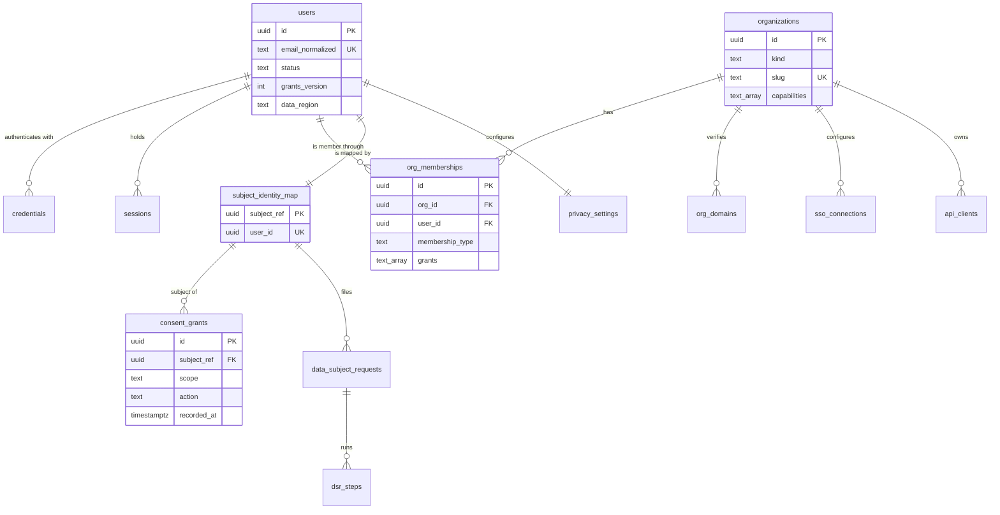

#### 4.2 Profile, evidence and verification

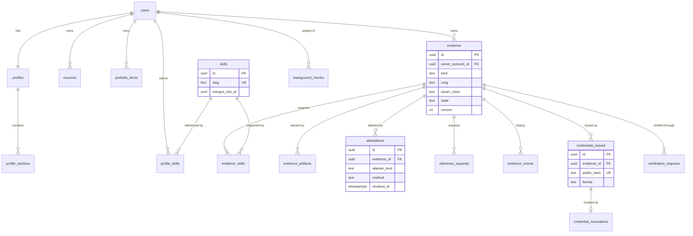

#### 4.3 Learning

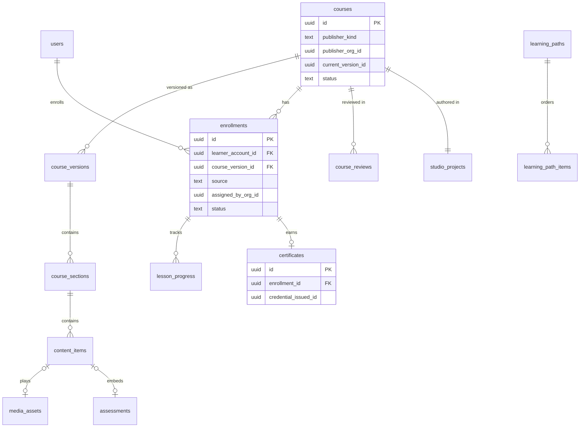

#### 4.4 Assessment

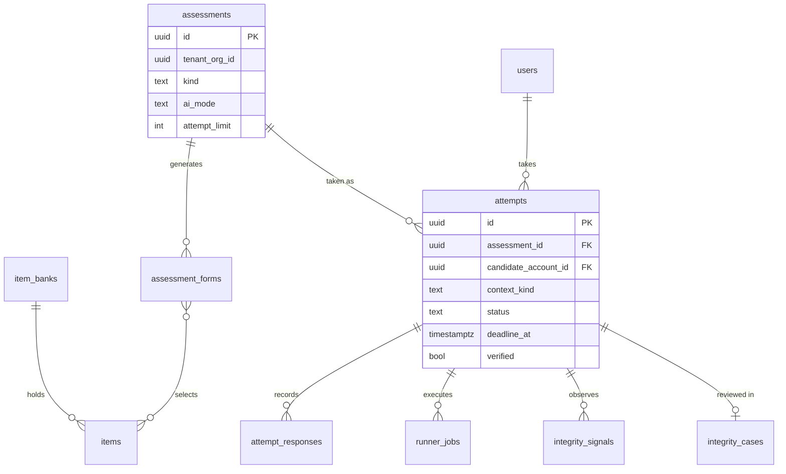

#### 4.5 Hiring

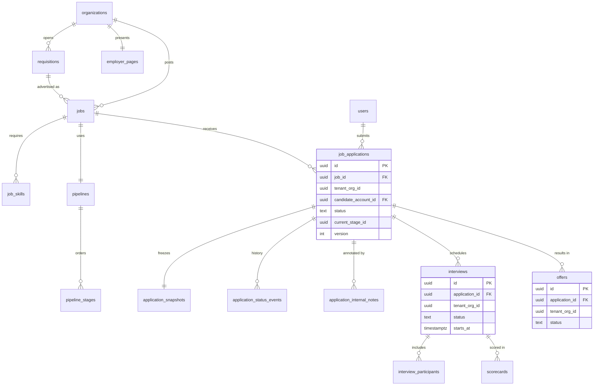

#### 4.6 Social, messaging and notifications

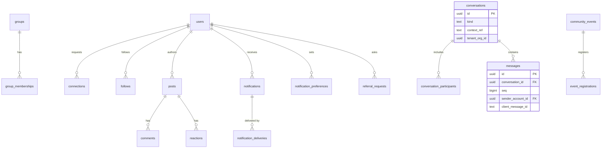

#### 4.7 Institutions and enterprise

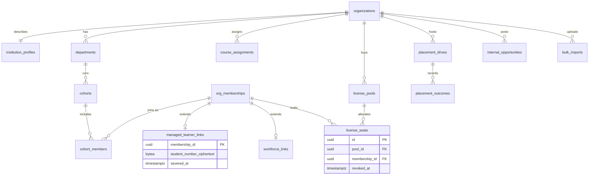

#### 4.8 Billing and entitlements

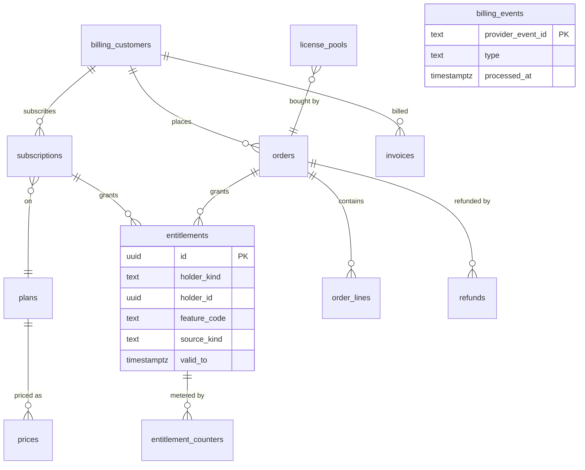

#### 4.9 Platform, audit and async infrastructure

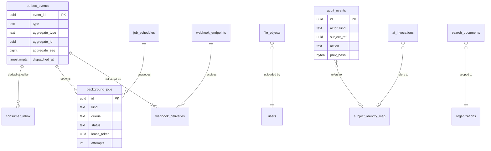

#### 4.10 Career services and OS expansion

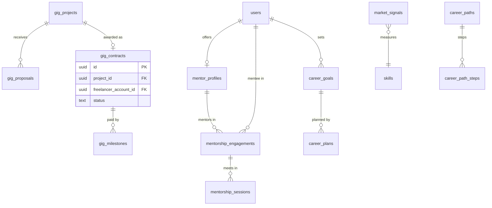

### 5. Versioning and audit trail

| Mechanism                 | Applies to                                                                                                                                                                                  | Design                                                                                                                                                                                                                                               |
| ------------------------- | ------------------------------------------------------------------------------------------------------------------------------------------------------------------------------------------- | ---------------------------------------------------------------------------------------------------------------------------------------------------------------------------------------------------------------------------------------------------- |
| Optimistic version        | Every mutable aggregate root                                                                                                                                                                | `version` column (D-04); ETag in API; `412` on mismatch                                                                                                                                                                                              |
| Immutable versions        | Published course versions, assessment forms, job descriptions at the moment of application (inside `application_snapshots`), offer documents, policy and terms versions, prompt versions    | A new row per version; old rows never updated; references point at the version id, not the head                                                                                                                                                      |
| Domain history            | Evidence (`evidence_events`), applications (`application_status_events`), consent (`consent_grants` ledger), moderation (`moderation_actions`), reputation and XP ledgers, AI budget ledger | Append-only, `subject_ref` instead of account id, written in the same transaction as the state change by the owning use case                                                                                                                         |
| Security audit            | Authentication events, policy denials, sensitive allows, admin and support actions, configuration and flag changes, data exports, key rotations                                             | `audit_events` written through the outbox (inline consumer) so the audit write commits or retries with the business change; hash chain (`prev_hash`) per monthly partition detects tampering; reads by SAD and by org admins for their tenant subset |
| Provider event log        | Stripe, background-check, media and email provider callbacks                                                                                                                                | Raw payload digest plus normalized fields; dedupe by provider event id (`billing_events` pattern) [SRC: migration 00052]                                                                                                                             |
| Database-level protection | Append-only tables                                                                                                                                                                          | `ts_app` and `ts_worker` have `INSERT` and `SELECT` only; `UPDATE`/`DELETE` revoked; retention drops whole partitions as `ts_owner`                                                                                                                  |

As-built input: two audit stores exist (`audit_logs`, `admin_audit_logs`) and the observability package has a separate audit interface, with coverage not established [SRC: ARCHITECTURE.md R-6]. Target: one `audit_events` store; the older tables are migrated into it and retired (§9).

### 6. Indexing and partitioning guidance

#### 6.1 Indexing rules

| Rule | Statement                                                                                                                                                                                                                          |
| ---- | ---------------------------------------------------------------------------------------------------------------------------------------------------------------------------------------------------------------------------------- |
| I-01 | Every tenancy column leads an index that matches the module's main list query, for example `jobs (tenant_org_id, status, published_at desc, id)`.                                                                                  |
| I-02 | Every cursor-paginated list has a composite index on its sort key tuple ending in `id` ([03 §6](#03--api-design)).                                                                                                                |
| I-03 | Business uniqueness uses partial unique indexes on the active state, for example `job_applications (job_id, candidate_account_id) where status not in (terminal states)` [SRC: as-built partial unique index, ARCHITECTURE.md §8]. |
| I-04 | Foreign keys used in joins or cascades are indexed.                                                                                                                                                                                |
| I-05 | Search uses GIN on `search_documents.tsv`, GIN trigram on `title_trgm`, and HNSW on `embedding` per `doc_type` partition ([07 §1](#07--search-media-and-realtime-architecture)).                                                      |
| I-06 | JSONB columns are not indexed unless a module spec names the query; then use expression indexes on the specific key.                                                                                                               |
| I-07 | Queue claim index: `background_jobs (queue, run_after) where status in ('queued','retry_wait')` [DER from as-built `idx_background_jobs_claim`].                                                                                   |
| I-08 | New indexes on large tables are created `CONCURRENTLY` in a migration of their own.                                                                                                                                                |

#### 6.2 Partitioning candidates

Partitioning is introduced per table at the trigger in [01 §21](#01--system-architecture) (S5), except where retention by partition drop is needed from the start.

| Table                                  | Strategy                                                                                  | From day one? | Reason                                         |
| -------------------------------------- | ----------------------------------------------------------------------------------------- | ------------- | ---------------------------------------------- |
| `outbox_events`, `consumer_inbox`      | Range by day                                                                              | Yes           | RC-OPS-SHORT retention by partition drop       |
| `idempotency_records`                  | Range by day, split by retention class (`short`, `queued`)                                | Yes           | [SRC: BE-01-R2 §4]                             |
| `audit_events`                         | Range by month                                                                            | Yes           | Hash chain per partition; archive by detach    |
| `analytics_events`                     | Range by day                                                                              | Yes           | Volume and 13-month retention                  |
| `background_jobs`                      | Range by `created_at` month for terminal rows (active rows stay in the default partition) | At trigger    | Claim performance                              |
| `messages`                             | Hash by `conversation_id`                                                                 | At trigger    | Volume; queries are per conversation           |
| `notifications`                        | Range by month                                                                            | At trigger    | 180-day retention                              |
| `search_documents`                     | List by `doc_type`                                                                        | Yes           | Separate vector indexes and analyzers per type |
| `integrity_signals`, `lesson_progress` | Range by month                                                                            | At trigger    | High write rate                                |

### 7. Soft delete and erasure strategy

#### 7.1 Deletion vocabulary

| Term        | Meaning                                                                                                                                                                                                                           |
| ----------- | --------------------------------------------------------------------------------------------------------------------------------------------------------------------------------------------------------------------------------- |
| Hide        | User-visible removal; row kept (`hidden_at`); reversible by the owner. Example: archive a resume.                                                                                                                                 |
| Soft delete | `deleted_at` set; excluded from all reads by policy; hard-deleted by sweep after `retention.soft_delete_days` (default 30 [PROP]). Used where undo is promised.                                                                   |
| Tombstone   | Row kept with personal fields nulled and `tombstoned_at` set, because other records reference it and the reference must stay meaningful (for example a message in a group conversation becomes "Message from a deleted account"). |
| Hard delete | Row removed.                                                                                                                                                                                                                      |
| Severance   | Institution-specific disposition at graduation: the managed-learner link is closed, the institution keeps its RC-EDU record, the person keeps their personal copy [SRC: V61-27, SSOT §15.9.4].                                    |

#### 7.2 Erasure workflow (DEC-ARC-022)

1. The person requests erasure (`data_subject_requests.kind = 'erasure'`) after step-up authentication. The account moves to `pending_erasure`; sign-in is limited to cancelling during the cooling-off window (`dsr.erasure_cooling_off_days`, default 7 [SRC: V61-07 target proposal]; OD-ARC-17).
2. After cooling-off, SET creates one `dsr_steps` row per registered `ErasureParticipant` (every module that owns OWN-PERSON or SHARED-PARTY data). Each participant runs as a `set.erasure.step` job, idempotently, and reports a disposition per table: `hard_deleted`, `tombstoned`, `retained_legal_hold`, `retained_counterparty` (for example the employer's RC-HIRING record of an application, with the candidate's personal fields removed from the employer view unless law requires retention) or `pseudonymized_financial`.
3. When all steps succeed, SET deletes the `subject_identity_map` row. From then on every append-only history row that carries the `subject_ref` is unlinkable to the person [SRC: V61-19].
4. A post-erasure sweep job searches search documents, caches, object storage prefixes and job payloads for the account id and email hash and records the result on the request.
5. Backups age out under the backup retention policy; restored backups replay the erasure log before serving traffic [DER].
6. Deadline: completion within `dsr.erasure_due_days` of the request (default 30 [SRC: V61-07]); overdue steps page the privacy owner.

Whether a tombstoned or pseudonymized record counts as anonymous data is a legal question (OD-ARC-17).

### 8. Row-level security approach

1. RLS is enabled on every table, including PLATFORM tables (deny-by-default with explicit grants), resolving SSOT's "applicable tables" versus "every table" wording in favor of every table [SRC: SSOT §14.4 open note].
2. Policies are generated per ownership class from `ownership.ts` declarations:

| Ownership class   | `SELECT` policy                                                                                                                                                  | Write policy                                                                                      |
| ----------------- | ---------------------------------------------------------------------------------------------------------------------------------------------------------------- | ------------------------------------------------------------------------------------------------- |
| OWN-PERSON        | `owner_account_id = app_account_id()` or (`app_has_consent(owner, scope, audience)` for declared shared projections) or `app_support_grant_allows(owner, scope)` | `owner_account_id = app_account_id()` or `app_principal_kind() = 'system'` with job tenant claim  |
| OWN-ORG           | `app_has_org_grant(tenant_org_id, '<mod>.<resource>.read')`                                                                                                      | `app_has_org_grant(tenant_org_id, '<mod>.<resource>.write')`                                      |
| SHARED-PARTY      | person-side predicate or org-side predicate; org-internal child tables use OWN-ORG                                                                               | per side, plus state rules enforced by `SECURITY DEFINER` transition functions [SRC: BE-01-R2 §9] |
| PLATFORM          | `app_is_platform_staff('<scope>')`; public subsets only through `pv_` views                                                                                      | platform staff scope or system                                                                    |
| PUBLIC-PROJECTION | `true` on the view, which selects only columns marked DC-PUBLIC                                                                                                  | none (views are read-only)                                                                        |

3. Helper functions are `STABLE`, read only transaction-local settings, and are covered by unit tests in SQL.
4. Policy tests: the generated cross-tenant suite (01 §8.5 item 5) plus per-module allow and deny cases from the module permission matrices.
5. As-built input: `00047_private_data_rls_hardening`, `00048`, `00053` and `00055` already add policies and grants for some tables [SRC: migrations]. They are kept and folded into the generator's output when each table is regenerated.

### 9. Migration policy

| Rule  | Statement                                                                                                                                                                                          | Source                                          |
| ----- | -------------------------------------------------------------------------------------------------------------------------------------------------------------------------------------------------- | ----------------------------------------------- |
| MG-01 | Migrations are SQL files in `supabase/migrations`, contiguous five-digit sequence, applied by `pnpm db:migrate`; nothing claims a migration ran that did not                                       | [SRC: ARCHITECTURE.md INVARIANT-009; CLAUDE.md] |
| MG-02 | Forward-only in production; a mistake is fixed by a new migration                                                                                                                                  | [SRC: SSOT CON-013]                             |
| MG-03 | Expand, migrate, contract: add nullable column or new table → deploy code that writes both → backfill in a job → switch reads → drop old structure in a later release after one deprecation window | [DER]                                           |
| MG-04 | No migration takes a lock longer than `migration.max_lock_ms` (default 2000 [PROP]); long operations run as jobs or `CONCURRENTLY`                                                                 | [DER]                                           |
| MG-05 | Every migration that creates or alters a table updates the module `ownership.ts` declaration; CI regenerates RLS policies and the cross-tenant suite                                               | [PROP]                                          |
| MG-06 | State `CHECK` lists come from the state-machine source; a changed machine produces a migration diff in the same pull request                                                                       | [SRC: V61-18]                                   |
| MG-07 | Renaming an as-built table is avoided; if needed, create the new table, dual-write, then retire the old one                                                                                        | [DER]                                           |
| MG-08 | Data backfills are idempotent jobs with progress rows, not migration statements, when they touch more than `migration.inline_backfill_max_rows` rows (default 10,000 [PROP])                       | [DER]                                           |
| MG-09 | The `persistence-honesty` and `database-migrations` tests remain release gates and are never weakened                                                                                              | [SRC: CLAUDE.md Rules]                          |
| MG-10 | Hosted environments use the repository's runner or its gated adapter, never `supabase db push`                                                                                                     | [SRC: ARCHITECTURE.md §23]                      |

### 10. Open decisions and risks

| Id        | Question                                                                           | Options                                                          | Default proposal                                                                                        | Who decides                  | Blocking                       |
| --------- | ---------------------------------------------------------------------------------- | ---------------------------------------------------------------- | ------------------------------------------------------------------------------------------------------- | ---------------------------- | ------------------------------ |
| OD-ARC-16 | Legal retention durations per retention class                                      | Defaults in §2.2; counsel-set per jurisdiction                   | Use §2.2 defaults in non-production; counsel sets production values [DEC-REQ] (legacy OPEN-08)          | Counsel with product owner   | Production launch; sweep jobs  |
| OD-ARC-17 | Erasure clocks and whether tombstoned or pseudonymized records satisfy erasure law | 7-day cooling-off plus 30-day completion; 30-day cancel window   | 7-day cooling-off, 30-day completion, counterparty and financial retention as listed [DEC-REQ] (V61-07) | Counsel and privacy owner    | SET erasure build              |
| OD-ARC-18 | Person-owned rows reference `users.id` or `profiles.id` (SSOT §14.4 open)          | Account id; profile id                                           | Account id (`owner_account_id`) everywhere; `profiles` is 1:1 [DEC-REQ]                                 | Architect                    | All person-owned tables        |
| OD-ARC-19 | Retire or absorb the as-built intelligence experiment tables (§3.11)               | Absorb into AIC, MKT, REP, EMP; archive and drop                 | Decide per table in `11_LEGACY_DISPOSITION` with a moving migration [DEC-REQ]                           | Product owner                | Cleanup migrations             |
| OD-ARC-20 | Credential format for issued credentials                                           | Open Badges 3.0; W3C Verifiable Credentials 2.0; signed PDF only | Open Badges 3.0 (which uses the VC data model) plus PDF rendering [DEC-REQ]                             | Product owner with EVD owner | EVD issuance, INS certificates |

| Id         | Risk                                                                                       | Likelihood | Impact | Mitigation                                                                                   | Owner role       |
| ---------- | ------------------------------------------------------------------------------------------ | ---------- | ------ | -------------------------------------------------------------------------------------------- | ---------------- |
| RSK-ARC-13 | `subject_ref` indirection is bypassed by a developer storing account ids in history tables | Medium     | High   | Lint on append-only tables for `*_account_id` columns; schema review checklist               | Database lead    |
| RSK-ARC-14 | Generated RLS policies become slow on SHARED-PARTY tables with complex predicates          | Medium     | Medium | Denormalize `tenant_org_id` and `owner_account_id` onto child rows; explain-plan tests in CI | Database lead    |
| RSK-ARC-15 | Field encryption blocks needed queries (for example search by student number)              | Medium     | Medium | Store a keyed blind index (HMAC) beside ciphertext for equality lookups only                 | Security officer |

### 11. Legacy source trace

| Source                                                                                            | Used for                                                                                    | Changed                                                                                   |
| ------------------------------------------------------------------------------------------------- | ------------------------------------------------------------------------------------------- | ----------------------------------------------------------------------------------------- |
| `supabase/migrations/00001…00055`                                                                 | As-built table names and columns, `background_jobs` schema, billing and feature-flag tables | Target adds tenancy, version and region columns; consolidates audit stores                |
| SSOT §14.1–§14.6                                                                                  | Canonical core tables, operational clusters, RLS model and generator                        | Table count is not a product invariant [SRC: SSOT §14]; clusters regrouped by module code |
| SSOT §15.5, §15.9, §16.5                                                                          | Field encryption, privacy matrix, data classes                                              | Classes reused as DC-\* labels                                                            |
| `Yash_Final_Project_Document/12_DATA_AND_DATABASE/PHYSICAL_DESIGN*.md` via SSOT Appendix E V61-19 | `subject_ref` and `subject_identity_map` erasure model                                      | Kept                                                                                      |
| BE-01-R2 §4, §6, §9                                                                               | Idempotency store, `pv_consent_current`, SQL transition functions                           | Kept                                                                                      |

## 03 — API Design

_Former file: `PRODUCT_BLUEPRINT/04_ARCHITECTURE/03_API_DESIGN.md`._

Status: **Proposed target** API standard and route catalog for all 30 modules. As-built routes exist under `/api/v1` in `apps/api/src/server.ts`; their authoritative list is [docs/engineering/API_CONTRACTS.md](../engineering/API_CONTRACTS.md) [SRC: ARCHITECTURE.md §14]. The catalog below is the target; where a target path differs from an as-built path, the as-built route keeps working through the deprecation process in §8. API capability ids (`API-<MOD>-nn`) are assigned in module specifications; this file fixes the conventions and the route shapes they must follow.

Decision basis: DEC-ARC-018 (style), DEC-ARC-004 (contracts), DEC-ARC-025 (partner API) in [01 §22](#01--system-architecture). Open: OD-ARC-02 (envelope and pagination), OD-ARC-14 (deprecation windows).

### 1. API surfaces

| Surface                   | Base path                                  | Clients                                                                        | Auth                                                      | Stability                                                  |
| ------------------------- | ------------------------------------------ | ------------------------------------------------------------------------------ | --------------------------------------------------------- | ---------------------------------------------------------- |
| First-party API           | `/api/v1`                                  | React PWA, browser extension                                                   | Session cookie plus CSRF header; extension device session | Additive changes freely; breaking changes through §8       |
| Partner API               | `/api/public/v1`                           | Customer and partner servers (ATS, HRIS, LMS, job boards)                      | OAuth 2.0 client credentials, organization-scoped         | Stricter window (§8); separate OpenAPI document            |
| Inbound provider webhooks | `/api/v1/webhooks/<provider>`              | Stripe, email provider, background-check vendor, media provider, calendar push | Provider signature over raw body                          | Provider-defined                                           |
| SCIM                      | `/scim/v2`                                 | Enterprise and institution identity providers                                  | Per-connection bearer token (hash stored)                 | SCIM 2.0                                                   |
| LTI                       | `/lti/1.3/*`                               | Institution LMS platforms                                                      | LTI 1.3 signed launches                                   | LTI spec                                                   |
| Realtime                  | `/rt`                                      | PWA                                                                            | Session cookie on upgrade                                 | Channel contract §12                                       |
| Health                    | `/health` (liveness), `/ready` (readiness) | Load balancer, monitors                                                        | None; exempt from rate limits; no data                    | As-built routes exist [SRC: server.ts `/health`, `/ready`] |
| Telemetry proxy           | `/otlp`                                    | PWA                                                                            | Session optional; fixed upstream; allowlisted schema      | [SRC: BE-01-R2 §7]                                         |

Browser traffic is same-origin: the CDN routes `/api`, `/rt` and `/otlp` to the backend so no CORS allowlist is needed for the PWA [SRC: API-STD §1 principle 5]. Partner calls are server-to-server and also need no browser CORS.

### 2. Style rules

| Id   | Rule                                                                                                                                                                                                                                                                                                              |
| ---- | ----------------------------------------------------------------------------------------------------------------------------------------------------------------------------------------------------------------------------------------------------------------------------------------------------------------- |
| A-01 | Paths are lowercase plural nouns, kebab-case for multiple words (`saved-searches`), at most two levels of nesting below a tenant (`/orgs/{orgId}/jobs/{jobId}`). Ids in paths are opaque UUIDs or public slugs.                                                                                                   |
| A-02 | `me` is the only alias and means the authenticated account. Person-owned resources live under `/me/...`. Organization-owned resources live under `/orgs/{orgId}/...`. Platform operations live under `/admin/...`. Public reads have top-level paths (`/jobs`, `/courses`, `/profiles/{slug}`, `/verify/{hash}`). |
| A-03 | CRUD uses HTTP methods. A state transition is `POST` to a noun naming its result: `/publication`, `/closure`, `/withdrawal`, `/stage-transitions`, `/acceptance`, `/decision`. No verbs in paths except protocol endpoints under `/auth` [SRC: API-STD §2].                                                       |
| A-04 | JSON bodies, `camelCase` fields, RFC 3339 UTC timestamps with `Z`, dates `YYYY-MM-DD`, enums lowercase `snake_case` strings, money `{amountMinor, currency}`. Absent field means not provided or not visible; `null` means known empty.                                                                           |
| A-05 | Unknown request fields are rejected (`422 validation-failed`). Response fields are additive; clients must tolerate unknown fields and unknown enum values.                                                                                                                                                        |
| A-06 | Fields hidden by policy obligations are omitted, never nulled, and their absence reveals nothing [SRC: API-STD §2 Masking].                                                                                                                                                                                       |
| A-07 | Request body maximum is 1 MB JSON; files never travel through JSON (§11).                                                                                                                                                                                                                                         |
| A-08 | `PATCH` uses JSON Merge Patch on documented fields; `PUT` replaces a whole sub-resource. Both require `If-Match` on versioned resources.                                                                                                                                                                          |
| A-09 | No client-supplied field selection or `expand`; each representation is policy-evaluated as a whole.                                                                                                                                                                                                               |
| A-10 | Every route is declared in the module route registry with: policy action, rate-limit class, idempotency mode, pagination mode, data class of response, `x-audience` (`first_party`, `partner`, `both`).                                                                                                           |

### 3. Authorization scope notation

Each catalog row has an **Auth** value:

| Notation        | Meaning                                                                                                                                                                                          |
| --------------- | ------------------------------------------------------------------------------------------------------------------------------------------------------------------------------------------------ |
| `pub`           | No session required. Responses contain DC-PUBLIC data only. Cacheable at the CDN when the route says so.                                                                                         |
| `pub/ses`       | Works without a session; a session personalizes the response (for example "saved" flags) and disables shared caching.                                                                            |
| `ses`           | Any authenticated account. The resource is the caller's own (`/me`) or policy checks the resource.                                                                                               |
| `org:<grant>`   | Caller has a membership in `{orgId}` carrying `<grant>` (for example `org:ats.application.move_stage`).                                                                                          |
| `plat:<scope>`  | Platform staff with the named scope (MOD, SUP, FIN, PAD, SAD per CONVENTIONS §5).                                                                                                                |
| `svc:<scope>`   | Service principal token with the scope, for the organization the token is bound to.                                                                                                              |
| `tok:<purpose>` | A single-use capability token in the path or body (referee, invitation, scheduling link, unsubscribe). Invalid, expired and consumed tokens return an indistinguishable `404` [SRC: API-STD §4]. |
| `+su`           | Step-up: `recent_auth_at` within `auth.step_up_max_age_minutes`, else `403 step-up-required`.                                                                                                    |
| `+c:<scope>`    | Requires a live consent grant (for example `+c:application.share_snapshot`), else `403 consent-required` or omission per route.                                                                  |

Policy action names follow `<mod>.<resource>.<verb>` ([01 §9](#01--system-architecture)). The grant in `org:` is the policy action unless stated.

### 4. Idempotency

| Notation      | Meaning                                                                                                                                         |
| ------------- | ----------------------------------------------------------------------------------------------------------------------------------------------- |
| `K!`          | `Idempotency-Key` header required (`428 precondition-required` if missing). Used for money, legal effect, irreversible or high-cost operations. |
| `K`           | `Idempotency-Key` accepted; strongly recommended for client retries.                                                                            |
| `N(<key>)`    | Natural idempotency: the named key makes a repeat a no-op returning the existing resource (for example `PUT /me/saved-jobs/{jobId}`).           |
| `X(<reason>)` | Not idempotent by design, with reason (credential submission, token consumption).                                                               |
| `—`           | Safe method.                                                                                                                                    |

Semantics [SRC: BE-01-R2 §4; API-STD §8]: scope is principal plus key (anonymous routes scope by hashed IP); same key and identical request returns the stored response with `Idempotency-Replayed: true`; same key with a different body or route returns `422 idempotency-key-reuse`; a concurrent duplicate returns `409 idempotency-in-flight` with `Retry-After`. Keys are 16–64 characters, generated once per user intent and reused on every retry. Retention: 24 hours default, 7 days for payment-adjacent routes, 14 days for routes that accept offline-queued writes. Business uniqueness (for example one active application per job) is enforced by database constraints, not by the key.

### 5. Pagination, filtering, sorting

| Rule                           | Detail                                                                                                                                                                                                                      |
| ------------------------------ | --------------------------------------------------------------------------------------------------------------------------------------------------------------------------------------------------------------------------- |
| Style                          | Keyset cursor: `?limit=1..100&cursor=<opaque>`; default limit 25 [SRC: API-STD §6] (SSOT default 20, OD-ARC-02)                                                                                                             |
| Response                       | `{ "items": [...], "page": { "nextCursor": "…" or null, "hasMore": bool, "limit": n } }`                                                                                                                                    |
| Cursor                         | Opaque, HMAC-signed, contains sort tuple, filter hash, principal hash and issue time; valid `api.cursor_ttl_hours` (default 24); a cursor reused with other filters or by another principal returns `400 malformed-request` |
| Order                          | Every list has a documented total order ending in `id`; `sort` accepts a per-route allowlist (`sort=-publishedAt`)                                                                                                          |
| Totals                         | None by default; a route may expose `page.estimatedTotal` capped at `api.estimated_total_cap` (default 1000 [PROP]) where the UI needs it                                                                                   |
| Filters                        | Named query parameters; repeated for multiple values; ranges `<field>From`/`<field>To`; free text `q` (max 200 characters); unknown filters `422`                                                                           |
| Pagination notation in catalog | `C` cursor list; `B` bounded list (maximum size stated in the module spec); `—` single resource                                                                                                                             |

### 6. Concurrency and caching

| Topic           | Rule                                                                                                                                                                                                                                                          |
| --------------- | ------------------------------------------------------------------------------------------------------------------------------------------------------------------------------------------------------------------------------------------------------------- |
| ETag            | Every versioned resource returns a strong `ETag` derived from `version`.                                                                                                                                                                                      |
| `If-Match`      | Required on `PATCH`, `PUT` and state-transition routes of versioned resources; missing returns `428 precondition-required`, stale returns `412 precondition-failed` with the current `ETag` [SRC: SSOT CON-012]. Marked **IM** in the catalog.                |
| `If-None-Match` | Supported on `GET`; returns `304`.                                                                                                                                                                                                                            |
| Cache-Control   | Sensitive classes (`/me/privacy*`, billing, verification, tokens, background checks): `private, no-store`. Other personal reads: `private, max-age=0, must-revalidate`. Public catalogs: `public, max-age=60, stale-while-revalidate=300` [SRC: API-STD §10]. |

### 7. Error model

#### 7.1 Target: RFC 9457 problem details

`Content-Type: application/problem+json`. Body: `{ type, title, status, detail?, instance?, code, traceId, requestId, retryAfterSeconds?, errors?: [{ pointer, code, message }] }`. `type` is a stable URI `https://errors.<api-domain>/<code>`; `code` repeats the slug [SRC: API-STD §5; SSOT CON-001].

| Code                       | Status | When                                                                                   |
| -------------------------- | ------ | -------------------------------------------------------------------------------------- |
| `malformed-request`        | 400    | Unparseable JSON, bad cursor, bad header                                               |
| `unauthenticated`          | 401    | No or expired session or token                                                         |
| `entitlement-required`     | 402    | Plan, seat or quota does not permit the action; body names the entitlement code        |
| `forbidden`                | 403    | Visible resource, action denied by policy                                              |
| `consent-required`         | 403    | Required consent scope absent or revoked                                               |
| `ai-prohibited`            | 403    | Caller is in an `AI_PROHIBITED` assessment session                                     |
| `step-up-required`         | 403    | Recent authentication needed; body lists acceptable methods                            |
| `grant-required`           | 403    | Support access requires a live grant                                                   |
| `account-restricted`       | 403    | Sanction or account status blocks the action; body names the appeal route              |
| `not-found`                | 404    | Missing or not visible to the caller                                                   |
| `conflict`                 | 409    | Generic uniqueness or state conflict                                                   |
| `state-transition-invalid` | 409    | Not allowed by the state machine [SRC: BE-01-R2 §3.4]                                  |
| `duplicate-application`    | 409    | Active application already exists                                                      |
| `reapply-cooldown-active`  | 409    | Re-application window not reached                                                      |
| `idempotency-in-flight`    | 409    | Same key still running                                                                 |
| `gone`                     | 410    | Expired export, link, closed job where the spec says so                                |
| `precondition-failed`      | 412    | Stale `If-Match`                                                                       |
| `payload-too-large`        | 413    | Body or declared upload size over cap                                                  |
| `unsupported-media-type`   | 415    | Content type not allowlisted                                                           |
| `validation-failed`        | 422    | Schema or business validation; `errors[]`                                              |
| `idempotency-key-reuse`    | 422    | Key reused with a different request                                                    |
| `account-locked`           | 423    | Throttled sign-in                                                                      |
| `precondition-required`    | 428    | Missing `If-Match` or required key                                                     |
| `rate-limited`             | 429    | Rate class exceeded; `Retry-After`                                                     |
| `quota-exceeded`           | 429    | Business quota for the period used up (outreach, AI budget); body names the reset time |
| `internal`                 | 500    | Unexpected; message masked in deployed modes [SRC: ARCHITECTURE.md §19]                |
| `upstream-unavailable`     | 503    | Dependency breaker open; never a false success                                         |
| `upstream-timeout`         | 504    | Dependency timeout                                                                     |

#### 7.2 Transition from the as-built envelope

As-built errors are `{ error: { code, message, request_id, details? } }` rendered by one global handler [SRC: `packages/contracts/src/index.ts` `ErrorEnvelopeSchema`; ARCHITECTURE.md INVARIANT-004]. Until OD-ARC-02 closes: (1) the global handler is the only place either shape is produced; (2) new routes and the partner API emit RFC 9457; (3) existing first-party routes switch per module when the web client's `apiJson` accepts both shapes; (4) `request_id` is kept as `requestId` in the new shape so support workflows do not change.

### 8. Versioning and deprecation

| Rule                  | Detail                                                                                                                                                                                                             |
| --------------------- | ------------------------------------------------------------------------------------------------------------------------------------------------------------------------------------------------------------------ |
| Major version in path | `/api/v1`, `/api/public/v1`. A `v2` only for unavoidable breaking change; both run side by side.                                                                                                                   |
| Compatible changes    | Add optional request field, response field, endpoint, enum value (clients tolerate unknown values), problem code; loosen validation.                                                                               |
| Breaking changes      | Remove or rename field, tighten validation, change type, semantics, default sort, auth or idempotency semantics. Detected by `oasdiff` in CI; a breaking diff on a live version fails the build [SRC: API-STD §3]. |
| Deprecation signal    | `Deprecation`, `Sunset` and `Link: <doc>; rel="deprecation"` headers; usage telemetry per route and client version.                                                                                                |
| Windows               | First-party: `api.deprecation_days.first_party` default 90 [SRC: API-STD §3] versus SSOT ≥ 6 months [SRC: SSOT §12.18] (OD-ARC-14). Partner: `api.deprecation_days.partner` default 365 [PROP].                    |
| Client floor          | `GET /api/v1/app/version-policy` returns the minimum supported PWA build; older installed PWAs show an update prompt instead of failing silently [PROP].                                                           |

### 9. Rate-limit classes

Values are configuration starting points, not measurements [SRC: API-STD §9; BE-01-R2 §5].

| Class      | Applies to                                                           | Default limit                                                                                   | Key                      | Counter store                              |
| ---------- | -------------------------------------------------------------------- | ----------------------------------------------------------------------------------------------- | ------------------------ | ------------------------------------------ |
| RL-AUTH    | Sign-in, register, password reset, email challenges, passkey options | 20 per 10 min per IP prefix; 10 per 15 min per account identifier; progressive delay then `423` | IP prefix and identifier | Durable `auth_throttle` (Redis at trigger) |
| RL-TOKEN   | Capability-token routes                                              | 30 per 10 min per IP; 10 per hour per token hash                                                | IP, token hash           | Durable                                    |
| RL-READ    | Authenticated reads                                                  | 600 per min per principal                                                                       | Principal                | In-process bucket per replica              |
| RL-WRITE   | Authenticated writes                                                 | 120 per min per principal                                                                       | Principal                | In-process                                 |
| RL-HEAVY   | Search, recommendations, AI, exports, analytics reports              | 30 per min and 300 per hour per principal; 600 per hour per organization                        | Principal, organization  | In-process plus business budgets           |
| RL-PUBLIC  | Anonymous reads                                                      | 120 per min per IP prefix; CDN absorbs cacheable traffic                                        | IP prefix                | Edge plus in-process                       |
| RL-PARTNER | Partner API                                                          | 1200 per min per API client [PROP]                                                              | API client               | In-process; Redis at trigger               |
| RL-WEBHOOK | Inbound provider webhooks                                            | No quota; signature first; max 50 concurrent per provider                                       | Provider                 | n/a                                        |

Responses carry `RateLimit-Policy`, `RateLimit` and, on 429, `Retry-After`. As-built: `@fastify/rate-limit` global plugin with per-route overrides (for example 60 per minute) [SRC: server.ts]. Business quotas (outreach messages, job posts, AI budget) are entitlements, not rate classes, and return `402` or `429 quota-exceeded`.

### 10. Long-running operations

Routes that cannot finish within the request timeout (`api.request_timeout_ms`, default 10,000; AI 30,000 [SRC: SSOT CON-008]) return `202 Accepted` with a resource representing the work at a stable URL (`DataExport`, `BulkImport`, `ResumeImport`, `ReportExport`, `AiRun`, `BulkAction`). The resource has an explicit state vocabulary, `Retry-After` on polling, and a notification on completion. There is no generic `/jobs/{id}` route for product features; operators use `/admin/jobs` [SRC: API-STD §11].

### 11. File and upload API

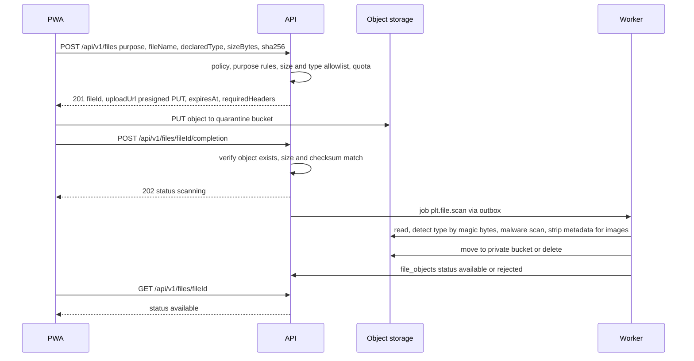

| Rule             | Detail                                                                                                                                                                                                                                                                                                  |
| ---------------- | ------------------------------------------------------------------------------------------------------------------------------------------------------------------------------------------------------------------------------------------------------------------------------------------------------- |
| Purposes         | Each `purpose` (avatar, resume, evidence_artifact, course_media, message_attachment, import, id_document, portfolio_media) defines allowed types, maximum size, data class, bucket and who may read [SRC: SSOT CON-011]. Defaults per purpose are in [07 §2](#07--search-media-and-realtime-architecture). |
| Presigned upload | Single PUT up to `files.single_put_max_bytes` (default 100 MB [PROP]); larger (video) uses multipart upload with per-part presigned URLs from `POST /files/{id}/parts`. URL lifetime `files.presign_ttl_seconds` default 900 [PROP].                                                                    |
| Fail-closed      | A file is unusable by any feature until `available`. Referencing a non-available file returns `409 conflict` with code detail `file-not-ready`.                                                                                                                                                         |
| Download         | `POST /files/{id}/download-url` after a policy check returns a short-lived signed URL on the cookieless user-content domain with `Content-Disposition: attachment` for non-media types. Public assets (avatars on public profiles) use CDN URLs of the public bucket.                                   |
| Deletion         | `DELETE /files/{id}` marks `deleted`; the object is removed by sweep unless a retention hold applies (evidence referenced by a submitted application snapshot stays for RC-HIRING).                                                                                                                     |

### 12. Realtime channels

Transport and gateway design are in [07 §3](#07--search-media-and-realtime-architecture). The API contract is:

| Channel pattern                 | Subscribers                                           | Signals                                                              | Authorization                           |
| ------------------------------- | ----------------------------------------------------- | -------------------------------------------------------------------- | --------------------------------------- |
| `user:{accountId}`              | The account's own connections                         | `notification.created`, `badge.counts`, `session.revoked`            | Account equals caller                   |
| `conversation:{conversationId}` | Participants                                          | `message.created {seq}`, `message.updated`, `typing`, `read.updated` | Active participant                      |
| `application:{applicationId}`   | Candidate; org members with `ats.application.read`    | `status.changed`, `interview.scheduled`                              | Policy on the application               |
| `interview:{interviewId}`       | Participants                                          | `state.changed`, `collab.op` (code pad operations)                   | Participant during the interview window |
| `attempt:{attemptId}`           | The candidate                                         | `deadline.updated`, `grading.completed`                              | Candidate equals caller                 |
| `org:{orgId}:pipeline:{jobId}`  | Org members with access to the job                    | `application.moved`, `application.created`                           | `ats.application.read`                  |
| `contest:{eventId}`             | Registered participants and public viewers if enabled | `leaderboard.updated {cursor}`                                       | Event visibility                        |
| `presence:org:{orgId}`          | Org staff                                             | `presence.changed`                                                   | Org membership                          |

Signal payload ≤ 4 KB: `{ type, entity, id, cursor, ts }`; never raw rows or personal free text; the client fetches details over HTTP [SRC: SSOT §13.10]. Overflow sends `refresh`. Subscriptions are re-authorized when `idn.membership.*` or `set.consent.changed` events affect the subscriber.

### 13. Webhooks

#### 13.1 Inbound

Order of operations: read raw body → verify signature and timestamp tolerance (Stripe 5 min [SRC: API-STD §4]) → insert the provider event id into the provider event table (`ON CONFLICT DO NOTHING`) → enqueue processing through the outbox → respond `2xx` within `webhook.ack_deadline_ms` (default 2,000 [PROP]). Processing never happens before the response depends on it; duplicate deliveries are no-ops [SRC: SSOT CON-007; as-built Stripe webhook ARCHITECTURE.md §8 item 5].

#### 13.2 Outbound (partner webhooks)

| Element      | Design                                                                                                                                                                                                     |
| ------------ | ---------------------------------------------------------------------------------------------------------------------------------------------------------------------------------------------------------- |
| Subscription | `webhook_endpoints` per organization with event types from the partner event list (a curated subset of domain events, never internal event payloads directly)                                              |
| Payload      | `{ id, type, version, occurredAt, orgId, data }` where `data` is a partner DTO with ids and non-sensitive facts; the receiver fetches details through the partner API under its scopes                     |
| Signature    | Header `TS-Signature: t=<unix>,v1=<hex hmac-sha256(secret, t + "." + body)>`; two active secrets during rotation [SRC: API-STD §13]                                                                        |
| Delivery     | At-least-once via `plt.webhook.deliver` jobs; retry schedule from [04 §6](#04--events-and-asynchronous-processing); endpoint disabled after `webhook.max_consecutive_failures` (default 100 [PROP]) with admin notification |
| Ordering     | Not guaranteed; `occurredAt` and resource `version` let receivers discard stale events                                                                                                                     |
| Tools        | Test delivery, delivery log (14 days), manual redelivery                                                                                                                                                   |

### 14. Contract governance

| Gate                      | Rule                                                                                                                                                                                                 |
| ------------------------- | ---------------------------------------------------------------------------------------------------------------------------------------------------------------------------------------------------- |
| Source of truth           | Zod schemas in `packages/contracts/src/<mod>/` for requests, responses, problem extensions and events.                                                                                               |
| Generation                | OpenAPI 3.1 for `/api/v1` and `/api/public/v1`, AsyncAPI 3 for events and realtime signals, JSON Schema for partner webhooks; generated in CI and committed; CI fails if the committed file differs. |
| Breaking change detection | `oasdiff` and AsyncAPI diff against the last released spec [SRC: API-STD §14].                                                                                                                       |
| Route registry lint       | Fails when a route lacks policy action, rate class, idempotency mode, pagination mode or audience; when an unsafe route has neither key nor natural key; when a list route is not cursor or bounded. |
| Contract tests            | Provider tests per route validate success and problem bodies against the schema; web client types are generated from the same schemas.                                                               |
| Security tests            | Generated IDOR matrix from module permission matrices; cross-tenant canaries; token single-use tests.                                                                                                |
| Review                    | A schema change in `packages/contracts` requires review from the owning module and from API governance (architect).                                                                                  |

### 15. Route catalog

Paths are relative to `/api/v1` unless they start with `/api/public/v1`, `/scim` or `/lti`. **IM** in Notes means `If-Match` required. Rate class is RL-READ for safe methods and RL-WRITE for unsafe methods unless Notes names another class. Each module spec owns field-level request and response definitions; this table fixes method, path, scope, idempotency and pagination.

#### 15.1 Foundation: IDN, SET, NTF

| Method                   | Path                                                | Auth                   | Idem.                        | Page. | Notes                                                                               |
| ------------------------ | --------------------------------------------------- | ---------------------- | ---------------------------- | ----- | ----------------------------------------------------------------------------------- |
| POST                     | `/auth/registrations`                               | pub                    | N(email)                     | —     | RL-AUTH; always `202` with the same body whether or not the email exists            |
| POST                     | `/auth/sessions`                                    | pub                    | X(credential submission)     | —     | Sign-in with password; sets cookies; RL-AUTH; uniform failure                       |
| DELETE                   | `/auth/sessions/current`                            | ses                    | N(session)                   | —     | Sign out                                                                            |
| POST                     | `/auth/email-verifications`                         | pub                    | N(email)                     | —     | Resend; RL-AUTH                                                                     |
| POST                     | `/auth/email-verifications/{token}/confirmation`    | tok:email_verify       | X(token)                     | —     | RL-TOKEN                                                                            |
| POST                     | `/auth/password-resets`                             | pub                    | N(email)                     | —     | RL-AUTH; uniform `202`                                                              |
| POST                     | `/auth/password-resets/{token}/completion`          | tok:password_reset     | X(token)                     | —     | Revokes all sessions                                                                |
| POST                     | `/auth/passkey-challenges`                          | pub                    | X(challenge)                 | —     | Login or registration options; RL-AUTH                                              |
| POST                     | `/auth/passkey-assertions`                          | pub                    | X(credential submission)     | —     | Passkey sign-in                                                                     |
| POST                     | `/me/passkeys`                                      | ses +su                | K                            | —     | Register passkey                                                                    |
| DELETE                   | `/me/passkeys/{passkeyId}`                          | ses +su                | N(id)                        | —     | Refused if it is the last credential                                                |
| GET                      | `/auth/federation/{provider}/start`                 | pub                    | —                            | —     | OIDC redirect with state and PKCE                                                   |
| GET                      | `/auth/federation/{provider}/callback`              | pub                    | X(state)                     | —     | Links only to an account proven by the user                                         |
| GET                      | `/auth/sso/{orgSlug}/start`                         | pub                    | —                            | —     | Org OIDC or SAML                                                                    |
| POST                     | `/auth/sso/{orgSlug}/saml-acs`                      | pub                    | X(assertion id replay cache) | —     | SAML assertion consumer                                                             |
| GET                      | `/me`                                               | ses                    | —                            | —     | Account, memberships, CSRF token                                                    |
| GET                      | `/me/capabilities`                                  | ses                    | —                            | —     | `?resource=type:id`; UI hints only                                                  |
| GET                      | `/me/sessions`                                      | ses                    | —                            | B     | Active sessions and devices                                                         |
| DELETE                   | `/me/sessions/{sessionId}`                          | ses                    | N(id)                        | —     |                                                                                     |
| POST                     | `/me/session-revocations`                           | ses +su                | K                            | —     | Sign out all other sessions                                                         |
| PUT                      | `/me/password`                                      | ses +su                | X(credential submission)     | —     | Revokes other sessions                                                              |
| POST                     | `/me/email-changes`                                 | ses +su                | K                            | —     | Sends confirmation to the new address                                               |
| POST                     | `/orgs`                                             | ses                    | K                            | —     | Create employer, agency or institution org; institution needs platform verification |
| GET                      | `/orgs/{orgId}`                                     | org:idn.org.read       | —                            | —     |                                                                                     |
| PATCH                    | `/orgs/{orgId}`                                     | org:idn.org.manage     | K                            | —     | IM                                                                                  |
| GET                      | `/orgs/{orgId}/members`                             | org:idn.member.read    | —                            | C     | Filter `membershipType`, `grant`, `status`                                          |
| POST                     | `/orgs/{orgId}/invitations`                         | org:idn.member.invite  | K                            | —     | Batch up to `org.invite_batch_max`                                                  |
| POST                     | `/invitations/{token}/acceptance`                   | tok:invitation + ses   | X(token)                     | —     |                                                                                     |
| PATCH                    | `/orgs/{orgId}/members/{membershipId}`              | org:idn.member.manage  | K                            | —     | IM; grant changes bump `grants_version`                                             |
| DELETE                   | `/orgs/{orgId}/members/{membershipId}`              | org:idn.member.manage  | N(id)                        | —     | Last admin cannot be removed                                                        |
| POST                     | `/orgs/{orgId}/domains`                             | org:idn.org.manage     | N(domain)                    | —     |                                                                                     |
| POST                     | `/orgs/{orgId}/domains/{domainId}/verification`     | org:idn.org.manage     | K                            | —     | DNS TXT check                                                                       |
| PUT                      | `/orgs/{orgId}/sso-connection`                      | org:idn.sso.manage +su | K                            | —     | IM                                                                                  |
| GET, POST, PATCH, DELETE | `/scim/v2/Users`, `/scim/v2/Groups`                 | svc:scim               | SCIM semantics               | SCIM  | Provisions `staff`, `learner` or `workforce` memberships                            |
| GET                      | `/me/privacy-settings`                              | ses                    | —                            | —     | `no-store`                                                                          |
| PATCH                    | `/me/privacy-settings`                              | ses                    | K                            | —     | IM                                                                                  |
| GET                      | `/me/consents`                                      | ses                    | —                            | B     | Current grants by scope and audience                                                |
| PUT                      | `/me/consents/{scope}`                              | ses                    | N(scope, audience)           | —     | Body names audience; ledger append                                                  |
| DELETE                   | `/me/consents/{scope}`                              | ses                    | N(scope, audience)           | —     | Effective at next read                                                              |
| POST                     | `/me/data-exports`                                  | ses +su                | K!                           | —     | `202`; RL-HEAVY                                                                     |
| GET                      | `/me/data-exports/{exportId}`                       | ses                    | —                            | —     | States `requested, building, ready, failed, expired`                                |
| POST                     | `/me/data-exports/{exportId}/download-url`          | ses +su                | K                            | —     | Short-lived signed URL                                                              |
| POST                     | `/me/erasure-request`                               | ses +su                | K!                           | —     | Starts cooling-off                                                                  |
| DELETE                   | `/me/erasure-request`                               | ses                    | N(request)                   | —     | Cancel during cooling-off only                                                      |
| POST                     | `/me/support-access-grants`                         | ses                    | K                            | —     | Scopes, ticket, duration                                                            |
| DELETE                   | `/me/support-access-grants/{grantId}`               | ses                    | N(id)                        | —     |                                                                                     |
| GET                      | `/me/account-activity`                              | ses                    | —                            | C     | Own audit subset                                                                    |
| GET                      | `/me/notifications`                                 | ses                    | —                            | C     | Filter `unread`, `category`                                                         |
| POST                     | `/me/notification-read-marks`                       | ses                    | N(ids)                       | —     | Bulk; `upTo` cursor variant                                                         |
| GET                      | `/me/notification-preferences`                      | ses                    | —                            | B     |                                                                                     |
| PUT                      | `/me/notification-preferences/{category}/{channel}` | ses                    | N(category, channel)         | —     | Transactional categories cannot be disabled                                         |
| POST                     | `/me/push-subscriptions`                            | ses                    | N(endpoint)                  | —     |                                                                                     |
| DELETE                   | `/me/push-subscriptions/{subscriptionId}`           | ses                    | N(id)                        | —     |                                                                                     |
| POST                     | `/unsubscriptions/{token}`                          | tok:unsubscribe        | N(token, category)           | —     | One-click unsubscribe (RFC 8058 list-unsubscribe-post)                              |

#### 15.2 Career identity: PRF, EVD, BGV, skills

| Method | Path                                                           | Auth                      | Idem.                | Page. | Notes                                                                                       |
| ------ | -------------------------------------------------------------- | ------------------------- | -------------------- | ----- | ------------------------------------------------------------------------------------------- |
| GET    | `/me/profile`                                                  | ses                       | —                    | —     | Full owner view                                                                             |
| PATCH  | `/me/profile`                                                  | ses                       | K                    | —     | IM                                                                                          |
| GET    | `/profiles/{slug}`                                             | pub/ses                   | —                    | —     | Public or audience projection; CDN-cacheable when anonymous                                 |
| POST   | `/me/profile/sections`                                         | ses                       | K                    | —     |                                                                                             |
| PATCH  | `/me/profile/sections/{sectionId}`                             | ses                       | K                    | —     | IM                                                                                          |
| DELETE | `/me/profile/sections/{sectionId}`                             | ses                       | N(id)                | —     |                                                                                             |
| PUT    | `/me/profile/section-order`                                    | ses                       | N(order)             | —     |                                                                                             |
| GET    | `/me/resumes`                                                  | ses                       | —                    | B     |                                                                                             |
| POST   | `/me/resumes`                                                  | ses                       | K                    | —     | Build from profile or attach uploaded file                                                  |
| POST   | `/me/resume-imports`                                           | ses                       | K                    | —     | `202`; parses an uploaded file into a proposed profile diff; nothing applied without review |
| POST   | `/me/resume-imports/{importId}/application`                    | ses                       | K                    | —     | Applies the reviewed diff                                                                   |
| POST   | `/me/resumes/{resumeId}/renderings`                            | ses                       | K                    | —     | `202`; PDF rendering                                                                        |
| POST   | `/me/portfolio-items`                                          | ses                       | K                    | —     |                                                                                             |
| PATCH  | `/me/portfolio-items/{itemId}`                                 | ses                       | K                    | —     | IM                                                                                          |
| DELETE | `/me/portfolio-items/{itemId}`                                 | ses                       | N(id)                | —     |                                                                                             |
| GET    | `/skills`                                                      | pub                       | —                    | B     | `q` autocomplete, max 20 results                                                            |
| GET    | `/skills/{skillId}`                                            | pub                       | —                    | —     | Follows `mergedInto`                                                                        |
| PUT    | `/me/skills/{skillId}`                                         | ses                       | N(skill)             | —     | Self level                                                                                  |
| DELETE | `/me/skills/{skillId}`                                         | ses                       | N(skill)             | —     | Evidence links remain                                                                       |
| POST   | `/skill-suggestions`                                           | ses                       | K                    | —     | Proposes a new taxonomy entry for review                                                    |
| GET    | `/me/evidence`                                                 | ses                       | —                    | C     | Filter `kind`, `rung`, `skillId`                                                            |
| POST   | `/me/evidence`                                                 | ses                       | K                    | —     | Always starts at `claimed`; `rung` is never a request field [SRC: API-STD §12]              |
| PATCH  | `/me/evidence/{evidenceId}`                                    | ses                       | K                    | —     | IM; editing verified content resets the affected rung per EVD rules                         |
| DELETE | `/me/evidence/{evidenceId}`                                    | ses                       | N(id)                | —     | Blocked while referenced by an in-flight application snapshot; snapshot keeps its copy      |
| POST   | `/me/evidence/{evidenceId}/artifacts`                          | ses                       | K                    | —     | Links an `available` file or URL                                                            |
| POST   | `/me/evidence/{evidenceId}/reference-requests`                 | ses                       | K                    | —     | Per-recipient caps                                                                          |
| GET    | `/references/{token}`                                          | tok:referee               | —                    | —     | Shows only the claim to attest; `no-store`                                                  |
| POST   | `/references/{token}/submission`                               | tok:referee               | X(token)             | —     | RL-TOKEN                                                                                    |
| POST   | `/me/evidence/{evidenceId}/work-email-challenges`              | ses                       | K                    | —     | Code sent to work address; code never returned [SRC: ARCHITECTURE.md INVARIANT-015]         |
| POST   | `/me/work-email-challenges/{challengeId}/confirmation`         | ses                       | X(code)              | —     | RL-TOKEN                                                                                    |
| GET    | `/me/credentials`                                              | ses                       | —                    | C     |                                                                                             |
| POST   | `/me/credentials/{credentialId}/share-links`                   | ses                       | K                    | —     | Expiring share link                                                                         |
| GET    | `/verify/{publicHash}`                                         | pub                       | —                    | —     | Credential verification; revocation shown; CDN short TTL, purged on revocation              |
| POST   | `/orgs/{orgId}/credential-issuances`                           | org:evd.credential.issue  | K!                   | —     | Institution or employer issues to a member; `202` for batches                               |
| POST   | `/orgs/{orgId}/credentials/{credentialId}/revocation`          | org:evd.credential.revoke | K!                   | —     | Reason code required                                                                        |
| GET    | `/admin/verification-queue`                                    | plat:evd.review           | —                    | C     |                                                                                             |
| POST   | `/admin/evidence/{evidenceId}/verification-decisions`          | plat:evd.review           | K!                   | —     | Platform-review rung change with reason                                                     |
| POST   | `/orgs/{orgId}/applications/{applicationId}/background-checks` | org:bgv.check.order       | K!                   | —     | Creates request; candidate consent required before vendor call                              |
| GET    | `/orgs/{orgId}/background-checks/{checkId}`                    | org:bgv.check.read        | —                    | —     | `no-store`; summary only                                                                    |
| POST   | `/orgs/{orgId}/background-checks/{checkId}/adjudications`      | org:bgv.check.adjudicate  | K!                   | —     | `pre_adverse` then `final` with waiting period enforced                                     |
| GET    | `/me/background-checks`                                        | ses                       | —                    | B     |                                                                                             |
| POST   | `/me/background-checks/{checkId}/consent`                      | ses +su                   | K!                   | —     | Disclosure version recorded                                                                 |
| POST   | `/me/background-checks/{checkId}/disputes`                     | ses                       | K                    | —     |                                                                                             |
| POST   | `/me/identity-verifications`                                   | ses +su                   | K                    | —     | Returns vendor session URL                                                                  |
| POST   | `/webhooks/bgv/{provider}`                                     | provider signature        | N(provider event id) | —     | RL-WEBHOOK                                                                                  |
| POST   | `/webhooks/idv/{provider}`                                     | provider signature        | N(provider event id) | —     | RL-WEBHOOK                                                                                  |

#### 15.3 Search and discovery: SRC

| Method                   | Path                                        | Auth                      | Idem.     | Page. | Notes                                                                                    |
| ------------------------ | ------------------------------------------- | ------------------------- | --------- | ----- | ---------------------------------------------------------------------------------------- |
| GET                      | `/search/jobs`                              | pub/ses                   | —         | C     | `q`, location, radius, work mode, salary, skills; RL-PUBLIC or RL-HEAVY                  |
| GET                      | `/search/courses`                           | pub/ses                   | —         | C     |                                                                                          |
| GET                      | `/search/people`                            | ses                       | —         | C     | Network search; only profiles visible to the caller                                      |
| GET                      | `/orgs/{orgId}/search/candidates`           | org:src.candidates.search | —         | C     | Requires recruiter-search entitlement; consent joined live; RL-HEAVY; each query audited |
| GET                      | `/search/suggestions`                       | pub                       | —         | B     | Typeahead across jobs, skills, companies, courses                                        |
| GET                      | `/me/saved-searches`                        | ses                       | —         | B     |                                                                                          |
| POST                     | `/me/saved-searches`                        | ses                       | K         | —     | Alert cadence                                                                            |
| PATCH                    | `/me/saved-searches/{searchId}`             | ses                       | K         | —     |                                                                                          |
| DELETE                   | `/me/saved-searches/{searchId}`             | ses                       | N(id)     | —     |                                                                                          |
| GET, POST, PATCH, DELETE | `/orgs/{orgId}/saved-searches[/{searchId}]` | org:src.candidates.search | K / N(id) | B     | Recruiter saved candidate searches                                                       |

#### 15.4 Learning and assessment: LRN, STU, ASM

| Method | Path                                                                             | Auth                                               | Idem.             | Page. | Notes                                                                                              |
| ------ | -------------------------------------------------------------------------------- | -------------------------------------------------- | ----------------- | ----- | -------------------------------------------------------------------------------------------------- |
| GET    | `/courses`                                                                       | pub/ses                                            | —                 | C     | Catalog; org-only courses visible to members                                                       |
| GET    | `/courses/{slug}`                                                                | pub/ses                                            | —                 | —     | Outline of the current version                                                                     |
| POST   | `/courses/{courseId}/enrollments`                                                | ses                                                | K                 | —     | Free, entitled or license-seat enrollment; paid courses go through checkout first; `402` otherwise |
| GET    | `/me/enrollments`                                                                | ses                                                | —                 | C     |                                                                                                    |
| GET    | `/me/enrollments/{enrollmentId}`                                                 | ses                                                | —                 | —     | Includes progress                                                                                  |
| PUT    | `/me/enrollments/{enrollmentId}/progress/{contentItemId}`                        | ses                                                | N(clientOpId)     | —     | Offline-queueable; server revalidates order and completion rules                                   |
| POST   | `/me/enrollments/{enrollmentId}/content-items/{contentItemId}/playback-sessions` | ses                                                | K                 | —     | Returns signed playback token for the media provider                                               |
| POST   | `/me/enrollments/{enrollmentId}/withdrawal`                                      | ses                                                | K                 | —     |                                                                                                    |
| GET    | `/me/certificates`                                                               | ses                                                | —                 | C     |                                                                                                    |
| GET    | `/courses/{courseId}/reviews`                                                    | pub                                                | —                 | C     |                                                                                                    |
| POST   | `/courses/{courseId}/reviews`                                                    | ses                                                | N(course, author) | —     | Only enrolled learners past `lrn.review_min_progress_pct`                                          |
| GET    | `/courses/{courseId}/discussions`                                                | ses                                                | —                 | C     | Enrolled only                                                                                      |
| POST   | `/courses/{courseId}/discussions`                                                | ses                                                | K                 | —     | Moderated                                                                                          |
| GET    | `/paths`                                                                         | pub                                                | —                 | C     |                                                                                                    |
| POST   | `/paths/{pathId}/enrollments`                                                    | ses                                                | K                 | —     |                                                                                                    |
| POST   | `/me/instructor-application`                                                     | ses                                                | K                 | —     |                                                                                                    |
| GET    | `/studio/courses`                                                                | ses (approved instructor) or org:stu.course.manage | —                 | C     |                                                                                                    |
| POST   | `/studio/courses`                                                                | ses (approved instructor) or org:stu.course.manage | K                 | —     |                                                                                                    |
| PATCH  | `/studio/courses/{courseId}/draft`                                               | course owner or collaborator                       | K                 | —     | IM; autosave                                                                                       |
| POST   | `/studio/courses/{courseId}/draft/sections`                                      | as above                                           | K                 | —     |                                                                                                    |
| PATCH  | `/studio/courses/{courseId}/draft/content-items/{itemId}`                        | as above                                           | K                 | —     | IM                                                                                                 |
| POST   | `/studio/media-assets`                                                           | as above                                           | K                 | —     | Creates `file_objects` row and media asset; returns upload instructions                            |
| POST   | `/studio/courses/{courseId}/review-submissions`                                  | course owner                                       | K                 | —     | Publishing checks run first                                                                        |
| POST   | `/admin/course-reviews/{reviewId}/decision`                                      | plat:stu.review                                    | K!                | —     | Approve or return with comments                                                                    |
| POST   | `/studio/courses/{courseId}/publication`                                         | course owner                                       | K!                | —     | Freezes a new course version                                                                       |
| GET    | `/studio/courses/{courseId}/insights`                                            | course owner                                       | —                 | —     | Aggregates above `min_cohort_k`                                                                    |
| GET    | `/assessments/{assessmentId}`                                                    | ses                                                | —                 | —     | Public description only; never items                                                               |
| POST   | `/assessments/{assessmentId}/attempts`                                           | ses                                                | K!                | —     | Starts the server timer; returns attempt and form; attempt limit enforced                          |
| GET    | `/attempts/{attemptId}`                                                          | ses (candidate)                                    | —                 | —     | `no-store`                                                                                         |
| PUT    | `/attempts/{attemptId}/responses/{itemId}`                                       | ses (candidate)                                    | N(clientSeq)      | —     | Autosave; rejected after deadline; never offline-queued                                            |
| POST   | `/attempts/{attemptId}/integrity-signals`                                        | ses (candidate)                                    | N(batchSeq)       | —     | Batched browser signals                                                                            |
| POST   | `/attempts/{attemptId}/submission`                                               | ses (candidate)                                    | K!                | —     | Moves to `submitted`; grading async                                                                |
| GET    | `/attempts/{attemptId}/result`                                                   | ses (candidate)                                    | —                 | —     | Shows `verified: false` until the runner exists                                                    |
| POST   | `/attempts/{attemptId}/appeals`                                                  | ses (candidate)                                    | K                 | —     |                                                                                                    |
| POST   | `/orgs/{orgId}/assessments`                                                      | org:asm.assessment.manage                          | K                 | —     |                                                                                                    |
| POST   | `/orgs/{orgId}/item-banks/{bankId}/items`                                        | org:asm.item.manage                                | K                 | —     | Answer keys write-only                                                                             |
| POST   | `/orgs/{orgId}/assessment-invitations`                                           | org:asm.assessment.invite                          | K                 | —     | Links an attempt to an application                                                                 |
| GET    | `/orgs/{orgId}/assessments/{assessmentId}/attempts`                              | org:asm.attempt.read                               | —                 | C     | Only attempts in the org's context                                                                 |
| POST   | `/admin/integrity-cases/{caseId}/decision`                                       | plat:asm.integrity.review                          | K!                | —     | Human decision with reason                                                                         |
| POST   | `/internal/runner-results`                                                       | runner signature                                   | N(runnerJobId)    | —     | Network-internal only; not routed from the CDN                                                     |

#### 15.5 Hiring: JOB, ATS, INT, EMP

| Method    | Path                                                           | Auth                                       | Idem.                      | Page. | Notes                                                                           |
| --------- | -------------------------------------------------------------- | ------------------------------------------ | -------------------------- | ----- | ------------------------------------------------------------------------------- |
| GET       | `/jobs`                                                        | pub/ses                                    | —                          | C     | Published jobs; CDN-cacheable anonymous                                         |
| GET       | `/jobs/{jobId}`                                                | pub/ses                                    | —                          | —     | Closed job returns `410 gone` with the closure date [SRC: SSOT §13.2 F-04 note] |
| POST      | `/orgs/{orgId}/jobs`                                           | org:ats.posting.create                     | K                          | —     | Draft; posting entitlement checked at publication                               |
| PATCH     | `/orgs/{orgId}/jobs/{jobId}`                                   | org:ats.posting.edit                       | K                          | —     | IM                                                                              |
| POST      | `/orgs/{orgId}/jobs/{jobId}/publication`                       | org:ats.posting.publish                    | K!                         | —     | May enter `pending_review` per trust rules                                      |
| POST      | `/orgs/{orgId}/jobs/{jobId}/pause`                             | org:ats.posting.publish                    | K                          | —     |                                                                                 |
| POST      | `/orgs/{orgId}/jobs/{jobId}/closure`                           | org:ats.posting.publish                    | K                          | —     | Reason; open applications handled per ATS rules                                 |
| POST      | `/jobs/{jobId}/applications`                                   | ses +c:application.share_snapshot          | K! and N(job, candidate)   | —     | Creates snapshot; `409 duplicate-application` or `409 reapply-cooldown-active`  |
| GET       | `/me/applications`                                             | ses                                        | —                          | C     | Candidate view with candidate-facing stage labels only                          |
| GET       | `/me/applications/{applicationId}`                             | ses                                        | —                          | —     |                                                                                 |
| POST      | `/me/applications/{applicationId}/withdrawal`                  | ses                                        | K                          | —     |                                                                                 |
| PUT       | `/me/application-drafts/{jobId}`                               | ses                                        | N(job)                     | —     | Offline-queueable                                                               |
| PUT       | `/me/saved-jobs/{jobId}`                                       | ses                                        | N(job)                     | —     |                                                                                 |
| DELETE    | `/me/saved-jobs/{jobId}`                                       | ses                                        | N(job)                     | —     |                                                                                 |
| GET       | `/me/saved-jobs`                                               | ses                                        | —                          | C     |                                                                                 |
| GET       | `/orgs/{orgId}/jobs/{jobId}/applications`                      | org:ats.application.read                   | —                          | C     | Filter stage, source, rating, tags                                              |
| GET       | `/orgs/{orgId}/applications/{applicationId}`                   | org:ats.application.read                   | —                          | —     | Snapshot plus live evidence links still consented                               |
| POST      | `/orgs/{orgId}/applications/{applicationId}/stage-transitions` | org:ats.application.move_stage             | K                          | —     | IM; `409 state-transition-invalid`                                              |
| POST      | `/orgs/{orgId}/applications/{applicationId}/rejection`         | org:ats.application.decide                 | K!                         | —     | Reason code and message template; candidate notified                            |
| POST      | `/orgs/{orgId}/application-bulk-actions`                       | org:ats.application.decide                 | K!                         | —     | `202`; per-item results                                                         |
| GET, POST | `/orgs/{orgId}/applications/{applicationId}/notes`             | org:ats.note.read / write                  | — / K                      | C     | Org-internal                                                                    |
| POST      | `/orgs/{orgId}/applications/{applicationId}/scorecards`        | org:ats.scorecard.submit                   | K                          | —     | One per interviewer per interview                                               |
| PUT       | `/orgs/{orgId}/pipelines/{pipelineId}`                         | org:ats.pipeline.manage                    | K                          | —     | IM                                                                              |
| POST      | `/orgs/{orgId}/requisitions`                                   | org:ats.requisition.create                 | K                          | —     |                                                                                 |
| POST      | `/orgs/{orgId}/requisitions/{requisitionId}/approvals`         | org:ats.requisition.approve                | K                          | —     |                                                                                 |
| POST      | `/orgs/{orgId}/applications/{applicationId}/offers`            | org:ats.offer.create                       | K!                         | —     | Draft                                                                           |
| POST      | `/orgs/{orgId}/offers/{offerId}/approval`                      | org:ats.offer.approve                      | K!                         | —     |                                                                                 |
| POST      | `/orgs/{orgId}/offers/{offerId}/sending`                       | org:ats.offer.send                         | K!                         | —     | Optional e-signature envelope                                                   |
| POST      | `/me/offers/{offerId}/acceptance`                              | ses +su                                    | K!                         | —     |                                                                                 |
| POST      | `/me/offers/{offerId}/decline`                                 | ses                                        | K                          | —     |                                                                                 |
| GET, POST | `/orgs/{orgId}/talent-pools`                                   | org:ats.pool.manage                        | — / K                      | C     |                                                                                 |
| POST      | `/orgs/{orgId}/talent-pools/{poolId}/members`                  | org:ats.pool.manage +c:search.discoverable | N(pool, person)            | —     |                                                                                 |
| POST      | `/orgs/{orgId}/applications/{applicationId}/interviews`        | org:int.interview.schedule                 | K                          | —     |                                                                                 |
| PATCH     | `/orgs/{orgId}/interviews/{interviewId}`                       | org:int.interview.schedule                 | K                          | —     | IM; reschedule                                                                  |
| POST      | `/orgs/{orgId}/interviews/{interviewId}/cancellation`          | org:int.interview.schedule                 | K                          | —     |                                                                                 |
| GET       | `/me/interviews`                                               | ses                                        | —                          | C     |                                                                                 |
| POST      | `/me/interviews/{interviewId}/response`                        | ses                                        | K                          | —     | Accept or propose other times                                                   |
| POST      | `/interviews/{interviewId}/room-sessions`                      | ses (participant)                          | K                          | —     | Short-lived video room token, valid only in the window                          |
| POST      | `/orgs/{orgId}/scheduling-links`                               | org:int.interview.schedule                 | K                          | —     |                                                                                 |
| GET       | `/scheduling-links/{token}`                                    | tok:scheduling                             | —                          | —     | Available slots                                                                 |
| POST      | `/scheduling-links/{token}/booking`                            | tok:scheduling                             | K                          | —     | Slot hold with optimistic lock                                                  |
| PUT       | `/me/availability`                                             | ses                                        | N(owner)                   | —     | IM                                                                              |
| POST      | `/me/calendar-connections`                                     | ses                                        | K                          | —     | OAuth start; returns redirect                                                   |
| GET       | `/companies/{slug}`                                            | pub/ses                                    | —                          | —     | Employer page                                                                   |
| PUT       | `/orgs/{orgId}/employer-page`                                  | org:emp.page.edit                          | N(org)                     | —     | IM                                                                              |
| GET, POST | `/orgs/{orgId}/teams`                                          | org:emp.team.manage                        | — / K                      | B     |                                                                                 |
| GET       | `/companies/{slug}/reviews`                                    | pub                                        | —                          | C     | Aggregates suppressed below `min_cohort_k`                                      |
| POST      | `/companies/{slug}/reviews`                                    | ses                                        | N(company, author, period) | —     | Author identity never disclosed to the org                                      |
| POST      | `/orgs/{orgId}/reviews/{reviewId}/responses`                   | org:emp.review.respond                     | K                          | —     |                                                                                 |

#### 15.6 Community and messaging: NET, MSG, REP, EVT

| Method | Path                                                   | Auth                                    | Idem.                | Page. | Notes                                                                    |
| ------ | ------------------------------------------------------ | --------------------------------------- | -------------------- | ----- | ------------------------------------------------------------------------ |
| POST   | `/me/connections`                                      | ses                                     | N(unordered pair)    | —     | Connection request; recipient's message policy and blocks applied        |
| POST   | `/me/connections/{connectionId}/acceptance`            | ses (addressee)                         | K                    | —     |                                                                          |
| DELETE | `/me/connections/{connectionId}`                       | ses (either party)                      | N(id)                | —     | Withdraw or remove                                                       |
| GET    | `/me/connections`                                      | ses                                     | —                    | C     |                                                                          |
| PUT    | `/me/follows/{targetKind}/{targetId}`                  | ses                                     | N(target)            | —     | People, companies, groups, topics                                        |
| DELETE | `/me/follows/{targetKind}/{targetId}`                  | ses                                     | N(target)            | —     |                                                                          |
| PUT    | `/me/blocks/{accountId}`                               | ses                                     | N(pair)              | —     | Hides content and blocks messages both ways                              |
| GET    | `/feed`                                                | ses                                     | —                    | C     | Ranked feed; 30 s polling plus realtime refresh signal [SRC: SSOT §13.9] |
| POST   | `/posts`                                               | ses                                     | K                    | —     | Moderation pre-check; media must be `available`                          |
| PATCH  | `/posts/{postId}`                                      | ses (author)                            | K                    | —     | IM; edit history kept                                                    |
| DELETE | `/posts/{postId}`                                      | ses (author) or plat:tsf.content.remove | N(id)                | —     |                                                                          |
| POST   | `/posts/{postId}/comments`                             | ses                                     | K                    | —     |                                                                          |
| PUT    | `/posts/{postId}/reactions/me`                         | ses                                     | N(post, account)     | —     |                                                                          |
| POST   | `/groups`                                              | ses or org:net.group.manage             | K                    | —     |                                                                          |
| POST   | `/groups/{groupId}/memberships`                        | ses                                     | N(group, account)    | —     | Approval per group setting                                               |
| POST   | `/referral-requests`                                   | ses                                     | K                    | —     | Per-referrer weekly cap                                                  |
| POST   | `/referral-requests/{requestId}/decision`              | ses (referrer)                          | K                    | —     | Accepting submits a referral on the job                                  |
| POST   | `/intro-requests`                                      | ses                                     | K                    | —     | Connector must be connected to both                                      |
| GET    | `/me/conversations`                                    | ses                                     | —                    | C     | Ordered by `lastMessageAt`                                               |
| POST   | `/conversations`                                       | ses                                     | K                    | —     | Direct or context-bound; outreach credits for recruiter cold outreach    |
| GET    | `/conversations/{conversationId}/messages`             | ses (participant)                       | —                    | C     | Cursor on `seq`                                                          |
| POST   | `/conversations/{conversationId}/messages`             | ses (participant)                       | N(clientMessageId)   | —     | Offline-queueable [SRC: SSOT SCI-03]                                     |
| PATCH  | `/conversations/{conversationId}/messages/{messageId}` | ses (sender)                            | K                    | —     | Within `msg.edit_window_minutes`                                         |
| DELETE | `/conversations/{conversationId}/messages/{messageId}` | ses (sender)                            | N(id)                | —     | Tombstone                                                                |
| POST   | `/conversations/{conversationId}/read-marks`           | ses (participant)                       | N(seq)               | —     |                                                                          |
| GET    | `/me/reputation`                                       | ses                                     | —                    | —     | Dimensions with explanations                                             |
| GET    | `/me/xp-ledger`                                        | ses                                     | —                    | C     |                                                                          |
| GET    | `/leaderboards/{leaderboardCode}`                      | pub/ses                                 | —                    | B     | Opt-in participants only                                                 |
| PATCH  | `/me/badges/{awardId}`                                 | ses                                     | K                    | —     | Visibility                                                               |
| GET    | `/events`                                              | pub/ses                                 | —                    | C     |                                                                          |
| GET    | `/events/{eventId}`                                    | pub/ses                                 | —                    | —     |                                                                          |
| POST   | `/orgs/{orgId}/events`                                 | org:evt.event.manage                    | K                    | —     | Platform events via `/admin/events`                                      |
| POST   | `/events/{eventId}/registrations`                      | ses                                     | N(event, account)    | —     | Waitlist when full; paid tickets via checkout                            |
| DELETE | `/events/{eventId}/registrations/me`                   | ses                                     | N(event, account)    | —     |                                                                          |
| POST   | `/orgs/{orgId}/events/{eventId}/check-ins`             | org:evt.event.manage                    | N(ticket)            | —     |                                                                          |
| POST   | `/events/{eventId}/teams`                              | ses (registered)                        | K                    | —     | Hackathons                                                               |
| POST   | `/events/{eventId}/submissions`                        | ses (team member)                       | K                    | —     | Before deadline only                                                     |
| POST   | `/orgs/{orgId}/events/{eventId}/judging-scores`        | org:evt.judge                           | N(judge, submission) | —     |                                                                          |

#### 15.7 Intelligence: AIC, MKT

| Method | Path                                              | Auth                          | Idem.                    | Page. | Notes                                                                                                                          |
| ------ | ------------------------------------------------- | ----------------------------- | ------------------------ | ----- | ------------------------------------------------------------------------------------------------------------------------------ |
| POST   | `/ai/capabilities/{capabilityId}/runs`            | ses or org:<capability grant> | K                        | —     | RL-HEAVY; sync up to 30 s or `202`; `403 ai-prohibited`; `402` or `429 quota-exceeded` on budget ([06](#06--ai-architecture)) |
| GET    | `/ai/runs/{runId}`                                | run owner                     | —                        | —     | Output, provenance summary, review state                                                                                       |
| POST   | `/ai/runs/{runId}/application`                    | run owner                     | K                        | —     | User accepts a draft; the owning module's use case applies it                                                                  |
| POST   | `/ai/runs/{runId}/feedback`                       | run owner                     | N(run)                   | —     | Rating and reason codes for evals                                                                                              |
| POST   | `/ai/conversations`                               | ses                           | K                        | —     | Career assistant                                                                                                               |
| POST   | `/ai/conversations/{conversationId}/messages`     | ses (owner)                   | N(clientMessageId)       | —     | Streams the reply as `text/event-stream`                                                                                       |
| DELETE | `/ai/conversations/{conversationId}`              | ses (owner)                   | N(id)                    | —     | Deletes memory                                                                                                                 |
| GET    | `/me/ai-settings`                                 | ses                           | —                        | —     | Execution preferences, connected providers, consent                                                                            |
| PUT    | `/me/ai-settings`                                 | ses                           | N(owner)                 | —     | IM                                                                                                                             |
| GET    | `/me/recommendations`                             | ses                           | —                        | C     | `kind` jobs, courses, people, mentors                                                                                          |
| POST   | `/me/recommendations/{recommendationId}/feedback` | ses                           | N(recommendation)        | —     | Dismiss, not relevant, save                                                                                                    |
| GET    | `/me/jobs/{jobId}/match-explanation`              | ses                           | —                        | —     | Dimensions and gaps; no single opaque score [SRC: SSOT §18.1]                                                                  |
| GET    | `/orgs/{orgId}/jobs/{jobId}/candidate-matches`    | org:aic.match.read            | —                        | C     | Consented discoverable candidates and applicants; RL-HEAVY                                                                     |
| POST   | `/me/career-goals`                                | ses                           | K                        | —     |                                                                                                                                |
| GET    | `/me/career-plan`                                 | ses                           | —                        | —     |                                                                                                                                |
| POST   | `/me/career-plan/regeneration`                    | ses                           | K                        | —     | `202`                                                                                                                          |
| GET    | `/market/skills/{skillId}`                        | pub                           | —                        | —     | Signals with source, period, population and methodology [SRC: SSOT §18.4]                                                      |
| GET    | `/market/roles/{roleCode}`                        | pub                           | —                        | —     |                                                                                                                                |
| GET    | `/career-paths`                                   | pub                           | —                        | B     | `fromRole`, `toRole`                                                                                                           |
| GET    | `/salaries`                                       | ses                           | —                        | B     | Cells below `min_cohort_k` suppressed                                                                                          |
| POST   | `/me/salary-reports`                              | ses                           | N(account, role, period) | —     | Contributes to aggregates; never shown individually                                                                            |

#### 15.8 Trust, governance and operations: TSF, ADM, ANL

| Method | Path                                          | Auth                             | Idem.      | Page. | Notes                                                     |
| ------ | --------------------------------------------- | -------------------------------- | ---------- | ----- | --------------------------------------------------------- |
| POST   | `/reports`                                    | ses or pub (public content only) | K          | —     | Target kind and id, reason code                           |
| GET    | `/me/reports`                                 | ses                              | —          | C     | Status only                                               |
| GET    | `/admin/moderation-cases`                     | plat:tsf.case.read               | —          | C     | Queue, priority, SLA                                      |
| POST   | `/admin/moderation-cases/{caseId}/assignment` | plat:tsf.case.work               | K          | —     |                                                           |
| POST   | `/admin/moderation-cases/{caseId}/actions`    | plat:tsf.case.action             | K!         | —     | Policy code required                                      |
| GET    | `/me/sanctions`                               | ses                              | —          | B     |                                                           |
| POST   | `/me/appeals`                                 | ses                              | K          | —     | Against sanction or integrity decision                    |
| POST   | `/admin/appeals/{appealId}/decision`          | plat:tsf.appeal.decide           | K!         | —     | Decider differs from the original actor                   |
| POST   | `/support-tickets`                            | ses or pub                       | K          | —     |                                                           |
| GET    | `/admin/support-tickets`                      | plat:adm.support.read            | —          | C     |                                                           |
| GET    | `/admin/users`                                | plat:adm.user.read               | —          | C     | Search by email hash or id; audited                       |
| POST   | `/admin/users/{userId}/suspension`            | plat:adm.user.suspend +su        | K!         | —     |                                                           |
| GET    | `/admin/organizations`                        | plat:adm.org.read                | —          | C     |                                                           |
| POST   | `/admin/organizations/{orgId}/verification`   | plat:adm.org.verify              | K!         | —     | Institution and employer verification                     |
| GET    | `/admin/audit-events`                         | plat:adm.audit.read              | —          | C     |                                                           |
| GET    | `/orgs/{orgId}/audit-events`                  | org:adm.audit.read               | —          | C     | Tenant subset                                             |
| PUT    | `/admin/feature-flags/{flagKey}`              | plat:adm.flag.manage +su         | K          | —     | IM; kill switches page the owner                          |
| PUT    | `/admin/config/{configKey}`                   | plat:adm.config.manage +su       | K          | —     | IM; schema-validated                                      |
| GET    | `/admin/jobs`                                 | plat:adm.ops.read                | —          | C     | Filter queue, kind, status                                |
| POST   | `/admin/jobs/{jobId}/retry`                   | plat:adm.ops.retry               | K          | —     | Dead jobs only                                            |
| GET    | `/admin/health`                               | plat:adm.ops.read                | —          | —     | Dependency and breaker status [SRC: SSOT §13.4]           |
| POST   | `/analytics/events`                           | pub/ses +c:analytics.product     | N(batchId) | —     | Allowlisted event names and properties [SRC: BE-01-R2 §7] |
| GET    | `/orgs/{orgId}/reports/{reportCode}`          | org:anl.report.read              | —          | —     | Suppression below `min_cohort_k`                          |
| POST   | `/orgs/{orgId}/report-exports`                | org:anl.report.export            | K          | —     | `202`; RL-HEAVY                                           |
| GET    | `/admin/metrics/{metricCode}`                 | plat:anl.metric.read             | —          | —     |                                                           |

#### 15.9 Institutions and enterprise: INS, ENT

| Method    | Path                                                                | Auth                                                   | Idem.                        | Page. | Notes                                                                 |
| --------- | ------------------------------------------------------------------- | ------------------------------------------------------ | ---------------------------- | ----- | --------------------------------------------------------------------- |
| GET, POST | `/orgs/{orgId}/departments`                                         | org:ins.structure.manage                               | — / K                        | B     |                                                                       |
| GET, POST | `/orgs/{orgId}/cohorts`                                             | org:ins.cohort.read / manage                           | — / K                        | C     |                                                                       |
| POST      | `/orgs/{orgId}/cohorts/{cohortId}/members`                          | org:ins.cohort.manage                                  | N(cohort, membership)        | —     |                                                                       |
| POST      | `/orgs/{orgId}/bulk-imports`                                        | org:ins.import.run or org:ent.import.run               | K!                           | —     | `202`; states per UXC-013 [SRC: SSOT §12.17]                          |
| GET       | `/orgs/{orgId}/bulk-imports/{importId}`                             | same                                                   | —                            | —     | Preview and row errors                                                |
| POST      | `/orgs/{orgId}/bulk-imports/{importId}/commit`                      | same                                                   | K!                           | —     |                                                                       |
| POST      | `/orgs/{orgId}/course-assignments`                                  | org:ins.assignment.manage or org:ent.assignment.manage | K                            | —     | Allocates seats if the course needs them                              |
| GET       | `/orgs/{orgId}/learners/{membershipId}/progress`                    | org:ins.progress.read                                  | —                            | —     | Institution-assigned learning only                                    |
| GET       | `/orgs/{orgId}/license-pools`                                       | org:bil.license.read                                   | —                            | B     |                                                                       |
| POST      | `/orgs/{orgId}/license-pools/{poolId}/seats`                        | org:bil.license.assign                                 | N(pool, membership)          | —     | `409` when exhausted                                                  |
| DELETE    | `/orgs/{orgId}/license-pools/{poolId}/seats/{seatId}`               | org:bil.license.assign                                 | N(id)                        | —     | Progress kept                                                         |
| POST      | `/orgs/{orgId}/placement-drives`                                    | org:ins.placement.manage                               | K                            | —     | Partner employer org named                                            |
| GET       | `/orgs/{orgId}/placement-drives/{driveId}/eligible-learners`        | org:ins.placement.manage                               | —                            | C     | Learners with `institution.share_profile` consent only                |
| POST      | `/orgs/{orgId}/learners/{membershipId}/severance`                   | org:ins.learner.manage                                 | K!                           | —     | Graduation severance                                                  |
| GET       | `/me/institutions`                                                  | ses                                                    | —                            | B     | Links, consents, severance status                                     |
| POST      | `/lti/1.3/launch`                                                   | LTI signed launch                                      | X(nonce)                     | —     |                                                                       |
| GET       | `/lti/1.3/jwks`                                                     | pub                                                    | —                            | —     |                                                                       |
| GET       | `/orgs/{orgId}/workforce`                                           | org:ent.workforce.read                                 | —                            | C     | Shared fields only                                                    |
| PUT       | `/me/workforce/{orgId}/profile-sharing`                             | ses (workforce member)                                 | N(org)                       | —     | Consent `enterprise.workforce_profile`                                |
| GET, POST | `/orgs/{orgId}/internal-opportunities`                              | workforce member or org:ent.opportunity.manage         | — / K                        | C     |                                                                       |
| POST      | `/orgs/{orgId}/internal-opportunities/{opportunityId}/applications` | workforce member                                       | K and N(opportunity, member) | —     | Visible to the employee's manager only if the employee opts in [PROP] |
| GET       | `/orgs/{orgId}/skills-inventory`                                    | org:ent.inventory.read                                 | —                            | —     | Aggregates above `min_cohort_k`                                       |
| POST      | `/orgs/{orgId}/hris-syncs`                                          | org:ent.integration.manage                             | K                            | —     | `202`                                                                 |

#### 15.10 Commercial: BIL

| Method | Path                                     | Auth                          | Idem.       | Page. | Notes                                                                                           |
| ------ | ---------------------------------------- | ----------------------------- | ----------- | ----- | ----------------------------------------------------------------------------------------------- |
| GET    | `/plans`                                 | pub                           | —           | B     | Audience filter                                                                                 |
| POST   | `/billing/checkout-sessions`             | ses or org:bil.billing.manage | K!          | —     | Returns provider redirect URL; redirect success grants nothing [SRC: ARCHITECTURE.md §8 item 5] |
| POST   | `/billing/portal-sessions`               | ses or org:bil.billing.manage | K           | —     |                                                                                                 |
| GET    | `/me/subscription`                       | ses                           | —           | —     | `no-store`                                                                                      |
| GET    | `/orgs/{orgId}/subscription`             | org:bil.billing.read          | —           | —     |                                                                                                 |
| GET    | `/me/entitlements`                       | ses                           | —           | B     | Remaining counts                                                                                |
| GET    | `/orgs/{orgId}/entitlements`             | org:bil.billing.read          | —           | B     |                                                                                                 |
| GET    | `/me/orders`                             | ses                           | —           | C     |                                                                                                 |
| GET    | `/me/invoices`, `/orgs/{orgId}/invoices` | ses / org:bil.billing.read    | —           | C     |                                                                                                 |
| POST   | `/orgs/{orgId}/license-pool-orders`      | org:bil.billing.manage        | K!          | —     | Invoice or card                                                                                 |
| POST   | `/me/orders/{orderId}/refund-requests`   | ses                           | K           | —     | Refund policy rules in BIL                                                                      |
| POST   | `/admin/refunds`                         | plat:bil.refund               | K!          | —     |                                                                                                 |
| POST   | `/webhooks/stripe`                       | Stripe signature              | N(event id) | —     | As-built route exists [SRC: ARCHITECTURE.md §17]                                                |

#### 15.11 Career services: MEN, GIG

| Method | Path                                                              | Auth                          | Idem.                   | Page. | Notes                                                |
| ------ | ----------------------------------------------------------------- | ----------------------------- | ----------------------- | ----- | ---------------------------------------------------- |
| GET    | `/mentors`                                                        | pub/ses                       | —                       | C     |                                                      |
| PUT    | `/me/mentor-profile`                                              | ses                           | N(owner)                | —     | IM                                                   |
| POST   | `/mentors/{mentorId}/engagement-requests`                         | ses                           | N(mentor, mentee, open) | —     |                                                      |
| POST   | `/me/mentorship-engagements/{engagementId}/acceptance`            | ses (mentor)                  | K                       | —     |                                                      |
| POST   | `/me/mentorship-engagements/{engagementId}/sessions`              | ses (participant)             | K                       | —     | Paid sessions create an order                        |
| POST   | `/me/mentorship-engagements/{engagementId}/completion`            | ses (participant)             | K                       | —     |                                                      |
| POST   | `/me/mentorship-engagements/{engagementId}/reviews`               | ses (mentee)                  | N(engagement)           | —     |                                                      |
| GET    | `/gig-projects`                                                   | pub/ses                       | —                       | C     |                                                      |
| POST   | `/gig-projects`                                                   | ses or org:gig.project.manage | K                       | —     |                                                      |
| POST   | `/gig-projects/{projectId}/proposals`                             | ses (freelancer mode)         | N(project, freelancer)  | —     |                                                      |
| POST   | `/gig-projects/{projectId}/proposals/{proposalId}/award`          | project client                | K!                      | —     | Creates contract                                     |
| POST   | `/gig-contracts/{contractId}/milestones/{milestoneId}/submission` | freelancer                    | K                       | —     |                                                      |
| POST   | `/gig-contracts/{contractId}/milestones/{milestoneId}/acceptance` | client                        | K!                      | —     | Releases payment when the money-flow decision allows |
| POST   | `/gig-contracts/{contractId}/disputes`                            | either party                  | K                       | —     | Routed to TSF                                        |

#### 15.12 Platform: PLT, PWA

| Method    | Path                                                           | Auth                           | Idem.            | Page. | Notes                                                                                                       |
| --------- | -------------------------------------------------------------- | ------------------------------ | ---------------- | ----- | ----------------------------------------------------------------------------------------------------------- |
| POST      | `/files`                                                       | ses or org grant per purpose   | K                | —     | Presigned upload (§11)                                                                                      |
| POST      | `/files/{fileId}/parts`                                        | uploader                       | N(partNumber)    | —     | Multipart                                                                                                   |
| POST      | `/files/{fileId}/completion`                                   | uploader                       | N(file)          | —     | `202` scanning                                                                                              |
| GET       | `/files/{fileId}`                                              | policy per purpose             | —                | —     | Status and metadata                                                                                         |
| POST      | `/files/{fileId}/download-url`                                 | policy per purpose             | K                | —     |                                                                                                             |
| DELETE    | `/files/{fileId}`                                              | owner                          | N(id)            | —     |                                                                                                             |
| GET, POST | `/orgs/{orgId}/webhook-endpoints`                              | org:plt.webhook.manage         | — / K            | B     |                                                                                                             |
| DELETE    | `/orgs/{orgId}/webhook-endpoints/{endpointId}`                 | org:plt.webhook.manage         | N(id)            | —     |                                                                                                             |
| POST      | `/orgs/{orgId}/webhook-endpoints/{endpointId}/test-deliveries` | org:plt.webhook.manage         | K                | —     |                                                                                                             |
| GET       | `/orgs/{orgId}/webhook-endpoints/{endpointId}/deliveries`      | org:plt.webhook.manage         | —                | C     |                                                                                                             |
| POST      | `/orgs/{orgId}/webhook-deliveries/{deliveryId}/redelivery`     | org:plt.webhook.manage         | K                | —     |                                                                                                             |
| POST      | `/orgs/{orgId}/api-clients`                                    | org:plt.api_client.manage +su  | K                | —     | Secret shown once                                                                                           |
| POST      | `/orgs/{orgId}/api-clients/{clientId}/secret-rotation`         | org:plt.api_client.manage +su  | K!               | —     | Old secret valid for `api_client.rotation_overlap_hours`                                                    |
| POST      | `/orgs/{orgId}/integrations/{provider}/connection`             | org:plt.integration.manage +su | K                | —     | OAuth or key entry; secret envelope-encrypted                                                               |
| DELETE    | `/orgs/{orgId}/integrations/{provider}/connection`             | org:plt.integration.manage     | N(org, provider) | —     |                                                                                                             |
| GET       | `/app/version-policy`                                          | pub                            | —                | —     | Minimum supported PWA build                                                                                 |
| POST      | `/me/devices`                                                  | ses                            | N(installId)     | —     | Install registration                                                                                        |
| POST      | `/me/offline-operations`                                       | ses                            | K per operation  | B     | Flushes queued writes allowed by the offline contract; each operation revalidated and answered individually |
| POST      | `/extension/pairings`                                          | ses                            | K                | —     | Pairs the browser extension to a device session                                                             |

#### 15.13 Partner API (`/api/public/v1`)

| Method            | Path                                                            | Auth                          | Idem.                    | Page. | Notes                                |
| ----------------- | --------------------------------------------------------------- | ----------------------------- | ------------------------ | ----- | ------------------------------------ |
| POST              | `/api/public/v1/oauth/token`                                    | client credentials            | X(credential submission) | —     | Opaque token ≤ 1 h                   |
| GET, POST, PATCH  | `/api/public/v1/jobs[/{jobId}]`                                 | svc:jobs.read / jobs.write    | — / K                    | C     | Same rules as first-party job routes |
| POST              | `/api/public/v1/jobs/{jobId}/publication`, `/closure`           | svc:jobs.write                | K                        | —     |                                      |
| GET               | `/api/public/v1/applications`                                   | svc:applications.read         | —                        | C     | `updatedSince` filter for sync       |
| GET               | `/api/public/v1/applications/{applicationId}`                   | svc:applications.read         | —                        | —     | Snapshot DTO; consent rules apply    |
| POST              | `/api/public/v1/applications/{applicationId}/stage-transitions` | svc:applications.write        | K                        | —     | IM                                   |
| GET               | `/api/public/v1/interviews`                                     | svc:interviews.read           | —                        | C     |                                      |
| GET               | `/api/public/v1/learners/{externalId}/progress`                 | svc:learning.read             | —                        | —     | Institutions and enterprises         |
| POST              | `/api/public/v1/course-assignments`                             | svc:learning.write            | K                        | —     |                                      |
| GET               | `/api/public/v1/credentials/{publicHash}/verification`          | svc:credentials.verify or pub | —                        | —     | Machine-readable verification        |
| GET, POST, DELETE | `/api/public/v1/webhook-endpoints`                              | svc:webhooks.manage           | — / K / N(id)            | B     |                                      |

### 16. Open decisions and risks

| Id        | Question                                                                            | Options                                                                | Default proposal                                                                                                                            | Who decides               | Blocking            |
| --------- | ----------------------------------------------------------------------------------- | ---------------------------------------------------------------------- | ------------------------------------------------------------------------------------------------------------------------------------------- | ------------------------- | ------------------- |
| OD-ARC-21 | Do as-built route paths that differ from this catalog get renamed, aliased or kept? | Rename with deprecation; permanent aliases; keep as-built              | Keep the as-built path where it already matches the style rules; otherwise add the target path and deprecate the old one under §8 [DEC-REQ] | Architect                 | Contract generation |
| OD-ARC-22 | Partner API scope at first release                                                  | Jobs and applications only; plus learning and credentials; full parity | Jobs, applications, interviews and webhooks first; learning and credentials with INS [DEC-REQ]                                              | Product owner             | PLT tier            |
| OD-ARC-23 | Rate-limit numbers for RL-PARTNER and business quotas per plan                      | Defaults in §9; plan-specific                                          | Defaults until load baseline; plan quotas from BIL [DEC-REQ]                                                                                | Product owner and finance | Partner onboarding  |

| Id         | Risk                                         | Likelihood | Impact | Mitigation                                                                             | Owner role       |
| ---------- | -------------------------------------------- | ---------- | ------ | -------------------------------------------------------------------------------------- | ---------------- |
| RSK-ARC-16 | Two error shapes in parallel confuse clients | Medium     | Medium | One global mapper, generated client handles both, removal date per module              | Frontend lead    |
| RSK-ARC-17 | Candidate search API used for scraping       | Medium     | High   | RL-HEAVY, entitlement, per-query audit, result caps, anomaly alerts, live consent join | Security officer |

### 17. Legacy source trace

| Source                                                                               | Used for                                                                                                 | Changed                                                                         |
| ------------------------------------------------------------------------------------ | -------------------------------------------------------------------------------------------------------- | ------------------------------------------------------------------------------- |
| SSOT §12.18–§12.20, §13.2                                                            | API boundary, envelope intent, CON-001…016, error taxonomy                                               | Envelope and pagination left open (OD-ARC-02)                                   |
| `docs/archive/target-blueprint/13_API_EVENTS_AND_INTEGRATIONS.md` | Problem codes, pagination, idempotency, rate classes, cache rules                                        | Cookie names replaced by the DEC-ARC-006 session cookie; partner audience added |
| BE-01-R2 §3.4, §4, §5, §7                                                            | Canonical `state-transition-invalid`, idempotency store semantics, rate-limit layering, telemetry routes | Kept                                                                            |
| `packages/contracts/src/index.ts`, `apps/api/src/server.ts`                          | As-built envelope, offset pagination, rate-limit plugin, health routes                                   | Transition plan §7.2                                                            |

## 04 — Events and Asynchronous Processing

_Former file: `PRODUCT_BLUEPRINT/04_ARCHITECTURE/04_EVENTS_AND_ASYNC.md`._

Status: **Proposed target**. As-built input: one `background_jobs` table claimed with `FOR UPDATE SKIP LOCKED` by `runClaimCycle` (10 jobs per claim, 60 s lease, 30 s handler timeout, 3 attempts, exponential backoff with jitter), most handlers only recording events and two transactional mail kinds executing; effects usually commit before `dispatchJob`, leases are not fenced, and timeouts do not abort handlers [SRC: ARCHITECTURE.md §8, §18; migration 00042]. The target keeps PostgreSQL as the queue and adds an outbox, consumer inbox and fencing (DEC-ARC-009, DEC-ARC-010).

Event ids (`EVT-<MOD>-nnn`) are assigned in module specifications. This file fixes the event name format, the envelope, delivery semantics and the starting topic list per module; module specs may add events in the same format.

### 1. Principles

1. **State first, then events, in one transaction.** A use case commits its state change and its outbox rows together. No event is published for a change that did not commit; no committed change lacks its event [SRC: ADR-T05].
2. **At-least-once, idempotent consumers.** Every consumer deduplicates by `event_id` in its own transaction [SRC: EVENT_CATALOG §2].
3. **Events carry facts and ids, not documents.** Consumers fetch details through the owner's interface under policy; no free-text personal data in payloads [SRC: EVENT_CATALOG §1].
4. **Producers never wait for consumers; consumer failure never rolls back the producer.**
5. **No consumer is the only enforcement point of a security rule.** Revocation, consent and sanctions are enforced at read time at the source; events only drive projections and notifications [SRC: EVENT_CATALOG §2].
6. **Ordering only per aggregate.** Consumers that need cross-aggregate facts re-read state.
7. **One durable job engine.** Scheduler, outbox consumers, imports, media and AI all run on the same fenced job engine with queue classes; no second queue technology without a recorded decision [SRC: ARCHITECTURE.md INVARIANT-012].

### 2. Naming and envelope

#### 2.1 Event names

Format `<mod>.<entity>.<action>`: lowercase module code, entity in `snake_case`, action as a past-tense verb in `snake_case`. Examples: `job.application.submitted`, `evd.evidence.verified`, `bil.entitlement.changed`. The module code prefix guarantees uniqueness across 30 modules and shows the owner at a glance (the legacy catalog used unprefixed names such as `application.submitted` [SRC: EVENT_CATALOG §4]; those map one-to-one by adding the owner code).

Job kinds use `<mod>.<object>.<verb>` in the present tense (`ntf.email.send`, `src.document.index`). Consumer fallback jobs use `evt:<consumer_module>.<consumer_name>`.

#### 2.2 Envelope

| Field                            | Type                                             | Meaning                                                                                                                                               |
| -------------------------------- | ------------------------------------------------ | ----------------------------------------------------------------------------------------------------------------------------------------------------- |
| `event_id`                       | UUIDv7                                           | Unique id and dedupe key                                                                                                                              |
| `type`                           | string                                           | Event name (§2.1)                                                                                                                                     |
| `version`                        | int                                              | Payload schema version for this type                                                                                                                  |
| `occurred_at`                    | timestamptz                                      | Business time (transaction time)                                                                                                                      |
| `producer`                       | string                                           | Module code                                                                                                                                           |
| `aggregate`                      | `{type, id, seq}`                                | Ordering key; `seq` increments per aggregate within the producing transaction                                                                         |
| `tenant`                         | `{org_id?, institution_id?, owner_subject_ref?}` | Scope; consumers must not widen it                                                                                                                    |
| `actor`                          | `{kind, human, ref?}`                            | `kind` ∈ `user, service, system, support, referee`; `human` derived by the producer; `ref` is a `subject_ref`, never an account id [SRC: BE-01-R2 §8] |
| `correlation_id`, `causation_id` | string, uuid                                     | Causal chain; `causation_id` is the event or request that caused this one                                                                             |
| `trace_context`                  | W3C `traceparent`                                | Restored by dispatcher and worker (DEC-ARC-019)                                                                                                       |
| `data_class`                     | enum                                             | Highest data class in `data` (normally DC-INTERNAL or DC-PRIVATE ids)                                                                                 |
| `data`                           | object                                           | Type-specific payload, Zod-validated                                                                                                                  |

#### 2.3 Delivery classes

| Class   | Semantics                                                                                                                                                                                   | Source                  |
| ------- | ------------------------------------------------------------------------------------------------------------------------------------------------------------------------------------------- | ----------------------- |
| EC-STD  | At-least-once; inbox dedupe; per-kind retry (§7); dead-letter with alert                                                                                                                    | [SRC: EVENT_CATALOG §2] |
| EC-ORD  | EC-STD plus per-aggregate order: consumer stores `last_seq` per aggregate; `seq <= last` skipped; gap deferred, then rebuilt from the owner's interface                                     | [SRC: EVENT_CATALOG §2] |
| EC-CRIT | EC-STD with the long retry policy and a page (not only a ticket) on dead-letter: erasure, revocation, verification outcomes, billing and entitlements, passed assessments, offer acceptance | [SRC: EVENT_CATALOG §2] |

#### 2.4 Versioning

Adding an optional field keeps the version. Removing, renaming or retyping a field creates `version + 1`; the producer emits both versions for one deprecation window; consumers declare accepted versions; AsyncAPI diff runs in CI [SRC: EVENT_CATALOG §2].

### 3. Outbox pattern

#### 3.1 Tables

| Table               | Columns                                                                                                                                                                                                                                                                | Notes                                                                                                                                                                                                |
| ------------------- | ---------------------------------------------------------------------------------------------------------------------------------------------------------------------------------------------------------------------------------------------------------------------- | ---------------------------------------------------------------------------------------------------------------------------------------------------------------------------------------------------- |
| `outbox_events`     | `event_id` PK, `type`, `version`, `producer`, `aggregate_type`, `aggregate_id`, `aggregate_seq`, `tenant jsonb`, `actor jsonb`, `correlation_id`, `causation_id`, `trace_context`, `data jsonb`, `created_at`, `dispatched_at` nullable, `dispatch_partition smallint` | Partitioned by day; unique (`aggregate_type`, `aggregate_id`, `aggregate_seq`); index (`dispatch_partition`, `created_at`) where `dispatched_at is null`; retained 14 days for replay (RC-OPS-SHORT) |
| `consumer_inbox`    | PK (`consumer`, `event_id`), `processed_at`                                                                                                                                                                                                                            | Partitioned by day; 14 days                                                                                                                                                                          |
| `consumer_offsets`  | PK (`consumer`, `aggregate_type`, `aggregate_id`), `last_seq`                                                                                                                                                                                                          | EC-ORD consumers only                                                                                                                                                                                |
| `consumer_registry` | `consumer` PK, `module`, `event_types text[]`, `mode` (`inline`, `job`), `accepted_versions jsonb`, `enabled`                                                                                                                                                          | Generated from module `events.ts` at boot; informational copy for operators                                                                                                                          |

#### 3.2 Write path

`platform/outbox.emit(tx, event)` validates the payload against its contract schema, assigns `event_id` and the next `aggregate_seq` (read from a per-aggregate counter column on the aggregate root, incremented in the same transaction), and inserts the row. `dispatch_partition = hash(aggregate_id) mod outbox.partitions` (default 1 [PROP]); more partitions allow one dispatcher leader per partition when RSK-ARC-05 materializes.

#### 3.3 Dispatch path

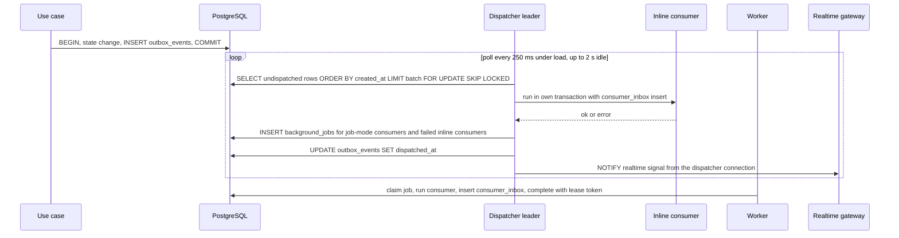

| Step             | Rule                                                                                                                                                                                                                                                                       |
| ---------------- | -------------------------------------------------------------------------------------------------------------------------------------------------------------------------------------------------------------------------------------------------------------------------- |
| Polling          | Adaptive interval 250 ms under load, backing off to 2 s idle; no `LISTEN/NOTIFY` on the request path [SRC: BE-01-R2 §1.2]                                                                                                                                                  |
| Inline consumers | Cheap database-only reactions (in-app notification rows, counters, cache invalidation, projection deletes on consent change, audit append); 2 s timeout each; on failure the dispatcher enqueues one `evt:<consumer>` job for that event and consumer [SRC: BE-01-R2 §1.1] |
| Job consumers    | Anything calling a provider, the AI gateway, object storage, or slow work; enqueued with `idempotency_key = <consumer>:<event_id>`                                                                                                                                         |
| Coalescing       | Projection consumers (search documents, match explanations, skill confidence) keep at most one queued job per (`consumer`, `aggregate_id`); a new event updates `payload.upto_seq` instead of adding a row [SRC: BE-01-R2 §1.1]                                            |
| Marking          | `dispatched_at` is set only after every inline consumer succeeded or its fallback job was inserted, in the same transaction as the job inserts                                                                                                                             |
| Realtime         | After commit, the dispatcher issues `NOTIFY rt_signals` with a compact signal for events that map to channels ([07 §3](#07--search-media-and-realtime-architecture))                                                                                                          |
| Lag metric       | `now() - min(created_at)` of undispatched rows per partition; alert at `outbox.max_lag_seconds` (default 30 [PROP])                                                                                                                                                        |

### 4. Topics per module

The starting topic list. **Class** is the delivery class; EC-ORD implies ordering by the aggregate named in the event. **Consumers** lists consuming modules; `notify` means NTF decides whether and how to notify. Consumers marked `(i)` run inline, others in job mode.

| Module | Event                                                                                  | Class                      | Consumers                                                                                                                                   |
| ------ | -------------------------------------------------------------------------------------- | -------------------------- | ------------------------------------------------------------------------------------------------------------------------------------------- |
| IDN    | `idn.account.registered`                                                               | EC-STD                     | NTF (verification mail), SET (subject map), ANL (i)                                                                                         |
| IDN    | `idn.account.email_verified`                                                           | EC-STD                     | PRF (i), NTF                                                                                                                                |
| IDN    | `idn.account.status_changed`                                                           | EC-ORD                     | PRF, SRC, AIC, MSG, NET, TSF (i)                                                                                                            |
| IDN    | `idn.session.revoked`                                                                  | EC-STD                     | Realtime (disconnect), NTF (security alert), TSF                                                                                            |
| IDN    | `idn.credential.changed`                                                               | EC-STD                     | NTF (security alert)                                                                                                                        |
| IDN    | `idn.organization.created`                                                             | EC-ORD                     | BIL, EMP, INS, ANL (i)                                                                                                                      |
| IDN    | `idn.organization.verified`                                                            | EC-ORD                     | JOB, INS, EVD (issuer trust), SRC                                                                                                           |
| IDN    | `idn.membership.added` / `idn.membership.changed` / `idn.membership.removed`           | EC-ORD                     | BIL (seats), ATS (reassignment), INS, ENT, MSG, Realtime (re-authorize), NTF                                                                |
| IDN    | `idn.sso.configured`                                                                   | EC-ORD                     | ADM audit (i)                                                                                                                               |
| SET    | `set.consent.changed`                                                                  | EC-ORD                     | SRC (i, projection cleanup), AIC (i), JOB, INS, ENT, Realtime (re-authorize)                                                                |
| SET    | `set.privacy_settings.changed`                                                         | EC-ORD                     | SRC (i), PRF, NET                                                                                                                           |
| SET    | `set.dsr.export_requested`                                                             | EC-CRIT                    | SET export job                                                                                                                              |
| SET    | `set.dsr.erasure_started`                                                              | EC-CRIT                    | every erasure participant                                                                                                                   |
| SET    | `set.dsr.erasure_completed`                                                            | EC-CRIT                    | ADM audit, NTF (final confirmation to the address on file before deletion)                                                                  |
| NTF    | `ntf.notification.created`                                                             | EC-STD                     | Realtime (badge signal)                                                                                                                     |
| NTF    | `ntf.delivery.failed_permanently`                                                      | EC-STD                     | ADM ops metrics (i)                                                                                                                         |
| PRF    | `prf.profile.updated`                                                                  | EC-ORD                     | SRC, AIC (match recompute), MKT                                                                                                             |
| PRF    | `prf.profile.visibility_changed`                                                       | EC-ORD                     | SRC (i), NET                                                                                                                                |
| PRF    | `prf.resume.imported`                                                                  | EC-STD                     | NTF                                                                                                                                         |
| MKT    | `mkt.skill.created` / `mkt.skill.merged`                                               | EC-ORD                     | SRC, JOB, EVD, LRN, ASM, AIC, MKT                                                                                                           |
| EVD    | `evd.evidence.created`                                                                 | EC-ORD                     | BGV (auto-verification), SRC, AIC                                                                                                           |
| EVD    | `evd.evidence.updated`                                                                 | EC-ORD                     | SRC, AIC                                                                                                                                    |
| EVD    | `evd.evidence.verified`                                                                | EC-ORD + EC-CRIT           | PRF (skill confidence), SRC, AIC, JOB (snapshot link status), REP, NTF                                                                      |
| EVD    | `evd.evidence.revoked`                                                                 | EC-ORD + EC-CRIT           | PRF, SRC, AIC, JOB, NTF                                                                                                                     |
| EVD    | `evd.reference.requested` / `evd.reference.submitted`                                  | EC-STD                     | NTF                                                                                                                                         |
| EVD    | `evd.credential.issued` / `evd.credential.revoked`                                     | EC-CRIT                    | NTF, PLT (CDN purge of `/verify`), partner webhooks                                                                                         |
| BGV    | `bgv.check.ordered` / `bgv.check.consented`                                            | EC-ORD                     | BGV vendor job, NTF                                                                                                                         |
| BGV    | `bgv.check.completed` / `bgv.check.adjudicated`                                        | EC-CRIT                    | ATS, NTF                                                                                                                                    |
| BGV    | `bgv.identity.verified`                                                                | EC-CRIT                    | EVD (identity-backed rung), TSF                                                                                                             |
| SRC    | `src.saved_search.matched`                                                             | EC-STD                     | NTF (alerts)                                                                                                                                |
| LRN    | `lrn.enrollment.created`                                                               | EC-ORD                     | BIL (seat usage), INS, ENT, NTF, ANL (i)                                                                                                    |
| LRN    | `lrn.progress.recorded`                                                                | EC-ORD                     | REP (XP), INS, ENT (i, coalesced)                                                                                                           |
| LRN    | `lrn.course.completed`                                                                 | EC-ORD + EC-CRIT           | EVD (course-completion evidence at `artifact_backed` or `authority_verified` only when the final-assessment rule holds), REP, INS, ENT, NTF |
| LRN    | `lrn.certificate.issued`                                                               | EC-CRIT                    | EVD, NTF                                                                                                                                    |
| STU    | `stu.course.submitted_for_review` / `stu.course.review_decided`                        | EC-STD                     | NTF, ADM                                                                                                                                    |
| STU    | `stu.course.published` / `stu.course.retired`                                          | EC-ORD                     | LRN, SRC, NTF (followers, waitlist)                                                                                                         |
| STU    | `stu.media.ready` / `stu.media.failed`                                                 | EC-STD                     | STU (i), NTF                                                                                                                                |
| ASM    | `asm.attempt.started`                                                                  | EC-ORD                     | Realtime (deadline signal), TSF (i)                                                                                                         |
| ASM    | `asm.attempt.submitted`                                                                | EC-ORD                     | ASM grading job                                                                                                                             |
| ASM    | `asm.attempt.graded`                                                                   | EC-ORD + EC-CRIT           | EVD (assessment-result evidence; verified only when the attempt is verified), LRN, JOB, ATS, REP, NTF                                       |
| ASM    | `asm.integrity_case.opened` / `asm.integrity_case.decided`                             | EC-CRIT                    | TSF, EVD (void evidence on upheld case), NTF                                                                                                |
| ATS    | `ats.posting.published` / `ats.posting.updated`                                        | EC-ORD                     | SRC, AIC, PLT (job distribution, sitemap, partner webhooks), NTF (saved-search alerts via SRC)                                              |
| ATS    | `ats.posting.closed` / `ats.posting.taken_down`                                        | EC-ORD                     | SRC (i), ATS, AIC, PLT (distribution withdrawal)                                                                                            |
| JOB    | `job.application.submitted`                                                            | EC-ORD                     | ATS (pipeline placement), AIC (match explanation), NTF, ANL (i), partner webhooks                                                           |
| JOB    | `job.application.withdrawn`                                                            | EC-ORD                     | ATS, INT (cancel future interviews), NTF                                                                                                    |
| ATS    | `ats.application.stage_changed`                                                        | EC-ORD                     | JOB (candidate-facing status), NTF, Realtime, ANL (i), partner webhooks                                                                     |
| ATS    | `ats.application.rejected` / `ats.application.hired`                                   | EC-ORD + EC-CRIT for hired | JOB, NTF, INS (placement outcome), EVD (employer-verified work history offer), ANL                                                          |
| ATS    | `ats.offer.sent` / `ats.offer.accepted` / `ats.offer.declined` / `ats.offer.rescinded` | EC-CRIT                    | JOB, NTF, BGV (post-offer checks), ATS (requisition fill), partner webhooks                                                                 |
| ATS    | `ats.requisition.approved` / `ats.requisition.filled`                                  | EC-ORD                     | JOB, ANL                                                                                                                                    |
| INT    | `int.interview.scheduled` / `int.interview.rescheduled` / `int.interview.cancelled`    | EC-ORD                     | NTF (with calendar file), INT calendar sync job, Realtime                                                                                   |
| INT    | `int.interview.completed` / `int.interview.no_show`                                    | EC-ORD                     | ATS (scorecard reminders), AIC (optional analysis with consent), ANL                                                                        |
| EMP    | `emp.employer_page.published`                                                          | EC-ORD                     | SRC, PLT (CDN purge)                                                                                                                        |
| EMP    | `emp.review.published`                                                                 | EC-STD                     | EMP aggregates, NTF (org)                                                                                                                   |
| NET    | `net.connection.requested` / `net.connection.accepted`                                 | EC-STD                     | NTF, AIC (people recommendations)                                                                                                           |
| NET    | `net.post.published`                                                                   | EC-STD                     | NET feed fan-out job, TSF (scan), SRC                                                                                                       |
| NET    | `net.referral.requested` / `net.referral.submitted`                                    | EC-STD                     | NTF, JOB (referral source on application)                                                                                                   |
| MSG    | `msg.message.sent`                                                                     | EC-ORD                     | Realtime, NTF (if recipient offline, after `msg.offline_notify_delay_seconds`), TSF (scan sample)                                           |
| MSG    | `msg.conversation.reported`                                                            | EC-STD                     | TSF                                                                                                                                         |
| REP    | `rep.badge.awarded` / `rep.level.changed`                                              | EC-STD                     | NTF, PRF (public badges)                                                                                                                    |
| EVT    | `evt.registration.created` / `evt.registration.cancelled`                              | EC-ORD                     | NTF, BIL (ticket refund rules)                                                                                                              |
| EVT    | `evt.event.starting_soon` (scheduled)                                                  | EC-STD                     | NTF                                                                                                                                         |
| EVT    | `evt.submission.scored`                                                                | EC-ORD                     | REP, EVD (hackathon result evidence at `artifact_backed`)                                                                                   |
| AIC    | `aic.run.completed`                                                                    | EC-STD                     | Realtime (run status), ANL (i)                                                                                                              |
| AIC    | `aic.recommendation.generated`                                                         | EC-STD                     | NTF (digest only)                                                                                                                           |
| AIC    | `aic.budget.threshold_reached`                                                         | EC-STD                     | NTF (holder), BIL                                                                                                                           |
| TSF    | `tsf.report.created`                                                                   | EC-STD                     | TSF triage job                                                                                                                              |
| TSF    | `tsf.content.actioned`                                                                 | EC-CRIT                    | owning module (hide content), SRC (i), NTF                                                                                                  |
| TSF    | `tsf.sanction.applied` / `tsf.sanction.lifted`                                         | EC-CRIT                    | IDN (status), every module that gates actions on sanctions, NTF                                                                             |
| INS    | `ins.learner.linked` / `ins.learner.severed`                                           | EC-ORD                     | LRN, ASM, SRC, NTF                                                                                                                          |
| INS    | `ins.assignment.created`                                                               | EC-ORD                     | LRN (enrollment creation), BIL (seat allocation), NTF                                                                                       |
| INS    | `ins.placement_drive.opened`                                                           | EC-STD                     | NTF (eligible consented learners)                                                                                                           |
| INS    | `ins.import.completed`                                                                 | EC-STD                     | NTF (admin)                                                                                                                                 |
| ENT    | `ent.opportunity.published`                                                            | EC-ORD                     | SRC (workforce-scoped index), AIC, NTF                                                                                                      |
| ENT    | `ent.workforce.synced`                                                                 | EC-STD                     | ENT inventory job                                                                                                                           |
| BIL    | `bil.checkout.completed`                                                               | EC-CRIT                    | BIL entitlement grant (i)                                                                                                                   |
| BIL    | `bil.subscription.changed`                                                             | EC-CRIT                    | BIL entitlements (i), NTF, ANL                                                                                                              |
| BIL    | `bil.entitlement.changed`                                                              | EC-CRIT                    | JOB (posting limits), SRC (recruiter search), AIC (budgets), LRN (access), INS, ENT (capabilities), Realtime                                |
| BIL    | `bil.order.paid` / `bil.order.refunded`                                                | EC-CRIT                    | LRN (enrollment), EVT (tickets), MEN (sessions), NTF                                                                                        |
| BIL    | `bil.payment.failed`                                                                   | EC-CRIT                    | NTF (dunning)                                                                                                                               |
| MEN    | `men.engagement.started` / `men.session.completed`                                     | EC-ORD                     | NTF, REP (mentor reputation), BIL (session settlement)                                                                                      |
| GIG    | `gig.contract.created` / `gig.milestone.accepted` / `gig.dispute.opened`               | EC-CRIT                    | BIL (payment release when enabled), EVD (completed-project evidence at `peer_attested` when the client attests), TSF, NTF                   |
| MKT    | `mkt.signals.refreshed`                                                                | EC-STD                     | AIC (career plan staleness), SRC                                                                                                            |
| ANL    | `anl.report_export.ready`                                                              | EC-STD                     | NTF                                                                                                                                         |
| ADM    | `adm.flag.changed` / `adm.config.changed`                                              | EC-STD                     | All replicas reference caches (i)                                                                                                           |
| PWA    | `pwa.device.registered`                                                                | EC-STD                     | NTF (push targets)                                                                                                                          |
| PLT    | `plt.file.available` / `plt.file.rejected`                                             | EC-ORD                     | owning module of the file purpose, NTF on rejection                                                                                         |
| PLT    | `plt.webhook_endpoint.disabled`                                                        | EC-STD                     | NTF (org admins)                                                                                                                            |
| PLT    | `plt.integration.sync_completed` / `plt.integration.sync_failed`                       | EC-STD                     | NTF, owning module                                                                                                                          |

### 5. Job engine

#### 5.1 Target `background_jobs` schema (additive evolution of migration 00042)

| Column                                    | Type        | As-built?                | Purpose                                                                                                                                                       |
| ----------------------------------------- | ----------- | ------------------------ | ------------------------------------------------------------------------------------------------------------------------------------------------------------- |
| `id`                                      | uuid        | Yes                      |                                                                                                                                                               |
| `kind`                                    | text        | Yes                      | Job kind (§8)                                                                                                                                                 |
| `queue`                                   | text        | New                      | Queue class (§5.3); default from the kind registry                                                                                                            |
| `payload`                                 | jsonb       | Yes                      | Ids and parameters only; no tokens, codes or email addresses (resolved at run time); `subject_ref` instead of account ids where the job concerns a person     |
| `tenant`                                  | jsonb       | New                      | Tenant scope used to set transaction claims for the job (01 §8.5)                                                                                             |
| `status`                                  | text        | Changed set              | `queued, claimed, running, retry_wait, succeeded, dead, cancelled` [SRC: BE-01-R2 §3.1]; as-built set is `queued, running, succeeded, failed, dead, canceled` |
| `priority`                                | smallint    | New                      | 0 (highest) to 9; default 5                                                                                                                                   |
| `attempts`, `max_attempts`                | int         | `attempts` yes           | Every claim increments `attempts`                                                                                                                             |
| `run_after`                               | timestamptz | Yes                      |                                                                                                                                                               |
| `lease_token`                             | uuid        | New                      | Fencing token, regenerated on every claim                                                                                                                     |
| `lease_expires_at`                        | timestamptz | Yes as `lock_expires_at` |                                                                                                                                                               |
| `claimed_by`                              | text        | New                      | Worker instance id                                                                                                                                            |
| `last_error_class`, `last_error`          | text        | `last_error` yes         | Error class `transient, permanent, rate_limited, cancelled`; message ≤ 4 KB, redacted                                                                         |
| `idempotency_key`                         | text        | Yes                      | Unique per kind where status is not terminal (as-built index is unconditional, kept until migration)                                                          |
| `cancel_requested_at`                     | timestamptz | New                      | Cooperative cancellation                                                                                                                                      |
| `correlation_id`, `trace_context`         | text        | New                      | Tracing                                                                                                                                                       |
| `created_at`, `updated_at`, `finished_at` | timestamptz | Partly                   |                                                                                                                                                               |

#### 5.2 State machine

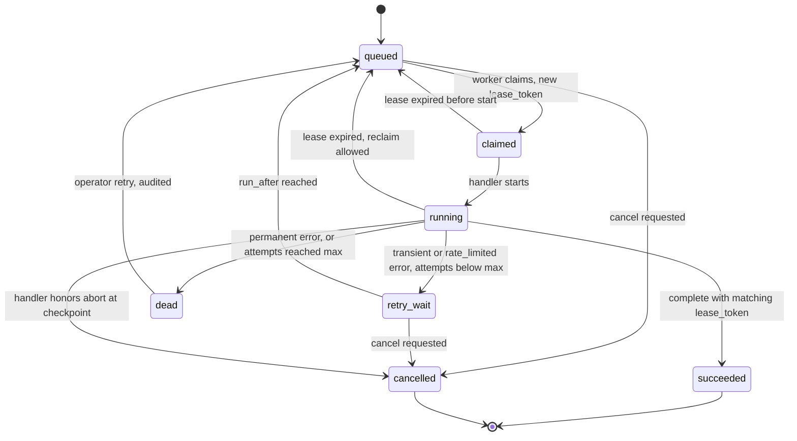

#### 5.3 Claim, fencing and lease renewal

1. **Claim:** `UPDATE background_jobs SET status = 'claimed', lease_token = gen_random_uuid(), lease_expires_at = now() + lease, claimed_by = $worker, attempts = attempts + 1 WHERE id IN (SELECT id FROM background_jobs WHERE queue = $queue AND status = 'queued' AND run_after <= now() ORDER BY priority, run_after LIMIT $batch FOR UPDATE SKIP LOCKED) RETURNING *`. Batch size per queue class; default 1 for `heavy` and `ai`, 10 for others.
2. **Fencing:** every subsequent write by the worker (`running`, heartbeat, completion, retry scheduling) includes `WHERE id = $id AND lease_token = $token`. Zero rows updated means the lease was lost; the worker abandons the result and records `lease_lost` [SRC: ADR-T09].
3. **Fenced side effects:** a handler that writes domain state does so in a transaction that also completes the job with the lease-token predicate, so the effect and the completion commit together. Handlers that call external providers pass `idempotency_key = <job id>:<attempt-independent operation key>` to the provider where the provider supports it (Stripe, most email providers).
4. **Lease renewal:** handlers longer than half the lease call `heartbeat()` which extends `lease_expires_at` under the fencing predicate; default lease 60 s [SRC: as-built], heavy queue 300 s [PROP].
5. **Abort:** each handler receives an `AbortSignal` that fires at timeout or on `cancel_requested_at`; the as-built `Promise.race` without abort [SRC: ARCHITECTURE.md §18] is replaced.
6. **Reclaim:** a reaper (scheduler role) returns `claimed` or `running` rows with expired leases to `queued`, or to `dead` when `attempts >= max_attempts`.

#### 5.4 Queue classes and worker pools

| Queue       | Kinds                                                                                                  | Pool default                                 | Max ready age alert [PROP] |
| ----------- | ------------------------------------------------------------------------------------------------------ | -------------------------------------------- | -------------------------- |
| `critical`  | Billing reconciliation, entitlement grants from webhooks, erasure steps, credential revocation fan-out | 2 workers                                    | 60 s                       |
| `default`   | Event consumer fallbacks, projections, search indexing, notifications in-app, reminders                | 4 workers                                    | 120 s                      |
| `email`     | `ntf.email.send`, `ntf.push.send`, `ntf.sms.send` (deferred), digests                                  | 2 workers                                    | 300 s                      |
| `webhook`   | `plt.webhook.deliver`, job distribution pushes                                                         | 2 workers                                    | 300 s                      |
| `heavy`     | Media scan and transcode orchestration, imports, exports, report exports, resume parsing, bulk actions | 2 workers, separate deployment at trigger S2 | 900 s                      |
| `ai`        | AI runs, embeddings, batch recommendations, match recomputation                                        | 2 workers                                    | 300 s                      |
| `scheduled` | Sweeps, rollups, digest fan-out, reminders scan                                                        | 1 worker                                     | 900 s                      |

Each pool has its own database connection budget and statement timeout ([01 §20](#01--system-architecture)).

### 6. Retry, dead-letter and replay

#### 6.1 Backoff policy

Formula `delay = min(cap, base × 2^(attempt − 1))` with full jitter `random(0, delay)`; `rate_limited` honors `Retry-After` [SRC: BE-01-R2 §3.2].

| Policy     | Kinds                                                        | Max attempts | Base | Cap    | Worst-case span without jitter |
| ---------- | ------------------------------------------------------------ | ------------ | ---- | ------ | ------------------------------ |
| `default`  | Most internal jobs, `evt:*` fallbacks, `src.*`, `plt.file.*` | 8            | 5 s  | 15 min | about 11 min                   |
| `delivery` | `ntf.email.send`, `plt.webhook.deliver`                      | 12           | 60 s | 6 h    | about 20.5 h                   |
| `push`     | `ntf.push.send`                                              | 4            | 60 s | 15 min | 7 min                          |
| `ai`       | `aic.*`                                                      | 3            | 5 s  | 15 min | 15 s                           |
| `runner`   | `asm.code.run`                                               | 2            | 5 s  | 15 min | 5 s (new run id per attempt)   |
| `critical` | EC-CRIT consumers, `set.erasure.step`, `bil.*`               | 12           | 30 s | 1 h    | about 7.5 h, then page         |

Values are configuration (`jobKinds.<kind>.maxAttempts|baseMs|capMs`) validated at boot. As-built default is 3 attempts [SRC: ARCHITECTURE.md §18].

#### 6.2 Error classes

| Class          | Examples                                                                          | Effect                                    |
| -------------- | --------------------------------------------------------------------------------- | ----------------------------------------- |
| `transient`    | Timeout, 5xx, connection reset, lock timeout                                      | Retry per policy                          |
| `rate_limited` | Provider 429                                                                      | Retry after `Retry-After` or policy delay |
| `permanent`    | Validation failure, 4xx other than 408 and 429, missing resource, consent revoked | `dead` immediately; no retry              |
| `cancelled`    | Abort honored                                                                     | `cancelled`                               |

#### 6.3 Dead-letter handling

`dead` rows stay in `background_jobs` (RC-OPS, 90 days) and are the dead-letter queue. A dead EC-CRIT job pages on-call; others create an operations ticket and raise the `jobs_dead_total` metric. Operators inspect and retry through `/admin/jobs` (audited). Unknown kinds dead-letter immediately [SRC: as-built ARCHITECTURE.md §18]. Projection consumers also have **rebuild** kinds (`src.index.rebuild`, `aic.match.rebuild`) that recompute from owner interfaces, so a lost event is recoverable without replay.

#### 6.4 Replay

Any consumer can replay from `outbox_events` within its 14-day retention by resetting its inbox for a time range (operator action, audited). Consumers are written to tolerate replay of any event within that window [SRC: EVENT_CATALOG §2].

### 7. Job catalog

**Trigger** is an event, a request, or a schedule (`cron`, UTC unless stated). **Key** is the idempotency key pattern. **Policy** refers to §6.1. Cadences are proposals [PROP] unless a source is cited; SSOT cadences carry no time zone [SRC: SSOT §13.6 note], so this catalog states one.

| Kind                                     | Owner | Queue     | Trigger                                                                                                     | Key                                 | Policy   | Notes                                                                                                                                 |
| ---------------------------------------- | ----- | --------- | ----------------------------------------------------------------------------------------------------------- | ----------------------------------- | -------- | ------------------------------------------------------------------------------------------------------------------------------------- |
| `ntf.email.send`                         | NTF   | email     | Notification delivery row created                                                                           | `delivery_id`                       | delivery | Logical template id plus validated variables; resolves address at run time; suppression list checked [SRC: as-built email service]    |
| `ntf.push.send`                          | NTF   | email     | Delivery row, channel push                                                                                  | `delivery_id`                       | push     | TTL from category; 404 or 410 from the push service deletes the subscription                                                          |
| `ntf.digest.compose`                     | NTF   | scheduled | cron hourly; selects accounts whose local time is `ntf.digest_local_hour` (default 07:30 [SRC: SSOT §13.6]) | `account:date`                      | default  | Digest per user local day                                                                                                             |
| `ntf.reminder.scan`                      | NTF   | scheduled | cron every 5 min                                                                                            | `window_start`                      | default  | Interview, deadline, course-due, event reminders from domain reminder rows                                                            |
| `src.document.index`                     | SRC   | default   | Projection events (coalesced)                                                                               | `doc_type:doc_id`                   | default  | Rebuilds the document from owner interfaces; deletes when not visible                                                                 |
| `src.index.rebuild`                      | SRC   | heavy     | Operator or nightly 03:00 UTC                                                                               | `doc_type:date`                     | default  | Full rebuild of one document type                                                                                                     |
| `src.embedding.compute`                  | SRC   | ai        | After index of an embedding-enabled type                                                                    | `doc_type:doc_id:source_version`    | ai       | Through the AI gateway; batch                                                                                                         |
| `src.saved_search.run`                   | SRC   | scheduled | cron hourly by cadence                                                                                      | `search_id:period`                  | default  | Emits `src.saved_search.matched`                                                                                                      |
| `plt.file.scan`                          | PLT   | heavy     | File completion                                                                                             | `file_id`                           | default  | Magic-byte detection, malware scan, metadata strip, move to private bucket                                                            |
| `stu.media.transcode`                    | STU   | heavy     | `plt.file.available` for course media                                                                       | `media_asset_id`                    | default  | Calls the media provider; completion by provider webhook                                                                              |
| `stu.media.captions`                     | STU   | ai        | `stu.media.ready`                                                                                           | `media_asset_id:lang`               | ai       | Provider captions or AI transcription with instructor review                                                                          |
| `stu.media.healthcheck`                  | STU   | scheduled | cron daily 04:00 UTC                                                                                        | `date`                              | default  | External embeds still reachable [SRC: SSOT §13.7 `media.healthcheck`]                                                                 |
| `prf.resume.parse`                       | PRF   | heavy     | Resume import request                                                                                       | `import_id`                         | default  | Produces a proposed diff, never applies it                                                                                            |
| `prf.resume.render`                      | PRF   | heavy     | Rendering request                                                                                           | `resume_id:version:template`        | default  | PDF                                                                                                                                   |
| `prf.skill_confidence.recompute`         | PRF   | default   | Evidence verified or revoked (coalesced)                                                                    | `account_id`                        | default  | Writes `profile_skills.confidence` with explanation                                                                                   |
| `evd.reference.expire`                   | EVD   | scheduled | cron hourly                                                                                                 | `hour`                              | default  | Expires open reference requests after `evd.reference_ttl_days` (as-built API check 30 days [SRC: ARCHITECTURE.md §8 item 4])          |
| `evd.credential.render`                  | EVD   | heavy     | Credential issued                                                                                           | `credential_id`                     | default  | Signed payload and PDF                                                                                                                |
| `bgv.check.submit`                       | BGV   | critical  | Candidate consent recorded                                                                                  | `check_id`                          | critical | Vendor order                                                                                                                          |
| `bgv.check.poll`                         | BGV   | scheduled | cron every 30 min for open checks without webhooks                                                          | `check_id:slot`                     | default  |                                                                                                                                       |
| `bgv.adverse.wait_expiry`                | BGV   | scheduled | cron hourly                                                                                                 | `check_id`                          | critical | Allows final adverse action only after the waiting period                                                                             |
| `lrn.enrollment.expire`                  | LRN   | scheduled | cron daily 01:00 UTC                                                                                        | `date`                              | default  | Seat and access expiry                                                                                                                |
| `asm.attempt.grade`                      | ASM   | default   | `asm.attempt.submitted`                                                                                     | `attempt_id`                        | default  | Auto-gradable items; code items wait for the runner                                                                                   |
| `asm.code.run`                           | ASM   | ai        | Code item submitted                                                                                         | `attempt_id:item_id:run_no`         | runner   | Calls `CodeRunnerPort`; disabled until OD-ARC-09 closes                                                                               |
| `asm.attempt.expire`                     | ASM   | scheduled | cron every minute                                                                                           | `minute`                            | default  | Server-side deadline enforcement                                                                                                      |
| `asm.similarity.check`                   | ASM   | heavy     | Attempt graded (code, essay)                                                                                | `attempt_id`                        | default  | Produces integrity signals only                                                                                                       |
| `ats.posting.expire`                     | ATS   | scheduled | cron hourly                                                                                                 | `hour`                              | default  | Closes jobs past `expires_at` (default 45 or 60 days is open in SSOT, V61-18)                                                         |
| `ats.distribution.push`                  | ATS   | webhook   | `ats.posting.published` / `closed`                                                                          | `job_id:target:version`             | delivery | Job boards, Google for Jobs sitemap ping                                                                                              |
| `ats.stale_application.scan`             | ATS   | scheduled | cron daily 06:00 UTC                                                                                        | `date`                              | default  | Nudges recruiters on idle applications per org SLA                                                                                    |
| `ats.bulk_action.run`                    | ATS   | heavy     | Bulk action request                                                                                         | `bulk_action_id`                    | default  | Per-item results, each with its own idempotency                                                                                       |
| `int.calendar.sync`                      | INT   | webhook   | Interview scheduled or changed                                                                              | `interview_id:participant:version`  | delivery | Creates or updates calendar events through calendar adapters                                                                          |
| `int.room.provision`                     | INT   | default   | Interview scheduled (video)                                                                                 | `interview_id`                      | default  | Creates provider room before the window                                                                                               |
| `net.feed.fanout`                        | NET   | heavy     | `net.post.published`                                                                                        | `post_id`                           | default  | Writes feed entries for followers up to `net.fanout_push_max`; larger audiences use pull at read time [SRC: SSOT §13.7 `feed.fanout`] |
| `msg.offline.notify`                     | MSG   | default   | `msg.message.sent`, delayed by `msg.offline_notify_delay_seconds`                                           | `conversation:recipient:seq_bucket` | default  | Skips if read meanwhile                                                                                                               |
| `rep.xp.settle`                          | REP   | default   | Learning, assessment, community events                                                                      | `source_event_id`                   | default  | [SRC: SSOT §13.6 `xp.settle`]                                                                                                         |
| `rep.streak.rollover`                    | REP   | scheduled | cron hourly; per user local midnight                                                                        | `account:date`                      | default  | [SRC: SSOT §13.6 `streak.rollover`, local-day reading]                                                                                |
| `rep.leaderboard.rebuild`                | REP   | scheduled | cron daily 02:30 UTC                                                                                        | `board:date`                        | default  |                                                                                                                                       |
| `aic.run.execute`                        | AIC   | ai        | Async AI run request                                                                                        | `run_id`                            | ai       | Gateway pipeline ([06](#06--ai-architecture))                                                                                        |
| `aic.match.recompute`                    | AIC   | ai        | Profile, evidence, job changes (coalesced)                                                                  | `job_id:account_id` or `account_id` | ai       | Writes `match_explanations`                                                                                                           |
| `aic.recommendation.batch`               | AIC   | ai        | cron daily 05:00 UTC                                                                                        | `account_bucket:date`               | ai       | Only for accounts with recommendations enabled and budget                                                                             |
| `aic.eval.online_sample`                 | AIC   | ai        | cron hourly                                                                                                 | `hour`                              | ai       | Samples outputs for evaluation per [06 §6](#06--ai-architecture)                                                                     |
| `mkt.signals.aggregate`                  | MKT   | heavy     | cron nightly 03:30 UTC                                                                                      | `date`                              | default  | Skills demand, salaries, growth; suppressed below `min_cohort_k` [SRC: SSOT §13.6 `skill.market_signal_update`, `salary.aggregate`]   |
| `mkt.career_paths.compute`               | MKT   | heavy     | cron weekly Sunday 04:00 UTC                                                                                | `week`                              | default  | [SRC: SSOT §13.6 `career.benchmark_compute`]                                                                                          |
| `ins.import.parse` / `ins.import.commit` | INS   | heavy     | Import request, commit request                                                                              | `import_id:phase`                   | default  | [SRC: SSOT §13.7 `institutional.import`]                                                                                              |
| `ins.progress.rollup`                    | INS   | scheduled | cron hourly                                                                                                 | `org:hour`                          | default  | Cohort dashboards                                                                                                                     |
| `ent.hris.sync`                          | ENT   | heavy     | Schedule per connection or request                                                                          | `connection_id:run`                 | default  |                                                                                                                                       |
| `ent.inventory.snapshot`                 | ENT   | heavy     | cron weekly                                                                                                 | `org:week`                          | default  | Aggregates only                                                                                                                       |
| `bil.reconcile`                          | BIL   | critical  | Webhook processing, cron hourly sweep                                                                       | `provider_event_id` or `hour`       | critical | Normalized provider snapshot to local state [SRC: as-built reconciliation]                                                            |
| `bil.dunning.step`                       | BIL   | critical  | Payment failed                                                                                              | `invoice_id:step`                   | critical |                                                                                                                                       |
| `bil.entitlement.expire`                 | BIL   | scheduled | cron every 15 min                                                                                           | `slot`                              | critical |                                                                                                                                       |
| `bil.payout.settle`                      | BIL   | critical  | cron monthly (gated by marketplace decision)                                                                | `period`                            | critical | [SRC: SSOT §13.7 `earnings.settle`]                                                                                                   |
| `set.export.build`                       | SET   | heavy     | `set.dsr.export_requested`                                                                                  | `request_id`                        | critical | Calls every `ExportParticipant`; zip in private bucket; link expires `dsr.export_link_ttl_hours`                                      |
| `set.erasure.step`                       | SET   | critical  | `set.dsr.erasure_started` per participant                                                                   | `request_id:participant`            | critical |                                                                                                                                       |
| `set.erasure.verify`                     | SET   | critical  | All steps done                                                                                              | `request_id`                        | critical | Residual identifier sweep                                                                                                             |
| `adm.retention.sweep`                    | ADM   | scheduled | cron daily 02:00 UTC [SRC: SSOT §13.6 `retention.purge`]                                                    | `class:date`                        | default  | Per retention class; partition drops for partitioned tables                                                                           |
| `adm.audit.archive`                      | ADM   | scheduled | cron monthly                                                                                                | `month`                             | default  | Detach and archive audit partitions                                                                                                   |
| `anl.metrics.rollup`                     | ANL   | scheduled | cron hourly and daily 00:15 UTC                                                                             | `metric:period`                     | default  | [SRC: SSOT §13.6 `metrics.rollup`]                                                                                                    |
| `anl.report.export`                      | ANL   | heavy     | Export request                                                                                              | `export_id`                         | default  |                                                                                                                                       |
| `plt.webhook.deliver`                    | PLT   | webhook   | Partner-subscribed event                                                                                    | `endpoint_id:event_id`              | delivery | Signed payload                                                                                                                        |
| `plt.integration.sync`                   | PLT   | heavy     | Schedule per connection                                                                                     | `connection_id:run`                 | default  | ATS imports, LMS roster                                                                                                               |
| `plt.cdn.purge`                          | PLT   | default   | Public projection changed                                                                                   | `url_set_hash`                      | default  |                                                                                                                                       |
| `plt.outbox.prune`                       | PLT   | scheduled | cron daily 01:30 UTC                                                                                        | `date`                              | default  | Drops partitions older than 14 days                                                                                                   |
| `plt.lease.reap`                         | PLT   | scheduled | cron every 30 s                                                                                             | `slot`                              | default  | §5.3 item 6                                                                                                                           |

### 8. Scheduler

`job_schedules(kind, cron, time_zone, enabled, last_enqueued_period, owner)` is seeded from module `jobs.ts`. The scheduler leader (advisory lock) enqueues one job per due period with `idempotency_key = <kind>:<period>`, so a restarted or duplicate scheduler cannot double-enqueue and a missed period is caught up once. Per-user local-time work (digests, streaks) runs hourly and selects users whose local time falls in the window, using `users.time_zone` [SRC: SSOT §13.6 time-zone gap] [DER].

### 9. Ordering and delivery guarantees

| Guarantee                                               | Holds                                                                              | Does not hold                                                        |
| ------------------------------------------------------- | ---------------------------------------------------------------------------------- | -------------------------------------------------------------------- |
| Event emitted if and only if the state change committed | Yes (outbox in the same transaction)                                               |                                                                      |
| Delivery                                                | At least once to each enabled consumer within outbox retention                     | Exactly once                                                         |
| Order                                                   | Per aggregate (`aggregate_seq`) for EC-ORD consumers                               | Across aggregates, across modules                                    |
| Job execution                                           | At least once; effects that commit with the fenced completion are effectively once | Exactly-once external side effects without provider idempotency keys |
| Latency                                                 | Best effort; lag measured and alerted                                              | Hard real time                                                       |
| Realtime signals                                        | At most once, best effort; clients reconcile by HTTP                               | Delivery                                                             |

### 10. Request idempotency records

`idempotency_records(principal_key, key, method, route_template, request_hash, state, response_status, response_body_ciphertext nullable, resource_ref nullable, locked_until, created_at, expires_at)`, PK (`principal_key`, `key`), partitioned by day and split by retention class (`short`, `payment`, `queued`) [SRC: BE-01-R2 §4]. Database-only operations insert the finished record inside the use-case transaction (one write). Operations with external effects reserve (`in_progress`, `locked_until = now() + 30 s`) then complete after commit. Bodies ≤ 8 KB are stored encrypted; larger responses store a resource reference and replay a fresh representation.

### 11. Cross-module sagas

A saga is a sequence of local transactions in different modules connected by events. Each step is idempotent; each failure has a defined compensation or a terminal "needs attention" state visible to a person. Sagas are **choreographed** by events except erasure and background checks, which are **orchestrated** by a state row (`data_subject_requests`, `background_checks`) because they have legal deadlines and must report completion [DER].

#### 11.1 Apply to hire

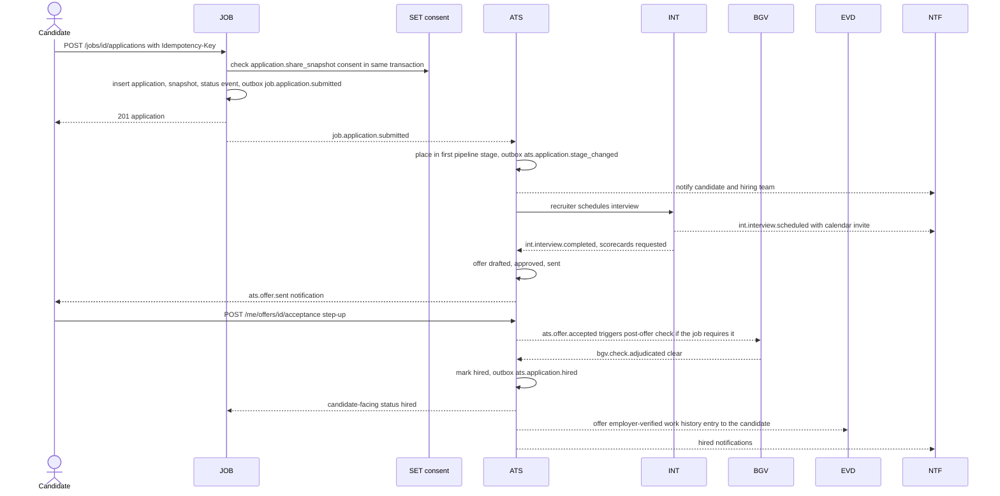

| Failure point                                       | Response                                                                                                                                               |
| --------------------------------------------------- | ------------------------------------------------------------------------------------------------------------------------------------------------------ |
| Consent missing at submit                           | `403 consent-required`; nothing written                                                                                                                |
| Duplicate submit                                    | Natural key returns the existing application or `409 duplicate-application`                                                                            |
| ATS placement consumer fails                        | Retry per policy; application exists and is visible to the employer through the job's application list even before placement (stage `applied` default) |
| Candidate withdraws mid-process                     | `job.application.withdrawn` → INT cancels future interviews, ATS closes open tasks, offer drafts voided                                                |
| Offer rescinded or expired                          | `ats.offer.rescinded` → application returns to `offer_declined` or the prior stage per SM-APPLICATION; BGV check cancelled if not started              |
| Background check adverse                            | BGV enforces pre-adverse notice and waiting period before ATS may reject (§11.5)                                                                       |
| Hired event consumer fails (EVD work-history offer) | EC-CRIT retry; the hire stands; the evidence offer is a later notification                                                                             |

#### 11.2 Enroll to certify

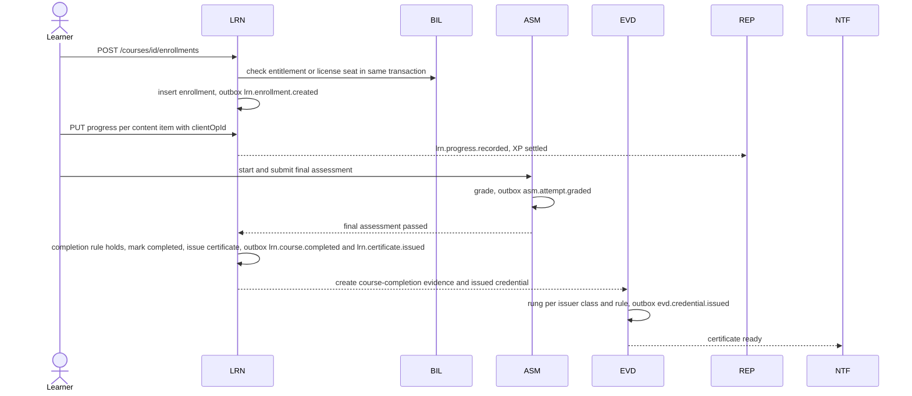

| Rule or failure                            | Response                                                                                                                                                                                                   |
| ------------------------------------------ | ---------------------------------------------------------------------------------------------------------------------------------------------------------------------------------------------------------- |
| Completion rule                            | Completion requires all required items and, where the course declares one, a passed final assessment; lesson completion alone never mints authority-verified evidence [SRC: ARCHITECTURE.md §20 known gap] |
| Code-based final assessment without runner | Attempt graded `verified: false`; certificate may be issued as course completion, evidence rung is at most `artifact_backed`                                                                               |
| Seat revoked mid-course                    | Access stops; progress kept; re-assignment resumes                                                                                                                                                         |
| Course version changes                     | Enrollment stays on its version until the learner opts to move                                                                                                                                             |
| Integrity case upheld later                | `asm.integrity_case.decided` → LRN revokes certificate, EVD revokes credential (EC-CRIT), learner notified with appeal route                                                                               |

#### 11.3 Purchase to entitlement

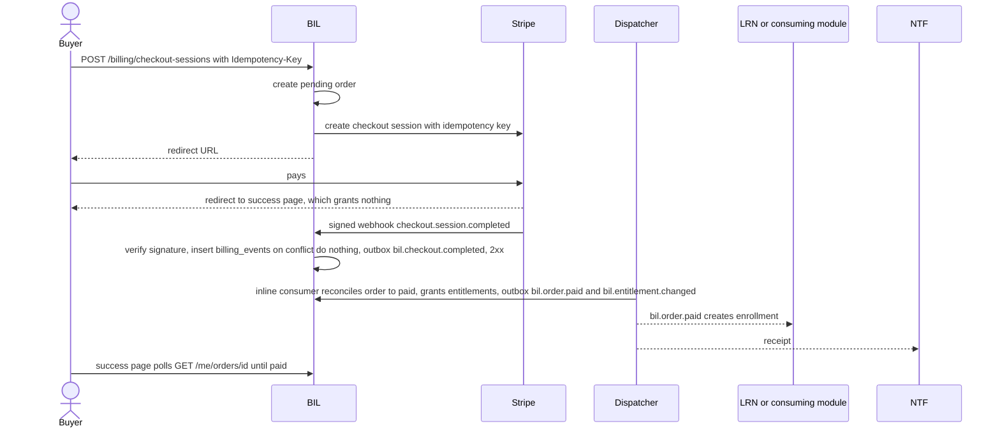

| Failure                          | Response                                                                                                                |
| -------------------------------- | ----------------------------------------------------------------------------------------------------------------------- |
| Webhook delayed                  | Success page shows "payment processing"; hourly `bil.reconcile` sweep fetches provider state                            |
| Webhook duplicated               | `billing_events` primary key makes it a no-op [SRC: as-built ARCHITECTURE.md §8 item 5]                                 |
| Entitlement consumer fails       | EC-CRIT retry and page; order is paid; support can grant manually with audit                                            |
| Refund                           | `bil.order.refunded` → consuming modules revoke access per their rule (course access ends; completed certificates stay) |
| Provider unavailable at checkout | `503 upstream-unavailable`; existing entitlements unchanged                                                             |

#### 11.4 Erasure

```mermaid
sequenceDiagram
    actor P as Person
    participant SET as SET orchestrator
    participant IDN as IDN
    participant MOD as Each erasure participant
    participant SRC as SRC
    participant OBJ as Object storage
    P->>SET: POST /me/erasure-request step-up
    SET->>IDN: account to pending_erasure, sessions revoked except one for cancel
    SET-->>P: cooling-off until date, cancel link
    Note over SET: cooling-off window passes without cancel
    SET->>SET: outbox set.dsr.erasure_started, create dsr_steps per participant
    loop each participant module
        SET->>MOD: job set.erasure.step
        MOD->>MOD: hard delete, tombstone or retain with reason per table
        MOD->>OBJ: delete objects under owned prefixes
        MOD-->>SET: step completed with disposition summary
    end
    SET->>SRC: remove all documents for the subject
    SET->>SET: delete subject_identity_map row
    SET->>IDN: account to erased, credentials deleted
    SET->>SET: job set.erasure.verify residual sweep
    SET-->>P: completion notice to the address on file, sent before the address is deleted
```

| Rule or failure               | Response                                                                                                                                              |
| ----------------------------- | ----------------------------------------------------------------------------------------------------------------------------------------------------- |
| Legal hold or open dispute    | Participant returns `retained_legal_hold` for named records; the request completes for everything else and records the hold                           |
| Counterparty records          | Employer RC-HIRING records keep the application facts; personal fields visible to the employer are removed unless the module spec lists a legal basis |
| Step fails repeatedly         | EC-CRIT page; due date tracked; SET shows the request as `overdue` to the privacy owner                                                               |
| Person cancels in cooling-off | Account restored to `active`; no step has run                                                                                                         |
| Backups                       | Erasure log replayed after any restore before traffic [SRC: V61-19]                                                                                   |

#### 11.5 Background check (orchestrated)

```mermaid
sequenceDiagram
    actor R as Recruiter
    actor C as Candidate
    participant BGV as BGV
    participant V as Check vendor
    participant ATS as ATS
    R->>BGV: order check for application with Idempotency-Key
    BGV-->>C: disclosure and consent request
    C->>BGV: consent with step-up
    BGV->>V: job bgv.check.submit with vendor idempotency key
    V->>BGV: signed webhook report completed
    BGV->>BGV: store summary encrypted, status completed
    BGV-->>R: result available, details per vendor portal rules
    R->>BGV: adjudication pre_adverse
    BGV-->>C: pre-adverse notice with report copy and dispute route
    Note over BGV: waiting period enforced by bgv.adverse.wait_expiry
    R->>BGV: adjudication final
    BGV-->>ATS: bgv.check.adjudicated
```

Jurisdiction-specific notice content and waiting periods are BGV business rules and legal parameters, not architecture.

### 12. Async observability

| Signal              | Definition                                                     | Alert                                                                        |
| ------------------- | -------------------------------------------------------------- | ---------------------------------------------------------------------------- |
| Outbox lag          | Age of oldest undispatched event per partition                 | Above `outbox.max_lag_seconds`                                               |
| Queue ready age     | Age of oldest `queued` job with `run_after <= now()` per queue | Above the queue's threshold (§5.4)                                           |
| Dead jobs           | Count of `dead` per kind in the last hour                      | Any EC-CRIT dead job pages                                                   |
| Lease lost          | Count of fenced writes that updated zero rows                  | Above baseline indicates lease too short                                     |
| Consumer error rate | Failures per consumer per 5 minutes                            | Breaker opens for inline consumers above threshold, falling back to job mode |
| Worker heartbeat    | `worker_health` row per instance [SRC: migration 00049]        | Older than 45 s [SRC: ARCHITECTURE.md §21]                                   |

### 13. Open decisions and risks

| Id        | Question                                                                                                          | Options                                      | Default proposal                                                                                                                                         | Who decides                  | Blocking                   |
| --------- | ----------------------------------------------------------------------------------------------------------------- | -------------------------------------------- | -------------------------------------------------------------------------------------------------------------------------------------------------------- | ---------------------------- | -------------------------- |
| OD-ARC-24 | Migration of `background_jobs.status` values (`failed`, `canceled`) to the target set (`retry_wait`, `cancelled`) | Rename in place; map at read time; new table | Additive migration with a mapping step: `failed` with attempts below max → `retry_wait`, otherwise `dead`; `canceled` → `cancelled` [DEC-REQ]            | Architect with database lead | DEC-ARC-010 implementation |
| OD-ARC-25 | Which domain events are exposed to partners as webhook types                                                      | All; curated list; none at first             | Curated list: job published or closed, application submitted, stage changed, offer accepted, interview scheduled, credential issued or revoked [DEC-REQ] | Product owner                | PLT partner webhooks       |

| Id         | Risk                                                            | Likelihood | Impact | Mitigation                                                                                            | Owner role    |
| ---------- | --------------------------------------------------------------- | ---------- | ------ | ----------------------------------------------------------------------------------------------------- | ------------- |
| RSK-ARC-18 | Outbox write amplification raises primary write load            | Medium     | Medium | Inline consumers write no job rows; coalescing; partition drops instead of deletes [SRC: BE-01-R2 §1] | Database lead |
| RSK-ARC-19 | Consumers assume order across aggregates and act on stale state | Medium     | High   | Consumers re-read owner state; review checklist; EC-ORD only per aggregate                            | Backend lead  |

### 14. Legacy source trace

| Source                                                                        | Used for                                                              | Changed                                                                                             |
| ----------------------------------------------------------------------------- | --------------------------------------------------------------------- | --------------------------------------------------------------------------------------------------- |
| ARCHITECTURE.md §8, §18; migration 00042, 00049                               | As-built queue, lease, retry and heartbeat behavior                   | Fencing, abort, queue classes, status set                                                           |
| SSOT §13.5–§13.8                                                              | Dual-queue boundary, transactional and heavy job catalogs, job schema | One engine with queue classes; missing kinds added (exports, embeddings, judging, reference expiry) |
| `docs/archive/target-blueprint/13_API_EVENTS_AND_INTEGRATIONS.md` | Envelope, delivery classes, first event list                          | Names prefixed by module code; list extended to all 30 modules                                      |
| BE-01-R2 §1, §3, §4                                                           | Consumer modes, coalescing, backoff table, idempotency store          | Kept                                                                                                |

## 05 — Integrations and Adapters

_Former file: `PRODUCT_BLUEPRINT/04_ARCHITECTURE/05_INTEGRATIONS_AND_ADAPTERS.md`._

Status: **Proposed target**. As-built input: two provider boundaries exist in source. Stripe calls live only in `apps/api/src/stripe-gateway.ts` with normalized snapshots kept out of business rules; email goes through `apps/worker/src/email` (logical template ids and variable validation in `templates.ts`, a vendor-free contract in `types.ts`, one registry in `service.ts`, the only Brevo code in `brevo.ts` with native fetch and a 20 s timeout, one env reader in `config.ts`, a shared provider contract test, and a labelled dev outbox). Neither live delivery nor live billing has been exercised [SRC: ARCHITECTURE.md §17]. That email design is the template for every integration below (DEC-ARC-021).

Vendor names are defaults or examples, never contracts [SRC: SSOT §13.3]. Choosing a vendor is a recorded decision (ARCHITECTURE.md INVARIANT-011); open vendor choices are listed in §8.

### 1. Adapter pattern

```mermaid
flowchart LR
    UC["Module use case"] --> PORT["Port: vendor-free interface and domain types"]
    PORT --> REG["Provider registry: selects adapter by config"]
    REG --> A1["Adapter: vendor A"]
    REG --> A2["Adapter: vendor B"]
    REG --> FAKE["Fake adapter: deterministic, records calls"]
    A1 --> BRK["Breaker, timeout, retry classification"]
    BRK --> VENDOR["Vendor API"]
    VENDOR -->|"webhook"| IN["Inbound handler: verify, dedupe, normalize"]
    IN --> OUTBOX["Outbox event in owning module"]
```

| Element                | Rule                                                                                                                                                                                                                                                       |
| ---------------------- | ---------------------------------------------------------------------------------------------------------------------------------------------------------------------------------------------------------------------------------------------------------- |
| Port                   | A TypeScript interface in `packages/adapters/<port>/types.ts` with domain-shaped inputs and outputs, no vendor types, and an explicit error union (`transient`, `rate_limited`, `permanent`, `unavailable`). One port per capability, owned by one module. |
| Capability flags       | Each adapter declares what it supports (for example the media flags `canEmbed`, `supportsCaptions`, `supportsTranscript` [SRC: SSOT §13.14]); use cases branch on flags, never on vendor names.                                                            |
| Anti-corruption mapper | Vendor payloads are converted to normalized snapshots at the adapter edge; raw payloads are stored only as digests or in the provider event table [SRC: ARCHITECTURE.md §17 "normalized snapshots"].                                                       |
| Registry               | `packages/adapters/<port>/registry.ts` builds the adapter from `packages/config` values (`<PORT>_PROVIDER`); unknown providers fail at boot in deployed modes.                                                                                             |
| Contract suite         | `tests/contract/<port>.ts` runs against every adapter: the fake in unit CI, the vendor sandbox in a scheduled CI job. A new adapter must pass it [SRC: as-built `tests/unit/email/provider-contract.ts`].                                                  |
| Timeouts               | Every call has a timeout from config (`<port>.timeout_ms`; email 20 s as-built; default 10 s; AI 30 s [SRC: SSOT CON-008]).                                                                                                                                |
| Retries                | Adapters do not retry internally beyond one immediate retry for idempotent reads; retries belong to the job engine ([04 §6](#04--events-and-asynchronous-processing)).                                                                                                      |
| Circuit breaker        | Per adapter and per tenant connection: opens after `breaker.failure_threshold` consecutive failures (default 5 [PROP]) for `breaker.open_seconds` (default 30 [PROP]); state visible on `/admin/health` [SRC: SSOT §13.4].                                 |
| Idempotency            | Outbound calls that create something pass a stable idempotency key where the vendor supports one.                                                                                                                                                          |
| Observability          | Each call is a span with `port`, `provider`, `operation`, `outcome`, latency; no secrets or personal payloads in attributes.                                                                                                                               |
| Ownership              | Every integration has an owner role and a documented degraded mode [SRC: SSOT §13.4].                                                                                                                                                                      |
| Removal drill          | Before a release that touches an integration, the fake adapter replaces the live one in staging and the degraded mode is exercised [SRC: SSOT §13.4 VER-021].                                                                                              |

### 2. Port catalog

| Port                       | Owner    | Operations                                                                                         | Default adapter                                                                 | Alternates                                                                                               |
| -------------------------- | -------- | -------------------------------------------------------------------------------------------------- | ------------------------------------------------------------------------------- | -------------------------------------------------------------------------------------------------------- |
| `EmailPort`                | NTF      | `send(templateId, to, variables, idempotencyKey)`, `parseEvent(webhook)`                           | Brevo [SRC: as-built; V61-08 default proposal]                                  | Postmark, Amazon SES, Resend (examples) [SRC: SSOT §13.3]                                                |
| `PushPort`                 | NTF      | `send(subscription, payload, ttl, urgency)`                                                        | Web Push with VAPID [SRC: ADR-T20]                                              | n/a                                                                                                      |
| `SmsPort`                  | NTF      | `send(to, templateId, variables)`                                                                  | None (deferred) [SRC: ADR-T20]                                                  | Twilio, Vonage (examples)                                                                                |
| `PaymentPort`              | BIL      | `createCheckout`, `createPortalSession`, `getSubscription`, `refund`, `parseWebhook`               | Stripe [SRC: as-built; ADR-T15]                                                 | None at launch                                                                                           |
| `TaxPort`                  | BIL      | `quote`, `commit`                                                                                  | Stripe Tax (example)                                                            | Others                                                                                                   |
| `PayoutPort`               | BIL      | `onboardSeller`, `transfer`                                                                        | Gated (marketplace money-flow decision)                                         | Stripe Connect (example)                                                                                 |
| `IdentityFederationPort`   | IDN      | `authorizeUrl`, `exchangeCode`, `verifyIdToken`; SAML `verifyAssertion`                            | Standard OIDC and SAML libraries per provider config                            | Managed IdP if OD-ARC-03 chooses it                                                                      |
| `BreachedPasswordPort`     | IDN      | `isBreached(sha1Prefix)`                                                                           | k-anonymity range API (HaveIBeenPwned) [SRC: SSOT §13.3]                        | Local list                                                                                               |
| `CaptchaPort`              | IDN, TSF | `verify(token, action)`                                                                            | Cloudflare Turnstile or hCaptcha (examples) [PROP]                              | n/a                                                                                                      |
| `StoragePort`              | PLT      | `presignPut`, `presignGet`, `head`, `copy`, `delete`, `listPrefix`                                 | S3-compatible object storage                                                    | Cloud-native equivalents                                                                                 |
| `MalwareScanPort`          | PLT      | `scan(objectRef)`                                                                                  | ClamAV in the heavy worker pool [PROP]                                          | Vendor scanning API                                                                                      |
| `MediaProviderPort`        | STU      | `createUpload`, `getAsset`, `playbackToken`, `deleteAsset`, `parseWebhook`; capability flags       | Managed video vendor (OD-ARC-12)                                                | Mux, Cloudflare Stream (examples) [SRC: SSOT §13.3]                                                      |
| `EmbedMetadataPort`        | STU      | `resolve(url)` → provider, title, duration, embeddability                                          | YouTube, Vimeo oEmbed adapters with SSRF allowlist [SRC: SSOT §13.13, §13.16]   | n/a                                                                                                      |
| `ModelProviderPort`        | AIC      | `complete`, `stream`, `embed`, `moderate`, `countTokens`                                           | At least two providers (OD-ARC-13)                                              | Anthropic, Google, OpenAI, open-weight host (examples)                                                   |
| `CodeRunnerPort`           | ASM      | `run(language, files, tests, limits)` → results, signature                                         | None until OD-ARC-09                                                            | Self-hosted sandbox, vendor API                                                                          |
| `VideoRoomPort`            | INT, MEN | `createRoom`, `joinToken`, `endRoom`, `recordingStatus`                                            | WebRTC provider (OD-ARC-08)                                                     | Daily, LiveKit, Twilio Video (examples)                                                                  |
| `CalendarPort`             | INT      | `connect`, `freeBusy`, `upsertEvent`, `deleteEvent`, `watch`                                       | Google Calendar, Microsoft Graph                                                | CalDAV                                                                                                   |
| `ESignaturePort`           | ATS, GIG | `createEnvelope`, `status`, `parseWebhook`                                                         | Optional; none at launch [PROP]                                                 | DocuSign, Dropbox Sign (examples)                                                                        |
| `BackgroundCheckPort`      | BGV      | `createCandidate`, `orderPackage`, `getReport`, `parseWebhook`                                     | Vendor per region (OD-ARC-26)                                                   | Checkr, Certn, Sterling (examples)                                                                       |
| `IdentityVerificationPort` | BGV      | `createSession`, `getResult`, `parseWebhook`                                                       | Vendor (SSOT OD-27)                                                             | Persona, Onfido, Veriff (examples)                                                                       |
| `ProctoringPort`           | ASM      | `createSession`, `getFlags`                                                                        | None (SSOT OD-35)                                                               | Vendor                                                                                                   |
| `JobDistributionPort`      | ATS      | `publish`, `update`, `withdraw`                                                                    | Google for Jobs structured data plus sitemap (no API call); job boards optional | Indeed, LinkedIn job posting (partner programs; examples)                                                |
| `AtsImportPort`            | PLT, ATS | `listJobs`, `listCandidates`, `listApplications`                                                   | Optional per customer                                                           | Greenhouse, Lever, Workday (examples)                                                                    |
| `HrisPort`                 | ENT      | `listWorkers`, `listOrgUnits`, `listJobs`, `changesSince`                                          | Optional per customer                                                           | Workday, SAP SuccessFactors, BambooHR (examples) [SRC: SSOT §13.3]; unified HRIS API vendor as an option |
| `LmsInteropPort`           | INS      | LTI 1.3 launch and deep linking, Names and Roles, Assignment and Grade Services; OneRoster rosters | Standards-based, no vendor                                                      | Moodle, Canvas, Blackboard [SRC: SSOT §13.3]                                                             |
| `ScimPort` (inbound)       | IDN      | SCIM 2.0 Users and Groups                                                                          | Standards-based                                                                 | n/a                                                                                                      |
| `CredentialIssuancePort`   | EVD      | `sign(credential)`, `verify(credential)`, `publishStatusList`                                      | In-house signer with KMS key, Open Badges 3.0 (OD-ARC-20)                       | Vendor wallet services                                                                                   |
| `GeocodingPort`            | JOB, SRC | `geocode(text)`, `reverse(lat, lng)` coarse                                                        | Open data or commercial geocoder [PROP]                                         | n/a                                                                                                      |
| `FxRatesPort`              | MKT, BIL | `rates(date)`                                                                                      | Central-bank reference rates [PROP]                                             | Commercial feed                                                                                          |
| `ChatOpsPort`              | NTF      | `post(channelRef, message)`                                                                        | Optional Slack and Microsoft Teams apps [SRC: SSOT §13.3 Slack]                 | n/a                                                                                                      |
| `TelemetryExportPort`      | Platform | OTLP export                                                                                        | OpenTelemetry collector [SRC: ADR-T16]                                          | Vendor backends                                                                                          |
| `ErrorReportingPort`       | Platform | `capture(error, context)`                                                                          | Sentry (example) [SRC: SSOT §13.3]                                              | OTLP logs                                                                                                |
| `ProductAnalyticsPort`     | ANL      | `export(batch)`                                                                                    | First-party `analytics_events` only; external export optional                   | PostHog (example) [SRC: SSOT §13.3]                                                                      |

### 3. Integration catalog

Credential kinds: **PS** platform secret in the secret manager; **TC** tenant credential envelope-encrypted in `integration_connections` or `sso_connections`; **UC** user credential (OAuth tokens) envelope-encrypted per user; **WS** webhook signing secret (PS). Sandbox column names the test double used in each environment: unit and integration tests always use the **fake** adapter; staging uses the vendor **sandbox** where one exists.

| Integration (port)                                 | Data sent                                                                         | Data received                                              | Highest data class                               | Failure modes                                                 | Fallback or degraded mode                                                                                                                                               | Credentials                                             | Sandbox and tests                                                                                      |
| -------------------------------------------------- | --------------------------------------------------------------------------------- | ---------------------------------------------------------- | ------------------------------------------------ | ------------------------------------------------------------- | ----------------------------------------------------------------------------------------------------------------------------------------------------------------------- | ------------------------------------------------------- | ------------------------------------------------------------------------------------------------------ |
| Transactional email (`EmailPort`)                  | Recipient address, template id, variables (names, links with tokens)              | Message id; delivery, bounce, complaint events             | DC-PRIVATE                                       | Provider 5xx or timeout; rate limit; bounces; suppression     | Retry up to the delivery policy (about 20.5 h); in-app notification unaffected; bounce and complaint add to `email_suppressions`; second provider only after a decision | PS API key; WS for events                               | Fake with dev outbox [SRC: as-built]; provider sandbox or test domain in staging; contract suite       |
| Web Push (`PushPort`)                              | Encrypted payload ≤ 4 KB, TTL                                                     | Status code                                                | DC-PRIVATE (encrypted)                           | 404 or 410 subscription gone; 429; payload too large          | Delete gone subscriptions; in-app badge still updated                                                                                                                   | PS VAPID key pair                                       | Fake; local push service in browser tests                                                              |
| Payments (`PaymentPort`)                           | Customer email, price ids, quantities, metadata ids                               | Checkout sessions, subscriptions, invoices, payment events | DC-PRIVATE; card data never touches TalentSphere | 5xx, timeout, webhook delay or duplication, signature failure | Checkout `503`; entitlements unchanged; hourly reconcile sweep; webhook dedupe [SRC: as-built]                                                                          | PS secret key; WS webhook secret                        | Stripe test mode and CLI-forwarded webhooks; as-built `BILLING_MODE=disabled` default [SRC: CLAUDE.md] |
| Social login (`IdentityFederationPort`)            | Redirect with state, nonce, PKCE                                                  | ID token: subject, email, email_verified                   | DC-PRIVATE                                       | Provider down; invalid token; email unverified                | Password and passkey sign-in; unverified provider emails never auto-link                                                                                                | PS client secret per provider                           | Mock OIDC provider in tests; provider test apps in staging                                             |
| Enterprise SSO (OIDC or SAML)                      | AuthnRequest                                                                      | Assertion with attributes                                  | DC-PRIVATE                                       | Certificate expiry, clock skew, misconfiguration              | Org admin break-glass account (password plus passkey) exempt from enforcement; certificate expiry warnings 30 days ahead                                                | TC metadata and certificates                            | SAML test IdP; conformance suite                                                                       |
| SCIM provisioning                                  | none outbound                                                                     | Users, groups, deactivations                               | DC-PRIVATE                                       | Bad payloads; duplicate users                                 | Reject with SCIM errors; admin report                                                                                                                                   | TC bearer token hash                                    | SCIM compliance tests                                                                                  |
| Breached passwords                                 | First 5 hex characters of SHA-1 of the password                                   | Suffix list                                                | DC-INTERNAL                                      | Timeout                                                       | Allow the password with a background re-check flag (fail-open is acceptable because it is an extra control) [DER]                                                       | none                                                    | Fake                                                                                                   |
| CAPTCHA                                            | Token, action                                                                     | Score or pass                                              | DC-INTERNAL                                      | Provider down                                                 | Fall back to stricter rate limits and email confirmation; never block all sign-ups                                                                                      | PS secret                                               | Test keys                                                                                              |
| Object storage (`StoragePort`)                     | Objects, metadata                                                                 | Objects, presigned URLs                                    | Up to DC-RESTRICTED                              | Unavailable, throttled                                        | Uploads `503`; text features continue                                                                                                                                   | PS access keys or workload identity                     | Local S3-compatible server (for example MinIO) in tests                                                |
| Malware scan                                       | Object stream                                                                     | Verdict                                                    | Up to DC-RESTRICTED                              | Scanner down or signatures stale                              | Files stay `quarantined` (fail-closed); alert                                                                                                                           | none (in-cluster)                                       | EICAR test file in CI                                                                                  |
| Video media (`MediaProviderPort`)                  | Video file or upload URL, asset metadata                                          | Asset id, renditions, captions, playback ids, webhooks     | DC-PUBLIC after publish; DC-PRIVATE before       | Transcode failure, webhook delay, quota                       | Asset `failed` with retry; course publication blocked until ready                                                                                                       | PS API key; WS                                          | Vendor test environment; fake for unit tests                                                           |
| Embedded video metadata                            | Public URL                                                                        | Title, duration, embeddability                             | DC-PUBLIC                                        | Provider blocks embedding; URL removed                        | Delivery mode E (external link) [SRC: SSOT §13.13]; nightly healthcheck flags broken items                                                                              | PS API keys where needed                                | Recorded fixtures                                                                                      |
| Model providers (`ModelProviderPort`)              | Minimized, redacted prompt context                                                | Completions, embeddings, moderation scores, token counts   | Up to DC-PRIVATE; DC-SENSITIVE and above never   | Timeouts, 429, outages, safety refusals, malformed output     | Fallback chain then heuristic or non-AI fallback with a badge ([06 §8](#06--ai-architecture))                                                                          | PS keys; TC for org BYO keys                            | Fake model with scripted outputs; eval suites against sandbox keys with budget caps                    |
| Code runner (`CodeRunnerPort`)                     | Code, tests, limits                                                               | Results, resource use, signature                           | DC-PRIVATE                                       | Runner down, timeout, resource exhaustion                     | Attempts queued, "grading delayed"; timer not consumed; never a simulated pass [SRC: ADR-T13]                                                                           | PS mutual TLS between worker and runner                 | Local runner image with fixed test programs                                                            |
| Video interviews (`VideoRoomPort`)                 | Room name, participant display names, window                                      | Join tokens, room events, recording status                 | DC-PRIVATE                                       | Provider outage, join failure                                 | Fallback link stored on the interview (dial-in or external meeting) shown to participants                                                                               | PS API key                                              | Vendor sandbox; fake rooms                                                                             |
| Calendars (`CalendarPort`)                         | Event title, time, attendees, description without sensitive data                  | Free/busy, event ids, change notifications                 | DC-PRIVATE                                       | Token revoked, quota, watch expiry                            | ICS attachment in the notification email; reconnect prompt to the user                                                                                                  | UC OAuth tokens                                         | Provider test accounts; fake                                                                           |
| E-signature (`ESignaturePort`)                     | Offer or contract document, signer emails                                         | Envelope status, signed document                           | DC-SENSITIVE                                     | Provider down                                                 | Click-to-accept with step-up and an audit record                                                                                                                        | TC or PS                                                | Vendor demo environment                                                                                |
| Background checks (`BackgroundCheckPort`)          | Candidate name, contact, consented identifiers, package code                      | Report status, summary, report link                        | DC-RESTRICTED                                    | Vendor delays, disputes, jurisdiction limits                  | Status `pending` visible to both parties; recruiter cannot adjudicate before completion                                                                                 | TC (employer's vendor account) or PS (platform account) | Vendor sandbox with test identities only; never real data in non-production                            |
| Identity verification (`IdentityVerificationPort`) | Session request                                                                   | Verification result, level                                 | DC-RESTRICTED                                    | Vendor down; inconclusive result                              | Retry later; feature that needs IDV stays locked                                                                                                                        | PS key; WS                                              | Vendor sandbox test documents                                                                          |
| Proctoring (`ProctoringPort`)                      | Session metadata, consent                                                         | Flags, recordings (vendor-held)                            | DC-RESTRICTED                                    | Vendor down                                                   | Assessment owner chooses: postpone or run unproctored with `verified: false`                                                                                            | PS or TC                                                | Vendor sandbox                                                                                         |
| Job distribution (`JobDistributionPort`)           | Published job fields (public only)                                                | Posting ids, status                                        | DC-PUBLIC                                        | Partner API rejects or delays                                 | Job remains live on TalentSphere; distribution status shown to recruiter                                                                                                | TC or PS partner keys                                   | Partner sandboxes; structured-data validator for Google for Jobs                                       |
| ATS import (`AtsImportPort`)                       | API calls with customer's key                                                     | Jobs, candidates, applications                             | DC-PRIVATE                                       | Rate limits, schema drift                                     | Partial import with row errors; resumable                                                                                                                               | TC customer API key                                     | Recorded fixtures per vendor                                                                           |
| HRIS (`HrisPort`)                                  | API calls                                                                         | Workers, org units, titles                                 | DC-SENSITIVE                                     | Token expiry, large deltas                                    | Last successful snapshot remains; sync error to EXA                                                                                                                     | TC                                                      | Vendor sandboxes or unified-API sandbox                                                                |
| LMS (LTI 1.3, OneRoster)                           | Launch responses, grades                                                          | Launch claims, rosters                                     | DC-PRIVATE                                       | Key rotation, clock skew                                      | Manual roster import (bulk import)                                                                                                                                      | TC platform registration keys                           | IMS reference tools and certification suite                                                            |
| Credential issuance                                | Signed credential, status list                                                    | Verification requests                                      | DC-PUBLIC                                        | KMS unavailable                                               | Issuance queued; verification of existing credentials unaffected (public keys cached)                                                                                   | KMS signing key                                         | Test keys; Open Badges validator                                                                       |
| Geocoding, FX rates                                | Location text; date                                                               | Coordinates (coarse); rates                                | DC-INTERNAL                                      | Unavailable                                                   | Cached values; location stored as text only                                                                                                                             | PS                                                      | Fixtures                                                                                               |
| Chat ops (Slack, Teams)                            | Notification summaries without personal details beyond names the org already sees | Install tokens                                             | DC-PRIVATE                                       | Token revoked                                                 | Email notification instead                                                                                                                                              | TC                                                      | Vendor test workspaces                                                                                 |
| Observability export                               | Traces, metrics, redacted logs                                                    | none                                                       | DC-INTERNAL (redacted)                           | Backend down                                                  | Local buffering then drop; never blocks requests                                                                                                                        | PS                                                      | Local collector                                                                                        |

### 4. Credentials handling

| Rule | Detail                                                                                                                                                                                                                             |
| ---- | ---------------------------------------------------------------------------------------------------------------------------------------------------------------------------------------------------------------------------------- |
| C-01 | Platform secrets live in a secret manager and are injected at process start; never in the repository, image, logs, error messages or client bundles [SRC: SSOT §13.4 "server-side only"; ARCHITECTURE.md INVARIANT-006].           |
| C-02 | Tenant and user credentials are envelope-encrypted: a per-record data key encrypts the secret (AES-256-GCM), the data key is wrapped by a KMS key; ciphertext, wrapped key and key version are stored together (DEC-ARC-026).      |
| C-03 | Decryption happens only inside the adapter call path, in memory, for the duration of the call. Decrypted values are never returned by any API; the UI shows only "connected", last four characters where safe, and last-used time. |
| C-04 | Rotation: platform secrets support two active versions; tenant credentials can be replaced by the tenant admin with step-up; KMS keys rotate on schedule with re-wrap jobs.                                                        |
| C-05 | OAuth user tokens store the minimum scopes; refresh tokens are revoked at the provider when the user disconnects or the account is erased.                                                                                         |
| C-06 | Bring-your-own AI keys (organization level only, OD-ARC-13) follow C-02 and are used only for that organization's invocations. Consumer subscriptions never imply API rights [SRC: SSOT §16.2].                                    |
| C-07 | Webhook signing secrets (inbound and outbound) are per provider or per endpoint; inbound verification uses the raw body before parsing [SRC: API-STD §4].                                                                          |
| C-08 | Non-production environments never hold production credentials; staging uses vendor sandboxes; production data is never copied to non-production [DER].                                                                             |

### 5. Environments and test strategy

| Environment                                     | Adapters                                         | Purpose                                             |
| ----------------------------------------------- | ------------------------------------------------ | --------------------------------------------------- |
| Unit tests                                      | Fakes only; deterministic; record calls          | Business behavior and error handling                |
| Integration tests (`pnpm test`, `pnpm test:pg`) | Fakes plus real PostgreSQL; local object storage | Persistence, outbox, jobs, RLS                      |
| Contract tests (scheduled CI)                   | Vendor sandboxes with test credentials           | Detect vendor drift; run each port's contract suite |
| End-to-end (`pnpm test:e2e`)                    | Fakes with scripted webhook injection            | User journeys including async completion            |
| Staging                                         | Vendor sandboxes; production-like configuration  | Release verification and removal drills             |
| Production                                      | Live vendors                                     | n/a                                                 |

Every fake supports **fault injection** (timeouts, 429, 5xx, malformed payloads, duplicated and out-of-order webhooks) so degraded modes are tested, not assumed [PROP]. Deployed configuration refuses fake adapters, as the as-built configuration refuses memory storage in deployed modes [SRC: ARCHITECTURE.md §16].

### 6. Inbound webhook handling

All inbound vendor callbacks follow [03 §13.1](#03--api-design): raw-body signature check, provider event id dedupe table per vendor (`billing_events`, `bgv_provider_events`, `media_provider_events`, `email_provider_events`), outbox event, fast `2xx`, asynchronous processing. A callback that references an unknown resource is stored and retried for `webhook.orphan_retry_hours` (default 24 [PROP]) in case it arrived before the local commit became visible.

### 7. Adding a new integration (procedure)

1. Record the decision (DEC-ARC entry or module OD) naming the vendor, the data sent and the data class [SRC: ARCHITECTURE.md INVARIANT-011].
2. Define or extend the port in `packages/adapters/<port>/types.ts` with domain types only.
3. Write the fake adapter and the contract suite first; then the vendor adapter until it passes.
4. Add configuration keys to `packages/config` with deployed-mode refusal rules (build-file change; owner approval).
5. Add breaker, timeout, health entry and degraded-mode copy for the UI.
6. Add the data-processing entry (vendor, purpose, data classes, region) for `05_SECURITY_PRIVACY`.
7. Run the removal drill in staging.

### 8. Open decisions and risks

| Id        | Question                                                       | Options                                                                        | Default proposal                                                                                                    | Who decides                | Blocking         |
| --------- | -------------------------------------------------------------- | ------------------------------------------------------------------------------ | ------------------------------------------------------------------------------------------------------------------- | -------------------------- | ---------------- |
| OD-ARC-26 | Background-check and identity-verification vendors and regions | Single global vendor; regional vendors; employer brings its own vendor account | Employer-brought vendor accounts through `BackgroundCheckPort` first, platform account later [DEC-REQ] (SSOT OD-27) | Product owner with counsel | BGV              |
| OD-ARC-27 | Second email provider for failover                             | None; warm standby                                                             | None at launch; add after measured delivery incidents [DEC-REQ] (SSOT OD-10)                                        | Product owner              | NTF resilience   |
| OD-ARC-28 | Unified HRIS and ATS API vendor versus direct adapters         | Direct per vendor; unified-API vendor                                          | Unified-API vendor for HRIS when ENT starts; direct adapters for the two most requested ATS [DEC-REQ]               | Product owner              | ENT, PLT imports |

| Id         | Risk                                                        | Likelihood | Impact | Mitigation                                                                                  | Owner role        |
| ---------- | ----------------------------------------------------------- | ---------- | ------ | ------------------------------------------------------------------------------------------- | ----------------- |
| RSK-ARC-20 | Vendor sandbox behavior differs from production             | High       | Medium | Contract suites plus recorded production-shaped fixtures; canary release per integration    | Integration owner |
| RSK-ARC-21 | Personal data sent to vendors beyond what the purpose needs | Medium     | High   | Per-port allowlisted fields, data-class checks in adapters, data-processing register review | Security officer  |

### 9. Legacy source trace

| Source                                                                                                        | Used for                                                         | Changed                                                              |
| ------------------------------------------------------------------------------------------------------------- | ---------------------------------------------------------------- | -------------------------------------------------------------------- |
| ARCHITECTURE.md §17; `apps/worker/src/email/*`; `apps/api/src/stripe-gateway.ts`                              | Adapter template and as-built boundaries                         | Generalized to all ports; email adapter moves to `packages/adapters` |
| SSOT §13.3, §13.4, §13.13–§13.16                                                                              | Integration register, doctrine, media modes and capability flags | Phases replaced by release tiers; vendors as examples                |
| `docs/archive/target-blueprint/13_API_EVENTS_AND_INTEGRATIONS.md` and ADR-T15, ADR-T20 | Stripe-only billing, email port, Web Push, SMS deferral          | Kept                                                                 |

## 06 — AI Architecture

_Former file: `PRODUCT_BLUEPRINT/04_ARCHITECTURE/06_AI_ARCHITECTURE.md`._

Status: **Proposed target** (DEC-ARC-014). As-built input: a local heuristic career assistant and a simpler assistant query scaffold; `assertWithinAIQuota` with tier limits hard-coded in `packages/domain/src/ai-gateway.ts` (`AI_QUOTA_LIMITS`); prompt sanitization; provenance and usage-meter types; no remote model execution; saved bring-your-own keys are not an integration; the assistant scaffold skips the quota and saved consent is not universally enforced [SRC: ARCHITECTURE.md §3, §20, R-4; `packages/domain/src/ai-gateway.ts`]. The hard-coded quota numbers are as-built values, not decided product parameters: SSOT decides no AI quota, price or cap [SRC: SSOT §16.4; V61-09].

The AIC module owns the gateway; every module that offers an AI feature registers a capability with it. No module calls a model provider directly (layering rule L-05 in [01 §7](#01--system-architecture)).

### 1. Binding principles

| Id    | Principle                                                                                                                                                                                 | Source                                                 |
| ----- | ----------------------------------------------------------------------------------------------------------------------------------------------------------------------------------------- | ------------------------------------------------------ |
| AI-P1 | One gateway is the only path to any model, local or remote.                                                                                                                               | [SRC: SSOT §16.1; ADR-T12]                             |
| AI-P2 | No paid third-party inference for a free user unless an explicit active cost policy permits it; no silent paid fallback.                                                                  | [SRC: SSOT §16.4]                                      |
| AI-P3 | Every AI entry point is refused server-side while the caller is in an `AI_PROHIBITED` assessment session; provider adapters cannot override assessment policy.                            | [SRC: SSOT §17.2–§17.3; ARCHITECTURE.md INVARIANT-008] |
| AI-P4 | AI conversation memory, user profile, talent graph and verified evidence are separate stores; AI output never silently changes verified state.                                            | [SRC: SSOT §16.6]                                      |
| AI-P5 | Output impact decides governance: information, draft, recommendation, analysis, decision support, consequential decision. Autonomous consequential decisions are prohibited.              | [SRC: SSOT §16.7]                                      |
| AI-P6 | Every output keeps provenance: request id, capability, provider and model, execution mode, time, data class, context references, policy decision, sources, output and user modifications. | [SRC: SSOT §16.8]                                      |
| AI-P7 | Matching and recommendations are explainable, show uncertainty, never use pay-to-rank, never auto-reject.                                                                                 | [SRC: SSOT §18.1; ADR-T22]                             |
| AI-P8 | Behavioral and AI-detection signals are indicators for human review, never proof.                                                                                                         | [SRC: SSOT §17.4]                                      |

### 2. Gateway pipeline

```mermaid
flowchart TD
    REQ["Capability request: capability id, inputs, caller"] --> ID["1. Identity and principal"]
    ID --> MODE{"2. Active AI_PROHIBITED session?"}
    MODE -->|"yes"| DENY1["403 ai-prohibited"]
    MODE -->|"no"| PURPOSE["3. Purpose and data classification of inputs"]
    PURPOSE --> POLICY{"4. AI policy: capability enabled, consent ai.assist.process, sanctions, kill switch"}
    POLICY -->|"deny"| DENY2["403 consent-required or forbidden"]
    POLICY -->|"allow"| TARGET["5. Execution target selection"]
    TARGET --> BUDGET{"6. Budget reservation in ai_budget_ledger"}
    BUDGET -->|"none available"| FALLBACK0["Heuristic or non-AI fallback, or 402 or 429"]
    BUDGET -->|"reserved"| CTX["7. Context assembly and firewall: minimize, redact, fence user content, add canary"]
    CTX --> EXEC["8. Model execution with timeout"]
    EXEC -->|"error"| FB["Fallback chain"]
    FB --> EXEC
    EXEC --> OUT["9. Output validation: schema, safety, canary leak, grounding check"]
    OUT -->|"fail"| SUPPRESS["Suppress and fallback, alert on canary"]
    OUT -->|"pass"| PROV["10. Provenance and cost commit"]
    PROV --> HITL{"11. Output impact requires human checkpoint?"}
    HITL -->|"yes"| REVIEW["Draft held for user or authorized reviewer"]
    HITL -->|"no"| SHOW["Shown with label, sources and uncertainty"]
    REVIEW --> APPLY["12. Apply through the owning module's use case"]
    SHOW --> APPLY
```

| Stage               | Owner                                      | Detail                                                                                                                                                                                                                           |
| ------------------- | ------------------------------------------ | -------------------------------------------------------------------------------------------------------------------------------------------------------------------------------------------------------------------------------- |
| 1 Identity          | IDN via policy                             | Principal claims (01 §8.1); service principals may run only capabilities flagged `svc_allowed`                                                                                                                                   |
| 2 Assessment lock   | ASM interface `getActiveAiMode(accountId)` | Read from the primary at request time; `ai_restricted` narrows the allowed capability list; `post_assessment_only` unlocks after submission                                                                                      |
| 3 Classification    | AIC                                        | Each input field is tagged with its DC class from the contract; any DC-SENSITIVE, DC-RESTRICTED or DC-NEVER-EXTERNAL input is removed unless the capability declares it and the person consented to that specific use            |
| 4 Policy            | `packages/policy`                          | Actions `aic.capability.run:<id>`; consent `ai.assist.process` for personal-data capabilities; organization capability toggles for org-side features                                                                             |
| 5 Target            | AIC                                        | §4 order                                                                                                                                                                                                                         |
| 6 Budget            | AIC with BIL entitlements                  | §9                                                                                                                                                                                                                               |
| 7 Context firewall  | AIC                                        | Only context references allowed by the capability; retrieval through owner interfaces under the caller's policy; user content wrapped in delimiters with instruction that it is data; per-request canary token [SRC: SSOT §12.9] |
| 8 Execution         | Adapter                                    | Timeout `ai.timeout_ms` (default 30,000 [SRC: SSOT CON-008]); streaming where the capability allows                                                                                                                              |
| 9 Validation        | AIC                                        | Zod schema for structured outputs; safety classifier; canary check; citation check for grounded capabilities                                                                                                                     |
| 10 Provenance       | AIC                                        | `ai_invocations` row; cost committed; reservation released                                                                                                                                                                       |
| 11 Human checkpoint | Capability definition                      | §10                                                                                                                                                                                                                              |
| 12 Apply            | Owning module                              | AI never writes another module's tables; the user's acceptance calls that module's normal use case, which re-validates                                                                                                           |

### 3. Capability registry

Each capability is declared in the owning module (`modules/<mod>/ai.ts`) and registered with the gateway.

| Field                                   | Meaning                                                                                                                             |
| --------------------------------------- | ----------------------------------------------------------------------------------------------------------------------------------- |
| `id`                                    | `<mod>.<name>`, for example `prf.resume.rewrite`                                                                                    |
| `owner_module`                          | Module code                                                                                                                         |
| `output_impact`                         | `information`, `draft`, `recommendation`, `analysis`, `decision_support`, `consequential` (the last is never allowed as autonomous) |
| `max_input_data_class`                  | Highest data class allowed in context                                                                                               |
| `consent_scopes`                        | Required consent scopes                                                                                                             |
| `allowed_in_ai_modes`                   | Subset of `ai_allowed`, `ai_restricted`, `post_assessment_only`                                                                     |
| `execution_targets`                     | Allowed targets in order (§4)                                                                                                       |
| `prompt_id` and pinned `prompt_version` | §5                                                                                                                                  |
| `output_schema`                         | Contract schema id                                                                                                                  |
| `human_checkpoint`                      | `none`, `user_review`, `authorized_reviewer`                                                                                        |
| `eval_suite`                            | Eval suite id (§6)                                                                                                                  |
| `budget_class`                          | Cost class used by the budget ledger                                                                                                |
| `fallback`                              | `heuristic:<function>`, `non_ai:<behavior>`, or `none`                                                                              |
| `status`                                | `experimental`, `beta`, `ga`, `disabled`                                                                                            |

Starting capability list (module specs own the feature detail):

| Capability                           | Owner | Output impact    | Checkpoint                                                         | Fallback                                          |
| ------------------------------------ | ----- | ---------------- | ------------------------------------------------------------------ | ------------------------------------------------- |
| `aic.assistant.chat`                 | AIC   | information      | none                                                               | Heuristic assistant (as-built)                    |
| `aic.career_plan.generate`           | AIC   | recommendation   | user_review                                                        | Rule-based gap list from evidence and target role |
| `prf.resume.rewrite`                 | PRF   | draft            | user_review                                                        | Template suggestions                              |
| `prf.resume.parse_assist`            | PRF   | draft            | user_review                                                        | Deterministic parser only                         |
| `prf.profile.summary_draft`          | PRF   | draft            | user_review                                                        | none                                              |
| `evd.evidence.skill_tagging`         | EVD   | recommendation   | user_review                                                        | Keyword match against the taxonomy                |
| `job.application.cover_letter_draft` | JOB   | draft            | user_review                                                        | none                                              |
| `ats.posting.description_draft`      | ATS   | draft            | user_review (recruiter)                                            | Templates                                         |
| `ats.posting.bias_check`             | ATS   | analysis         | none (advisory)                                                    | Word-list check                                   |
| `ats.application.summary`            | ATS   | decision_support | none for display; never used to auto-reject                        | none                                              |
| `aic.match.explain`                  | AIC   | decision_support | none                                                               | Rule-based explanation from the matching pipeline |
| `aic.match.rank`                     | AIC   | decision_support | none; ranking only orders, never filters out                       | Lexical and rule-based ranking                    |
| `int.interview.question_suggest`     | INT   | draft            | user_review                                                        | Question bank                                     |
| `int.interview.notes_summary`        | INT   | draft            | authorized_reviewer; requires all participants' recording consent  | none                                              |
| `lrn.tutor.explain`                  | LRN   | information      | none; blocked in prohibited modes                                  | none                                              |
| `stu.course.outline_draft`           | STU   | draft            | user_review                                                        | Templates                                         |
| `stu.media.captions`                 | STU   | draft            | user_review (instructor)                                           | Provider captions                                 |
| `asm.item.generate`                  | ASM   | draft            | authorized_reviewer (item writer)                                  | none                                              |
| `asm.feedback.post_attempt`          | ASM   | information      | none; only in `post_assessment_only` after submission              | Rubric text                                       |
| `tsf.content.classify`               | TSF   | decision_support | authorized_reviewer for any sanction                               | Rule-based filters                                |
| `msg.reply.suggest`                  | MSG   | draft            | user_review                                                        | none                                              |
| `mkt.insight.narrate`                | MKT   | information      | none; must cite the underlying signals                             | Table only                                        |
| `src.query.understand`               | SRC   | information      | none                                                               | Lexical parsing                                   |
| `src.embedding.document`             | SRC   | n/a (internal)   | none                                                               | Lexical search only                               |
| `men.match.suggest`                  | MEN   | recommendation   | user_review                                                        | Topic overlap                                     |
| `ent.skills.inference`               | ENT   | analysis         | authorized_reviewer; employee sees and can dispute inferred skills | none                                              |

### 4. Provider abstraction and execution targets

`ModelProviderPort` ([05 §2](#05--integrations-and-adapters)) has operations `complete`, `stream`, `embed`, `moderate`, `countTokens` and declares capabilities (context window, structured output support, tool use, streaming, data-retention terms, region). The gateway selects a target in this order and stops at the first allowed and available one [SRC: SSOT §16.3]:

| Order | Target                                                                         | Cost to TalentSphere       | When allowed                                                                                                                      |
| ----- | ------------------------------------------------------------------------------ | -------------------------- | --------------------------------------------------------------------------------------------------------------------------------- |
| 1     | Local heuristic in the API (`packages/domain` functions)                       | None                       | Always, for capabilities with a heuristic                                                                                         |
| 2     | On-device model in the browser (WebGPU or built-in browser AI where available) | None                       | Capability marked `on_device_ok`, input data stays on device, capability detection succeeds [SRC: SSOT §19.1 local AI capability] |
| 3     | Genuinely free provider quota                                                  | None                       | Provider terms meet §11 rules                                                                                                     |
| 4     | Organization-authorized provider (BYO key, OD-ARC-13)                          | Organization pays provider | Org-side capabilities for that organization's members                                                                             |
| 5     | TalentSphere platform provider                                                 | TalentSphere pays          | Only when an active cost policy covers the holder (paid entitlement or an explicit free allowance policy) [SRC: SSOT §16.4]       |
| 6     | Non-AI fallback                                                                | None                       | Always                                                                                                                            |

Model choice inside a target is configuration per capability (`ai.capability.<id>.models`, ordered), not code.

### 5. Prompts and versioning

| Element             | Design                                                                                                                                                                                                               |
| ------------------- | -------------------------------------------------------------------------------------------------------------------------------------------------------------------------------------------------------------------- |
| Location            | `apps/api/src/modules/<mod>/prompts/<capability>/<version>.md` plus `manifest.json` (model hints, temperature, max tokens, output schema id, eval suite, owner). Prompts are code-reviewed files, not database rows. |
| Immutability        | A published version is never edited; changes create a new version. `ai_invocations.prompt_version` records which ran.                                                                                                |
| Pinning             | Each capability pins one version per environment; promotion requires the eval gate (§6).                                                                                                                             |
| Templates           | Variables are typed and filled only from the context firewall; user content is inserted only in fenced slots.                                                                                                        |
| System policy block | A shared, versioned policy preamble (safety, honesty about uncertainty, no fabricated evidence, no protected-characteristic inference) prepended by the gateway.                                                     |
| Localization        | Prompt variants per locale are separate versions with their own evals.                                                                                                                                               |
| Rollback            | Re-pin the previous version through configuration; no deploy needed.                                                                                                                                                 |

### 6. Evaluations

| Layer               | What                                                                                                                                                                                               | When                                                                     | Gate                                                                                                                                                                                               |
| ------------------- | -------------------------------------------------------------------------------------------------------------------------------------------------------------------------------------------------- | ------------------------------------------------------------------------ | -------------------------------------------------------------------------------------------------------------------------------------------------------------------------------------------------- |
| Offline golden sets | Per capability: input, expected properties, rubric; includes adversarial cases (prompt injection inside resumes and messages, requests for answers during assessments, protected-attribute probes) | On every prompt or model change in CI with sandbox keys and a budget cap | Must meet the capability's thresholds for correctness, groundedness, safety and format validity (thresholds are parameters per capability, `eval.<id>.<metric>.min`, set at first baseline [PROP]) |
| Fairness checks     | Matching, ranking, screening summaries: outcome parity across synthetic profiles that differ only in proxy attributes (names, schools, gaps)                                                       | Before GA and on every change                                            | No statistically significant disparity beyond `eval.fairness.max_gap` [DEC-REQ] (OD-ARC-30)                                                                                                        |
| Online sampling     | `aic.eval.online_sample` samples `eval.online_sample_rate` (default 1% [PROP]) of invocations whose consent permits review, scored by rubric and periodically by humans                            | Hourly                                                                   | Regression alerts to the capability owner                                                                                                                                                          |
| User feedback       | Ratings and reason codes from `POST /ai/runs/{id}/feedback`                                                                                                                                        | Continuous                                                               | Dashboards per capability and prompt version                                                                                                                                                       |
| Red team            | Manual adversarial review before a capability moves to `ga`                                                                                                                                        | Per capability                                                           | Sign-off by security officer for capabilities above `draft` impact                                                                                                                                 |

Evaluated dimensions follow SSOT: correctness, groundedness, relevance, safety, privacy, consistency, latency, reliability, cost and domain-specific quality [SRC: SSOT §16.8].

### 7. Guardrails

| Guardrail                      | Where                           | Behavior                                                                                                                                                                                                                 |
| ------------------------------ | ------------------------------- | ------------------------------------------------------------------------------------------------------------------------------------------------------------------------------------------------------------------------ |
| Assessment lock                | Stage 2                         | `403 ai-prohibited`; the attempt records the blocked call as an integrity signal only when the call came from the attempt's own session                                                                                  |
| Indirect assistance block      | Stage 2 and capability registry | While `ai_prohibited` is active, every capability is blocked for that account, including summarization, messaging suggestions and search query understanding, because indirect help is also prohibited [SRC: SSOT §17.2] |
| PII minimization and redaction | Stage 3 and 7                   | Contact details, identifiers and DC-SENSITIVE fields removed or replaced by placeholders before leaving TalentSphere; placeholders restored in the output only for the requesting user                                   |
| Prompt-injection defense       | Stage 7 and 9                   | User and third-party content fenced; tools and retrieval limited to the caller's policy scope; outputs that attempt to call undeclared tools or change instructions are rejected                                         |
| Canary                         | Stage 7 and 9                   | Per-request canary string; if it appears in output, the response is dropped, the event alerts security and the account is flagged for review (not sanctioned automatically) [SRC: SSOT §12.9]                            |
| Output schema                  | Stage 9                         | Structured outputs must parse against the contract schema; one repair attempt, then fallback                                                                                                                             |
| Safety classification          | Stage 9                         | Harassment, discrimination, sexual content, self-harm, illegal content categories; blocked outputs are replaced by a neutral message                                                                                     |
| Protected characteristics      | System policy and evals         | Models are instructed not to infer or use protected characteristics; matching features exclude them and known proxies listed by the AIC module spec                                                                      |
| Fabrication guard              | Stage 9                         | Drafts that mention employers, credentials or dates not present in the user's own data are flagged for the user before applying                                                                                          |
| Labels                         | UI contract                     | Every AI output is labelled as AI-generated with its execution target; AI text is never shown as verified evidence [SRC: API-STD §12]                                                                                    |
| Rate and budget                | Stage 6                         | RL-HEAVY plus budgets (§9)                                                                                                                                                                                               |
| Kill switch                    | Stage 4                         | Per capability and per provider (`ai.<capability>` and `ai.provider.<name>` kill switches)                                                                                                                               |

### 8. Model fallback

Fallback is per capability and ordered: (1) next model in the capability's list on the same target; (2) next allowed target (§4) subject to the cost rules, so a free user never falls through to a paid platform model; (3) the capability's heuristic or non-AI fallback; (4) an explicit "AI unavailable" state. Triggers: timeout, 429 after its retry budget, 5xx, breaker open, schema validation failing twice, or a safety refusal on a benign request. Every fallback is recorded on the invocation (`fallback_from`, `reason`) and shown to the user as a badge [SRC: SSOT §13.2 AI failure row]. Fallback never crosses a data-class boundary: if the second provider's terms or region do not permit the input's data class, that provider is skipped.

### 9. Cost metering and budgets

| Element     | Design                                                                                                                                                                                                                                |
| ----------- | ------------------------------------------------------------------------------------------------------------------------------------------------------------------------------------------------------------------------------------- |
| Holders     | Account (personal features), organization (org features, BYO-key usage tracking), platform (internal jobs such as embeddings)                                                                                                         |
| Ledger      | `ai_budget_ledger` append-only rows: `reserve` before execution (estimate from token count and price table), `commit` with actual cost, `release` of the unused reservation; balance = grants − commits − open reserves               |
| Grants      | From BIL entitlements (`feature_code = ai.credits`) or from an explicit cost policy row (`ai_cost_policies`: audience, capability set, allowance, period, approved_by, active window) [SRC: SSOT §16.4 "explicit active cost policy"] |
| Free users  | No grant means only zero-cost targets; the as-built hard-coded free quota becomes a configurable allowance that requires an approved cost policy before any paid target is used (OD-ARC-31)                                           |
| Price table | `ai_model_prices(provider, model, unit, price_minor_per_million, currency, valid_from)`; updated by FIN                                                                                                                               |
| Org budgets | Monthly caps per organization and per capability; thresholds at `ai.budget_alert_pcts` (default 50, 80, 100 [PROP]) emit `aic.budget.threshold_reached`                                                                               |
| Batch work  | Embeddings and recommendation batches run under platform budgets with daily caps (`ai.platform_daily_cap_minor`), deferring work when exhausted                                                                                       |
| Reporting   | Cost per capability, per prompt version, per holder; unit cost per successful outcome                                                                                                                                                 |

### 10. Human-in-the-loop checkpoints

| Output impact          | Checkpoint                                                                                                                                                                                                                                                                      | Examples                                                           |
| ---------------------- | ------------------------------------------------------------------------------------------------------------------------------------------------------------------------------------------------------------------------------------------------------------------------------- | ------------------------------------------------------------------ |
| Information            | None; labelled                                                                                                                                                                                                                                                                  | Assistant answers, market narration                                |
| Draft                  | The user reviews and edits; nothing is saved to the owning module until the user applies it                                                                                                                                                                                     | Resume rewrite, cover letter, job description                      |
| Recommendation         | Shown with reasons, alternatives and freshness; the user accepts, dismisses or gives feedback [SRC: SSOT §18.2]                                                                                                                                                                 | Courses, jobs, mentors, career plan                                |
| Analysis               | Shown with method and limitations; no automatic action                                                                                                                                                                                                                          | Bias check, skills inference                                       |
| Decision support       | Shown to an authorized human decider with explanation and uncertainty; the decider's action is a normal audited use case                                                                                                                                                        | Candidate summaries, match explanations, moderation classification |
| Consequential decision | AI may not decide. Rejecting a candidate, sanctioning an account, voiding an attempt, verifying evidence, issuing a credential and adjudicating a background check always require a human actor (`actor.human = true`, kind `user` or `support`) [SRC: BE-01-R2 §8; SSOT §16.7] | n/a                                                                |

Enforcement: use cases for consequential actions reject calls whose actor is `service` or `system` unless the action is a mechanical consequence of a prior human decision recorded with its id (for example sending the rejection message the recruiter approved).

### 11. Privacy and training-data rules

| Rule | Detail                                                                                                                                                                                                                                                                               |
| ---- | ------------------------------------------------------------------------------------------------------------------------------------------------------------------------------------------------------------------------------------------------------------------------------------ |
| TD-1 | Personal data is sent only to providers whose contract guarantees no training on inputs and no retention beyond abuse monitoring (zero data retention where offered) (OD-ARC-13).                                                                                                    |
| TD-2 | TalentSphere does not fine-tune or train models on users' personal data, applications, messages, assessments or evidence without a separate, opt-in, purpose-specific consent and an approved decision (OD-ARC-29). Default: no training.                                            |
| TD-3 | Evaluation datasets use synthetic data or data whose owners consented to `ai.quality_review`; real examples are pseudonymized and stored in a restricted evals bucket with RC-OPS retention.                                                                                         |
| TD-4 | AI conversation memory is user-visible and user-deletable; deleting a conversation deletes its messages and invocation bodies; invocation metadata keeps only `subject_ref` (erasure-safe).                                                                                          |
| TD-5 | Embeddings of personal documents are personal data: stored only in `search_documents` and `match_explanations` under the same consent and erasure rules as their sources.                                                                                                            |
| TD-6 | Provider region must satisfy the tenant's `data_region` rule; DEC-ARC-024 applies to AI egress.                                                                                                                                                                                      |
| TD-7 | Employer-side AI on candidate data requires the candidate's application or discoverability consent to cover the purpose; candidates can see which AI features were used on their application (`ats.application.summary` usage is listed on the candidate's application page) [PROP]. |
| TD-8 | Recording-based features (interview notes) require consent from every participant before recording starts and are off by default (OD-ARC-32).                                                                                                                                        |

### 12. Explainability and provenance storage

| Store                | Content                                                                                                                                                                                                                | Access                                                                                                            |
| -------------------- | ---------------------------------------------------------------------------------------------------------------------------------------------------------------------------------------------------------------------- | ----------------------------------------------------------------------------------------------------------------- |
| `ai_invocations`     | Metadata of every call (§3.9 of [02](#02--data-model)): capability, prompt version, provider, model, target, data class, policy decision, fallback, tokens, cost, latency, outcome, `subject_ref`, tenant             | Platform staff with `aic.audit` scope; the person sees their own invocations in account activity                  |
| Invocation bodies    | Redacted input context and output, stored encrypted in the private bucket, referenced by `input_ref`, `output_ref`                                                                                                     | RC-OPS retention (default 90 days [PROP]); deleted with the conversation or on erasure                            |
| `match_explanations` | Per job and candidate: hard-constraint results, required capability coverage with evidence ids and rungs, evidence quality, recency, transferable skills, preference fit, uncertainty, model version [SRC: SSOT §18.1] | Candidate sees their own; employer sees for its jobs under consent; never a single opaque score [SRC: SSOT §18.1] |
| `recommendations`    | What, why, inputs, expected benefit, confidence, alternatives, expiry, feedback [SRC: SSOT §18.2]                                                                                                                      | Recipient                                                                                                         |
| Applied-change link  | When a user applies an AI draft, the owning module's history row stores `ai_invocation_id` and whether the user edited the draft [SRC: SSOT §16.8 "user modifications"]                                                | Owner and auditors                                                                                                |

### 13. Matching architecture (AIC with SRC)

```mermaid
flowchart LR
    HC["Hard constraints: work authorization, location or remote, required licenses"] --> EL["Eligibility and consent filter"]
    EL --> RET["Candidate retrieval: lexical plus vector from search_documents"]
    RET --> FEAT["Feature build: capability coverage, evidence rung weights, recency, transferable skills, preferences"]
    FEAT --> SCORE["Per-dimension scores with uncertainty"]
    SCORE --> ORDER["Ordering for display only"]
    ORDER --> EXPL["Explanation record"]
```

Rules: hard constraints come only from fields the job marks required and the candidate states; evidence rungs are weighted by issuer class (instructor sign-off never counts as platform verification) [SRC: V61-17]; dimensions are shown separately; the system never removes a candidate from a recruiter's applicant list because of a score; paid plans never change rank [SRC: ADR-T22]. Recomputation is event-driven (`aic.match.recompute`, coalesced).

### 14. Open decisions and risks

| Id        | Question                                                                                                                           | Options                                                                              | Default proposal                                                                                                                         | Who decides                | Blocking                |
| --------- | ---------------------------------------------------------------------------------------------------------------------------------- | ------------------------------------------------------------------------------------ | ---------------------------------------------------------------------------------------------------------------------------------------- | -------------------------- | ----------------------- |
| OD-ARC-29 | May TalentSphere ever train or fine-tune models on platform data?                                                                  | Never; opt-in purpose-specific consent; aggregate-only                               | Never for personal data; reconsider only with opt-in consent and counsel review [DEC-REQ]                                                | Product owner with counsel | Any model customization |
| OD-ARC-30 | Fairness thresholds and external bias audits for hiring-related AI (automated employment decision tool laws in some jurisdictions) | Internal thresholds only; independent audit before launch in regulated jurisdictions | Independent audit before enabling `aic.match.rank` or `ats.application.summary` for employers in jurisdictions that require it [DEC-REQ] | Counsel and product owner  | Employer-facing AI      |
| OD-ARC-31 | Free-user AI allowance and its cost policy                                                                                         | Zero-cost targets only; a funded allowance                                           | Zero-cost targets only until finance approves a cost policy [DEC-REQ] (V61-09)                                                           | Finance and product owner  | AIC tiers               |
| OD-ARC-32 | Interview recording and AI notes                                                                                                   | Not offered; opt-in per interview with all-party consent                             | Opt-in per interview, off by default, jurisdiction check [DEC-REQ]                                                                       | Counsel                    | INT AI features         |

| Id         | Risk                                                                                              | Likelihood | Impact    | Mitigation                                                                                           | Owner role             |
| ---------- | ------------------------------------------------------------------------------------------------- | ---------- | --------- | ---------------------------------------------------------------------------------------------------- | ---------------------- |
| RSK-ARC-22 | Prompt injection via resumes, job descriptions or messages manipulates recruiter-facing summaries | High       | High      | Fencing, output validation, summaries labelled, no tool access from summarization, adversarial evals | AIC owner              |
| RSK-ARC-23 | Hidden bias in ranking harms candidates and creates legal exposure                                | Medium     | Very high | Fairness evals, no protected attributes or proxies, display-only ordering, audits (OD-ARC-30)        | AIC owner with counsel |
| RSK-ARC-24 | AI spend grows faster than revenue                                                                | Medium     | High      | Budget ledger, per-capability caps, cheap-model defaults, batch embeddings, cost dashboards          | Finance                |

### 15. Legacy source trace

| Source                                                        | Used for                                                                                                                                   | Changed                                                      |
| ------------------------------------------------------------- | ------------------------------------------------------------------------------------------------------------------------------------------ | ------------------------------------------------------------ |
| SSOT §12.9, §16, §17, §18                                     | Gateway order, execution policy, free-user invariant, memory separation, output impact, provenance, matching pipeline, assessment AI modes | Pipeline stages made concrete with owners and stores         |
| `packages/domain/src/ai-gateway.ts`, ARCHITECTURE.md §20, R-4 | As-built quota, sanitization, provenance types, known gaps                                                                                 | Quota numbers treated as configuration pending a cost policy |
| ADR-T12, ADR-T22, V61-17, V61-22                              | Gateway as single door, explainable matching, issuer-class weighting, AI modes                                                             | Kept                                                         |

## 07 — Search, Media and Realtime Architecture

_Former file: `PRODUCT_BLUEPRINT/04_ARCHITECTURE/07_SEARCH_MEDIA_REALTIME_ARCHITECTURE.md`._

Status: **Proposed target**. As-built input: search is in-process matching and ranking over loaded data with no PostgreSQL full-text search at runtime; there is no object storage, media pipeline, CDN configuration or realtime transport in source; Supabase Storage, Realtime and Mux are named only as targets [SRC: ARCHITECTURE.md §3, §17]. Decisions: DEC-ARC-011 (realtime), DEC-ARC-012 (search), DEC-ARC-013 (media), DEC-ARC-016 (cache) in [01 §22](#01--system-architecture).

### 1. Search and discovery (SRC)

#### 1.1 Components

```mermaid
flowchart LR
    OWNER["Owner modules: JOB, PRF, EVD, LRN, EMP, NET, MEN, GIG, ENT"] -->|"events"| DISP["Dispatcher"]
    DISP -->|"coalesced job"| IDX["src.document.index"]
    IDX -->|"owner interface reads"| OWNER
    IDX --> DOCS[("search_documents")]
    IDX -->|"embedding job"| AI["AI gateway embed"]
    AI --> DOCS
    Q["Search request"] --> API["SRC query service"]
    API --> PARSE["Query parsing and optional query understanding"]
    PARSE --> RET["Retrieval: tsvector, trigram, vector"]
    RET --> LIVE["Live predicates: visibility, consent, blocks, sanctions, tenant"]
    LIVE --> RANK["Ranking features and explanation"]
    RANK --> RESP["Cursor page"]
    DOCS --> RET
    CONSENT[("pv_consent_current")] --> LIVE
```

#### 1.2 Document types and audiences

One row per (`doc_type`, `doc_id`, `audience`). An audience is the projection a class of searcher may see; the same person has a different document for the public, for signed-in members and for recruiters.

| `doc_type`       | Audiences                                              | Source owner | Indexed fields (summary)                                                             | Live predicates at query time                                                                                                         |
| ---------------- | ------------------------------------------------------ | ------------ | ------------------------------------------------------------------------------------ | ------------------------------------------------------------------------------------------------------------------------------------- |
| `job`            | `public`, `workforce:<org>` for internal opportunities | JOB, ENT     | Title, description, skills, location, work mode, salary range when visible, employer | Job status published; not taken down; internal jobs only for workforce members                                                        |
| `candidate`      | `recruiter`                                            | PRF, EVD     | Headline, skills with rung weights, experience titles, location, open-to-work level  | `search.discoverable` consent live; not blocked; employer not in `blocked_employer_org_ids`; account active; searcher has entitlement |
| `person`         | `member`                                               | PRF          | Name, headline, current role                                                         | Profile visibility, blocks                                                                                                            |
| `course`         | `public`, `org:<id>`                                   | LRN          | Title, outline, skills, level, language, provider                                    | Published; org-only visibility                                                                                                        |
| `company`        | `public`                                               | EMP          | Name, industry, locations                                                            | Page published                                                                                                                        |
| `mentor`         | `member`                                               | MEN          | Topics, experience, availability flag                                                | Mentor status active                                                                                                                  |
| `gig_project`    | `member`                                               | GIG          | Title, skills, budget band                                                           | Open                                                                                                                                  |
| `group`, `event` | `public` or `member`                                   | NET, EVT     | Title, topic, date                                                                   | Visibility                                                                                                                            |
| `skill`          | `public`                                               | MKT          | Name, aliases                                                                        | Not merged                                                                                                                            |

#### 1.3 Storage and indexes (PostgreSQL adapter)

| Element       | Design                                                                                                                                                                                            |
| ------------- | ------------------------------------------------------------------------------------------------------------------------------------------------------------------------------------------------- |
| Lexical       | `tsv tsvector` built with per-field weights (title A, skills B, body C); language configuration per document `locale`; GIN index per `doc_type` partition                                         |
| Fuzzy         | `title_trgm` with GIN `gin_trgm_ops` for names, titles and typeahead                                                                                                                              |
| Semantic      | `embedding vector(<dims>)` with HNSW index per `doc_type` partition; only for job, candidate, course and mentor documents; dimension fixed per embedding model version, re-embedding is a rebuild |
| Facets        | `facets jsonb` with documented keys; expression indexes for the high-traffic filters (location country, work mode, employment type, salary band)                                                  |
| Geo           | Coarse coordinates for location radius search using an index on a geohash prefix or PostGIS if adopted (OD-ARC-33)                                                                                |
| Freshness     | `source_version` and `indexed_at`; lag metric per doc type                                                                                                                                        |
| Consent epoch | `consent_epoch` is a cleanup marker only; enforcement is the live join [SRC: BE-01-R2 §6]                                                                                                         |

#### 1.4 Query and ranking

1. Parse `q` (max 200 characters) into terms and phrases; optional `src.query.understand` capability maps natural language to filters (shown to the user as editable chips).
2. Retrieve candidates: lexical (`websearch_to_tsquery`) and, when enabled for the doc type, vector nearest neighbours; merge with reciprocal rank fusion (`k = search.rrf_k`, default 60 [PROP]).
3. Apply live predicates in the same SQL statement on the primary (never a replica for consent-guarded types) [SRC: BE-01-R2 §6].
4. Rank with documented features: text relevance, skill overlap with rung weights, recency, location fit, completeness of evidence; per-doc-type weights in `platform_config` (`search.rank.<doc_type>`), versioned; no paid boosting of candidates [SRC: ADR-T22]. Sponsored job placement, if ever offered, is a separate labelled slot and needs a decision because it brushes the SSOT §4.2 ad-network non-goal (OD-ARC-34).
5. Paginate by keyset on (`rank_bucket`, `id`) with best-effort stability [SRC: API-STD §6].
6. Return per-result `why` fields for candidate and job searches (matched skills, evidence rung, location fit).

#### 1.5 Discovery features built on search

| Feature                   | Mechanism                                                                                                                                   |
| ------------------------- | ------------------------------------------------------------------------------------------------------------------------------------------- |
| Saved searches and alerts | `src.saved_search.run` compares results since `last_run_at`; emits `src.saved_search.matched` for NTF digests                               |
| Typeahead                 | `/search/suggestions` on trigram over skills, job titles, companies, courses; CDN-cacheable for anonymous users                             |
| Similar items             | Vector neighbours for jobs and courses                                                                                                      |
| Recruiter search audit    | Every candidate query and profile open writes an audit event; per-recruiter daily profile-view cap is an entitlement                        |
| Public SEO                | Published jobs, company pages and public profiles are prerendered at the edge with structured data (JobPosting) and sitemaps [SRC: ADR-T24] |

#### 1.6 Performance and scale

Target and trigger values are parameters: `search.p95_ms` default 400 [SRC: ADR-T11]. When the trigger in [01 §21](#01--system-architecture) (S6) fires, a second adapter (OpenSearch, Typesense or Meilisearch) implements `SearchPort`; documents are still projections, and the live consent predicate is applied by post-filtering candidate ids against `pv_consent_current` before results are returned, so consent stays enforced at the source.

### 2. Media, files, storage and CDN

#### 2.1 Buckets and domains

| Bucket       | Contents                                                                                  | Access                                                                        | Served from                                                                  |
| ------------ | ----------------------------------------------------------------------------------------- | ----------------------------------------------------------------------------- | ---------------------------------------------------------------------------- |
| `quarantine` | Fresh uploads before scanning                                                             | Write by presigned URL only; read by the scanner                              | Not served                                                                   |
| `private`    | Resumes, evidence artifacts, message attachments, exports, imports, course drafts         | Short-lived signed URLs after policy check                                    | Cookieless user-content registrable domain [SRC: BE-01-R2 §10 REVW-32]       |
| `restricted` | Identity documents, background-check documents, proctoring artifacts                      | Separate KMS key; every read audited; no download links except to named roles | Not served to browsers except through a viewer page with watermarking [PROP] |
| `public`     | Avatars and media the owner made public, employer page media, published course thumbnails | Public read through the CDN                                                   | CDN on the user-content domain                                               |
| `exports`    | Data exports and report exports                                                           | Signed URL, `dsr.export_link_ttl_hours`                                       | User-content domain                                                          |

Object keys are `<data_region>/<owner_kind>/<owner_id>/<purpose>/<file_id>` so erasure and residency can operate by prefix [DER].

#### 2.2 Upload purposes (defaults)

Defaults are [PROP] parameters (`files.purpose.<name>.*`).

| Purpose              | Allowed types (detected)                       | Max size                                               | Data class                           | Post-processing                                                                         |
| -------------------- | ---------------------------------------------- | ------------------------------------------------------ | ------------------------------------ | --------------------------------------------------------------------------------------- |
| `avatar`             | JPEG, PNG, WebP                                | 5 MB                                                   | DC-PUBLIC when profile public        | Strip EXIF, resize to fixed renditions, WebP and AVIF variants                          |
| `resume`             | PDF, DOCX                                      | 10 MB                                                  | DC-PRIVATE                           | Text extraction for parsing; never executed; DOCX converted to PDF for preview          |
| `evidence_artifact`  | PDF, images, ZIP of documents (no executables) | 50 MB                                                  | DC-PRIVATE                           | Hash recorded on the evidence; previews                                                 |
| `portfolio_media`    | Images, short video, PDF                       | 200 MB                                                 | DC-PRIVATE or PUBLIC by owner choice | Video goes through the media provider                                                   |
| `message_attachment` | Images, PDF, office documents                  | 25 MB                                                  | DC-PRIVATE                           | Preview images                                                                          |
| `course_media`       | MP4, MOV, WebM, audio, PDF, images             | `files.course_media_max_bytes` default 5 GB, multipart | DC-PUBLIC after publish              | Transcode, HLS renditions, thumbnails, captions [SRC: SSOT §13.15]                      |
| `import`             | CSV, XLSX                                      | 20 MB                                                  | DC-PRIVATE                           | Parsed by import jobs; formulas never evaluated; CSV injection escaped on any re-export |
| `id_document`        | JPEG, PNG, PDF                                 | 15 MB                                                  | DC-RESTRICTED                        | Sent to the IDV vendor; deleted after decision per retention                            |
| `submission_code`    | Text archives for code assessments             | 5 MB                                                   | DC-PRIVATE                           | Passed to the code runner only                                                          |

Rejected always: executables, scripts, HTML, SVG with scripts (SVG accepted only after sanitization for `portfolio_media`), archives containing executables, files whose detected type differs from the declared type [SRC: SSOT CON-011, §13.16].

#### 2.3 File lifecycle

```mermaid
stateDiagram-v2
    [*] --> pending_upload
    pending_upload --> quarantined: completion call verified size and checksum
    pending_upload --> deleted: presign expired without upload
    quarantined --> scanning: plt.file.scan claimed
    scanning --> available: clean and type allowed
    scanning --> rejected: malware or type mismatch
    available --> deleted: owner delete or retention sweep
    rejected --> deleted: sweep after 7 days
    deleted --> [*]
```

#### 2.4 Video pipeline (course and portfolio media)

```mermaid
sequenceDiagram
    participant I as Instructor
    participant API as API
    participant OBJ as Object storage
    participant W as Heavy worker
    participant MP as Media provider
    participant LRN as Learners
    I->>API: create media asset and file, get multipart URLs
    I->>OBJ: upload parts to quarantine
    I->>API: complete upload
    API->>W: plt.file.scan
    W->>OBJ: scan and move to private
    W->>API: plt.file.available
    API->>W: stu.media.transcode
    W->>MP: create asset from signed private URL
    MP->>API: signed webhook asset ready with renditions
    API->>API: media asset ready, outbox stu.media.ready
    API->>W: stu.media.captions
    LRN->>API: request playback session for enrolled content
    API-->>LRN: signed playback token valid for the session
    LRN->>MP: stream HLS through provider CDN
```

| Rule                | Detail                                                                                                                                                                                      |
| ------------------- | ------------------------------------------------------------------------------------------------------------------------------------------------------------------------------------------- |
| Delivery modes      | Upload (A), external video (B), playlist embed (C), playlist import (D), external link (E) [SRC: SSOT §13.13]; mode chosen from provider capability flags                                   |
| Playback protection | Signed playback tokens bound to enrollment and expiry (`media.playback_token_ttl_seconds`, default 3600 [PROP]); DRM is not in scope unless an institution contract requires it (OD-ARC-35) |
| Progress tracking   | Player events batched to `PUT /me/enrollments/{id}/progress/{itemId}` every `lrn.progress_flush_seconds` and on pause; idempotent by `clientOpId`                                           |
| Accessibility       | Captions required before a course with video can be published, unless the instructor uploads a transcript; auto-captions are drafts the instructor must review [PROP]                       |
| External embeds     | Only allowlisted providers in CSP `frame-src`; provider-specific renderers; no arbitrary HTML or JavaScript from authors; SSRF allowlist for metadata fetches [SRC: SSOT §13.16]            |
| Live sessions       | Webinars and live classes use `VideoRoomPort`; recordings, when enabled, become media assets                                                                                                |

#### 2.5 CDN

| Content                                                                              | Cache policy                                                        | Purge                                                                              |
| ------------------------------------------------------------------------------------ | ------------------------------------------------------------------- | ---------------------------------------------------------------------------------- |
| Web app shell and hashed assets                                                      | `public, max-age=31536000, immutable`                               | New deploy changes file names                                                      |
| `index.html` and service worker script                                               | `no-cache` (revalidate)                                             | n/a                                                                                |
| Prerendered public pages (jobs, companies, public profiles, credential verification) | `public, max-age=60, stale-while-revalidate=300` [SRC: API-STD §10] | `plt.cdn.purge` on publish, close, takedown, profile visibility change, revocation |
| Public API reads (`/jobs`, `/courses`, `/skills`, `/plans`) without cookies          | Same as above                                                       | Same                                                                               |
| Public bucket media                                                                  | `public, max-age=86400` with versioned keys                         | Key change on replace                                                              |
| Private and restricted files                                                         | Never cached by shared caches; signed URLs short-lived              | n/a                                                                                |

The CDN also hosts the WAF and edge rate limits for RL-AUTH, RL-TOKEN and RL-PUBLIC [SRC: BE-01-R2 §5].

### 3. Realtime (DEC-ARC-011)

#### 3.1 Transport

| Element        | Design                                                                                                                                                                                                                                 |
| -------------- | -------------------------------------------------------------------------------------------------------------------------------------------------------------------------------------------------------------------------------------- |
| Process        | `PROCESS_ROLE=realtime`, horizontally scaled, behind the same origin at `/rt`                                                                                                                                                          |
| Protocol       | WebSocket with a small JSON protocol (`subscribe`, `unsubscribe`, `signal`, `ping`, `refresh`); Server-Sent Events fallback at `/rt/sse` for networks that block WebSockets (receive-only; sends go through HTTP)                      |
| Authentication | Session cookie on upgrade, plus a CSRF-equivalent check that the `Origin` matches; the gateway resolves the session through IDN's interface                                                                                            |
| Authorization  | Each `subscribe` is checked with `packages/policy` against the channel resource (channel patterns in [03 §12](#03--api-design)); re-checked when membership, consent, sanction or session-revocation events arrive for the subscriber |
| Payload        | `{type, entity, id, cursor, ts}` ≤ 4 KB; no personal free text [SRC: SSOT §13.10]                                                                                                                                                      |
| Limits         | Per connection: `rt.max_subscriptions` (default 50 [PROP]); per channel: 50 signals per second, overflow sends `refresh` [SRC: SSOT §13.11]                                                                                            |
| Reconnect      | Client backoff 1 s to 8 s; after 3 failures the client switches to cursor polling and retries realtime later [SRC: SSOT §13.11]                                                                                                        |
| Resync         | Every signal carries a cursor (message `seq`, notification id, leaderboard version); on reconnect the client fetches everything after its last cursor over HTTP                                                                        |

#### 3.2 Fan-out

```mermaid
flowchart LR
    UC["Use case commits with outbox row"] --> D["Dispatcher"]
    D -->|"NOTIFY rt_signals from the dispatcher connection"| G1["Gateway instance 1"]
    D --> G2["Gateway instance 2"]
    G1 --> C1["Connected clients"]
    G2 --> C2["Connected clients"]
    D -.->|"at trigger S4"| R[("Redis pub/sub")]
    R -.-> G1
    R -.-> G2
```

Each gateway instance `LISTEN`s on one dedicated connection and delivers signals to local subscribers of the named channel. `NOTIFY` is issued only by the dispatcher after commit, never by business transactions [SRC: BE-01-R2 §1.2]. Payload limit of `NOTIFY` (8000 bytes) is above the 4 KB signal cap. Redis pub/sub replaces this when trigger S4 fires ([01 §21](#01--system-architecture)).

#### 3.3 Surface map

| Surface                             | Mechanism                                                                                                                                                                             | Source            |
| ----------------------------------- | ------------------------------------------------------------------------------------------------------------------------------------------------------------------------------------- | ----------------- |
| Direct and application messaging    | Realtime signal, then HTTP fetch by `seq`                                                                                                                                             | [SRC: SSOT §13.9] |
| Typing and read receipts            | Ephemeral realtime only (not stored for typing)                                                                                                                                       | [PROP]            |
| Notification badge and toasts       | Realtime signal on `user:{id}`                                                                                                                                                        | [SRC: SSOT §13.9] |
| Presence in org workspaces          | Realtime with 30 s heartbeat; presence not stored durably                                                                                                                             | [SRC: SSOT §13.9] |
| Feed, job listings, community posts | Cursor polling (30 s) plus a `refresh` hint                                                                                                                                           | [SRC: SSOT §13.9] |
| Leaderboards                        | Polling plus optimistic UI; contest leaderboards bounded realtime                                                                                                                     | [SRC: SSOT §13.9] |
| ATS pipeline board                  | Realtime signals for moves by colleagues; `If-Match` resolves conflicts                                                                                                               | [PROP]            |
| Live technical interview code pad   | WebSocket operations relayed between participants; document state persisted every `int.pad_snapshot_seconds` and at the end; CRDT or operational transform library choice in INT spec | [PROP]            |
| Attempt timers                      | Server deadline signal; the client timer is display only                                                                                                                              | [SRC: SSOT §17.4] |
| AI streaming responses              | HTTP streaming (SSE response of the run request), not the gateway                                                                                                                     | [DER]             |
| Video and audio                     | External provider through `VideoRoomPort`                                                                                                                                             | [DER]             |

### 4. Caching strategy (detail of DEC-ARC-016)

| Data                                                                                      | Layer                                                                  | Key                       | TTL and invalidation                                                    | Notes                                                       |
| ----------------------------------------------------------------------------------------- | ---------------------------------------------------------------------- | ------------------------- | ----------------------------------------------------------------------- | ----------------------------------------------------------- |
| Skills taxonomy, plans, flag definitions, policy rules, prompt manifests, job-kind policy | In-process LRU per replica                                             | `<kind>:<version>`        | Version bump event (`adm.config.changed`, `mkt.skill.merged`), TTL 60 s | Small, read-heavy                                           |
| Session lookup                                                                            | In-process, per request only                                           | session id                | Request scope                                                           | Revocation must take effect at the next request             |
| Role and membership grants                                                                | Per request, keyed by `grants_version`                                 | `account:grants_version`  | New version on change                                                   | [SRC: BE-01-R2 §6]                                          |
| Consent, entitlements, balances, sanctions                                                | Never cached                                                           | n/a                       | n/a                                                                     | Read from the primary each time                             |
| Public job, company, profile, credential pages                                            | CDN                                                                    | URL                       | §2.5                                                                    | Purged by events                                            |
| Search typeahead (anonymous)                                                              | CDN                                                                    | URL                       | 300 s                                                                   |                                                             |
| Market aggregates, salary tables                                                          | Materialized tables refreshed by jobs, optional Redis                  | `metric:scope:period`     | Refresh job cadence                                                     | Already suppressed below `min_cohort_k`                     |
| Feed pages                                                                                | Precomputed feed entries for small audiences; pull for large audiences | `account:cursor`          | Event-driven                                                            | [SRC: SSOT §13.7 `feed.fanout`]                             |
| Client server-state cache                                                                 | Browser memory (OD-ARC-04)                                             | Query key with account id | Invalidated by realtime signals and mutations                           | Cleared on sign-out                                         |
| Offline read cache                                                                        | Service worker and IndexedDB                                           | Route plus account        | Revalidate on focus; labelled stale; cleared on sign-out [SRC: ADR-T10] | Only owner data allowed by the per-feature offline contract |

Rule: every cache key that holds personalized data includes tenant and actor [SRC: SSOT CON-014]; nothing that decides authorization is cached beyond the request.

### 5. Open decisions and risks

| Id        | Question                                    | Options                                                    | Default proposal                                                                                                          | Who decides   | Blocking                   |
| --------- | ------------------------------------------- | ---------------------------------------------------------- | ------------------------------------------------------------------------------------------------------------------------- | ------------- | -------------------------- |
| OD-ARC-33 | Geo search implementation                   | Geohash prefix in plain PostgreSQL; PostGIS extension      | Geohash prefix first; PostGIS if radius accuracy complaints or managed host supports it at no extra cost [DEC-REQ]        | Architect     | Job location radius search |
| OD-ARC-34 | Sponsored or promoted job slots             | Not offered; labelled sponsored slot separate from ranking | Not offered; any sponsored slot needs a product decision because it brushes the ad-network non-goal (SSOT §4.2) [DEC-REQ] | Product owner | JOB monetization           |
| OD-ARC-35 | DRM or download protection for course video | None (signed tokens only); DRM for institution content     | Signed tokens only; DRM only on contract requirement [DEC-REQ]                                                            | Product owner | STU, INS premium content   |

| Id         | Risk                                                                                        | Likelihood | Impact | Mitigation                                                                                                                                         | Owner role       |
| ---------- | ------------------------------------------------------------------------------------------- | ---------- | ------ | -------------------------------------------------------------------------------------------------------------------------------------------------- | ---------------- |
| RSK-ARC-25 | Vector search on PostgreSQL degrades write and vacuum performance as candidate volume grows | Medium     | Medium | Partition by doc type, batch re-embedding, monitor HNSW build times, external engine trigger                                                       | Database lead    |
| RSK-ARC-26 | Malicious files reach users through preview rendering                                       | Low        | High   | Fail-closed quarantine, type detection, preview generation in the sandboxed heavy pool, separate content domain, `Content-Disposition: attachment` | Security officer |

### 6. Legacy source trace

| Source                                   | Used for                                                                                                                                           | Changed                                                         |
| ---------------------------------------- | -------------------------------------------------------------------------------------------------------------------------------------------------- | --------------------------------------------------------------- |
| SSOT §13.9–§13.16                        | Realtime versus polling map, channel contract, resilience numbers, content model, delivery modes, capability flags, media pipeline, media security | Supabase Realtime and Storage replaced by ports and own gateway |
| ADR-T11, ADR-T24, BE-01-R2 §1.2, §6, §10 | PostgreSQL search with external trigger, edge prerender, NOTIFY rule, consent at read time, user-content domain                                    | Kept                                                            |
| ARCHITECTURE.md §3, §17                  | As-built absence of search runtime, storage and realtime                                                                                           | n/a                                                             |

## 08 — Technical Specification Index

_Former file: `PRODUCT_BLUEPRINT/04_ARCHITECTURE/08_TECHNICAL_SPECIFICATION_INDEX.md`._

Status: **Proposed target**. This file maps each of the 30 modules to its aggregates, key APIs, events, jobs and non-functional hot spots, fixes the synchronous dependency baseline, and gives build-order constraints for a development team. Aggregate ids (`ENT-<MOD>-nn`) and event ids (`EVT-<MOD>-nnn`) come from the module specifications in [02_MODULES](02_MODULES/); routes come from [03](#03--api-design), jobs from [04 §7](#04--events-and-asynchronous-processing). Nothing here is built.

**Inputs checked on 2026-11-24.** 28 of 30 module specifications exist. `ASM` (Assessments, Challenges & Integrity) and `REP` (Gamification, Reputation & Recognition) have no file in `02_MODULES/`; their rows below use this folder's table and event names and are marked "(planned)". `PLT` exists but ends inside section 4 (37 features, no entity or event tables yet); its row uses this folder's names.

### 1. How a team uses this index

1. Pick a module row in §2. Read the module spec for features, rules and state machines; read the listed architecture sections for cross-cutting contracts.
2. Check §3 for which modules it may call synchronously and which events it consumes.
3. Check §4 for what must exist before it can be built.
4. Apply the per-module definition of done in §5.
5. Where the module spec and this folder disagree, §6 records the conflict and the interim rule.

### 2. Module map

Columns: **Aggregates** are the main roots (ids from the module spec; total entity count in brackets). **Key APIs** are route stems from [03 §15](#03--api-design). **Events** gives the name prefix the spec uses, the event count in the spec, and representative events. **Jobs** are kinds from [04 §7](#04--events-and-asynchronous-processing). **Hot spots** are the non-functional concerns most likely to fail review.

#### 2.1 Foundation

| Module | Aggregates                                                                                                                                                                                             | Key APIs                                                                                                                       | Events                                                                                           | Jobs                                                                                                                                | Hot spots                                                                                                                                         |
| ------ | ------------------------------------------------------------------------------------------------------------------------------------------------------------------------------------------------------ | ------------------------------------------------------------------------------------------------------------------------------ | ------------------------------------------------------------------------------------------------ | ----------------------------------------------------------------------------------------------------------------------------------- | ------------------------------------------------------------------------------------------------------------------------------------------------- |
| IDN    | ENT-IDN-01 Account, ENT-IDN-08 SessionFamily, ENT-IDN-05 PasskeyCredential, ENT-IDN-12 SsoConnection, ENT-IDN-14 RoleGrant, ENT-IDN-15 Invitation [19]                                                 | `/auth/*`, `/me`, `/me/capabilities`, `/me/sessions`, `/orgs/{orgId}/members`, `/orgs/{orgId}/invitations`, `/scim/v2/*`       | `idn.` [38]: `idn.account.registered`, `idn.account.verified`, `idn.account.purged`              | No IDN job kinds; security mail through `ntf.email.send` via events; challenge and expired-session cleanup by `adm.retention.sweep` | Session lookup on every request (latency budget); RL-AUTH durable counters; credential stuffing; SAML parsing; uniform failure responses; step-up |
| SET    | ENT-SET-02 ConsentLedgerEntry, ENT-SET-03 ConsentCurrent, ENT-SET-07 DataRequest and Checkpoint, ENT-SET-09 LegalHold, ENT-SET-18 ErasureTombstone [18]                                                | `/me/privacy-settings`, `/me/consents/{scope}`, `/me/data-exports`, `/me/erasure-request`, `/me/support-access-grants`         | `set.` [20]: `set.consent.changed`, `set.consent.expired`, `set.visibility.changed`              | `set.export.build`, `set.erasure.step`, `set.erasure.verify`                                                                        | Consent read on the primary with no cache; `pv_consent_current` query plan under search load; erasure deadline tracking; legal hold correctness   |
| NTF    | ENT-NTF-01 NotificationRequest, ENT-NTF-02 Notification, ENT-NTF-03 Delivery, ENT-NTF-05 NotificationPreference, ENT-NTF-07 Template and TemplateVersion [14]                                          | `/me/notifications`, `/me/notification-preferences`, `/me/push-subscriptions`, `/unsubscriptions/{token}`                      | `ntf.` [18]: `ntf.notification.created`, `ntf.notification.read`, `ntf.delivery.sent`            | `ntf.email.send`, `ntf.push.send`, `ntf.digest.compose`, `ntf.reminder.scan`                                                        | Fan-out volume; one retry layer (job retry is the delivery retry); suppression list; local-time digests; quiet hours                              |
| ADM    | ENT-ADM-05 AuditEvent, ENT-ADM-06 FeatureFlag, ENT-ADM-07 KillSwitch, ENT-ADM-08 ConfigEntry, ENT-ADM-10 Ticket, ENT-ADM-14 ImpersonationSession (read-only view-as), ENT-ADM-17 Incident [25]         | `/admin/*`, `/support-tickets`, `/orgs/{orgId}/audit-events`                                                                   | `admin.` [50]: `admin.action.performed`, `admin.session.started`, `admin.staff.invited`          | `adm.retention.sweep`, `adm.audit.archive`; `/admin/jobs` retry                                                                     | Audit write on every sensitive action; hash chain; two-person approval paths; admin console isolation and step-up                                 |
| PLT    | `file_objects`, `webhook_endpoints`, `webhook_deliveries`, `api_clients`, `integration_connections`, `external_identity_refs` (from [02 §3.10](#02--data-model); module spec has no entity table yet) | `/files/*`, `/orgs/{orgId}/webhook-endpoints`, `/orgs/{orgId}/api-clients`, `/orgs/{orgId}/integrations/*`, `/api/public/v1/*` | `plt.` (this folder): `plt.file.available`, `plt.file.rejected`, `plt.webhook_endpoint.disabled` | `plt.file.scan`, `plt.webhook.deliver`, `plt.integration.sync`, `plt.cdn.purge`, `plt.outbox.prune`, `plt.lease.reap`               | Upload security (quarantine, type detection, scan); presign abuse; outbound webhook retries; partner rate limits; credential envelope encryption  |
| PWA    | ENT-PWA-01 PushSubscription, ENT-PWA-02 DeviceRegistration, ENT-PWA-03 ClientOutboxItem, ENT-PWA-05 OfflinePolicyEntry, ENT-PWA-06 ExtensionPairing, ENT-PWA-11 AppVersionManifest [12]                | `/app/version-policy`, `/me/devices`, `/me/offline-operations`, `/extension/pairings`                                          | `pwa.` [31]: `pwa.install.prompted`, `pwa.app.installed`, `pwa.sw.updated`                       | none server-side beyond push                                                                                                        | Bundle size per route; service-worker update and stale clients; queued-write revalidation; cache clearing on sign-out; iOS push limits            |

#### 2.2 Career identity, discovery and engagement

| Module        | Aggregates                                                                                                                                                                                      | Key APIs                                                                                                                      | Events                                                                                                  | Jobs                                                                                       | Hot spots                                                                                                                                       |
| ------------- | ----------------------------------------------------------------------------------------------------------------------------------------------------------------------------------------------- | ----------------------------------------------------------------------------------------------------------------------------- | ------------------------------------------------------------------------------------------------------- | ------------------------------------------------------------------------------------------ | ----------------------------------------------------------------------------------------------------------------------------------------------- |
| PRF           | ENT-PRF-01 Profile, ENT-PRF-02 ProfileExperience, ENT-PRF-04 ProfileSkill, ENT-PRF-11 Resume, ENT-PRF-16 PortfolioProject, ENT-PRF-19 OpenToWorkSetting [24]                                    | `/me/profile`, `/profiles/{slug}`, `/me/resumes`, `/me/resume-imports`, `/me/portfolio-items`, `/me/skills/{skillId}`         | `prf.` [27]: `prf.profile.created`, `prf.profile.updated`, `prf.slug.changed`                           | `prf.resume.parse`, `prf.resume.render`, `prf.skill_confidence.recompute`                  | Public profile prerender and CDN purge; stealth and blocked-employer rules; resume parsing of untrusted files; field visibility masking         |
| EVD           | ENT-EVD-01 EvidenceRecord, ENT-EVD-04 EvidenceEvent, ENT-EVD-06 WorkHistoryVerification, ENT-EVD-08 Reference, ENT-EVD-10 Credential, ENT-EVD-11 CredentialStatusRecord, ENT-EVD-12 Issuer [21] | `/me/evidence`, `/references/{token}`, `/me/credentials`, `/verify/{publicHash}`, `/orgs/{orgId}/credential-issuances`        | `evd.` [27]: `evd.claim.created`, `evd.evidence.rung_changed`, `evd.evidence.created_from_assessment`   | `evd.reference.expire`, `evd.credential.render`                                            | Rung changes only by server transitions; issuer-class rules; revocation propagation (EC-CRIT); token single use; verification page availability |
| BGV           | ENT-BGV-04 CheckRequest, ENT-BGV-06 ConsentRecord, ENT-BGV-10 CheckResult, ENT-BGV-11 AdjudicationCase, ENT-BGV-12 AdverseActionNotice, ENT-BGV-14 IdentityVerificationSession [23]             | `/orgs/{orgId}/applications/{id}/background-checks`, `/me/background-checks`, `/me/identity-verifications`, `/webhooks/bgv/*` | `bgv.` [26]: `bgv.request.created`, `bgv.consent.given`, `bgv.order.placed`                             | `bgv.check.submit`, `bgv.check.poll`, `bgv.adverse.wait_expiry`                            | DC-RESTRICTED handling; jurisdiction rule packs; adverse-action waiting periods; vendor webhook ordering                                        |
| SRC           | ENT-SRC-01 SearchDocument, ENT-SRC-04 SavedSearch, ENT-SRC-10 RankingProfile, ENT-SRC-12 IndexJob, ENT-SRC-14 TalentSearchAuditEntry [22]                                                       | `/search/*`, `/orgs/{orgId}/search/candidates`, `/me/saved-searches`                                                          | `src.` [22]: `src.search.executed`, `src.search.zero_results`, `src.savedsearch.created`                | `src.document.index`, `src.index.rebuild`, `src.embedding.compute`, `src.saved_search.run` | p95 search latency (`search.p95_ms`); live consent join cost; scraping; index lag; vector index build time                                      |
| NET           | ENT-NET-01 Connection, ENT-NET-06 Post, ENT-NET-15 Group, ENT-NET-17 Endorsement, ENT-NET-20 ReferralRequest, ENT-NET-26 NetworkPrivacySetting [27]                                             | `/me/connections`, `/me/follows/*`, `/feed`, `/posts`, `/groups`, `/referral-requests`, `/intro-requests`                     | `net.` [34]: `net.connection_request.sent`, `net.connection_request.accepted`, `net.connection.removed` | `net.feed.fanout`                                                                          | Feed read latency; fan-out cost; endorsement-ring abuse; social-clone non-goal boundary (SSOT §4.2)                                             |
| MSG           | ENT-MSG-01 Conversation, ENT-MSG-03 Message, ENT-MSG-06 MessageRequest, ENT-MSG-07 OutreachMessage, ENT-MSG-08 OutreachCreditLedger [20]                                                        | `/me/conversations`, `/conversations/{id}/messages`, `/conversations/{id}/read-marks`                                         | `msg.` [32]: `msg.conversation.created`, `msg.message.sent`, `msg.message.edited`                       | `msg.offline.notify`                                                                       | Gapless per-conversation `seq`; realtime delivery; outreach credit enforcement; harassment reporting; offline queued sends                      |
| REP (planned) | `reputation_ledger`, `xp_transactions`, `badges`, `badge_awards` (this folder's names; no module spec file)                                                                                     | `/me/reputation`, `/me/xp-ledger`, `/leaderboards/{code}`, `/me/badges/{awardId}`                                             | `rep.` (this folder): `rep.badge.awarded`, `rep.level.changed`                                          | `rep.xp.settle`, `rep.streak.rollover`, `rep.leaderboard.rebuild`                          | Idempotent ledger by source event; gaming and farming; leaderboard opt-in; contextual, multi-dimensional reputation (no single score)           |

#### 2.3 Learning and assessment

| Module        | Aggregates                                                                                                                                                  | Key APIs                                                                                                  | Events                                                                                                     | Jobs                                                                              | Hot spots                                                                                                                                                       |
| ------------- | ----------------------------------------------------------------------------------------------------------------------------------------------------------- | --------------------------------------------------------------------------------------------------------- | ---------------------------------------------------------------------------------------------------------- | --------------------------------------------------------------------------------- | --------------------------------------------------------------------------------------------------------------------------------------------------------------- |
| LRN           | ENT-LRN-01 CatalogEntry, ENT-LRN-03 Enrollment, ENT-LRN-05 LessonProgress, ENT-LRN-09 Certificate, ENT-LRN-10 LearningPath, ENT-LRN-30 PlaybackSession [31] | `/courses`, `/courses/{id}/enrollments`, `/me/enrollments/*`, `/paths`, `/me/certificates`                | `learning.` [31]: `learning.enrollment.created`, `learning.enrollment.activated`, `learning.course.viewed` | `lrn.enrollment.expire`                                                           | Progress write rate and offline replay; completion rule (no authority-verified evidence from lesson completion alone); playback token issuance; seat checks     |
| STU           | ENT-STU-05 Course, ENT-STU-06 CourseVersion, ENT-STU-08 Lesson, ENT-STU-09 MediaAsset, ENT-STU-20 PublishReviewCase, ENT-STU-16 PriceSetting [31]           | `/studio/courses/*`, `/studio/media-assets`, `/admin/course-reviews/{id}/decision`                        | `studio.` [31]: `studio.instructor.applied`, `studio.instructor.approved`, `studio.course.created`         | `stu.media.transcode`, `stu.media.captions`, `stu.media.healthcheck`              | Large uploads (multipart); media provider webhooks; autosave conflicts; captions before publish; copyright cases                                                |
| ASM (planned) | `assessments`, `item_banks`, `items`, `attempts`, `attempt_responses`, `runner_jobs`, `integrity_cases` (this folder's names; no module spec file)          | `/assessments/{id}/attempts`, `/attempts/{id}/*`, `/orgs/{orgId}/assessments`, `/internal/runner-results` | `asm.` (this folder): `asm.attempt.started`, `asm.attempt.submitted`, `asm.attempt.graded`                 | `asm.attempt.grade`, `asm.code.run`, `asm.attempt.expire`, `asm.similarity.check` | Server-authoritative timers; answer-key protection; `AI_PROHIBITED` enforcement; code runner isolation (DEC-ARC-015); no simulated passes; autosave idempotency |

#### 2.4 Hiring

| Module | Aggregates                                                                                                                                                                                  | Key APIs                                                                                                                                          | Events                                                                                   | Jobs                                                                                               | Hot spots                                                                                                                                      |
| ------ | ------------------------------------------------------------------------------------------------------------------------------------------------------------------------------------------- | ------------------------------------------------------------------------------------------------------------------------------------------------- | ---------------------------------------------------------------------------------------- | -------------------------------------------------------------------------------------------------- | ---------------------------------------------------------------------------------------------------------------------------------------------- |
| JOB    | ENT-JOB-01 Listing projection, ENT-JOB-07 Application, ENT-JOB-08 Application draft, ENT-JOB-11 Application status event, ENT-JOB-05 Saved search, ENT-JOB-17 Blocked employer [18]         | `/jobs`, `/jobs/{id}/applications`, `/me/applications/*`, `/me/application-drafts/{jobId}`, `/me/saved-jobs/{jobId}`                              | `job.` [24]: `job.listing.viewed`, `job.listing.saved`, `job.saved_search.created`       | none of its own beyond listing projection refresh through `src.document.index`                     | One active application per job (partial unique index); snapshot immutability; public listing caching and `410` for closed jobs; listing fraud  |
| ATS    | ENT-ATS-01 Requisition, ENT-ATS-02 Job posting and revision, ENT-ATS-05 Pipeline template, ENT-ATS-06 Stage assignment, ENT-ATS-09 Scorecard, ENT-ATS-13 Offer, ENT-ATS-11 Talent pool [22] | `/orgs/{orgId}/jobs/*`, `/orgs/{orgId}/applications/*`, `/orgs/{orgId}/requisitions`, `/orgs/{orgId}/offers/*`, `/orgs/{orgId}/talent-pools`      | `ats.` [29]: `ats.requisition.created`, `ats.posting.published`, `ats.posting.closed`    | `ats.posting.expire`, `ats.distribution.push`, `ats.stale_application.scan`, `ats.bulk_action.run` | Pipeline board concurrency (`If-Match`); bulk actions; org-internal data separation; EEO self-identification (DC-SENSITIVE); no AI auto-reject |
| INT    | ENT-INT-01 Interview plan, ENT-INT-08 Interview, ENT-INT-07 Availability rule, ENT-INT-10 Scheduling invitation, ENT-INT-12 Room session, ENT-INT-14 Recording [22]                         | `/orgs/{orgId}/applications/{id}/interviews`, `/me/interviews`, `/scheduling-links/{token}`, `/me/availability`, `/interviews/{id}/room-sessions` | `int.` [22]: `int.invite.issued`, `int.interview.scheduled`, `int.interview.rescheduled` | `int.calendar.sync`, `int.room.provision`                                                          | Time-zone correctness; slot double-booking; calendar token handling; video provider fallback; recording consent                                |
| EMP    | ENT-EMP-01 Organisation, ENT-EMP-02 Verification case, ENT-EMP-03 Company profile, ENT-EMP-05 Membership and invitation, ENT-EMP-12 Review, ENT-EMP-18 SSO and SCIM configuration [23]      | `/companies/{slug}`, `/orgs/{orgId}/employer-page`, `/orgs/{orgId}/teams`, `/companies/{slug}/reviews`                                            | `emp.` [25]: `emp.org.created`, `emp.org.verified`, `emp.org.suspended`                  | `plt.cdn.purge` on page publish                                                                    | Org verification trust; review anonymity; tenant root ownership with IDN (§6 C-03)                                                             |

#### 2.5 Intelligence, governance and institutions

| Module | Aggregates                                                                                                                                                                                                         | Key APIs                                                                                                                                                         | Events                                                                                                              | Jobs                                                                                           | Hot spots                                                                                                                      |
| ------ | ------------------------------------------------------------------------------------------------------------------------------------------------------------------------------------------------------------------ | ---------------------------------------------------------------------------------------------------------------------------------------------------------------- | ------------------------------------------------------------------------------------------------------------------- | ---------------------------------------------------------------------------------------------- | ------------------------------------------------------------------------------------------------------------------------------ |
| AIC    | ENT-AIC-03 AIRequest (provenance), ENT-AIC-05 Recommendation, ENT-AIC-07 MatchExplanation, ENT-AIC-08 CareerPlan, ENT-AIC-12 QuotaLedger, ENT-AIC-20 PromptTemplate [20]                                           | `/ai/capabilities/{id}/runs`, `/ai/conversations/*`, `/me/recommendations`, `/me/jobs/{jobId}/match-explanation`, `/orgs/{orgId}/jobs/{jobId}/candidate-matches` | `aic.` [37]: `aic.assistant.turn_completed`, `aic.assistant.refused`, `aic.settings.updated`                        | `aic.run.execute`, `aic.match.recompute`, `aic.recommendation.batch`, `aic.eval.online_sample` | Cost (budget ledger); prompt injection; fairness; free-user invariant; provider fallback; latency of streaming                 |
| MKT    | ENT-MKT-01 Skill, ENT-MKT-04 TaxonomyVersion, ENT-MKT-07 Role, ENT-MKT-10 MarketSignal, ENT-MKT-13 SalaryAggregate, ENT-MKT-15 CareerTransition [25]                                                               | `/skills`, `/market/*`, `/career-paths`, `/salaries`, `/me/salary-reports`                                                                                       | `mkt.` [25]: `mkt.skill.created`, `mkt.skill.deprecated`, `mkt.skill.proposal_decided`                              | `mkt.signals.aggregate`, `mkt.career_paths.compute`                                            | Taxonomy needed at R1 although MKT is OS expansion (OD-ARC-07); `min_cohort_k` suppression; methodology and source labelling   |
| TSF    | ENT-TSF-01 Report, ENT-TSF-03 ModerationCase, ENT-TSF-04 Decision, ENT-TSF-09 Sanction, ENT-TSF-11 Appeal, ENT-TSF-14 RiskCase [25]                                                                                | `/reports`, `/admin/moderation-cases/*`, `/me/appeals`, `/admin/appeals/{id}/decision`, `/me/sanctions`                                                          | `tsf.` [32]: `tsf.report.submitted`, `tsf.report.triaged`, `tsf.report.resolved`                                    | triage and scan jobs through `aic.run.execute` (`tsf.content.classify`)                        | Statement of reasons; appeal independence; evidence holds; moderator wellbeing; sanctions enforced at read time across modules |
| ANL    | ENT-ANL-01 MetricDefinition, ENT-ANL-03 EventSchema, ENT-ANL-06 Rollup, ENT-ANL-07 DashboardDefinition, ENT-ANL-13 Experiment, ENT-ANL-20 SuppressionPolicy [24]                                                   | `/analytics/events`, `/orgs/{orgId}/reports/{code}`, `/orgs/{orgId}/report-exports`, `/admin/metrics/{code}`                                                     | `analytics.` [24]: `analytics.metric.published`, `analytics.metric.deprecated`, `analytics.dashboard.published`     | `anl.metrics.rollup`, `anl.report.export`                                                      | Consent for product analytics; small-cell suppression; analytics reads off the primary; erasure in aggregates                  |
| INS    | ENT-INS-01 Institution, ENT-INS-07 Batch, ENT-INS-09 StudentMembership, ENT-INS-10 ImportBatch, ENT-INS-12 SeatAssignment, ENT-INS-13 CourseAssignment, ENT-INS-22 PlacementDrive, ENT-INS-28 GuardianConsent [31] | `/orgs/{orgId}/cohorts`, `/orgs/{orgId}/bulk-imports/*`, `/orgs/{orgId}/course-assignments`, `/orgs/{orgId}/placement-drives`, `/lti/1.3/*`                      | `ins.` [40]: `ins.institution.created`, `ins.institution.verified`, `ins.staff.invited`                             | `ins.import.parse`, `ins.import.commit`, `ins.progress.rollup`                                 | Large imports; minors and guardian consent; graduation severance; institution-scoped visibility of learner data                |
| ENT    | ENT-ENT-01 EnterpriseWorkspace, ENT-ENT-02 EnterpriseMember, ENT-ENT-05 HrisConnection and SyncRun, ENT-ENT-08 SkillInventoryEntry, ENT-ENT-09 InternalPosting, ENT-ENT-23 LinkConsent [24]                        | `/orgs/{orgId}/workforce`, `/me/workforce/{orgId}/profile-sharing`, `/orgs/{orgId}/internal-opportunities/*`, `/orgs/{orgId}/skills-inventory`                   | `enterprise.` [25]: `enterprise.workspace.activated`, `enterprise.workspace.suspended`, `enterprise.sso.configured` | `ent.hris.sync`, `ent.inventory.snapshot`                                                      | Employer must never see external job search (RSK-ARC-04); HRIS data volume; generic-HR non-goal boundary                       |

#### 2.6 Commercial and OS expansion

| Module | Aggregates                                                                                                                                                                                    | Key APIs                                                                                                                                        | Events                                                                                                | Jobs                                                                                       | Hot spots                                                                                                                            |
| ------ | --------------------------------------------------------------------------------------------------------------------------------------------------------------------------------------------- | ----------------------------------------------------------------------------------------------------------------------------------------------- | ----------------------------------------------------------------------------------------------------- | ------------------------------------------------------------------------------------------ | ------------------------------------------------------------------------------------------------------------------------------------ |
| BIL    | ENT-BIL-01 Plan, ENT-BIL-05 BillingAccount, ENT-BIL-06 Subscription, ENT-BIL-17 EntitlementGrant, ENT-BIL-18 SeatPool, ENT-BIL-29 Order, ENT-BIL-21 WebhookEvent, ENT-BIL-22 LedgerEntry [29] | `/plans`, `/billing/checkout-sessions`, `/billing/portal-sessions`, `/me/entitlements`, `/orgs/{orgId}/license-pool-orders`, `/webhooks/stripe` | `bil.` [40]: `bil.plan.published`, `bil.checkout.completed`, `bil.subscription.changed`               | `bil.reconcile`, `bil.dunning.step`, `bil.entitlement.expire`, `bil.payout.settle` (gated) | Webhook idempotency; redirect grants nothing; entitlement correctness under concurrency; money in minor units; tax                   |
| MEN    | ENT-MEN-01 MentorProfile, ENT-MEN-05 MentorshipRequest, ENT-MEN-06 Mentorship, ENT-MEN-07 Session, ENT-MEN-10 Program, ENT-MEN-15 ServiceOrder, ENT-MEN-16 SafeguardingReport [21]            | `/mentors`, `/me/mentor-profile`, `/mentors/{id}/engagement-requests`, `/me/mentorship-engagements/*`                                           | `men.` [29]: `men.application.submitted`, `men.mentor.approved`, `men.request.sent`                   | session reminders via `ntf.reminder.scan`                                                  | Safeguarding (minors, institution programs); paid sessions money flow; private versus shared notes                                   |
| GIG    | ENT-GIG-01 FreelancerProfile, ENT-GIG-03 ProjectListing, ENT-GIG-05 Proposal, ENT-GIG-06 Contract, ENT-GIG-08 Milestone, ENT-GIG-13 Dispute [21]                                              | `/gig-projects/*`, `/gig-contracts/{id}/milestones/*`, `/gig-contracts/{id}/disputes`                                                           | `gig.` [28]: `gig.freelancer.activated`, `gig.listing.published`, `gig.invitation.sent`               | milestone and dispute reminders via `ntf.reminder.scan`                                    | General-marketplace non-goal boundary; payment release gated by money-flow decision; misclassification and tax documents             |
| EVT    | ENT-EVT-01 Event, ENT-EVT-03 Registration, ENT-EVT-06 TicketType, ENT-EVT-11 Hackathon, ENT-EVT-12 Submission, ENT-EVT-17 Score [20]                                                          | `/events`, `/events/{id}/registrations`, `/orgs/{orgId}/events/*`, `/events/{id}/teams`, `/events/{id}/submissions`                             | `events.` [30]: `events.event.created`, `events.event.submitted_for_review`, `events.event.published` | reminders via `ntf.reminder.scan`                                                          | Registration spikes at open; capacity and waitlist races; live contest leaderboards (bounded realtime); sponsor data sharing consent |

### 3. Synchronous dependency baseline

"May import" means a synchronous call to the target module's `index.ts` in the caller's transaction. Everything else is an event subscription (see [04 §4](#04--events-and-asynchronous-processing)). CI generates the real import graph and fails on a cycle or on an edge missing from this table; a pull request that adds an edge edits this table in the same change [SRC: BE-01-R2 §2].

| Module                    | May import                                                                | Notes                                                                                             |
| ------------------------- | ------------------------------------------------------------------------- | ------------------------------------------------------------------------------------------------- |
| IDN                       | none (platform/db only)                                                   | Root; tenant registry                                                                             |
| SET                       | IDN                                                                       | Publishes `pv_consent_current` read by all modules                                                |
| ADM                       | IDN, SET                                                                  | Audit append is an outbox consumer, not an import                                                 |
| NTF                       | IDN, SET                                                                  | Leaf: nobody imports NTF                                                                          |
| PLT                       | IDN, SET                                                                  | Files are referenced by id; owners subscribe to `plt.file.*`                                      |
| PWA                       | IDN, NTF (push subscriptions only through its own tables), PLT            |                                                                                                   |
| MKT (taxonomy sub-module) | none                                                                      | Reference data; read by PRF, EVD, JOB, ATS, LRN, STU, ASM, SRC, AIC through `index.ts`            |
| PRF                       | IDN, SET, MKT, PLT                                                        |                                                                                                   |
| EVD                       | IDN, SET, MKT, PLT                                                        | Receives assessment, learning, hiring and event results by events only                            |
| BGV                       | IDN, SET, EVD, BIL                                                        |                                                                                                   |
| BIL                       | IDN                                                                       | Entitlement checks are imported by many modules (read only)                                       |
| SRC                       | SET, AIC (embeddings)                                                     | Reads owner data through owner interfaces inside index jobs; consent through `pv_consent_current` |
| AIC                       | SET, ASM (`getActiveAiMode`), BIL, MKT                                    | The single door to models [SRC: BE-01-R2 rule 5]                                                  |
| ASM                       | MKT, BIL                                                                  | Publishes results; never writes evidence                                                          |
| LRN                       | ASM, BIL, MKT, AIC                                                        |                                                                                                   |
| STU                       | LRN, PLT, BIL, AIC, MKT                                                   |                                                                                                   |
| EMP                       | IDN, PLT, BIL                                                             |                                                                                                   |
| ATS                       | IDN, SET, EMP, BIL, MKT, AIC                                              | Owns posting write model                                                                          |
| JOB                       | SET, ATS (posting read), EVD (snapshot read), BIL, AIC                    | Applications                                                                                      |
| INT                       | IDN, JOB (application read), ATS                                          |                                                                                                   |
| MSG                       | IDN, SET, JOB (application context read)                                  |                                                                                                   |
| NET                       | IDN, SET, PRF                                                             |                                                                                                   |
| REP                       | IDN                                                                       | Consumes events only                                                                              |
| TSF                       | IDN, NET, MSG, PRF, JOB                                                   | Reads content to moderate; sanctions published by events                                          |
| ANL                       | SET                                                                       | Consumes events only otherwise                                                                    |
| INS                       | IDN, SET, LRN, ASM, EVD, BIL                                              |                                                                                                   |
| ENT                       | IDN, SET, LRN, BIL, MKT                                                   | Workforce data separate from personal data (OD-ARC-15)                                            |
| MEN                       | IDN, SET, PRF, BIL, INT (room provisioning through `VideoRoomPort` owner) |                                                                                                   |
| GIG                       | IDN, SET, PRF, BIL                                                        |                                                                                                   |
| EVT                       | IDN, SET, BIL                                                             |                                                                                                   |

### 4. Implementation guidance and build order

#### 4.1 Foundation first (R0)

These items block every module. Order within the list matters.

| Step | Deliverable                                                                                                                                                                                                                                                                             | Depends on     | Exit check                                                              |
| ---- | --------------------------------------------------------------------------------------------------------------------------------------------------------------------------------------------------------------------------------------------------------------------------------------- | -------------- | ----------------------------------------------------------------------- |
| F1   | Owner approval of one batched build-file change: new packages `packages/policy`, `packages/adapters`; entrypoints per process role; dependency-cruiser config; contract generation scripts; server-state library if OD-ARC-04 chooses one (RSK-ARC-11) [SRC: CLAUDE.md build-file rule] | Owner decision | Approved change merged                                                  |
| F2   | Ratify or reject the foundational decisions: DEC-ARC-001, 002, 005, 006, 008, 009, 010, 018 and OD-ARC-01, 02, 03                                                                                                                                                                       | Owner          | Recorded decisions                                                      |
| F3   | `platform/db.withTx` with transaction-local claims; `ts_app`, `ts_worker`, `ts_owner` roles; RLS generator; cross-tenant test generator                                                                                                                                                 | F1, F2         | Generated tenant A/B suite green on existing tables                     |
| F4   | Outbox writer, dispatcher (leader lock), consumer inbox; fenced job engine migration of `background_jobs` (OD-ARC-24); scheduler                                                                                                                                                        | F3             | Kill-the-worker test: no lost or duplicated effects for fenced handlers |
| F5   | Policy package with action registry; route registry lint; global error mapper producing the chosen error shape                                                                                                                                                                          | F2             | Lint fails on an unregistered route                                     |
| F6   | Session cookies, CSRF, step-up, capability endpoint; migration path off `localStorage` tokens                                                                                                                                                                                           | F5             | Browser tests: no token readable by script                              |
| F7   | Contracts per module folder, OpenAPI and AsyncAPI generation, `oasdiff` gate                                                                                                                                                                                                            | F1             | CI regenerates and diffs                                                |
| F8   | Observability: OpenTelemetry through outbox and jobs                                                                                                                                                                                                                                    | F4             | One trace spans request, dispatcher and worker                          |
| F9   | Retire boot-hydrated Map reads module by module (DEC-ARC-002), starting with the core loop already persisted                                                                                                                                                                            | F3             | Two API replicas pass the full test suite                               |
| F10  | Files (PLT upload pipeline), NTF email and push on the new engine, ADM audit store consolidation, SET consent ledger and `pv_consent_current`, MKT taxonomy sub-module                                                                                                                  | F4–F7          | Each with contract suite and fakes                                      |

#### 4.2 Module order after foundation

| Tier                               | Modules                                                                                                                                                                                                                   | Hard prerequisites                                                                                  |
| ---------------------------------- | ------------------------------------------------------------------------------------------------------------------------------------------------------------------------------------------------------------------------- | --------------------------------------------------------------------------------------------------- |
| R1 core career loop                | PRF, EVD, SRC (basic), LRN (first-party courses), ASM (unverified attempts), TSF (reporting and basic moderation), BIL (entitlement stub on as-built Stripe), ANL (event intake), AIC gateway with heuristic targets only | F1–F10; MKT taxonomy                                                                                |
| R2 hiring marketplace              | EMP, ATS, JOB, INT, MSG, NET                                                                                                                                                                                              | R1 PRF, EVD, SRC; BIL entitlements for posting and recruiter search                                 |
| R3 institutions and instructors    | INS, STU, LRN depth                                                                                                                                                                                                       | R1 LRN; BIL seat pools; PLT media pipeline                                                          |
| R4 intelligence and trust at scale | AIC remote models, BGV, REP, ASM code runner                                                                                                                                                                              | OD-ARC-09, OD-ARC-13, OD-ARC-26, OD-ARC-30                                                          |
| R5 commercial scale                | BIL full (orders, coupons, invoices, tax), partner API (PLT)                                                                                                                                                              | OD-ARC-22, OD-ARC-23                                                                                |
| R6 OS expansion                    | MEN, GIG, EVT, MKT (beyond taxonomy), ENT                                                                                                                                                                                 | `DEC-002` and each module's scope OD; OD-ARC-15 for ENT; money-flow decision for paid MEN, GIG, EVT |

Tier labels follow the dependency view; dates and final tiers belong to `08_ROADMAP`.

#### 4.3 Rules for the team

1. Build vertical slices per feature inside one module: contract → domain rule → migration with `ownership.ts` → repository → use case with events → route → web feature → tests → Reticle verification for user-visible changes [SRC: CLAUDE.md "Verifying with Reticle"].
2. Never call a feature implemented from documentation; record status only from executable evidence [SRC: CLAUDE.md Rules].
3. A module that needs data from another module adds an `index.ts` function on the owner side, reviewed by the owner, or subscribes to an event; never a cross-module `SELECT`.
4. Every new external dependency goes through [05 §7](#05--integrations-and-adapters).
5. Every AI feature registers a capability ([06 §3](#06--ai-architecture)) and has a non-AI fallback.

### 5. Per-module definition of done (architecture view)

| Check                                                                                                       | Evidence                                        |
| ----------------------------------------------------------------------------------------------------------- | ----------------------------------------------- |
| Tables declared in `ownership.ts` with ownership class, tenancy, data class, retention, erasure disposition | Migration lint passes                           |
| RLS policies generated; tenant A/B tests green                                                              | `pnpm test:pg` output                           |
| Routes registered with policy action, rate class, idempotency, pagination, audience                         | Route lint passes                               |
| Contracts generated; no unreviewed breaking diff                                                            | CI artifact                                     |
| Events emitted through the outbox; consumers idempotent with inbox; replay test                             | Integration tests                               |
| Jobs registered with queue class and retry policy; fenced handlers                                          | Kill-the-worker test                            |
| `ErasureParticipant` and `ExportParticipant` registered                                                     | Erasure and export integration test             |
| Degraded mode for each external dependency exercised with the fake                                          | Fault-injection test                            |
| Traces span request to async completion                                                                     | Trace screenshot or query                       |
| User-visible flows verified in the running app                                                              | Reticle verdict (not `unknown`, not `no-fault`) |

### 6. Conflict register: architecture versus module specifications

Recorded, not silently resolved. "Interim rule" is what a team follows until the owner decides.

| Id   | Conflict                                                                                                                                                                                                                                                         | Where                        | Interim rule                                                                                                                                                                                                                                              | Decision              |
| ---- | ---------------------------------------------------------------------------------------------------------------------------------------------------------------------------------------------------------------------------------------------------------------- | ---------------------------- | --------------------------------------------------------------------------------------------------------------------------------------------------------------------------------------------------------------------------------------------------------- | --------------------- |
| C-01 | Event name prefixes are not uniform: most modules use the lowercase module code, but LRN uses `learning.`, STU `studio.`, ADM `admin.`, ANL `analytics.`, ENT `enterprise.`, EVT `events.`; [04 §2.1](#04--events-and-asynchronous-processing) requires the module code           | Module specs §9              | Keep spec names as the contract text; the event registry maps each name to its owner code; new events use the code prefix                                                                                                                                 | OD-ARC-36             |
| C-02 | Skills taxonomy ownership: MKT spec claims it (ENT-MKT-01), SRC has ENT-SRC-08 TaxonomySkill, this folder first proposed PRF                                                                                                                                     | MKT, SRC specs; 01 OD-ARC-07 | MKT owns the taxonomy and releases that sub-module at R1; SRC holds a search projection only                                                                                                                                                              | OD-ARC-07             |
| C-03 | Organization ownership: EMP owns ENT-EMP-01 Organisation, INS owns ENT-INS-01 Institution, ENT owns ENT-ENT-01 EnterpriseWorkspace, while [02 §3.1](#02--data-model) puts `organizations` under IDN and treats enterprise as a capability of an employer tenant | EMP, INS, ENT specs; 01 §8.2 | One `organizations` tenant row (IDN, identity key and tenancy registry only); kind-specific aggregates owned by EMP, INS and ENT reference it 1:1; `EnterpriseWorkspace` is the ENT record for an employer tenant with the `enterprise_talent` capability | OD-ARC-37             |
| C-04 | Job posting ownership: ATS owns ENT-ATS-02 Job posting; JOB owns ENT-JOB-01 Listing projection and applications                                                                                                                                                  | ATS, JOB specs               | Adopted in this folder: `jobs` write model owned by ATS (02, 03, 04, 06 updated); JOB owns the public listing projection and applications                                                                                                                 | Resolved by alignment |
| C-05 | Browser session model: IDN spec uses SessionFamily and RefreshToken (rotating refresh, legacy ADR-T06), DEC-ARC-006 proposes an opaque server-side session cookie                                                                                                | IDN spec; 01 DEC-ARC-006     | Both use HttpOnly cookies and no script-readable token; implement the IDN spec's model if OD-ARC-03 is not decided before IDN build starts                                                                                                                | OD-ARC-03             |
| C-06 | Support "view-as": ADM spec defines a consented read-only impersonation session (ENT-ADM-14, SM-ADM-04); 01 originally said no impersonation                                                                                                                     | ADM spec; 01 §8.1            | 01 updated: read-only view-as runs as a `support_grant` principal; no write-capable impersonation                                                                                                                                                         | Resolved by alignment |
| C-07 | Coupons appear in both STU (ENT-STU-17) and BIL (ENT-BIL-12)                                                                                                                                                                                                     | STU, BIL specs               | BIL owns coupon redemption and money; STU owns instructor coupon configuration that BIL validates                                                                                                                                                         | Module owners         |
| C-08 | ASM and REP module specs are missing; PLT spec lacks entity and event sections                                                                                                                                                                                   | `02_MODULES/`                | This folder's table and event names stand in, marked planned                                                                                                                                                                                              | Blueprint coordinator |

### 7. Open decisions and risks

| Id        | Question                                         | Options                                                                                  | Default proposal                                                                                        | Who decides                         | Blocking                         |
| --------- | ------------------------------------------------ | ---------------------------------------------------------------------------------------- | ------------------------------------------------------------------------------------------------------- | ----------------------------------- | -------------------------------- |
| OD-ARC-36 | Normalize event prefixes to module codes (C-01)? | Rename spec events; keep and map in the registry                                         | Rename before any event is emitted in code, since nothing is built; until then keep a mapping [DEC-REQ] | Architect with module owners        | AsyncAPI generation              |
| OD-ARC-37 | Organization and tenant ownership split (C-03)   | IDN tenant registry plus kind aggregates; EMP, INS, ENT each own a separate tenant table | IDN tenant registry plus kind aggregates [DEC-REQ]                                                      | Architect with EMP, INS, ENT owners | RLS generator; IDN and EMP build |

| Id         | Risk                                                                                             | Likelihood | Impact | Mitigation                                                                                             | Owner role    |
| ---------- | ------------------------------------------------------------------------------------------------ | ---------- | ------ | ------------------------------------------------------------------------------------------------------ | ------------- |
| RSK-ARC-27 | Module specs written in parallel diverge further on names and ownership                          | High       | Medium | This register; generated registries from headings; architecture review before each module starts build | Architect     |
| RSK-ARC-28 | Foundation work (F1–F10) is underestimated and modules start on the as-built single-writer model | Medium     | High   | Treat F-steps as release gates; no new module enabled in a deployed environment before F9              | Product owner |

### 8. Legacy source trace

| Source                                                                         | Used for                                                |
| ------------------------------------------------------------------------------ | ------------------------------------------------------- |
| `PRODUCT_BLUEPRINT/02_MODULES/*.md` sections 8 and 9 (28 files)                | Aggregate ids, entity counts, event prefixes and counts |
| [01](#01--system-architecture)–[07](#07--search-media-and-realtime-architecture) | Routes, events, jobs, decisions                         |
| BE-01-R2 §2                                                                    | Generated dependency graph rule and baseline approach   |
| CLAUDE.md, AGENTS.md                                                           | Build-file restriction, verification rule               |
